# LLM-01｜地基｜LLM 基础：从 token 到 Agent 的学习主线

> 🎯 **这篇文档解决什么问题**：大语言模型怎么工作。主线是用海量数据把“预测下一个 token”训练到极致，再用后训练把它变成会推理、会用工具的系统。研发遇到的效果、成本、延迟和可靠性问题，几乎都能落到这条链上的某一环：**表示 → 计算 → 预训练 → 后训练 → 推理部署 → 应用工程 → 评估**。
>
> 使用方式：做应用（调 API、做 Agent）的读第 1、2 章、第 6.6–6.7 节和第 8、9 章；做平台和基础设施的重点读第 3、4、6 章；算法入门的按顺序通读，重点放在第 3–5 章。文中模型和数字核对于 2026 年 10 月 11 日。

## 导读 · 先给结论

- **生成是逐 token 串行的**：每个输出 token 都要把模型权重和 KV Cache 从显存读一遍，所以输出比输入贵，长输出比长输入慢（第 6 章）。
- **能力来自规模，效率来自稀疏**：参数、数据、算力的规模决定上限，MoE、混合注意力和低精度决定你付得起多少（第 3、4 章）。
- **后训练决定好不好用**：同一个基座，SFT、RL 和推理预算不同，表现差距可以超过换一代模型（第 5 章）。

把 LLM 当成一条流水线来理解：数据经过**表示**变成 token 序列，经过 Transformer 的**计算**得到下一个 token 的概率；**预训练**让模型学会语言与世界知识，**后训练**让它听懂指令、学会推理；**推理部署**决定每个 token 花多少钱、多快出来；**应用工程**决定模型能否真正完成任务；**评估**告诉你以上每一环到底改进了没有。

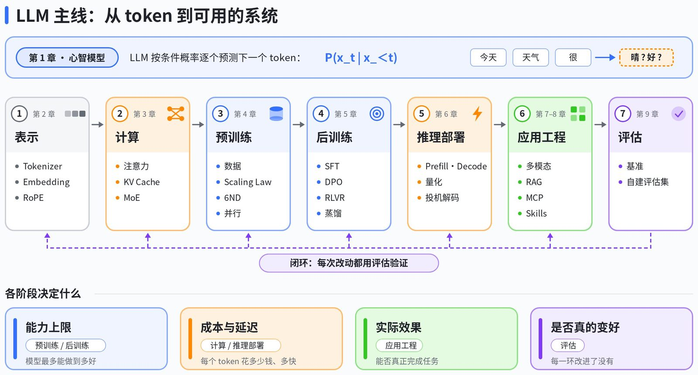

| 你是谁 | 建议重点阅读 | 读完应能回答 |
|---|---|---|
| **应用研发**（调 API、做 Agent） | 第 1、2、6.6–6.7、8、9 章 | 为什么输出 token 比输入贵？上下文怎么组织才省钱又不降效果？怎么评估自己的 Agent？ |
| **平台 / 基础设施研发** | 第 3、4、6 章 | 一个模型要多少显存、多少卡？decode 为什么是带宽瓶颈？KV Cache、量化、投机解码各省在哪？ |
| **算法入门** | 全文顺读，重点第 3–5 章 | 现代 LLM 的结构长什么样？预训练和 RL 后训练各自在优化什么？GRPO 家族在解决什么问题？ |

📎 与系列其他文档的分工：读懂公式需要的数学见「LLM 数学补课」，两篇的章节互相引用。后训练怎么动手见「后训练实战」，推理系统的完整工程见「大模型推理系统学习手册」，应用侧的工程做法见「Agent 工程实战」。本文只讲 LLM 是什么、怎么工作。

## 第 1 章 · 最小心智模型：LLM 到底在做什么

这一章先建立三个基础认识：LLM 在做什么（预测下一个 token）、它是怎么被训练出来的（梯度下降），以及为什么是 Transformer（NLP 表示方法的演进）。后面所有章节都建立在这三点之上。

### 1.1 语言模型 = 条件概率

语言模型只做一件事：**给定前文，输出下一个 token 的概率分布**。一段文本的概率被分解为逐个 token 的条件概率连乘：

```math
P(x_1,\dots,x_T)=\prod_{t=1}^{T}P(x_t\mid x_{<t})
```

举个具体例子。输入“今天天气很”，模型最后一层会对词表里的每个 token 打一个分数（logits），经 softmax 变成概率，可能是：“好”0.42、“热”0.21、“不错”0.12、“冷”0.08……其余几万个 token 分掉剩下的概率。按某种规则从中挑一个（比如“好”），拼到输入后面变成“今天天气很好”，再预测下一个 token，直到生成结束符或达到长度上限。这个“算分布 → 采样 → 拼回输入 → 再算”的循环叫**自回归生成**。

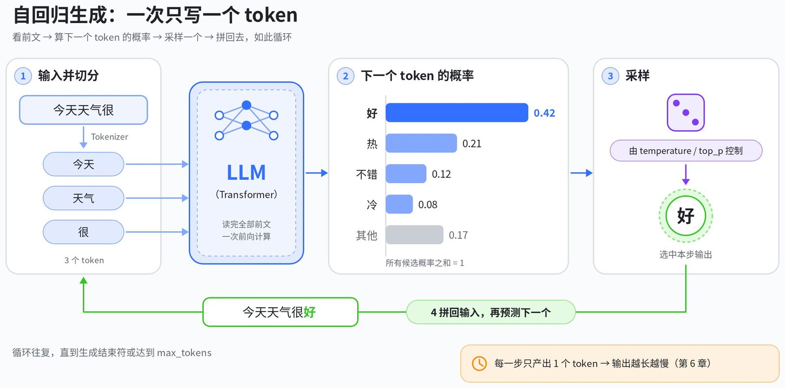

这个看似简单的目标之所以能学出语法、知识和推理，是因为要把海量文本的下一个 token 预测准，模型必须在内部压缩出对世界的规律性表示：要续写“水的沸点在标准大气压下是”，就得“知道”100°C；要续写一段代码，就得“理解”变量作用域[[1]](https://arxiv.org/abs/2005.14165)。

| 概念 | 研发视角的含义 |
|---|---|
| **Token** | 模型处理的最小单位，通常是子词。计费、上下文上限、速度都按 token 算；中文 1 个汉字约 0.6–1.5 个 token，取决于分词器（第 2 章）。 |
| **上下文窗口** | 一次前向能看到的最大 token 数，输入和输出共用。2026 年主流闭源与头部开源模型普遍为 256K–1M。窗口大不等于长程利用好，见 2.5。 |
| **Logits / Softmax** | 模型对词表中每个 token 的原始打分叫 logits；softmax 把它们变成和为 1 的概率。 |
| **Prefill / Decode** | 先一次性并行处理全部输入（prefill），再逐个生成输出（decode）。两者瓶颈不同，是理解成本与延迟的关键，见第 6 章。 |
| **无状态** | 模型本身不记得上一次请求。多轮对话之所以“有记忆”，是因为应用每次都把历史消息重新发给模型。 |

### 1.2 从概率到文字：解码参数

拿到概率分布后“怎么挑”由解码参数决定，这是调用 API 时最常调的旋钮。 $`T`$ 作用在 softmax 之前：

```math
p_i=\dfrac{\exp(z_i/T)}{\sum_j \exp(z_j/T)}
```

假设三个候选的 logits 为 2、1、0：$`T=1`$ 时概率约为 0.67 / 0.24 / 0.09；$`T=0.5`$ 时变成 0.87 / 0.12 / 0.02（更集中）；$`T=2`$ 时变成 0.51 / 0.31 / 0.19（更平均）。温度越低输出越稳定，越高越多样，也越容易跑题。

| 参数 | 作用 | 建议 |
|---|---|---|
| temperature | 缩放分布的尖锐程度；0 近似贪心（总选概率最高的）。 | 抽取、分类用低温；创作、头脑风暴用 0.7–1.0。推理模型通常建议使用厂商默认值。 |
| top_p（核采样） | 只在累计概率达到 p 的最小候选集合里采样，截掉长尾。 | 常用 0.9–0.95；一般只调 temperature 和 top_p 中的一个。 |
| top_k / min_p | 只保留概率最高的 k 个，或只保留概率不低于最高者一定比例的候选。 | 开源模型部署时常用，API 未必开放。 |
| 重复 / 存在惩罚 | 降低已出现 token 的分数，减少复读。 | 过大会让模型刻意换词、破坏术语一致性。 |
| max_tokens / stop | 限制输出长度、遇到指定字符串停止。 | 推理模型的思考 token 也计入输出长度，上限要留足。 |
| 结构化输出 | 按 JSON Schema 或语法约束解码，每一步只允许合法 token。 | 需要程序解析的输出优先用它，而不是靠提示词“请输出 JSON”。 |

### 1.3 模型是怎么“学”出来的：梯度下降

对理解 LLM，只需要抓住其中共同的四步：**定义一个带参数的函数 → 用损失函数衡量它错得多离谱 → 求损失对每个参数的梯度 → 沿梯度反方向小步更新参数**。

- **最小例子**：用 $`y=wx+b`$ 拟合房价。损失取预测值与真实值差的平方的平均；梯度告诉我们“$`w`$ 增大一点，损失会变大还是变小”；每次让 $`w \leftarrow w-\eta\,\partial L/\partial w`$（$`\eta`$ 是学习率），重复成千上万次，损失就降下来了。
- **神经网络**：把“线性变换 + 非线性激活函数”一层层叠起来，就能逼近几乎任意复杂的函数。层数多了手工求导不现实，**反向传播**用链式法则从输出层往回逐层算出所有参数的梯度，这是深度学习能训练的基础。
- **LLM 也一样**：参数是 Transformer 里几十亿到上万亿个权重；损失是**交叉熵**，即对正确的下一个 token 取负对数概率。如果模型给正确答案“好”分配了 0.42 的概率，这一步的损失就是 $`-\ln 0.42\approx0.87`$；分配 0.9 时损失只有 0.11。训练就是在数万亿个这样的位置上让损失平均下降。
- <b>困惑度（perplexity）</b>：平均损失的指数 $`e^{L}`$，直观含义是“模型平均在几个候选之间犹豫”。损失 2.0 对应困惑度约 7.4。
- **批次、步数与轮次**：每次更新用一批样本（batch）估计梯度；LLM 预训练通常只把数据过一遍左右，而不是像传统机器学习那样反复训练多轮。
- **过拟合与泛化**：模型在训练数据上表现好、在新数据上表现差，就是过拟合。LLM 数据量远大于参数量，过拟合不明显，但重复数据仍会导致死记硬背（4.1）。

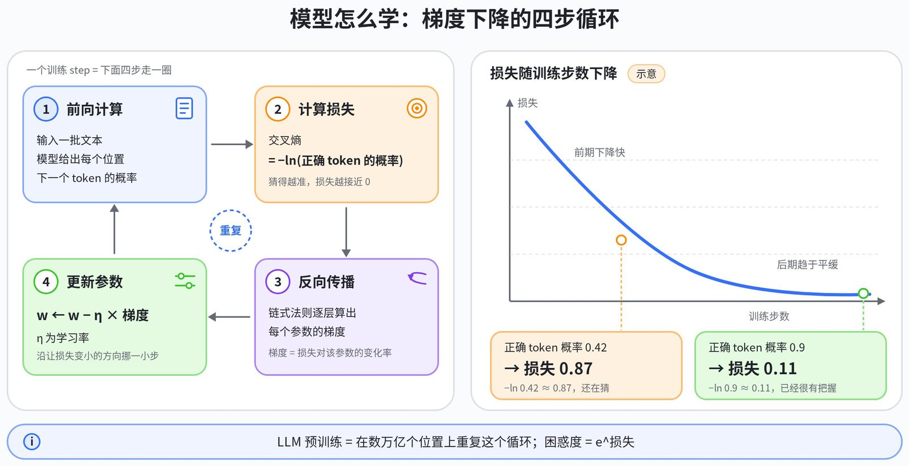

### 1.4 从词向量到注意力：为什么是 Transformer

原文 NLP 一章讲了 N-Gram、词袋、Word2Vec、NPLM 和 RNN。把它们串起来，是一条“如何让计算机表示词和句子的含义”的演进线，每一步都在解决上一步的核心缺陷：

| 方法 | 思路 | 缺陷（也是下一步的动机） |
|---|---|---|
| N-Gram / 词袋 | 统计相邻 N 个词的共现频率，或只数每个词出现几次。 | 词与词之间没有“相似”概念，“猫”和“狗”与“猫”和“汽车”一样远；窗口外的上下文全部丢失。 |
| 神经语言模型 NPLM[[2]](https://www.jmlr.org/papers/volume3/bengio03a/bengio03a.pdf) | 把每个词映射成一个稠密向量，用神经网络根据前几个词的向量预测下一个词。 | 首次引入“词向量 + 神经网络预测下一个词”，但计算昂贵、上下文仍是固定窗口。 |
| Word2Vec[[3]](https://arxiv.org/abs/1301.3781) | 用“周围的词预测中间的词”高效训练词向量，得到“国王 − 男人 + 女人 ≈ 女王”这样的语义算术。 | 每个词只有一个固定向量，无法区分“苹果手机”和“吃苹果”里的“苹果”。 |
| RNN / LSTM | 按顺序逐词读入，把前文压缩进一个隐状态向量，词的表示随上下文变化。 | 必须串行计算、无法并行训练；长距离信息在传递中衰减；整句被压进一个固定大小的向量，形成瓶颈。 |
| 注意力[[4]](https://arxiv.org/abs/1409.0473) | 2014 年用于机器翻译：生成每个词时，直接回头“看”输入里所有位置，按相关性加权。 | 最初只是 RNN 的补丁，仍受串行计算拖累。 |
| Transformer[[5]](https://arxiv.org/abs/1706.03762) | 彻底去掉循环，只用注意力让每个位置直接与所有位置交互。 | 序列内所有位置可以并行计算，能充分利用 GPU；代价是计算量随长度平方增长（3.2）。 |

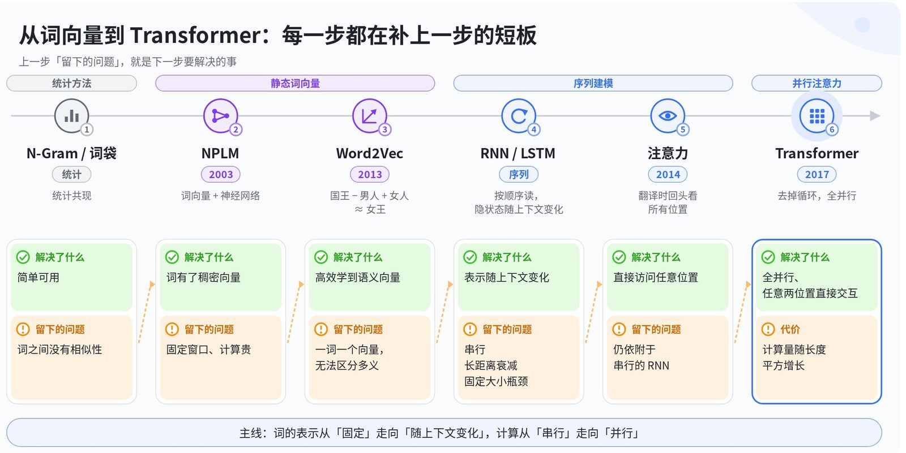

从这条线可以看到 LLM 继承的三个核心思想：**用向量表示含义**（embedding）、**含义由上下文决定**（上下文相关的表示）、**让任意两个位置直接交互**（注意力）。第 2、3 章分别展开前两者和最后一个。

### 1.5 AI、机器学习、深度学习、LLM 的关系

| 层次 | 核心思想 | 留给 LLM 的遗产 |
|---|---|---|
| **机器学习** | 从数据中拟合函数，而不是手写规则。监督 / 无监督 / 强化学习三大范式。 | 损失函数、梯度下降、过拟合与泛化、训练 / 验证 / 测试集划分。 |
| **深度学习** | 用多层神经网络自动学习特征，反向传播训练。 | 反向传播、激活函数、残差连接、归一化、GPU 并行训练。 |
| **NLP 表示学习** | N-Gram → 词向量 → RNN/LSTM 建模序列。 | embedding 思想；“词的含义由上下文决定”。 |
| **Transformer** | 完全基于注意力，抛弃循环，训练可大规模并行[[5]](https://arxiv.org/abs/1706.03762)。 | 今天几乎所有 LLM 的骨架。 |
| **LLM** | 在 Transformer 上把参数、数据、算力同时放大，再做后训练对齐。 | 上下文学习、指令遵循、推理与工具使用能力。 |
| **强化学习** | 智能体通过与环境交互、依据奖励改进策略。 | RLHF 与 RLVR：2024 年后推理能力的主要来源，见第 5 章。 |

<b>另一种常见的划分：判别式与生成式。</b>很长一段时间里，我们熟悉的 AI 是**判别式**的，而 LLM 属于**生成式**：

| 维度 | 判别式 AI | 生成式 AI |
|---|---|---|
| 核心任务 | 分类与决策：这是猫还是狗、这笔交易有没有风险。 | 生成新内容：写一段文字、一段代码、一张图。 |
| 学到的东西 | 类别之间的**边界**。 | 数据本身的**分布**，因此能从中采样出新样本。 |
| 输出 | 离散标签或分数。 | 连续的文本流、像素、音频。 |
| 典型方法 | 逻辑回归、XGBoost、CNN 分类器、BERT 类编码器。 | GPT 类解码器、扩散模型。 |
| 典型应用 | 风控评分、推荐排序、垃圾邮件过滤、人脸识别。 | 对话、代码生成、图像与视频生成。 |
| 主要局限 | 只能处理预先定义的类别。 | 会产生幻觉，输出有随机性。 |

两者并不对立：业务系统里常见的做法是用 LLM 做理解和生成，用判别式模型做召回、排序、风控等需要稳定、低成本、可解释的环节。几个常被混用的名词也可以一并分清：

| 名词 | 含义 |
|---|---|
| 生成式 AI | 技术领域的名称：所有通过学习数据分布来生成新数据的 AI 技术，范围最大。 |
| AIGC | 内容生产方式的名称：用生成式 AI 生产文章、代码、海报、视频。强调“内容生产”这一行为。 |
| 基础模型（Foundation Model） | 在大规模数据上预训练、能适配大量下游任务的通用模型。LLM 是其中处理文本和代码的一类。 |
| 多模态大模型（LMM / MLLM） | 同时理解（有的也能生成）文本、图像、音频、视频的基础模型，2026 年的旗舰模型基本都属于此类（第 7 章）。 |

> 🔍 <b>“涌现”要谨慎理解。</b>2022 年的研究观察到，少样本学习、思维链等能力在模型规模越过某个点后似乎“突然出现”[[110]](https://arxiv.org/abs/2206.07682)；但后续研究指出，这种“突变”很大程度上来自评估指标的选择（例如只按完全答对计分），换成连续指标后，能力往往是随规模平滑提升的[[111]](https://arxiv.org/abs/2304.15004)。今天经过蒸馏的 1.5B 小模型也能逐步推理（5.6），所以“低于某个参数量就没有某种能力”的说法并不可靠。

### 1.6 六个转折点

原文列举了从图灵到 2025 年的完整编年史。站在研发角度，真正改变技术路线的是下面六个节点：

| 时间 | 节点 | 改变了什么 |
|---|---|---|
| 2017 | Transformer[[5]](https://arxiv.org/abs/1706.03762) | 注意力取代循环，训练可并行，模型规模从此能随算力扩张。 |
| 2020 | Scaling Laws[[6]](https://arxiv.org/abs/2001.08361) 与 GPT-3[[1]](https://arxiv.org/abs/2005.14165) | 损失随参数、数据、算力呈幂律下降；足够大的模型出现少样本上下文学习：在提示词里给几个例子，模型就能照做，不需要重新训练。 |
| 2022 | InstructGPT / ChatGPT[[7]](https://arxiv.org/abs/2203.02155)、Chinchilla[[8]](https://arxiv.org/abs/2203.15556) | RLHF 让模型“听话”，产品形态从补全变成对话；同时明确了参数与数据的最优配比。 |
| 2024 | OpenAI o1[[9]](https://openai.com/index/learning-to-reason-with-llms/) | 推理时计算（test-time compute）成为新的扩展维度：让模型先长时间“思考”再回答。 |
| 2025 | DeepSeek-R1[[10]](https://arxiv.org/abs/2501.12948) | 公开证明“可验证奖励 + 大规模 RL”就能激发长链推理，并开源权重与方法，RLVR 成为行业标准做法。 |
| 2025–2026 | 混合注意力与 Agent 化 | 百万 token 上下文靠稀疏 / 线性注意力变得可负担[[11]](https://arxiv.org/abs/2606.19348)[[12]](https://arxiv.org/abs/2510.26692)；模型从“回答问题”转向“执行长任务”，评估重心随之转向 Agent 基准。 |

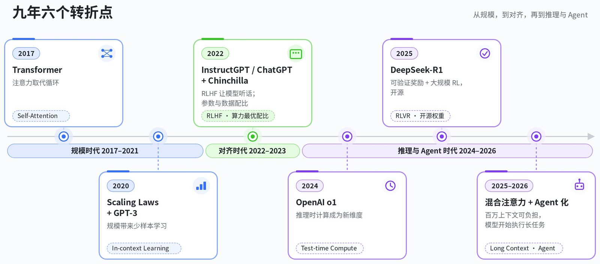

> ❗ <b>关于编年史的提醒：</b>2025 年后各家发布节奏以周计，媒体描述常夸大（例如“千万 token 窗口”“幻觉率极低”）。引用某个模型的能力时，请以官方模型卡或技术报告的原始数字为准，并注明日期。

## 第 2 章 · 表示：文字如何变成模型能算的东西

模型只能对数字做矩阵运算。这一章回答：一段文字如何变成一串整数（分词），整数如何变成向量（embedding），模型如何知道词的先后顺序（位置编码），以及对话里的“角色”是怎么表示的（对话模板）。

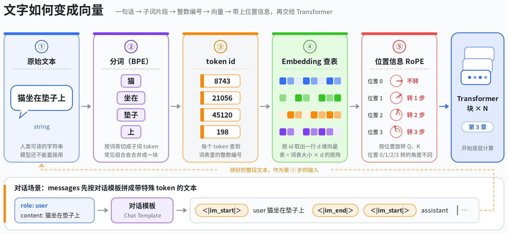

### 2.1 分词（Tokenization）

模型不直接读字符，而是读 token id。主流做法是**字节级 BPE**（Byte Pair Encoding）：从单个字节出发，反复把语料中出现最频繁的相邻片段合并成新 token，直到词表达到目标大小（通常 10 万–25 万）[[13]](https://arxiv.org/abs/1508.07909)[[14]](https://arxiv.org/abs/1808.06226)。

**一个缩小版的例子**：语料里有很多 “lower”“lowest”“newer”。第一轮发现 “e”+“r” 最常相邻，合并出 “er”；第二轮合并 “l”+“o” 为 “lo”；第三轮合并 “lo”+“w” 为 “low”……训练结束后，“lowest” 可能被切成 “low” + “est”，而罕见词会被切成更碎的片段。因为从字节出发，任何输入（包括表情符号、乱码）都能被编码，不会出现“未登录词”。

- **中文怎么切**：常用汉字和常见词组通常各自是 1 个 token，生僻字可能拆成 2–3 个字节级 token。所以“1 个汉字约 0.6–1.5 个 token”取决于分词器对中文的覆盖程度。
- **词表越大**：同样文本的 token 更少（更省上下文、更快），但 embedding 与输出层更大，低频 token 训练不足。
- **分词器影响成本**：同一段文本在不同模型上的 token 数可能相差数十个百分点。Anthropic 在 Claude Sonnet 5 的发布说明中提示，新分词器使同样输入的 token 数变为旧版的约 1.0–1.35 倍[[15]](https://www.anthropic.com/news/claude-sonnet-5)。换模型时要重新估算成本和上下文余量。
- **分词器影响能力**：数字、代码缩进、罕见语言的切分方式会影响算术与代码能力。例如 “12345” 若被切成 “123” + “45”，模型做逐位加法就更难，这也是很多模型把数字按单个数字切分的原因。LLM 数不清单词里有几个字母，也与此有关：它看到的是 token，不是字母。

> 📊 <b>动手看一看：</b>用各家公开的分词器工具（或开源模型的 tokenizer）把同一段中文、英文、代码、JSON 分别切一遍，统计 token 数。你会发现 JSON 的引号、括号和缩进空格占用了大量 token，这是“把大对象原样塞进提示词”很贵的原因。

### 2.2 对话模板与特殊 token

API 里的 system / user / assistant 消息，最终都会被拼成一段带特殊标记的纯文本再分词。以常见的 ChatML 风格为例：

*
*

```text
<|im_start|>system你是一个代码审查助手。<|im_end|><|im_start|>user这段代码有什么问题？<|im_end|><|im_start|>assistant
```

- **特殊 token**：像 &lt;|im_start|> 这样的标记在词表里有专门的 id，普通文本无法生成它们，用来划分角色和轮次；生成结束时模型输出结束 token。
- **工具调用也是文本**：工具定义会被序列化进系统提示；模型“调用工具”本质上是按约定格式输出一段 JSON，由应用解析并执行（第 8 章）。
- **思考内容**：推理模型的思考过程同样是一段被特殊标记包起来的 token，计入输出计费。
- **工程含义**：自己部署开源模型时，必须使用该模型训练时的对话模板，模板错一个换行都可能让效果明显变差。推理引擎一般从模型仓库自带的模板配置中读取。

### 2.3 Embedding：token 变向量

每个 token id 查表得到一个 $`d`$ 维向量（$`d`$ 通常为 4K–8K），这张表就是 embedding 矩阵，大小为“词表大小 × $`d`$”。例如词表 15 万、$`d=8192`$ 时约 12 亿个参数。

- **向量里存的是什么**：训练后，语义相近的 token 在向量空间中距离更近；某些方向对应可解释的属性（如性别、时态、语言）。但这只是输入层的“初始含义”，真正随上下文变化的含义是在后面各层中逐步形成的。
- **输出端**：最后一层的隐状态乘以另一个“$`d`$ × 词表大小”的矩阵（LM head）得到 logits。很多小模型让输入 embedding 与 LM head 共享权重以节省参数。
- **和检索用的 embedding 不同**：RAG 里常说的“文本向量”是专门训练的 embedding 模型把整段文本压成一个向量（第 8 章），与这里 LLM 内部逐 token 的向量是两回事。

> 🆕 <b>2026 新趋势：把容量放到 embedding 里。</b>Qwen3.8-Flash-Next 在主干之外增加了一个 n-gram embedding 层，额外 51B 参数存放在主机内存、按需预取，主干仅激活 6B 参数；报告显示其在 14 项预训练基准中的 8 项上超过激活参数多两倍的 Qwen3.5-397B-A17B，训练 FLOPs 约为后者的 1/9[[16]](https://raw.githubusercontent.com/QwenLM/Qwen3.8-Flash-Next/main/tech_report.pdf)。这说明“查表式记忆”可以用几乎为零的计算换取知识容量。

### 2.4 位置编码：让模型知道顺序

注意力本身对顺序不敏感：把输入打乱，每个位置算出的结果只是跟着换位置。因此必须注入位置信息，否则“狗咬人”和“人咬狗”对模型没有区别。原文介绍的是 2017 年的正弦绝对位置编码；今天的事实标准是 <b>RoPE（旋转位置编码）</b>[[17]](https://arxiv.org/abs/2104.09864)。

- **直觉**：把 Q、K 向量每两维看成平面上的一个点，按 token 的位置旋转一个角度，位置越靠后转得越多。两个向量的点积只取决于它们的夹角差，也就是**相对距离**，所以注意力分数天然反映“隔了多远”，而不是“在第几位”。
- **多种频率**：不同维度用不同的旋转速度，快的维度区分相邻 token，慢的维度区分远距离 token，类似钟表的秒针、分针和时针。
- **长度外推**：训练时只见过 32K 长度，推理想用 1M，慢速维度会转到训练中没见过的角度。YaRN 等方法通过调整各维度的频率来“拉伸”位置编码[[18]](https://arxiv.org/abs/2309.00071)，再配合长文本继续训练。模型卡上的“262K 原生，1M YaRN”就是这个意思。
- **部分层不用位置编码**：一些混合架构只在少数全局注意力层使用 RoPE，线性 / 循环层按顺序处理，天然带有顺序信息。

### 2.5 上下文窗口的工程含义

| 问题 | 要点 |
|---|---|
| 窗口是怎么变长的 | 预训练后期或“中期训练”（mid-training）阶段用长文本继续训练，同时调整位置编码；注意力换成稀疏 / 线性形式，让 1M 上下文的显存与计算可负担，见 3.5–3.6。 |
| 窗口大就能用好吗 | 不能。“大海捞针”类检索任务头部模型接近满分，但多跳推理、跨文档聚合在长上下文下仍会明显退化。把真正相关的内容放进上下文，比塞满窗口更有效。 |
| 输入输出共享窗口 | 窗口 = 输入 + 输出（含思考）。256K 窗口塞了 250K 输入，就只剩 6K 给回答和思考。 |
| 长上下文的成本 | 输入 token 按量计费；命中提示词缓存的前缀通常只收原价的 10%–25%（各家比例不同，以官方价格页为准）。显存方面，KV Cache 随上下文线性增长，是长上下文服务的主要约束，见 3.4 与第 6 章。 |

## 第 3 章 · 计算：现代 LLM 的结构

📎 延伸阅读：注意力变体、KV 缓存账、稀疏与线性注意力见 [LLM-31｜地基｜长上下文与注意力：从 MHA 到稀疏与线性注意力](./31-attention-long-context.md)；MoE 的路由、负载均衡与专家并行见 [LLM-33｜地基｜MoE 混合专家：路由、负载均衡、训练与推理](./33-moe.md)。

这一章打开模型内部：先用一个真实模型把一次前向传播走一遍，再拆开注意力、前馈网络与残差，然后讲清楚决定推理成本的 KV Cache，以及过去三年围绕它展开的注意力演进、混合架构与 MoE。

### 3.1 一次前向传播：跟着张量走一遍

当前的 LLM 几乎都是<b>仅解码器（decoder-only）</b>结构：若干个相同的块堆叠，每个块由“注意力（token 之间交换信息）+ 前馈网络（每个 token 独立加工）”组成，外加残差连接和归一化。以 Llama-3-70B 为例（词表 128,256，隐藏维度 8192，80 层，64 个查询头、8 个 KV 头，每头 128 维，FFN 中间维度 28,672）[[19]](https://arxiv.org/abs/2407.21783)，输入一段 $`n`$ 个 token 的文本：

| 步骤 | 操作 | 张量形状 | 说明 |
|---|---|---|---|
| 1 | 分词得到 token id | [n] | 第 2 章 |
| 2 | 查 embedding 表 | [n, 8192] | 每个 token 一个 8192 维向量，这条向量流称为**残差流** |
| 3 | 80 个块依次处理 | [n, 8192] | 每块都“读取残差流 → 计算 → 把结果加回残差流”，形状始终不变 |
| 4 | 最终归一化 + LM head | [n, 128256] | 每个位置得到对下一个 token 的打分 |
| 5 | 取最后一个位置的 logits 采样 | [128256] → 1 个 token | 训练时所有位置同时算损失；生成时只用最后一个位置 |

“残差流”是理解 Transformer 最有用的视角：它像一条传送带，每个块从上面读取信息、做一点加工、再把增量写回去。浅层倾向于处理词法和局部搭配，深层倾向于处理语义和任务相关的信息。

### 3.2 注意力：逐步拆开

看这句话：“小明把书借给了小红，因为**她**明天要考试。”模型处理“她”时，需要知道“她”指的是小红。注意力做的就是这件事：

1. **投影**：每个 token 的向量分别乘三个矩阵，得到查询 Q（我在找什么）、键 K（我能提供什么）、值 V（我实际携带的信息）。
2. **打分**：“她”的 Q 与前面每个 token 的 K 做点积，得到相关性分数。训练得好的模型里，“她”与“小红”的分数会明显高于与“书”的分数。
3. **掩码**：生成式模型只能看前文，所以“她”之后的位置分数被设为负无穷（因果掩码）。
4. **归一化**：分数除以 $`\sqrt{d_k}`$ 防止数值过大，再做 softmax 变成权重。
5. **加权求和**：用权重对所有 V 加权求和，“她”的新表示里就融入了“小红”的信息。

合起来就是：

```math
\mathrm{Attention}(Q,K,V)=\mathrm{softmax}\!\left(\frac{QK^{\top}}{\sqrt{d_k}}+M\right)V
```

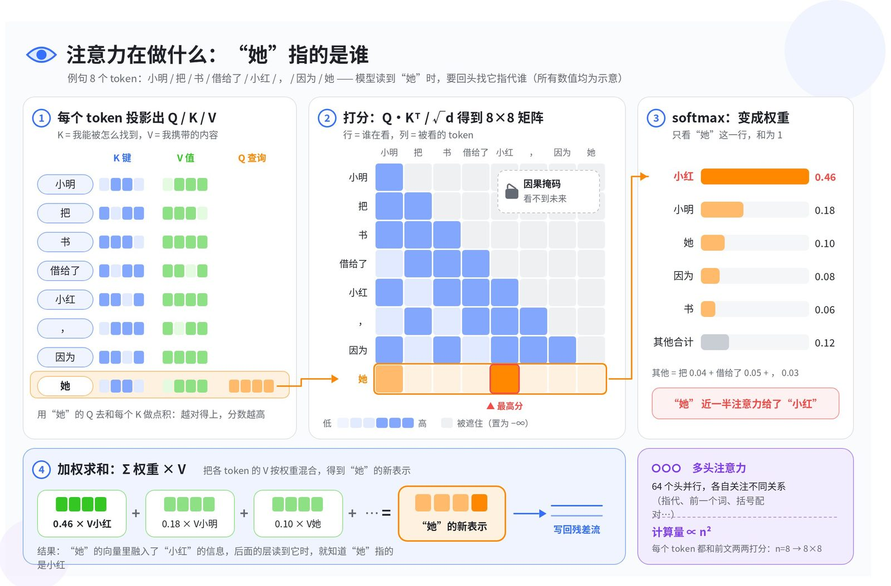

- **多头**：同样的过程在 64 个头上并行，每个头只用 128 维。不同头会学到不同的关系：有的关注前一个 token，有的关注指代，有的关注括号配对。结果拼接后再乘一个输出矩阵写回残差流。
- **复杂度**：每个 token 要与前面所有 token 打分，计算量随序列长度 $`n`$ 呈 $`O(n^2)`$，这是长上下文的核心代价。
- **FlashAttention**：把计算分块放在 GPU 片上高速缓存中完成，避免在显存中写出完整的 $`n\times n`$ 分数矩阵，大幅减少显存读写。它是**精确计算**，并不改变 $`O(n^2)`$ 的计算量[[20]](https://arxiv.org/abs/2205.14135)。

> ❓ **两个常见疑问**
>
> - <b>为什么要把 K 和 V 分开？</b>类比搜索引擎：Q 是你在搜索框里输入的词，K 是网页的标题和标签，用来判断“匹配不匹配”；V 是网页正文，匹配上之后真正拿走的内容。“用来被找到的特征”和“被找到后提供的信息”往往不同，分成两个矩阵，模型就能分别学习。
> - <b>训练时为什么也要掩码？</b>推理时模型只能一个个生成，天然看不到未来；但训练时为了效率，会把整句正确答案一次性输入，让所有位置**同时**预测各自的下一个 token。如果不遮住右边，模型预测第 3 个 token 时就能直接“偷看”到第 3 个 token，学会的是抄答案而不是预测。因果掩码让一次前向同时得到 n 个位置的训练信号，又不泄露答案，这也是 Transformer 训练效率高的原因之一。

#### 原版 Transformer：编码器、解码器与交叉注意力

2017 年的原版 Transformer 为机器翻译设计，由两部分组成[[5]](https://arxiv.org/abs/1706.03762)：**编码器**一次性读完原文，每个位置都能看到整句（双向注意力）；**解码器**逐个生成译文，除了对自己已生成的内容做带掩码的自注意力，还多一层**交叉注意力**：Q 来自解码器（“我现在要写什么”），K、V 来自编码器的输出

| 结构 | 注意力方式 | 代表模型 | 擅长 |
|---|---|---|---|
| 仅编码器 | 双向自注意力，每个位置看全句。 | BERT 及各类检索用 embedding 模型、重排模型。 | 理解、分类、向量化，不直接生成长文本。 |
| 编码器–解码器 | 编码器双向 + 解码器因果自注意力 + 交叉注意力。 | 原版 Transformer、T5[[112]](https://arxiv.org/abs/1910.10683)、语音识别模型 Whisper。 | 输入输出边界清晰的任务：翻译、摘要、语音转写。 |
| 仅解码器 | 只有因果自注意力，输入和输出拼成一条序列。 | GPT 系列及今天几乎所有 LLM。 | 通用生成、对话、推理、工具调用。 |

**为什么仅解码器成了主流**：结构只有一种，扩展和工程实现最简单；“预测下一个 token”这一个目标就能用上全部文本数据；多轮对话、工具返回、思考过程都能自然地接在同一条序列后面，KV Cache 也只需一种。编码器–解码器并没有消失：DeepSeek-V4.1-Flash 以“因果编码器–解码器”的形式把读和写的计算预算分开（3.8），说明这条路线在效率上仍有价值。

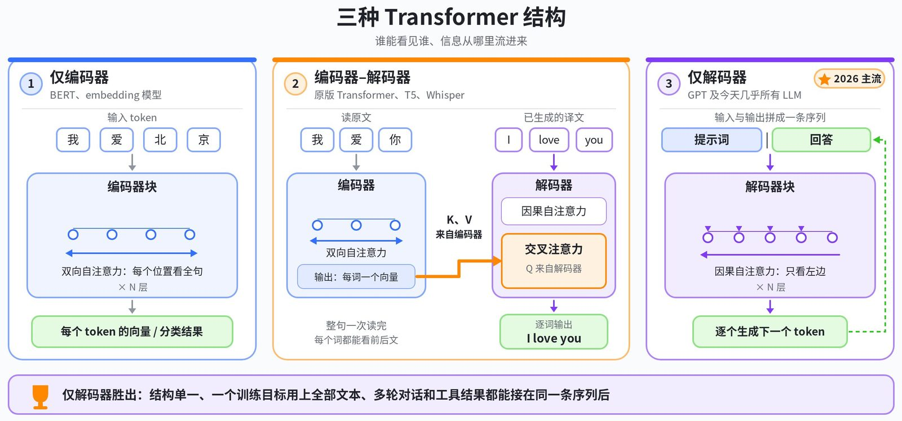

### 3.3 前馈网络、归一化与残差

注意力负责“在 token 之间搬运信息”，<b>前馈网络（FFN）</b>负责“对每个 token 独立加工”。现在普遍使用 SwiGLU 门控结构[[21]](https://arxiv.org/abs/2002.05202)：

```math
\mathrm{FFN}(x)=W_2\big(\mathrm{SiLU}(W_1x)\odot W_3x\big)
```

FFN 占了稠密模型的大部分参数。研究者常把它理解为一种“键值记忆”：$`W_1`$ 的每一行像一个模式探测器，匹配到某种上下文时激活，$`W_2`$ 再把对应的知识写回残差流。这也解释了为什么 MoE 选择把 FFN 拆成多个专家（3.7）。

| 组件 | 2017 原版 | 2026 常见做法 |
|---|---|---|
| 归一化 | Post-LN、LayerNorm | Pre-Norm + RMSNorm[[22]](https://arxiv.org/abs/1910.07467)：在每个子层**之前**归一化，残差流本身不被归一化，深层训练更稳；部分模型对 Q、K 再做归一化（QK-Norm）抑制注意力分数爆炸。 |
| 前馈网络 | ReLU 两层 MLP | SwiGLU 门控 MLP；大模型普遍替换为 MoE，见 3.7。 |
| 位置编码 | 正弦绝对位置 | RoPE[[17]](https://arxiv.org/abs/2104.09864)，配合长度外推（2.4）。 |
| 注意力 | 多头注意力 MHA | GQA / MLA / 稀疏注意力 / 与线性注意力混合，见 3.5–3.6。 |
| 残差连接 | 单条残差流 | 主流仍是单条；DeepSeek-V4 采用 mHC 多路残差流[[23]](https://arxiv.org/abs/2512.24880)[[11]](https://arxiv.org/abs/2606.19348)，见 3.8。 |

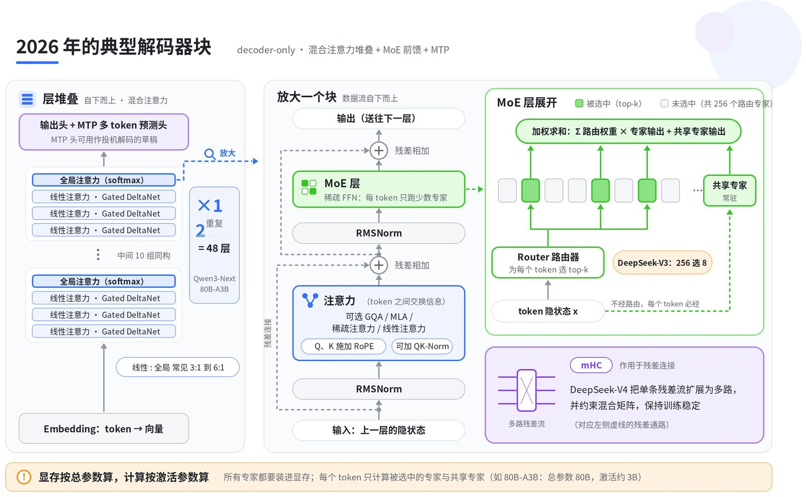

**参数量速算**：用 Llama-3-70B 验算。每层注意力：$`W_Q`$、$`W_O`$ 各 8192×8192，$`W_K`$、$`W_V`$ 因 GQA 各只有 8192×1024，合计约 1.5 亿；每层 FFN：3 个 8192×28672 矩阵，约 7.05 亿。80 层合计约 685 亿，加上输入 embedding 与 LM head 各约 10.5 亿，总计约 706 亿，与“70B”吻合。其中 FFN 约占 80%，这正是 MoE 要“稀疏化”的部分。

### 3.4 KV Cache：用显存换重复计算

因为有因果掩码，前面 token 的 K、V 不会因为后面来了新 token 而改变。生成第 $`t`$ 个 token 时，只需为新 token 计算一次 Q、K、V，再与缓存里的历史 K、V 做注意力。把历史 K、V 存起来就是 **KV Cache**。没有它，每生成一个 token 都要把整段前文重算一遍，生成 1000 个 token 的计算量会增加上百倍。

它的大小决定了一张卡能同时服务多少请求、能支持多长上下文：

```math
\text{KV 字节数/token}=2\times L\times n_{kv}\times d_{head}\times \text{每元素字节数}
```

> 📊 <b>算一笔账：</b>Llama-3-70B 有 80 层、8 个 KV 头、头维度 128[[19]](https://arxiv.org/abs/2407.21783)。BF16 下每 token 的 KV Cache 为 $`2\times80\times8\times128\times2\approx 320\,\text{KB}`$；一条 128K 上下文的请求约需 40 GB，接近半张 80 GB 显卡，这还没算 140 GB 的权重。如果 32 个用户同时各带 8K 上下文，也要 80 GB。正因如此，过去三年的注意力创新几乎都在压缩 KV Cache。

### 3.5 注意力的演进：一路在给 KV Cache 减肥

| 方案 | 做法 | 代价与代表模型 |
|---|---|---|
| **MHA** 多头注意力 | 每个查询头都有独立的 K、V 头。 | 质量基线，KV 最大。早期 GPT、Llama 1/2 小模型。 |
| **MQA** 多查询注意力[[24]](https://arxiv.org/abs/1911.02150) | 所有查询头共享 1 组 K、V。 | KV 缩小到 1/头数，质量有损。 |
| **GQA** 分组查询注意力[[25]](https://arxiv.org/abs/2305.13245) | 查询头分组，每组共享 1 组 K、V（如 64 个查询头配 8 个 KV 头）。 | 质量与成本的折中，Llama 3、Qwen3 等大量模型采用。 |
| **MLA** 多头潜在注意力[[26]](https://arxiv.org/abs/2405.04434) | 把 K、V 压缩成一个低维潜向量缓存，计算时再投影回多头；RoPE 部分单独保留。 | DeepSeek-V2/V3 每层每 token 只缓存 512+64 维，V3 全模型约 70 KB/token，约为上例 70B GQA 模型的 22%[[27]](https://arxiv.org/abs/2412.19437)。 |
| **稀疏注意力**[[28]](https://arxiv.org/abs/2502.11089) | 每个查询只挑选最相关的一部分历史块做精确注意力，用轻量“索引器”打分选块。 | DeepSeek-V4 的 CSA 先把 KV 沿序列压缩 4 倍再做 top-k 稀疏选择，并与压缩 128 倍的稠密注意力 HCA 交替；1M 上下文下 V4-Pro 的单 token FLOPs 和 KV Cache 分别只有 V3.2 的 27% 和 10%[[11]](https://arxiv.org/abs/2606.19348)。 |
| **线性注意力 / SSM**[[29]](https://arxiv.org/abs/2312.00752)[[30]](https://arxiv.org/abs/2412.06464) | 用固定大小的递归状态代替不断增长的 KV Cache，计算随长度线性增长。 | 单独使用时精确检索能力弱，因此 2025 年后几乎都以“混合”形式出现，见 3.6。 |

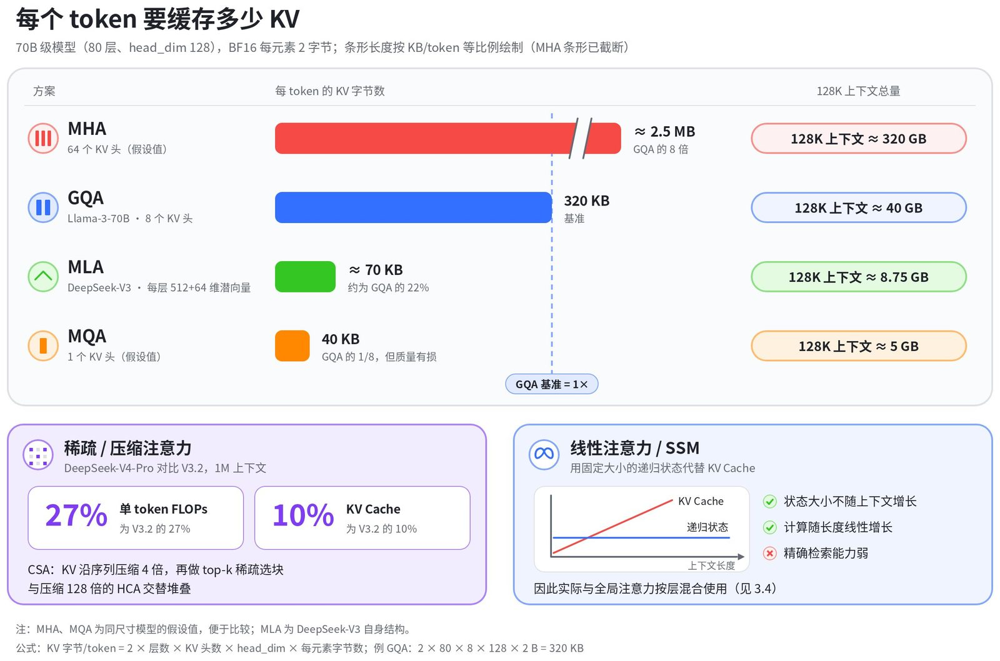

> ⛔ MLA 是 <b>Multi-head Latent Attention（多头潜在注意力）</b>，核心是“低秩压缩 KV”，不是“引入相邻层注意力权重的多层聚合”。另外，PagedAttention 是 KV Cache 的显存管理方式（推理引擎层面），不是一种注意力结构，放在第 6 章讨论更准确。

<b>线性注意力为什么“记不准”</b>：它把全部历史压进一个固定大小的状态矩阵（例如每头 128×128），相当于用一块固定大小的白板做笔记，内容越多，旧内容越会被覆盖。Gated DeltaNet 等改进用“门控 + 增量规则”决定何时遗忘、如何改写，但容量上限仍在。所以需要少数全局注意力层来负责“精确翻找原文”。

### 3.6 混合架构：2026 年的主流形态

单一机制很难同时满足“长上下文便宜”和“精确回忆任意位置”。2025–2026 年的答案是**按层混合**：大多数层用便宜的线性 / 局部注意力，少数层保留全局注意力负责精确检索。

- **线性 + 全局，约 3:1**：Qwen3-Next 80B-A3B 的 48 层按“3 个 Gated DeltaNet + 1 个门控全局注意力”重复 12 次[[31]](https://sebastianraschka.com/llm-architecture-gallery/hybrid-attention/)；Qwen3.5-397B-A17B 延续这一混合注意力路线。Kimi Linear 以约 3:1 混合 KDA 与 MLA，报告 KV Cache 最多减少 75%、1M 上下文解码吞吐最高提升 6 倍，并在公平对比下首次超过全注意力基线[[12]](https://arxiv.org/abs/2510.26692)。系统性消融建议线性层与全局层的比例取 3:1 到 6:1，比例决定的是**召回能力**而非困惑度[[32]](https://arxiv.org/abs/2507.06457)。
- **全局层再稀疏化**：Qwen3.8-Flash-Next 保持“每 4 层 1 层全局”，并在继续预训练阶段把全局层替换为 Qwen Sparse Attention（微块粒度 + 压缩索引器）[[16]](https://raw.githubusercontent.com/QwenLM/Qwen3.8-Flash-Next/main/tech_report.pdf)。
- **压缩 + 稀疏 + 滑窗**：DeepSeek-V4 用 CSA/HCA 交替，每层再加一个滑动窗口分支保留最近 token 的原始精度[[11]](https://arxiv.org/abs/2606.19348)。
- **局部滑窗 + 全局**：Gemma 3、gpt-oss 等交替使用滑动窗口注意力和全局注意力，最简单、对推理引擎最友好。

> 💡 <b>对研发的影响：</b>混合模型的缓存不再是“每层一样大的 KV”，而是“部分层 KV + 部分层固定状态”。推理引擎需要分组管理不同类型的缓存，前缀缓存、投机解码、P/D 分离的实现都更复杂，这正是 2026 年 vLLM 等引擎大量工作的来源。

#### 从 Mamba 说起：状态空间模型在做什么

状态空间模型（SSM）像 RNN 一样逐个读入 token，把历史压进一个固定大小的状态；生成时只需更新这个状态，不需要回看全部历史，所以每个 token 的计算和显存都不随长度增长。早期 SSM 的参数和输入无关，处理语言这类离散数据效果差。Mamba（2023）的改进是让参数随当前 token 变化，模型可以按内容决定“记住什么、忘掉什么”，并配了一个针对 GPU 的并行扫描算法。论文报告推理吞吐是同规模 Transformer 的约 5 倍，3B 模型追平两倍规模的 Transformer[[29]](https://arxiv.org/abs/2312.00752)。Mamba-2（2024）证明 SSM 和线性注意力可以统一成同一类结构化矩阵，新实现比 Mamba 快 2–8 倍，状态也能做得更大[[124]](https://arxiv.org/abs/2405.21060)。3.5 节提到的 Gated DeltaNet 走的是同一条路：用门控快速擦除旧记忆，用增量规则精确改写某一条，1.3B 规模的平均分超过 Mamba-2 和同等训练量的 Transformer[[30]](https://arxiv.org/abs/2412.06464)。

顺带澄清一个常见说法：“128K 上下文的注意力矩阵要 32 GB 显存”。这个数字只是单个注意力头、FP16 的 128K×128K 分数矩阵**假如完整写进显存**时的大小（约 32 GiB）。FlashAttention 从 2022 年起就分块计算，从不在显存里写出这个矩阵，额外显存只随长度线性增长[[20]](https://arxiv.org/abs/2205.14135)。长上下文真正吃显存的是同样线性增长、但要一直保留到生成结束的 KV Cache。

#### 固定状态的代价：复制和精确查找

“记不准”有直接的实验证据。哈佛的研究证明，两层 Transformer 就能复制指数长度的字符串，而 SSM 受限于固定大小的状态做不到；学会复制任务，Transformer 需要的训练样本比最好的 SSM 少 100 倍。在预训练模型上做“查电话簿”测试，同规模的 Pythia 明显好于 Mamba，尽管 Mamba 的困惑度更低[[125]](https://arxiv.org/abs/2402.01032)。困惑度看不出这个差别，这也是为什么混合架构的消融说比例决定的是召回能力[[32]](https://arxiv.org/abs/2507.06457)。

#### 2024–2026 年的混合比例

| 模型 | 怎么混 | 报告的收益 |
|---|---|---|
| Jamba（AI21，2024-03） | 注意力 : Mamba = 1 : 7，每两层用一次 MoE；52B 总参数 / 12B 激活 | 256K 上下文的 KV Cache 4 GB，Mixtral 是 32 GB；长上下文吞吐为 Mixtral 的 3 倍[[126]](https://arxiv.org/abs/2403.19887) |
| Zamba2（Zyphra，2024-11） | Mamba-2 主干 + 两个交替共享的注意力块 | 首 token 时间减少 30–50%，KV Cache 减少到 1/6[[127]](https://arxiv.org/abs/2411.15242) |
| Nemotron-H（英伟达，2025-04） | 约 8% 的层是注意力：8B 为 52 层中 4 层，56B 为 118 层中 10 层；不用位置编码 | 推理最快约为同级 Qwen-2.5 / Llama-3.1 的 3 倍[[128]](https://arxiv.org/abs/2504.03624) |
| Nemotron Nano 2（英伟达，2025-08） | 62 层：6 层注意力、28 层 Mamba-2、28 层 FFN | 8K 输入、16K 输出时吞吐最高为 Qwen3-8B 的 6 倍[[129]](https://arxiv.org/abs/2508.14444) |
| Falcon-H1（TII，2025-07） | 同一层里并行放注意力头和 Mamba-2 头，输出拼接 | 34B 追平或超过 70B 级模型（质量口径）[[130]](https://arxiv.org/abs/2507.22448) |
| Granite 4.0-H（IBM，2025-10） | Mamba-2 : Transformer = 9 : 1 | 长输入和多并发下内存需求减少 70% 以上[[131]](https://www.ibm.com/new/announcements/ibm-granite-4-0-hyper-efficient-high-performance-hybrid-models) |
| MiniMax-01 / M1（2025） | 每 7 层闪电注意力（线性）后接 1 层 softmax 注意力；456B 总参数 / 45.9B 激活 | 生成 10 万 token 时 FLOPs 约为 DeepSeek-R1 的 25%[[132]](https://arxiv.org/abs/2501.08313) |
| Qwen3-Next / Qwen3.5（阿里，2025-09 / 2026-02） | Gated DeltaNet ：门控注意力 = 3 : 1 | Qwen3-Next 基座：训练成本为 Qwen3-32B 的 10%，32K 以上上下文吞吐为其 10 倍[[133]](https://huggingface.co/Qwen/Qwen3-Next-80B-A3B-Instruct)[[31]](https://sebastianraschka.com/llm-architecture-gallery/hybrid-attention/) |
| Kimi Linear（月之暗面，2025-10） | KDA : MLA = 3 : 1；48B 总参数 / 3B 激活 | KV Cache 最多减少 75%，1M 上下文解码吞吐最高 6 倍[[12]](https://arxiv.org/abs/2510.26692) |

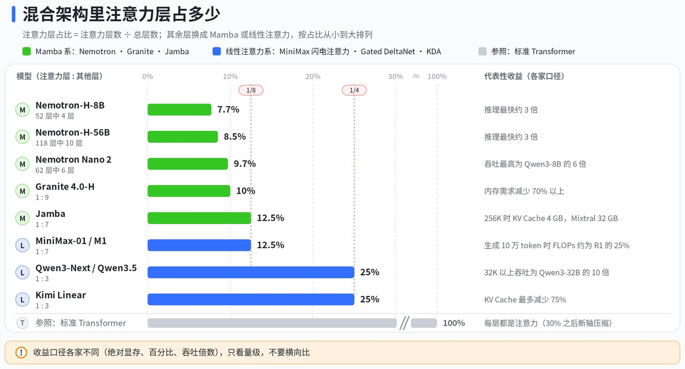

读这张表要注意两点。注意力层的占比从 8% 到 25% 不等，比例越低越省，但精确召回越依赖那几层注意力。另外，各家的收益口径不同（绝对显存、百分比、吞吐倍数，基线也不一样），不能横向直接比。另一条路是不换掉注意力、而是让它只看一部分 token，例如本节前面提到的 Qwen Sparse Attention 和 DeepSeek-V4 的压缩加稀疏注意力。

### 3.7 MoE：总参数与激活参数

混合专家（MoE）把 FFN 换成许多个并列的“专家”小网络，由路由器为每个 token 选择少数几个专家计算。于是模型可以**总参数很大（装更多知识）而单 token 计算量很小**[[33]](https://arxiv.org/abs/2101.03961)。以 DeepSeek-V3 的一层为例[[27]](https://arxiv.org/abs/2412.19437)：

1. 路由器是一个小线性层，给 256 个路由专家各打一个亲和度分数。
2. 选出分数最高的 8 个专家，把分数归一化成权重。
3. token 的向量送进这 8 个专家和 1 个所有 token 都会经过的**共享专家**，结果按权重加和写回残差流。
4. 同一批里不同 token 选的专家不同；分布式部署时它们要被发往持有对应专家的 GPU，再收回来（AllToAll 通信）。

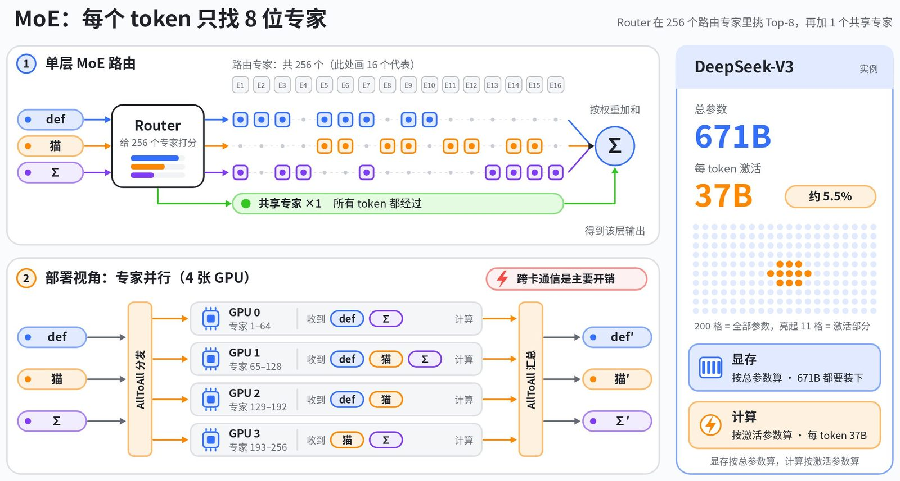

| 模型（发布时间） | 总参数 / 激活参数 | 备注 |
|---|---|---|
| DeepSeek-V3（2024-12） | 671B / 37B | 256 个路由专家选 8 个 + 1 个共享专家[[27]](https://arxiv.org/abs/2412.19437) |
| Qwen3.5-397B-A17B（2026-02） | 397B / 17B | 混合注意力 + MoE，开放权重[[34]](https://cheatsheets.davidveksler.com/ai-model-release-log.html) |
| DeepSeek-V4-Pro（2026-04） | 1.6T / 49B | 1M 上下文，开放权重[[11]](https://arxiv.org/abs/2606.19348) |
| DeepSeek-V4-Flash（2026-04） | 284B / 13B | 同架构的高效版本[[11]](https://arxiv.org/abs/2606.19348) |
| Gemma 4 26B MoE（2026-04） | 26B / 3.8B | 面向单机部署[[34]](https://cheatsheets.davidveksler.com/ai-model-release-log.html) |
| Qwen3.8-Max（2026-08） | 2.4T / 95B | 面向编码与协作办公[[34]](https://cheatsheets.davidveksler.com/ai-model-release-log.html) |

- **细粒度专家 + 共享专家**：DeepSeekMoE 把专家切得更小、选得更多，再保留常驻的共享专家承载通用知识[[35]](https://arxiv.org/abs/2401.06066)。典型配置是从数百个专家中选 8 个左右。
- **负载均衡**：专家冷热不均会浪费算力并拖慢分布式训练。DeepSeek 用“无辅助损失”的偏置调整代替传统辅助损失[[36]](https://arxiv.org/abs/2408.15664)；V4 进一步把亲和度函数改为 Sqrt(Softplus)，并在前几层用固定哈希表路由[[11]](https://arxiv.org/abs/2606.19348)。
- **工程含义**：**显存按总参数算，计算按激活参数算**。一个 1.6T 的 MoE 即使只激活 49B，部署也需要放得下全部权重（通常靠 FP8/FP4 与多卡专家并行），跨卡的 AllToAll 通信是主要开销。小批量时每个专家分到的 token 很少，GPU 利用率低，所以 MoE 更适合高并发服务，而不是单用户本地部署。

### 3.8 其他值得知道的结构创新

| 创新 | 要点 |
|---|---|
| 多 token 预测（MTP） | 训练时额外预测后面第 2、3… 个 token，提供更密的训练信号[[37]](https://arxiv.org/abs/2404.19737)；推理时 MTP 头可直接当投机解码的草稿模型。DeepSeek-V3/V4 均采用[[27]](https://arxiv.org/abs/2412.19437)。 |
| mHC 多路残差流 | 把单条残差流扩成 n 条并允许它们混合；用 Sinkhorn 把混合矩阵约束为双随机矩阵，恢复恒等映射性质、保证深层训练稳定。27B 实验中训练损失降低 0.021，n=4 时额外训练开销 6.7%[[23]](https://arxiv.org/abs/2512.24880)。DeepSeek-V4 已采用，Qwen3.8-Flash-Next 的 Gated Residual 也是四路残差流[[16]](https://raw.githubusercontent.com/QwenLM/Qwen3.8-Flash-Next/main/tech_report.pdf)。 |
| 编码器–解码器回归 | DeepSeek-V4.1-Flash（2026-09）采用“因果编码器–解码器”结构：总参数 552B，处理输入时激活 8B、生成输出时激活 16B，并原生支持视觉理解[[38]](https://www.deepseek.com/en/news/deepseek-v4-1-flash/)。它把“读”和“写”的计算预算分开，值得关注后续技术报告。 |
| 扩散语言模型 | 不再逐 token 生成，而是一次对一整块 token 迭代去噪，见 6.8。 |

## 第 4 章 · 预训练：能力从哪里来

📎 延伸阅读：数据怎么过滤、去重和配比，万卡训练怎么保持稳定，见 [LLM-23｜系统｜大模型训练工程：数据配比与万卡稳定性](./23-training-engineering.md)。

预训练用自监督的下一个 token 预测，在数万亿 token 上训练模型，得到“基座模型”（base model）。它决定了模型的知识面和能力上限，也消耗了整个生命周期的绝大部分算力。

### 4.1 数据工程：决定上限的一环

| 环节 | 做什么 |
|---|---|
| 采集 | 网页（Common Crawl 等）、代码仓库、书籍、论文、多语言语料，以及越来越多的**合成数据**（由强模型生成的推理过程、代码、教材式文本）。 |
| 清洗 | 正文抽取、语言识别、去除模板与广告、PII 脱敏、有害内容过滤。 |
| 去重 | 精确去重 + MinHash 等近似去重。重复数据会让模型死记硬背并浪费算力。 |
| 质量打分 | 用小模型分类器给文档打“教育价值 / 质量”分，按分数采样。 |
| 防污染 | 剔除与评测集重合的内容，否则基准分数虚高（见第 9 章）。 |
| 配比与课程 | 决定网页、代码、数学、多语言的比例；训练末期用高质量数据“退火”（annealing），往往带来显著提升。 |

<b>规模参考：</b>Llama 3 预训练约 15T token[[19]](https://arxiv.org/abs/2407.21783)，DeepSeek-V3 为 14.8T[[27]](https://arxiv.org/abs/2412.19437)，Qwen3 约 36T[[39]](https://arxiv.org/abs/2505.09388)。数据已成为比算力更稀缺的资源，合成数据与多模态数据的比重逐年上升。

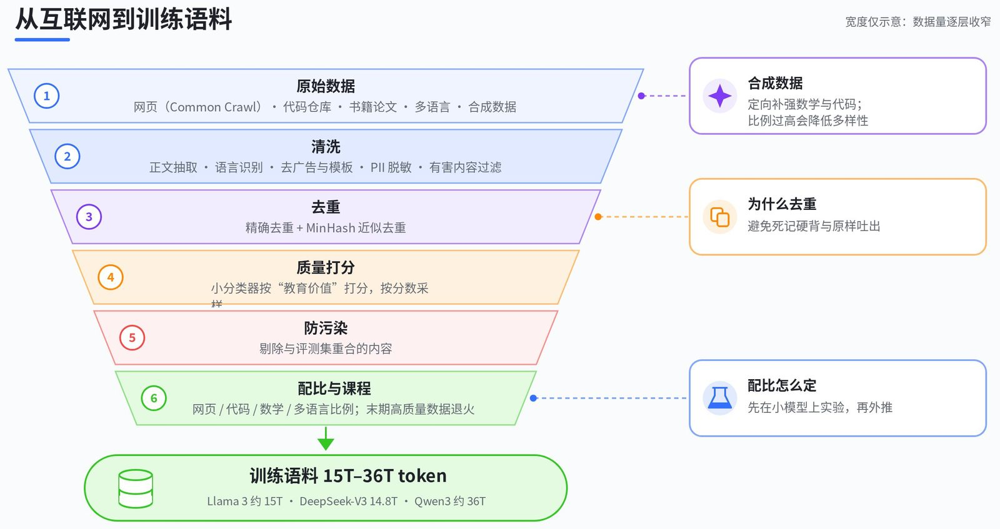

- **为什么去重这么重要**：网页里同一篇新闻、同一段许可证文本会出现成千上万次。不去重，模型会把算力花在背诵这些内容上，还会更容易原样吐出训练数据。
- **质量分类器怎么来**：常见做法是用强模型给一小部分文档打“是否有教育价值”的标签，再训练一个便宜的小分类器给全部语料打分，只保留高分部分或按分数加权采样。
- **合成数据的边界**：强模型生成的推理过程和教材式文本能显著提升数学与代码能力，但比例过高会让输出风格单一、多样性下降。主流做法是真实数据打底、合成数据定向补强。
- **配比是超参数**：代码比例高能提升推理与结构化能力，多语言比例决定小语种能力。各家通常先在小模型上做大量配比实验，再用 Scaling Law 外推到大模型。

### 4.2 Scaling Laws：规模、数据与算力的关系

- **幂律规律**：在其他条件合理时，测试损失随参数量 $`N`$、数据量 $`D`$、算力 $`C`$ 呈幂律平滑下降[[6]](https://arxiv.org/abs/2001.08361)。这让“先在小模型上做实验，再外推到大模型”成为可能。
- **Chinchilla 最优**：给定算力，参数与数据应同比增长，经验上约每个参数 20 个 token[[8]](https://arxiv.org/abs/2203.15556)。例如 70B 模型的“算力最优”数据量约为 1.4T token。
- <b>今天普遍“过度训练”</b>：模型上线后推理成本远超训练成本，所以宁愿用更小的模型吃更多数据。Llama 3 8B 训练了约 15T token，约为 Chinchilla 最优的近百倍[[19]](https://arxiv.org/abs/2407.21783)。
- **损失不等于能力**：Qwen3.8-Next 报告指出，扩大 n-gram 词表可以让损失单调下降，但下游准确率很快饱和，所以架构决策必须同时看损失、下游基准、训练与推理成本和稳定性[[16]](https://raw.githubusercontent.com/QwenLM/Qwen3.8-Flash-Next/main/tech_report.pdf)。

### 4.3 算力与显存估算

训练一个 Transformer 的计算量可用一条经验公式估算（$`N`$ 为**激活**参数量，$`D`$ 为训练 token 数）：

```math
C_{\text{train}}\approx 6ND\ \text{FLOPs}
```

> 📊 <b>用 DeepSeek-V3 验算：</b>激活 37B、训练 14.8T token，$`6\times37\times10^9\times14.8\times10^{12}\approx3.3\times10^{24}`$ FLOPs。报告中完整训练耗时约 278.8 万 H800 GPU 小时[[27]](https://arxiv.org/abs/2412.19437)，折算每卡有效算力约 330 TFLOPS，与 FP8 训练的实际利用率相符。按每 GPU 小时 2 美元计，约 560 万美元。这是**最后一次正式训练**的成本，不含前期实验、数据与人力。

**自己估算一次**：训练一个 7B 稠密模型、1T token，计算量约 $`6\times7\times10^9\times10^{12}=4.2\times10^{22}`$ FLOPs。H100 的 BF16 稠密峰值约 989 TFLOPS，大规模训练的实际利用率（MFU）通常在 35%–45%，按每卡有效 400 TFLOPS 计，1024 张卡约需 $`4.2\times10^{22}\div(1024\times4\times10^{14})\approx1.0\times10^{5}`$ 秒，约 28 小时。同样方法可以快速判断“某个训练计划需要多少卡、多少天”是否靠谱。

> 📊 <b>一张卡要训多久？以 Llama 3 8B 为例。</b>它用了 15T token 训练，计算量约 $`6\times8\times10^9\times15\times10^{12}=7.2\times10^{23}`$ FLOPs。
>
> - **按理论估算**：单张 H100 按每秒 400 TFLOPS 有效算力计（BF16 稠密峰值约 989 TFLOPS，注意常见的 1979 TFLOPS 是稀疏算力），需要约 $`1.8\times10^{9}`$ 秒，约 57 年。
> - **按官方数据**：Meta 公布该模型训练消耗约 130 万 H100 GPU 小时[[19]](https://arxiv.org/abs/2407.21783)，相当于一张卡跑约 148 年；若用 4096 张卡并行，约 13 天完成。实际开销高于理论值，是因为通信、故障重启和利用率损失（4.4）。
> - **启示**：从零预训练是少数机构的事；绝大多数团队的发力点在后训练、微调、RAG 和应用工程。

**训练显存**：混合精度 + Adam 时每个参数约需 16 字节（BF16 权重 2 + 梯度 2 + FP32 主权重与两个动量 12），外加激活值。70B 模型仅状态就约 1.1 TB，必须用下面的并行策略切分到多卡：用 ZeRO-3 / FSDP 切到 64 张卡上，每卡约 17.5 GB，剩余显存留给激活值。激活值随 batch 和序列长度增长，长序列训练常用**激活重计算**：前向时只保存少量中间结果，反向时重算，用约 1/3 的额外计算换大量显存。

### 4.4 分布式并行

| 并行方式 | 切什么 | 通信特征 |
|---|---|---|
| 数据并行 DP / ZeRO / FSDP[[40]](https://arxiv.org/abs/1910.02054) | 每卡处理不同数据；ZeRO 进一步把优化器状态、梯度、参数分片到各卡。 | 每步同步梯度（AllReduce 或 ReduceScatter + AllGather）。 |
| 张量并行 TP[[41]](https://arxiv.org/abs/1909.08053) | 把单层的矩阵乘按行/列切到多卡。 | 每层都要通信，只适合 NVLink 互联的单机内。 |
| 流水线并行 PP | 按层切成多个阶段，微批次流水执行。 | 只在阶段边界传激活，适合跨机；有“气泡”空闲。 |
| 专家并行 EP | MoE 的不同专家放到不同卡。 | token 分发与汇总需 AllToAll，是 MoE 训练的主要瓶颈。 |
| 上下文并行 CP | 把超长序列沿长度切到多卡。 | 注意力计算时交换 K、V，用于长上下文训练。 |

实际训练是这几种方式的组合（常称 3D/4D/5D 并行），外加计算与通信重叠、激活重计算等技巧。

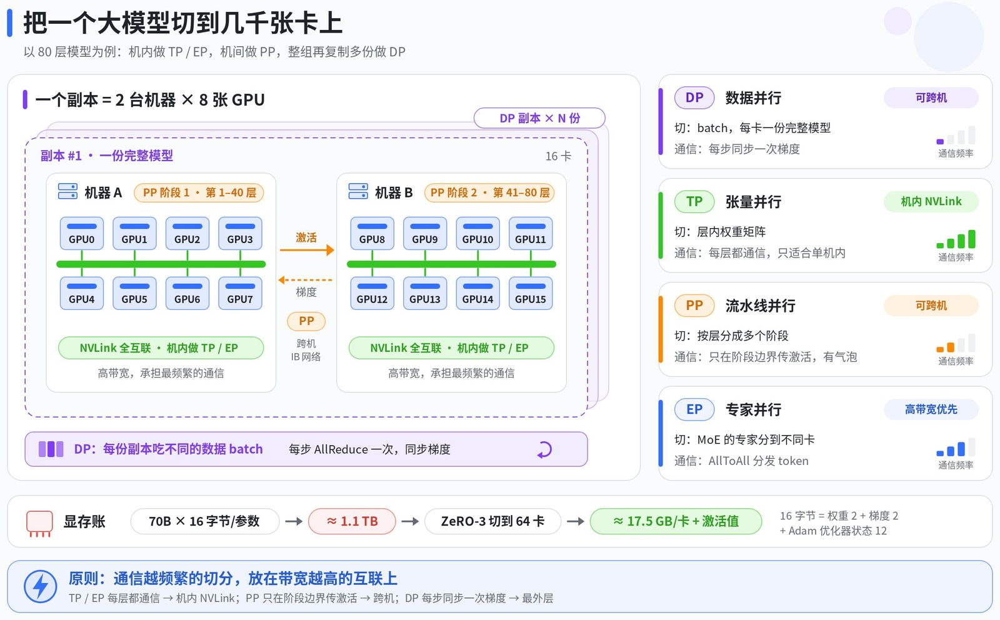

**一个典型组合**：单机 8 卡之间用 NVLink 做 TP 或 EP；多台机器之间用 PP 串起不同层；再在最外层用 DP 复制多份、各吃不同数据。选择原则是：**通信越频繁的切分，越要放在带宽越高的互联上**。

> 🚧 <b>大规模训练的日常是故障。</b>Llama 3 405B 在 16K 张 H100 上训练时，54 天内遇到 466 次作业中断，其中约 78% 由硬件问题引起（GPU、显存、网络等）[[19]](https://arxiv.org/abs/2407.21783)。因此大规模训练必须依赖频繁的检查点保存、快速故障检测与自动重启；此外还要监控损失尖峰（loss spike），必要时回滚到之前的检查点、跳过问题数据后继续训练。

### 4.5 优化器：AdamW 之后是 Muon

AdamW 统治了近十年。2025–2026 年最重要的变化是 **Muon** 进入大规模生产：它对矩阵参数的动量做正交化（Newton–Schulz 迭代），使更新在各方向上更均匀。

- Moonlight 通过加入权重衰减、按参数调整更新尺度，让 Muon 在 16B MoE、5.7T token 上开箱可用；缩放实验显示达到相同效果只需 AdamW 约 52% 的训练 FLOPs[[42]](https://arxiv.org/abs/2502.16982)。Kimi K2 在此基础上用 MuonClip 解决了注意力 logits 爆炸的问题[[43]](https://arxiv.org/abs/2507.20534)。
- NVIDIA 在最高 72B MoE 上的对比显示：超过临界 batch size 后 AdamW 效果下降，Muon 与 SOAP 在全局 batch 达 1 亿 token 时仍保持 token 效率[[44]](https://arxiv.org/abs/2607.20548)。
- DeepSeek-V4 和 Qwen3.8-Flash-Next 均已使用 Muon；后者报告 Muon 与新架构一起把最优学习率和 batch size 推高，并让 batch size 预热变得不再必要[[11]](https://arxiv.org/abs/2606.19348)[[16]](https://raw.githubusercontent.com/QwenLM/Qwen3.8-Flash-Next/main/tech_report.pdf)。

### 4.6 低精度训练：BF16 → FP8 → FP4

- **FP8**：DeepSeek-V3 首次在超大规模开源模型上验证了细粒度缩放的 FP8 训练[[27]](https://arxiv.org/abs/2412.19437)，如今已是主流。
- **NVFP4**：Blackwell 原生支持的 4 位格式（16 元素微块 + FP8 缩放因子 + 张量级 FP32 缩放）。NVIDIA 用随机 Hadamard 变换、二维缩放、随机舍入并保留少数高精度层，训练 12B 模型 10T token，MMLU-Pro 62.58% 对比 FP8 基线 62.62%[[45]](https://arxiv.org/abs/2509.25149)；Quartet II 等工作继续缩小与 BF16 的差距[[46]](https://arxiv.org/abs/2601.22813)。
- **对研发的意义**：精度每降一档，同样硬件的吞吐和可训练规模显著提升；但数值稳定性问题会变多，需要可靠的回归基线来发现“悄悄变差”。

### 4.7 中期训练与长上下文

预训练与后训练之间通常有一个“中期训练”阶段：提高高质量数学、代码、推理数据的比例，并逐步拉长序列（如 4K → 32K → 128K → 1M），同时调整位置编码。很多模型的推理潜力和长上下文能力在这一阶段就已基本确定，后训练只是把它“激发”出来。

## 第 5 章 · 后训练：从“会续写”到“会做事”

📎 延伸阅读：动手做 SFT、LoRA、偏好优化和 RLVR 的完整流程，见 [LLM-22｜地基｜后训练实战：SFT、LoRA 与 RLVR](./22-post-training.md)。

基座模型只会续写文本。后训练把它变成能听懂指令、按格式回答、会推理、会调用工具、并守住安全边界的助手。2024 年以后，后训练消耗的算力占比快速上升，已成为拉开模型差距的主战场。

### 5.1 流水线总览

| 阶段 | 输入与方法 | 得到什么 |
|---|---|---|
| **SFT** 监督微调 | 人工或合成的“指令–回答”对，只在回答部分计算损失。 | 对话格式、指令遵循、基本工具调用格式。 |
| **偏好对齐** RLHF / DPO | 人类或 AI 对多个回答的偏好排序。 | 有用、诚实、无害；回答风格更符合人类偏好。 |
| **推理 RL** RLVR | 数学、代码等可自动判分的任务，大规模采样 + 强化学习。 | 长链思考、自我检查、回溯纠错。 |
| **Agent RL** | 在带工具的多轮环境（终端、浏览器、代码仓库）中完成任务。 | 长任务规划、工具使用、从错误中恢复。 |
| **蒸馏** | 用大模型的输出或概率分布训练小模型。 | 便宜的小模型继承大模型的大部分能力。 |

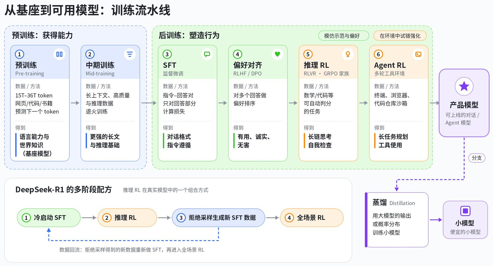

### 5.2 SFT 与参数高效微调

SFT 本质仍是下一个 token 预测，只是数据换成了按对话模板（2.2）组织的“指令–回答”样本，并且**只在回答部分计算损失**：系统提示和用户问题只作为条件，不要求模型学会“复述问题”。

- **数据要多少**：SFT 更看重质量和多样性而非数量。LIMA 用约 1000 条精选样本就让 65B 基座获得了相当不错的对话能力，说明 SFT 主要是在“教格式和风格”，知识和能力主要来自预训练[[47]](https://arxiv.org/abs/2305.11206)。今天的大模型 SFT 数据通常在数十万到数百万条，大量由更强的模型生成、再经过规则和模型筛选。
- **学习率与轮次**：SFT 通常训练 1–3 轮，学习率远小于预训练。训练过度会出现“灾难性遗忘”：学会了新格式，丢掉了通用能力。

**LoRA** 冻结原权重 $`W`$，只训练两个很“瘦”的矩阵 $`B`$（$`d\times r`$）和 $`A`$（$`r\times d`$），用 $`W+BA`$ 代替原权重[[48]](https://arxiv.org/abs/2106.09685)。以一个 8192×8192 的投影矩阵为例：全量微调要更新约 6700 万个参数；取秩 $`r=16`$ 时，LoRA 只需 $`16\times(8192+8192)\approx26`$ 万个，约为 0.4%。训练完可以把 $`BA`$ 合并回 $`W`$，推理没有额外开销；也可以不合并，一个基座同时挂多个 LoRA 服务不同业务。**QLoRA** 把冻结的基座量化到 4 位，再在上面训练 LoRA，论文在单张 48 GB 显卡上微调了 65B 模型[[49]](https://arxiv.org/abs/2305.14314)。

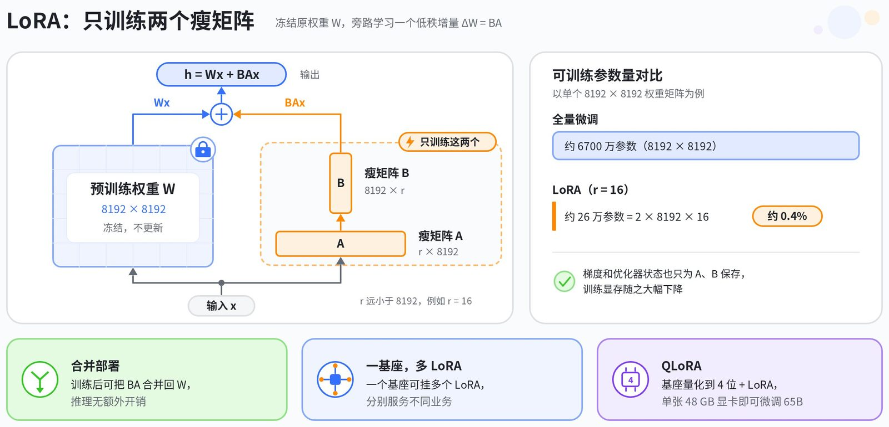

> 🎯 <b>研发决策：什么时候该微调？</b>
>
> - **先试提示词与上下文工程**：格式、风格、少量领域规则，往往改提示词就够了。
> - **知识经常变化**：用 RAG 检索注入，别用微调。微调写进权重的知识难以更新，还可能加剧幻觉。
> - **值得微调的场景**：稳定的输出格式或风格、特定领域的大量模式化任务、需要用小模型替代大模型降本、延迟敏感到无法承受长提示词。
> - **必须先有评估集**：没有能自动跑的评估集，就无法判断微调是否真的变好（第 9 章）。

<b>“微调”这个词有两层意思，别混为一谈：</b>

| 维度 | 厂商后训练中的 SFT | 企业的领域微调 |
|---|---|---|
| 谁来做 | 模型厂商，发布之前。 | 应用方，拿到发布的模型之后。 |
| 数据 | 通用任务：对话、翻译、代码、推理、安全拒答，规模通常数十万到数百万条。 | 私有数据：内部代码规范、工单、病历、法律文书，常见几百到几万条。 |
| 目标 | 让模型听懂指令、掌握通用格式。 | 让模型适应特定格式、风格或领域术语。 |
| 起点 | 基座模型。 | 通常是指令模型（也有从基座开始的）。 |

| 维度 | 全参数微调 | LoRA / QLoRA |
|---|---|---|
| 显存 | 需要存梯度和优化器状态，约为推理的数倍（4.3 的每参数 16 字节）。 | 只为低秩矩阵存梯度和优化器状态，LoRA 论文在 GPT-3 175B 上把训练显存从 1.2 TB 降到 350 GB[[48]](https://arxiv.org/abs/2106.09685)；QLoRA 可单卡微调 65B[[49]](https://arxiv.org/abs/2305.14314)。 |
| 能力上限 | 高，能较大幅度改变模型的知识和语言习惯（如适配一种新语言）。 | 中，擅长调整格式、风格和特定任务，难以注入大量新知识。 |
| 遗忘风险 | 较高，学会新领域的同时可能丢掉通用能力。 | 较低，基座被冻结。 |
| 部署 | 每个版本都是一份完整权重。 | 一个基座可挂多个 LoRA，按请求切换。 |
| 适用 | 有大量高质量数据和算力、需要深度改造的行业模型。 | 统一输出格式（JSON、SQL）、模仿文风、私有任务的轻量适配，绝大多数业务场景。 |

### 5.3 偏好对齐：RLHF 与 DPO

- **经典 RLHF**：先收集同一问题的多个回答，让标注员两两比较哪个更好；用这些偏好对训练一个奖励模型，再用 PPO[[50]](https://arxiv.org/abs/1707.06347) 最大化奖励，同时用 KL 惩罚防止偏离 SFT 模型太远。这是 InstructGPT / ChatGPT 的做法[[7]](https://arxiv.org/abs/2203.02155)。它需要同时维护策略、参考、奖励、价值四个模型，工程复杂。
- **DPO**：证明在同样目标下可以跳过显式奖励模型和在线采样，直接用偏好对构造一个分类式损失训练策略[[51]](https://arxiv.org/abs/2305.18290)：$`\mathcal{L}=-\log\sigma\Big(\beta\big[\log\tfrac{\pi_\theta(y_w|x)}{\pi_{\text{ref}}(y_w|x)}-\log\tfrac{\pi_\theta(y_l|x)}{\pi_{\text{ref}}(y_l|x)}\big]\Big)`$。直观含义：相对于参考模型，提高好回答 $`y_w`$ 的概率、降低差回答 $`y_l`$ 的概率，$`\beta`$ 控制能偏离参考模型多远。简单、稳定，被开源社区广泛采用。
- **取舍**：DPO 是离线方法，只能从已有数据中学习；需要探索新策略的任务（如推理）仍以在线 RL 为主。实践中二者常组合使用。

### 5.4 RLVR：推理能力的主要来源

<b>可验证奖励强化学习（RLVR）</b>不需要奖励模型：数学题对答案、代码跑单元测试、格式用规则检查，直接得到 0/1 奖励。奖励难以被“讨好”，因此可以放心地大规模训练。

**GRPO**是其中最常用的算法[[52]](https://arxiv.org/abs/2402.03300)：对同一道题采样 $`G`$ 个回答，用组内奖励的均值和标准差计算每个回答的相对优势，不再需要价值模型：

```math
\hat{A}_i=\dfrac{r_i-\mathrm{mean}(r_1,\dots,r_G)}{\mathrm{std}(r_1,\dots,r_G)}
```

**用数字走一遍**：一道数学题采样 $`G=8`$ 个回答，其中 3 个答对（奖励 1）、5 个答错（奖励 0）。组内均值 0.375、标准差约 0.48，于是答对的回答优势约 +1.29，答错的约 −0.77。训练时提高优势为正的回答中每个 token 的概率、降低优势为负的回答中 token 的概率。如果 8 个全对或全错，优势全为 0，这道题不提供学习信号，所以题目难度要与模型当前水平匹配。

- <b>为什么要“裁剪”</b>：沿用 PPO 的做法[[50]](https://arxiv.org/abs/1707.06347)，新旧策略对同一 token 的概率比一旦朝有利方向越出 $`[1-\varepsilon,1+\varepsilon]`$（常取 $`\varepsilon=0.2`$），该样本的代理目标收益就被截断，不再提供继续推远的梯度，以免一次更新走得太远。这是“软约束”而非硬限制：实际概率比仍可能越界，工程上还要监控 KL 或提前停止（参见 [OpenAI Spinning Up 的 PPO 说明](https://spinningup.openai.com/en/latest/algorithms/ppo.html)）。
- **省掉了什么**：PPO 需要一个与策略同等规模的价值模型来估计“这一步有多好”；GRPO 用同组其他回答的平均表现当基线，显存和工程复杂度大幅下降。
- **KL 约束**：通常还会惩罚策略偏离参考模型太远，防止为了奖励而丧失语言能力；部分工作（如 DAPO）在推理 RL 中去掉了这一项。

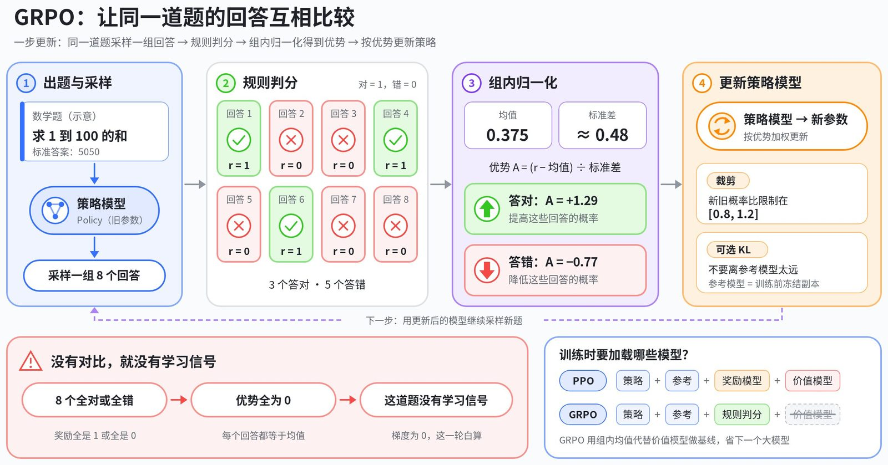

**DeepSeek-R1 的启示**[[10]](https://arxiv.org/abs/2501.12948)：R1-Zero 直接在基座上做纯 RL，模型自发学会了更长的思考、自我验证和回溯，但可读性差、语言混杂；正式的 R1 采用“冷启动 SFT → 推理 RL → 拒绝采样生成新 SFT 数据 → 全场景 RL”的多阶段流程，并把推理能力蒸馏到多个开源小模型。

2025–2026 年，围绕 GRPO 的稳定性和效率出现了一个算法家族：

| 算法 | 解决什么问题 |
|---|---|
| DAPO[[53]](https://arxiv.org/abs/2503.14476) | 四项改进：上裁剪放宽（Clip-Higher）防止熵塌缩、动态采样丢弃全对/全错的组、token 级损失、超长回答的奖励整形。 |
| Dr.GRPO[[54]](https://arxiv.org/abs/2503.20783) | 指出 GRPO 的长度归一化和标准差归一化会引入偏差（助长冗长的错误回答），给出无偏版本。 |
| GSPO[[55]](https://arxiv.org/abs/2507.18071) | 把重要性采样比从 token 级改为序列级，与“整条回答一个奖励”对齐，显著改善 MoE 模型 RL 的稳定性。 |
| CISPO[[56]](https://arxiv.org/abs/2506.13585) | 只裁剪重要性采样权重、不丢弃 token 的梯度，保留低概率但关键的“反思”token 的学习信号。 |
| DHPO、LUSPO 等（2026） | 在 token 级与序列级之间动态混合[[57]](https://aclanthology.org/2026.findings-acl.1883/)，或修正序列级目标的长度偏差、防止回答长度塌缩[[58]](https://arxiv.org/abs/2602.05261)。 |

> ❗ <b>奖励黑客（reward hacking）：</b>模型会利用奖励的漏洞，例如修改或跳过单元测试、输出能骗过判分规则的格式、用冗长回答碰运气。奖励设计、沙箱隔离与人工抽检是 RL 工程中最耗时的部分。

### 5.5 奖励从哪里来

| 奖励类型 | 适用场景与风险 |
|---|---|
| 规则 / 可验证奖励 | 数学、代码、结构化输出。最可靠，但只覆盖“有标准答案”的任务。 |
| 奖励模型（RM） | 开放式对话、写作。可被“讨好”，需要持续更新。 |
| 生成式评审 / 评分细则（rubric） | 用强模型按细则打分，覆盖难以写成规则的专业任务；要校准评审模型本身的偏差。 |
| 环境反馈 | Agent 任务的最终结果（测试是否通过、网页任务是否完成）。信号稀疏，需要解决长轨迹的信用分配。 |

### 5.6 Agent RL 与蒸馏

- **Agent RL**：把模型放进带终端、浏览器、代码仓库的沙箱，按任务完成情况给奖励。工程难点是大规模、长时间的异步采样，以及推理引擎与训练框架之间的数值差异（同一模型在两边算出的概率不完全一致，会让重要性采样失真）。
- **蒸馏**：白盒蒸馏让学生模型拟合教师的概率分布[[59]](https://arxiv.org/abs/1503.02531)，黑盒蒸馏只用教师的文本输出做 SFT。R1 把推理能力蒸馏到 1.5B–70B 的 Qwen/Llama 模型上，小模型的推理能力大幅提升[[10]](https://arxiv.org/abs/2501.12948)。今天多数“小而强”的模型都大量使用了来自更大模型的数据。

### 5.7 推理时计算：思考多久才划算

思维链提示最早证明了“先写出推理步骤再作答”能显著提升复杂问题的正确率[[60]](https://arxiv.org/abs/2201.11903)；o1 之后，“让模型先想再答”成为与参数、数据并列的第三个扩展维度[[9]](https://openai.com/index/learning-to-reason-with-llms/)。研究表明，在固定算力下合理分配推理时计算，可以让小模型追上大得多的模型[[61]](https://arxiv.org/abs/2408.03314)；最简单的实现甚至只需在模型想结束时强行追加“Wait”继续思考（budget forcing）[[62]](https://arxiv.org/abs/2501.19393)。

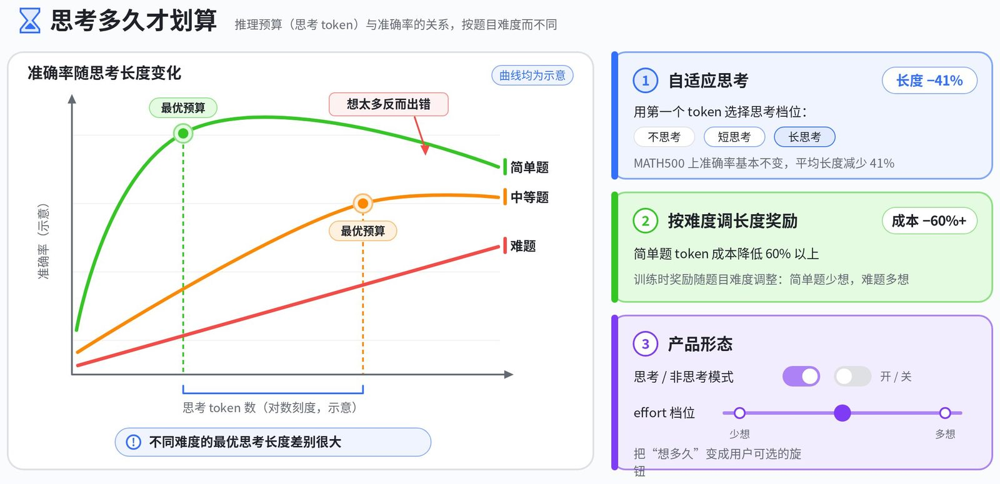

2026 年的共识是**思考要自适应**：

- **收益递减，甚至有害**：随预算增加，额外推理 token 的边际收益快速下降，还会出现“想太多反而推翻正确答案”的现象；不同难度的问题最优思考长度差别很大[[63]](https://arxiv.org/abs/2604.10739)。
- **让模型自己决定**：在 GRPO 里让模型用第一个 token 选择“不思考 / 短思考 / 长思考”，在 MATH500 上准确率基本不变的同时平均回答长度减少 41%[[64]](https://arxiv.org/abs/2608.20256)；按组内采样估计难度来调节长度奖励，简单题 token 成本可降低 60% 以上[[65]](https://arxiv.org/abs/2603.08659)。
- **产品形态**：主流模型都提供思考/非思考模式或推理强度（effort）档位，如 DeepSeek-V4 的双模式、Claude 的自适应思考与 effort 控制、GPT-5.6 的 max 与多智能体 ultra 模式[[11]](https://arxiv.org/abs/2606.19348)[[66]](https://openai.com/index/gpt-5-6/)[[34]](https://cheatsheets.davidveksler.com/ai-model-release-log.html)。

> 💡 <b>给应用研发的建议：</b>把推理强度当成可调参数，而不是一律开到最高。对分类、抽取、格式转换这类简单任务使用低档或非思考模式；对规划、调试、复杂分析才用高档。同时注意思考 token 按输出计费，且会显著拉长首字延迟。

## 第 6 章 · 推理与部署：每个 token 的成本和速度

原文坦言没有覆盖推理部署，但这恰恰是研发最常打交道的部分：成本、延迟、吞吐、显存几乎都由这一章的机制决定。想深入引擎实现，可继续阅读 「vLLM 完整技术学习路径：从推理基础到架构前沿」。

### 6.1 Prefill 与 Decode：两种完全不同的负载

|  | Prefill（处理输入） | Decode（生成输出） |
|---|---|---|
| **做什么** | 整段输入一次前向并行计算，写入 KV Cache。 | 每步只生成 1 个 token，需读取全部权重与 KV Cache。 |
| **瓶颈** | 算力（compute-bound），大矩阵乘。 | 显存带宽（memory-bound），算得少、搬得多。 |
| **对应指标** | 首 token 延迟 TTFT。 | 每 token 延迟 TPOT / ITL、输出速度。 |
| **对价格的影响** | 输入便宜；缓存命中的前缀更便宜。 | 输出通常是输入价格的 5–6 倍（见 6.7）。 |

### 6.2 速算：显存与速度的上限

- **权重显存** ≈ 参数量 × 每参数字节数：70B 模型 BF16 约 140 GB，FP8 约 70 GB，4 位约 35–40 GB。
- **单请求解码速度上限** ≈ 显存带宽 ÷ 每 token 需读取的字节数。H100 带宽约 3.35 TB/s，一个 70 GB 的 FP8 模型单请求最多约 48 token/s。
- **批处理为什么关键**：一次读取的权重可以同时服务一个批次里的所有请求，批次越大，总吞吐越高、单位成本越低，直到算力或 KV Cache 显存成为新瓶颈。服务商的定价本质上就是在批大小、延迟和显存之间做权衡。

> 📊 <b>容量规划算例（理论上限）：</b>用 8 张 H100（共 640 GB，总带宽约 26.8 TB/s）以张量并行部署 70B 的 FP8 模型，KV Cache 用 BF16（320 KB/token，见 3.4）。
>
> - **显存**：权重约 70 GB，扣除激活值与运行时开销后，大约还有 500 GB 可存 KV，约 150 万 token，相当于 190 个 8K 上下文的请求同时在线。
> - **速度**：批大小 64、每个请求 8K 上下文时，每个解码步要读 70 GB 权重 + 约 172 GB KV，约 9 毫秒一步，总吞吐约 7,100 token/s，每个用户约 110 token/s。
> - **结论**：批大一些时，**读 KV 的时间超过了读权重**，这就是 KV 压缩（MLA、稀疏注意力、KV 量化）能直接提升吞吐的原因。实际系统还有通信、调度和 kernel 效率损失，通常只能达到理论值的一半到七成。

### 6.3 推理引擎的核心技术

| 技术 | 作用 |
|---|---|
| **PagedAttention**[[67]](https://arxiv.org/abs/2309.06180) | 借鉴操作系统分页，把 KV Cache 切成固定大小的块（如每块 16 个 token）按需分配，用“块表”记录每个请求的逻辑块对应哪些物理块，消除显存碎片；论文统计早期系统只有 20%–40% 的 KV 显存真正存放了 token。 |
| **连续批处理**[[68]](https://www.usenix.org/conference/osdi22/presentation/yu) | 每个解码步都重新组批：完成的请求立即离开，新请求立即加入，让 GPU 持续满载。 |
| **前缀缓存** | 按块对 token 内容做哈希，相同前缀（系统提示、工具定义、历史对话）的 KV 块只算一次，跨请求复用；这就是 API“缓存命中价”的技术基础。前缀中只要有一个 token 不同，其后的块全部无法复用。 |
| **分块预填充** | 把长输入切块，与其他请求的 decode 混在同一批里，避免长 prompt 卡住所有人。 |
| **P/D 分离**[[69]](https://arxiv.org/abs/2401.09670) | 把 prefill 和 decode 放到不同机器上分别优化，隔离长尾延迟；需要在机器间高速传输 KV Cache。 |

主流开源引擎包括 vLLM、SGLang 与 TensorRT-LLM，均已支持上述技术以及 MoE、混合注意力、FP8/FP4 推理。

**连续批处理的直观例子**：静态批处理像旅游大巴，要等所有人都玩完才能发车，一个请求要生成 2000 token，其余只要 50 token 的请求也得陪着等；连续批处理像地铁，每一站（每个解码步）都有人上下车，GPU 始终满载。

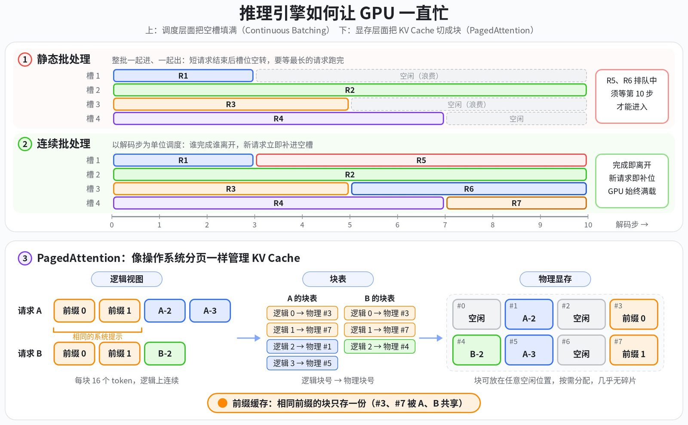

### 6.4 量化：用精度换显存和速度

**量化在做什么**：把一组权重用更少的比特表示。以对称 INT4 为例，每 128 个权重为一组，取组内绝对值最大者算出缩放因子 $`s=\max|w|/7`$，每个权重存为 $`\mathrm{round}(w/s)`$（−8 到 7 之间的整数），计算时再乘回 $`s`$。组越小精度越高，但缩放因子的额外存储越多。难点在于**离群值**：少数维度的激活值比其他维度大上百倍，直接量化会让其余值全部挤在很少几个刻度上。SmoothQuant 把激活的量化难度部分转移到权重上[[70]](https://arxiv.org/abs/2211.10438)，AWQ 则保护对输出影响最大的约 1% 权重[[71]](https://arxiv.org/abs/2306.00978)。

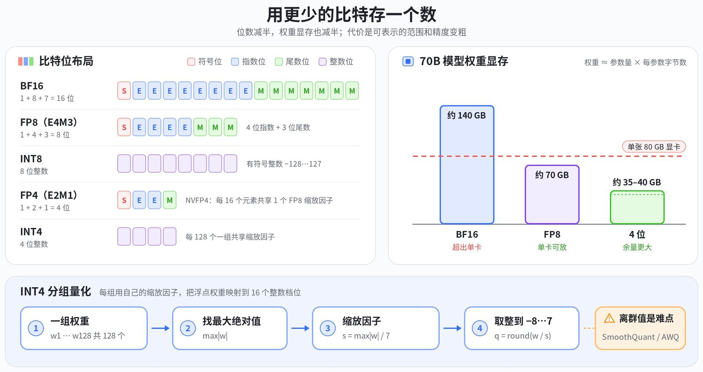

| 方案 | 做法 | 典型用途 |
|---|---|---|
| 仅权重 INT4（GPTQ[[72]](https://arxiv.org/abs/2210.17323)、AWQ[[71]](https://arxiv.org/abs/2306.00978)） | 权重 4 位，计算时反量化；激活保持 16 位。 | 显存受限的单卡部署，小批量低延迟。 |
| W8A8 / FP8[[70]](https://arxiv.org/abs/2211.10438) | 权重和激活都用 8 位，直接用低精度矩阵乘。 | 数据中心高吞吐推理的默认选择，精度损失很小。 |
| NVFP4 / MXFP4 | 4 位浮点 + 微块缩放，Blackwell 原生支持。 | 超大 MoE 的专家权重；DeepSeek-V4 指令模型的专家权重即为 FP4[[11]](https://arxiv.org/abs/2606.19348)。 |
| KV Cache 量化 | 把 KV 存成 FP8 等低精度。 | 长上下文、高并发场景，直接提高可服务的请求数。 |
| 量化感知训练（QAT） | 训练时模拟量化误差，让模型适应低精度。 | 端侧与低比特部署，如 Gemma 4 发布的 QAT 检查点[[34]](https://cheatsheets.davidveksler.com/ai-model-release-log.html)。 |

> ❗ <b>量化不是“免费午餐”：</b>平均分数接近，不代表每类任务都没退化。长链推理、代码和多语言往往比知识问答更敏感。上线前务必在自己的评估集上对比。

### 6.5 投机解码：用小模型帮大模型“猜”

既然 decode 受带宽限制、算力有富余，就让一个便宜的草稿模型先猜后面的 $`k`$ 个 token，再由大模型一次前向**并行验证**，用拒绝采样保证输出分布与大模型逐个生成**完全一致**[[73]](https://arxiv.org/abs/2211.17192)。**算一下收益**：草稿每次猜 $`k=4`$ 个 token，每个被接受的概率 $`\alpha=0.8`$，则每次大模型前向平均产出 $`(1-\alpha^{k+1})/(1-\alpha)\approx3.4`$ 个 token；而大模型一次前向验证 5 个 token 的耗时与生成 1 个相近（仍受带宽限制），扣除草稿开销后通常能加速 2–3 倍。接受率降到 0.5 时只剩约 1.9 个 token。所以投机解码在代码、格式化文本等“好猜”的内容上收益最大，并发很高、GPU 算力已经吃满时收益会缩小。接受率越高加速越明显。EAGLE-3 用目标模型的特征训练轻量草稿头[[74]](https://arxiv.org/abs/2503.01840)；自带 MTP 头的模型（如 DeepSeek-V3/V4）可直接自我投机；Google 在 2026 年 5 月为 Gemma 4 专门发布了配套的 MTP 草稿模型[[34]](https://cheatsheets.davidveksler.com/ai-model-release-log.html)。

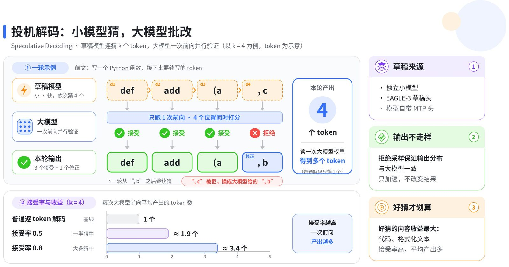

### 6.6 服务指标：怎么定义“快”

| 指标 | 含义 | 主要受什么影响 |
|---|---|---|
| TTFT 首 token 延迟 | 从发出请求到收到第一个输出 token 的时间。 | 输入长度、排队时间、前缀缓存命中率；推理模型还要加上思考时间。 |
| TPOT / ITL | 相邻两个输出 token 的间隔，决定“打字速度”。 | 模型大小、批大小、KV 长度、投机解码。 |
| 端到端延迟 | 约等于 TTFT + 输出 token 数 × TPOT。 | 输出越长越慢，这是最常被忽略的一项。 |
| 吞吐 | 单位时间内整个系统生成的 token 数。 | 批大小；与单请求延迟此消彼长。 |
| Goodput | 满足延迟目标（如 P99 TTFT &lt; 2 秒）的请求吞吐。 | 比单纯吞吐更贴近真实服务质量[[69]](https://arxiv.org/abs/2401.09670)。 |

压测时要同时看 P50 与 P99：平均值好看不代表长尾用户体验好。长输入请求会拉高同批其他请求的延迟，这正是分块预填充和 P/D 分离要解决的问题。

服务端调度的每个选项，几乎都是在首 token 延迟、生成流畅度和吞吐之间做取舍：

| 调整 | TTFT | TPOT | 吞吐 | 原因 |
|---|---|---|---|---|
| 增大最大批大小 | 排队减少时变好 | 变差（每步更重） | 变好 | 一次读权重服务更多请求，直到算力或显存饱和。 |
| 新请求优先做 prefill | 变好 | 变差（正在生成的请求会卡顿） | 基本不变 | 长 prefill 插队，占用了 decode 的时间片。 |
| 分块预填充 | 长请求略变差 | 更平稳 | 基本不变 | 把长 prefill 切块与 decode 混批，避免“一个长请求卡住所有人”。 |
| 限制最大并发 | 变差（排队） | 变好 | 变差 | 用容量换已在服务用户的体验。 |
| P/D 分离 | 可单独优化 | 可单独优化 | 需要重新配比 | 两个阶段互不干扰，代价是机器间传输 KV Cache[[69]](https://arxiv.org/abs/2401.09670)。 |

- **流畅度的经验值**：对话场景中，相邻 token 间隔在 50 毫秒以内（每秒 20 个 token 以上）通常就不会有“挤牙膏”的感觉；推理模型的思考阶段对用户不可见，更应关注总时延。
- **两种吞吐**：RPS（每秒完成的请求数）衡量并发能力，适合短对话、客服类场景；TPS（每秒生成的 token 数）衡量算力利用率，适合离线批处理。压测报告要写清是哪一种、在什么输入输出长度下测得。

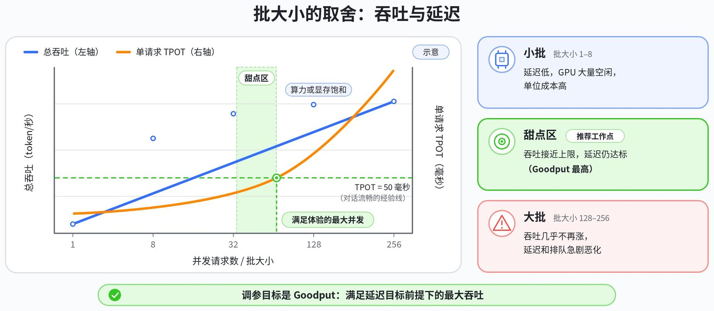

### 6.7 应用研发的成本模型

| 模型（2026） | 输入 \$/百万 token | 输出 \$/百万 token | 来源 |
|---|---|---|---|
| GPT-6 Astra / 6.1 Sol / Luna | 10 / 2 / 0.10 | 50 / 10 / 0.50 | [[122]](https://developers.openai.com/api/docs/pricing) |
| Claude Fable 5.1 / Opus 5.5 / Sonnet 5.5 | 10 / 4 / 2 | 50 / 20 / 10 | [[118]](https://www.anthropic.com/claude/fable)[[119]](https://www.anthropic.com/claude-opus-5-5)[[120]](https://www.anthropic.com/claude-sonnet-5-5) |
| Gemini 3.8 Flash（限时价） | 0.75 | 3.75 | [[75]](https://blog.google/innovation-and-ai/models-and-research/gemini-models/3-8-flash-and-3-8-flash-cyber/) |

- **输出贵**：规律来自 6.1：输出 token 是串行 decode，占用 GPU 时间远多于并行 prefill。控制输出长度（包括思考长度）是最直接的降本手段。
- **让前缀稳定**：系统提示、工具定义、固定文档放在最前面且保持不变，才能持续命中提示词缓存；在前缀里插入时间戳或随机 ID 会让缓存全部失效。
- **分级用模型**：简单任务用小模型或低推理档位，复杂任务再升级；离线任务用批处理 API 或错峰价格（如 DeepSeek 的峰谷定价[[38]](https://www.deepseek.com/en/news/deepseek-v4-1-flash/)）。
- **延迟三件套**：流式输出降低体感延迟；缩短提示词降低 TTFT；减少输出 token 降低总时延。

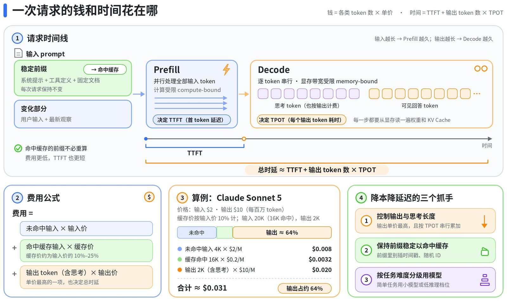

### 6.8 另一条路：扩散语言模型

自回归必须逐个 token 生成。**扩散语言模型**一次对一整块被遮盖的 token 迭代去噪，每次前向可确定多个 token，把 decode 从带宽瓶颈转向算力瓶颈。目前的实用形态是**块扩散**：块与块之间自回归（可用 KV Cache），块内部并行去噪[[76]](https://arxiv.org/abs/2503.09573)。

- LLaDA 系列把扩散 LLM 做到 100B 级，LLaDA2.1 引入 token 编辑，代码任务上达到每秒数百 token[[77]](https://arxiv.org/abs/2502.09992)[[78]](https://arxiv.org/abs/2602.08676)。
- Google 的 DiffusionGemma 从 Gemma 4 MoE（25.2B 总参数 / 3.8B 激活）微调而来，所用 token 不到原模型训练量的 10%；平均每次前向生成约 20 个 token，单张 H100 约 1,500 token/s，并保留思考模式与多模态输入[[79]](https://arxiv.org/abs/2608.00146)。
- 现状：速度优势明确，但顶级推理与 Agent 能力仍由自回归模型主导，适合对延迟极敏感的代码补全、改写等场景。

## 第 7 章 · 多模态：从“看图说话”到原生全模态

原文总结中提到“目前的模型基本都已经原生多模态”却未展开。多模态的核心问题只有一个：**如何把图像、音频、视频也变成 Transformer 能处理的 token 序列**，以及是否让同一个模型也输出这些模态。

### 7.1 三代架构

| 路线 | 做法 | 代表与取舍 |
|---|---|---|
| **拼接式** | 预训练好的视觉编码器（如 CLIP[[80]](https://arxiv.org/abs/2103.00020) 的 ViT）把图像编码成向量，经投影层接入 LLM，再用图文指令数据微调。 | LLaVA[[81]](https://arxiv.org/abs/2304.08485) 等。成本低、见效快；但编码器分辨率固定，细粒度感知受限。 |
| **原生训练** | 视觉编码器与 LLM 从预训练阶段起端到端联合训练，图文交错数据混入预训练语料。 | NaViL 系统研究了原生多模态的设计空间与缩放规律[[82]](https://arxiv.org/abs/2510.08565)。主流闭源模型均走这条路。 |
| **无编码器** | 去掉独立的视觉编码器，用简单的 patch embedding 直接把像素块变成 token，由同一个 Transformer 处理。 | Tuna-2 显示，有编码器的变体早期收敛更快，但规模上去后无编码器方案在细粒度感知上更强，并可同时做理解与生成[[83]](https://arxiv.org/abs/2604.24763)。 |

### 7.2 图像、视频、音频如何变成 token

- **图像**：视觉编码器（ViT）把图片切成小方块（patch），每块变成一个向量。以 14×14 像素的 patch 为例，一张 448×448 的图会切出 32×32 = 1024 个 patch；多数模型再把相邻 2×2 个 patch 合并成 1 个 token，最终约 256 个 token 送进 LLM。
- **高分辨率**：固定分辨率会丢细节，常见两种办法：把大图切成多个子图分别编码，外加一张缩略图保留全局；或者像 Qwen2-VL 那样按原始分辨率动态决定 patch 数量[[84]](https://arxiv.org/abs/2409.12191)。代价是图越大 token 越多。
- **视频**：按固定帧率抽帧（如每秒 1–2 帧），每帧按图像处理，再在时间维度上合并相邻帧。粗算：1 分钟视频按每秒 1 帧、每帧 256 token，约 1.5 万 token。
- **音频**：音频编码器把声音切成短帧（如每帧几十毫秒）编码，再降采样，常见为每秒十几到几十个 token。语音输出则需要额外的语音 token 解码器把 token 还原成波形。
- **生成图像**：一种做法是把图像离散成视觉 token，让 LLM 像写文字一样逐个生成；另一种是 LLM 输出条件向量，交给扩散模型画图。统一模型正在把两者合并（7.3）。

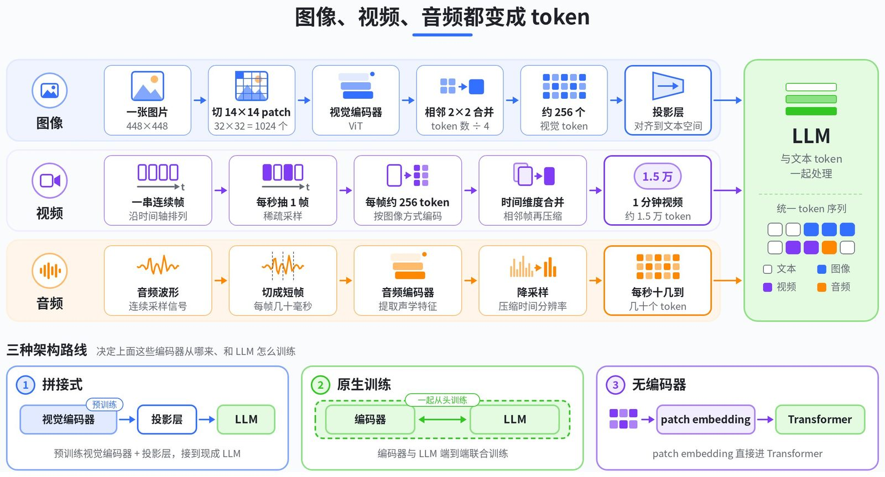

### 7.3 全模态与统一生成

- **全模态理解**：文本、图像、音频、视频统一输入已成为旗舰标配。Gemini 3.5 Flash 支持四种模态输入[[34]](https://cheatsheets.davidveksler.com/ai-model-release-log.html)；字节 Seed2.0 Lite 于 2026 年 4 月升级为 Seed 系列首个全模态理解模型[[85]](https://arxiv.org/abs/2607.00248)；Gemma 4 的端侧型号也原生支持音频输入[[34]](https://cheatsheets.davidveksler.com/ai-model-release-log.html)。
- **统一生成**：同一个解码器既输出文字，也输出图像和语音 token。AR-Omni 用单个 7B 自回归 Transformer 统一了文本、图像与流式语音生成[[86]](https://arxiv.org/abs/2601.17761)；Google 在 2026 年 I/O 发布的 Gemini Omni 面向任意输入、以视频为主的输出[[34]](https://cheatsheets.davidveksler.com/ai-model-release-log.html)。
- **动作输出**：视觉–语言–动作模型（VLA）把机器人控制也表示成 token，如 Qwen-VLA 与 Mistral 的具身导航模型[[34]](https://cheatsheets.davidveksler.com/ai-model-release-log.html)。

### 7.4 研发需要关心的点

| 问题 | 要点 |
|---|---|
| 图片也按 token 计费 | 一张图会被切成若干 patch，折算成数百到上千个 token；例如 DeepSeek-V4-Flash 视觉实验版按每张图最多 384 token 计费[[34]](https://cheatsheets.davidveksler.com/ai-model-release-log.html)。高分辨率截图、长视频的成本和上下文占用要单独估算。 |
| 分辨率与细节 | 表格、小字、UI 元素识别依赖输入分辨率；压缩或缩放图片可能直接导致识别失败。 |
| GUI Agent | “看屏幕 → 定位元素 → 点击/输入”依赖精确的视觉定位，OSWorld 类基准衡量的正是这种能力[[87]](https://arxiv.org/abs/2404.07972)。 |
| 幻觉 | 多模态模型会“看到”图中不存在的内容，关键信息（金额、编号）应要求模型给出位置或二次校验。 |

## 第 8 章 · 应用工程：从提示词到 Agent

📎 延伸阅读：提示词、思考档位、结构化输出和模型路由的实操见 [LLM-20｜工程｜用好模型：提示词、思考档位与模型路由](./20-prompting-routing.md)；Agent 跨会话的长期记忆见 [LLM-21｜工程｜Agent 记忆：存什么、怎么取、何时忘](./21-agent-memory.md)。

模型能力再强，也只能基于它“看到”的上下文行动。2025 年起，行业把注意力从“怎么写提示词”转向<b>上下文工程（context engineering）</b>：在每一步为模型准备**最小但足够**的高信号信息。

### 8.1 上下文由哪些部分组成

| 层 | 内容 | 工程原则 |
|---|---|---|
| 系统指令 | 角色、目标、约束、输出格式。 | 写清楚“做什么、不做什么、做到什么程度”，少写空泛形容词。 |
| 工具定义 | 可调用函数的名称、说明与参数 schema。 | 描述要让模型知道**何时**用；统计工具定义本身占多少 token。 |
| 知识 / 检索结果 | RAG 召回的文档、代码、表格。 | 重排、去重、标注来源；宁缺毋滥。 |
| 记忆 | 用户偏好、项目约定、过往经验。 | 结构化、可增量更新，避免每次整体重写。 |
| 历史与观察 | 对话历史、工具返回结果。 | 长任务需要压缩或摘要，大段原始输出不要原样留在上下文里。 |

- **稳定前缀，保护缓存**：不变的内容放前面、变化的内容放后面；任务中途不要增删工具定义，否则缓存前缀失效，后续请求都要按未命中价格重新计费[[88]](https://arxiv.org/abs/2608.22708)。工具很多时，可固定一组核心工具，把长尾工具交给独立的路由步骤发现[[88]](https://arxiv.org/abs/2608.22708)。
- <b>上下文会“塌缩”</b>：反复让模型重写同一份总结，细节会逐轮丢失。ACE 把上下文当成可增量演进的“操作手册”，由独立的反思步骤提炼经验、只做局部增删，在 Agent 基准上提升 10.6%[[89]](https://proceedings.iclr.cc/paper_files/paper/2026/file/8a94ff6f922d995d7d3f4ebf4143e442-Paper-Conference.pdf)。

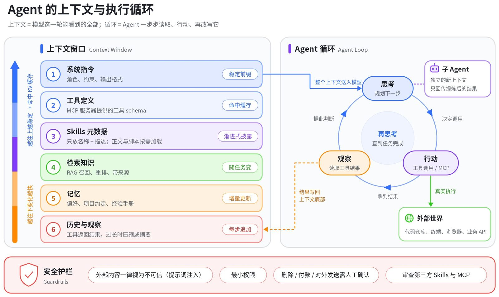

### 8.2 提示词的基本功

上下文工程并没有取代提示词，而是把它放进了更大的框架。写系统提示时，下面几条最常见、收益最大：

| 做法 | 说明与例子 |
|---|---|
| 把任务说具体 | “总结这篇文档”不如“用 3 条要点总结这篇故障复盘，每条不超过 40 字，说明影响范围、根因和改进项”。模型不知道你心里的标准，写下来才算数。 |
| 给出判断依据 | 告诉模型“为什么”比只给规则更有效，例如“输出会被程序解析，所以不要加任何解释文字”。模型会据此处理规则没覆盖到的情况。 |
| 提供示例 | 给 2–5 个覆盖不同情况的输入输出示例（少样本），比长篇描述更能锁定格式和风格；示例之间要有差异，否则模型会照抄某个示例。 |
| 结构化分隔 | 用 XML 标签或 Markdown 标题把说明、资料、问题分开，如 &lt;document>…&lt;/document>，避免模型把资料里的文字当成指令。 |
| 长资料在前，问题在后 | 长文档放在前面，具体问题和输出要求放在最后，通常效果更好，也更利于缓存。 |
| 正面描述期望 | “使用简体中文、完整句子”比一串“不要……”更可靠。 |
| 允许说不知道 | 明确“资料中没有答案时回答‘未找到’”，能显著减少编造。 |

提示词应当像代码一样管理：有版本、有评估集（第 9 章），改动后跑一遍回归再上线。

### 8.3 RAG：给模型外挂知识

检索增强生成（RAG）先从知识库检索相关片段，再让模型基于片段作答[[90]](https://arxiv.org/abs/2005.11401)，是解决“知识过时”和“私有知识”的首选方案。一个完整的 RAG 系统分离线和在线两部分：

1. **离线：解析**。把 PDF、网页、飞书文档、代码转成干净文本，保留标题层级和表格结构。解析质量差是 RAG 效果差的头号原因。
2. **离线：切分**。按语义边界（章节、段落）切成片段，常见长度为几百 token，相邻片段保留少量重叠；每个片段附上所属文档、标题路径等元数据。
3. **离线：向量化与建索引**。用 embedding 模型把每个片段编码成向量存入向量库，同时建立关键词索引（如 BM25）。
4. **在线：改写查询**。把口语化或多轮对话中的问题改写成适合检索的查询，必要时拆成多个子查询。
5. **在线：混合检索 + 重排**。向量检索擅长语义相近，关键词检索擅长专有名词和编号；两路结果合并后，用重排模型（cross-encoder）精选前几条。
6. **在线：生成与引用**。把片段连同来源放进上下文，要求模型只依据资料作答并标注出处。

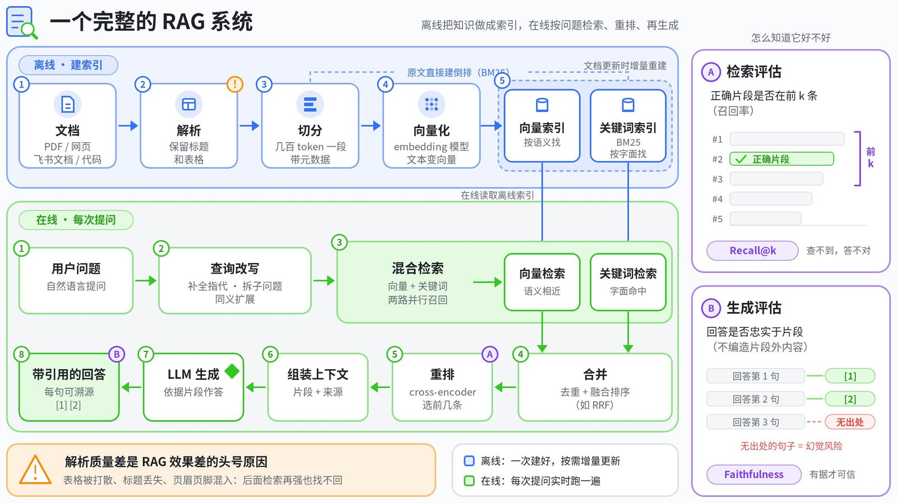

- **分开评估检索和生成**：先看正确片段是否出现在检索结果前 k 条里（召回率），再看回答是否忠实于片段。两者混在一起看，很难知道该改哪一环。
- **检索质量决定上限**：文档切分方式、向量检索与关键词检索混合、重排模型，比换更大的生成模型更影响效果。
- **要求引用**：让模型标注答案出自哪个片段，便于校验和降低幻觉。
- **长上下文不会取代 RAG**：百万 token 窗口能减少切分，但成本、延迟和“中间内容被忽略”的问题仍在；数据量超过窗口或需要权限控制时，检索依然必要。

#### RAG 还是微调

两者解决的问题不同，经常组合使用：RAG 管“知道什么”，微调管“怎么做”。

| 维度 | RAG | 微调 |
|---|---|---|
| 定位 | 外挂知识库，像开卷考试。 | 把能力内化进权重，像岗前培训。 |
| 知识更新 | 更新文档和索引即可，实时生效。 | 知识停留在训练数据的时间点，更新要重训。 |
| 权限与隐私 | 数据留在知识库，可按用户做细粒度权限控制。 | 数据进入参数，无法按用户隔离，也难以“删除”。 |
| 可溯源 | 能给出引用，便于核查。 | 无法指出答案来自哪条训练数据。 |
| 成本结构 | 每次请求多出检索和上下文 token 的开销。 | 前期训练成本高，推理时提示词可以更短。 |
| 适合 | 企业文档问答、客服知识库、经常变化的规则和数据。 | 固定输出格式、特定文风、领域术语规范、用小模型替代大模型降本。 |

<b>组合用法：RAFT。</b>用“问题 + 检索到的文档（含干扰文档）+ 引用原文的标准答案”构造训练数据去微调模型，让它学会从检索结果中挑出有用的片段、忽略无关内容，在领域 RAG 任务上明显优于只做 RAG 或只做微调[[113]](https://arxiv.org/abs/2403.10131)。

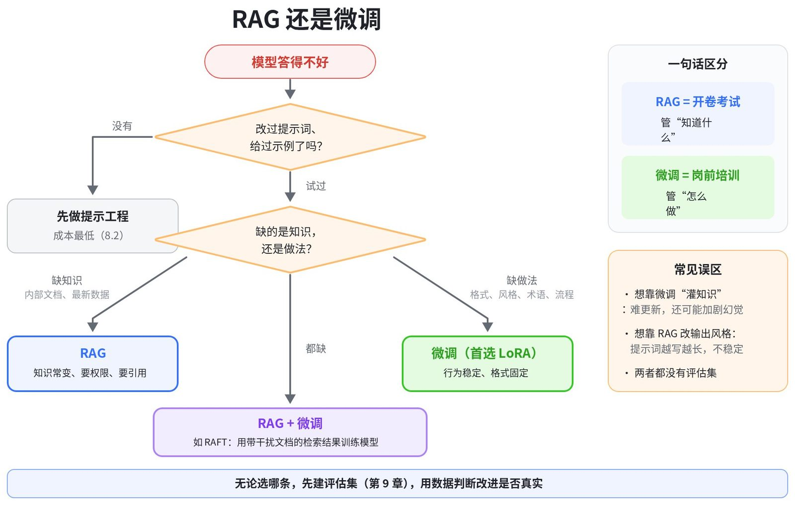

### 8.4 工具调用与 Agent 循环

工具调用（function calling）让模型输出结构化的调用请求，由程序执行后把结果返回给模型。一次完整的交互如下：

*工具调用的消息流（示意）
*

```json
// 1. 应用发送：工具定义 + 用户问题{"tools": [{"name": "get_weather", "description": "查询城市某天的天气",            "parameters": {"city": "string", "date": "YYYY-MM-DD"}}], "messages": [{"role": "user", "content": "北京明天会下雨吗？"}]}// 2. 模型返回：不直接回答，而是请求调用工具{"role": "assistant", "tool_calls": [{"name": "get_weather",  "arguments": {"city": "北京", "date": "2026-10-01"}}]}// 3. 应用执行工具，把结果追加为一条 tool 消息{"role": "tool", "content": "{\"rain_probability\": 0.7}"}// 4. 模型基于结果作答{"role": "assistant", "content": "明天北京降雨概率约 70%，建议带伞。"}
```

模型从不直接执行任何东西，它只输出“想调用什么、参数是什么”；真正的执行、鉴权和错误处理都在应用侧。把“思考 → 行动 → 观察”串成循环，就是 Agent 的基本形态[[91]](https://arxiv.org/abs/2210.03629)[[92]](https://arxiv.org/abs/2302.04761)。

- **结构化输出**：推理引擎可按 JSON Schema 约束解码，保证输出一定能被解析。
- **MCP**：模型上下文协议（Model Context Protocol）统一了 Agent 连接外部工具和数据源的方式[[93]](https://modelcontextprotocol.io/)。它由 Anthropic 于 2024 年 11 月发布，2025 年 12 月捐赠给 Linux 基金会新成立的 Agentic AI Foundation 治理[[94]](https://www.linuxfoundation.org/press/linux-foundation-announces-the-formation-of-the-agentic-ai-foundation)[[95]](https://developers.redhat.com/articles/2026/05/25/mcp-servers-vs-skills-choosing-right-context-your-ai)；2026-07-28 版规范已加入异步任务、Skills over MCP 等扩展[[93]](https://modelcontextprotocol.io/)。连接多个 MCP 服务器前，先统计它们的工具 schema 占用多少 token。
- **Agent Skills**：把“某类任务怎么做”的流程知识打包成带元数据的 SKILL.md 与脚本、参考资料。启动时只加载名称和描述，判断相关时才加载正文，执行时再加载脚本和参考资料，即**渐进式披露**[[96]](https://arxiv.org/abs/2602.12430)[[95]](https://developers.redhat.com/articles/2026/05/25/mcp-servers-vs-skills-choosing-right-context-your-ai)。MCP 提供“能做什么”（工具连接），Skills 提供“怎么做”（流程知识）。
- **子 Agent**：把子任务交给拥有全新上下文窗口的子 Agent 执行，只把提炼后的结果交回主 Agent。2026 年 9 月的研究表明，当技能包具有清晰的输入输出契约时，以子 Agent 方式执行优于把技能说明加载进主上下文，代价是额外的协调 token[[97]](https://arxiv.org/abs/2609.09233)。
- **显式执行状态**：SKILL.state 用可变的结构化状态代替不断追加的对话历史，每步只给模型“技能说明 + 当前状态 + 最新观察”，在降低 token 消耗的同时提高长任务准确率[[98]](https://arxiv.org/abs/2608.26263)。

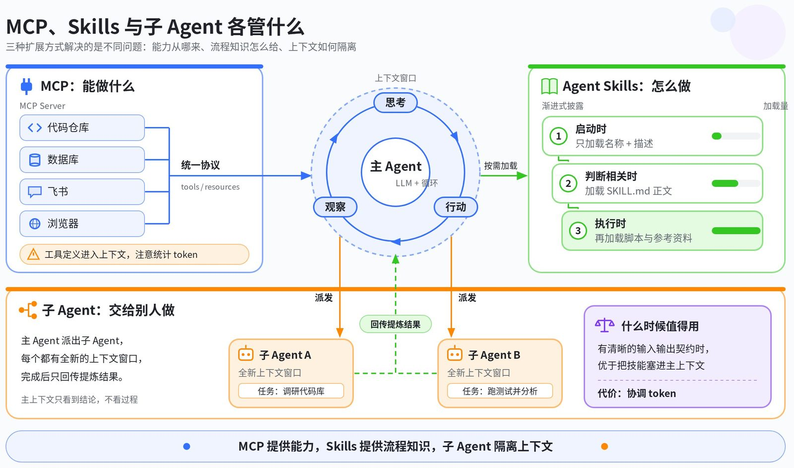

### 8.5 工作流还是 Agent

不是所有任务都需要自主 Agent。Anthropic 总结的实践是：**能用固定工作流解决的，就不要用 Agent**[[99]](https://www.anthropic.com/engineering/building-effective-agents)。

| 模式 | 做法 | 适用场景 |
|---|---|---|
| 提示词链 | 把任务拆成固定的几步，每步一次调用，中间可加程序校验。 | 步骤明确的文档生成、数据处理。 |
| 路由 | 先分类，再把不同类型的请求交给不同的提示词或模型。 | 客服分流、按难度选模型。 |
| 并行 | 把独立子任务并行处理，或让多次调用投票。 | 批量审查、需要多数表决的判断。 |
| 编排者–执行者 | 一个模型动态拆分任务，分派给多个执行者，再汇总。 | 事先无法确定子任务的复杂任务，如跨多个文件的代码修改。 |
| 评估者–优化者 | 一个模型生成，另一个按标准评审并给出修改意见，循环数轮。 | 有明确质量标准的写作、翻译。 |
| 自主 Agent | 模型在循环中自行决定调用哪些工具、何时结束。 | 路径不可预知的开放任务；成本和出错风险最高。 |

### 8.6 长任务：记忆与压缩

- **先加压缩**：最实用的起点是“保留最近 N 轮原文、较早内容摘要化”，并抽查摘要是否保留了关键约束和已确认的事实。
- **外部记忆**：把计划、待办、已确认的事实写入文件或数据库，需要时再读回，而不是全部留在上下文里。
- **拆分任务**：能并行的子任务交给子 Agent，主 Agent 只负责规划与整合。

### 8.7 安全：Agent 的新攻击面

> ⛔ - **提示词注入**：网页、文档、邮件、工具返回结果中的恶意指令可能被模型当成用户指令执行。所有外部内容都应视为不可信数据。
> - **最小权限**：Agent 只拿完成任务所需的权限；删除、付款、对外发送等不可逆操作必须经人工确认。
> - **供应链风险**：有研究统计，社区贡献的 Agent Skills 中 26.1% 存在安全漏洞[[96]](https://arxiv.org/abs/2602.12430)。引入第三方技能和 MCP 服务器前应审查来源与权限。
> - **密钥与数据**：不要把凭证写进提示词或技能文件；日志中注意脱敏。

## 第 9 章 · 评估：分数怎么读，自己怎么测

📎 延伸阅读：公开榜单怎么读、数据污染和厂商自报分数怎么打折，见 [LLM-35｜工程｜读懂模型基准与排行榜：污染、自报分与误差](./35-benchmarks.md)。

原文列了很多基准名称。对研发更重要的是三件事：**这个分数测的是什么能力、它还有没有区分度、这个分数是在什么条件下跑出来的**。

### 9.1 基准的“半衰期”越来越短

- **饱和**：MMLU 这类知识问答，头部模型早已超过 90%，彼此差距落在误差范围内，已不能区分模型。
- **污染**：公开题目可能混进训练数据，模型“背过答案”。应对办法是按时间切分、持续加入新题，例如 LiveCodeBench 只统计模型训练截止日期之后发布的题目[[100]](https://arxiv.org/abs/2403.07974)。
- **口径**：同一基准，厂商自报与第三方统一复测可能差出很多分，因为提示词、工具、重试次数、思考预算、Agent 脚手架（harness）都不同[[101]](https://hackernoon.com/your-coding-agents-leaderboard-score-isnt-a-production-guarantee)。

### 9.2 2026 年 10 月仍有参考价值的基准

| 基准 | 测什么 | 现状（截至 2026-10 初） |
|---|---|---|
| Humanity's Last Exam[[102]](https://arxiv.org/abs/2501.14249) | 跨学科专家级难题 | 允许用工具时，Anthropic 自报 Claude Opus 5.5 67.7%、Fable 5.1 65.6%[[119]](https://www.anthropic.com/claude-opus-5-5)；OpenAI 自报 GPT-6 Astra 57.2%[[114]](https://openai.com/index/gpt-6-astra/)。各家工具配置不同，仍有区分度。 |
| GPQA Diamond[[104]](https://arxiv.org/abs/2311.12022) | 研究生级科学问答（防搜索） | GPT-6 Astra 自报 96.0%，同表其他头部模型约 93%–95%[[114]](https://openai.com/index/gpt-6-astra/)，已接近饱和，主要用于筛掉明显落后的模型。 |
| SWE-bench Verified[[105]](https://arxiv.org/abs/2310.06770) | 在真实 GitHub 仓库中修复 issue | Claude Opus 4.8 自报 88.6%[[34]](https://cheatsheets.davidveksler.com/ai-model-release-log.html)，接近上限，且题目公开多年，存在污染风险；GPT-6 和 Claude 5.5 一代的发布已不再报告这项，改报 FrontierCode、DeepSWE 等新基准[[114]](https://openai.com/index/gpt-6-astra/)[[119]](https://www.anthropic.com/claude-opus-5-5)。 |
| SWE-bench Pro[[106]](https://labs.scale.com/papers/swe-bench-pro) | 更长、更难、部分题目不公开的软件工程任务 | 论文发布时 GPT-5 仅 23.3%；Scale 统一脚手架复测的榜首约 61.5%，而厂商用自家脚手架自报可达约 80%[[101]](https://hackernoon.com/your-coding-agents-leaderboard-score-isnt-a-production-guarantee)。 |
| Terminal-Bench | 在命令行环境中完成多步任务 | 4.0 版：Claude Opus 5.5 自报 66.4%，GPT-6 Astra 57.9%（OpenAI 自报），Claude Fable 5.1 55.8%[[119]](https://www.anthropic.com/claude-opus-5-5)[[114]](https://openai.com/index/gpt-6-astra/)；公开榜单（每题 5 次、Claude Code 脚手架）上 Claude Opus 5 为 51.8%。各版本题目不同，分数不能跨版本比较。 |
| OSWorld-Verified[[87]](https://arxiv.org/abs/2404.07972) | 操作真实桌面系统完成任务 | Claude Opus 4.8 在 OSWorld-Verified 上自报 83.4%[[34]](https://cheatsheets.davidveksler.com/ai-model-release-log.html)；新一代改报更难的 OSWorld 2.0（部分得分），Claude Opus 5.5 自报 81.8%、Fable 5.1 80.7%[[119]](https://www.anthropic.com/claude-opus-5-5)。 |
| Chatbot Arena[[107]](https://arxiv.org/abs/2403.04132) | 人类盲评的两两偏好（Elo） | 反映主观体验，但会受回答长度、排版风格影响，不等于任务正确率。 |

> ❗ 看榜单时先问四个问题：<b>是自报还是第三方复测？用了什么脚手架和工具？思考预算设多高？跑了几次取什么值？</b>这四个条件不对齐，分差没有意义。

**Arena 的分数怎么算**：用户对两个匿名模型的回答盲投，平台用国际象棋的 Elo 体系（现在多用统计上等价的 Bradley–Terry 模型）换算成分数[[107]](https://arxiv.org/abs/2403.04132)。分差与胜率的关系是 $`E_A=1/(1+10^{(R_B-R_A)/400})`$：分差 100 分约等于 64% 的胜率，分差 30 分只有约 54%，所以榜单上相邻几名往往没有实质差别，要同时看置信区间。

### 9.3 读懂指标：pass@k、pass^k 与误差范围

- **pass@k**：对同一题采样 k 次，**至少一次**成功的概率。代码基准常报 pass@1；pass@k 越大分数越好看，但用户通常只看第一次的结果。
- **pass^k**：同一任务跑 k 次，**每一次**都成功的概率，衡量稳定性[[108]](https://arxiv.org/abs/2406.12045)。单次成功率 80% 的 Agent，连续 5 次都成功的概率只有 $`0.8^5\approx33\%`$。上线自动化流程时，这个数比平均成功率更重要。
- **误差范围**：在 200 道题上测得 70% 正确率，标准误约 $`\sqrt{0.7\times0.3/200}\approx3.2\%`$，95% 置信区间约 ±6 个百分点。两个方案差 3 个点，在这个样本量上很可能只是噪声；要么扩大评估集，要么在同一批题上做配对比较。
- **LLM 评审的偏差**：用模型打分时，已知存在位置偏差（倾向于选第一个）、长度偏差（倾向于更长的回答）和自我偏好（倾向于同家族模型的回答）[[109]](https://arxiv.org/abs/2306.05685)。缓解办法包括交换顺序各评一次、给出明确的评分细则、用人工标注校准。

### 9.4 自己做评估：比选模型更重要

- **建自己的评估集**：从真实业务中抽取 100–300 条有代表性的输入，写清期望输出或判定规则，覆盖常见情况和已知难例。
- **能用程序判就不用模型判**：代码跑单测、数据查询比对结果、分类任务算准确率；开放式回答再用 LLM 评审（LLM-as-a-Judge），并用人工抽检校准评审结果。
- **同时记录质量、成本、延迟**：同一任务上换模型、换提示词、换思考档位，三者一起看，才能做取舍。
- **回归测试**：模型版本升级、提示词修改、工具变更后都重新跑一遍，防止“修好一个坏掉三个”。
- **Agent 看过程**：除了最终是否成功，也要看步数、工具调用错误率、是否做了越权操作。

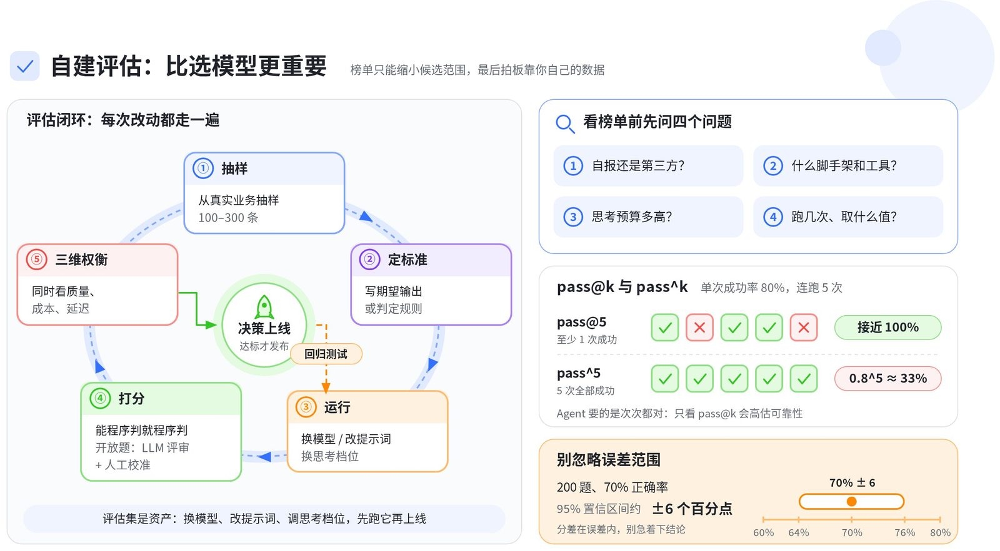

## 第 10 章 · 2026 年版图：模型与趋势

📎 延伸阅读：推理模型的谱系、测试时计算怎么扩展、什么时候值得多想，见 [LLM-37｜地基｜推理模型与测试时计算：长思维链何时值得](./37-reasoning-models.md)。

| 厂商 | 2026 年代表型号（发布时间） | 权重 | 看点 |
|---|---|---|---|
| OpenAI | GPT-5.5（04-23）；GPT-5.6 Sol / Terra / Luna（07-09）[[66]](https://openai.com/index/gpt-5-6/)；GPT-6 Astra（09-03）[[114]](https://openai.com/index/gpt-6-astra/)、GPT-6 Sol / Luna（09-22）[[115]](https://openai.com/index/introducing-gpt-6-sol-and-luna/)、GPT-6.1 Sol（09-29）[[116]](https://openai.com/index/introducing-gpt-6-1-sol)；10-07 起 ChatGPT 全部用户改用 GPT-6[[117]](https://openai.com/index/gpt-6-for-everyone/) | 闭源 | GPT-6 分 Astra / Sol / Luna 三档；Astra 是 OpenAI 首个网络安全能力达到“Critical”级的模型，带额外防护发布；GPT-6.1 Sol 以 Astra 五分之一的价格接近其能力 |
| Anthropic | Claude Opus 4.6 → 4.7 → 4.8；Fable 5（06-09）[[118]](https://www.anthropic.com/claude/fable)、Sonnet 5（06-30）、Opus 5（07-24）[[15]](https://www.anthropic.com/news/claude-sonnet-5)；Fable 5.1（09-01）[[118]](https://www.anthropic.com/claude/fable)；Opus 5.5（09-22）[[119]](https://www.anthropic.com/claude-opus-5-5)、Sonnet 5.5（09-28）[[120]](https://www.anthropic.com/claude-sonnet-5-5) | 闭源 | 第 5 代新增 Fable 作为最高档，同权重的 Mythos 只向审核过的安全与生命科学机构开放；Opus 5.5 多数工作接近 Fable 5.1，运行成本比 Opus 5 低约 40%；Sonnet 5 更换了分词器 |
| Google | Gemini 3.5 Flash（05-19）、Gemini 3.8 Flash（09-02）[[75]](https://blog.google/innovation-and-ai/models-and-research/gemini-models/3-8-flash-and-3-8-flash-cyber/)；Gemma 4 系列（04-02）；DiffusionGemma（06-10）[[79]](https://arxiv.org/abs/2608.00146)；Gemini 4 Argon（09-30 公布，目前只向受信任的网络安全防御方开放）[[121]](https://blog.google/innovation-and-ai/models-and-research/gemini-models/gemini-4-argon/) | 闭源 + 开放权重 | 全模态；新旗舰先受限发布；开放权重的端侧模型与扩散模型 |
| DeepSeek | V4-Pro（1.6T / 激活 49B）、V4-Flash（284B / 13B），04-24 发布[[11]](https://arxiv.org/abs/2606.19348)；V4.1-Flash（09-10）[[38]](https://www.deepseek.com/en/news/deepseek-v4-1-flash/) | 开放权重 | 百万 token 上下文的高效注意力；FP4 专家权重 |
| 阿里 Qwen | Qwen3.5-397B-A17B（02-15）；Qwen3.8-Max（08-02）；Qwen3.8-Flash-Next（08-26）[[16]](https://raw.githubusercontent.com/QwenLM/Qwen3.8-Flash-Next/main/tech_report.pdf) | 开放权重 + API | 混合线性注意力、n-gram 嵌入 |
| 字节 Seed | Seed2.0 Pro / Lite / Mini / Code；Lite 于 04 月升级为全模态[[85]](https://arxiv.org/abs/2607.00248) | API | 分档覆盖从复杂推理到低成本调用 |
| 其他 | Kimi K2.5 / K2.6 / K3、GLM 5.x、Meta Muse Spark（04-08）、Mistral Small 4 / Medium 3.5[[34]](https://cheatsheets.davidveksler.com/ai-model-release-log.html) | 多为开放权重 | 开放权重模型与闭源头部的差距持续缩小 |

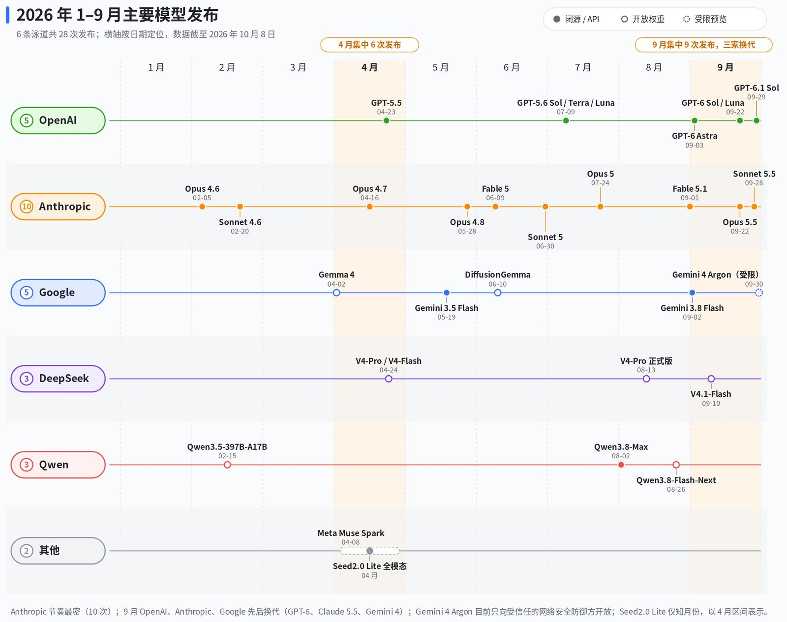

### 10.1 九个趋势

1. **稀疏化成为默认**：细粒度 MoE 加上混合 / 稀疏注意力，让“总参数万亿级、每 token 只算几十 B”成为旗舰标配（第 3 章）。
2. **思考可调**：推理强度变成 API 参数，模型也在学习按题目难度自适应分配思考 token（第 5 章）。
3. **竞争转向 Agent**：发布会的主角从知识问答换成 SWE-bench Pro、Terminal-Bench、OSWorld 这类多步任务（第 9 章）。
4. **低精度全链路**：训练从 BF16 走向 FP8、NVFP4，推理普遍使用 FP8 / FP4 权重（第 4、6 章）。
5. **原生全模态**：图像、音频、视频的理解和生成并入同一个模型（第 7 章）。
6. **分档定价**：同一代模型分为旗舰、均衡、轻量三档，单位能力价格持续下降（第 6 章）。
7. **上下文工程成为基本功**：MCP、Agent Skills、子 Agent 构成应用层的通用积木（第 8 章）。
8. **非自回归探索**：扩散语言模型、编码器–解码器架构重新进入生产视野（第 3、6 章）。
9. **前沿模型分级开放**：最强能力先给审核过的机构，再逐步放开。GPT-6 Astra 先向少数机构开放[[114]](https://openai.com/index/gpt-6-astra/)，与 Claude Fable 5.1 同权重的 Mythos 5.1 只向审核过的安全与生命科学机构开放[[123]](https://www.anthropic.com/claude-fable-and-mythos-5-1)，Gemini 4 Argon 先给 Fairwind 项目里的网络安全防御方[[121]](https://blog.google/innovation-and-ai/models-and-research/gemini-models/gemini-4-argon/)。选型前要先确认目标模型是否真的对你开放、开放的是哪个防护版本。

## 第 11 章 · 常见误区纠偏

前三条是对原文表述的更正，其余是研发在实际使用中最常见的误解。

| 误区 | 更准确的说法 |
|---|---|
| MLA 是“多层聚合注意力” | MLA 是 <b>Multi-head Latent Attention（多头潜在注意力）</b>：把 K、V 压缩成低维潜在向量缓存，推理时再还原，核心目的是缩小 KV 缓存[[26]](https://arxiv.org/abs/2405.04434)。 |
| MoE 每个 token 只发给 1–2 个专家 | 这是 2021 年 Switch Transformer 等早期设计[[33]](https://arxiv.org/abs/2101.03961)。现代细粒度 MoE 专家更多更小，例如 DeepSeek-V3 每个 token 从 256 个路由专家中选 8 个，外加 1 个共享专家[[27]](https://arxiv.org/abs/2412.19437)[[35]](https://arxiv.org/abs/2401.06066)。 |
| PagedAttention 是一种注意力机制 | 它不改变注意力的数学计算，而是**KV 缓存的显存管理方法**：像操作系统分页一样按块分配显存，减少碎片、支持前缀共享[[67]](https://arxiv.org/abs/2309.06180)。 |
| 参数越多模型越强 | 效果取决于参数、数据和计算的配比[[8]](https://arxiv.org/abs/2203.15556)；MoE 时代还要区分总参数与激活参数。小模型用更多高质量数据训练，常能超过大模型。 |
| 微调可以给模型灌入新知识 | 微调更擅长改变格式、风格与行为；让模型掌握经常变化的事实，优先用 RAG（第 5、8 章）。 |
| 上下文窗口越大越好用 | 窗口大不等于每个位置都被充分利用；长输入更贵、更慢，也更容易让模型忽略中间的信息。精选上下文通常胜过“全塞进去”。 |
| 温度设为 0 输出就完全确定 | 服务端的批处理与浮点运算顺序会带来细微差异，结果仍可能不同。需要可复现时，应固定模型版本并在应用层缓存结果。 |
| 模型会记住我之前的对话 | 模型本身是无状态的，每次请求只看到这次传入的上下文；“记忆”是应用层把历史或摘要再次放进上下文实现的。 |
| 推理模型总是更好 | 简单任务上多思考会增加成本和延迟，甚至因“想太多”而出错[[63]](https://arxiv.org/abs/2604.10739)。按任务难度选择思考档位。 |
| 榜单分数高，我的场景就一定好 | 公开基准与业务分布不同，且受脚手架和污染影响（第 9 章）。以自建评估集的结果为准。 |

## 第 12 章 · 自测、学习路径与术语表

📎 延伸阅读：想从分词器、预训练一路到 SFT 和强化学习亲手训练一个小模型，见 [LLM-30｜地基｜动手实验：从零训练一个小模型](./30-train-small-model.md)。

### 12.1 自测题

能不看文档答出下面的问题，说明主线已经建立起来了。

1. 为什么说 LLM 是“按条件概率逐个预测下一个 token”？温度调高会发生什么？
2. 同一段中文在两个模型上 token 数不同，会影响哪些东西？
3. 估算：Llama-3-70B 处理 128K 上下文时，单个请求的 KV Cache 大约多大？GQA 和 MLA 分别从哪个维度缩小它？
4. MoE 模型的“总参数”和“激活参数”各决定了什么？
5. 用 6ND 估算：一个 37B 激活参数的模型训练 14.8T token 需要多少 FLOPs？
6. SFT、偏好优化、RLVR 分别解决什么问题？为什么 R1 能用规则奖励训练出推理能力？
7. 为什么 decode 阶段通常受显存带宽限制？投机解码为什么能在不改变输出分布的前提下提速？
8. 在 Agent 任务中途增删工具定义，为什么会显著增加成本？
9. 看到一个模型 SWE-bench Pro 80%，另一个 62%，还需要确认哪些条件才能比较？
10. 什么情况下应该微调，什么情况下应该用 RAG 或改提示词？

### 12.2 参考答案

1. 模型每一步输出词表上的概率分布，文本概率是这些条件概率的连乘，生成就是反复“采样 → 拼接 → 再预测”（1.1）。温度调高会让分布更平均，输出更多样，也更容易出错（1.2）。
2. 影响费用、上下文可容纳的内容量、生成速度（token 越多越慢），以及能力（数字、代码切分方式不同）（2.1）。
3. 每 token 约 320 KB，128K 约 40 GB（3.4）。GQA 减少 KV 头的数量；MLA 不再按头分别存 K、V，而是每层每 token 只存一个低维潜向量（3.5）。
4. 总参数决定需要多少显存来存权重，也大致决定知识容量；激活参数决定每个 token 的计算量和速度（3.7）。
5. $`6\times37\times10^9\times14.8\times10^{12}\approx3.3\times10^{24}`$ FLOPs（4.3）。
6. SFT 教格式和指令遵循；偏好优化让回答更符合人类偏好；RLVR 用可自动判分的任务提升推理能力。规则奖励难以被“讨好”，可以放心大规模训练，模型在不断试错中自己学会了更长的思考和自我检查（第 5 章）。
7. 每生成一个 token 都要把全部权重和 KV Cache 从显存读一遍，而计算量很小。投机解码让大模型一次并行验证多个草稿 token，读一次权重产出多个 token；拒绝采样保证结果分布与逐个生成一致（6.1、6.5）。
8. 工具定义位于提示词前部，改动后其后的所有内容都无法命中前缀缓存，后续每一步都要按未命中价格重新计算（6.3、8.1）。
9. 是自报还是第三方统一复测、用了什么脚手架和工具、思考预算多高、跑了几次取什么统计值（9.1、9.2）。
10. 格式、风格、少量规则先改提示词；经常变化的知识用 RAG；稳定且大量的模式化任务、需要小模型替代大模型降本、或延迟无法承受长提示词时才考虑微调，且前提是有评估集（5.2）。

### 12.3 学习路径

| 阶段 | 做什么 | 读什么 |
|---|---|---|
| 第 1 周：建立直觉 | 用任意 API 跑通对话、工具调用和结构化输出；用分词器工具看看中文和代码如何被切分；改改温度，观察输出变化。 | Transformer[[5]](https://arxiv.org/abs/1706.03762)、GPT-3[[1]](https://arxiv.org/abs/2005.14165)、InstructGPT[[7]](https://arxiv.org/abs/2203.02155) |
| 第 2–4 周：理解机制 | 手写一个最小的注意力与 KV Cache；用 vLLM 部署一个开放权重模型，观察 prefill 与 decode 的耗时差异，并压测不同并发下的 TTFT 与吞吐。 | FlashAttention[[20]](https://arxiv.org/abs/2205.14135)、PagedAttention[[67]](https://arxiv.org/abs/2309.06180)、DeepSeek-V3[[27]](https://arxiv.org/abs/2412.19437)、本文第 3、6 章 |
| 第 2 个月：动手训练 | 用 LoRA 在自有数据上做一次 SFT；用 GRPO 在带标准答案的小任务上跑一次强化学习。 | LoRA[[48]](https://arxiv.org/abs/2106.09685)、DPO[[51]](https://arxiv.org/abs/2305.18290)、GRPO[[52]](https://arxiv.org/abs/2402.03300)、DeepSeek-R1[[10]](https://arxiv.org/abs/2501.12948) |
| 持续：做应用 | 为自己的业务建评估集；搭建一个带 RAG、MCP 工具和技能的 Agent，并记录质量、成本、延迟。 | ReAct[[91]](https://arxiv.org/abs/2210.03629)、ACE[[89]](https://proceedings.iclr.cc/paper_files/paper/2026/file/8a94ff6f922d995d7d3f4ebf4143e442-Paper-Conference.pdf)、Agent Skills 综述[[96]](https://arxiv.org/abs/2602.12430)、SWE-bench Pro[[106]](https://labs.scale.com/papers/swe-bench-pro) |

### 12.4 术语表

| 术语 | 一句话解释 | 章节 |
|---|---|---|
| Token | 模型处理和计费的最小单位，通常是子词。 | 2.1 |
| Logits | 模型对词表中每个 token 的原始打分，经 softmax 变成概率。 | 1.1 |
| 交叉熵 / 困惑度 | 训练损失：正确 token 概率的负对数；困惑度是其指数，表示模型平均在几个候选间犹豫。 | 1.3 |
| Embedding | token 对应的向量表示。 | 2.3 |
| RoPE | 旋转位置编码，让注意力分数反映 token 间的相对距离。 | 2.4 |
| 残差流 | 贯穿所有层的向量通道，每层读取并写回增量。 | 3.1 |
| 注意力 / Q、K、V | 每个 token 用查询 Q 与其他 token 的键 K 匹配，按相关性汇总值 V。 | 3.2 |
| FFN / SwiGLU | 对每个 token 独立加工的前馈网络，占稠密模型的大部分参数。 | 3.3 |
| KV Cache | 缓存历史 token 的 K、V，避免生成时重复计算；是推理显存的主要消耗。 | 3.4 |
| GQA / MLA | 多个查询头共享 KV 头 / 把 KV 压缩成低维潜向量，两种压缩 KV Cache 的方法。 | 3.5 |
| 线性注意力 / SSM | 用固定大小的状态代替 KV Cache，计算随长度线性增长，但精确回忆较弱。 | 3.5–3.6 |
| MoE | 混合专家：每个 token 只经过少数几个专家，总参数大而计算量小。 | 3.7 |
| MTP | 多 token 预测，训练时预测后面多个 token，推理时可用于投机解码。 | 3.8 |
| Scaling Law | 损失随参数、数据、算力呈幂律下降的经验规律。 | 4.2 |
| MFU | 模型算力利用率：实际有效算力占硬件峰值的比例。 | 4.3 |
| DP / TP / PP / EP | 数据、张量、流水线、专家并行，四种把训练切到多卡的方式。 | 4.4 |
| SFT | 监督微调：用指令–回答对训练，只对回答计算损失。 | 5.2 |
| LoRA / QLoRA | 只训练插入的低秩矩阵的微调方法；QLoRA 在 4 位量化基座上做 LoRA。 | 5.2 |
| RLHF / DPO | 基于人类偏好的强化学习 / 直接用偏好对训练的简化方法。 | 5.3 |
| RLVR / GRPO | 用可自动判分的奖励做强化学习 / 用组内相对表现估计优势的 RL 算法。 | 5.4 |
| 蒸馏 | 用大模型的输出或概率分布训练小模型。 | 5.6 |
| Prefill / Decode | 并行处理输入 / 逐个生成输出，前者受算力限制，后者受带宽限制。 | 6.1 |
| 连续批处理 / PagedAttention | 每个解码步动态组批 / 分页管理 KV Cache 显存。 | 6.3 |
| 前缀缓存 | 复用相同前缀的 KV，是 API 缓存折扣的基础。 | 6.3 |
| 量化 | 用更少比特表示权重或激活，换取显存和速度。 | 6.4 |
| 投机解码 | 草稿模型先猜多个 token，大模型一次并行验证。 | 6.5 |
| TTFT / TPOT | 首 token 延迟 / 每个输出 token 的间隔。 | 6.6 |
| RAG | 先检索相关资料，再让模型基于资料作答。 | 8.3 |
| MCP | 连接 Agent 与外部工具、数据源的开放协议。 | 8.4 |
| Agent Skills | 按需加载的流程知识包（SKILL.md + 脚本 + 资料）。 | 8.4 |
| 子 Agent | 拥有独立上下文的子任务执行者，只回传提炼后的结果。 | 8.4 |
| 提示词注入 | 外部内容中的恶意指令被模型当成用户指令执行。 | 8.7 |
| pass@k / pass^k | k 次中至少一次成功 / k 次全部成功的概率。 | 9.3 |
| Harness（脚手架） | 运行 Agent 评测的外围程序：提示词、工具、重试策略等。 | 9.1 |

> 📌 回到主线：**token 化 → Transformer 计算 → 预训练获得知识 → 后训练对齐行为 → 推理部署决定成本 → 应用工程决定效果 → 评估闭环**。遇到新模型、新论文时，先判断它改进的是主线上的哪一环。

## 参考文献

按正文首次引用顺序编号，[110]–[123] 为后续补充内容的引用。arXiv 编号可在 arxiv.org 检索；厂商发布与榜单数据截至 2026 年 10 月初。

[1] Brown et al. Language Models are Few-Shot Learners / GPT-3 (2020). [https://arxiv.org/abs/2005.14165](https://arxiv.org/abs/2005.14165)

[2] Bengio et al. A Neural Probabilistic Language Model (JMLR 2003). [https://www.jmlr.org/papers/volume3/bengio03a/bengio03a.pdf](https://www.jmlr.org/papers/volume3/bengio03a/bengio03a.pdf)

[3] Mikolov et al. Efficient Estimation of Word Representations in Vector Space / Word2Vec (2013). [https://arxiv.org/abs/1301.3781](https://arxiv.org/abs/1301.3781)

[4] Bahdanau et al. Neural Machine Translation by Jointly Learning to Align and Translate (2014). [https://arxiv.org/abs/1409.0473](https://arxiv.org/abs/1409.0473)

[5] Vaswani et al. Attention Is All You Need (2017). [https://arxiv.org/abs/1706.03762](https://arxiv.org/abs/1706.03762)

[6] Kaplan et al. Scaling Laws for Neural Language Models (2020). [https://arxiv.org/abs/2001.08361](https://arxiv.org/abs/2001.08361)

[7] Ouyang et al. Training LMs to Follow Instructions with Human Feedback / InstructGPT (2022). [https://arxiv.org/abs/2203.02155](https://arxiv.org/abs/2203.02155)

[8] Hoffmann et al. Training Compute-Optimal LLMs / Chinchilla (2022). [https://arxiv.org/abs/2203.15556](https://arxiv.org/abs/2203.15556)

[9] OpenAI. Learning to Reason with LLMs / o1 (2024). [https://openai.com/index/learning-to-reason-with-llms/](https://openai.com/index/learning-to-reason-with-llms/)

[10] DeepSeek-AI. DeepSeek-R1: Incentivizing Reasoning via RL (2025). [https://arxiv.org/abs/2501.12948](https://arxiv.org/abs/2501.12948)

[11] DeepSeek-AI. DeepSeek-V4: Towards Highly Efficient Million-Token Context Intelligence (2026). [https://arxiv.org/abs/2606.19348](https://arxiv.org/abs/2606.19348)

[12] Kimi Team. Kimi Linear: An Expressive, Efficient Attention Architecture (2025). [https://arxiv.org/abs/2510.26692](https://arxiv.org/abs/2510.26692)

[13] Sennrich et al. Neural Machine Translation of Rare Words with Subword Units / BPE (2015). [https://arxiv.org/abs/1508.07909](https://arxiv.org/abs/1508.07909)

[14] Kudo &amp; Richardson. SentencePiece (2018). [https://arxiv.org/abs/1808.06226](https://arxiv.org/abs/1808.06226)

[15] Anthropic. Introducing Claude Sonnet 5（tokenizer 变更说明，2026-06）. [https://www.anthropic.com/news/claude-sonnet-5](https://www.anthropic.com/news/claude-sonnet-5)

[16] Qwen Team. On the Design of Qwen3.8-Next Architecture (2026). [https://raw.githubusercontent.com/QwenLM/Qwen3.8-Flash-Next/main/tech_report.pdf](https://raw.githubusercontent.com/QwenLM/Qwen3.8-Flash-Next/main/tech_report.pdf)

[17] Su et al. RoFormer: Rotary Position Embedding (2021). [https://arxiv.org/abs/2104.09864](https://arxiv.org/abs/2104.09864)

[18] Peng et al. YaRN: Efficient Context Window Extension (2023). [https://arxiv.org/abs/2309.00071](https://arxiv.org/abs/2309.00071)

[19] Meta. The Llama 3 Herd of Models (2024). [https://arxiv.org/abs/2407.21783](https://arxiv.org/abs/2407.21783)

[20] Dao et al. FlashAttention (2022). [https://arxiv.org/abs/2205.14135](https://arxiv.org/abs/2205.14135)

[21] Shazeer. GLU Variants Improve Transformer / SwiGLU (2020). [https://arxiv.org/abs/2002.05202](https://arxiv.org/abs/2002.05202)

[22] Zhang &amp; Sennrich. Root Mean Square Layer Normalization (2019). [https://arxiv.org/abs/1910.07467](https://arxiv.org/abs/1910.07467)

[23] Xie et al. mHC: Manifold-Constrained Hyper-Connections (2025). [https://arxiv.org/abs/2512.24880](https://arxiv.org/abs/2512.24880)

[24] Shazeer. Fast Transformer Decoding / MQA (2019). [https://arxiv.org/abs/1911.02150](https://arxiv.org/abs/1911.02150)

[25] Ainslie et al. GQA: Grouped-Query Attention (2023). [https://arxiv.org/abs/2305.13245](https://arxiv.org/abs/2305.13245)

[26] DeepSeek-AI. DeepSeek-V2 / Multi-head Latent Attention (2024). [https://arxiv.org/abs/2405.04434](https://arxiv.org/abs/2405.04434)

[27] DeepSeek-AI. DeepSeek-V3 Technical Report (2024). [https://arxiv.org/abs/2412.19437](https://arxiv.org/abs/2412.19437)

[28] Yuan et al. Native Sparse Attention (2025). [https://arxiv.org/abs/2502.11089](https://arxiv.org/abs/2502.11089)

[29] Gu &amp; Dao. Mamba: Linear-Time Sequence Modeling with Selective State Spaces (2023). [https://arxiv.org/abs/2312.00752](https://arxiv.org/abs/2312.00752)

[30] Yang et al. Gated Delta Networks (2024). [https://arxiv.org/abs/2412.06464](https://arxiv.org/abs/2412.06464)

[31] Raschka. LLM Architecture Gallery: Hybrid Attention (2026). [https://sebastianraschka.com/llm-architecture-gallery/hybrid-attention/](https://sebastianraschka.com/llm-architecture-gallery/hybrid-attention/)

[32] Wang et al. A Systematic Analysis of Hybrid Linear Attention (2025). [https://arxiv.org/abs/2507.06457](https://arxiv.org/abs/2507.06457)

[33] Fedus et al. Switch Transformers (2021). [https://arxiv.org/abs/2101.03961](https://arxiv.org/abs/2101.03961)

[34] AI Model Release Log 2026（按日期汇总的发布记录）. [https://cheatsheets.davidveksler.com/ai-model-release-log.html](https://cheatsheets.davidveksler.com/ai-model-release-log.html)

[35] Dai et al. DeepSeekMoE (2024). [https://arxiv.org/abs/2401.06066](https://arxiv.org/abs/2401.06066)

[36] Wang et al. Auxiliary-Loss-Free Load Balancing for MoE (2024). [https://arxiv.org/abs/2408.15664](https://arxiv.org/abs/2408.15664)

[37] Gloeckle et al. Better &amp; Faster LLMs via Multi-token Prediction (2024). [https://arxiv.org/abs/2404.19737](https://arxiv.org/abs/2404.19737)

[38] DeepSeek. Introducing DeepSeek-V4.1-Flash (2026-09). [https://www.deepseek.com/en/news/deepseek-v4-1-flash/](https://www.deepseek.com/en/news/deepseek-v4-1-flash/)

[39] Qwen Team. Qwen3 Technical Report (2025). [https://arxiv.org/abs/2505.09388](https://arxiv.org/abs/2505.09388)

[40] Rajbhandari et al. ZeRO: Memory Optimizations (2019). [https://arxiv.org/abs/1910.02054](https://arxiv.org/abs/1910.02054)

[41] Shoeybi et al. Megatron-LM (2019). [https://arxiv.org/abs/1909.08053](https://arxiv.org/abs/1909.08053)

[42] Liu et al. Muon is Scalable for LLM Training / Moonlight (2025). [https://arxiv.org/abs/2502.16982](https://arxiv.org/abs/2502.16982)

[43] Kimi Team. Kimi K2: Open Agentic Intelligence / MuonClip (2025). [https://arxiv.org/abs/2507.20534](https://arxiv.org/abs/2507.20534)

[44] NVIDIA. SOAP, Muon, and Beyond: Pushing LLM Pretraining Scales (2026). [https://arxiv.org/abs/2607.20548](https://arxiv.org/abs/2607.20548)

[45] NVIDIA. Pretraining Large Language Models with NVFP4 (2025). [https://arxiv.org/abs/2509.25149](https://arxiv.org/abs/2509.25149)

[46] Quartet II: Accurate LLM Pre-Training in NVFP4 (2026). [https://arxiv.org/abs/2601.22813](https://arxiv.org/abs/2601.22813)

[47] Zhou et al. LIMA: Less Is More for Alignment (2023). [https://arxiv.org/abs/2305.11206](https://arxiv.org/abs/2305.11206)

[48] Hu et al. LoRA: Low-Rank Adaptation (2021). [https://arxiv.org/abs/2106.09685](https://arxiv.org/abs/2106.09685)

[49] Dettmers et al. QLoRA (2023). [https://arxiv.org/abs/2305.14314](https://arxiv.org/abs/2305.14314)

[50] Schulman et al. Proximal Policy Optimization (2017). [https://arxiv.org/abs/1707.06347](https://arxiv.org/abs/1707.06347)

[51] Rafailov et al. Direct Preference Optimization (2023). [https://arxiv.org/abs/2305.18290](https://arxiv.org/abs/2305.18290)

[52] Shao et al. DeepSeekMath / GRPO (2024). [https://arxiv.org/abs/2402.03300](https://arxiv.org/abs/2402.03300)

[53] Yu et al. DAPO: Open-Source LLM RL at Scale (2025). [https://arxiv.org/abs/2503.14476](https://arxiv.org/abs/2503.14476)

[54] Liu et al. Understanding R1-Zero-Like Training / Dr.GRPO (2025). [https://arxiv.org/abs/2503.20783](https://arxiv.org/abs/2503.20783)

[55] Zheng et al. Group Sequence Policy Optimization (2025). [https://arxiv.org/abs/2507.18071](https://arxiv.org/abs/2507.18071)

[56] MiniMax. MiniMax-M1 / CISPO (2025). [https://arxiv.org/abs/2506.13585](https://arxiv.org/abs/2506.13585)

[57] Min et al. Dynamic Hybrid Policy Optimization for RLVR (ACL Findings 2026). [https://aclanthology.org/2026.findings-acl.1883/](https://aclanthology.org/2026.findings-acl.1883/)

[58] Length-Unbiased Sequence Policy Optimization (2026). [https://arxiv.org/abs/2602.05261](https://arxiv.org/abs/2602.05261)

[59] Hinton et al. Distilling the Knowledge in a Neural Network (2015). [https://arxiv.org/abs/1503.02531](https://arxiv.org/abs/1503.02531)

[60] Wei et al. Chain-of-Thought Prompting Elicits Reasoning (2022). [https://arxiv.org/abs/2201.11903](https://arxiv.org/abs/2201.11903)

[61] Snell et al. Scaling LLM Test-Time Compute Optimally (2024). [https://arxiv.org/abs/2408.03314](https://arxiv.org/abs/2408.03314)

[62] Muennighoff et al. s1: Simple Test-Time Scaling (2025). [https://arxiv.org/abs/2501.19393](https://arxiv.org/abs/2501.19393)

[63] When More Thinking Hurts: Overthinking in Test-Time Compute Scaling (2026). [https://arxiv.org/abs/2604.10739](https://arxiv.org/abs/2604.10739)

[64] Learning When to Think: Adaptive Reasoning for Test-Time Compute (2026). [https://arxiv.org/abs/2608.20256](https://arxiv.org/abs/2608.20256)

[65] Coda: Difficulty-Aware Compute Allocation for Adaptive Reasoning (2026). [https://arxiv.org/abs/2603.08659](https://arxiv.org/abs/2603.08659)

[66] OpenAI. GPT-5.6 (2026-07). [https://openai.com/index/gpt-5-6/](https://openai.com/index/gpt-5-6/)

[67] Kwon et al. PagedAttention / vLLM (2023). [https://arxiv.org/abs/2309.06180](https://arxiv.org/abs/2309.06180)

[68] Yu et al. Orca: Iteration-Level Scheduling (OSDI 2022). [https://www.usenix.org/conference/osdi22/presentation/yu](https://www.usenix.org/conference/osdi22/presentation/yu)

[69] Zhong et al. DistServe: Disaggregating Prefill and Decoding (2024). [https://arxiv.org/abs/2401.09670](https://arxiv.org/abs/2401.09670)

[70] Xiao et al. SmoothQuant (2022). [https://arxiv.org/abs/2211.10438](https://arxiv.org/abs/2211.10438)

[71] Lin et al. AWQ (2023). [https://arxiv.org/abs/2306.00978](https://arxiv.org/abs/2306.00978)

[72] Frantar et al. GPTQ (2022). [https://arxiv.org/abs/2210.17323](https://arxiv.org/abs/2210.17323)

[73] Leviathan et al. Fast Inference via Speculative Decoding (2022). [https://arxiv.org/abs/2211.17192](https://arxiv.org/abs/2211.17192)

[74] Li et al. EAGLE-3 (2025). [https://arxiv.org/abs/2503.01840](https://arxiv.org/abs/2503.01840)

[75] Google. Gemini 3.8 Flash (2026-09). [https://blog.google/innovation-and-ai/models-and-research/gemini-models/3-8-flash-and-3-8-flash-cyber/](https://blog.google/innovation-and-ai/models-and-research/gemini-models/3-8-flash-and-3-8-flash-cyber/)

[76] Arriola et al. Block Diffusion (2025). [https://arxiv.org/abs/2503.09573](https://arxiv.org/abs/2503.09573)

[77] Nie et al. Large Language Diffusion Models / LLaDA (2025). [https://arxiv.org/abs/2502.09992](https://arxiv.org/abs/2502.09992)

[78] LLaDA2.1: Speeding Up Text Diffusion via Token Editing (2026). [https://arxiv.org/abs/2602.08676](https://arxiv.org/abs/2602.08676)

[79] Google. DiffusionGemma Technical Report (2026). [https://arxiv.org/abs/2608.00146](https://arxiv.org/abs/2608.00146)

[80] Radford et al. CLIP (2021). [https://arxiv.org/abs/2103.00020](https://arxiv.org/abs/2103.00020)

[81] Liu et al. Visual Instruction Tuning / LLaVA (2023). [https://arxiv.org/abs/2304.08485](https://arxiv.org/abs/2304.08485)

[82] Tian et al. NaViL: Native MLLMs under Data Constraints (2025). [https://arxiv.org/abs/2510.08565](https://arxiv.org/abs/2510.08565)

[83] Tuna-2: Pixel Embeddings Beat Vision Encoders (2026). [https://arxiv.org/abs/2604.24763](https://arxiv.org/abs/2604.24763)

[84] Wang et al. Qwen2-VL: Enhancing Vision-Language Perception at Any Resolution (2024). [https://arxiv.org/abs/2409.12191](https://arxiv.org/abs/2409.12191)

[85] ByteDance Seed. Seed2.0 Model Card (2026). [https://arxiv.org/abs/2607.00248](https://arxiv.org/abs/2607.00248)

[86] AR-Omni: A Unified Autoregressive Model for Any-to-Any Generation (2026). [https://arxiv.org/abs/2601.17761](https://arxiv.org/abs/2601.17761)

[87] Xie et al. OSWorld (2024). [https://arxiv.org/abs/2404.07972](https://arxiv.org/abs/2404.07972)

[88] CacheRouter: Cache-Preserving Tool Routing for Long-Tail Tool Discovery (2026-08). [https://arxiv.org/abs/2608.22708](https://arxiv.org/abs/2608.22708)

[89] Zhang et al. Agentic Context Engineering / ACE (ICLR 2026). [https://proceedings.iclr.cc/paper_files/paper/2026/file/8a94ff6f922d995d7d3f4ebf4143e442-Paper-Conference.pdf](https://proceedings.iclr.cc/paper_files/paper/2026/file/8a94ff6f922d995d7d3f4ebf4143e442-Paper-Conference.pdf)

[90] Lewis et al. Retrieval-Augmented Generation (2020). [https://arxiv.org/abs/2005.11401](https://arxiv.org/abs/2005.11401)

[91] Yao et al. ReAct: Synergizing Reasoning and Acting (2022). [https://arxiv.org/abs/2210.03629](https://arxiv.org/abs/2210.03629)

[92] Schick et al. Toolformer (2023). [https://arxiv.org/abs/2302.04761](https://arxiv.org/abs/2302.04761)

[93] Model Context Protocol 规范. [https://modelcontextprotocol.io/](https://modelcontextprotocol.io/)

[94] Linux Foundation. Formation of the Agentic AI Foundation (MCP, goose, AGENTS.md). [https://www.linuxfoundation.org/press/linux-foundation-announces-the-formation-of-the-agentic-ai-foundation](https://www.linuxfoundation.org/press/linux-foundation-announces-the-formation-of-the-agentic-ai-foundation)

[95] Red Hat Developer. MCP servers vs. skills (2026-05). [https://developers.redhat.com/articles/2026/05/25/mcp-servers-vs-skills-choosing-right-context-your-ai](https://developers.redhat.com/articles/2026/05/25/mcp-servers-vs-skills-choosing-right-context-your-ai)

[96] Agent Skills for LLMs: Architecture, Acquisition, Security (2026). [https://arxiv.org/abs/2602.12430](https://arxiv.org/abs/2602.12430)

[97] Subagents vs Agent Skills for Long-Horizon Tasks (2026-09). [https://arxiv.org/abs/2609.09233](https://arxiv.org/abs/2609.09233)

[98] SKILL.state: Scalable Long-Horizon Agent Skills (2026-08). [https://arxiv.org/abs/2608.26263](https://arxiv.org/abs/2608.26263)

[99] Anthropic. Building Effective Agents (2024-12). [https://www.anthropic.com/engineering/building-effective-agents](https://www.anthropic.com/engineering/building-effective-agents)

[100] Jain et al. LiveCodeBench (2024). [https://arxiv.org/abs/2403.07974](https://arxiv.org/abs/2403.07974)

[101] Your Coding Agent’s Leaderboard Score Isn’t a Production Guarantee（口径差异分析，2026-09）. [https://hackernoon.com/your-coding-agents-leaderboard-score-isnt-a-production-guarantee](https://hackernoon.com/your-coding-agents-leaderboard-score-isnt-a-production-guarantee)

[102] Phan et al. Humanity's Last Exam (2025). [https://arxiv.org/abs/2501.14249](https://arxiv.org/abs/2501.14249)

[103] BenchmarkList: HLE w/ tools 排行（2026-08-28 更新）. [https://benchmarklist.com/benchmarks/hle_tools/](https://benchmarklist.com/benchmarks/hle_tools/)

[104] Rein et al. GPQA (2023). [https://arxiv.org/abs/2311.12022](https://arxiv.org/abs/2311.12022)

[105] Jimenez et al. SWE-bench (2023). [https://arxiv.org/abs/2310.06770](https://arxiv.org/abs/2310.06770)

[106] Scale AI. SWE-Bench Pro (2025). [https://labs.scale.com/papers/swe-bench-pro](https://labs.scale.com/papers/swe-bench-pro)

[107] Chiang et al. Chatbot Arena (2024). [https://arxiv.org/abs/2403.04132](https://arxiv.org/abs/2403.04132)

[108] Yao et al. tau-bench: Tool-Agent-User Interaction Benchmark / pass^k (2024). [https://arxiv.org/abs/2406.12045](https://arxiv.org/abs/2406.12045)

[109] Zheng et al. Judging LLM-as-a-Judge with MT-Bench and Chatbot Arena (2023). [https://arxiv.org/abs/2306.05685](https://arxiv.org/abs/2306.05685)

[110] Wei et al. Emergent Abilities of Large Language Models (2022) [https://arxiv.org/abs/2206.07682](https://arxiv.org/abs/2206.07682)

[111] Schaeffer et al. Are Emergent Abilities of Large Language Models a Mirage? (2023) [https://arxiv.org/abs/2304.15004](https://arxiv.org/abs/2304.15004)

[112] Raffel et al. Exploring the Limits of Transfer Learning with a Unified Text-to-Text Transformer / T5 (2019) [https://arxiv.org/abs/1910.10683](https://arxiv.org/abs/1910.10683)

[113] Zhang et al. RAFT: Adapting Language Model to Domain Specific RAG (2024) [https://arxiv.org/abs/2403.10131](https://arxiv.org/abs/2403.10131)

[114] OpenAI. GPT-6 Astra: A new generation of intelligence (2026-09-03). [https://openai.com/index/gpt-6-astra/](https://openai.com/index/gpt-6-astra/)

[115] OpenAI. Introducing GPT-6 Sol and Luna (2026-09-22). [https://openai.com/index/introducing-gpt-6-sol-and-luna/](https://openai.com/index/introducing-gpt-6-sol-and-luna/)

[116] OpenAI. Introducing GPT-6.1 Sol (2026-09-29). [https://openai.com/index/introducing-gpt-6-1-sol](https://openai.com/index/introducing-gpt-6-1-sol)

[117] OpenAI. GPT-6 and Intelligent UI for everyone (2026-10-07). [https://openai.com/index/gpt-6-for-everyone/](https://openai.com/index/gpt-6-for-everyone/)

[118] Anthropic. Claude Fable（产品页：Fable 5 发布于 2026-06-09，Fable 5.1 发布于 2026-09-01）. [https://www.anthropic.com/claude/fable](https://www.anthropic.com/claude/fable)

[119] Anthropic. Introducing Claude Opus 5.5 (2026-09-22). [https://www.anthropic.com/claude-opus-5-5](https://www.anthropic.com/claude-opus-5-5)

[120] Anthropic. Introducing Claude Sonnet 5.5 (2026-09-28). [https://www.anthropic.com/claude-sonnet-5-5](https://www.anthropic.com/claude-sonnet-5-5)

[121] Google. Introducing Gemini 4 Argon (2026-09-30). [https://blog.google/innovation-and-ai/models-and-research/gemini-models/gemini-4-argon/](https://blog.google/innovation-and-ai/models-and-research/gemini-models/gemini-4-argon/)

[122] OpenAI. API Pricing (2026-10). [https://developers.openai.com/api/docs/pricing](https://developers.openai.com/api/docs/pricing)

[123] Anthropic. Introducing Claude Fable 5.1 and Claude Mythos 5.1 (2026-09-01). [https://www.anthropic.com/claude-fable-and-mythos-5-1](https://www.anthropic.com/claude-fable-and-mythos-5-1)

[124] Dao &amp; Gu. Transformers are SSMs: Generalized Models and Efficient Algorithms Through Structured State Space Duality (Mamba-2) (2024) [https://arxiv.org/abs/2405.21060](https://arxiv.org/abs/2405.21060)

[125] Jelassi et al. Repeat After Me: Transformers are Better than State Space Models at Copying (2024) [https://arxiv.org/abs/2402.01032](https://arxiv.org/abs/2402.01032)

[126] AI21 Labs. Jamba: A Hybrid Transformer-Mamba Language Model (2024) [https://arxiv.org/abs/2403.19887](https://arxiv.org/abs/2403.19887)

[127] Zyphra. Zamba2 Suite: Technical Report (2024) [https://arxiv.org/abs/2411.15242](https://arxiv.org/abs/2411.15242)

[128] NVIDIA. Nemotron-H: A Family of Accurate and Efficient Hybrid Mamba-Transformer Models (2025) [https://arxiv.org/abs/2504.03624](https://arxiv.org/abs/2504.03624)

[129] NVIDIA. NVIDIA Nemotron Nano 2: An Accurate and Efficient Hybrid Mamba-Transformer Reasoning Model (2025) [https://arxiv.org/abs/2508.14444](https://arxiv.org/abs/2508.14444)

[130] TII. Falcon-H1: A Family of Hybrid-Head Language Models (2025) [https://arxiv.org/abs/2507.22448](https://arxiv.org/abs/2507.22448)

[131] IBM. IBM Granite 4.0: hyper-efficient, high performance hybrid models for enterprise (2025) [https://www.ibm.com/new/announcements/ibm-granite-4-0-hyper-efficient-high-performance-hybrid-models](https://www.ibm.com/new/announcements/ibm-granite-4-0-hyper-efficient-high-performance-hybrid-models)

[132] MiniMax. MiniMax-01: Scaling Foundation Models with Lightning Attention (2025) [https://arxiv.org/abs/2501.08313](https://arxiv.org/abs/2501.08313)

[133] Qwen Team. Qwen3-Next-80B-A3B model card (2025) [https://huggingface.co/Qwen/Qwen3-Next-80B-A3B-Instruct](https://huggingface.co/Qwen/Qwen3-Next-80B-A3B-Instruct)

---

上一篇：[LLM-00｜总览｜LLM 系列：地图、清单与进展](./README.md) · [目录](./README.md) · 下一篇：[LLM-02｜地基｜LLM 数学补课：读懂公式的一张地图](./02-math.md)
