# LLM-02｜地基｜LLM 数学补课：读懂公式的一张地图

> 🎯 **这篇文档解决什么问题**：读 LLM 论文时卡在公式上、看不懂 loss 曲线在说什么、估不出一次训练或一次推理要多少显存和算力。这些问题背后需要的数学其实不多，集中在**四块**：线性代数、概率与信息论、微积分与优化、数值计算与估算。本文把它们整理成一张地图：每个知识点都回答“在 LLM 的哪里出现”“最少要懂到什么程度”，并配一道用真实模型参数算出来的例题。
>
> 使用方式：不必学完再看 LLM，先读第 1 章的符号速查和第 10 章的端到端例题，遇到不懂的再跳回对应章节。每章末尾的“掌握标准”可以当自测题，能独立做出来就够读懂主流论文。每个公式都能用 10 行 NumPy 验证，例题数字也都可以自己复算。文中模型参数核对于 2026 年 10 月 11 日。
>
> **代码**：配套练习在 llm-book 仓库的 `02-math-numerics/`，3 个练习对应第 7 章（softmax 溢出与 log-sum-exp、在线 softmax 的累加器缩放、分块量化）。只用 Go 标准库，进目录跑 `go test -race ./...` 就能验证；每个练习加 `-broken` 运行能看到有问题的早期写法，练习 README 末尾附参考答案。

## 导读 · 先给结论

把 LLM 的一次训练和一次推理拆开看，每一步都落在一个数学分支上：

- **表示**：文字变成向量，每一层都是矩阵乘法，位置信息靠旋转矩阵编码，这是**线性代数**（第 2 章）。
- **预测**：模型输出的是“下一个 token 的概率分布”，采样、温度、评测误差都是**概率统计**（第 3 章）。
- **度量**：训练目标交叉熵、困惑度、RLHF 里的 KL 惩罚，都是**信息论**（第 4 章）。
- **学习**：反向传播就是链式法则，Adam 是带动量的自适应梯度下降，这是**微积分与优化**（第 5、6 章）。
- **落地**：BF16 为什么较少溢出、softmax 为什么先减最大值、FP4 怎么量化，这是**数值计算**（第 7 章）；显存、算力、时延怎么估，是**工程估算**（第 8 章）。


| 数学分支 | 最少要掌握的概念 | 在 LLM 里出现在哪 | 本文章节 |
|---|---|---|---|
| 线性代数 | 向量、点积、矩阵乘法与形状、转置、范数、秩与低秩分解、旋转矩阵 | embedding、注意力、FFN、LoRA、MLA、RoPE、线性注意力 | 第 2 章 |
| 概率统计 | 条件概率与链式法则、softmax 与分类分布、期望方差、最大似然、蒙特卡洛估计、标准误 | 自回归生成、采样参数、初始化与缩放、pass@k、评测误差、投机解码 | 第 3 章 |
| 信息论 | 信息量、熵、交叉熵、困惑度、KL 散度 | 预训练 loss、困惑度、蒸馏、RLHF 与 DPO 的 KL 约束 | 第 4 章 |
| 微积分 | 导数、偏导与梯度、链式法则、计算图 | 反向传播、softmax + 交叉熵的梯度、残差为何能训练深网络 | 第 5 章 |
| 优化 | 梯度下降、动量、Adam/AdamW、学习率调度、梯度裁剪、归一化 | 预训练与微调的每一个超参数、Muon 等新优化器 | 第 6 章 |
| 数值计算 | 浮点格式、溢出与下溢、log-sum-exp、在线 softmax、量化 | BF16/FP8/FP4 训练与推理、FlashAttention、混合精度 | 第 7 章 |
| 工程估算 | FLOPs 计数、算术强度、Roofline、缩放定律 | 训练预算、显存规划、推理吞吐上限、选模型尺寸 | 第 8 章 |
| 强化学习数学 | 策略梯度、优势函数、重要性采样与裁剪、Bradley–Terry | 奖励模型、PPO、GRPO、DPO | 第 9 章 |

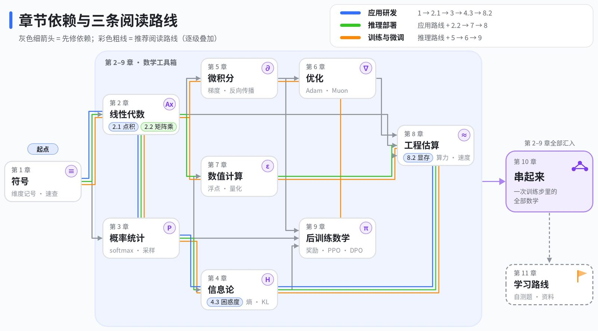

📎 与系列其他文档的分工：LLM 是什么、怎么工作见「LLM 基础」，两篇的章节互相引用。后训练的工程做法见「后训练实战」，显存和成本的完整算账见「自建推理成本与 GPU 选型」。本文只讲读懂 LLM 需要的数学。

## 第 1 章 · 读论文前的符号速查

LLM 论文的公式大多由同一套记号拼成。先认识这些记号，能解决一半的“看不懂”。本文统一使用下表的约定，与 Transformer 原论文和主流技术报告一致[[1]](https://arxiv.org/abs/1706.03762)。

| 记号 | 读法与含义 | LLM 里的典型例子 |
|---|---|---|
| $`x,\ \mathbf{x},\ X`$ | 小写斜体是标量，小写粗体是向量，大写是矩阵。 | $`\mathbf{x}_t`$ 是第 t 个 token 的向量，$`W_Q`$ 是查询投影矩阵。 |
| $`\mathbb{R}^{n\times d}`$ | n 行 d 列的实数矩阵，即形状 `[n, d]`。 | 一段 n 个 token 的隐藏状态 $`H\in\mathbb{R}^{n\times d}`$。 |
| $`A^{\top}`$ | 转置，行列互换。 | 注意力分数 $`QK^{\top}`$。 |
| $`\mathbf{a}\cdot\mathbf{b},\ \langle\mathbf{a},\mathbf{b}\rangle`$ | 点积，对应元素相乘再求和。 | 查询与键的匹配分数。 |
| $`\odot`$ | 逐元素乘（Hadamard 积）。 | SwiGLU 中两路结果相乘、门控。 |
| $`\\|\mathbf{x}\\|_2`$ | L2 范数，向量长度。 | 梯度裁剪、RMSNorm。 |
| $`\sum_i,\ \prod_i`$ | 求和、连乘。 | 序列概率是每步概率的连乘。 |
| $`p(y\mid x)`$ | 给定 x 时 y 的条件概率。 | $`p(x_t\mid x_{\lt t})`$：给定前文，下一个 token 的分布。 |
| $`x_{\lt t},\ x_{1:t}`$ | 第 t 个之前的所有元素；第 1 到第 t 个元素。 | 自回归的“前文”。 |
| $`\mathbb{E}_{x\sim p}[f(x)]`$ | x 服从分布 p 时，f(x) 的期望（平均值）。 | 训练目标是在数据分布上的期望 loss。 |
| $`\pi_\theta`$ | 参数为 θ 的策略，在 LLM 里就是模型本身。 | RLHF、GRPO 中的待训练模型；$`\pi_{\text{ref}}`$ 是参考模型。 |
| $`\nabla_\theta L`$ | loss 对所有参数的梯度，形状与参数相同。 | 反向传播的输出。 |
| $`\sigma(\cdot)`$ | sigmoid 函数 $`1/(1+e^{-x})`$，把实数压到 0 到 1。 | DPO loss、奖励模型、门控。 |
| $`D_{\text{KL}}(p\,\\|\,q)`$ | p 相对 q 的 KL 散度，衡量两个分布的差距。 | RLHF 的 KL 惩罚、蒸馏。 |
| $`O(n^2)`$ | 复杂度量级，随 n 的平方增长。 | 标准注意力的计算量。 |
| $`\arg\max_x f(x)`$ | 让 f(x) 最大的那个 x。 | 贪心解码：取概率最大的 token。 |

### 1.1 常用维度记号

技术报告描述模型结构时，约定俗成地用下面这些字母。以 Llama-3.1-70B 为例[[2]](https://arxiv.org/abs/2407.21783)：

| 记号 | 含义 | Llama-3.1-70B 取值 |
|---|---|---|
| $`d`$ 或 $`d_{\text{model}}`$ | 隐藏维度，每个 token 向量的长度 | 8192 |
| $`L`$ | 层数 | 80 |
| $`h,\ h_{kv}`$ | 查询头数、键值头数（GQA 下更少） | 64、8 |
| $`d_k`$ 或 $`d_{\text{head}}`$ | 每个头的维度 | 128 |
| $`d_{ff}`$ | FFN 中间维度 | 28672 |
| $`V`$ 或 $`\|\mathcal{V}\|`$ | 词表大小 | 128256 |
| $`n`$ 或 $`T`$ | 序列长度（token 数） | 最长 128K（Llama 3.1；原始 Llama 3 为 8K） |
| $`N,\ D`$ | 参数量、训练 token 数（缩放定律中使用） | 70B、15T |
| $`B`$ | 批大小 | 视训练配置 |

> 🔑 **读公式的方法：先看形状**。拿到一个陌生公式，先把每个量的形状写在旁边，比如 $`Q\in\mathbb{R}^{n\times d_k}`$、$`K^{\top}\in\mathbb{R}^{d_k\times n}`$，于是 $`QK^{\top}\in\mathbb{R}^{n\times n}`$ 是“每个 token 对每个 token”的分数表。形状对上了，公式的含义通常就清楚了。

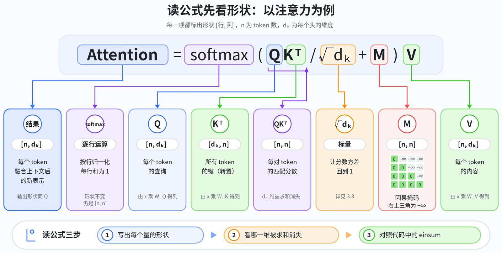

## 第 2 章 · 线性代数：模型的“数据结构”

如果只能学一门数学来理解 LLM，就是线性代数。模型的输入、中间状态、参数全是向量和矩阵，一次前向传播里 95% 以上的计算量是矩阵乘法。这一章按“向量 → 矩阵 → 分解 → 旋转”的顺序展开。

### 2.1 向量与点积：相似度的数学

一个 token 进入模型后先变成一个 d 维向量（embedding），可以把它看成 d 维空间里的一个点或一个箭头。两个向量的**点积**是对应分量相乘再求和：

```math
\mathbf{a}\cdot\mathbf{b}=\sum_{i=1}^{d}a_ib_i=\|\mathbf{a}\|\,\|\mathbf{b}\|\cos\theta
```

第二个等号给出了几何含义：点积 = 两个向量的长度 × 夹角的余弦。方向越一致，点积越大；垂直时为 0；方向相反时为负。去掉长度的影响就是**余弦相似度** $`\cos\theta=\frac{\mathbf{a}\cdot\mathbf{b}}{\|\mathbf{a}\|\|\mathbf{b}\|}`$，它的取值在 −1 到 1 之间。

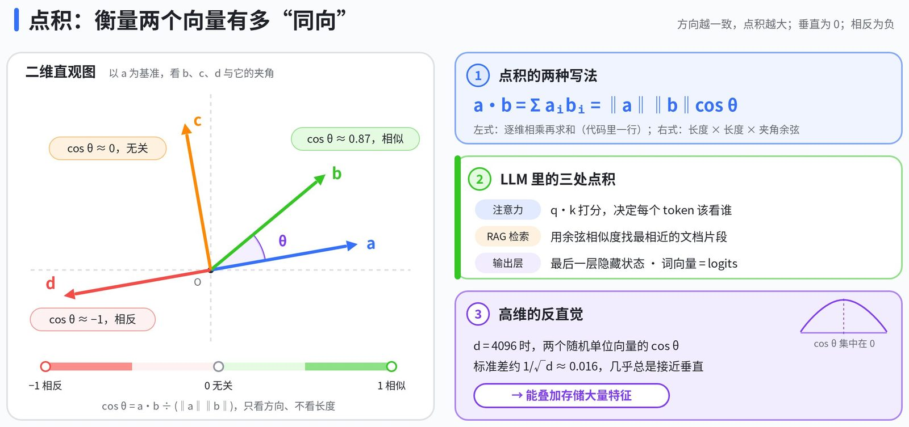

- **在 LLM 里**：注意力用查询向量和键向量的点积判断“该关注谁”；RAG 的向量检索用余弦相似度找相关文档；最后一层用隐藏状态与每个词的输出向量做点积得到 logits。
- **高维空间的反直觉**：在 4096 维空间里随机取两个单位向量，它们的余弦相似度近似服从均值 0、标准差 $`1/\sqrt{d}\approx0.016`$ 的分布，也就是**几乎总是接近垂直**。这意味着高维空间能容纳大量“互不干扰”的方向，模型可以在同一个向量里叠加存储许多特征，这是可解释性研究中“叠加（superposition）”现象的几何基础[[3]](https://arxiv.org/abs/2209.10652)。
- **范数**：$`\|\mathbf{x}\|_2=\sqrt{\sum_ix_i^2}`$ 是向量长度。RMSNorm 把向量缩放到固定的均方根，梯度裁剪把梯度的范数限制在阈值内（第 6 章）。

### 2.2 矩阵乘法：一切计算的底座

矩阵乘法 $`C=AB`$ 要求 A 的列数等于 B 的行数：$`A\in\mathbb{R}^{m\times k}`$、$`B\in\mathbb{R}^{k\times n}`$，得到 $`C\in\mathbb{R}^{m\times n}`$，其中 $`C_{ij}=\sum_{l}A_{il}B_{lj}`$，即 A 的第 i 行与 B 的第 j 列做点积。每个输出元素需要 k 次乘法和 k 次加法，所以**总计算量是 **$`2mkn`$<b> 次浮点运算（FLOPs）</b>，这个数是后面所有算力估算的起点。

理解矩阵乘法有两种视角，LLM 里都会用到：

- **批量点积**：$`QK^{\top}`$ 就是把每个查询和每个键两两做点积，一次算出 n×n 的分数表。
- **线性变换**：向量乘以矩阵 $`\mathbf{x}W`$ 是把向量从一个空间映射到另一个空间，比如 $`W_Q\in\mathbb{R}^{8192\times8192}`$ 把隐藏状态映射成“查询”。一个 Transformer 层可以看成：一串线性变换，中间夹着 softmax、激活函数、归一化这些非线性操作。没有非线性，叠多少层都等价于一个矩阵。

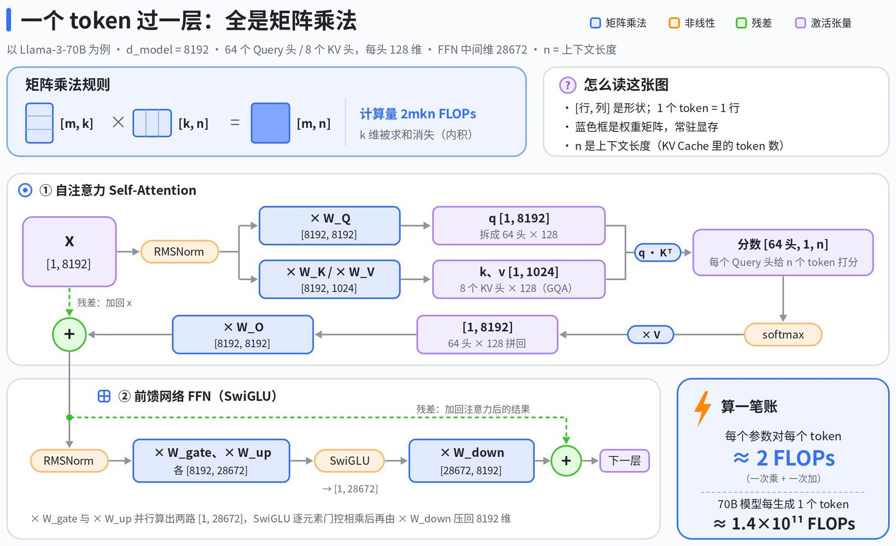

> 📊 <b>例题：一个 token 过一层 FFN 要多少 FLOPs？</b>Llama-3.1-70B 的 FFN 是 SwiGLU 结构，有三个矩阵：$`W_{\text{gate}},W_{\text{up}}\in\mathbb{R}^{8192\times28672}`$、$`W_{\text{down}}\in\mathbb{R}^{28672\times8192}`$[[2]](https://arxiv.org/abs/2407.21783)。
>
> - 一个 token 的向量形状是 `[1, 8192]`，乘一个 8192×28672 矩阵需要 $`2\times8192\times28672\approx4.7\times10^8`$ FLOPs。
> - 三个矩阵合计约 $`1.4\times10^9`$ FLOPs，恰好是 FFN 参数量（约 7.05 亿）的 2 倍。
> - 推广：**前向传播中，每个参数对每个 token 贡献约 2 次浮点运算**，所以 70B 模型生成 1 个 token 约需 $`1.4\times10^{11}`$ FLOPs（不计注意力中与序列长度相关的部分）。这就是第 8 章“推理约 2N、训练约 6N”的来源。

**批量与张量**：实际计算中数据形状是 `[B, n, d]`（批大小、序列长度、隐藏维度），多头注意力是 `[B, h, n, d_k]`。框架把最后两维当矩阵、前面的维度当“批”，并行做很多个矩阵乘法。读代码时最实用的工具是 `einsum`，例如注意力分数写成 `einsum("bhqd,bhkd->bhqk", Q, K)`，下标直接说明了哪一维被求和（d 消失了）。

**结合律带来的算法差异**：矩阵乘法满足结合律 $`(AB)C=A(BC)`$，但两种顺序的计算量可以差很多。标准注意力先算 $`(QK^{\top})`$ 得到 n×n 矩阵，代价 $`O(n^2d)`$；线性注意力去掉 softmax（或用核函数近似）后改成 $`Q(K^{\top}V)`$，$`K^{\top}V`$ 只有 d×d，代价降到 $`O(nd^2)`$，长度增长时计算量只线性增加[[4]](https://arxiv.org/abs/2006.16236)。Mamba、Gated DeltaNet 等线性注意力 / 状态空间模型的核心就是这个换序，再加上门控和衰减[[5]](https://arxiv.org/abs/2312.00752)。

### 2.3 秩与低秩分解：LoRA 与 MLA 的数学

矩阵的**秩**是它的行（或列）里线性无关的最大个数，直观上是“这个线性变换真正用到了几个独立方向”。一个 d×k 矩阵如果秩只有 r（r 远小于 d、k），它就可以精确写成两个瘦矩阵的乘积：

```math
W=BA,\quad B\in\mathbb{R}^{d\times r},\ A\in\mathbb{R}^{r\times k}
```

参数量从 $`dk`$ 降到 $`r(d+k)`$。任意矩阵都可以用<b>奇异值分解（SVD）</b> $`W=U\Sigma V^{\top}`$ 拆成“旋转 × 缩放 × 旋转”，其中 Σ 的对角线是按从大到小排列的奇异值；只保留前 r 个奇异值，就得到在误差意义上最好的秩 r 近似（Eckart–Young 定理）[[6]](https://doi.org/10.1007/BF02288367)。

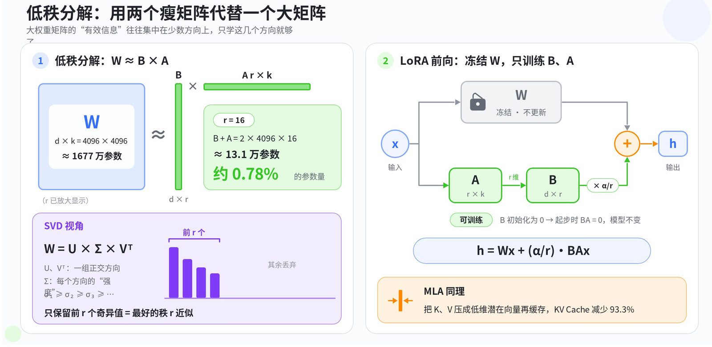

- **LoRA**：假设微调带来的权重变化 $`\Delta W`$ 是低秩的，只训练 $`\Delta W=BA`$，推理时用 $`W+\frac{\alpha}{r}BA`$[[7]](https://arxiv.org/abs/2106.09685)。以 4096×4096 的投影矩阵、r = 16 为例，可训练参数从 1677 万降到 13.1 万，约为原来的 0.78%。B 初始化为 0，保证训练开始时模型与原模型完全一致。
- <b>MLA（多头潜在注意力）</b>：DeepSeek-V2 把每个 token 的 K、V 先压缩成一个低维潜在向量再缓存，需要时再投影回来，本质是对 K、V 的投影矩阵做低秩分解，KV Cache 因此减少 93.3%[[8]](https://arxiv.org/abs/2405.04434)。
- **为什么低秩有效**：研究发现预训练模型的权重更新和很多中间表示的“有效维度”远低于名义维度[[9]](https://arxiv.org/abs/2012.13255)，这也是量化、剪枝、蒸馏能够成立的共同原因。

### 2.4 旋转矩阵：RoPE 如何编码位置

二维平面上把向量逆时针旋转角度 θ，等于乘以旋转矩阵：

```math
R(\theta)=\begin{pmatrix}\cos\theta & -\sin\theta\\ \sin\theta & \cos\theta\end{pmatrix}
```

旋转矩阵有两个关键性质：不改变向量长度；两次旋转的角度可以相加，$`R(\alpha)^{\top}R(\beta)=R(\beta-\alpha)`$。RoPE 把 d 维的查询和键向量两两分组成 d/2 个二维平面，位置 m 的 token 在第 i 个平面上旋转角度 $`m\theta_i`$，其中 $`\theta_i=b^{-2i/d}`$[[10]](https://arxiv.org/abs/2104.09864)。于是位置 m 的查询与位置 n 的键做点积时：

```math
\langle R_m\mathbf{q},\,R_n\mathbf{k}\rangle=\mathbf{q}^{\top}R_m^{\top}R_n\mathbf{k}=\mathbf{q}^{\top}R_{n-m}\mathbf{k}
```

结果只依赖相对距离 $`n-m`$，与绝对位置无关。这就是 RoPE 能表达“相对位置”的全部数学。

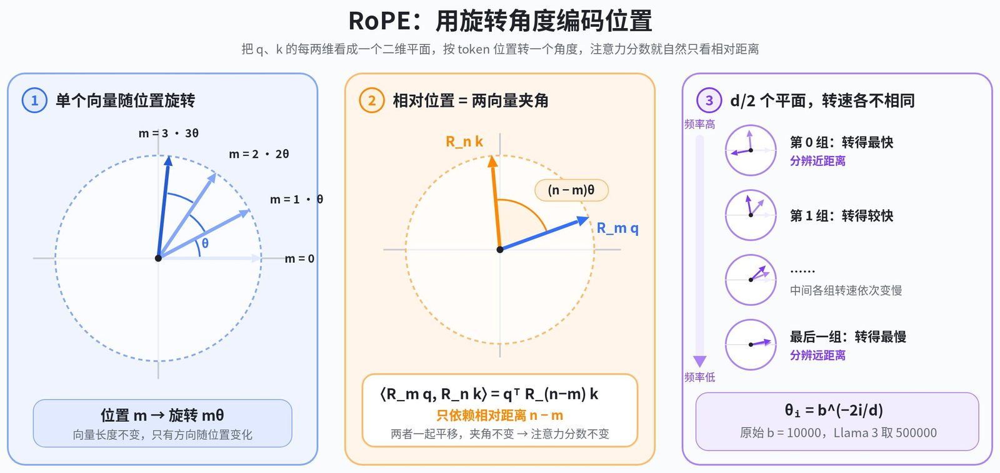

- **多种频率**：i 越小，$`\theta_i`$ 越大，旋转越快，负责分辨近距离；i 越大旋转越慢，负责远距离。原始设置 b = 10000，Llama 3 把 b 调到 500000，让最慢的维度转得更慢，以支持更长上下文[[2]](https://arxiv.org/abs/2407.21783)。
- **上下文扩展**：YaRN 等方法通过按频率分段缩放 θ，让模型在训练长度之外仍能工作[[11]](https://arxiv.org/abs/2309.00071)，本质上是在调整这组旋转频率。

> ✅ **本章掌握标准**
>
> - 能写出注意力里 Q、K、V 以及 $`QK^{\top}`$ 的形状，并算出一次矩阵乘法的 FLOPs。
> - 能解释为什么余弦相似度适合做检索，以及高维随机向量为什么近似垂直。
> - 能算出 LoRA 在给定 d、k、r 下的参数量，并说明 B 为什么初始化为 0。
> - 能用两行推导说明 RoPE 为什么只依赖相对位置。

## 第 3 章 · 概率统计：模型输出的是分布

LLM 从不直接“输出一个词”，它输出的是**词表上的一个概率分布**，然后从中选一个。所以采样参数、生成的随机性、评测分数的可信度，都是概率统计问题。

### 3.1 条件概率与链式法则：自回归的全部数学

条件概率 $`p(B\mid A)=\frac{p(A,B)}{p(A)}`$ 表示“已知 A 发生时 B 的概率”。反复使用它，任意序列的联合概率都可以拆成一串条件概率的乘积（概率的链式法则）：

```math
p(x_1,x_2,\dots,x_T)=\prod_{t=1}^{T}p(x_t\mid x_{\lt t})
```

这个等式是**精确**的，不是近似。语言模型做的事就是用一个神经网络去拟合右边的每一个因子：给定前文，预测下一个 token 的分布。生成时从这个分布中取一个 token，拼到前文后面，再预测下一个，这就是自回归生成。

- **为什么用对数**：一段 1000 个 token 的文本，概率是 1000 个小于 1 的数连乘，结果小到浮点数无法表示（下溢）。取对数后乘法变加法：$`\log p(x_{1:T})=\sum_t\log p(x_t\mid x_{\lt t})`$，数值稳定，求导也方便。论文里的 log-prob、logprobs 接口返回的都是这个量。
- **最大似然估计**：训练就是调整参数 θ，让训练数据出现的概率最大，即最大化 $`\sum_t\log p_\theta(x_t\mid x_{\lt t})`$。加上负号就是最小化 loss，它正好等于第 4 章的交叉熵。

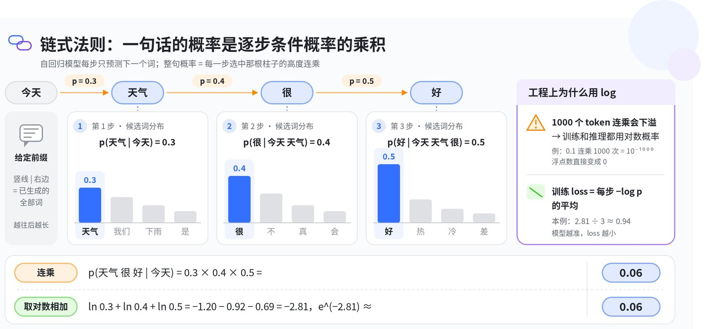

### 3.2 softmax：从分数到概率

模型最后一层对词表里每个 token 输出一个实数分数，叫 **logit**，可正可负。softmax 把它们变成和为 1 的概率：

```math
p_i=\mathrm{softmax}(\mathbf{z})_i=\frac{e^{z_i/T}}{\sum_je^{z_j/T}}
```

其中 T 是温度。指数函数保证结果为正，并且放大分数之间的差距；分母做归一化。softmax 只关心分数之间的**差**：所有 logit 同时加一个常数，结果不变，这个性质在第 7 章用来防止溢出。

> 📊 **例题：温度怎样改变分布**。假设只有三个候选 token，logits 为 [2, 1, 0]。
>
> - **T = 1**：$`e^2,e^1,e^0=7.39,2.72,1`$，和为 11.11，概率为 <b>[0.665, 0.245, 0.090]</b>。
> - **T = 0.5**：相当于 logits 变成 [4, 2, 0]，概率为 <b>[0.867, 0.117, 0.016]</b>，分布变“尖”，更确定。
> - **T = 2**：相当于 logits 变成 [1, 0.5, 0]，概率为 <b>[0.506, 0.307, 0.186]</b>，分布变“平”，更随机。
> - **T → 0**：概率全部集中到最大的那个，等价于贪心解码。

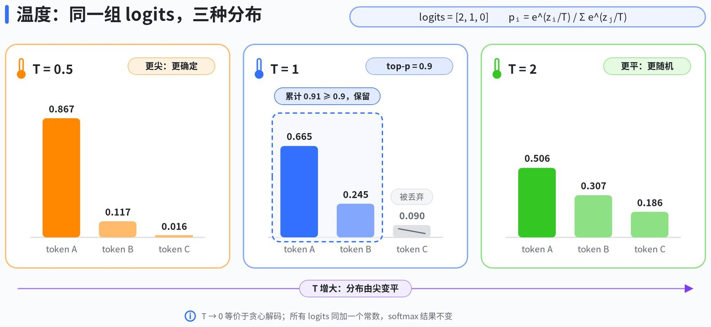

**其他采样参数的数学**：

- **top-k**：只保留概率最大的 k 个 token，重新归一化后采样。
- <b>top-p（核采样）</b>：按概率从大到小累加，保留累计概率刚超过 p 的最小集合[[12]](https://arxiv.org/abs/1904.09751)。上例 T = 1 时，p = 0.9 需要保留前两个（0.665 + 0.245 = 0.91），第三个被丢掉。
- **min-p**：只保留概率不低于“最大概率 × p”的 token，阈值随分布的确定程度自动调整[[13]](https://arxiv.org/abs/2407.01082)。
- **重复惩罚**：对已出现过的 token 的 logit 做缩小或减去一个值，本质是修改 softmax 的输入。

### 3.3 期望、方差与 $`\sqrt{d_k}`$ 从哪来

期望 $`\mathbb{E}[X]`$ 是加权平均值，方差 $`\mathrm{Var}(X)=\mathbb{E}[(X-\mathbb{E}X)^2]`$ 衡量波动大小。两个常用性质：独立随机变量之和的方差等于方差之和；随机变量乘以常数 c，方差变成 $`c^2`$ 倍。

用这两条就能推出注意力公式里的缩放因子。假设查询 q 和键 k 的每个分量独立、均值为 0、方差为 1，那么点积 $`\mathbf{q}\cdot\mathbf{k}=\sum_{i=1}^{d_k}q_ik_i`$ 是 $`d_k`$ 个方差为 1 的项之和，**方差为 **$`d_k`$，标准差为 $`\sqrt{d_k}`$。当 $`d_k=128`$ 时，分数的典型大小在 ±11 左右，softmax 会几乎把全部概率给最大的那一项，梯度接近 0，训练变慢。除以 $`\sqrt{d_k}`$ 后方差回到 1，这就是 $`\mathrm{softmax}(QK^{\top}/\sqrt{d_k})`$ 的由来[[1]](https://arxiv.org/abs/1706.03762)。

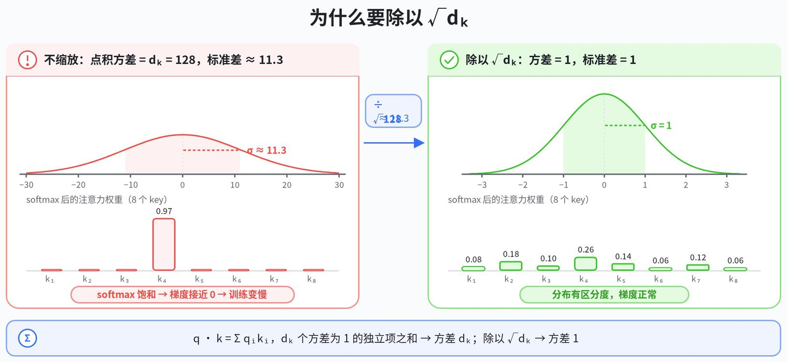

同样的“保持方差稳定”思路贯穿整个网络设计：参数初始化让每层输出的方差不随层数放大或缩小[[14]](https://proceedings.mlr.press/v9/glorot10a.html)；GPT-2 把残差分支的输出投影按 $`1/\sqrt{N}`$ 缩放（N 为残差层数），避免残差流越加越大[[15]](https://cdn.openai.com/better-language-models/language_models_are_unsupervised_multitask_learners.pdf)；归一化层则直接把每个 token 的向量拉回固定尺度（6.5）。

### 3.4 蒙特卡洛估计：用采样代替求和

很多量无法精确计算，只能采样估计。**用 n 个样本的平均值估计期望**，误差按 $`1/\sqrt{n}`$ 下降：想把误差减半，需要 4 倍样本。LLM 里有三处典型应用：

- **强化学习**：策略梯度需要对“所有可能的回答”求期望，实际做法是对每道题采样一组回答来估计（第 9 章）。GRPO 每题采样 8 到 64 个回答，就是在用样本数换估计精度。
- **pass@k**：从模型采样 n 次（n ≥ k），其中 c 次正确，无偏估计为 $`\text{pass@}k=1-\binom{n-c}{k}\Big/\binom{n}{k}`$[[16]](https://arxiv.org/abs/2107.03374)。直接用“采 k 次看有没有对的”方差很大，所以论文通常采样 n = 100 或更多次再用这个公式。
- **投机解码**：草稿模型给出候选 token，目标模型以 $`\min(1,\,p(x)/q(x))`$ 的概率接受，拒绝时从修正后的分布 $`\max(0,p-q)`$ 重新采样。可以证明这样得到的 token 分布与直接用目标模型采样**完全相同**，所以投机解码是无损加速[[17]](https://arxiv.org/abs/2211.17192)。若每个候选的接受率为 α、一次提议 γ 个，每轮期望产出 $`(1-\alpha^{\gamma+1})/(1-\alpha)`$ 个 token。

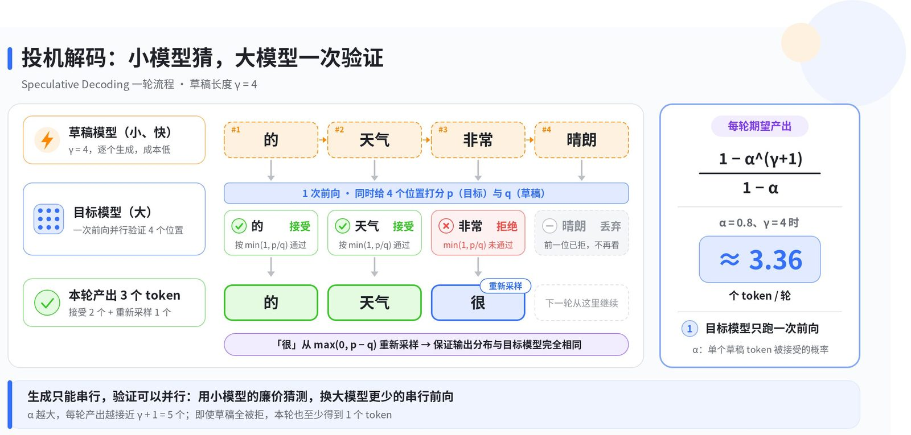

### 3.5 标准误与置信区间：评测分数可信吗

在 n 道题上测得准确率 p，这个数本身是一个随机变量。把每道题看作一次成功概率为 p 的伯努利试验，准确率的**标准误**为：

```math
\mathrm{SE}=\sqrt{\frac{p(1-p)}{n}}
```

95% 置信区间约为 $`p\pm1.96\,\mathrm{SE}`$。例如在 500 道题上测得 80%，$`\mathrm{SE}=\sqrt{0.8\times0.2/500}\approx1.8\%`$，置信区间约为 76.5% 到 83.5%。**两个模型差 2 个百分点，在 500 题的基准上基本说明不了问题**。Anthropic 的研究建议评测报告都附上标准误，并在比较两个模型时使用配对检验（同一道题上两个模型的结果相关，配对后方差更小）[[18]](https://arxiv.org/abs/2411.00640)。

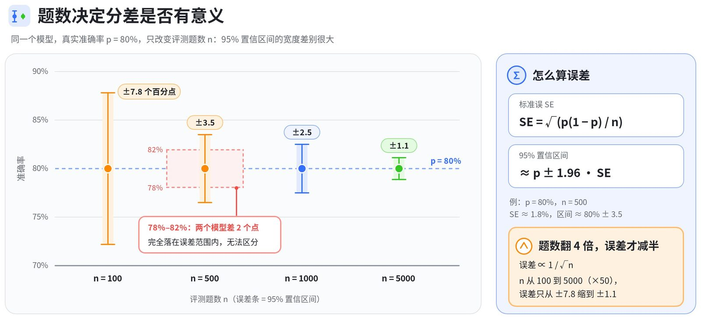

> ❗ **常见误读**：一次运行的结果不是模型的“真实分数”。开着采样（T 大于 0）的模型每次运行结果不同，Agent 基准的方差更大。看到分差时先问三件事：题目有多少道？跑了几次？标准误是多少？

> ✅ **本章掌握标准**
>
> - 能写出序列概率的链式分解，并解释为什么训练和推理都用对数概率。
> - 给定 logits 和温度，能手算 softmax，并说出 top-p = 0.9 会保留哪些 token。
> - 能从“独立同分布之和的方差”推出 $`\sqrt{d_k}`$ 缩放。
> - 给定题数和准确率，能算出标准误并判断两个模型的分差是否有意义。

## 第 4 章 · 信息论：loss 到底在度量什么

预训练 loss、困惑度、蒸馏、RLHF 的 KL 惩罚，本质上都是信息论的几个量。理解它们，就能读懂 loss 曲线，也能明白“预测即压缩”这句话的意思[[19]](https://people.math.harvard.edu/~ctm/home/text/others/shannon/entropy/entropy.pdf)。

### 4.1 信息量与熵

一个概率为 p 的事件发生时，带来的**信息量**是 $`-\log p`$：越意外的事件信息量越大，必然发生的事件信息量为 0。以 2 为底时单位是比特（bit），以 e 为底时单位是奈特（nat），深度学习框架默认用自然对数。

一个分布的**熵**是信息量的期望，衡量“平均有多不确定”：

```math
H(p)=-\sum_xp(x)\log p(x)
```

- 全部概率集中在一个 token 上时，熵为 0，完全确定。
- 在 V 个 token 上均匀分布时，熵最大，为 $`\log V`$。词表 128K 时约 11.8 nat，即 17 bit。
- 第 3 章例题中 T = 1 的分布 [0.665, 0.245, 0.090]，熵约 0.83 nat。降低温度，熵变小。

在推理模型的强化学习中，**策略熵**是一个被重点监控的指标：熵下降过快意味着模型过早地只会一种解法、失去探索能力，训练会停滞[[20]](https://arxiv.org/abs/2505.22617)。

### 4.2 交叉熵：预训练 loss 就是它

数据的真实分布是 p，模型给出的分布是 q。用 q 来编码来自 p 的数据，平均需要的信息量叫**交叉熵**：

```math
H(p,q)=-\sum_xp(x)\log q(x)
```

训练时，每个位置的“真实分布”是 one-hot：正确的下一个 token 概率为 1，其余为 0。求和只剩一项，交叉熵退化为 $`-\log q(\text{正确 token})`$，也就是 3.1 的负对数似然。语言模型的 loss 就是所有位置上这个值的平均。

> 📊 **例题：读懂 loss 数值**
>
> - 模型给正确 token 的概率是 0.665，这一位置的 loss 为 $`-\ln0.665\approx0.41`$；概率 0.1 时 loss 为 2.30；概率 0.01 时 loss 为 4.61。
> - 随机初始化的模型在 128K 词表上接近均匀分布，初始 loss 约为 $`\ln128256\approx11.8`$。训练一开始 loss 若明显高于这个值，通常是初始化或数据有问题。
> - 大模型预训练结束时的 loss 通常在 1.5 到 2.5 之间，但**不同分词器、不同数据集之间的 loss 不能直接比较**：词表越大，每个 token 承载的文本越多，单个 token 的 loss 自然越高。跨模型比较时用“每字节比特数”（bits per byte）更公平。

### 4.3 困惑度：loss 的另一种写法

**困惑度**（perplexity）是平均交叉熵的指数：

```math
\mathrm{PPL}=\exp\Big(-\frac{1}{T}\sum_{t=1}^{T}\log q(x_t\mid x_{\lt t})\Big)
```

它的直观含义是“模型平均在多少个候选之间犹豫”。loss 为 2.0 对应困惑度 $`e^2\approx7.4`$，相当于每一步在约 7 个等可能的候选里选。均匀分布时困惑度等于词表大小。loss 下降 0.1，困惑度下降约 10%。

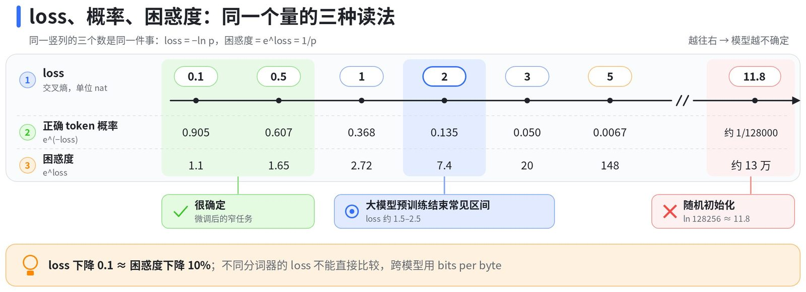

### 4.4 KL 散度：两个分布差多远

交叉熵可以拆成两部分：

```math
H(p,q)=H(p)+D_{\text{KL}}(p\,\|\,q),\qquad D_{\text{KL}}(p\,\|\,q)=\sum_xp(x)\log\frac{p(x)}{q(x)}
```

$`H(p)`$ 是数据本身的熵，与模型无关，是 loss 不可能低于的下限（对应缩放定律中的不可约项 E，见 8.4）。**最小化交叉熵等价于最小化 KL 散度**，即让模型分布尽量接近数据分布。KL 散度总是大于等于 0，当且仅当两个分布相同时为 0。它**不对称**：$`D_{\text{KL}}(p\|q)\neq D_{\text{KL}}(q\|p)`$，两个方向的行为不同：

| 方向 | 行为 | LLM 里的使用 |
|---|---|---|
| 前向 $`D_{\text{KL}}(p\\|q)`$ | p 有概率的地方 q 必须覆盖，否则惩罚极大；结果 q 倾向于“铺开”，覆盖所有模式。 | 预训练与 SFT（交叉熵）、传统的知识蒸馏。 |
| 反向 $`D_{\text{KL}}(q\\|p)`$ | q 只需落在 p 的高概率区域；结果 q 倾向于“挑一个模式”，更集中。 | RLHF 与 GRPO 中约束策略不偏离参考模型；部分蒸馏方法用它避免学生模型胡乱覆盖[[21]](https://arxiv.org/abs/2306.08543)。 |

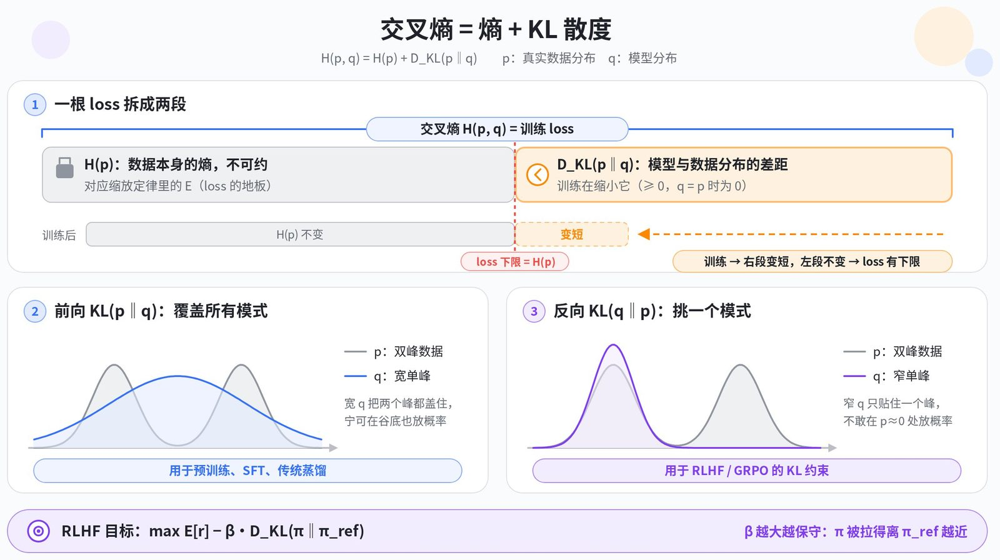

**在后训练里**：RLHF 的目标是“奖励尽量高，同时别离原模型太远”，写成 $`\max_\pi\ \mathbb{E}[r(x,y)]-\beta\,D_{\text{KL}}(\pi\,\|\,\pi_{\text{ref}})`$[[22]](https://arxiv.org/abs/2203.02155)。β 越大模型越保守；β 太小，模型会找到奖励模型的漏洞（奖励黑客），输出变得怪异。DPO 正是从这个目标的解析解推导出来的（第 9 章）。

### 4.5 预测即压缩

信息论的一个经典结论是：用一个概率模型配合算术编码压缩数据，平均每个符号需要的比特数就是交叉熵。所以**loss 越低的语言模型，就是越好的文本压缩器**。DeepMind 的实验显示，Chinchilla 70B 作为压缩器，在文本上的压缩率超过 gzip 等通用算法，甚至在图像和音频上也优于专用的 PNG 和 FLAC（计入模型大小后结论会不同）[[23]](https://arxiv.org/abs/2309.10668)。这为“预训练在学习世界的规律”提供了一个可量化的视角：压缩得越好，说明模型捕捉到的规律越多。

> ✅ **本章掌握标准**
>
> - 能说明为什么 one-hot 标签下交叉熵等于负对数似然。
> - 看到 loss = 2.0，能换算出困惑度，并说出随机初始化时 loss 大约是多少。
> - 能写出 $`H(p,q)=H(p)+D_{\text{KL}}`$，并解释 loss 为什么有下限。
> - 能说出前向 KL 与反向 KL 的行为差别，以及 RLHF 中 β 的作用。

## 第 5 章 · 微积分：反向传播就是链式法则

训练需要知道“每个参数往哪个方向调、调多少，loss 会下降”。这个问题的答案是梯度，计算梯度的算法是反向传播。需要的微积分只有三样：导数、偏导数与梯度、链式法则。

### 5.1 导数与梯度

- **导数**$`f'(x)=\lim_{h\to0}\frac{f(x+h)-f(x)}{h}`$：x 变化一点点时，f 变化多少。它是“局部斜率”。
- **偏导数**$`\frac{\partial L}{\partial w_i}`$：多元函数中，只让 $`w_i`$ 变化、其他参数不变时 L 的变化率。
- **梯度**$`\nabla_\theta L=\big(\frac{\partial L}{\partial\theta_1},\dots,\frac{\partial L}{\partial\theta_N}\big)`$：所有偏导数组成的向量，形状与参数相同。它指向 L **上升最快**的方向，所以沿负梯度方向走，loss 下降最快。

几个必须记住的导数：$`(x^n)'=nx^{n-1}`$；$`(e^x)'=e^x`$；$`(\ln x)'=1/x`$；$`\sigma'(x)=\sigma(x)(1-\sigma(x))`$；ReLU 的导数在正半轴为 1、负半轴为 0。

### 5.2 链式法则与计算图

如果 $`y=f(u)`$、$`u=g(x)`$，那么 $`\frac{dy}{dx}=\frac{dy}{du}\cdot\frac{du}{dx}`$。神经网络是几百层函数的复合，链式法则告诉我们：**最终 loss 对任意参数的梯度，等于沿路径上每一步局部导数的乘积**。

框架把计算记录成一张**计算图**：每个节点是一个简单操作（加、乘、矩阵乘、softmax），它只需要知道自己的局部导数。反向传播从 loss 出发，沿图倒着走，每个节点把收到的“上游梯度”乘以自己的局部导数，传给下游[[24]](https://doi.org/10.1038/323533a0)。一个节点被多处使用时，梯度相加。

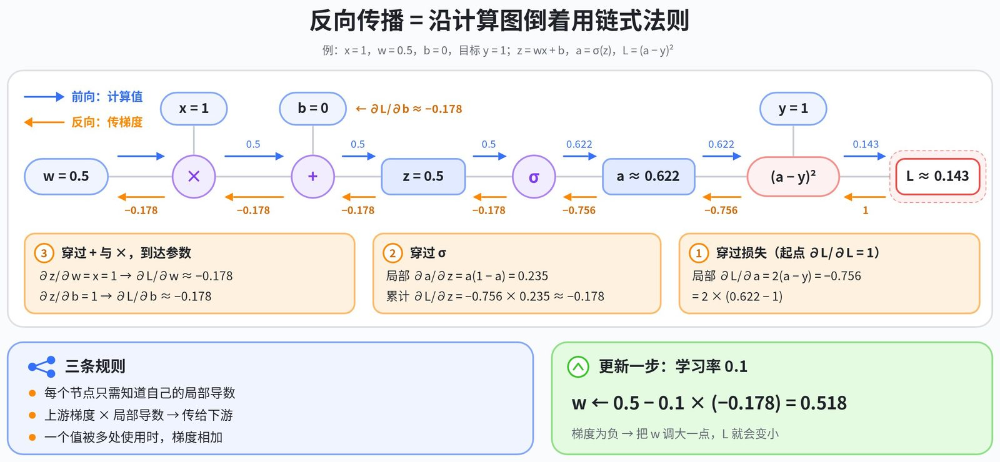

> 📊 **例题：手算一次反向传播**。单个神经元 $`z=wx+b`$、$`a=\sigma(z)`$、$`L=(a-y)^2`$，取 x = 1、w = 0.5、b = 0、y = 1。
>
> - **前向**：z = 0.5，$`a=\sigma(0.5)\approx0.622`$，$`L=(0.622-1)^2\approx0.143`$。
> - **反向**：$`\frac{\partial L}{\partial a}=2(a-y)=-0.756`$；$`\frac{\partial a}{\partial z}=a(1-a)=0.235`$；$`\frac{\partial z}{\partial w}=x=1`$。
> - 相乘得 $`\frac{\partial L}{\partial w}\approx-0.178`$，为负，说明增大 w 会让 loss 下降。学习率 0.1 时，w 更新为 $`0.5+0.0178=0.518`$。
>
> 把这个过程交给代码自动完成，就是 PyTorch 的 autograd。Karpathy 的 micrograd 用约 100 行 Python 实现了完整的自动微分，是理解反向传播最好的材料[[25]](https://github.com/karpathy/micrograd)。

### 5.3 最重要的一个梯度：softmax + 交叉熵

语言模型最后一步是 logits → softmax → 交叉熵。设 logits 为 z、softmax 输出为 p、正确 token 的 one-hot 向量为 y，loss 对 logits 的梯度有一个极其简洁的形式：

```math
\frac{\partial L}{\partial\mathbf{z}}=\mathbf{p}-\mathbf{y}
```

**推导**：$`L=-\log p_c=-z_c+\log\sum_je^{z_j}`$（c 为正确 token）。对 $`z_i`$ 求导，第一项贡献 $`-\mathbf{1}[i=c]`$，第二项贡献 $`\frac{e^{z_i}}{\sum_je^{z_j}}=p_i`$，合起来就是 $`p_i-y_i`$。

含义很直观：正确 token 的 logit 收到的梯度是 $`p_c-1`$（为负，所以被推高），其他 token 收到 $`p_i`$（为正，被压低），压低的力度与模型给它的概率成正比。模型越自信地犯错，梯度越大。这也是框架提供融合的 `cross_entropy(logits, target)` 而不建议先 softmax 再取 log 的原因：融合实现直接算 $`\mathbf{p}-\mathbf{y}`$，又快又稳定。

### 5.4 梯度消失、梯度爆炸与残差连接

链式法则意味着深层网络的梯度是很多个局部导数的**连乘**。如果每层的导数都略小于 1（比如 0.9），100 层后只剩 $`0.9^{100}\approx2.7\times10^{-5}`$，前面的层几乎学不到东西，这是**梯度消失**；略大于 1 则会指数爆炸。

残差连接 $`\mathbf{h}_{l+1}=\mathbf{h}_l+F(\mathbf{h}_l)`$ 解决了这个问题[[26]](https://arxiv.org/abs/1512.03385)。对它求导：

```math
\frac{\partial\mathbf{h}_{l+1}}{\partial\mathbf{h}_l}=I+\frac{\partial F}{\partial\mathbf{h}_l}
```

无论 F 的导数多小，总有一个单位矩阵 I 让梯度原样通过。整个网络的梯度里包含一条“直通路径”，从 loss 一路无衰减地传到第一层。这是 Transformer 能堆到上百层的根本原因；把归一化放在残差分支内部（Pre-Norm）而不是主干上，就是为了保护这条直通路径[[27]](https://arxiv.org/abs/2002.04745)。

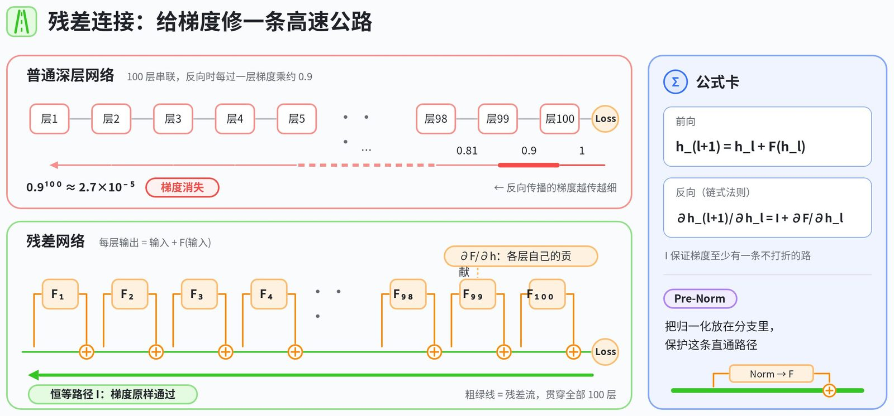

### 5.5 读论文时会遇到的矩阵求导

矩阵形式的梯度看起来复杂，其实只需记住一个规则：**梯度的形状与变量相同，用形状来凑公式**。对 $`Y=XW`$（X 为 `[n, d]`，W 为 `[d, k]`），已知上游梯度 $`G=\partial L/\partial Y`$（`[n, k]`）：

- $`\partial L/\partial W=X^{\top}G`$，形状 `[d, n] × [n, k] = [d, k]`，与 W 相同。
- $`\partial L/\partial X=GW^{\top}`$，形状 `[n, k] × [k, d] = [n, d]`，与 X 相同。

于是反向传播对每个矩阵乘法需要做**两次**同样规模的矩阵乘法（一次算权重梯度，一次算输入梯度），这就是“反向的计算量约为前向 2 倍、训练总计约 6N”的来源（8.1）。系统学习矩阵求导，推荐 Parr 和 Howard 的教程[[28]](https://arxiv.org/abs/1802.01528)。

> ✅ **本章掌握标准**
>
> - 能对 $`L=(\sigma(wx+b)-y)^2`$ 手算一步梯度并更新参数。
> - 能推导 softmax + 交叉熵的梯度 $`\mathbf{p}-\mathbf{y}`$，并解释它的直观含义。
> - 能用链式法则解释梯度消失，以及残差连接为什么能缓解。
> - 能用形状推出 $`Y=XW`$ 的两个梯度，并说明反向约为前向 2 倍计算量的原因。

## 第 6 章 · 优化：从梯度下降到 Adam 与 Muon

有了梯度，还要决定“每一步走多远、往哪走”。预训练配置文件里的学习率、β1、β2、权重衰减、warmup、梯度裁剪，都属于这一章。

### 6.1 梯度下降与随机梯度下降

最基本的更新规则是：

```math
\theta_{t+1}=\theta_t-\eta\,\nabla_\theta L(\theta_t)
```

η 是学习率。在全部数据上算梯度太贵，实践中每一步只取一小批数据（mini-batch）估计梯度，这是<b>随机梯度下降（SGD）</b>。小批梯度是全量梯度的无偏估计，噪声随批大小增大而减小（又是 3.4 的 $`1/\sqrt{n}`$）。LLM 预训练的批大小通常以 token 计，达到每步数百万到数千万 token。

- **学习率太大**：loss 震荡甚至发散（出现 NaN 或 loss 突然飙升）。
- **学习率太小**：收敛慢，算力浪费。
- **批大小与学习率**：批越大、梯度噪声越小，可以用更大的学习率，但超过“临界批大小”后收益递减[[29]](https://arxiv.org/abs/1812.06162)。

### 6.2 动量与 Adam

**动量**把过去的梯度做指数移动平均，像小球滚下山坡时的惯性，能穿过狭窄的山谷、减少来回震荡。**Adam** 在动量之外，再为每个参数维护梯度平方的移动平均，用它来归一化步长[[30]](https://arxiv.org/abs/1412.6980)：

```math
\mathbf{m}_t=\beta_1\mathbf{m}_{t-1}+(1-\beta_1)\mathbf{g}_t,\qquad\mathbf{v}_t=\beta_2\mathbf{v}_{t-1}+(1-\beta_2)\mathbf{g}_t^2
```

```math
\hat{\mathbf{m}}_t=\frac{\mathbf{m}_t}{1-\beta_1^t},\quad\hat{\mathbf{v}}_t=\frac{\mathbf{v}_t}{1-\beta_2^t},\qquad\theta_{t+1}=\theta_t-\eta\,\frac{\hat{\mathbf{m}}_t}{\sqrt{\hat{\mathbf{v}}_t}+\epsilon}
```

- <b>m（一阶矩）</b>：平滑后的梯度方向。
- <b>v（二阶矩）</b>：每个参数梯度的典型大小。除以 $`\sqrt{v}`$ 后，梯度一直很大的参数步长被压小，梯度一直很小的参数步长被放大，每个参数都有“自己的学习率”。
- **偏差修正**：m、v 从 0 开始，前几步会被低估，除以 $`1-\beta^t`$ 纠正。
- **AdamW**：把权重衰减从梯度中分离出来，直接做 $`\theta\leftarrow\theta-\eta\lambda\theta`$[[31]](https://arxiv.org/abs/1711.05101)。这是今天 LLM 训练的默认优化器，典型配置为 $`\beta_1=0.9`$、$`\beta_2=0.95`$、$`\lambda=0.1`$[[32]](https://arxiv.org/abs/2307.09288)。β2 取 0.95 而不是默认的 0.999，是为了让 v 更快跟上梯度的变化，减少大模型训练中的 loss 尖峰。

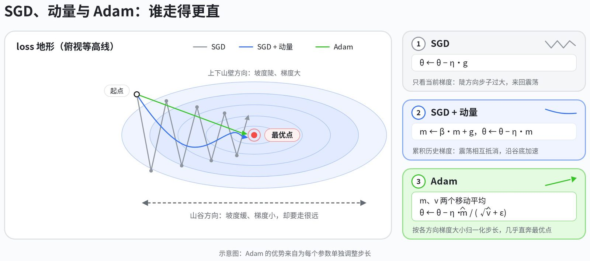

> 📊 **例题：Adam 为什么吃显存**。混合精度训练中，每个参数要存：BF16 权重 2 字节、BF16 梯度 2 字节、FP32 主权重 4 字节、FP32 的 m 和 v 各 4 字节，合计 **16 字节**[[33]](https://arxiv.org/abs/1910.02054)。一个 70B 模型光是这些状态就需要 $`70\times10^9\times16=1.12`$ TB，还没算激活值。这就是为什么训练必须用 ZeRO / FSDP 把优化器状态切分到多张卡上（见配套文档 4.4）。推理只需要权重，BF16 下每参数 2 字节，70B 模型约 140 GB。

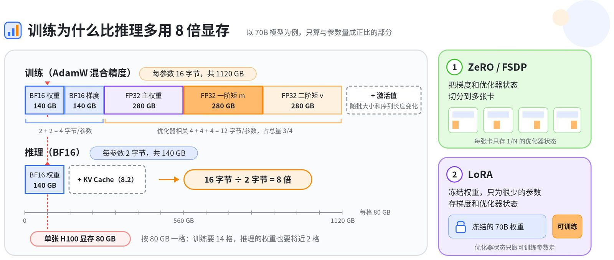

### 6.3 学习率调度

学习率随训练步数变化，画出来是一条曲线：

- **Warmup**：前几百到几千步从接近 0 线性升到峰值。训练初期 Adam 的 v 估计不准、参数处在随机状态，直接用大学习率容易发散。
- **余弦衰减**：峰值之后按余弦曲线降到峰值的 10% 左右，是 GPT-3、Llama 系列长期使用的方案[[34]](https://arxiv.org/abs/2005.14165)。缺点是必须事先确定总步数。
- <b>WSD（预热—稳定—衰减）</b>：大部分时间保持恒定学习率，最后 10% 到 20% 的步数快速衰减[[35]](https://arxiv.org/abs/2404.06395)。好处是可以随时从“稳定阶段”的检查点分叉出去做衰减，得到不同训练量的模型，也方便继续训练。DeepSeek-V3 等近期模型采用了类似的分段方案[[36]](https://arxiv.org/abs/2412.19437)。

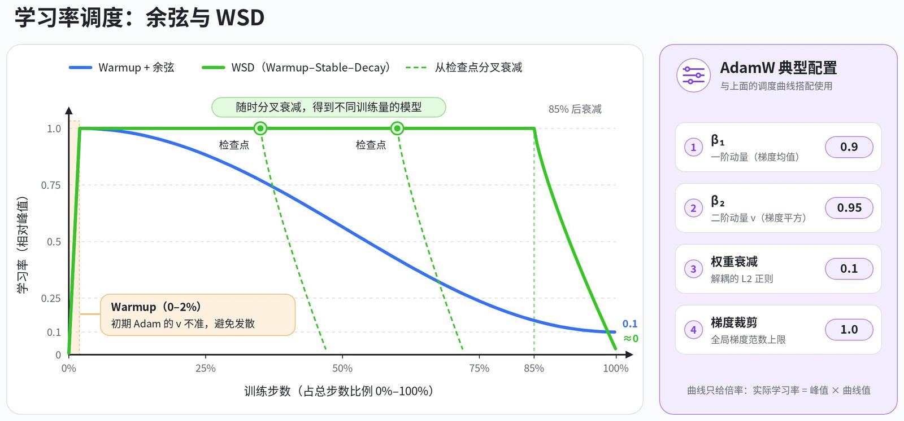

### 6.4 梯度裁剪

偶尔一批“坏数据”会产生巨大的梯度，一步就把模型推坏。梯度裁剪把整体梯度的 L2 范数限制在阈值 c 以内：

```math
\mathbf{g}\leftarrow\mathbf{g}\cdot\min\Big(1,\ \frac{c}{\|\mathbf{g}\|_2}\Big)
```

LLM 训练通常取 c = 1.0。只缩放长度、不改方向。训练监控里的 `grad_norm` 曲线是判断训练健康的重要信号：持续上升或频繁尖峰，往往先于 loss 发散出现。

### 6.5 归一化：LayerNorm 与 RMSNorm

归一化把每个 token 的向量拉回固定尺度，让每层的输入分布稳定。LayerNorm 先减均值再除以标准差[[37]](https://arxiv.org/abs/1607.06450)；今天的主流 RMSNorm 更简单，只除以均方根[[38]](https://arxiv.org/abs/1910.07467)：

```math
\mathrm{RMSNorm}(\mathbf{x})=\frac{\mathbf{x}}{\sqrt{\frac{1}{d}\sum_ix_i^2+\epsilon}}\odot\mathbf{g}
```

其中 g 是可学习的逐维缩放参数。少一次求均值，计算更快，效果与 LayerNorm 相当。Qwen3、Gemma 等模型还在注意力内部对 Q、K 各做一次归一化（QK-Norm），防止注意力分数过大导致 softmax 饱和，这与 3.3 的 $`\sqrt{d_k}`$ 缩放是同一个目的[[39]](https://arxiv.org/abs/2505.09388)。

### 6.6 新一代优化器：Muon

Adam 对每个参数**逐元素**地调整步长，没有利用“权重是矩阵”这一结构。Muon 对二维权重矩阵的动量做**正交化**：把动量矩阵 $`M=U\Sigma V^{\top}`$ 替换为 $`UV^{\top}`$，即把所有奇异值都变成 1，再用它更新参数[[40]](https://kellerjordan.github.io/posts/muon/)。直观上，这让更新在各个方向上的“力度”一样大，避免少数主方向主导更新。实际实现用 Newton–Schulz 迭代近似求 $`UV^{\top}`$，只需几次矩阵乘法，不必真做 SVD。

- Moonshot 的实验表明，Muon 在同等效果下约需 AdamW 一半左右的训练算力[[41]](https://arxiv.org/abs/2502.16982)。
- Kimi K2 用改进版 MuonClip 训练了 1T 参数的 MoE 模型，通过对 QK 权重的裁剪解决了注意力 logit 爆炸问题，全程没有出现 loss 尖峰[[42]](https://arxiv.org/abs/2507.20534)。
- 这也是第 2 章 SVD 在优化器设计中的直接应用：**线性代数不只用来描述模型，也用来设计训练算法**。

> ✅ **本章掌握标准**
>
> - 能写出 Adam 的更新公式，并说明 m、v、偏差修正各自的作用。
> - 能算出给定参数量的模型在 AdamW 混合精度训练下需要多少显存存放状态。
> - 能画出 warmup + 余弦和 WSD 两种学习率曲线，并说出 WSD 的工程优势。
> - 能解释梯度裁剪和 RMSNorm 的公式，以及 `grad_norm` 曲线异常意味着什么。

## 第 7 章 · 数值计算：公式正确，结果也可能错

数学上等价的两种写法，在计算机上可能一个正常、一个溢出成 NaN。大模型训练和推理越来越多地使用 16 位、8 位甚至 4 位数字，数值问题从“边角知识”变成了日常问题。

### 7.1 浮点数的结构

浮点数由三部分组成：符号位、指数位、尾数位，表示 $`(-1)^s\times1.\text{尾数}\times2^{\text{指数}-\text{偏置}}`$。<b>指数位决定能表示多大、多小的数（范围），尾数位决定相邻两个数之间有多密（精度）</b>。

| 格式 | 符号 / 指数 / 尾数 | 最大值 | 机器精度 ε（约） | LLM 中的用途 |
|---|---|---|---|---|
| FP32 | 1 / 8 / 23 | 约 $`3.4\times10^{38}`$ | $`1.2\times10^{-7}`$ | 主权重、优化器状态、累加 |
| FP16 | 1 / 5 / 10 | 65504 | $`9.8\times10^{-4}`$ | 早期混合精度，需 loss scaling |
| BF16 | 1 / 8 / 7 | 约 $`3.4\times10^{38}`$ | $`8\times10^{-3}`$ | 今天训练与推理的默认格式 |
| FP8 E4M3 | 1 / 4 / 3 | 448 | 0.125 | 前向的权重与激活 |
| FP8 E5M2 | 1 / 5 / 2 | 57344 | 0.25 | 反向的梯度（需要更大范围） |
| FP4 E2M1 | 1 / 2 / 1 | 6 | 只能表示 ±0、0.5、1、1.5、2、3、4、6 | 推理权重、新一代训练，必须配块缩放 |

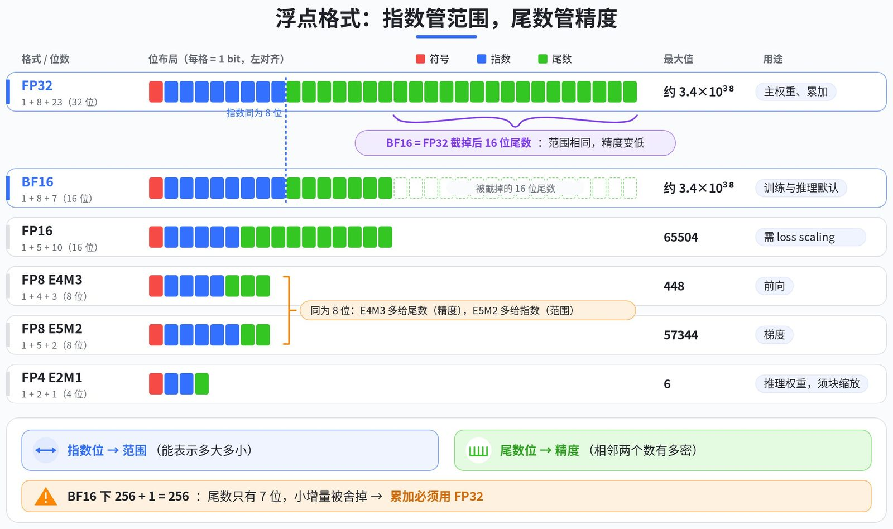

- **BF16 为什么赢了 FP16**：BF16 的指数位与 FP32 一样多，动态范围接近 FP32，相比 FP16 显著降低了范围不足导致的溢出/下溢风险，通常无需 FP16 那样的 loss scaling[（参见 Google Cloud 的 bfloat16 说明）](https://cloud.google.com/blog/products/ai-machine-learning/bfloat16-the-secret-to-high-performance-on-cloud-tpus)；但这不保证任意计算都不溢出或数值稳定。代价是精度只有约 2 到 3 位有效数字。深度学习对范围比对精度更敏感，所以 BF16 通常不需要太多额外处理就能训练[[43]](https://arxiv.org/abs/1905.12322)。FP16 最大只有 65504，梯度又常常小于它能表示的最小值，必须把 loss 放大若干倍再反向（loss scaling）[[44]](https://arxiv.org/abs/1710.03740)。
- **累加必须用高精度**：BF16 下 $`256+1=256`$，因为 257 落在两个相邻可表示数之间，被舍入掉了。矩阵乘法要累加成千上万个乘积，所以硬件用 BF16 或 FP8 做乘法，用 FP32 做累加。DeepSeek-V3 的 FP8 训练专门把累加结果定期提升到 FP32，就是为了解决这个问题[[36]](https://arxiv.org/abs/2412.19437)。

### 7.2 softmax 的数值稳定：减去最大值

直接计算 $`e^{z_i}`$，当 logit 为 100 时 $`e^{100}\approx2.7\times10^{43}`$，已经超出 FP32 范围，结果变成无穷大，再相除得到 NaN。利用 3.2 提到的“所有 logit 加同一个常数，softmax 不变”：

```math
\mathrm{softmax}(\mathbf{z})_i=\frac{e^{z_i-m}}{\sum_je^{z_j-m}},\qquad m=\max_jz_j
```

减去最大值后所有指数都 ≤ 0，$`e^{z_i-m}\le1`$，不会溢出。同理，计算 $`\log\sum_je^{z_j}`$ 时使用 **log-sum-exp 技巧**：$`\mathrm{LSE}(\mathbf{z})=m+\log\sum_je^{z_j-m}`$。交叉熵、注意力、MoE 路由中都有它。

### 7.3 在线 softmax：FlashAttention 的数学核心

标准 softmax 要先扫一遍求最大值，再扫一遍求和，再扫一遍归一化，必须把整行分数都放在显存里。**在线 softmax** 发现可以边读边更新：维护当前最大值 m 和当前的和 s，读到新的一块数据时，如果出现了更大的最大值 m′，就把旧的和乘以 $`e^{m-m'}`$ 修正后再加上新数据[[45]](https://arxiv.org/abs/1805.02867)：

```math
s'=s\cdot e^{m-m'}+\sum_{j\in\text{新块}}e^{z_j-m'}
```

这样只需扫一遍，而且可以分块算。FlashAttention 把这个技巧和“输出也按同样的比例修正”结合起来，把注意力分块放进 GPU 片上缓存计算，从不在显存中写出完整的 n×n 分数矩阵，结果与标准注意力**完全相同**[[46]](https://arxiv.org/abs/2205.14135)。这是一个“纯数学变形带来数倍加速”的典型例子。

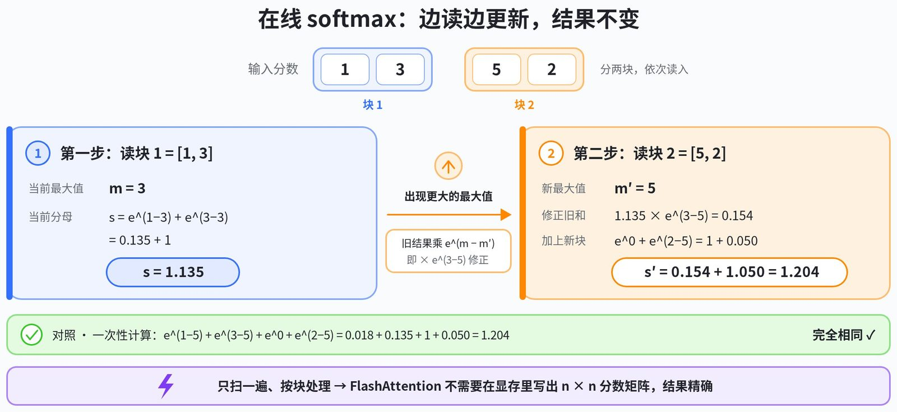

### 7.4 量化的数学

量化是把高精度数映射到低精度格式。最简单的对称整数量化：

```math
q=\mathrm{round}\Big(\frac{x}{s}\Big),\quad s=\frac{\max|x|}{2^{b-1}-1},\qquad \hat{x}=s\cdot q
```

b 是比特数，s 是缩放因子。INT8 时 $`2^{7}-1=127`$，一组数中绝对值最大的那个映射到 ±127。问题在于**离群值**：一组权重里只要有一个特别大的数，s 就被撑大，其余的数都挤在少数几个量化级别里，精度严重损失。LLM 的激活值中恰好存在系统性的离群通道[[47]](https://arxiv.org/abs/2208.07339)，应对方法都是缩小“共用一个 s 的范围”或者处理离群值：

- **分组 / 块缩放**：每 32 或 16 个数共用一个缩放因子，而不是整个矩阵共用一个。OCP 的 MXFP4 格式每 32 个元素共享一个 8 位指数缩放[[48]](https://arxiv.org/abs/2310.10537)，NVIDIA 的 NVFP4 每 16 个元素共享一个 FP8 缩放，并在张量级再加一个 FP32 缩放[[49]](https://developer.nvidia.com/blog/introducing-nvfp4-for-efficient-and-accurate-low-precision-inference/)。
- **平滑与旋转**：SmoothQuant 把激活的离群值按通道“转移”到权重上[[50]](https://arxiv.org/abs/2211.10438)；QuaRot、SpinQuant 等方法先对矩阵乘以一个正交矩阵（又是第 2 章的旋转），把离群值打散到所有维度，再量化[[51]](https://arxiv.org/abs/2404.00456)。
- **误差感知**：GPTQ 利用二阶信息逐列量化并补偿误差[[52]](https://arxiv.org/abs/2210.17323)，AWQ 保护对输出影响最大的约 1% 权重[[53]](https://arxiv.org/abs/2306.00978)。

> 📊 **例题：块缩放为什么有效**。一组 4 个权重 [0.01, 0.02, −0.015, 2.0]，用 INT4（取值 −7 到 7）对称量化。
>
> - **整组共用一个缩放**：$`s=2.0/7\approx0.286`$，前三个数除以 s 后都小于 0.5，全部被舍入成 0，信息完全丢失。
> - **把离群值单独分组**：前三个数的 $`s=0.02/7\approx0.00286`$，量化为 [4, 7, −5]，还原为 [0.0114, 0.02, −0.0143]，误差在 15% 以内。
> - 结论：<b>低比特量化的精度主要取决于“多少个数共用一个缩放因子”</b>，而不只是比特数本身。

> ✅ **本章掌握标准**
>
> - 能说出 FP16、BF16、FP8 的位分配，并解释 BF16 为什么不需要 loss scaling。
> - 能写出数值稳定的 softmax 和 log-sum-exp。
> - 能解释在线 softmax 如何只扫一遍数据，以及它与 FlashAttention 的关系。
> - 能手算一组数的对称量化，并说明离群值和块大小对误差的影响。

## 第 8 章 · 工程估算：用一张纸算出显存、算力和速度

这一章把前面的数学变成几个随手可用的估算公式。它们的精度通常在 2 倍以内，但足够回答“这个模型能不能放进这张卡”“这次训练要多少卡天”“这个服务每秒最多出多少 token”。EleutherAI 的 Transformer Math 101 和 Google DeepMind 的 How to Scale Your Model 是这类估算的权威参考[[54]](https://blog.eleuther.ai/transformer-math/)[[55]](https://jax-ml.github.io/scaling-book/)。

### 8.1 计算量：推理约 2N，训练约 6N

- **前向**：由 2.2 的例题，每个参数对每个 token 贡献约 2 FLOPs，每 token 约 $`2N`$。
- **反向**：由 5.5，每个矩阵乘法在反向时要做两次同规模的乘法，约 $`4N`$。
- **训练总量**：$`C\approx6ND`$，D 为训练 token 数[[56]](https://arxiv.org/abs/2001.08361)。MoE 模型的 N 用**激活参数**而不是总参数。
- **注意力的额外开销**：上面的估算只算了参数相关的矩阵乘法。解码到第 n 个位置时，每层的 $`QK^{\top}`$ 和 $`AV`$ 还要约 $`4nd`$ FLOPs。Llama-3.1-70B 在 128K 上下文处，这部分约为 $`4\times131072\times8192\times80\approx3.4\times10^{11}`$，是 2N（$`1.4\times10^{11}`$）的约 2.5 倍。**长上下文时注意力会反超参数成为主要开销**，这正是稀疏注意力和线性注意力要解决的问题。

### 8.2 显存：权重、KV Cache 与训练状态

| 项目 | 公式 | Llama-3.1-70B 示例 |
|---|---|---|
| 推理权重 | 参数量 × 每参数字节数 | BF16 约 140 GB；FP8 约 70 GB；4 bit 约 35 GB 加少量缩放因子 |
| KV Cache（每 token） | $`2\times L\times h_{kv}\times d_k\times`$ 字节数 | $`2\times80\times8\times128\times2=327680`$ 字节，约 320 KB |
| KV Cache（整段） | 每 token 大小 × 序列长度 × 并发数 | 128K 上下文、单个请求约 40 GB，接近权重的三分之一 |
| 训练状态 | 约 16 字节 × 参数量（6.2） | 约 1.12 TB，另加激活值 |

KV Cache 公式里的每一项都对应一种优化：减少 $`h_{kv}`$ 是 GQA，压缩成低维潜在向量是 MLA（2.3），降低字节数是 KV Cache 量化，只保留部分层或部分 token 是稀疏化与混合架构。


### 8.3 算术强度与 Roofline：为什么解码受限于带宽

一个计算任务的**算术强度**是“每从显存读 1 字节数据，能做多少次浮点运算”。GPU 有两个上限：算力峰值（FLOPs/秒）和显存带宽（字节/秒）。两者之比是“屋脊点”：

- H100 SXM 的 BF16 稠密算力约 989 TFLOPS、HBM3 带宽约 3.35 TB/s，屋脊点约 $`989/3.35\approx295`$ FLOPs/字节[[57]](https://www.nvidia.com/en-us/data-center/h100/)。
- 算术强度**低于**屋脊点的任务受带宽限制，算力闲置；**高于**屋脊点才能把算力用满[[58]](https://doi.org/10.1145/1498765.1498785)。

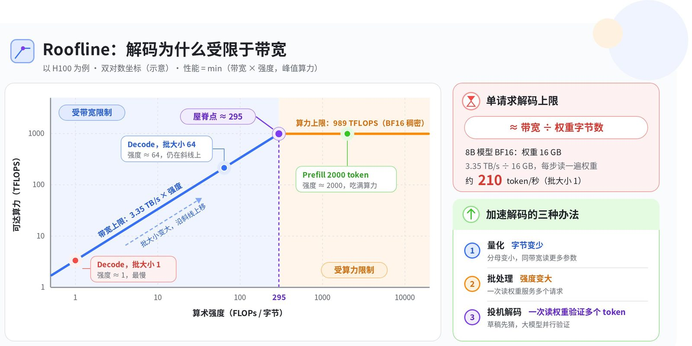

用它分析 LLM 推理的两个阶段：

- **Prefill**：一次处理 n 个 token，每个权重（2 字节）被读一次、参与 $`2n`$ 次运算，算术强度约为 n。输入 2000 个 token 时远高于 295，**受算力限制**。
- **Decode**：批大小为 B 时，每步每个权重参与 $`2B`$ 次运算，算术强度约为 B。单请求时只有 1，**严重受带宽限制**：每生成一个 token，都要把全部权重从显存读一遍。
- **速度上限**：单请求解码速度 ≤ 带宽 ÷ 权重字节数。8B 模型 BF16 约 16 GB，H100 上最多约 $`3.35\times10^{12}/1.6\times10^{10}\approx210`$ token/秒。这就是为什么量化（字节数变少）、批处理（B 变大）、投机解码（一次读权重验证多个 token）都能加速解码，而单纯换算力更强的卡帮助有限。

### 8.4 缩放定律：loss 如何随规模下降

Kaplan 等人发现，loss 与参数量、数据量、算力之间呈**幂律**关系，在双对数坐标下是直线[[56]](https://arxiv.org/abs/2001.08361)。Chinchilla 论文给出了同时考虑参数量 N 和数据量 D 的拟合形式[[59]](https://arxiv.org/abs/2203.15556)：

```math
L(N,D)=E+\frac{A}{N^{\alpha}}+\frac{B}{D^{\beta}},\qquad E=1.69,\ A=406.4,\ B=410.7,\ \alpha=0.34,\ \beta=0.28
```

- **E** 是不可约 loss，对应数据本身的熵（4.4）；后两项分别是“模型不够大”和“数据不够多”造成的损失。
- 在固定算力 $`C=6ND`$ 下直接最小化上面这条拟合式，$`10^{24}`$ FLOPs 的预算对应约 41.3B 参数、4.04T token（约每参数 98 个 token）。常说的**每个参数约 20 个 token**（$`10^{24}`$ FLOPs 时约 91B 参数、1.8T token）是 Chinchilla 论文用其他拟合方法得到的独立经验近似，并不能由此处的系数推出；具体配比还取决于拟合方法、系数精度和适用范围。
- 幂律意味着**收益递减**：loss 每降低固定的量，需要的算力成倍增加。

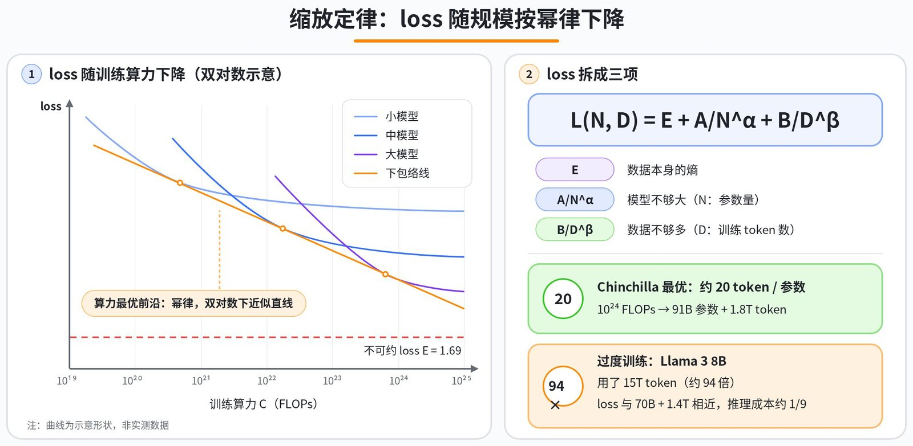

> 📊 **例题：为什么 Llama 3 8B 要训练 15T token**。按 Chinchilla 配比，8B 模型只需约 160B token，而 Llama 3 用了 15T，约为 94 倍[[2]](https://arxiv.org/abs/2407.21783)。代入上面的公式（仅作示意，原始拟合使用的数据与分词器不同）：
>
> - 70B 参数、1.4T token（Chinchilla 本身的配置）：$`L\approx1.69+0.084+0.163=1.94`$，训练算力约 $`5.9\times10^{23}`$。
> - 8B 参数、15T token：$`L\approx1.69+0.175+0.084=1.95`$，训练算力约 $`7.2\times10^{23}`$。
> - 两者 loss 和训练算力相近，但 8B 模型的推理成本约为 70B 的九分之一。**当模型要服务海量请求时，多花训练算力“过度训练”一个小模型更划算**[[60]](https://arxiv.org/abs/2401.00448)。这是今天几乎所有开放权重模型都远超 20 token/参数的原因。

> ✅ **本章掌握标准**
>
> - 给定参数量和 token 数，能估算训练 FLOPs，并换算成 GPU 小时。
> - 给定模型结构，能算出每 token 的 KV Cache 大小，以及某个上下文长度和并发下的总量。
> - 能用算术强度解释 prefill 和 decode 的瓶颈差异，并估算单请求解码速度上限。
> - 能写出 Chinchilla 公式，解释“20 token/参数”和“过度训练”的取舍。

## 第 9 章 · 后训练的数学：奖励模型、策略梯度、PPO、GRPO 与 DPO

📎 延伸阅读：这些公式在实际训练里怎么落地（GRPO 的已知问题与修法、LoRA 超参、显存估算），见 [LLM-22｜地基｜后训练实战：SFT、LoRA 与 RLVR](./22-post-training.md)。

推理模型的能力主要来自强化学习。这部分论文公式最密集，但用到的数学前面都讲过了：期望与采样（第 3 章）、KL 散度（第 4 章）、梯度（第 5 章）。

### 9.1 奖励模型：Bradley–Terry

人类标注者看两个回答，选出更好的一个。Bradley–Terry 模型假设：回答 $`y_w`$ 胜过 $`y_l`$ 的概率取决于两者“分数”之差：

```math
P(y_w\succ y_l\mid x)=\sigma\big(r(x,y_w)-r(x,y_l)\big)
```

奖励模型 r 就是用最大似然拟合这个概率，loss 为 $`-\log\sigma(r_w-r_l)`$[[22]](https://arxiv.org/abs/2203.02155)。分数只有相对意义，加一个常数不影响结果。Chatbot Arena 的排名用的也是同一个模型，Elo 分差与胜率的关系正是这条 sigmoid 曲线换了底数和尺度[[61]](https://arxiv.org/abs/2403.04132)。

### 9.2 策略梯度：让高奖励的回答更可能出现

把模型看成策略 $`\pi_\theta`$，目标是最大化期望奖励 $`J(\theta)=\mathbb{E}_{y\sim\pi_\theta}[r(y)]`$。困难在于期望对“采样出的回答”求，而采样不可导。**对数导数技巧**把梯度改写成可以用样本估计的形式[[62]](https://doi.org/10.1007/BF00992696)：

```math
\nabla_\theta J=\mathbb{E}_{y\sim\pi_\theta}\big[r(y)\,\nabla_\theta\log\pi_\theta(y)\big]
```

推导只用到 $`\nabla\pi=\pi\nabla\log\pi`$。含义很直接：采样一批回答，奖励高的就提高它的对数概率，奖励低的就降低。$`\log\pi_\theta(y)=\sum_t\log\pi_\theta(y_t\mid x,y_{\lt t})`$ 正是 3.1 的逐 token 对数概率之和，所以实现上就是“按奖励加权的交叉熵”。

- **基线与优势**：直接用奖励 r 做权重，方差很大。减去一个与动作无关的基线 b 不改变梯度的期望，却能显著降低方差。$`A=r-b`$ 叫**优势**：比平均水平好多少。
- **重要性采样**：为了复用同一批样本更新多次，用旧策略采样、更新新策略，需要乘以概率比 $`\rho=\pi_\theta(y)/\pi_{\text{old}}(y)`$ 修正分布差异。

### 9.3 PPO 与 GRPO

**PPO** 在重要性采样的基础上裁剪概率比，防止一次更新走太远[[63]](https://arxiv.org/abs/1707.06347)：

```math
L^{\text{clip}}=\mathbb{E}\Big[\min\big(\rho A,\ \mathrm{clip}(\rho,1-\epsilon,1+\epsilon)A\big)\Big]
```

ε 通常取 0.2：当优势为正、概率比超过 1.2 后，该样本的代理目标收益被截断，不再提供继续增大的梯度；但实际概率比仍可能越界，需要另外监控 KL 或提前停止（参见 [OpenAI Spinning Up 的 PPO 说明](https://spinningup.openai.com/en/latest/algorithms/ppo.html)）。PPO 需要一个与策略模型同样大的**价值模型**来估计基线，显存和工程复杂度都很高。

**GRPO** 去掉了价值模型：对同一道题采样一组 G 个回答，用组内奖励的均值和标准差做基线[[64]](https://arxiv.org/abs/2402.03300)：

```math
A_i=\frac{r_i-\mathrm{mean}(r_1,\dots,r_G)}{\mathrm{std}(r_1,\dots,r_G)}
```

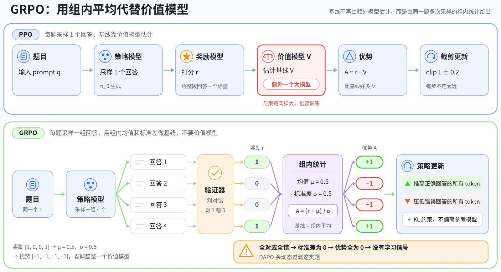

> 📊 **例题：GRPO 的优势怎么算**。一道数学题采样 4 个回答，验证器判定对错，奖励为 [1, 0, 0, 1]。
>
> - 均值 0.5，标准差 0.5，优势为 <b>[+1, −1, −1, +1]</b>：两个正确回答的所有 token 被推高，两个错误回答被压低。
> - 如果 4 个回答全对或全错，标准差为 0、优势全为 0，**这道题不提供任何学习信号**。所以 RLVR 的训练集要挑“模型有时对、有时错”的题，DAPO 等方法会动态过滤掉全对和全错的题目[[65]](https://arxiv.org/abs/2503.14476)。
> - 组越大，均值估计越准（3.4 的蒙特卡洛），但采样成本线性增加。

### 9.4 DPO：把强化学习变回分类

4.4 提到 RLHF 的目标是“奖励最大化 + KL 约束”。这个优化问题有解析解：$`\pi^*(y\mid x)\propto\pi_{\text{ref}}(y\mid x)\exp\big(r(x,y)/\beta\big)`$。把它反过来写，奖励可以用策略表示：$`r(x,y)=\beta\log\frac{\pi^*(y\mid x)}{\pi_{\text{ref}}(y\mid x)}+\text{常数}`$。代入 9.1 的 Bradley–Terry 模型，常数在做差时抵消，得到 DPO 的 loss[[66]](https://arxiv.org/abs/2305.18290)：

```math
L_{\text{DPO}}=-\log\sigma\Big(\beta\log\frac{\pi_\theta(y_w\mid x)}{\pi_{\text{ref}}(y_w\mid x)}-\beta\log\frac{\pi_\theta(y_l\mid x)}{\pi_{\text{ref}}(y_l\mid x)}\Big)
```

这个推导把“训练奖励模型 + 强化学习”两步合成了一个有监督的二分类 loss：不需要采样、不需要奖励模型，只需要偏好数据对和一个冻结的参考模型。代价是只能从固定的离线数据中学习，无法像在线强化学习那样探索新解法，这也是推理模型训练仍以 GRPO 类在线方法为主的原因。

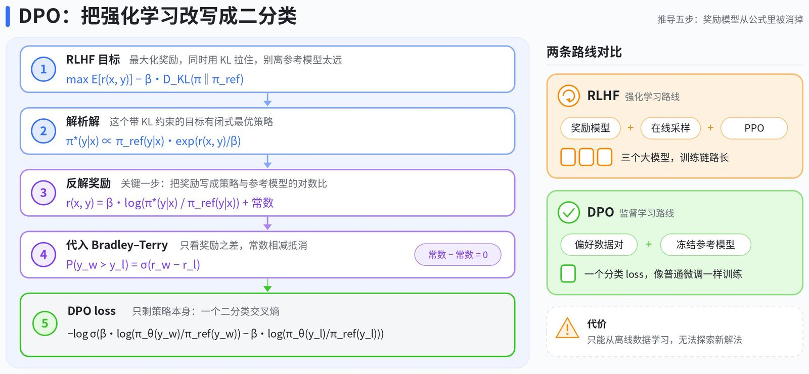

> ✅ **本章掌握标准**
>
> - 能写出 Bradley–Terry 概率，并说明奖励模型的 loss。
> - 能用 $`\nabla\pi=\pi\nabla\log\pi`$ 推出策略梯度，并解释基线为什么能降低方差。
> - 给定一组奖励，能算出 GRPO 的优势，并说明全对或全错的题为什么没有信号。
> - 能说清 DPO 从哪个等式出发、省掉了什么、失去了什么。

## 第 10 章 · 串起来：一次训练步里用到的全部数学

下面把一次预训练的训练步从头走到尾，每一步都标出用到的数学和所在章节。能把这张表讲清楚，就说明这篇文档的内容已经连成了一个整体。

| 步骤 | 发生了什么 | 背后的数学 | 章节 |
|---|---|---|---|
| 1 | 文本切成 token，查表得到向量 | embedding 矩阵的一行，形状 `[n, d]` | 2.1 |
| 2 | 归一化 | RMSNorm：除以均方根，逐维缩放 | 6.5 |
| 3 | 投影出 Q、K、V | 三次矩阵乘法，每次 $`2nd^2`$ 量级 FLOPs | 2.2 |
| 4 | 加入位置信息 | RoPE：每两维旋转 $`m\theta_i`$，点积只依赖相对位置 | 2.4 |
| 5 | 算注意力 | $`QK^{\top}/\sqrt{d_k}`$ 保持方差为 1；加因果掩码；在线 softmax 分块计算 | 3.3、7.3 |
| 6 | FFN 与残差 | 矩阵乘法 + 非线性；残差让梯度直通 | 2.2、5.4 |
| 7 | 重复 L 层后输出 logits | 与输出矩阵做点积，形状 `[n, V]` | 2.1 |
| 8 | 计算 loss | 数值稳定的 log-softmax，交叉熵 = 负对数似然 | 4.2、7.2 |
| 9 | 反向传播 | 链式法则；logits 的梯度为 $`\mathbf{p}-\mathbf{y}`$；每个矩阵乘法反向做两次 | 5.2、5.3、5.5 |
| 10 | 梯度裁剪 | 按 L2 范数缩放到阈值以内 | 6.4 |
| 11 | 参数更新 | AdamW：一阶矩、二阶矩、偏差修正、解耦权重衰减；学习率按调度曲线取值 | 6.2、6.3 |
| 12 | 全程的数值格式 | BF16 / FP8 计算，FP32 累加与主权重 | 7.1 |
| 13 | 这一步花了多少 | 约 $`6N\times`$ 批内 token 数的 FLOPs；显存约 16 字节/参数 + 激活 | 8.1、8.2 |

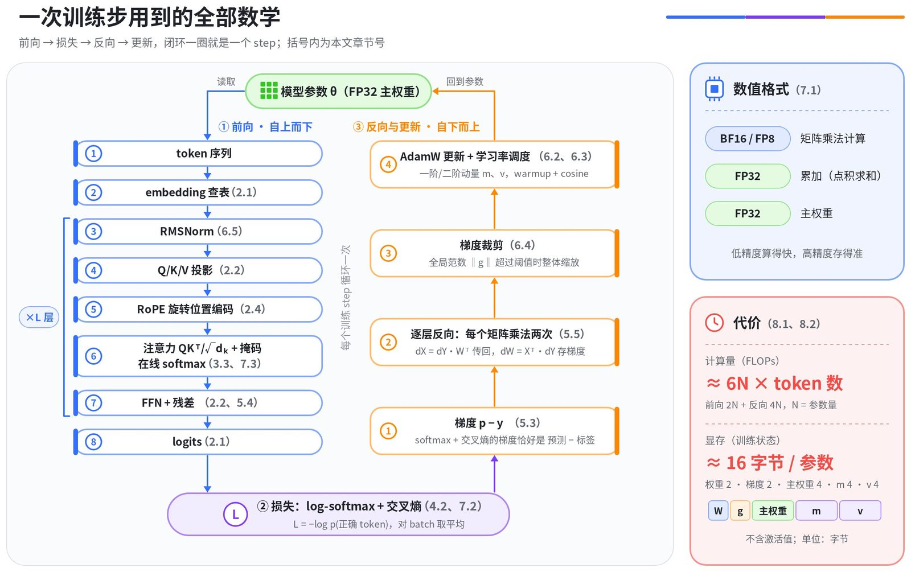

**推理时**只走第 1 到第 7 步，然后按第 3 章的采样规则从 logits 中选出下一个 token，把它的 K、V 存入 KV Cache（8.2），再进入下一轮；速度上限由算术强度决定（8.3）。**后训练时**第 8 步的 loss 换成第 9 章的奖励加权对数概率或 DPO loss，其余步骤不变。

> 🔑 **动手验证**：用 NumPy 实现一个只有一层、d = 16 的迷你 Transformer，完成上面的第 1 到第 11 步，并用有限差分 $`\frac{L(\theta+h)-L(\theta-h)}{2h}`$ 检查反向传播算出的梯度是否正确（相对误差应在 $`10^{-6}`$ 以下）。完成这个练习大约需要一个下午，比读十篇教程更有效。Karpathy 的 nanoGPT 和 “Let's build GPT” 视频可以作为对照[[67]](https://github.com/karpathy/nanoGPT)。

## 第 11 章 · 学习路线、自测题与资料

### 11.1 按目标选择学习深度

不同岗位需要的深度不同，不必全部学到最深：

| 目标 | 必须掌握 | 可以先跳过 |
|---|---|---|
| 应用研发：调用 API、做 RAG 与 Agent | 第 1 章符号；2.1 点积与余弦相似度；3.2 softmax 与采样参数；3.5 标准误；4.3 困惑度；8.2 KV Cache 与 token 成本 | 第 5、6 章的推导，第 9 章 |
| 推理部署与性能优化 | 以上全部，加 2.2 矩阵乘法与 FLOPs；第 7 章数值格式与量化；8.1 到 8.3 的估算与 Roofline；3.4 投机解码 | 第 9 章的推导，6.6 |
| 训练与微调 | 以上全部，加第 5 章反向传播；第 6 章优化器与调度；2.3 LoRA；8.4 缩放定律；第 9 章后训练 | 无，建议全读 |
| 读前沿论文与做研究 | 全部内容，并补充矩阵微积分、凸优化基础、概率图模型 | 无 |


### 11.2 自测题

1. Llama-3.1-70B 中，一个 token 的隐藏状态乘以 $`W_{\text{up}}\in\mathbb{R}^{8192\times28672}`$，需要多少 FLOPs？
2. logits 为 [3, 1, 0]、温度为 1 时，三个 token 的概率分别是多少？top-p = 0.8 会保留哪些？
3. 为什么注意力分数要除以 $`\sqrt{d_k}`$？如果改成除以 $`d_k`$ 会怎样？
4. 某模型在 1000 道题上准确率 70%，另一个模型 72%。能说后者更强吗？
5. 训练第一步 loss 为 11.8，词表大小约多少？训练结束时 loss 为 2.3，困惑度约多少？
6. 为什么 FP16 训练需要 loss scaling，而 BF16 通常不需要？
7. 一个 32B 稠密模型用 BF16 在单张 H100 上单请求解码，速度上限约多少 token/秒？如果改用 4 bit 权重呢？
8. 用 AdamW 混合精度全参数微调 7B 模型，仅权重、梯度和优化器状态就需要多少显存？用 LoRA 时这部分变成多少？
9. GRPO 对一道题采样 8 个回答，全部正确。这道题对训练有什么贡献？
10. 写出 $`H(p,q)`$、$`H(p)`$ 和 $`D_{\text{KL}}(p\|q)`$ 之间的关系，并据此说明预训练 loss 为什么不会降到 0。

### 11.3 参考答案

1. $`2\times8192\times28672\approx4.7\times10^8`$ FLOPs（2.2）。
2. $`e^3,e^1,e^0=20.09,2.72,1`$，和为 23.81，概率约 [0.844, 0.114, 0.042]。第一个已达 0.844，超过 0.8，top-p 只保留第一个（3.2）。
3. 点积方差为 $`d_k`$，除以 $`\sqrt{d_k}`$ 后方差为 1，softmax 不会饱和。除以 $`d_k`$ 会让方差变成 $`1/d_k`$，分数过于接近，注意力几乎均匀，模型难以聚焦（3.3）。
4. 单个准确率的标准误约 $`\sqrt{0.7\times0.3/1000}\approx1.45\%`$，两个独立结果之差的标准误约 $`\sqrt{2}\times1.45\%\approx2.05\%`$。差 2 个百分点还不到一个标准误，不能下结论。若是同一套题，应做配对检验，方差会更小（3.5）。
5. $`e^{11.8}\approx1.3\times10^5`$，词表约 13 万；$`e^{2.3}\approx10`$，困惑度约 10（4.2、4.3）。
6. FP16 指数只有 5 位，小梯度会下溢成 0，需要先把 loss 放大；BF16 指数位与 FP32 相同，范围足够（7.1）。
7. BF16 权重约 64 GB，上限约 $`3.35\times10^{12}/6.4\times10^{10}\approx52`$ token/秒；4 bit 约 16 GB，上限约 210 token/秒。实际值会低于上限（8.3）。
8. 全参数：$`7\times10^9\times16`$ 字节约 112 GB。LoRA：冻结的 BF16 权重约 14 GB，加上很小的 LoRA 参数及其优化器状态（通常不到 1 GB），不含激活（6.2、2.3）。
9. 组内标准差为 0，所有优势为 0，对梯度没有贡献，只浪费了采样算力（9.3）。
10. $`H(p,q)=H(p)+D_{\text{KL}}(p\|q)`$。KL 最小为 0，但 $`H(p)`$ 是自然语言本身的不确定性，大于 0，所以 loss 有下限（4.4、8.4）。

### 11.4 推荐资料

| 方向 | 资料 | 怎么用 |
|---|---|---|
| 直觉入门 | 3Blue1Brown《线性代数的本质》与神经网络系列[[68]](https://www.3blue1brown.com/topics/linear-algebra) | 先看动画建立几何直觉，神经网络系列后半部分专门讲 Transformer 和注意力。 |
| 系统教材 | Deisenroth 等《Mathematics for Machine Learning》[[69]](https://mml-book.github.io/) | 免费电子书，覆盖线性代数、微积分、概率、优化，按需查阅对应章节。 |
| 线性代数 | Gilbert Strang, MIT 18.06[[70]](https://ocw.mit.edu/courses/18-06-linear-algebra-spring-2010/) | 想把 SVD、秩、正交矩阵真正学透时看。 |
| 深度学习数学 | Goodfellow 等《Deep Learning》第 2 到 4 章[[71]](https://www.deeplearningbook.org/) | 深度学习视角的线性代数、概率与数值计算，写得紧凑。 |
| 动手实践 | Karpathy：micrograd、nanoGPT、Zero to Hero[[25]](https://github.com/karpathy/micrograd)[[67]](https://github.com/karpathy/nanoGPT) | 从零实现自动微分和 GPT，把公式变成代码。 |
| 工程估算 | Transformer Math 101；How to Scale Your Model[[54]](https://blog.eleuther.ai/transformer-math/)[[55]](https://jax-ml.github.io/scaling-book/) | 显存、算力、并行策略估算的标准参考。 |
| 完整课程 | Stanford CS336：Language Modeling from Scratch[[72]](https://stanford-cs336.github.io/) | 从分词器、架构、训练到对齐完整实现一遍，作业量大但收获最多。 |
| 信息论 | Cover 与 Thomas《Elements of Information Theory》[[73]](https://doi.org/10.1002/047174882X) | 熵、KL 散度、编码定理的标准教材，读前两章即可。 |

> 🚀 **两周速成建议**：第一周看 3Blue1Brown 两个系列，同时做完本文每章的例题；第二周跟着 micrograd 和 nanoGPT 敲一遍代码，并完成第 10 章的“动手验证”。之后再读配套文档「LLM 基础：给自己的一条学习主线（2026 版）」和一两篇技术报告，公式基本都能看懂。

## 参考文献

按正文首次引用顺序编号，数据截至 2026 年 9 月。

[1] Vaswani et al. Attention Is All You Need (2017) [https://arxiv.org/abs/1706.03762](https://arxiv.org/abs/1706.03762)

[2] Meta. The Llama 3 Herd of Models (2024) [https://arxiv.org/abs/2407.21783](https://arxiv.org/abs/2407.21783)

[3] Elhage et al. Toy Models of Superposition (2022) [https://arxiv.org/abs/2209.10652](https://arxiv.org/abs/2209.10652)

[4] Katharopoulos et al. Transformers are RNNs: Fast Autoregressive Transformers with Linear Attention (2020) [https://arxiv.org/abs/2006.16236](https://arxiv.org/abs/2006.16236)

[5] Gu &amp; Dao. Mamba: Linear-Time Sequence Modeling with Selective State Spaces (2023) [https://arxiv.org/abs/2312.00752](https://arxiv.org/abs/2312.00752)

[6] Eckart &amp; Young. The Approximation of One Matrix by Another of Lower Rank. Psychometrika (1936) [https://doi.org/10.1007/BF02288367](https://doi.org/10.1007/BF02288367)

[7] Hu et al. LoRA: Low-Rank Adaptation of Large Language Models (2021) [https://arxiv.org/abs/2106.09685](https://arxiv.org/abs/2106.09685)

[8] DeepSeek-AI. DeepSeek-V2: A Strong, Economical, and Efficient Mixture-of-Experts Language Model (2024) [https://arxiv.org/abs/2405.04434](https://arxiv.org/abs/2405.04434)

[9] Aghajanyan et al. Intrinsic Dimensionality Explains the Effectiveness of Language Model Fine-Tuning (2020) [https://arxiv.org/abs/2012.13255](https://arxiv.org/abs/2012.13255)

[10] Su et al. RoFormer: Enhanced Transformer with Rotary Position Embedding (2021) [https://arxiv.org/abs/2104.09864](https://arxiv.org/abs/2104.09864)

[11] Peng et al. YaRN: Efficient Context Window Extension of Large Language Models (2023) [https://arxiv.org/abs/2309.00071](https://arxiv.org/abs/2309.00071)

[12] Holtzman et al. The Curious Case of Neural Text Degeneration (2019) [https://arxiv.org/abs/1904.09751](https://arxiv.org/abs/1904.09751)

[13] Nguyen et al. Turning Up the Heat: Min-p Sampling for Creative and Coherent LLM Outputs (2024) [https://arxiv.org/abs/2407.01082](https://arxiv.org/abs/2407.01082)

[14] Glorot &amp; Bengio. Understanding the Difficulty of Training Deep Feedforward Neural Networks. AISTATS (2010) [https://proceedings.mlr.press/v9/glorot10a.html](https://proceedings.mlr.press/v9/glorot10a.html)

[15] Radford et al. Language Models are Unsupervised Multitask Learners / GPT-2 (2019) [https://cdn.openai.com/better-language-models/language_models_are_unsupervised_multitask_learners.pdf](https://cdn.openai.com/better-language-models/language_models_are_unsupervised_multitask_learners.pdf)

[16] Chen et al. Evaluating Large Language Models Trained on Code (2021) [https://arxiv.org/abs/2107.03374](https://arxiv.org/abs/2107.03374)

[17] Leviathan et al. Fast Inference from Transformers via Speculative Decoding (2022) [https://arxiv.org/abs/2211.17192](https://arxiv.org/abs/2211.17192)

[18] Miller. Adding Error Bars to Evals: A Statistical Approach to Language Model Evaluations (2024) [https://arxiv.org/abs/2411.00640](https://arxiv.org/abs/2411.00640)

[19] Shannon. A Mathematical Theory of Communication (1948) [https://people.math.harvard.edu/~ctm/home/text/others/shannon/entropy/entropy.pdf](https://people.math.harvard.edu/~ctm/home/text/others/shannon/entropy/entropy.pdf)

[20] Cui et al. The Entropy Mechanism of Reinforcement Learning for Reasoning Language Models (2025) [https://arxiv.org/abs/2505.22617](https://arxiv.org/abs/2505.22617)

[21] Gu et al. MiniLLM: Knowledge Distillation of Large Language Models (2023) [https://arxiv.org/abs/2306.08543](https://arxiv.org/abs/2306.08543)

[22] Ouyang et al. Training Language Models to Follow Instructions with Human Feedback (2022) [https://arxiv.org/abs/2203.02155](https://arxiv.org/abs/2203.02155)

[23] Delétang et al. Language Modeling Is Compression (2023) [https://arxiv.org/abs/2309.10668](https://arxiv.org/abs/2309.10668)

[24] Rumelhart, Hinton &amp; Williams. Learning Representations by Back-Propagating Errors. Nature (1986) [https://doi.org/10.1038/323533a0](https://doi.org/10.1038/323533a0)

[25] Karpathy. micrograd: A Tiny Autograd Engine [https://github.com/karpathy/micrograd](https://github.com/karpathy/micrograd)

[26] He et al. Deep Residual Learning for Image Recognition (2015) [https://arxiv.org/abs/1512.03385](https://arxiv.org/abs/1512.03385)

[27] Xiong et al. On Layer Normalization in the Transformer Architecture (2020) [https://arxiv.org/abs/2002.04745](https://arxiv.org/abs/2002.04745)

[28] Parr &amp; Howard. The Matrix Calculus You Need For Deep Learning (2018) [https://arxiv.org/abs/1802.01528](https://arxiv.org/abs/1802.01528)

[29] McCandlish et al. An Empirical Model of Large-Batch Training (2018) [https://arxiv.org/abs/1812.06162](https://arxiv.org/abs/1812.06162)

[30] Kingma &amp; Ba. Adam: A Method for Stochastic Optimization (2014) [https://arxiv.org/abs/1412.6980](https://arxiv.org/abs/1412.6980)

[31] Loshchilov &amp; Hutter. Decoupled Weight Decay Regularization (2017) [https://arxiv.org/abs/1711.05101](https://arxiv.org/abs/1711.05101)

[32] Touvron et al. Llama 2: Open Foundation and Fine-Tuned Chat Models (2023) [https://arxiv.org/abs/2307.09288](https://arxiv.org/abs/2307.09288)

[33] Rajbhandari et al. ZeRO: Memory Optimizations Toward Training Trillion Parameter Models (2019) [https://arxiv.org/abs/1910.02054](https://arxiv.org/abs/1910.02054)

[34] Brown et al. Language Models are Few-Shot Learners / GPT-3 (2020) [https://arxiv.org/abs/2005.14165](https://arxiv.org/abs/2005.14165)

[35] Hu et al. MiniCPM: Unveiling the Potential of Small Language Models with Scalable Training Strategies (2024) [https://arxiv.org/abs/2404.06395](https://arxiv.org/abs/2404.06395)

[36] DeepSeek-AI. DeepSeek-V3 Technical Report (2024) [https://arxiv.org/abs/2412.19437](https://arxiv.org/abs/2412.19437)

[37] Ba et al. Layer Normalization (2016) [https://arxiv.org/abs/1607.06450](https://arxiv.org/abs/1607.06450)

[38] Zhang &amp; Sennrich. Root Mean Square Layer Normalization (2019) [https://arxiv.org/abs/1910.07467](https://arxiv.org/abs/1910.07467)

[39] Qwen Team. Qwen3 Technical Report (2025) [https://arxiv.org/abs/2505.09388](https://arxiv.org/abs/2505.09388)

[40] Jordan et al. Muon: An Optimizer for Hidden Layers in Neural Networks (2024) [https://kellerjordan.github.io/posts/muon/](https://kellerjordan.github.io/posts/muon/)

[41] Liu et al. Muon is Scalable for LLM Training (2025) [https://arxiv.org/abs/2502.16982](https://arxiv.org/abs/2502.16982)

[42] Kimi Team. Kimi K2: Open Agentic Intelligence (2025) [https://arxiv.org/abs/2507.20534](https://arxiv.org/abs/2507.20534)

[43] Kalamkar et al. A Study of BFLOAT16 for Deep Learning Training (2019) [https://arxiv.org/abs/1905.12322](https://arxiv.org/abs/1905.12322)

[44] Micikevicius et al. Mixed Precision Training (2017) [https://arxiv.org/abs/1710.03740](https://arxiv.org/abs/1710.03740)

[45] Milakov &amp; Gimelshein. Online Normalizer Calculation for Softmax (2018) [https://arxiv.org/abs/1805.02867](https://arxiv.org/abs/1805.02867)

[46] Dao et al. FlashAttention: Fast and Memory-Efficient Exact Attention with IO-Awareness (2022) [https://arxiv.org/abs/2205.14135](https://arxiv.org/abs/2205.14135)

[47] Dettmers et al. LLM.int8(): 8-bit Matrix Multiplication for Transformers at Scale (2022) [https://arxiv.org/abs/2208.07339](https://arxiv.org/abs/2208.07339)

[48] Rouhani et al. Microscaling Data Formats for Deep Learning (2023) [https://arxiv.org/abs/2310.10537](https://arxiv.org/abs/2310.10537)

[49] NVIDIA. Introducing NVFP4 for Efficient and Accurate Low-Precision Inference (2025) [https://developer.nvidia.com/blog/introducing-nvfp4-for-efficient-and-accurate-low-precision-inference/](https://developer.nvidia.com/blog/introducing-nvfp4-for-efficient-and-accurate-low-precision-inference/)

[50] Xiao et al. SmoothQuant: Accurate and Efficient Post-Training Quantization for LLMs (2022) [https://arxiv.org/abs/2211.10438](https://arxiv.org/abs/2211.10438)

[51] Ashkboos et al. QuaRot: Outlier-Free 4-Bit Inference in Rotated LLMs (2024) [https://arxiv.org/abs/2404.00456](https://arxiv.org/abs/2404.00456)

[52] Frantar et al. GPTQ: Accurate Post-Training Quantization for Generative Pre-trained Transformers (2022) [https://arxiv.org/abs/2210.17323](https://arxiv.org/abs/2210.17323)

[53] Lin et al. AWQ: Activation-aware Weight Quantization for LLM Compression and Acceleration (2023) [https://arxiv.org/abs/2306.00978](https://arxiv.org/abs/2306.00978)

[54] Anthony, Biderman &amp; Schoelkopf. Transformer Math 101. EleutherAI Blog (2023) [https://blog.eleuther.ai/transformer-math/](https://blog.eleuther.ai/transformer-math/)

[55] Austin et al. How to Scale Your Model. Google DeepMind (2025) [https://jax-ml.github.io/scaling-book/](https://jax-ml.github.io/scaling-book/)

[56] Kaplan et al. Scaling Laws for Neural Language Models (2020) [https://arxiv.org/abs/2001.08361](https://arxiv.org/abs/2001.08361)

[57] NVIDIA. H100 Tensor Core GPU Datasheet [https://www.nvidia.com/en-us/data-center/h100/](https://www.nvidia.com/en-us/data-center/h100/)

[58] Williams, Waterman &amp; Patterson. Roofline: An Insightful Visual Performance Model. CACM (2009) [https://doi.org/10.1145/1498765.1498785](https://doi.org/10.1145/1498765.1498785)

[59] Hoffmann et al. Training Compute-Optimal Large Language Models / Chinchilla (2022) [https://arxiv.org/abs/2203.15556](https://arxiv.org/abs/2203.15556)

[60] Sardana et al. Beyond Chinchilla-Optimal: Accounting for Inference in Language Model Scaling Laws (2023) [https://arxiv.org/abs/2401.00448](https://arxiv.org/abs/2401.00448)

[61] Chiang et al. Chatbot Arena: An Open Platform for Evaluating LLMs by Human Preference (2024) [https://arxiv.org/abs/2403.04132](https://arxiv.org/abs/2403.04132)

[62] Williams. Simple Statistical Gradient-Following Algorithms for Connectionist Reinforcement Learning. Machine Learning (1992) [https://doi.org/10.1007/BF00992696](https://doi.org/10.1007/BF00992696)

[63] Schulman et al. Proximal Policy Optimization Algorithms (2017) [https://arxiv.org/abs/1707.06347](https://arxiv.org/abs/1707.06347)

[64] Shao et al. DeepSeekMath: Pushing the Limits of Mathematical Reasoning in Open Language Models (2024) [https://arxiv.org/abs/2402.03300](https://arxiv.org/abs/2402.03300)

[65] Yu et al. DAPO: An Open-Source LLM Reinforcement Learning System at Scale (2025) [https://arxiv.org/abs/2503.14476](https://arxiv.org/abs/2503.14476)

[66] Rafailov et al. Direct Preference Optimization: Your Language Model is Secretly a Reward Model (2023) [https://arxiv.org/abs/2305.18290](https://arxiv.org/abs/2305.18290)

[67] Karpathy. nanoGPT [https://github.com/karpathy/nanoGPT](https://github.com/karpathy/nanoGPT)

[68] 3Blue1Brown. Essence of Linear Algebra / Neural Networks [https://www.3blue1brown.com/topics/linear-algebra](https://www.3blue1brown.com/topics/linear-algebra)

[69] Deisenroth, Faisal &amp; Ong. Mathematics for Machine Learning (2020) [https://mml-book.github.io/](https://mml-book.github.io/)

[70] Strang. MIT 18.06 Linear Algebra [https://ocw.mit.edu/courses/18-06-linear-algebra-spring-2010/](https://ocw.mit.edu/courses/18-06-linear-algebra-spring-2010/)

[71] Goodfellow, Bengio &amp; Courville. Deep Learning (2016) [https://www.deeplearningbook.org/](https://www.deeplearningbook.org/)

[72] Stanford CS336: Language Modeling from Scratch [https://stanford-cs336.github.io/](https://stanford-cs336.github.io/)

[73] Cover &amp; Thomas. Elements of Information Theory, 2nd ed. (2006) [https://doi.org/10.1002/047174882X](https://doi.org/10.1002/047174882X)

---

上一篇：[LLM-01｜地基｜LLM 基础：从 token 到 Agent 的学习主线](./01-foundations.md) · [目录](./README.md) · 下一篇：[LLM-03｜系统｜vLLM 学习路径：从推理基础到架构前沿](./03-vllm-path.md)
