# LLM-03｜系统｜vLLM 学习路径：从推理基础到架构前沿

> 🎯 **这篇文档解决什么问题**：读懂《vLLM 近五个月架构演进：Rust、分布式 KV Cache 与模型专用 Kernel》之前要打哪些地基。本文以那份演进分析为终点，反向铺出一条从零到前沿的学习路径。适合有 Python 和深度学习基础、想系统掌握推理引擎工程原理的工程师，初次接触推理服务的人和想补齐分布式、KV Cache、Kernel 前沿知识的老手都能用。
>
> 使用方式：按阶段顺序推进，每个阶段先看核心概念，再用自测问题检验，最后做动手练习。阶段 4 对应演进分析里的三大工程，读完地基再回读原文会顺畅很多。本文是学习路径和知识地图，不逐行讲源码，也不覆盖训练、微调和 Prompt 工程。默认后端、默认开关这类值随 vLLM 迭代变化，以你部署版本的源码和官方文档为准；文中版本和默认值核对于 2026 年 10 月 11 日。

## 导读 · 先给结论

- **瓶颈已经转到 GPU 之外**：GPU 越来越强之后，限制吞吐的变成 CPU 调度、kernel launch、通信、缓存复用和协议正确性，这是演进分析的核心判断（阶段 4）。
- **prefill 和 decode 是两种负载**：KV Cache、PagedAttention 和连续批处理都从这个差别出发（阶段 1）。
- **先弄清一个请求在 V1 里怎么流动**：EngineCore、Scheduler、ModelRunner 的分工是读懂后面所有优化的前提（阶段 2）。
- **全程约四周起**：阶段 0 半天，阶段 1、2 各 2–3 天，阶段 3 一周，阶段 4 两周以上（见下表）。

整条路径分成五层，层层递进：每一层都是理解上一层的前提，也是通往顶端三大前沿工程的台阶。先建立“推理为什么难”，再看 vLLM 用什么架构解决，再补齐分布式与性能进阶，最后才有能力读懂 Rust 控制面、分布式 KV Cache 数据层与模型专用 Kernel 这三条主线。

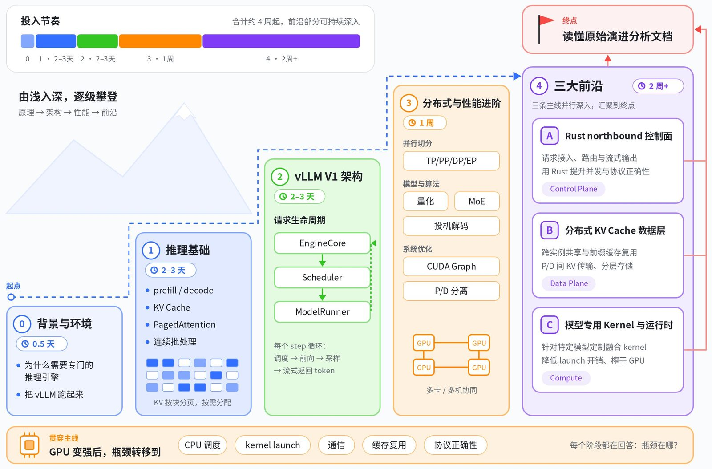

| 阶段 | 主题 | 你将回答的核心问题 | 预估投入 |
|---|---|---|---|
| **阶段 0** | 背景与环境 | 为什么需要专门的推理引擎？怎么把 vLLM 跑起来？ | 0.5 天 |
| **阶段 1** | 推理基础 | prefill/decode 为何不同？KV Cache 是什么？PagedAttention 与连续批处理解决了什么？ | 2-3 天 |
| **阶段 2** | vLLM 架构 | 一个请求在 vLLM V1 里如何流动？EngineCore / Scheduler / ModelRunner 各管什么？ | 2-3 天 |
| **阶段 3** | 分布式与性能进阶 | TP/PP/DP/EP 各是什么？量化、MoE、投机解码、CUDA Graph、P/D 分离怎么提速？ | 1 周 |
| **阶段 4** | 三大前沿主线 | Rust 前端、分布式 KV Cache 数据层、模型专用 Kernel 各自解决什么系统级瓶颈？ | 2 周+ |

📎 与系列其他文档的分工：推理的原理和成本见「LLM 基础」第 6 章，推理系统的全栈工程见「大模型推理系统学习手册」，推理成本怎么算、卡怎么选见「自建推理成本与 GPU 选型」，GPU 算子层的优化见「GPU 优化深入浅出」。本文只讲 vLLM 这一个引擎的学习路径。

---

## 先修 · 地基自检：要不要补课

> 🔑 <b>说明：</b>很多人一上来就想找“vLLM 的 GPU 分布式调度算法”，但这其实是一个被合并的伪命题：“调度”在 vLLM 语境里被拆成了三层不同的东西。先分清这三层，再判断自己缺哪块地基，比直接啃源码高效得多。

### 先把“调度”这个词拆开：三层含义

当你问“vLLM 的 GPU 分布式调度算法”时，实际混淆了三个独立的问题层。它们的目标、算法、代码位置都不同：

| 层次 | 它管什么 | 核心机制 | 是不是“调度算法” |
|---|---|---|---|
| **① 引擎内调度** （单实例） | 一次 iteration 里，从等待/运行队列中挑哪些请求、拼多大的 batch、显存不够时抢占谁 | Continuous batching、token budget、chunked prefill、FCFS/优先级队列、抢占（recompute/swap） | ✅ 这才是真正意义上的“调度算法”，在 EngineCore 的 Scheduler 里 |
| **② 分布式并行** （单实例内跨卡） | 一个模型放不下一张卡时，如何把权重/计算/KV 切到多张 GPU 上协同 | TP（AllReduce）、PP（流水）、DP、EP（MoE AllToAll）；Wide-EP = DP attention + EP experts | ❌ 这是**并行与通信策略**：切分方式在建图时就定死，运行时不挑请求。 |
| **③ 集群路由** （跨实例） | 有多个 vLLM 实例时，一个新请求该发给哪个实例（负载均衡、前缀亲和、P/D 分离） | Router / EPP、KV-aware routing、P/D disaggregation 编排 | ⚠️ vLLM 只做了一半（暴露指标/连接器），真正的集群编排靠 K8s、llm-d、外部网关 |

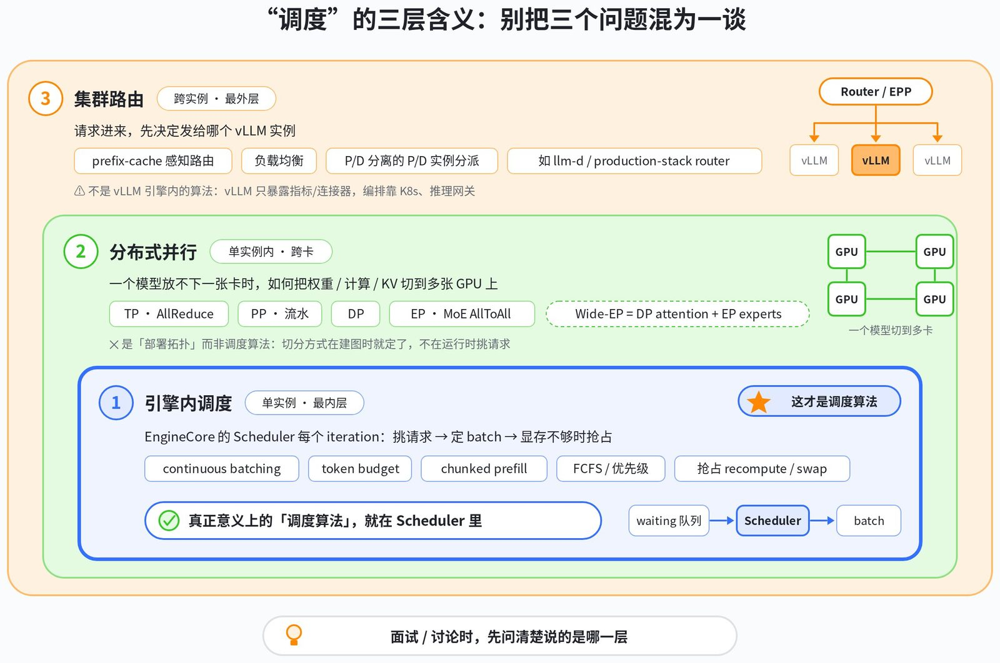

> 📌 <b>一句话结论：</b>你真正想学的“调度算法”是**第①层**（引擎内 Scheduler）；第②层是并行策略，不管调度；第③层 vLLM 本身管得很少，属于云原生/推理网关的范畴。这三层搞混，是学 vLLM 最常见的第一个坑。

### 要不要补课：先修地基优先级

能不能读懂上面三层，取决于几块底层地基。按“卡住你的概率”排优先级，🔴 必补，🟠 建议补，🟡 深入时再补：

| 优先级 | 地基 | 为什么需要 / 对应哪一层 | 补到什么程度就够 |
|---|---|---|---|
| 🔴 必补 | **Transformer 与 Attention 机制** | 不懂 Q/K/V、KV Cache 为什么存在，就无法理解 PagedAttention、prefill/decode 的区别：整个第①层的地基 | 能手推一次 self-attention；说清 KV Cache 存的是什么、为什么 decode 阶段是显存带宽瓶颈 |
| 🔴 必补 | **操作系统：分页与虚拟内存** | PagedAttention 直接类比 OS 分页（block table = 页表）。懂了 OS 分页，APC/块哈希/抢占 swap 全部秒懂 | 说清物理页 vs 虚拟页、页表映射、换页；能把它一一对应到 KV block |
| 🔴 必补 | **GPU 架构与 Roofline 模型** | compute-bound（prefill）vs memory-bound（decode）是全部性能优化的出发点；不懂就无法理解为什么要 batch、要 CUDA Graph | 能画 Roofline；说清算力墙 vs 带宽墙，以及 prefill/decode 各自撞哪堵墙 |
| 🟠 建议补 | **NCCL / 集合通信** | AllReduce / AllToAll / AllGather 是第②层并行的通信原语；不懂通信量，就看不懂 TP/EP 为什么受带宽限制 | 说清 AllReduce vs AllToAll 的语义和通信量量级；知道 NVLink vs PCIe/RDMA 的差异 |
| 🟠 建议补 | **排队论基础** | 第①层调度的本质是排队系统：到达率、服务率、队列长度、延迟分布（TTFT/TPOT） | 理解 Little's Law、吞吐 vs 延迟的权衡；能解释为什么大 batch 提吞吐但伤 TTFT |
| 🟡 深入再补 | **CUDA / Triton kernel** | 只有到阶段 4“模型专用 kernel”才真正需要；读调度/并行逻辑时不必先会写 kernel | 先能读懂 kernel 在做什么即可；要动手写再系统学 CUDA/Triton |
| 🟡 深入再补 | **Python asyncio / GIL** | 理解 AsyncLLM、多进程 ZMQ IPC 为什么要绕开 GIL 时才需要 | 知道 GIL 是什么、为什么 EngineCore 要独立进程即可 |

> ✅ <b>补课判断法：</b>如果 🔴 三项里有任何一项你说不清楚，**先补它**，再回来读 vLLM，否则读源码只会看到“术语的搬运”，抓不住本质。三项 🔴 都过关，就可以直接进阶段 1，🟠/🟡 边学边补即可。

### 五道自测题：判断要不要补课

不看资料，能顺畅答出下面五题，说明地基够用，可跳过补课直接进阶段 1；有卡壳的，对照上表补对应项：

1. <b>KV Cache 存的到底是什么？</b>为什么有了它 decode 阶段就变成显存带宽瓶颈而不是算力瓶颈？
2. <b>PagedAttention 和操作系统分页的对应关系？</b>block table 相当于 OS 里的什么？为什么这样能减少显存碎片？
3. <b>prefill 和 decode 分别撞 Roofline 的哪堵墙？</b>为什么 continuous batching 对 decode 收益巨大？
4. <b>TP、PP、EP 各自的通信原语是什么？</b>为什么说它们是“并行策略”而不是“调度”？
5. <b>显存不够时 Scheduler 会抢占请求，recompute 和 swap 两种策略的取舍是什么？</b>

### 推荐学习顺序

把上面的地基和后续阶段串成一条最省力的路径，先打三块 🔴 地基，再按“单机引擎 → 跨卡并行 → 跨机集群”的顺序层层展开：

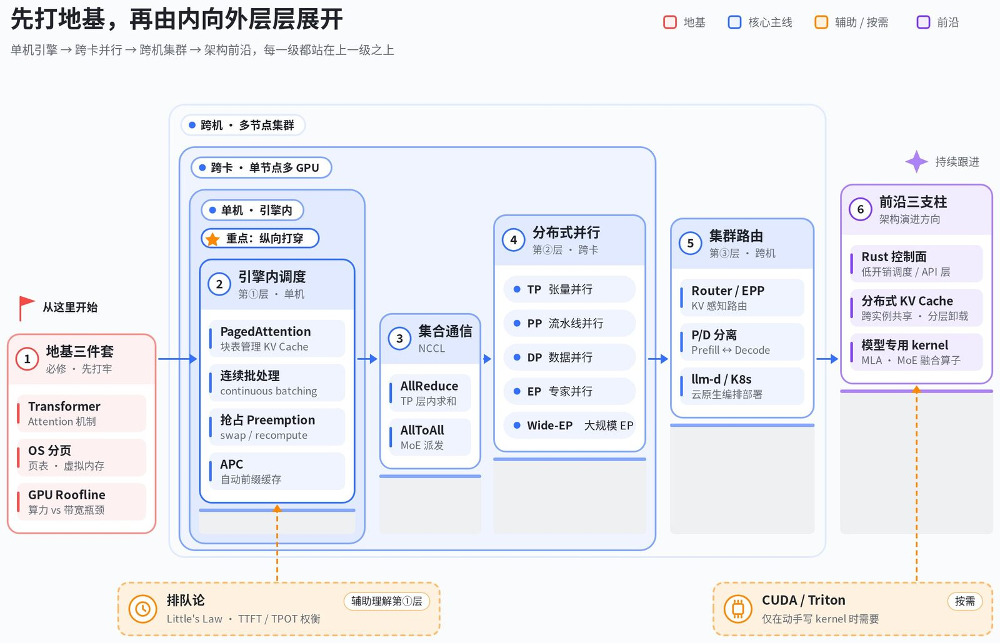

> 📌 <b>核心心法：</b>别想横向铺开、一次学完所有并行策略和优化技巧，先<b>纵向打穿单机引擎（第①层）</b>，把一个请求从进队列到出 token 的完整生命周期跑通、看懂，再往第②、第③层扩展。地基牢了，后面的每个“优化”都只是这条主线上的补丁，孤立术语自然就串起来了。

📎 延伸阅读：想把这条阅读顺序换成按交付物推进的周计划，每阶段先做实验再读书，见 [LLM-08｜系统｜大模型推理系统：全栈学习手册](./08-inference-systems.md) 第 14.2 节“按阶段交付的路线”。

---

## 阶段 0：背景与环境准备

### 0.1 为什么需要专门的推理引擎

大模型的生成是**自回归**的：一次只产出一个 token，并把它拼回输入去产生下一个。这种模式对硬件极不友好：朴素实现会反复重算、浪费显存、GPU 大量空转。推理引擎（vLLM、TensorRT-LLM、SGLang 等）的使命，就是在**吞吐、延迟、显存利用率**三者间做工程化权衡。vLLM 的起点是 2023 年的 PagedAttention 论文，相比当时的 FasterTransformer、Orca 等系统，吞吐提升 2-4 倍[[Efficient Memory Management for LLM Serving (PagedAttention)]](https://arxiv.org/abs/2309.06180)。

### 0.2 动手：把 vLLM 跑起来

建议先在有 GPU 的环境安装并跑通，建立最直观的手感，再回头学原理。

- **安装**：`pip install vllm`（v0.31 的默认 wheel 基于 CUDA 13.0，CUDA 12.x 要用其他 wheel 或镜像[[vLLM v0.31.0]](https://github.com/vllm-project/vllm/releases/tag/v0.31.0)）。
- **在线服务**：`vllm serve <model>` 启动 OpenAI 兼容 HTTP 服务（默认 `http://localhost:8000`），暴露 `/v1/chat/completions` 等端点，可直接用 OpenAI SDK 把 `base_url` 指过来调用。
- **离线批量**：Python 里 `LLM(model=...)` 然后 `.generate(prompts, SamplingParams(...))`，无需起服务。

这些入口的用法与端点见官方 [vLLM Quickstart](https://docs.vllm.ai/en/latest/getting_started/quickstart/)。

---

## 阶段 1：推理基础（KV Cache 与 PagedAttention）

> 📌 **本阶段是全路径的地基**。原文档所有关于 KV Cache 的高级讨论（分层存储、内容寻址、跨实例传输），都建立在这里的三个概念上：prefill/decode 差异、KV Cache、PagedAttention。

### 1.1 prefill 与 decode：两个性能画像完全不同的阶段

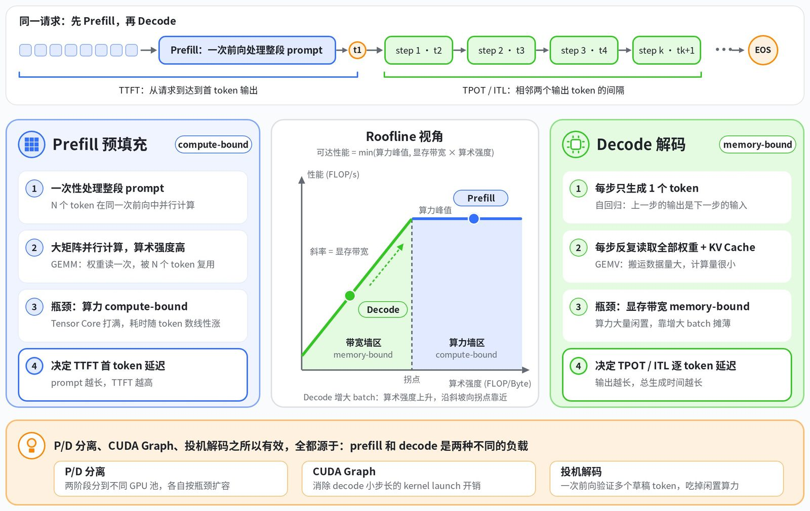

一次推理分成两段，硬件瓶颈截然不同[[PagedAttention paper]](https://arxiv.org/abs/2309.06180)：

- <b>Prefill（预填充）</b>：整段 prompt 在一次前向里并行处理，是一个大矩阵乘，<b>计算密集（compute-bound）</b>，决定首 token 延迟 TTFT。
- <b>Decode（解码）</b>：逐 token 生成，每步都要把整个模型权重 + 已累积的 KV Cache 读进来才产出一个 token，算术量相对搬运的数据很小，因此<b>受显存带宽限制（memory-bandwidth bound）</b>，决定每 token 延迟 TPOT/ITL。

记住这个二分法：后面 P/D 分离、CUDA Graph、投机解码之所以有效，全都源于“prefill 和 decode 是两种不同的负载”。

### 1.2 KV Cache：用显存换重算

Transformer 注意力里，每个 token 会算出 Query(Q)、Key(K)、Value(V)。生成第 n 个 token 时，注意力需要之前所有 token 的 K 和 V。与其每步重算，vLLM 把历史 token 的 K、V 缓存下来，这就是 **KV Cache**。它随序列长度和 batch 增大而增长，是每请求独立、大小动态波动的，因此**显存管理成了服务的核心难题**[[PagedAttention paper]](https://arxiv.org/abs/2309.06180)。

### 1.3 PagedAttention：把 OS 分页搬进显存

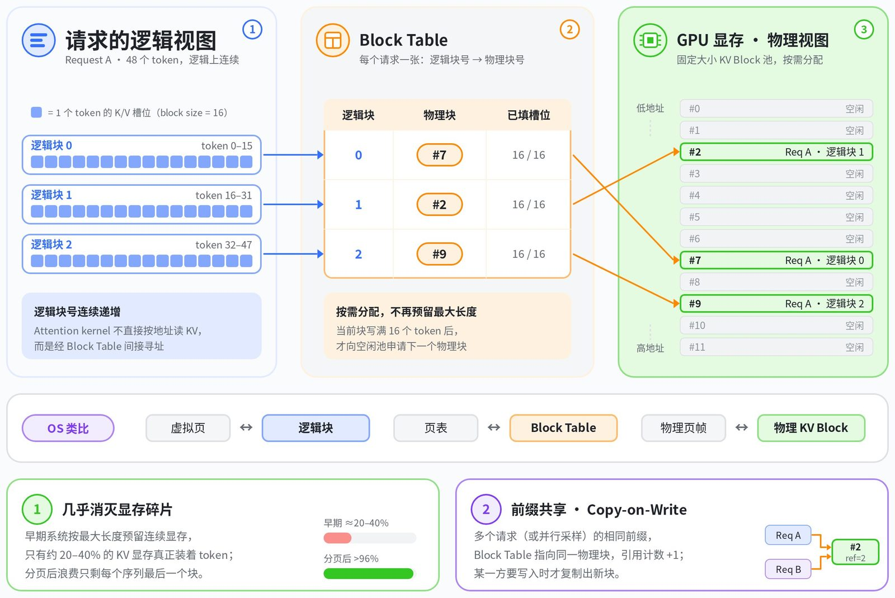

传统系统给每个请求按“最大可能长度”预留一整块连续显存，造成严重浪费：内部碎片（预留未用）、外部碎片（空隙不可用）、以及保留开销；论文实测早期系统只有约 20-40% 的 KV 显存真正装着 token 状态[[PagedAttention paper]](https://arxiv.org/abs/2309.06180)。

PagedAttention 借用操作系统的**虚拟内存/分页**思想：把 KV Cache 切成固定大小的 <b>block（页）</b>，每块存固定数量 token 的 K/V（如 16 个）；块在物理显存里**不必连续**；每个请求用一张 <b>block table（块表）</b> 把逻辑块位置映射到物理块位置，完全类比 OS 的页表。由此几乎消灭碎片浪费，还让多个请求**共享**相同前缀的块（如公共 prompt），支撑写时复制（copy-on-write）[[vLLM PagedAttention 设计文档]](https://docs.vllm.ai/en/latest/design/paged_attention/)。

### 1.4 连续批处理：把 GPU 喂满

**静态批处理**把一批请求凑齐一起跑到全部结束；由于输出长度不一，短请求要空等最长的那个，GPU 空转，新请求也进不来。**连续批处理**（又叫迭代级调度 / in-flight batching）在**每个解码迭代**都重新决策：完成的序列立即离开，空出的槽位下一步就被等待中的请求填上，从而把 GPU 持续喂满，在变长混合负载下大幅提升吞吐[[Anyscale: Continuous batching]](https://www.anyscale.com/blog/continuous-batching-llm-inference)。这是 vLLM 调度器的原生能力。

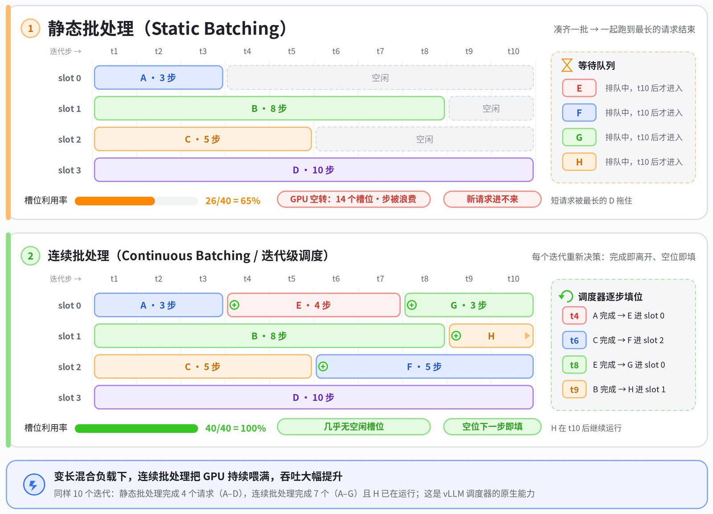

### 1.5 自测与练习

| 类型 | 内容 |
|---|---|
| **关键自测** | ① 为什么 decode 是显存带宽瓶颈而非算力瓶颈？② PagedAttention 的 block table 类比 OS 的什么？③ 连续批处理相比静态批处理在什么负载下收益最大？ |
| **动手练习** | 用 `vllm serve` 起一个小模型，分别发一个长 prompt+短输出、短 prompt+长输出的请求，观察 TTFT 与总时延差异，把它和 prefill/decode 的画像对应起来。 |

---

## 阶段 2：vLLM V1 架构与请求生命周期

vLLM V1 引擎（v0.8.0 即 2025-03-18 起默认，V0 在 v0.11.0 即 2025-10-02 完全移除[[vLLM v0.11.0]](https://github.com/vllm-project/vllm/releases/tag/v0.11.0)）采用**多进程设计**，把 CPU 密集的 API/分词工作与 GPU 推理循环隔离开[[vLLM V1 Alpha 发布]](https://blog.vllm.ai/2025/01/27/v1-alpha-release.html)。理解这张流转图，是读懂阶段 4“Rust 前端”和“Scheduler/Worker 双平面”的前提。

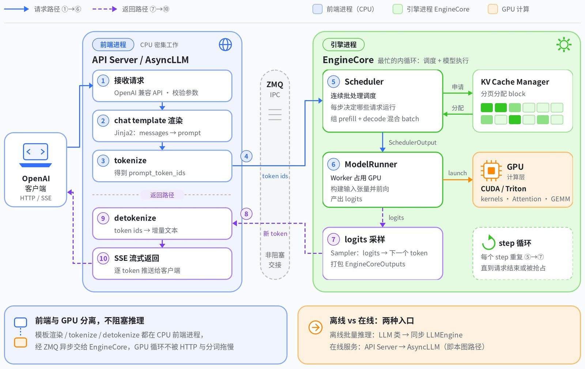

### 2.1 请求生命周期与组件职责

| 组件 | 职责 |
|---|---|
| **API Server / AsyncLLM**（前端进程） | 校验请求；用模型的 **chat template**（Jinja2）把 messages 数组渲染成 prompt 字符串；分词成 `prompt_token_ids`。与 GPU 分离，不阻塞推理。 |
| **ZMQ IPC** | 前端与引擎跨进程用 ZeroMQ socket 异步传递已分词请求，非阻塞交接。 |
| **EngineCore**（引擎进程） | 跑最忙的内循环：调度 + 模型执行。 |
| **Scheduler** | 每步决定哪些请求运行（v0.14.0 起默认异步调度，调度与 GPU 执行重叠[[vLLM v0.14.0]](https://github.com/vllm-project/vllm/releases/tag/v0.14.0)）；向 KV Cache Manager 申请 block；组 batch（prefill 与 decode 混合）。连续批处理与分页分配都在这里。 |
| **ModelExecutor / Worker → ModelRunner** | Worker 占用 GPU；ModelRunner 准备输入张量、跑前向、产出 logits。 |
| **采样 + detokenize** | 采样出的 token 回流前端做 detokenize 并流式返回客户端。 |

离线用同步的 `LLMEngine`（`LLM` 类封装），在线服务走异步 `AsyncLLM` 路径。组件角色的权威说明见 [vLLM Architecture Overview](https://docs.vllm.ai/en/latest/design/arch_overview/)。

> ❗ 组件的职责边界稳定，但具体 Python 文件路径 / 类名会随版本漂移，以你部署版本的源码为准。

### 2.2 前缀缓存（Automatic Prefix Caching, APC）

APC 把“已算过的 prompt 前缀”的 KV 块缓存下来，后续共享同一前缀（系统提示、few-shot 示例、长文档）的请求可直接复用，不必重算 prefill。vLLM 对 KV **块**做哈希：每块哈希 = 该块 token id + 前一块哈希（前缀相关的链式哈希），哈希命中即保证前缀逐块相同，只需计算分叉的后缀。它在长而重复的共享前缀、多轮对话中收益最大，V1 里默认开启；v0.28.0 起 Mamba / 混合模型的前缀缓存也默认开启[[vLLM v0.28.0]](https://github.com/vllm-project/vllm/releases/tag/v0.28.0)[[vLLM Automatic Prefix Caching 设计文档]](https://docs.vllm.ai/en/latest/design/prefix_caching/)。

这个链式哈希就是阶段 4“KV Cache 内容寻址”的雏形：记住它。

### 2.3 采样与服务概念

- **SamplingParams**：`temperature`、`top_p`、`top_k`、`max_tokens`、`stop`、`n`、`seed` 等控制生成。
- **logprobs**：可选返回每 token 对数概率及 top-k 候选。
- **结构化输出 / 引导解码**：把输出约束到 JSON / 正则 / 语法（EBNF）/ 选项列表，靠在采样时屏蔽不合法 token 实现（后端默认 `auto`，可选 xgrammar、guidance、outlines、lm-format-enforcer）。
- **chat template 与分词**：模型的 chat template 把带角色的 messages 映射成训练时的 prompt 串，再分词成 id；模板正确与否直接影响聊天质量。

### 2.4 自测与练习

| 类型 | 内容 |
|---|---|
| **关键自测** | ① 为什么 API Server 要和 EngineCore 拆成两个进程？② Scheduler 每一步到底做了哪几件事？③ APC 的块哈希为什么要“链式”（带上前一块哈希）？ |
| **动手练习** | 用同一段长 system prompt 连发两次请求，开启/关闭前缀缓存，对比第二次的 TTFT；再对照日志里的 prefix-cache hit tokens。 |

📎 延伸阅读：引擎内 PagedAttention 与前缀缓存之外，KV 装不进显存时的分层外置、跨请求复用、压缩与 SSD 落盘四条工程路线，见 [LLM-70｜系统｜KV Cache 装不进显存：分层、复用、压缩与外置系统的工程账](./70-kv-cache-offload.md)。

---

## 阶段 3：分布式并行、量化、MoE 与性能进阶

📎 延伸阅读：MoE 的推理侧（大规模专家并行、冗余专家、专家卸载）见 [LLM-33｜地基｜MoE 混合专家：路由、负载均衡、训练与推理](./33-moe.md)；性能剖析与调优方法见 [LLM-32｜系统｜AI Infra 性能优化实战：从 profile 到硬件上限](./32-infra-perf.md)。

这一阶段是从“单卡跑通”到“读懂前沿”的桥梁。原文档反复出现的 TP/PP/DP/EP、FP8/FP4、MoE、MTP、CUDA Graph、P/D 分离，都在这里建立概念。

### 3.1 分布式并行的四条轴

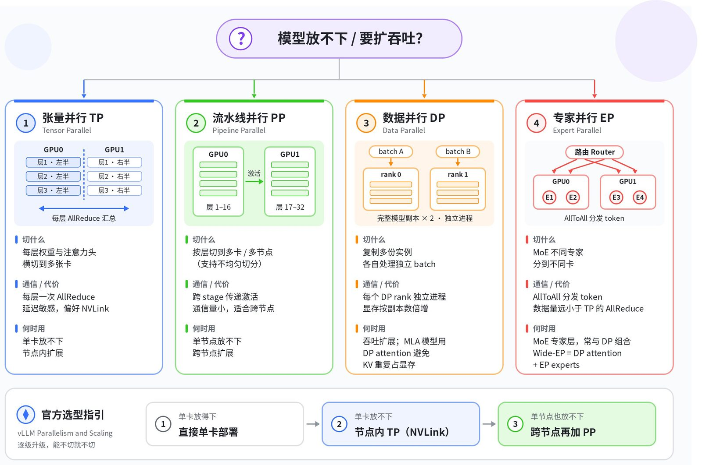

官方指引：单卡放得下就用单卡；放不下先在节点内上 **TP**；单节点放不下再跨节点加 **PP**[[vLLM Parallelism and Scaling]](https://docs.vllm.ai/en/latest/serving/parallelism_scaling/)。

| 并行方式 | 切什么 | 通信/代价 | 何时用 |
|---|---|---|---|
| **张量并行 TP** | 每层权重/注意力头切到多卡 | 每层需 AllReduce，延迟敏感，偏好 NVLink | 模型单卡放不下，节点内扩展 |
| **流水线并行 PP** | 按层切到多卡/多节点（支持不均匀切） | 跨 stage 传激活 | 单节点放不下，跨节点扩展 |
| **数据并行 DP** | 复制多份实例处理独立 batch | 每个 DP rank 独立进程 | 吞吐扩展；MLA 模型下用 DP attention 避免 KV 重复占显存 |
| **专家并行 EP** | MoE 的不同专家分到不同卡 | AllToAll 分发 token，数据量远小于 TP 的 AllReduce | MoE 专家层，常与 DP 组合（Wide-EP） |

大 MoE 的常见组合是 **DP attention + EP experts**[[vLLM Expert Parallel Deployment]](https://docs.vllm.ai/en/latest/serving/expert_parallel_deployment/)。

### 3.2 量化：用精度换显存与吞吐

量化降低显存（装更大模型/更长上下文）、提升吞吐、降本[[vLLM Quantization]](https://docs.vllm.ai/en/latest/features/quantization/)。常见格式：**FP8**（W8A8，Hopper/Ada/AMD 上精度损失小）、**INT8**、**INT4/AWQ/GPTQ**（权重 4 位），以及 Blackwell 上的 **NVFP4/FP4、MXFP4**。记法 `W8A8 / W4A16` 表示权重位数/激活位数。量化可作用于三处：**权重**、**激活**、**KV Cache**（`kv_cache_dtype="fp8"` 压缩存储的 K/V 以支持更长上下文）[[vLLM Quantized KV Cache]](https://docs.vllm.ai/en/latest/features/quantization/quantized_kvcache/)。

### 3.3 MoE 服务

MoE 用多个“专家”子网替代稠密 FFN，由门控（router）对每 token 稀疏选 top-k 个专家（DeepSeek 从 256 里选 8），部分模型还有常驻的**共享专家**[[NVIDIA: Mixture of Experts]](https://www.nvidia.com/en-us/glossary/mixture-of-experts/)。它让**参数量/显存暴涨**但**激活计算低**；专家分散在不同卡上，产生 AllToAll 的分发/合并通信和负载均衡/长尾问题，这正是 MoE 要和 EP（装得下 + 稀疏通信）、DP（数据并行 attention 对齐前向、避免 KV 重复）深度耦合的原因。

### 3.4 投机解码

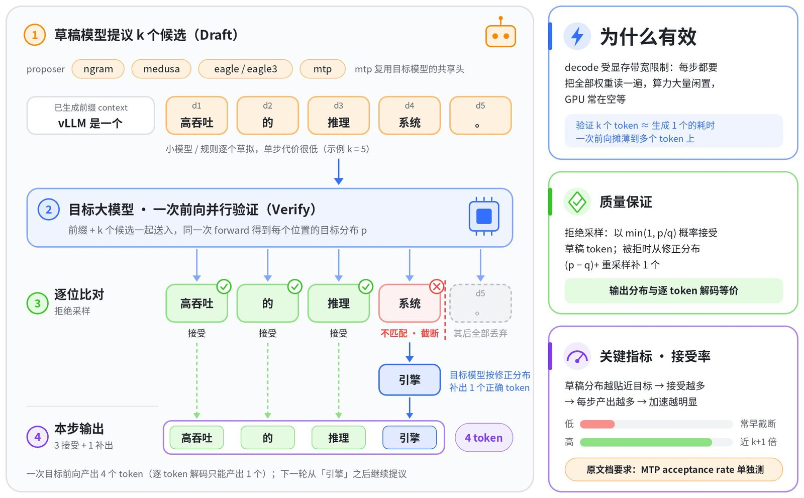

decode 受显存带宽限制、GPU 常空等。投机解码用**提议→验证**（draft-then-verify）：一个便宜的 proposer 先草拟若干 token，大目标模型在**一次前向里并行验证**，用拒绝采样接受匹配的、丢弃其余，输出质量不变[[BentoML: Speculative Decoding]](https://www.bentoml.com/blog/3x-faster-llm-inference-with-speculative-decoding)。vLLM 支持 <b>`eagle/eagle3`</b>、<b>`mtp`</b>（多 token 预测，复用目标模型的共享头）、draft model、PARD、MLP、`ngram`、suffix、DFlash、DSpark 等方法，并支持动态投机长度和自适应验证[[vLLM Speculative Decoding]](https://github.com/vllm-project/vllm/tree/main/docs/features/speculative_decoding)。关键指标是**接受率**：草稿分布越贴近目标，接受越多、加速越明显，这也是原文档反复提到“MTP acceptance rate”要单独测的原因。

### 3.5 CUDA Graph 与 kernel launch 开销

decode 是 **launch-bound**：每步发出大量微小 kernel，单个 kernel 的 CPU 启动开销占主导。**CUDA Graph** 把固定的 kernel 启动序列捕获一次、当作一个整体重放，砍掉这部分开销，对“uniform decode”（query 长度 1，或 1+投机 token）批最有效[[vLLM CUDA Graphs 设计文档]](https://docs.vllm.ai/en/latest/design/cuda_graphs/)。图要求形状恒定。v0.11.0 起默认模式是 `FULL_AND_PIECEWISE`：纯 decode 批走完整图，prefill 和混合批走分段（piecewise）图，不再回退 eager。

### 3.6 P/D 分离（Disaggregated Prefill/Decode）

因为 prefill（compute-bound，定 TTFT）与 decode（memory-bound，定 ITL/TPOT）画像不同，把它们放到**不同实例**上，可独立调优、隔离长尾 ITL（避免 prefill 打断正在跑的 decode）。官方明确指出 P/D 分离**不提升总吞吐，只做延迟隔离**[[vLLM Disaggregated Prefilling]](https://docs.vllm.ai/en/latest/features/disagg_prefill/)。由于 decode 需要 prefill 的上下文，KV Cache 必须在实例间用 **connector** 传输（Nixl、Mooncake、LMCache、Offloading、MultiConnector、MoRIIO、FlexKV 等）[[vLLM NixlConnector Usage]](https://docs.vllm.ai/en/latest/features/nixl_connector_usage/)。

### 3.7 混合/非标准注意力模型

标准自注意力每 token 一份 KV、各层一致。新模型打破这点：<b>滑动窗口注意力（SWA）</b>只看最近窗口；**Mamba/SSM/线性注意力**层只携带固定大小的**递归状态**，不存全量 KV 历史。混合模型（Gemma3=SWA+full、Qwen3.5=GDN 线性注意力+full 等）不同层需要不同大小的缓存，统一分配会浪费显存[[vLLM Hybrid Memory Allocator RFC #11382]](https://github.com/vllm-project/vllm/issues/11382)。vLLM 的**混合 KV Cache 管理器**把层按注意力行为分成 **KV Cache Group**，Mamba 层用独立的 state 存储。这就是阶段 4“KV Cache Group”和“模型专用 kernel”存在的根本原因。

### 3.8 GPU kernel 与算子库

这里的 **kernel 是 GPU 计算程序**（在 GPU 上跑很多并行线程的函数），**不是操作系统内核**。可用 **CUDA/CUTLASS**（NVIDIA 专用、手工调优）或 **Triton**（Python 内嵌 DSL，跨 NVIDIA/AMD/Intel 可移植）编写[[vLLM Triton Backend Deep Dive]](https://blog.vllm.ai/2026/03/04/vllm-triton-backend-deep-dive.html)。**FlashAttention** 把注意力分块塞进片上 SRAM、用 online-softmax 避免物化完整注意力矩阵；**FlashInfer** 是更广的推理算子库（分页/块稀疏 attention、MLA、MoE grouped-GEMM、FP4/FP8、JIT）。**kernel 融合**把多个操作合成一次 launch，减少启动开销和显存往返。

### 3.9 自测与练习

| 类型 | 内容 |
|---|---|
| **关键自测** | ① TP 与 EP 的通信模式各是什么，为什么 EP 传的数据更少？② 为什么 MLA 模型下要用 DP attention？③ CUDA Graph 为什么对 decode 有效、对 prefill 常常失效？④ P/D 分离到底优化什么、不优化什么？ |
| **动手练习** | 在多卡机器上分别用 `--tensor-parallel-size` 跑同一模型，对比吞吐；再开一个 FP8 量化版本（v0.31 起在线量化写 `quantization="fp8_per_tensor"`），对比显存占用与吞吐。 |

📎 延伸阅读：阶段 3 讲的是单引擎内的多卡并行；再往外一层，GPU 怎样进容器、怎样切分给多租户、排队配额和多机组语义怎样在 K8s 上落地，见 [LLM-69｜系统｜K8s 上的 GPU 与推理负载：从设备插件到队列调度](./69-k8s-gpu-inference.md)。

---

## 阶段 4：三大前沿主线（对接原始演进文档）

到这里，你已经具备读懂原文档的全部地基。下面三条主线一一对应原文档第 1/2/3 章，每条都标注了“它建立在前面哪个概念之上”，帮你把地基与前沿接通。

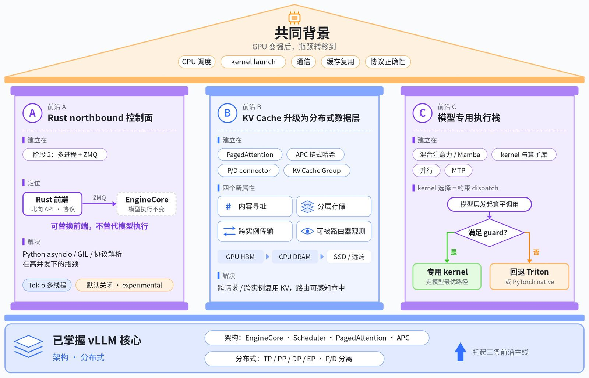

### 4.1 前沿 A：Rust 在 vLLM 中的控制面重建

**建立在**：阶段 2 的“API Server 与 EngineCore 多进程 + ZMQ”架构。

**核心判断**：Rust 实现是 Python EngineCore 之上的**可替换前端**，不替代模型执行引擎，模型加载、调度、CUDA/Triton kernel、GPU 执行仍在 Python/C++/CUDA 侧。它解决的是 Python asyncio、GIL、进程扩展和协议解析在高并发下的瓶颈。入口 `VLLM_USE_RUST_FRONTEND=1 vllm serve <model>`，当前默认关闭、标记 experimental。

| 要点 | 你需要理解的 |
|---|---|
| 为什么用 Rust | 高并发/小模型/短输出/prefix-cache 高命中时，GPU 工作变短，模板渲染、tokenize、JSON、SSE、事件循环占比升高，Python 前端成瓶颈；Rust 用真正的多线程 runtime（Tokio）承接这些 CPU 热路径，不受 GIL/GC 影响。 |
| workspace 分层 | `vllm-server`（HTTP/gRPC）、`vllm-chat`（模板/多模态）、`vllm-text`（校验/detokenize）、`vllm-engine-core-client`（与 Python 引擎握手）等，是一条分层数据转换管线。 |
| 强类型协议边界 | 与 Python EngineCore 经 ZMQ + MessagePack 通信，请求/采样参数/logprobs/结构化输出都有独立类型，协议错误提前到编译期或校验期。 |
| 流式状态机 | reasoning/文本/tool call 由逐 token 驱动的解析器状态机处理，正确应对跨边界 delta、投机解码多 token、JSON 被切块、EOS 未闭合工具调用。 |
| 适用/不适用 | 适合：高并发在线、长 prompt 高命中、DP 多实例、工具调用密集的 Agent、需要 gRPC/TLS 的生产入口。暂不适合：大量自定义 Jinja 模板、依赖 Python 插件、未做 parser parity 验证的工作流。 |

> 📝 **先修回顾**：如果这里的 chat template、tokenize、SSE、detokenize、EngineCore 让你卡壳，回到阶段 2.1/2.3 补齐；它们正是 Rust 前端要重写的那几件事。

### 4.2 前沿 B：KV Cache 升级为分布式数据层

**建立在**：阶段 1 的 PagedAttention/block table、阶段 2 的 APC 链式哈希、阶段 3 的 P/D 分离与 connector、混合 KV Cache Group。

**核心转变**：KV Cache 从“某个 worker 显存里的 tensor”升级为**内容寻址、分层存储、跨实例传输、可被路由器观测**的数据层。因为 KV 是模型输入的确定性派生物，不需要数据库式可变一致性，关键约束变成：相同输入配置必须映射到相同内容键；只有完整写入且有效的数据才能宣布为 HIT。

| 子主题 | 要点 |
|---|---|
| 三个可组合系统 | **KVCacheManager**（本机 GPU 页分配/prefix lookup/引用计数）、**OffloadingConnector**（GPU→CPU primary→FS/对象存储/P2P 级联）、**NixlConnector/MooncakeConnector**（实例间搬 KV，主用于 P/D）。`MultiConnector` 策略是“读第一个命中、写所有”。 |
| 内容寻址 | 链式哈希 `hash_i = H(hash_(i-1), token_ids_i, extra_keys_i)`；`extra_keys` 含多模态/LoRA/cache salt 等，防止“token 相同但语义不同”的误复用。跨实例共享需统一 hash 种子；多租户隔离用 `cache_salt`。 |
| KV Cache Group | Full attention / SWA / Mamba-GDN / MLA 缓存语义不同，相同 spec 的层组成一组共享 block pool；查找时各组独立命中，由 HybridKVCacheCoordinator 求共同可恢复前缀。 |
| Scheduler/Worker 双平面 | `KVConnectorBase_V1` 拆成两半：Scheduler 侧查外部前缀、预留 block、下发传输计划（无副作用）；Worker 侧注册真实 tensor、异步 load/save、汇报完成。 |
| 多级缓存状态机 | lookup 四态 `HIT / HIT_PENDING / RETRY / MISS`；CPU 是强制 gateway，FS/OBJ/P2P 不直接碰 GPU。 |
| 一致性与生命周期 | 不用 Raft/Paxos，而是 cache consistency：内容一致性（链式哈希+握手校验）、可见性一致性（写完才算 HIT，命中上限 `prompt_len - 1`）、生命周期一致性（ref_cnt + pin）、写时复制、故障回收（lease/heartbeat）、事件至少一次投递（消费者须幂等）。 |
| 跨实例协议 | NIXL pull / NIXL push / P2P secondary tier / 双向多轮；双向多轮需 stateful router 按 conversation_id 转发，且必须校验 token 连续性。 |

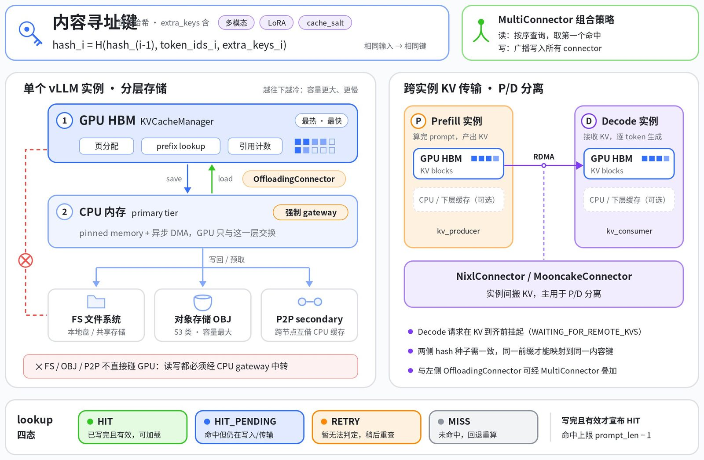

#### 4.2.1 数据组织：token block、内容寻址与分片

**Token block 页大小**：普通 attention 单层近似 `page_bytes = block_size × num_kv_heads × head_dim × 2(K,V) × dtype_bytes`，实际还要乘该 allocation group 的层数，并考虑 layout、padding 和量化 scale。

<b>哈希细节（跨实例复用的关键）</b>：默认的 `sha256` 先用 pickle 序列化，只保证同一版本内一致；跨实例或跨版本共享 KV 时应设 `--prefix-caching-hash-algo sha256_cbor`；`xxhash` 更快，但不是密码学哈希[[vLLM Prefix Caching 设计文档]](https://github.com/vllm-project/vllm/blob/main/docs/design/prefix_caching.md)。v0.29.0 起 `NONE_HASH` 默认确定，跨实例共享不再需要固定 `PYTHONHASHSEED`，但仍要统一哈希算法和 vLLM 版本[[vLLM v0.29.0]](https://github.com/vllm-project/vllm/releases/tag/v0.29.0)。`cache_salt` 能降低跨租户的前缀缓存侧信道风险，但官方说明它**不是隔离边界**，强隔离要分实例部署[[vLLM Security]](https://github.com/vllm-project/vllm/blob/main/docs/usage/security.md)。

**TP/PP/DP 分片规则**：GQA/MHA 的 KV head 按 TP rank 分片，producer/consumer TP 不等时按 head 区间读取并去重；**MLA KV 在 TP rank 间复制**，只需从一个远端 rank 读；SSM/Mamba state 不遵循 KV-head 去重规则，异构 TP 仍受限。PP 下每个 rank 只持有自己层的 KV。DP 下每个 engine 独立 block pool，KV event 携带 `data_parallel_rank` 供 router 路由。混合模型的分片单位是 `(request, kv_group, logical_block, physical_page, tp_rank, pp_rank)`，这也是跨实例不能直接交换本地 `block_id` 的原因。

#### 4.2.2 性能优化与典型场景

<b>九项性能优化（择要）</b>：GPU↔CPU 用 pinned memory + 异步 DMA 与计算重叠；按 layer 等待避免整模型 barrier；多块组 chunk 减少 hash/I/O 调度开销；`kv_recompute_threshold` 比较传输固定成本与重算成本（默认不足 64 token 直接重算）；LRU/ARC 控制 CPU tier 淘汰；selective offload 只保存系统 prompt/共享上下文，不把用户特有尾部写入慢层。

> 📊 <b>实测：</b>细粒度 hybrid prefix cache 让 Qwen3.5-35B-A3B-FP8 的 10K token 前缀后追加 200 token 时，第二次请求延迟从约 **133.7 ms 降到 95.5 ms**，收益来自命中物理大页**内部**的细粒度边界，不必退回上一个完整 Mamba page[[细粒度 hybrid prefix cache #46384]](https://github.com/vllm-project/vllm/pull/46384)。

**五类典型场景**：① **P/D 分离**，主要价值是隔离 tail ITL，不保证提升总吞吐；② **Agent 多轮**，下一轮 P 从 D 拉旧 KV 只算新增，收益随共享前缀增长；③ **RAG/固定系统提示**，共享 block 放 CPU/FS/OBJ，跨实例跨重启复用；④ **弹性扩缩容**，KV event 告诉 router 谁拥有前缀，优先路由降重复 prefill；⑤ **超长上下文**，显存只留活跃工作集，冷前缀下沉，代价是 promotion 延迟与容量规划复杂度。

> 🚧 <b>当前限制：</b>Connector API 仍 experimental；Hybrid SSM/Mamba 的异构 TP、不同远端 block size 组合不完整；动态 KV quant scale 不随 block 传输（P/D 必须用兼容 cache dtype）；多轮双向依赖 stateful router；网络/磁盘/CPU 内存带宽可能取代 GPU 成为新瓶颈；截至 2026-10-11，修 Qwen3.5 `prefix cache + MTP + partial hash boundary` 命中错误的 PR 仍未合并[[Qwen3.5 partial hash 修复 #52244]](https://github.com/vllm-project/vllm/pull/52244)。

📎 延伸阅读：KV 卸载到 CPU 什么时候划算，跨实例复用在路由侧和存储侧各有哪些公开做法，见 [LLM-08｜系统｜大模型推理系统：全栈学习手册](./08-inference-systems.md) 第 16.5、16.6 节。

### 4.3 前沿 C：模型专用 Kernel 与运行时路径

**建立在**：阶段 3.7（混合注意力/Mamba）、3.8（kernel 与算子库）、3.1（TP/PP/DP/EP）、3.4（MTP）。

**核心机制**：新一代模型（混合注意力、稀疏注意力、超大 MoE）偏离标准 Transformer 的地方已进入主执行路径，与其塞进统一路径，不如建立**独立执行栈**。kernel 选择本质是**约束 dispatch**：按硬件、dtype、shape、并行策略选后端，不满足 guard 就回退 Triton 或 PyTorch native，别默认“专用实现一定更快”。

| 模型 | 非标准结构 | 运行时重点 |
|---|---|---|
| DeepSeek V4 | 稀疏 MLA、indexer top-k、压缩 KV、超大 MoE、MTP/DSpark | nvidia/amd/xpu 完全分离；先选块再做 sparse MLA；attention/KV 压缩/MoE 路由/MTP 相互耦合 |
| MiniMax M3 | dense+block-sparse GQA、lightning indexer、MoE | indexer 打分选 top-k page，主 attention 只读选中块；prefill/decode 分别选实现 |
| Inkling | 全局/局部相对注意力 + 四路 short-conv 状态、sink experts | 自定义 sliding-window cache spec；Lamport collective 组织无死锁多 GPU pipeline |
| Kimi K3 | KDA recurrent + MLA、AttnRes、latent MoE | shape-specialization：同一线性层在 M=1 decode 与大 batch prefill 选完全不同实现 |
| Qwen3.5 / Qwen3-Next | GDN + full attention 混合、MoE、MTP | Mamba state 常驻 GPU（MRV2）；混合 prefill/decode 分流；H20 独立 MoE tuning |

> ⛔ <b>读数字要小心（原文档的关键提醒）</b>：GDN fused kernel 的 2x 是**局部 kernel 边界 benchmark**，不能直接预测服务端到端吞吐；microbenchmark 提升不一定转化为端到端收益；优化一个 shape 可能回归另一个 shape。独立 kernel 提供**资源约束**（独立 workspace、shape/stream 约束）但**不提供安全隔离**：真正隔离需独立进程/容器/MIG/独立 EngineCore。

#### 4.3.1 dispatch 结构与关键机制

**从模型名到 kernel 的分派链**：HF 架构名 → ModelRegistry 懒加载 → 平台入口选 nvidia/amd/xpu → 模型层声明 AttentionBackend + KVCacheSpec → Model Runner 构建本 step metadata → KernelConfig / MoE oracle 按硬件/dtype/shape/并行策略选 backend → CustomOp 调用具体实现 → 不满足 guard 就回退 Triton 或 PyTorch native。

**为什么 decode 收益最大**：decode 每 step token 很少、算术量低，kernel launch 与通信延迟占主导，所以把 `projection→activation→norm→state update→copy→collective` 融合成一次 launch 的收益最大，收益来自减少 launch latency、中间 tensor、HBM 往返和同步，跟“单个数学操作变快”无关。

#### 4.3.2 对四个维度的影响与实测提醒

> 📊 <b>Qwen3.5 / Qwen3-Next 实测（与你的场景直接相关）：</b>
>
> - 混合 prefill/decode 时把 decode 切到 recurrent kernel，避免每个 decode token 被填充成 64-token chunk：B200 上 kernel 加速 **1.93 倍**、端到端吞吐 <b>+24.4%</b>[[混合 prefill/decode 优化 #44700]](https://github.com/vllm-project/vllm/pull/44700)。
> - 把 GDN MTP 的 gating、delta recurrence、状态 rewind/update、gated RMSNorm 融合成一个 CUDA kernel[[GDN MTP fused kernel #51674]](https://github.com/vllm-project/vllm/pull/51674)；扩展到 head ratio 1/2/3/4/8 后，H20 graph microbenchmark 在 batch 4/16/64 下约 **2.04x/1.59x/1.44x**[[head ratio 扩展 #52539]](https://github.com/vllm-project/vllm/pull/52539)。

> ⛔ <b>读数字必须警惕两个误判：</b>
>
> - 上述 H20 的 2x 是**固定输入的 kernel boundary benchmark**，只反映 kernel 边界，不代表端到端吞吐；真实模型端到端只在 PRO 6000 上报告约 **1.05~1.12 倍**（Qwen3.6-35B-A3B-FP8），且该路径仅用于 MTP speculative decode。
> - 当前 fused GDN decode 要求 non-interleaved GQA：Qwen3.5 用该布局，原始 Qwen3-Next 设了 `gqa_interleaved_layout=True` 会回退 Triton，**支持相同 head ratio ≠ 两个模型都命中同一 fast path**。

**四个维度权衡：性能**，融合降 launch-bound、按场景选算法，代价是 JIT/autotune 时间与 workspace 显存，且优化一个 shape 可能回归另一个；**正确性**，独立路径可严格校验 dtype/head ratio/TP size/capability 并显式 fallback，但 kernel 越界/NaN/死锁风险仍在，Rust 前端隔离不了 GPU kernel；**可维护性**，每个新模型形成“硬件×dtype×quant×TP/PP/DP/EP×prefill/decode×graph/eager×spec decode”的测试矩阵，MoE oracle 与统一 metadata builder 就是用来控制这种组合爆炸的；**资源隔离**，独立 kernel 只能做 workspace/shape/stream 约束，**不提供安全隔离**，真正隔离需独立进程/容器/MIG/独立 EngineCore。

#### 4.3.3 实测案例：Kimi K3 在 GB300 上的 decode

2026 年 10 月，vLLM 和 NVIDIA 公开了 Kimi K3 的一条专用 decode 路径：借助编码 Agent，在 GB300 上用 CuTe DSL 重写 decode 阶段的注意力、MoE 和通信，目标是 batch 1 到 64 的低延迟 decode，范围限定在单个 NVLink 域内的 8 卡或 16 卡[[vLLM 博客：Kimi K3 专用 decode]](https://vllm.ai/blog/2026-10-16-kimi-k3-megakernel)。代码合进 [[Kimi K3 专用 decode #61867]](https://github.com/vllm-project/vllm/pull/61867)，默认关闭，用 `--additional-config '{"decode_backend": "latency_specialized"}'` 打开，改动只落在 `vllm/models/kimi_k3/nvidia/` 目录。它正好印证 4.3.1 的判断：小 batch decode 卡在 launch 和通信延迟上，收益来自少发 kernel、少走 HBM。

按 Nsight 在 rank 0 上的 trace，一个 KDA 层加 MoE 块的 kernel 数从 23 个降到 13 个，单层耗时从 130μs 降到 69μs（TP16，batch 8）[[vLLM 博客：Kimi K3 专用 decode]](https://vllm.ai/blog/2026-10-16-kimi-k3-megakernel)。

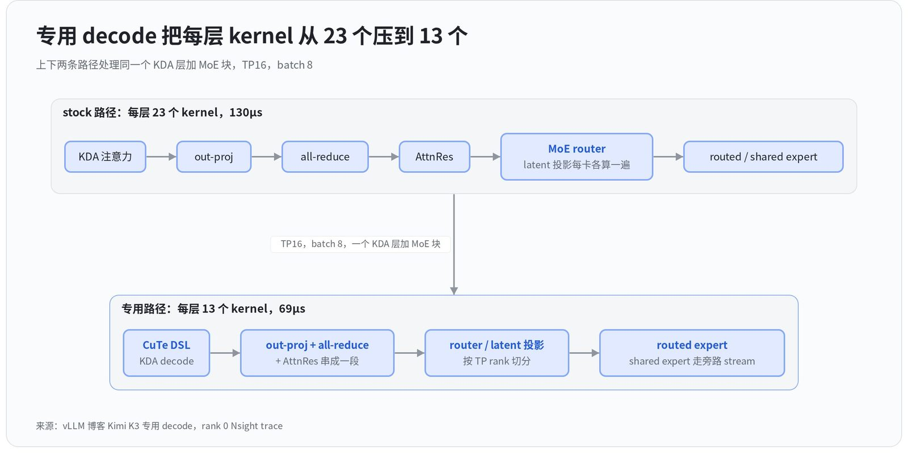

省下的 kernel 和时间来自下面几处改动：

- 小矩阵 GEMM：batch 1 到 2 用按小 shape 写的 kernel，batch 更大时改走 split-K。
- KDA 的 decode 用 CuTe DSL 重写。
- 长上下文的全注意力层用 DCP 把 KV Cache 切到多卡，合并结果时顺带做 v-proj 和 gating。
- out-proj、all-reduce 和 AttnRes 通过 NVLink 可直接访问的 buffer 串起来，部分小 batch 只发一个 kernel，batch 大了改成两段 reduce。
- MoE router 和 latent 输入投影按 TP rank 切分，每张卡只算自己那一份。
- shared expert 放到单独的 stream 上；通信期间在旁路 stream 上把后续权重预取进 cache。

| 场景 | 配置 | 专用路径吞吐（tok/s） | 相对 stock |
|---|---|---|---|
| DSpark 投机解码 | TP16，batch 1，DL7，合成接受长度 6 | 842（stock 488） | 1.73× |
| 不开投机解码 | TP16，batch 1 | 256.4 | 1.88× |
| 不开投机解码 | TP16，batch 8 | 1,157.9 | 1.79× |
| 不开投机解码 | TP16，batch 64 | 3,606.1 | 1.62× |
| 不开投机解码 | TP8，batch 1 | 193.3 | 1.58× |
| 不开投机解码 | TP8，batch 64 | 2,375.9 | 1.31× |

表中数字出自 [[vLLM 博客：Kimi K3 专用 decode]](https://vllm.ai/blog/2026-10-16-kimi-k3-megakernel)，输入长度 1、输出 1000 token，属厂商口径。

> ⛔ <b>这组数字的边界：</b>
>
> - 吞吐是 decode 阶段的聚合 tok/s，不含 prefill。DSpark 那行的接受长度 6 是合成设定，真实流量的接受长度取决于内容。
> - 输入 32K、开 DCP、合成接受长度 3.78 时，加速降到 TP8 1.36 到 1.50 倍、TP16 1.53 到 1.75 倍[[Kimi K3 专用 decode #61867]](https://github.com/vllm-project/vllm/pull/61867)。
> - batch 越大加速越小：TP16 从 batch 1 的 1.88 倍降到 batch 64 的 1.62 倍，TP8 从 1.58 倍降到 1.31 倍。
> - AgentX 并发 1 的 P90 交互速度是 403.2 对 223.7 tok/s/user，前者 16 卡、后者 8 卡，卡数不同，不能当加速比读[[vLLM 博客：Kimi K3 专用 decode]](https://vllm.ai/blog/2026-10-16-kimi-k3-megakernel)。

上线方式比数字更值得照抄。改动限定在模型目录、默认关闭，同时保留全长上下文、温度采样和结构化输出；AIME25、GPQA-Diamond、MRCR v2 与 stock 的差距在约一个标准误以内，prefill 与 stock 逐位一致[[Kimi K3 专用 decode #61867]](https://github.com/vllm-project/vllm/pull/61867)。开发中查出过一个正确性 bug：编译器把激活值的读取挪到了同步等待之前，修法是只让静态权重走这种加载方式；MRCR 和 AIME25 还暴露了单独测 kernel 时没发现的数值问题[[vLLM 博客：Kimi K3 专用 decode]](https://vllm.ai/blog/2026-10-16-kimi-k3-megakernel)。同一个开关随后用到了 DeepSeek-V4.1-Flash 上[[DeepSeek-V4.1-Flash 专用 decode #61868]](https://github.com/vllm-project/vllm/pull/61868)。放进 4.4 的验证矩阵时，这类专用路径要按 batch、上下文长度和是否开投机解码分别测。

### 4.4 落地建议：H20 + Qwen 混合模型的验证矩阵

原文档针对 H20 + Qwen 场景给出了一套“不要一次改变所有开关”的分组验证方法。它同时提醒：本地源码基线往往落后 `origin/main` 上千个 commit，可能缺少最新的 GDN、MTP、prefix-cache、JIT warmup 变化，升级前先对齐基线。注意 v0.29.0 起 Model Runner V2（MRV2）已对所有模型默认开启，MRV1 计划在 v0.32 移除[[vLLM v0.29.0]](https://github.com/vllm-project/vllm/releases/tag/v0.29.0)；下表的“MRV2 开 / 关”应理解为“默认（MRV2）”与“强制回退 MRV1”的对比，并以 v0.29 之后的版本为基线。

| 组 | MRV2 | CUDA Graph | Prefix cache | MTP | 目的 |
|---|---|---|---|---|---|
| A | 当前配置 | 开 | 关 | 关 | 稳定基线 |
| B | 开 | 开 | 关 | 关 | 验证执行层收益 |
| C | 开 | 开 | 开 | 关 | 验证共享前缀收益 |
| D | 开 | 开 | 关 | 开 | 隔离 spec decode 收益 |
| E | 开 | 开 | 开 | 开 | 验证组合正确性 |

<b>每组至少记录：</b>TTFT / TPOT / generation throughput、GPU 与 CPU core 利用率、CUDA Graph hit/fallback、prefix-cache queried/hit tokens、MTP acceptance rate、首次启动/JIT 时间、固定 prompt 的 greedy 输出一致性、长短 prompt 混合流量的 P95/P99。

> ❗ <b>特别规避两个误判：</b>① GDN fused kernel 的 2x 是局部 kernel 数据，不能直接预测服务吞吐；② Prefix cache 默认开启 ≠ `MTP + hybrid + partial hit` 已完全稳定，开放 PR 正在修正该组合[[Qwen3.5 partial hash 修复 #52244]](https://github.com/vllm-project/vllm/pull/52244)。

📎 延伸阅读：单卡 H20 上 Qwen3.6-35B-A3B（GDN 混合架构）从 3.9 提到 20.6 req/s 的四步实测：prefix cache 块对齐、FP8 权重、每步 token 预算和 max_num_seqs，见 [LLM-32｜系统｜AI Infra 性能优化实战：从 profile 到硬件上限](./32-infra-perf.md) 第 11.4 节。

### 4.5 决策依据：原文档为何这样拆分

把这套架构演进讲清楚，原文档遵循五条决策原则，它们也是你读懂“为什么这么设计”的钥匙：

- **先拆控制面 / 缓存数据面 / 执行面**：因为系统瓶颈存在于跨层基础设施，不在单个组件。
- <b>把 kernel 选择理解成“约束 dispatch”，别理解成“专用一定更快”</b>：收益取决于实际瓶颈是否落在该 kernel。
- **KV 用内容寻址 + 不可变 block + 生命周期 fence**：token、layout 或状态位置的小偏差会在后续 decode 中级联成错误输出。
- **保留 reference fallback 与分层验证**：低层数值正确、模型质量、端到端性能必须分别验证。
- **Rust frontend 先保持可替换，不急着替代 Python**：前端语义仍快速演进，保留退出路径比一次性锁定更重要。

> 🎯 <b>贯穿三大工程的同一背景：</b>GPU 算力越来越强后，瓶颈从“算得快不快”转移到 **CPU 调度、kernel launch、通信、缓存复用、协议正确性**。Rust 控制面、分布式 KV Cache、模型专用 kernel 这三件事，本质都是在给这个新瓶颈松绑。读到这里再回读原始演进文档，每一段都能对上号了。

### 4.6 2026 年更新：默认行为变了什么（截至 v0.31.0）

前面几个阶段讲的原理没有过时，但从 2025 年初到 2026 年 10 月，vLLM 的很多默认值已经换了。照着旧文章调参数或读代码，经常会对不上。下图和下表按版本列出关键变化。

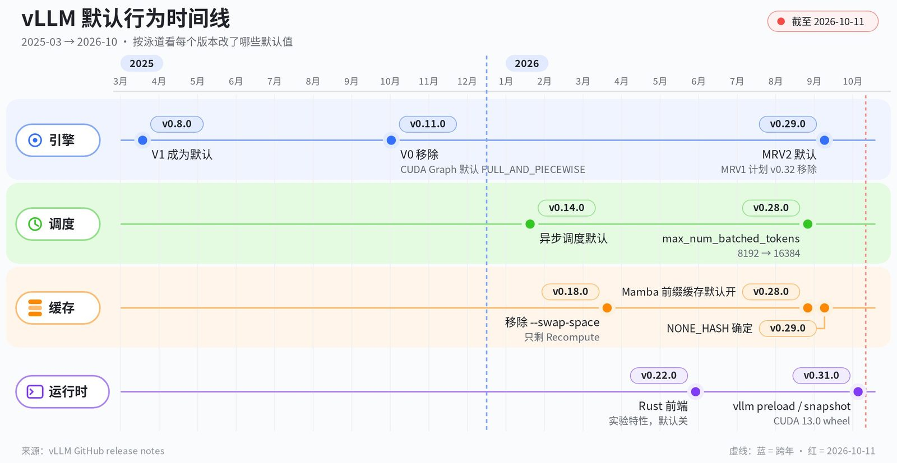

| 版本 | 发布日期 | 默认行为变化 | 对你的影响 |
|---|---|---|---|
| **v0.8.0** | 2025-03-18 | V1 引擎成为默认[[vLLM v0.8.0]](https://github.com/vllm-project/vllm/releases/tag/v0.8.0) | 本文讲的架构从这里开始成为主线 |
| **v0.11.0** | 2025-10-02 | V0 完全移除；CUDA Graph 默认 `FULL_AND_PIECEWISE`[[vLLM v0.11.0]](https://github.com/vllm-project/vllm/releases/tag/v0.11.0) | V0 的参数和代码路径不再存在 |
| **v0.14.0** | 2026-01-20 | 异步调度默认开启[[vLLM v0.14.0]](https://github.com/vllm-project/vllm/releases/tag/v0.14.0) | 调度与 GPU 执行重叠，读调度器代码时要考虑“提前一步” |
| **v0.18.0** | 2026-03-20 | 移除 `--swap-space`[[vLLM v0.18.0]](https://github.com/vllm-project/vllm/releases/tag/v0.18.0) | 抢占只剩 Recompute 一种 |
| **v0.22.0** | 2026-05-29 | 加入实验性 Rust 前端（默认关闭）[[vLLM v0.22.0]](https://github.com/vllm-project/vllm/releases/tag/v0.22.0) | 见 4.1 |
| **v0.28.0** | 2026-08-26 | `max_num_batched_tokens` 默认值 8192 → 16384；Mamba / hybrid 模型前缀缓存默认开启；Blackwell 上 CUDA Graph 默认捕获上限 1024[[vLLM v0.28.0]](https://github.com/vllm-project/vllm/releases/tag/v0.28.0) | 旧的调参经验要重新测 |
| **v0.29.0** | 2026-09-09 | Model Runner V2（MRV2）对所有模型默认，MRV1 计划在 v0.32 移除；`NONE_HASH` 默认确定；TP 默认用 FlashInfer all-reduce[[vLLM v0.29.0]](https://github.com/vllm-project/vllm/releases/tag/v0.29.0) | 读代码换路径；跨实例共享 KV 不再需要固定 `PYTHONHASHSEED` |
| **v0.31.0** | 2026-10-05 | 新增 `vllm preload` 与 `vllm snapshot create/restore`；Mamba 细粒度前缀缓存参数改名；LoRA 路径计入块哈希；默认 wheel 基于 CUDA 13.0[[vLLM v0.31.0]](https://github.com/vllm-project/vllm/releases/tag/v0.31.0) | 有脚本要改参数名；安装环境要对 CUDA 版本 |

<b>升级到 v0.29 以后，先检查这几件事：</b>

- **读代码换路径**：默认执行路径是 `vllm/v1/worker/gpu/model_runner.py`（MRV2）；`gpu_model_runner.py` 是 MRV1，已弃用。只有用到 MRV2 还不支持的特性（如序列并行、DBO、弹性 EP、自定义 logits processor、部分投机解码方法）时才会回退 MRV1[[vLLM v0.29.0]](https://github.com/vllm-project/vllm/releases/tag/v0.29.0)。
- **跨实例共享 KV**：统一 vLLM 版本，并把哈希算法设为 `sha256_cbor`；不再需要固定 `PYTHONHASHSEED`。
- **重新测批大小**：如果你没有显式设置 `max_num_batched_tokens`，升级到 v0.28 后它会从 8192 变成 16384，TTFT 和 ITL 的取舍会跟着变[[vLLM v0.28.0]](https://github.com/vllm-project/vllm/releases/tag/v0.28.0)。
- **改参数名**：`--enable-mamba-fine-grained-prefix-cache` 在 v0.31.0 改名为 `--enable-mamba-shared-prefix-checkpoint`，属于破坏性变更[[vLLM v0.31.0]](https://github.com/vllm-project/vllm/releases/tag/v0.31.0)。
- **对 CUDA 版本**：v0.31 默认 wheel 基于 CUDA 13.0，CUDA 12.x 环境要换对应的 wheel 或镜像。

**规模参考**：vLLM 团队公布的宽 EP 大规模部署中，H200 上每卡约 2.2k tok/s[[vLLM 大规模服务博客]](https://blog.vllm.ai/2025/12/17/large-scale-serving.html)；GB200 上 prefill 每卡每秒 26.2K token、decode 10.1K token（2K 输入 / 2K 输出），是 H200 的 3–5 倍[[vLLM GB200 博客]](https://vllm.ai/blog/2026-02-03-dsr1-gb200-part1)。

> 💡 **本节的时效**：内容截至 2026-10-11（v0.31.0）。vLLM 大约每两三周发一个版本，默认值还会继续变；动手前以对应版本的 release notes 为准。

📎 延伸阅读：PagedAttention 与前缀复用在多租户下会跨过信任边界，读行为、读数据、读时延和分配器四类泄露面的机制与自查清单，见 [LLM-68｜系统｜KV Cache 的信任边界：共享、分层与三种泄露面](./68-kv-cache-trust.md) 第 2、3 章。

---

## 小结 · 里程碑与自测清单

用下面的清单确认自己真正“通关”，别读过就算。建议逐条都能向别人讲清楚，再进入下一阶段。

> ⭐ - [ ] 阶段 1：能画出 prefill/decode 的性能画像，并解释 PagedAttention 如何消灭碎片
>
> - [ ] 阶段 2：能默画 vLLM V1 请求生命周期图，说清每个组件职责与为什么多进程
>
> - [ ] 阶段 2：能解释 APC 链式哈希为什么保证前缀正确性
>
> - [ ] 阶段 3：能说清 TP/PP/DP/EP 的切分对象与通信模式，并给出组合选型
>
> - [ ] 阶段 3：能解释量化的三个作用位置、投机解码接受率、CUDA Graph 适用边界、P/D 分离到底优化什么
>
> - [ ] 阶段 4A：能说清 Rust 前端替代/不替代了什么，以及为什么高并发下 Python 前端成瓶颈
>
> - [ ] 阶段 4B：能解释 KV Cache 为何用内容寻址+不可变+生命周期 fence，而非数据库一致性
>
> - [ ] 阶段 4C：能解释“kernel 选择是约束 dispatch”以及为什么 microbenchmark 不等于端到端收益
>
> - [ ] 终点：回读原始演进文档，能对每一节说出“它建立在我学过的哪个概念上”

---

## 附录 · 关键资料汇总

### 基础与架构（建议按阶段顺序读）

- PagedAttention 论文，[Efficient Memory Management for LLM Serving (arXiv:2309.06180)](https://arxiv.org/abs/2309.06180)
- PagedAttention 设计文档：[docs.vllm.ai](https://docs.vllm.ai/en/latest/design/paged_attention/)
- vLLM V1 架构总览：[Architecture Overview](https://docs.vllm.ai/en/latest/design/arch_overview/)
- vLLM V1 Alpha 发布说明：[V1 Alpha](https://blog.vllm.ai/2025/01/27/v1-alpha-release.html)
- 自动前缀缓存设计：[Prefix Caching](https://docs.vllm.ai/en/latest/design/prefix_caching/)
- 连续批处理科普，[Anyscale: Continuous Batching](https://www.anyscale.com/blog/continuous-batching-llm-inference)
- 快速上手：[Quickstart](https://docs.vllm.ai/en/latest/getting_started/quickstart/)

### 分布式与性能进阶

- 并行与扩展：[Parallelism and Scaling](https://docs.vllm.ai/en/latest/serving/parallelism_scaling/)
- 专家并行部署：[Expert Parallel Deployment](https://docs.vllm.ai/en/latest/serving/expert_parallel_deployment/)
- 量化总览，[Quantization](https://docs.vllm.ai/en/latest/features/quantization/)；KV Cache 量化，[Quantized KV Cache](https://docs.vllm.ai/en/latest/features/quantization/quantized_kvcache/)
- CUDA Graphs 设计：[CUDA Graphs](https://docs.vllm.ai/en/latest/design/cuda_graphs/)
- P/D 分离，[Disaggregated Prefilling](https://docs.vllm.ai/en/latest/features/disagg_prefill/)；NIXL Connector，[NixlConnector Usage](https://docs.vllm.ai/en/latest/features/nixl_connector_usage/)
- 混合 KV Cache 分配 RFC：[RFC #11382](https://github.com/vllm-project/vllm/issues/11382)

### 前沿主线（原始演进文档引用的一手资料）

- Rust frontend RFC，[#40846](https://github.com/vllm-project/vllm/issues/40846)；集成 PR，[#40848](https://github.com/vllm-project/vllm/pull/40848)
- Streaming Parser Engine：[#45413](https://github.com/vllm-project/vllm/pull/45413)
- Model Runner V2 设计：[model_runner_v2.md](https://github.com/vllm-project/vllm/blob/main/docs/design/model_runner_v2.md)
- Hybrid KV Cache Manager：[hybrid_kv_cache_manager.md](https://github.com/vllm-project/vllm/blob/main/docs/design/hybrid_kv_cache_manager.md)
- KV Offloading 指南：[kv_offloading_usage.md](https://github.com/vllm-project/vllm/blob/main/docs/features/kv_offloading_usage.md)
- NIXL push 协议：[nixl_kv_push_connector.md](https://github.com/vllm-project/vllm/blob/main/docs/design/nixl_kv_push_connector.md)
- 模型专用路径：DeepSeek V4 [#40902](https://github.com/vllm-project/vllm/issues/40902) · MiniMax M3 [#45381](https://github.com/vllm-project/vllm/pull/45381) · Inkling [#48799](https://github.com/vllm-project/vllm/pull/48799) · Kimi K3 [#50000](https://github.com/vllm-project/vllm/pull/50000) · Kimi K3 专用 decode [#61867](https://github.com/vllm-project/vllm/pull/61867)

> 🎓 本学习路径是**通往原始演进文档的脚手架**。走完五个阶段后，把原文档当作“毕业考试”回读一遍：若每一节都能对应到你学过的地基，说明这条路径已经走通。

---

上一篇：[LLM-02｜地基｜LLM 数学补课：读懂公式的一张地图](./02-math.md) · [目录](./README.md) · 下一篇：[LLM-04｜工程｜《深入理解 AI Agent》精读：设计原理与工程实践](./04-ai-agent-reading.md)
