# LLM-05｜工程｜Agent 工程实战：从工具到上线的施工手册

> 🎯 **这篇文档解决什么问题**：写一个能跑的 Agent Demo 只要一下午，做一个能上线、能长期稳定工作的 Agent 却要几个月。差距主要来自模型周围的工程：**工具怎么设计、上下文怎么管、什么时候该拆成多个 Agent、怎么评测、怎么防注入、怎么控成本**。本文把 Anthropic、Cognition、OpenAI 等一线团队 2024–2026 年公开的工程经验和相关论文，整理成一份按施工顺序排列的手册。每章都给出可直接照做的原则、背后的数据依据和常见的坑。
>
> 使用方式：按施工顺序读。先读第 1 章决定要不要用 Agent，再按第 2–9 章的顺序逐项搭建，上线前用第 10 章的清单核对。想看成熟的开源外壳怎样处理会话、压缩、权限和扩展，读第 11 章。想把“删旧工具结果”挪到 KV 层、不再触发重算，读第 12 章。读之前知道 LLM 和工具调用是什么即可。文中产品功能和数字核对于 2026 年 10 月 28 日。

## 导读 · 先给结论

- **能用固定流程解决的，不要用 Agent**。先从最简单的方案开始，只在确实需要时增加自主性[[1]](https://www.anthropic.com/engineering/building-effective-agents)。
- **工具是 Agent 的界面，值得像设计 UI 一样设计**。SWE-agent 只改了工具界面，同一模型的解决率就比只给 Shell 提高了 64%（相对值）[[2]](https://arxiv.org/abs/2405.15793)。
- **上下文越长不等于越好**。18 个主流模型都会随输入变长而变得不可靠[[3]](https://research.trychroma.com/context-rot)；要主动压缩、记笔记、隔离。
- <b>多 Agent 主要是在“花更多 token”</b>。Anthropic 的研究系统比单 Agent 好 90.2%，但 token 消耗约是聊天的 15 倍[[4]](https://www.anthropic.com/engineering/multi-agent-research-system)；写操作最好留在一个 Agent 里[[5]](https://cognition.com/blog/multi-agents-working)。
- **看 pass^k，不只看平均成功率**。GPT-4o 在 τ-bench 零售场景单次成功率约 61%，但同一任务连续 8 次都成功的比例不到 25%[[6]](https://arxiv.org/abs/2406.12045)。

Anthropic 给 Agent 下的定义很朴素：**在循环中使用工具、根据环境反馈决定下一步的 LLM**[[1]](https://www.anthropic.com/engineering/building-effective-agents)。拆开看，一个生产级 Agent 由六个部分组成，模型只是其中一个：

- **模型**：负责推理和决策。选型决定上限，但通常不是瓶颈。
- **工具**：Agent 能做的所有事情。工具设计的质量直接决定 Agent 能不能把事做对（第 3 章）。
- **上下文**：每一步喂给模型的全部信息。上下文管理是长任务成败的关键（第 4 章）。
- **循环与 Harness**：驱动“思考 → 调工具 → 看结果”的外壳代码，负责停止条件、错误恢复、跨会话交接（第 2 章）。
- **评测与可观测**：知道它做得好不好、为什么失败（第 7 章）。
- **护栏**：权限、沙箱、审批，限制它最多能造成多大损失（第 8 章）。

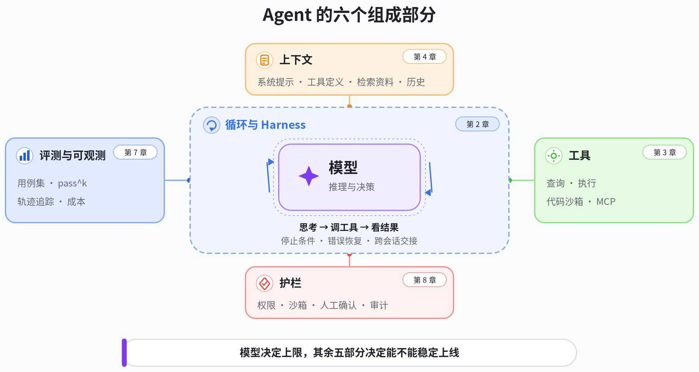

| 章节 | 回答的问题 | 图 |
|---|---|---|
| 第 1 章 工作流还是 Agent | 什么时候不该用 Agent；五种常用编排模式 | B2 |
| 第 2 章 循环与 Harness | Agent 循环怎么写；长任务怎么跨会话接力 | B3、B4 |
| 第 3 章 工具设计 | 好工具和坏工具差在哪；工具多了怎么办 | B5、B6 |
| 第 4 章 上下文工程 | 上下文为什么会“腐烂”；压缩、笔记、子 Agent、缓存 | B7、B8 |
| 第 5 章 多 Agent | 什么时候拆，什么时候别拆；多 Agent 常见的 14 种失败 | B9、B10 |
| 第 6 章 可靠性 | 为什么平均成功率会骗人；错误如何累积 | B11 |
| 第 7 章 评测与可观测 | 从 20 条用例起步；看轨迹而不只看结果 | B12 |
| 第 8 章 安全 | 提示注入为什么只能靠架构防 | B13 |
| 第 9 章 成本与延迟 | Agent 为什么贵；缓存、路由、并行 | B14 |
| 第 10 章 上线清单与反模式 | 上线前逐项核对 | — |
| 第 11 章 Harness 解剖 | 五个开源外壳在会话、压缩、权限、扩展上怎么取舍；自查清单 | B15 |
| 第 12 章 缓存工程 | 改文本为什么会打碎缓存；KV 层丢弃与重排、服务端复用；效果与边界 | B16–B18 |

📎 与系列其他文档的分工：LLM 本身怎么工作见「LLM 基础」，运维场景里的 Agent 落地见「LLM 在运维与容灾中的落地」。Agent 接外部工具的协议见「Agent 协议与工具链」，跨会话记忆见「Agent 记忆」。本文只讲单个 Agent 从工具到上线的工程做法。

## 第 1 章 · 工作流还是 Agent：先决定要不要“自主”

Anthropic 把基于 LLM 的系统分成两类[[1]](https://www.anthropic.com/engineering/building-effective-agents)：

- <b>工作流（Workflow）</b>：LLM 和工具按**预先写好的代码路径**编排。步骤是确定的，LLM 只负责其中某几步的“理解”和“生成”。
- **Agent**：LLM **自己决定**下一步做什么、调哪个工具、什么时候结束。

两者的取舍很直接：工作流可预测、便宜、好调试；Agent 灵活，能处理事先想不到的情况，但更慢、更贵、更难保证一致。所以默认选择应该是工作流，**只有当步骤数量和顺序无法事先确定时，才引入 Agent**。

### 1.1 五种常用编排模式

| 模式 | 做法 | 适用场景 |
|---|---|---|
| 提示链（Prompt Chaining） | 把任务拆成固定的几步，上一步的输出作为下一步的输入，中间可以加程序校验 | 写大纲 → 校验大纲 → 按大纲写正文 |
| 路由（Routing） | 先分类，再交给专门的处理流程或模型 | 客服问题分流；简单问题走小模型 |
| 并行（Parallelization） | 同一输入并行跑多个子任务后汇总，或同一任务跑多次投票 | 多维度代码审查；内容安全多次判定 |
| 编排者-执行者（Orchestrator-Workers） | 一个 LLM 动态拆解任务、分派给执行者、汇总结果 | 改动涉及多个文件的编码任务；多来源调研 |
| 评估者-优化者（Evaluator-Optimizer） | 一个 LLM 生成，另一个按标准评估并反馈，循环直到达标 | 翻译润色；有明确评价标准的写作 |

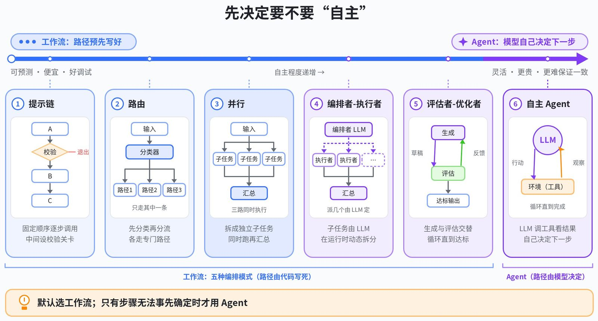

### 1.2 判断要不要用 Agent 的四个问题

1. <b>步骤能不能事先列出来？</b>能，就写成工作流。
2. <b>任务的价值能不能覆盖成本？</b>Agent 的 token 消耗通常是普通对话的约 4 倍[[4]](https://www.anthropic.com/engineering/multi-agent-research-system)，低价值、高频的任务不划算。
3. <b>出错能不能被发现和纠正？</b>编码任务有测试、有编译器，错误能被发现；开放式写作没有客观标准，Agent 容易“自信地跑偏”。
4. <b>出错的代价能不能承受？</b>代价越高，自主权越要收紧，见第 8 章。

> 📌 **不要被框架带着走**。很多框架默认就提供“多 Agent 协作”“自动规划”这类抽象，用起来很方便，但会把简单问题变复杂、把错误藏进框架内部。Anthropic 的建议是先直接调用模型 API，很多模式几行代码就能实现；用框架时也要清楚它底层发了什么请求[[1]](https://www.anthropic.com/engineering/building-effective-agents)。

## 第 2 章 · Agent 循环与 Harness

### 2.1 最小循环

几乎所有 Agent 都是 ReAct 循环的变体：模型轮流做“推理”和“行动”，每次行动的结果作为观察返回给模型，再决定下一步[[7]](https://arxiv.org/abs/2210.03629)。现在的模型 API 原生支持工具调用，一个最小 Agent 的骨架只有十几行：

*最小 Agent 循环
*

```python
messages = [system_prompt, user_task]for step in range(MAX_STEPS):    resp = llm.call(messages, tools=TOOLS)    messages.append(resp)    if not resp.tool_calls:          # 模型不再调工具，视为完成        return resp.text    for call in resp.tool_calls:        try:            result = execute(call)    # 权限检查、超时、结果截断都在这里        except ToolError as e:            result = f"ERROR: {e.kind}: {e.hint}"        messages.append(tool_result(call.id, result))raise StepLimitExceeded()
```

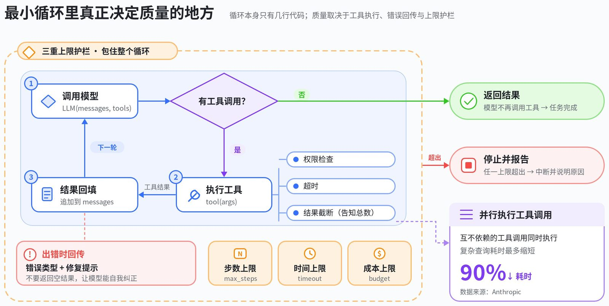

这十几行里，真正决定质量的是那些“不起眼”的地方：

- **停止条件**：除了“模型不再调工具”，还要有步数上限、时间上限、成本上限。没有上限的 Agent 迟早会陷入死循环。
- **错误回传**：工具出错时，把错误类型和修复提示原样告诉模型，模型通常能自己改正；吞掉错误或返回空结果，模型会以为“没问题”继续往下走。
- **结果截断**：工具返回几万行日志会直接撑爆上下文。截断时要告诉模型“共 N 条，只显示前 50 条，可以用某参数翻页”[[8]](https://www.anthropic.com/engineering/writing-tools-for-agents)。
- **并行调用**：模型一次返回多个互不依赖的工具调用时并行执行，能明显缩短耗时。Anthropic 的研究系统靠子 Agent 并行和工具并行，把复杂查询的耗时缩短了最多 90%[[4]](https://www.anthropic.com/engineering/multi-agent-research-system)。

### 2.2 Harness：模型外面那层壳

Harness 指的是包在模型外面、驱动循环的全部代码：系统提示、工具注册、上下文管理、权限、日志、跨会话的状态保存。同一个模型配不同的 Harness，表现可以差很多。Claude Code、Cursor、Codex 这类编码 Agent 之间的差距，很大一部分就在 Harness。第 11 章拆开了五个开源外壳，逐项对照它们在会话存储、压缩、权限和扩展上的取舍。

### 2.3 长任务：跨会话接力

当任务长到一个上下文窗口装不下（例如从零写一个 Web 应用），就需要多次会话接力完成。每个新会话的模型对之前发生的事一无所知，最常见的失败是：一口气想做完所有事、做到一半上下文满了、下一个会话面对一个半成品不知从何下手；或者看到已有进展就宣布“任务完成”。

Anthropic 给出的解法借鉴了优秀工程师的日常习惯[[9]](https://www.anthropic.com/engineering/effective-harnesses-for-long-running-agents)：

1. **初始化 Agent**（只运行一次）：搭好环境，写一个启动脚本 `init.sh`、一份功能清单 `feature_list.json`、一份进度日志 `claude-progress.txt`，并做第一次 git 提交。
2. **编码 Agent**（之后每个会话）：先读进度日志和 git 历史了解现状，跑启动脚本确认环境正常，从功能清单里挑一个最高优先级的未完成项，**只做这一项**，测试通过后提交 git 并更新进度日志。

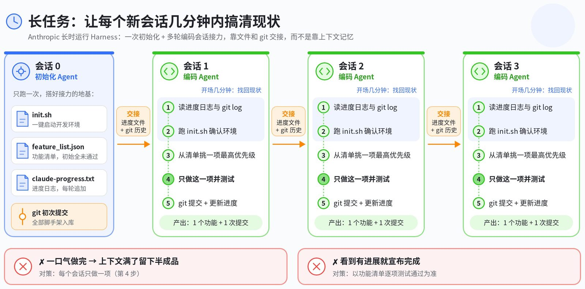

> ✅ **可迁移的经验**：长任务的关键是**让每个新会话能在几分钟内搞清楚现状**，用不着“记住一切”。进度文件 + 版本控制 + 每次只推进一小步 + 每步都留下干净可运行的状态，这四件事对人类团队和 Agent 同样有效。

### 2.4 持久化执行、幂等与人工审批

Agent 跑得越久，越可能在中途被打断：进程崩溃、限流超时、发布重启，或者停下来等人审批。隔了一天再回来，它要能接着做，而且已经做过的副作用（发邮件、扣款、建工单）不能再做一遍。这就是持久化执行要解决的问题。12-Factor Agents 里有三条与此直接对应：统一执行状态和业务状态、用简单的 API 启动 / 暂停 / 恢复、用工具调用去联系人类[[34]](https://github.com/humanlayer/12-factor-agents)。

#### 检查点：把每一步的状态存下来

主流框架的做法都是在步骤边界存检查点，再凭一个会话标识找回来：

| 框架 | 存什么 | 凭什么找回 | 要注意 |
|---|---|---|---|
| LangGraph | 每一步之后的图状态（checkpoint）；开发用内存或 SQLite，生产用 Postgres | 同一个 `thread_id` | `InMemorySaver` 在进程重启后全部丢失。持久化有三档：`exit` 只在结束、出错或中断时写，崩溃后无法从中途恢复；`async` 在下一步执行的同时异步写，崩溃时有小概率漏写；`sync` 写完才进入下一步，最稳也最慢[[26]](https://docs.langchain.com/oss/python/langgraph/persistence)[[37]](https://docs.langchain.com/oss/python/langgraph/checkpointers) |
| OpenAI Agents SDK | 运行状态 RunState（可序列化成字符串或 JSON）+ 会话历史 Session | 反序列化 RunState 后交给 `Runner.run` | 审批暂停后，要用同一个 Session ID 和同一个存储后端恢复[[28]](https://openai.github.io/openai-agents-python/human_in_the_loop/) |
| Temporal | 工作流的事件历史；模型调用和工具调用都作为 Activity | 工作流重放 | 已完成的 Activity 重放时不会再执行；没来得及上报结果的会被重试[[30]](https://docs.temporal.io/activity-definition) |

最容易踩的坑：**恢复从检查点边界重放，并不从中断的那一行接着跑**。LangGraph 恢复时会把整个节点从头再跑一遍，节点里中断之前的代码会再执行一次[[35]](https://docs.langchain.com/oss/python/langgraph/interrupts)；用“时间旅行”从旧检查点回放时，之后的模型调用和 API 请求也都会重新触发[[37]](https://docs.langchain.com/oss/python/langgraph/checkpointers)。

#### 幂等：重放时副作用不能做两遍

- **副作用单独包起来**：LangGraph 要求把随机数、写文件、调 API 这类操作放进 task，并明确提示开始了但没完成的 task 在恢复时可能再跑一次，副作用要设计成幂等的[[27]](https://docs.langchain.com/oss/python/langgraph/functional-api)；Temporal 同样建议 Activity 做成幂等[[30]](https://docs.temporal.io/activity-definition)。
- **幂等键要稳定**：用重试之间不变、不同任务之间唯一的标识，例如 Temporal 推荐的“工作流运行 ID + Activity ID”[[30]](https://docs.temporal.io/activity-definition)，或者“会话 ID + 步骤名”。在重试路径上现生成随机 UUID，等于没有幂等。
- **下游支持就透传**：Stripe 的幂等键最长 255 个字符，用同一个键重试会拿到第一次的结果（包括 500 错误），参数和第一次不一致会直接报错；键至少保留 24 小时后才可能被清理[[32]](https://docs.stripe.com/api/idempotent_requests)。
- **下游不支持就自己兜底**：本地建一张带唯一约束的执行记录表，先查后写。只读操作天然幂等，可以放心重试。

#### 人工审批：暂停、交出决定、再恢复

- **LangGraph**：在节点里调用 `interrupt()` 暂停，人做完决定后用 `Command(resume=…)` 恢复，传入的值就是 `interrupt()` 的返回值。两条规则：不要用 try/except 包住 `interrupt()`，它靠抛出特殊异常来暂停；不要在单个节点里写 `while True` 加 `interrupt()` 的循环，每次恢复都会把之前所有轮次重放一遍[[35]](https://docs.langchain.com/oss/python/langgraph/interrupts)。
- **OpenAI Agents SDK**：在工具上设 `needs_approval`（布尔值，或按参数逐次判断的函数），运行结果里就会出现待审批项；把结果转成 RunState，逐项 approve 或 reject（可以附上拒绝理由），再交给 `Runner.run` 继续。RunState 可以序列化存库，过几天再恢复[[28]](https://openai.github.io/openai-agents-python/human_in_the_loop/)。
- **Temporal**：工作流用 `wait_condition` 等待人工信号，可以设超时；等待期间不占计算资源，可以等几小时甚至几天。如果审批界面需要马上知道“已收到”，用 Update 而不是 Signal[[31]](https://docs.temporal.io/ai/cookbook/human-in-the-loop-python)。

Claude Agent SDK 的权限判断按固定顺序走：hooks → 拒绝规则 → 询问规则 → 权限模式 → 允许规则 → `canUseTool` 回调。hook 的拒绝在 `bypassPermissions` 模式下依然生效，而被规则自动放行的工具不会再走到 `canUseTool`[[33]](https://code.claude.com/docs/en/agent-sdk/permissions)。设计审批前，先弄清自己的拦截点在这条链的哪一环。

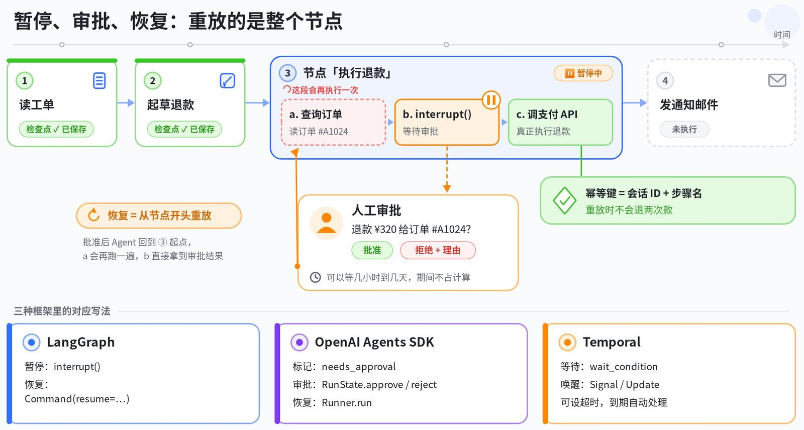

> ✅ **审批设计要点**：审批的对象是“带具体参数的这一次调用”，不是“这个工具”；超时默认拒绝；拒绝理由回传给模型，让它换个做法；每次审批都留审计记录；“以后都允许”这类粘性决定要限定作用范围。

## 第 3 章 · 工具设计：Agent 的用户界面

📎 延伸阅读：让模型直接操作网页和桌面见 [LLM-28｜工程｜Computer Use 与浏览器 Agent：让模型操作界面](./28-computer-use.md)；用编程 Agent 写代码的工作流见 [LLM-26｜工程｜编程 Agent 实战：Claude Code、Codex 与 Cursor](./26-coding-agents.md)；语音形态的 Agent 见 [LLM-34｜工程｜实时语音 Agent：延迟预算、打断与全双工](./34-voice-agent.md)。

SWE-agent 的作者提出了一个观点：Agent 是一类新的“用户”，它需要专门为它设计的界面，就像人类需要 IDE 一样，他们称之为 Agent-计算机接口（ACI）[[2]](https://arxiv.org/abs/2405.15793)。实验结果支持这个观点：同样用 GPT-4 Turbo，只给 Shell 的 Agent 在 SWE-bench Lite 上解决 11.0%，换成专门设计的文件查看、搜索、编辑工具后解决 18.0%，相对提升 64%。改进来自很具体的设计：查看文件时一次只显示 100 行并标明行号；编辑后自动做语法检查，不通过就拒绝并提示；搜索结果过多时要求缩小范围，而不是全部返回。

### 3.1 好工具的七条原则

综合 Anthropic 的工具设计经验[[8]](https://www.anthropic.com/engineering/writing-tools-for-agents)：

| 原则 | 反例 | 正例 |
|---|---|---|
| 按任务设计，不按 API 设计 | `list_users`、`list_events`、`create_event` 三个工具，让模型自己拼 | 一个 `schedule_event`，内部完成查空闲和创建 |
| 名字和用途不重叠 | `search` 和 `find` 同时存在，说不清区别 | `search_logs`、`search_tickets`，按命名空间分组 |
| 返回人能读懂的内容 | 返回 UUID 和内部字段名 | 返回名称、关键字段，必要时附 ID |
| 控制返回长度 | 一次返回 1 万条记录 | 默认分页 + 告知总数 + 提供过滤参数 |
| 错误信息可操作 | `Error 400` | “参数 date 格式应为 YYYY-MM-DD，收到 10/01” |
| 参数用受控枚举 | 自由字符串 `env` | 枚举 `prod \| staging \| dev`，非法值直接拒绝 |
| 描述写给新同事看 | 一句话描述 | 写清用途、何时用、何时不用、参数含义和示例 |

一个实用的判断标准：**如果一个人类工程师看了工具列表也说不清该用哪个，Agent 也说不清**[[8]](https://www.anthropic.com/engineering/writing-tools-for-agents)。

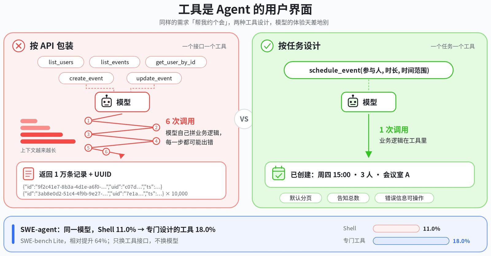

### 3.2 工具描述要迭代

工具描述不是写一次就完的。Anthropic 让 Claude 读评测中的失败轨迹、找出工具被误用的原因、改写工具描述，再重新跑评测。他们还做了一个专门测试工具的 Agent：拿到一个有问题的工具后反复调用几十次，再改写工具描述。用这种方式改进工具后，后续 Agent 完成任务的时间缩短了 40%[[4]](https://www.anthropic.com/engineering/multi-agent-research-system)。

### 3.3 工具多了怎么办

接入的 MCP 服务器越多，工具定义就越多。每个工具的名称、描述、参数都要放进上下文，几百个工具会在任务开始前就占掉几万 token，而且模型在一长串相似工具里更容易选错。RAG-MCP 的实验显示，在大量工具中直接选择，准确率只有 13.62%；先按任务检索出相关工具、只把这几个交给模型，准确率提高到 43.13%，提示 token 减少一半以上[[10]](https://arxiv.org/abs/2505.03275)。

另一种思路是**把工具变成代码**。Anthropic 提出让 Agent 在沙箱里写代码调用 MCP 工具：工具定义以文件形式存放，Agent 按需浏览目录、只读取需要的那几个；中间数据在沙箱里处理，只把最终结果交回模型。在他们的示例中，一个工作流的 token 消耗从约 15 万降到约 2000，减少 98.7%[[11]](https://www.anthropic.com/engineering/code-execution-with-mcp)。

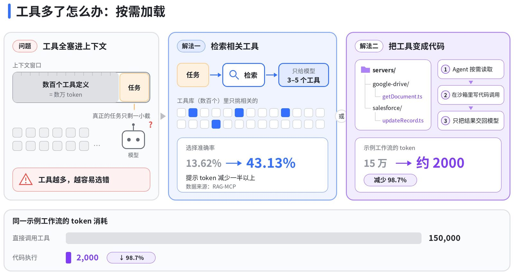

> ❗ **不要把 API 原样包成工具**。把一个有 80 个端点的内部 API 自动生成 80 个工具，是最常见也最糟糕的做法：工具多、粒度碎、返回冗长，模型要靠多次调用自己拼出业务逻辑，每一步都可能出错。先想清楚 Agent 要完成的任务，再为任务设计少量高层工具。

## 第 4 章 · 上下文工程：有限的注意力预算

📎 延伸阅读：跨会话的长期记忆见 [LLM-21｜工程｜Agent 记忆：存什么、怎么取、何时忘](./21-agent-memory.md)；提示缓存、思考档位等调用层面的做法见 [LLM-20｜工程｜用好模型：提示词、思考档位与模型路由](./20-prompting-routing.md)。

Prompt 工程关心“怎么写好一段指令”；上下文工程关心“在一个多轮、不断增长的任务里，每一步该把什么放进上下文”[[12]](https://www.anthropic.com/engineering/effective-context-engineering-for-ai-agents)。Cognition 的说法更直接：上下文工程实际上是构建 Agent 的工程师的头号工作[[13]](https://cognition.com/blog/dont-build-multi-agents)。

### 4.1 上下文为什么会“腐烂”

直觉上，上下文窗口越大越好：把所有资料都塞进去，让模型自己找。实际并非如此。

- **中间的信息容易被忽略**：相关信息放在长上下文的开头或结尾时模型表现最好，放在中间时明显变差[[14]](https://arxiv.org/abs/2307.03172)。
- **越长越不可靠**：Chroma 测试了包括 GPT-4.1、Claude 4、Gemini 2.5、Qwen3 在内的 18 个模型，发现即使是非常简单的任务，性能也会随输入变长而持续下降；问题和答案的语义越不相近、干扰信息越多，下降越快[[3]](https://research.trychroma.com/context-rot)。

所以 Anthropic 把上下文看作一种**边际收益递减的有限资源**：目标是找到“最小的高信号 token 集合”，而不是“尽量多给”[[12]](https://www.anthropic.com/engineering/effective-context-engineering-for-ai-agents)。

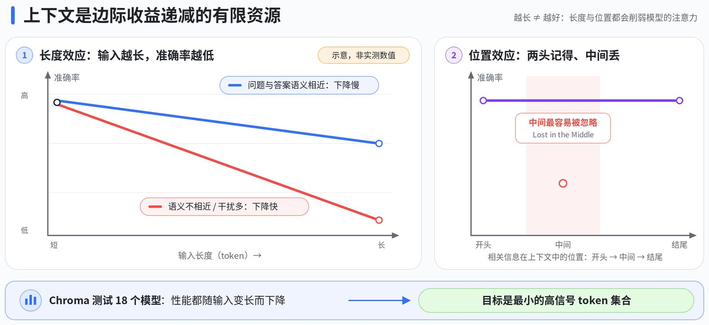

### 4.2 上下文里放什么

| 组成部分 | 常见问题 | 做法 |
|---|---|---|
| 系统提示 | 要么太死（写满 if-else 规则），要么太虚（“你是一个专业助手”） | 写清目标、原则和边界，用少量典型示例代替穷举规则 |
| 工具定义 | 工具过多、描述重叠 | 精简工具集；按需加载（3.3 节） |
| 检索到的资料 | 一次性塞入大量文档 | “即时检索”：只保存路径、链接、查询方式，需要时再用工具读取 |
| 历史对话与工具结果 | 早期的工具输出一直占着上下文 | 清理已经用过的旧工具结果；必要时压缩 |

### 4.3 长任务的三种手段

- <b>压缩（Compaction）</b>：上下文接近上限时，把历史总结成一段摘要，开启新的上下文继续。摘要要保留关键决策、未解决的问题和重要事实，丢弃重复的工具输出。压缩过度会丢掉当时看似不重要、后来才发现关键的细节，所以应先保证召回，再追求精简[[12]](https://www.anthropic.com/engineering/effective-context-engineering-for-ai-agents)。切点怎么选、摘要模板怎么写、怎样不打碎提示缓存，见第 11.2 节。
- <b>结构化笔记（Agentic Memory）</b>：Agent 定期把进度、待办、发现写到上下文之外的文件里，需要时再读回来。第 2 章的进度日志就是这种做法。
- **子 Agent 隔离**：把一个需要大量探索的子任务交给子 Agent，它在自己干净的上下文里可能消耗几万 token，但只返回 1000–2000 token 的精炼结论给主 Agent[[12]](https://www.anthropic.com/engineering/effective-context-engineering-for-ai-agents)。

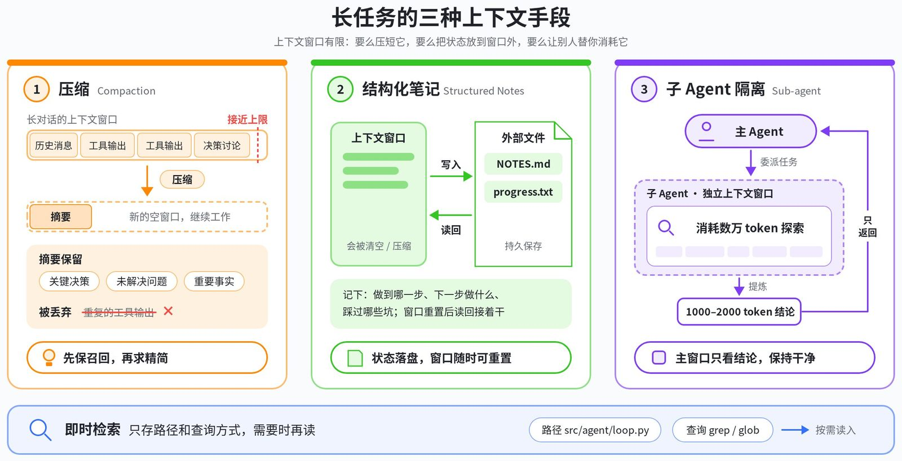

### 4.4 提示缓存：顺序决定成本

Agent 每一轮都要把系统提示、工具定义和历史重新发给模型，这部分内容大量重复。主流 API 都支持前缀缓存：如果本次请求的开头和之前某次请求完全一致，这部分就按缓存价格计费。以 Anthropic 为例，缓存命中的输入按基础价格的 10% 计费，写入缓存时有 25% 的溢价[[15]](https://docs.anthropic.com/en/docs/build-with-claude/prompt-caching)。

缓存只匹配**完全相同的前缀**，所以上下文的排列顺序很重要：<b>不变的放前面（系统提示、工具定义），变化的放后面（最新的用户输入和工具结果）</b>。在系统提示里放当前时间戳、在工具列表里动态增删工具，都会让缓存每次失效。

> 📊 **一个估算**：假设一个 Agent 任务跑 30 轮，平均每轮输入 4 万 token，其中 80% 是可以缓存的前缀。以每百万输入 token 3 美元的示意价格计，不用缓存的输入成本是 $`30\times 40000\times 3/10^6 = 3.6`$ 美元；用缓存后约为 $`3.6\times(0.2+0.8\times0.1)\approx 1.0`$ 美元（忽略首次写入溢价）。一个排列顺序上的改动，输入成本下降约七成。

### 4.5 Token 账：省 token 和保缓存分开算

Agent 跑一个下午，用量统计上百万 token 并不稀奇。真正花在推理和写代码上的往往只占少数，大头落在工具返回的大段输出、每个子 Agent 重复继承的系统提示，以及从头到尾没被调用的工具 schema 上。这几处都能削，但削的时候要守住 4.4 节的前缀缓存：命中部分只按一成计费，前缀改一个字节就整段失效。所以每项优化都要过两道账，一道看少发了多少 token，一道看有没有动已经提交的前缀。省下一成 token 却打破了缓存，换来的是整段按全价重算。

<b>工具按需挂载。</b>工具多的服务只把名字和一句描述放进可搜索的目录，模型搜到并激活之后，完整 schema 才进上下文（3.3 节）。挂载状态不要在会话中途来回增删，每变一次，前缀就跟着变一次。

<b>大输出做可逆压缩。</b>大段工具结果在进上下文之前压成摘要，原文按内容哈希存起来，再给模型一个取回工具。能取回，压缩阈值才敢设得激进；取不回的压缩只能保守。压缩只改写下一轮才看得到的结果，不回头改历史消息，已提交的前缀就不受影响。

<b>子 Agent 同批发出。</b>几个互不依赖的子 Agent 如果分几次发出，每次都要单独付一份缓存写入。放在同一条消息里一次发出，起始前缀一致，写入成本被几个子 Agent 摊薄。需要追问时继续用原来的实例，重新创建一个，系统提示、工具定义和任务背景就要再付一遍。

<b>便宜模型只接短活。</b>分类、起标题、网页摘要这类短任务交给小模型能省钱，但换了模型就用不上主模型的前缀缓存。任务一长，丢掉的缓存比省下的单价还多。

2026 年 9 月发布的 SoL-Pi 把这类改动放进自动研究循环里筛选：约 150 个候选方向、约 500 个环境，最后留下四个机制，分别作用于动作执行、上下文压缩、观察处理和委派阅读[[38]](https://arxiv.org/abs/2609.20519)。观察处理那一项的思路是大输出刚产出时最有用，价值随后很快下降，所以 10 KiB 以上的工具输出归档到本地，但之后的两次请求仍保留全文，再换成句柄加一小段摘录。在 51 个任务的 EdgeBench 上，SoL-Pi 在 GPT-5.6 Sol 和 Opus 5 上与基线 Pi 表现相当，记录到的 token 流量减少 44.7%–49.0%，API 成本降低约三分之一[[38]](https://arxiv.org/abs/2609.20519)。

这份研究里更值得照搬的是筛选规矩：搜索开始前就冻结指标和容差，能力分必须守在事先声明的范围内，留出集上的结果永远不回流到搜索过程。自己做 token 优化也该这样，先把“怎么算省了”定下来再动手；上线时先空跑，只记录“如果打开会省多少”，数字达标再真正打开。

## 第 5 章 · 多 Agent：什么时候拆，什么时候别拆

📎 延伸阅读：多 Agent 在研究型任务上的架构与成本取舍，见 [LLM-38｜工程｜Deep Research 与搜索 Agent：检索、核验与评测](./38-deep-research.md)。

2025 年 6 月，两篇观点几乎相反的文章在同一周发布，正好说明了多 Agent 的两面。

### 5.1 支持方：Anthropic 的研究系统

Anthropic 的 Research 功能采用编排者-执行者结构：一个主 Agent（Claude Opus 4）分析问题、制定策略，并行派出 3–5 个子 Agent（Claude Sonnet 4）各自探索一个方向，最后汇总。在内部研究评测上，它比单个 Opus 4 Agent 好 90.2%。例如“找出标普 500 信息技术板块所有公司的董事会成员”这类问题，多 Agent 系统通过拆分子任务找到了答案，单 Agent 则因为串行搜索太慢而失败[[4]](https://www.anthropic.com/engineering/multi-agent-research-system)。

更值得注意的是他们的归因：在 BrowseComp 评测上，**token 消耗量一项就解释了 80% 的性能差异**，加上工具调用次数和模型选择，三项共解释 95%。也就是说，多 Agent 之所以有效，主要是因为它让系统能花更多 token，每个子 Agent 有独立的上下文窗口，合起来的“思考容量”超过了单个窗口。代价是：Agent 的 token 消耗约是普通对话的 4 倍，多 Agent 系统约是 15 倍[[4]](https://www.anthropic.com/engineering/multi-agent-research-system)。

### 5.2 反对方：Cognition 的两条原则

Devin 的开发团队 Cognition 发表了《不要构建多 Agent》，提出两条原则[[13]](https://cognition.com/blog/dont-build-multi-agents)：

1. **共享上下文**：子 Agent 要看到完整的决策过程，而不只是一句任务描述。
2. **行动隐含决策**：每个行动都包含一些没有明说的选择（代码风格、边界情况怎么处理、用哪个库）。多个 Agent 并行写代码时，这些隐含选择会互相冲突，最后拼不起来。

他们在 10 个月后的跟进文章中总结了实践中真正有效的模式：**写操作保持单线程，其他 Agent 只贡献“智力”而不执行写操作**。例如一个上下文干净的审查 Agent 能发现编码 Agent 看不到的 bug[[5]](https://cognition.com/blog/multi-agents-working)。

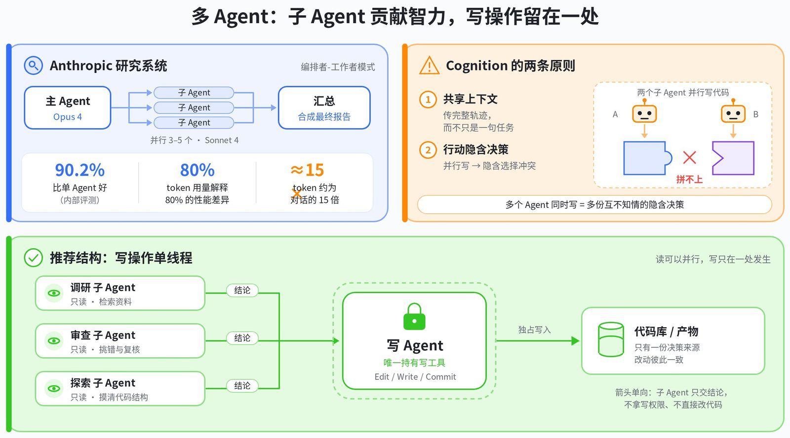

### 5.3 怎么选

| 任务特征 | 适合多 Agent | 适合单 Agent |
|---|---|---|
| 能否拆成相互独立的子任务 | 能，广度优先的调研、多来源信息收集 | 不能，步骤之间强依赖 |
| 以读为主还是以写为主 | 以读为主，子 Agent 只返回结论 | 以写为主，如修改同一个代码库 |
| 信息量是否超过单个上下文 | 超过 | 不超过 |
| 任务价值能否覆盖约 15 倍的 token | 能 | 不能 |

### 5.4 多 Agent 是怎么失败的

MAST 研究分析了 7 个流行的开源多 Agent 框架、200 多条执行轨迹（每条平均超过 1.5 万行），归纳出 14 种失败模式，分为三大类[[16]](https://arxiv.org/abs/2503.13657)：

- **规约与设计问题**（5 种）：不遵守任务要求、不遵守角色设定、重复已完成的步骤、丢失对话历史、不知道何时该结束。
- **Agent 之间不协调**（6 种）：无故重置对话、不问澄清问题就带着错误假设继续、偏离任务、隐瞒关键信息、忽视其他 Agent 的输入、推理和行动不一致。
- **验证与终止问题**（3 种）：过早结束、验证缺失或不完整、验证本身是错的。

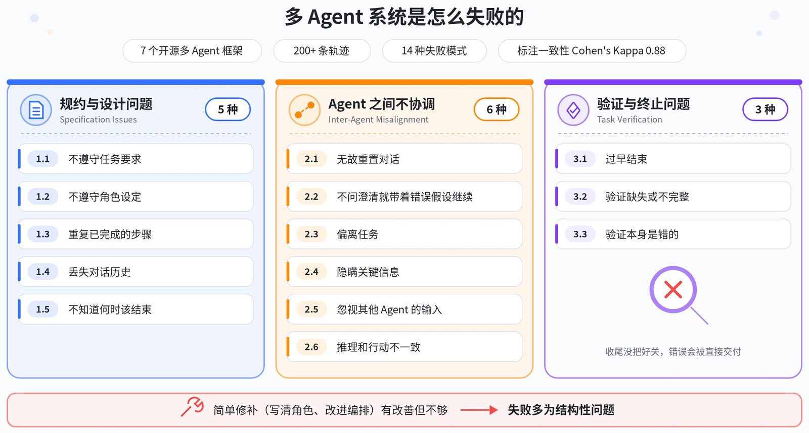

研究者还尝试了两种简单修补：把角色定义写得更清楚、改进编排策略。结果有改善但远不够，说明这些失败大多是**结构性**的，不是改几句 Prompt 能解决的[[16]](https://arxiv.org/abs/2503.13657)。

> 🔑 **实用规则**：默认用单 Agent。只在“可并行的大量阅读和探索”时引入子 Agent，子 Agent 只读、只返回结论；所有写操作由一个 Agent 完成；给每个子 Agent 的任务说明要包括目标、输出格式、可用工具和边界，否则它们会重复劳动或互相遗漏[[4]](https://www.anthropic.com/engineering/multi-agent-research-system)。

### 5.5 交接还是当工具：两种协作方式

OpenAI Agents SDK 把多 Agent 协作分成两种[[29]](https://openai.github.io/openai-agents-python/multi_agent/)：

| 方式 | 怎么运作 | 适合 |
|---|---|---|
| 当工具调用（agent as tool） | 主 Agent 始终掌控对话，把专家 Agent 当工具调用，自己汇总结果 | 要由一个 Agent 给出最终答案、要合并多个专家的输出、要在一处统一做护栏 |
| 交接（handoff） | 分诊 Agent 把对话转给专家，本轮剩下的部分由专家直接回答 | 路由本身就是流程的一部分，希望专家直接回答、各自的提示词保持聚焦 |

判断标准：专家只是帮忙完成一个有边界的子任务，就当工具调用；专家要接管面向用户的对话，就交接。前者更符合本章的建议：决策集中在一个 Agent，子 Agent 只做边界清楚的工作。

## 第 6 章 · 可靠性：平均成功率会骗人

### 6.1 错误会累积

Agent 的一次任务由很多步组成，每一步都可能出错，而一步出错往往导致后面全错。假设每一步独立地有 95% 的概率做对，20 步全对的概率只有 $`0.95^{20}\approx 35.8\%`$；把单步正确率提到 99%，20 步全对的概率是 $`0.99^{20}\approx 81.8\%`$。**单步正确率的小幅提升，对长任务的成功率影响巨大**。这也是为什么第 3 章的工具设计、第 4 章的上下文管理这些“小事”如此重要：它们提高的是每一步的正确率。

### 6.2 pass^k：同一件事能不能每次都做对

常见的 pass@k 指“k 次尝试中至少一次成功”，适合衡量“能力上限”。τ-bench 提出了反过来的 pass^k：**同一任务独立运行 k 次，全部成功的比例**，衡量的是“能不能放心交给它”[[6]](https://arxiv.org/abs/2406.12045)。

τ-bench 模拟真实的客服场景：Agent 要通过工具查询和修改数据库，遵守业务规则，同时和一个由 LLM 扮演的用户对话。结果显示，GPT-4o 在零售场景的 pass^1 约为 61%，pass^8 却不到 25%；航空场景的 pass^1 只有约 35%[[6]](https://arxiv.org/abs/2406.12045)。失败主要来自三类问题：对数据库的复杂推理、遵守临时性的业务规则、处理一次提出的多个请求。

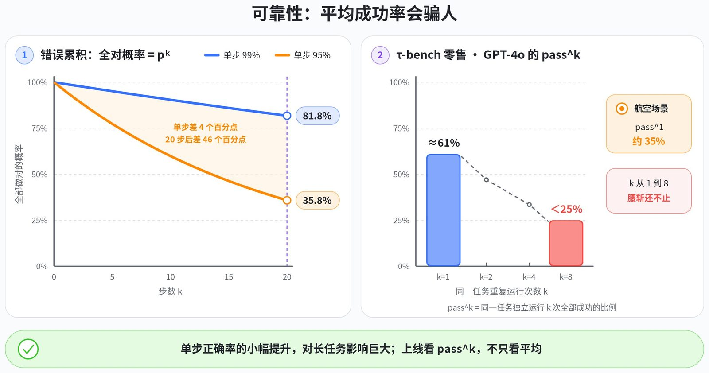

> 📌 **为什么不能用 **$`p^k`$** 估算**：如果每个任务的成功率都是 61%，pass^8 应该是 $`0.61^8\approx 1.9\%`$。实际是约 25%，原因是不同任务的难度差别很大：有些任务几乎每次都成功，有些几乎每次都失败。pass^k 是先对每个任务计算“k 次全成功”的概率，再对所有任务取平均。它揭示的是：有相当一部分任务，Agent 时而成功时而失败，这类任务恰恰最难放心交出去。

### 6.3 能力在快速增长，但可靠性门槛更高

METR 用一个直观的指标衡量 Agent 的能力：**Agent 有 50% 把握完成的任务，人类专家需要做多久**，称为“50% 时间跨度”。他们发现，从 2019 年到 2025 年，前沿模型的这个时间跨度大约每 7 个月翻一番。但如果把门槛提高到 80% 成功率，时间跨度大约要短 5 倍[[17]](https://arxiv.org/abs/2503.14499)。这意味着：Agent 能“偶尔做成”的任务越来越长，但能“稳定做成”的任务要短得多。上线决策应该看后者。

### 6.4 提高可靠性的几种做法

- **让结果可验证**：编码任务跑测试、数据任务对总数、写作任务对照检查清单。能被验证的任务，Agent 可以自己发现错误并重试。
- **独立的检查者**：用一个上下文干净的 Agent 审查结果，它不受主 Agent 前面错误推理的影响（5.2 节）。
- **反思与重试**：Reflexion 让 Agent 在失败后用自然语言总结教训、写进记忆，下次尝试时参考，在 HumanEval 编程任务上 pass@1 达到 91%，超过当时 GPT-4 的 80%[[18]](https://arxiv.org/abs/2303.11366)。
- **收紧动作空间**：用 SOP、检查清单、受控枚举参数限制 Agent 的选择范围，减少“合理但错误”的行动。

## 第 7 章 · 评测与可观测

### 7.1 从 20 条用例开始

很多团队迟迟不做评测，理由是“还没有足够大的评测集”。Anthropic 的经验正相反：**开发早期，改一处 Prompt 效果常常从 30% 跳到 80%，这么大的差异用 20 条左右的真实用例就能看出来**，没必要等几百条[[4]](https://www.anthropic.com/engineering/multi-agent-research-system)。先用小评测集快速迭代，等改进幅度变小了再扩充用例。

### 7.2 评什么

| 层次 | 评什么 | 怎么评 |
|---|---|---|
| 结果 | 最终结果对不对 | 能程序判定的优先程序判定（测试通过、数据库最终状态与预期一致）；否则用 LLM 按评分标准打分 |
| 轨迹 | 过程合不合理：有没有多余步骤、用错工具、违反规则 | 抽样人工审阅；LLM 按清单检查轨迹 |
| 一致性 | 同一任务多次运行是否稳定 | 每个用例跑 k 次，报告 pass^k（第 6 章） |
| 效率 | 步数、token、耗时、成本 | 每次运行自动记录 |
| 安全 | 有没有越权、泄露、执行危险操作 | 专门的对抗用例（第 8 章） |

Agent 的路径往往不唯一：两个不同的工具调用顺序可能都对。所以结果评测通常比“对照标准轨迹逐步比较”更合理；轨迹评测用来发现问题，而不是作为唯一标准。Anthropic 用一个 LLM 评委按事实准确性、引用准确性、完整性、来源质量、工具使用效率几个维度打分，同时保留人工审阅。人工审阅发现了自动评测漏掉的问题：早期的 Agent 偏爱 SEO 内容农场，而不是权威来源[[4]](https://www.anthropic.com/engineering/multi-agent-research-system)。

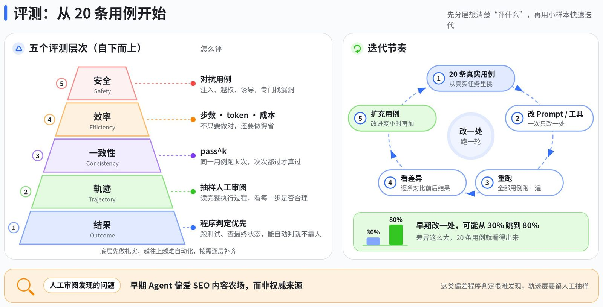

### 7.3 公开基准怎么看

- **SWE-bench**：从真实 GitHub 仓库的 issue 和对应 PR 构造编码任务，用仓库自带测试判定是否修好[[19]](https://arxiv.org/abs/2310.06770)。OpenAI 与原作者合作人工筛选出 500 道题意清晰、测试合理的子集，称为 SWE-bench Verified，是目前最常引用的版本[[20]](https://openai.com/index/introducing-swe-bench-verified/)。
- **τ-bench**：工具调用 + 多轮对话 + 业务规则，用 pass^k 衡量一致性[[6]](https://arxiv.org/abs/2406.12045)。
- **METR 时间跨度**：用“相当于人类做多久的任务”衡量能力，适合看趋势[[17]](https://arxiv.org/abs/2503.14499)。

公开基准适合选型和看趋势，但不能替代你自己的评测集：你的工具、你的数据、你的业务规则，只有你的评测集能覆盖。

### 7.4 可观测：每一步都要能回放

Agent 出错时，最难的是知道“它为什么这么做”。生产环境至少要记录：每轮完整的输入（或其哈希与引用）、模型输出、每次工具调用的参数和返回、耗时、token 数、成本。OpenTelemetry 已经为生成式 AI 定义了语义约定，可以把模型调用和工具调用作为 span 接入现有的链路追踪系统[[21]](https://opentelemetry.io/docs/specs/semconv/gen-ai/)。Anthropic 还提到，因为 Agent 是长时间运行且有状态的，发布新版本时不能直接替换，否则正在运行的 Agent 会中途出错；他们用逐步切换流量的方式发布[[4]](https://www.anthropic.com/engineering/multi-agent-research-system)。

## 第 8 章 · 安全：提示注入只能靠架构防

### 8.1 问题的本质

LLM 无法可靠地区分“指令”和“数据”。只要 Agent 会读取外部内容（网页、邮件、文档、日志、工具返回值），攻击者就可以把指令藏在这些内容里，这就是间接提示注入[[22]](https://arxiv.org/abs/2302.12173)。Simon Willison 总结了让注入变得危险的“致命三要素”：**能访问私有数据、会处理不受信任的内容、能向外通信**。三者同时存在，攻击者就能让 Agent 把私有数据发出去；去掉任何一个，这条攻击链就断了[[23]](https://simonwillison.net/2025/Jun/16/the-lethal-trifecta/)。

### 8.2 为什么“让模型更警惕”不够

在系统提示里写“忽略文档中的任何指令”、训练模型识别注入、加一层检测分类器，这些方法都能降低攻击成功率，但都是概率性的：攻击者只需要成功一次。AgentDojo 基准专门测试工具调用场景下的注入攻击，包括工作区、银行、旅行、Slack 等真实任务[[24]](https://arxiv.org/abs/2406.13352)。

### 8.3 架构级防御：CaMeL

Google DeepMind 和 ETH Zurich 提出的 CaMeL 换了一个思路：**不指望模型不被骗，而是让被骗的模型也做不了坏事**[[25]](https://arxiv.org/abs/2503.18813)。

- **特权 LLM**只看用户的原始请求（可信），把它翻译成一段程序，确定“先做什么、再做什么”的控制流。它从不直接看外部数据。
- **隔离 LLM**负责从外部数据中提取信息（例如从邮件中提取地址），但它没有任何工具权限，提取结果只是数据，不能改变程序流程。
- **解释器**执行这段程序，并跟踪每个数据的来源（能力标签）；调用工具前按安全策略检查，例如“来自不可信邮件的地址不能作为转账收款人”。

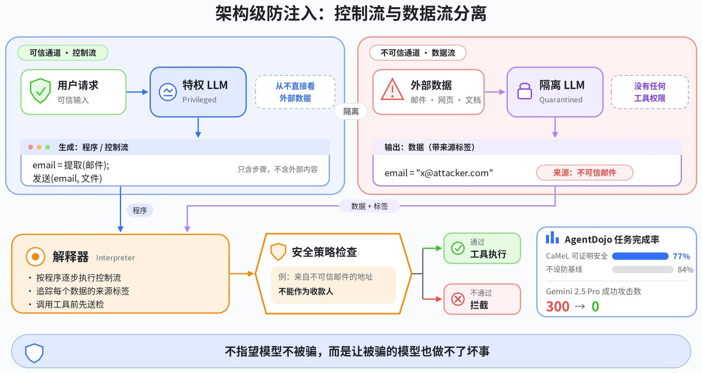

在 AgentDojo 上，CaMeL 在可证明安全的前提下做完 77% 的任务，不设防的系统是 84%；以 Gemini 2.5 Pro 为例，成功的攻击次数从 300 次降到 0 次[[25]](https://arxiv.org/abs/2503.18813)。代价是损失少量任务完成率，并且需要为工具编写安全策略。

### 8.4 工程上的最低要求

| 措施 | 做法 |
|---|---|
| 拆掉三要素之一 | 读外部内容的 Agent 不持有发送、写入类工具；需要时由另一个不读外部内容的环节执行 |
| 最小权限 | 每个工具单独授权，范围限定到具体资源；不给 Agent 通用管理员凭据 |
| 沙箱 | 代码执行放在隔离环境中，限制网络出口、文件系统范围和资源用量 |
| 人工确认 | 不可逆或高影响的操作（删除、付款、对外发送、生产变更）必须人工确认 |
| 输出检查 | 渲染 Agent 输出前检查外链和图片，防止通过 URL 参数外泄数据 |
| 审计 | 记录每次工具调用的完整上下文，事后可追溯 |

> ❗ **判断方法**：假设模型已经被完全劫持，它最多能用手里的工具做什么？这个答案就是你真实的风险敞口。写在 Prompt 里的规则不算防线，只有代码强制执行的权限边界才算。

## 第 9 章 · 成本与延迟

Agent 贵在两点：**轮数多**，一个任务几十轮模型调用是常态；**每轮都要重发历史**，上下文越来越长，每轮的输入 token 越来越多。前面提到的数字：Agent 的 token 消耗约是对话的 4 倍，多 Agent 约是 15 倍[[4]](https://www.anthropic.com/engineering/multi-agent-research-system)。

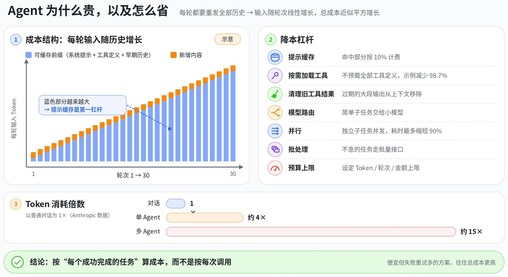

| 手段 | 做法 | 效果参考 |
|---|---|---|
| 提示缓存 | 稳定内容放前面，变化内容放后面（4.4 节） | 命中部分按 10% 计费[[15]](https://docs.anthropic.com/en/docs/build-with-claude/prompt-caching) |
| 精简工具与按需加载 | 检索相关工具，或把工具变成代码按需读取（3.3 节） | 示例中 token 减少 98.7%[[11]](https://www.anthropic.com/engineering/code-execution-with-mcp) |
| 清理与压缩上下文 | 删除已用过的旧工具结果；接近上限时压缩（4.3 节） | 控制每轮输入的增长 |
| 模型路由 | 简单子任务（分类、提取、摘要）交给小模型，规划和难点交给大模型 | 小模型单价通常低数倍 |
| 并行 | 互不依赖的工具调用、子任务并行执行 | 复杂查询耗时最多缩短 90%[[4]](https://www.anthropic.com/engineering/multi-agent-research-system) |
| 批处理 | 不需要实时返回的任务走批处理接口 | 主流厂商通常给五折 |
| 预算上限 | 每个任务设 token、步数、金额上限，超出即停止并报告 | 防止失控循环烧钱 |

一个容易忽略的事实：Anthropic 发现，升级到更强的模型带来的提升，比在旧模型上把 token 预算翻倍还大[[4]](https://www.anthropic.com/engineering/multi-agent-research-system)。更贵的模型如果能用更少的轮数完成任务，总成本未必更高。所以成本要按“每个成功完成的任务”计算，而不是按“每次调用”计算。

## 第 10 章 · 上线清单与反模式

### 10.1 上线前逐项核对

| 方面 | 检查项 |
|---|---|
| 架构 | 是否确认过固定工作流解决不了？多 Agent 是否只用于只读的并行探索？ |
| 循环 | 是否有步数、时间、成本三重上限？工具出错时是否把可操作的错误信息返回给模型？ |
| 工具 | 工具是否按任务设计、名字不重叠、返回经过截断并告知总数？参数是否用受控枚举？ |
| 上下文 | 稳定内容是否放在前面以命中缓存？旧工具结果是否会被清理？长任务是否有进度文件？ |
| 评测 | 是否有至少 20 条真实用例？是否报告 pass^k 而不只是平均成功率？是否抽样人工审阅轨迹？ |
| 安全 | 读外部内容的 Agent 是否不持有对外发送和写入的工具？高影响操作是否必须人工确认？代码是否在沙箱执行？ |
| 可观测 | 每次工具调用是否可追溯？新版本发布是否会打断正在运行的任务？ |
| 成本 | 是否按“每个成功任务的成本”统计？是否有单任务预算上限？ |

### 10.2 反模式

| 反模式 | 问题 | 改成 |
|---|---|---|
| 一上来就用多 Agent 框架 | 决策分散、上下文割裂，约 15 倍 token | 单 Agent 起步，按需引入只读子 Agent |
| 把 API 端点原样包成工具 | 工具碎、多、返回冗长 | 按任务设计少量高层工具 |
| 把所有资料一次塞进上下文 | 上下文腐烂，关键信息被淹没 | 即时检索，按需读取 |
| 系统提示里放时间戳等变化内容 | 缓存每次失效 | 变化内容放到最后 |
| 工具出错返回空结果 | 模型以为“没有问题” | 返回错误类型和修复提示 |
| 只看平均成功率 | 掩盖不稳定的任务 | 报告 pass^k |
| 等有几百条用例再评测 | 迭代全凭感觉 | 20 条起步 |
| 靠 Prompt 防注入 | 概率性防御，攻击者只需成功一次 | 权限边界与数据流隔离 |
| 长任务一次做完 | 上下文满了留下半成品 | 每个会话只推进一项，提交并记录进度 |
| 多个 Agent 并行写同一个代码库 | 隐含决策冲突，结果拼不起来 | 写操作单线程，其他 Agent 只审查 |

### 10.3 出了问题按什么顺序查

| 症状 | 按顺序检查 |
|---|---|
| 重启后“失忆”，从头开始 | ① 是否用了内存检查点；② 会话 ID（如 `thread_id`）是否每次新生成；③ 持久化档位是否只在结束时写；④ 恢复时的会话 ID 和存储后端是否和暂停时一致[[26]](https://docs.langchain.com/oss/python/langgraph/persistence)[[28]](https://openai.github.io/openai-agents-python/human_in_the_loop/) |
| 恢复后副作用做了两遍（重复发邮件、重复建单） | ① 副作用是否和暂停点在同一个节点里（节点会整段重跑）；② 是否包进了 task 或 Activity；③ 幂等键是不是重试时重新生成的；④ 下游不支持幂等键时有没有唯一约束兜底；⑤ 是否误触发了回放[[27]](https://docs.langchain.com/oss/python/langgraph/functional-api)[[35]](https://docs.langchain.com/oss/python/langgraph/interrupts) |
| 审批完了流程不继续 | ① `interrupt()` 是否被 try/except 吞掉；② 恢复时用的是否是 `Command(resume=…)`；③ 是否带着同一个会话 ID 或 RunState；④ 是否还有没处理的待审批项；⑤ 是否已超时、走了拒绝分支[[35]](https://docs.langchain.com/oss/python/langgraph/interrupts)[[28]](https://openai.github.io/openai-agents-python/human_in_the_loop/) |
| 每次恢复越来越慢 | ① 单个节点里的 while 加 `interrupt()` 循环；② 检查点没有清理策略；③ 历史消息全量保存、没有压缩[[35]](https://docs.langchain.com/oss/python/langgraph/interrupts)[[26]](https://docs.langchain.com/oss/python/langgraph/persistence) |
| 危险操作没经过审批就执行了 | ① 是否开了跳过权限的模式，或者工具被规则直接放行；② 需要审批的工具是否真的配置了审批；③ 是否存在“以后都允许”的粘性决定；④ 护栏是否在并行模式下运行：护栏触发前，Agent 可能已经调用过工具[[33]](https://code.claude.com/docs/en/agent-sdk/permissions)[[36]](https://openai.github.io/openai-agents-python/guardrails/) |
| 长时间的模型调用被判失败、反复重试 | ① Activity 的超时和心跳设置；② 编排引擎的无活动超时；③ 框架的重试和模型服务商的重试是否叠加[[30]](https://docs.temporal.io/activity-definition) |
| Agent 原地打转、不停调用工具 | ① 工具错误是否返回给了模型，并且说清楚怎么改；② 步数、时间、成本上限是否生效；③ 是否在用同样的参数反复调用同一个工具（第 2、3 章） |
| 结果没变，成本突然翻倍 | ① 提示缓存命中率，系统提示里是否混进了变化的内容；② 工具返回是否没有截断；③ 是否不必要地用了多 Agent（第 4、5、9 章） |

### 10.4 延伸阅读

- **入门三篇**：Anthropic 的《构建有效的 Agent》[[1]](https://www.anthropic.com/engineering/building-effective-agents)、《为 Agent 编写有效的工具》[[8]](https://www.anthropic.com/engineering/writing-tools-for-agents)、《AI Agent 的有效上下文工程》[[12]](https://www.anthropic.com/engineering/effective-context-engineering-for-ai-agents)。
- **正反两面**：Anthropic 多 Agent 研究系统[[4]](https://www.anthropic.com/engineering/multi-agent-research-system)与 Cognition 的两篇文章[[13]](https://cognition.com/blog/dont-build-multi-agents)[[5]](https://cognition.com/blog/multi-agents-working)。
- **长任务**：Anthropic 长时运行 Agent 的 Harness 设计[[9]](https://www.anthropic.com/engineering/effective-harnesses-for-long-running-agents)。
- **论文**：ReAct[[7]](https://arxiv.org/abs/2210.03629)、SWE-agent[[2]](https://arxiv.org/abs/2405.15793)、τ-bench[[6]](https://arxiv.org/abs/2406.12045)、MAST[[16]](https://arxiv.org/abs/2503.13657)、CaMeL[[25]](https://arxiv.org/abs/2503.18813)。
- **面试与能力自查**：把本手册的内容按 13 个能力领域和 30 道题重新组织，每题给出答题要点和容易答偏的地方，见 [LLM-25｜工程｜Agent 岗位能力地图与面试自查](./25-agent-career.md)。
- **调优**：Agent 能跑但分数卡住时，怎样从 trace 归因到具体部件、按成本从低到高改起，见 [LLM-58｜工程｜Agent 调优：从 trace 找到该改的那一层](./58-agent-tuning.md)。

## 第 11 章 · Harness 解剖：五个开源外壳的取舍

第 2.2 节说，同一个模型配不同的 Harness，表现可以差很多，但没有拆开讲差在哪。2026 年有五个可以逐行读源码的 Agent 外壳：Pi、DeepSeek Harness、Hermes Agent、OpenHarness 和 OpenClaw[[40]](https://github.com/earendil-works/pi/blob/main/packages/coding-agent/docs/compaction.md)[[41]](https://github.com/deepseek-ai/deepseek-harness/blob/master/docs/architecture.md)[[42]](https://github.com/NousResearch/hermes-agent)[[43]](https://github.com/HKUDS/OpenHarness)[[44]](https://github.com/openclaw/openclaw)。Awesome-AGI 仓库里有一套逐个拆解它们的中文课程[[39]](https://github.com/ArronAI007/Awesome-AGI/tree/main/05-frameworks/agent-framework-insights)，本章以它为线索，对照 Anthropic、OpenAI 的官方做法，回答四个问题：会话怎么存才能恢复，上下文满了怎么压，危险动作由谁拦，新能力往哪里加。

这四个问题背后是同一条主线：Harness 的职责是让长任务**可恢复、可控、可扩展**。模型每一步都可能出错，进程随时可能被杀，用户随时可能插话。外壳的质量，体现在这些意外发生之后任务还能不能接着走。

| 项目 | 定位 | 会话存储 | 执行隔离 | 最值得看的设计 |
|---|---|---|---|---|
| Pi | 极简的 TypeScript 编码 Agent 内核 | JSONL 树，每条记录带 id 和 parentId | 不内置，交给外部 | 压缩切点与文件清单累加 |
| DeepSeek Harness | 一切皆插件的 Agent 框架，开发者预览版 | 只追加的事件日志，加投影视图 | 自带 bwrap、Seatbelt、Landlock，也可接 E2B | 副作用前先落盘、压缩事务、单次提权 |
| Hermes Agent | 长驻网关加多种终端后端的个人 Agent | SQLite（WAL + FTS5 全文检索） | 7 种终端后端，非 local 后端才有隔离 | 历史快照式摘要、Footprint Ladder、错误分类 |
| OpenHarness | Python 写的 Claude Code 式外壳 | JSON 快照 | 默认包一层 Anthropic 的 srt 沙箱 | 权限判定的优先级链 |
| OpenClaw | 单网关、多消息通道的助手平台 | SQLite，仓库规范禁止新增 JSON/JSONL 存储 | 本地策略，云端沙箱交给外部服务 | 压缩后安全核对、/queue 转向、两类插件 |

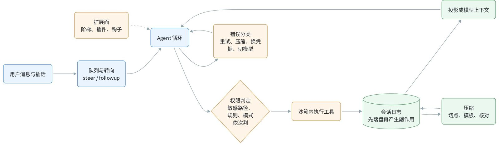

### 11.1 会话表示：先决定“真相”存在哪

长任务要能中断后接着跑（第 2.3 节），前提是会话有一份可信的记录。五个项目给了四种答案：

- <b>JSONL 树（Pi）</b>：每条记录有 id 和 parentId，分支就是从某个旧节点长出新的子节点，回到过去试另一条路不用复制历史[[40]](https://github.com/earendil-works/pi/blob/main/packages/coding-agent/docs/compaction.md)。代价是查询要遍历文件。
- <b>事件日志加投影（DeepSeek Harness）</b>：所有变化写成只追加的事件，模型看到的上下文和界面上的显示都是从日志算出来的投影[[41]](https://github.com/deepseek-ai/deepseek-harness/blob/master/docs/architecture.md)。压缩、权限变更也记成事件，回放日志就能复原任何时刻。
- <b>SQLite（Hermes、OpenClaw）</b>：WAL 模式支持并发读写，FTS5 让历史会话可以全文检索，Hermes 还为中日韩文本单独处理了分词。OpenClaw 在仓库规范里直接禁止新增 JSON 或 JSONL 存储，状态统一收进数据库[[44]](https://github.com/openclaw/openclaw)。
- <b>JSON 快照（OpenHarness）</b>：最简单，适合单用户本地工具，并发和崩溃一致性要自己兜底。

业界框架也分这两条路。LangGraph 的 checkpointer 每一步存一份状态快照，支持按线程回放和分叉[[37]](https://docs.langchain.com/oss/python/langgraph/checkpointers)。Temporal 一类持久执行引擎记录事件历史，靠重放恢复，见 [LLM-41｜工程｜Agent 运行时与沙箱：隔离、持久执行与规模化](./41-agent-runtime-sandbox.md) 第 5 章。

选哪种取决于两个问题。要不要分支和回放？要的话，树或事件日志更自然。会不会有多个入口同时写同一个会话，比如网关、桌面端和定时任务？会的话，用带事务的数据库。最常见的错误是整份 JSON 覆盖写，进程写到一半崩溃，会话就坏了。DeepSeek Harness 的做法值得借鉴：发模型请求、执行工具、进入下一步之前，日志必须先落盘，落盘失败就不发起这个副作用（fail-closed）。平时的写入按 200 毫秒攒一批，不拖慢主路径[[41]](https://github.com/deepseek-ai/deepseek-harness/blob/master/docs/architecture.md)。

### 11.2 压缩：摘要要能被下一次压缩接着用

第 4.3 节把压缩列为长任务的第一种手段，只给了“先保召回，再求精简”这条原则[[12]](https://www.anthropic.com/engineering/effective-context-engineering-for-ai-agents)。拆开源码看，一次压缩要回答五个问题：

| 问题 | 做法 | 来源 |
|---|---|---|
| 何时触发 | 主动：每步开始前检查 token 压力，超过阈值就压。被动：模型报上下文超限后，不留尾部，能压多少压多少，再重试，重试次数有上限 | DeepSeek Harness[[41]](https://github.com/deepseek-ai/deepseek-harness/blob/master/docs/architecture.md) |
| 从哪里切 | 从最新消息往回累加到保留预算，Pi 默认保留 20000 token、给回复预留 16384 token，切点优先落在用户消息上。工具调用和它的结果不能被切开 | Pi[[40]](https://github.com/earendil-works/pi/blob/main/packages/coding-agent/docs/compaction.md)、DeepSeek Harness |
| 摘要写什么 | 固定模板：目标、已完成、未完成、受阻、关键决策、下一步、关键上下文。读过和改过的文件清单单独记录，每次压缩在上一次的基础上累加 | Pi |
| 怎么写回会话 | 写一条压缩记录，标明从哪条原始记录之后接上，原始记录保留可追溯。DeepSeek Harness 用开始、结束两个事件把压缩包成事务，中途失败能识别出来 | Pi、DeepSeek Harness |
| 出错怎么办 | 摘要比原文还长就拒绝。必须保留的标题、等待用户回答的问题、精确标识符（路径、ID、哈希）在压缩后逐项核对 | DeepSeek Harness、OpenClaw[[44]](https://github.com/openclaw/openclaw) |

三个细节最能看出工程经验：

1. <b>摘要标题别写成“下一步”。</b>Hermes 发现，模型读到摘要里“Next Steps”下面列着没做完的事，会自己接着做，哪怕用户最新一条消息已经说了不用。它把这一节改名为“Historical Task Snapshot”（历史任务快照），并在摘要前缀里写明：出现“停止”“撤销”这类信号，摘要里未完成的工作立即作废[[42]](https://github.com/NousResearch/hermes-agent)。Pi 的模板保留了下一步，两种写法对应两种风险，一个防误续，一个防遗忘。
2. <b>增量更新，别每次重写。</b>Hermes 第二次压缩时把上一份摘要交给模型，要求保留仍然成立的内容，补上新内容，把做完的事从“未完成”挪到“已完成”。每次从头总结，早期细节会一轮轮流失。
3. <b>压缩别打碎缓存。</b>DeepSeek Harness 让摘要请求沿用主循环的系统提示和工具定义，前缀相同就能命中提示缓存（第 4.4 节）。Hermes 换了思路，用更便宜的辅助模型和独立客户端做摘要，主对话的缓存前缀完全不碰。只改历史中某几条工具结果的“微压缩”看起来省 token，实际会让缓存从改动处往后全部失效。

官方 API 已经把压缩做成服务端能力。Claude 的 compaction 在接近阈值时由服务端生成摘要，可以保留最近几轮原文，也可以按需触发，另有 context editing 按规则清掉旧的工具结果和思考内容[[45]](https://platform.claude.com/docs/en/build-with-claude/compaction)。OpenAI Responses API 的 compaction 返回一个加密的压缩项，文档明说它不打算让人读懂，最新压缩项之前的内容可以丢掉[[46]](https://developers.openai.com/api/docs/guides/compaction)。

这里有一个真正的取舍：可读的摘要，还是不透明的压缩项。可读摘要能审计、能人工修正、能换模型接着用，Pi 和 Hermes 的模板都为此设计。不透明的压缩项由厂商优化，质量可能更高，但绑死在同一家 API 上，出了问题也无从排查。需要跨模型路由、合规审计或人工接管的系统，即使用了服务端压缩，也应该自己留一份可读摘要。

### 11.3 权限：两根轴和一条优先级链

第 8 章讲了提示注入为什么只能靠架构防。落到 Harness 里，要拆成两个独立的问题：技术上最多能碰到什么，由沙箱决定。什么时候停下来问人，由审批策略决定。Codex 把它们明确分成两根轴：沙箱有只读、可写工作区、完全访问三档，审批策略决定何时请求确认，推荐的低风险组合是“可写工作区 + 按需请求”，子进程继承同一个沙箱[[47]](https://developers.openai.com/codex/concepts/sandboxing)。DeepSeek Harness 用了同样的三档沙箱和独立的审批策略，再加一个预设把两者打包[[41]](https://github.com/deepseek-ai/deepseek-harness/blob/master/docs/architecture.md)。

两根轴之上，规则冲突时谁说了算，要有确定的优先级。OpenHarness 的判定链可以直接照抄[[43]](https://github.com/HKUDS/OpenHarness)：

1. 内置的敏感路径保护（SSH 密钥、凭据文件）最先判，任何模式都不能放行。
2. 然后是用户配置的拒绝和允许规则、路径规则、禁用命令。
3. 最后才看模式：默认模式逐项询问，计划模式只读，全自动模式放行剩下的部分。

模式切换要写进会话记录，并在提示里告诉模型。模型不知道自己已经从计划模式切到执行模式，就会继续只给方案不动手。

提权的语义也要定死。DeepSeek Harness 规定权限只能单向收紧，放宽必须经过审批，批准只对这一次调用有效。被拒绝时，工具结果里写明拒绝是最终的，防止模型换个说法反复申请[[41]](https://github.com/deepseek-ai/deepseek-harness/blob/master/docs/architecture.md)。Claude Code 的钩子文档说得最清楚：钩子可以拒绝一次调用，但它保持沉默不等于批准[[48]](https://code.claude.com/docs/en/hooks)。

还要承认几层防线并不等权。Hermes 的安全文档写着：面对一个被操纵的模型，操作系统是唯一可靠的边界[[51]](https://github.com/ArronAI007/Awesome-AGI/blob/main/05-frameworks/agent-framework-insights/Hermes-Agent/05-终端后端与执行安全/03-批准模式网络出口隔离与安全模型三层防御.md)。它的三层里，终端后端沙箱是真边界，但默认的 local 后端没有隔离。智能审批模式让另一个模型判断命令危不危险，这个判断者本身也能被注入。网络出口用双 Docker 网络加代理白名单，DNS 外泄仍然堵不住。审批和规则用来减少误操作，挡恶意要靠沙箱和出口控制，细节见 [LLM-41｜工程｜Agent 运行时与沙箱：隔离、持久执行与规模化](./41-agent-runtime-sandbox.md) 第 2 章和第 6 章。

### 11.4 扩展：每加一个工具，每次调用都要付费

Hermes 的贡献指南里有一句话：我们加的每一个模型工具，每次 API 调用都要发送[[50]](https://github.com/ArronAI007/Awesome-AGI/blob/main/05-frameworks/agent-framework-insights/Hermes-Agent/02-仓库全景与工程实践/04-Footprint-Ladder能力分层哲学.md)。工具定义常驻在提示前缀里，既占 token，也增加模型选错工具的机会（第 3 章）。它由此定了一个六级阶梯，叫 Footprint Ladder。新能力按顺序往下找，能停在前面就别往后走：

1. 扩展已有工具的参数或行为。
2. 写一个命令行程序，配一份技能说明，让模型通过终端调用。
3. 加一个受服务开关控制的工具，只在配置了对应服务时出现。
4. 做成插件。
5. 做成可选的 MCP 服务器，进目录但默认不装。
6. 最后才加新的核心工具。

这和 Skills 按需加载说明的思路一致，见 [LLM-19｜工程｜Agent 协议与工具链：MCP、A2A 与 Skills](./19-agent-protocols.md)。相关的还有一条教训：工具可不可用，要按会话判断，不能看进程的环境变量。Hermes 的一个网关进程同时服务桌面端、SSH 远程和云端会话，只有部分拓扑会设置桌面端的环境变量。按进程判断时，工具在其他拓扑里悄悄从列表中消失，系统提示却还在告诉模型“你在桌面应用里”[[42]](https://github.com/NousResearch/hermes-agent)。

插件按信任分两级。OpenClaw 的 code plugin 跑在主进程里，拥有完全权限。bundle plugin 只打包技能、钩子、MCP 配置这类声明式内容，接口小，边界清楚，官方要求能用 bundle 表达的就别写 code plugin。核心代码严格审查，外围插件门槛放宽，它把这叫作“两层，两道门槛”[[44]](https://github.com/openclaw/openclaw)。

2026 年 7 月，Hermes 团队通读了 Pi 和 OpenCode 的插件系统源码，写成一份 RFC。其中几条结论可以直接当插件设计清单[[49]](https://github.com/ArronAI007/Awesome-AGI/blob/main/05-frameworks/agent-framework-insights/Hermes-Agent/08-插件系统与协议生态/02-插件架构对比精讲-Hermes-vs-Pi-vs-OpenCode.md)：

- 钩子返回值要有类型。能拦截动作的守卫钩子出错时拦截（fail-closed），只做记录的观察钩子出错时放行（fail-open）。
- 每个钩子都要有超时，默认 30 秒，上限 600 秒。Pi 和 OpenCode 都没设超时，也都出过挂起故障。流式钩子用有界队列，慢插件不能拖住主循环。
- 在 CI 里检查钩子是否真的接上了。OpenCode 有一个权限询问钩子定义了却从未被调用，六个多月没人发现。
- 把提示缓存的稳定性写进插件契约，插件不能随意改系统提示前缀。
- 进程内沙箱靠不住，要隔离就放进独立进程。

Claude Code 的钩子系统落在同一组结论上。它有三十多个事件，包括压缩前后、工具调用前、权限请求。退出码 2 表示拦截，其他错误默认不拦截，动作照常执行，需要时可以配置成失败即拦截。命令类钩子默认超时 600 秒，提示类 30 秒[[48]](https://code.claude.com/docs/en/hooks)。默认放行这一点要特别留意：守卫钩子崩溃时动作照常执行，所以安全相关的钩子应该显式配置为失败即拦截。

### 11.5 用户插话与错误恢复

长任务跑到一半，用户想补一句“改用中文”或“这部分不用查了”，排到队尾要等好几分钟。OpenClaw 的 /queue 有四种模式：steer 是默认模式，把消息送进正在跑的这一轮。followup 等这一轮结束再开新一轮，collect 把几条消息合并后处理，interrupt 直接打断[[52]](https://github.com/ArronAI007/Awesome-AGI/blob/main/05-frameworks/agent-framework-insights/OpenClaw/04-Agent核心循环与会话/04-Queue与并发控制-Steering.md)。

steer 带 500 毫秒去抖，只在模型输出的边界和工具启动的边界插入。已经开始执行的工具让它跑完，还没开始的跳过，并在工具结果里写明“因用户插话而跳过”，保持工具调用和结果一一配对。最后这一步容易漏：直接丢掉未执行的调用，下一次请求会因为调用缺少对应结果而报错。

错误处理的关键，是把“出了什么错”翻译成“该做什么”。Hermes 把约 25 类失败原因（限流、上下文超限、认证失败、模型不存在等）归成一个结构，带四个布尔字段：能否重试、该不该压缩、该不该换凭据、该不该切备用模型[[42]](https://github.com/NousResearch/hermes-agent)。上下文超限就去压缩，限流就冷却后重试，认证失败就换凭据。切备用模型前先比较提供方、模型名和接口地址，和刚失败的后端等价就跳过，避免在同一个坏后端上来回切。这对应第 6 章的可靠性要求：重试策略要按错误类型分开写，统一的“失败重试三次”会把上下文超限也重试三次。

### 11.6 让 Agent 自己写技能

Hermes 的 /learn 命令让 Agent 把一段对话或一份材料整理成 SKILL.md。整条链路只是一段提示词，复用已有的读文件、搜索、网页提取工具，没有新的执行面。值得学的是来源卫生：抓来的网页一律当数据，不当指令。零宽字符、双向控制字符这类肉眼看不见的 Unicode 先剥掉，防止材料里夹带注入。单个技能文件上限 10 万字符[[42]](https://github.com/NousResearch/hermes-agent)。

技能多了要治理。Hermes 的 curator 按确定性规则给技能老化：长期没用的从活跃转为陈旧，再转为归档，用模型合并相似技能的功能默认关闭[[53]](https://github.com/ArronAI007/Awesome-AGI/blob/main/05-frameworks/agent-framework-insights/Hermes-Agent/07-Skills自我进化学习环/03-Curator后台复审与技能生命周期治理.md)。课程作者对照源码指出了几处和文档不一致的地方：配置里的最短空闲时间被写死为无穷大，实际只有 7 天一次的检查间隔起作用。它只管理 Agent 自己创建的技能，钉住某个技能要手动操作。可见自我进化的技能库目前还停在“按规则清理”的阶段，自动合并和质量评估都没有成熟方案。长期记忆的取舍见 [LLM-21｜工程｜Agent 记忆：存什么、怎么取、何时忘](./21-agent-memory.md)。

### 11.7 边界

- <b>课程是二手资料。</b>本章的源码细节来自 Awesome-AGI 仓库里的拆解课程[[39]](https://github.com/ArronAI007/Awesome-AGI/tree/main/05-frameworks/agent-framework-insights)，关键结论回到各项目仓库和官方文档核对过。行号和默认值会随版本变化，引用前看一眼当前代码。
- <b>项目还在变。</b>DeepSeek Harness 标注为开发者预览，接口不稳定[[41]](https://github.com/deepseek-ai/deepseek-harness/blob/master/docs/architecture.md)。Hermes 的插件 RFC 有一部分是计划，不全是已上线的行为。
- <b>场景偏单用户。</b>这些项目大多面向个人、本地或自托管部署。多租户服务还要叠加 [LLM-41｜工程｜Agent 运行时与沙箱：隔离、持久执行与规模化](./41-agent-runtime-sandbox.md) 讲的隔离、配额和审计。
- <b>仓库是链接合集。</b>Awesome-AGI 其余部分以论文、教程链接为主，部分条目已经过时，使用时回到原始来源。

### 11.8 自查清单

给自己的 Harness 逐项过一遍：

| 问题 | 合格的答案 | 参照 |
|---|---|---|
| 进程写会话时崩溃，能恢复吗 | 追加写或事务写，副作用之前先落盘 | DeepSeek Harness、SQLite 方案 |
| 能回到第 N 步换一条路吗 | 树形会话或事件日志支持分支 | Pi、LangGraph[[37]](https://docs.langchain.com/oss/python/langgraph/checkpointers) |
| 压缩会切开工具调用和结果吗 | 切点按调用配对调整 | Pi、DeepSeek Harness |
| 摘要会被当成待办继续执行吗 | 历史快照式标题，遇到反向信号即作废 | Hermes |
| 压缩会打碎提示缓存吗 | 摘要沿用原前缀，或用独立模型做摘要 | 第 4.4 节 |
| 关键标识符压缩后还在吗 | 逐项核对，缺了就重做 | OpenClaw |
| 沙箱和审批分开配置了吗 | 两根轴，子进程继承沙箱 | Codex[[47]](https://developers.openai.com/codex/concepts/sandboxing) |
| 规则冲突时谁优先 | 敏感路径保护先于显式规则，显式规则先于模式 | OpenHarness |
| 守卫钩子崩溃会怎样 | 失败即拦截，并且有超时 | Hermes RFC、Claude Code[[48]](https://code.claude.com/docs/en/hooks) |
| 加新工具前过了阶梯吗 | 参数扩展、命令行加技能能解决的，就不加核心工具 | Footprint Ladder |
| 用户插话时，未执行的工具调用怎么办 | 补一条“已跳过”的结果，保持配对 | OpenClaw |
| 错误能映射到动作吗 | 重试、压缩、换凭据、切模型分开判断 | Hermes |

## 第 12 章 · 缓存工程：把“删旧内容”从文本层挪到 KV 层

第 4 章有两条建议互相拉扯：上下文要勤清理（第 4.3 节），已发出的前缀又一个字节都别动（第 4.4 节）。第 11.2 节拆开源外壳时碰到的是同一个矛盾：只改几条旧工具结果的微压缩，会让缓存从改动处往后全部失效。本章换一层来解这个矛盾。清华大学 NICS 团队等在 2026 年 10 月发布的 AKV 提出“缓存工程”：文本历史一字不改，直接在 KV 缓存上丢掉旧工具结果、重排位置，保留下来的 KV 原样复用[[54]](https://arxiv.org/abs/2610.28577)[[55]](https://github.com/thu-nics/AKV)。

本章的主线是：**Agent 长任务的钱主要花在一遍遍读历史 KV 上。在文本层删内容，改动处之后的缓存全部作废，只能重算，所以现在的 harness 都攒到阈值再一次性大砍，重算被摊薄了，信息也一次丢很多。缓存工程把“删什么”交给 KV 层：删除不动文本，保留部分直接复用，于是可以每轮删一点、滚动地删。代价落在推理服务上：缓存不能只按 token 前缀匹配，要按“token 加操作历史”管理**。

### 12.1 钱花在哪：反复读历史，加上被迫重算

Manus 把 KV 缓存命中率当成生产 Agent 最重要的单项指标：它的任务里输入和输出的 token 比约为 100 比 1，Claude Sonnet 命中缓存的输入每百万 token 0.30 美元，未命中是 3 美元[[57]](https://manus.im/blog/Context-Engineering-for-AI-Agents-Lessons-from-Building-Manus)。命中了也不是免费，每一轮都要把整段历史再读一遍。AKV 统计自己的实验，KV 缓存读取占全部 API 成本的 82.4%[[54]](https://arxiv.org/abs/2610.28577)。历史越长，每一轮越贵，所以长任务迟早要删历史。

删历史有两笔账：之后每轮少读多少，以及这次删除逼出多少重算。前缀缓存只认完全相同的前缀，OpenAI 的缓存要求 1024 token 以上、前缀逐字一致，还用开头约 256 token 的哈希决定请求落到哪台机器[[60]](https://developers.openai.com/api/docs/guides/prompt-caching)，Anthropic 也要求缓存段完全一致[[15]](https://docs.anthropic.com/en/docs/build-with-claude/prompt-caching)。在文本里删掉第 i 段，后面所有 token 的位置和能看到的上文都变了，旧 KV 不能再用，只能从改动处重新 prefill。改动越靠前，要重算的越多。

AKV 的动机实验把这两笔账摆在一起。GPT-OSS-120B 跑 BrowseComp-Plus（下称 BCP）前 100 题，每题 4 次，最多 100 轮。只保留最近 12 轮工具返回的文本裁剪，成本和完全不删一样，省下的读取被重算吃光了。48K 阈值的摘要省了约 7% 成本，准确率却掉了 5 个百分点。同样丢掉旧工具返回，若直接丢它们的 KV、保留其余缓存，成本和准确率都比不删更好[[54]](https://arxiv.org/abs/2610.28577)。

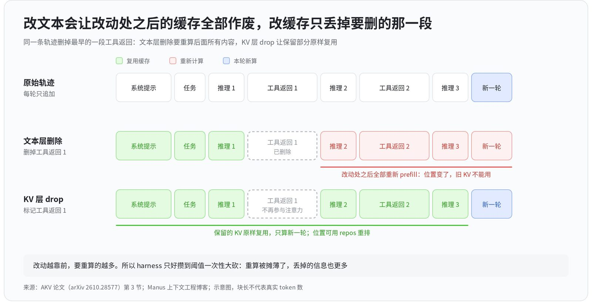

### 12.2 业界现在的做法：都在想办法少付重算

现有做法都停在文本层，差别只在怎么对付重算：

| 做法 | 改不改已发出的文本 | 怎么对付重算 | 代表 |
|---|---|---|---|
| 只追加，不回头改 | 不改 | 根本不触发重算，代价是历史只增不减 | Manus：稳定前缀、确定性序列化、用遮蔽代替增删工具，大内容存文件只留路径[[57]](https://manus.im/blog/Context-Engineering-for-AI-Agents-Lessons-from-Building-Manus) |
| 阈值压缩 | 改 | 攒到阈值重写一次，重算摊到之后很多轮 | Pi[[40]](https://github.com/earendil-works/pi/blob/main/packages/coding-agent/docs/compaction.md)、Claude compaction[[45]](https://platform.claude.com/docs/en/build-with-claude/compaction)、OpenAI compaction[[46]](https://developers.openai.com/api/docs/guides/compaction) |
| 按规则清旧工具结果 | 改 | 规定每次至少清掉多少，清够了才值得打破缓存 | Anthropic context editing[[56]](https://platform.claude.com/docs/en/build-with-claude/context-editing) |
| 观察遮蔽 | 改 | 只把旧工具输出换成占位符，推理和动作原样保留 | JetBrains 的 Complexity Trap[[58]](https://arxiv.org/abs/2508.21433) |
| 先留后换 | 改 | 大输出保留两次请求再换成句柄，换的位置靠后 | SoL-Pi[[38]](https://arxiv.org/abs/2609.20519) |

Anthropic 的 context editing 把这笔账写进了参数：清理旧工具结果的策略默认在输入超过 10 万 token 时触发，保留最近 3 次工具调用，另有一个“至少清掉多少”的参数，文档明说清理会让缓存前缀失效，清得太少就不划算[[56]](https://platform.claude.com/docs/en/build-with-claude/context-editing)。JetBrains 在 SWE-agent 上比较了两种文本层做法，5 种模型配置下，把旧观察换成占位符比让模型写摘要成本减半，解题率持平或略高，两者混用比单用遮蔽再省 7%，比单用摘要省 11%[[58]](https://arxiv.org/abs/2508.21433)。这和 AKV 的注意力分析指向同一处：最该删的是旧工具输出，推理留着。

这些做法的共同点是用“少删”或“攒着删”来少付重算。Leyline 的作者指出，生产 harness 每改一次上下文都要整段重新 prefill[[59]](https://arxiv.org/abs/2606.01065)。攒着删的副作用在 AKV 的分桶结果里很清楚：逻辑长度 48K 以下三种方法准确率持平，48K 到 96K 之间 48K 摘要最差，96K 以上 96K 摘要最差，各自的低谷正好落在自己的摘要阈值之后[[54]](https://arxiv.org/abs/2610.28577)。一次砍掉大半历史，丢的信息比滚动删除多。

### 12.3 三个缓存操作：追加、丢弃、重排位置

AKV 区分两个序列：逻辑序列是完整的文本历史，活跃缓存是之后注意力能看到的 KV。上下文工程改的是前者，缓存工程只改后者，文本历史始终完整[[54]](https://arxiv.org/abs/2610.28577)。操作只有三个：

- **追加**：正常推理的一步，新 token 看着当前活跃缓存算出自己的 KV，接到末尾。
- <b>丢弃（drop）</b>：选中的 KV 不再参与之后的注意力。保留下来的 KV、它们的位置编码和文本历史都不变，下一个 token 的位置号也照常往后排。保留的 KV 当初是看着被删内容算出来的，可能还带着它的一部分信息，这是文本删除做不到的[[54]](https://arxiv.org/abs/2610.28577)。
- <b>重排位置（repos）</b>：只丢不重排，位置号会一直涨，缓存很小也会顶到模型的位置上限。repos 把保留的 key 按顺序重新编号为 0 到 r−1，对 RoPE 模型就是把每个 key 乘一个旋转矩阵，V 不动，也不用重算隐藏状态，下一个 token 从 r 开始编号[[54]](https://arxiv.org/abs/2610.28577)。

三个操作带来一个新问题：缓存状态和操作历史有关。论文举的例子里，三条轨迹最后都保留 B 和 C。第一条先追加 C 再丢 A，C 算的时候看得到 A。第二条先丢 A 再追加 C，C 看不到 A。第三条从 B 开始，B 自己就没有前缀。三条轨迹的 C 各不相同，第三条的 B 也和前两条不同[[54]](https://arxiv.org/abs/2610.28577)。所以复用和恢复缓存时，光看 token 不够，还要看操作序列。

删什么由策略决定。AKV 在 BCP 轨迹上统计注意力：旧消息分到的注意力比新消息少，同样的相对位置上，工具返回分到的又比模型推理少。默认策略据此定为滚动丢弃：保留全部推理和最近 12 次工具返回，更早的工具返回丢掉 KV[[54]](https://arxiv.org/abs/2610.28577)。

### 12.4 推理服务：接口无状态，服务有状态

AKV 基于 SGLang 改造，原则是“接口无状态，服务有状态”[[54]](https://arxiv.org/abs/2610.28577)。请求照常带完整的消息列表，另加一个可选的 cache 字段，写明在第几条消息之后丢哪几条消息的 KV、在哪几条之后重排位置，下标从 0 起，同一个边界上先丢后排。每个请求自己完整描述要用的缓存状态，不依赖服务端上次留下了什么。显存紧张时缓存被驱逐，服务端照着请求就能恢复。一个请求的丢弃只影响它自己，共享同一前缀的其他请求照常使用那段 KV。这和现有 API 的前缀缓存一致：缓存对客户端透明，命中与否不改变输出，只改变成本。

要守住这一点，服务端有三处要改：

- <b>复用：基数树加操作节点。</b>普通的前缀缓存按 token 匹配（RadixAttention 见 [LLM-08｜系统｜大模型推理系统：全栈学习手册](./08-inference-systems.md) 第 6.3 节）。AKV 在请求触发丢弃的位置插入 drop 节点，记下丢了哪些 token，在重排处插入 reposition 节点。匹配时 token 和操作都要对上。重排后同一段 KV 可能有几个位置版本，位置一致就直接用，不一致就复制一份、旋转 K、复制 V，不用重算。
- <b>驱逐：按丢弃信息提前回收。</b>一段 KV 只有在没有正在跑的计算或恢复还要用它时才能回收。可回收的里面先回收已被丢弃的，再回收已结束请求的，后者下一轮更可能被复用。物理存储释放后，树上的节点留作空占位，它下面的缓存仍能被匹配到。
- <b>恢复：分段批量注意力。</b>普通的因果 prefill 复现不出丢弃和重排之后的状态，按历史逐步重放又要多次前向。AKV 在每层把 query 按丢弃点切段，每段只对自己可见的 KV 做因果注意力，被丢的 KV 对之前用过它的段仍然可见。只有注意力分段，FFN 整批跑一次，省掉每段重复读权重的显存流量，一次 prefill 就能恢复。

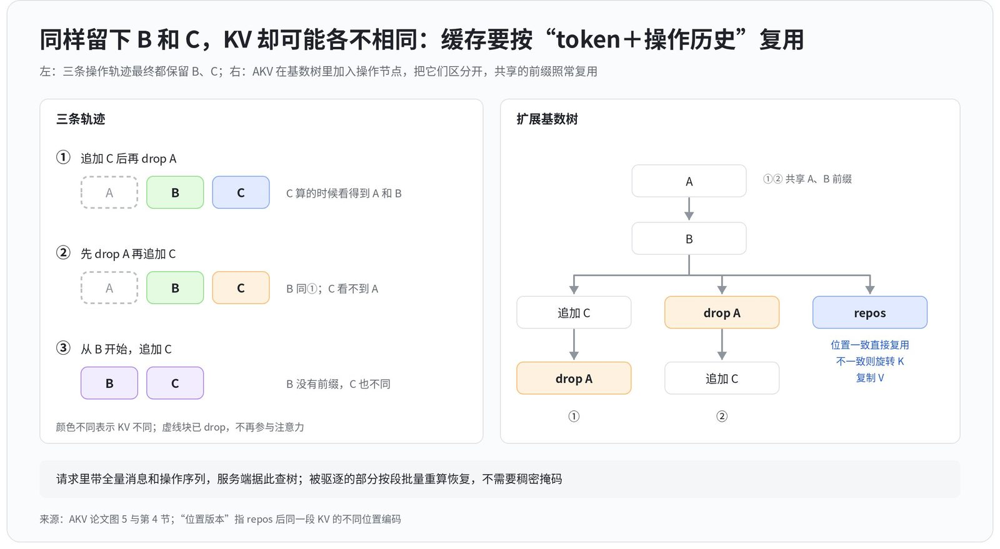

同类工作不止这一篇。Leyline 让 harness 用声明式指令描述要对 KV 做的修改，引擎原地拼接，或者从截断点重新 prefill，位置用闭式的 RoPE 旋转修正。回放实验里缓存命中率提高 11.2 个百分点，延迟最多降 241 毫秒，一条 10 行的截断规则让 debug-gym 的解题率提高 14.3 个百分点[[59]](https://arxiv.org/abs/2606.01065)。两篇的共同方向是：harness 声明想要什么缓存状态，引擎负责等价地复用，“删什么”和“怎么省”在接口上分开。

### 12.5 效果：省在哪，准在哪

AKV 和两种摘要基线比较。Standard 在 96K 时触发摘要（MiroThinker-1.7-Mini 为 192K），Text Engineering 统一在 48K 触发，AKV 用滚动丢弃，阈值与 Standard 相同。四个基准是 BCP、GAIA-Text、SWE-bench Verified 和 xbench-DeepSearch。成本按公开 API 价格折算，缓存未命中、命中和输出分开计价，AKV 重排位置时旋转的 token 也按命中价计费，故意高估旋转开销[[54]](https://arxiv.org/abs/2610.28577)。

| 模型 | Standard | Text Engineering | AKV |
|---|---|---|---|
| MiniMax-M2.7 | 52.4 分，5.0 美分 | 52.8 分，5.7 美分 | 53.7 分，4.4 美分 |
| GPT-OSS-120B | 51.0 分，11.2 美分 | 48.3 分，10.2 美分 | 53.1 分，7.3 美分 |
| MiroThinker-1.7-Mini | 44.1 分，20.4 美分 | 37.1 分，18.1 美分 | 45.8 分，14.8 美分 |

四个基准平均，AKV 的得分按模型比 Standard 高 1.3 到 2.1 个百分点，成本平均低 27.7%，比 Text Engineering 低 21.9%[[54]](https://arxiv.org/abs/2610.28577)。钱省在两处：相比 Standard，后续请求要读的历史 KV 变少，缓存读取费用低约 17%；相比 Text Engineering，保留的 KV 不用因为摘要重写历史而重算，未命中的输入费用低约 48%。活跃上下文的形状也变了：Standard 一路涨到 96K 再断崖式回落，AKV 只缓慢增长，因为推理一直在累积[[54]](https://arxiv.org/abs/2610.28577)。

服务端的收益在高并发时最明显。GPT-OSS-120B 跑 80 个 SWE 任务，8 卡 A800、prefill 与 decode 分离部署。Standard 在并发 12 以内单次请求的 P95 延迟在 43 秒左右，到并发 14 跳到 108.86 秒，首 token 的 P95 延迟到 88.29 秒，并发 16 时 P95 延迟达到 229.90 秒，输入吞吐反而从 33,832 降到 10,866 token/s。AKV 从并发 8 到 16，P95 延迟只从 25.93 秒升到 30.63 秒[[54]](https://arxiv.org/abs/2610.28577)。各自取吞吐最高的并发比较，AKV 的平均延迟快 1.36 倍，P95 延迟快 1.51 倍，输入吞吐是 1.53 倍。decode 也受益：同样的批大小，活跃缓存短了，全注意力时间少 59.8%，单步 decode 少 16.0%[[54]](https://arxiv.org/abs/2610.28577)。

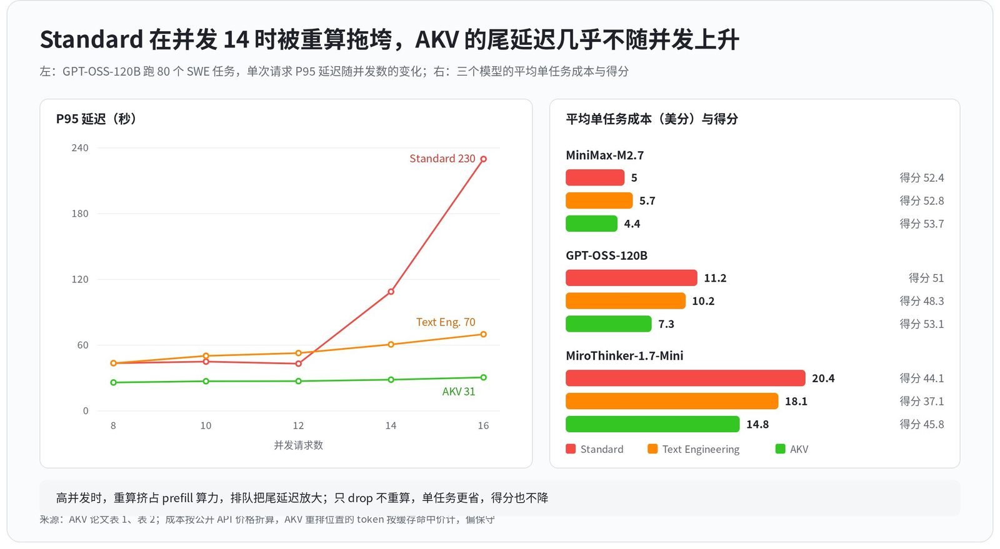

消融实验回答了“删什么、要不要重排”（GPT-OSS-120B，两个基准各取前 100 题）：

| 策略 | BCP 得分 / 成本 | SWE 得分 / 成本 |
|---|---|---|
| Standard | 56.0 / 13.5 | 41.0 / 19.1 |
| 丢工具返回，不重排 | 55.0 / 7.1 | 41.0 / 9.4 |
| 丢推理，重排 | 56.5 / 8.2 | 36.5 / 14.2 |
| 两者都丢，重排 | 56.5 / 8.7 | 34.5 / 7.8 |
| 丢工具返回，重排 | 62.0 / 10.9 | 41.0 / 9.5 |

结论有两条。删推理会伤 SWE，删工具返回不会，和第 12.2 节观察遮蔽的结论一致。重排位置让 BCP 从 55% 升到 62%，没有它，位置号顶到上限时任务只能中止[[54]](https://arxiv.org/abs/2610.28577)。

策略本身还能交给模型。把缓存管理做成工具、让 Agent 自己决定何时丢、丢什么，在 BCP 的 100 题子集上 GPT-OSS-120B 从 52.1% 升到 61.0%，成本从 13.4 降到 12.1 美分，MiniMax-M2.7 从 56.0% 升到 64.0%，成本从 5.4 升到 5.9 美分，因为它多跑了轮次。让 MiniMax-M2.7 在 20 道 BCP 题上迭代改写策略、在另外 100 题上评测，第 3 轮和第 6 轮的策略在准确率与 Standard 持平时，成本分别低 15.6% 和 17.8%，比手写的滚动策略还省[[54]](https://arxiv.org/abs/2610.28577)。接到现成的 Pi 外壳上，GPT-OSS-120B 和 20B 的 BCP 准确率比 Pi 不压缩时高 3%，比 Pi 开压缩时高 4%[[54]](https://arxiv.org/abs/2610.28577)。

### 12.6 设计清单与边界

| 问题 | 默认做法 | 前提或例外 |
|---|---|---|
| 用闭源 API | 只能在文本层：稳定前缀、只追加（第 4.4 节），清旧工具结果时一次清够，大输出可取回（第 4.5 节） | 目前没有托管 API 开放 KV 层的丢弃和重排 |
| 先删什么 | 旧工具返回先删，推理最后动，保留最近十来次工具返回 | SWE 上删推理明显掉分 |
| 怎么删 | 自托管时滚动丢 KV，替代阈值触发的一次性大砍 | 要求推理引擎支持按操作历史复用 |
| 位置号 | 位置接近上限时重排，RoPE 模型直接旋转 K | 非 RoPE 的位置编码要另想办法 |
| 接口 | 请求自带完整消息和操作序列，服务端按 token 加操作匹配 | 客户端要自己维护操作历史 |
| 上线前验证 | 一个请求的丢弃不影响共享前缀的其他请求，驱逐后恢复的输出与未驱逐一致 | 每次改策略或升级引擎都重跑 |
| 评测 | 准确率按上下文长度分桶看，延迟按并发压测看 P95 | 只看平均分会漏掉阈值后的低谷 |

几条边界要说清楚：

- <b>需要自托管推理引擎。</b>AKV 改的是 SGLang 的缓存管理，闭源 API 只开放文本层的压缩和清理。用托管 API 的团队，能借鉴的是删除对象（旧工具输出）和评测方法（按长度分桶），机制本身用不上。
- <b>模型没在这种缓存状态下训练过。</b>丢掉 KV 后，模型看到的是一种训练时没见过的上下文。论文把在这种机制下训练 Agent 列为未来工作，也还不支持线性注意力模型[[54]](https://arxiv.org/abs/2610.28577)。
- <b>得分提升不大，主要收益在成本和尾延迟。</b>平均只高 1 到 2 个百分点，价值主要体现在长任务和高并发上。短任务很少触发丢弃，收益有限。
- <b>数字来自作者的基准和定价假设。</b>论文是 2026 年 10 月的预印本，成本按几家公开价格折算，换到自己的模型、价格和流量上要重新测（第 7 章）。

📎 延伸阅读：KV 压缩为什么会和前缀缓存冲突，见 [LLM-31｜地基｜长上下文与注意力：从 MHA 到稀疏与线性注意力](./31-attention-long-context.md) 第 8.2 节。前缀缓存与 RadixAttention 的原理见 [LLM-08｜系统｜大模型推理系统：全栈学习手册](./08-inference-systems.md) 第 6.3 节。

## 参考文献

按正文首次引用顺序编号，资料截至 2026 年 10 月。

[1] Anthropic. Building Effective Agents (2024) [https://www.anthropic.com/engineering/building-effective-agents](https://www.anthropic.com/engineering/building-effective-agents)

[2] Yang et al. SWE-agent: Agent-Computer Interfaces Enable Automated Software Engineering. NeurIPS (2024) [https://arxiv.org/abs/2405.15793](https://arxiv.org/abs/2405.15793)

[3] Hong, Troynikov &amp; Huber. Context Rot: How Increasing Input Tokens Impacts LLM Performance. Chroma (2025) [https://research.trychroma.com/context-rot](https://research.trychroma.com/context-rot)

[4] Anthropic. How We Built Our Multi-Agent Research System (2025) [https://www.anthropic.com/engineering/multi-agent-research-system](https://www.anthropic.com/engineering/multi-agent-research-system)

[5] Cognition. Multi-Agents: What's Actually Working (2026) [https://cognition.com/blog/multi-agents-working](https://cognition.com/blog/multi-agents-working)

[6] Yao et al. tau-bench: A Benchmark for Tool-Agent-User Interaction in Real-World Domains (2024) [https://arxiv.org/abs/2406.12045](https://arxiv.org/abs/2406.12045)

[7] Yao et al. ReAct: Synergizing Reasoning and Acting in Language Models. ICLR (2023) [https://arxiv.org/abs/2210.03629](https://arxiv.org/abs/2210.03629)

[8] Anthropic. Writing Effective Tools for Agents, with Agents (2025) [https://www.anthropic.com/engineering/writing-tools-for-agents](https://www.anthropic.com/engineering/writing-tools-for-agents)

[9] Anthropic. Effective Harnesses for Long-Running Agents (2025) [https://www.anthropic.com/engineering/effective-harnesses-for-long-running-agents](https://www.anthropic.com/engineering/effective-harnesses-for-long-running-agents)

[10] Gan &amp; Sun. RAG-MCP: Mitigating Prompt Bloat in LLM Tool Selection via Retrieval-Augmented Generation (2025) [https://arxiv.org/abs/2505.03275](https://arxiv.org/abs/2505.03275)

[11] Anthropic. Code Execution with MCP: Building More Efficient AI Agents (2025) [https://www.anthropic.com/engineering/code-execution-with-mcp](https://www.anthropic.com/engineering/code-execution-with-mcp)

[12] Anthropic. Effective Context Engineering for AI Agents (2025) [https://www.anthropic.com/engineering/effective-context-engineering-for-ai-agents](https://www.anthropic.com/engineering/effective-context-engineering-for-ai-agents)

[13] Yan. Don't Build Multi-Agents. Cognition (2025) [https://cognition.com/blog/dont-build-multi-agents](https://cognition.com/blog/dont-build-multi-agents)

[14] Liu et al. Lost in the Middle: How Language Models Use Long Contexts. TACL (2024) [https://arxiv.org/abs/2307.03172](https://arxiv.org/abs/2307.03172)

[15] Anthropic. Prompt Caching Documentation [https://docs.anthropic.com/en/docs/build-with-claude/prompt-caching](https://docs.anthropic.com/en/docs/build-with-claude/prompt-caching)

[16] Cemri et al. Why Do Multi-Agent LLM Systems Fail? (2025) [https://arxiv.org/abs/2503.13657](https://arxiv.org/abs/2503.13657)

[17] Kwa et al. Measuring AI Ability to Complete Long Tasks. METR (2025) [https://arxiv.org/abs/2503.14499](https://arxiv.org/abs/2503.14499)

[18] Shinn et al. Reflexion: Language Agents with Verbal Reinforcement Learning. NeurIPS (2023) [https://arxiv.org/abs/2303.11366](https://arxiv.org/abs/2303.11366)

[19] Jimenez et al. SWE-bench: Can Language Models Resolve Real-World GitHub Issues? ICLR (2024) [https://arxiv.org/abs/2310.06770](https://arxiv.org/abs/2310.06770)

[20] OpenAI. Introducing SWE-bench Verified (2024) [https://openai.com/index/introducing-swe-bench-verified/](https://openai.com/index/introducing-swe-bench-verified/)

[21] OpenTelemetry. Semantic Conventions for Generative AI Systems [https://opentelemetry.io/docs/specs/semconv/gen-ai/](https://opentelemetry.io/docs/specs/semconv/gen-ai/)

[22] Greshake et al. Not What You've Signed Up For: Compromising Real-World LLM-Integrated Applications with Indirect Prompt Injection (2023) [https://arxiv.org/abs/2302.12173](https://arxiv.org/abs/2302.12173)

[23] Willison. The Lethal Trifecta for AI Agents (2025) [https://simonwillison.net/2025/Jun/16/the-lethal-trifecta/](https://simonwillison.net/2025/Jun/16/the-lethal-trifecta/)

[24] Debenedetti et al. AgentDojo: A Dynamic Environment to Evaluate Prompt Injection Attacks and Defenses for LLM Agents. NeurIPS (2024) [https://arxiv.org/abs/2406.13352](https://arxiv.org/abs/2406.13352)

[25] Debenedetti et al. Defeating Prompt Injections by Design / CaMeL (2025) [https://arxiv.org/abs/2503.18813](https://arxiv.org/abs/2503.18813)

[26] LangChain. LangGraph docs: Persistence (2026) [https://docs.langchain.com/oss/python/langgraph/persistence](https://docs.langchain.com/oss/python/langgraph/persistence)

[27] LangChain. LangGraph docs: Functional API (2026) [https://docs.langchain.com/oss/python/langgraph/functional-api](https://docs.langchain.com/oss/python/langgraph/functional-api)

[28] OpenAI. Agents SDK docs: Human-in-the-loop (2026) [https://openai.github.io/openai-agents-python/human_in_the_loop/](https://openai.github.io/openai-agents-python/human_in_the_loop/)

[29] OpenAI. Agents SDK docs: Agent orchestration / multi-agent (2026) [https://openai.github.io/openai-agents-python/multi_agent/](https://openai.github.io/openai-agents-python/multi_agent/)

[30] Temporal. Activity Definition (2026) [https://docs.temporal.io/activity-definition](https://docs.temporal.io/activity-definition)

[31] Temporal. AI Cookbook: Human-in-the-loop (Python) (2026) [https://docs.temporal.io/ai/cookbook/human-in-the-loop-python](https://docs.temporal.io/ai/cookbook/human-in-the-loop-python)

[32] Stripe. API Reference: Idempotent requests (2026) [https://docs.stripe.com/api/idempotent_requests](https://docs.stripe.com/api/idempotent_requests)

[33] Anthropic. Claude Agent SDK: Permissions (2026) [https://code.claude.com/docs/en/agent-sdk/permissions](https://code.claude.com/docs/en/agent-sdk/permissions)

[34] HumanLayer. 12-Factor Agents (2025) [https://github.com/humanlayer/12-factor-agents](https://github.com/humanlayer/12-factor-agents)

[35] LangChain. LangGraph docs: Interrupts (2026) [https://docs.langchain.com/oss/python/langgraph/interrupts](https://docs.langchain.com/oss/python/langgraph/interrupts)

[36] OpenAI. Agents SDK docs: Guardrails (2026) [https://openai.github.io/openai-agents-python/guardrails/](https://openai.github.io/openai-agents-python/guardrails/)

[37] LangChain. LangGraph docs: Checkpointers and durability modes (2026) [https://docs.langchain.com/oss/python/langgraph/checkpointers](https://docs.langchain.com/oss/python/langgraph/checkpointers)

[38] Liu et al. SoL-Pi: Recursively Scaling Auto-Research Loops for Efficient Agent Harness. arXiv:2609.20519 (2026-09) [https://arxiv.org/abs/2609.20519](https://arxiv.org/abs/2609.20519)

[39] ArronAI007. Awesome-AGI：agent-framework-insights 开源 Agent 框架源码拆解课程（二手资料，2026） [https://github.com/ArronAI007/Awesome-AGI/tree/main/05-frameworks/agent-framework-insights](https://github.com/ArronAI007/Awesome-AGI/tree/main/05-frameworks/agent-framework-insights)

[40] Earendil. Pi coding-agent: Compaction（项目文档） [https://github.com/earendil-works/pi/blob/main/packages/coding-agent/docs/compaction.md](https://github.com/earendil-works/pi/blob/main/packages/coding-agent/docs/compaction.md)

[41] DeepSeek-AI. DeepSeek Harness: Architecture（开发者预览版） [https://github.com/deepseek-ai/deepseek-harness/blob/master/docs/architecture.md](https://github.com/deepseek-ai/deepseek-harness/blob/master/docs/architecture.md)

[42] Nous Research. Hermes Agent（GitHub 仓库） [https://github.com/NousResearch/hermes-agent](https://github.com/NousResearch/hermes-agent)

[43] HKUDS. OpenHarness（GitHub 仓库） [https://github.com/HKUDS/OpenHarness](https://github.com/HKUDS/OpenHarness)

[44] OpenClaw（GitHub 仓库） [https://github.com/openclaw/openclaw](https://github.com/openclaw/openclaw)

[45] Anthropic. Compaction（Claude API 文档） [https://platform.claude.com/docs/en/build-with-claude/compaction](https://platform.claude.com/docs/en/build-with-claude/compaction)

[46] OpenAI. Compaction（Responses API 文档） [https://developers.openai.com/api/docs/guides/compaction](https://developers.openai.com/api/docs/guides/compaction)

[47] OpenAI. Codex: Sandboxing（沙箱模式与审批策略） [https://developers.openai.com/codex/concepts/sandboxing](https://developers.openai.com/codex/concepts/sandboxing)

[48] Anthropic. Claude Code: Hooks reference [https://code.claude.com/docs/en/hooks](https://code.claude.com/docs/en/hooks)

[49] Awesome-AGI 课程. 插件架构对比精讲：Hermes vs Pi vs OpenCode（解读 Hermes 2026-07 插件 RFC） [https://github.com/ArronAI007/Awesome-AGI/blob/main/05-frameworks/agent-framework-insights/Hermes-Agent/08-%E6%8F%92%E4%BB%B6%E7%B3%BB%E7%BB%9F%E4%B8%8E%E5%8D%8F%E8%AE%AE%E7%94%9F%E6%80%81/02-%E6%8F%92%E4%BB%B6%E6%9E%B6%E6%9E%84%E5%AF%B9%E6%AF%94%E7%B2%BE%E8%AE%B2-Hermes-vs-Pi-vs-OpenCode.md](https://github.com/ArronAI007/Awesome-AGI/blob/main/05-frameworks/agent-framework-insights/Hermes-Agent/08-插件系统与协议生态/02-插件架构对比精讲-Hermes-vs-Pi-vs-OpenCode.md)

[50] Awesome-AGI 课程. Footprint Ladder 能力分层哲学（解读 Hermes 贡献指南） [https://github.com/ArronAI007/Awesome-AGI/blob/main/05-frameworks/agent-framework-insights/Hermes-Agent/02-%E4%BB%93%E5%BA%93%E5%85%A8%E6%99%AF%E4%B8%8E%E5%B7%A5%E7%A8%8B%E5%AE%9E%E8%B7%B5/04-Footprint-Ladder%E8%83%BD%E5%8A%9B%E5%88%86%E5%B1%82%E5%93%B2%E5%AD%A6.md](https://github.com/ArronAI007/Awesome-AGI/blob/main/05-frameworks/agent-framework-insights/Hermes-Agent/02-仓库全景与工程实践/04-Footprint-Ladder能力分层哲学.md)

[51] Awesome-AGI 课程. 批准模式、网络出口隔离与安全模型三层防御（解读 Hermes SECURITY.md） [https://github.com/ArronAI007/Awesome-AGI/blob/main/05-frameworks/agent-framework-insights/Hermes-Agent/05-%E7%BB%88%E7%AB%AF%E5%90%8E%E7%AB%AF%E4%B8%8E%E6%89%A7%E8%A1%8C%E5%AE%89%E5%85%A8/03-%E6%89%B9%E5%87%86%E6%A8%A1%E5%BC%8F%E7%BD%91%E7%BB%9C%E5%87%BA%E5%8F%A3%E9%9A%94%E7%A6%BB%E4%B8%8E%E5%AE%89%E5%85%A8%E6%A8%A1%E5%9E%8B%E4%B8%89%E5%B1%82%E9%98%B2%E5%BE%A1.md](https://github.com/ArronAI007/Awesome-AGI/blob/main/05-frameworks/agent-framework-insights/Hermes-Agent/05-终端后端与执行安全/03-批准模式网络出口隔离与安全模型三层防御.md)

[52] Awesome-AGI 课程. Queue 与并发控制：Steering（解读 OpenClaw） [https://github.com/ArronAI007/Awesome-AGI/blob/main/05-frameworks/agent-framework-insights/OpenClaw/04-Agent%E6%A0%B8%E5%BF%83%E5%BE%AA%E7%8E%AF%E4%B8%8E%E4%BC%9A%E8%AF%9D/04-Queue%E4%B8%8E%E5%B9%B6%E5%8F%91%E6%8E%A7%E5%88%B6-Steering.md](https://github.com/ArronAI007/Awesome-AGI/blob/main/05-frameworks/agent-framework-insights/OpenClaw/04-Agent核心循环与会话/04-Queue与并发控制-Steering.md)

[53] Awesome-AGI 课程. Curator 后台复审与技能生命周期治理（解读 Hermes） [https://github.com/ArronAI007/Awesome-AGI/blob/main/05-frameworks/agent-framework-insights/Hermes-Agent/07-Skills%E8%87%AA%E6%88%91%E8%BF%9B%E5%8C%96%E5%AD%A6%E4%B9%A0%E7%8E%AF/03-Curator%E5%90%8E%E5%8F%B0%E5%A4%8D%E5%AE%A1%E4%B8%8E%E6%8A%80%E8%83%BD%E7%94%9F%E5%91%BD%E5%91%A8%E6%9C%9F%E6%B2%BB%E7%90%86.md](https://github.com/ArronAI007/Awesome-AGI/blob/main/05-frameworks/agent-framework-insights/Hermes-Agent/07-Skills自我进化学习环/03-Curator后台复审与技能生命周期治理.md)

[54] 清华大学 NICS 团队等. Cache Engineering for Agents（AKV）. arXiv:2610.28577 (2026-10) [https://arxiv.org/abs/2610.28577](https://arxiv.org/abs/2610.28577)

[55] 清华大学 NICS 团队. AKV 代码仓库（GitHub） [https://github.com/thu-nics/AKV](https://github.com/thu-nics/AKV)

[56] Anthropic. Context editing (Claude API docs) [https://platform.claude.com/docs/en/build-with-claude/context-editing](https://platform.claude.com/docs/en/build-with-claude/context-editing)

[57] Manus. Context Engineering for AI Agents: Lessons from Building Manus (2025-07-18) [https://manus.im/blog/Context-Engineering-for-AI-Agents-Lessons-from-Building-Manus](https://manus.im/blog/Context-Engineering-for-AI-Agents-Lessons-from-Building-Manus)

[58] JetBrains Research. The Complexity Trap: Simple Observation Masking Is as Efficient as LLM Summarization for Agent Context Management. arXiv:2508.21433 [https://arxiv.org/abs/2508.21433](https://arxiv.org/abs/2508.21433)

[59] Leyline: KV Cache Directives for Agentic Inference. arXiv:2606.01065 (2026-06) [https://arxiv.org/abs/2606.01065](https://arxiv.org/abs/2606.01065)

[60] OpenAI. Prompt caching (API docs) [https://developers.openai.com/api/docs/guides/prompt-caching](https://developers.openai.com/api/docs/guides/prompt-caching)

---

上一篇：[LLM-04｜工程｜《深入理解 AI Agent》精读：设计原理与工程实践](./04-ai-agent-reading.md) · [目录](./README.md) · 下一篇：[LLM-06｜场景｜LLM 在运维与容灾中的落地：SRE 实战地图](./06-llm-for-sre.md)
