# LLM-07｜系统｜LLM 服务稳定性工程：SRE 上线手册

> 🎯 **这篇文档解决什么问题**：业务接入大模型之后，SRE 很快会发现老一套不够用。一次请求要跑几秒到几分钟，按 token 计费也按 token 限流，供应商一抖整条链路都跟着抖，最难的是模型“没报错但答坏了”。本文把限流、超时、重试、降级、容量、成本、监控和演练这些 SRE 的老问题，放到 LLM 服务的新约束下重新过一遍。每章给出可照做的做法、背后的公开数据，以及两起真实事故的复盘。
>
> 使用方式：先读第 1 章定 SLI 和 SLO，再按第 2–5 章依次过网关、限流、重试和容灾。关心“没报错但答坏了”的读第 6 章，算容量和成本的读第 7、8 章，上线前用第 10 章的清单核对。文中价格和事故数据核对于 2026 年 10 月 11 日。
>
> **代码**：配套练习在 llm-book 仓库的 `07-llm-sre/`，4 个练习对应第 1、3、4、5 章（按请求联合达标的 goodput、区分 429 的种类、重试预算、客户端自适应限流）。只用 Go 标准库，进目录跑 `go test -race ./...` 就能验证；每个练习加 `-broken` 运行能看到有问题的早期写法，练习 README 末尾附参考答案。

## 导读 · 先给结论

- **供应商一定会挂，而且是整站挂**。2024 年 12 月 11 日，OpenAI 因一次遥测服务发布打垮了 Kubernetes 控制面，全部服务中断约 4 小时 22 分钟[[1]](https://status.openai.com/incidents/ctrsv3lwd797)。关键业务必须有第二条路。
- **最危险的故障不报错**。2025 年 8 月起，Anthropic 的三个基础设施 bug 让部分请求质量下降，最严重的一小时影响了 16% 的 Sonnet 4 请求，而常规评测没有发现[[2]](https://www.anthropic.com/engineering/a-postmortem-of-three-recent-issues)。可用性监控之外必须有质量监控。
- **重试必须有预算**。SDK、业务代码、网关三层各最多尝试 3 次（含首次调用），最坏情况一个请求会变成 3 × 3 × 3 = 27 次调用；若每层是“首次 + 重试 3 次”，最坏就是 4 × 4 × 4 = 64 次。Google SRE 的做法是单请求最多 3 次、单客户端重试占比不超过 10%[[3]](https://sre.google/sre-book/handling-overload/)。
- **按 token 做容量和限流，不按请求**。供应商按每分钟输入、输出 token 数限流[[4]](https://docs.anthropic.com/en/api/rate-limits)，同样的 QPS，长输入和短输入对容量的消耗能差几十倍。
- **SLO 要看 goodput，不只看吞吐**。goodput 指在满足首 token 延迟和后续 token 速度目标的前提下每秒能完成的请求数[[5]](https://arxiv.org/abs/2401.09670)。吞吐高但大量请求超时，对用户没有意义。

把一个 LLM 调用当成普通的 HTTP 依赖，是大多数线上问题的起点。两者在六个方面差别很大：

| 维度 | 普通微服务 | LLM 服务 |
|---|---|---|
| 延迟 | 毫秒级，分布较窄 | 秒到分钟级，随输入输出长度剧烈变化；流式返回，要分开看首 token 和后续速度 |
| 计量单位 | 请求数（QPS） | token 数：限流按 token、计费按 token、容量也按 token |
| 依赖 | 多为自建，可控 | 多为外部供应商，故障、限流、模型更新都不受自己控制 |
| 成本 | 每个请求成本相近 | 单请求成本可差上百倍，一个失控的循环就能烧掉一天预算 |
| 重试 | 重试通常便宜、幂等 | 重试要重新付全部 token 的钱；流式中途失败无法续传 |
| 故障形态 | 报错、超时，监控能看到 | 除此之外还有“质量型故障”：返回 200，但内容变差，状态页一片绿 |

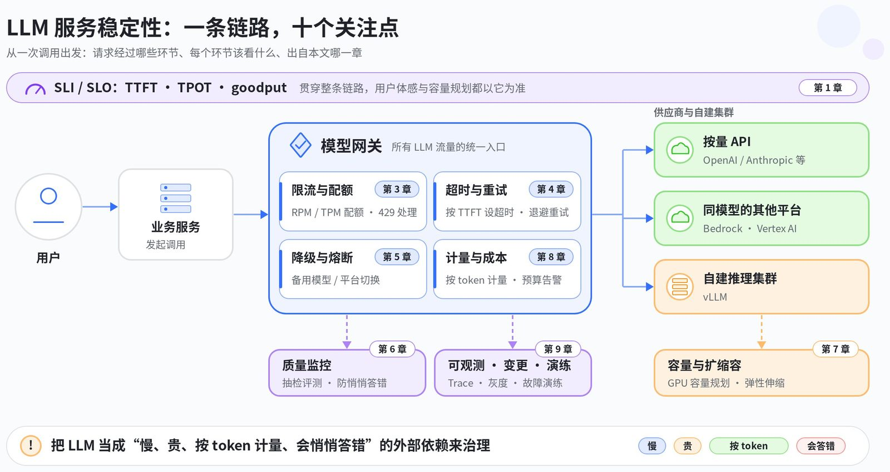

| 章节 | 回答的问题 | 图 |
|---|---|---|
| 第 1 章 SLI 与 SLO | LLM 服务该看哪些指标；goodput 是什么 | R2 |
| 第 2 章 模型网关 | 为什么所有调用都要过一层网关；网关该做什么 | R3 |
| 第 3 章 限流与配额 | 供应商怎么限流；内部多租户怎么分额度、分优先级 | R4、R5 |
| 第 4 章 超时与重试 | 流式请求的四种超时；重试为什么会把故障放大 27 倍 | R6、R7 |
| 第 5 章 降级与多供应商容灾 | 降级阶梯怎么设计；一次全站宕机的复盘 | R8、R9 |
| 第 6 章 质量型故障 | “没报错但答坏了”怎么发现；一次质量事故的复盘 | R10、R11 |
| 第 7 章 容量规划与自建推理 | 托管、预留、自建怎么选；扩缩容看什么信号 | R12 |
| 第 8 章 成本治理 | 成本怎么归因到租户；预算护栏和降本杠杆 | R13 |
| 第 9 章 可观测、变更与演练 | 埋哪些指标；模型和 Prompt 变更怎么发布；演练什么 | R14 |
| 第 10 章 上线清单与反模式 | 上线前逐项核对 | — |

📎 与系列其他文档的分工：推理与部署的原理见「LLM 基础」第 6 章，自建推理见「vLLM 学习路径」。Agent 的成本与延迟见「Agent 工程实战」第 9 章，反过来用 LLM 做运维见「LLM 在运维与容灾中的落地」。本文只讲把 LLM 当作线上依赖时的稳定性工程。

## 第 1 章 · SLI 与 SLO：LLM 服务该看哪些指标

### 1.1 把一次流式请求拆开看

一次流式请求从发出到结束经历四段：**排队**（等待调度或等待限流放行）、**Prefill**（并行处理全部输入，产出第一个 token）、**Decode**（逐个生成后续 token）、**收尾**（返回用量和结束原因）。对应的核心延迟指标有三个：

- **TTFT**（Time To First Token，首 token 延迟）：从发出请求到收到第一个 token。包含排队和 Prefill，决定用户“等多久才开始看到字”。输入越长，Prefill 越久。
- **TPOT / ITL**（Time Per Output Token / Inter-Token Latency，每个输出 token 的间隔）：决定“字出得顺不顺”。对话场景一般要求每秒 20 个 token 以上，即间隔 50 毫秒以内。
- **E2E**（端到端延迟）：约等于 TTFT + 输出 token 数 × TPOT。非流式接口、Agent 的单步调用、批处理任务主要看它。

推理模型要额外注意一点：模型先“思考”再回答，思考阶段可能不向用户展示，用户感知到的“首个可见 token”会比 TTFT 晚很多。这类请求应单独统计“首个可见 token 延迟”和思考 token 数。

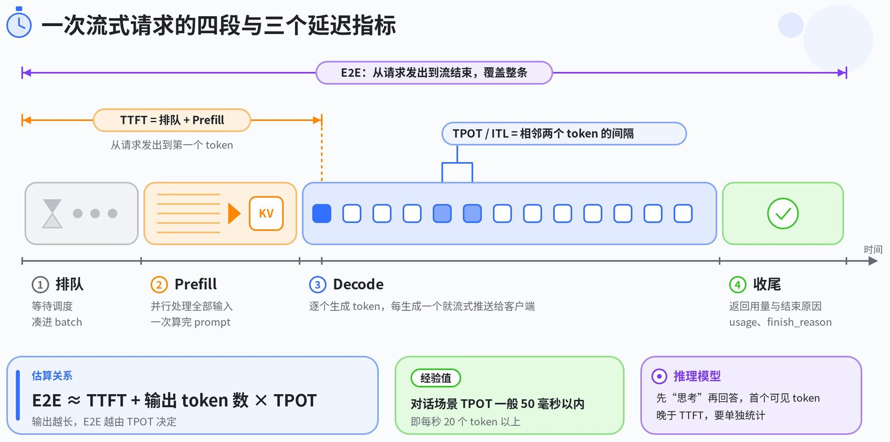

### 1.2 goodput：满足 SLO 的吞吐才算数

传统服务看吞吐（QPS）就够了。LLM 服务里，吞吐和延迟是此消彼长的：把批次开大，GPU 利用率和吞吐上去了，但每个请求的 TPOT 变慢；优先处理新请求的 Prefill，TTFT 好看了，正在生成的请求却被卡住。DistServe 因此提出用 **goodput** 衡量服务能力：在一定比例（如 90%）的请求同时满足 TTFT 和 TPOT 目标的前提下，系统每秒能处理的最大请求数[[5]](https://arxiv.org/abs/2401.09670)。

对 SRE 来说，goodput 是容量规划的正确单位：压测时不要只报“最大 QPS”，而要报“在 TTFT p90 ≤ X、TPOT p90 ≤ Y 时的最大 QPS”。DistServe 通过把 Prefill 和 Decode 拆到不同 GPU 上，在满足延迟要求的前提下最多能多服务 7.4 倍请求，或把 SLO 收紧 12.6 倍[[5]](https://arxiv.org/abs/2401.09670)。

### 1.3 一套可用的 SLI 清单

| SLI | 定义 | 注意事项 |
|---|---|---|
| 可用性 | 非用户原因失败的请求占比的补集 | 429（限流）、400（参数错误）、内容安全拒绝要和 5xx 分开统计；流式请求中途断开也算失败 |
| TTFT | p50 / p90 / p99 | 按输入长度分桶统计，否则长输入请求会把分位数拉得毫无意义 |
| TPOT | p50 / p90 / p99 | 按模型分别统计；同一模型不同供应商可能差别很大 |
| SLO 达标率 / goodput | SLO 达标率（%）：同时满足 TTFT 与 TPOT 目标的请求比例；goodput（req/s 或 req/s/GPU）：达标率不低于门槛（如 90%）时可承载的最大请求速率 | 比单看可用性更接近用户体验 |
| 截断率 | 因达到 max_tokens 而结束的请求占比 | 突然升高往往意味着模型变“啰嗦”或 Prompt 改坏了 |
| 格式正确率 | 要求输出 JSON / 工具调用时，可解析且符合 schema 的比例 | 最便宜的质量信号，第 6 章展开 |
| 单请求成本 | 按 token 用量和单价折算 | 按租户、按功能归因，第 8 章展开 |

> 📌 **在哪里测**：同一个指标在三个位置测出来不一样。供应商侧只知道它自己的处理时间；网关侧能看到排队、限流和重试；客户端侧才包含网络和前端渲染。SLO 以用户视角为准，至少要在网关和客户端各测一遍，两者的差值本身就是重要的诊断信号。

## 第 2 章 · 模型网关：所有调用先过一层

### 2.1 为什么需要网关

业务各自直连供应商，短期最快，长期最乱：API Key 散落在各个仓库，没人知道哪个功能花了多少钱，供应商限流时大家一起被打回，想切到备用模型要改十几个服务。**模型网关**（也叫 AI Gateway、LLM Gateway）把这些横切能力收拢到一处，作用相当于微服务体系里的 API 网关加服务网格。

一个生产级网关通常要做八件事：

1. **统一接口**：对内暴露一套 API（多数选 OpenAI 兼容格式），对外适配各家供应商。
2. **鉴权与密钥管理**：业务只拿内部凭证，供应商 Key 集中托管和轮换。
3. **路由**：按模型名、租户、地域、成本把请求分到不同供应商或自建集群。
4. **限流与配额**：按租户分 token 额度，按优先级排队（第 3 章）。
5. **超时、重试与降级**：统一实现，避免每个业务各写一套（第 4、5 章）。
6. **缓存**：提示词缓存命中优化、必要时的结果缓存。
7. **计量与成本归因**：每个请求记下租户、功能、模型、token 数、费用（第 8 章）。
8. **可观测与审计**：统一的指标、追踪和脱敏日志（第 9 章）。

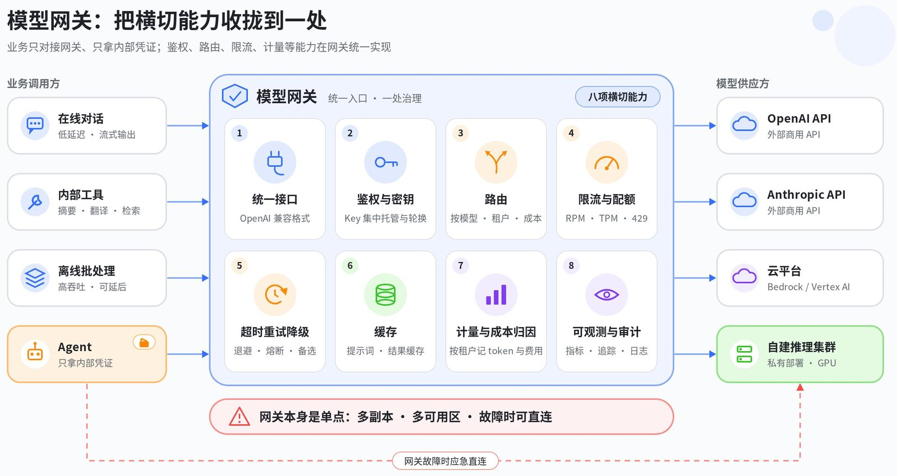

### 2.2 开源与托管选项

网关有现成方案，不必从零写。常见的几类：

| 类型 | 代表 | 适合 |
|---|---|---|
| 应用层网关 | LiteLLM 等，支持多供应商适配、失败后切到备用模型组、上下文超长时切到长窗口模型[[6]](https://docs.litellm.ai/docs/proxy/reliability) | 主要调用外部 API、需要快速落地 |
| 基础设施网关扩展 | Kubernetes Gateway API Inference Extension，基于 Envoy 扩展，支持按模型名路由、按模型服务器指标（如前缀缓存、LoRA 适配器）选端点、按优先级服务[[7]](https://gateway-api-inference-extension.sigs.k8s.io/) | 在 Kubernetes 上自建推理集群 |
| 云厂商托管 | 各大云的 AI 网关 / API 管理产品 | 已深度使用某家云、希望少运维 |

自建推理时，普通的轮询负载均衡效果很差：请求长短悬殊，某个副本可能正在处理几个超长请求，KV Cache 已满。Gateway API Inference Extension 的做法是让一个“端点选择器”实时读取各个模型服务器的排队长度、KV Cache 占用、前缀缓存命中等指标，再决定把请求发给谁[[7]](https://gateway-api-inference-extension.sigs.k8s.io/)。

> ❗ **网关本身是单点**：所有 LLM 流量都过网关，网关挂了等于全部挂。网关要按核心服务的标准部署：多副本、多可用区、无状态、配额状态放在高可用存储里；还要有“网关不可用时业务能否直连供应商”的应急预案，并定期演练。

## 第 3 章 · 限流与配额

### 3.1 供应商是怎么限流的

主流供应商都按“请求数 + token 数”多维限流，任何一维先触顶就返回 429。但各家的计量口径并不相同，直接影响你该怎么设参数：

- **OpenAI**：按 RPM（每分钟请求数）、TPM（每分钟 token 数）以及日维度的 RPD、TPD 限流，任一维度先用完就触发。计入额度的 token 数取 `max_tokens` 和按字符数估算的 token 数中较大的一个，所以 `max_tokens` 应尽量贴近实际输出长度[[8]](https://platform.openai.com/docs/guides/rate-limits)。
- **Anthropic**：按 RPM、ITPM（每分钟输入 token）、OTPM（每分钟输出 token）分别限流，算法是令牌桶，额度持续回补而不是按固定窗口清零。对多数模型，从缓存读取的输入 token 不计入 ITPM；OTPM 只按实际生成的 token 实时计算，`max_tokens` 设大不影响额度[[4]](https://docs.anthropic.com/en/api/rate-limits)。

两家还都有一种容易被忽视的限制：**增速限制**。流量短时间内暴涨，即使没超过 RPM/TPM 也会被限流。OpenAI 的建议是流量达到每分钟 100 万输入 token 之后，每 15 分钟增长不超过 50%[[8]](https://platform.openai.com/docs/guides/rate-limits)；Anthropic 称之为加速度限制，要求平滑爬坡[[4]](https://docs.anthropic.com/en/api/rate-limits)。这对大促、批量回灌、切流（把另一家的流量整体切过来）影响很大：**切流不能一步到位，要按增速限制分批放量**。

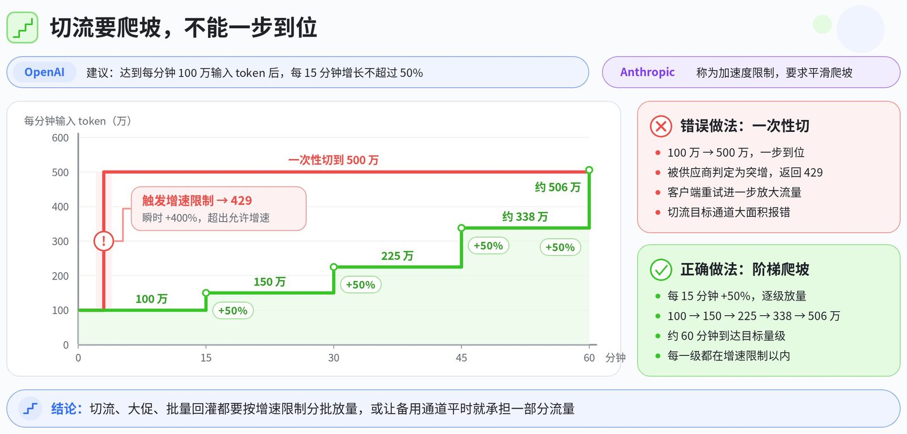

缓存对限流的影响很大。Anthropic 文档给的例子是：ITPM 额度为 200 万、缓存命中率 80% 时，每分钟实际能处理 1000 万输入 token[[4]](https://docs.anthropic.com/en/api/rate-limits)。把系统提示、工具定义、长文档放在稳定的前缀里，既省钱（缓存读取按基础输入价的 10% 计费[[9]](https://docs.anthropic.com/en/docs/build-with-claude/prompt-caching)），又等于免费扩了容。

### 3.2 要区分的几种 429

同样是 429，原因和处理方式完全不同，网关必须解析错误体分别处理：

| 情况 | 特征 | 处理 |
|---|---|---|
| 临时限流 | 带 `Retry-After` 头 | 至少等待该时长再加少量随机抖动后重试[[8]](https://platform.openai.com/docs/guides/rate-limits) |
| 增速过快 | OpenAI 返回错误码 `slow_down` | 降低发送速率后逐步爬坡[[8]](https://platform.openai.com/docs/guides/rate-limits) |
| 预算或支出上限 | OpenAI 硬性支出上限返回 429[[8]](https://platform.openai.com/docs/guides/rate-limits)；Anthropic 的支出上限 429 不带 `retry-after`，重试会一直失败直到额度恢复[[4]](https://docs.anthropic.com/en/api/rate-limits) | **不要重试**，立即告警，走降级 |
| 供应商过载 | OpenAI 返回 503 `server_is_overloaded`[[8]](https://platform.openai.com/docs/guides/rate-limits)；Anthropic 返回 529 `overloaded_error`[[10]](https://docs.anthropic.com/en/api/errors) | 退避重试，持续出现则切换供应商 |

### 3.3 内部配额：多租户怎么分

供应商给的是整个组织的总额度，内部还要再分给各个业务。只做“先到先得”，一个批处理任务就能把在线业务的额度吃光。内部配额至少要分三层：

1. **按租户分 token 额度**：每个业务有自己的 ITPM / OTPM 和日、月预算，超了只影响自己。
2. **按优先级分级**：Google SRE 把请求分为 `CRITICAL_PLUS`、`CRITICAL`、`SHEDDABLE_PLUS`、`SHEDDABLE` 四级，过载时先丢低优先级，服务要为 `CRITICAL` 及以上流量预留足够容量[[3]](https://sre.google/sre-book/handling-overload/)。映射到 LLM 场景：用户在线对话 > 内部工具 > 离线批处理 > 评测与回灌。
3. **公平调度**：同一优先级内，按 token 而不是按请求数来分配。VTC（虚拟 token 计数器）为每个租户记录已获得的服务量（按输入、输出 token 加权），总是优先服务累计量最少的租户，并证明了任意两个持续有请求的租户之间的服务量差距有 2 倍的上界[[11]](https://arxiv.org/abs/2401.00588)。

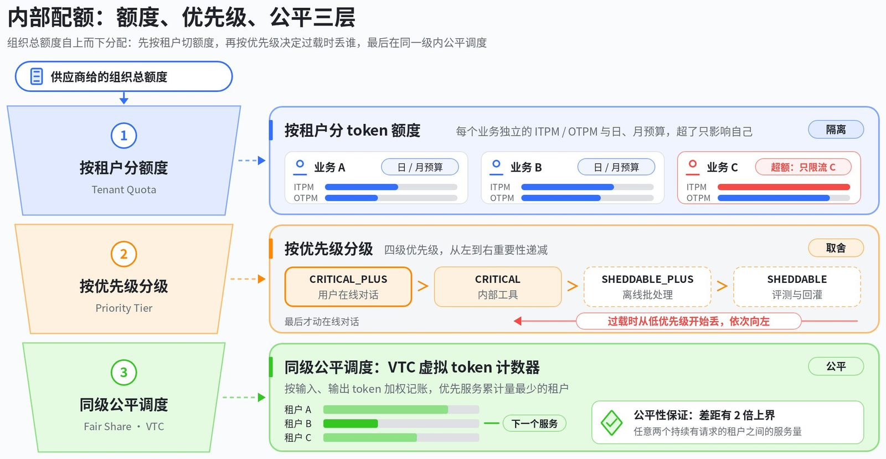

> 🔑 **批处理走独立通道**：不需要实时返回的任务（离线打标、评测、回灌）不要和在线流量抢额度。OpenAI 和 Anthropic 的 Batch API 都按标准价格的 50% 计费，处理窗口为 24 小时。OpenAI 的批处理使用独立且更高的限流额度[[12]](https://platform.openai.com/docs/guides/batch)；Anthropic 的批次大多在 1 小时内完成，24 小时内未完成的请求会过期[[13]](https://docs.anthropic.com/en/docs/build-with-claude/batch-processing)。

## 第 4 章 · 超时与重试

### 4.1 流式请求要设四种超时

普通 HTTP 调用设一个总超时就够了。流式 LLM 请求如果只设总超时，会同时犯两种错：设短了，长回答被腰斩；设长了，卡死的连接要等几分钟才发现。应该拆成四种：

| 超时 | 管什么 | 经验值（按业务调整） |
|---|---|---|
| 连接超时 | 建连和 TLS 握手 | 数秒；超时立即换端点 |
| 首 token 超时 | 发出请求到收到第一个流事件 | 对话场景 10–30 秒；长输入、推理模型适当放宽 |
| 空闲超时 | 两个流事件之间的最长间隔 | 数十秒；超过即判定连接卡死 |
| 总截止时间 | 整个请求（含重试）的上限 | 由业务决定，并沿调用链向下传递 |

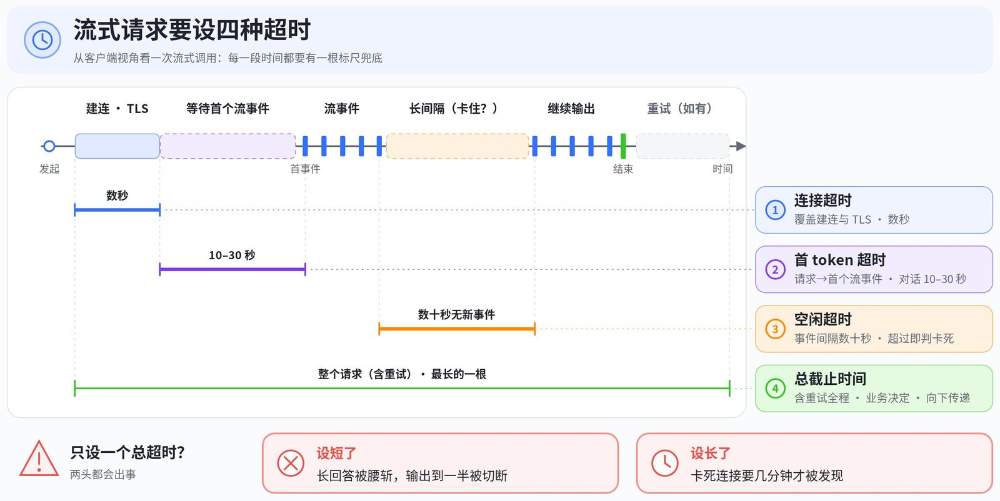

非流式请求更要小心：输出很长时，整段生成完才返回，很容易撞上中间代理的空闲超时。Anthropic 的 SDK 会检查非流式请求预计是否超过 10 分钟，并建议超过 10 分钟的长请求改用流式接口或 Batch API；直连时开启 TCP keep-alive 可以减少空闲连接被中间设备断开的问题[[10]](https://docs.anthropic.com/en/api/errors)。

### 4.2 哪些错误可以重试

| 错误 | 重试 | 说明 |
|---|---|---|
| 429 临时限流、503 / 529 过载、500 | 可以 | 按 `Retry-After` 或指数退避加抖动 |
| 连接失败、首 token 超时 | 可以 | 尚未产生输出，可以重试；但供应商可能已经开始处理，这部分输入同样可能计费 |
| 流式输出到一半中断 | 谨慎 | 无法续传，只能整段重来。OpenAI 明确建议不要在已消费输出后自动重放请求[[8]](https://platform.openai.com/docs/guides/rate-limits)；面向用户时，应提示中断并让用户决定 |
| 400 参数错误、401 / 403 | 不要 | 重试必然再失败 |
| 上下文超长 | 换模型 | 不要原样重试，改为截断或切到长窗口模型 |
| 预算 / 支出上限、配额用尽 | 不要 | 见 3.2 节，立即告警并降级 |

Agent 场景还有一层：如果模型已经发起了有副作用的工具调用（写库、发消息、下单），重试整个回合可能把副作用执行两次。工具层要做幂等（带幂等键），或者重试只从最后一个未完成的步骤开始。

### 4.3 重试必须有预算

每一层都“好心”最多尝试 3 次（含首次调用），故障就会被成倍放大。一条典型链路是：业务代码 → 供应商 SDK → 网关 → 供应商。若业务代码、SDK、网关各自最多尝试 3 次，一个最终失败的请求最多会变成 3 × 3 × 3 = 27 次调用，正好在供应商过载时把它压得更死。OpenAI 也提醒：如果业务自己做重试，就要关掉 SDK 的重试或把它算进总次数，否则嵌套重试会让请求数成倍增加[[8]](https://platform.openai.com/docs/guides/rate-limits)。

Google SRE 的两条规则可以直接照搬[[3]](https://sre.google/sre-book/handling-overload/)：

- **单请求预算**：一个请求最多尝试 3 次，第 3 次失败就把错误抛给上游。
- **单客户端预算**：每个客户端统计重试请求占全部请求的比例，只有低于 10% 才允许重试。只用单请求预算时，后端大面积过载会让请求量涨到接近 3 倍；加上 10% 的客户端预算后，一般情况下只涨到约 1.1 倍。

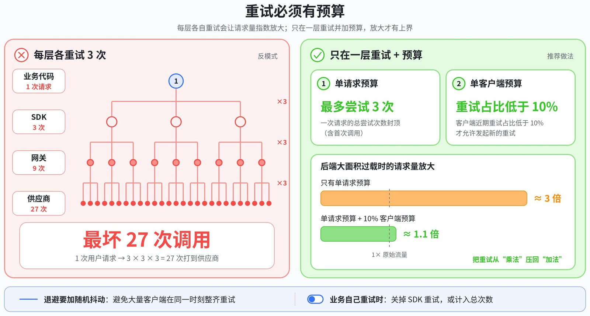

此外，只在**一层**做重试，最好是网关；上游和下游都设为不重试或只重试连接错误。退避一定要加随机抖动：AWS 的模拟显示，不带抖动的指数退避会让重试扎堆在同一时刻，加上抖动后，在 100 个客户端竞争的场景下总调用次数减少了一半以上[[14]](https://aws.amazon.com/blogs/architecture/exponential-backoff-and-jitter/)。

*网关侧重试策略示意：只在一层重试，带预算和抖动
*

```python
import random, timeMAX_ATTEMPTS = 3          # 单请求预算CLIENT_RETRY_RATIO = 0.10  # 单客户端预算def call_with_retry(req, client_stats, deadline):    for attempt in range(1, MAX_ATTEMPTS + 1):        resp = send(req, timeout=min(req.attempt_timeout, deadline - time.time()))        if resp.ok or not retryable(resp):          # 400 / 预算上限 / 中途断流：不重试            return resp        if attempt == MAX_ATTEMPTS or client_stats.retry_ratio() >= CLIENT_RETRY_RATIO:            return resp                              # 预算用完，交给降级逻辑        wait = resp.retry_after or random.uniform(0, min(30, 2 ** attempt))  # 全抖动        if time.time() + wait >= deadline:            return resp        client_stats.record_retry()        time.sleep(wait)
```

### 4.4 对冲请求：LLM 场景要慎用

对冲请求（hedged request）是降低尾延迟的经典手段：主请求迟迟不返回，就再发一个副本，谁先回来用谁。Google 的测试中，在 10 毫秒后发对冲请求，把读取 1000 个键的 99.9 分位延迟从 1800 毫秒降到 74 毫秒，只多发了 2% 的请求[[15]](https://cacm.acm.org/research/the-tail-at-scale/)。

在 LLM 场景直接照搬要小心：每个副本都要付全部输入 token 的钱，还会多占一份限流额度。比较可行的做法是只对 **TTFT** 做对冲：首 token 超过阈值仍未到达时，向另一个供应商或副本发出副本请求，**任意一个出了首 token 就立刻取消另一个**，而且只对输入较短、成本较低的请求启用。

## 第 5 章 · 降级与多供应商容灾

### 5.1 降级阶梯

重试解决的是偶发失败，持续失败要靠降级。降级是一级一级往下走的阶梯，每下一级，质量或功能损失一点，但服务还在：

1. **同模型换地域或换平台**：同一个模型往往能从多个渠道调用。例如 Claude 同时通过 Anthropic API、Amazon Bedrock 和 Google Cloud Vertex AI 提供[[2]](https://www.anthropic.com/engineering/a-postmortem-of-three-recent-issues)。模型一致，Prompt 不用改，是最理想的第一备份。
2. **换同档次的其他模型**：换供应商的旗舰模型。Prompt 往往不能直接通用，必须事先用评测集验证过，并为它单独维护一份 Prompt。
3. **换更小更便宜的模型**：能力下降，但对分类、抽取、摘要等简单任务通常够用。
4. **功能降级**：关掉非核心能力，例如关闭长思考、减少检索条数、缩短输出、暂停 Agent 的多步自主执行。
5. **兜底响应**：返回缓存结果、规则引擎结果，或明确告诉用户“服务繁忙，稍后再试”，并把请求排队异步处理。

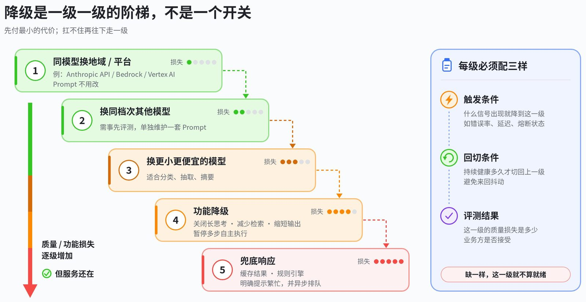

阶梯的每一级要配三样东西：**触发条件**（错误率、延迟、熔断状态）、**回切条件**（持续健康多久才切回）、**评测结果**（这一级的质量损失是多少，业务方是否接受）。没有评测结果的备用模型，等于没有备份：切过去之后才发现输出格式不兼容，故障就从“慢”变成了“错”。

### 5.2 熔断与健康判断

判断一个供应商是否健康，不能只看 HTTP 状态码。建议同时看四个信号：5xx 与过载错误率、限流错误率、TTFT 和 TPOT 的分位数、以及第 6 章的质量信号。任何一项连续超阈值就打开熔断，把流量切到下一级；熔断打开后定期放少量探测流量，恢复后按增速限制逐步回切（3.1 节），不要一次切回 100%。

Google SRE 的**自适应限流**适合放在客户端或网关侧：每个客户端记录最近两分钟内应用层发起的请求数 requests 和后端接受的请求数 accepts，当 requests 超过 accepts 的 K 倍（通常 K = 2）后，开始在本地按概率直接拒绝新请求，拒绝概率为 max(0, (requests − K × accepts) / (requests + 1))[[3]](https://sre.google/sre-book/handling-overload/)。这样供应商过载时，客户端会自动减压，而不是继续往上堆请求。

### 5.3 复盘：2024 年 12 月 11 日 OpenAI 全站中断

这是迄今影响最广的一次 LLM 供应商故障，值得每个依赖外部模型的团队读一遍原文[[1]](https://status.openai.com/incidents/ctrsv3lwd797)：

- **起因**：OpenAI 为提升可观测性，向全部 Kubernetes 集群部署了一个新的遥测服务。它的配置让每个节点都执行开销随集群规模增长的 Kubernetes API 操作，数千个节点同时执行，把大集群的 API Server 压垮了。
- **为什么测试没发现**：预发集群规模小，没有触发问题；发布前只评估了 CPU 和内存，没有评估 API Server 负载。
- **为什么延迟爆发**：数据面本可以独立于控制面运行，但服务发现依赖的 DNS 需要控制面。各节点的 DNS 缓存在之后约 20 分钟内陆续过期，在此期间故障不明显，发布得以继续推到全部集群。
- **为什么恢复慢**：告警在用户受影响前几分钟就响了，根因也很快定位，但回滚需要访问控制面，而控制面已经被压垮，工程师被“锁在门外”。最终靠缩小集群规模、封锁 Kubernetes 管理 API 的网络访问、扩容 API Server 三路并行才重新拿到控制权。
- **影响**：太平洋时间 15:16 到 19:38，ChatGPT、API、Sora 全部严重降级或不可用，约 4 小时 22 分钟。

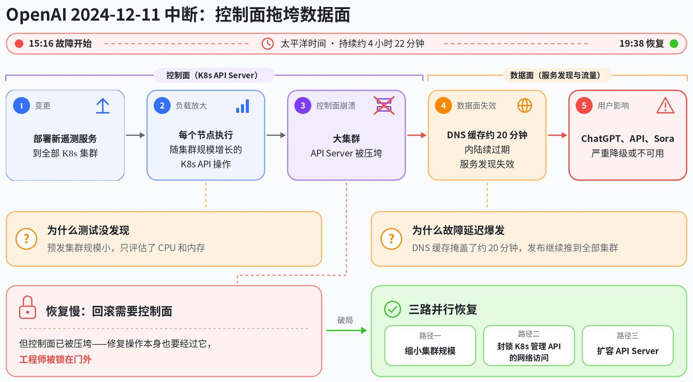

> 🔍 **对使用方的启示**：这次故障里，只接了一家供应商的业务没有任何自救手段，等了四个多小时。真正有用的是第 5.1 节的阶梯：有第二家供应商且事先验证过 Prompt 的业务，几分钟内就能切走。另外两点同样适用于自家系统：**发布要分批并观察控制面健康**，**要有不依赖故障组件的应急通道**。

### 5.4 多供应商的代价

多供应商不是免费的保险，要算清楚三笔账：

- **Prompt 与评测的维护成本**：每个备用模型都要有自己的 Prompt 版本和评测基线，模型升级时要一起回归。
- **行为差异**：分词器不同，同样的文本 token 数不同，限流和成本估算要分别算；工具调用格式、结构化输出、安全拒答策略都有差异，网关要做适配。
- **合规与数据驻留**：数据能否发给某家供应商、能否出境，要在接入前由法务和安全确认，而不是故障时临时决定。

## 第 6 章 · 质量型故障：没报错，但答坏了

### 6.1 复盘：2025 年 8 月 Anthropic 的三个 bug

2025 年 8 月初到 9 月初，Anthropic 的三个基础设施 bug 交替出现，让部分 Claude 请求的回答质量下降。期间请求都正常返回，可用性指标没有异常[[2]](https://www.anthropic.com/engineering/a-postmortem-of-three-recent-issues)：

1. **上下文窗口路由错误**：8 月 5 日起，部分 Sonnet 4 请求被错误路由到为 100 万 token 长上下文准备的服务器，最初影响约 0.8% 的请求。8 月 29 日一次例行负载均衡调整扩大了影响，8 月 31 日最严重的一小时影响了 16% 的 Sonnet 4 请求。约 30% 的 Claude Code 用户在此期间至少有一条消息被错路由。路由是“粘性”的，一旦落到错误的服务器，后续请求也很可能落在同一台上，所以少数用户受影响特别严重。
2. **输出损坏**：8 月 25 日，TPU 服务器上的一项配置错误让模型偶尔给本不该出现的 token 很高的概率，例如英文回答里冒出泰文或中文字符，代码里出现明显的语法错误。
3. **近似 top-k 的编译器 bug**：同日上线的采样代码改动触发了 XLA:TPU 编译器的一个潜在 bug，近似 top-k 操作在特定批大小和模型配置下会返回完全错误的结果，而且时有时无。

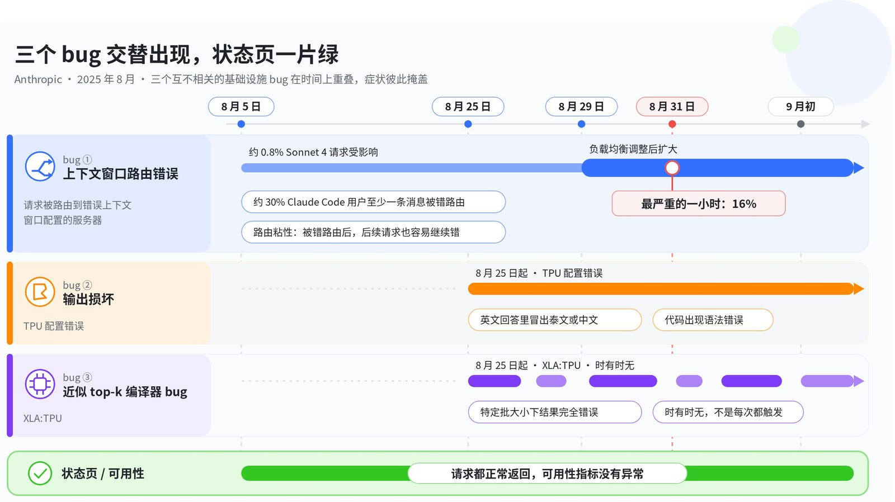

为什么拖了近一个月才查清？复盘给出的原因对所有团队都适用[[2]](https://www.anthropic.com/engineering/a-postmortem-of-three-recent-issues)：

- **评测没抓到**：常规基准测试没有反映出用户报告的退化，部分原因是模型常常能从个别错误中“自我恢复”。
- **症状分散**：三个 bug 在不同平台、不同比例上产生不同症状，看起来像随机的、不一致的退化。
- **隐私限制排查**：工程师不能随意查看用户对话，无法直接复现问题。
- **变更和症状对不上**：8 月 29 日负面反馈激增时，没人立刻把它和当天的负载均衡调整联系起来。

Anthropic 的改进措施是：开发更灵敏、能区分正常与异常实现的评测；**在真实生产系统上持续运行质量评测**；在发布流程中加入对异常字符输出的检测；以及建设在不牺牲隐私的前提下排查用户反馈的工具[[2]](https://www.anthropic.com/engineering/a-postmortem-of-three-recent-issues)。

### 6.2 使用方怎么发现质量型故障

供应商侧的质量问题，使用方往往比供应商更早感知，因为你最了解自己的业务输出应该长什么样。可以按成本从低到高分四层设防：

| 层次 | 检查什么 | 成本与覆盖 |
|---|---|---|
| 结构检查 | JSON 能否解析、是否符合 schema；工具调用参数是否合法；输出语言是否与输入一致；是否含异常字符 | 几乎零成本，可覆盖 100% 请求 |
| 统计信号 | 输出长度分布、截断率、拒答率、工具调用失败率、平均对话轮数的突变 | 零成本，按分钟聚合，和变更时间线对齐 |
| 抽样评审 | 按比例抽样，用评审模型（LLM-as-judge）按业务标准打分 | 有成本，抽样 1% 左右即可看趋势 |
| 金丝雀用例 | 固定一组有标准答案的真实用例，每隔几分钟到一小时对生产链路跑一遍 | 成本固定，能把“哪天开始变差”精确到小时 |

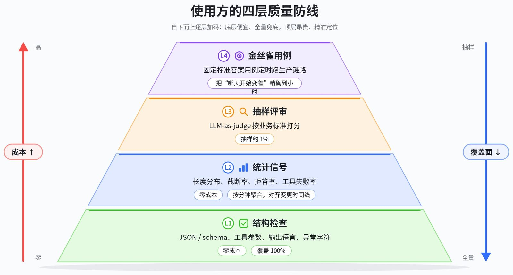

> 📌 **把用户反馈接进监控**：点踩率、重新生成率、人工转接率都是质量信号，要像错误率一样做成时序指标并设告警。Anthropic 的复盘也强调，用户报告的具体例子是定位这三个 bug 的关键线索[[2]](https://www.anthropic.com/engineering/a-postmortem-of-three-recent-issues)。

### 6.3 自己引入的质量型故障

更常见的质量故障其实是自己造成的：改了 Prompt、换了模型版本、调整了检索参数、升级了推理框架、改了量化精度。处理原则和普通发布一致，但检查项不同：

- 每次变更都要过评测门禁，结果和基线对比（第 9 章）。
- 自建推理升级框架或换硬件时，要做输出等价性检查：同一批输入，新旧版本的输出在评测分数上不能有显著差异。Anthropic 跨 Trainium、GPU、TPU 部署同一模型，就对各平台实现设定了严格的等价标准[[2]](https://www.anthropic.com/engineering/a-postmortem-of-three-recent-issues)。
- 质量指标要能按版本拆分，否则灰度期间新旧版本混在一起，看不出差别。

## 第 7 章 · 容量规划与自建推理

📎 延伸阅读：把推理吞吐追到硬件上限的方法见 [LLM-32｜系统｜AI Infra 性能优化实战：从 profile 到硬件上限](./32-infra-perf.md)；非 NVIDIA 算力的选型与迁移见 [LLM-36｜系统｜非 NVIDIA 算力：TPU、Trainium、AMD 与昇腾](./36-non-nvidia.md)。

### 7.1 三种获取容量的方式

| 方式 | 优点 | 缺点 | 适合 |
|---|---|---|---|
| 按量付费 API | 零运维，随时可用最新模型 | 额度受限、高峰期可能过载，无容量保证 | 起步阶段、流量波动大 |
| 预留容量 | 供应商为你保留吞吐，延迟和可用性更稳定 | 按时长付费，用不满也要付 | 稳定的大流量核心业务 |
| 自建推理 | 数据不出域、可控、可深度优化 | GPU 采购周期长，运维复杂，只能用开源模型 | 合规要求高、量大且模型稳定 |

多数团队最终是混合形态：核心在线流量走预留容量或自建集群，突发流量和长尾功能走按量 API，两者都接在同一个网关后面互为备份。

### 7.2 用 API 时怎么算容量

容量规划的单位是 token，不是请求。一个示意算例：

> 📊 <b>算例（示意）</b>：某在线功能峰值 20 RPS，平均每个请求输入 3000 token、输出 500 token，其中 2400 token 是稳定的系统提示和文档前缀，缓存命中。
>
> - 每分钟请求数：20 × 60 = 1200 RPM。
> - 每分钟输入 token：1200 × 3000 = 360 万；若缓存读取不计入 ITPM，实际计入的只有 1200 × 600 = 72 万。
> - 每分钟输出 token：1200 × 500 = 60 万 OTPM。
> - 再按峰值留 50%–100% 余量，就得到需要向供应商申请的额度。缓存命中率从 80% 掉到 0，ITPM 需求会一下涨到 5 倍，这正是缓存失效时最容易触发限流的原因。

还要单独算“切流容量”：主供应商故障时，备用供应商要承接多少流量，额度是否已经提前申请好。按增速限制，备用通道不能从零瞬间拉满（3.1 节），所以要么让它平时就承担一部分流量，要么提前演练爬坡速度。

### 7.3 自建推理：扩缩容看什么信号

GPU 利用率是很差的扩缩容指标：常见的 GPU 利用率读数只表示采样时间内是否有计算任务在跑，既不反映算力和显存带宽实际用了多少，也看不出请求是否在排队。只要有请求在持续解码，它就可能接近 100%，无论系统是游刃有余还是已经严重排队。更好的信号来自推理框架本身。以 vLLM 为例，它暴露了排队请求数 `vllm:num_requests_waiting`、KV Cache 占用率 `vllm:kv_cache_usage_perc`、首 token 延迟 `vllm:time_to_first_token_seconds` 等指标[[16]](https://docs.vllm.ai/en/stable/usage/metrics/)：

- **排队请求数**持续大于 0：已经在排队，用户的 TTFT 正在变差，应扩容。
- **KV Cache 占用率**接近 1：新请求会被推迟或抢占，应扩容或限制并发。
- **TTFT p90** 超过 SLO：直接反映用户体验，作为兜底信号。

扩容速度是自建推理最大的短板。一个 70B 参数的模型以 BF16 存储约 140 GB，按每秒 1 GB 从网络存储加载就要两分多钟，再加上容器启动、显存分配和预热，新副本从申请到可用通常要几分钟到十几分钟；如果还要临时申请 GPU 机器，时间更长。因此：

- 保持一定的热备副本，而不是完全依赖弹性扩容。
- 用流量预测提前扩容，而不是等排队了再扩。
- 把模型权重放在离 GPU 更近的本地盘或缓存层，缩短加载时间。
- 短时突发交给按量 API 兜底，而不是让自建集群硬扛。

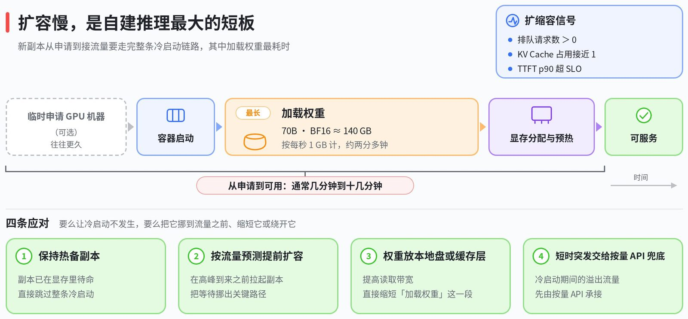

**扩容生效时延不止权重加载**：上面的估算只算了权重一段。新副本从“决定扩容”到“真正接流量”要经过四段：排队等卡（调度）、拉镜像、分发权重、预热（显存初始化、CUDA Graph 捕获、算子编译）。多个副本同时扩容时，镜像和权重会争同一份存储带宽，每一段都可能劣化，线上实测常是估算值的数倍乃至十倍以上。优化前先拿到四段的分段耗时，再决定先做哪一段。

启动越慢，扩缩策略越要往前放：

- **提前扩、延后缩**：按小时级流量画像在高峰前沿预扩；流量回落时加冷却窗口再缩，避免刚缩完又要扩、反复支付启动成本。Kubernetes HPA 的 `behavior` 字段可以分别配置扩容和缩容的稳定窗口[[20]](https://kubernetes.io/docs/tasks/run-application/horizontal-pod-autoscale/#configurable-scaling-behavior)。
- **用排队触发，不用利用率**：以引擎上报的排队请求数（如 vLLM 的 `vllm:num_requests_waiting`）超过阈值作为扩容信号[[16]](https://docs.vllm.ai/en/stable/usage/metrics/)。GPU 利用率和 SM 活跃度在流量上涨时反应慢、回落时又在高位滞留，扩缩两头都会滞后。
- **分时段副本基线**：工作日和周末分别配置最小、最大副本数。全球业务的流量曲线是多个时区叠加的，低谷往往不止一段，不能只按一个时区的作息配置。
- **按角色伸缩**：做了 Prefill / Decode 分离或多机多角色部署后，伸缩要细到角色，并能按比例联动；平台只支持整体伸缩时，各角色只能按峰值固定副本，弹性收益归零。
- **按 SLO 预测伸缩**：GKE 的最佳实践同样不推荐按 GPU 利用率伸缩：吞吐和成本优先时用队列长度，时延敏感时用 batch size[[21]](https://docs.cloud.google.com/kubernetes-engine/docs/best-practices/machine-learning/inference/autoscaling)。NVIDIA Dynamo 的 SLA Planner 更进一步：先离线压测得到性能曲线，再按流量预测和 TTFT、ITL 目标分别算出 Prefill 和 Decode 的副本数，主动扩缩；它的设计文档也提醒，调整间隔短于扩容生效时延时，扩缩决策会堆积[[22]](https://docs.nvidia.com/dynamo/latest/planner/sla_planner.html)。
- **缩短启动本身**：四段里权重加载最可压缩。BlitzScale 经 GPU 计算网络用 RDMA 多播加载参数，并在新实例加载完成前按层分担旧实例的负载，尾延迟比 ServerlessLLM 最多低 94%[[23]](https://arxiv.org/abs/2412.17246)；ServerlessLLM 用多级本地 checkpoint 缓存避免远程下载[[24]](https://arxiv.org/abs/2401.14351)；vLLM 的 Sleep Mode 让空闲实例卸载权重但保留进程，唤醒只要秒级，而重新加载要 30 到 100 多秒[[25]](https://github.com/vllm-project/vllm/blob/main/docs/features/sleep_mode.md)；Run:ai Model Streamer 并发读取张量并直接流入显存，可从对象存储加载[[26]](https://docs.vllm.ai/en/stable/models/extensions/runai_model_streamer/)。

### 7.4 提高单集群 goodput 的几种手段

- **分块 Prefill**：把长输入的 Prefill 切成小块，和正在跑的 Decode 混在同一批里执行，避免一个长请求卡住所有人。Sarathi-Serve 用这一方法，在 Mistral-7B 单张 A100 上的服务容量比 vLLM 高 2.6 倍[[17]](https://arxiv.org/abs/2403.02310)。
- **Prefill / Decode 分离**：两个阶段放在不同 GPU 上，互不干扰，可分别扩缩容（1.2 节）[[5]](https://arxiv.org/abs/2401.09670)。
- **感知前缀缓存的路由**：把共享相同前缀的请求发到已经缓存了这段前缀的副本，减少重复计算（2.2 节）[[7]](https://gateway-api-inference-extension.sigs.k8s.io/)。
- **按优先级调度**：在线请求优先，离线请求填空闲（3.3 节）。

📎 延伸阅读：本章的容量规划落到平台侧之后，设备插件、MIG/HAMi 切分、Kueue 配额与多机组编排由一整套 K8s 原生组件承担，串讲见 [LLM-69｜系统｜K8s 上的 GPU 与推理负载：从设备插件到队列调度](./69-k8s-gpu-inference.md)。

## 第 8 章 · 成本治理

📎 延伸阅读：提示缓存、批处理、思考档位与模型路由这些具体的省钱手段，见 [LLM-20｜工程｜用好模型：提示词、思考档位与模型路由](./20-prompting-routing.md)。

### 8.1 成本要能归因到租户和功能

LLM 账单的特点是“总数知道，细项不知道”。供应商账单只按 API Key 或项目汇总，看不出是哪个功能、哪个租户、哪个 Prompt 版本花的钱。归因必须在网关上做：每个请求记录租户、功能、模型、Prompt 版本、输入 token（区分缓存命中与未命中）、输出 token（区分思考与可见输出）、是否重试、是否降级，以及按当时单价折算的费用。

有了这份明细，才能回答成本治理的三个基本问题：钱花在哪、哪些花得值、超了怎么办。

### 8.2 预算护栏

- **分级预算**：组织、租户、功能、单用户四级都设日和月预算，下级之和不超过上级。
- **单请求上限**：限制单次请求的最大输入长度和 `max_tokens`，Agent 再加上最大步数和最大累计 token（见「Agent 工程实战」第 2 章）。一个陷入死循环的 Agent 是最常见的“一夜烧光预算”的原因。
- **软硬两道线**：达到 80% 告警，达到 100% 降级到便宜模型或拒绝非核心请求。供应商侧也要设硬上限兜底，OpenAI 的硬支出上限触发后，受影响的请求会返回 429[[8]](https://platform.openai.com/docs/guides/rate-limits)，网关要把它识别为“预算用尽”而不是“临时限流”（3.2 节）。
- **异常检测**：按租户、功能监控每分钟花费，突增数倍就告警，往往能比账单早一天发现 bug。

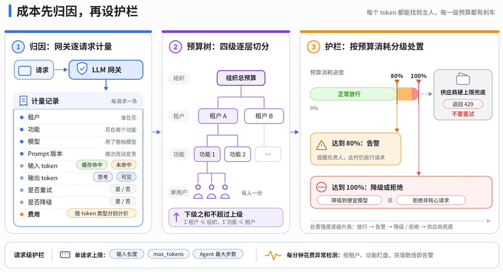

### 8.3 降本杠杆

| 杠杆 | 做法 | 效果 |
|---|---|---|
| 提示词缓存 | 稳定内容放前面，变化内容放后面；不要在前缀里插时间戳或随机 ID | 命中部分按基础输入价的 10% 计费[[9]](https://docs.anthropic.com/en/docs/build-with-claude/prompt-caching)，且多数模型不计入 ITPM[[4]](https://docs.anthropic.com/en/api/rate-limits) |
| 批处理 | 不需要实时返回的任务走 Batch API | 按标准价格的 50% 计费[[12]](https://platform.openai.com/docs/guides/batch)[[13]](https://docs.anthropic.com/en/docs/build-with-claude/batch-processing) |
| 模型路由 | 简单请求给小模型，难的请求给大模型，用路由模型自动判断 | RouteLLM 在公开基准上把成本降低了一半以上，质量基本不变[[18]](https://arxiv.org/abs/2406.18665) |
| 控制输出长度 | 按需设置 `max_tokens` 和思考预算，要求简洁输出 | 输出单价通常是输入的数倍，且决定总时延 |
| 减少重试与重复调用 | 重试预算（4.3 节）；结果可复用时做缓存 | 避免故障期间成本翻倍 |

> ❗ **语义缓存要慎用**：按“问题相似”返回历史答案，可能把 A 用户的答案返回给问法相似的 B 用户，既有正确性风险也有数据泄露风险。只在答案与用户无关、可以容忍过期的场景（如公开文档问答）使用，并按租户隔离缓存。

## 第 9 章 · 可观测、变更与演练

### 9.1 指标、追踪和日志

建议直接采用 OpenTelemetry 的生成式 AI 语义约定，避免各团队各起一套名字。它定义了客户端侧的 `gen_ai.client.operation.duration`（调用耗时）、`gen_ai.client.operation.time_to_first_chunk`（首个流式分片耗时）、`gen_ai.client.operation.time_per_output_chunk`（流式分片间隔），token 用量另有一组 `gen_ai.client.inference.usage.*` 计数器；模型服务器侧则有 `gen_ai.server.time_to_first_token`、`gen_ai.server.time_per_output_token` 等指标[[19]](https://github.com/open-telemetry/semantic-conventions-genai/blob/main/docs/gen-ai/gen-ai-metrics.md)。自建推理还可以直接采集推理框架自己的指标（7.3 节）[[16]](https://docs.vllm.ai/en/stable/usage/metrics/)。

一块够用的值班看板分四行：

1. **流量与错误**：按供应商、模型的 RPM、TPM；错误按 429（再细分临时限流、增速、预算）、5xx、过载、超时、中途断流分别画线。
2. **延迟**：TTFT 和 TPOT 的 p50 / p90 / p99，按输入长度分桶；SLO 达标率（%）与 goodput（req/s）。
3. **质量**：格式正确率、截断率、拒答率、抽样评分、点踩率（第 6 章）。
4. **成本与降级**：每分钟花费、缓存命中率、重试占比、当前处于降级阶梯的哪一级。

日志要特别注意隐私：Prompt 和回答里常有用户数据。默认只记录元数据和 token 数，原文按需脱敏后抽样保存，访问要审批。这和 6.1 节 Anthropic 遇到的矛盾是一样的：日志记得越少越安全，但排障越难，要在接入时就想好平衡点。

### 9.2 模型和 Prompt 的变更都是发布

LLM 服务的行为由“模型版本 + Prompt + 参数 + 检索配置 + 推理框架”共同决定，其中任何一项变化都要走发布流程：

- **固定模型版本**：调用带日期或版本号的具体模型，而不是会自动指向新版本的别名，避免供应商升级时行为在你不知情的情况下改变。
- **跟踪下线时间表**：供应商会定期下线旧模型。例如 OpenAI 的 `gpt-3.5-turbo-instruct` 计划于 2026 年 9 月 28 日停止服务，官方提示迁移时只改模型 ID 是不够的，还要换接口[[8]](https://platform.openai.com/docs/guides/rate-limits)。要有人订阅这些通知，并把迁移排进计划。
- **Prompt 进代码仓库**：有版本、有评审、有回滚，指标能按 Prompt 版本拆分。
- **评测门禁 + 灰度**：离线评测通过后，先影子流量（复制请求只比较不返回）或小比例灰度，对比质量、延迟、成本三类指标，再逐步放量。

### 9.3 演练什么

LLM 依赖的故障在平时很少出现，等真出事再验证降级逻辑就晚了。建议把下面这些场景做成可重复的故障注入，在网关层模拟：

| 场景 | 注入方式 | 期望行为 |
|---|---|---|
| 主供应商整体不可用 | 对该供应商返回连接失败或 5xx | 熔断打开，几分钟内切到备用；业务无感或可接受降级 |
| 限流风暴 | 批量返回 429 并带 `Retry-After` | 重试不放大，低优先级先被丢弃，在线业务保住 |
| 预算耗尽 | 返回预算型 429 | 不重试，立即告警，切到便宜模型或拒绝非核心请求 |
| 延迟劣化 | 首 token 注入数秒延迟、流中间插入长时间停顿 | 首 token 超时和空闲超时按设计触发 |
| 流式中途断开 | 输出一半后断开连接 | 不自动重放，用户看到明确提示 |
| 质量劣化 | 把一部分请求替换成弱模型或注入乱码输出 | 质量信号在规定时间内告警 |
| 网关自身故障 | 下掉一个可用区的网关副本 | 流量自动转移，或按预案直连 |
| 备用通道爬坡 | 把主流量一次性切到备用供应商 | 验证增速限制下能多快接住全部流量 |

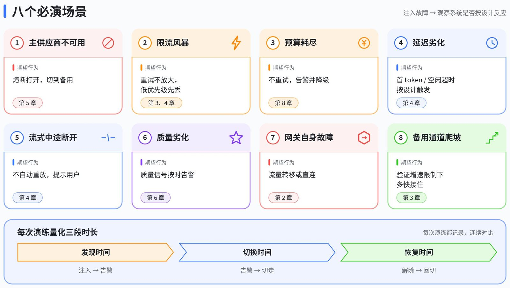

> 🔑 **演练要量化**：每次演练记录三个数字：发现时间（故障注入到告警）、切换时间（告警到流量切走）、恢复时间（故障解除到全部回切）。连续几次演练对比，才知道预案是在变好还是在腐烂。OpenAI 在复盘里也把故障注入测试列为改进措施之一[[1]](https://status.openai.com/incidents/ctrsv3lwd797)。

## 第 10 章 · 上线清单与反模式

### 10.1 上线前逐项核对

**指标与 SLO**

- [ ] 定义了 TTFT、TPOT、可用性、goodput 的 SLO，并按输入长度分桶统计

- [ ] 网关和客户端两侧都有埋点，指标命名遵循 OpenTelemetry 生成式 AI 语义约定

**网关与限流**

- [ ] 所有调用都经过网关，业务不直接持有供应商密钥

- [ ] 按租户分了 token 额度和预算，按优先级区分在线、内部、离线流量

- [ ] 网关能区分临时限流、增速限制、预算上限、过载四类错误

**超时、重试、降级**

- [ ] 流式请求设置了连接、首 token、空闲、总截止时间四种超时

- [ ] 只在一层重试，有单请求和单客户端两级预算，退避带抖动

- [ ] 流式中途断开不自动重放；有副作用的工具调用有幂等键

- [ ] 降级阶梯每一级都有触发条件、回切条件和评测结果

- [ ] 备用供应商的额度已申请，爬坡速度已演练

**质量、成本、变更**

- [ ] 有结构检查和统计信号两层零成本质量监控，以及定时运行的金丝雀用例

- [ ] 成本能归因到租户、功能和 Prompt 版本；设了软硬两道预算线

- [ ] 模型版本固定，有人跟踪供应商下线时间表；Prompt 变更走评测门禁和灰度

- [ ] 第 9.3 节的演练场景至少跑过一遍，并记录了发现、切换、恢复时间

### 10.2 常见反模式

| 反模式 | 后果 | 改为 |
|---|---|---|
| 只设一个总超时 | 长回答被腰斩，或卡死连接几分钟才发现 | 四种超时分开设（4.1 节） |
| 每一层都最多尝试 3 次（含首次） | 最坏情况放大 27 倍，压垮已经过载的供应商 | 只在网关重试并设预算（4.3 节） |
| 按 QPS 做限流和容量 | 长输入请求把额度吃光，容量估算失真 | 按输入、输出 token 分别计量（3.1、7.2 节） |
| 备用模型从没验证过 | 切过去后格式不兼容，故障从慢变成错 | 每级降级都有评测结果（5.1 节） |
| 故障时一次性切流 | 撞上备用供应商的增速限制，备用也被打挂 | 分批放量或平时就分担部分流量 |
| 只监控可用性 | 质量型故障持续数周无人发现 | 四层质量监控（6.2 节） |
| 使用模型别名 | 供应商升级后行为悄悄改变 | 固定版本，变更走发布流程（9.2 节） |
| 预算型 429 当成临时限流重试 | 一直失败，还掩盖了预算问题 | 识别后立即告警并降级（3.2 节） |
| GPU 利用率做扩缩容指标 | 排队了还不扩，或空转时误扩 | 看排队数、KV Cache 占用、TTFT（7.3 节） |

### 10.3 延伸阅读

- Google SRE 书第 21、22 章（处理过载、应对级联故障）：限流、优先级、重试预算的原始出处[[3]](https://sre.google/sre-book/handling-overload/)。
- OpenAI 与 Anthropic 的事故复盘：两种典型故障形态，一个是可用性，一个是质量[[1]](https://status.openai.com/incidents/ctrsv3lwd797)[[2]](https://www.anthropic.com/engineering/a-postmortem-of-three-recent-issues)。
- DistServe、Sarathi-Serve：理解推理服务里吞吐与延迟的权衡[[5]](https://arxiv.org/abs/2401.09670)[[17]](https://arxiv.org/abs/2403.02310)。
- 「LLM 基础」第 6 章、「vLLM 完整技术学习路径」：推理与部署的原理。

## 参考文献

按正文首次引用顺序编号，资料截至 2026 年 9 月。

[1] OpenAI. API, ChatGPT &amp; Sora Facing Issues: Incident Write-up, December 11, 2024 [https://status.openai.com/incidents/ctrsv3lwd797](https://status.openai.com/incidents/ctrsv3lwd797)

[2] Anthropic. A Postmortem of Three Recent Issues (2025) [https://www.anthropic.com/engineering/a-postmortem-of-three-recent-issues](https://www.anthropic.com/engineering/a-postmortem-of-three-recent-issues)

[3] Beyer et al. Site Reliability Engineering, Chapter 21: Handling Overload. Google (2016) [https://sre.google/sre-book/handling-overload/](https://sre.google/sre-book/handling-overload/)

[4] Anthropic. Rate Limits Documentation [https://docs.anthropic.com/en/api/rate-limits](https://docs.anthropic.com/en/api/rate-limits)

[5] Zhong et al. DistServe: Disaggregating Prefill and Decoding for Goodput-optimized Large Language Model Serving. OSDI (2024) [https://arxiv.org/abs/2401.09670](https://arxiv.org/abs/2401.09670)

[6] LiteLLM. Fallbacks (Provider Failover) [https://docs.litellm.ai/docs/proxy/reliability](https://docs.litellm.ai/docs/proxy/reliability)

[7] Kubernetes SIG-Network / WG-Serving. Gateway API Inference Extension [https://gateway-api-inference-extension.sigs.k8s.io/](https://gateway-api-inference-extension.sigs.k8s.io/)

[8] OpenAI. Rate Limits Guide [https://platform.openai.com/docs/guides/rate-limits](https://platform.openai.com/docs/guides/rate-limits)

[9] Anthropic. Prompt Caching Documentation [https://docs.anthropic.com/en/docs/build-with-claude/prompt-caching](https://docs.anthropic.com/en/docs/build-with-claude/prompt-caching)

[10] Anthropic. API Errors Documentation [https://docs.anthropic.com/en/api/errors](https://docs.anthropic.com/en/api/errors)

[11] Sheng et al. Fairness in Serving Large Language Models. OSDI (2024) [https://arxiv.org/abs/2401.00588](https://arxiv.org/abs/2401.00588)

[12] OpenAI. Batch API Guide [https://platform.openai.com/docs/guides/batch](https://platform.openai.com/docs/guides/batch)

[13] Anthropic. Batch Processing Documentation [https://docs.anthropic.com/en/docs/build-with-claude/batch-processing](https://docs.anthropic.com/en/docs/build-with-claude/batch-processing)

[14] Brooker. Exponential Backoff and Jitter. AWS Architecture Blog (2015) [https://aws.amazon.com/blogs/architecture/exponential-backoff-and-jitter/](https://aws.amazon.com/blogs/architecture/exponential-backoff-and-jitter/)

[15] Dean &amp; Barroso. The Tail at Scale. Communications of the ACM (2013) [https://cacm.acm.org/research/the-tail-at-scale/](https://cacm.acm.org/research/the-tail-at-scale/)

[16] vLLM. Production Metrics [https://docs.vllm.ai/en/stable/usage/metrics/](https://docs.vllm.ai/en/stable/usage/metrics/)

[17] Agrawal et al. Taming Throughput-Latency Tradeoff in LLM Inference with Sarathi-Serve. OSDI (2024) [https://arxiv.org/abs/2403.02310](https://arxiv.org/abs/2403.02310)

[18] Ong et al. RouteLLM: Learning to Route LLMs with Preference Data (2024) [https://arxiv.org/abs/2406.18665](https://arxiv.org/abs/2406.18665)

[19] OpenTelemetry. Semantic Conventions for Generative AI Metrics [https://github.com/open-telemetry/semantic-conventions-genai/blob/main/docs/gen-ai/gen-ai-metrics.md](https://github.com/open-telemetry/semantic-conventions-genai/blob/main/docs/gen-ai/gen-ai-metrics.md)

[20] Kubernetes. Horizontal Pod Autoscaling: Configurable scaling behavior [https://kubernetes.io/docs/tasks/run-application/horizontal-pod-autoscale/#configurable-scaling-behavior](https://kubernetes.io/docs/tasks/run-application/horizontal-pod-autoscale/#configurable-scaling-behavior)

[21] Google Cloud. Best practices for autoscaling LLM inference workloads with GPUs on GKE [https://docs.cloud.google.com/kubernetes-engine/docs/best-practices/machine-learning/inference/autoscaling](https://docs.cloud.google.com/kubernetes-engine/docs/best-practices/machine-learning/inference/autoscaling)

[22] NVIDIA. Dynamo SLA-based Planner [https://docs.nvidia.com/dynamo/latest/planner/sla_planner.html](https://docs.nvidia.com/dynamo/latest/planner/sla_planner.html)

[23] Zhang et al. BlitzScale: Fast and Live Large Model Autoscaling with O(1) Host Caching. OSDI (2025) [https://arxiv.org/abs/2412.17246](https://arxiv.org/abs/2412.17246)

[24] Fu et al. ServerlessLLM: Low-Latency Serverless Inference for Large Language Models. OSDI (2024) [https://arxiv.org/abs/2401.14351](https://arxiv.org/abs/2401.14351)

[25] vLLM. Sleep Mode [https://github.com/vllm-project/vllm/blob/main/docs/features/sleep_mode.md](https://github.com/vllm-project/vllm/blob/main/docs/features/sleep_mode.md)

[26] vLLM. Loading models with Run:ai Model Streamer [https://docs.vllm.ai/en/stable/models/extensions/runai_model_streamer/](https://docs.vllm.ai/en/stable/models/extensions/runai_model_streamer/)

---

上一篇：[LLM-06｜场景｜LLM 在运维与容灾中的落地：SRE 实战地图](./06-llm-for-sre.md) · [目录](./README.md) · 下一篇：[LLM-08｜系统｜大模型推理系统：全栈学习手册](./08-inference-systems.md)
