# LLM-08｜系统｜大模型推理系统：全栈学习手册

> 🎯 **这篇文档解决什么问题**：推理系统怎么在 SLO 约束下把「每美元的有效吞吐（Goodput / \$）」做到最大。三个物理瓶颈卡住它：**算力**支配 Prefill，**显存带宽**支配 Decode，**显存容量**支配 KV Cache。能松动瓶颈的杠杆有四层：**算子层**、**引擎层**、**集群层**、**服务层**。每一章都回答同一个问题：这一层杠杆松动了哪个瓶颈，代价是什么。
>
> 使用方式：新人按第 1 章、第 6.1–6.3 节、第 7 章、第 8.1–8.3 节、第 13 章的顺序读，约两周；做框架和 Kernel 的读第 1、2、5、6、9 章；做集群、SRE 和架构的读第 1、3、4、8、10、11、13 章；部署万亿参数 MoE、评估 KV 卸载和跨实例复用的读第 16 章。推导默认以 Llama-3-70B 加 H100 SXM 为例，标「量级示意」的数字只用来建立直觉，生产决策以自己的压测为准。文中硬件规格和开源版本核对于 2026 年 10 月 11 日，第 16 章资料截至 2026 年 10 月 29 日。

全文只引用公开可查证的论文、开源实现与生产实践。v2.0 把原先分散在正文与「深读附录 A–J」的内容按主线合并，修正若干关键数字（见文末「v2.0 修订说明」），并为每章补充图示与可复算的推导；v2.1 统一符号，为每章加上「回到主线」小结，补齐引擎扩展点、排障实战、按 token 限流与定价结构。

## 导读 · 先给结论

- **Prefill 受算力限制，Decode 受显存带宽限制**：两个阶段瓶颈不同，优化手段也不同（第 1、2 章）。
- **KV Cache 的容量决定并发**：显存装不下 KV，batch 就上不去，抢占和重算随之变多（第 6 章）。
- **通信和 CPU 是隐性瓶颈**：GPU 气泡和 AllReduce 抖动常出在并行策略和调度循环上（第 4、9 章）。
- <b>优化目标是 Goodput / \$</b>：吞吐要在 SLO 约束下计算，只看峰值吞吐会把成本算错（第 1 章）。

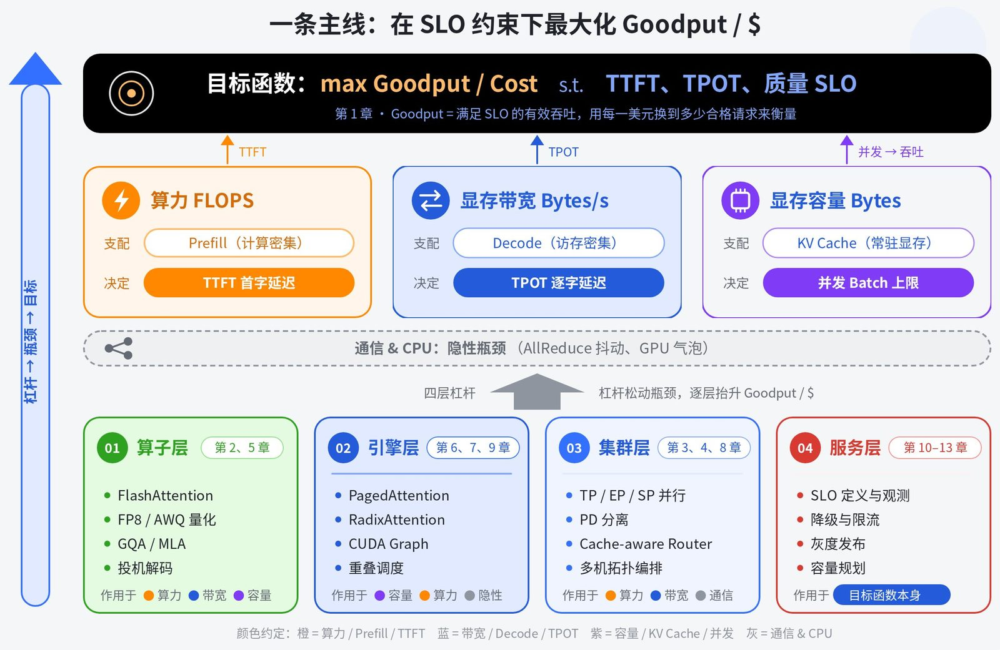

### 为什么需要一条主线

2023 年至今，LLM 推理已经从「跑得起来」进化为「跑得省、跑得稳、跑得多样」。技术名词爆炸式增长：PagedAttention、RadixAttention、Chunked Prefill、PD 分离、EAGLE、MLA、DeepEP、NIXL……如果只是逐个记忆，很快会迷失。但它们几乎都可以被归入同一个坐标系：

| 瓶颈 | 谁被它支配 | 典型症状 | 代表性技术 |
|---|---|---|---|
| **算力**（FLOPS） | Prefill、长上下文 Attention | TTFT 高、长 prompt 排队 | FlashAttention、FP8/FP4、Chunked Prefill、Prefix Cache（少算） |
| **显存带宽**（Bytes/s） | Decode（每步都要读全部权重 + KV） | TPOT 高、GPU 利用率低 | Continuous Batching、量化、GQA/MLA、Spec Decoding、TP |
| **显存容量**（Bytes） | KV Cache、并发数 | 频繁抢占/重算、batch 上不去 | PagedAttention、KV 量化/淘汰、多级缓存、存算分离 |
| **通信 &amp; CPU**（隐性瓶颈） | 并行策略、调度循环 | GPU 气泡、AllReduce 抖动 | NVLink 域内 TP、DeepEP、CUDA Graph、Zero-overhead 调度 |

### 全书地图

| 篇 | 章节 | 回答的问题 | 关键论文 / 项目 |
|---|---|---|---|
| **第一篇 定目标** | 第 1 章 指标、SLO 与成本 | 优化什么？怎么量？瓶颈在哪？ | DistServe、Orca、MLPerf Inference、DeepSeek 推理系统公开数据 |
| **第二篇 认物理** | 第 2 章 计算底座与 Kernel | GPU 怎么算、怎么存？Kernel 如何贴近 Roofline？ | FlashAttention 1/2/3、FlashInfer、CUTLASS、Triton |
| 第 3 章 互联与 Collective | 数据怎么在卡间/机间流动？通信成本怎么算？ | NCCL、NVLS/SHARP、GPUDirect RDMA、IBGDA |  |
| **第三篇 拆模型** | 第 4 章 并行策略 | 模型放不下/算不快时，沿哪一维切？ | Megatron-LM、DeepEP、Ring Attention、Ulysses、Alpa |
| **第四篇 少算少读** | 第 5 章 Attention 变体、量化与投机解码 | 如何从算子层减少 FLOPs 与 Bytes？ | GQA/MLA、AWQ/SmoothQuant/FP8、Speculative Decoding、EAGLE、Mamba |
| **第五篇 管显存** | 第 6 章 KV Cache 与多级缓存 | 最稀缺的显存怎么分、怎么复用、怎么外扩？ | PagedAttention、RadixAttention、LMCache、Mooncake、H2O/KIVI |
| **第六篇 编排** | 第 7 章 推理引擎架构 | 一个引擎该如何分层？ | vLLM、SGLang、TensorRT-LLM |
| 第 8 章 调度、PD 分离与路由 | 请求如何组 batch、如何分池、如何路由？ | Sarathi-Serve、DistServe、Splitwise、Dynamo、SGLang Model Gateway（SMG） |  |
| 第 9 章 Zero-overhead Runtime | 如何让 GPU 一刻不停？ | CUDA Graph、SGLang overlap scheduler、NanoFlow<br>📎 延伸阅读：引擎内的 KV 与调度机制之外，路由、缓存亲和、P/D 分离与 KV 三层分层怎样组装成集群级服务栈，见 [LLM-69｜系统｜K8s 上的 GPU 与推理负载：从设备插件到队列调度](./69-k8s-gpu-inference.md)。 |  |
| **第七篇 上生产** | 第 10 章 稳定性与排障 | 出问题时如何建立证据链？ | DCGM、Nsight、eBPF（bcc/bpftrace） |
| 第 11 章 服务工程 | SLO、可观测、降级、灰度怎么做？ | OpenTelemetry GenAI、Google SRE |  |
| 第 12 章 云产品与商业化 | 技术能力如何变成可交付产品？ | NVIDIA NIM、Bedrock、方舟 |  |
| **第八篇 实战与速查** | 第 13 章 端到端容量规划 · 第 14 章 速查 · 第 16 章 万亿 MoE 与 KV 分层 | 把全书串起来算一遍；公式、术语、参考资料；万亿 MoE 的引擎、算子与 KV 分层 | — |

### 三条阅读路线

> 🌱 <b>新人入门（约 2 周）</b>
>
> 第 1 章 → 第 6.1–6.3 节 → 第 7 章 → 第 8.1–8.3 节 → 第 13 章
>
> 目标：能说清一个请求的一生，能看懂 vLLM/SGLang 的监控面板。

> 💡 **框架 / Kernel 开发**
>
> 第 1 章 → 第 2 章 → 第 5 章 → 第 6 章 → 第 9 章
>
> 目标：能用 Roofline 判断优化上限，能定位 GPU 气泡与 Kernel 瓶颈。

> 💡 **集群 / SRE / 架构**
>
> 第 1 章 → 第 3–4 章 → 第 8 章 → 第 10–11 章 → 第 13 章
>
> 目标：能做容量规划、PD 分离选型、故障证据链与降级设计。

### 符号约定

全书推导统一使用以下符号，默认以 **Llama-3-70B + H100 SXM** 作为贯穿例子，方便在不同章节之间对照数字。

| 符号 | 含义（Llama-3-70B 取值） | 符号 | 含义（H100 SXM 取值） |
|---|---|---|---|
| `P` | 参数量（≈ 70B） | `π` | 算力峰值（BF16 989 / FP8 1979 TFLOPS） |
| `L` | 层数（80） | `β` | 显存带宽（3.35 TB/s） |
| `h` / `d_model` | 隐藏维（8192） | `I` | 算术强度（FLOPs/Byte），拐点 `I* = π/β ≈ 295` |
| `H` / `H_kv` | Query head 数（64）/ KV head 数（8，GQA） | `α` | 通信启动延迟（NVLink ~μs，IB ~十 μs） |
| `d` | 每个 head 的维度（128） | `N`（通信） | 参与集合通信的卡数 |
| `N`（序列）/ `S` | prompt 长度 / 当前序列长度 | `B` | batch 大小（同时 Decode 的请求数） |

每章统一结构：<b>🎯 本章回答</b>（开篇一句话结论）→ **原理** → **可复算的推导** → **工程实践** → **误区与自测** → <b>🔁 回到主线</b>（这一章松动了哪个瓶颈、代价是什么、下一章接什么）。文中带「量级示意」标注的数字用于建立直觉，生产决策请以自己的压测为准。

📎 与系列其他文档的分工：单个引擎的学习路径见「vLLM 学习路径」，GPU 算子层的优化见「GPU 优化深入浅出」，推理成本和选卡见「自建推理成本与 GPU 选型」，线上稳定性见「LLM 服务稳定性工程」。本文只讲推理系统从算子到服务的全栈原理。

---

## 第一篇 定目标：先把「优化什么」钉死

推理优化里 90% 的争论来自口径没对齐：同样说「Llama-3-70B 的 TTFT 是 200ms」，有人指 P50 空载单请求，有人指 P99 满载多并发。所以第一篇只做一件事：**建立目标函数、度量口径和瓶颈判断方法**，后面所有章节都复用这里的语言。

### 第 1 章 指标、SLO 与成本：推理优化的目标函数

> 🎯 <b>本章回答：</b>我们到底在优化什么？怎么判断一个系统的瓶颈在算力、带宽还是显存？
>
> <b>一句话结论：</b>目标是 SLO 约束下的 Goodput/\$；Prefill 是算力问题，Decode 是带宽问题，并发是显存问题，三者物理上不同，所以优化手段和部署方式也必须不同。

#### 1.1 目标函数：Goodput / \$

把推理服务写成一个优化问题：

```math
\max \ \frac{\text{Goodput}}{\text{Cost}} \quad \text{s.t.} \quad P99(\text{TTFT}) \le T_1,\ P99(\text{TPOT}) \le T_2,\ \text{质量} \ge Q
```

- **Goodput**：只统计**满足 SLO** 的请求所产出的 token/s。违反 SLO 的 token 在经济上视为 0 价值，这个概念由 DistServe（OSDI'24）正式提出，比裸吞吐更符合服务经济学[[DistServe]](https://www.usenix.org/conference/osdi24/presentation/zhong-yinmin)。
- **Cost**：不仅是 GPU 小时，还包括利用率（低峰期的闲置）、冗余与运维（见 1.7 成本四层）。
- **约束**：延迟 SLO 与质量约束（量化、KV 压缩、投机解码都可能影响质量或分布）。

后续每一种技术都可以放进这个公式里评估：它是提高了分子（更多有效 token），还是降低了分母（更少 GPU），还是只是在约束之间做了交换（例如用 TTFT 换 TPOT）。

#### 1.2 一个请求的一生

一个 LLM 请求经历：**入队 → 分词 → 路由 → Prefill（或命中前缀缓存）→ Decode 循环 → 反分词 → 流式返回**。其中 Prefill 一次性并行处理所有 prompt token，矩阵形状是 `[N × hidden]`，接近 compute-bound；Decode 每步只生成 1 个 token，矩阵形状退化为 `[1 × hidden]`，被「读权重 + 读 KV Cache」的显存带宽卡死。

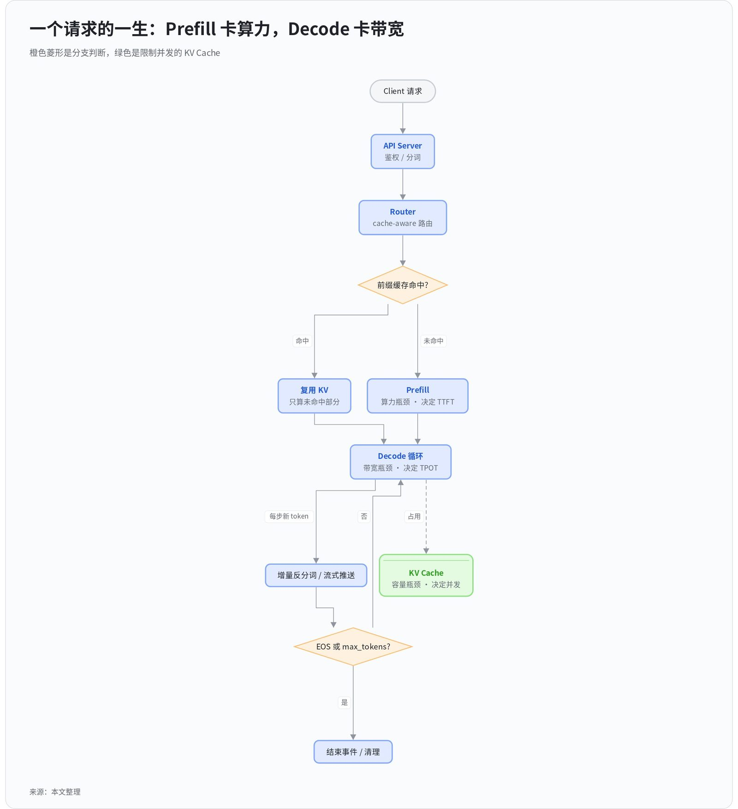

#### 1.3 四个核心指标

| 指标 | 定义 | 受什么支配 | 典型 SLO（量级示意） |
|---|---|---|---|
| **TTFT**（Time To First Token） | 请求到达 → 首 token 返回 | 排队 + Prefill FLOPs / 有效算力 | 对话 &lt; 500ms；长文档 &lt; 3s |
| **TPOT**（Time Per Output Token，也叫 ITL） | Decode 阶段相邻 token 的平均间隔 | 权重 + KV 读带宽、batch 大小、TP 通信 | &lt; 50ms（约 20 tok/s，快于人类阅读） |
| **E2E Latency** | `TTFT + TPOT × (output_len − 1)` | 上述两者 + 尾部效应 | 按业务场景 |
| **Goodput** | 满足 SLO 的 token/s（或 req/s） | 吞吐 × SLO 达成率 | 越高越好 |

> ❗ <b>口径三要素：</b>报任何延迟数字时必须同时说明 **①分位数**（P50/P90/P99）、**②负载**（QPS 或并发、到达分布）、**③输入输出长度分布**。缺任何一个，数字都不可比较。

#### 1.4 TTFT 的完整分解

把 TTFT 拆到可以逐项优化的粒度：

`TTFT = T_queue + T_tokenize + T_dispatch + T_prefill_compute + T_prefill_comm + T_sample + T_serialize`

| 分量 | 量级示意（70B，8×H100，TP=8） | 受什么支配 | 优化抓手 |
|---|---|---|---|
| T_queue | 0 ~ 数秒 | 并发、调度策略、Prefill 积压 | 限流、优先级、扩容、PD 分离 |
| T_tokenize | 0.5 ~ 5 ms | Tokenizer 实现 | Rust tokenizers、多进程分词 |
| T_dispatch | 0.1 ~ 1 ms | Scheduler → Worker 数据拷贝 | Pinned memory、共享内存 |
| T_prefill_compute | N=1024 时约数十 ms | FLOPs ≈ 2·N·P | FP8、FA3、Prefix Cache（少算） |
| T_prefill_comm | 数 ms ~ 十余 ms | 每层 2 次 AllReduce × 80 层 | 通算重叠、TP 限制在 NVLink 域内 |
| T_sample | 0.1 ~ 1 ms | logits 处理 + 采样 | fused sampling kernel |
| T_serialize | 0.1 ~ 2 ms | JSON / gRPC 序列化 | SSE 直发、protobuf |

<b>直觉：</b>短 prompt 的 TTFT 抖动主要来自 `T_queue`（被别人的长 Prefill 挡住）；只有长 prompt 才真正被 `T_prefill_compute` 支配。所以「TTFT 高」先看队列，别急着换更快的 Attention kernel。

#### 1.5 Prefill 与 Decode：两种截然不同的负载

> ⚡ **Prefill：算力瓶颈**
>
> - 一次处理 N 个 token，GEMM 形状 `[N × h] · [h × h']`
> - FLOPs ≈ `2·N·P`（P 为参数量）
> - 算术强度 ≈ N（N 越大越接近算力峰值）
> - **batch 不会让它变便宜**：多一个请求就多一份 FLOPs
> - 决定 TTFT

> 🐢 **Decode：带宽瓶颈**
>
> - 每步每请求只算 1 个 token，GEMV 形状 `[1 × h] · [h × h']`
> - 每步都要读一遍全部权重 + 自己的 KV Cache
> - 线性层算术强度 ≈ batch 大小 B
> - **batch 几乎免费**：B 个请求共享一次权重读取
> - 决定 TPOT

##### Prefill FLOPs 的完整表达

单请求 Prefill 的稠密部分：`F_dense ≈ 2·N·P`；Attention 二次项：`F_attn ≈ 4·L·N²·d_model`（L 为层数，`d_model = H·d`）。两者之比 `F_attn / F_dense ≈ 2·L·N·d_model / P`。对 Llama-3-70B（L=80，d_model=8192，P≈70B），当 N ≈ 53k 时两者相当（考虑 causal mask 只算一半，临界点还要更长）：**32k 以内 Prefill 仍以稠密 GEMM 为主，超过之后 Attention 的二次项成为主角**，这也是长上下文需要 Ring Attention / SP 的原因（第 4.6 节）。

##### Decode 的显存带宽下界

Decode 一步的最小 HBM 读取量（batch=B，平均序列长 S）：

`Bytes/step ≥ W_bytes + B · S · kv_bytes_per_token`（权重 + 所有请求的 KV）

除以显存带宽 β 就是 **单步耗时下界**，也就是 TPOT 下界。几个可复算的例子（H100 SXM，β = 3.35 TB/s）：

| 场景 | 每卡需读权重 | TPOT 下界 | 含义 |
|---|---|---|---|
| Llama-3-8B，BF16，单卡 | 16 GB | ≈ 4.8 ms | 单流上限 ≈ 200 tok/s |
| Llama-3-70B，BF16，TP=8 | 140 / 8 = 17.5 GB | ≈ 5.2 ms（+ 通信） | TP 本质上是在「借带宽」 |
| Llama-3-70B，FP8，TP=2 | 70 / 2 = 35 GB | ≈ 10.4 ms | 量化 = 直接减少要读的字节 |

想低于这个下界，只有三条路：**少读权重**（量化、MoE 稀疏激活）、**多人分摊一次读取**（增大 batch）、**一次读取产出多个 token**（投机解码）。这三条路分别对应第 5 章、第 8 章、第 5.4 节。

这也解释了**为什么 Prefill/Decode 应该分开考虑**：混跑时 Prefill 阶段显存带宽闲置、Decode 阶段 SM 闲置，并且长 Prefill 会阻塞 Decode 导致 TPOT 抖动[[Splitwise]](https://arxiv.org/abs/2311.18677)。第 8 章会给出两种解法：Chunked Prefill（混跑但切片）与 PD 分离（分池部署）。

#### 1.6 Roofline：判断瓶颈的通用语言

Roofline 公式：`Perf = min(π, β × I)`，其中 π 为算力峰值（FLOPS）、β 为显存带宽（Bytes/s）、I 为算术强度（FLOPs/Byte）。拐点 `I* = π / β`：I 低于拐点时受带宽限制（斜坡区），高于拐点时受算力限制（平顶区）。

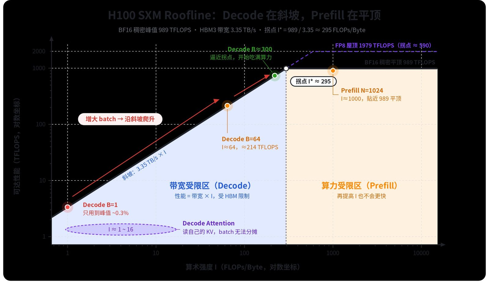

以 H100 SXM 为例：BF16 稠密算力 989 TFLOPS、HBM3 带宽 3.35 TB/s，拐点 `I* ≈ 295 FLOPs/Byte`。对 BF16 权重的线性层，Decode 的算术强度约等于 batch 大小 B（每读 2 字节权重做 2·B 次浮点运算）。于是：

- **B = 1**：I ≈ 1，只能用到峰值算力的约 0.3%，Decode 的 GPU「利用率」天然很低。
- **B = 64**：I ≈ 64，仍在斜坡区，但单位 token 成本已降到 B=1 时的约 1/60。
- **B ≈ 300**：线性层接近拐点，继续增大 batch 不再线性提升吞吐。
- **Attention 例外**：每个请求读的是**自己的** KV Cache，batch 无法分摊，Decode Attention 的算术强度始终只有 1~几十（取决于 GQA 分组数）。这就是 GQA / MLA / KV 量化存在的根本理由（第 5.2 节）。

这就是 Continuous Batching 与 PagedAttention 的物理起点：**想办法把尽可能多的请求同时塞进一次 Decode，并且用尽可能少的显存装下它们的 KV**[[PagedAttention]](https://arxiv.org/abs/2309.06180)。

> 💡 <b>可复现实验：</b>用 `torch.profiler` 或 CUTLASS profiler 跑一组 BF16 GEMM：K=8192、N=8192、M ∈ {1, 8, 64, 256, 1024}，记录实际 TFLOPS。你会看到 M ≤ 64 时吞吐几乎随 M 线性增长（斜坡区），M 到几百后趋于平顶。把结果画在对数坐标上，就得到了你自己机器的 Roofline。

#### 1.7 成本四层：Cost0 → Cost3

| 层级 | 含义 | 典型单位 | 谁负责 |
|---|---|---|---|
| **Cost0** | 物理硬件成本 | \$/GPU·hour（H100 云上约 2–4 \$/hr，量级示意） | 采购 / IaaS |
| **Cost1** | 框架成本 = Cost0 / 满载有效吞吐 | \$/1M tokens（Prefill 与 Decode 分开算） | 推理框架团队 |
| **Cost2** | 服务成本：含调度、冗余、SLO 违约、降级 | \$/成功请求 | Serving 团队 |
| **Cost3** | 业务成本：含缓存命中、长度分布、潮汐利用率 | \$/用户/日 | 业务方 |

<b>公开数据参考：</b>DeepSeek 在 2025 年 2 月的开源周公布了 V3/R1 在线推理系统 24 小时的运营数据[[DeepSeek-V3/R1 Inference System Overview]](https://github.com/deepseek-ai/open-infra-index/blob/main/202502OpenSourceWeek/day_6_one_more_thing_deepseekV3R1_inference_system_overview.md)：

| 指标 | 数值 |
|---|---|
| 节点占用（8×H800/节点） | 峰值 278 节点，平均 226.75 节点；白天全量服务，夜间缩容让给研究与训练 |
| 输入 token / 缓存命中 | 608B，其中 342B（<b>56.3%</b>）命中磁盘 KV 缓存 |
| 输出 token | 168B，平均输出速度 20–22 token/s |
| 单节点吞吐 | Prefill 约 73.7k token/s（含缓存命中）；Decode 约 14.8k token/s |
| 理论成本利润率 | 若全部按 R1 定价计费，约 <b>545%</b> |

单节点 Prefill 吞吐约为 Decode 的 5 倍。这组数据很好地说明了：**Prefill 成本 ≠ Decode 成本**，而<b>缓存命中率和潮汐利用率（Cost3）对最终单价的影响往往大于 Kernel 优化（Cost1）</b>。第 13 章会从零算一遍。

**命名提示**：Cost 分层没有业界统一编号。也有团队只分三层：Cost1 是压测下满足 SLA 的单卡极限性能（大致合并这里的 Cost0 和 Cost1），Cost2 是线上兑现比，即单位算力的实际产出（含调度、弹性和峰谷），Cost3 是全部持有卡的成本（部署率、碎片、弹性资源）。跨团队讨论前，先对齐用的是哪套编号，以及分子分母的口径。

#### 1.8 可复现压测：工具与口径清单

| 工具 | 特点 | 适用 |
|---|---|---|
| **MLPerf Inference** | 官方基准，Server / Offline / SingleStream / MultiStream 四种场景，把 SLO 写进规则；v6.0（2026-04）为 LLM 新增 Interactive 场景，DeepSeek-R1 要求 P99 TTFT ≤ 1.5 s、TPOT ≤ 15 ms，并首次允许投机解码[[MLPerf Inference v6.0]](https://mlcommons.org/2026/04/mlperf-inference-v6-0-results/)[[MLPerf Inference]](https://arxiv.org/abs/1911.02549) | 硬件 / 系统横向对比 |
| **vLLM **<b>`vllm bench serve`</b> | ShareGPT / Sonnet / 随机数据集，泊松到达，输出 TTFT/TPOT 分位数[[vLLM benchmarks]](https://github.com/vllm-project/vllm/tree/main/benchmarks) | 框架调优 |
| **GenAI-Perf**（NVIDIA） | Triton / TensorRT-LLM 官方压测器，支持 concurrency sweep | NVIDIA 栈 |
| **LLMPerf**（Anyscale） | 面向 OpenAI 兼容 API 的负载生成器[[LLMPerf]](https://github.com/ray-project/llmperf) | 端到端 / 云 API 对比 |

压测前逐项确认：

- [ ] 输入/输出长度分布是否来自真实流量（而非固定长度）？

- [ ] 到达过程是泊松（开环）还是固定并发（闭环）？两者结论可能相反。

- [ ] 前缀缓存是否开启？压测数据的前缀重复率是否与线上一致？

- [ ] 是否预热（CUDA Graph 捕获、JIT 编译、缓存填充）后再计时？

- [ ] 报告是否同时包含 P50/P99 TTFT、P50/P99 TPOT、Goodput 与 SLO 达成率？

#### 1.9 常见误判

| 直觉 | 实际情况 |
|---|---|
| ❌「加大 batch 一定省钱」 | batch 过大会撑爆 KV Cache，触发抢占/重算，Goodput 反而下降；同时 TPOT 上升可能违反 SLO。 |
| ❌「TP 越大越快」 | TP 每层 2 次 AllReduce，Decode 时是延迟敏感的小消息；跨出 NVLink 域后通信可能超过计算（第 4.3 节有算例）。 |
| ❌「投机解码一定加速」 | 接受率低、draft 成本高或 batch 很大时（Decode 已接近算力瓶颈），投机解码可能更慢（第 5.4 节有公式）。 |
| ❌「GPU 利用率 100% 说明跑满了」 | `nvidia-smi` 的 util 只表示「有 kernel 在跑」，要看 DCGM 的 SM Active / Tensor Active 才知道是否在做有用功。 |

#### 1.10 本章自测

1. H100 上跑 Llama-3-8B（BF16），batch=1 时 Decode 线性层的算术强度约为多少？距离拐点差多少倍？
2. 为什么同一模型的 Prefill \$/token 通常远低于 Decode \$/token？什么情况下会反过来？
3. SLO 为 P99 TTFT &lt; 1s、TPOT &lt; 50ms，QPS 从 10 涨到 30 后 TTFT 先违约。你会先看哪个指标？先动哪个杠杆？

> 🔁 **回到主线**
>
> <b>松动的瓶颈：</b>本章不松动瓶颈，而是建立判断框架：用 Roofline 区分算力、带宽、容量三类瓶颈，用 TTFT/TPOT 分别对应 Prefill 与 Decode。
>
> <b>作用于 Goodput/\$：</b>定义了分子（SLO 内的有效 token）和分母（Cost0→Cost3）。后面每项技术都可以用一句话定位：提升分子，还是降低分母？
>
> <b>代价与约束：</b>指标口径不统一时，所有优化结论都不可比较；先固定压测口径（1.8 节），再谈优化。
>
> <b>下一步：</b>从最底层的物理边界出发，单张 GPU 如何算、如何存（第 2 章）。

---

## 第二篇 认物理：硬件、Kernel 与互联

📎 延伸阅读：从 profile 到逼近硬件上限的方法见 [LLM-32｜系统｜AI Infra 性能优化实战：从 profile 到硬件上限](./32-infra-perf.md)；TPU、Trainium、AMD 与昇腾的硬件和软件栈见 [LLM-36｜系统｜非 NVIDIA 算力：TPU、Trainium、AMD 与昇腾](./36-non-nvidia.md)。单机 8 卡 910B 用 W4A8 加主机内存 Engram 部署 DeepSeek-V4.1-Flash 的实操，见该文第 6.4 节。

第一篇告诉我们「瓶颈在哪」，第二篇回答「瓶颈的物理边界在哪」。所有上层优化（并行、缓存、调度）最终都要落到 SM、HBM、NVLink 和网卡上。这一篇的目标是让你能**用纸笔估算一个算子或一次通信的理论耗时**，从而判断优化空间还有多大。

### 第 2 章 计算底座与 Kernel：让算子贴近 Roofline

> 🎯 <b>本章回答：</b>GPU 的执行与存储层级如何影响 Kernel 性能？FlashAttention 为什么是硬件—算法协同的范本？
>
> <b>一句话结论：</b>Kernel 优化的本质是**减少 HBM 往返**（tiling、融合、在线算法）和**让计算与搬运重叠**（异步拷贝、流水线）；判断优化是否到头，看它离 Roofline 还有多远。

#### 2.1 性能语言：四个杠杆

推理系统与 GPU 对话的四个词：**SM**（Streaming Multiprocessor）、**Tensor Core**、**HBM 带宽**、**NVLink/NVSwitch**。任何 Kernel 优化都可以拆成四件事：

1. **喂饱 SM**：足够的并行度（occupancy、warp 调度），避免 batch=1 时大量 SM 闲置。
2. **用好 Tensor Core**：数据类型（BF16/FP8/FP4）与数据布局匹配硬件指令。
3. **少碰 HBM**：tiling 把数据留在寄存器 / Shared Memory 里复用，算子融合消除中间张量。
4. **重叠一切**：计算与搬运重叠（TMA / cp.async），计算与通信重叠（多 stream、CUDA Graph）。

#### 2.2 NVIDIA GPU 的存储层级

| 层级 | 容量 / 带宽（H100 SXM） | 典型延迟 | 在推理中的角色 |
|---|---|---|---|
| Register | 每 SM 64K × 32bit | ~1 cycle | tile 局部累加（FA2 的 O 累加器） |
| Shared Memory / L1 | 每 SM 最多 228 KB SMEM | ~20–30 cycles | GEMM / Attention tiling |
| L2 Cache | 50 MB | ~200 cycles | 跨 SM 复用、小权重常驻 |
| **HBM3** | 80 GB @ 3.35 TB/s | ~500 ns | **Decode 的性能天花板** |
| NVLink4（经 NVSwitch） | 900 GB/s 双向 / GPU | ~μs 级 | TP AllReduce、机内 KV 传输 |
| PCIe Gen5 x16 | ~64 GB/s 单向 | ~μs 级 | Host↔Device、KV 卸载到 CPU |

从上往下，容量扩大约 6 个数量级，带宽下降约 2–3 个数量级。<b>所有 Kernel 优化都是在这座金字塔里「把数据留在上面」。</b>

#### 2.3 FlashAttention：硬件—算法协同的范本

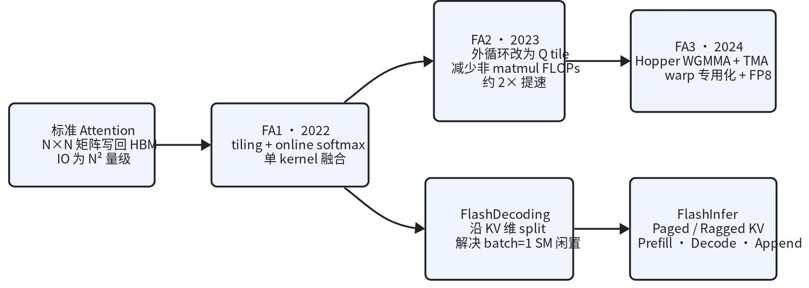

- <b>FA1（2022）</b>：把 `S = QKᵀ`、`softmax(S)`、`O = PV` 融合进一个 kernel，用 **online softmax** 避免把 N×N 中间矩阵写回 HBM，HBM 访问量从 `Θ(N·d + N²)` 降到 `Θ(N²·d²/M)`（M 为 SRAM 大小）[[FlashAttention]](https://arxiv.org/abs/2205.14135)。
- <b>FA2（2023）</b>：把外循环从 KV tile 换成 Q tile，让输出 O 只在寄存器里累加；沿序列维并行以提高 occupancy；减少非 matmul FLOPs。A100 上约 2× 于 FA1[[FlashAttention-2]](https://arxiv.org/abs/2307.08691)。
- <b>FA3（2024）</b>：面向 Hopper，使用异步 WGMMA 指令与 TMA 硬件拷贝，做 warp 专用化（producer/consumer）和 GEMM–softmax 交错流水；论文报告 H100 上 BF16 约 740 TFLOPS（约 75% 利用率）、FP8 接近 1.2 PFLOPS[[FlashAttention-3]](https://arxiv.org/abs/2407.08608)。
- <b>FlashDecoding / FlashDecoding++</b>：Decode 时 Q 只有 1 行，沿 KV 序列维切分并行计算，最后归约[[FlashDecoding++]](https://arxiv.org/abs/2311.01282)。

##### Online softmax 的精确表达

标准 softmax 需要两趟（先求 max 再求 sum）。FA 用增量方式一趟完成，核心状态是 `(m, l, O)`：

*FlashAttention 前向（单个 Q tile）
*

```python
for j in range(T_c):                        # 遍历 K/V tile    S_j = Q_i @ K_j.T / sqrt(d)             # [B_r, B_c]，在 SMEM/寄存器中    m_new = max(m_prev, rowmax(S_j))    P_j = exp(S_j - m_new)    l_new = exp(m_prev - m_new) * l_prev + rowsum(P_j)    O_new = diag(exp(m_prev - m_new)) @ O_prev + P_j @ V_j    m_prev, l_prev, O_prev = m_new, l_new, O_newO_i = O_prev / l_prev                       # 最后统一归一化L_i = m_prev + log(l_prev)                  # 反向只需保存 logsumexp
```

SMEM 占用约 `(B_r·d + 2·B_c·d) × dtype_size`；BF16、d=128、`B_r = B_c = 128` 时约 96 KB，放得进 H100 的 228 KB SMEM。数值稳定性来自「始终减去当前最大值」：指数项永远 ≤ 1，不会溢出。

##### FlashDecoding 的分段归约

把长度为 S 的 KV 切成 `N_split` 段，各段独立得到 `(m_i, l_i, O_i)`，再用同样的在线规则合并：

*split-KV 归约
*

```python
m_star = max(m_i)l_star = sum(exp(m_i - m_star) * l_i)O_star = sum(exp(m_i - m_star) * O_i) / l_star
```

batch 小、序列长时收益最大；batch 已经很大时 SM 已被 batch 维填满，split 的收益会变小。

#### 2.4 其他加速器：它们各自松动了哪条 Roofline

| 加速器 | 设计取舍 | 对推理的意义 |
|---|---|---|
| Google TPU v4 / v5 / TPU7x（Ironwood） | 脉动阵列 + ICI 片间互联，3D Torus；TPU7x 于 2026-03 正式可用，每芯片 192 GiB、7.38 TB/s，每个 pod 9,216 芯片[[TPU7x]](https://docs.cloud.google.com/tpu/docs/tpu7x) | 确定性通信，适合大规模 SPMD 分片[[TPU v4]](https://arxiv.org/abs/2304.01433) |
| AMD MI300X / MI355X | MI300X 192 GB HBM3、5.3 TB/s；现行旗舰 MI355X 为 288 GB HBM3E、8 TB/s[[AMD MI355X]](https://www.amd.com/en/products/accelerators/instinct/mi350/mi355x.html) | 单卡放下更大模型/更多 KV，松动**容量**瓶颈 |
| 华为昇腾 910B/C | Cube + Vector 双单元 | 自主生态，需要专门的算子适配 |
| Groq LPU | 全 SRAM、静态调度 | 极高片上带宽，松动 Decode **带宽**瓶颈，但容量小需大量芯片 |
| Cerebras WSE-3 | 晶圆级芯片，片上 SRAM | 几乎消除片间通信 |
| NVIDIA B200 / GB200 / GB300 / Rubin | FP4 Tensor Core、NVLink5、NVL72 大域；B300 / GB300 已出货，GB300 NVL72 共 20 TB HBM3e、NVLink 130 TB/s[[GB300 NVL72]](https://www.nvidia.com/en-us/data-center/gb300-nvl72/)；下一代 Rubin 每卡 288 GB HBM4、22 TB/s[[NVIDIA HGX]](https://www.nvidia.com/en-us/data-center/hgx/) | 更大的 NVLink 域让 TP/EP 可以跨更多卡 |

#### 2.5 Kernel 开发路径：先选表达，再做测量

| 表达方式（开发成本递增） | 特点 | 典型用途 |
|---|---|---|
| PyTorch + torch.compile | Inductor 自动生成 Triton kernel | 90% 的常规逐元素 / 归约算子融合 |
| Triton 手写[[Triton]](https://triton-lang.org/) | Python DSL，块级编程，跨 NVIDIA/AMD | Attention 变体、fused MoE、Sampling |
| CUTLASS / CuTe[[CUTLASS]](https://github.com/NVIDIA/cutlass) | C++ 模板化 GEMM，贴近硬件指令 | FA3、FP8 GEMM、grouped GEMM |
| 手写 CUDA / PTX | 极致控制 | DeepEP 的通信 kernel[[DeepEP]](https://github.com/deepseek-ai/DeepEP)、DeepGEMM |

常见优化及其前提：

- **Kernel Fusion**：只有当中间张量能留在寄存器 / SMEM 时收益才大。
- **Persistent Kernel**：让 kernel 常驻 SM、循环处理任务，降低 launch 开销，适合小 batch Decode（如 FlashInfer）[[FlashInfer]](https://arxiv.org/abs/2501.01005)。
- **量化 Kernel**：W4A16 需要高效反量化（如 Marlin），W8A8/FP8 直接走 Tensor Core（详见第 5.3 节）。
- **稀疏**：2:4 结构化稀疏（硬件支持）、Deja Vu 式上下文相关动态稀疏[[Deja Vu]](https://arxiv.org/abs/2310.17157)。

#### 2.6 PyTorch 运行时：优化不只发生在 Kernel 内

##### CUDACachingAllocator

PyTorch 的显存分配器会缓存释放的 block 以便复用，所以 `reserved ≥ allocated` 是常态。它的分层：

- **Small pool**（≤ 1 MB 的请求）：从 2 MB 段中切分。
- **Large pool**（> 1 MB）：按 512 字节对齐向上取整，从更大的段中切分。
- **Expandable segments**：`PYTORCH_CUDA_ALLOC_CONF=expandable_segments:True`，段可原地扩展，显著缓解碎片[[PyTorch Memory Management]](https://pytorch.org/docs/stable/notes/cuda.html#memory-management)。

诊断时连着看 `torch.cuda.memory_summary()` 的三个数：`allocated`（张量实际占用）、`reserved`（分配器持有）、`inactive_split`（碎片）。碎片占比高时开启 expandable segments 往往能回收可观的显存。注意：vLLM / SGLang 会在启动时一次性预留 KV Cache 池（`gpu_memory_utilization` / `mem_fraction_static`），所以它们的显存曲线是平的，碎片问题主要出现在激活与临时张量上。

##### torch.compile 与 CUDA Graph

torch.compile 对静态 shape 友好；Decode 的 batch 大小与序列长度不断变化，所以推理框架通常把 torch.compile 与 **CUDA Graph 按 batch 桶预捕获**结合使用（详见第 9.4 节）[[torch.compile]](https://pytorch.org/docs/stable/torch.compiler.html)。

#### 2.7 排查清单与自测

| 命令 | 看什么 |
|---|---|
| `nvidia-smi dmon -s pucm` | 功耗、利用率、时钟、显存（粗粒度） |
| `dcgmi dmon -e 1002,1004,1005` | SM Active、Tensor Active、DRAM Active（判断是算力还是带宽瓶颈） |
| `nsys profile -t cuda,nvtx,osrt` | 全流水线 timeline，看 kernel 间隙与 CPU 阻塞 |
| `ncu --set full -k <kernel>` | 单 kernel 深度分析：occupancy、warp stall、达到的带宽 / FLOPS |
| `py-spy record --native` | Python 层 CPU 火焰图，定位组 batch 与 launch 开销 |

1. FA2 相比 FA1 的主要提升来自哪里？为什么「减少非 matmul FLOPs」在 A100/H100 上这么重要？（提示：Tensor Core 与 CUDA Core 的算力比）
2. 什么情况下 torch.compile 反而变慢？
3. `reserved` 稳定在 78 GB 而 `allocated` 只有 40 GB，你会如何判断是碎片还是框架主动预留？

> 🔁 **回到主线**
>
> <b>松动的瓶颈：</b>算力（Prefill kernel 贴近 Roofline 平顶）与带宽（Decode kernel 贴近斜坡）。
>
> <b>作用于 Goodput/\$：</b>同样的硬件跑出更高 MFU / MBU，直接提升单卡吞吐，即分子。
>
> <b>代价与约束：</b>手写 kernel 开发与维护成本高、强绑定硬件代际；优先复用 FlashAttention / FlashInfer / CUTLASS 等成熟库。
>
> <b>下一步：</b>单卡装不下或算不快时，数据要在卡间流动，先建立通信的成本模型（第 3 章）。

### 第 3 章 互联与 Collective：数据如何在卡间流动

> 🎯 <b>本章回答：</b>一次 AllReduce / AllToAll 要花多久？为什么 TP 必须留在 NVLink 域内？网络出问题时怎么建立证据链？
>
> <b>一句话结论：</b>用 α-β 模型估算通信：**小消息看延迟 α，大消息看带宽 β**。Decode 阶段的 TP 通信是大量小消息，对延迟极度敏感，这决定了并行策略的边界。

#### 3.1 三层网络地图

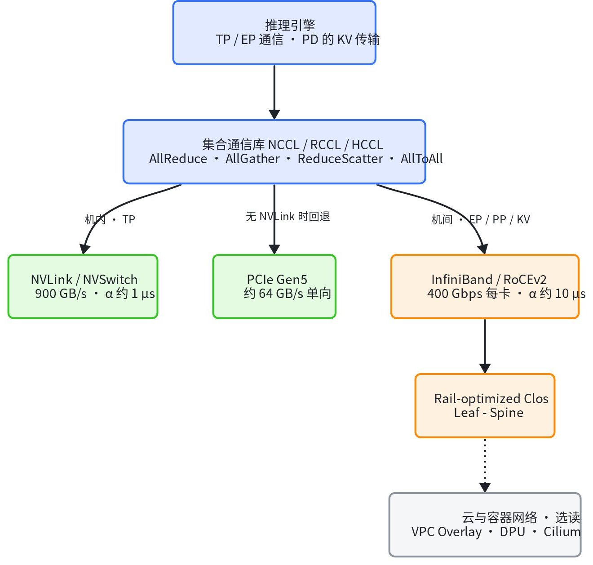

对推理来说最关键的是前两层：**机内 NVLink 决定 TP 的上限，机间 RDMA 决定 EP / PD 分离 KV 传输的上限**。云网络和容器网络主要影响控制面与对外服务（3.8 节选读）。

#### 3.2 α-β 模型：通信耗时的纸笔估算

单次点对点通信：`T = α + s / β`，α 为启动延迟、β 为链路带宽、s 为消息大小。对 N 张卡的 AllReduce：

| 算法 | 耗时（量级） | 适用 |
|---|---|---|
| **Ring** | `2(N−1)·α + 2(N−1)/N · s/β` | 大消息：带宽项渐近最优，但延迟项随 N 线性增长 |
| **Double Binary Tree** | 延迟项 ≈ `2·log₂N·α`，带宽项与 Ring 同量级 | 小消息、大 N：两棵互补二叉树同时工作[[NCCL 2.4 Trees]](https://developer.nvidia.com/blog/massively-scale-deep-learning-training-nccl-2-4/) |
| **NVLS**（NVLink SHARP） | 归约在 NVSwitch 内完成，数据量约减半 | H100 + NVSwitch3 机内 AllReduce |
| **SHARP**（IB 交换机归约） | 归约卸载到网络交换机 | 跨机大规模 AllReduce[[SHARP]](https://docs.nvidia.com/networking/display/sharpv3140/Introduction) |

Ring AllReduce = ReduceScatter + AllGather，各走 N−1 步。**记住一个结论：每张卡发送/接收的数据量约为 **<b>`2(N−1)/N · s`</b><b>，几乎与 N 无关；但步数（也就是延迟项）随 N 增长。</b>这就是为什么 TP=16 跨机时延迟急剧恶化，而带宽看起来「还够」。

#### 3.3 机内拓扑：为什么 TP 必须留在 NVLink 域

同一台 8 卡机，GPU 之间可能走 NVSwitch（全互联）、PCIe Switch、或跨 NUMA 的 UPI。`nvidia-smi topo -m` 会显示 `NV#`（NVLink）、`PIX/PXB`（PCIe）、`SYS`（跨 NUMA）等标记，NCCL 据此选路。BIOS 中 ACS 开启会导致 PCIe P2P 失效、退化为经 Host 内存中转。

TP 每一层都要 AllReduce。Decode 时消息很小（batch×hidden×2 字节，常在 KB–MB 级），**完全是延迟主导**：机内 NVLink 单次 AllReduce 约 10 μs 级，跨机 IB 往往是数十 μs 甚至更高。80 层 × 2 次 = 160 次 AllReduce 放大后，差距就是每步几 ms 与十几 ms 的区别（第 4.3 节有完整算例）。所以生产中 **TP ≤ 单机 NVLink 域大小**是硬约束；GB200 NVL72 这类超大 NVLink 域的意义正在于把这条边界推到 72 卡。

#### 3.4 跨机 RDMA：数据路径与控制路径

- <b>GPUDirect RDMA（GDR）</b>：网卡直接 DMA 读写 GPU 显存，绕开 CPU 内存中转。
- **IBGDA**（InfiniBand GPUDirect Async）：GPU 上的 kernel 直接构造工作请求、敲网卡门铃，**绕开 CPU proxy 线程**，显著降低小消息延迟与抖动；这是 DeepEP 低延迟模式的基础[[NVSHMEM IBGDA]](https://developer.nvidia.com/blog/improving-network-performance-of-hpc-systems-using-nvidia-magnum-io-nvshmem-and-gpudirect-async/)。
- 传统路径：kernel 写标志位 → CPU proxy 轮询 → 调用 `ibv_post_send` → 网卡发送。多出来的 CPU 环节带来额外延迟与抖动。

#### 3.5 数据中心网络：Rail-optimized Clos

主流 GPU 集群采用 <b>多级 Clos（Leaf-Spine）+ 多导轨（rail-optimized）</b>：每台机器的第 i 张卡连到第 i 个 Leaf，于是**跨机同 rail 通信只经过一跳 Leaf**。NVIDIA DGX SuperPOD 采用这一思路；基于 DGX A100 搭建的 Meta RSC，节点之间用的是两层、无收敛的 InfiniBand Clos 网络[[Meta RSC]](https://ai.meta.com/blog/ai-rsc/)。对应地，Google TPU Pod 使用 3D Torus 换取更规则的邻居距离。

<b>对推理的含义：</b>EP 的 AllToAll 与 PD 分离的 KV 传输都是跨机流量，调度时应尽量让通信双方位于同一 rail，否则要多经过 Spine，增加延迟与拥塞风险。

#### 3.6 NCCL：协议、channel 与调优 Playbook

NCCL 有三种协议：**Simple**（大消息高带宽）、**LL**（Low Latency，8 字节 flag 内联，小消息低延迟）、**LL128**（128 字节粒度，兼顾两者）。NCCL 会根据消息大小与拓扑自动选择算法与协议，**生产中通常保持默认**，只在排障或特定基准下强制指定[[NCCL Env]](https://docs.nvidia.com/deeplearning/nccl/user-guide/docs/env.html)。

| 变量 | 示例值 | 作用 / 何时用 |
|---|---|---|
| NCCL_DEBUG / NCCL_DEBUG_SUBSYS | INFO / INIT,NET | 排障第一步：看选了哪张网卡、哪种算法和传输 |
| NCCL_ALGO / NCCL_PROTO | Ring,Tree,NVLS / LL,LL128,Simple | 对比实验时强制指定；平时交给自动选择 |
| NCCL_IB_HCA | mlx5_0:1,mlx5_1:1,… | 指定数据面网卡，避开管理网卡 |
| NCCL_IB_GID_INDEX | 3（常见） | RoCEv2 选择正确的 GID |
| NCCL_IB_TIMEOUT | 22 | 超时 = 4.096 μs × 2^22 ≈ 17 s，网络抖动大时调高 |
| NCCL_MIN_NCHANNELS | 按拓扑调 | 增加并发 channel 以打满带宽 |
| NCCL_P2P_LEVEL | NVL | 仅在 NVLink 直连时使用 P2P，否则回退 |
| NCCL_TOPO_FILE | 自定义 XML | 虚拟化环境拓扑探测不准时手动描述 |

> 💡 <b>量化通信的正确姿势：</b>不要相信任何文档里的「实测数字」（包括本手册），用 [nccl-tests](https://github.com/NVIDIA/nccl-tests) 在你的机器上跑 `all_reduce_perf -b 8 -e 1G -f 2`，得到从 8 字节到 1 GB 的时间与 algbw / busbw 曲线。分别画 time–size 与 bandwidth–size：time 曲线小尺寸段的截距是该 collective 的固定开销，再按实际 ring/tree 算法和轮数拟合点对点 α；大尺寸段稳定的 busbw 是有效瓶颈带宽，不宜直接当作物理链路峰值 β。

#### 3.7 RDMA 排障证据链

1. 链路：`ibstat` / `ibv_devinfo`，端口状态、速率、MTU。
2. 地址：`show_gids` / `rdma link`，GID 与 RoCE 版本。
3. 裸性能：`ib_write_bw` / `ib_send_lat`（perftest），排除应用层后的带宽与延迟。
4. NCCL 层：`NCCL_DEBUG=INFO NCCL_DEBUG_SUBSYS=NET`，插件加载与选路。
5. 交换机：ECN 标记计数、PFC pause 计数、buffer 水位，判断拥塞与 PFC 风暴。

#### 3.8 云与容器网络（选读）

这部分主要影响对外服务与控制面，跟推理数据面关系不大，保留要点：

- **虚拟化数据面**：公有云为租户隔离使用 Overlay（VxLAN/Geneve）。内核 OVS → OVS-DPDK（用户态）→ DPU 卸载（AWS Nitro、BlueField 等）是性能演进路线[[AWS Nitro]](https://aws.amazon.com/ec2/nitro/)。GPU 训推集群多采用裸金属 + DPU 隔离，RDMA 走独立网络。
- **网卡虚拟化**：virtio-net（通用但慢）→ SR-IOV VF（直通、热迁移弱）→ DPU offload（兼顾性能与运维）。
- **容器网络**：Flannel vxlan 每跳都有封装开销；host-gw 直接写路由但要求二层可达；kube-proxy 的 iptables 模式在服务规模很大时性能下降，Cilium 用 eBPF 在 tc/XDP 层做负载均衡是主流方案[[Cilium]](https://cilium.io/)；云上常用 ENI / Trunk ENI 让 Pod 直接绑定弹性网卡。
- **只读排障**：`ip -d link`、`ip route`、`tcpdump -i any -nn host X`、`bpftool prog`、`cilium monitor`、`ss -itnp`。

#### 3.9 故障演练题

1. TP=8 的 AllReduce 延迟从 10 μs 涨到 80 μs，你会按什么顺序排查？（提示：拓扑 → NCCL 选路 → 链路 → 交换机）
2. PFC 死锁 / 风暴的常见诱因是什么？如何通过 ECN 与 pause 计数判断风险？
3. 为什么 DeepEP 的低延迟模式要求 IBGDA？如果只能用 CPU proxy，Decode 的 AllToAll 会受到什么影响？

> 🔁 **回到主线**
>
> <b>松动的瓶颈：</b>隐性的第四瓶颈：通信。α 决定小消息（Decode TP）的延迟下限，β 决定大消息（EP AllToAll、KV 传输）的吞吐上限。
>
> <b>作用于 Goodput/\$：</b>通信时间一旦暴露在关键路径上，就会同时拉低分子（TPOT 变长）并抬高分母（卡在等待中空转）。
>
> <b>代价与约束：</b>高带宽互联意味着更贵的机型与网络；拓扑和 NCCL 配置错误的代价往往比算法差异更大。
>
> <b>下一步：</b>有了 α-β 模型，就可以给每种并行策略算通信账（第 4 章）。

---

## 第三篇 拆模型：并行策略

当模型放不下一张卡、或者一张卡算得不够快时，就要把它「切开」。切法的本质是一笔交易：<b>用某种通信，换某种资源（显存容量、带宽或算力）</b>。这一篇用第 3 章的 α-β 模型，把每种切法的通信代价算清楚。

### 第 4 章 并行策略：TP、DP、PP、EP、SP

> 🎯 <b>本章回答：</b>五种并行各切什么、付出什么通信代价？给定模型与集群，如何选型？
>
> <b>一句话结论：</b>TP 借带宽但通信频繁，只能待在 NVLink 域内；PP/EP 用更少、更粗粒度的通信跨机；SP 专治长序列；DP 最简单，能用副本解决就别切模型。

#### 4.1 五种切法一览

| 并行 | 切什么 | 通信原语 | 通信频率 | 典型规模 / 约束 |
|---|---|---|---|---|
| **TP** | 线性层权重（列 / 行） | AllReduce（每层 2 次） | 每层 | ≤ 单机 NVLink 域 |
| **DP** | 请求（副本） | 推理时无（训练时梯度 AllReduce） | — | 不限，配合 Router |
| **PP** | 层 | P2P Send/Recv | 每个 stage 边界 | 可跨机，受气泡制约 |
| **EP** | MoE 专家 | AllToAll（dispatch + combine） | 每个 MoE 层 2 次 | 可跨机，对负载均衡敏感 |
| **SP / CP** | 序列长度 | AllGather / Ring P2P / AllToAll | Attention 内部 | 长上下文 |

#### 4.2 推理相关的 Collective 原语

| 原语 | 每卡收发量（消息大小 s，N 卡） | 用在哪 |
|---|---|---|
| AllReduce | ≈ `2(N−1)/N · s` | TP 每层输出 |
| AllGather | ≈ `(N−1)/N · s`（s 为拼接后总大小） | SP 拼接、权重收集 |
| ReduceScatter | ≈ `(N−1)/N · s` | 与 AllGather 组合实现 SP |
| AllToAll | ≈ `(N−1)/N · s`（s 为本卡发出总量） | EP token 分发与回收、Ulysses |
| P2P Send/Recv | `s` | PP stage 之间、PD 分离 KV 传输 |

#### 4.3 TP：Megatron 范式与可算的通信代价

Megatron-LM 的「**先列并行、再行并行**」是 TP 的事实标准[[Megatron-LM]](https://arxiv.org/abs/1909.08053)：

- QKV 投影按列切（每卡拿到一部分 head），Attention 计算本身无需通信；输出投影按行切，之后做 1 次 AllReduce。
- MLP 第一层按列切、第二层按行切，之后再做 1 次 AllReduce。
- 因此每个 Transformer 层 **2 次 AllReduce**。Sequence Parallel 变体把 LayerNorm/Dropout 沿序列切，把 AllReduce 拆成 ReduceScatter + AllGather，进一步节省激活显存[[Reducing Activation Recomputation]](https://arxiv.org/abs/2205.05198)。

##### 算例：Llama-3-70B Decode 的 TP 通信

设 L=80、h=8192、batch B=32、S=1（Decode）、BF16：

- 单次 AllReduce 消息：`B·h·2 = 32 × 8192 × 2 ≈ 512 KB`；每步 `2 × 80 = 160` 次。
- TP=8 Ring 下每卡每步收发：`160 × 2 × 7/8 × 512 KB ≈ 143 MB`。

| 部署 | 带宽项 | 延迟项（160 次） | 每步通信合计（量级） |
|---|---|---|---|
| 机内 NVLink（约 450 GB/s 单向，效率 70%） | ≈ 0.45 ms | ≈ 160 × 10 μs = 1.6 ms | <b>≈ 2 ms</b> |
| 跨机 IB 400 Gbps（约 50 GB/s，效率 70%） | ≈ 4 ms | ≈ 160 × 30 μs = 4.8 ms | <b>≈ 9 ms</b> |

对比第 1.5 节的 TPOT 下界（TP=8 BF16 约 5 ms），跨机 TP 的通信时间已经超过计算本身。<b>「TP 不跨 NVLink 域」是算出来的结论，有推导依据。</b>另一个启示：Decode 的 AllReduce 是**延迟主导**的，所以 vLLM / TensorRT-LLM 为小消息实现了基于 NVLink P2P 的 one-shot / two-shot custom AllReduce，比通用 Ring 更快。

#### 4.4 DP 与 PP

**DP** 在推理中以「多副本 + 前置 Router」出现，是最简单、隔离性最好的扩展方式：只要单副本放得下模型，优先用 DP 扩容。

**PP** 把层切到多个 stage，stage 之间只传激活，通信量小、适合跨机。问题是**气泡**：朴素 PP 的气泡比例为 `(P−1) / (M+P−1)`（P 为 stage 数，M 为同时在飞的 micro-batch 数）。P=8、M=1 时气泡高达 87.5%。推理中的应对：

- **多 batch 流水**：让不同请求组成的多个 batch 同时在不同 stage 上流动（vLLM 的多 virtual engine 思路），等效增大 M。
- **Chunked Prefill**：把长 Prefill 切成均匀的 chunk，使各 batch 的耗时接近，减少因 batch 不均造成的气泡[[Sarathi-Serve]](https://www.usenix.org/conference/osdi24/presentation/agrawal)。
- GPipe → 1F1B → Interleaved 1F1B 是训练侧的气泡优化，推理可以借鉴其「切更细的 stage」思路：气泡降为 `(P−1) / (V·M+P−1)`。

#### 4.5 EP：MoE 的专家并行

MoE 层每步两次 AllToAll：**dispatch**（把 token 送到其选中的专家所在的卡）与 **combine**（把专家输出送回）。设每卡 `N_tok` 个 token、每 token 选 k 个专家、隐藏维 d：

`Bytes_send ≈ N_tok · k · d · dtype_size`（dispatch 可用 FP8 进一步减半）

与 AllReduce 不同，AllToAll 的完成时间由**最慢的那条链路 / 最忙的那个专家**决定，所以 EP 对**负载均衡**极其敏感。常见手段：辅助损失或无辅助损失的负载均衡（DeepSeek-V3）、冗余专家（热点专家多副本）、限制每 token 跨节点数量。

**DeepEP** 提供两类 kernel[[DeepEP]](https://github.com/deepseek-ai/DeepEP)：

> 📦 **Normal（高吞吐）模式**
>
> 面向 Prefill / 训练：机内走 NVLink、机间走 RDMA 的分层转发，最大化带宽。

> ⚡ **Low-latency 模式**
>
> 面向 Decode：纯 RDMA + IBGDA，支持「hook」式通算重叠且不占用 SM，追求最低延迟。

##### EP 与 TP 的组合

- **纯 EP**：每个专家完整放在一张卡上，只有 AllToAll。专家小、数量多时（如 DeepSeek-V3 的 256 个路由专家）首选。
- **EP + TP**：专家内部再做 TP，通信为 AllToAll + AllReduce。单个专家过大、一张卡放不下或算得太慢时使用。
- <b>Expert-TP（ETP）</b>：所有专家都按 TP 切到每张卡，每卡持有每个专家的 1/TP。通信模式简单，但专家 GEMM 变得很小、效率低，大规模 MoE 中较少使用。
- **Attention 与 MoE 分开切**：Attention 部分用 DP（+ 小 TP），MoE 部分用大 EP，这是 DeepSeek-V3 的做法（见 4.7 表格）。

#### 4.6 SP / CP：长序列并行

- **Ring Attention**：每卡持有 `S/N` 的 Q，KV 在环上轮转 N 次，与 FlashAttention 分块天然契合；通信可与计算重叠[[Ring Attention]](https://arxiv.org/abs/2310.01889)。
- **DeepSpeed-Ulysses**：用 AllToAll 在「序列维切分」与「head 维切分」之间转换，Attention 内部无通信；每卡通信量随 N 下降，但并行度受 head 数约束（N 应为 KV head 数的约数）[[DeepSpeed-Ulysses]](https://arxiv.org/abs/2309.14509)。
- **USP**：把 Ring 与 Ulysses 组合成二维序列并行，兼顾通信量与灵活性[[USP]](https://arxiv.org/abs/2405.07719)。

<b>SP 何时优于 TP：</b>TP 的 AllReduce 总量不随 N 下降；而 SP 每卡通信量随 N 下降、且 KV Cache 按序列分摊。所以在**长序列 Prefill** 场景下，SP 是压 Attention 二次项与 KV 显存的更好选择。

#### 4.7 选型：从经验规则到决策树

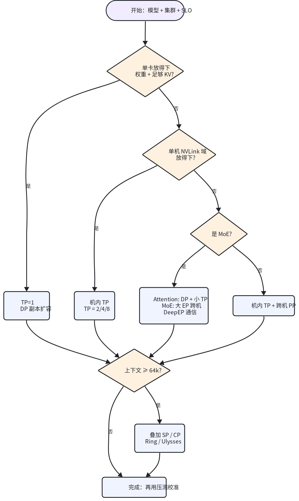

Alpa（OSDI'22）把「算子间 + 算子内」并行联合搜索形式化为优化问题，GSPMD 提供了声明式的分片语言[[Alpa]](https://arxiv.org/abs/2201.12023)[[GSPMD]](https://arxiv.org/abs/2105.04663)。生产推理通常按上面的决策树选出候选，再用压测在 2–3 个配置间校准。

##### 部署配置对照

| 模型 | 集群 | 推理配置 | 关键考虑 |
|---|---|---|---|
| Llama-3-8B | 1×H100 | TP=1，DP 多副本 | 纯副本扩展 |
| Llama-3-70B | 1 机 8×H100 | BF16：TP=8；FP8：TP=2~4 × 多副本 | 量化后可用更小 TP、更多副本 |
| Llama-3.1-405B | 1–2 机 | FP8：单机 TP=8；BF16：TP=8 + PP=2 | 跨机用 PP，不用 TP |
| DeepSeek-V3 / R1（671B MoE） | 技术报告部署单元 | Prefill：4 节点 32 卡，Attention TP4+SP、DP8，MoE EP32；Decode：40 节点 320 卡，MoE EP320[[DeepSeek-V3]](https://arxiv.org/abs/2412.19437) | Attention 与 MoE 分开切；Prefill 与 Decode 规模不同 |
| DeepSeek-V3 / R1 线上 | 2025 年公开数据 | Prefill 部署单元 4 节点（EP32），Decode 部署单元 18 节点（EP144）[[Inference System Overview]](https://github.com/deepseek-ai/open-infra-index/blob/main/202502OpenSourceWeek/day_6_one_more_thing_deepseekV3R1_inference_system_overview.md) | 大 EP 提高每卡 batch，双 micro-batch 通算重叠 |
| Llama-70B，128k 长文本 | 1–2 机 | TP=8 + SP/CP | 压 Attention 二次项与 KV 显存 |

#### 4.8 本章自测

1. 按 4.3 节的方法，估算 TP=4、B=128 时 Llama-3-70B Decode 每步的 NVLink 通信时间，判断它是延迟主导还是带宽主导。
2. 为什么 DeepSeek-V3 的 Decode 要用比 Prefill 大得多的 EP？（提示：每卡 batch 与带宽瓶颈）
3. Ulysses 的并行度为什么受 head 数约束？GQA 模型会让这个约束更紧还是更松？

> 🔁 **回到主线**
>
> <b>松动的瓶颈：</b>TP / PP 借用多卡的带宽与容量；EP 通过增大每个专家的 batch，把 MoE Decode 从带宽瓶颈推向算力瓶颈；SP / CP 分摊长序列的算力与容量压力。
>
> <b>作用于 Goodput/\$：</b>选对切法可以在满足 TPOT SLO 的前提下，用最少的卡服务最多的并发。
>
> <b>代价与约束：</b>每种切法都引入通信：TP 受 α 约束必须留在 NVLink 域内；EP 依赖 AllToAll 与负载均衡；PP 引入气泡。
>
> <b>下一步：</b>部署方式确定之后，下一个杠杆是修改算子和模型本身，少存、少读、少算（第 5 章）。

---

## 第四篇 少算少读：算子层的三把刀

第 1.5 节说过，Decode 想突破带宽下界只有三条路：**少读权重、多人分摊、一次读取产出多个 token**。这一篇讲算子层能做的三把刀：**改 Attention 结构**（少读 KV）、**量化**（少读权重和 KV）、**投机解码**（一次验证多个 token），以及把 KV 彻底换成固定大小状态的 Linear Attention。

### 第 5 章 Attention 变体、量化与投机解码

> 🎯 <b>本章回答：</b>MHA→GQA→MLA 省了多少 KV？量化该选哪条路线？投机解码什么时候有用、什么时候反而变慢？
>
> <b>一句话结论：</b>这三类技术都在减少「每产出一个 token 需要搬运的字节数」；它们的收益上限可以用第 1 章的带宽下界直接估算，代价则分别是模型结构、精度和额外计算。

📎 延伸阅读：扩散语言模型靠并行去噪让每次前向确定 20 个左右 token，和投机解码拉的是同一根杠杆，批量一大收益就缩小，见 [LLM-42｜地基｜图像与视频生成：扩散、DiT 与推理加速](./42-image-video-generation.md) 第 12 章。

#### 5.1 Prefill 与 Decode 下的 Attention

标准 Attention：`Attn(Q,K,V) = softmax(QKᵀ/√d)·V`。Prefill 时 Q、K、V 都是 `[B, H, N, d]`，是 GEMM，受算力支配；Decode 时 Q 只有 `[B, H, 1, d]`，K/V 是不断增长的 KV Cache，退化为 GEMV + 归约，受带宽支配。推理框架因此通常维护两套 kernel：Prefill（FA2/FA3）与 Decode（FlashDecoding / FlashInfer / PagedAttention kernel）[[FlashInfer]](https://arxiv.org/abs/2501.01005)。

#### 5.2 从 MHA 到 MLA：少存、少读 KV

| 变体 | 每 token KV（BF16） | 核心思想 | 代表模型 |
|---|---|---|---|
| MHA | 2·L·H·d·2 = 2·80·64·128·2 ≈ **2.5 MB** | 每个 head 独立 KV | GPT-3、LLaMA-1 |
| MQA | 2·80·1·128·2 ≈ **40 KB** | 所有 head 共享 1 组 KV | PaLM、Falcon |
| GQA（8 组） | 2·80·8·128·2 ≈ **320 KB** | head 分组共享 KV | Llama-2/3-70B、Mixtral |
| MLA | (512 + 64)·61·2 ≈ **69 KB** | 把 KV 压到低秩隐向量，只缓存隐向量 | DeepSeek-V2/V3 |

（前三行按 L=80、H=64、d=128 的 70B 级配置计算；MLA 行按 DeepSeek-V3 的实际配置：61 层，KV 压缩维 512 + RoPE 维 64。）

**MLA 的关键**：只缓存低秩隐向量 `c_kv`，计算时再通过上投影矩阵恢复 K/V；而且上投影可以被「吸收」进 Q 与输出投影，Decode 时直接在隐空间计算 Attention。DeepSeek-V2 论文报告 MLA 在 KV 占用远小于 MHA 的同时效果更好[[DeepSeek-V2]](https://arxiv.org/abs/2405.04434)。回到 Roofline：<b>Attention 的 KV 读取无法被 batch 分摊，所以每 token KV 字节数直接决定了 Decode Attention 的耗时和最大并发。</b>

#### 5.3 量化：少读权重，也少读 KV

| 方法 | W | A | 核心思想 | 典型定位 |
|---|---|---|---|---|
| GPTQ[[GPTQ]](https://arxiv.org/abs/2210.17323) | 4 | 16 | 逐层用二阶信息最小化重建误差 | 权重量化，省显存与带宽 |
| AWQ[[AWQ]](https://arxiv.org/abs/2306.00978) | 4 | 16 | 按激活幅度保护少量显著通道 | A100 等无原生 FP8 硬件的首选之一；L40S 支持 FP8，可按模型质量、kernel 支持与显存同 FP8 方案对比 |
| SmoothQuant[[SmoothQuant]](https://arxiv.org/abs/2211.10438) | 8 | 8 | 把激活离群值「平滑」迁移到权重 | INT8 Tensor Core |
| QServe（W4A8KV4）[[QServe]](https://arxiv.org/abs/2405.04532) | 4 | 8 | 渐进式分组量化 + SmoothAttention | 高吞吐服务 |
| FP8（E4M3）[[FP8 Formats]](https://arxiv.org/abs/2209.05433) | 8 | 8 | 硬件原生，per-tensor / per-channel / block scale | H100/H200/B200 的默认选择 |
| FP4（MXFP4 / NVFP4） | 4 | 4 | Blackwell 原生，细粒度 block scale | B200 及以后，需校准 |

**精度影响**高度依赖模型与任务（困惑度变化通常很小，但数学/代码/长文推理可能更敏感），务必在自己的评测集上验证。实操建议：

- **H100 及以后：优先 FP8**（权重 + 激活），硬件原生、无需重训，吞吐与显存同时受益。
- <b>A100 / L40S：优先 W4A16（AWQ / GPTQ + Marlin kernel）</b>，Decode 带宽收益明显；大 batch 时反量化开销会显现。
- **KV Cache：优先 FP8**。KV 读取无法被 batch 分摊，每省一个字节都直接转化为 Decode 速度和并发容量。

#### 5.4 投机解码：一次读取，多个 token

##### 原理与流程

用一个便宜的 draft 模型 q 连续提议 K 个 token，再让 target 模型 p **一次前向并行验证**这 K 个位置（Decode 是带宽瓶颈，验证 K 个 token 的耗时与生成 1 个相近）。每个候选以概率 `min(1, p/q)` 接受，被拒绝时从修正分布重新采样[[Leviathan et al.]](https://arxiv.org/abs/2211.17192)[[Chen et al.]](https://arxiv.org/abs/2302.01318)。

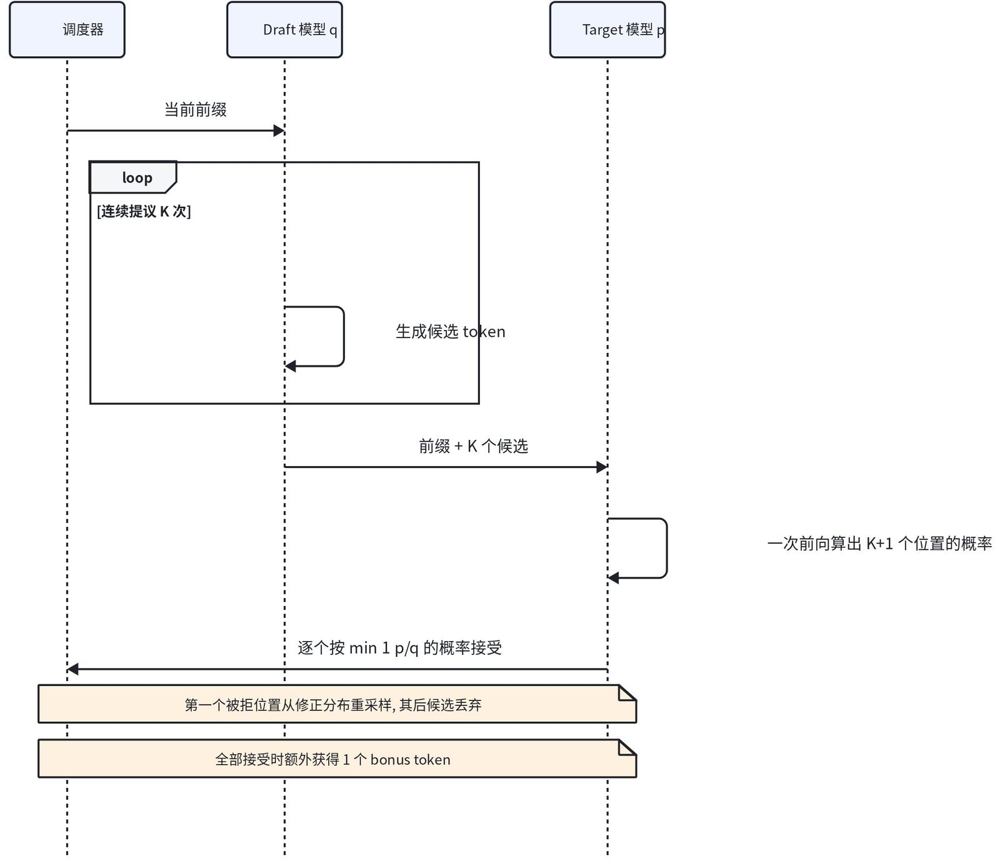

##### 为什么输出分布无损

采样 `x ~ q`，以 `α(x) = min(1, p(x)/q(x))` 接受，否则从 `p'(x) = max(0, p(x) − q(x)) / Z` 重采样，其中 `Z = Σ max(0, p − q) = 1 − Σ min(p, q)`：

*拒绝采样的无偏性证明
*

```
P(输出 x) = q(x)·α(x) + (1 − Σ_y q(y)α(y)) · p'(x)         = min(p, q)(x) + (1 − Σ min(p, q)) · max(0, p − q)(x) / Z         = min(p, q)(x) + max(0, p − q)(x)         = p(x)
```

结论：<b>只要接受-拒绝规则实现正确，输出分布与直接从 target 采样完全一致；draft 的质量只影响速度，不影响正确性。</b>（贪心解码下同理：接受当且仅当 draft token 等于 target 的 argmax。）

##### 期望加速：什么时候有用

设每个候选的平均接受率为 β、每轮提议 K 个、draft 单步成本是 target 单步的 c 倍，则每轮期望产出 token 数与加速比为[[Leviathan et al.]](https://arxiv.org/abs/2211.17192)：

```math
E[a] = \frac{1-\beta^{K+1}}{1-\beta}, \qquad \text{Speedup} = \frac{E[a]}{K\cdot c + 1}
```

| 场景（K=4） | β | E[a] | c=0.12（8B 小模型） | c=0.03（EAGLE 式单层头） |
|---|---|---|---|---|
| 高接受率 | 0.8 | 3.36 | ≈ 2.3× | ≈ 3.0× |
| 中等 | 0.5 | 1.94 | ≈ 1.3× | ≈ 1.7× |
| 低接受率 | 0.3 | 1.43 | ≈ 0.97×（变慢） | ≈ 1.3× |

两个工程结论：**①draft 越便宜，对接受率的要求越低**，这是 Medusa / EAGLE 用「附加在 target 上的轻量头」替代独立小模型的原因；**②batch 越大，收益越小**，大 batch 时 Decode 逐渐接近算力瓶颈，验证 K 个 token 不再「几乎免费」，所以高负载时常需要动态降低 K 或关闭投机解码。

##### 主流变体

| 方案 | 思路 | 是否需要训练 |
|---|---|---|
| Medusa[[Medusa]](https://arxiv.org/abs/2401.10774) | 在 target 上加多个并行预测头，树状候选 + 树注意力验证 | 训练额外的头 |
| EAGLE / EAGLE-2 / EAGLE-3[[EAGLE-2]](https://arxiv.org/abs/2406.16858)[[EAGLE-3]](https://arxiv.org/abs/2503.01840) | 复用 target 的隐状态与 lm_head，训练一个单层自回归 draft 头；EAGLE-2 加入按置信度动态扩展的草稿树；EAGLE-3 融合多层特征 | 训练 draft 头 |
| Lookahead Decoding[[Lookahead]](https://arxiv.org/abs/2402.02057) | Jacobi 迭代生成 n-gram 候选池 | 否 |
| Prompt Lookup / n-gram | 从 prompt 中匹配 n-gram 作为候选，适合摘要、代码编辑等「复制多」的任务 | 否 |
| Self-Speculative（Draft &amp; Verify）[[Draft &amp; Verify]](https://arxiv.org/abs/2309.08168) | 跳过部分层作为 draft，同一模型验证 | 否（需选层） |
| SpecInfer[[SpecInfer]](https://arxiv.org/abs/2305.09781) | 多个小模型组成 token 树 + 树验证 | 可选 |
| MTP（多 token 预测） | DeepSeek-V3 训练时附带的 MTP 模块可直接作为 draft | 随预训练获得 |

##### EAGLE 的 draft 结构

*EAGLE 式 draft（示意）
*

```python
h = target.last_hidden            # target 已经算出的最后一层隐状态for k in range(K):    e = target.embed(x_prev)      # 复用 target 的 embedding    h = draft_head(concat(h, e))  # 单层自回归头，唯一需要训练的部分    logits = target.lm_head(h)    # 复用 target 的 lm_head    x_prev = sample(logits)
```

复用 lm_head 与隐状态让 draft 分布天然接近 target，同时 draft 成本极低（c 很小）。

#### 5.5 Linear Attention 与状态空间模型

Linear Attention 把 `softmax(QKᵀ)V` 替换为 `φ(Q)(φ(K)ᵀV)`：先把历史压缩成一个固定大小的状态 `S ∈ ℝ^{d_k×d_v}`，每步只需 `S_t = S_{t−1} + k_t v_tᵀ`、`o_t = q_tᵀ S_t`。<b>「KV Cache」变成了与序列长度无关的常数大小状态</b>：显存容量瓶颈被彻底改写。

| 代表 | 要点 |
|---|---|
| RetNet[[RetNet]](https://arxiv.org/abs/2307.08621) | retention 机制，支持 parallel / recurrent / chunkwise 三种计算形式 |
| RWKV[[RWKV]](https://arxiv.org/abs/2305.13048) | token-shift + time-mix + channel-mix 的 RNN 式结构 |
| Mamba / Mamba-2[[Mamba]](https://arxiv.org/abs/2312.00752)[[Mamba-2]](https://arxiv.org/abs/2405.21060) | 选择性状态空间；Mamba-2 提出 State Space Duality，说明 SSM 与 Linear Attention 在 chunkwise 形式下是同一族算子 |
| GLA / Gated DeltaNet[[GLA]](https://arxiv.org/abs/2312.06635)[[Gated DeltaNet]](https://arxiv.org/abs/2412.06464) | 数据相关的门控与 delta 更新规则，提升记忆与检索能力 |
| 混合架构[[Jamba]](https://arxiv.org/abs/2403.19887)[[Griffin]](https://arxiv.org/abs/2402.19427) | 少量全注意力层 + 大量线性/SSM 层，兼顾长程检索与效率，是当前主流落地形态 |

##### Chunkwise 计算

Prefill 不能逐 token 递推（太慢，无法用 Tensor Core），而是把序列切成长度为 C 的块：**块内**用并行的「注意力形式」计算（`O(C²·d)`），**块间**用状态递推传递（`O(d²)` 每块）。C 取 64–256 左右时能较好地平衡 Tensor Core 利用率与递推开销。

##### 缓存与回滚：与投机解码 / 前缀缓存的冲突

状态 S 是对历史的**有损累积压缩**，无法像 KV Cache 那样「截断到第 i 个 token」。这带来两个工程难题：

- **投机解码回滚**：被拒绝的 token 已经被累加进 S。用减法 `S − Σ k_j v_jᵀ` 回滚在有门控/衰减时不成立，且有数值误差。正确做法是在验证时**保存每个候选位置的中间状态**，按接受长度选取；代价是每层额外保存 K 份状态。
- **前缀缓存**：只能在保存了状态快照的位置命中（例如每个 chunk 边界存一份）。每层状态大小约 `H·d_k·d_v`，远小于长序列的 KV，但快照数量需要权衡。

#### 5.6 本章自测

1. 用 5.2 节的表格计算：同样 80 GB 显存留给 KV，GQA-8 与 MLA 在 8k 上下文下各能支持多少并发？
2. 为什么投机解码的接受率不能简单等同于 draft 模型的「质量」？温度升高时接受率会怎样变化？
3. 线上 batch 从 8 涨到 128 后，投机解码的收益从 2.5× 降到 1.1×。请用 Roofline 解释，并给出一个自适应策略。

> 🔁 **回到主线**
>
> <b>松动的瓶颈：</b>GQA / MLA 与 KV 量化减少 KV 字节，同时缓解带宽和容量；权重量化减少权重读取，FP8 还能倍增算力；投机解码让一次权重读取产出多个 token；Linear Attention 让状态大小与序列长度无关。
>
> <b>作用于 Goodput/\$：</b>同一张卡上并发更高、TPOT 更低，分子上升；同样的 SLO 下需要的卡更少，分母下降。
>
> <b>代价与约束：</b>精度风险要靠评测集把关；投机解码消耗额外算力，高负载时收益递减，需要动态开关。
>
> <b>下一步：</b>KV 变小之后，剩下的问题是怎么管理这块显存（第 6 章）。

---

## 第五篇 管显存：KV Cache 是推理系统的核心资产

📎 延伸阅读：MHA / GQA / MLA 的 KV 缓存对比、稀疏注意力与跨请求 KV 复用见 [LLM-31｜地基｜长上下文与注意力：从 MHA 到稀疏与线性注意力](./31-attention-long-context.md)。

第四篇在「每个 token 占多少字节」上做文章；这一篇解决「有限的显存如何装下尽可能多的 token，并尽量不重复计算」。KV Cache 同时决定了**并发上限**（容量）、**Decode 速度**（带宽）和**Prefill 能省多少**（复用），是连接算子层与集群层的枢纽。

### 第 6 章 KV Cache、多级缓存与存算分离

> 🎯 <b>本章回答：</b>KV Cache 有多大？怎么分配才不浪费？怎么跨请求复用？显存不够时往哪里放？
>
> <b>一句话结论：</b>分页管理解决碎片（PagedAttention），前缀共享解决重复计算（RadixAttention），多级缓存与存算分离解决容量（LMCache / Mooncake），三者叠加，才能把「显存容量」这个瓶颈推到最远。

#### 6.1 KV Cache 到底有多大

```math
\text{KV bytes/token} = 2 \times L \times H_{kv} \times d \times \text{dtype\_size}
```

以 Llama-3-70B 为例（L=80，GQA 后 KV head `H_kv = 8`，d=128，BF16）：

| 上下文 | 单请求 KV（BF16） | FP8 KV |
|---|---|---|
| 每 token | **320 KB** | 160 KB |
| 8k token | **2.5 GB** | 1.25 GB |
| 32k token | 10 GB | 5 GB |
| 128k token | **40 GB**（半张 H100） | 20 GB |

##### 它直接决定并发

- **TP=2、BF16**：每卡权重约 70 GB，按 90% 显存利用率只剩约 2 GB/卡给 KV 与激活，几乎无法服务。
- **TP=8、BF16**：每卡权重约 17.5 GB，扣除激活后约 50 GB/卡可用于 KV，8 卡合计约 400 GB ≈ **125 万 token**，即约 150 个 8k 请求同时在飞。
- **TP=2、FP8 权重 + FP8 KV**：每卡权重 35 GB，约 32 GB/卡给 KV，合计约 64 GB ≈ **40 万 token**（第 13 章会用到这个数）。

可见 TP 不仅「借带宽」，也在「借容量」；量化则同时省下权重与 KV 两份显存。

#### 6.2 PagedAttention：像操作系统一样管理 KV

早期系统为每个请求按最大长度预分配连续显存，内部碎片 + 外部碎片导致 60%–80% 的 KV 显存被浪费。vLLM 借鉴操作系统的虚拟内存[[PagedAttention]](https://arxiv.org/abs/2309.06180)：

- KV 被切成固定大小的物理块（默认 16 token），按需分配。
- 每个请求维护一张 `block_table`：逻辑块号 → 物理块号。
- Attention kernel 内查表寻址：`phys = block_table[i // block_size]`，`offset = i % block_size`。

| 收益 | 说明 |
|---|---|
| 几乎无碎片 | 浪费只发生在每个请求的最后一个块内，论文报告 KV 浪费降到 4% 以下 |
| Copy-on-Write 共享 | 并行采样 / beam search 共享前缀块，分叉时才复制 |
| 天然支持前缀缓存 | 以「块内容 + 前缀」的哈希作为 key，跨请求复用（vLLM Automatic Prefix Caching） |
| 代价 | kernel 多一层间接寻址；块太小降低访存效率，块太大增加内部浪费 |

论文报告在相同延迟下吞吐比当时的 FasterTransformer / Orca 提升 2–4×。

#### 6.3 前缀缓存：RadixAttention 与 Prompt Cache

system prompt、few-shot 模板、多轮对话历史、Agent 的工具描述都会在请求之间大量重复。缓存这些前缀的 KV，可以直接跳过对应的 Prefill 计算，**这是降低 TTFT 与 Prefill 成本最便宜的一招**。

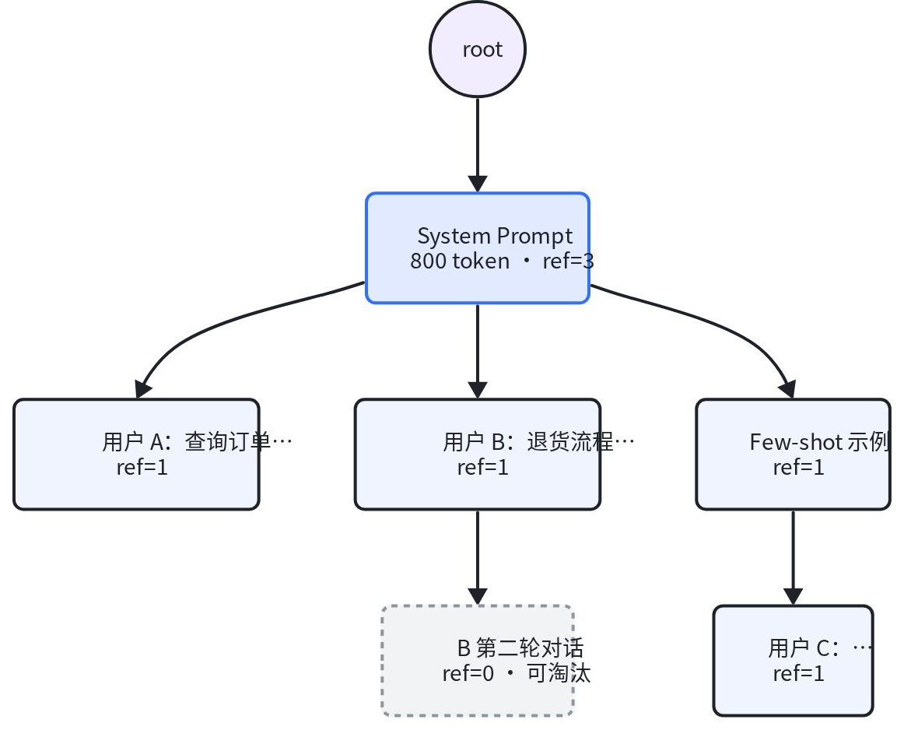

**SGLang RadixAttention** 用基数树管理所有请求的 KV[[SGLang]](https://arxiv.org/abs/2312.07104)：

1. 请求到达后，从根节点匹配最长公共前缀（默认按 token 粒度，也可配置为页粒度）。
2. 命中部分直接复用（引用计数 +1），只对未命中的后缀做 Prefill。
3. 新产生的 KV 作为新节点挂到树上，供后续请求复用。
4. 显存不足时，按 LRU 淘汰引用计数为 0 的叶子节点。

SGLang 论文报告在多种 LLM 程序负载上吞吐最高提升约 6.4×。与 vLLM 基于块哈希的实现相比，基数树对「任意位置分叉」的前缀共享更自然；两者在工程上已相互借鉴。**Prompt Cache** 进一步研究了模块化 prompt（不要求严格前缀）的复用[[Prompt Cache]](https://arxiv.org/abs/2311.04934)。

📎 延伸阅读：缓存状态不再只由 token 前缀决定时，基数树要加上丢弃和重排节点、按“token 加操作历史”匹配，见 [LLM-05｜工程｜Agent 工程实战：从工具到上线的施工手册](./05-agent-engineering.md) 第 12 章。

#### 6.4 多级缓存：HBM 之外还有更大的空间

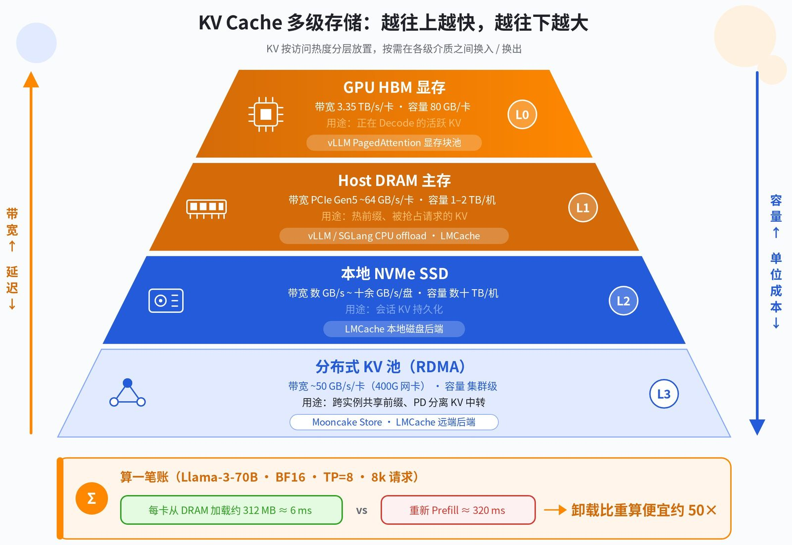

| 层级 | 介质 | 带宽（量级） | 容量（量级） | 典型用途 |
|---|---|---|---|---|
| L0 | GPU HBM | 3.35 TB/s / 卡 | 80 GB / 卡 | 正在 Decode 的活跃 KV |
| L1 | Host DRAM | PCIe Gen5 ~64 GB/s / 卡 | 1–2 TB / 机 | 热前缀、被抢占请求的 KV |
| L2 | 本地 NVMe SSD | 数 GB/s ~ 十余 GB/s / 盘 | 数十 TB / 机 | 会话 KV 持久化 |
| L3 | 分布式 KV 池（RDMA） | 单卡 ~50 GB/s（400G 网卡） | 集群级 | 跨实例共享前缀、PD 分离 KV 中转 |

##### 卸载的带宽预算：一笔必须算清的账

以 Llama-3-70B（BF16，TP=8）的一个 8k 请求为例，KV 共 2.5 GB，但按 TP 分片后**每卡只需搬运约 312 MB**：

| 方案 | 耗时（量级） | 结论 |
|---|---|---|
| 从 Host DRAM 加载（PCIe ~50 GB/s 实际） | 312 MB / 50 GB/s ≈ **6 ms** | 加载比重算便宜约 50×，所以**前缀 / 会话 KV 卸载到 CPU 是划算的** |
| 重新 Prefill 8k token | `2 × 8192 × 70e9 ≈ 1.15 PFLOP`，8 卡有效约 3.6 PFLOPS → <b>≈ 320 ms</b> |  |
| 若 64 个请求同时换入 | ≈ 0.4 s | 必须异步预取、按层流水加载，不能阻塞 Decode 步 |

代表系统：**LMCache** 为 vLLM / SGLang 提供 GPU → CPU → 磁盘 → 远端的多级 KV 缓存[[LMCache]](https://github.com/LMCache/LMCache)；**CachedAttention** 研究了多轮对话的跨轮 KV 复用[[CachedAttention]](https://arxiv.org/abs/2403.19708)。

#### 6.5 KV 压缩：淘汰、量化与稀疏

| 方案 | 方式 | 选择策略 | 压缩率（量级） | 风险 |
|---|---|---|---|---|
| H2O[[H2O]](https://arxiv.org/abs/2306.14048) | Token 淘汰 | 累计注意力分数高的「重击手」+ 最近窗口 | ~5× | 被淘汰的信息不可恢复 |
| SnapKV[[SnapKV]](https://arxiv.org/abs/2404.14469) | Token 淘汰 | 用 prompt 末尾观察窗口的注意力模式选择保留位置 | 数倍 | 长文问答效果较好 |
| StreamingLLM[[StreamingLLM]](https://arxiv.org/abs/2309.17453) | 结构性保留 | 保留开头的 attention sink + 最近窗口 | 固定显存 | 无法检索中间内容 |
| KIVI[[KIVI]](https://arxiv.org/abs/2402.02750) | 量化 | K 按通道、V 按 token 量化到 2bit | ~4–8× | 需要专用 kernel |
| FP8 KV | 量化 | per-tensor / per-head scale | 2× | 最成熟，生产首选 |
| SparQ / Quest | 动态稀疏读取 | 用 Q 预估重要的 KV 页，只读取部分 | 读取量数倍下降 | 不省容量，只省带宽 |

<b>组合建议：</b>生产环境先上 FP8 KV（收益确定、风险低）；长上下文场景再评估淘汰类方法，并在「大海捞针」类评测上严格验证召回能力。

#### 6.6 存算分离：把 KV 从「跟着 GPU」变成「跟着请求」

当 KV 可以存放在集群级的池子里，就可以跨实例复用前缀、在 Prefill 与 Decode 之间中转、在故障时迁移。核心问题是<b>「能不能在 SLO 内取回来」</b>，能存下只是前提。

**Mooncake**（Moonshot AI Kimi 的生产架构）以 KV Cache 为中心设计整个调度[[Mooncake]](https://arxiv.org/abs/2407.00079)：

1. 利用集群中 GPU 节点闲置的 CPU 内存与 SSD 组成分布式 KV 池，节点间通过 RDMA 传输。
2. 全局调度器（Conductor）同时决定：请求去哪个 Prefill 实例、复用哪些已缓存的 KV、结果交给哪个 Decode 实例。
3. Prefill 按层流式地把 KV 写入池中，Decode 边拉取边开始计算。
4. 过载时基于预测提前拒绝请求，避免无效 Prefill 浪费算力。

论文报告：在部分模拟长上下文场景下，满足 SLO 的前提下吞吐最高提升约 525%；在真实负载下，可多处理约 75% 的请求。DistServe 与 Splitwise 的 PD 分离同样依赖 KV 在节点间的高效传输（第 8 章）。

#### 6.7 KV Cache 排障清单

| 信号（vLLM 指标名为例） | 异常含义 | 处置 |
|---|---|---|
| KV 使用率（`vllm:kv_cache_usage_perc`）持续 > 95% | 即将频繁抢占 | 降低 `max_num_seqs`、FP8 KV、扩容 |
| 抢占计数（`vllm:num_preemptions_total`）持续增长 | batch 策略过激，出现重算 | 调整调度水位、限制长请求并发 |
| 前缀命中率（vLLM 没有直接的命中率指标，用 `vllm:prefix_cache_hits` 除以 `vllm:prefix_cache_queries` 两个计数器的速率计算）&lt; 预期 | 缓存未开启、路由打散或前缀不稳定 | 开启前缀缓存、cache-aware 路由、固定 system prompt 位置 |
| CPU 卸载时 PCIe 打满 | 换入换出阻塞 Decode | 异步预取、按层流水、KV 压缩 |

> ❗ <b>前缀缓存的隐形杀手：</b>在 system prompt 开头放时间戳、请求 ID 或随机示例顺序，会让所有请求的前缀互不相同，命中率归零。把「变化的内容」放到 prompt 末尾，是性价比最高的优化之一。

> 🔁 **回到主线**
>
> <b>松动的瓶颈：</b>容量：PagedAttention 把碎片率降到 4% 以下；前缀缓存把重复 Prefill 的算力直接省掉；多级缓存与存算分离把容量从 HBM 扩展到 DRAM / SSD / 远端。
>
> <b>作用于 Goodput/\$：</b>容量决定并发上限，并发决定 Decode 的 batch，进而决定分子；前缀命中直接降低 Prefill 成本与 TTFT。
>
> <b>代价与约束：</b>每下沉一级都要付出带宽和延迟；存算分离引入一致性、失效和调度复杂度。
>
> <b>下一步：</b>单项技术已经齐备，接下来要把它们编排进一个可演进的引擎（第 7 章）。
>
> 📎 延伸阅读：KV Cache 装不进显存之后的分层外置、复用放松、压缩三角色与 SSD 方案的论文账本与选型清单，见 [LLM-70｜系统｜KV Cache 装不进显存：分层、复用、压缩与外置系统的工程账](./70-kv-cache-offload.md)。

---

## 第六篇 编排：引擎、调度与 Runtime

前五篇给了我们高效的算子、合适的并行和精打细算的显存。第六篇把它们组织起来：<b>引擎如何分层（第 7 章）</b>、<b>请求如何组 batch、分池与路由（第 8 章）</b>、<b>如何让 GPU 一刻不停（第 9 章）</b>。这一层决定了理论能力能兑现多少。

### 第 7 章 推理引擎架构：分层与边界

> 🎯 <b>本章回答：</b>一个成熟推理引擎由哪些层组成？每层的职责边界在哪？开源代码从哪里读起？
>
> <b>一句话结论：</b>请求是异步的，迭代是同步的，设备是并行的，分层的目的就是把这三种节奏隔离开，让每加一个特性（投机解码、MoE、多模态）只动一层。

#### 7.1 业界共识的五层

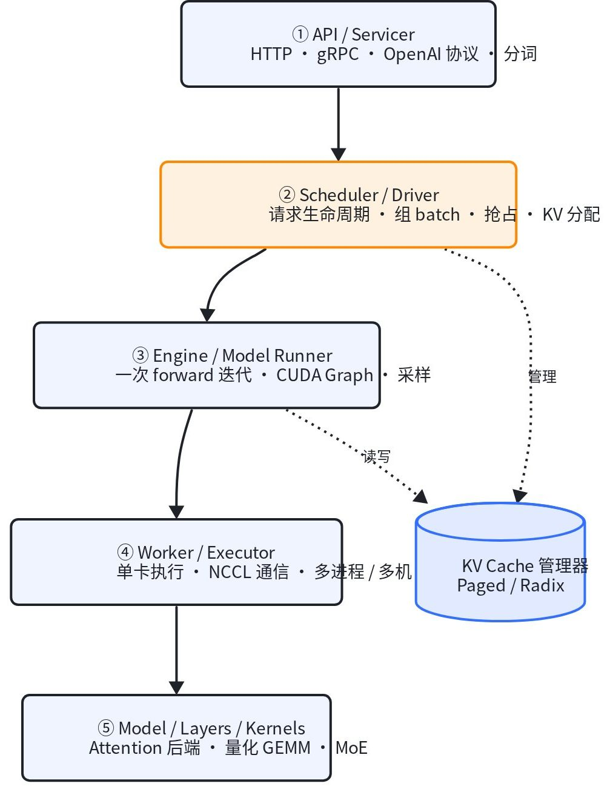

| 层 | vLLM[[arch]](https://docs.vllm.ai/en/latest/design/arch_overview.html) | SGLang[[repo]](https://github.com/sgl-project/sglang) | TensorRT-LLM[[repo]](https://github.com/NVIDIA/TensorRT-LLM) |
|---|---|---|---|
| API / 分词 | OpenAI API Server、AsyncLLM | HTTP Server、TokenizerManager | LLM API / Triton backend |
| Scheduler | EngineCore + Scheduler | Scheduler（含 RadixCache） | PyExecutor（1.0 起默认 PyTorch 后端） |
| Model Runner | Model Runner V2（`v1/worker/gpu/`） | ModelRunner / TpModelWorker | C++ runtime |
| Worker | Worker + Executor（多进程 / Ray） | TP Worker 进程 | MPI / 多 GPU runtime |
| Kernels | FlashAttention / FlashInfer / Triton | FlashInfer / Triton / sgl-kernel | 自研 CUDA kernel（1.3 起移除 TensorRT 引擎后端） |

#### 7.2 Actor 与消息传递

Actor 模型的价值是**状态封装 + 异步消息**：tokenize → schedule → forward → detokenize 各自在独立进程/Actor 中运行，只通过有界队列交互，没有全局锁。这样 CPU 密集的分词/反分词不会阻塞 GPU 调度循环。vLLM V1 把 API 进程与 EngineCore 进程分离、SGLang 把 TokenizerManager / Scheduler / DetokenizerManager 拆成独立进程、Ray Serve 用 Actor 组织部署，都是这一思路[[Ray Serve]](https://docs.ray.io/en/latest/serve/index.html)。

#### 7.3 RemoteWrapper：统一本地与远程调用

让「本地对象」和「跨进程 RPC 对象」暴露同一套接口，是控制复杂度的关键。Ray 的 `ActorHandle.method.remote()` 返回 future，调用方无需关心执行位置；测试时可以换成本地 mock。它同时是**资源与故障边界**：超时、OOM、进程崩溃都应在这一层被捕获并转化为可处理的错误。

#### 7.4 开源代码阅读路径

1. <b>vLLM（V1）</b>：`entrypoints/openai/api_server.py` → `v1/engine/async_llm.py` → `v1/engine/core.py` → `v1/core/sched/scheduler.py` → `v1/worker/gpu/model_runner.py`（v0.29.0 起默认的 Model Runner V2；旧的 `gpu_model_runner.py` 是 V1 版，计划在 v0.32 移除[[vLLM v0.29.0]](https://github.com/vllm-project/vllm/releases/tag/v0.29.0)）。
2. **SGLang**：`srt/entrypoints/http_server.py` → `srt/managers/tokenizer_manager.py` → `srt/managers/scheduler.py` → `srt/managers/tp_worker.py` → `srt/model_executor/model_runner.py`。
3. **TensorRT-LLM**：`tensorrt_llm/llmapi` → `tensorrt_llm/_torch/pyexecutor`（PyExecutor、调度器、KV cache 管理器）→ kernels。1.0（2025-09-24）起默认使用 PyTorch 后端，1.3 系列移除 TensorRT 引擎后端[[TensorRT-LLM releases]](https://github.com/NVIDIA/TensorRT-LLM/releases)。
4. **LightLLM**：轻量实现，适合理解 continuous batching 骨架[[LightLLM]](https://github.com/ModelTC/lightllm)。
5. **MLC-LLM**：基于 TVM 的编译路线，覆盖端侧[[MLC-LLM]](https://github.com/mlc-ai/mlc-llm)。

#### 7.5 一次请求在 vLLM V1 中的路径

用一次 `/v1/chat/completions` 流式请求把五层串起来。注意三种节奏的切换：API 进程里是**异步**的协程，EngineCore 里是**同步**的迭代循环，Worker 之间是**并行**的 SPMD 执行。

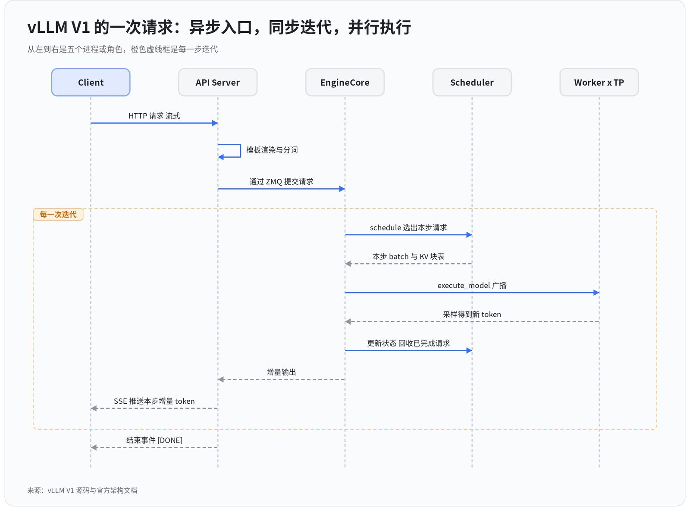

#### 7.6 扩展点：新特性应该改哪一层

判断一个架构好不好，看新增特性时要改几层。下表是主流引擎的实际做法，也可以作为阅读源码时的索引。

| 特性 | 主要改动层 | 为什么在这一层 |
|---|---|---|
| 投机解码 | Scheduler + ModelRunner | Scheduler 为 draft token 预留 KV 槽位；ModelRunner 负责 draft 前向、验证和回滚。 |
| 前缀缓存 | Scheduler（KV Manager） | 本质是块级引用计数与哈希查找，模型代码无感知。 |
| MoE / EP | Model + Worker | 专家路由与 AllToAll 属于模型前向；Worker 负责通信组初始化。 |
| 多模态 | API（预处理）+ ModelRunner（encoder cache） | 图像解码放在 CPU 侧，避免阻塞调度；encoder 输出按内容哈希缓存。 |
| Multi-LoRA | Model + Scheduler | Model 层用 Punica / S-LoRA 类 kernel 批量计算；Scheduler 控制同批 adapter 数量。 |
| 结构化输出 | Sampler（+ 异步 grammar 编译） | 只改 logits mask；grammar 编译放在后台线程，与前向重叠（第 9.5 节）。 |
| PD 分离 | Scheduler + KV Connector | Scheduler 感知「KV 在远端」；传输由独立 Connector 负责，不侵入模型代码。 |

#### 7.7 常见架构误区

- ❌「Engine 应该直接管调度」→ Engine 只负责执行一次迭代；调度策略归 Scheduler，才能独立演进。
- ❌「WorkerGroup 只有 TP=8 才需要」→ 单卡是 WorkerGroup 的退化情形，接口应统一。
- ❌「RemoteWrapper 只是 RPC」→ 它还是资源边界，超时、OOM、重试都在这里兜底。

> 🔁 **回到主线**
>
> <b>松动的瓶颈：</b>分层本身不直接松动瓶颈，它决定前面几章的技术能否以低成本接入、组合和替换。
>
> <b>作用于 Goodput/\$：</b>架构清晰，新特性上线就快；隔离得好，CPU 侧开销就不会侵占 GPU 时间（第 9 章）。
>
> <b>代价与约束：</b>过度抽象会增加跨进程通信和序列化开销；层间接口一旦固化就很难修改。
>
> <b>下一步：</b>分层中最关键的决策点是 Scheduler：每一步让谁上 GPU（第 8 章）。

### 第 8 章 调度、PD 分离与 Cache-aware Router

> 🎯 <b>本章回答：</b>请求怎么组 batch？Prefill 与 Decode 应该混跑还是分池？Router 如何在负载均衡与缓存命中之间取舍？
>
> <b>一句话结论：</b>Continuous Batching 解决「GPU 等请求」，Chunked Prefill / PD 分离解决「Decode 等 Prefill」，Cache-aware Router 解决「重复算前缀」，它们分别作用于单卡、单实例和集群三个尺度。

#### 8.1 Continuous Batching：在迭代边界调度

Orca（OSDI'22）提出**迭代级调度**：请求在每个 Decode 迭代的边界就能加入或退出 batch，不必等整个 batch 中最长的请求结束[[Orca]](https://www.usenix.org/conference/osdi22/presentation/yu)。静态 batching 的浪费比例约为 `1 − mean(len) / max(len)`：输出长度方差越大，浪费越严重。Anyscale 的测试显示，continuous batching 叠加 PagedAttention 相对朴素静态 batching 吞吐可达 20 倍以上[[Anyscale Blog]](https://www.anyscale.com/blog/continuous-batching-llm-inference)。

*Continuous Batching 调度循环（示意）
*

```python
while True:    # 1. 接纳新请求：KV 块够才放行（否则留在队列）    for r in waiting.peek_all():        if not kv_manager.can_allocate(r):            break        kv_manager.allocate(r); running.append(r); waiting.pop(r)    # 2. 在 token 预算内打包：Decode 请求优先，剩余预算给 Prefill chunk    batch = []    budget = MAX_NUM_BATCHED_TOKENS           # 典型 2k~8k    for r in running.decoding():        batch.append((r, 1)); budget -= 1    for r in running.prefilling():        n = min(r.remaining_prompt, budget)        if n == 0: break        batch.append((r, n)); budget -= n     # Chunked Prefill    # 3. 一次前向 + 采样    tokens = model_runner.execute(batch)    # 4. 更新状态，结束的请求立即释放 KV    for r, tok in zip(batch, tokens):        r.append(tok)        if r.finished():            kv_manager.free(r); running.remove(r); stream_out(r)    # 5. KV 不足时抢占（见 8.6）    while kv_manager.low_watermark():        preempt(running.lowest_priority())
```

关键参数：**token 预算**决定每步耗时上限（也就决定了 TPOT 上限）；**Decode 优先**保证已在生成的请求不被新请求饿死；**KV 水位**决定接纳激进程度。

#### 8.2 Prefill–Decode 干扰：两种解法

混合部署的典型事故：**一条 32k 的 prompt 进来，同一实例上所有请求的 TPOT 突然飙升**，因为那一步的 forward 被长 Prefill 占满了。

> 💡 <b>解法 A：Chunked Prefill（混跑但切片）</b>
>
> 把长 Prefill 切成固定 token 预算的 chunk，与 Decode 捆绑进同一步（Sarathi-Serve 称为 stall-free batching）[[Sarathi-Serve]](https://www.usenix.org/conference/osdi24/presentation/agrawal)。
>
> ✅ 部署简单、无 KV 传输、资源统一池化
>
> ⚠️ 仍共享同一 GPU，Prefill 与 Decode 的并行策略无法分别优化

> 🔀 <b>解法 B：PD 分离（分池部署）</b>
>
> Prefill 与 Decode 在不同实例上运行，KV 通过高速网络传输（DistServe、Splitwise、Mooncake）。
>
> ✅ 彻底消除干扰；两类实例可选不同 TP/EP、甚至不同硬件
>
> ⚠️ 需要 KV 传输链路；两池配比需随流量动态调整

DistServe 报告在满足 SLO 的前提下可服务 7.4× 的请求量或满足 12.6× 更严格的 SLO[[DistServe]](https://www.usenix.org/conference/osdi24/presentation/zhong-yinmin)；Splitwise 报告在相同成本下吞吐提升约 1.4×、或在相同功耗/成本预算下吞吐提升 2.35×[[Splitwise]](https://arxiv.org/abs/2311.18677)。

#### 8.3 PD 分离架构

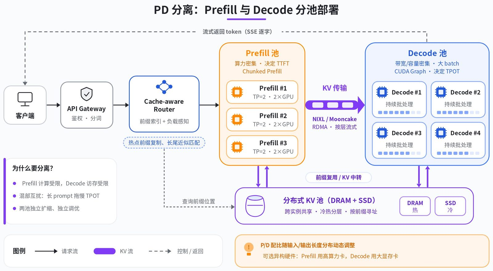

PD 分离可以看作一个**二分图匹配**：请求 → （Prefill 实例，Decode 实例）；加入 KV 池后变为三分图，把 KV 的存放位置也纳入决策。异构硬件的机会在于：Prefill 需要算力（H100/H200/B200），Decode 需要带宽与容量（大显存卡），分池后可以分别选型，从 Cost1 层面继续降本。

**上线前提**：PD 分离把单角色服务变成多角色编排，运维上有两个前提。首先是**角色级伸缩**：Prefill 池和 Decode 池按各自的信号伸缩，并能按设定比例联动；平台只支持整体伸缩时，两个池只能按峰值固定副本，分离省下的算力会被闲置吃掉。其次是**拓扑亲和**：KV 传输走 RDMA，配对的 Prefill 和 Decode 实例要落在同一网络域的临近节点上，否则传输时延会抵消收益。另外，输入占比很高的 prefill-heavy 负载会把 GPU 利用率和 SM 活跃度推高，用这类指标扩缩容会误触发扩容，而新副本的 Decode 能力用不上；分离后应改用各池自己的排队深度做信号。

#### 8.4 KV 传输：PD 分离的关键路径

| 方案 | 机制 | 特点 |
|---|---|---|
| NIXL（NVIDIA）[[NIXL]](https://github.com/ai-dynamo/nixl) | 统一的点对点传输抽象，后端支持 UCX / GDS 等 | Dynamo、vLLM、SGLang 均可接入 |
| Mooncake Transfer Engine[[Mooncake]](https://github.com/kvcache-ai/Mooncake) | RDMA 多网卡聚合，支持 KV 池 | SGLang / vLLM PD 分离常用后端 |
| LMCache[[LMCache]](https://github.com/LMCache/LMCache) | 多级缓存 + 传输 + 压缩 | 兼顾前缀复用与 PD 传输 |
| NCCL P2P | GPU 间 Send/Recv | 实现简单，动态扩缩容不够灵活 |

<b>算一笔账：</b>Llama-3-70B FP8 KV，1500 token 的 prompt 约 240 MB；两张卡各用一块 400G 网卡（合计约 100 GB/s），传输约 2.4 ms，相对数百 ms 的 TTFT 可以忽略。但 128k 上下文的 KV 约 20 GB，传输需约 200 ms：此时必须**按层流式传输**（Prefill 算完一层就发一层），把传输隐藏在计算之后。

#### 8.5 Router：在负载均衡与缓存命中之间取舍

| 目标 | 典型策略 | 代价 |
|---|---|---|
| 最小 TTFT | 前缀命中优先 + 最短队列 | 热点前缀集中导致单点过载 |
| 最大 Goodput | SLO 感知 + 优先级 + 准入控制 | 需要在线估计每个请求的耗时 |
| 负载均衡 | Power-of-two-choices、最少未完成 token | 缓存亲和性被稀释 |
| 成本 | 按流量自动扩缩容 + 冷池 | 冷启动（加载权重、捕获 CUDA Graph）延迟 |

**SGLang Model Gateway**（原 SGLang Router，现已迁出为独立项目 Shepherd Model Gateway，命令行为 `smg`[[SMG]](https://github.com/lightseekorg/smg)）的 cache-aware 策略：Router 根据自己转发过的请求，为每个 worker 维护一棵**近似**基数树（无需 worker 回报），新请求优先发往前缀匹配率最高的 worker；当 worker 间负载差异超过阈值时，退化为最短队列以防止热点[[SGLang Router]](https://github.com/sgl-project/sglang/tree/main/sgl-model-gateway)。其他生产方案：**vLLM Production Stack**[[Production Stack]](https://github.com/vllm-project/production-stack)、**NVIDIA Dynamo** 的 KV-aware Router[[Dynamo]](https://github.com/ai-dynamo/dynamo)、**llm-d**（基于 Kubernetes Gateway API 的推理调度）[[llm-d]](https://github.com/llm-d/llm-d)。

##### 前缀索引的一致性策略

| 策略 | 实现 | 新鲜度 | 准确性 |
|---|---|---|---|
| Router 本地近似树 | 根据转发历史推断，不与 worker 通信 | 即时（但可能与真实淘汰不符） | 中 |
| Worker 事件上报 | worker 在 KV 块存储 / 淘汰时发布事件（Dynamo、vLLM KV events） | 毫秒级 | 高 |
| 一致性哈希 | 按前缀哈希固定路由 | 无需同步 | 高，但负载可能不均 |
| 中心注册表 | worker 周期性推送前缀摘要 | 取决于周期 | 中–高 |

<b>生产建议：</b>热点前缀（system prompt）保证准确命中，并在多个 worker 上复制以免单点过载；长尾前缀用近似策略，命中了是收益、没命中也不致命。

#### 8.6 抢占：Swap 还是 Recompute

KV 不足时必须暂停部分请求：**Swap** 把它们的 KV 搬到 CPU，**Recompute** 直接丢弃、恢复时重新 Prefill。粗略比较（Llama-3-70B，BF16，TP=8，每卡 PCIe 约 50 GB/s）：

| prompt 长度 | Swap（每卡换出 + 换入） | Recompute |
|---|---|---|
| 8k | 312 MB × 2 / 50 GB/s ≈ 12.5 ms | ≈ 320 ms |
| 512 | 20 MB × 2 / 50 GB/s ≈ 0.8 ms | ≈ 20 ms |

单看耗时 Swap 更便宜，但 vLLM V1 只做 Recompute（`--swap-space` 已在 v0.18.0 移除[[vLLM v0.18.0]](https://github.com/vllm-project/vllm/releases/tag/v0.18.0)），原因是：Swap 需要额外的 CPU 内存管理与调度复杂度；开启前缀缓存后，被抢占请求的 KV 块往往仍留在缓存中，「重算」实际大部分会命中缓存；而且合理的准入水位本应让抢占成为罕见事件。<b>结论：先把抢占频率降下来，再讨论抢占方式。</b>

#### 8.7 社区方案对比

| 方案 | 核心主张 | KV 传输 | Router |
|---|---|---|---|
| DistServe | Goodput 建模，为 P/D 分别搜索并行策略与配比 | NCCL P2P | 研究原型 |
| Splitwise | P/D 使用不同代硬件，按功耗与成本配比 | InfiniBand | 集群级调度 |
| Sarathi-Serve | 不分离，用 Chunked Prefill 消除干扰 | 不需要 | — |
| Mooncake | 以 KV 为中心，大规模 KV 池化，生产验证 | RDMA KV 池 | KV-aware Conductor |
| NVIDIA Dynamo | 数据中心级分布式推理框架，多引擎后端 | NIXL | KV-aware |
| vLLM / SGLang PD | 开源引擎内置 PD 分离 | NIXL / Mooncake / LMCache | Production Stack / SGLang Router |

#### 8.8 常见误区

- ❌「PD 分离一定更省」→ 短 prompt、低 QPS 场景下，KV 传输与两池配比失衡的代价可能超过收益；Chunked Prefill 往往就够了。
- ❌「Router 只看队列长度」→ 忽略前缀命中会让 Prefill 池无谓地变热。
- ❌「KV 传输一定要走 RDMA」→ 同机 P/D 之间走 NVLink 即可，只有跨机才需要 RDMA。
- ❌「P/D 配比设一次就好」→ 输入输出长度分布随业务变化，配比需要持续监控与调整。

> 🔁 **回到主线**
>
> <b>松动的瓶颈：</b>Continuous Batching 在带宽瓶颈下尽量摊薄每次权重读取；Chunked Prefill / PD 分离消除 Prefill 对 Decode 的干扰；Cache-aware Router 让前缀命中率兑现为更少的 Prefill 算力。
>
> <b>作用于 Goodput/\$：</b>直接作用于分子中的「SLO 内」：吞吐相同的情况下，干扰越少，违约请求越少，Goodput 越高。
>
> <b>代价与约束：</b>PD 分离引入 KV 传输与两池配比问题；Router 需要在命中率与负载均衡之间取舍。
>
> <b>下一步：</b>调度策略再好，如果 CPU 跟不上 GPU，理论吞吐也无法兑现（第 9 章）。

### 第 9 章 Zero-overhead Runtime：让 GPU 一刻不停

> 🎯 <b>本章回答：</b>GPU 气泡从哪来？如何让 CPU 调度、采样、同步不再阻塞 GPU？
>
> <b>一句话结论：</b>Decode 单步只有十几到几十毫秒，CPU 上几毫秒的组 batch、采样和隐式同步就能吃掉 10%–30% 的吞吐；Zero-overhead 的核心是**CPU 提前一步准备、GPU 连续执行、同步点最少化**。

#### 9.1 Zero-overhead 的真实含义

Zero-overhead ≠ 零耗时，而是**除 kernel 计算本身之外，GPU 不因 CPU 而等待**。一次 Decode 迭代里 CPU 要做：调度决策、准备输入张量与元数据、launch kernel、采样后处理、反分词与流式返回。如果这些工作与 GPU 串行，每一步都会出现空闲气泡。

#### 9.2 CPU 与 GPU 的重叠调度

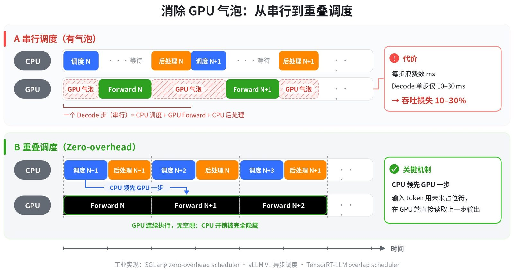

做法是让 CPU **领先 GPU 一个迭代**：GPU 执行第 N 步时，CPU 已在为第 N+1 步做调度与输入准备，同时处理第 N−1 步的结果。难点在于第 N+1 步的输入 token 依赖第 N 步的采样结果：解决方式是用「未来 token」占位符，在 GPU 上直接从第 N 步的输出张量里取值，CPU 无需等待。

*重叠调度（示意，参考 SGLang overlap scheduler）
*

```python
prev = Nonewhile True:    batch = scheduler.get_next_batch()          # CPU：第 N+1 步调度，与 GPU 第 N 步并行    batch.input_ids = future_token_ref(prev)    # 占位：GPU 端从上一步输出直接读取    cur = model_runner.forward_async(batch)     # 仅 launch，不等待    if prev is not None:        tokens = prev.output.to_cpu_nonblocking().wait()  # 取第 N 步结果        scheduler.process_results(prev, tokens)  # 结束判定、流式返回    prev = cur
```

工业实现：SGLang v0.4 的 zero-overhead batch scheduler[[SGLang v0.4]](https://lmsys.org/blog/2024-12-04-sglang-v0-4/)、vLLM V1 的异步调度与多进程 EngineCore[[vLLM V1]](https://blog.vllm.ai/2025/01/27/v1-alpha-release.html)、TensorRT-LLM 的 overlap scheduler。

另一个维度是**设备内的重叠**：NanoFlow 把一个 batch 切成多个 nano-batch，让计算密集、访存密集、通信密集的算子在同一张 GPU 上交错执行，报告相对 TensorRT-LLM 吞吐提升约 1.9×[[NanoFlow]](https://arxiv.org/abs/2408.12757)。DeepSeek 线上系统的「双 micro-batch 重叠」（一个 micro-batch 计算时另一个做 AllToAll）也是同一思想。

#### 9.3 隐式同步：最容易被忽略的气泡来源

任何需要把 GPU 数据交给 CPU 的操作都会触发同步，GPU 队列被排空后才能继续。

| ⚠️ 会同步 | ✅ 不会同步 |
|---|---|
| `t.item()`、`t.tolist()`、`t.cpu()`、`t.numpy()` | `t.shape`、`t.numel()`、`t.dtype`、`t.is_cuda`（元数据） |
| `if t:`、`if t.any():`、`print(t)` | `torch.zeros(..., device="cuda")`（异步分配与填充） |
| `torch.nonzero(t)`、`t[mask]`、`torch.unique(t)`（输出形状依赖数据） | `t.to("cuda", non_blocking=True)`（源为 pinned memory 时） |
| `torch.cuda.empty_cache()`、`torch.cuda.synchronize()` | 在同一 stream 上连续 launch 的 kernel |

<b>定位方法：</b>开发阶段用 `torch.cuda.set_sync_debug_mode("warn")` 让 PyTorch 在每次同步时打印告警与调用栈；线上用 Nsight Systems 找 GPU 空闲段，对照同一时刻 CPU 线程上的 `cudaStreamSynchronize` / `cudaMemcpy`。

#### 9.4 CUDA Graph：消灭 launch 开销

一次 Decode 前向可能包含上千个小 kernel，每个 launch 约数 μs，合计可达毫秒级。CUDA Graph 把整段 launch 序列录制成图，replay 时一次提交[[PyTorch CUDA Graphs]](https://pytorch.org/blog/accelerating-pytorch-with-cuda-graphs/)。

1. **Warmup**：先跑几次，让 allocator、cuBLAS workspace 等稳定下来，避免在捕获期间分配显存。
2. **Capture**：`with torch.cuda.graph(g): out = model(static_inputs)`。
3. **Replay**：把新数据 `copy_` 进静态输入张量，调用 `g.replay()`。
4. **分桶**：形状变化必须重新捕获，所以按一组 batch 大小预捕获（如 1、2、4、8 及之后按 8 的倍数），实际 batch 向上 padding 到最近的桶。

- 捕获期间不能有 CPU 同步、不能有数据相关的控制流。
- Attention 元数据（每个请求的长度、block table）要放在静态缓冲区中，由 replay 前更新。
- 早期做法是只对 Decode 使用 CUDA Graph（Prefill 形状变化大、单步耗时长，launch 开销占比低）。vLLM 现在默认 `FULL_AND_PIECEWISE`：纯 decode 批用完整图，prefill 和混合批用分段图[[vLLM CUDA Graphs]](https://github.com/vllm-project/vllm/blob/main/docs/design/cuda_graphs.md)；SGLang 从 v0.5.15 起默认使用可中断的 CUDA Graph[[SGLang v0.5.15]](https://github.com/sgl-project/sglang/releases/tag/v0.5.15)。
- 每个桶都会占用额外显存，桶太多会挤占 KV 空间。

#### 9.5 采样与结构化输出

- **Fused sampling**：`logits → 温度 → top-k → top-p → softmax → 采样` 如果逐步实现，会产生多个 kernel 与排序开销；FlashInfer 提供免排序的 top-k/top-p 采样 kernel，SGLang / vLLM 均已集成[[FlashInfer Sampling]](https://flashinfer.ai/2025/03/10/sampling.html)。
- **结构化输出**（JSON Schema / 正则 / 语法约束）：每步需要生成一个词表 mask。XGrammar 通过预计算与上下文无关的 token 集合、并把 mask 生成与 GPU 前向重叠，使开销接近于零[[XGrammar]](https://arxiv.org/abs/2411.15100)；Outlines 等基于有限状态机的方案在复杂语法下开销更高。注意 mask 是数据相关的，需要放在 CUDA Graph 之外或单独处理。

#### 9.6 GPU 气泡的分层排查

1. Nsight Systems 抓全 timeline，找 GPU 空闲段。
2. 对齐同一时刻的 CPU 线程，定位到具体的 Python 调用栈（配合 NVTX 标注）。
3. 检查是否有 `cudaStreamSynchronize` / `cudaMemcpy` 阻塞。
4. 检查 kernel 之间的 launch 间隙：稳定的几十 μs 间隙说明 CPU 组包或 launch 太慢，考虑 CUDA Graph。
5. 检查 NCCL kernel 是否与计算 kernel 争抢 SM（Decode 时尤为明显）。

#### 9.7 投机解码的异步限制

投机解码的关键路径是 `Draft(K 步) → Target 验证 → 接受/拒绝`，下一轮的 draft 依赖本轮的接受结果，天然难以流水化。常见做法：draft 与 target 的 CUDA Graph 分别捕获；接受长度的判定尽量留在 GPU 上完成，减少 CPU 往返；负载高时动态缩小 K 或关闭投机解码（第 5.4 节）。

#### 9.8 本章自测

1. 写一段最小的「CPU 领先 GPU 一步」的调度伪代码，指出哪一步必须等待、哪些可以并行。
2. 如何判断当前瓶颈是 launch 开销还是 kernel 本身太慢？分别给出 Nsight 上的特征。
3. Decode batch 大小剧烈抖动时，CUDA Graph 的收益为什么会下降？如何设计分桶？

> 🔁 **回到主线**
>
> <b>松动的瓶颈：</b>隐性瓶颈 CPU：launch 开销、隐式同步和调度计算都会在 GPU 上留下气泡。
>
> <b>作用于 Goodput/\$：</b>消除气泡等于免费提升分子，不增加任何硬件成本。
>
> <b>代价与约束：</b>异步调度与 CUDA Graph 会增加实现复杂度和调试难度；动态形状需要分桶，否则 Graph 收益下降。
>
> <b>下一步：</b>性能到位之后，要保证它稳定，出问题时能快速定位（第 10 章）。

📎 延伸阅读：一次发射受限的完整排查：FP8 内核变短后 GPU 只忙约 40%，把每步 token 推过约 3,000 的拐点后空闲降到 1.7%，见 [LLM-32｜系统｜AI Infra 性能优化实战：从 profile 到硬件上限](./32-infra-perf.md) 第 11.4 节。

---

## 第七篇 上生产：稳定性、服务工程与商业化

前六篇解决「跑得快、跑得省」，第七篇解决「跑得稳、卖得出」。回到目标函数：**SLO 违约的 token 价值为 0，线上故障让分母白白燃烧**。可观测、降级、灰度与排障能力，决定了 Goodput/\$ 在真实世界里能兑现多少。

### 第 10 章 稳定性与排障：建立证据链

> 🎯 <b>本章回答：</b>推理服务常见的故障模式有哪些？如何从业务指标一路下钻到硬件事件？
>
> <b>一句话结论：</b>排障 = 从现象出发、沿「业务 → 框架 → 系统 → 内核 → 硬件」逐层收集证据，**先建基线、只读优先、不信直觉**。

#### 10.1 常见故障模式速查

| 现象 | 常见根因 | 诊断信号 | 处方 |
|---|---|---|---|
| TPOT 突然翻倍 | KV 不足导致抢占循环 | KV 使用率 > 95%、抢占计数上升 | 降低最大并发、FP8 KV、扩容 |
| TTFT P99 > 5s | Prefill 积压 / 长 prompt 阻塞 | 等待队列长度、排队时间分位数 | Chunked Prefill、PD 分离、准入控制 |
| QPS 上不去但 GPU 不忙 | CPU 瓶颈（分词、调度、采样） | py-spy 火焰图、nsys 中的 GPU 空闲段 | 多进程分词、重叠调度、fused sampling |
| SM 利用率 &lt; 40% | launch 开销、同步点 | nsys 中稳定的 kernel 间隙 | CUDA Graph、消除隐式同步 |
| 开投机解码后变慢 | 接受率低或 batch 太大 | 接受率、平均接受长度 | 动态 K、换 draft、高负载时关闭 |
| AllReduce 周期性抖动 | 网络拥塞、PFC pause | 交换机 ECN/PFC 计数、`ib_write_bw` 基线 | 调整 DCQCN、隔离流量、检查拓扑 |
| 随机 OOM | 激活峰值 / 碎片 / 超长请求 | `memory_summary`、请求长度分布 | 限制最大长度、expandable segments、调低显存利用率 |
| GPU util 100% 但吞吐低 | 忙等或低效 kernel | DCGM 的 SM Active / Tensor Active 与 util 背离 | Kernel 级 profiling |
| 单卡性能明显偏低 | 降频、ECC、NVLink 错误 | DCGM 健康检查、时钟与温度、XID 日志 | 隔离节点、硬件报修 |

#### 10.2 证据链：逐层下钻

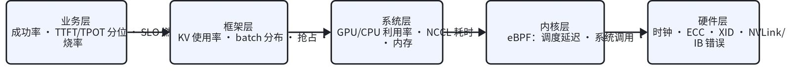

#### 10.3 eBPF：无侵入的内核级观测

eBPF 允许在内核中安全运行沙盒程序，无需修改业务代码或重启服务即可采集系统事件。对推理系统的价值：**开销低、无侵入、覆盖全栈**（系统调用、调度、网络、用户态函数）。主力工具：bcc、bpftrace、libbpf-tools、Pixie、Parca、Tetragon[[bcc]](https://github.com/iovisor/bcc)[[bpftrace]](https://github.com/bpftrace/bpftrace)。

| 命令（bcc 工具名在部分发行版带 -bpfcc 后缀） | 用途 |
|---|---|
| `runqlat` | CPU 运行队列延迟：CPU 争抢导致调度线程 / launch 变慢 |
| `offcputime -p PID` | 线程阻塞（锁、IO、睡眠）的调用栈 |
| `profile -p PID -F 99` | 低开销 CPU 采样火焰图 |
| `tcprtt` / `tcpretrans` | TCP 往返时延分布 / 重传（API 层与控制面网络） |
| `biolatency` | 块设备 IO 延迟（模型加载、NVMe KV 缓存） |
| `oomkill` | 追踪 OOM Kill 事件及触发进程 |
| `memleak -p PID` | 用户态 / 内核态内存分配未释放的调用栈 |
| `bpftrace -e 'uprobe:/path/libcudart.so:cudaStreamSynchronize { @[ustack] = count(); }'` | 统计谁在调用 CUDA 同步（路径以实际安装位置为准） |

#### 10.4 内存问题排查流程

1. 区分主机内存与显存：`free` / `smem` 与 `nvidia-smi` / DCGM 分别看。
2. 主机内存增长：`memleak` 找未释放的分配栈；`py-spy dump` 看 Python 线程状态；检查请求对象、缓存字典是否无限增长。
3. 显存问题：`torch.cuda.memory_summary()` 区分实际占用与分配器缓存；必要时用 `torch.cuda.memory._record_memory_history()` 生成快照定位分配来源。
4. 关闭分配器缓存（`PYTORCH_NO_CUDA_MEMORY_CACHING=1`）复现，判断是否为缓存假象（仅限调试，性能会大幅下降）。

#### 10.5 实战演练：TPOT P99 突然翻倍

以一次典型告警为例，演示如何按证据链（10.2 节）逐层收敛，不靠猜。

| 步骤 | 观察 | 推断与下一步 |
|---|---|---|
| ① 业务层 | TPOT P99 从 40ms 涨到 85ms，P50 基本不变；QPS 平稳 | 是长尾问题，整体没变慢，排除「整体流量上涨」。按实例拆分 P99。 |
| ② 实例层 | 只有 3 / 24 个实例异常，且都在同一台物理机上 | 问题局限于单机，排除模型版本和全局配置。 |
| ③ 引擎层 | 异常实例的 batch 大小正常，但每步耗时出现周期性尖刺 | 不是调度问题。尖刺周期约 1s，怀疑外部干扰或通信。 |
| ④ 设备层 | DCGM：SM Active 周期性下降；NVLink 带宽正常；PCIe 出现突发流量 | GPU 在等待。PCIe 突发可能来自 KV offload，也可能来自同机其他进程。 |
| ⑤ 内核层 | eBPF 发现同机一个日志采集进程每秒刷盘，触发 NUMA 跨节点内存回收；Python 调度线程被抢占 | **根因**：CPU 调度线程受干扰，下一步 launch 被推迟（第 9 章的隐性瓶颈）。 |
| ⑥ 修复 | 调度线程绑核并隔离 NUMA；日志进程移到其他核；开启 CUDA Graph 降低对 CPU 的敏感度 | P99 恢复到 42ms。补充告警：SM Active 的周期性波动。 |

> 💡 这个案例的规律在推理服务中反复出现：<b>P50 不变而 P99 恶化，优先怀疑局部干扰（单机、单卡、单线程），先别急着归因到全局容量不足。</b>

#### 10.6 业界案例

- **OpenAI：扩展 Kubernetes 到 7500 节点**，大规模 GPU 集群在网络、DNS、调度上的踩坑记录[[OpenAI]](https://openai.com/index/scaling-kubernetes-to-7500-nodes/)。
- **Meta Strobelight**：基于 eBPF 等开源技术的全公司常驻 profiling 服务[[Strobelight]](https://engineering.fb.com/2025/01/21/production-engineering/strobelight-a-profiling-service-built-on-open-source-technology/)。
- 内部 eBPF 平台与案例属于内部资料，参见原始手册。

#### 10.7 排障原则

> 📏 **先建基线**
>
> 没有稳态基线的排障只是猜测。

> 👀 **只读优先**
>
> 观测工具不改变状态，避免破坏现场。

> 🔗 **证据闭环**
>
> 从业务指标逐层下钻到硬件事件。

> 🤔 **不信直觉**
>
> 利用率高 ≠ 在做有用功。

> 🔁 **回到主线**
>
> <b>松动的瓶颈：</b>本章不松动瓶颈，它负责在故障发生时守住已有的 Goodput。
>
> <b>作用于 Goodput/\$：</b>SLO 违约的请求对分子贡献为零；排障越快，Error Budget 消耗越少。
>
> <b>代价与约束：</b>观测本身有开销；生产环境优先使用只读、低开销的工具（eBPF、DCGM），避免破坏现场。
>
> <b>下一步：</b>从被动排障转向主动治理：SLO、可观测、降级与灰度（第 11 章）。

### 第 11 章 服务工程：SLO、可观测、降级与灰度

> 🎯 <b>本章回答：</b>推理服务的 SLO 怎么定、怎么监控？过载时如何有序降级？新模型、新版本如何安全上线？
>
> <b>一句话结论：</b>SLO 是目标函数里的约束，Error Budget 是可以花的「风险预算」；降级与灰度都必须**可观察、可回滚、可演练**，没演练过的降级路径，在生产中等于不存在。

#### 11.1 Service Layer 的边界

LLM 服务很少是单一模型调用，而是「多模型 + 前后处理 + 存储」的组合。Service Layer 位于网关与推理引擎之间，原则是：<b>凡是与「如何算一次前向」无关、但与「这个请求该不该算、算完怎么交付」有关的逻辑，都放在这一层。</b>

| 职责 | 典型内容 | 为什么不放进引擎 |
|---|---|---|
| 协议适配 | OpenAI / Anthropic 兼容接口、流式 SSE、MCP 工具协议 | 协议变化频繁，引擎应只暴露稳定的内部接口。 |
| 准入与安全 | 鉴权、配额、按 token 限流（11.4 节）、内容审查 | 需要租户与计费上下文，引擎不应感知。 |
| 业务编排 | RAG 检索、Agent 循环、工具调用、多模型级联 | 一次用户请求会触发多次引擎调用，需要跨调用的状态。 |
| 降级与兜底 | 模型回退、截断上下文、缓存应答（11.6 节） | 需要全局视角：知道集群水位和业务优先级。 |

参考实现：Ray Serve、BentoML、NVIDIA Triton、KServe[[KServe]](https://github.com/kserve/kserve)[[BentoML]](https://github.com/bentoml/BentoML)。

#### 11.2 DAG 化编排

把请求处理表达为有向无环图，比硬编码的函数链多三个好处：**无依赖的步骤可以并行**（例如检索与意图识别同时跑）、**每个节点可以单独观测与重试**、**条件分支一目了然**。以一个典型 RAG 请求为例：

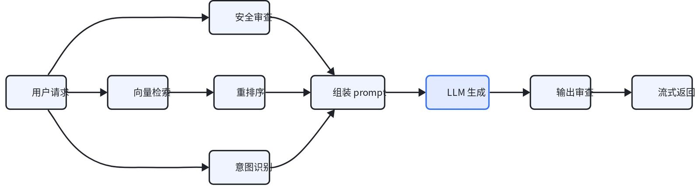

对推理系统的启示：DAG 中前缀固定的部分（系统提示、检索到的高频文档）应放在 prompt 前部，以提高前缀缓存命中率（第 6.3 节）；多个并行分支如果都要调用 LLM，可以共享同一个前缀。常见框架包括 SGLang 前端语言（LLM 程序化编排，天然利用 RadixAttention）、DSPy（可优化的 prompt 程序）[[DSPy]](https://arxiv.org/abs/2310.03714)、LangGraph / Dify（可视化工作流）、Ray Serve 部署图（分布式 DAG）。

#### 11.3 SLO 与 Error Budget

| SLO 维度 | 示例目标（按业务调整） | 备注 |
|---|---|---|
| 可用性 | 成功响应率 ≥ 99.9% | 区分客户端错误与服务端错误 |
| TTFT P99 | 对话 ≤ 800 ms；长文档 ≤ 3 s | 按输入长度分桶统计 |
| TPOT P99 | ≤ 60 ms | 流式体验的核心 |
| 正确性 | 结构化输出有效率 ≥ 99% | JSON 可解析、Schema 合规 |
| 安全 | 违规内容漏检率低于阈值 | 与审核策略联动 |
| 成本 | \$/1M tokens ≤ 预算 | 见第 13 章 |

<b>Error Budget：</b>99.9% 的月度可用性意味着约 43 分钟的「可失败时间」。预算耗尽时冻结变更，优先修稳定性。告警用<b>燃烧率（burn rate）</b>，不用固定阈值：例如 1 小时内消耗了月度预算的 2% 即触发紧急告警，6 小时内消耗 5% 触发工单告警（Google SRE Workbook 的多窗口多燃烧率方法）。

#### 11.4 准入与限流：按 token 计量，不按请求

LLM 请求的成本差异可达上千倍（10 token 的问候与 100k token 的文档分析），按 QPS 限流会同时出现「小请求被误杀」和「大请求打爆集群」。业界做法是按 token 维度做准入：

- **双桶限流**：分别对输入 token（TPM-in，压 Prefill 算力）和输出 token（TPM-out，压 Decode 带宽与 KV 容量）设置令牌桶。OpenAI、Anthropic 的公开配额都同时包含 RPM 与 TPM[[OpenAI Rate Limits]](https://platform.openai.com/docs/guides/rate-limits)。
- **输出预估**：准入时按 `max_tokens` 预扣，完成后按实际用量退还，避免长输出请求集中涌入时 KV 被瞬间占满。
- **KV 水位准入**：引擎侧 KV 使用率超过阈值（如 90%）时拒绝新请求或将其路由到其他实例，别等接收后再抢占（抢占会浪费已完成的 Prefill，第 8.6 节）。
- **优先级队列**：在线交互请求优先于离线批处理；离线任务只使用空闲容量，这正是 Batch API 能打折的原因（第 12.3 节）。

#### 11.5 可观测性四层

| 层 | 关注 | 工具 |
|---|---|---|
| 业务 | 成功率、TTFT/TPOT 分位数、SLO 达成与燃烧率 | Prometheus + Grafana、SLO 工具 |
| 框架 | KV 使用率、batch 分布、抢占、前缀命中、投机接受率 | vLLM / SGLang 的 `/metrics` |
| 系统 | GPU/CPU 利用率、显存、NCCL 耗时 | DCGM Exporter、Nsight Systems |
| 硬件 | 时钟、温度、ECC、XID、NVLink/IB 错误 | DCGM Health、nvidia-smi、交换机监控 |

链路追踪建议采用 OpenTelemetry，其 GenAI 语义约定定义了模型名、token 数等标准属性，便于跨系统关联[[OTel GenAI SemConv]](https://opentelemetry.io/docs/specs/semconv/gen-ai/)。

#### 11.6 降级阶梯

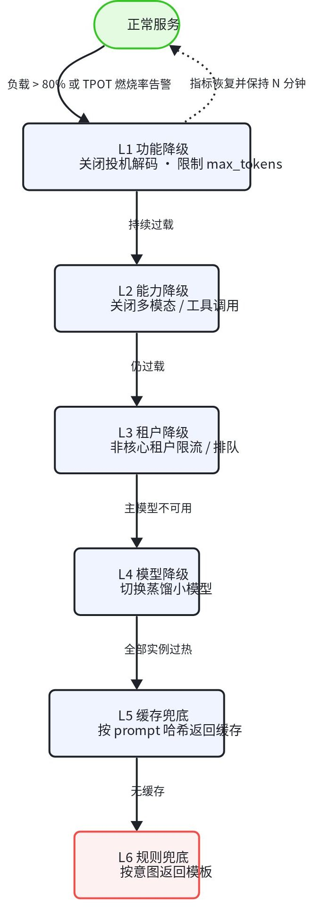

*降级配置示意
*

```python
DEGRADE_LEVELS = [    # (级别, 触发条件, 动作, 回滚条件)    (1, "gpu_load > 0.8 or tpot_burn_rate > 2", {"spec_decoding": False, "max_tokens_cap": 512},        "gpu_load < 0.6 for 10m"),    (2, "level1 for 5m and still overloaded",   {"enable_vision": False, "enable_tools": False},        "gpu_load < 0.6 for 10m"),    (3, "queue_time_p99 > 2s",                 {"tenant_policy": "core_only"},        "queue_time_p99 < 500ms for 10m"),    (4, "primary_healthy_ratio < 0.5",         {"route_model": "distilled-8b"},        "primary_healthy_ratio > 0.9 for 10m"),    (5, "all_instances_saturated",              {"serve_from_cache": True},        "any_instance_available"),    (6, "cache_miss",                           {"serve_template": True},        "cache_hit or model_available"),]
```

每一级必须具备：①明确的自动触发条件；②明确的自动回滚条件；③监控面板上可见当前级别；④定期演练（建议至少每季度一次）。

#### 11.7 灰度发布四阶段

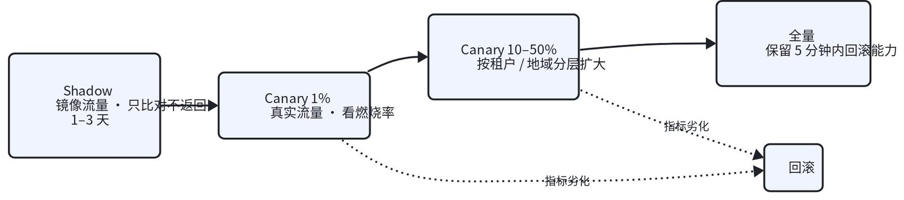

模型层灰度还需额外关注：**输出分布漂移**（与旧版本的 KL 散度或评测集得分）、**结构化输出有效率**、**拒答率**与**平均输出长度**（长度变化会直接改变成本与 TPOT 负载）。

> 🔁 **回到主线**
>
> <b>松动的瓶颈：</b>SLO 是 Goodput 的约束条件本身；降级是在过载时有序地放松约束；灰度控制变更带来的风险。
>
> <b>作用于 Goodput/\$：</b>过载时优先保住核心租户的 Goodput，总比所有请求一起超时强。
>
> <b>代价与约束：</b>每一级降级都要付出体验或质量的代价，必须预先定义、演练，并与业务方达成共识。
>
> <b>下一步：</b>工程能力最终要以产品的形态交付并收费（第 12 章）。

### 第 12 章 云产品、商业化与交付

> 🎯 <b>本章回答：</b>推理能力以什么形态交付？控制面与数据面如何划分？一个可交付的推理产品需要哪些能力？
>
> <b>一句话结论：</b>技术指标（Cost1）只是起点，产品化要解决的是利用率、隔离、合规与交付效率（Cost2/Cost3）。

#### 12.1 三种交付形态

| 形态 | 代表 | 核心竞争力 |
|---|---|---|
| **MaaS**（按 token 计费的 API） | OpenAI、Anthropic、AWS Bedrock、火山方舟、阿里云百炼 | 单价、SLO、模型丰富度、缓存计费 |
| **托管推理平台** | SageMaker、Vertex AI、Azure AI Foundry、方舟自定义推理接入点 | 自带模型部署、弹性伸缩、运维托管 |
| **私有化 / 一体机** | NVIDIA NIM[[NIM]](https://www.nvidia.com/en-us/ai-data-science/products/nim-microservices/)、各厂商 AI 一体机 | 数据不出域、合规、开箱即用 |

#### 12.2 控制面与数据面

> 💡 **控制面**
>
> 模型仓库、鉴权、计费、配额、灰度、审计、容量规划

> 🚀 **数据面**
>
> 请求收发、Router、Prefill/Decode 池、KV 存储、弹性伸缩

二者必须解耦：控制面故障不影响数据面服务；数据面故障不影响计费与统计的最终一致性。

#### 12.3 定价结构就是成本结构

主流 API 的定价方式几乎可以逐项对应到第 1 章的瓶颈分析。理解这一点，既能反推厂商的成本结构，也能指导自己的定价设计。

| 定价特征 | 典型做法 | 对应的成本原因 |
|---|---|---|
| 输出单价 ≈ 输入的 3–5 倍 | 主流厂商普遍采用 | Decode 受带宽瓶颈限制，每 token 成本远高于算力密集、可以大批量并行的 Prefill（第 1.5 节）。 |
| 缓存命中的输入大幅打折 | 命中部分按原价的 10%–50% 计费 | 命中后跳过 Prefill 计算，只剩 KV 读取与存储成本（第 6.3 节）。DeepSeek 公开的缓存命中率为 56.3%。 |
| 缓存写入或存储单独计费 | 部分厂商对写缓存加价，或按存储时长收费 | KV 占用 HBM / DRAM / SSD 容量，容量本身就是成本（第 6.4 节）。 |
| Batch API 约五折 | 24 小时内完成的异步任务 | 离线任务填充波谷，把平均利用率从 35% 往 70% 推，边际成本很低（第 13.8 节）。 |
| 长上下文分档加价 | 超过一定长度后单价上浮 | 注意力计算量随长度平方增长，KV 容量挤占并发（第 6.1 节）。 |
| 夜间 / 错峰折扣 | DeepSeek 曾在夜间时段提供折扣 | 与 Batch API 同理，都是在用价格平滑负载曲线。 |

#### 12.4 交付能力清单

- [ ] OpenAI / Anthropic 兼容协议，流式输出

- [ ] 模型热切换、灰度发布、A/B 测试

- [ ] 前缀缓存与会话亲和（含缓存命中的差异化计费）

- [ ] 多模态（图像 / 音频 / 视频）与长上下文（≥ 128k）

- [ ] 函数调用、工具使用、结构化输出（JSON Schema / 正则）

- [ ] 可插拔的内容安全审查

- [ ] 可观测、可降级、可回滚

- [ ] 私有化 / VPC 部署，合规认证（如 SOC 2、ISO 27001）

> 🔁 **回到主线**
>
> <b>松动的瓶颈：</b>本章处理的是分母中的 Cost2（平台开销）和 Cost3（交付开销），以及如何通过定价把成本结构传递给用户。
>
> <b>作用于 Goodput/\$：</b>合理的定价能引导用户行为（缓存友好的 prompt、离线批处理），反过来提升平台利用率。
>
> <b>代价与约束：</b>功能清单越长，平台和交付成本越高；要按目标客户群的需求取舍。
>
> <b>下一步：</b>把全书的杠杆串起来，从 SLO 一路算到机器数和单价（第 13 章）。

---

## 第八篇 实战与速查

最后用一个完整案例把全书串起来：从 SLO 出发，依次用到第 1 章的带宽下界、第 4 章的并行选型、第 6 章的 KV 容量、第 8 章的 PD 分离和第 1.7 节的成本分层。

### 第 13 章 端到端容量规划：从 SLO 算到机器数和单价

> 🎯 <b>本章回答：</b>给定业务流量与 SLO，需要多少张卡？每百万 token 的成本是多少？私有部署何时划算？
>
> <b>一句话结论：</b>Prefill 按**算力**算卡数、Decode 按**显存容量与带宽**算卡数；这个案例中输入是输出的 5 倍，**Prefill 才是卡数大头**，而前缀缓存和潮汐利用率对最终单价的影响比任何 Kernel 优化都大。

#### 13.1 场景设定

| **业务** | 企业客服 Copilot |
|---|---|
| **流量** | 峰值 300 QPS；prompt 平均 1500 token（其中固定 system prompt 800 + 用户内容 700）；输出平均 300 token |
| **模型** | Llama-3-70B，FP8 权重 + FP8 KV |
| **硬件** | H100 SXM 80GB，8 卡/机，NVLink + 400G RDMA |
| **SLO** | TTFT P99 &lt; 800 ms，TPOT P99 &lt; 60 ms，成功率 > 99.5% |

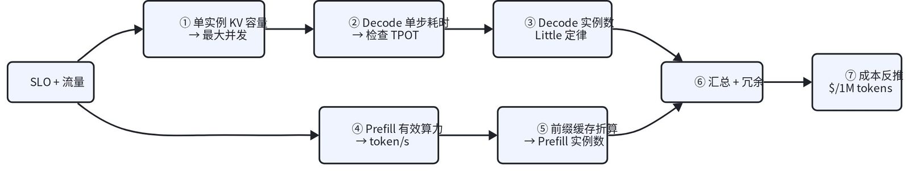

#### 13.2 第一步：单实例 KV 容量与并发

选择 **TP=2**（FP8 权重 70 GB，每卡 35 GB；TP=2 在 NVLink 内通信代价小，同时留出足够 KV 空间）：

- 每卡可用显存 ≈ 80 × 0.9 − 35（权重）− 5（激活、CUDA Graph 等）≈ **32 GB**，单实例（2 卡）≈ 64 GB。
- FP8 KV 每 token 160 KB（第 6.1 节）→ 单实例可缓存 ≈ 64 GB / 160 KB ≈ **40 万 token**。
- 每个 Decode 中的请求平均占用 ≈ 1500 + 300/2 = **1650 token**。
- 理论并发 ≈ 400k / 1650 ≈ 240；留 20% 水位防止抢占 → **单实例并发 ≈ 190**。

#### 13.3 第二步：Decode 单步耗时与 TPOT 校验

按第 1.5 节的带宽下界，每步每卡需要读取：

- 权重：35 GB → 35 / 3.35 TB/s ≈ **10.4 ms**
- KV：190 × 1650 × 160 KB ≈ 50 GB，每卡一半 25 GB → ≈ **7.5 ms**
- 按 80% 带宽效率折算：(10.4 + 7.5) / 0.8 ≈ 22 ms；加 TP=2 的 160 次 AllReduce（小消息，约 3 ms）→ **单步 ≈ 25 ms**

> 💡 <b>容易算错的地方：</b>TPOT 约等于**单步耗时**（batch 内所有请求在同一步中各产出 1 个 token），不等于「单步耗时 × batch」。25 ms &lt; 60 ms，TPOT 达标，而且还有余量：余量可以用来进一步增大 batch（受 KV 容量限制）或降低 P99 抖动。

单实例 Decode 吞吐 ≈ 190 / 0.025 s ≈ **7,600 token/s**。

#### 13.4 第三步：Decode 实例数

- 需求：300 req/s × 300 token = **90,000 token/s** → 90,000 / 7,600 ≈ 11.8。
- 用 Little 定律交叉验证：每个请求的 Decode 时长 ≈ 300 × 25 ms = 7.5 s，在飞请求 ≈ 300 × 7.5 = 2,250 → 2,250 / 190 ≈ 11.8。
- 取 **12 个 Decode 实例 = 24 卡**。

#### 13.5 第四步：Prefill 有效算力

- 每 token FLOPs ≈ 2P = 1.4 × 10¹¹（1500 token 时 Attention 二次项可忽略，见第 1.5 节）。
- 单实例（2 卡）FP8 稠密峰值 2 × 1,979 ≈ 3,958 TFLOPS；Prefill 实际 MFU 按 45% 估算 → ≈ 1,780 TFLOPS。
- 单实例 Prefill 吞吐 ≈ 1.78 × 10¹⁵ / 1.4 × 10¹¹ ≈ **12,700 token/s**。

> 💡 <b>最常见的错误：</b>以为「一次 Prefill 塞 5 个请求，耗时和 1 个一样」。这对 Decode 成立（带宽瓶颈，batch 几乎免费），**对 Prefill 不成立**（算力瓶颈，多一个请求就多一份 FLOPs）。v1.0 版本在这里高估了约 3 倍的 Prefill 能力。

#### 13.6 第五步：前缀缓存折算与 Prefill 实例数

| 项目 | 无前缀缓存 | system prompt 命中率 95% |
|---|---|---|
| 每请求需计算 token | 1500 | 700 + 0.05 × 800 = **740** |
| Prefill 需求 | 450,000 token/s | 222,000 token/s |
| 满载所需实例 | ≈ 35.4 | ≈ 17.5 |
| 按 75% 利用率留排队余量（保 TTFT P99） | 48 实例 = 96 卡 | **24 实例 = 48 卡** |

**前缀缓存直接省下 48 张卡**，这就是第 6.3 节「把变化内容放到 prompt 末尾」的价值。TTFT 校验：740 token 在单实例上计算约 60 ms，加上 KV 传输（约 240 MB，~2.4 ms）和 75% 利用率下的排队，P99 远低于 800 ms。

#### 13.7 第六步：汇总配置

| 组件 | 规模 | 说明 |
|---|---|---|
| Prefill 池 | 24 实例（48 卡） | TP=2，Chunked Prefill，前缀缓存，FP8 |
| Decode 池 | 12 实例（24 卡） | TP=2，CUDA Graph，FP8 KV，并发 ~190/实例 |
| KV 传输 | NIXL / Mooncake | 400G RDMA，按层流式传输 |
| Router | 3 实例（CPU） | cache-aware 路由，system prompt 热点复制 |
| 可观测 | DCGM + OTel + Prometheus | 第 11.5 节四层指标 |
| 冗余 | +1 台机器（8 卡） | N+1 容灾与滚动升级 |
| **总计** | <b>80 卡（10 台 8×H100）</b> | 峰值 300 QPS |

> ⚡ <b>Prefill 池 · 48 卡（60%）</b>
>
> 24 实例 × TP=2，受算力约束；前缀缓存命中率每提高一档，这部分直接缩小。

> 🐢 <b>Decode 池 · 24 卡（30%）</b>
>
> 12 实例 × TP=2，受带宽与 KV 容量约束；FP8 / KV 量化提升单实例并发。

> 💡 <b>冗余 · 8 卡（10%）</b>
>
> N+1 与滚动发布余量，保证单机故障或灰度期间 SLO 不破。

#### 13.8 第七步：成本反推

- 硬件：80 卡 × 3 \$/hr（云上 H100 量级示意）= **240 \$/hr**。
- 峰值每小时处理：300 × 3600 = 108 万请求 = 108 万 × 1800 token ≈ **19.4 亿 token**。
- **峰值满载成本** ≈ 240 / 1944 ≈ **0.12 \$/1M tokens**（约 0.022 美分/请求）。
- **考虑潮汐**：若全天平均负载只有峰值的 35%，而集群按峰值常驻，则实际成本 ≈ 0.12 / 0.35 ≈ **0.35 \$/1M tokens**。

对照公开 API 价格（以官网为准）：例如某小模型 API 输入 0.15 \$/1M、输出 0.60 \$/1M，按本场景 5:1 的输入输出比，混合单价约 0.23 \$/1M。结论：

> 📌 <b>私有部署是否划算，关键看利用率（Cost3），Kernel 快慢影响小得多。</b>峰值满载时自建更便宜；但如果无法通过弹性伸缩、离线任务填谷、多业务混部把平均利用率拉上去，自建反而更贵。这与第 1.7 节 DeepSeek 公开数据反映的规律一致：白天服务在线流量，夜间低峰把节点让给离线任务。

#### 13.9 敏感性分析：哪个杠杆最值钱

| 杠杆 | 对总卡数的影响（量级） | 对应章节 |
|---|---|---|
| 前缀缓存命中率 0% → 95% | −48 卡（Prefill 减半） | 第 6.3、8.5 节 |
| 平均利用率 35% → 70%（弹性伸缩 / 混部） | 实际单价减半 | 第 1.7、12 章 |
| BF16 → FP8 | Prefill 算力约 2×、Decode 权重与 KV 字节减半 | 第 5.3 节 |
| Prefill MFU 45% → 60%（Kernel 优化） | Prefill 池约 −25% | 第 2 章 |
| 投机解码（低负载时） | TPOT 改善，Decode 池小幅减少；高负载时收益有限 | 第 5.4 节 |

> 🔁 **回到主线**
>
> <b>松动的瓶颈：</b>本章把三大瓶颈量化成一组可以直接复用的计算步骤：KV 容量决定并发，带宽决定 TPOT，算力决定 Prefill 池规模。
>
> <b>作用于 Goodput/\$：</b>敏感性分析表明，最值钱的杠杆通常是前缀缓存命中率和平均利用率，单个 kernel 的优化排在后面。
>
> <b>代价与约束：</b>估算结果只是量级参考；上线前必须用真实流量分布压测校准（第 1.8 节）。
>
> <b>下一步：</b>第 14 章汇总公式、术语和参考资料，方便日常速查。

📎 延伸阅读：把本章的容量规划落到具体模型上，单机到弹性上线的全流程见 [LLM-51｜系统｜自部署推理实战：DeepSeek-V4-Flash 从单机到弹性上线](./51-deepseek-v4-flash-deploy.md)；万亿参数级模型的两个显存池、多节点并行与 PD 分离见 [LLM-52｜系统｜一线大模型部署：Kimi K3 从选型算账到多节点上线](./52-kimi-k3-deploy.md)。

### 第 14 章 速查：学习路径、公式、术语与参考资料

#### 14.1 知识地图

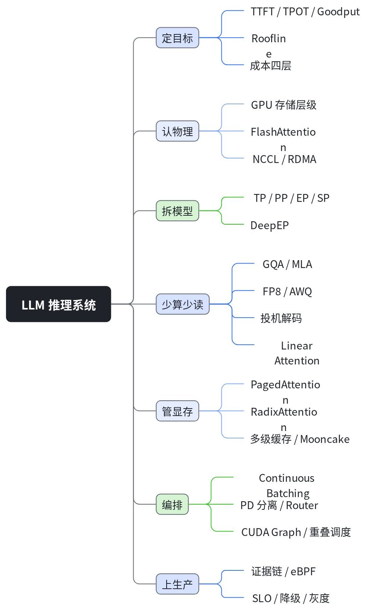

#### 14.2 学习路径

| 阶段 | 目标 | 推荐材料 |
|---|---|---|
| 入门（2 周） | 能部署 vLLM / SGLang，理解 TTFT/TPOT | 官方文档、Karpathy「Let's build GPT」、本手册第 1 章 |
| 硬件语言（2 周） | 会用 Roofline 与 Nsight 判断瓶颈 | CUDA Best Practices Guide、FlashAttention 三篇论文 |
| 并行策略（2 周） | 能手算 TP/EP 通信量 | Megatron-LM、DeepEP、Ring Attention / Ulysses |
| 调度与缓存（2 周） | 能读懂并修改调度器 | PagedAttention、SGLang、Mooncake |
| PD 与 Runtime（2 周） | 能设计 PD 分离与重叠调度方案 | DistServe、Splitwise、Sarathi-Serve、NanoFlow |
| 生产工程（持续） | SLO、降级、可观测 | Google SRE Book / Workbook、OTel GenAI 语义约定 |

##### 按阶段交付的路线：从后端经验出发

上表按主题排，适合正在读本手册的人查漏。已有后端或系统经验、想转做推理引擎和服务的工程师，可以换一种排法：每个阶段先做一个实验，带着实验里的问题读指定章节，最后交付代码、数据和解释，进度只按交付物验收来算[路线原文：《LLM 推理工程师学习路线》]。规划基准是每周 8–10 小时，具备基本 Python 和 PyTorch 能力且有 GPU 时，主线约 18–24 周，合 144–240 小时，补基础和等资源另留余量[路线原文]。下表的周数同样出自这份路线[路线原文]。

| 阶段 | 周数 | 要回答的问题 | 交付物与验收 |
|---|---|---|---|
| 0 · 最小模型与资源账 | 3–4 | 一个 token 怎样算出来，状态占多大 | 最小 decoder、greedy decode 与 KV Cache；有无缓存的 logits 在声明的容差内一致，测试能抓到 mask 和位置错误；权重、KV、临时缓冲的显存账，列出与实测的差额 |
| 1 · 单机引擎与压测 | 4–5 | 请求怎样被接纳、调度和执行 | 固定 commit 的 vLLM 流式服务；从 API 到流式返回的源码链路，另标 KV 分配、抢占、取消与回收；一个小补丁；按到达率和并发上限分别扫描的负载曲线 |
| 2 · 性能分析与优化 | 3–4 | 慢在哪里，改动是否真的有效 | 系统时间线 trace；reduce、softmax 或 RMSNorm 的朴素与融合实现对照；一项有证据的改动和同负载复测，算子提速与端到端收益分开报 |
| 3 · 量化、成本与上线 | 3–4 | 在质量与 SLO 约束下跑省、跑稳 | 量化前后的配对质量差与门禁；每成功任务成本；含加载、编译和预热时间的副本数估算；至少三类故障演练记录 |
| 4 · Dense 多卡 | 3–4 | 何时切模型，何时加副本 | 同 GPU 预算下 TP=2 对两个 TP=1 副本的对照；拓扑记录、collective microbenchmark 与服务 trace 中的通信占比 |
| 5 · 综合项目 | 2–3 | 能否交给另一位工程师复现和维护 | 混合流量服务的完整仓库、优化报告、容量成本方案、上线回滚手册；另一位工程师按 README 复现出同方向的结论 |

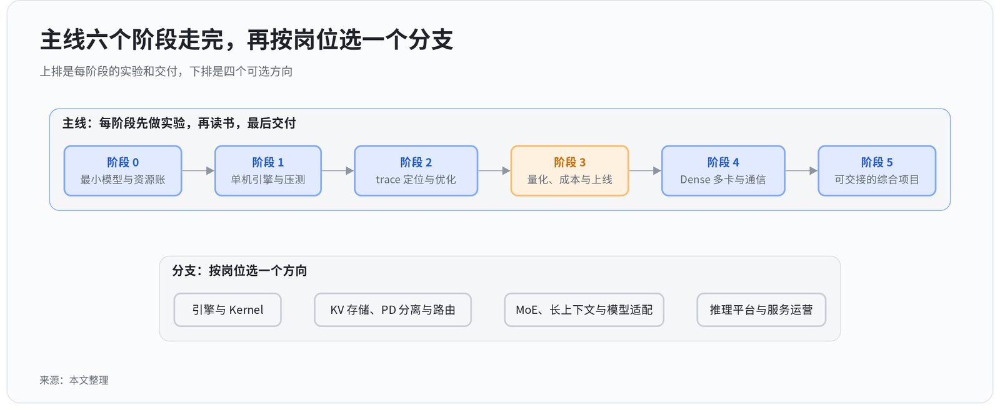

上图上半是主线，阶段 3 标橙，做完它就可以从下半挑一个分支深入；依赖多卡的分支实验要等阶段 4 做完。

阶段 0 要能手算两笔账。权重字节约等于参数量乘每参数字节数；普通 MHA 和 GQA 的 KV 字节约等于 2 × 层数 × KV 头数 × head dim × 每元素字节数 × 缓存 token 总数，分页、量化元数据和运行时预留另计，MLA、滑窗和混合状态模型按实际表示重算[路线原文]。算例见 14.3 节。“prefill 偏计算、decode 偏带宽”要能说清成立条件，batch 和上下文长度一变，瓶颈也会跟着移动[路线原文]。

各阶段的主读材料都在本系列里。阶段 1 以 [LLM-03｜系统｜vLLM 学习路径：从推理基础到架构前沿](./03-vllm-path.md) 为 vLLM 入口，配合本手册第 1、6、7、8 章；阶段 2 的方法和工具读 [LLM-32｜系统｜AI Infra 性能优化实战：从 profile 到硬件上限](./32-infra-perf.md) 第 1–5 章；阶段 3 的成本账看 [LLM-13｜系统｜自建推理成本与 GPU 选型：算账手册](./13-inference-cost-gpu.md) 第 9 章，上线和演练看 [LLM-07｜系统｜LLM 服务稳定性工程：SRE 上线手册](./07-serving-reliability.md)[路线原文]。

##### 压测口径和实验记录

口径从阶段 1 起固定下来。TTFT 从客户端发出请求算到首个有效生成 token 到达，空 SSE 事件和只含角色信息的事件不算首 token，reasoning 输出是否计入要声明[路线原文]。TPOT 按每请求的“最后 token 时间 − 首 token 时间”除以“输出 token 数 − 1”，输出少于两个 token 的请求单独处理[路线原文]。逐 token 间隔 ITL 的分位数和每请求 TPOT 的分位数是两个指标，传输层把多个 token 合成一块发送时，要写明客户端观测粒度的限制。

goodput 先声明 TTFT、TPOT 阈值，再数单位时间内同时达标的成功请求。同时报以全部尝试为分母的达标比例、拒绝率和错误率，防止靠丢掉难请求把数字做好看[路线原文]。到达率和并发上限要分开扫，并发上限会压低实际到达率，记录实际发出的速率，参数含义对照所用版本的说明[[vLLM bench serve]](https://docs.vllm.ai/en/stable/cli/bench/serve/)。结构化输出的回归里，可解析率、Schema 合法率和任务正确率分开统计，格式合法不代表答案正确[[Structured Outputs]](https://docs.vllm.ai/en/latest/features/structured_outputs/)。

下表是每次实验都要填的记录项，报告里的“更快、更省、更稳”都要能追到原始结果。

| 记录项 | 要求 |
|---|---|
| 版本与环境 | 模型权重、tokenizer、chat template、框架 commit、GPU 与互联、驱动和 CUDA、精度、kernel 后端、启动命令。源码路径跟随记录的 commit。 |
| 负载与缓存 | 输入输出长度分布、实际到达率、并发上限、时长、预热、冷热缓存与前缀重复率，补突发和混合流量。压测客户端自身不能成为瓶颈。 |
| 性能与可用性 | TTFT、TPOT、端到端延迟的分位数，吞吐、goodput、错误超时与拒绝率、队列和 KV 使用。样本不足时不对 p99 下稳定结论。 |
| 质量与正确性 | 固定任务集、事先声明的质量阈值和浮点容差。量化、采样、缓存和换模型都保留质量回归。 |
| 对照与复测 | 控制变量并固定 GPU 预算，关键点重复测量并报告波动。带 profiler 的诊断 trace 和正式性能结果分开存。 |
| 成本与边界 | 写明租赁或折旧、闲置、存储网络、重试和人工兜底是否计入，同时给成功率；每个数字标注实测、估算、引用或尚未验证。 |

##### 课程、论文和分支怎么配

课程用来补推导和练习，先做实验，再拿课程解决具体盲点。CS336（Stanford，2026 春）选 Lecture 1–3 的模型与资源估算、5–6 的硬件与 Triton、7–8 的并行和 10 的推理，作业选 A1 的最小模型和 A2 的 benchmarking、profiling[路线原文]；A1 和 A2 的内容见课程主页[[CS336]](https://cs336.stanford.edu/)。MS&amp;E 319（Stanford，2026 秋）讲高效生成式语言模型，Lecture 4–7 覆盖 MoE、KV Cache 压缩与紧凑表示、位置编码与递归记忆[[MS&amp;E 319]](https://web.stanford.edu/class/msande319/)。按路线原文 2026-10-23 的核对，量化排在 Lecture 8–9，投机解码与 learned KV compression 排在 Lecture 10，官网大纲仍标为 tentative[路线原文]。

论文从 PagedAttention 和 FlashAttention 读起，基线跑稳后再读投机解码，进入 PD 和 KV 方向再读 Mooncake、DistServe。每篇记下解决的问题、关键假设、代价、实验条件和能对到源码的部分，论文里的加速比不当作业目标[路线原文]。

分支每次只选一个。后端和存储背景可以先走 KV 管理与平台，目标是引擎岗位就加深调度和 Kernel 的实现；涉及非 NVIDIA 平台时，先做算子、编译器、量化格式、集合通信和 profiler 的兼容矩阵，见 [LLM-36｜系统｜非 NVIDIA 算力：TPU、Trainium、AMD 与昇腾](./36-non-nvidia.md)[路线原文]。各分支的验收都要求同 GPU 预算、同 SLO 的对照，只展示热缓存或单请求最优的结果不算数。

第一周读 [LLM-01｜地基｜LLM 基础：从 token 到 Agent 的学习主线](./01-foundations.md) 的表示、模型结构与推理部分，建实验仓库，写一个带 causal mask 的 attention 和 logits 对照测试；第二周补 KV Cache，提交第一版资源估算[路线原文]。

> 💡 <b>边界：</b>每周 8–10 小时和 18–24 周是规划基准，实际排期按自己的可用时间调整。环境搭建超过一周就缩小模型和部署范围，基线跑不稳时暂停新增优化，没有多卡时先做单机和平台部分并标明“多卡实测待完成”，每两周按交付物复盘一次[路线原文]。课程大纲、引擎参数和价格以实验当时的官方页面为准，路线不设脱离硬件和负载的统一加速倍数。

#### 14.3 公式速查

| 名称 | 公式 | 出处 |
|---|---|---|
| Roofline | `Perf = min(π, β·I)`，拐点 `I* = π/β` | 1.6 |
| Prefill FLOPs | `≈ 2·N·P + 4·L·N²·d_model` | 1.5 |
| Decode FLOPs / token | `≈ 2·P` | 1.5 |
| Decode 单步下界 | `(W_bytes + B·S·kv_bytes) / β` | 1.5 |
| KV 每 token | `2·L·H_kv·d·dtype_size` | 6.1 |
| Ring AllReduce | `2(N−1)·α + 2(N−1)/N · s/β` | 3.2 |
| TP 每步通信 | `2·L` 次 AllReduce，每次 `B·S·h·dtype` 字节 | 4.3 |
| PP 气泡 | `(P−1) / (M+P−1)` | 4.4 |
| 投机解码期望产出 | `E[a] = (1−β^{K+1}) / (1−β)` | 5.4 |
| 投机解码加速比 | `E[a] / (K·c + 1)` | 5.4 |
| Little 定律 | `在飞请求数 = 到达率 × 平均驻留时间` | 13.4 |

#### 14.4 术语表

| 术语 | 含义 |
|---|---|
| TTFT / TPOT（ITL） | 首 token 延迟 / 输出 token 间隔 |
| Goodput | 满足 SLO 的有效吞吐 |
| MFU | Model FLOPs Utilization，实际有效 FLOPS 占峰值的比例 |
| Continuous Batching | 在迭代边界让请求进出 batch 的调度方式 |
| Chunked Prefill | 把长 Prefill 切片，与 Decode 混合在同一步执行 |
| PagedAttention | 以固定大小的块分页管理 KV Cache |
| Prefix / Radix Cache | 跨请求复用公共前缀的 KV |
| PD Disaggregation | Prefill 与 Decode 分池部署 |
| Speculative Decoding | draft 提议 + target 并行验证的无损加速 |
| GQA / MQA / MLA | 分组共享 KV / 单组共享 KV / 低秩隐向量压缩 KV |
| Linear Attention / SSM | 用固定大小的递推状态代替随长度增长的 KV |
| NIXL / Mooncake | PD 分离场景的 KV 传输 / 存储方案 |
| IBGDA / GDR | GPU 直接驱动网卡 / 网卡直接读写显存 |
| DeepEP | 面向 MoE 专家并行的高性能 AllToAll 通信库 |
| NVLS | NVLink SHARP，在 NVSwitch 中完成归约 |
| Zero-overhead Scheduling | CPU 调度与 GPU 执行重叠，消除 CPU 引起的 GPU 空闲 |

#### 14.5 综合自测题

1. 为 Llama-3-70B 设计推理集群：8×H100/机 × 32 机，目标 QPS 200、TTFT P99 &lt; 800ms、TPOT P99 &lt; 60ms、平均输入 1k / 输出 512。按第 13 章的方法给出并行策略、PD 配比、KV 与 Router 方案，并估算单价。
2. 对比 DistServe 与 Sarathi-Serve 的核心分歧，分别给出更适合它们的业务场景。
3. 推导 EP=64 场景下一次 dispatch 的通信量与时间下界，解释 DeepEP 为什么区分 normal 与 low-latency 两种模式。
4. 什么情况下投机解码会变慢？给出至少 3 个可观测指标和对应的自动开关策略。
5. KV 从 HBM 卸载到 CPU 时，如何保证 P99 TPOT 劣化不超过 20%？（提示：按层流水、预取、TP 分片）
6. 设计一个 5 级降级方案，写出每一级的触发条件、观测信号与回滚条件。

#### 14.6 参考资料索引

##### 核心论文

| 主题 | 论文 |
|---|---|
| 调度与服务 | [Orca (OSDI'22)](https://www.usenix.org/conference/osdi22/presentation/yu) · [PagedAttention / vLLM (SOSP'23)](https://arxiv.org/abs/2309.06180) · [Sarathi-Serve (OSDI'24)](https://www.usenix.org/conference/osdi24/presentation/agrawal) · [DeepSpeed-FastGen](https://arxiv.org/abs/2401.08671) · [NanoFlow](https://arxiv.org/abs/2408.12757) |
| PD 分离 | [DistServe (OSDI'24)](https://www.usenix.org/conference/osdi24/presentation/zhong-yinmin) · [Splitwise (ISCA'24)](https://arxiv.org/abs/2311.18677) · [Mooncake (FAST'25)](https://arxiv.org/abs/2407.00079) |
| Kernel | [FlashAttention](https://arxiv.org/abs/2205.14135) · [FlashAttention-2](https://arxiv.org/abs/2307.08691) · [FlashAttention-3](https://arxiv.org/abs/2407.08608) · [FlashDecoding++](https://arxiv.org/abs/2311.01282) · [FlashInfer](https://arxiv.org/abs/2501.01005) |
| 并行 | [Megatron-LM](https://arxiv.org/abs/1909.08053) · [Alpa](https://arxiv.org/abs/2201.12023) · [Ring Attention](https://arxiv.org/abs/2310.01889) · [DeepSpeed-Ulysses](https://arxiv.org/abs/2309.14509) · [DeepSeek-V3](https://arxiv.org/abs/2412.19437) |
| KV Cache | [SGLang / RadixAttention](https://arxiv.org/abs/2312.07104) · [H2O](https://arxiv.org/abs/2306.14048) · [SnapKV](https://arxiv.org/abs/2404.14469) · [KIVI](https://arxiv.org/abs/2402.02750) · [StreamingLLM](https://arxiv.org/abs/2309.17453) · [CachedAttention](https://arxiv.org/abs/2403.19708) |
| 模型结构 | [DeepSeek-V2 (MLA)](https://arxiv.org/abs/2405.04434) · [Mamba](https://arxiv.org/abs/2312.00752) · [Mamba-2](https://arxiv.org/abs/2405.21060) · [RWKV](https://arxiv.org/abs/2305.13048) · [Gated DeltaNet](https://arxiv.org/abs/2412.06464) |
| 投机解码 | [Leviathan et al.](https://arxiv.org/abs/2211.17192) · [Chen et al.](https://arxiv.org/abs/2302.01318) · [Medusa](https://arxiv.org/abs/2401.10774) · [EAGLE-2](https://arxiv.org/abs/2406.16858) · [EAGLE-3](https://arxiv.org/abs/2503.01840) |
| 量化 | [GPTQ](https://arxiv.org/abs/2210.17323) · [AWQ](https://arxiv.org/abs/2306.00978) · [SmoothQuant](https://arxiv.org/abs/2211.10438) · [QServe](https://arxiv.org/abs/2405.04532) · [FP8 Formats](https://arxiv.org/abs/2209.05433) |
| 结构化输出 | [XGrammar](https://arxiv.org/abs/2411.15100) |

##### 开源实现

| 类别 | 项目 |
|---|---|
| 推理引擎 | [vLLM](https://github.com/vllm-project/vllm) · [SGLang](https://github.com/sgl-project/sglang) · [TensorRT-LLM](https://github.com/NVIDIA/TensorRT-LLM) · [LightLLM](https://github.com/ModelTC/lightllm) · [MLC-LLM](https://github.com/mlc-ai/mlc-llm) |
| 分布式 / 调度 | [NVIDIA Dynamo](https://github.com/ai-dynamo/dynamo) · [vLLM Production Stack](https://github.com/vllm-project/production-stack) · [llm-d](https://github.com/llm-d/llm-d) · [Ray Serve](https://github.com/ray-project/ray) |
| KV 与传输 | [LMCache](https://github.com/LMCache/LMCache) · [Mooncake](https://github.com/kvcache-ai/Mooncake) · [NIXL](https://github.com/ai-dynamo/nixl) |
| Kernel 与通信 | [FlashInfer](https://github.com/flashinfer-ai/flashinfer) · [DeepEP](https://github.com/deepseek-ai/DeepEP) · [CUTLASS](https://github.com/NVIDIA/cutlass) · [nccl-tests](https://github.com/NVIDIA/nccl-tests) |

##### 课程与博客

- Andrej Karpathy：Neural Networks: Zero to Hero 系列
- Stanford CS336：Language Modeling from Scratch
- Stanford MS&amp;E 319：Efficient Generative Language Models，偏研究推导，配合 14.2 节的路线选读[[MS&amp;E 319]](https://web.stanford.edu/class/msande319/)
- Lilian Weng Blog：Large Transformer Model Inference Optimization 等长篇综述
- vLLM Blog / LMSYS Blog：引擎演进的一手资料
- PyTorch Blog：CUDA Graphs、torch.compile 使用指南

### 第 15 章 2026 年更新：推理栈的默认值与硬件代际

> 🎯 <b>本章回答：</b>本书写成之后，主流引擎和硬件有哪些变化会影响你的判断？
>
> <b>一句话结论：</b>原理没有变，变的是默认值和数字。引擎把“调度与执行重叠”“新执行路径”都设成了默认；硬件上单卡 HBM 普遍到了 288 GB，Rubin 的带宽是 B200 的 2.75 倍。拿旧数字做容量规划之前，先按本章核对一遍。

#### 15.1 引擎：哪些默认值变了

下表只列会改变调参结论或代码阅读路径的变化。vLLM 的完整时间线见《vLLM 完整技术学习路径》4.6 节。

| 项目 | 变化 | 版本与日期 |
|---|---|---|
| **vLLM** | 异步调度默认开启，调度与 GPU 执行重叠 | v0.14.0，2026-01-20[[vLLM v0.14.0]](https://github.com/vllm-project/vllm/releases/tag/v0.14.0) |
| **vLLM** | `max_num_batched_tokens` 默认 8192 → 16384 | v0.28.0，2026-08-26[[vLLM v0.28.0]](https://github.com/vllm-project/vllm/releases/tag/v0.28.0) |
| **vLLM** | Model Runner V2 对所有模型默认，MRV1 计划在 v0.32 移除 | v0.29.0，2026-09-09[[vLLM v0.29.0]](https://github.com/vllm-project/vllm/releases/tag/v0.29.0) |
| **SGLang** | Spec V2（带 overlap 的投机解码路径）成为默认 | v0.5.13，2026-06-13[[SGLang v0.5.13]](https://github.com/sgl-project/sglang/releases/tag/v0.5.13) |
| **SGLang** | SWA / Mamba / DSA 模型默认使用 UnifiedRadixTree | v0.5.16，2026-07-25[[SGLang v0.5.16]](https://github.com/sgl-project/sglang/releases/tag/v0.5.16) |
| **SGLang** | P/D 实例可以在线切换角色；前缀缓存默认使用 Rust 实现的核心 | v0.5.21，2026-10-02[[SGLang v0.5.21]](https://github.com/sgl-project/sglang/releases/tag/v0.5.21) |
| **TensorRT-LLM** | 1.0 起默认 PyTorch 后端；1.3 系列移除 TensorRT 引擎后端（截至 2026-10-11 仍是 rc 版） | 1.0，2025-09-24[[TensorRT-LLM releases]](https://github.com/NVIDIA/TensorRT-LLM/releases) |

对本书的影响：第 7 章的代码阅读路径、第 6 章的监控指标名、第 9 章的 CUDA Graph 默认模式，都已按这些版本更新过。

#### 15.2 分离式部署与路由

SGLang Router 先改名为 SGLang Model Gateway，后来迁出成为独立项目 Shepherd Model Gateway（SMG），命令行为 `smg`[[SMG]](https://github.com/lightseekorg/smg)。第 8 章讲的 cache-aware 路由思路不变，只是要去新仓库找实现。同类项目里，llm-d 最新为 v0.10.0（2026-09-29）[[llm-d]](https://github.com/llm-d/llm-d/releases)，NVIDIA Dynamo 为 v1.5.1（2026-10-07）[[Dynamo]](https://github.com/ai-dynamo/dynamo/releases)。

**DeepSeek-V4 的部署要点**：SGLang 的 DeepSeek-V4 cookbook 给了低时延、均衡、高吞吐三档配置，MTP 预设分别是 steps=3 / draft=4、steps=1 / draft=2 和关闭。几处容易踩的坑：max-running-requests 乘 MTP draft token 数不能超过 `SGLANG_DEEPEP_NUM_MAX_DISPATCH_TOKENS_PER_RANK`，默认值偏保守，可能浪费吞吐；0731、0813 版本的投机解码要用 DSpark，误用 EAGLE 服务照常启动但接受率为 0；容器漏配 RDMA 参数时 NCCL 会退回 TCP，Decode 慢约 40%[[SGLang DSV4]](https://lmsysorg.mintlify.app/cookbook/autoregressive/DeepSeek/DeepSeek-V4)。开源侧大规模 EP 的参照是 LMSYS 在 96 张 H100 上做的 PD 分离加 EP：2000 token 输入时每节点 52.3k 输入、22.3k 输出 tok/s，接近 DeepSeek 官方吞吐[[LMSYS EP]](https://www.lmsys.org/blog/2025-05-05-large-scale-ep/)。伸缩方面，Dynamo 的 SLA Planner 已能按 TTFT、ITL 目标分别伸缩 Prefill 和 Decode[[Dynamo Planner]](https://docs.nvidia.com/dynamo/latest/planner/sla_planner.html)。

#### 15.3 硬件代际：单卡容量与带宽

Decode 受带宽限制，所以带宽每代涨多少，决定了单卡 TPOT 能降多少；容量决定能放多少 KV、撑多大并发。

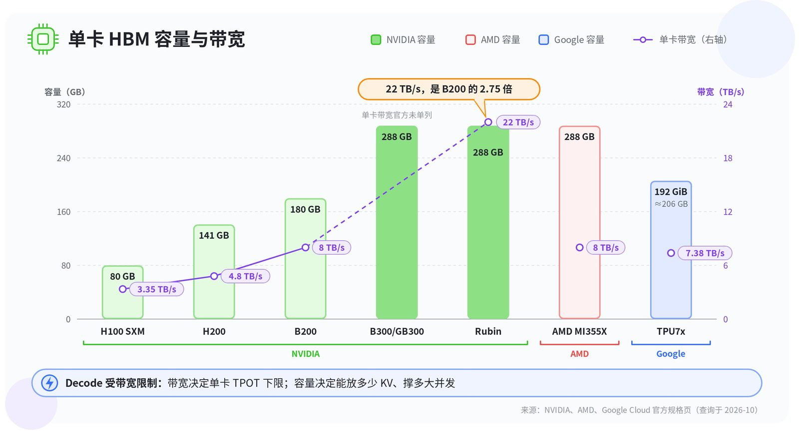

| 加速器 | 单卡 HBM | 单卡带宽 | 说明 |
|---|---|---|---|
| **H100 SXM** | 80 GB | 3.35 TB/s | 本书贯穿例子[[H100]](https://www.nvidia.com/en-us/data-center/h100/) |
| **H200** | 141 GB | 4.8 TB/s | [[H200]](https://www.nvidia.com/en-us/data-center/h200/) |
| **B200**（DGX B200 每卡） | 180 GB | 8 TB/s | [[DGX B200]](https://www.nvidia.com/en-us/data-center/dgx-b200/) |
| **B300 / GB300** | 最高 288 GB HBM3e | 官方未单列 | GB300 NVL72 整柜 72 卡、共 20 TB HBM、576 TB/s，NVLink 130 TB/s[[GB300 NVL72]](https://www.nvidia.com/en-us/data-center/gb300-nvl72/) |
| **Rubin** | 288 GB HBM4 | 22 TB/s | NVFP4 推理 50 PFLOPS[[HGX]](https://www.nvidia.com/en-us/data-center/hgx/) |
| **AMD MI355X** | 288 GB HBM3E | 8 TB/s | MXFP4 10.1 PFLOPS[[AMD MI355X]](https://www.amd.com/en/products/accelerators/instinct/mi350/mi355x.html) |
| <b>Google TPU7x（Ironwood）</b> | 192 GiB | 7.38 TB/s | 2026-03 正式可用，每个 pod 9,216 芯片[[TPU7x]](https://docs.cloud.google.com/tpu/docs/tpu7x) |

用第 1 章的方法估算：同一个模型从 H100 换到 Rubin，权重读取的理论下限按带宽比缩短约 22 / 3.35 ≈ 6.6 倍（量级示意，实际还要看 kernel 能否贴近带宽上限）。

#### 15.4 基准：MLPerf Inference v6.0

MLPerf Inference v6.0（2026-04）为 LLM 新增了 Interactive 场景：DeepSeek-R1 要求 P99 TTFT ≤ 1.5 s、TPOT ≤ 15 ms，并首次允许投机解码（num-steps=3）；同时新增 GPT-OSS-120B、Qwen3-VL 等模型[[MLPerf v6.0]](https://mlcommons.org/2026/04/mlperf-inference-v6-0-results/)。这说明“交互式低延迟”已经和吞吐一样成为正式的比较维度，和第 1 章的 Goodput 口径一致。

#### 15.5 量化：从 FP8 走向 NVFP4

FP8 KV 仍是最通用的选择。Blackwell 上已经出现默认使用 NVFP4 压缩 KV 的模型路径：vLLM v0.31.0 在 SM100 上对 DeepSeek-V4.1-Flash 默认这样做[[vLLM v0.31.0]](https://github.com/vllm-project/vllm/releases/tag/v0.31.0)。在线 FP8 量化的写法也变了：`quantization="fp8"` 会重定向到 `fp8_per_tensor`。

> 🔁 **回到主线**
>
> <b>松动的瓶颈：</b>硬件抬高了带宽和容量上限，引擎把 CPU 调度开销藏到 GPU 执行后面。
>
> <b>作用于 Goodput/\$：</b>分子靠更低的 TPOT 和更大的并发提升；分母取决于新硬件的单价，需要用第 13 章的方法重新算。
>
> <b>代价与约束：</b>默认值变化会让旧的压测结论失效；升级引擎版本后，要按 1.8 节的口径重新压测。
>
> <b>下一步：</b>本章内容截至 2026-10-11，版本还会继续变，动手前以各项目的 release notes 为准。

### 第 16 章 万亿参数 MoE 推理与 KV 分层：引擎选型、融合算子与跨实例复用

> 🎯 <b>本章回答：</b>面对 DeepSeek-V4-Pro、Kimi-K3 这类万亿参数 MoE，推理栈要先解决哪几类压力？KV Cache 又该怎样分层、怎样跨实例复用？
>
> <b>一句话结论：</b>万亿 MoE 依次卡在三处：权重放不下、EP all-to-all 跨节点变慢、长上下文 KV 撑爆显存。对策也分三层：引擎选以分页 KV 为底座、调度开销已藏到 GPU 后面的实现；算子层把通信藏进计算；KV 按 HBM、CPU、存储、跨实例池逐层扩展，每多开一层都要先算清命中率和带宽。

#### 16.1 万亿 MoE 的三类压力：显存、EP 通信、长上下文

先看规模。DeepSeek-V4-Pro 总参数 1.6T，每 token 激活 49B，支持 1M 上下文[[DeepSeek-V4-Pro]](https://huggingface.co/deepseek-ai/DeepSeek-V4-Pro)；Kimi-K3 总参数 2.8T，激活 104B，权重约 1.4 TB，896 个路由专家每 token 选 16 个，另有 2 个共享专家，官方建议部署在 64 卡以上的超节点[[Kimi-K3]](https://github.com/MoonshotAI/Kimi-K3)[[SGLang Kimi-K3]](https://docs.sglang.io/cookbook/autoregressive/Moonshotai/Kimi-K3)。

**显存**：一台 8 卡 H200 合计 1128 GB HBM，连 Kimi-K3 的权重都放不下，KV 更无处安放，只能把专家切到多机，也就是 4.5 节的 EP。

**通信**：EP 每层要做两次 all-to-all，先把 token 分发到专家所在的卡（dispatch），算完再收回（combine）。Megatron-Core 在训练场景的测量显示，all-to-all 在 NVLink 域内约占 20% 的时间，跨节点升到 40%–60%[[Megatron-Core MoE]](https://arxiv.org/abs/2603.07685)。专家越多、top-k 越大，跨节点流量越重。

**长上下文**：1M 上下文的 KV 远超单卡容量。DeepSeek-V4 从模型结构上压 KV，1M 长度下 KV 只有 V3.2 的 10%，每 token 计算量为 V3.2 的 27%[[DeepSeek-V4]](https://arxiv.org/abs/2606.19348)；Kimi-K3 用 69 层 KDA 线性注意力加 24 层 Gated MLA 的混合结构，KDA 层只保留固定大小的状态，随长度增长的 KV 只来自 24 层 MLA[[Kimi-K3]](https://github.com/MoonshotAI/Kimi-K3)。模型侧压完之后剩下的容量问题，交给 16.5 和 16.6 节的分层与复用。

#### 16.2 为什么选 vLLM：PagedAttention、V1 架构与 Model Runner V2

选型理由可以按三层看，每一层都对应万亿 MoE 的一类压力。

- **PagedAttention**：KV 按固定大小的块分配，碎片接近零，块可以在请求内和请求间共享；论文报告同等时延下吞吐是 FasterTransformer、Orca 的 2–4 倍[[PagedAttention]](https://arxiv.org/abs/2309.06180)。更重要的是，块成了统一的搬运单位，后面的前缀缓存、CPU 卸载、跨实例传输都建在它上面。原理见 6.2 节。
- **V1 架构**：API 服务和 EngineCore 拆进不同进程，分词、反分词、流式输出与调度执行重叠；调度器不再区分 prefill 和 decode，每一步只记录“每个请求处理多少 token”，chunked prefill、前缀缓存、投机解码都落在这一个表示上。前缀缓存在命中率为 0 时吞吐损失也不到 1%，所以默认开启[[vLLM V1]](https://blog.vllm.ai/2025/01/27/v1-alpha-release.html)。
- **Model Runner V2**：持久状态与每步输入解耦，输入准备改用 Triton 在 GPU 上做，消除 CPU 与 GPU 之间的同步；最大的文件从 6,700 多行降到 1,300 行以内。官方数据：Qwen3-0.6B 在 1 张 GB200 上吞吐提升 56%（25K 对 16K tok/s），GLM-4.7-FP8 开 MTP=1 在 4 张 GB200 上 TPOT 降低 6.3%[[vLLM MRV2]](https://vllm.ai/blog/2026-03-24-mrv2)。v0.29.0 起 MRV2 已对所有模型默认，见 15.1 节。

对万亿 MoE 的意义：EP 越宽，每张卡每步分到的计算越少，Decode 越容易被 CPU 侧的调度和输入准备拖住，V1 和 MRV2 压的正是这部分开销。SGLang 在大规模 MoE 上同样成熟，DeepSeek-V4 的部署配置见 15.2 节；选型时两者都应按 1.8 节口径在自己的流量上压一遍。

#### 16.3 MegaMoE：把 EP 通信藏进计算

结论：MegaMoE 把一个 MoE 层的 dispatch、两段专家 GEMM、combine 等五步融合成一个 kernel，并按“专家波次”做流水：当前波次在算，下一波次的 token 在传，已经算完的专家结果在回传。单层内的通信时间短于计算时间，融合之后瓶颈回到计算，对互联带宽的要求随之下降[[MegaMoE 解读]](https://langcopilot.com/posts/2026-05-15-deepseek-v4-megamoe-overlapping-communication-comp)。

数字来自 DeepSeek 公开材料，经解读文章转述：通用场景加速 1.50–1.73 倍，时延敏感场景最高 1.96 倍，在 NVIDIA 和昇腾上都验证过；计算精度为 FP8×FP4，代码在 DeepGEMM 的 PR304、PR316 开源，设计受 FlashMoE 和 COMET 启发[[MegaMoE 解读]](https://langcopilot.com/posts/2026-05-15-deepseek-v4-megamoe-overlapping-communication-comp)。旧路径是五个串行 kernel，每两步之间都有一次启动开销和一次等待。

适用边界：收益最大的是小批量、长尾的场景，例如 RL rollout 末尾只剩少数长序列时，传统路径的通信等待无法被计算掩盖。大批量 Prefill 里通信占比本来就低，收益应当更小（推断，未见公开测量）。接入前确认引擎版本已集成对应 kernel，并分别压 Prefill 和 Decode。

#### 16.4 投机解码与 MTP 为什么无损

结论：只要验证按拒绝采样规则走，投机解码输出的分布与目标模型逐个 token 采样完全相同，加速只来自“一次前向验证多个 token”。完整证明见 5.4 节，这里给直觉和工程边界。

直觉：草稿模型以概率 q(x) 提出 token x，目标模型的概率是 p(x)。按 `min(1, p(x)/q(x))` 接受；被拒时从 `max(0, p(x)-q(x))` 归一化后的分布重新采样。接受与重采样两部分相加恰好等于 p(x)，输出分布不变，变的只是每次前向能前进几个 token。Leviathan 等在 T5-XXL 上测得 2–3 倍加速，输出不变[[Leviathan et al.]](https://arxiv.org/abs/2211.17192)。

MTP 是草稿的一种来源：模型自带额外的预测头，一次多猜几个 token，再交给主模型验证，无损性的来源与上面相同。工程上要守住这几条：

- 贪心解码要求逐位相等；采样解码必须走拒绝采样，不能用“近似接受”换接受率。
- 草稿 token 会占 KV 和 batch 名额，15.2 节 DeepSeek-V4 的 max-running-requests 乘 draft 数的上限就是这个约束。
- 接受率低时反而更慢，高并发下要能自动降低投机步数或关闭。
- 同一输入在不同 batch 下结果有细微差异，多半来自低精度和算子的 batch 不变性，属于数值问题，与投机算法无关。

#### 16.5 KV 卸载到 CPU：代价与适用边界

结论：卸载换来的是容量，付出的是 PCIe 带宽和调度复杂度。HBM 够用时不必开；并发会话数超过 HBM 能容纳的数量、而且前缀复用率高时，CPU 层才划算；工作集再大，交给存储层。

vLLM v0.22 的分层卸载给了一组可以对照的官方数字（Qwen3.6-35B-A3B，2 张 H100）：64 个并发会话以内 HBM 够用；64 到 128 个会话之间，CPU 卸载能把吞吐维持住；超过 128 个会话后，存储层相比重算吞吐高 2 倍以上[[vLLM 分层卸载]](https://vllm.ai/blog/2026-09-10-tiered-kv-offloading)。设计上以主机内存为中心，KV 使用与 TP 大小无关的规范布局，下层可以接文件系统、S3，或经 NIXL 走 RDMA 点对点传输[[vLLM 分层卸载]](https://vllm.ai/blog/2026-09-10-tiered-kv-offloading)。

算账的标准只有一条：回载 KV 的时间要小于重算 prefill 的时间。6.4 节算过，8k token 的请求回载约 312 MB/卡、约 6 ms，重算约 320 ms，差了两个数量级；这个优势完全依赖命中。命中率低时，写出 KV 本身就占 PCIe 带宽，还会和权重加载、EP 通信抢同一条链路。

> 📌 **开 CPU 卸载前核对**
>
> - KV 使用率是否长期打满，抢占和重算是否频繁出现。
> - 前缀复用率够不够高，多轮对话、Agent、固定系统提示是主要来源。
> - 回载时延占 TTFT 预算的比例，PCIe 与 NVLink-C2C 的差别要按实测算。
> - 淘汰策略和保留时长是否与真实的会话间隔匹配。

#### 16.6 跨实例 KV 复用与中心化管理

结论：单实例的前缀缓存只在请求落回同一实例时生效[[vLLM APC]](https://docs.vllm.ai/en/latest/design/prefix_caching/)，实例一多，命中率会被负载均衡打散。补救有两条路：路由侧感知前缀，把请求送回有缓存的实例；存储侧把 KV 池化，让任意实例都能取。两条可以叠加。

**路由侧**：llm-d 的精确前缀缓存路由让各 vLLM 实例经 ZMQ 上报 KV 块事件，调度器据此维护全局索引，先按前缀亲和过滤，再按 token 负载打分；块大小 64，索引目前没有高可用，只能单副本部署[[llm-d 前缀路由]](https://llm-d.ai/docs/well-lit-paths/foundations/precise-prefix-cache-routing)。Gateway API Inference Extension 的端点选择器同样按 KV 缓存和请求成本选实例[[GAIE]](https://github.com/kubernetes-sigs/gateway-api-inference-extension)。命中与均衡之间的取舍见 8.5 节。

**存储侧**：Mooncake 以 KV 为中心做 P/D 分离和分布式 KV 池，模拟场景吞吐最高提升 525%，在 Kimi 线上多承接 75% 的请求，过载时按预测提前拒绝[[Mooncake]](https://arxiv.org/abs/2407.00079)。LMCache 把 KV 从引擎里抽出来做跨实例、跨层级共享，报告最高 15 倍吞吐提升[[LMCache]](https://arxiv.org/abs/2510.09665)。AIBrix 的分布式 KV 池报告吞吐提升 50%、时延降低 70%[[AIBrix]](https://arxiv.org/abs/2504.03648)。这些都是各自论文在各自场景下的测量，只能当量级参考。

中心化的代价有三类：索引一致性，实例淘汰块之后索引要及时失效；网络带宽，跨机取 KV 要走 RDMA，退回 TCP 时收益可能被吃掉；多租户隔离，共享前缀带来的时序侧信道需要单独评估。落地顺序建议先在单实例开前缀缓存并量命中率，再上前缀感知路由，最后才考虑 KV 池。

> 💡 **常见误区**
>
> - “开了 CPU 卸载就能多扛并发”：命中率低时卸载只会增加 PCIe 流量，先量复用率。
> - “MTP 会改变输出”：按拒绝采样验证就不会，观察到的差异多半来自数值精度。
> - “融合算子可以替代好网络”：MegaMoE 降低了对带宽的要求，跨节点 EP 仍然需要 RDMA；15.2 节提到 NCCL 退回 TCP 时 Decode 慢约 40%。

> 🔁 **回到主线**
>
> <b>松动的瓶颈：</b>EP 通信被计算掩盖，KV 容量从单卡 HBM 扩到主机内存、存储和跨实例池。
>
> <b>作用于 Goodput/\$：</b>分子靠更高的前缀命中和更少的通信等待提升；分母要加上为卸载和池化多付的内存、存储与网络。
>
> <b>代价与约束：</b>层数越多，调度和一致性越复杂；每加一层都要先量命中率，再比较回载与重算的时间。
>
> <b>下一步：</b>本章资料截至 2026-10-29，万亿 MoE 的部署配置变化快，动手前对照各模型的 cookbook 和引擎 release notes。

📎 延伸阅读：KV 池跨实例复用带来的安全账另成一篇：四种攻击者位置、各自的泄露精度与防御成本轴，见 [LLM-68｜系统｜KV Cache 的信任边界：共享、分层与三种泄露面](./68-kv-cache-trust.md)；块内混淆以 0.45% 的 prefill 开销换取数据面攻击归零。

### 结语、边界声明与修订记录

> 📚 <b>本文档只涵盖公开可查证的资料。</b>目标是为业界公开的最佳实践建立完整的对照系，帮助新人建立通用语汇与估算能力。

#### v2.0 修订说明

| 位置 | v1.0 | v2.0 修正 |
|---|---|---|
| 结构 | 13 章正文 + 10 个深读附录，内容重复、主线分散 | 按「目标 → 物理 → 并行 → 算子 → 显存 → 编排 → 生产 → 实战」八篇重组，附录并入对应章节 |
| Llama-3-70B KV / token | 第 6 章写 160 KB（误写 64 个 KV head） | **320 KB**（8 个 KV head，BF16）；8k 上下文 2.5 GB |
| KV 卸载耗时 | 8k KV 按 2.5 MB 算，加载约 40 μs | 8k KV 为 2.5 GB，TP=8 每卡约 312 MB，加载约 **6 ms** |
| Decode 带宽下界 | 70B 单卡 42 ms/step | 70B 无法单卡部署；TP=8 BF16 每卡下界约 5.2 ms |
| Roofline 实验 | M=8 接近拐点、M=64 进入算力区 | BF16 线性层拐点约 M≈295，M=64 仍在带宽区 |
| 投机解码加速比 | `E[a] / (1+c)` | `E[a] / (K·c+1)`；低接受率时可能 &lt; 1× |
| 容量规划案例 | Prefill 按「batch 免费」计算；总计 36/40 卡前后不一；单价算成 6 \$/1M | Prefill 按算力重算；总计 80 卡；峰值 0.12 \$/1M、潮汐后约 0.35 \$/1M |
| DeepSeek-V3 部署 | 推理用 EP=64 + DualPipe | DualPipe 用于训练；推理按技术报告与 2025 年公开数据修正 |
| NanoFlow | 描述为 CPU/GPU 三段流水 | NanoFlow 是设备内 nano-batch 算子重叠；CPU/GPU 重叠调度见 SGLang v0.4 / vLLM V1 |
| 隐式同步列表 | 把 `numel()`、`torch.zeros(device=cuda)` 列为同步点 | 更正为不会同步，并补充 `nonzero`、布尔索引等真正的同步点 |
| eBPF 命令 | `oomkill` 标为「Page fault 大户」、`runqlat` 标为「锁等待」 | 更正用途，补充 `offcputime`、`biolatency` |

#### Changelog

- <b>v2.4（2026-10-29）</b>：新增第 16 章「万亿参数 MoE 推理与 KV 分层」，覆盖万亿 MoE 的三类压力、vLLM 选型理由、MegaMoE 融合算子、投机解码无损性、KV 卸载边界与跨实例复用。
- <b>v2.3（2026-10-23）</b>：14.2 节新增“按阶段交付的路线”，含阶段表、路线图、压测口径与实验记录模板；课程索引补充 MS&amp;E 319。
- <b>v2.2（2026-10-11）</b>：按 2026-10 的版本复查全文。修正监控指标名（`vllm:kv_cache_usage_perc` 等）、TensorRT-LLM 架构（PyTorch 后端）、vLLM MRV2 代码路径、`vllm bench serve`、SMG、CUDA Graph 默认模式；加速器表补充 GB300 / Rubin / MI355X / TPU7x；新增第 15 章「2026 年更新」。
- <b>v2.1（2026-09-30）</b>：全文精修。新增「符号约定」表；每章末尾增加「回到主线」小结（松动的瓶颈 / 作用于 Goodput/\$ / 代价 / 下一步）；新增 7.5 请求路径时序图、7.6 扩展点表、10.5 TPOT 排障实战、11.4 按 token 准入与限流、12.3 定价结构与成本结构对照；扩写 11.1、11.2；重绘网络地图，GPU 用途饼图改为三栏卡片。
- v2.0（2026-09-30）：明确主线并按八篇重组；合并深读附录；修正关键数字；新增主线图、Roofline 图、KV 分层图、PD 分离架构图、调度重叠图等示意图；每章增加「本章回答」与可复算推导。
- v1.0（2026-08-21）：初版，覆盖 13 章骨架，补充 40+ 论文与 15+ 开源项目引用。
- 后续计划：FP8/FP4 实测数据、多模态推理（ViT 编码器、语音、扩散模型）专章、Agent 推理（长上下文多轮、工具调用）专章。

---

上一篇：[LLM-07｜系统｜LLM 服务稳定性工程：SRE 上线手册](./07-serving-reliability.md) · [目录](./README.md) · 下一篇：[LLM-09｜系统｜《深入理解 AI Infra》精读：量化分析与系统设计](./09-ai-infra-reading.md)
