# LLM-09｜系统｜《深入理解 AI Infra》精读：量化分析与系统设计

> 🎯 **这篇文档解决什么问题**：沿《深入理解 AI Infra》自己的主线重新组织全书，帮你学会判断一个方案行不行、性能到什么量级。先立方法论（第〇部分），再顺着一次请求的执行链路，把 12 章收进**需求侧、资源侧、系统侧**三段。
>
> 使用方式：每一段、每一章开头都有一句「🧭 主线锚点」，说明它在链路上的位置、回答 5 问里的哪几问；赶时间只看每章的 📖 和 ✅。读完按结语的 7 个动作清单跟着算一遍，SRE 和 QA 的读法见附录 A。书中数字以原书和配套仓库为准，模型和硬件参数核对于 2026 年 10 月 11 日。

> 📌 **阅读图例**：全文高亮框按用途统一配色，📖 📍 导航 / 主线 📐 公式与概念 📝 算例 🚨 误区 ✅ 结论 / 小结 💬 金句 📌 补充说明。赶时间时，只看每章的 📖 和 ✅ 即可抓住主线。

## 导读 · 先给结论

- **所有优化都在减少数据搬移**：一次请求的执行链路上，每一项优化都对应其中某一段搬运（第〇部分）。
- **先用 M、F、R 算出物理上限**：容量看装不装得下，计算时间取算力和带宽两者中较慢的那个，谁供不上谁就是瓶颈（0.3 节）。
- **Prefill 计算密集，Decode 带宽密集**：两个阶段用同一份权重，区别在每次有多少行输入共用它（0.1 节）。
- **能推理不等于能训练**：全参训练的常驻显存约为权重的 8 倍，KV 缓存随上下文线性膨胀（0.3+ 节）。

📎 与系列其他文档的分工：推理系统的全栈工程见「大模型推理系统学习手册」，GPU 算子层的优化见「GPU 优化深入浅出」，推理成本和选卡见「自建推理成本与 GPU 选型」，训练集群的稳定性见「大模型训练工程」。本文只做这本书的精读。

---

## 第〇部分 全书主线：数据搬移 + 从约束推导设计

### 0.1 一次生成请求的执行链路（全书的分析对象）

理解 AI Infra 的起点，是看清一次请求“从提出到完成”经过哪些环节。<b>后续所有优化，优化的都是这条链路上的某一段搬运。</b>

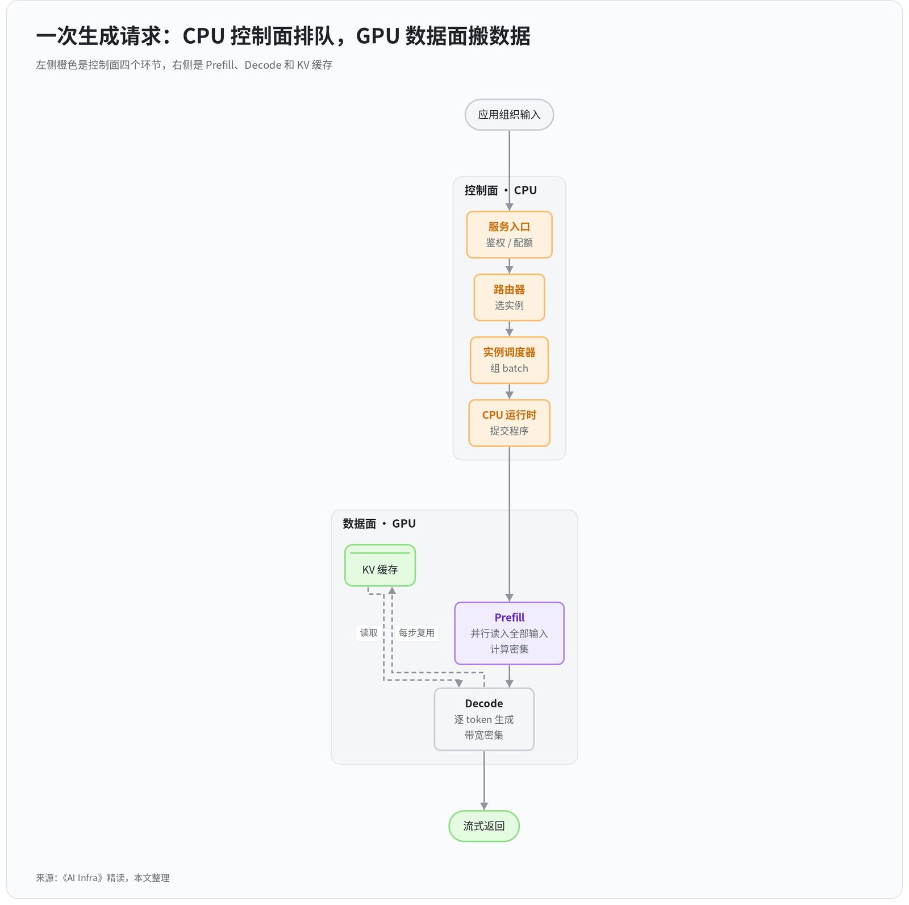

> 💡 **贯穿全书的核心矛盾：Prefill vs Decode**。Prefill 并行处理全部输入 token、算完保存各层 KV，是**计算密集**；Decode 每步只生成 1 个 token、却要把整份权重和 KV 重新读一遍，是**带宽密集**。两阶段用同一份权重，区别只在“每次有多少行输入共用它”，这个比例决定了瓶颈在算力还是带宽，是全书推理优化反复计算的对象。

### 0.2 主线之一：反复追问的 5 个问题

从芯片存储层次，到超节点、数据中心网络，再到端边云分工，**每一层都用同一组问题拆解**：区别只在于“块之间跨越的是片内存储、显存还是网络”。

> 🔍 **① 搬什么** — 权重？KV 缓存？中间张量？
>
> **② 搬多少** — 数据量的数量级（字节）
>
> **③ 搬几次** — 加载一次常驻 vs 每步反复读

> 🔍 **④ 经过哪里** — 片上 SRAM / 显存 HBM / 卡间互联 / 机房网络
>
> **⑤ 谁必须等它** — 哪些串行依赖造成的等待无法消除

### 0.3 主线之二：用 M / F / R 三个数字算出物理上限

| 数字 | 含义 | 对应约束 |
|---|---|---|
| <b>M（容量）</b> | 要保存多少字节（权重 + KV + 激活 + 优化器状态） | 装不装得下（显存 / 内存上限） |
| <b>F（算力）</b> | 要做多少次浮点运算（FLOPs） | 算得多快（峰值 FLOP/s） |
| <b>R（读写）</b> | 要从存储读写多少字节 | 供不供得上（带宽 β） |

> 💬 **作者的方法论金句**（源自其导师“优化要做到物理所允许的极限”）：先按**第一性原理**算出硬件允许的上限，再看系统离上限还有多远。计算时间取 $`\max(F/\Pi,\ R/\beta)`$ 的较大者：**算力和带宽，谁供不上谁就是瓶颈**。“估算不必一开始就精确，但必须知道自己算进了什么，还有什么没算进去。”

### 0.3+ 一图看懂：两组必背的关键数字

<b>方法论落到具体数字，就是下面两张“数量级阶梯图”。</b>横轴都是对数刻度：每向右一格差 10 倍。第一张是通用系统的**延迟**，第二张是这本书 AI Infra 场景的**存储**。系统设计判断“行不行、差多远”，本质就是把方案对进这两把标尺。

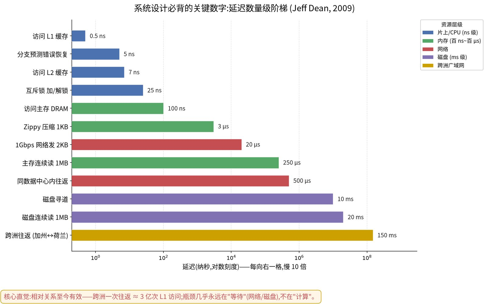

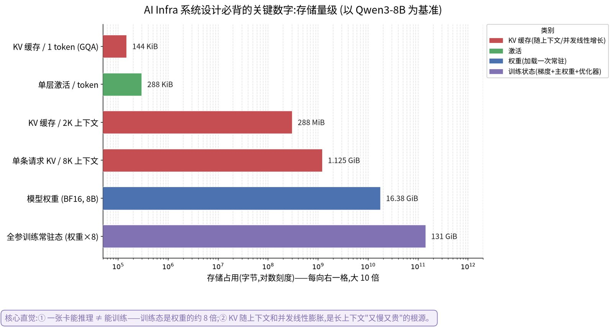

<b>【勘误（2026-10-16 事实审计）】</b>图 2 中“模型权重（BF16, 8B）16.38 GiB”“全参训练常驻态（权重×8）131 GiB”实为十进制 GB 数值：按 GiB 计应分别约为 15.26 GiB 和 122.05 GiB，或保留数值改记为 16.38 GB、131.1 GB。图片无法在线修改，以此为准。

> ✅ **两张图各带走一句话**：① **延迟图**，不同资源层级差着数量级，优化先砍占比最大的“等待”（网络/磁盘），本就很快的“计算”不值得先动（Amdahl 定律）。② **存储图**：一张卡“能推理 ≠ 能训练”（训练态≈权重×8），而 KV 缓存的线性膨胀是长上下文“又慢又贵”的物理根源。

### 0.4 全书地图：12 章如何挂在这条主线上

下面这张表就是整份文档的“目录 + 主线索引”。把 12 章按“需求 → 资源 → 系统”三段排列，每章标注它在链路中的位置和主要回答的问题。<b>后文严格按这个顺序展开。</b>

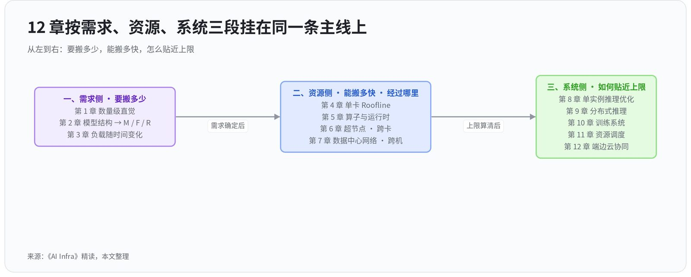

| 部分 | 章 | 在主线中的位置 | 主要回答 |
|---|---|---|---|
| **一、需求侧**<br>要搬多少 | 第 1 章 | 建立方法与数量级直觉 | 如何用几个数字估算一次执行？ |
| 第 2 章 | 从模型结构推出 M/F/R | 一次调用要做多少工作、存多少字节？ |  |
| 第 3 章 | 需求随时间变化 | 请求到达、多轮、多模态、训练如何改变需求？ |  |
| **二、资源侧**<br>能搬多快·经过哪里 | 第 4 章 | 单卡的算力/带宽上限 | 芯片能算多快、供得上多少带宽？(Roofline) |
| 第 5 章 | 减少重复搬运 | 如何组织算子与运行时，少读写少等待？ |  |
| 第 6 章 | 跨卡搬运（超节点内） | 多卡如何分工，协作规模多大？（六种并行） |  |
| 第 7 章 | 跨机搬运（数据中心） | 数据如何跨服务器传输，拥塞/故障怎么办？ |  |
| **三、系统侧**<br>如何贴近上限 | 第 8 章 | 单实例服务效率 | 如何安排 batch/缓存提高服务效率？ |
| 第 9 章 | 多实例计算与状态放置 | 计算和 KV 放哪、怎么路由和扩缩容？ |  |
| 第 10 章 | 训练状态与恢复 | 如何在期限内取得有效训练进展？ |  |
| 第 11 章 | 资源调度与运行环境 | 如何把服务、工具、共享资源组织成任务系统？ |  |
| 第 12 章 | 端边云分工 | 任务放端、边还是云？ |  |

> 💡 <b>贯穿全书的“活体案例”</b>：本书不空谈，用一组真实模型 + 真实硬件贯穿始终，同一个问题在不同章节被反复重算、不断加入新约束。模型线：**Qwen3-8B**（稠密基准）→ **Qwen3-235B-A22B**(MoE)→ **DeepSeek V4 / V4.1 Flash**（CED 架构、上下文压缩）。硬件线：**HGX H100 八卡**、**RTX PRO 6000 Blackwell**、**A100 / H20 混合集群**、**RTX 4090 集群**。读的时候，盯住“同一个模型在这一章又多算了哪条约束”。

> 作者的一句话定位：这本书教你“如何判断一个方案行不行、性能到什么量级”，并不罗列“有哪些技术”。它把 AI Infra 从“名词的堆砌”还原成“约束下的数量级推理”。

---

## 第一部分 需求侧：一次执行到底要搬多少？（第 1-3 章）

> 📍 **主线锚点**：这一段站在链路最上游，回答 5 问中的<b>「搬什么·搬多少」</b>。还没碰任何硬件，先把“一次调用需要多少计算 F、存多少字节 M、读写多少 R”算清楚，这是后面判断“哪块硬件够用”的**需求基准**。

### 第 1 章 初识 AI Infra

> 📖 <b>本章主线：</b>沿着一次模型请求的执行路径认识系统，并用三类硬件资源（**容量 M**、**算力 Π**、**带宽 β**）把抽象的设计问题变成可计算的预算：数据能否放下、回答要等多久、加带宽/加卡/改精度各能带来多少收益。
>
> <b>核心结论：</b>在 70B 单步生成算例中，**权重读取时间（20.90 ms）约为矩阵计算时间（0.1415 ms）的 148 倍**，decode 是**带宽受限**的，所以增加带宽、减少读取、提高批内复用，才是缩短时间的有效方向。

#### 1.1 AI Infra 为什么重要

AI Infra 是支撑 AI 训练与推理的基础设施：计算设备、存储、互联，以及组织这些资源的软件。模型驱动的应用在传统“代码 + 编译器 + 操作系统”之外，新增了一个入口：通过**选择模型、组织上下文（context）、提供工具**来表达任务。

- <b>可编程性上移：</b>保持参数不变，改变指令/示例/参考材料即可改变模型处理的任务。
- <b>批处理（batch）：</b>同一模型用同一组参数为多请求服务，可合并计算、共用一次读入的权重以提高利用率；每批共同执行的请求数称为 <b>batch size(B)</b>。
- <b>双向影响：</b>模型侧压缩状态/改注意力/稀疏使用参数改变硬件工作量；硬件侧的容量、带宽、连接方式又反过来决定哪种模型结构更合适。

**六层分工**（借鉴廖恒“十八层宝塔”，本书划分为六层）：向下看任务逐步变成计算与数据访问，向上看硬件的容量/算力/带宽决定能跑多大模型、并发多少、多快响应。

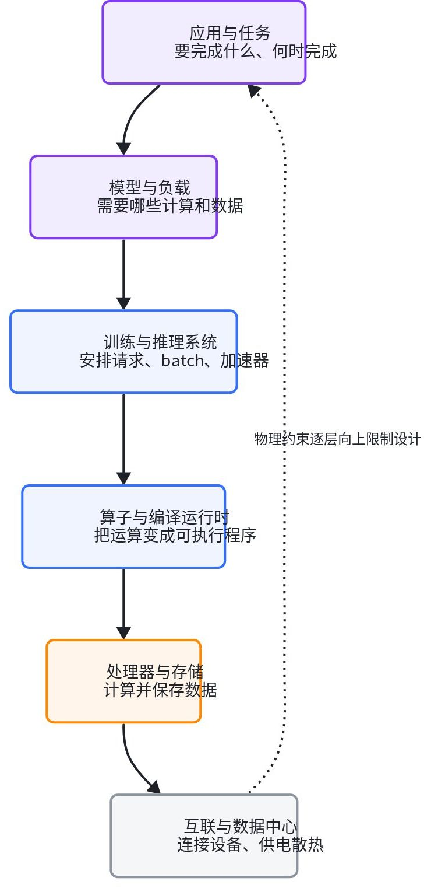

<b>一次生成请求的处理过程：</b>应用组织上下文→服务入口核验权限/配额→**路由器**选择**推理实例**→**实例调度器**组 batch、分配状态空间→CPU 提交程序、GPU 执行算子。计算分两阶段：<b>预填充（prefill）</b>处理输入并产生首个 token，<b>解码（decode）</b>逐步生成新 token 并复用 **KV 缓存**。

<b>数据搬移的两种频率：</b>权重在实例启动时**加载一次**并驻留显存；生成时计算单元**每步反复读取**当前层权重与上下文状态。**scale-up**（纵向，超节点内 NVLink 等高带宽互联）让一组加速器低开销协作；**scale-out**（横向，经网卡与交换网络）扩大集群。以 GB200 NVL72 为例：36 个 Grace CPU + 72 个 Blackwell GPU 经 NVLink 组成同一互联域。

#### 1.2 系统设计的关键数字

<b>用数量级判断方案。</b>Jeff Dean 2009 年“Numbers Everyone Should Know”给出各类基本操作的量级（2009 年设备环境），核心用途是在动手前先估算主要操作的时间与资源。

| 操作 | 时间（ns） |
|---|---|
| 访问一级缓存 | 0.5 |
| 分支预测错误后的恢复 | 5 |
| 访问二级缓存 | 7 |
| 对互斥锁加锁或解锁 | 25 |
| 访问主存 | 100 |
| 用 Zippy 压缩 1K 字节 | 3,000 |
| 经 1 Gbit/s 网络发送 2K 字节 | 20,000 |
| 从主存连续读取 1 MB | 250,000 |
| 同一数据中心内往返 | 500,000 |
| 磁盘寻道 | 10,000,000 |
| 从磁盘连续读取 1 MB | 20,000,000 |
| 数据包从加州到荷兰再返回 | 150,000,000 |

> 📐 <b>Amdahl（阿姆达尔）定律：</b>若原执行时间中比例 $`f`$ 的部分能加速 $`s`$ 倍，其余不变，则总加速比
>
> ```math
> Speedup = \dfrac{1}{(1-f) + f/s}
> ```
>
> 上限为 $`1/(1-f)`$。<b>算例：</b>串行 20 次寻道（每次 10 ms）+ CPU 计算 1 ms = 201 ms；计算提速一倍只省 0.5 ms（占比 1/201），而把寻道从 20 次减到 10 次省 100 ms，优化收益取决于被优化部分在总时间中的占比。

<b>四类关键数字与三条约束。</b>设任务需保存 $`M`$ 字节、执行 $`F`$ 次浮点运算、经接口读写 $`R`$ 字节；加速器提供容量 $`M_{cap}`$、算力 $`\Pi`$、带宽 $`\beta`$:

```math
M \le M_{cap}, \quad T_{compute} = \dfrac{F}{\Pi}, \quad T_{memory} = \dfrac{R}{\beta}
```

数据保存一次可读取多次，故 $`M`$ 与 $`R`$ 分别计算。取峰值得到物理下界。利用率：**MFU** $`= F/(\Pi T)`$（算力利用率），**MBU** $`= R/(\beta T)`$（带宽利用率），两者均 ≤ 1，回答“离硬件极限还有多远”。

| 资源或操作 | RTX 4090 | A100 80GB SXM | H100 SXM |
|---|---|---|---|
| 显存容量（GB） | 24 | 80 | 80 |
| 显存带宽（TB/s） | 1.008 | 2.039 | 3.35 |
| BF16 矩阵峰值（TFLOP/s） | 165.2 | 312 | 989.4 |
| 按带宽峰值读取 1 GB(ms) | 0.99 | 0.49 | 0.30 |

<b>参数存储量换算。</b>以 DeepSeek-R1-Distill-Llama-70B（稠密，约 705.54 亿参数）为例，BF16 每权重 2 字节：

```math
M_W = N \cdot b_W = 70{,}553{,}706{,}496 \times 2\,bytes \approx 141.11\,GB \approx 131.42\,GiB
```

- 141.11 GB 超过一张 H100 SXM 的 80 GB；均分到两卡每卡约 70.55 GB。
- <b>量化：</b>分组 8 比特（每 128 权重共享一个 2 字节 scale）后全部权重约 **73.73 GB**，可放入单卡，余约 6.27 GB。
- <b>容量检查须含状态与工作区：</b>$`M_W + M_{state} + M_{work} \le M_{cap}`$;8192 token 请求 BF16 KV≈2.68 GB、工作区≈2.15 GB，合计 73.73+2.68+2.15 = 78.56 GB（符合 80 GB 预算）。
- <b>网络换算：</b>400 Gbit/s ÷ 8 = 50 GB/s 线速，传 1 GB 约 20 ms。

#### 1.3 用几个数字估算一次模型执行

> 📝 <b>例题 1-1：70B 单步生成能否在 10 ms 内完成？（H100 SXM，近似 N=70×10⁹，每参数 1 字节）</b>
>
> <b>① 读取量：</b>每步完整读一遍权重 ≈ 70 GB，读取时间下界：
>
> ```math
> T_{read} \ge \dfrac{70\,GB}{3350\,GB/s} \approx 20.90\,ms
> ```
>
> <b>② 计算量：</b>投影中每权重一次乘加计两次浮点运算：
>
> ```math
> F \approx 2N = 2 \times 70 \times 10^9 = 140\,GFLOPs
> ```
>
> ```math
> T_{compute} \ge \dfrac{140\,GFLOPs}{989400\,GFLOP/s} \approx 0.1415\,ms
> ```
>
> <b>③ 结论：</b>读取比计算慢约 **148 倍**，已超 10 ms 目标 → 属带宽受限。充分重叠下 $`T_{step} \ge \max(F/\Pi,\ R_W/\beta) = 20.90\,ms`$。

<b>三个教学量与批处理。</b>记 batch size 为 $`B`$,B 个请求共享一次权重读入：

```math
M_W = b_W N, \quad R_W = b_W N, \quad F \approx 2BN
```

提升算力只让计算时间减半（0.0707 ms），读取下界不变；**带宽翻倍**或**权重减半**都能把读取降到约 10.45 ms。8 请求共享一次 70 GB 读取：计算下界约 1.13 ms，读取仍 20.90 ms，每输出分摊约 2.61 ms，吞吐从单请求约 **47.9 token/s** 升到约 **383 token/s**（单请求延迟不缩短）。

> 📐 <b>转折点 B\*（计算追平读取）：</b>令 $`2BN/\Pi = b_W N/\beta`$ 得
>
> ```math
> B^* = \dfrac{b_W \Pi}{2\beta}
> ```
>
> 取 $`b_W=1,\ \Pi=989.4\times10^{12},\ \beta=3.35\times10^{12}`$，得 $`B^* \approx 147.7`$。等价地用算术强度 $`I = F/R_W = 2B/b_W`$：当 $`I < \Pi/\beta`$ 时读取受限，超过后计算受限，这就是第 4 章 Roofline 模型的出发点。

<b>实测检验（Qwen3-8B,vLLM 0.23 eager,RTX PRO 6000 Blackwell，输入 2048/生成 256）：</b>

| 并发请求数 | 1 | 4 | 16 | 64 |
|---|---|---|---|---|
| 整批吞吐（token/s） | 37.31 | 141.73 | 479.33 | 1164.94 |
| TPOT 输出间隔（ms） | 26.53 | 26.97 | 29.30 | 40.48 |

1→64 并发吞吐约提高 31 倍，单请求间隔从 26.5 ms 增至 40.5 ms（权重复用增加，但注意力计算与状态访问也随请求数增加）。补上状态项：$`T_{step} \approx \max\!\left(\dfrac{B F_1}{\Pi},\ \dfrac{R_W + B R_{state,1}}{\beta}\right)`$。

<b>实测为何达不到极限。</b>batch=1 时理论 decode 读取下界 8.62 ms，实测间隔 26.5 ms,MBU 仅 <b>33%</b>。差距两种来源：(1) **模型漏项**（未计注意力外向量运算与采样）→ 修正模型；(2) **系统开销**（eager 逐 kernel 提交、Python/驱动/PCIe、逐步日志）→ 可去除。关日志后按加速器事件计时降到 10.7 ms，与 8.62 ms 仅差两成，证明三倍差距多为主机侧开销。

#### 1.4 需求如何推动架构设计

硬件本身也是为需求而设计。三个案例，需求改变了首先要解决的瓶颈：

> 💡 <b>TPU(Google, 2013→)</b>
>
> <b>语音搜索预测：</b>每人每天 3 分钟或需数据中心翻倍。每日需求 $`Q F_1`$ 增大→专用推理芯片摊薄单请求成本。TPU v1 2015 部署。

> 🌐 <b>SmartNIC（微软 Azure, 2015→）</b>
>
> 40 Gbit/s 最小帧每秒约 6000 万包，单核处理率 $`\mu_{core}`$:
>
> ```math
> n_{core} = \dfrac{\lambda_{packet}}{\mu_{core}} \approx 3\text{—}6
> ```
>
> 把包处理卸载到 FPGA 网卡，CPU 核留给租户。

> 🔗 <b>Unified Bus（华为）</b>
>
> GPT-3 后多设备协同需求扩大。UB 让设备直接访问彼此内存，去掉消息传递抽象层，使远程访问逼近线路时延下限。

> 🚨 <b>常见误区（谬误与陷阱）：</b>
>
> - <b>峰值算力翻倍→速度翻倍？</b>先看是否受计算限制；例 1-1 中读取下界远大于计算，提峰值几乎无效。
> - <b>显存能放下权重→能支持目标并发？</b>权重只是常驻数据一部分，状态/工作区/预留也占显存，多卡须逐卡核算。
> - <b>比旧实现快三成→优化成功？</b>不知极限就无法判断；应先算下界，再查是模型漏项还是系统开销。
> - <b>吞吐提高→每个用户等待缩短？</b>批内复用降低分摊读取，但每请求仍经历排队与整批执行：吞吐与响应时间须同时报告。

> 💬 <b>金句：</b>数据搬移塑造了 AI Infra 的架构。分析系统的顺序永远是：先检查数据能否放下，再用运算量与读写量估算耗时，最后按执行顺序分析重叠与等待。

<b>本章数字速查（Qwen3-8B, BF16，并发 1）：</b>

| 模型需求 | 数值 | 如何使用 |
|---|---|---|
| 完整 BF16 权重 | 16.38 GB | 判断模型加载所需显存 |
| 每 token 全模型 KV | 144 KiB | 乘上下文长度得单请求 KV 容量 |
| 2048 token 上下文 KV | 288 MiB(≈0.302 GB) | 随独立请求数增加 |
| 2048 token prefill 矩阵运算 | 29.69 TFLOPs | ÷ 矩阵算力得计算时间下界 |
| 一步 decode 矩阵运算 | 16.34 GFLOPs | 输入一个 token，另访问上下文 |
| 一步 decode 主要权重读取 | 15.14 GB | 权重读一次，嵌入层只读当前行 |
| 一步 decode 旧 KV 读取 | 0.302 GB | 每份上下文 KV 读一次的字节数 |

### 第 2 章 模型架构

> 📖 <b>本章主线：</b>用**计算图**（节点=运算，边=数据依赖）把“一个 8B 模型”拆成可计算的资源预算，回答第 1 章遗留的问题：代入的运算量 $`F`$、存储量 $`M`$、读写量 $`R`$ 到底从哪来。
>
> <b>核心方法：</b>一层投影的 $`F=2mkn`$ 是所有估算的原子；两类工作分开计，**投影/FFN 随行数 m 增长**，**注意力随查询-键配对数 N_pair 增长**。三种降本手段（KV 共享/潜变量压缩/递推）节省的存储与读取，都要连同新增的选择、压缩、更新工作一起算。

#### 2.1 计算图与前向执行

<b>计数口径：</b>一次乘加计 2 FLOPs;1 GB = 10⁹ bytes,1 GiB = 2³⁰ bytes;BF16 每元素 2 字节，张量存储 = 元素数 × 2。

<b>序列依赖决定并行性。</b>RNN 状态 $`h_t = f(x_t, h_{t-1})`$，同层须按位置串行；**因果 Transformer** 只在深度方向依赖上一层，同层已知 token 可并行：能否并行取决于依赖而非“序列”之名。生成新 token 又增加跨调用串行依赖。

> 📐 **一个投影节点的原子公式**（$`X \in \mathbb{R}^{m \times k},\ W \in \mathbb{R}^{k \times n},\ Y = XW`$）：
>
> ```math
> N_W = kn, \quad F = 2mkn, \quad M_W = b_W \cdot kn
> ```
>
> 行数 $`m`$ 翻倍→运算量翻倍、权重不变（“处理更多输入”）；输出宽 $`n`$ 翻倍→权重与运算量都翻倍（“一层变宽”）。

**Qwen3-8B 稠密基线配置**（贯穿全章的推导起点）：

| 配置项 | Qwen3-8B 参数 | 对资源需求的直接影响 |
|---|---|---|
| 层数 $`L`$ | 36 | 重复计算、逐层状态与深度依赖 |
| 隐藏维度 $`d`$ | 4096 | 子层输入输出与投影尺寸 |
| FFN 中间维度 $`f`$ | 12288 | 三个 FFN 矩阵的权重与计算 |
| Q / KV 头数 | 32 / 8 | 查询向量与上下文表示的宽度 |
| 头维度 $`d_h`$ | 128 | 每个头的点积与状态宽度 |
| 词表大小 $`V`$ | 151936 | 嵌入和输出头规模 |

各层参数加两份词表矩阵，模型共约 <b>81.9 亿参数（8,190,735,360）</b>。

> 📝 <b>例题 2-1：从矩阵尺寸求一层的参数量与运算量。</b>（Q/O 宽 4096,K/V 宽 1024,FFN 中间 12288）
>
> ```math
> N_{proj} = 2 \times 4096^2 + 2 \times 4096 \times 1024 = 41{,}943{,}040
> ```
>
> ```math
> N_{FFN} = 3 \times 4096 \times 12288 = 150{,}994{,}944
> ```
>
> ```math
> F_{linear} = 2m(N_{proj} + N_{FFN}) = 385{,}875{,}968\,m
> ```
>
> 尚未用到上下文长度，这些投影对每个 token 做相同变换，代价随 $`m=BP`$ 线性增长。

<b>注意力计算。</b>同一 token 经不同权重产生查询 $`Q`$、键 $`K`$、值 $`V`$；一个头：

```math
A = Softmax\!\left(\dfrac{QK^T}{\sqrt{d_h}} + \mathcal{M}\right), \quad O = AV
```

Qwen3 点积前还做 QK Norm 与 RoPE（旋转位置编码）。输入 $`P`$ 个新 token、已有 $`S`$ 个上下文时，有效因果**查询-键配对数**（长方形 + 三角形）：

> 📐 ```math
> N_{pair} = B\!\left(PS + \dfrac{P(P+1)}{2}\right)
> ```
>
> 每对配对的 $`QK^T`$ 与 $`AV`$ 各约 $`2d_h`$ FLOPs，合计所有 Q 头：
>
> ```math
> F_{attn} = 4 n_Q d_h N_{pair} = 16384\, N_{pair}
> ```
>
> <b>关键区别：</b>保持 $`BP`$ 不变只保住投影行数，不保住上下文交互，把长输入拆成两条短输入，跨界配对就消失；只在同请求前加上下文，行数不变但每 token 点积数增加。

<b>前馈网络（SwiGLU）。</b>SiLU 激活 $`SiLU(x) = x/(1+e^{-x})`$，结构：

```math
FFN(X) = \left[SiLU(XW_{gate}) \odot (XW_{up})\right] W_{down}
```

三矩阵合计 **3df 参数**，处理 m 个 token 需 **6mdf FLOPs**。Qwen3-8B FFN 约 1.51 亿参数，BF16 占 288 MiB，占主要投影参数约 78%：短上下文时 FFN 占计算大头，长上下文时注意力占比升高。

<b>整模型主要矩阵运算量：</b>

```math
F_{matrix} = 36\,(385{,}875{,}968\,m + 16384\,N_{pair}) + 2 m_{out} \times 4096 \times 151936
```

8192 token prefill 共需 **133.6 TFLOPs**；已有 8192 上下文再补一个 token 仅 **20.0 GFLOPs**：KV 缓存省去旧 token 的投影/FFN 重算。

#### 2.2 自回归生成的资源消耗计算

> 📐 <b>每 token 的 KV 字节数：</b>
>
> ```math
> c_{KV} = 2 L\, n_{KV}\, d_h\, b_{KV} = 2 \times 36 \times 8 \times 128 \times 2 = 144\,KiB
> ```
>
> （首个 2 对应键与值）。保存 H 个 token 需 $`M_{KV} = c_{KV} H`$;$`H=8192`$ 对应 **1.125 GiB**，每新增一个 token 追加 144 KiB。

数据按用途分三类：**权重**（多调用不变，Qwen3-8B BF16 约 16.38 GB）、**上下文状态**（随请求追加）、**临时数据**（用后释放）。存储量看某时刻需保留哪些，访问量看执行中读写几次。

> 📝 <b>例题 2-2：增加 batch 后上下文读取何时超过权重读取？</b>
>
> 每批共享权重读取 $`R_W \approx 15.14\,GB`$，各请求独立上下文读取 $`B \cdot c_{KV} H`$，相等时：
>
> ```math
> B^* = \dfrac{R_W}{c_{KV} H}
> ```
>
> 代入 $`R_W = 15{,}136{,}811{,}008`$ 字节、$`c_{KV} = 147456`$ 字节：$`H=8192`$ 时最小整数 <b>B\*=13</b>;$`H=2048`$ 时 <b>B\*=51</b>。上下文缩至 1/4，转折 batch 约增至 4 倍：上下文越长，批内权重复用收益越早受限。
>
> <b>例题 2-3：逐步生成为何使 KV 累计读取远超存储？</b>（取 $`S=0, P=8192, G=1025, n_d=1024`$）
>
> 第 j 次 decode 前上下文长 $`H+j`$，累计旧 KV 读取：
>
> ```math
> R_{old} = c_{KV}\sum_{j=0}^{n_d-1}(H+j) = c_{KV}\!\left[n_d H + \dfrac{n_d(n_d-1)}{2}\right]
> ```
>
> 累计读取上下文 KV 达 8,912,384 次，每 token 144 KiB → 约 **1224 GiB**；而生成期只新增 144 MiB KV，结束时共存约 1.27 GiB。**累计读取量约为存储量的近千倍**：已进入上下文的 token 每步都要重读。

**decode 总运算量**（固定部分线性、上下文交互按步数平方增长）：

```math
F_{decode,total} = n_d F_0 + a\!\left[n_d H + \dfrac{n_d(n_d-1)}{2}\right]
```

#### 2.3 上下文状态表示与访问机制

逐 token 记录（每位置存 K/V）与递推摘要（定长状态改写）是两条路线。下面依次压缩：减少 KV 份数（GQA）→降维（MLA）→压缩/稀疏索引（CSA/HCA）→递推（线性注意力）。

<b>2.3.1 MHA / MQA / GQA。</b>共享 KV 组数减少上下文存储，查询头数不变。Qwen3-8B 用 GQA（每 4 查询头共用 1 组 KV,32Q/8KV）,8K 上下文 1.125 GiB:

| 方案 | KV 组数 | 8K 上下文状态（MiB） |
|---|---|---|
| MHA | 32 | 4,608.00 |
| GQA（实际） | 8 | 1,152.00 |
| MQA | 1 | 144.00 |

<b>2.3.2 MLA 潜变量压缩。</b>用结合律把上投影从“每个上下文 token”挪到“当前查询”:

```math
qK^T = q(cU_k)^T = (qU_k^T)c^T
```

Kimi K3 Gated MLA 保存 512 维潜变量 + 64 维分支，24 MLA 层/8K/BF16:$`24 \times 8192 \times (512+64) \times 2`$ = **216 MiB**（紧凑）；展开各头 KV 则为 <b>11,520 MiB(11.25 GiB)</b>，差异来自缓存位于线性变换哪一侧。

<b>2.3.3 局部窗口/压缩/稀疏索引（DeepSeek V4-Flash）。</b>SWA（窗口 128）+ CSA（压缩比 4，含索引）+ HCA（压缩比 128）。43 层 8K 上下文：窗口+压缩+索引共 59.125 MiB，加 FP32 压缩器缓冲 11.641 MiB，合计约 **70.8 MiB**；末次查询主注意力+索引读取 27.625 MiB。

> 📐 <b>2.3.4 线性注意力（有限状态递推）。</b>外积累加，状态矩阵大小固定：
>
> ```math
> \mathcal{S}_t = \mathcal{S}_{t-1} + k_t v_t^T, \quad o_t = q_t^T \mathcal{S}_t
> ```
>
> 状态恒有 $`d_k d_v`$ 个元素，不随上下文增长。Kimi K3 KDA:96 头，每头 128×128 递推矩阵，FP32 单层 6 MiB,69 层 **414 MiB**；一步读写各一次共 **828 MiB**，不随上下文增长。

<b>2.3.5 混合注意力容量模型：</b>

```math
M_{state}(H) = M_{fixed} + c_{state} H, \quad H^* = \dfrac{M_{fixed}}{c_{state}}
```

Qwen3.6 固定 61.875 MiB、每 token 20 KiB → $`H^* = 3168`$;Kimi K3 每 token 27 KiB、固定约 433.4 MiB → 交点约 16.4K token。低于交点缩短上下文省不了多少，远高于交点减小每 token 宽度更有效。

<b>2.3.6 五模型每 token 存储 / 每步读取对比（BF16, 8K）：</b>

| 模型 / 缓存路径 | 平均增长（B/token） | 8K 全局历史（MiB） | 每步注意力 KV+索引读（MiB） |
|---|---|---|---|
| Qwen3-8B, BF16 GQA | 147,456 | 1,152 | 1,152 |
| Qwen3.6, BF16 全注意力部分 | 20,480 | 160 | 160 |
| Kimi K3, BF16 紧凑 MLA | 27,648 | 216 | 216 |
| DeepSeek V4-Flash，生产混合格式 | 3,514.25 | 27.455 | 12.556 |
| DeepSeek V4.1 Flash，生产混合格式 | 890 | 6.953 | 11.375 |

<b>CED 架构（V4.1 Flash）：</b>40 层分前 20 因果编码器 + 后 20 解码器；大部分提示 token 只执行编码器主体与全局 KV 投影，末尾 ≤128 token 经解码器重放构建局部 SWA。全局 KV 平均增量 $`(\tfrac{3}{2}+1)(288+68) = 890`$ B/token，对比旧 V4-Flash $`21\cdot\tfrac{584+68}{4} + 20\cdot\tfrac{584}{128} = 3514.25`$ B/token，相差约 3.95 倍。

#### 2.4 条件计算与专家权重复用（MoE）

稠密 FFN 每 token 用同一组矩阵；MoE 由路由器为每 token 选少数专家，使“保存多少参数”与“激活多少参数”可分别调整。Qwen3.6:256 路由专家/层，每 token 选 8，专家中间维 512；单专家 $`3\times2048\times512 = 3{,}145{,}728`$ 参数（6 MiB），每层全部专家 1.5 GiB。

> 📝 <b>例题 2-4：相同专家计算量，权重读取为何相差 32 倍？</b>（B=64，每 token 选 8，共 512 次分派）
>
> ```math
> F_{expert} = 2 N_e \sum_e t_e = 2 N_e B k_{top}, \quad R_{expert} = b_W N_e U
> ```
>
> - <b>均匀分派：</b>覆盖 U=256 专家，每专家 2 token → 读取 **1.5 GiB**/层
> - <b>集中分派：</b>覆盖 U=8 专家，每专家 64 token → 读取 **48 MiB**/层
>
> 运算量相同（512 行），读取相差 **32 倍**：每份权重供更多输入行使用，则理想访问量降至 1/32。

整模型对比：Qwen3.6 在 8K 上下文 B=1 的 decode 约需 **7.33 GFLOPs**，小于 Qwen3-8B 的 **20.0 GFLOPs**（2048 维小投影 + 30 线性层 + MoE 稀疏激活）。Qwen3.6 全部文本参数约 346.6 亿，BF16 权重约 69.321 GB。

#### 2.5 网络形状与计算组织

- <b>深度/宽度：</b>稠密主干参数约 $`\propto L d^2`$；隐藏减半、层数 4 倍可保参数，但依赖链长 4 倍。
- <b>专家粒度：</b>单层路由专家参数 $`3Edf`$、单 token 运算 $`6k_{top}df`$;E 减半、f 加倍、$`k_{top}`$ 减半→两量不变但矩阵形状变。
- <b>残差连接：</b>普通残差 $`x_{\ell+1} = x_\ell + f_\ell(x_\ell)`$;DeepSeek 用 **mHC**（4 路残差 + Sinkhorn 归一化，8K 输入混合投影约 555 GFLOPs）;Kimi K3 用 **AttnRes**（沿深度选信息）。
- <b>MTP / 推测解码：</b>辅助模块先生成候选再由主模型验证。有收益条件：

> ```math
> \bar{g} > \dfrac{T_s + T_v}{T_d}
> ```
>
> 例：普通 decode 20 ms，草稿+验证 30 ms，平均每轮 2 个有效输出 → 每输出分摊 15 ms；若仅 1 个则需 30 ms。

#### 2.6 整个模型的资源需求与比较

<b>整模型累加规则：</b>

```math
M_W = b_W \sum_g L_g N_g + M_{embedding} + M_{head}, \quad F_{model} = \sum_g L_g F_g + F_{head}
```

**五模型在相同条件下的对比**（prefill S=0/P=8192,decode S=8192/P=1,B=1）：

| 模型 | 完整 BF16 权重（GB） | 8K 单步矩阵（GFLOPs） | 8K 上下文状态（MiB） |
|---|---|---|---|
| DeepSeek V4.1 Flash | 1,496.99 | 35.92 | 30.09 |
| Qwen3-8B | 16.38 | 19.97 | 1,152.00 |
| Qwen3.6-35B-A3B | 69.32 | 7.33 | 221.88 |
| DeepSeek V4-Flash | 568.66 | 29.54 | 70.77 |
| Kimi K3（紧凑 MLA） | 5,558.97 | 249.44 | 649.41 |

三个关系：Qwen3.6 权重约 Qwen3-8B 四倍，单步运算却更少（稀疏激活）;V4-Flash 权重更大但 8K 状态因压缩反而更小；Kimi K3 专家多、维度大、层数多，存更多权重、做更多运算。<b>总参数量、单次运算量、上下文状态需分别计算。</b>

> 📐 <b>容量约束：一张卡能放多少条请求？</b>
>
> ```math
> B_{max} = \left\lfloor \dfrac{M_{device} - M_{weight} - M_{workspace}}{M_{state}/req} \right\rfloor
> ```
>
> RTX 4090(24 GB)跑 Qwen3-8B BF16：权重 16,381,470,720 字节，工作区 2 GiB，每请求 8K 上下文 1.125 GiB:
>
> ```math
> B_{max} = \left\lfloor \dfrac{24\times10^9 - 16{,}381{,}470{,}720 - 2\times2^{30}}{1.125\times2^{30}} \right\rfloor = 4
> ```
>
> 16K 上下文只能放 2 条，4K 能放 9 条：请求数按整数跳变。反推权重预算：$`N_{max} = (C - M_0 - BK)/b_W`$,4 条 8K 请求下 RTX 4090 剩余空间最多约 85.1 亿 BF16 参数。

> 🚨 <b>常见误区：</b>
>
> - <b>把三个量除以上下文长度作统一比较？</b>全局 KV 随长度增长、滑窗只留最近一段、递推状态定长却每步读写：除以长度会掩盖不同增长规律，必须分别给出“每 token 存储增量 / 长度 N 时实际状态 / 一次 decode 读取量”三个量。
> - <b>压缩比 = 一个条目的输入范围？</b>压缩比只描述输出条目数；V4 CSA 每 4 token 生成一条但采用相邻块重叠，一条实际汇总 8 个 token。
> - <b>参数量相近 → 计算图相近？</b>深度/宽度/专家粒度可在相近参数预算下改变计算粒度、依赖深度和矩阵形状。
> - <b>KV 累计读取量 ≈ 最终存储量？</b>例 2-3 中累计读取（1224 GiB）约为最终存储（1.27 GiB）的近千倍。

> 💬 <b>金句：</b>“保存多大的模型”和“一个 token 做多少工作”需要分别计算。选择部署方案时依次考虑：容量 → 访问量 → 运算量。

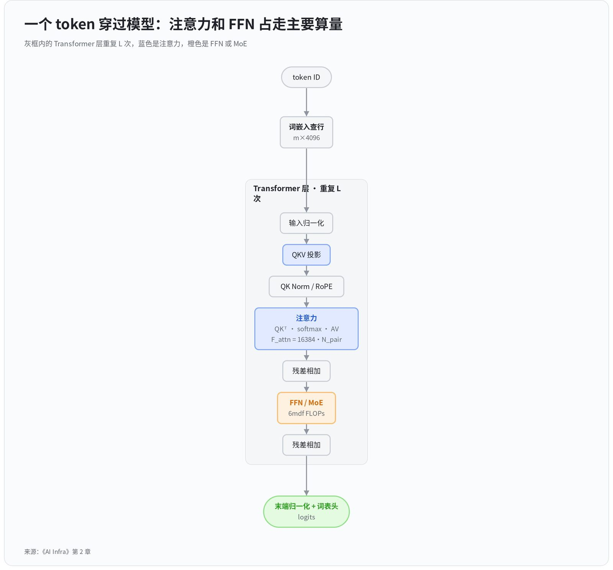

### 第 3 章 推理与训练负载

> 📖 <b>本章主线：</b>平均请求率和平均输入/输出长度相同，负载就相同吗？本章的回答是**不**。第 2 章只解决了「单次调用要做多少工作」，本章再追加三问：**工作何时到达、哪些步骤必须等待、什么结果才算完成**。围绕这三问依次建立排队（积压递推）、状态驻留时间（byte·s）、关键路径（Amdahl）与成功任务成本（C=c/p）四个模型。
>
> <b>贯穿算例：</b>两分钟共 480 条请求（平均每秒 4 条）在 RTX PRO 6000(96GB、1792 GB/s)上回放，均匀混合 vs 时段变化（9:1→1:9），说明为什么「平均处理能力足够却仍会积压」。

#### 3.1 从单次请求到持续到达的负载

单个请求的调用链 = 一次 prefill + $`n_d = G-1`$ 次 decode。恢复 $`S`$ 个上下文 token、处理 $`P`$ 个新输入、返回 $`G`$ 个 token，第 $`j`$ 次 decode 开始时已有上下文为 $`S+P+j`$。两阶段共用权重但资源特征不同。

> 📐 Prefill 输入 $`BP`$ 行，权重可参与更多乘加 → 通常**受算力限制**；单步 decode 只有 $`B`$ 行，少量 token 却要读整组权重 → 通常**受内存带宽限制**。

**三个计时区间**（请求到达 $`t_a`$、首 token $`t_1`$、末 token $`t_G`$）：

$`T_{TTFT} = t_1 - t_a`$,  $`T_{request} = t_G - t_a`$,  $`T_{token} = \frac{t_G - t_1}{G-1}\ (G>1)`$

<b>状态驻留（byte·s）：</b>任务状态大小 $`M(t)`$，占用空间对时间的积分 $`A_M = \int_{t_{start}}^{t_{end}} M(t)\,dt`$。1 GiB 状态占用 10 秒 = 10 GiB·s。若平均每秒 $`\lambda`$ 个任务到达，各占 $`M_0`$ 字节、平均等待 $`\tau`$ 秒，稳定态等待任务平均占用约 $`\lambda M_0 \tau`$，这正是 Little 定律形态（N=λT）。

<b>p95（最近秩法）：</b>把 $`n`$ 个观测升序排，取第 $`\lceil 0.95n \rceil`$ 个。4 条请求的 p95 是最大值，480 条是第 456 个。

<b>成功任务成本：</b>所有尝试成本之和 ÷ 成功任务数，失败生成、工具测试、环境运行都进分子。

#### 3.2 多轮交互与 Agent 任务

多轮对话前缀增长：第 $`i`$ 轮 $`P_i = I_i - K_i`$（重算）、$`S_i = K_i`$（复用前缀）。投影与 FFN 只处理新增 token，注意力仍要让新查询访问完整前缀。

> 📝 <b>缓存收益算例：</b>四轮代码修复，累计输入 5,297 token（命中 4,480、未命中 817）。全部重算 prefill 需 **76.196 TFLOPs**；复用命中前缀后仅需 **11.976 TFLOPs**。第二轮输入 1,443、命中 1,392，只需处理 51 个未缓存 token。

<b>成功任务成本模型：</b>每次尝试成本 $`c`$、成功率 $`p`$，期望次数 $`1/p`$，则 $`C_{success} = c/p`$。新方法更省的条件：$`p_2/p_1 > c_2/c_1`$。

> 📝 <b>价格降、质量升、成本仍升的例子：</b>token 单价降到 1/10、每任务用量增到 20 倍、成功率 50%→80%，成功任务成本比 $`= 20 \times \frac{1/10 \times 0.5}{0.8}`$，教学值给出 $`2 \times \frac{0.5}{0.8} = 1.25`$（每成功任务成本 2 → 2.5）。

<b>关键路径与 Amdahl（例题3-2）：</b>代码任务总时 76.510 s，首轮模型 36.375 s。首轮减半后总时降到 58.323 s，此时 $`f = 36.375/76.510`$、$`s=2`$，加速比约 **1.31**，节省约 23.8%。工具依赖：模型 2s + 工具（6s、10s） + 模型 3s，串行依赖 21s，独立并行 $`2 + \max(6,10) + 3 = 15`$ s。

> 📝 <b>Jev 决策请求算例：</b>只 prefill 不 decode。1929 token 一次前向约 28 TFLOPs,H100 SXM 按 40% 算力效率约 70 ms（演示 0.114 s）；普通 LLM 生成 64 token 每步受带宽限 ~9 ms，延迟增至 0.65 s（9 倍），但 decode 可合批，GPU 时间只多 28%。价格：每 GPU 小时 2 美元时，8B 稠密每百万输入 token 算力成本约 0.02~0.025 美元。

#### 3.3 多模态输入：一张图、一段音视频要搬多少

> 📌 **精读补充**：原稿在 3.2 与 3.4 之间缺少多模态一节，但第 0.4 节地图和附录 A 都引用了「第 3 章：多模态负载」。本节沿用全文的 M / F / R 算法补齐，数字为按公开模型惯例的**估算示意**，细节以原书为准。

多模态请求在进入语言模型之前多了一段<b>「把像素 / 波形变成 token」</b>的工作：先在 CPU 上解码、缩放，再由视觉或音频编码器转成向量序列，经投影后与文本 token 拼接，一起进入 prefill。<b>对后端来说，多模态最大的变化是输入 token 数被放大了一到两个数量级，模型变了倒在其次。</b>

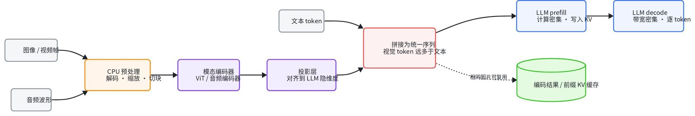

| 输入 | token 数估算 | Qwen3-8B KV 占用<br>（144 KiB/token） | 相当于 |
|---|---|---|---|
| 1 段 500 字文本 | 约 350 token | 约 49 MiB | 基准 |
| 1 张 1024×1024 图 | 每 token 覆盖 28×28 像素 → $`1024^2/784\approx 1337`$ | 约 188 MiB | ≈ 4 段文本 |
| 30 s 音频 | 编码器约 50 帧/s → 约 1500 帧（可再下采样） | 约 211 MiB | ≈ 4 段文本 |
| 60 s 视频（1 fps） | 60 帧 × 约 256 token/帧 ≈ 15,360 | **约 2.1 GiB** | ≈ 44 段文本 |

> 📝 <b>算例（一张图的 prefill 成本）</b>：只算语言模型部分，每 token 前向约 $`2N`$ FLOPs,$`2 \times 8\times10^9 \times 1337 \approx 21`$ TFLOPs，与 3.2 节 1929 token 的 Jev 决策请求同一量级。H100 按 40% 算力效率约 **50 ms**；若一次对话附 4 张图，首 token 延迟（TTFT）仅 prefill 就逼近 **0.2 s**，编码器与 CPU 预处理还要另算。

**对系统设计的三点影响**：

- **负载形状变了**：多模态请求是“超长输入 + 普通输出”,prefill 占比显著上升，和 3.1 节的长输入类请求同属一类，放大了 prefill / decode 的不对称，也让 9.2 节的 PD 分离更有价值。
- **多了一个独立阶段**：编码器只在输入侧跑一次、不参与 decode，可以单独部署、单独扩缩容（编码 → prefill → decode 三段分离）;CPU 解码与缩放也可能成为隐藏瓶颈。
- **复用机会更大**：同一张图片、同一段视频在多轮对话中反复出现，缓存其编码结果或前缀 KV，收益比纯文本更高，对应 9.5 节的 KV 共享与路由。

> 🚨 <b>误区：多模态请求的成本主要在编码器。</b>编码器通常只占一小部分参数；真正放大成本的是它产出的**上千个视觉 token**：它们要进 LLM 做 prefill、占 KV 空间，并在每一步 decode 时被重新读取。

#### 3.4 训练的计算与状态需求

<b>训练 ≈ 前向三倍。</b>线性层 $`Y=XW`$，反向需两种梯度：$`\frac{\partial \mathcal{L}}{\partial X} = \frac{\partial \mathcal{L}}{\partial Y} W^T`$、$`\frac{\partial \mathcal{L}}{\partial W} = X^T \frac{\partial \mathcal{L}}{\partial Y}`$。三次矩阵乘各含 $`mkn`$ 个乘加（各 $`2mkn`$ FLOPs），合计约 $`6mkn`$，由此得常见近似 $`F_{train} \approx 6ND`$。

#### 3.5 强化学习（RL）

生成数期望：保留 $`n_{keep}`$ 条、平均保留比例 $`a`$，则 $`n_{generate} \approx n_{keep}/a`$。周期运算量 $`F_{cycle}(n) = n(f_g + f_r) + F_u`$。权重同步：$`r`$ 个副本逐个发送 $`r M_W`$,Qwen3-8B BF16 一份约 16.381 GB，四副本约 65.526 GB。

#### 3.6 从负载需求到训练与服务预算

<b>Scaling Law（幂律）：</b>$`L(N,D) = E + \frac{A}{N^\alpha} + \frac{B}{D^\beta}`$。固定预算 $`C=6ND`$ 下最优参数量 $`N_{opt} = \left(\frac{\alpha A}{\beta B}\right)^{1/(\alpha+\beta)} \left(\frac{C}{6}\right)^{\beta/(\alpha+\beta)}`$。$`\alpha=\beta`$ 时预算增 4 倍，参数与数据各增 2 倍。

<b>全生命周期成本：</b>$`C_{life}(m) = C_0(m) + Q\sum_j w_j c_j(m)`$；两模型成本相等的调用量 $`Q^* = \Delta C_0 / \Delta c`$。

#### 本章速查 · 关键概念定义

| 术语 | 定义 |
|---|---|
| Prefill / Decode | prefill 一次处理全部新输入并产首 token;decode 逐 token 生成，每次上下文 +1 |
| TTFT（首响应） | 请求到达到首个 token 返回的时间 $`t_1 - t_a`$ |
| TPOT（token 间隔） | 首末 token 之间平均每 token 耗时 $`(t_G-t_1)/(G-1)`$ |
| 状态驻留积分 | $`A_M = \int M(t)\,dt`$，单位 byte·s，衡量等待期间累计存储占用 |
| 抢占 | KV 空间不足时暂停已开始请求、释放其 KV，之后恢复或重算 |
| 成功任务成本 | 全部尝试总成本 ÷ 成功任务数，$`C_{success}=c/p`$ |
| micro-batch | 一次前反向实际处理的数据子集，多个可累计梯度后再更新一次参数 |
| Rollout / OPD | RL 中当前策略生成回答的过程；OPD 为多教师同策略蒸馏 |

#### 本章速查 · 核心公式与关键数字

| 量 | 数值 / 公式 |
|---|---|
| KV 每 token | 144 KiB（Qwen3-8B, 36 层 8 KV 头） |
| RTX PRO 6000 单卡 decode 上限 | 约 2,795.66 步/秒（带宽下界），两卡约 5,591.33 步/秒 |
| 一步 64 序列 decode 读写 | 至少 41.02 GB，耗时 22.89 ms（权重 15.14 GB + KV） |
| 训练近似 | $`F_{train} \approx 6ND`$ |
| Qwen3-8B 全参训练状态 | 每参数 18 B(2+4+4+4+4)，共 147.433 GB ≈ 137.308 GiB |
| 8K 训练前+反矩阵 | 431.368 TFLOPs（前 143.789 + 反 287.579）;6ND 粗算 402.591，差 +7.15% |
| H100 SXM BF16 峰值 | 989.4 TFLOP/s;A100 为 312 TFLOP/s |

#### 本章速查 · 典型算例：例题3-1 平均能力足够为何仍积压

> 📝 <b>两类请求各到 240 条：</b>长输入类（输入 8192/输出 256）、长输出类（输入 1024/输出 2048）。积压逐窗递推：$`Q_{k+1} = \max(0,\ Q_k + A_k - \mu_k \Delta t)`$。
>
> <b>三时间窗的后续 decode 需求：</b>均匀混合 4,604 步/s、变化前一分钟 1,736.8、后一分钟 **7,471.2** 步/s。两卡处理率 5,591.33 步/s。后一分钟每秒多到 7471.2 − 5591.33 ≈ **1879.87** 步，60 秒积压约 **112,792 步**；停止到达后 112792/5591.33 ≈ **20.17 秒**才排空。
>
> <b>结论：</b>前一分钟未用能力无法留到后一分钟，全局均值掩盖了积压。480 条请求共 552,480 步 decode，按两卡约 5,591.33 步/秒，只看总工作量下界约 98.8 秒，似乎 120 秒内能做完；但后一分钟集中到达仍造成积压，按本例流体递推，停止到达后还需约 20.17 秒才排空（197.6 秒是单卡 2,795.66 步/秒的对照值）。

> 📌 <b>vLLM 实测（24 GiB KV 池、64 并发、480 条）：</b>完整请求 p95 两组均 ~299.4 s;TTFT p95 均匀混合 242.9 s、时段变化 258.9 s，相差约 16 s；抢占事件 62 vs 24。KV 池占用都达到过 100%。

#### 本章速查 · 流程图：RL 角色与数据流

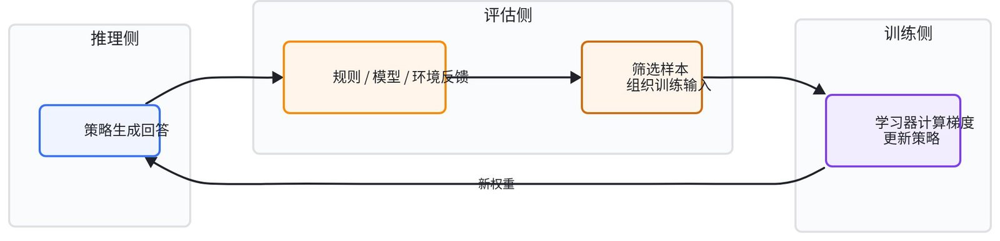

#### 本章速查 · 训练状态占用（Qwen3-8B 全参，GB）

| 组成 | 大小（GB） |
|---|---|
| BF16 权重 | 16.381 |
| FP32 梯度 | 32.763 |
| FP32 主权重 | 32.763 |
| Adam 一阶矩 | 32.763 |
| Adam 二阶矩 | 32.763 |

#### 本章速查 · 常见误区 / 金句

> 🚨 <b>误区：</b>平均请求率和长度相同，负载就相同。
>
> 少量超长请求、输入输出长度组合、到达顺序都会改变短时资源需求。例题3-1 中处理能力足以应付平均到达量，后一分钟却仍积压。
>
> <b>误区：</b>token 单价降低，成功任务成本就会降低。
>
> 额外思考、未通过检查的回答、工具与环境都进分子，合格任务数进分母。零成功的 batch 只能报告消耗与失败。
>
> <b>误区：</b>训练 token 总数相同，系统工作量就相同 / Scaling Law 拟合的计算最优规模就是应采用的训练规模。
>
> 序列分布改变注意力查询-键配对数；计算最优只在固定训练预算、不计推理成本时成立。公开模型每参数训练 token 数超基准一至两个数量级，是把长期服务成本计入目标后的选择。

---

## 第二部分 资源侧：硬件能搬多快、要经过哪里？（第 4-7 章）

> 📍 **主线锚点**：拿到需求侧的 M/F/R 后，这一段回答 5 问中的<b>「搬几次·经过哪里·能供多快」</b>。顺着存储层次由近及远放大：**单卡内部**（第 4 章的算力/带宽上限、第 5 章减少重复读写）→ **卡与卡之间**（第 6 章超节点内并行）→ **机器与机器之间**（第 7 章数据中心网络）。每跨一层，带宽掉一个量级、延迟涨一个量级，这正是 Jeff Dean 那张数字表要建立的直觉。

### 第 4 章 加速器架构

> 📖 <b>本章主线：</b>同样多的乘加，为什么在不同芯片、不同 batch 下耗时差几十倍？本章以 Qwen3-8B 的 Q 投影（$`Y=XW_Q`$,4096×4096）为主线算例，依次回答三问：**任务需要多少计算/存储/传输、计算单元为何等待、提升某一部分后新瓶颈在哪**。围绕这三问建立算术强度与复用、能耗层次、Roofline、Little 定律（在途事务）、双缓冲输入槽、多芯片互联六个模型。
>
> <b>贯穿数字：</b>一次 Q 投影 $`F=2MKN=33{,}554{,}432M`$ FLOPs；权重固定读 32 MiB，复用让算术强度从约 1 升到约 228（极限趋近 2,048）FLOPs/byte，这解释了为什么大 batch 更适合矩阵单元、单请求 decode 却几乎全被搬移占满。

#### 4.1 从模型计算认识加速器

Q 投影 $`X\in\mathbb{R}^{M\times4096}`$、$`W_Q\in\mathbb{R}^{4096\times4096}`$。prefill 时 $`M=BP`$，单步 decode 时 $`M=B`$，两阶段共用同一份权重。计算量 $`F=2MKN`$；读写量 $`V=2MK+2KN+2MN=33{,}554{,}432+16{,}384M`$ bytes（第一项是固定 32 MiB 权重）。

> 📐 <b>复用极限：</b>$`I(M)=\frac{2KN}{2KN/M+2(K+N)}`$。$`M=1`$ 时约 1 FLOP/byte;$`M=256`$ 时约 228 FLOPs/byte（行数×256，访问量只增约 1/8）;$`M\to\infty`$ 趋近 **2,048** FLOPs/byte。继续增大 batch 收益递减。

<b>Amdahl 与面积功耗：</b>开篇算例 60 μs 矩阵+40 μs 其余，矩阵提速 2 倍 $`S=\frac{1}{0.4+0.6/2}\approx1.43`$；提到 4 倍总时 55 μs，上限 2.5 倍。芯片面积、功耗、封装三项预算共同约束局部改进：评价一处提速要看整任务缩短多少。

> 📐 <b>动态功耗四推导：</b>(1) $`P_{dyn}\approx\alpha C V^2 f`$，连线电容随距离增长；(2) 每字节能耗层次（见下表）;(3) 光罩上限 H100 die 814 mm²、A100 826 mm²,HBM 每堆 $`R_{stack}=1024r/8`$;(4) 功率封顶：H100 TDP 700 W 扣 HBM 满带宽 106 W，得 $`b=\frac{700-106}{989.4}\approx0.60`$ pJ/FLOP;$`e>b`$ 时持续频率降为 $`b/e`$（定压）或 $`(b/e)^{1/3}`$（变压）。
>
> <b>能耗分账（Qwen3-8B 单请求 8K，一步 decode）：</b>读权重 15.137 GB、KV 1.208 GB，计算 19.97 GFLOPs。$`E_{weights}=15.137\times10^9\times31.76\,\text{pJ}\approx0.481`$ J、$`E_{KV}\approx0.038`$ J、$`E_{compute}\approx0.015`$ J，合计 **0.534 J**，权重读取占 <b>90%</b>。带宽只决定快慢不改能量；batch=32 时每 token 降到约 0.068 J（约 1/8）。翻转条件：batch>32 权重搬移能耗才低于计算能耗。

#### 4.2 计算单元

矩阵单元让乘加共享操作数：一次 16×16×16 完成 $`2\times16^3=8192`$ FLOPs，每元素参与 16 次乘法。补零效率 $`\eta_{shape}=\frac{MNK}{\lceil M/m_t\rceil m_t\cdots}`$。MoE 行数问题：64 token 各选 8 专家=512 次分派；分散到 256 专家按 16 补齐执行 4096 行（仅 512 有效），集中到 8 专家只执行 512 行全有效，有效计算相同，执行量差 8 倍。

> 📝 <b>例4-1 注意力流水（B200 单 SM）：</b>128×128 块 QK+PV 约 8.39 MFLOPs、指数 16,384 个。矩阵/共享内存/指数分别占 1024/768/1024 周期，间隔 $`\tau\ge\max(T_{matrix},T_{smem},T_{exp})`$。仅矩阵×2 仍 1024；矩阵+指数×2 得 768（提升 4/3）；三项×2 才降到 512。瓶颈随加速逐项转移。

<b>Softmax/RoPE：</b>二叉归约 $`\log_2 128=7`$ 轮串行。RoPE 每层（32+8）×64=2560 对分量、每 token 15,360 FLOPs，系数只随位置变化可预存：1024 位置 BF16 表 $`1024\times128\times2=256`$ KiB。

<b>低精度（4.2.4）：</b>存储 $`V_W=\frac{nb}{8}+\frac{n}{g}s`$。4096×4096 权重 4-bit、每 32 值共享 1 字节 scale=8.5 MiB（约 BF16 的 1/3.8）。展开为 BF16 再算 vs 直接分组计算：单 token decode 分别约 2.52 ms/2.81 ms（展开更快），但显存峰值 35.2 MiB vs 11.4 MiB（直接省约 2/3），误差从 2.3%–3.5% 降到 1.5%–1.9%（K 维 128 分组）。

#### 4.3 存储层次

KV 每 token $`m_{KV}=36\times2\times8\times128\times2=147{,}456`$ bytes=144 KiB。容量条件 $`W_{resident}+BSm_{KV}+M_{workspace}\le C_{available}`$，最大并发 $`B_{max}=\lfloor\frac{C_{avail}-W_{res}-M_{ws}}{Sm_{KV}}\rfloor`$。RTX 4090 24 GB 留 2 GiB 工作区，8K 上下文每请求 1.21 GB，可容 4 条（第 5 条超）,16K 时降到 2 条：取整的阶梯效应。

> 📝 <b>例4-2 带宽更高就同比加快吗？</b>读一条 8K 请求 KV=1.125 GiB，每事务 128 bytes、延迟 500 ns。维持 1,008 GB/s 需 $`N_o\ge\lceil\frac{R_{target}L}{s}\rceil`$=3,938 事务；128 事务只有约 32.8 GB/s(36.9 ms),4,096 事务达 1,008 GB/s(1.20 ms)。换 RTX 5090(1,792 GB/s)仍受 4,096 事务限，只提升约 4%。这就是 Little 定律 $`R_{eff}\le\min(R_{interface},N_o s/L)`$。

#### 4.4 数据搬移

二维视图地址 $`\text{addr}(i,j)=\text{base}+is_r+js_c`$。取 128 行×每行 128 元素：有效 32 KiB，行间步长 8192 bytes。双缓冲 $`T_{pipe}=t_l+t_c+(n-1)\max(t_l,t_c)`$:8 块各加载 2 μs/计算 1 μs，串行 24 μs，流水 17 μs。

> 📐 <b>输入槽时序（B200 tick）：</b>传输 64、等待 128（192 就绪）、计算 128，一槽 320 tick 释放。四块连续计算目标 $`T_{min}=192+4\times128=704`$ tick。一槽 1280、两槽 768、**三槽 704**（已够）、四槽仍 704。矩阵速率翻倍后目标降到 448，需四槽。缓冲配置随计算速度变化。

<b>单元间交接：</b>128×128 FP32 分数=64 KiB，写+读=128 KiB；直接传递省去中间写回。按查询行分组（32 行/组）让 Softmax 提前开始。实测：仅分组 5120 tick（单槽卡住）→双槽 3200 tick（降 38%）→直接交接 3008 tick（再降 6%）。三项分别改依赖、重叠组数、接口工作量。

#### 4.5 多芯片封装与互联

> 📌 <b>双 die 局部性：</b>各 die 存 32 GiB 权重，计算都放 die 0。**B200** NV-HBI/HBM 比值 2.5，跨 die 读仍受 die1 HBM 限，本地与跨 die 各约 8.6 ms（放哪侧都一样）；**昇腾 910C** 比值约 0.17，跨 die 读约 127 ms，把计算移到权重所在 die 后降到 21.5 ms，链路只传 64 MiB 输入/结果约 0.25 ms。比值&lt;1 时应本地复用大块权重。

<b>主机链路：</b>64 MiB 经 PCIe 4.0（32 GB/s/方向）$`T_{H2D}\approx2.1`$ ms，显存读（1,008 GB/s）约 67 μs，比值 31.5。复用 $`R\ge32`$ 次每次分摊上传≤一次显存读。**点对点** $`T_{edge}=\alpha+V/R`$,H100 NVLink 450 GB/s/方向、$`\alpha=2`$ μs:8 KiB 约 2.02 μs、2 MiB 约 6.66 μs。转折点 $`V^*=\alpha R=900{,}000`$ bytes≈**879 KiB**（约 $`M\approx110`$ 行）。

#### 4.6 模型需求如何推动架构演进

<b>NVIDIA:</b>V100 上 4096 行 Q 投影，普通 FP32 8.75 ms、Tensor Core 1.10 ms（约 1/8），传输 0.112 ms；单行时两条计算路径（2.14/0.268 μs）都短于 37.3 μs 传输。BF16 八位指数（最小正规数约 1.18×10⁻³⁸）减少缩放需求。MXFP4 权重从 32 MiB 降到 8.5 MiB,RTX 5090 读取从 18.72 μs 降到 4.97 μs（带宽×1.78、存储×1/3.76，合约 1/6.69）。

<b>昇腾：</b>3×3 卷积 img2col 在片上展开省 HBM 6.891 MiB≈6.02 μs。同一注意力块两次交接经外层接口 256 KiB,94 GB/s 下约 2.79 μs（超过 Cube 1.024 μs）;950 增 CV 直连，128 KiB 交接只需约 128 GB/s（FP16 再减半至 64 GB/s）。<b>Apple：</b>统一内存 M3 Ultra 256/512 GB@819 GB/s;Qwen3-8B 单步 16.345 GB 读取下界 M1(800)20.43 ms、M3(819)19.96 ms、M4 Max(546)29.94 ms，容量增让驻留，带宽增才缩短读取。

> 📌 <b>GPU 规格表（BF16/FP32 稠密）：</b>RTX 3090 24GB/936/71.0;4090 24/1008/165.2;5090 32/1792/209.5;PRO 6000 96/1792/503.8;A100 80/2039/312.0;H100 80/3350/989.4;H200 141/4800/989.5(TFLOP/s)。H100 vs A100：矩阵×3.17、带宽×1.64;H200 vs H100：主增容量带宽、矩阵基本不变。

#### 4.7 专用架构

<b>TPU v1:</b>256×256 8-bit 阵列，单行每字节权重 2 次操作，256 行则 512 次。<b>Groq/Cerebras:</b>Groq TSP 每芯片 220 MiB SRAM（仅存 BF16 权重需 72 颗）,8 条 8K 请求 KV 9 GiB 需 42 颗、32K 需 168 颗；Cerebras WSE-3 片上 SRAM 44 GB。<b>OpenTallas 固定权重 ROM:</b>HBM 读取比 $`S_{HBM}=1+\frac{W}{BK}`$,$`W\approx15.1`$ GB、$`K\approx1.21`$ GB;B=1 时 HBM 从 16.3 GB 降到 1.21 GB（约 1/13.5），KV=权重转折点 $`B=W/K\approx12.5`$（整数 13 起 KV 超权重）。

#### 4.8 根据架构分析性能、选择加速器

<b>执行时间三关系：</b>共享资源 $`T_r=\sum_i w_{r,i}/p_{r,i}`$；独立资源 $`T\ge\max_r T_r`$；加依赖时两阶段串行（10+10=20 μs，汇总只得 11 μs，差 9 μs 来自依赖）。<b>Roofline:</b>$`P_{attainable}\le\min(P,RI)`$，交点 $`I^*=P/R`$；转折行数 $`M^*=\frac{I^*d}{d-2I^*}`$，代入 $`I^*\approx164`$ 得 $`M^*\approx178.1`$（179 行起矩阵为主导）。高于交点用 MFU、低于用 MBU。

> 📌 <b>候选设备比较（Qwen3-8B 8K 单请求）：</b>decode 读取下界 3090 17.5/4090 16.2/5090 9.1/A100 8.0/H100 4.9/M3 Ultra 20.0 ms;4K prefill 矩阵下界 3090 871.1/4090 374.4/5090 295.2/A100 198.2/H100 62.5 ms。3090→4090 decode 只快 7.1%、prefill 快 57%。235B-A22B(4-bit,126.867 GB)只 M3 Ultra/H200 可驻留：每步 13.697 GB,M3 16.72 ms(59.8 tok/s)、H200 2.85 ms(350.4 tok/s)。

> 📌 <b>预测 vs 实测（RTX PRO 6000,vLLM eager）：</b>8K batch1 读取下界 9.12 ms(109.6 tok/s)，实测中位 25.83 ms(38.7 tok/s)，下界只占 35.3%（即 MBU）。batch=64/2K 时读取下界 19.23 ms、实测 29.63 ms、等效 1.16 TB/s（峰值 65%）。batch1 每步主要由固定工作（kernel 启动/采样/同步）决定，提带宽几乎不加快。

> 📝 <b>例4-3 专用化回本：</b>固定成本 2000 万美元，每百万合格 token 省 0.50 美元。回本量 $`V^*=F_0/\Delta c=4\times10^{13}`$ token（40 万亿）。100 台×10,000 tok/s×50%×一年≈1.58×10¹³（15.8 万亿，占 39%）。一年内回本至少需 254 台；寿命减半或利用率减半需 508 台。每年约省 788 万美元&lt;2000 万，达 40 万亿需约 2.54 年>1 年寿命。

#### 本章速查 · 关键概念定义

| 术语 | 定义 |
|---|---|
| 算术强度 $`I`$ | $`I=F/V`$，每字节访问对应的浮点运算数；随观察层次（L2/DRAM）不同而不同 |
| Roofline | $`P_{attainable}\le\min(P,RI)`$，斜线为带宽界、水平线为算力界，交于 $`I^*=P/R`$ |
| MFU / MBU | 算术强度高于交点用矩阵利用率（MFU）、低于交点用带宽利用率（MBU）衡量 |
| Tensor Core / Cube | 专执行规则矩阵乘加的硬件；昇腾 Scalar/Vector/Cube/MTE 对应控制/向量/矩阵/搬移 |
| 在途事务 / Little 定律 | $`N_o\ge\lceil R_{target}L/s\rceil`$，维持带宽所需并发访问数；独立访问才能填满队列 |
| 输入槽 / 双缓冲 | 保存一个输入块的缓冲，从请求发出到计算结束一直占用；多槽让加载与计算重叠 |
| 光罩上限 / TDP | 单 die 面积不能超过一次曝光范围；TDP 为最大持续功率，由内存与计算共用 |
| $`\eta_{shape}`$ | 有效运算占实际执行（含补零）的比例；小矩阵/MoE 稀疏行数使其显著下降 |

#### 本章速查 · 核心公式与关键数字

| 量 | 数值 / 公式 |
|---|---|
| Q 投影计算量 | $`F=2MKN=33{,}554{,}432M`$ FLOPs；访问 $`V=33{,}554{,}432+16{,}384M`$ bytes |
| 算术强度极限 | $`M=1`$≈1、$`M=256`$≈228、$`M\to\infty`$→2,048 FLOPs/byte |
| 动态功耗 / FLOP 预算 | $`P_{dyn}\approx\alpha CV^2 f`$;H100 $`b=(700-106)/989.4\approx0.60`$ pJ/FLOP |
| 每字节能耗 | SRAM 1.25、片上 SRAM 12.5、NVLink-C2C 10.4、HBM2 31.76、LPDDR 160 pJ；乘加 0.75 pJ/FLOP |
| KV 每 token | 144 KiB（Qwen3-8B,36 层 8 KV 头）；一步 decode 能量 0.534 J（权重占 90%） |
| HBM 每堆 | $`R_{stack}=1024r/8`$;H100 5 堆 3,350 GB/s,B200 8 堆 8 TB/s |
| 转折点 | Roofline $`M^*\approx178.1`$;NVLink $`V^*=\alpha R\approx879`$ KiB；复用 $`R\ge32`$ |
| 成本不等式 | $`K_A<K_B\iff c_A/c_B<t_B/t_A`$；回本 $`V^*=F_0/\Delta c`$ |

#### 本章速查 · 流程图：Roofline 与瓶颈判定

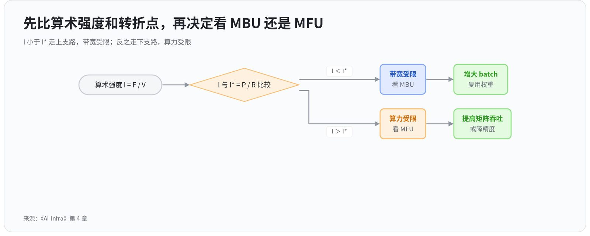

#### 本章速查 · 能耗层次（每字节，pJ）

| 存储 / 链路 | 每 byte 能耗（pJ） |
|---|---|
| KB 级局部 SRAM | 1.25 |
| MB 级片上 SRAM | 12.5 |
| NVLink-C2C 链路 | 10.4 |
| HBM2 | 31.76 |
| LPDDR DRAM | 160 |
| 16 位浮点乘加（2 FLOPs） | 0.75 pJ/FLOP |

#### 本章速查 · 常见误区 / 金句

> 🚨 <b>误区：</b>换上带宽更高的显卡，读取就会同比加快。
>
> 受在途事务数限制时（Little 定律），带宽提高 78% 吞吐可能只提升约 4%。要用满带宽必须同时发出足够多相互独立的访问；地址依赖会让深队列也填不满。
>
> <b>误区：</b>峰值算力是硬件能持续达到的速率。
>
> 功率封顶时，每 FLOP 能耗 $`e>b`$ 就会降频，持续频率降为 $`b/e`$（定压）或 $`(b/e)^{1/3}`$（变压）。按峰值预测的计算时间比实际短，衡量利用率应以持续算力为分母。
>
> <b>误区：</b>提升矩阵单元（或提高带宽利用率）就能加快任务。
>
> <b>瓶颈会转移：</b>矩阵加速后指数与共享内存成为新限制（例4-1）。单请求 batch1 decode 每步主要由固定工作（kernel 启动、采样、同步）决定，MBU 仅 35.3%，提带宽几乎无效：先减固定工作，再谈利用率。

### 第 5 章 算子与运行时

> 📖 **本章主线**：从一次矩阵投影出发，沿「提交—搬移—同步 → 分块 → 融合 → 编译 → 运行时 → 完整请求」逐层展开。全章反复用三个基本判断：**复用需要空间**（更大的 tile 让输入多用几次，却挤占累加存储与驻留块数）、**数据依赖决定计算顺序**（逐元素可即算，归约必须保状态）、**总时间取决于执行顺序**（带宽、较慢阶段、复用次数、关键路径）。贯穿算例是 Qwen3-8B 的 FFN：隐藏宽度 $`H=4096`$、中间宽度 $`F=12288`$、一次处理 $`M=1024`$ 个 token,BF16 存储、FP32 累加。

#### 一、逐节要点

- **5.1 提交、搬移与同步**：PyTorch → kernel launch 三层次（算子 / kernel / launch）；异步提交形成「CPU 准备提交、GPU 执行」的流水；H2D / D2H / D2D 三种复制；stream 保证同流内顺序，event 指定跨流依赖；从提交时间到结果可用时间；一个 kernel 在 SM 上沿线程 / 驻留 / 访存 / 矩阵指令 / 同步五步执行。
- **5.2 单算子的分块、布局与访存**：矩阵形状与重复读取；容量约束下扩大输出块换取输入复用；bank padding / swizzle 让并行请求分散；沿 M / N / K 切分对应输出维与归约维，浮点加法不满足结合律带来精度差异。
- **5.3 相邻算子的融合、缓冲与流水**：中间张量与融合边界；布局转换、双缓冲与背压；FlashAttention 的分块与在线 Softmax。
- **5.4 编译器**：为何比较多种实现；用 split / reorder / fuse / compute_at 表达分块融合；依赖与舍入如何限制变换；AKG 多面体编译；成本估计与实测选择。
- **5.5 运行时**：主机准备与加速器计算重叠；CUDA Graph 图重放；动态形状（通用 / 分桶 / 特化）与编译开销；Persistent Kernel 按块调度。
- **5.6 从局部优化到完整请求**：Amdahl 定律、关键路径切换、Qwen3 综合案例。

#### 二、关键概念定义

| 概念 | 含义 |
|---|---|
| kernel launch | CPU 向加速器发起一次 kernel 执行的动作，异步提交，调用返回即完成提交 |
| warp | 一起发射的 32 个线程，执行同一条指令、处理不同数据；256 线程含 8 个 warp |
| 占用率 occupancy | 驻留 warp 数 ÷ SM 最大驻留 warp 数，决定可隐藏延迟的在途请求 |
| tiling 分块 | 把大矩阵切成小块以复用输入、控制局部存储占用 |
| 算子融合 fusion | 相邻算子在同一 kernel 内衔接，省去中间张量的写回与重读 |
| swizzle | 按固定规则置换块内地址，使同列请求落到不同 bank，不增字节 |
| CUDA Graph 图重放 | 把任务序列记录成图，重复只发一次 graph launch，减少主机提交 |
| 分桶 / 特化 | 把输入补齐到少数代表形状复用程序 / 为具体形状生成专门实现 |
| 算术强度 | FLOPs ÷ 接口字节数，与硬件 FLOP/byte 比对判断是否带宽受限 |

#### 三、核心公式与关键数字

本节复现原书带数字的推导：运算量、读写量、算术强度，以及在途字节的 Little 定律。

> 📐 **矩阵乘运算量与基准读写**（$`M=1024,K=4096,N=12288`$）：
>
> ```math
> F_{gemm} = 2MKN \approx 103\ \text{GFLOPs}
> ```
>
> ```math
> V_{once} = 2(MK+KN+MN) = (8+96+24)\ \text{MiB} = 128\ \text{MiB}
> ```
>
> <b>分块后总读写量：</b>$`V = \dfrac{2MKN}{n} + \dfrac{2KNM}{m} + 2MN`$（A 重复读 + W 重复读 + C 写出）。

| 输出块 | 局部存储 | 接口访问 | 算术强度 | MFU 上限 |
|---|---|---|---|---|
| 32×32 | 8 KiB | 6168 MiB | 15.9 FLOP/byte | 5% |
| 64×64 | 24 KiB | 3096 MiB(≈3 GiB) | 31.7 FLOP/byte | 11% |
| 128×128 | 80 KiB | 1560 MiB | 63.0 FLOP/byte | 21% |

> 📐 **Little 定律：在途字节需求 vs 可提供**（H100，带宽 3.35 TB/s、延迟 600 ns、132 个 SM）：
>
> ```math
> B_{need} = \dfrac{3.35\ \text{TB/s} \times 600\ \text{ns}}{132} \approx 15.2\ \text{KB/SM}
> ```
>
> $`B_{have} = 16 \times 4 \times 512\ \text{bytes} = 32\ \text{KiB}`$（16 warp × 每 warp 4 条挂起加载 × 512 bytes）
>
> 可用是需求的 2.15 倍；占用率 16/64 = 25%，只驻留 8 warp 也够。翻转条件：延迟升到 1000 ns、每 warp 只挂 2 条加载时，需求升到 25.4 KB，覆盖率降为 0.65,25% 占用率不再足够。

#### 四、核心结构：FlashAttention 的分块与在线 Softmax

标准注意力先算 $`S=QK^T/\sqrt{d}`$、再 $`P=\text{softmax}(S)`$、最后 $`O=PV`$。取一个头、$`L=8192`$、$`d=128`$：完整 S、P 用 FP32 各占 256 MiB，写出再读回合计 1 GiB。FlashAttention 只传递三个统计量，省去这 1 GiB。

> 📐 **在线 Softmax 递推**（m 为最大分数，ℓ 为指数和，u 为加权值向量）：
>
> ```math
> m' = \max(m, \max(s)),\quad r = \exp(m-m')
> ```
>
> ```math
> \ell' = r\ell + \sum_j p_j,\quad u' = ru + \sum_j p_j V_j
> ```
>
> 右侧求和只遍历新块；旧块贡献已存在 ℓ、u 中，无需回读旧分数。

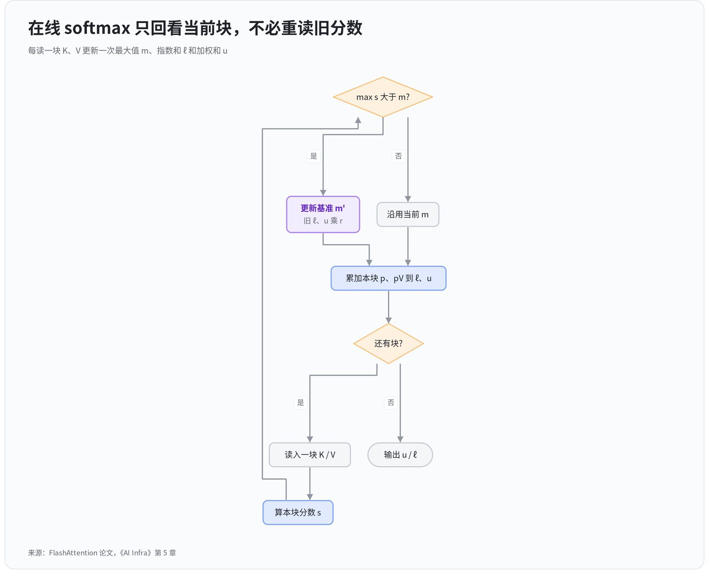

> 📐 **块大小的两难**（RTX PRO 6000,99 KB 共享内存，L=8192,d=128）：
>
> ```math
> S = 2ad + 2bd + 4ab + 4ad + 12a \le 101376
> ```

| K/V 块行数 b | 可容纳 Q 行 a | 完整扫描次数 | 接口读写 | 状态更新次数 |
|---|---|---|---|---|
| 1 | 128 | 64 | 260 MiB | 524288 |
| 64 | 82 | 100 | 404 MiB | 12800 |
| 128 | 53 | 155 | 624 MiB | 9920 |

> 🚨 从 b=64 缩到 b=1，读取只少 144 MiB，状态更新却从 12800 增至 524288（约 41 倍），且矩阵乘一维过小难以打满矩阵单元。访问量最小不等于最快。

#### 五、典型算例

> 📝 <b>例 5-2 三种耗时（提交 / 加速器 / 完整调用）</b>:CPU 在 0–3 μs 提交，H2D / kernel / D2H 分别 8 / 20 / 4 μs。结果在第 35 μs 可用。把 kernel 从 20 μs 缩到 5 μs，结果在 3+8+5+4=20 μs 可用；kernel 快 4 倍，整次执行只从 35 降到 20 μs，加速比约 1.8（剩 15 μs 由提交与复制构成）。
>
> **例 5-5 双缓冲**（H100 一 SM，搬移 1.29 μs、计算 0.28 μs）：串行四块 4×(1.29+0.28)≈6.28 μs；双缓冲后由首尾相接的搬移决定，4×1.29+0.28≈5.44 μs，只减约 13%。流水通式 $`T_{pipe} = t_m + (n-1)\max(t_m,t_c) + t_c`$。搬移器已连续工作，加第三个槽无益。
>
> <b>激活链融合（例 5-4 / 实验 5-3）</b>：分开执行 SiLU+乘法读写 120 MiB，融合后 72 MiB，时间比 72/120=0.6；三步全分开 156 MiB → 三步融合 60 MiB。实测激活链从 14.2 μs 降到 7.7 μs（加速 ≈1.8）。完整注意力对照：数学后端约 2.6 ms、新增显存 848 MiB;FlashAttention 后端约 80 μs、新增显存 22 MiB，加速比约 33。
>
> **例 5-11 图重放的输入复制临界点**：普通执行 40 μs（计算 20 + 等待 20）；图重放准备 5 μs，原可省 15 μs。复制读写量为 2X，按 RTX PRO 6000 带宽 1792 GB/s，更快条件 $`2X/B < 15\ \mu s`$，得 $`X < 12.8\ \text{MiB}`$。2 MiB 输入图执行约 27 μs（更快）,16 MiB 约 44 μs（反而更慢）。
>
> **例 5-12 动态形状：分桶 vs 特化**（10 次 FFN，通用 / 分桶 / 特化 MFU 20% / 40% / 50%，准备 100 / 400 / 900 ms，每组执行 17.0 / 12.4 / 6.8 ms）：1–64 组通用最省，65–89 组分桶最省，90 组起特化最省。执行 70 组时总时间约 1.29 / 1.27 / 1.38 s，分桶最短（特化的准备开销还没摊薄）。

#### 六、综合案例：一次 Qwen3-8B 请求

RTX PRO 6000、输入 7239 token、生成 32 个输出、BF16 eager,36 层。SwiGLU 激活共 36×32=1152 次调用（prefill 36、decode 1116）。替换 kernel 后：

| 阶段 | 形状与次数 | 原 kernel | 替换后 |
|---|---|---|---|
| Prefill | 7239 行，36 次 | ≈11.2 ms | ≈11.2 ms |
| Decode | 1 行，1116 次 | ≈2.4 ms | ≈0.92 ms（加速 ≈2.6） |

全部激活约 13.6 ms，占约 851 ms 采集区间的 1.6%；替换后降到 12.2 ms，整请求预计减少约 1.4 ms。11 对交错测量，配对时间差中位数约 1.3 ms（约占原请求 0.16%），与预期相符。

> 📐 **Amdahl 定律与关键路径**：$`S_{request} = \dfrac{1}{(1-f)+f/s}`$。热点占 20% 即使加速到无穷，上限也只有 1.25 倍。并行分支下应看最长路径：准备 10 + max(A,B) + 收尾 10;A 从 60 缩到 15 μs 后 B(40)接替成为关键路径，请求只从 80 降到 60 μs。

#### 七、常见误区 / 金句

> 🚨 <b>误区一：</b>仅凭 kernel 数量判断执行成本。图重放把 3 次 FFN 的主机提交从 18 降到 3，加速器仍执行 18 个 kernel；<b>融合才把加速器 kernel 减到 15。减 kernel 靠的是融合，图重放做不到。</b>
>
> <b>误区二：</b>访问量最小的实现一定最快。K/V 块从 64 行缩到 1 行，访问少 144 MiB，状态更新却增至约 41 倍。
>
> <b>误区三：</b>增加缓冲就能提高吞吐。两个槽已让搬移器连续工作，第三个槽不能让搬移更快；要缩短时间只能减少每块字节或提高带宽。
>
> <b>误区四：</b>稳态执行最快，总耗时就最短。执行 70 组时分桶约 1.27 s，特化约 1.38 s：特化每组更快，但准备开销还没被摊薄。

> 💬 <b>金句：</b>vLLM v0.6.0 三项主机侧改动（拆进程避 GIL、多步调度、异步输出）让 Llama 3 8B 吞吐提到 2.7 倍，<b>没触及任何 kernel，也没换硬件。当软件抽象开销占到步间隔的六成，去掉它比换更快的加速器有效得多。</b>

### 第 6 章 超节点

> 📖 **本章主线**：上一章把矩阵切成小块留在单卡内；本章把其中一块交给另一张卡，数学不变，但原来走共享内存的数据现在要穿过加速器互联甚至机房网络。全章沿「切哪个维度 → 产生什么通信 → 通信落在什么连接上 → 一个实例用几张卡、部署几个实例」推进，反复用三个判断：**切特征维要相加（部分和），切样本/序列/层/专家只需收集或交接**、<b>并行收益随规模递减（本地时间降、通信轮次涨）</b>、**先按容量与合法性排除，再按完整负载的延迟/吞吐/成本比较**。硬件是 HGX H100 八卡服务器（H100 SXM 80 GB、3350 GB/s、989.4 TFLOP/s、NVLink 每方向 450 GB/s、ConnectX-7 50 GB/s）；贯穿模型 Qwen3-235B-A22B（占满整机，讲容量/MoE）与 Qwen3-32B（单卡放得下，长上下文 KV 逼其跨卡）。

#### 一、逐节要点

- **6.1 从单卡到多卡**：推理实例描述模型如何部署，超节点描述加速器如何互联；用更多卡出于容量/延迟/吞吐三种需求；容量式 $`W_i+K_i+A_i+U_i \le C_i`$；单 token 权重读取（90.1 μs）远超计算（0.31 μs），Roofline 式 $`T_{op}=\max(F/P,\ V/B_{HBM})`$;prefill 与 decode 的复用与依赖差异。
- **6.2 六种并行方式**：DP 切样本、TP 切特征、SP 切逐 token 算子的序列位置、CP 切注意力序列位置、PP 切层、EP 切专家；TP 列切拼接 vs 行切求和；SwiGLU 两卡切法；执行模型 $`T(p)=T_{local}/p+128\,T_{AR}(p)`$;PP 气泡 $`T_{PP}=(q+b-1)t`$。
- **6.3 组合并行与模型规模**：设备坐标（DP2×PP2×TP4）;TP2×EP4 布局；批内复用与负载不均；活跃专家期望式；从数千亿到万亿参数的组合变化。
- **6.4 集合通信的实现与执行代价**：AllReduce/ReduceScatter/AllGather/All-to-All 四种语义；环 $`T_{ring}`$ 与树 $`T_{tree}`$、交点 680 KiB;algbw vs busbw；通信与计算争用资源；融合/加速器发起/专用卸载与 PCIe 穿越次数。
- **6.5 超节点的物理组织**：直连/交换/分层拓扑；NVSwitch 端口分配；三维环面 vs 交换网络；供电式 $`N\le g\lfloor(P_b-P_0)/P_s\rfloor`$;NVIDIA/TPU/华为 UB 三条路线；UB 事务层 Jetty 与传输层 TP Channel、片上状态容量。
- **6.6 内存池**：局部不足与全局空闲；借用与访问边界；在途窗口式 $`B_{window}=uq/L`$；远端直读 vs 本地缓存。
- **6.7 从并行方案到超节点规模**：八卡多会话时间线；功率/成本/故障范围；切分策略五步法与优化式 $`\pi^*=\arg\min J(\pi)`$;V4.1 Flash 综合算例（超节点放大、权重进 ROM、Engram 表与 KV 放置）。

#### 二、关键概念定义

| 概念 | 含义 |
|---|---|
| 推理实例 / 超节点 | 实例描述模型如何部署执行；超节点描述加速器如何经高带宽低延迟互联紧密相连 |
| 数据并行 DP | 每卡一份完整模型、处理不同样本；推理即多实例，训练需梯度 AllReduce |
| 张量并行 TP | 切特征（权重列/行、注意力头），各卡算部分，列切拼接、行切求和 |
| 序列并行 SP / 上下文并行 CP | SP 让逐 token 算子（LayerNorm 等）沿序列分片；CP 切注意力序列位置，需交换 K/V 或统计量 |
| 流水线并行 PP / 专家并行 EP | PP 按层分阶段、交接激活；EP 把专家放到不同卡，靠 All-to-All 做 dispatch/combine |
| AllReduce / ReduceScatter / AllGather / All-to-All | 四种集合通信：全归约 / 归约后分散 / 全收集 / 全交换，由起止时各卡持有什么区分 |
| algbw / busbw | algbw=M/T（测试数据量除时间）;busbw=2(n-1)M/(nT)，归一化指标，不等于每张网卡实际吞吐 |
| 割集带宽 / 基数 radix | 把系统分两半、穿过切面的链路总带宽；radix 为一颗交换芯片提供的端口数 |
| Unified Bus(UB) | 华为超节点互联，事务层 Jetty 端点 + 传输层 TP Channel 分离，支持跨主机资源直接访问 |

#### 三、核心公式与关键数字

本节复现原书带数字的推导：容量与单步时间、六种并行方式的切分与通信、环树算法、在途窗口。

> 📐 **容量与单步时间**（Qwen3-235B-A22B,94 层，H=4096,64 查询头/4 KV 头，头维 128,128 专家/选 8）：
>
> 每 token KV $`= 2 \times 94 \times 4 \times 128 \times 2 = 188\ \text{KiB}`$;8192 token 约 1.58 GB。
>
> 单卡总需求 $`W+K+U \le C`$:470.2 GB + 1.58 GB + 2.15 GB ≈ 473.9 GB（近 H100 六倍）；八卡每卡 58.96+0.39+2.15 ≈ 61.50 GB。
>
> <b>Roofline:</b>$`T_{op}=\max\!\left(\dfrac{F}{P},\ \dfrac{V}{B_{HBM}}\right)`$。单 token 一层专家权重 288 MiB，读取 90.1 μs 远超计算 0.31 μs,MFU 上限约 0.3%。
>
> <b>TP 两种切法（以 [2,3]×[[1,4],[2,5]]=[8,23] 为例）</b>：按**列**切→各卡算不同输出元素（8、23），并排**拼接**；按**行**切→各卡得 [2,8]、[6,15] 形状相同的部分和，逐元素**求和**得 [8,23]。
>
> <b>SwiGLU 下投影：</b>$`Y=[Z_0\ Z_1]\begin{bmatrix}W_{d,0}\\ W_{d,1}\end{bmatrix}=Z_0 W_{d,0}+Z_1 W_{d,1}`$，右侧各含中间维一半贡献，须相加。
>
> <b>执行模型：</b>$`T(p)=\dfrac{T_{local}}{p}+128\,T_{AR}(p),\quad T_{local}\approx 29.35\ \text{ms}`$；增卡加速条件 $`128[T_{AR}(2p)-T_{AR}(p)]<\dfrac{T_{local}}{2p}`$。

| 并行方式 | 切分维度 | 每卡保存/计算 | 卡间必须交换 |
|---|---|---|---|
| 数据并行 DP | 样本 B | 一份完整模型、不同样本 | 推理不换；训练汇合梯度 |
| 张量并行 TP | 特征 H（列/行、头） | 同层矩阵一部分 | 输出分片收集；部分和相加 |
| 序列并行 SP | 逐 token 算子的序列位置 S | 一段位置 | 入矩阵乘前 AllGather；出 ReduceScatter |
| 上下文并行 CP | 注意力序列位置 S | 一段位置的 Q/K/V | 远端 K/V 或各段统计量 |
| 流水线并行 PP | 层 L | 一段连续的层 | 相邻阶段交接激活/梯度 |
| 专家并行 EP | 专家 E | 一部分专家 | token 送到所选专家的卡再送回 |

> 📐 **流水线并行气泡**（q 阶段、b 个 micro-batch、每阶段耗时 t）：
>
> ```math
> T_{PP}=(q+b-1)t,\qquad \eta_{PP}=\dfrac{b}{q+b-1}
> ```
>
> 四阶段四 micro-batch 利用率 4/7≈57%；增到 16 个为 16/19≈84%。独立 micro-batch 越多，填充与排空占比越小。
>
> **批内活跃专家期望**（每 token 从 E 选 k，批 m 个 token 独立）：
>
> ```math
> \mathbb{E}[E_{active}]=E\left[1-\left(1-\dfrac{k}{E}\right)^{m}\right]
> ```
>
> 取 E=128、k=8、m=8，期望约 52 个活跃专家，理想读取约 1.8 GiB；若 8 token 全选同样 8 个专家仍只读 288 MiB（与均匀覆盖 4.5 GiB 相差 16 倍）。

#### 四、核心结构：环形与树形归约

集合通信语义规定「算什么、结果落在哪些卡」，具体算法规定「分几轮、如何传」。环形把 M 字节分成 n 块沿有向环传递，树形从轮数入手用二项树。

> 📐 **环 vs 树**（每轮固定开销 α、有向边带宽 B）：
>
> $`T_{ring}=2(n-1)\alpha+\dfrac{2(n-1)M}{nB}`$（共 2(n-1) 轮，每卡发 2(n-1)M/n）
>
> $`T_{tree}=2\log_2 n\left(\alpha+\dfrac{M}{B}\right)`$（n 为 2 的幂时 2log₂n 轮，每轮传完整张量）
>
> 取 α=0.822 μs、B=450 GB/s、n=8:10 KiB 时树 5.07 μs 快于环 11.55 μs;80 MiB 时环 0.34 ms 快于树 1.12 ms。交点约 **680 KiB**。

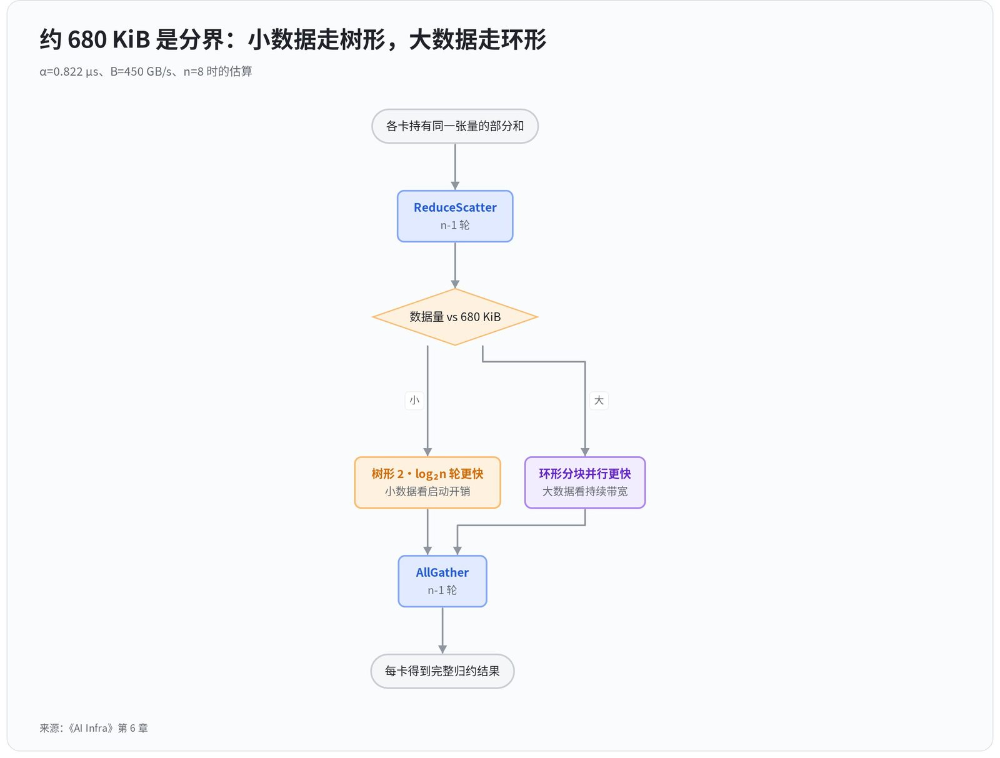

| TP 卡数 | 本地内存访问 | 128 次归约 | 单步时间 |
|---|---|---|---|
| 1 | 29.35 ms | 0（放不下 128K 会话） | 29.35 ms |
| 2 | 14.68 ms | 0.21 ms | 14.89 ms |
| 4 | 7.34 ms | 0.64 ms | 7.97 ms |
| 8 | 3.67 ms | 1.48 ms | 5.15 ms |

> 🚨 八卡一次归约 11.51 μs 来自启动（14 轮），即使传输降为零仍要等这十四轮。带宽翻倍整步只省约 2.5 μs；每轮固定开销减半，128 次归约却能省约 0.74 ms。<b>数据量小的时候，先减每轮启动开销，别急着提带宽。</b>

#### 五、典型算例

> 📝 <b>长上下文逼稠密模型跨卡（Qwen3-32B）</b>:BF16 权重 65.52 GB，单卡放得下；每 token KV 256 KiB，一个 128K 会话 KV 约 34.36 GB。单卡 65.52+34.36+2 GiB≈102.03 GB 超 80 GB；两卡每卡 52.09 GB。TP1 连一个 128K 会话都容不下，这时用 TP 首先是为容量。TP 卡数一旦超过 KV 头数（8）再增卡就会复制 KV。
>
> <b>MoE 负载不均（TP2×EP4）</b>:64 token 各选 8 专家共 512 次分派。均匀覆盖 128 专家读 4.5 GiB；全选同 8 个专家只读 288 MiB（差 16 倍）。但若 8 个活跃专家全落一个 EP 组，该组承担全部 512 次、计算量是均匀时四倍，其余三组等待。把热点专家分散到四组：读取仍 288 MiB，四组各 128 次。<b>访问量最小不等于最快，批内复用要与专家分布一起分析。</b>
>
> <b>通信与计算争用（实验 6-5，四进程中位数）</b>:4 MiB 归约单独 2.67 ms，与矩阵乘（11.53 ms）同时跑增至 6.14 ms 却仍藏在计算内，整组 11.58 ms;64 MiB 归约从 36.92 增至 45.21 ms，矩阵乘从 11.03 增至 12.89 ms，分开共约 48.0 ms、同时只省约 2.7 ms。<b>评价重叠要比同时运行的时间，不能把各自单独测得的时间直接相减。</b>
>
> **TP16 跨服务器反而更慢**：两台 HGX H100 共 16 卡经 ConnectX-7 相连。Qwen3-32B 只有 8 KV 头，TP16 每卡 KV 不再减少，本地仅从 3.67 降到 2.48 ms；实测跨服务器一次 AllReduce 约 32.74 μs,$`T(16)\approx 2.48\ \text{ms}+128\times 32.74\ \mu s\approx 6.67\ \text{ms}`$，比单台 TP8 的 5.15 ms 慢约 1.52 ms。
>
> **拓扑与 UB 状态**：64 端口 NVSwitch 分 32/32 上联 800 GB/s、分 48/16 只 400 GB/s。三维环面最远 6 跳、交换网络恒 2 链路 1 交换，每跳 200 ns,decode 128 次归约环面多等约 0.10 ms（约 TP8 全部归约 1.48 ms 的 7%）。UB 逐对连接 $`S_{pair}=512A^2(H-1)+32A`$ vs 端点加通道 $`S_{UB}=52A+56(H-1)`$:A=8 时 256 KiB 缓存前者只容 8 台主机，后者容四千多台；PCIe 穿越 CPU 代理 3 次、GPU 发起 2 次、网卡处理器 0 次。
>
> **在途窗口与内存池**：四节点（80 GB/卡）需求 100/60/40/40 GB，任务 0 超本节点 20 GB，借节点 1 空闲区。读取受在途事务数限制 $`B_{window}=\dfrac{uq}{L}`$:q=256 B、L=7.52 μs、u=128 只 4.36 GB/s；要达 50 GB/s 需 $`u\ge\lceil 50\times10^9\times7.52\times10^{-6}/256\rceil=1469`$。20 GB 快照读十次：逐次经 50 GB/s 约 4.0 s；先取回一次 0.40 s 再本地（3350 GB/s）扫十次约 0.06 s，共 0.46 s。

#### 六、综合案例：八卡多会话与 V4.1 Flash 超节点

四个 Qwen3-32B 会话各存 131,064 token KV，各续写八个 token。容量先排除八个单卡实例（TP1 放不下）。

| 部署方式 | 每卡内存 | 单会话八步 | 全部完成 |
|---|---|---|---|
| 八个单卡实例 TP1×8 | 102.03 GB（超 80） | 无法容纳 | — |
| 四个两卡实例 TP2×4 | 52.09 GB | 119.1 ms | 119.1 ms |
| 两个四卡实例 TP4×2 | 35.71 GB | 63.8 ms | 127.6 ms |
| 一个八卡实例 TP8×1 | 27.52 GB | 41.2 ms | 164.7 ms |

> 📐 **成本、优化与 V4.1 Flash**：平均成本 $`C_{on\ time}=\dfrac{C_{occupied}}{N_{on\ time}}`$,130 ms 期限下 TP2 每按时会话 0.238、TP4 0.255、TP8 0.439 GPU·s。切分即优化 $`\pi^*=\arg\min_{\pi\in\mathcal{P}_{feasible}}J(\pi)`$。
>
> V4.1 Flash 200K decode，超节点 8/64/128/256 卡：每卡权重 $`W_{card}=9.5+\dfrac{288.8+203.1}{S}\ \text{GB}`$，吞吐 2632/19420/19392/19378 token/s，8→64 卡提 7.4 倍（主要来自容量），再放大无收益。单用户速度与超节点大小无关（batch 1 恒 362 token/s）。权重进 ROM:$`T_{token}=\dfrac{\max(T_{weight},T_{KV},T_{compute})}{0.9}+T_{comm}+T_{fixed}`$，权重读取从 2.7 ms 降到 69 μs 后 80 次片上 AllReduce 的 159 μs 占 65%。

#### 七、常见误区 / 金句

> 🚨 <b>误区一：</b>按缩写选并行方式。**判断一种配置应看切了哪些算子、哪些张量、用了哪个通信组，而不只看 DP/TP/SP/CP 的缩写**；MoE 的 combine 含回传、恢复顺序、按路由权重求和三步，不能只凭名字当成 AllReduce。
>
> <b>误区二：</b>卡越多单请求越快。并行收益随规模递减：本地时间随卡数下降，归约轮次和服务器间等待却在涨。TP16 跨服务器（6.67 ms）反而慢于单台 TP8(5.15 ms)；增卡加速条件 128[T_AR(2p)−T_AR(p)]&lt;T_local/(2p) 迟早不成立。
>
> <b>误区三：</b>访问量最小的分布一定最快。MoE 集中选专家读取只 288 MiB，却把 512 次计算全压在一个 EP 组；把热点分散到四组读取仍 288 MiB 但四组各担 128 次，完成更快。批内复用必须和专家在各卡的分布一起看。
>
> <b>误区四：</b>把 busbw 当每张网卡的实际吞吐。busbw=2(n-1)M/(nT) 是归一化指标，分层通信、交换机内归约、链路复用仍要按物理路径逐项计数；<b>只看单独运行的通信带宽选配置，可能让整体变慢（通信会争用 SM、HBM 和互联）。</b>

> 💬 <b>金句：</b>超节点规模最终服务于明确任务，<b>提供足够容量、在期限内完成请求、降低单位请求成本。放大超节点提高的是吞吐，单会话速度上不去；权重固定后互联的每跳延迟成了单用户速度上限；只读大表（Engram）机器越快越要放在离计算近的地方；SRAM 容量决定能同时服务多少会话。</b>

### 第 7 章 数据中心网络

> 📖 <b>本章主线：</b>模型分到多台服务器后，第一项共同工作是跨服务器汇合梯度。全章围绕<b>两台 HGX H100 服务器、每台 8 卡（共 16 rank）</b>展开，用三种分析模型贯穿始终：**流量与资源模型**（找瓶颈链路）、**并发与吞吐模型**（充分利用带宽需要多少在途请求）、**依赖与关键路径模型**（哪些操作可并行、缩短哪项能减总时）。核心矛盾是：本地计算结果必须经过<b>带宽远低于 NVLink 的网卡（50 GB/s）</b>才能跨服务器传输，因此要重新计算切分的放置与执行代价。

#### 一、逐节要点

- <b>7.1 从超节点走向集群：</b>存储需求（16 B/参数训练、0.5 B/参数推理）引出跨服务器协作；给出流量下界 $`T_C = V_C / B_C`$，Clos 网络的层数、超售比与半分带宽；统一互联（UB）为本地与远程提供共同接口。
- <b>7.2 跨节点流量与物理路径：</b>数据并行归约算法（连续环 / 交错环 / 分层归约）如何改变跨服务器字节；多轨（rail）拓扑让 8 张网卡同时工作。
- <b>7.3 请求提交与并发：</b>充分利用带宽需要足够的在途请求；远程读取三条路径（PCIe 外设、UB 异步、UB Load）的延迟拆解。
- <b>7.4-7.5 拥塞与缓冲：</b>incast、PFC 与 DCQCN、包喷洒（packet spraying）；缓冲保存的是一段时间内收发差额。
- <b>7.6 从通信改进到任务完成：</b>推广到固定 1024 卡训练，比较不同超节点大小的分层、吞吐与恢复成本，并澄清四种常见误区。

#### 二、关键概念定义

| 概念 | 定义 |
|---|---|
| <b>rail（轨）</b> | 两台服务器上编号相同的网卡接到同一台交换机，构成的一条网卡到网卡路径；多轨对齐配对可让 8 张网卡并行。 |
| **割集** | 把网络节点分成两组、连接两组的链路集合；一次跨割集传送 $`V_C`$ 字节、有效带宽 $`B_C`$。 |
| **超售比** | 交换机下联总带宽与上联总带宽之比（如叶交换机 48 下行 / 16 上联 = 3:1）。 |
| **半分带宽** | 把端点均分两半，连接两半的链路带宽合计；无阻塞网络等于一半端点的带宽合计。 |
| **强扩展 / 弱扩展** | 总任务固定、增卡（强）；任务量随卡数增加（弱）。扩展曲线形状取决于计算量与跨服务器传输量各自如何随卡数变化。 |
| <b>统一互联（UB）</b> | 为寻址、数据访问与设备间通信提供共同接口，让 CPU、加速器、其他设备统一参与，本地访存与远程传输用相似表达。 |

#### 三、核心公式与关键数字

> 📐 <b>流量下界：</b>$`T_C = \dfrac{V_C}{B_C}`$（链路每秒不超过其带宽；全双工两方向分别算，串联段受最慢一段限制，不能相加）
>
> <b>数据并行环形 AllReduce 单参与者发送量：</b>$`V_{rank} = \dfrac{2(p-1)}{p} M`$
>
> <b>逐轮传输模型：</b>$`T_{comm} = \sum_r \left( \alpha + \max_e \dfrac{V_{r,e}}{B_e} \right)`$（轮内由最慢传输决定，各轮相加）

| 参数 / 场景 | 数值 |
|---|---|
| NVLink 每卡每方向 | 450 GB/s（900 GB/s 双向合计） |
| 网卡每方向 | 50 GB/s（400 Gbit/s）；每轮启动 $`\alpha = 0.83`$ μs |
| 梯度张量 [12288,4096] FP32 | $`M = 12288 \times 4096 \times 4 = 192`$ MiB |
| 16 参与者环形 AllReduce | 各发 360 MiB，共 5760 MiB，30 轮 |
| Clos（k=64 端口）两层 / 三层 | 2048 端点 96 交换机 / 65536 端点 5120 交换机（$`k^2/2`$、$`k^3/4`$） |
| 两层无阻塞半分带宽 | 1024 × 50 = 51.2 TB/s（3:1 超售降为每卡 16.7 GB/s） |
| 远程读取三路径合计延迟 | PCIe 外设 2222 ns / UB 异步 746 ns / UB Load 419 ns |
| 1024 卡 Qwen3-32B TP8×DP128 | MFU 41%（H100 989.4 TFLOP/s） |

> 📐 <b>分层归约为何值得：</b>三方案逻辑发送量都是 5760 MiB，但跨服务器部分分别为 **连续环 720 / 交错环 5760 / 分层 384 MiB**，用到网卡 1 / 8 / 8 张。分层把跨服务器压成两轮、8 张网卡同时各传 12 MiB，割集有效带宽从 50 GB/s 提到 **400 GB/s**。跨服务器字节减约 47%，但通信时间减约 <b>83%</b>，差别出在路径上，与字节数关系不大。

#### 四、典型算例

> 📝 <b>例题 7.1（增卡收益何时受跨服务器限制）：</b>每台服务器向另一台发 360 MiB，经一张 50 GB/s 网卡，原计算时间 20 ms。<br>单方向传输下界 $`T_C = \dfrac{360 \times 2^{20}}{50 \times 10^9} \approx 7.5`$ ms。设卡数倍数 $`x`$，计算时间 $`20/x`$ ms；串行 $`20/x + 7.5`$，完全重叠取两者较大值。令 $`20/x = 7.5`$ 得 $`x \approx 2.6`$，越过此点继续加卡无益，须减少跨割集字节或让更多网卡并行。
>
> <b>例题 7.2（哪种归约能在 3 ms 内完成）：</b>连续环 30 轮，每轮那条跨服务器边经网卡传 12 MiB 约 0.25 ms，其余 14 条走 NVLink（约 0.03 ms）都在等它 →约 **7.6 ms**，超 3 ms 预算。<br>分层归约：本地 14 轮各 24 MiB @450 GB/s 约 0.78 ms，跨服务器 2 轮各 12 MiB @50 GB/s 约 0.50 ms，16 轮启动约 13 μs：$`T_{hier} = 14 \cdot \dfrac{24\text{MiB}}{450} + 2 \cdot \dfrac{12\text{MiB}}{50} + 16 \times 0.83\mu s \approx 1.3`$ ms，为归约计算与排队留约 1.7 ms。
>
> <b>例题 7.5（缓冲区多大才够）：</b>两项周期作业平均只需 20 GB/s（约 40% 利用率），但通信高峰重叠时达 100 GB/s，在 50 GB/s 出口积压，缓冲峰值 $`Q_{max} = 1`$ GB。缓冲保存的是一段时间内的收发差额，相位与反馈决定差额积累多久。

#### 五、常见误区与金句

> 🚨 <b>四种常见误区（7.6.5）：</b>
>
> 1. <b>发送总量相同则通信耗时相同？</b>三方案都发 5760 MiB，但跨服务器 720/5760/384 MiB、用 1/8/8 张网卡：耗时取决于经过哪些资源。
> 2. <b>平均利用率低就够应对高峰？</b>平均 20 GB/s，重叠峰值 100 GB/s，在 50 GB/s 出口积压 1 GB。
> 3. <b>按序返回就一定读到正确数据？</b>更新前读到的旧值不会因延后返回变成新值；依赖须约束实际读取时刻。
> 4. <b>通信加速比就是任务加速比？</b>通信 7.6→1.3 ms，但串行训练步仅 29.6→23.3 ms，提前就绪再降至 22.0 ms。

> 分析跨服务器任务，先跟踪一份数据：沿算法求它必须交给哪些参与者，再沿拓扑找它经过哪些资源。

> 只知道网络是 InfiniBand 还是 RoCE，推不出有效带宽、传输延迟、超售比、在途窗口和故障恢复时间。

#### 六、流程与结构图

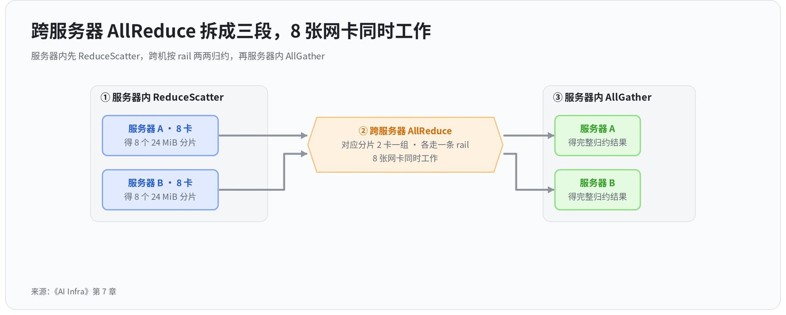

---

## 第三部分 系统侧：如何把系统推向物理上限？（第 8-12 章）

📎 延伸阅读：2026 年的 profile 工具链、内核选型与训练 / 推理侧调优实战见 [LLM-32｜系统｜AI Infra 性能优化实战：从 profile 到硬件上限](./32-infra-perf.md)；非 NVIDIA 加速器见 [LLM-36｜系统｜非 NVIDIA 算力：TPU、Trainium、AMD 与昇腾](./36-non-nvidia.md)；从一条 CUDA 指令到万卡集群的 GPU 优化见 [LLM-16｜系统｜GPU 优化深入浅出：从一条 CUDA 指令到万卡集群](./16-gpu-optimization.md)。

> 📍 **主线锚点**：需求（要搬多少）和资源（能搬多快）都清楚了，这一段回答最后也是最难的一问：<b>「谁必须等它，怎样减少等待」</b>。目标是把真实系统从“离上限还很远”一步步推向“贴着物理上限跑”：**单实例**（第 8 章）→ **多实例分布式**（第 9 章）→ **训练系统**（第 10 章）→ **任务/资源编排**（第 11 章）→ **端边云全局分工**（第 12 章），协作范围越来越大。

### 第 8 章 推理优化

> 📖 <b>本章主线：</b>同一模型、同一张加速器，单用户每秒只收几十个 token，全体合计却能上千，因为多请求可**合批共用一次权重读取**。全章以 **Qwen3-8B 跑在 RTX PRO 6000（96 GB、1792 GB/s、503.8 TFLOP/s、600 W），分得 32 GiB 显存、12 GiB 留给 KV** 为基准，围绕批处理、调度、内存管理、压缩、卸载、推测解码六大手段，比较不同运行配置的效率。章末用同一问题收束：<b>16 条长请求同时到达、7 秒时限，选哪种配置？</b>

#### 一、逐节要点

- <b>8.1 执行过程与资源需求：</b>请求生命周期 prefill→decode；内存约束 $`M_w + M_{KV} + M_a + M_u \le C`$；单请求指标 TTFT / ITL / $`T_{request}`$。
- <b>8.2 批处理与调度：</b>权重复用提高算术强度 $`I_{weight} \approx 2b/s_w`$；每 token 读取量 $`d(b,L)`$ 与临界 batch $`b_{KV}`$；LoRA 多 adapter。
- <b>8.3 KV 缓存分配、复用与释放：</b>PagedAttention 分页、前缀共享、引用计数、抢占重算。
- <b>8.4 压缩与卸载：</b>量化（q8_0=34/64、q4_0=18/64）净节省 $`\Delta T`$；权重卸载/预取每步搬移成本。
- <b>8.5 推测解码：</b>草稿+验证；平均输出 $`\mathbb{E}[N]`$；每 token 平均耗时 $`\bar{t}_{spec}`$。
- <b>8.6 负载下的性能与配置选择：</b>Little 定律、有效吞吐 $`R_{good}`$、MFU/MBU 效率表、综合例题。

#### 二、关键概念定义

| 概念 | 定义 |
|---|---|
| **prefill / decode** | prefill 一次并行处理全部输入 token 并存各层 KV，产出首 token；decode 把上轮 token 送回、读上下文 KV 逐个生成。 |
| **TTFT / ITL** | 首 token 时延 $`\text{TTFT}=t_1-t_a`$；输出间隔 $`\text{ITL}_j=t_{j+1}-t_j`$。 |
| **KV 缓存** | 保存上下文 token 的键 K 与值 V，供后续注意力读取；随请求到达与生成持续增长。 |
| **MFU / MBU** | 算力效率（实测算力 / 峰值 FLOP）与带宽效率（实测读取带宽 / 峰值带宽）。 |
| **PagedAttention / 分页** | KV 按固定块分配，块表做地址映射；前缀共享块只存一次，分支写入时才建私有副本。 |
| **推测解码** | 用草稿模型一次生成多个候选 token，目标模型一轮并行验证；接受概率 $`a(x)=\min(1, p(x)/q(x))`$。 |
| **有效吞吐 goodput** | 单位时间内正确且按期完成的请求数，区别于完成吞吐。 |

#### 三、核心公式与关键数字

> 📐 <b>内存约束：</b>$`M_w + M_{KV} + M_a + M_u \le C`$
>
> <b>完整请求时间：</b>$`T_{request} = \text{TTFT} + \sum_{j=1}^{G-1} \text{ITL}_j`$
>
> <b>批处理算术强度：</b>$`I_{weight} \approx \dfrac{2b}{s_w}`$；<b>每 token 读取量：</b>$`d(b,L) = \dfrac{D_w}{b} + Lk`$；<b>临界 batch：</b>$`b_{KV} = \left\lceil \dfrac{D_w}{Lk} \right\rceil`$
>
> <b>压缩净节省：</b>$`\Delta T = \dfrac{\Delta D}{\beta} - T_c`$；<b>推测平均输出：</b>$`\mathbb{E}[N] = 1 + a + a^2 + a^3 + a^4`$
>
> <b>推测每 token 耗时：</b>$`\bar{t}_{spec} = \dfrac{\sum_r T_r}{\sum_r N_r}`$；<b>Little 定律：</b>$`\bar{n} = \lambda \bar{T}`$；<b>有效吞吐：</b>$`R_{good} = \dfrac{\sum_i Q_i D_i}{T_{obs}}`$

| 量 / 场景 | 数值 |
|---|---|
| 每 token KV 容量（36 层 8 头 128 维 BF16） | $`k = 2 \times 36 \times 8 \times 128 \times 2 = 147456`$ B = 144 KiB |
| 2K / 8K 输入 KV | 288 MiB / 1152 MiB（每增一条长请求 +1.125 GiB） |
| 12 GiB 可容纳请求数 | 短 37 条（⌊12288/324⌋）/ 长 10 条（⌊12288/1188⌋） |
| 临界 batch $`b_{KV}`$ | 2K→51 / 8K→13 |
| 量化每 32 值字节 | BF16=64 / q8_0=34 / q4_0=18（含 2 B scale） |
| 权重卸载（每 4 层卸 1 层，9 份 FFN） | 腾 2592 MiB；$`T_{copy} \ge 2.72/64 \approx 42.5`$ ms（PCIe Gen5） |
| decode MBU（batch 1/2/4/16） | 33% / 34% / 41% / 65%；prefill MFU 58%–62% |

> 📐 <b>合批的双刃效应：</b>batch 从 1 增至 64，2K 上下文每输出 token 读取量从约 14.38 GiB 降至 0.50 GiB（约 1/29），因为共享权重项每加倍 batch 减半、KV 项不变。但更大 batch 需更多显存：64 条 2K 请求权重+一步 KV 约占 35.7 GB。合批减少每 token 读取量，却增加同时驻留数据量。

#### 四、典型算例

> 📐 <b>短请求单跑时间（8.1.1）：</b>排队 0.1 s + prefill 首 token 0.096 s + 255 个输出间隔 ×26.5 ms：$`0.1 + 0.096 + 255 \times 0.0265 = 6.95`$ s，仅余 0.05 s。若中途插入另一条 prefill，某个间隔从 26.5 ms 拉长到约 123 ms，总耗时 7.05 s 就超时：仅调整顺序即可致超时。
>
> <b>前缀共享容量（8.3）：</b>16 条长请求共享前 6144 token（864 MiB），各私有 2303 token 按块占 324 MiB：$`M_{KV} = 864 + 16 \times 324 = 6048`$ MiB ≈ 5.91 GiB。原本 16×1188 = 19008 MiB 放不进 12 GiB；共享后容量上限从 10 条独立增至 35 条。
>
> <b>推测解码平均输出（8.5.2）：</b>每轮草稿 4 个同符号，$`\mathbb{E}[N] = 1 + a + a^2 + a^3 + a^4`$。AAAA（a=1/4）约 1.33 个/轮；BBBB（a=3/4）约 3.05 个/轮。验证 5 个位置权重/KV 与普通 decode 相同、仅多约 0.2 ms，一轮仍按 26.26 ms 计，即使低接受率也能加速。

> 📝 **综合例题（8.6.3）：16 条长请求，12 GiB / 7 s 双约束**<br>A（BF16 独立）需 19008 MiB > 12 GiB，**内存不足淘汰**；<br>B（BF16 共享前缀）5.91 GiB 可放，但 $`2.04 + 255 \times 0.02735 = 9.01`$ s **超时**；<br>C（q8_0 独立）9.86 GiB 可放，失前缀复用 prefill 增至 7.34 s，$`7.34 + 255 \times 0.02826 = 14.55`$ s **超时**；<br>D（共享前缀+推测解码）9.02 GiB，每轮出 3 token、85 轮：$`T_D = 2.23 + 85 \times 0.02735 = 4.56`$ s ✅ **唯一通过**，每合格结果约 0.285 GPU 秒 / ≤171 J。

#### 五、常见误区与金句

> 🚨 <b>常见误区：</b>
>
> - <b>换执行顺序不影响时延？</b>每 token 计算不变，但插入一次 prefill 就能把短请求从 6.95 s 推到 7.05 s 超时。
> - <b>压缩一定加速？</b>净节省 $`\Delta T = \Delta D/\beta - T_c`$：8K 从 BF16 转 q8_0 少读 540 MiB 约省 0.487 ms，若转换耗 0.8 ms 反而多花约 0.313 ms。
> - <b>通信/读取加速比就是任务加速比？</b>本卡一轮 decode 时间几乎不随 batch 与上下文变化，只有**减少轮数**（如推测解码）才明显缩短生成阶段。
> - <b>先算每轮平均再平均？</b>推测解码须用 $`\bar{t}_{spec}=\sum T_r / \sum N_r`$，否则让出 1 个与出 5 个 token 的轮次等权，得错误的 0.9 ms 而非 0.5 ms。

> 294 次正确回答里只有 155 次同时满足 3 秒时限：139 次正确却太晚返回，仍不算有效吞吐。分子只计正确且按期完成的请求。

**草稿模型的新进展**：8.5 的平均输出 $`1+a+a^2+\cdots`$ 说明收益几乎全看接受率 a。EAGLE 系列复用目标模型的隐层特征来猜下一个 token,EAGLE-3 在此基础上改了两处：放弃特征预测约束，训练时就模拟推理时的多步草稿（training-time test）；同时把低、中、高多层特征融合起来用。结果是加速 3.0 到 6.5 倍，比 EAGLE-2 再快 20% 到 40%[[EAGLE-3]](https://arxiv.org/abs/2503.01840)。接受率越高，综合例题里方案 D 一轮出 3 个 token 的余量就越足。推测解码对单卡成本的影响见 [LLM-13｜系统｜自建推理成本与 GPU 选型：算账手册](./13-inference-cost-gpu.md)，消费级单卡和单机部署里的实测见 [LLM-50｜系统｜消费级单卡自部署：Qwen3.8-27B 跑在 4090 / 5090 上](./50-consumer-gpu-deploy.md) 和 [LLM-51｜系统｜自部署推理实战：DeepSeek-V4-Flash 从单机到弹性上线](./51-deepseek-v4-flash-deploy.md)。

#### 六、流程与结构图

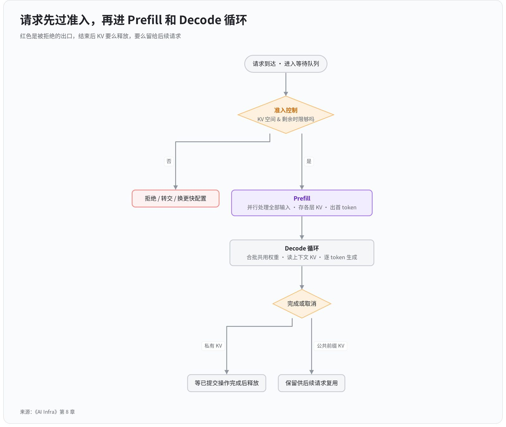

### 第 9 章 分布式推理

> 📖 **本章主线**：在第 8 章“单实例效率”之上，进一步研究**计算与状态放在哪里**。围绕放置，本章考察四种基本组织方式，增加完整副本、PD 分离（prefill/decode）、AF 分离（attention/FFN·专家）、共享 KV，并用一个贯穿全章的算例（四张 A100 80GB + 四张 H20 96GB，每秒到达 3.5 个请求，输入 8192 token、输出 1025 token，模型 Qwen3-8B BF16）反复推演：每种方式改变系统的哪一部分、带来什么收益、新增什么约束。核心方法论：<b>先算每个请求在各类资源上的工作量与状态，再按整数资源分配找出最忙的池，计入交接时间与内存占用，最后用“服务率 − 到达率”求积压消退时间。</b>

#### 9.1 计算与状态的分布方式

先区分硬件组织（加速器 + rank 进程）与服务组织（完整服务副本可独立处理请求）。四种组织方式：**完整副本**按请求分工；**PD 分离**按生成阶段分工，交接上下文 KV;**AF 分离**按层内算子分工，逐层往返激活；**共享 KV**跨实例复用上下文。P、D 由同一组资源处理称为<b>共置（co-location）</b>。

**四种组织方式一图对照**：差别只在“按什么切分”，请求、生成阶段、层内算子，还是可复用的状态。

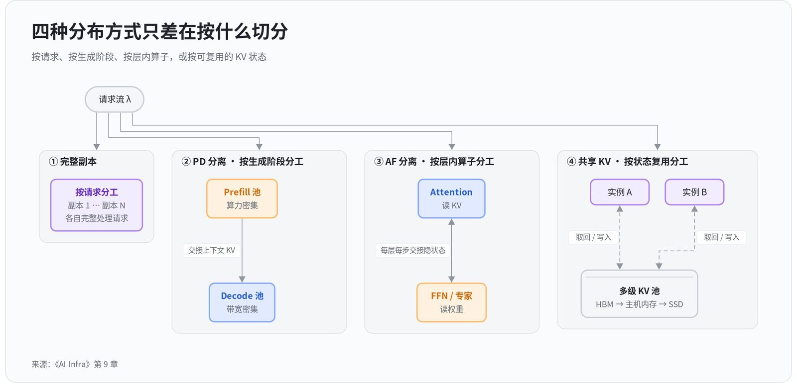

| 部署方式 | 收益 | 主要新增约束 |
|---|---|---|
| 增加完整副本 | 处理更多独立请求，分散排队 | 模型复制、缓存分散、启动与保活 |
| PD 分离 | 两阶段分别配置能力 | KV 交接、两端同时占内存、两个队列 |
| AF 分离 | 算子用适合的算力/存储 | 逐层激活往返、同步、流水负载均衡 |
| 共享 KV | 跨实例复用，减少重复 prefill | 缓存标识、读取、就绪通知、失效释放 |

#### 9.2 Prefill–Decode 分离与资源配比

Prefill 一次处理大批新 token，受**算力**限制；Decode 每步每请求一个新 token，反复读权重与 KV，受**显存带宽**限制。两者混合会互相阻塞，PD 分离把它们放入独立服务池。

> 📐 **核心公式**：
>
> <b>逻辑 KV(GQA):</b>$`V_{KV} = 2nLh_{kv}d_h b`$。Qwen3-8B（36 层、8 KV 头、每头 128 维、BF16）每 token 占 **144 KiB**,8192 token 占 $`V_{KV}=8192\times 144\,\text{KiB}=1.125\,\text{GiB}`$。
>
> <b>紧凑 MLA:</b>$`V_{KV,MLA}=nL(d_c+d_r)b`$。DeepSeek-V3（61 层、d_c=512、d_r=64、BF16）每 token 68.6 KiB,8192 token 占 **549 MiB**。
>
> <b>共置请求率上限：</b>$`\mu_{co}=\dfrac{N}{d_P+d_D}`$；每请求资源需求 $`d_P=L_{new}/r_P,\ d_D=(G-1)/r_D`$。

> 📝 <b>算例（阶段能力推导）</b>：效率取峰值 50%(MFU=MBU=0.5)。A100 有效算力 156 TFLOP/s、带宽 1020 GB/s;H20 为 74 TFLOP/s、2048 GB/s。
>
> - Prefill 8192 token 需 133.6 TFLOPs、读约 15 GB 权重：A100 约 **0.856 s**（9566 新 token/s）、H20 约 **1.81 s**（4538 新 token/s）。
> - Decode 一步（batch 32、平均上下文 8704）：读约 15.1 GB 权重 + 41.1 GB KV:A100 约 **55.1 ms**（580 次/s）、H20 约 **27.4 ms**（1166 次/s）。
> - 每请求 GPU 秒：A100 = 0.856 + 1.764 = **2.62**;H20 = 1.805 + 0.878 = **2.68**。

| 交接状态 | 每 token | 8192 token | 25 GB/s | 50 GB/s |
|---|---|---|---|---|
| Qwen3-8B GQA | 144 KiB | 1.125 GiB | 48.3 ms | 24.2 ms |
| DeepSeek-V3 紧凑 MLA | 68.6 KiB | 549 MiB | 23.0 ms | 11.5 ms |

> 📝 **例 9.2 异构配比**：四张 A100 做 P → $`4/0.856\approx 4.67`$ 请求/s；四张 H20 做 D → $`4/0.878\approx 4.55`$ 请求/s。网卡 25 GB/s 每秒可交接约 20.7 份 1.125 GiB。总上限 $`\mu_{PD}=\min(\mu_P,\mu_D,B_{net}/V_{KV})\approx 4.55`$ 请求/s。
>
> **对比：共置八张卡合计 3.02 请求/s** → 分离后 <b>4.55 请求/s（1.51 倍）</b>，高于 3.5 到达率。角色对调（H20 做 P、A100 做 D）P 池只剩 2.22，不到一半。

同构八张 A100：共置 3.05 请求/s；整数分离（3P+5D）上限仅 2.83，比共置低 7%，同构分离不提吞吐，价值在**延迟稳定**与隔离排队。分块 prefill 捎带可把共置上限升到 4.50。紧凑 MLA 使 $`\mu_{PD}`$ 链路项从 20.7 升到 43.4，但上限仍由 D 池 4.55 决定。

**两篇论文给的边界**：上面算出同构分离不提吞吐，DistServe 换了一个口径。它在给定 TTFT 和 TPOT 的 SLO 下看每张 GPU 能承接多少请求（per-GPU goodput），按这个口径，分离后可多服务 7.4 倍请求，或把 SLO 收紧 12.6 倍，同时九成以上请求达标[[DistServe, OSDI 2024]](https://arxiv.org/abs/2401.09670)。两边结论不冲突，书里算的是不看时限的上限，DistServe 只数按期完成的请求，prefill 插队造成的 decode 抖动在后一种口径里会被记成损失。上面 4.50 请求/s 的分块 prefill 捎带对应 Sarathi-Serve：长 prefill 切块后和 decode 拼进同一批，调度时不让 decode 停下来等。服务容量在单张 A100 跑 Mistral-7B 时最多提升 2.6 倍，两张 A100 跑 Yi-34B 时最多 3.7 倍[[Sarathi-Serve, OSDI 2024]](https://arxiv.org/abs/2403.02310)。共置加分块和 PD 分离在真实部署里怎么选，见 [LLM-51｜系统｜自部署推理实战：DeepSeek-V4-Flash 从单机到弹性上线](./51-deepseek-v4-flash-deploy.md) 和 [LLM-52｜系统｜一线大模型部署：Kimi K3 从选型算账到多节点上线](./52-kimi-k3-deploy.md)。

#### 9.3 Attention–FFN 分离与异构执行

AF 在**层内**划分：注意力产生隐状态，FFN/专家处理后送回，每层每步反复交接。MoE 特别适合：总专家权重大，每 token 只选一部分。一份 Qwen3-235B-A22B 专家含 3 矩阵、参数 $`3\times 4096\times 1536=18874368`$,BF16 占 **36 MiB**。

> 📝 <b>CPU vs GPU 专家执行（例 9.3）</b>，单专家收 m 个 token:
>
> ```math
> T_C(m)=2\alpha+\dfrac{2mhb}{B_L}+\max\!\left(\dfrac{2mP_e}{C_C},\dfrac{W_e}{B_D}\right)
> ```
>
> ```math
> T_G(m)=\alpha+\dfrac{W_e}{B_L}+\max\!\left(\dfrac{2mP_e}{C_G},\dfrac{W_e}{B_H}\right)
> ```
>
> <b>CPU 从读取受限转计算受限的临界：</b>$`m=C_C/B_D`$。AVX-512(1.8 TFLOP/s、220 GB/s)m≈8.2;AMX(21.3 TFLOP/s)推到约 97 token。
>
> **交点算例**：八专家各处理 1 token → CPU 路径约 1.46 ms，搬权重到 GPU 约 12.5 ms。各处理 128 token → AVX-512 CPU 约 22.2 ms > GPU 12.5 ms，交点在每专家 **71/72** token；换 AMX,CPU 仅 2.57 ms，交点推迟到 **688/689** token。批内活跃专家期望：$`\mathbb{E}[U]=E\left[1-(1-K/E)^M\right]`$，代入 E=128、K=8、M=64 约 126 个专家。

**容量 vs 服务能力**：Qwen3-235B-A22B 每层 128 BF16 专家占 4.5 GiB；若每层驻留 32 个专家，94 层约 106 GiB，超一张 A100。均匀覆盖读 4.5 GiB、集中八专家读 288 MiB，相差 16 倍。**大 EP**让每卡少专家、汇聚多输入；DeepSeek-V3 公开 prefill EP32、decode EP144 并配冗余专家。micro-batch 流水：双阶段流水 $`t_A+t_F+(q-1)\max(t_A,t_F)`$；四个 micro-batch(2ms/3ms)依次 20 ms、流水 14 ms。

**公开的生产配置**：DeepSeek 2025 年公开了 V3/R1 的线上推理架构。集群用 H800,prefill 取 EP32/DP32,decode 取 EP144/DP144，每 token 只激活 256 个路由专家里的 8 个。为了把 all-to-all 通信藏到计算后面，prefill 和 decode 都把一批拆成两个 micro-batch 交替执行（dual-batch overlap）;decode 各段耗时不均，又把注意力层拆成两步，组成 5 级流水[[DeepSeek-V3/R1 Inference System Overview]](https://github.com/deepseek-ai/open-infra-index/blob/main/202502OpenSourceWeek/day_6_one_more_thing_deepseekV3R1_inference_system_overview.md)。这就是上面双阶段流水公式在生产里的样子，q 个 micro-batch 轮流让通信和计算互相掩盖。MoE 路由与专家并行见 [LLM-33｜地基｜MoE 混合专家：路由、负载均衡、训练与推理](./33-moe.md)，把 MoE 推到单台 CPU 上的极端例子见 [LLM-53｜系统｜单台 CPU 跑万亿参数 MoE：Kimi-K3-in-C 工程解剖](./53-kimi-k3-in-c.md)。

#### 9.4 专家放置、复制与负载均衡

集中复用减少权重读取，但热点专家集中在一张卡会放大 **skew**。整层完成时刻取决于最忙卡：$`\max_r\max(F_r/C_r, W_r/B_r)`$。512 次分派均分八卡每卡约 2.42 GFLOPs、集中一卡约 19.3 GFLOPs（八倍），最忙卡时间从 4.9 μs 增到 39.1 μs。

| EP 规模 | 每卡专家 | 热点卡/平均（4 倍热点专家） | 均匀随机 1000 批均值 |
|---|---|---|---|
| EP8 | 32 | 1.08× | +4% |
| EP32 | 8 | 1.36× | — |
| EP256 | 1 | 4.0× | +52% |

> 📝 <b>例 9.5（跨机 skew）</b>:1024 token、每 token 选 8、8 KiB 向量、两台 HGX H100、每卡 400 Gbit/s（每向 50 GB/s）。均衡时 dispatch/combine 各 64 MiB；热点 [5120,1024,1024,1024] 使专家 skew 从 1 变 2.5。均衡跨服务器阶段屏障总下界 **0.827 ms**，热点 **2.068 ms**（2.5 倍）；放进同一 HGX(NVLink 450 GB/s)两次交换压到 0.093 ms，总 0.577 ms。
>
> <b>例 9.6（专家副本回本）</b>：复制耗时 $`N_{min}=\lfloor T_{copy}/\Delta t\rfloor+1`$。每批省 0.240 ms;NVLink 复制 0.622 ms → 第 **3 批**回本；跨服务器 ConnectX-7 复制 5.32 ms → 第 **23 批**回本。

#### 9.5 KV 的分布、共享与请求路由

另一条省算路径：让后续请求复用前一次的 KV。缓存键须沿前缀链标识整个计算（模型/adapter 版本、token 序列、位置索引、格式）。多级存储与取回时间（DGX A100，每卡视角，取回 1.125 GiB 前缀）：

| 层级 | 每卡容量 | 路径 | 取回 8K 前缀 |
|---|---|---|---|
| HBM | ≤63.6 GB | 已在 GPU | 0 |
| 主机内存 | 256 GiB | PCIe 4.0 x16, 25 GB/s | 48.3 ms |
| 本地 SSD | 3.84 TB | 顺序读 7.1 GB/s | 170 ms |
| 远端存储池 | 随节点增加 | 网卡 25 GB/s 再经 PCIe | 96.6 ms |
| 对照：A100 重算 | — | 峰值 50% | 856 ms |

> 📐 <b>容量与复用间隔：</b>$`C\ge rT`$，其中 KV 产生速率 $`r\approx 1.41`$ GB/s。间隔 10 s 需 14.1 GB（HBM 可容）,10 min 需 846 GB（需 SSD）。保存优于重算：$`T_{write}+kT_{read}<kT_{recompute}`$；复用一次 96.6 ms 远低于重算 856 ms。逐层预取缓冲：$`S_{buf}=B(T_{read}-T_{new})`$，代入约 437 MB ≈ 14 层。路由首 token 时间：$`T_{first}=\max(Q,R)+C`$。

> 📝 **例 9.7 缓存路由**：A 本地命中但排队 250 ms → 281 ms;B 直接重算 → 907 ms;B 经 50 GbE 远端取回 → 282 ms;B 经 200 GbE → 137 ms。命中概率 p 的两点分布 $`\mathbb{E}[T_A]=967.2-856.3p`$，均值优于 907 只需 p>7%；但 p=0.9 时 p99 仍是 967 ms，要 p99≤220 ms 需命中率≥99%。

**把 KV 当成一级资源**：Kimi 的 Mooncake 围绕 KV 缓存组织整个服务。prefill 和 decode 分池，集群里闲置的 CPU 内存和 SSD 拼成分布式 KV 池，调度器把缓存命中、排队长度和传输代价放在一起选实例，用存储换算力。过载时它先预测哪些请求注定超时，提前拒掉，省得白算 prefill。真实负载下 Kimi 多承接了 75% 的请求，长上下文模拟场景吞吐最高提升 525%[[Mooncake, FAST 2025]](https://arxiv.org/abs/2407.00079)。例 9.7 的远端取回和命中概率推导，就是这类调度器每次路由都要算的账。Kimi K3 的多节点部署见 [LLM-52｜系统｜一线大模型部署：Kimi K3 从选型算账到多节点上线](./52-kimi-k3-deploy.md)。

#### 9.6 服务启动、扩缩容与故障恢复

启动开销 $`T_s`$ 期间积压约 $`\lambda T_s`$，排空时间 $`T_{drain}=\dfrac{\lambda T_s}{\mu-\lambda}`$。10 s 启动、3.5/s 到达 → 35 个积压；直接 PD 4.55/s 每秒消化 1.05 个，约第 43 秒排空；分块共置 4.17/s 到第 63 秒；不分块 3.02/s 持续增长。运行中迁移：decode 追加 KV 极慢（0.172 GB/s）,41.1 GB 经 25 GB/s 约 1.65 s 复制赶上。TP4→TP8 切换约 16.4 GB 传输，但 9 s 软件准备成为下界。

#### 9.7 部署方案的综合比较（例 9.8）

直接 P→D 交接搬一次（1.125 GiB）；经共享池中转搬两次（2.25 GiB），多等约 48.3 ms。前缀不复用时选**直接 PD**。

| 部署方案 | 每请求通道载荷 | 计算能力（req/s） | 通道能力（req/s） |
|---|---|---|---|
| 八个完整副本 | 0 | 3.02 | — |
| 直接 PD | 1.125 GiB | 4.55 | 20.7 |
| PD + 共享池中转 | 2.25 GiB | 4.55 | 10.3 |
| 直接 PD，紧凑 MLA | 549 MiB | 4.55 | 43.4 |

> 📐 <b>按期排空最低服务率：</b>$`\mu-3.5\ge 35/50 \Rightarrow \mu\ge 4.2`$ 请求/s。直接 PD 4.55 高于此，余量约 8%。有效成本：$`C_{effective}=\dfrac{\text{总成本}}{\text{满足质量与时限的请求数}}`$。3.02 vs 4.55 请求/s 对应每千请求约 0.74 元 vs 0.49 元。

> 🚨 **常见误区/金句**：
>
> 同构分离不能提高吞吐：每个请求消耗同样的 GPU 秒；分离的价值在延迟稳定与隔离排队。
>
> AF 每步都要交接，隐状态宽度不随 KV 表示改变：1024 步 AF 累计约 393 ms，是一次 GQA PD 交接 48.3 ms 的 8.1 倍；输出越长，差距越大。
>
> 增加专家卡不能替代跨池带宽；把 dispatch 改 FP8 也不会同比缩短 BF16 combine 或专家计算。

> ✅ **本章小结**：分布式推理把一条请求的计算与状态分配到多个位置。PD、AF、专家放置、共享 KV 都要比较**局部执行收益 vs 新增交接**，容量、服务率、启动与恢复共同决定部署是否合适。同一套推导对不同上下文表示给出不同答案：GQA→紧凑 MLA 后，PD 交接时间减半、$`\mu_{PD}`$ 链路项翻倍、AF 逐层交接不变、临界启动时间缩短。

### 第 10 章 训练系统

> 📖 **本章主线**：一个能在单卡推理的模型未必能在单卡训练，全参数混合精度 Adam 的常驻训练状态约为 BF16 权重的**八倍**。本章围绕一项任务展开：用 Qwen3-8B 处理 100B token、做领域继续训练、期限 30 天，比较 **32 张 vs 48 张 RTX 4090** 两套方案。方法论：**先算显存能否容纳（张量生命周期），再算每步关键路径耗时（计算+通信等待+输入等待），再算 checkpoint 与故障恢复的长期附加，最后用 **$`T_{finish}=T_0+\lceil D/b\rceil t_s(1+L)`$<b> 判断能否按期完成。</b>依次加入分片、重计算、卸载、流水调度、通信重叠、数据输入、checkpoint、掉队者、RL 反馈循环。

#### 10.1 根据训练任务估算容量与时间需求

任务：全参数训练、混合精度 Adam、序列 8192 token，处理 100B 有效 token，每步 384 条序列（3,145,728 token），共 $`\lceil 10^{11}/3145728\rceil=31790`$ 次迭代。30 天预留 5 天给启动/评估/停顿，25 天用于训练，每步预算约 **67.9 s**。全局 batch 取 384 而不再放大，原因是梯度信噪比：超过**临界 batch size** 后再加样本只能微降步数。

> 📐 **核心公式**：
>
> <b>梯度噪声尺度：</b>$`B_{noise}=\dfrac{\mathrm{tr}(H\Sigma)}{G^{T}HG}`$；步数-样本关系 $`(S/S_{min}-1)(E/E_{min}-1)=1`$，临界 batch $`B_{crit}=E_{min}/S_{min}`$。按临界 batch 训练时步数与样本数均为各自最小值的两倍。
>
> <b>算力下界：</b>$`T=\dfrac{F}{pP\eta},\ p_{compute}=\lceil\dfrac{F}{P\eta T_{available}}\rceil`$。峰值内存 $`M_{peak,i}=\max_t[M_{persistent,i}+M_{activation,i}+M_{temporary,i}]`$。

> 📝 <b>算例（常驻训练状态，每参数 16 bytes）</b>:Qwen3-8B $`N=8{,}190{,}735{,}360`$,$`M_{persistent}=16N\approx 131.1\,\text{GB}\approx 122.1\,\text{GiB}`$，约为 BF16 权重的八倍。

| 状态 | 字节/参数 | Qwen3-8B 容量/GB | 使用时机 |
|---|---|---|---|
| BF16 模型权重 | 2 | 16.4 | 前向/反向矩阵运算 |
| BF16 梯度 | 2 | 16.4 | 反向产生，更新时用 |
| FP32 主权重 | 4 | 32.8 | 保存新参数，再转 BF16 |
| Adam 一阶矩 | 4 | 32.8 | 跨迭代保留梯度历史 |
| Adam 二阶矩 | 4 | 32.8 | 跨迭代保留梯度平方历史 |
| **合计** | **16** | **131.1** | 常驻训练状态 |

梯度改 FP32 则每参数 18 bytes。计算下界：一条 8192 token 序列前后向约 $`4.31\times10^{14}`$ FLOPs(52.7 GFLOPs/token),100B token 共约 $`5.27\times10^{21}`$ FLOPs。RTX 4090 峰值 165.2 TFLOP/s、40% 效率、30 天 → 至少 **31 卡**；取每机八卡得 32 卡与 48 卡两套。每步约 $`1.66\times10^{17}`$ FLOPs,32 卡单卡计算约 **78.3 s**（加通信前已超时）、48 卡约 **52.2 s**（留约 15.7 s）。

#### 10.2 训练状态的分片、重计算与卸载

三种容量优化各改变一个维度：**状态分片**减重复存储、**激活重计算**减前向到反向的保存、**状态卸载**把暂不用的状态移到主机内存。ZeRO/FSDP 分阶段划分状态归属。

> 📐 <b>ZeRO 每卡常驻状态（d 张卡）</b>:$`M_0=16N,\ M_1=4N+12N/d,\ M_2=2N+14N/d,\ M_3=16N/d`$。

| 配置（d=8） | 每卡常驻状态/GiB | 完整复制的状态 |
|---|---|---|
| 普通 DP | 122.1 | 权重、梯度、优化器状态 |
| ZeRO-1 | 42.0 | 权重与梯度 |
| ZeRO-2 | 28.6 | 权重 |
| ZeRO-3 | 15.3 | 均已分片 |

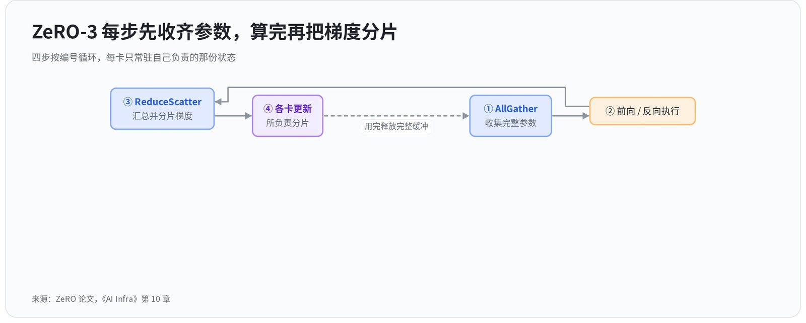

分片不等比降峰值：FSDP2 小实验进程 2→4，常驻状态 18→9 MiB（减半），执行峰值仅 39→30 MiB（减约 23%），因执行中仍需约 21 MiB 其他缓冲。**重计算**：Qwen3-8B MLP 保留门控 a、上投影 u，反向前重乘得 h，每层省 6+2+2=10 MiB，九层阶段省 90 MiB（约 94 MB）；四个 micro-batch 等待反向可省 $`4\times90=360`$ MiB。

> 📝 <b>卸载（例：CPU 还是 GPU 转梯度更快）</b>：门控梯度 BF16 $`G=96`$ MiB，转 FP32 访问 3G。串行路径 $`T_c=G/B+3G/C_c,\ T_g=3G/C_g+2G/B`$。PCIe 4.0(32 GB/s)时 CPU 路径 4.13 ms &lt; GPU 6.59 ms（GPU 多传 96 MiB）。带宽分界 $`B^*=\dfrac{1}{3(1/C_c-1/C_g)}\approx 147\,\text{GB/s}`$，高于 PCIe 5.0 的 64 GB/s → PCIe 卡都应先传 BF16、在 CPU 转换。GPU 转换峰值 288 MiB（需额外 192 MiB 缓冲）。

| 方法 | 减少的显存 | 增加的工作 | 决定收益的时间关系 |
|---|---|---|---|
| 状态分片 | 重复保存的权重/梯度/优化器 | 参数收集、梯度归约并分片 | 收集能否赶在模块执行前完成 |
| 激活重计算 | 前向到反向的中间值 | 重建前向值 | 重建是否延迟关键路径反向 |
| 状态卸载 | 暂时不用的状态 | 主机与加速器间传输 | 数据能否在使用前传回 |

设计案例：32/48 卡均全组 ZeRO-3、TP=PP=1，每卡 22 GiB 可用、预留 10 GiB 缓冲，常驻状态约 3.8/2.5 GiB，总量约 **13.8/12.5 GiB**，余量 8.2/9.5 GiB，显存都够。

#### 10.3 训练步的流水调度与通信重叠

micro-batch 划分只改变执行顺序不改变目标（损失按同一 $`L`$ 归一化）。流水调度同时决定**完成时间**（气泡）与**显存驻留**（激活生命周期）两根轴。填满排空 $`T=(m+p-1)(t_f+t_b),\ u=\dfrac{m}{m+p-1}`$；取 p=4、m=8 得 u≈72.7%。

> 📝 <b>五种调度算例（四阶段、前向 10ms、反向 20ms、边界传输 1ms、参数更新 1ms、8 micro-batch）</b>：填满排空 **337 ms**（峰值最高不可行时被淘汰）;1F1B **347 ms**（慢约 3% 但显存最省，峰值 921 MiB，由 2.57 GB 降到 0.97 GB）；交错式 v=2 **298 ms**（前向消息 24→56 次）；零气泡 ZB-H1 **283 ms**（dW 延后填空隙，最快）;DualPipe **306 ms**（每卡参数两份）。16 micro-batch:599/538/523/558 ms，排序不变。

> 📐 **气泡公式**：1F1B $`(p-1)(T_F+T_B+T_W)`$;ZB-H1 $`(p-1)(T_F+T_B-T_W)`$;ZB-H2 $`(p-1)(T_F+T_B-2T_W)`$；交错式比例 $`\dfrac{1}{v}\cdot\dfrac{p-1}{m}`$;DualPipe $`(PP/2-1)(F\&B+B-3W)`$。
>
> **ZeRO-3 通信**：每步 $`V=3m\cdot\dfrac{d-1}{d}\cdot 2N`$。48 卡（m=8）约 385 GB → 链路 12.0 s;32 卡（m=12）约 571 GB → 17.9 s。每步只有首次 AllGather 和末次 ReduceScatter（约 1.24 GB 词嵌入）无法隐藏，合计约 **0.08 s** 通信等待。

**MoE 与长上下文**：dispatch 不均由最忙卡决定（96/32 行 → 均衡到 64 行省 1/3）。容量因子：$`\text{每专家容量}=\lfloor c\times\text{token 数}\times k/E\rfloor`$，超出丢弃、不足补零。分桶：72 MiB 专家梯度整桶 4.55 ms 放不进 2 ms 空隙，切三个 24 MiB 子桶各 1.53 ms（总 4.59 ms 略长但可隐藏）。长序列注意力配对 $`s(s+1)/2`$:4096+4096 约 1680 万对，改 7168+1024 增至约 2620 万（+56%）。

#### 10.4 数据输入、checkpoint 与故障恢复

25 天需约 46,300 token/s（约 5.7 条序列/s），int64 传 token ID 仅 0.37 MB/s，瓶颈在 CPU 数据准备（每进程 2 条/s，四进程八条/s 够用）。checkpoint（约 115 GB）平均写流量仅约 64 MB/s。训练 checkpoint 须保存权重、两份矩状态、步数、学习率、随机状态与下一批数据组成；一次迭代结束保存每参数 14 bytes（约 115 GB）。

> 📐 **保存周期一阶模型**：$`L(\tau)=\dfrac{c}{\tau}+\dfrac{\lambda\tau}{2}+\lambda r`$，最优 $`\tau^*=\sqrt{2c/\lambda}`$。含损失尖峰：$`\tau^*=\sqrt{\dfrac{2c}{\lambda_{hw}+\lambda_{spike}}}`$。掉队者：N 个正态最大值期望 $`\mu+k\sigma`$,N=8/48/1024 时 k≈1.42/2.23/3.25。

> 📝 **checkpoint 算例**：112 GB 快照，7 GB/s 写 16 s、20 GB/s 写 5.6 s;50 s 故障分别只能恢复到 20 s（重做 30 s）或 40 s（重做 10 s），前台暂停都是 2×0.5 s。**最优间隔**：115 GB、7 GB/s → c≈16.4 s，恢复 120 s，每卡 MTBF 约 337 天（1024 卡 7.9 h） → $`\tau^*\approx 965\,s`$（约 16 分钟）。设计案例取 1800 s,32/48 卡附加约 <b>1.02%/1.08%</b>。掉队者（48 卡、σ=5%）每步多约 5.8 s。

**用公开数据代入**：Llama 3 405B 预训练在 16,384 张 H100 上跑了 54 天，中断 466 次，其中 47 次是计划内维护，419 次是意外，约 78% 归因于硬件，GPU 与 HBM3 相关故障约占一半[[The Llama 3 Herd of Models]](https://arxiv.org/abs/2407.21783)。折算下来约每 3.1 小时一次意外中断，对应每卡 MTBF 约 5.8 年，比上面例子假设的 337 天可靠约 6 倍，卡数却多了 16 倍。把 $`\lambda=1/3.1\,\text{h}`$ 和上面的 c≈16.4 s 代入 $`\tau^*=\sqrt{2c/\lambda}`$，最优保存间隔约 10 分钟。这时保存开销 c/τ 和平均重做 λτ/2 各约 2.7%，再加恢复的 λr 约 1.1%，约 6.5% 的时间花在容错上。c 每压低一半，前两项之和就降到原来的约 71%，万卡规模下把快照改成异步、先写内存再落盘，收益因此很直接。万卡训练的稳定性工程见 [LLM-23｜系统｜大模型训练工程：数据配比与万卡稳定性](./23-training-engineering.md)。

#### 10.5 强化学习训练

RL 让模型参与产生下一批数据，训练流水变成反馈循环：生成→验证/奖励→学习→新权重→下一轮生成。核心约束是**训推一致性**：生成端与训练端须对同一轨迹给出可对齐概率。

> 📐 **三阶段流水吞吐**：$`r_{effective}=\min(r_l,\ q\min(r_g,r_v))`$。**异步周期**：同步 $`B/60`$ vs 异步 $`qB/44`$，异步更快要求 $`q>44/60\approx 73.3\%`$。概率比 $`\dfrac{\pi_\theta}{\mu}=\dfrac{\pi_\theta}{\pi_{old}}\cdot\dfrac{\pi_{old}}{\mu}`$。

> 📝 **RL 算例**：生成 12 条/s、验证 6 条/s、学习 8 条/s、保留 75% → 进入学习仅 **4.5 条/s**；生成翻倍无用，验证翻倍到 12 条/s 才把瓶颈移到训练端。**共享设备切换**：先加载生成权重+分配 KV 再释放训练状态 → 峰值 **83.3 GiB**（超 H100 74.5 GiB）；改为先加载权重、释放训练状态、再分配 KV → 峰值 **59.3 GiB**，差 24 GiB（一份 KV 池）。**独立部署**：Qwen3-235B-A22B 423 GiB 专家，EP16 逐一发全集 6768 GiB，按分片发仅 423 GiB。**路由重放记录**：Qwen3-30B-A3B 48 层 top-8、8K token、uint16 → $`8192\times48\times8\times2=6`$ MiB。

**两个公式在开源框架里的对应**：概率比拆成 $`\pi_\theta/\pi_{old}`$ 乘 $`\pi_{old}/\mu`$，后一项就是生成端和训练端的不一致。实测中 vLLM 采样和 FSDP 训练对同一 token 算出的概率差得不小，社区用截断重要性采样（TIS）把这一项夹住，修正已合入 verl[[Your Efficient RL Framework Secretly Brings You Off-Policy RL Training]](https://fengyao.notion.site/Your-Efficient-RL-Framework-Secretly-Brings-You-Off-Policy-RL-Training-237721e3f6c48094ad67dad3ac091c56)。异步条件 q>73.3% 讲的是生成不必等训练。AReaL 把两者彻底解耦，用最大陈旧度限制 rollout 落后的权重版本数，并改造 PPO 目标来容忍陈旧样本，训练速度最高提升 2.77 倍[[AReaL]](https://arxiv.org/abs/2505.24298)。verl 背后的 HybridFlow 给的是同步一侧的参考：单控制器编排、多控制器执行，训练和生成在同一批卡上切换[[HybridFlow]](https://arxiv.org/abs/2409.19256)，对应上面共享设备切换的峰值显存算例。RL 训练系统的完整设计见 [LLM-55｜系统｜RL 训练系统：rollout 与训练分离、异步与 Agent 环境](./55-rl-systems.md)，低精度下训推数值为什么对不齐见 [LLM-54｜系统｜低精度训练的数值稳定性：从 FlashAttention 一次舍入偏差说起](./54-low-precision-training.md)。

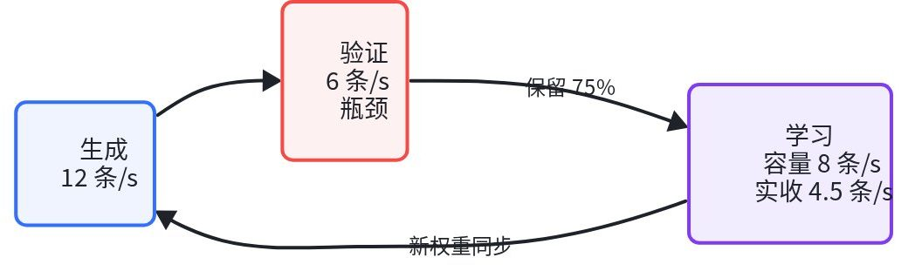

#### 10.6 从系统方案到完成期限与硬件选择

汇总完成时间：$`T_{finish}=T_0+\lceil D/b\rceil\,t_s\,(1+L)`$,$`T_0=5`$ 天。硬件替换用 Amdahl:$`T'/T=1-f+f/r`$。稠密规模下界 $`p\ge\lceil 6ND/(P\eta T)\rceil`$。

| 设计项 | 32 卡 | 48 卡 |
|---|---|---|
| 每卡预计显存/GiB | 13.8 | 12.5 |
| 每步单卡计算/s | 78.3 | 52.2 |
| ZeRO-3 链路时间/s | 17.9 | 12.0 |
| 通信等待/s | 0.08 | 0.08 |
| 每步训练时间（含 0.5s 输入）/s | 78.9 | 52.8 |
| 保存/重做/恢复附加 | 1.02% | 1.08% |
| **加保存恢复+5 天预留/天** | **34.3** | **24.6** |

**结论：选 48 卡方案**。32 卡约 34.3 天超期被排除；48 卡约 24.6 天完成，剩约 5.4 天。48 卡每步上限 $`t_s\le\dfrac{25\times86400}{31790\times1.0108}\approx 67.2\,s`$，本方案约 52.8 s、余量约 14.4 s；即使预取失效、12.0 s 链路全暴露（约 64.8 s）仍在上限内。32 卡需把单卡效率从 40% 提到约 47%，已超 Llama 3 最高 43%。规模敏感性：16,384 张 A100/H100/B200 在 40% MFU 下训 1T 模型约需 679/214/94 天，B200 需 50% MFU 才落进 90 天。

> 🚨 **常见误区/金句**：
>
> 分片数翻倍，峰值≠减半：常驻状态 18→9 MiB，但其他缓冲仍占约 21 MiB，峰值 39→30 MiB。决定容量的是同一时刻的总占用。
>
> 通信处理时间更短，训练步≠更短：三个小桶总 4.59 ms 比整桶 4.55 ms 更长，却能利用三个空闲时段完成传输；完成时刻才决定是否延长训练步。
>
> 异步保存调用返回≠恢复全部进度：同样 1 s 前台暂停可能对应 30 s 或 10 s 重做，区别在后台写入完成时刻。
>
> 提高生成吞吐≠加快 RL 学习：生成 12/验证 6/保留 75%，学习端每秒只收 4.5 条；应扩容当前最慢阶段。
>
> 卡数翻倍且 batch 随卡放大≠时间减半：超过临界 batch 后步数不再明显减少，噪声尺度 200 万 token 时 1536 卡加速上限仅 1.64 倍（19.4→12.1 天）。

> ✅ **本章小结**：训练内存由状态格式、跨卡分配与生命周期共同决定；ZeRO、重计算、卸载都以额外计算/传输换显存。长期完成时间还要加上数据准备、checkpoint 保存与故障重做，保存周期平衡写入成本与重做成本。同步训练受临界 batch、掉队者、损失尖峰三重制约；RL 进一步要求跟踪样本标识、策略版本与行为概率并对齐训推数值路径。设计案例中 32/48 卡均能容纳状态，但完成时间 34.3 vs 24.6 天：48 卡满足 30 天期限，每步上限约 67.2 s。

### 第 11 章 资源调度与运行环境

> 📖 **本章主线**：以「代码修复平台」为贯穿设计题，把模型服务、工具环境与共享资源组织成一套**任务运行系统**，回答四个问题，何时创建/释放环境、如何安排任务、如何选择模型、如何从失败恢复。
>
> <b>核心洞察：</b>章首平台**平均只用 30 个 CPU 核，环境却要 600 GiB 内存**（超出 m5d.metal 的 358 GiB）。原因是三轮任务里有 27 秒在**等待模型**，而工具环境始终占内存。在模型调用期间准备环境，每项任务累计内存占用从 60 → 18 GiB·秒（↓70%），代价仅是准备多用 0.3 秒 CPU。

#### 贯穿设计题：平台输入与业务目标

| 设计输入 | 给定值 |
|---|---|
| 任务到达率 | 10 项/s（每 0.1 秒一项，均匀到达） |
| 每项任务 | 3 轮，每轮 = 1 次模型调用 + 1 次工具执行 |
| 模型服务 | DeepSeek V4-Flash，每副本 4 张 B200，同服务 32 个会话 |
| 普通调用时间 | 输出 355 token × 25.3 ms/token ≈ **9.0 s** |
| 模型并发容量 | 10 副本（40 张 B200），最多同时 320 次调用 |
| 工具执行 | 1 s、1 CPU·秒/次 |
| 活跃环境 | 1 vCPU、2 GiB microVM（E2B 沙箱规格） |
| 工具平台 | 一台 m5d.metal:48 CPU 核、约 358 GiB 内存 |
| 业务目标 | ≥ 95% 任务在 **24 s** 内通过测试 |

#### 11.1 根据执行过程计算资源需求

单项任务三轮串行：每轮模型 9 s + 工具 1 s，总时间 $`3\times(9+1)=30`$ 秒，三轮分别结束于第 10/20/30 秒。工具只在三次 1 秒里占 CPU，累计 **3 CPU·秒**；环境全程占 2 GiB，内存占用面积 $`2\times 30=60`$ GiB·秒。等待模型时工具不占 CPU，但本方案仍保留环境，这正是内存被拉长的根源。

> 📐 <b>任务总时间的通用公式（推广到 R 轮）</b>:
>
> ```math
> T_{task}=T_{queue}+T_{prepare}+\sum_{r=1}^{R}(T_{model,r}+T_{tool,r})+T_{commit}
> ```
>
> **资源需求率公式**：$`\text{资源需求率}=\text{任务到达率}\times\text{每任务平均资源需求}`$

把单项需求汇总到平台（每秒 10 项）：模型调用 $`10\times 3=30`$ 次/s、工具 30 次/s;CPU 需求 $`30\times 3/30=30`$ 核；内存 $`10\times 60=600`$ GiB；并发模型调用 $`10\times 3\times 9=270`$ 次。环境数量由 Little 定律给出：

> 📐 **Little 定律**：$`N_{env}=\lambda_{env}\,T_{env}=10\times 30=300`$ 个环境，每个固定 2 GiB → **600 GiB**。

> 📝 <b>例 11-1：为何先受内存容量限制？</b>三种资源的需求/容量比：
>
> - CPU:$`30/48=62.5\%`$
> - 模型并发：$`270/320\approx 84\%`$
> - 内存：$`600/358\approx 168\%`$（↑ 越线）
>
> 358 GiB 最多同时放 178 个 2 GiB 环境，每个保留 30 s，平台每秒最多只能开始约 **5.9 项**任务；此时 CPU 还空 18 核，加 CPU 也解决不了内存瓶颈。

**敏感性**：若模型调用 9 s → 12 s，任务变 39 s，内存升到 $`10\times 39\times 2\div\text{?}`$，按面积 $`2\times 39=78`$、汇总 **780 GiB**，并发调用 $`10\times 3\times 12=360`$ 次（超 320 槽）。**模型变慢会同时推高内存与并发需求**，因为环境保留更久。错开工具启动的实验：RSS 峰值从约 320 MiB 降到 80 MiB，但整组完成时间从 0.10 s 延到 0.54 s。

| 保留状态 | 需记录信息 | 丢失后恢复方式 |
|---|---|---|
| 模型上下文/生成进度 | 任务、模型版本、输入前缀、已采用输出 | 重新提交上下文，重建模型状态 |
| 工作目录与文件 | 仓库版本、文件摘要、补丁版本 | 从持久副本取回或重新应用补丁 |
| 进程与内存 | 环境实例、进程状态、运行时条件 | 恢复快照或重新执行工具 |
| 工具结果 | 工具操作、执行尝试、输入文件版本 | 查询已保存结果或再次执行 |
| 外部操作 | 操作标识与提交状态 | 查询、去重或按业务规则补偿 |

#### 11.2 运行环境的创建、保留与释放

**隔离边界逐级增强**：进程（共享内核，靠地址空间隔离）→ 容器（加命名空间/文件视图/资源控制，仍共享内核）→ microVM（独立虚拟机内核 + 精简虚拟设备）→ 完整 VM。章首平台选 <b>microVM(Firecracker,NSDI 2020)</b>,E2B 用它跑工具环境，模板由容器镜像构建。

> 📝 <b>例 11-2：按需加载与只读共享能省多少内存？</b>取 100 个环境，每份模板 2 GiB、访问 512 MiB、修改 128 MiB、私有管理 4 MiB:
>
> - 完整复制：每份 2052 MiB,100 份 ≈ **200 GiB**
> - 按需加载：每份 516 MiB，总 ≈ **50 GiB**（省 ~150 GiB）
> - 仅私有页（共享只读）：每份 132 MiB,100 份 ≈ **13 GiB**
> - 保留 256 MiB 热点只读页：每份 388 MiB，总 ≈ **38 GiB**
>
> 另保留一份共享的 2 GiB 模板。四方案柱高：2052 / 516 / 132 / 388 MiB。

> 📐 **取回与加载时间下界**：$`(V_{fetch}+V_{install})/B`$。25 GbE 链路 B = 3.125 GB/s（约 2.91 GiB/s）。模板未缓存：取 2 GiB + 装 0.5 GiB ≈ **0.86 s**；已缓存：只装 0.5 GiB ≈ **0.17 s**，差额约 0.69 s 来自省去的模板传输。

<b>暂停/恢复（11.2.3）</b>:E2B 暂停一个沙箱每 GiB 内存约 4 s、恢复约 1 s。9 秒等待中，始终驻留占 $`2\times 9=18`$ GiB·秒；暂停 2 GiB 需 8 s 保存 + 1 s 恢复，整个间隔被占满，**占用仍是 18 GiB·秒，零节省**。只有环境更小或间隔更长才有收益：512 MiB 约 2 s 存完，9 秒间隔可释放 6 秒。

> 📐 **是否暂停的成本判据**：释放内存 M(GiB)、空闲 G（秒）、每 GiB·秒价格 $`p_M`$、转换成本 $`C_{transition}`$，暂停节省的条件：$`p_M M G > C_{transition}`$。

> ✅ <b>11.2.4 提前准备（关键改进）</b>：工作目录与结果已持久化，每轮可直接重建环境。热路径（模板已缓存）准备 = 2 s、0.1 CPU·秒；冷路径 + 取 2 GiB 模板 ≈ 2.7 s。已知第一轮模型第 9 秒返回，可在第 7 秒开始准备。
>
> 每项累计内存 $`60\to 3\times(2+1)\times 2=18`$ GiB·秒，平台 600 → 180 GiB(↓70%)；代价：每秒建 30 个环境，CPU $`30\to 30+30\times 0.1=33`$ 核。Firecracker 单台每秒可建 150 个 microVM,30 个在范围内。

> 📐 <b>提前准备的期望等待（SpecBox 预测式）</b>：准备 P 秒、提前量 L 秒、命中率 h:
>
> ```math
> E[W]=h\max(P-L,0)+(1-h)P=P-h\min(P,L)
> ```
>
> 取 P=2、h=0.75：提前 0 秒等 2 s；提前 1 秒平均 1.25 s；提前 2 秒平均 0.5 s；提前 3 秒仍 0.5 s，却多占 $`0.75\times 2\times 1=1.5`$ GiB·秒空闲内存。本地重放：过早准备使内存占用从 0.0193 → 0.467 GiB·秒，约 24 倍。


#### 11.3 共享资源池的分配与调度

<b>异构资源与碎片（例 11-3）</b>：作业需同节点 4×H100 + 16 核。节点1（DGX H100,8 卡+112 核）剩 4×H100 但只 8 核；节点2(DGX A100)剩 4×A100 + 32 核。整池有 4 张空闲 H100 与足够 CPU，却**无单节点满足全部条件**。三种方案完成时间：$`T_{wait}+T_{run,local}`$ / $`T_{move}+T_{run,local}`$ / $`T_{ready,spread}+T_{run,spread}`$。等待 12+20=32 s、迁移 4+20=24 s、分散 1+32=33 s → **迁移早 8 秒**。生产集群 ASI 研究：加可抢占低优作业后 GPU 分配比例 68% → 93%(↑)。

> 💡 **队列与突发**：10 项各 1 s。间隔到达 → 排队全为 0；同时到达 → 排队 0..9，平均 **4.5 s**。80 次突发打到 48 核：前 48 立即执行、余 32 等 1 s，平均等 0.4 s；两台（96 核）则 1 s 内完成。80 个环境需 160 GiB，每轮重建方案剩约 178 GiB 恰好容纳。

**公平性**：主导资源公平（DRF）按各任务占比最高的一类资源分配；Gavel/Pollux 进一步考虑加速器能力与训练进度。

> 📐 **11.3.3 RL 迭代同步时间**：$`T_{iter}=T_{generate}+T_{verify}+T_{update}+T_{publish}`$。取 40/10/30/5 = 85 s。生成加速一倍 → 65 s（整体仅 <b>1.3×</b>）；生成降为零其余仍 45 s（上限 <b>1.9×</b>）。

> 📝 <b>例 11-4：发送出口如何限制权重分发？</b>Qwen3-8B BF16 权重 16.38 GB，发给 6 个 rollout 实例。单实例（50 Gbit/s）：$`16.38/(50/8)\approx 2.62`$ s；共享出口（200 Gbit/s）发 98.3 GB:$`T_{all}\ge\max(2.62,\,6\times 16.38/(200/8))\approx 3.93`$ s。
>
> <b>临时实例可工作窗口：</b>$`\max(L-T_0,0)`$。前缀复用：两条响应收到 4000/1000 token 时各截到 1000，共复用 2000，较长那条 3000 重生成。成本判据：训练实例 84 美元/时，6 个额外各 5.3 → 共 116 美元/时，需吞吐达 $`116/84\approx 1.38`$ 倍单位成本才降。

> 📐 **11.3.4 验证 batch 下界**：$`T_{batch}\ge\max_i(a_i+c_i+g_i)`$。长尾条件剩余时间：九条各 1 s、一条 100 s（均值 10.9 s）；某条已跑 10 s 未结束，应估 $`E[S-e\mid S>e]`$，它必是 100 s 那条，还剩 90 s，而非 10.9−10=0.9 s。DistRS 用条件剩余时间调度。验证少用 60 H100·秒却让 64 卡训练组多等 2 s（新增 128 H100·秒），净增 68；若训练组仅 16 卡则净省 28。

#### 11.4 模型服务的选择与调用成本

**思考预算与快速服务**：每副本会话 32 → 16，每 token 25.3 → 16.9 ms，单次调用 9 → 6 s，三轮 30 → 21 s（满足 24 s 期限）。代价：每次多占 $`4\times 6/16-4\times 9/32=1.5-1.125=0.375`$ B200·秒，副本 10 → 12。

> 📝 <b>例 11-5：思考缩到 1/10，省多少？</b>输入 10000 token、可见输出 200、思考 1000 vs 100。价：输入 2、生成 10 美元/百万 token。
>
> ```math
> C_{1000}=\frac{10000\times 2+(1000+200)\times 10}{10^6}=0.032
> ```
>
> ```math
> C_{100}=\frac{10000\times 2+(100+200)\times 10}{10^6}=0.023
> ```
>
> 思考降 90%，总成本<b>只减约 28%</b>：输入 0.020 与输出 0.002 不变。若 100 次省 0.9 美元但 30 次重试（各 0.032=0.96），反多花 0.06。

> 📐 **调用成本拆分**：$`C_{call}=\frac{I_u p_u+I_w p_w+I_h p_h+O p_o}{10^6}+C_{storage}+C_{tool}`$（普通/缓存创建/缓存读取/生成）。
>
> **例 11-6**:8000 公共前缀 + 2000 新输入，10 轮。价：普通 2、缓存创建 2.5、缓存读取 0.2。无缓存 0.20 美元；有缓存 $`\frac{8000\times 2.5+2000\times 2}{10^6}+9\times\frac{8000\times 0.2+2000\times 2}{10^6}=0.0744`$（首轮创建一次前缀并另计 2000 新输入；后九轮各读取 8000 缓存、另计 2000 新输入）。**第二次访问即收回首创溢价**。用缓存更省的条件：$`n p_u > p_w+(n-1)p_h`$。

> 📝 <b>例 11-7：缓存命中何时抵消更高单价？</b>A=Haiku 4.5、B=Sonnet 5，输入 20000（前缀 19000）。A 全命中每次 0.0129，成功成本 0.0129/0.8≈0.0161。B 全命中 0.0088、未命中 0.0430,$`C_B(h)=\frac{0.0088h+0.0430(1-h)}{0.98}`$。令等于 A → <b>h≈79.5%</b>；命中降到 50% 则 A 更便宜。加 6 s 期限（B 命中 4 s）：需 $`0.98h\ge 0.90`$ → <b>h≥91.8%</b>。

> 📐 <b>自建 vs API(11.4.4)</b>：自建固定 F、每项新增 v;API 每项 c。自建更省：$`F+Nv<Nc\Rightarrow N>\frac{F}{c-v}\ (c>v)`$。
>
> Runpod B200 Pod 6.79 美元/卡时，租 4 卡一月：$`F=4\times 720\times 6.79=19555.2`$,v=0；按量 Serverless 8.64 美元/卡时，$`c=3\times 1.125\times 8.64/3600=0.0081`$。交点 $`19555.2/0.0081\approx 241`$ 万项，对应利用率 $`6.79/8.64\approx 78.6\%`$。上限 $`32\times 2592000/27=307.2`$ 万项/月。
>
> **decode 加速**：25.3 ms 中 decode 15.9、其余 9.4。decode 提速 2× → $`15.9/2+9.4\approx 17.4`$ ms，整体 1.46×，百万 token GPU 成本 6.0 → 4.1 美元。

#### 11.5 完整任务的恢复、成本计算与扩容

**幂等与去重**：执行一次工具 3 CPU·秒，结果发两次，去重则仍 3 秒，确认丢失重执行则 6 秒。write() 返回 ≠ 已持久化，需 fsync()。按 ReAct 轮次保存 JSONL，整轮成功才进下一轮。

> 📝 **保存频率算例**：100 请求各 200 ms，每次提交固定 8 ms + 每记录 2 ms。

| 保存方式 | 保存共用时 | 无故障总用时 | 最多重做 |
|---|---|---|---|
| 每请求提交一次 | 100(8+2)=1000 ms | 21 s | 0.2 s |
| 每 10 个请求提交 | 10(8+10×2)=280 ms | 20.28 s | 2 s |

> 📝 **例 11-8：局部修复对成功率与超时的影响**。首次 Sonnet 5,10 s,80% 成功、12% 局部修复、8% 直接升级。恢复树期望成本 $`E[C]=\sum_\pi p_\pi c_\pi`$。1000 项：首次 10 美元约 800 成功；120 进修复（+0.72，约 72 成功）;128 升级（+3.84）。总成本约 14.6 美元，约 997 成功。
>
> 先修复再升级路径 10+4+8=22 s（超 20 s 期限）。每成功任务 ≈0.0146、按时成功 ≈0.0153，仅首次为 10/800=0.0125（但成功率仅 80%）。成功率 80% → 99.7%(↑)，按时成功约 95.0%。

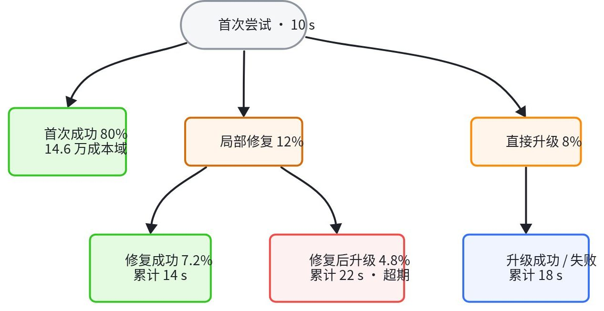

> 📝 <b>例 11-9（总扩容决策）：如何按期完成且成本最低？</b>单价：普通 1.125 B200·秒≈0.00212、快速 1.5 B200·秒≈0.00283;CPU 0.000014/CPU·秒、内存 0.0000045/GiB·秒。

| 方案 | 完成/s | CPU·秒 | 内存/GiB·秒 | 平均内存/GiB | 按时通过 |
|---|---|---|---|---|---|
| 普通+始终驻留 | 30 | 3 | 60 | 600 | 0（超期） |
| 普通+每轮重建 | 30 | 3.3 | 18 | 180 | 0（超期） |
| 快速+始终驻留 | 21 | 3 | 42 | 420（超容） | 95% |
| <b>快速+每轮重建 ✅</b> | 21 | 3.3 | 18 | 180 | 95% |

> ✅ **结论**：选**快速服务 + 每轮重建环境**，副本 10 → 12。这是四方案中唯一既按期又不超单机容量者。每千项按时通过成本 $`8.61/0.95\approx 9.07`$ 美元（模型费占 98%+）。180 GiB、33 核、180 并发（12 副本 192 槽）均在容量内。

> 📐 **环境策略成本相等点**：驻留 $`2G\times 0.0000045`$ vs 重建 $`2\times 2\times 0.0000045+0.1\times 0.000014=0.0000194`$，两者在 **G≈2.16 s** 相等。等待 6 s 应重建，等待缩到 2 s 则保留更省。
>
> **Amdahl 定律**：$`S=\frac{1}{(1-f)+f/s}`$。工具占 10% 加速 2× → 1.05；模型占 90% 加速 2× → 1.82。

---

> 🚨 **常见误区**
>
> - ❌ 看到 CPU 才用 62.5% 就以为加 CPU 能提吞吐：真正瓶颈是等待期间的**环境内存**。
> - ❌ 以为暂停环境一定省内存：保存时间随容量增长，间隔短于「保存+恢复」时零节省甚至倒亏。
> - ❌ 只算单次调用成本：失败重试消耗的资源不能从总支出扣除，应「总支出 ÷ 成功任务数」。
> - ❌ 缩短思考预算必省钱：思考占比小则收益有限，还可能触发更贵的整次重试。

> 分析资源需求，要算任务总共做了多少工作；分析完成时间，还要考虑这些工作按什么顺序执行、哪些能并行。结合两者，才能判断一项局部改进对整个系统是否有益。

### 第 12 章 端边云协同

> 📖 **本章主线**：把第 8—11 章的模型服务、资源调度与运行环境**部署到端、边、云不同设备**，用三类任务（图片精修、实时语音、截图 Agent）贯穿同一套分析方法，先算各步骤耗时，再定执行依赖，最后加入连接/窗口/竞争/恢复等实际开销。
>
> <b>核心洞察：</b>一张图交云端精修，**模型只跑 0.3 秒，用户却等 12.8 秒**，上传独占 12 秒（约 94%）。把模型加速十倍只省 0.27 秒；把输入压缩一半却能省近 6 秒。<b>模型放哪里，比较的是整个任务的完成时间，单看模型算力会选错。</b>

#### 贯穿三类任务的分析层次

| 分析层次 | 计算对象 | 得到的判断 |
|---|---|---|
| 各步骤耗时 | 计算、发送、传播各需多久 | 原图上传占 12 s，模型仅 0.3 s |
| 执行依赖 | 哪些可重叠、哪些必须等待 | 独立图块可重叠；下一轮截图要等上一轮操作完成 |
| 实际执行 | 数据就绪后何时开始算/发 | 音频均速够，一次晚到仍造成停顿 |

#### 12.1 从模型运行时间到完整交互时间

**图片精修串行完成时间**：输入 $`S_u`$、输出 $`S_d`$，上下行速率 $`B_u,B_d`$,RTT 为 R，处理 $`T_c`$。任务以用户收齐成片为终点。

> 📐 **串行完成时间**：$`T_{serial}=\frac{S_u}{B_u}+R+T_c+\frac{S_d}{B_d}`$
>
> 30 MB 原图、5 MB 成片，上行 20、下行 100 Mbit/s,R=0.1 s,$`T_c`$=0.3 s:$`\frac{30\times 8}{20}+0.1+0.3+\frac{5\times 8}{100}=12.8`$ s。上传 12 s ≈ <b>94%</b>。

> 💡 <b>上传如何限制模型加速收益（Amdahl）</b>：处理仅占 ~2.3%，加速十倍只到 12.53 s（省 0.27 s ↓）；处理瞬时完成仍需 12.5 s。换路子：上行提到 100 Mbit/s → 上传 2.4 s、全程 3.2 s(<b>4×</b>)；或压缩输入减半 + 0.15 s 编解码 → 发送 6 s、全程约 7.0 s。

> 📐 **压缩节省时间**：$`\Delta T=\frac{S_u-S_u'}{B_u}-T_e`$。20 Mbit/s 时少传 15 MB 省 6 s;100 Mbit/s 省 1.2 s;**800 Mbit/s 仅省 0.15 s，收益归零**。分三块重叠：整图串行 12.8 s，独立分块 12.36 s；若需全局信息则仍 12.8 s。

<b>实时语音流水线（逐块递推）</b>：第 i 块 $`c_i=\max(a_i,c_{i-1})+m_i`$（处理）、$`u_i=\max(c_i,u_{i-1})+s_i`$（发送）、$`r_i=u_i+d_i`$（到达）；播放 $`p_i=\max(r_i,p_{i-1}+\tau)`$。两处 max 分别来自数据依赖与资源竞争。

> 📐 **抖动与速率不足两种停顿**：24 kHz 单声道 16-bit、每块 20 ms=960 B，处理 12 ms、发送 1 ms、传播 5 ms；首块 38 ms 到达、缓冲 40 ms 后 78 ms 播放。第三块传播改 50 ms → 123 ms 到，晚 5 ms，后续全推迟；初始缓冲 40→45 ms 恰好避免中断。长期速率不足：256 kbit/s 需求、只收 130 kbit/s,60 ms(15,360 bits)缓冲约 $`15360/(256000-130000)\approx 0.12`$ s 耗尽，增大缓冲只抬起点不改斜率。
>
> **Computer Use 逐轮累积**：必须等上轮操作更新界面才能取下一张截图，无法重叠。30 轮任务：每轮上传 1 s + 终端 0.3 + 模型 2.0 + 传播 0.2 = **3.5 s**，共 105 s。截图压至 0.2 MB（+30 ms 编码）：$`T'_{round}=0.25+0.03+2.5=2.78`$ s,30 轮省 21.6 s → 约 83 s。轮数上限：$`2.78N'<105\Rightarrow N'<37.8`$，即最多 37 轮仍更快，38 轮约 106 s（最多容 7 轮纠错）。
>
> **端侧手机执行资源**：LPDDR5X 每引脚 10.6 Gbit/s、四条 x16 通道 → $`4\times 16\times 10.6/8=84.8`$ GB/s。Qwen3-8B BF16 单请求 8K，每步读权重 15.14 GB → $`15.14/84.8\approx 0.179`$ s（约 5.6 token/s），计 KV 后 0.193 s(5.2)。q4_0（每 32 值 64→18 B）权重降至约 4.26 GB、每步 64 ms → **约 15.5 token/s**。容量：24 GB 一档才容 BF16 8B。能耗：每 token 0.576–0.756 J，一次充电约 490–590 提示。

#### 12.2 跨设备分工

**编码器放哪里**：同一截图，可上传图片（远端编码）或先本地编码后上传特征。后续语言模型计算相同，相消；只需比编码时间与发送量之差。

> 📝 <b>例：上传特征为何可能比上传原图更慢？</b>0.8 MB 截图、上行 6.4 Mbit/s。Qwen3-VL-4B 固定配置：640×640 → 400 个视觉 token，最终投影 [400,2560] + 3 组 DeepStack，每 token 存 $`4\times 2560=10240`$ 个 BF16 数：$`S_E=400\times 10240\times 2=8\,192\,000`$ B ≈ 7.8 MiB，约压缩图 **10 倍**。发送从 1 s 增到约 10.2 s。判据 $`\Delta T=T_{E,l}-T_{E,r}+T_x+\frac{S_E-S_I}{B_u}<0`$ 时端侧编码更快。RTX 4090 编码 7.9 ms、H100 1.3 ms（工作量 1.31 TFLOPs），本地方案计算多 6.6 ms、发送多 9.2 s。

> 💡 **链路决定比什么**：400 Gbit/s ConnectX-7（每向 50 GB/s）下图片与特征发送仅差约 0.15 ms → **快链路比编码/排队，慢链路比传输量**。三类缓存三个重算起点：图片 0.8 MB（重做视觉编码）、EC 7.8 MiB（从语言前缀起）、视觉 token KV 56.3 MiB（每 token 144 KiB，从匹配前缀后续）。

> 📐 **会话迁移收益**：$`G(N)=N\Delta t-M`$。迁移 64 MiB 经 80 Mbit/s + 恢复 1 s:$`M=\frac{64\times 2^{20}\times 8}{80\times 10^6}+1\approx 7.7`$ s。每轮快 0.4 s:10 轮净损 3.7 s、20 轮净省 0.3 s、40 轮省 8.3 s。回本 $`N>M/0.4`$ → **最少 20 轮**；恢复 +1 s 则升到 22 轮。
>
> **模型内部切分：张量并行通信边界**。36 层 Qwen3-8B、TP=2，每层两次归约、各两次启动：$`T_{start}=36\times 2\times 2\alpha=144\alpha`$。$`\alpha`$=2 μs → 0.29 ms；改 54 Mbit/s Wi-Fi（短帧交换 134 μs）则 144 次 → **约 19.3 ms**，是 RTX PRO 6000 一步 decode 下界 9.12 ms 的两倍多。逐层依赖 + 自回归使启动时间逐 token 累加。

#### 12.3 广域网传输中的额外开销与等待

**连接建立与复用**：QUIC 合并传输握手与 TLS 1.3，会话恢复可发 0-RTT。截图任务建链设两次往返：每轮重建累计 12 s，只首轮建立仅 0.4 s（省 11.6 s ↓）;105 s → 首建后 105.4 s，每轮重建 117 s。

> 📐 **窗口与有效吞吐**：$`B_{useful}\le\min(B_{path},\frac{W}{R})`$。20 Mbit/s、RTT 100 ms 需约 250 KB 在途才填满；只 64 KB 额度 → $`64000/0.1=640000`$ B/s ≈ 5.1 Mbit/s，发 30 MB 至少约 47 s。慢启动初窗 10×1460 B、每轮翻倍，前四轮累计 219000 B，第五轮 452,600 B → 355 KB 请求要到第五轮才发完。协议头+ACK：三万包增约 4.6 MB，实际传输 35→39.6 MB，完整请求约 14.4 s。

> 🚨 **丢包不一定是拥塞**。Mathis 上界 $`B_{TCP}\le\frac{MSS}{R}\cdot\frac{C}{\sqrt{p}}`$:Irvine→贵阳 MSS 1448 B、R=0.2 s、p=0.14 → $`\frac{1448\times 8}{0.2\sqrt{0.14}}\approx 0.155`$ Mbit/s（C=1.22 则 0.189），比实际低三个数量级。BBR 直接测量：BDP=$`333\times 0.2=8.325`$ MB、cwnd 16.65 MB，理想吞吐 $`(1-p)\times 333\approx 286`$ Mbit/s，是 Mathis 的约 1850 倍。

> 💡 **FEC 让接收方不等重传**：354,640 B 分 245 报文各 14% 独立丢，期望丢 34.3；逐轮理想选择性重传期望完成 0.764 s（串行预算 238.5 ms 的 3.2 倍）、p99 1.247 s（6 轮）。FEC 按二项分布求 99.9%:14% 需 63 修复包（冗余 25.7%）→ 发 308 符号、约 241 ms 贴近预算；3.6% 只需 20 修复包（冗余 8.2%）。**冗余比例应随实测丢包率调整**。

**多流交付**：HTTP/2 单有序 TCP 流有队头阻塞（音频要等图片到第 7 s）;QUIC 逐流有序，音频第 3 s 即可交付（省 4 s）。Queqiao 案例：固定 355 KB、333 Mbit/s、RTT 200 ms，理想约 240 ms。新建连接直接路径中位数 1185.3 ms、Queqiao 301.6 ms(3.9×)；**复用连接并调优后两者均约 0.24 s**：差距主要来自连接准备与发送等待，非协议本身。

#### 12.4 无线变化下的交互与恢复

> 📐 **共享空口的固定开销**：OFDM 54/6 Mbit/s 无聚合。数据交换=34 μs 接入 + 208 μs 数据帧 + 16 μs SIFS + 44 μs MAC ACK = **302 μs**；承载端到端 ACK 时数据帧缩到 40 μs，共 **134 μs**。两者固定开销均 94 μs：报文缩八成，整次只缩约 56%。发 30 MB+5 MB 各需 30,800 次交换：$`30800\times(302+134)\,\mu s\approx 13.4`$ s;ACK 减半释放约 2.1 s 空口（但反馈延迟又增窗口停等）。

**时限、过期与取消**：等缺块的播放器把延迟变停顿，固定时钟播放器丢弃晚到块。取消分两条并行路径：本地清空待播缓冲（用户何时不再听到）、远端待控制消息到达后停止生成（何时停止耗资源）。截图 Agent 动作提交后改变环境，重试应查原操作编号结果，避免二次业务操作。

> 📐 **双路径分流与复制**：$`T_{split}=\max(\frac{xS}{B_1},\frac{(1-x)S}{B_2})`$，最优 $`x=B_1/(B_1+B_2)`$。20/10 Mbit/s 传 30 MB 各 8 s，比只用快路 12 s 省 4 s；若共用 24 Mbit/s 出口则至少 10 s，瓶颈转移。复制失败：$`p_{fail}=q+(1-q)p_1p_2`$,$`p_1`$=0.1、$`p_2`$=0.05、q=0.02 → 约 2.5%，其中 2 个百分点来自共同端点，须放到不同故障域才降。

#### 12.5 从端边云分工到完整部署

**贯穿题决策**：30 轮截图任务前十轮已完成，剩余 20 轮须 45 s 内完成（原服务续跑要 70 s）。比较端（手机 84.8 GB/s）、边（RTX PRO 6000 1792 GB/s 600 W）、云（H100 SXM 3350 GB/s 700 W）三档，同跑 q4_0 权重每轮生成 45 token。

> 📐 **三方案完成时间**：
>
> $`T_{local}=20(0.3+2.90)\approx 64.0`$ s（超期 ↑）
>
> $`T_{near}=0.27+20(0.3+0.137+0.02+6.4/80)\approx 11.0`$ s
>
> $`T_{cloud}=0.14+20(0.3+0.073+0.20+6.4/6.4)\approx 31.6`$ s
>
> H100 带宽是 RTX 的 1.87 倍、每轮模型省约 0.064 s，但上传每轮多 0.92 s、传播多 0.18 s → 云端反慢约 20.6 s。

| 位置 | 每轮模型 | 上行/传播 | 20 轮时间 | 能耗 |
|---|---|---|---|---|
| 端侧手机 | 2.90 s | 无上传 / 0 s | 64.0 s（超期） | 518–680 J |
| 附近工作站 | 0.137 s | 80 Mbit/s / 0.02 s | 11.0 s | 约 1.81 kJ |
| <b>云地域 ✅</b> | 0.073 s | 6.4 Mbit/s / 0.20 s | 31.6 s | 约 1.12 kJ ↓ |

> ✅ **结论**：45 s 期限先排除端侧（超期）；附近与云端都按时，**比能耗，云端 1.12 kJ &lt; 附近 1.81 kJ，选云端**。$`T_{cloud}(b)=11.6+128/b`$，满足期限需 $`b\ge 128/33.4\approx 3.8`$ Mbit/s；但上传瞬时也要 11.6 s，永远追不上附近的 11.0 s（每轮 0.2 s 传播 > H100 省的 0.064 s）。按实测 2.83× 放大后，须上行 > 128/1.75 ≈ 73 Mbit/s 云端才更快。

> 📐 **状态复用与故障恢复**。文本会话保留状态省矩阵 $`3.0\times 10^{14}\to 6.0\times 10^{13}`$ FLOPs（约 0.239 GPU 秒），但 465 MB 状态占显存，约 41 s 后抵消收益。断连恢复：每轮 1.57 s、恢复连接 1 s；保留前九轮只重做第十轮 +2.57 s → 34.2 s（按时）；丢十轮 +16.7 s → 48.3 s（超期 ↑）。重试期望成本 $`E=C/p`$:99% 约 1.01C,80% 约 1.25C。

> 💡 <b>固定任务只加速模型的上限（Amdahl）</b>：模型 8 s、其他串行 2 s。模型加速 10× → 10 s 降到 2.8 s，加速比约 **3.57**；模型趋零下界仍 2 s。要再缩短须改变系统组织（本地化减往返、保留环境减创建）。

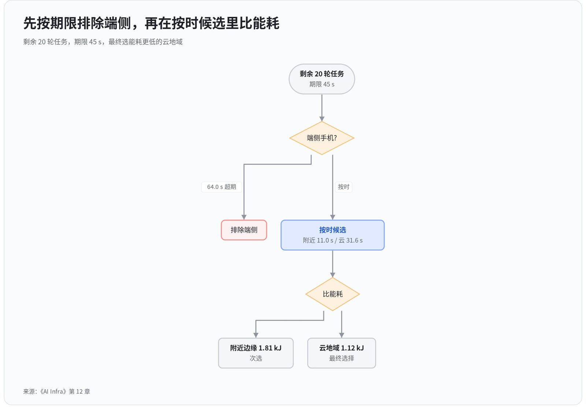

---

> 🚨 **常见误区**
>
> - ❌ 以为加速模型就能缩短任务：上传占 94% 时，模型十倍加速只省 0.27 s（Amdahl 限制）。
> - ❌ 以为端侧算完再传特征更省：视觉特征约为压缩图 10 倍，慢链路上发送反多 9 秒。
> - ❌ 把丢包当拥塞：随机丢包路径上 Mathis 上界比实际低三个数量级，应直接测带宽（BBR）+按丢包率配 FEC。
> - ❌ 只看平均速率：十轮 6 + 十轮 10 Mbit/s（均值 8）反比全程 8 Mbit/s 慢，慢轮多等超过快轮所省。

> 完整交互从三层分析：先按数据量、计算量、传播距离求各步骤耗时，再按执行依赖确定相加或重叠，最后加入连接、窗口、竞争与恢复解释实际等待。先满足质量与期限，再比较每个完成任务的总成本，这是学习 AI Infra 带来的系统设计能力。

---

## 结语：读完这本书，你应该获得什么能力

> ✅ 回到开头那条主线：**数据搬移的量化**。读完全书，面对**一个新模型、一款新加速器、一种新部署要求**，你应能沿同一套流程走完：**画出执行链路 → 用 M/F/R 算出物理上限 → 追问 5 个搬移问题定位瓶颈 → 指出最该验证的假设 → 用测量校正后修改选择**。你的结论可以和书里不同；能说清差异从哪来，本身就是理解系统的表现。

### 跟着算一遍：7 个动作清单

这本书**不能当小说读**，价值在“跟着算”，不在“记结论”。建议边读边完成：

- [ ] 第 1 章后：用 Jeff Dean 数字表 + Amdahl 定律，手算你业务里某个请求的延迟下界

- [ ] 第 2 章后：给常用的一个模型推出 M（存储）、F（运算）、R（读写）三个数字

- [ ] 第 4 章后：用算术强度 + Roofline 判断你的负载是“计算受限”还是“带宽受限”

- [ ] 第 6 章后：为你的模型 + 硬件列出可选并行方案，排除不可行的

- [ ] 第 8 章后：估算你的推理实例在给定显存下能同时保存多少条请求的 KV 缓存

- [ ] 第 10 章后：用“权重 × 8”法则估全参训练显存，判断要多少卡

- [ ] 克隆配套仓库，用它的量化工具复算书中数字，再换一组条件观察结论变化

[配套仓库 github.com/bojieli/ai-infra-book（实验 + 量化计算工具 + 芯片/模型参数表）](https://github.com/bojieli/ai-infra-book)

> 📌 <b>说明：</b>本文基于对原书正文的逐章精读整理。书中部分模型/芯片型号（如 DeepSeek V4.1 Flash、Qwen3 系列等）为原书设定的近未来案例，以原书为准。

---

## 附录 A:SRE / QA / 普通研发怎么读这本书

> 💡 原书阅读路径面向“模型开发者 / 系统网络工程师 / 芯片架构师”。但 **SRE、QA、普通研发**同样能从这本书受益：只要把它的核心方法（**用 M/F/R 算物理上限、用 5 问定位瓶颈**）翻译到自己的日常。下面按角色给出：**你最该关心什么 → 精读哪几章 → 可略读/跳过 → 3-5 个能立刻上手的动作**。三类角色都建议先读第 1 章打底（数量级直觉 + Amdahl 定律）。

### A.1 SRE / 稳定性工程师

> 🎯 **你的核心关切**
>
> - 容量规划：要几张卡、几个副本？
> - SLO：延迟、吞吐、成功率怎么定？
> - 弹性扩缩容与故障恢复
> - 拥塞、故障域、雪崩防护

> 📚 **精读章节**
>
> - **第 1 章**：数量级直觉 + Amdahl（性能归因）
> - **第 3 章**：Little 定律、排队、TTFT/TPOT
> - **第 9 章**：PD 分离、负载均衡、扩缩容
> - **第 11 章**：资源调度、多租户、利用率
> - **第 7 章**：拥塞控制、可靠性、故障

> ✅ **最该带走的一把尺子：Little 定律 **$`N=\lambda T`$。系统中并发请求数 = 到达率 × 平均驻留时间。它直接回答“给定 QPS，我需要多少并发槽位 / 副本”，也解释了“延迟一升高，积压就雪崩”。把 <b>TTFT（首 token 延迟）</b>和 <b>TPOT（每 token 延迟）</b>当成核心 SLO，别用笼统的“响应时间”。

<b>把书里的量化用到你的日常：</b>

- [ ] 用 M/F/R 给一个线上模型服务做容量规划：显存能装下 KV（容量）、带宽供得上 decode(R)、算力供得上 prefill(F)，三者取最紧的那个当瓶颈

- [ ] 用 $`N=\lambda T`$ 反推：按目标 QPS 和实测单请求驻留时间，算出最少副本数与并发上限

- [ ] 把监控指标换成 TTFT / TPOT / MBU（带宽利用率），而不是只看 CPU/GPU 使用率

- [ ] 读第 9 章后，评估你的服务是否该做 PD 分离（prefill 与 decode 拆到不同池），以及扩缩容的触发信号

- [ ] 读第 7 章后，梳理你的故障域：一个超节点 / 一条 rail 挂掉，影响面多大，拥塞时会不会连锁

<b>可略读：</b>第 2 章模型内部结构、第 5 章算子融合/编译、第 10 章训练系统（除非你也管训练集群）。

---

### A.2 QA / 性能测试工程师

> 🎯 **你的核心关切**
>
> - 压测数字到底合不合理？
> - benchmark 口径：吞吐 vs 延迟
> - 测试场景怎么设计才真实？
> - 优化会不会悄悄损害质量？

> 📚 **精读章节**
>
> - **第 1 章**：先算上限，再看实测差多远
> - **第 4 章**：Roofline、MFU/MBU、算术强度
> - **第 3 章**：负载建模（到达分布/多轮/多模态）
> - **第 8 章**：batching/量化/投机解码及其质量影响

> ✅ <b>QA 最缺的能力：判断“这个数字合不合理”</b>。一个压测结果是好是坏，不能只跟上次比，要跟**硬件物理上限**比。用第 4 章的 **Roofline** 判断负载是计算受限还是带宽受限，用 <b>MFU（算力利用率）/ MBU（带宽利用率）</b>量出“离上限还有多远”。如果 MBU 只有 33%，说明还有 3 倍空间，远没到“性能已经很好了”的地步。

<b>把书里的量化用到你的日常：</b>

- [ ] 压测前，先用 M/F/R 手算这台机器该有的理论吞吐/延迟，把它当作压测结果的“及格线”

- [ ] 报告里同时给吞吐和延迟两条曲线，并标注 batch size：单看吞吐会掩盖延迟恶化（第 3、8 章）

- [ ] 按真实到达分布（而非固定并发）设计压测：泊松到达、长短请求混合、多轮对话、多模态（第 3 章）

- [ ] 对每一项性能优化（量化、投机解码、KV 卸载）配一组质量回归：吞吐提升的同时，精度/一致性有没有掉（第 8 章）

- [ ] 用 MFU/MBU 作为验收指标之一，而不是只报 QPS

<b>可略读：</b>第 6、7 章的并行与网络细节、第 10 章训练系统内部机制。

---

### A.3 普通研发 / 应用开发者

> 🎯 **你的核心关切**
>
> - 调用推理服务，成本从哪来？
> - 为什么长上下文又慢又贵？
> - 多轮对话 / Agent 为什么越跑越慢？
> - 什么时候该上端侧 / 边缘？

> 📚 **精读章节**
>
> - **第 1 章**：一次请求的成本直觉
> - **第 2 章**：KV 缓存（理解贵在哪）
> - **第 3 章**：多轮 / 多模态负载
> - **第 8 章**：前缀共享、KV 复用、量化省钱
> - **第 12 章**：端边云部署选型

> ✅ **最该看懂的一件事：KV 缓存**。它解释了你日常遇到的几乎所有“贵和慢”：上下文越长，每 token 要保存和重读的 KV 越多（第 2 章给出每 token 约 144 KiB 的量级）；多轮对话把历史一遍遍带上，KV 线性膨胀（第 3 章）。反过来，第 8 章的**前缀共享 / KV 复用**就是你省钱的杠杆：相同的系统提示词、相同的对话前缀，只算一次。

<b>把书里的量化用到你的日常：</b>

- [ ] 给你的一次典型调用算笔账：输入多少 token、输出多少 token，大致对应多少计算和多少 KV 显存（第 1、2 章）

- [ ] 把长而固定的系统提示词放在最前面，利用前缀缓存复用；评估你的框架是否支持 prefix caching（第 8 章）

- [ ] Agent/多轮场景：估算 KV 随轮次的增长，决定何时截断历史或做摘要压缩（第 3、8 章）

- [ ] 延迟敏感 vs 吞吐敏感，选不同的 batch/流式策略；理解 TTFT 与 TPOT 对体验的不同影响（第 3、8 章）

- [ ] 评估端侧部署：小模型 + 量化能否在手机/边缘跑，传输延迟 vs 本地算力怎么权衡（第 12 章）

<b>可跳过：</b>第 5、6、7、10 章（算子/超节点/网络/训练），用到再回看。

---

## 附录 B：零基础术语速查（挡在门口的 20 个词）

> 💡 SRE / QA / 普通研发读这本书，最容易被术语挡在门口。下表用**一句大白话 + 为什么你要关心**解释高频术语，读到卡壳时回来查。不求精确，只求先能往下读。

| 术语 | 一句大白话 | 你为什么要关心 |
|---|---|---|
| **Prefill**<br>预填充 | 把你输入的一整段话一次性读进去、算好状态 | 输入越长，这步越慢（计算密集），决定 TTFT |
| **Decode**<br>解码 | 一个字一个字往外蹦，每蹦一个都要重读一遍权重 | 输出越长越慢（带宽密集），决定 TPOT 和总成本 |
| **KV 缓存** | 把前文算过的中间结果存起来，后面别重算 | 长上下文/多轮“又慢又贵”的根源，也是省钱的杠杆 |
| **Token** | 模型眼里的“字”：约等于半个汉字或 3/4 个英文单词 | 计费、限长、成本都按 token 算 |
| **TTFT** | 从发请求到吐出第一个字的时间 | 用户“感觉快不快”的第一印象，核心 SLO |
| **TPOT** | 吐出后每个字之间的间隔 | 决定“打字机效果”流不流畅，核心 SLO |
| **吞吐 Throughput** | 每秒能处理多少 token / 多少请求 | 决定成本；但拉高吞吐常牺牲延迟，要一起看 |
| **显存 / HBM** | GPU 自己的高速内存，很快但很小很贵 | 装不下就跑不动；KV+权重挤爆它是常见故障 |
| **带宽 Bandwidth** | 每秒能从显存搬多少数据到计算单元 | decode 阶段的真正瓶颈，不是算力 |
| **算力 FLOPS** | 每秒能做多少次浮点运算 | prefill 阶段的瓶颈；峰值≠实际（看 MFU） |
| **Roofline** | 一张图，告诉你负载卡在“算力”还是“带宽” | 判断该买更强的卡还是更快的显存 |
| **算术强度** | 搬 1 字节数据能顺便做多少次计算 | 低=带宽受限，高=计算受限，决定优化方向 |
| **MFU / MBU** | 算力/带宽的实际利用率（占峰值的百分比） | 量出“离物理上限还差多远”,QA 验收指标 |
| **Batching**<br>批处理 | 把多个请求凑一批一起算，摊薄权重读取成本 | 提吞吐的头号手段，但会增加单请求延迟 |
| **量化**<br>Quantization | 把参数从 16 位压成 8 位/4 位，省显存省带宽 | 省钱提速，但可能掉精度：QA 要盯质量回归 |
| **投机解码** | 小模型先猜一串，大模型批量验证，猜对就赚 | 不改质量的前提下降延迟（第 8 章） |
| **PD 分离** | 把 prefill 和 decode 拆到不同机器池各干各的 | SRE 扩缩容/资源隔离的关键架构（第 9 章） |
| <b>并行（TP/PP/DP…）</b> | 一个模型太大，拆到多张卡上分工算 | 决定要几张卡、卡间通信会不会成瓶颈（第 6 章） |
| **MoE**<br>混合专家 | 模型里养一堆“专家”，每次只激活其中几个 | 参数大但每次算得少，放置/均衡是难点（第 9 章） |
| **Little 定律** | 并发数 = 到达率 × 停留时间（$`N=\lambda T`$） | SRE 算副本、QA 设并发的万能公式（第 3 章） |

> ✅ **一句话给三类角色收尾**：你不需要会造芯片、写算子，但只要掌握“**先算物理上限，再看系统离上限多远**”这一个思维习惯，就能在容量规划、压测判读、成本优化里，把“感觉”换成“算得出来的数”。这正是这本书最普适、也最值得非 Infra 背景的人带走的东西。

---

## 附录 C · 延伸阅读：奠基论文与业界实践地图

> 📚 本书的每个结论，几乎都能追溯到一篇奠基论文或一次公开的工程实践。下面这张地图按<b>本书主线（数据搬移 → 量化分析 → 训练 → 推理 → 系统）</b>把最值得精读的原始文献串起来，每条都给出**为什么值得读 + 对应本书哪一章**。读正文卡在“这个结论从哪来”时，回来按图索骥。所有链接均为可直接访问的原始出处，不做二手转述。

### 一、量化分析的基石：先学会“算账”

> 💡 本书反复强调“先估算再动手”。下面两篇是所有性能量化分析的思维原点。

- **Roofline 模型**（对应第1章 1.3、第4章 4.8）：把“算力受限 vs 带宽受限”用一张图讲透，是本书 M/F/R（容量/算力/带宽）三分法的理论祖先。Williams, Waterman, Patterson, Roofline: An Insightful Visual Performance Model for Multicore Architectures, CACM 2009，[dl.acm.org/doi/10.1145/1498765.1498785](https://dl.acm.org/doi/10.1145/1498765.1498785)
- <b>Jeff Dean 的“延迟数字”</b>（对应第1章 1.2 系统设计的关键数字）：每个工程师都该背下来的一组数量级，L1、内存、SSD、跨洲往返各差几个数量级。原始出处见 Latency Numbers Every Programmer Should Know：[colin-scott.github.io/personal_website/research/interactive_latency.html](https://colin-scott.github.io/personal_website/research/interactive_latency.html)

### 二、注意力与显存：推理为什么这么“吃内存”

> ⚡ 本书讲 KV Cache(144 KiB/token)与显存墙时，背后是这两篇把“注意力”从算力问题重新定义成访存问题的工作。

- **FlashAttention**（对应第5章 算子与运行时）：证明注意力的瓶颈在 HBM 读写，算力并不缺，用分块+重计算把访存降下来。Dao et al., FlashAttention: Fast and Memory-Efficient Exact Attention with IO-Awareness, 2022，[arxiv.org/abs/2205.14135](https://arxiv.org/abs/2205.14135)；续作 FlashAttention-2，[arxiv.org/abs/2307.08691](https://arxiv.org/abs/2307.08691)
- **PagedAttention / vLLM**（对应第8章 8.3 KV 缓存分配）：把操作系统的“分页”思想搬到 KV Cache，几乎消灭显存碎片，是当今主流推理引擎的基石。Kwon et al., Efficient Memory Management for LLM Serving with PagedAttention, SOSP 2023：[arxiv.org/abs/2309.06180](https://arxiv.org/abs/2309.06180)

### 三、推理服务：把吞吐榨干

> 🚀 本书讲 Little's Law、连续批处理、PD 分离时，对应这几项让推理吞吐上一个台阶的关键工作。

- **Orca：连续/迭代级批处理**（对应第8章 8.2 批处理与调度）：提出 iteration-level scheduling，让不同长度请求动态拼批，是“continuous batching”的源头。Yu et al., OSDI 2022：[usenix.org/system/files/osdi22-yu.pdf](https://www.usenix.org/system/files/osdi22-yu.pdf)
- **投机解码 Speculative Decoding**（对应第8章 8.5 推测解码）：用小模型“草稿”+大模型“验证”，在不改变输出分布的前提下加速自回归解码。Leviathan, Kalman, Matias, ICML 2023：[arxiv.org/abs/2211.17192](https://arxiv.org/abs/2211.17192)
- **DistServe:PD 分离与 goodput**（对应第9章 9.2）：按 SLO 约束下的单卡 goodput 决定 prefill 与 decode 分池配比，PD 分离的代表工作。Zhong et al., OSDI 2024：[arxiv.org/abs/2401.09670](https://arxiv.org/abs/2401.09670)
- **Sarathi-Serve：分块 prefill**（对应第8章 8.2、第9章 9.2）：长 prefill 切块后与 decode 共批，调度不让 decode 停等，共置路线的上限参考。Agrawal et al., OSDI 2024：[arxiv.org/abs/2403.02310](https://arxiv.org/abs/2403.02310)
- **Mooncake：以 KV 缓存为中心的服务架构**（对应第9章 9.5）：Kimi 线上系统，分布式 KV 池加按命中与排队选实例，过载时提前拒绝。Qin et al., FAST 2025：[arxiv.org/abs/2407.00079](https://arxiv.org/abs/2407.00079)
- **EAGLE-3：草稿模型**（对应第8章 8.5）：复用目标模型多层特征并在训练时模拟多步草稿，把接受率和加速比再推高一档。Li et al., 2025：[arxiv.org/abs/2503.01840](https://arxiv.org/abs/2503.01840)

### 四、分布式训练：一张卡装不下时怎么办

> 🔗 本书讲训练态显存（≈权重×8）、六种并行时，下面前四篇是“把一个大模型摊到成百上千张卡上”的核心方法论，后三篇对应第 10 章的故障恢复与 RL 训练系统。

- **Megatron-LM：张量并行**（对应第6章 6.2 六种并行）：把单层的矩阵乘沿维度切开分到多卡，是张量并行的经典实现。Shoeybi et al., 2019：[arxiv.org/abs/1909.08053](https://arxiv.org/abs/1909.08053)
- **ZeRO：显存零冗余**（对应第10章 10.2 训练状态分片）：把优化器状态/梯度/参数分片到各卡，消除数据并行里的冗余副本；配套 ZeRO-Offload 把状态卸载到 CPU。Rajbhandari et al., 2019，[arxiv.org/abs/1910.02054](https://arxiv.org/abs/1910.02054);ZeRO-Offload，[arxiv.org/abs/2101.06840](https://arxiv.org/abs/2101.06840)
- **GPipe：流水线并行**（对应第6章 6.2、第10章 10.3）：用 micro-batch 填满流水线气泡，让层间切分的多卡不空转。Huang et al., 2018：[arxiv.org/abs/1811.06965](https://arxiv.org/abs/1811.06965)
- **Ring-AllReduce / Horovod**（对应第6章 环形与树形归约）：把梯度同步组织成环状通信，带宽利用率与卡数无关，是数据并行通信的工程标杆。Sergeev &amp; Del Balso, 2018：[arxiv.org/abs/1802.05799](https://arxiv.org/abs/1802.05799)
- **Llama 3 技术报告：万卡故障统计**（对应第10章 10.4）：公开 16,384 张 H100、54 天、466 次中断的分类统计，估算 MTBF 与 checkpoint 间隔的一手数据。Llama Team, Meta, 2024：[arxiv.org/abs/2407.21783](https://arxiv.org/abs/2407.21783)
- **HybridFlow / verl:RL 训练框架**（对应第10章 10.5）：单控制器编排加多控制器执行，训练与生成在同一批卡上切换。Sheng et al., EuroSys 2025：[arxiv.org/abs/2409.19256](https://arxiv.org/abs/2409.19256)
- **AReaL：全异步 RL**（对应第10章 10.5）：生成与训练彻底解耦，用陈旧度上限和改造后的 PPO 目标换取最高 2.77 倍训练加速。Fu et al., 2025：[arxiv.org/abs/2505.24298](https://arxiv.org/abs/2505.24298)

### 五、缩放律与稀疏化：把算力花在刀刃上

> 📈 本书讲“训练经济学”与 MoE 时，对应这几篇决定“参数、数据、算力怎么配比”的工作。

- **Chinchilla 缩放律**（对应第3章 3.6、第10章 10.1）：给定算力预算，参数量和数据量应当同比例放大，纠正了此前“一味堆参数”的做法。Hoffmann et al., 2022：[arxiv.org/abs/2203.15556](https://arxiv.org/abs/2203.15556)
- **Switch Transformers:MoE 稀疏化**（对应第2章 2.4、第9章 9.3–9.4）：每个 token 只激活一个专家，用稀疏化把参数量做大而算力可控，是现代 MoE 的代表作。Fedus, Zoph, Shazeer, 2021：[arxiv.org/abs/2101.03961](https://arxiv.org/abs/2101.03961)
- **DeepSeek-V3 技术报告**（对应第9–10章 工业级实践）：把 MoE、MLA、FP8 训练等工程手段完整落地的一手报告，是“量化分析→系统设计”从原理到生产的最佳案例合集。DeepSeek-AI, 2024：[arxiv.org/abs/2412.19437](https://arxiv.org/abs/2412.19437)

### 六、量化压缩与数据中心网络：落地的最后一公里

> 💡 本书讲权重量化与集群网络时，对应“让模型装得下、让千卡连得起来”的实践。

- **GPTQ：训练后 4-bit 量化**（对应第8章 量化）：用近似二阶信息一次性把权重压到 3–4 bit 且几乎不掉精度，是权重量化服务的事实标准之一。Frantar et al., 2022：[arxiv.org/abs/2210.17323](https://arxiv.org/abs/2210.17323)
- **大规模 RoCE 组网**（对应第7章 数据中心网络）：Meta 公开的把 RDMA over Ethernet 用于千卡训练的实战经验，回答“用以太网替代 InfiniBand 的边界在哪”。Meta, SIGCOMM 2024，[dl.acm.org/doi/10.1145/3651890.3672233](https://dl.acm.org/doi/10.1145/3651890.3672233)；更早的奠基工作 RDMA over Commodity Ethernet at Scale, SIGCOMM 2016，[dl.acm.org/doi/10.1145/2934872.2934908](https://dl.acm.org/doi/10.1145/2934872.2934908)

> 💡 **一句话收尾**：这张地图的排列顺序，本身就是本书的主线，<b>先学会算账（Roofline/延迟阶梯），再看清瓶颈在访存（FlashAttention/PagedAttention），然后从推理服务（Orca/投机解码）一路上溯到训练并行（Megatron/ZeRO/GPipe）、缩放与稀疏（Chinchilla/MoE），最后落到量化与组网（GPTQ/RoCE）</b>。真正要带走的是那个判断习惯，论文清单只是索引：任何一个性能问题，先问“它是算力受限还是带宽受限”，再决定读哪一篇、投哪一处工程。

---

上一篇：[LLM-08｜系统｜大模型推理系统：全栈学习手册](./08-inference-systems.md) · [目录](./README.md) · 下一篇：[LLM-10｜工程｜RAG 与知识工程：让大模型用上自有资料](./10-rag.md)
