# LLM-13｜系统｜自建推理成本与 GPU 选型：算账手册

> 🎯 **这篇文档解决什么问题**：“要不要自建推理”“买什么卡”“一百万 token 到底花多少钱”，这几个问题经常凭感觉回答。本文把它们变成可以代入自己数字的算式：先讲推理的物理约束（为什么 decode 受显存带宽限制），再算显存账（权重和 KV Cache 各占多少），然后对比主流 GPU 的规格、列出降本手段，最后给出自建与 API 的盈亏平衡算法。文中所有价格和吞吐都标明是假设值，用的时候换成自己的报价和压测结果。
>
> 使用方式：先读第 1 章的成本公式，再按第 2、3 章算清带宽和显存。选卡读第 4 章，降本读第 5 章，决定自建还是用 API 读第 6 章，压测读第 7 章，决策前用第 8 章的清单核对。API 一侧怎么按任务算账读第 9 章，想估算每次请求耗多少电读第 10 章，想从公开吞吐估算闭源模型的规模读第 11 章，想给长上下文服务做容量规划读第 12 章。文中 GPU 规格核对于 2026 年 10 月 11 日。

## 导读 · 先给结论

- **decode 受显存带宽限制**：提高批大小是降本的第一杠杆（第 2 章）。
- **显存先装下权重，再装下足够多的 KV Cache**：KV Cache 的余量决定能并发多少请求（第 3 章）。
- **吞吐必须在延迟约束下实测**：峰值吞吐不能直接拿来算成本（第 7 章）。
- **自建划不划算，主要看利用率和人力**：GPU 单价反倒是次要的（第 6 章）。
- **每 token 单价不等于成本**：分词器不同，同样的内容 token 数可能多出几成，要按每个成功任务算（第 9 章）。
- **公开吞吐能反推闭源模型的量级**：同一平台上速度比约等于每 token 字节比，Opus 4.5/4.6 约千亿活跃参数、总参数一到三万亿，误差主要来自服务配置（第 11 章）。
- **HBM 装得下不等于跑得稳**：长上下文服务先撞上的常是排队和 SLO，副本数要从 SLO 约束下的单副本到达率反推，突发让排队放大数倍（第 12 章）。

推理成本可以分三层看，每一层回答一个问题：

| 层次 | 回答的问题 | 关键量 |
|---|---|---|
| 物理层 | 一张卡理论上每秒能出多少 token | 显存带宽、算力、显存容量 |
| 系统层 | 实际软件栈在延迟约束下能跑到多少 | 批大小、KV Cache 容量、量化、调度 |
| 经营层 | 摊到每个 token 上要多少钱，比 API 划算吗 | GPU 单价、利用率、人力和运维成本 |

大多数“自建更便宜”的结论只算了物理层和系统层的峰值，忽略了经营层的利用率和人力。第 6 章会看到，这两项往往决定结论。

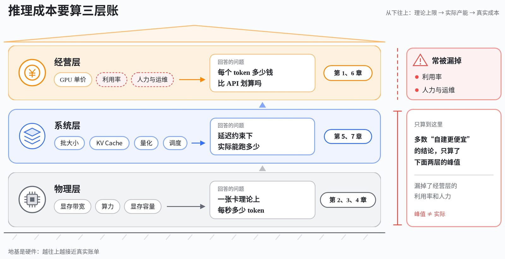

| 章节 | 回答的问题 | 图 |
|---|---|---|
| 第 1 章 成本公式 | 每百万 token 成本怎么算 | T2 |
| 第 2 章 推理的物理约束 | 为什么 decode 慢；批大小为什么是关键 | T3 |
| 第 3 章 显存账 | 权重和 KV Cache 各占多少；能并发多少请求 | T4 |
| 第 4 章 GPU 选型 | 主流卡的规格怎么读；什么场景选什么卡 | T5 |
| 第 5 章 降本手段 | 量化、批处理、前缀缓存、投机解码、PD 分离各省多少 | T6 |
| 第 6 章 自建还是用 API | 盈亏平衡点在哪；隐性成本有哪些 | T7 |
| 第 7 章 压测与容量规划 | 怎么测出可信的吞吐数字 | T8 |
| 第 9 章 分词器与按任务算账 | 同样的内容多出几成 token，每个成功任务花多少钱 | T9 |
| 第 10 章 推理能耗 | 每次提问耗几瓦时；边界、长度和批大小怎么算 | T10 |
| 第 11 章 从吞吐反推模型规模 | 公开的吞吐数据能看出闭源模型多大；误差在哪 | T11 |
| 第 12 章 长上下文容量规划 | HBM 装得下为什么还会超 SLO；副本数怎么反推 | T12 |
| 第 8 章 清单与反模式 | 决策前逐项核对 | — |

📎 与系列其他文档的分工：容量规划和成本治理见「LLM 服务稳定性工程」第 7、8 章。推理引擎内部原理见「vLLM 学习路径」和「大模型推理系统学习手册」，硬件层的量化分析见「《深入理解 AI Infra》精读」。本文只讲推理成本怎么算、卡怎么选。

## 第 1 章 · 成本公式：每百万 token 多少钱

📎 延伸阅读：推理模型按题算的成本（思考 token、并行采样）见 [LLM-37｜地基｜推理模型与测试时计算：长思维链何时值得](./37-reasoning-models.md)。

📎 延伸阅读：换分词器会让同样的内容多出三到四成 token，单价不变账单也会变。按每个成功任务比成本的算法见本书第 9 章。

### 1.1 基本公式

自建推理的单位成本只由三个量决定：每小时花多少钱、满载时每秒能处理多少 token、平均有多少时间是满载的。

```math
\text{每百万 token 成本} = \frac{N_{\text{GPU}} \times \text{每卡每小时价格}}{\text{吞吐（token/秒）} \times 3600 \times \text{利用率}} \times 10^6
```

- **每卡每小时价格**：云上按需、预留或自有机房折旧加电费。自有机房要把服务器、网络、机柜、电力与制冷、运维人力折算进来。
- **吞吐**：必须是在满足延迟目标（如首 token 延迟 TTFT 和每 token 间隔 TPOT 的 p90）的前提下测得的值，即 goodput[[1]](https://arxiv.org/abs/2401.09670)，而不是不顾延迟把批开到最大的峰值。
- **利用率**：实际处理的 token 数除以满载能力。在线业务有昼夜波峰波谷，又要为突发留余量，平均利用率通常远低于 100%。

### 1.2 一个算例（数字均为假设）

假设：2 张 H100 部署一个 70B 模型，每卡每小时 3 美元；压测得到在延迟目标内的输出吞吐为每秒 2000 token。

| 平均利用率 | 每百万输出 token 成本 | 说明 |
|---|---|---|
| 100% | 约 0.83 美元 | 理论下限，现实中达不到 |
| 60% | 约 1.39 美元 | 离线批处理与在线混部做得好的水平 |
| 40% | 约 2.08 美元 | 只跑在线业务、有明显昼夜波动 |
| 20% | 约 4.17 美元 | 流量小、为高峰预留了大量余量 |

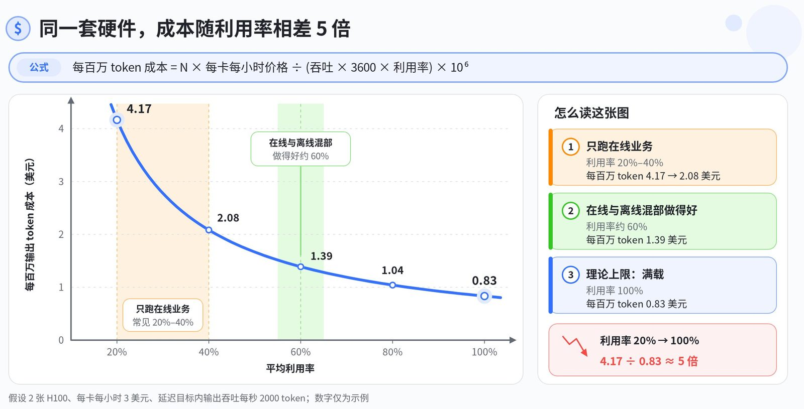

同一套硬件，成本随利用率相差 5 倍。这就是为什么“GPU 很便宜”和“自建很贵”可以同时成立。

### 1.3 输入和输出要分开算

输入 token 在 prefill 阶段并行处理，单位成本远低于输出 token；输出 token 在 decode 阶段逐个生成，最贵（原因见第 2 章）。主流 API 也按这个逻辑给输入和输出分别定价。自建测算时：

- 按自己业务的“输入长度 × 输出长度”分布压测，报“每个请求的成本”或分别报输入、输出的成本。
- RAG、长文档分析等输入远长于输出的场景，prefill 是主要开销，前缀缓存（第 5.3 节）收益最大。
- 推理模型的思考 token 也是输出 token，要计入。

## 第 2 章 · 推理的物理约束：decode 受带宽限制

📎 延伸阅读：MoE 模型的显存账、专家并行和单机专家卸载见 [LLM-33｜地基｜MoE 混合专家：路由、负载均衡、训练与推理](./33-moe.md)；长上下文的 KV 缓存与价格档位见 [LLM-31｜地基｜长上下文与注意力：从 MHA 到稀疏与线性注意力](./31-attention-long-context.md)。

### 2.1 两个阶段，两种瓶颈

- **Prefill**：一次性并行处理全部输入 token。成百上千个 token 共用同一份权重做矩阵乘法，计算量大，**受算力限制**。
- **Decode**：每一步只生成一个 token，但每一步都要把全部权重从显存读一遍。读得多、算得少，**受显存带宽限制**。

### 2.2 用屋顶线模型看批大小

屋顶线模型（Roofline）用“算术强度”（每从显存读 1 字节数据做多少次浮点运算）判断一个计算受算力还是带宽限制[[2]](https://dl.acm.org/doi/10.1145/1498765.1498785)。硬件的分界点等于峰值算力除以显存带宽。以 H100 SXM 为例，BF16 稠密算力约 989 TFLOPS、显存带宽 3.35 TB/s[[3]](https://www.nvidia.com/en-us/data-center/h100/)：

```math
\frac{989 \times 10^{12}\ \text{FLOP/s}}{3.35 \times 10^{12}\ \text{B/s}} \approx 295\ \text{FLOP/B}
```

Decode 时每生成一个 token，每个参数大约做 2 次浮点运算；BF16 下每个参数占 2 字节，并且一步之内只读一次，同一批次里的所有请求共用。批大小为 B 时，算术强度约为 B FLOP/B。也就是说，批大小要到约 300 才能把 H100 的算力用满；批大小为 1 时，算力利用率不到 1%。实际还要读 KV Cache，带宽压力更大。

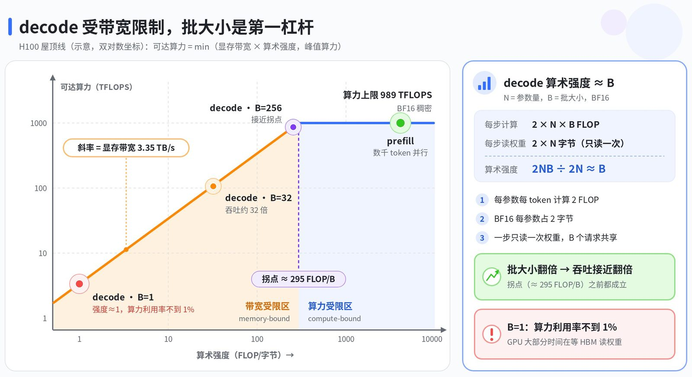

这带来两条结论：

1. **批大小是降本第一杠杆**。在带宽受限区间，批大小翻倍，每步耗时几乎不变，吞吐接近翻倍。vLLM 的 PagedAttention 正是通过减少 KV Cache 显存浪费、放下更大的批，在相同延迟下把吞吐提高 2 到 4 倍[[4]](https://arxiv.org/abs/2309.06180)。
2. **单请求速度的上限由带宽决定**。批大小为 1 时，每秒 token 数上限约等于“显存带宽 ÷ 权重字节数”。

### 2.3 单请求速度上限的算法

```math
\text{单请求 token/秒上限} \approx \frac{\text{显存总带宽}}{\text{权重字节数}}
```

| 配置 | 权重 | 总带宽 | 上限 |
|---|---|---|---|
| 70B · BF16 · 2 张 H100 张量并行 | 约 140 GB | 6.7 TB/s | 约 48 token/秒 |
| 70B · FP8 · 1 张 H100 | 约 70 GB | 3.35 TB/s | 约 48 token/秒 |
| 70B · FP8 · 1 张 H200 | 约 70 GB | 4.8 TB/s | 约 69 token/秒 |
| 8B · BF16 · 1 张 L40S | 约 16 GB | 864 GB/s | 约 54 token/秒 |

这是忽略 KV Cache 读取和通信开销的理论值，实测一般能达到它的 60% 到 80%。用户感知的 TPOT 不可能低于这个下限对应的间隔，如果业务要求每秒 100 token 以上的单流速度，就只能换更高带宽的卡、量化、用更小的模型，或者用投机解码（第 5.4 节）。

### 2.4 MoE 模型：显存看总参数，带宽看激活参数

混合专家（MoE）模型每个 token 只激活一部分专家。DeepSeek-V3 总参数 671B，每个 token 激活 37B[[5]](https://arxiv.org/abs/2412.19437)。显存要装下全部 671B 参数，但每一步实际读取的权重主要是被激活的那部分，所以单 token 的带宽开销接近一个 37B 的稠密模型。代价是批次里不同 token 激活的专家不同，批越大，需要读的专家越多，节省会被摊薄；部署通常需要多卡甚至多机做专家并行。

📎 把这一节的关系倒过来用，可以从公开的吞吐数据估算闭源 MoE 的活跃参数和总参数，方法和误差见第 11 章。

## 第 3 章 · 显存账：先装下权重，再装下 KV Cache

### 3.1 显存里放了什么

- **权重**：参数量 × 每参数字节数。BF16 为 2 字节，FP8 和 INT8 为 1 字节，INT4 为 0.5 字节。70B 模型 BF16 约 140 GB，FP8 约 70 GB。
- **KV Cache**：每个请求已处理的每个 token，在每一层都要存一份 Key 和 Value，供后续 token 计算注意力。它随“并发请求数 × 上下文长度”线性增长，是决定能放下多大批的关键。
- **激活与运行时开销**：中间结果、CUDA Graph、通信缓冲区等，通常预留总显存的 5% 到 10%。

### 3.2 KV Cache 的算法

```math
\text{每 token 的 KV 字节数} = 2 \times \text{层数} \times \text{KV 头数} \times \text{头维度} \times \text{每元素字节数}
```

前面的 2 代表 Key 和 Value 各一份。以 Llama 3.3 70B 为例：80 层，8 个 KV 头（分组查询注意力，64 个查询头共享 8 个 KV 头），头维度 128[[6]](https://huggingface.co/meta-llama/Llama-3.3-70B-Instruct)。BF16 存储时：

```math
2 \times 80 \times 8 \times 128 \times 2 = 327{,}680\ \text{B} = 320\ \text{KiB}
```

| 单个请求的上下文长度 | KV Cache（BF16） | KV Cache（FP8） |
|---|---|---|
| 4K token | 约 1.25 GiB | 约 0.63 GiB |
| 32K token | 约 10 GiB | 约 5 GiB |
| 128K token | 约 40 GiB | 约 20 GiB |

一个 128K 上下文的请求，KV Cache 就要 40 GiB，比半张 H100 还多。长上下文的贵，主要贵在这里。

### 3.3 能并发多少请求

算例：70B 模型 FP8 权重，部署在 2 张 H100（共 160 GB）上。

1. 权重约 70 GB。
2. 预留 10% 运行时开销约 16 GB。
3. 剩余约 74 GB 给 KV Cache，按 BF16 KV 每 token 320 KiB，可存约 22.5 万个 token。

| 平均每请求上下文 | 最大并发（BF16 KV） | 最大并发（FP8 KV） |
|---|---|---|
| 4K token | 约 55 | 约 110 |
| 32K token | 约 7 | 约 14 |

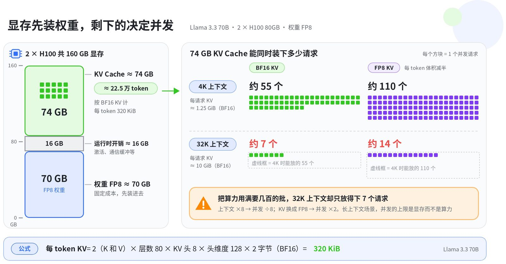

结合第 2 章：要把算力用满需要几百的批大小，而 32K 上下文下只放得下 7 个请求。显存容量直接限制了批大小，也就限制了吞吐和单位成本。这是 H200、B200、MI300X 这类大显存卡在长上下文场景更划算的原因。

### 3.4 省 KV Cache 的办法

- **KV Cache 量化**：BF16 改 FP8，容量翻倍。需要在自己的评测集上确认质量影响。
- **分页管理**：PagedAttention 按块分配 KV Cache，几乎消除碎片浪费，并允许多个请求共享相同前缀的 KV[[4]](https://arxiv.org/abs/2309.06180)。主流推理框架都已采用。
- **前缀缓存**：系统 Prompt、few-shot 示例、同一文档的多次提问，共享前缀的 KV 只存一份、只算一次[[7]](https://docs.vllm.ai/en/latest/features/automatic_prefix_caching/)。
- **控制上下文长度**：对话历史做摘要或截断，RAG 只送必要片段。这是成本最低的办法。
- **模型结构**：选择 KV 头更少的模型（分组查询注意力），或 DeepSeek-V3 使用的多头潜在注意力（MLA）这类压缩 KV 的结构[[5]](https://arxiv.org/abs/2412.19437)。

📎 延伸阅读：KV 放不下时卸载到 CPU 还是重算，按回载时间和重算 prefill 的时间比较，见 [LLM-08｜系统｜大模型推理系统：全栈学习手册](./08-inference-systems.md) 第 16.5 节。

## 第 4 章 · GPU 选型：先看显存和带宽

📎 延伸阅读：TPU、Trainium、AMD 和昇腾的软件栈与迁移成本见 [LLM-36｜系统｜非 NVIDIA 算力：TPU、Trainium、AMD 与昇腾](./36-non-nvidia.md)。8 卡 910B 单机装下 DeepSeek-V4.1-Flash 的显存账（主干放 HBM、Engram 放主机内存）见该文第 6.4 节。

### 4.1 主流推理卡的关键规格

下表取各厂商官网规格（算力为稠密值，官网标注的带稀疏值已折半）。推理选型时，显存容量和显存带宽通常比算力更重要。

| 型号 | 显存 | 显存带宽 | BF16 稠密 | FP8 稠密 | 备注 |
|---|---|---|---|---|---|
| A100 80GB SXM | 80 GB HBM2e | 2.0 TB/s | 312 TFLOPS | 不支持 | 上一代主力[[8]](https://www.nvidia.com/en-us/data-center/a100/) |
| L40S | 48 GB GDDR6 | 864 GB/s | 约 362 TFLOPS | 约 733 TFLOPS | PCIe，无 NVLink[[9]](https://www.nvidia.com/en-us/data-center/l40s/) |
| H100 SXM | 80 GB HBM3 | 3.35 TB/s | 约 989 TFLOPS | 约 1979 TFLOPS | TDP 最高 700W[[3]](https://www.nvidia.com/en-us/data-center/h100/) |
| H200 SXM | 141 GB HBM3e | 4.8 TB/s | 约 989 TFLOPS | 约 1979 TFLOPS | 算力同 H100，显存和带宽更大[[10]](https://www.nvidia.com/en-us/data-center/h200/) |
| B200（DGX B200 单卡折算） | 180 GB HBM3e | 8 TB/s | — | 约 4.5 PFLOPS | 整机 8 卡共 1440 GB、64 TB/s[[11]](https://www.nvidia.com/en-us/data-center/dgx-b200/) |
| AMD MI300X | 192 GB HBM3 | 5.3 TB/s | — | — | 显存最大之一[[12]](https://www.amd.com/en/products/accelerators/instinct/mi300/mi300x.html) |

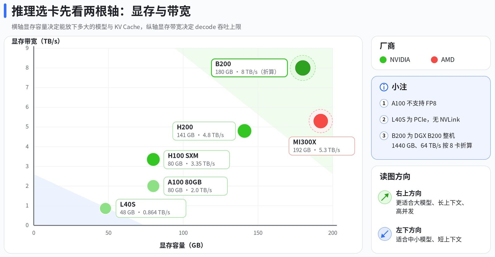

### 4.2 怎么读这张表

- <b>显存决定“装不装得下、批能开多大”</b>。先算权重加目标并发下的 KV Cache（第 3 章），得出最少需要几张卡。能用一张卡装下就不要拆两张：张量并行有通信开销，PCIe 卡尤其明显。
- <b>带宽决定“单流有多快、带宽受限时吞吐多高”</b>。H200 与 H100 算力相同，但带宽高约 43%、显存大约 76%，decode 为主的场景吞吐提升明显。
- **FP8 支持决定能否低成本量化**。A100 没有 FP8 张量核心[[8]](https://www.nvidia.com/en-us/data-center/a100/)，FP8 量化在 A100 上拿不到算力收益。
- **互联决定能否高效多卡**。大模型张量并行需要 NVLink 级别的卡间带宽；L40S 这类 PCIe 卡更适合单卡能装下的中小模型。
- **软件生态也是成本**。非 NVIDIA 平台要先确认目标模型、量化格式和推理框架的支持情况，并预留适配时间。

### 4.3 场景对照

| 场景 | 倾向 |
|---|---|
| 7B 到 14B 模型、短上下文、成本敏感 | L40S 等单卡；或 H100 单卡部署多个副本 |
| 70B 级稠密模型、在线对话 | H100 / H200，FP8 量化；H200 可单卡放下 FP8 权重并留出较多 KV 空间 |
| 长上下文（32K 以上）、RAG 大输入 | 大显存卡（H200、B200、MI300X），KV Cache 容量决定并发 |
| 数百 B 参数的 MoE 模型 | 8 卡 NVLink 整机起步，常见多机专家并行 |
| 离线批处理（评测、数据合成、回灌） | 任何能装下的卡，按每 token 成本选；可用空闲时段和低价实例 |

## 第 5 章 · 降本手段：每一项省多少

### 5.1 总览

| 手段 | 原理 | 公开数据 | 代价 |
|---|---|---|---|
| 连续批处理与分页 KV | 请求随到随进批，KV 按块分配，批开得更大 | 相同延迟下吞吐提高 2 到 4 倍[[4]](https://arxiv.org/abs/2309.06180) | 主流框架已内置 |
| 量化 | 权重和激活用更少比特 | FP8 基本无损；调好的 INT8 损失 1% 到 3%[[13]](https://arxiv.org/abs/2411.02355) | 需要评测；部分格式依赖硬件 |
| 前缀缓存 | 共享前缀的 KV 只算一次 | 命中部分跳过 prefill 计算[[7]](https://docs.vllm.ai/en/latest/features/automatic_prefix_caching/) | 占用显存；Prompt 要把固定部分放前面 |
| 投机解码 | 小模型先猜几个 token，大模型一次验证 | T5-XXL 上提速 2 到 3 倍，输出分布不变[[14]](https://arxiv.org/abs/2211.17192) | 批大时收益下降 |
| PD 分离 | prefill 和 decode 放到不同 GPU | 延迟约束内可多服务 7.4 倍请求[[1]](https://arxiv.org/abs/2401.09670) | 系统复杂度高，需要高速互联 |

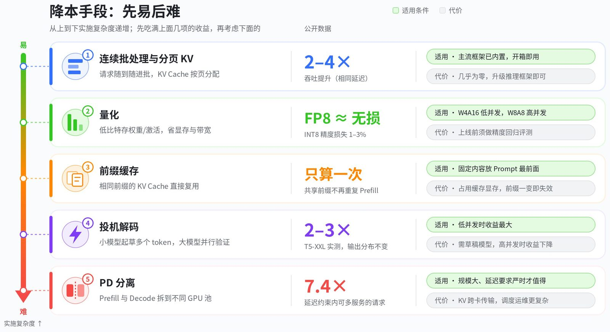

### 5.2 量化：先上 FP8

📎 延伸阅读：INT4、MXFP4、NVFP4 等格式的区别，GGUF 档位怎么选，KV 缓存量化，以及压缩后该测什么，见 [LLM-24｜系统｜模型压缩与端侧部署：量化、剪枝与蒸馏](./24-compression-edge.md)。

Kurtic 等人在 Llama 3.1 全系列模型上做了超过 50 万次评测，结论是：FP8（W8A8-FP）在所有模型规模上基本无损；调校良好的 INT8（W8A8-INT）准确率只下降 1% 到 3%；只量化权重的 INT4（W4A16-INT）比预期更有竞争力，接近 8 比特的效果[[13]](https://arxiv.org/abs/2411.02355)。部署建议同样来自这项研究：同步、低并发场景下 W4A16 性价比最高；连续批处理的高并发场景下 W8A8 更优[[13]](https://arxiv.org/abs/2411.02355)。原因与第 2 章一致：低并发时受带宽限制，权重越小越快；高并发时转向受算力限制，W8A8 能用上 8 比特张量核心。

实际操作：在 H100、H200、L40S 等支持 FP8 的卡上默认使用 FP8；量化后用自己的评测集对比原模型，重点看数学、代码、长文本和多语言类别，这些通常最先暴露量化损失。

### 5.3 前缀缓存：Prompt 的写法决定命中率

前缀缓存在新请求与已有请求共享相同前缀时，直接复用已有的 KV Cache，跳过共享部分的计算[[7]](https://docs.vllm.ai/en/latest/features/automatic_prefix_caching/)。要命中，就要让不同请求的开头尽量相同：

- 固定的系统 Prompt、工具定义、few-shot 示例放在最前面，且逐字节一致。
- 时间戳、用户 ID、请求 ID 这类每次都变的内容放到后面。
- 同一份长文档上的多次提问，文档放在问题之前。
- 多副本部署时，把相同前缀的请求路由到同一副本，否则每个副本各算一遍。

### 5.4 投机解码：用算力换延迟

投机解码让一个小的草稿模型先快速生成几个候选 token，再由大模型一次性并行验证，接受正确的部分；在不改变输出分布的前提下，T5-XXL 上取得了 2 到 3 倍的加速[[14]](https://arxiv.org/abs/2211.17192)。它的本质是利用 decode 阶段闲置的算力：批小时算力大量空闲，收益最大；批大到接近算力上限时，额外的验证计算不再免费，收益下降甚至为负。所以它更适合低并发、对单流速度敏感的场景，而不是追求吞吐的离线批处理。

### 5.5 PD 分离：规模大了再考虑

prefill 和 decode 放在同一批 GPU 上会相互干扰：插入一个长 prefill，正在 decode 的请求就要等。DistServe 把两者拆到不同 GPU，分别选择并行方式和资源配比，在满足 TTFT 和 TPOT 约束的前提下最多可多服务 7.4 倍请求，或把延迟目标收紧 12.6 倍[[1]](https://arxiv.org/abs/2401.09670)。代价是 KV Cache 要在 GPU 之间传输，需要高速互联，系统和运维复杂度明显上升。一般在集群规模较大、输入长度差异大、延迟要求严格时才值得。

## 第 6 章 · 自建还是用 API：盈亏平衡

### 6.1 盈亏平衡公式

自建的成本大部分是固定的（GPU 不管用不用都要付钱），API 的成本完全随用量变化。设每月固定成本为 C，API 每百万 token 价格为 P，则：

```math
\text{盈亏平衡月用量（百万 token）} = \frac{C}{P}
```

月用量高于这个值自建更便宜，低于这个值 API 更便宜。前提是自建能在这个用量下满足同样的延迟和质量。

### 6.2 算例（数字均为假设）

- 2 张 H100 预留实例，每卡每小时 3 美元，每月 730 小时：2 × 3 × 730 = 4380 美元。
- 运维和平台人力折算 0.25 人，按每月 5000 美元计。
- 合计固定成本 C ≈ 9380 美元 / 月。
- 假设对比的 API 价格 P = 每百万 token 2 美元。

盈亏平衡月用量 = 9380 ÷ 2 ≈ 4690 百万 token，即约 47 亿 token / 月，平均每秒约 1785 个 token，全天 24 小时不间断。

而这套硬件在延迟目标内的满载能力是每秒 2000 token（第 1.2 节的假设），每月约 53 亿 token。<b>要打平，平均利用率需要接近 90%</b>。对于有昼夜波动的在线业务，这几乎做不到。

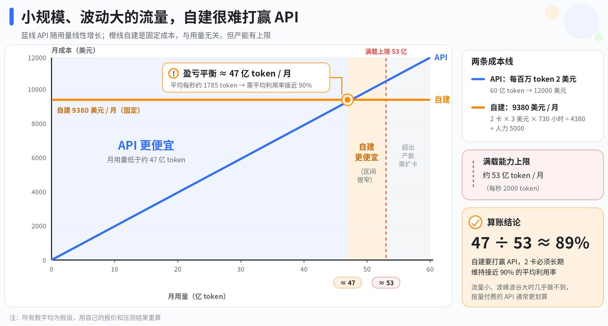

这个算例要说明的是：小规模、波动大的流量，自建很难打赢 API；只有在用量大、负载平稳或能与离线任务混部把利用率拉高时，自建的成本优势才会出现。具体结论要用自己的报价、压测结果和人力成本重算。

### 6.3 不只是成本：自建的其他理由与隐性成本

| 支持自建的理由 | 容易漏算的隐性成本 |
|---|---|
| 数据不能出域，合规要求私有部署 | 推理框架、驱动、模型版本的升级与回归测试 |
| 需要微调后的专有模型 | 7 × 24 值班、故障排查、硬件故障处理 |
| 对延迟、可用性、限流有自主控制权 | 为高峰预留的冗余容量；扩容慢（加载权重要几分钟，见「LLM 服务稳定性工程」第 7 章） |
| 超大且平稳的用量，利用率能做高 | 开源模型和闭源最强模型之间的质量差距带来的业务损失 |
| 离线批处理可用低价或闲置算力 | GPU 采购周期、长期合约锁定、硬件换代贬值 |

### 6.4 常见的混合策略

- **按任务分层**：分类、抽取、改写、路由等简单任务用自建的小模型；复杂推理用 API 的强模型。
- **基线自建，峰值上云**：自建容量按平均负载配置，超出部分溢出到 API。
- **离线任务吃波谷**：评测、数据合成、批量回灌安排在在线流量的低谷时段，把自建集群的利用率填满。

## 第 7 章 · 压测与容量规划：测出可信的数字

📎 延伸阅读：容量规划要算能耗时，“每次提问几瓦时”先看测量边界，同一个模型能差几十倍，见本书第 10 章。

### 7.1 压测要回答的问题

第 1 章公式里的“吞吐”必须是自己测出来的，而且是“在延迟目标内的最大吞吐”。厂商和框架发布的基准数字，模型、输入输出长度、批大小、硬件都和你的场景不同，只能作参考。

### 7.2 压测方法

1. **用真实分布造负载**：从线上日志统计输入长度、输出长度的分布（不是平均值），按分布采样生成请求。前缀共享比例也要贴近真实，否则前缀缓存的效果会被高估或低估。
2. **固定延迟目标**：例如 TTFT p90 ≤ 2 秒、TPOT p90 ≤ 50 毫秒。
3. **逐级加压**：按到达率（每秒请求数）从低到高逐级加压，每级持续足够长时间（几分钟以上），记录 TTFT、TPOT 分位数和吞吐。不要用“固定并发数、发完一个再发一个”的方式，它会掩盖排队。
4. **找拐点**：延迟分位数开始超出目标的那一级，前一级的吞吐就是这套配置的 goodput。
5. **扫配置**：对张量并行度、量化格式、最大批大小、最大上下文长度、前缀缓存开关做组合，每种配置重复上述步骤，按“每百万 token 成本”排序。

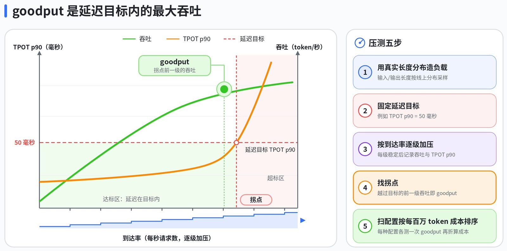

📎 延伸阅读：到达率和并发上限为什么要分开扫，goodput 的分母怎么取才不被丢请求做好看，见 [LLM-08｜系统｜大模型推理系统：全栈学习手册](./08-inference-systems.md) 第 14.2 节“压测口径和实验记录”。

### 7.3 容量规划

- **按峰值配容量，按均值算成本**：所需副本数 = 峰值 token 速率 ÷ 单副本 goodput ×（1 + 余量），余量通常 20% 到 30%。
- **扩容信号**：排队请求数持续大于 0、KV Cache 占用接近满、TTFT p90 接近目标。按 GPU 利用率扩缩容不可靠，decode 受带宽限制时 GPU 利用率可能显示很高，但实际还能接更多请求。
- **冷启动**：新副本要加载权重，70B 的 BF16 权重约 140 GB，按每秒 1 GB 的加载速度要两分多钟；这只是下限，加上排队等卡、拉镜像和预热，多副本并发扩容时的实际生效时延常在十分钟以上（第 7 篇 7.3 节）。保持热备副本，或按流量预测提前扩容。
- **定期复测**：推理框架版本升级常带来明显的性能变化，升级后重跑压测，更新容量模型。
- **用兑现比检验容量模型**：兑现比 = 线上单卡实际 TPM ÷ 压测下满足 SLA 的单卡极限 TPM。拿它和“日均 ÷ 峰值 TPM”对照：后者是副本固定在峰值、峰值时刻正好跑满时的理论兑现比；实测明显低于它，说明峰值时段没跑满或弹性没跟上，问题在供给侧，而不只是流量不够。线上单卡产出 = 极限 × 兑现比，兑现比只有 10% 时，提到 20% 与把引擎性能翻倍等效。
- **按时段归因**：只看日均找不到损失发生在哪。把一天按流量形态切成 4 到 6 段，每段同时看 TPM、排队请求数、副本数、未就绪实例数和单副本 TPM，只指定一个主因（启动慢、供给过多、扩容跟不上上涨、供给与低谷错配），再汇总成损失占比，按占比排优化顺序。
- **拿公开数据当参照**：DeepSeek 公开的 V3/R1 线上数据里，一天的推理节点峰值 278、均值 226.75，均值 / 峰值约 0.82；输入 token 有 56.3% 命中磁盘 KV Cache；夜间缩减推理节点交给研究和训练[[15]](https://github.com/deepseek-ai/open-infra-index/blob/main/202502OpenSourceWeek/day_6_one_more_thing_deepseekV3R1_inference_system_overview.md)。这个比值高，主要来自昼夜共池和缓存，而不只是扩缩快。它统计的是节点占用，不是兑现比，只能作量级参照。
- **长上下文要换算法**：上下文到 256K、前缀大量复用以后，单副本 goodput 要按 SLO 约束下的到达率取，余量由到达突发通过排队公式算出，见第 12 章。

## 第 8 章 · 决策清单与反模式

### 8.1 决策前逐项核对

- [ ] 统计过线上请求的输入、输出长度分布和日内流量曲线

- [ ] 算过目标模型的权重显存和目标并发下的 KV Cache，确定最少卡数

- [ ] 按真实分布、固定延迟目标压测，得到每种配置的 goodput

- [ ] 量化后的模型在自己的评测集上与原模型对比过

- [ ] 按平均利用率（不是峰值）算出了每百万 token 成本

- [ ] 固定成本计入了人力、值班、冗余容量和升级测试

- [ ] 算出了与目标 API 的盈亏平衡用量，并与实际用量和增长预测对比

- [ ] 比较了开源模型与 API 模型在自己业务上的质量差距

- [ ] 有峰值溢出到 API、离线任务填波谷等混合策略

- [ ] 扩缩容按排队、KV 占用、TTFT 触发，有热备应对冷启动

### 8.2 常见反模式

| 反模式 | 后果 | 改为 |
|---|---|---|
| 按峰值吞吐、100% 利用率算成本 | 成本被低估数倍 | 用延迟约束内的 goodput 和平均利用率（第 1 章） |
| 只比较 GPU 单价 | 忽略人力、冗余、升级，结论偏向自建 | 算完整固定成本和盈亏平衡点（第 6 章） |
| 按算力选卡 | decode 受带宽限制，算力用不上 | 先看显存和带宽（第 2、4 章） |
| 只算权重显存 | 上线后 KV Cache 不够，批开不大，吞吐远低于预期 | 按目标并发和上下文算 KV（第 3 章） |
| 能单卡放下却拆成多卡 | 通信开销吃掉收益 | 先量化争取单卡（第 4.2 节） |
| 在 A100 上上 FP8 | 没有 FP8 张量核心，拿不到算力收益 | 按硬件选量化格式（第 4.2 节） |
| 量化后不做评测 | 数学、代码、长文本质量悄悄下降 | 按类别对比原模型（第 5.2 节） |
| 高并发场景开投机解码 | 收益消失甚至变慢 | 只在低并发、追求单流速度时用（第 5.4 节） |
| 用固定并发压测 | 掩盖排队，延迟数字过于乐观 | 按到达率逐级加压（第 7.2 节） |
| 按 GPU 利用率扩缩容 | 带宽受限时指标失真 | 按排队、KV 占用、TTFT（第 7.3 节） |

### 8.3 延伸阅读

- vLLM PagedAttention 论文：KV Cache 管理与批处理的基础[[4]](https://arxiv.org/abs/2309.06180)。
- 量化大规模评测：不同格式的精度与性能权衡和部署建议[[13]](https://arxiv.org/abs/2411.02355)。
- DistServe：goodput 的定义与 PD 分离[[1]](https://arxiv.org/abs/2401.09670)。
- 「LLM 服务稳定性工程」第 7、8 章，「vLLM 完整技术学习路径」，「大模型推理系统学习手册」。
- 动手部署：[LLM-50｜系统｜消费级单卡自部署：Qwen3.8-27B 跑在 4090 / 5090 上](./50-consumer-gpu-deploy.md)（4090 / 5090 单卡的电费、摊销与盈亏点利用率）；[LLM-51｜系统｜自部署推理实战：DeepSeek-V4-Flash 从单机到弹性上线](./51-deepseek-v4-flash-deploy.md)（压测找拐点、调参与弹性）；[LLM-52｜系统｜一线大模型部署：Kimi K3 从选型算账到多节点上线](./52-kimi-k3-deploy.md)（用 API 价格和公开实测算盈亏点）。

## 第 9 章 · 每 token 单价不是成本：分词器与每个成功任务的成本

前 8 章算的都是自建这一侧：一张卡每小时多少钱，延迟约束下每秒出多少 token，平均利用率多高，最后摊成每百万 token 多少钱，再拿去和 API 的价目表比。第 6 章的盈亏平衡公式 C/P 里，P 就是这张价目表上的数字。这一章回头检查这个 P。价目表上的“每百万 token”，分母是厂商自己的分词器切出来的 token，同一段内容换一个分词器，切出来的数目可以差三到四成，换一种语言可以差好几倍。分母一变，单价没动，账单也会动。

2026 年 4 月的 Claude Opus 4.7 是一个现成的例子。单价和上一版相同，每百万输入 5 美元、输出 25 美元，但换了新分词器，官方说同样的内容会多出 1.0 到 1.35 倍的 token [[16]](https://openrouter.ai/blog/insights/opus-47-tokenizer-analysis/)。OpenRouter 用一百多万次真实请求拆了这笔账：分词器让 token 多了 32% 到 45%，缓存和输出长度又把账改写了一遍，各档的真实单位成本从略降 1.6% 到上涨 27.2% 不等 [[16]](https://openrouter.ai/blog/insights/opus-47-tokenizer-analysis/)。这一章沿着这次变化，把每 token 单价换算成每个成功任务的成本，最后回到第 6 章，说明盈亏平衡里的 P 应该怎么取。

### 9.1 token 数由内容和分词器共同决定

今天主流的分词器大多源于 BPE。它从单个字符出发，统计语料里最常相邻出现的一对片段，把它们合并成一个新词元，重复若干次，得到一张固定大小的词表 [[20]](https://arxiv.org/abs/1508.07909)。词表学自哪些语料、学多大、合并规则怎么定，决定了同一段文字最后切成多少个 token。语料里常见的英文单词往往整个成为一个词元，罕见的拼写、代码里的长标识符、训练语料里占比小的语言，会被切成很多碎片。

所以一个请求的 token 数是两件事的乘积：内容本身有多长，以及这个分词器切这类内容有多碎。把内容长度用一把与模型无关的尺子量出来，记为 L，把“每单位尺子长度切出多少原生 token”记为分词比 ρ，原生 token 数就是 ρL。价目表单价为 P 时，同样一段内容的花费是：

```math
\text{cost} = P \cdot N_{\text{native}} = P \cdot \rho \cdot L
```

厂商能调的是 P 和 ρ 两个量，用户看到的通常只有 P。ρ 变大 30%，等价于单价上调 30%，只是不出现在价目表上。自建这一侧也一样：第 1 章的每百万 token 成本，分母是自建模型自己的分词器切出来的 token。拿自建的每百万 token 成本去和 API 的每百万 token 单价直接比，两边的 ρ 不同，等于拿两种货币的标价比大小。

单价只是账的第一项。实际花费还要乘上缓存的折扣，乘上模型说了多长，再除以成功率，因为失败的任务要重试或者转人工。下图把这条链画出来，后面各节逐项拆开，每一项都给出 Opus 4.7 这次变化里的实测数字。

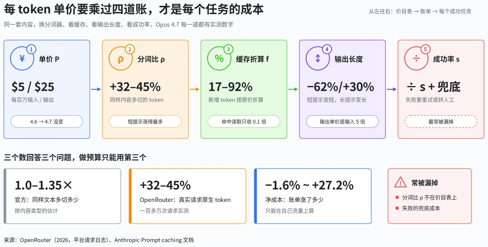

### 9.2 单价不变的一次涨价：Opus 4.7 的分词器

要量出分词器带来多少涨幅，需要一把不随模型变化的尺子。OpenRouter 给每次请求记两个数：一个是厂商报的原生 token 数，一个是自己的计数方法 QuadChars，每 4 个可打印的 ASCII 字符算 1 个 token，每个非 ASCII 字符（中文、表情等）单独算 1 个 [[16]](https://openrouter.ai/blog/insights/opus-47-tokenizer-analysis/)。厂商换分词器，原生数会变，QuadChars 不变，两者的比值就是上面的 ρ。比值的变化把分词器的影响和提示内容的差异分开了，用户这周的提示比上周长，不会算到分词器头上。

为了避免不同用户的请求混在一起，他们挑出 4.7 发布前主力用 4.6、发布后改用 4.7 的那批用户，按提示长度分档做前后对比 [[16]](https://openrouter.ai/blog/insights/opus-47-tokenizer-analysis/)：

| 提示长度 | 4.6 原生 / 标尺 | 4.7 原生 / 标尺 | 分词器带来的涨幅 |
|---|---|---|---|
| 2K 以下 | 约 1.11 | 约 1.62 | 约 45% |
| 2K 到 10K | 约 1.00 | 约 1.41 | 约 42% |
| 10K 到 25K | 约 1.14 | 约 1.52 | 约 34% |
| 25K 到 50K | 约 1.19 | 约 1.58 | 约 32% |
| 50K 到 128K | 约 1.25 | 约 1.65 | 约 32% |
| 128K 以上 | 约 1.30 | 约 1.73 | 约 33% |

涨幅就是两列比值之比减 1。以 128K 以上这一档为例，1.73 ÷ 1.30 − 1 ≈ 33%。表里的比值是四舍五入后的数，用它们反算会和报告的涨幅差一两个点，比如 2K 到 10K 这一档反算是 41%，报告写的是 42%。10K 以上的生产级提示多出 32% 到 34% 的 token，2K 以下的短提示多出 45%，输出 token 上也观察到类似的涨幅 [[16]](https://openrouter.ai/blog/insights/opus-47-tokenizer-analysis/)。另有独立测量直接用 Anthropic 的分词器去数系统提示，得到约 1.46 倍 [[16]](https://openrouter.ai/blog/insights/opus-47-tokenizer-analysis/)。两组实测都超过了官方给的 1.35 倍上限。

短提示涨得最多，和提示的构成有关。短提示里自然语言和格式符号的占比高，长提示里大段是代码、文档和工具返回的结构化数据，两类内容被新词表切碎的程度不同。官方的 1.0 到 1.35 倍也写明“取决于内容类型” [[16]](https://openrouter.ai/blog/insights/opus-47-tokenizer-analysis/)。这提醒我们，分词比是一个随业务内容变化的量，别人测出的涨幅只能当量级参考。

团队自己要量这件事，不需要 OpenRouter 的规模。在网关上给每次请求同时记两个数就够了：厂商报的输入、输出 token 数，以及一个自定义的稳定计数，字符数或者 UTF-8 字节数都可以。按模型、按业务线把两者的比值画成时间曲线，厂商换分词器、团队换模型、提示模板改版，比值的跳变当天就能看见，不必等到月底对账单。这条曲线也能直接回答第 9.1 节的问题：自建模型和 API 模型处理同一批请求，ρ 各是多少。

### 9.3 缓存吸收了大部分新增 token

token 多了 32% 到 45%，账单却没有涨这么多，第一个原因是提示缓存。Anthropic 的计费规则是：写入 5 分钟缓存按输入单价的 1.25 倍计，写入 1 小时缓存按 2 倍计，命中缓存的读取按 0.1 倍计 [[21]](https://docs.anthropic.com/en/docs/build-with-claude/prompt-caching)。Opus 4.7 的输入单价是每百万 5 美元，对应的 5 分钟写入是 6.25 美元，1 小时写入是 10 美元，命中读取是 0.5 美元 [[21]](https://docs.anthropic.com/en/docs/build-with-claude/prompt-caching)。

长提示里大段内容是逐字重复的系统提示、工具定义和历史对话。新分词器多切出来的 token，相当一部分就落在这些重复内容里，也就落进了缓存，按一折计费 [[16]](https://openrouter.ai/blog/insights/opus-47-tokenizer-analysis/)。把新增 token 里进缓存的比例记为 h，未进缓存的按原价、进缓存的按 0.1 倍，新增 token 折算成原价的有效比例是：

```math
f = (1 - h) + 0.1\,h = 1 - 0.9\,h
```

把 OpenRouter 给的各档数字代进去 [[16]](https://openrouter.ai/blog/insights/opus-47-tokenizer-analysis/)：

| 提示长度 | 新增原生 token（平均） | 其中进缓存 | 按原价折算的比例 f |
|---|---|---|---|
| 2K 到 10K | +2768 | 56% | 49% |
| 10K 到 25K | +6445 | 9% | 92% |
| 25K 到 50K | +13695 | 64% | 42% |
| 50K 到 128K | +26304 | 77% | 31% |
| 128K 以上 | +108559 | 93% | 17% |

128K 以上这一档，平均每个请求多出 10 万多个 token，按原价折算只相当于多付了 17%，也就是约 1.8 万个 token 的钱。10K 到 25K 这一档只有 9% 进了缓存，多出来的 token 九成多按原价计。同一次分词器变化，对两类请求的影响差了五倍多。2K 以下的提示不到 10% 的请求命中缓存，报告没有给这一档的比例 [[16]](https://openrouter.ai/blog/insights/opus-47-tokenizer-analysis/)。

#### 缓存什么时候划算

写缓存要多付钱，一段前缀只用一次，写缓存反而更贵。设一段前缀在缓存有效期内被用了 n 次，第一次写入，后面 n − 1 次命中。按输入单价的倍数计，不开缓存的花费是 n，开缓存的花费是写入倍数 w 加上 0.1(n − 1)。开缓存更省的条件是：

```math
w + 0.1\,(n-1) < n \quad \Longleftrightarrow \quad n > \frac{w - 0.1}{0.9}
```

5 分钟缓存 w = 1.25，n 要大于 1.28，同一段前缀用两次就回本。1 小时缓存 w = 2，n 要大于 2.11，至少要用三次。换成命中率 q = (n − 1)/n 来说，5 分钟缓存的命中率要高于 21.7%，1 小时缓存要高于 52.6%。下表是用 n 次时平均每次的价格倍数：

| 同一前缀使用次数 n | 5 分钟缓存 | 1 小时缓存 |
|---|---|---|
| 1 | 1.25 | 2.00 |
| 2 | 0.675 | 1.05 |
| 3 | 0.483 | 0.733 |
| 5 | 0.33 | 0.48 |
| 10 | 0.215 | 0.29 |
| 50 | 0.123 | 0.138 |

用到 10 次，平均价格就降到原价的两成左右，用到 50 次，逼近 0.1 倍的下限。1 小时缓存在使用次数少时明显吃亏，只适合请求间隔超过 5 分钟、但一小时内会反复用到同一前缀的场景，比如低频的批量任务。缓存有效期从最后一次使用开始算，每次命中都会刷新 [[21]](https://docs.anthropic.com/en/docs/build-with-claude/prompt-caching)，流量持续的在线业务用 5 分钟缓存就够。

能不能命中，取决于前缀是否逐字节一致。缓存按工具定义、系统提示、消息的顺序拼接前缀 [[21]](https://docs.anthropic.com/en/docs/build-with-claude/prompt-caching)，任何一处变了，它后面的部分全部失效。这和第 5.3 节自建前缀缓存的规则相同：固定内容放最前面，时间戳、用户 ID 这类每次都变的内容放到最后。差别在于计价方式。自建时缓存命中省下的是 prefill 算力，代价是 KV Cache 占用的显存。用 API 时省下的直接写在账单上，写入多付 25% 或 100%。同一条提示写法规范，在两边都能省钱，团队可以把它作为提示模板的评审项。

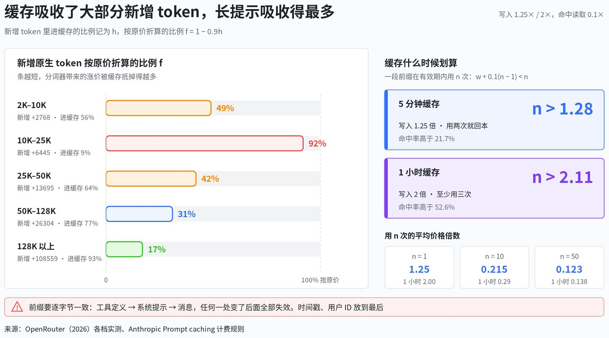

### 9.4 输出长度被五倍的单价放大

第二个原因是模型说话的长短变了。用 QuadChars 这把稳定的尺子量，Opus 4.7 在 2K 以下的短提示上，回答的中位长度从 302 降到 114，短了 62%。10K 以上的长提示，回答反而长了 13% 到 30% [[16]](https://openrouter.ai/blog/insights/opus-47-tokenizer-analysis/)。输出单价是输入的 5 倍，输出长度的任何变化都会被放大。

用一个短请求算一下。4.6 上一个请求有 1000 个输入 token、300 个输出 token，花费是 1000 × 5 + 300 × 25 = 12500 微美元，其中输出占了 60%。换到 4.7，输入涨 45% 变成 1450 个，输出按标尺短了 62%，再乘上同样的分词器涨幅，约为 300 × 0.38 × 1.45 ≈ 165 个，花费是 1450 × 5 + 165 × 25 ≈ 11380 微美元，反而比 4.6 便宜了约 9%。OpenRouter 在 2K 以下这一档实测的净变化是 −1.6% [[16]](https://openrouter.ai/blog/insights/opus-47-tokenizer-analysis/)，方向一致，幅度更小，因为真实请求的输入输出比例各不相同。这个例子说明，短请求的成本主要由输出决定，输入涨了 45%，抵不过输出缩短的六成。

长请求反过来。输入大多进了缓存，单价已经打了一折，输出却多了两到三成，每个输出 token 按 25 美元计，成为净成本上涨的主要来源。这和第 1.3 节的结论相同：输出 token 在 decode 阶段逐个生成，自建时最贵，API 也按这个逻辑定价。推理模型的思考 token 按输出计费，思考档位的调整会直接改变这一项，换版本时要和分词器的影响分开统计。

评估换模型或换版本时，单独统计三个数：按稳定尺子量的输入长度、缓存命中率、按稳定尺子量的输出长度中位数。三个数里任何一个变了，即使单价不变，成本也会变。只看原生 token 总数，会把分词器、缓存和模型行为三件事混成一个数，下一节会看到，这样得出的结论可能和账单差出一大截。

### 9.5 三个数回答三个问题

OpenRouter 用超过一百万次请求的实际计费，算出每百万标尺 token 的平均成本，按提示长度分档对比 [[16]](https://openrouter.ai/blog/insights/opus-47-tokenizer-analysis/)。把前三节的因素合在一张表里：

| 提示长度 | 分词器涨幅 | 新增 token 进缓存 | 输出长度变化 | 净成本变化 |
|---|---|---|---|---|
| 2K 以下 | +45% | — | −62% | −1.6% |
| 2K 到 10K | +42% | 56% | +4% | +27.2% |
| 10K 到 25K | +34% | 9% | +30% | +25.2% |
| 25K 到 50K | +32% | 64% | +13% | +21.3% |
| 50K 到 128K | +32% | 77% | +19% | +11.9% |
| 128K 以上 | +33% | 93% | +26% | +15.3% |

读这张表，最常见的错误是把三个数混用。官方的 1.0 到 1.35 倍，回答的是“同样的文本，新分词器多切多少 token”，是一个按内容类型给出的估计。OpenRouter 测出的 32% 到 45%，回答的是“真实用户的真实请求，原生 token 涨了多少”。净成本的 −1.6% 到 +27.2%，回答的才是“账单涨了多少”。做预算用第三个数，而第三个数只能在自己的流量上算出来。

表里有两档值得细看。2K 到 10K 这一档，缓存吸收了一半以上的新增 token，净成本却涨得最多，因为分词器涨幅大，输出也略长。10K 到 25K 这一档，缓存几乎没吸收，输出长了 30%，涨幅仅次于前者。缓存吸收比例最高的 128K 以上，净涨幅反而比 50K 到 128K 高，原因在输出多了 26%。每一档的结论都要三个因素一起看。

这份分析有它的边界。数据来自一个平台的用户，Opus 在这个平台上主要用于编程和智能体类工作流 [[16]](https://openrouter.ai/blog/insights/opus-47-tokenizer-analysis/)。输出 token 的涨幅里可能混有模型措辞和格式变化的影响，分析方自己也写明了这一点 [[16]](https://openrouter.ai/blog/insights/opus-47-tokenizer-analysis/)。业务形态不同，各档的数字会不同，拆账的方法可以照搬。给财务和业务方报成本变化时，固定报净成本变化并注明分母，厂商公告里的倍数和平台测出的 token 涨幅只作预警，不直接乘进预算。

### 9.6 换一种语言，分词比可以差好几倍

同一个分词器在不同语言之间的差距，比 Opus 4.7 这次换代大得多。Petrov 等人测了多个主流分词器，同一段内容翻译成不同语言后，切出来的 token 数最多差 15 倍 [[18]](https://arxiv.org/abs/2305.15425)。即使是按字节或字符切分、号称对语言中立的模型，有些语言对之间的长度差距也超过 4 倍 [[18]](https://arxiv.org/abs/2305.15425)。按 token 计费的 API，等于让一部分语言的用户为同样的内容付出数倍的价格，同时占用更多的上下文窗口，等更久的生成时间。

分词器还影响能力。Rust 等人比较多语言模型和单语模型，发现在一些语言上，专门为这门语言训练的分词器和预训练数据的规模同样重要，换上单语分词器能明显缩小和单语模型的差距 [[19]](https://arxiv.org/abs/2012.15613)。词被切得越碎，模型越要用多个步骤拼出一个词的意思，学起来更难。厂商按自己的主要语言优化词表，其他语言的用户在价格和效果两头吃亏，这两件事都会进到每个成功任务的成本里。

#### 中文省 token 要在任务上验证

中文社区流传过一个说法：中文信息密度高，用中文写提示做编程任务，能比英文省下最多 40% 的 token 费用。Ren 等人在 SWE-bench Lite 上做了一次对照，没有观察到这个优势 [[17]](https://arxiv.org/abs/2604.14210)。平均来看中文没有更省，差异还取决于模型：MiniMax-2.7 用中文时 token 消耗是英文的 1.28 倍，GPT-5.4-mini 是 1.09 倍，GLM-5 用中文略省，是 0.98 倍 [[17]](https://arxiv.org/abs/2604.14210)。这和分词器的设计直接相关，词表里中文词元多的模型，中文切得少。

更要紧的是成功率。所有被测模型用中文提示时，解题率都低于英文 [[17]](https://arxiv.org/abs/2604.14210)。论文因此用“每个成功任务的期望成本”来衡量，把 token 消耗和解题率放在一起算 [[17]](https://arxiv.org/abs/2604.14210)。按论文表 2 的累计提示 token 除以解题率，得到每解决一题折合的 token：

| 模型 | 英文解题率 | 中文解题率 | 英文折合 token | 中文折合 token | 中文 / 英文 |
|---|---|---|---|---|---|
| MiniMax-2.7 | 66.0% | 61.5% | 452,606 | 622,722 | 1.38× |
| GPT-5.4-mini | 36.0% | 26.1% | 234,297 | 351,268 | 1.50× |
| GLM-5 | 64.6% | 55.1% | 2,193,517 | 2,519,227 | 1.15× |

GLM-5 用中文时 token 少了 2%，解题率从 64.6% 掉到 55.1%，折合到每解决一题，中文反而贵了 15%。GPT-5.4-mini 的 token 只多了 9%，解题率掉了近 10 个点，每题成本高出一半。省下的 token 换来了更低的成功率，失败的任务要重试或转人工，第 9.7 节会把这笔账算完整。作者写明这是初步证据，被测模型和基准都有限 [[17]](https://arxiv.org/abs/2604.14210)，它说明的道理和第 9.5 节一样：每 token 的账不等于每个任务的账。

还有一个计量细节。第 9.2 节的 QuadChars 把每个中文字符算 1 个 token，每 4 个英文字符算 1 个 [[16]](https://openrouter.ai/blog/insights/opus-47-tokenizer-analysis/)。这种粗糙的尺子用于同一语言内的前后对比没有问题，跨语言比较会系统性地偏向一方。比较中英文成本，要用各模型的原生 token 数和实际账单。想用提示语言省钱的团队，在自己的任务集上把中文和英文版本各跑一遍，按模型分别比每个成功任务的成本，结论很可能因模型而异，不宜定一条全局规则。

### 9.7 每个成功任务的成本：重试与人工兜底

前面各节算的是一次尝试的花费。任务失败时，系统通常会重试，重试几次仍失败就转给人工或者更强的模型。把这两个动作算进去，才是业务真正付出的成本。设一次尝试花 c，成功率为 s，各次尝试相互独立，最多尝试 k 次，k 次都失败时转人工，人工每单的成本为 H。第 j 次尝试只有在前 j − 1 次都失败时才会发生，概率为（1 − s）的 j − 1 次方，于是期望尝试次数和每个任务的期望成本是：

```math
\mathbb{E}[\text{attempts}] = \sum_{j=0}^{k-1} (1-s)^{j} = \frac{1-(1-s)^{k}}{s}
```

```math
\mathbb{E}[\text{cost}] = c \cdot \frac{1-(1-s)^{k}}{s} + (1-s)^{k} \cdot H
```

k 趋于无穷时，第二项消失，第一项变成 c/s，这就是“每次花费除以成功率”这个最常见的写法。实际系统都有重试上限，第二项不能省。人工处理一单的成本往往是模型调用的几十到几百倍，(1 − s)ᵏ 哪怕很小，乘上 H 也可能比第一项大。

#### 算例：强模型和半价模型

一个智能体任务每次尝试有 8000 个未缓存输入 token、12000 个缓存命中 token、500 个输出 token。按 Opus 4.7 的价格，一次尝试的花费是（8000 × 5 + 12000 × 0.5 + 500 × 25） ÷ 10⁶ ≈ 0.0585 美元。设单次成功率为 90%，人工兜底每单 5 美元。另一个候选模型单价只有一半，同样的 token 数一次约 0.029 美元，成功率是 75%。

| 最多尝试次数 k | 强模型：调用部分 | 强模型：兜底部分 | 强模型合计 | 半价模型合计 |
|---|---|---|---|---|
| 1 | 0.0585 | 0.5000 | 0.5585 | 1.279 |
| 2 | 0.0644 | 0.0500 | 0.1143 | 0.349 |
| 3 | 0.0649 | 0.0050 | 0.0699 | 0.117 |

只尝试一次时，强模型每个任务的期望成本里，九成来自 10% 的失败转人工。允许重试两次，兜底部分从 0.5 美元降到 0.005 美元，调用部分只多了 11%。半价模型在每一档都更贵：k = 1 时是强模型的 2.3 倍，k = 2 时是 3.1 倍，k = 3 时仍是 1.7 倍。它省下的单价，被 25% 的失败率和随之而来的兜底吃掉了。

重试还能和缓存配合。第二次尝试的输入和第一次几乎相同，在 5 分钟内重试，整段输入都能命中缓存，一次重试的花费降到（20000 × 0.5 + 500 × 25） ÷ 10⁶ = 0.0225 美元。强模型在 k = 3 时的期望成本从 0.0699 降到 0.066 美元。重试越便宜，把 k 调大越划算，前提是重试真的能修好上一次的错误。

#### 独立性和判定器

上面的公式有两个前提。第一个前提是各次尝试独立。如果模型在某类任务上有系统性的盲区，重试只会重复同样的错误，第二次的成功率远低于 s，公式会高估重试的价值。验证的办法是在评测集上单独统计“首次失败后重试的成功率”，记为 s₂，把公式里第二次及以后的 s 换成 s₂。s₂ 明显低于 s 时，与其加重试次数，不如换一个更强的模型兜底，或者把这类任务直接分流给人工。

第二个前提是系统知道这一次失败了。编程任务有测试，抽取任务有格式校验，这类任务能自动判定。开放式回答没有现成的判定器，失败的结果会直接交给用户，成本体现在投诉和返工上，公式里的 H 要按这部分估。判定器本身也有漏检，漏过的错误同样要计入 H。下面这段代码把重试、缓存和兜底合在一起，输入是从网关日志回放出来的每次尝试的 token 统计：

*
*

```python
from dataclasses import dataclass@dataclassclass Run:    uncached_in: float   # 每次尝试的未缓存输入 token（按该模型自己的分词器计）    cached_in: float     # 每次尝试的缓存命中 token    out: float           # 每次尝试的输出 token，推理模型的思考 token 也算在内    success: float       # 单次尝试的成功率 s，0 到 1def attempt_cost(uncached, cached, out, p_in, p_out, read=0.1):    """p_in / p_out 为每百万 token 美元单价，缓存命中按 read 倍计费。"""    return (uncached * p_in + cached * p_in * read + out * p_out) / 1e6def cost_per_task(run, p_in, p_out, k=1, fallback=0.0, retry_all_cached=False):    """最多尝试 k 次，k 次都失败就转人工，人工每单 fallback 美元。    retry_all_cached=True 表示重试时整段输入都能命中缓存。返回每个任务的期望成本。"""    c = attempt_cost(run.uncached_in, run.cached_in, run.out, p_in, p_out)    c_retry = c    if retry_all_cached:        c_retry = attempt_cost(0, run.uncached_in + run.cached_in, run.out, p_in, p_out)    q = 1 - run.success    attempts = c + sum(q ** j * c_retry for j in range(1, k))    return attempts + q ** k * fallbackstrong = Run(uncached_in=8000, cached_in=12000, out=500, success=0.90)cheap = Run(uncached_in=8000, cached_in=12000, out=500, success=0.75)for k in (1, 2, 3):    a = cost_per_task(strong, p_in=5, p_out=25, k=k, fallback=5)    b = cost_per_task(cheap, p_in=2.5, p_out=12.5, k=k, fallback=5)    print(k, round(a, 4), round(b, 4))
```

代码打印的三行就是上表的数字。换成自己的数据时，success 用评测集上实测的单次成功率，fallback 用人工处理一单的真实成本，包括排队等待带来的业务损失。半价模型的 success 只要从 0.75 提到 0.9，它在每一档都会比强模型便宜，所以选型时最该花时间测准的是成功率，单价反倒最容易拿到。

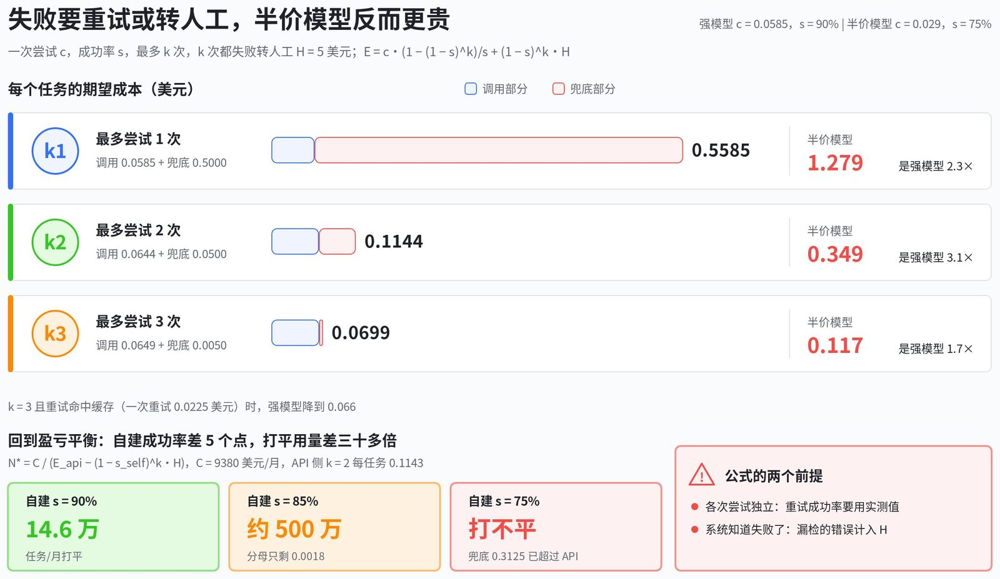

### 9.8 回到第 6 章：盈亏平衡要按任务算

第 6 章的盈亏平衡月用量是 C/P，C 是自建每月的固定成本，P 是 API 每百万 token 的价格。第 6.2 节的算例里，C ≈ 9380 美元，P = 2 美元，打平要每月约 47 亿 token，平均利用率接近 90%。这一章的内容说明，这个公式里的 P 和自建这一侧的 token 不在同一个单位上，要做两处修正。

第一处是分母。自建模型和 API 模型的分词器不同，处理同一批请求的原生 token 数不同。第 7 章压测时如果用的是自建模型的 token 计吞吐，月用量也要按自建模型的 token 算，和 API 的价格相比之前，先用第 9.2 节的双计数把两边换到同一把尺子上。中文、代码占比高的业务，两边的分词比可能差两三成，盈亏平衡点跟着移动两三成。

第二处是成功率。第 6.3 节把“开源模型和闭源最强模型之间的质量差距带来的业务损失”列为隐性成本，第 9.7 节的公式可以把它算成钱。自建的 GPU 成本是固定的，重试只占容量，不额外花钱，变动成本主要是兜底。API 的每个任务成本是调用部分加兜底部分。于是按任务算的盈亏平衡月任务数是：

```math
N^{*} = \frac{C}{\mathbb{E}[\text{cost}]_{\text{api}} - (1-s_{\text{self}})^{k} \cdot H}
```

接着用第 9.7 节的强模型当 API 一侧，k = 2，每个任务 0.1143 美元。自建模型如果也能做到 90% 的成功率，兜底部分是 0.05 美元，打平需要每月 9380 ÷ (0.1143 − 0.05) ≈ 14.6 万个任务。自建成功率降到 85%，兜底部分变成 0.1125 美元，分母只剩 0.0018 美元，打平需要每月约 500 万个任务。成功率降到 75%，兜底部分 0.3125 美元已经超过 API 每个任务的总成本，用量再大也打不平。成功率差 5 个点，盈亏平衡点差了三十多倍，这个量级的影响，第 6 章按 token 算的公式看不出来。

算出 N\* 之后，还要回到第 7 章检查容量。自建一侧的重试会多占算力，每个任务平均尝试（1 − (1 − s)ᵏ）/s 次，成功率 90%、k = 2 时是 1.1 次，压测得到的单副本任务吞吐要除以这个数。如果把 API 一侧的每个任务成本除以每个任务的标尺 token 数，也能得到一个可以直接代进 C/P 的等效单价。上面的例子里一个任务约 2.1 万个原生 token，按分词比 1.5 折合约 1.4 万个标尺 token，等效单价约每百万标尺 token 8.4 美元，比价目表上的输入单价 5 美元高出六成多，差额来自输出、失败和兜底。

#### 按任务算账的步骤

把这一章的方法排成团队可以照做的步骤：

| 步骤 | 做法 | 产出 |
|---|---|---|
| 双计数 | 网关上同时记原生 token 数和字符数，按模型和业务线画比值曲线 | 每个模型在自己业务上的分词比 |
| 回放 | 从网关日志抽一批真实请求，在候选模型上重跑，自建和 API 用同一批 | 每个模型的 token 统计 |
| 拆账 | 分别记录未缓存输入、缓存命中、缓存写入、输出四类 token | 分词器、缓存、输出长度各自的影响 |
| 判分 | 按任务定义成功与否，记录单次成功率和首次失败后的重试成功率 | s 和 s₂ |
| 算兜底 | 估人工或强模型兜底一单的真实成本，代入第 9.7 节的公式 | 每个成功任务的期望成本 |
| 换算盈亏点 | 用按任务的成本代替第 6 章的 P，算月任务数 N\*，再按第 7 章查容量 | 按任务的盈亏平衡点 |
| 复查 | 厂商换分词器、调价、模型升级后重跑一次 | 成本变化的预警 |

第 8.1 节的决策清单可以补上三项：比价前确认两边的 token 用的是同一把尺子；按每个成功任务的成本比，成本里包含重试和兜底；缓存命中率、输出长度、成功率三个数单独报告，和单价分开看。

这一章的结论和前 8 章是同一个思路。自建这一侧，峰值吞吐不等于成本，要按延迟约束下的 goodput 和平均利用率算。API 这一侧，价目表单价也不等于成本，要按自己的分词比、缓存命中率、输出长度和成功率折算。Opus 4.7 那次换分词器，token 多了三到四成，真实成本从略降到涨近三成不等。中文省钱的说法在解题率面前也站不住。比较两边之前，先把单位统一成每个成功任务，再用自己的流量去算。

## 第 10 章 · 每次提问耗几瓦时：边界、长度和批大小决定答案

前 9 章算的都是钱。容量规划和对外披露还要算电，也就是一次提问耗多少瓦时。2025 年起几家厂商陆续公布了这个数：Google 说 Gemini 应用文本提问的中位数是 0.24 Wh [[22]](https://arxiv.org/abs/2508.15734)，Epoch AI 估 GPT-4o 一次典型问答约 0.3 Wh [[23]](https://epoch.ai/gradient-updates/how-much-energy-does-chatgpt-use)，学术测量里单次长提示超过 29 Wh [[26]](https://arxiv.org/abs/2505.09598)，同一个模型开关推理，每千次查询的能耗能差几百倍 [[25]](https://huggingface.co/blog/sasha/ai-energy-score-v2)。这些数字差得这么远，主要因为测量边界、统计量和输入输出长度各不相同。

这一章回答三件事：这些数字各自算进了什么，怎样从模型参数和部署配置自己推一个数，团队该按什么单位报能耗。推导用到的批大小、显存带宽和前缀缓存，第 2、3、5 章已经讲过，这里把账从美元换成瓦时。厂商数字标为厂商口径，文中的拟合和算例按公开数字推出，假设写在正文里。只想看结论的读者，先看第 10.7 节的记账清单。

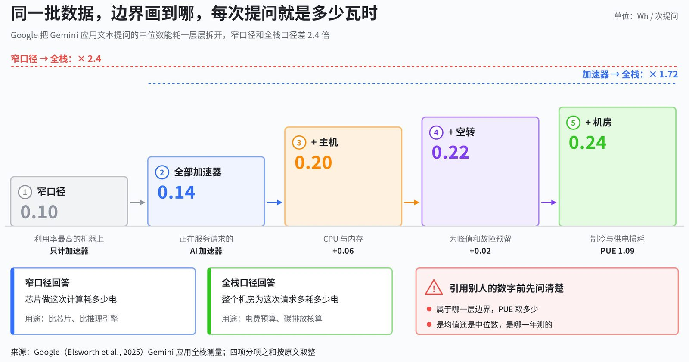

### 10.1 0.24 Wh 里有四成不在加速器上

Google 这篇论文的价值在于它把测量边界一层层摊开了 [[22]](https://arxiv.org/abs/2508.15734)。它先定义一段时间里整套服务的总能耗，再从里面拆出机房开销和空转机器，剩下的才是“正在服务请求”的部分。写成公式，m 遍历服务这批请求的所有机器，P 是实测功率，t 是时长，Q 是这段时间服务的提问数：

```math
E_{\mathrm{total}}=\mathrm{PUE}\cdot\sum_{m}P_m\,t_m,\qquad E_{\mathrm{overhead}}=(\mathrm{PUE}-1)\sum_{m}P_m\,t_m
```

```math
E_{\mathrm{active}}=E_{\mathrm{total}}-E_{\mathrm{overhead}}-\sum_{m}P^{\mathrm{idle}}_m\,t^{\mathrm{idle}}_m,\qquad e_{\mathrm{prompt}}=\frac{E_{\mathrm{total}}}{Q}
```

E_active 再按功率占比分给加速器和主机的 CPU、内存。空转的那部分是为应对流量峰值和故障切换预留的机器，它们不处理请求，但开着机就在耗电。PUE 是机房总用电和 IT 设备用电之比，多出来的部分是制冷和供电损耗。四项拆开如下：

| 部件 | 能耗（Wh） | 占比 | 相对加速器的系数 |
|---|---|---|---|
| 正在工作的 AI 加速器 | 0.14 | 58% | 1 |
| 主机 CPU 与内存 | 0.06 | 25% | 0.43 |
| 空转的备用机器 | 0.02 | 10% | 0.14 |
| 机房制冷与供电损耗 | 0.02 | 8% | PUE 1.09 |
| 合计（全栈口径） | 0.24 | 100% | 约 1.72 |

最后一列是这张表最好用的地方。手上只有加速器的能耗时，可以用这几个系数换算到系统层：

```math
e_{\mathrm{sys}}=e_{\mathrm{acc}}\cdot(1+h+i)\cdot\mathrm{PUE}=0.14\times(1+0.43+0.14)\times1.09\approx0.24\ \mathrm{Wh}
```

h 是主机相对加速器的能耗比，i 是空转机器的比例。这两个系数取决于机型和调度策略，Google 的值只能当起点。CPU 重的推理服务（比如前后处理多、检索在同一台机器上）h 会更大。为了保高可用多留冗余的集群，i 会更大。

论文还算了一个窄口径：只计正在运行的加速器，而且只取利用率最高的那批机器，得到 0.10 Wh，比全栈口径低 2.4 倍 [[22]](https://arxiv.org/abs/2508.15734)。很多公开估算用的正是这种口径，因为它只需要芯片功耗和吞吐两个数。两个数字都对，回答的问题不同。窄口径回答“芯片做这次计算耗多少电”，全栈口径回答“为了服务这次请求，整个机房多耗多少电”。做电费预算和碳排放核算要用后者，比较两种芯片或两种推理引擎的效率可以用前者。

同一篇论文还报告了 0.03 gCO2e 的碳排放和 0.26 mL 的用水，以及 12 个月里单次提问能耗下降 33 倍、碳排放下降 44 倍 [[22]](https://arxiv.org/abs/2508.15734)。33 倍里约 23 倍来自模型和软件改进，约 1.4 倍来自机器利用率提升。下降这么快，说明能耗数字有很强的时效性，一年前的数字放到今天可能差一个数量级。引用时要连日期一起引。

OpenAI 在 2025 年 6 月公开过 ChatGPT 平均一次查询约 0.34 Wh。Google 的论文指出这个数字没有说明测量边界和方法 [[22]](https://arxiv.org/abs/2508.15734)。它和 0.24 Wh 放在一起，看不出谁更省：一个是均值，一个是中位数，边界也未必相同。

内部估算能耗时，至少分两层记。芯片层用加速器实测功率乘以占用时间，系统层再乘上主机、空转和机房的系数。对外引用别人的数字前，先查它属于哪一层、是均值还是中位数、是哪一年的。

### 10.2 从 FLOP 推电量，误差在利用率上

多数团队拿不到 Google 那样的全栈功率数据，只能从模型规模往下推。Epoch AI 的估算是一条清楚的推导链 [[23]](https://epoch.ai/gradient-updates/how-much-energy-does-chatgpt-use)。生成一个 token，每个激活参数大约做一次乘加，也就是 2 次浮点运算。输出 T 个 token 需要的计算量除以芯片的实际算力，得到占用时间，再乘以功率：

```math
E\approx\frac{2\,N_{\mathrm{act}}\,T_{\mathrm{out}}}{F_{\mathrm{peak}}\cdot u}\cdot\frac{P_{\max}\cdot p}{3600}\ \ (\mathrm{Wh})
```

N_act 是激活参数量，F_peak 是芯片峰值算力，u 是算力利用率，P_max 是每张卡分摊到的满载功率（含服务器其他部件），p 是实际功率占满载的比例。Epoch 的取值：GPT-4o 总参数按 2000 亿估，范围 1000 亿到 4000 亿，悲观地取 4000 亿、按四分之一激活算，N_act = 1000 亿。输出 500 token，约 375 个英文单词。H100 的 BF16 稠密峰值 989 TFLOP/s。DGX H100 整机 10.2 kW，分到每卡约 1275 W，加上机房开销取 1500 W [[23]](https://epoch.ai/gradient-updates/how-much-energy-does-chatgpt-use)。

代进去算一遍。计算量是 2 × 10¹¹ × 500 = 10¹⁴ FLOP。满算力跑只要 0.10 秒，按 1500 W 计是 0.042 Wh。但推理时芯片远跑不满：解码每生成一个 token 都要把权重从显存读一遍，瓶颈在显存带宽。Epoch 取利用率 10%，占用时间变成 1.0 秒。功率也到不了满载，取 70%。结果是 0.042 ÷ 0.1 × 0.7 ≈ 0.3 Wh。

这条链里最没把握的是 u 和 p 两个数。功率比例 p 的公开证据从 25% 到 100% 都有：微软 Azure 的测量是额定功率的 60% 到 80%，预填充时冲到 100%。Luccioni 等人在不开批处理、每小时 558 个请求的条件下只测到 25% [[23]](https://epoch.ai/gradient-updates/how-much-energy-does-chatgpt-use)。下面是两个参数变动时的结果：

| 利用率 u | 功率比例 p | 一次问答（Wh） | 相对基准 |
|---|---|---|---|
| 10% | 70% | 0.30 | 基准 |
| 5% | 70% | 0.59 | 2 倍 |
| 20% | 70% | 0.15 | 1/2 |
| 30% | 70% | 0.10 | 1/3 |
| 10% | 100%（按额定功率） | 0.42 | 1.4 倍 |
| 10% | 25% | 0.11 | 1/2.8 |

利用率和能耗成反比，这一项的不确定性直接传到结果上。Epoch 用价格做了一个侧面验证：Llama 3.1 405B 每百万 token 约 8 × 10¹⁷ FLOP，H100 满算力每美元能做 3.6 × 10¹⁸ FLOP，满载跑的算力成本只要 0.22 美元，而市场价约 3.5 美元 [[23]](https://epoch.ai/gradient-updates/how-much-energy-does-chatgpt-use)。价格里还有利润和其他成本，但两者差 16 倍，说明有效利用率在个位数到百分之十几这个区间，10% 并不离谱。

p 取 100%，相当于按芯片额定功率（TDP）估能耗。ML.ENERGY 基准把实测值和按 TDP 的估算并排画了出来，后者几乎总是偏高，最坏的 CodeGemma 2B 在 H100 上高估 4.1 倍 [[27]](https://arxiv.org/abs/2505.06371)。原因同上：LLM 解码的算术强度低，计算单元闲着，功率远低于上限。扩散模型的情况相反，功率接近 TDP。用 TDP 估 LLM 推理能耗，得到的是一个保守的上界。

早年流传的“每次 ChatGPT 查询 3 Wh”就落在这类上界一侧。Epoch 指出它的假设偏重：模型按 GPT-3.5 的 1750 亿参数全量计算，每次输入 4000、输出 2000 token，服务器按峰值功率算 [[23]](https://epoch.ai/gradient-updates/how-much-energy-does-chatgpt-use)。BLOOM-176B 的实测约 4 Wh 一次，那次测量没有批处理，利用率很低。换一组同样合理的假设，Epoch 也得到过 1 到 4 Wh 或 0.1 Wh 量级的结果，它自己的结论是“0.3 Wh 是偏悲观的典型值”。

#### 自己测时，窗口、采样和分摊各有讲究

在自己的集群上测，最常用的读数是 GPU 驱动报告的功率或累计能量。累计能量计数器直接给出一段时间里的焦耳数，比按固定间隔采样功率再积分更准。采样间隔一长，预填充时短暂的功率尖峰就会漏掉。ML.ENERGY 基准读的就是累计能量 [[27]](https://arxiv.org/abs/2505.06371)。CPU 和内存的能耗要另外读，整台服务器的总功率通常要从机柜的配电单元拿。

测量窗口要取稳态。服务刚启动时批还没填满，压测结束前最后一段批又在变小，这两段里每个请求的能耗都偏高。持续压测，丢掉开头和结尾，只用中间批大小稳定的那一段，用窗口内的总能量除以窗口内做完的请求数。窗口里没做完的请求按已生成的 token 比例折算，窗口够长时这部分误差可以忽略。

批里的请求共用一次权重读取，单个请求的能耗没法直接测，只能分摊。最简单的办法是按 token 数分：窗口总能量分成预填充和解码两池，每个请求按自己的 token 数各分一份。第 10.3 节的拟合说明一个输出 token 约抵三个输入 token，没有分池数据时可以按这个比例加权。长上下文请求还要多承担注意力的平方项，按 token 数平分，短请求会替长请求付一部分电费。

空转功率也要单独测一次。加速器不服务请求时也有不小的基础功耗。服务时的功率减去空转功率，得到的是边际能耗，不减得到的是平均能耗。前者回答“多接一个请求多耗多少电”，后者回答“这批机器一共耗了多少电”，分别对应第 10.1 节的窄口径和全栈口径。

这条推导链适合回答两类问题：没有实测数据时给一个量级，以及比较两个配置的相对变化。它不适合直接写进对外披露。真要报数，还是要在自己的集群上测实际功率，第 10.7 节给了一段测量换算的代码。

### 10.3 输入过了十万 token，注意力项开始主导

第 10.2 节只算了输出。输入的处理叫预填充，模型一次读完整段提示，算出每层的 Key 和 Value 存进 KV cache。这一步的计算量有两部分：每个输入 token 过一遍全部参数，和随长度平方增长的注意力打分：

```math
C_{\mathrm{prefill}}(n)\approx 2N_{\mathrm{act}}\,n+2L\,d_{\mathrm{model}}\,n^{2}
```

L 是层数，d_model 是隐藏维度，第二项对因果注意力已经除了 2。两项相等的长度是：

```math
n^{*}=\frac{N_{\mathrm{act}}}{L\,d_{\mathrm{model}}}
```

按 GPT-3 级别的结构，96 层、隐藏维度 12288，激活参数 1000 亿，n\* ≈ 8.5 万 token。输入短于这个长度，能耗基本随 token 数线性增长。长于它，平方项开始压过线性项，长度翻倍，注意力部分的能耗翻四倍。用分组查询注意力或稀疏注意力的模型，n\* 会往后推，但平方的形状不变。

Epoch 给了三个点：输出 500 token、输入很短时约 0.3 Wh，输入 1 万 token 约 2.5 Wh，输入 10 万 token 约 40 Wh [[23]](https://epoch.ai/gradient-updates/how-much-energy-does-chatgpt-use)。把短输入的 0.3 Wh 当成输出部分的固定开销，用线性加平方两项去拟合另外两个点：

```math
E(n)\approx0.3+a\,n+b\,n^{2},\qquad a\approx2.0\times10^{-4},\ \ b\approx2.0\times10^{-9}\ \ (\mathrm{Wh})
```

拟合出来的交叉点 a/b ≈ 10 万 token，和上面按结构估的 8.5 万对得上。拆开看：1 万 token 输入时，线性项 2.0 Wh、平方项 0.2 Wh，注意力只占一成。3 万 token 时总共约 8 Wh，平方项占两成。10 万 token 时线性项和平方项各约 20 Wh。外推到 12.8 万 token 约 58 Wh，100 万 token 约 2 kWh，后者已经超出 Epoch 给的数据点，只能当量级看。

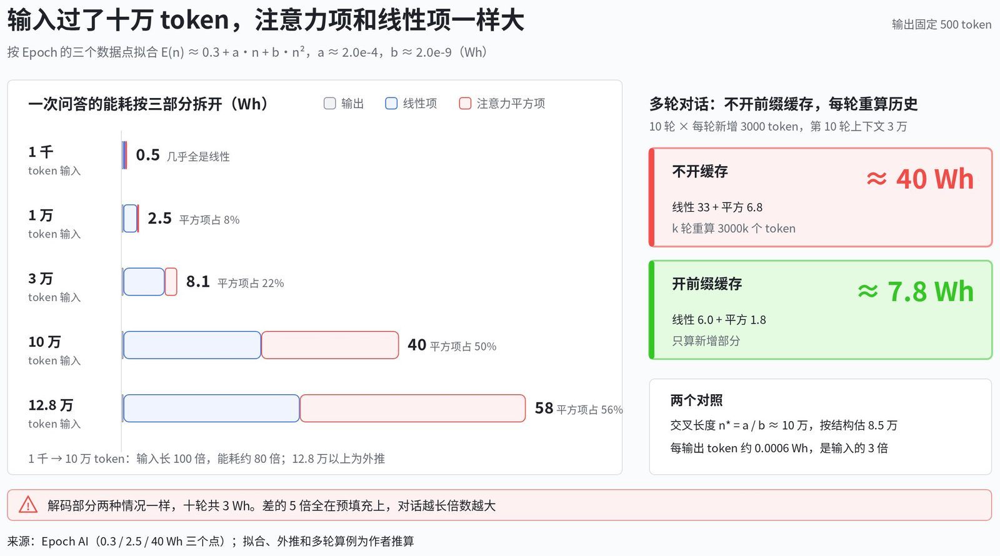

拟合还给出一个对照：每个输入 token 的线性成本约 0.0002 Wh，每个输出 token 约 0.3 ÷ 500 = 0.0006 Wh，输出贵约 3 倍。原因是预填充能把整段输入并成一个大矩阵乘法，算力用得满。解码每步只出一个 token，却要读一遍全部权重。主流 API 的输出单价是输入的 4 到 5 倍，和这个比例在同一量级。

#### 多轮对话的上下文要靠缓存少算几遍

Epoch 特别提到，预填充算出的 KV cache 可以留着，同一段对话后续轮次只需处理新增的 token [[23]](https://epoch.ai/gradient-updates/how-much-energy-does-chatgpt-use)。服务端要是不开前缀缓存，每一轮都会把整段历史重新预填充一遍。算一个例子：一段 10 轮的对话，每轮新增 3000 token，第 10 轮时上下文到 3 万 token。

- 不开缓存：第 k 轮重算 3000k 个 token，十轮的线性项合计 33 Wh，平方项合计 6.8 Wh，约 40 Wh。
- 开缓存：每轮只算新增部分，总量约等于一次性预填充 3 万 token，线性项 6.0 Wh、平方项 1.8 Wh，约 7.8 Wh。
- 解码部分两种情况一样，每轮 0.3 Wh，十轮 3 Wh。

同样的对话，不开缓存的预填充能耗是开缓存的 5 倍。对话越长，这个倍数越大，因为不开缓存时总计算量随轮数平方增长。Agent 场景里工具调用的结果会不断追加进上下文，一次任务几十轮很常见，缓存命中率对能耗的影响比换一张更新的卡还大。缓存的计费和命中条件见本书第 9 章。

Jegham 等人的测量里，最长的提示单次超过 29 Wh，最短的约 0.42 Wh，差 65 倍以上 [[26]](https://arxiv.org/abs/2505.09598)。读这类数字时要先看输入长度。同一个模型，1 千 token 和 10 万 token 的提示放在一起算平均，结果说明不了模型的效率，只说明了测试集里长提示占多少。

### 10.4 推理模式把输出拉长几百倍

按第 10.2 节的公式，能耗和输出 token 数成正比。推理模型在给出答案前先生成一段思考，输出长度一下子拉长了。Hugging Face 的 AI Energy Score 第二版在统一硬件、批大小为 1 的条件下测了同一个模型开关推理的能耗 [[25]](https://huggingface.co/blog/sasha/ai-energy-score-v2)：

| 模型 | 推理关（Wh / 千次） | 推理开（Wh / 千次） | 倍数 |
|---|---|---|---|
| DeepSeek-R1-Distill-Llama-70B | 49.53 | 7,626.53 | 154 倍 |
| Phi-4-reasoning-plus（14B） | 18.42 | 9,461.61 | 514 倍 |
| SmolLM3-3B | 18.35 | 12,791.22 | 697 倍 |

打开推理后，模型生成的 token 多了 300 到 800 倍，推理模型整体平均比非推理模型多耗约 30 倍电 [[25]](https://huggingface.co/blog/sasha/ai-energy-score-v2)。表里最小的 3B 模型开了推理，每千次查询 12.8 kWh，比关掉推理的 70B 模型高 250 多倍。“小模型更省电”这个直觉在推理模式下不成立，能耗主要由输出长度决定。

推理档位也有影响。GPT-OSS 高档和低档相比，20B 版本能耗高 4.8 倍，120B 版本高 1.6 倍 [[25]](https://huggingface.co/blog/sasha/ai-energy-score-v2)。小模型在高档位下想得更久，倍数反而更大。同一轮评测里，14 个新模型中有 8 个的能耗持平或高于同尺寸的旧模型 [[25]](https://huggingface.co/blog/sasha/ai-energy-score-v2)。模型在变强，单次能耗却未必在降，很大一部分原因是默认输出变长了。

ML.ENERGY 基准指出了推理模型的第二重开销 [[27]](https://arxiv.org/abs/2505.06371)。输出长，每个请求在服务器上停留的时间长，KV cache 占的显存也多，批开不大，权重读取被分摊得少，每个 token 的能耗也跟着升高。所以推理模型的每次生成能耗比“token 数 × 普通单 token 能耗”还要高。第 10.5 节会把这个机制算出来。

#### 不开推理时，回答长度也差三到四成

非推理模型之间的输出长度也不一样。ML.ENERGY 测到，同样的提示下 Mistral Large 的回答平均比 Mixtral 8×7B 长 36% [[27]](https://arxiv.org/abs/2505.06371)。人类评审普遍偏好更长的回答，训练时用人类偏好做优化，会把默认输出越推越长。Epoch 统计过一组模型的平均输出：GPT-4o 约 540 token，o1 约 1392，o3-mini 约 1374，DeepSeek-R1 约 1794 [[23]](https://epoch.ai/gradient-updates/how-much-energy-does-chatgpt-use)。推理模型比 GPT-4o 长约 2.5 倍，这是在 Epoch 选的提示集上的数字，难题上的差距会大得多。

比较两个模型的能耗时，要在同一批提示上比每次请求的总能耗。只比每 token 能耗，会让啰嗦的模型占便宜。ML.ENERGY 主张按“一次完整回答”报能耗，理由也在这里。

#### 给思考设上限，省下的电和输出长度成正比

多数推理模型的接口支持给思考 token 设上限，或者选低一档的推理档位。按第 10.2 节的公式，能耗和输出长度近似成正比。上限从 8000 token 压到 2000 token，单次请求的解码能耗大约降到四分之一。KV cache 占的显存跟着变小，批能开得更大，每个 token 的能耗还会再降一些。代价是难题上的准确率。上限要在评测集上扫一遍，找到准确率开始明显下滑的位置，把上限设在它附近。然后用第 10.7 节的按任务算法再核一次：准确率下降带来的重试和兜底，可能把省下的电又花回去。

#### 推理请求的占比决定平均能耗

线上流量里推理请求通常只占一部分。设普通请求能耗 E₀，推理请求 E_r，推理请求占比 ρ：

```math
\bar{E}=(1-\rho)\,E_0+\rho\,E_r
```

取 E₀ = 0.3 Wh，推理请求按 30 倍算 E_r = 9 Wh。ρ = 5% 时平均 0.74 Wh，是普通请求的 2.5 倍。ρ = 20% 时平均 2.04 Wh，涨到 6.8 倍，这时 88% 的电花在五分之一的请求上。推理请求的占比每涨一个百分点，平均能耗涨约 0.09 Wh，相当于普通请求的 29%。

省电最直接的办法是路由：按任务难度判断要不要推理，要的话用哪一档。很多请求（闲聊、改写、简单查询）开推理拿不到更好的答案。路由器本身的开销远小于一次推理，误判的代价是答案质量，所以阈值要用评测集定。路由策略见 [LLM-20｜工程｜用好模型：提示词、思考档位与模型路由](./20-prompting-routing.md)。

### 10.5 批大小决定权重被多少请求分摊

Google 汇总了公开文献里对 Llama 3.1 70B 的能耗估算，按每千瓦时能处理的提示数算，从约 580 到约 3600 不等，差六倍 [[22]](https://arxiv.org/abs/2508.15734)。模型一样，差距来自硬件、批大小、利用率和测量边界。其中批大小的影响最大，原因要从解码的瓶颈说起。

解码时每生成一个 token，都要把全部权重从显存读进计算单元，再读出这个请求的 KV cache。权重读一次可以服务批里所有请求，KV cache 则每个请求各读各的。算术强度低，计算单元大多在等数据，所以每一步的时间近似等于读数据的时间。设权重大小 M_w，每个请求的 KV cache 大小 M_kv，批大小 B，显存带宽 BW，卡的平均功率 P，每个 token 的能耗是：

```math
t_{\mathrm{step}}\approx\frac{M_w+B\,M_{kv}}{BW},\qquad e_{\mathrm{token}}=\frac{P\,t_{\mathrm{step}}}{B}=\frac{P}{BW}\Big(\frac{M_w}{B}+M_{kv}\Big)
```

括号里第一项随批大小下降，第二项不变。批小时权重读取占大头，加批几乎是白送的节能。批大到 M_w/B 和 M_kv 相当之后，再加批收益就小了。这个模型忽略了计算时间和功率随负载的变化，只用来看趋势。

代一组数。80 亿参数、BF16 权重 16 GB，32 层、8 个 KV 头、头维度 128，每个 token 的 KV cache 是 2 × 32 × 8 × 128 × 2 字节 ≈ 131 KB，上下文 2000 token 时一个请求 262 MB。H100 带宽 3.35 TB/s，平均功率取 400 W：

| 批大小 B | 每步时间 | 每 token 能耗（mWh） | 其中权重 / KV |
|---|---|---|---|
| 1 | 4.9 ms | 0.54 | 0.531 / 0.009 |
| 4 | 5.1 ms | 0.14 | 0.133 / 0.009 |
| 16 | 6.0 ms | 0.042 | 0.033 / 0.009 |
| 64 | 9.8 ms | 0.017 | 0.008 / 0.009 |

批从 1 加到 64，每步只慢了一倍，每 token 能耗降到 1/32。B = 64 时权重和 KV 两项相当，这就是这组参数下“再加批收益变小”的位置。上下文拉到 8000 token，KV 项翻四倍，同样的批下每 token 能耗是 0.068 mWh，比 2000 token 时高 60%。

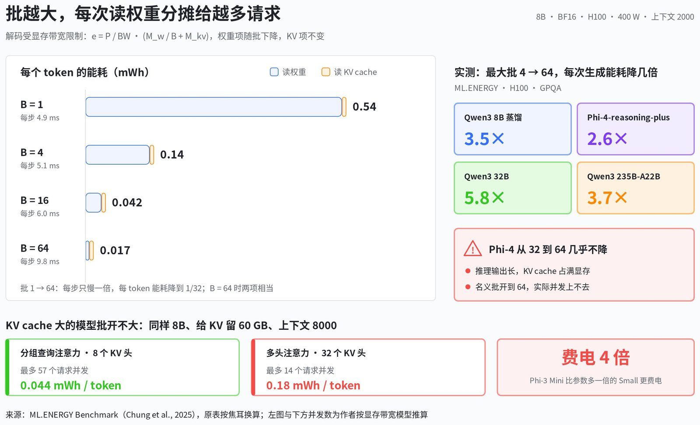

ML.ENERGY 在 H100 上测了四个推理模型在 GPQA 上的每次生成能耗，最大批大小从 4 扫到 64 [[27]](https://arxiv.org/abs/2505.06371)。原表没有标单位，按基准一贯使用的焦耳换算成 Wh：

| 模型（卡数） | B = 4 | B = 16 | B = 64 | 4 → 64 |
|---|---|---|---|---|
| DeepSeek 蒸馏 Qwen3 8B（1） | 2.70 | 1.20 | 0.77 | 3.5 倍 |
| Phi-4-reasoning-plus 15B（1） | 5.55 | 2.60 | 2.11 | 2.6 倍 |
| Qwen3 32B（2） | 7.34 | 2.54 | 1.26 | 5.8 倍 |
| Qwen3 235B-A22B 思考版（8） | 34.0 | 15.8 | 9.19 | 3.7 倍 |

Phi-4 那一行从 32 到 64 几乎没变（2.12 到 2.11 Wh），其他三个模型还在降。推理输出很长，每个请求的 KV cache 占满了显存，名义上的最大批大小开到 64，实际同时跑的请求数上不去，权重读取分摊不下去。批大小的收益受显存约束，这一点在下面的架构对比里更明显。

#### KV cache 大的模型，参数少也可能更费电

ML.ENERGY 比较了 Phi-3 Mini（38 亿参数）和 Phi-3 Small（70 亿参数）[[27]](https://arxiv.org/abs/2505.06371)。批大小增加后，参数多一倍的 Small 反而更省电。Mini 用的是多头注意力，每个头都有自己的 KV；Small 用分组查询注意力，几个头共用一组 KV。Mini 的 KV cache 是 Small 的 3 倍，批开不大，分摊不了权重读取。

用上面的模型算一下这个效应。同样 80 亿参数、显存给 KV 留 60 GB：8 个 KV 头、上下文 8000 时，最多同时跑 57 个请求，每 token 0.044 mWh。换成 32 个 KV 头的多头注意力，KV 大 4 倍，最多只能跑 14 个请求，每 token 0.18 mWh，费电 4 倍。注意力的结构通过显存间接决定了能耗。

#### 稍放宽延迟，能耗能降四成

加批会拉长每个 token 的生成时间。ML.ENERGY 把各配置的延迟和能耗画成帕累托前沿，在前沿上按延迟要求挑最省电的点 [[27]](https://arxiv.org/abs/2505.06371)。聊天场景的输出是流式显示的，只要每个 token 的平均间隔快过人的阅读速度，体验就不受影响。以平均 100 ms 一个 token 为上限（约每秒 7.5 个英文单词），Llama 3.1 8B 的最优点落在 77 ms，比一味追求最低延迟的配置省 44% 的电。扩散模型在 5 秒延迟要求下省 21%。

同一组实验里，Llama 3.1 8B 的前沿点一部分来自 A100、一部分来自 H100 [[27]](https://arxiv.org/abs/2505.06371)。解码受显存带宽限制，换到 H100 速度没快多少、功率也没涨多少，两者的能耗差不多。扩散模型算力密集，H100 的配置全面占优。选卡要看负载是卡在算力还是带宽上。

#### 基准里的绝对值不能直接套到线上

Hugging Face 的 AI Energy Score 把所有模型的批大小固定为 1，目的是让不同模型能放在一起比 [[25]](https://huggingface.co/blog/sasha/ai-energy-score-v2)。按上面的推导，批为 1 时权重读取完全没被分摊，绝对值会比大批量的线上服务高一个数量级以上。ML.ENERGY 则取服务器批大小饱和后的稳态做测量，更接近长期运行的线上状态 [[27]](https://arxiv.org/abs/2505.06371)。两个榜单的相对排名可以参考，绝对值要用自己的批大小和利用率重算。

Luccioni 等人更早的测量还发现，用通用生成式模型做分类这类固定任务，能耗比专用小模型高出几个数量级 [[28]](https://arxiv.org/abs/2311.16863)。降能耗的第一步常常是换一个更小或更专门的模型，调批大小排在后面。量化和蒸馏的做法见 [LLM-24｜系统｜模型压缩与端侧部署：量化、剪枝与蒸馏](./24-compression-edge.md)。

### 10.6 中位数、均值和生命周期是三种账

Google 报的是中位数提问的能耗，论文对中位数的定义是“服务第 50 百分位提问的那个模型”的单次能耗 [[22]](https://arxiv.org/abs/2508.15734)。中位数适合描述一次普通提问，算总用电量要的是均值。前面几节说明，长输入和推理请求的能耗是普通请求的几十到几百倍，这类请求只要占一小部分，均值就会明显高于中位数。

设一个流量分布：90% 的请求 0.2 Wh，8% 是长输入 2.4 Wh，2% 是推理 10 Wh。中位数是 0.2 Wh，均值是：

```math
\bar{E}=0.9\times0.2+0.08\times2.4+0.02\times10=0.572\ \mathrm{Wh}
```

均值是中位数的 2.9 倍。只占一成的长尾请求花掉了 69% 的电。用中位数乘总请求数估总用电，会低估到三分之一。容量规划、电费预算和碳排放核算都要用均值，报中位数时最好同时给出均值和 P90。

把这个分布放大到一个每天 10 亿次请求的服务上算一下。按均值，每天 572 MWh，相当于持续 23.8 MW 的负载，一年约 209 GWh。按中位数算只有每天 200 MWh，差出来的 372 MWh 全在长尾上。长尾请求的占比还会随产品形态变：上线 Agent 功能后长输入的比例上升，默认打开推理后推理请求的比例上升，这两种变化都不会出现在中位数里。所以监控能耗时要按请求类型分桶，各桶分别跟踪请求数和单次能耗，总用电量按桶加总。

#### 碳排放和用水在能耗上再乘一个系数

能耗换碳排放要乘电网的碳强度。Google 的写法是运营排放加上分摊的上游排放 [[22]](https://arxiv.org/abs/2508.15734)：

```math
\mathrm{CO_2e}_{\mathrm{prompt}}=e_{\mathrm{prompt}}\cdot EF+\frac{S_{1}+S_{3}}{Q}
```

EF 用市场法：Google 买了大量清洁电力，2024 年的市场法碳强度是 94 g/kWh。0.24 Wh × 94 g/kWh ≈ 0.023 g，加上范围一和范围三分摊的 0.010 g，得到 0.03 g [[22]](https://arxiv.org/abs/2508.15734)。换成按所在电网平均值计的位置法（345 g/kWh），运营排放是 0.083 g，是市场法的 3.7 倍。同一份能耗，两种方法的碳排放差几倍，引用时要写明用的是哪一种。用水按机房每千瓦时的用水量折算，Google 报 0.26 mL。

Mistral 走的是生命周期评估，范围最宽 [[24]](https://mistral.ai/news/our-contribution-to-a-global-environmental-standard-for-ai/)。Mistral Large 2 训练加 18 个月使用，一共产生 20.4 千吨二氧化碳当量、消耗 28.1 万立方米水。一次 400 token 的回复对应约 1.14 gCO2e 和 45 mL 水，环境影响大致和模型规模成正比。这个单次数字比 Google 的高约 40 倍，因为它算进了服务器制造这类上游排放，所用电网的碳强度也不同。Mistral 主张训练和推理一起披露，才能判断训练成本有没有被摊销掉 [[24]](https://mistral.ai/news/our-contribution-to-a-global-environmental-standard-for-ai/)。

硬件制造的占比不小。Epoch 引用的 BLOOM 数据里，服务器制造的隐含排放是 11.2 吨，训练本身 24.7 吨，那次训练用的是碳强度只有 57 g/kWh 的法国电网 [[23]](https://epoch.ai/gradient-updates/how-much-energy-does-chatgpt-use)。电网越干净，制造排放的占比越高。

#### 训练能耗折成推理要多少天

训练和推理哪个占大头，可以用 Epoch 的假设粗算 [[23]](https://epoch.ai/gradient-updates/how-much-energy-does-chatgpt-use)。GPT-4o 级别的训练约 20 到 25 MW、持续 3 个月，取 22.5 MW × 2190 小时 ≈ 4.9 万 MWh。推理按每天 10 亿条消息、每条 0.3 Wh，是每天 300 MWh，相当于持续 12.5 MW。训练能耗相当于 164 天的推理。模型上线后用一年以上，推理就是大头，这也是这一章只讲推理能耗的原因。

所以至少有三种账：单次推理的边际能耗（Google、Epoch 的口径），推理总能耗（要用均值乘请求量），以及包含硬件制造和训练的生命周期影响（Mistral 的口径）。Epoch 也给了一个量级对照：美国家庭年用电约 10500 kWh，每天约 2.8 万 Wh，相当于近十万次 0.3 Wh 的问答 [[23]](https://epoch.ai/gradient-updates/how-much-energy-does-chatgpt-use)。这类对照适合向非技术读者解释量级，不适合当节能决策的依据，决策要看总量和增速。

### 10.7 记账清单：按 token 和做成的任务各记一份

把前面几节合起来，一份能拿来比较和规划的能耗记录至少要写清下面这些字段：

| 字段 | 写什么 | 不写会差多少 |
|---|---|---|
| 测量边界 | 只含加速器，还是含主机、空转和机房；PUE 取值 | 2.4 倍 [[22]](https://arxiv.org/abs/2508.15734) |
| 测量方法 | 实测功率还是按 TDP 估；功率怎么采样 | 按 TDP 最多高估 4.1 倍 [[27]](https://arxiv.org/abs/2505.06371) |
| 统计量 | 中位数还是均值，同时给 P90 | 长尾能让均值到中位数的 3 倍 |
| 输入输出长度 | 平均输入、输出 token 数；前缀缓存命中率 | 1 千到 10 万 token 差 80 倍 [[23]](https://epoch.ai/gradient-updates/how-much-energy-does-chatgpt-use) |
| 推理模式 | 是否开推理，用哪个档位，推理请求占比 | 两到三个数量级 [[25]](https://huggingface.co/blog/sasha/ai-energy-score-v2) |
| 部署条件 | 硬件型号、并行度、实际批大小、利用率 | 同一模型差六倍 [[22]](https://arxiv.org/abs/2508.15734) |
| 归一化单位 | 每百万 token，以及每个做成的任务 | 按 token 比会让失败率高的模型占便宜 |
| 日期 | 测量时间和模型版本 | 一年降 33 倍 [[22]](https://arxiv.org/abs/2508.15734) |

前六项决定数字能不能比，后两项决定数字怎么用。归一化单位里，每百万 token 的能耗用来做容量规划和电费预算，每个做成的任务的能耗用来比较模型和方案。

#### 比模型要看每个做成的任务

便宜的小模型单次能耗低，但成功率也低，失败了要重试或者交给大模型兜底。设单次尝试能耗 e、成功率 s，最多尝试 k 次，k 次都失败就交给兜底方案（能耗 e_f），每个任务的期望能耗是：

```math
E_{\mathrm{task}}=e\cdot\frac{1-(1-s)^{k}}{s}+(1-s)^{k}\,e_{f}
```

第一项是重试的几何级数，第二项是兜底的部分。k 趋于无穷且不兜底时，E_task = e/s。算一个例子：大模型单次 0.3 Wh、成功率 90%，最多 3 次，每个任务 0.333 Wh。小模型单次 0.15 Wh、成功率 60%，最多 3 次的尝试部分是 0.234 Wh，还有 6.4% 的任务三次都失败，交给大模型再做一遍，加 0.064 × 0.333 = 0.021 Wh，合计 0.255 Wh。

小模型单次能耗只有一半，按任务算只省了 23%。成功率再低一些，这点优势就没了：小模型成功率降到 45% 时，同样的算法得到 0.333 Wh，和大模型持平，降到 40% 时是 0.37 Wh，反而更费电。比较按 token 的能耗，会看到小模型省一半，比较按任务的能耗，才看得出它省多少或者根本不省。这个公式有两个前提：各次尝试相互独立，重试的成功率要用实测值；系统能判断出失败，漏检的错误要按兜底处理计入。

下面这段代码把实测功率换算成单次请求能耗，再按 Google 的系数换到系统层，最后按任务归一化。系数要换成自己机房的实测值：

*
*

```python
def system_wh(acc_wh, host=0.43, idle=0.14, pue=1.09):    """把芯片层能耗换算成系统层。默认系数取自 Google 的分项：    主机 0.06/0.14、空转 0.02/0.14，机房 PUE 1.09。换成自己机房的实测值再用。"""    return acc_wh * (1 + host + idle) * puedef acc_wh_per_request(gpu_avg_w, gpus, window_s, requests):    """一段稳态窗口内，加速器实测平均功率 × 卡数 × 时长，再除以窗口内做完的请求数。"""    return gpu_avg_w * gpus * window_s / 3600 / requestsdef wh_per_task(e, s, k=1, fallback_wh=0.0):    """单次尝试能耗 e、成功率 s，最多尝试 k 次，k 次都失败就转给兜底模型。    返回每个任务的期望能耗；成功率要用实测值，各次尝试也未必独立。"""    q = 1 - s    return e * (1 - q ** k) / s + q ** k * fallback_wh# 例：8 卡机一小时做了 5 万个请求，每卡实测平均 420 Wacc = acc_wh_per_request(420, 8, 3600, 50000)        # 0.067 Whprint(round(acc, 3), round(system_wh(acc), 3))       # 芯片层 0.067，系统层约 0.115strong = wh_per_task(0.30, 0.90, k=3)                # 0.333small = wh_per_task(0.15, 0.60, k=3, fallback_wh=strong)print(round(strong, 3), round(small, 3))             # 0.333 对 0.255
```

8 卡机一小时做 5 万个请求，每卡平均 420 W，芯片层每个请求 0.067 Wh，乘上主机、空转和机房的系数是 0.115 Wh。这个数和 Google 的 0.24 Wh 能不能比，要看两边的输入输出长度和推理请求占比是否相近，表里的字段就是为这一步准备的。

落到团队的日常工作上，有三件事最值得先做：在推理服务里按请求记下输入、输出和缓存命中的 token 数，按稳态窗口采集每张卡的实测功率，再把评测集上的成功率和这两组数据连起来。有了这三样，这一章的表和公式都能自动算出来，模型选型和路由调整的能耗影响也就看得见了。

## 第 11 章 · 从吞吐反推闭源模型规模：Opus 有多大，误差在哪

第 2.3 节用“显存带宽 ÷ 权重字节”算单请求的速度上限。把这个关系倒过来，已知速度和带宽，就能估出每生成一个 token 读了多少字节。2026 年初有一篇博客用这个办法估算 Claude Opus 的规模[[29]](https://unexcitedneurons.substack.com/p/estimating-the-size-of-claude-opus)，结论是 Opus 4.5/4.6 的活跃参数约一千亿（按 FP8 计），总参数在一到三万亿之间，网上流传的“10T 以上”没有支撑。

本章把这次推算拆成可以复用的五步，每一步标出误差从哪里来，最后说明这个数对算账有什么用。先给结论：这个方法能回答量级，回答不了精确值。它对同一家族内部的相对大小最可靠，跨厂商比较之前要先想清楚服务配置和分词器两件事。

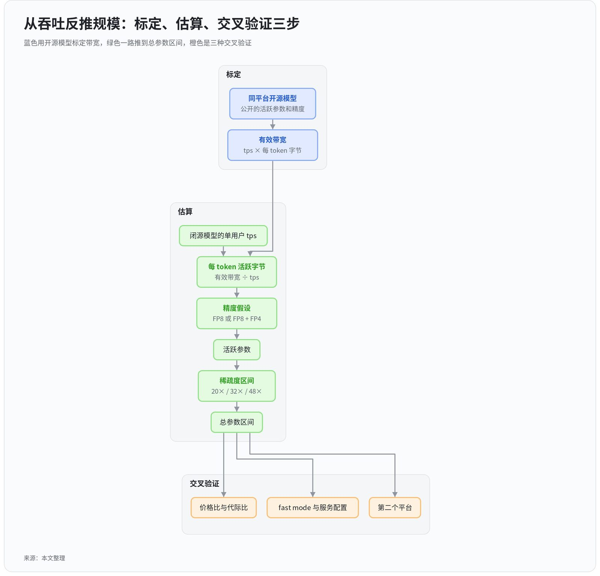

### 11.1 标定：同一平台上，速度比约等于每 token 字节比

decode 阶段每生成一个 token，都要把被激活的权重从显存里读一遍（第 2.1 节）。同一家云上，加速器、互联和推理软件栈大体相同，单用户输出速度乘以每 token 读取的字节数，应该落在同一个“有效带宽”附近。用权重公开的开源模型来标定，Google Vertex 上的数据如下[[29]](https://unexcitedneurons.substack.com/p/estimating-the-size-of-claude-opus)[[31]](https://huggingface.co/deepseek-ai/DeepSeek-V3.1)[[32]](https://huggingface.co/zai-org/GLM-4.7)[[33]](https://huggingface.co/moonshotai/Kimi-K2-Thinking)：

| 模型 | Vertex 单用户 tps | 每 token 读取的权重 | 有效带宽 |
|---|---|---|---|
| DeepSeek V3.1 | 117 | 37.55B 活跃参数 × FP8 ≈ 37.6 GB | 约 4.39 TB/s |
| GLM-4.7 | 132 | 33.63B 活跃参数 × FP8 ≈ 33.6 GB | 约 4.44 TB/s |
| Kimi K2 Thinking | 187 | 常驻 11.7B × 8 位 + 路由 21.1B × 4 位 ≈ 22.3 GB | 约 4.17 TB/s |
| Llama 3.3 70B（稠密） | 70 | 70B × 1 字节/参数 ≈ 70 GB | 约 4.9 TB/s |

三个 MoE 模型落在 4.2–4.4 TB/s，稠密的 Llama 略高，稠密模型更容易优化[[29]](https://unexcitedneurons.substack.com/p/estimating-the-size-of-claude-opus)。这里的“有效带宽”把批处理、投机解码和 MTP 的影响都折了进去，和芯片手册上的带宽是两回事。Ironwood 单芯片的 HBM 带宽约 7.37 TB/s[[38]](https://cloud.google.com/tpu/docs/tpu7x)，服务一个大模型要多片做张量并行或专家并行，物理带宽加起来是 4.4 TB/s 的好几倍。所以这个数只能当一把比例尺：同一平台上两个模型的单用户速度之比，近似等于它们每 token 读取字节数的反比。

标定本身也带着假设。Kimi 的常驻部分如果按 BF16 存，算出的有效带宽是 6.36 TB/s，比 8 位假设高出约五成[[29]](https://unexcitedneurons.substack.com/p/estimating-the-size-of-claude-opus)。精度猜错一档，比例尺就偏一截，后面所有结果因此都写成区间。

### 11.2 活跃参数：Opus 4.6 每个 token 读约 93–105 GB

Opus 4.6 在 Vertex 上约每秒 43 个 token[[29]](https://unexcitedneurons.substack.com/p/estimating-the-size-of-claude-opus)[[30]](https://openrouter.ai/anthropic/claude-opus-4.6)。4.0–4.5 TB/s 除以 43，每 token 读取约 93–105 GB。换算成参数还要假设精度：

- **全部 FP8**：93–105B 活跃参数。
- **注意力和共享部分 FP8，路由专家 FP4**：开源 MoE 的常驻部分占活跃参数的 36%–46%，平均每参数 0.68–0.73 字节，对应 127–154B。
- **全部 BF16**：只有 47–52B，和它的能力、价格都对不上，可能性最低。

同样的算法用到整个家族上，结果如下。价格是 Anthropic 当前公布的标准价，每百万 token 输入/输出[[37]](https://platform.claude.com/docs/en/about-claude/pricing)：

| 模型 | Vertex tps | 每 token 字节 | FP8 活跃参数 | FP8 + FP4 活跃参数 | 标准价 |
|---|---|---|---|---|---|
| Opus 4.0 | 23 | 174–196 GB | 174–196B | 238–288B | \$15 / \$75 |
| Opus 4.1 | 24 | 167–188 GB | 167–188B | 228–276B | \$15 / \$75 |
| Opus 4.5 | 40 | 100–113 GB | 100–113B | 137–165B | \$5 / \$25 |
| Opus 4.6 | 43 | 93–105 GB | 93–105B | 127–154B | \$5 / \$25 |
| Sonnet 4.5 | 41 | 98–110 GB | 98–110B | 134–161B | \$3 / \$15 |
| Sonnet 4.6 | 51 | 78–88 GB | 78–88B | 107–130B | \$3 / \$15 |

这张表最有用的是家族内部的相对关系。Opus 4.1 到 4.5，速度翻倍，标准价降到三分之一，两个信号指向同一件事：4.5 换了一个小得多的底座。Sonnet 4.6 只比 Opus 4.6 快两成，价格是它的六成，两者的规模可能只差 1.5 倍左右。原作者据此推测，Opus 4.5 是一个后训练更充分的中等规模模型，沿用 Opus 的名字，避免重演 Claude 3.5 时代 Sonnet 比旧 Opus 还强的命名混乱[[29]](https://unexcitedneurons.substack.com/p/estimating-the-size-of-claude-opus)。这是推测，没有官方证据。

表里也有对不上的地方。Sonnet 4.5 和 Opus 4.5 的速度几乎相同（41 对 40），单看吞吐分不出谁大，价格却差了四成。单个数据点的噪声不小，结论要靠同一家族的多个模型和多个时间点一起支撑。

### 11.3 总参数：稀疏度给出区间，上限参照已公开的模型

活跃参数推不出总参数，还要假设 MoE 有多稀疏。把活跃参数拆成两块：常驻部分（注意力、共享专家、embedding 和输出层）每个 token 都要读，路由专家只读被选中的几个。总参数约等于常驻部分加上路由活跃部分乘以扩展倍数，扩展倍数是总专家数除以每 token 激活的专家数：

```math
P_{\text{total}} \approx P_{\text{always}} + P_{\text{routed,active}} \times \frac{E_{\text{total}}}{E_{\text{active}}}
```

Opus 4.6 按 FP8 口径，低端 93B 按 DeepSeek 的常驻比例 46% 拆成 42B + 51B，高端 105B 按 Kimi 的 36% 拆成 37B + 67B[[29]](https://unexcitedneurons.substack.com/p/estimating-the-size-of-claude-opus)。再取三档开源模型的稀疏度：

| 参照 | 路由 | 扩展倍数 | Opus 4.6 总参数 | Opus 4.0/4.1 总参数（同法） |
|---|---|---|---|---|
| GLM-4.7（保守） | 160 选 8[[32]](https://huggingface.co/zai-org/GLM-4.7) | 20× | 1.05–1.38T | 1.9–2.6T |
| DeepSeek V3.1（居中） | 256 选 8[[5]](https://arxiv.org/abs/2412.19437) | 32× | 1.66–2.19T | 3.0–4.1T |
| Kimi K2（激进） | 384 选 8[[34]](https://arxiv.org/abs/2507.20534) | 48× | 2.47–3.27T | 4.4–6.1T |

上限为什么停在 48 倍附近？Kimi K2 的缩放实验给了直接的数据：固定激活 8 个专家，同样的验证损失下，稀疏度 32 所需的 FLOPs 是稀疏度 48 的 1.15 倍，再往上收益递减，基础设施的复杂度却在上升[[34]](https://arxiv.org/abs/2507.20534)。48 倍也不是硬上限，Kimi K3 已经推到 896 选 16，即 56 倍，为此专门处理了高稀疏度下的训练病态（见 [LLM-33｜地基｜MoE 混合专家：路由、负载均衡、训练与推理](./33-moe.md) 第 7.2 节）。按 56 倍算，Opus 4.6 约 2.9–3.8T，仍在同一个量级。

原作者还拿 Llama 4 当“稀疏过头会退化”的反例[[29]](https://unexcitedneurons.substack.com/p/estimating-the-size-of-claude-opus)，这个论据偏弱。Llama 4 Maverick 每个 token 走 1 个共享专家加 128 个路由专家里的 1 个，但它是稠密层和 MoE 层交替排列，整体是 17B 活跃、400B 总参数[[35]](https://ai.meta.com/blog/llama-4-multimodal-intelligence/)，总参数和活跃参数之比约 24 倍，比 Kimi K2 的约 32 倍还低。它的问题更可能出在数据和训练上，拿它说明稀疏度的上限，证据不足。稀疏度上限的论证靠 Kimi 的缩放数据就够了。

### 11.4 误差在哪：六个会改变结论的变量

推算的每一步都有假设。下表按影响从大到小排，前两项可以单独把结论推翻，后面几项让区间变宽：

| 变量 | 对估算的影响 | 偏差方向 | 怎么应对 |
|---|---|---|---|
| 服务配置（批大小、并行度） | 单用户 tps 是厂商在吞吐和延迟之间选的一个点。同一个 DeepSeek-V3 系列模型，DeepSeek 自己的服务每用户平均输出 20–22 token/秒[[15]](https://github.com/deepseek-ai/open-infra-index/blob/main/202502OpenSourceWeek/day_6_one_more_thing_deepseekV3R1_inference_system_overview.md)，Vertex 上是 117，差五倍多 | 双向，幅度最大 | 只在同一平台、同一时期的数据之间比 |
| fast mode | Anthropic 的 fast mode 用同一个模型、更快的推理配置，输出速度最高 2.5 倍，价格是标准档的 2 倍[[36]](https://platform.claude.com/docs/en/build-with-claude/fast-mode)[[37]](https://platform.claude.com/docs/en/about-claude/pricing)。标准档的 43 tps 离物理上限还有距离 | 按标准档算会高估活跃参数 | 误差带至少要覆盖“同一模型速度差 2.5 倍”这个量级 |
| 部署方 | Vertex 上的开源模型由 Google 部署，Claude 由 Anthropic 托管[[36]](https://platform.claude.com/docs/en/build-with-claude/fast-mode)，硬件池、软件栈和批策略未必相同 | 未知 | 换 Bedrock 等第二个平台重复一遍，看比例是否一致 |
| 投机解码与 MTP | 有效带宽已经折进了投机解码的收益。DeepSeek、GLM 带 MTP 层，Opus 用不用、接受率多少都不知道 | Opus 投机更强时，活跃参数被低估 | 外部无法校正，只能放宽区间 |
| 批内专家覆盖 | 批越大，一步要读的专家越多（第 2.4 节），单用户 tps 反映的就不只是活跃参数 | 稀疏度和标定模型差得越多，偏得越多 | 标定模型尽量选稀疏度相近的 |
| 分词器 | 每生成一个 token 做一次前向，和 token 长短无关，对参数估算影响很小。影响在跨厂商比速度和成本：同样的文本 Claude 要多生成几成 token，Opus 4.7 换分词器后又多三到四成（第 9.2 节） | 只影响“谁更快、谁更便宜”的比较 | 比文本速度时，先用第 9.2 节的双计数换成同一把尺子 |

六项里，服务配置和 fast mode 最要紧。它们说明单用户 tps 首先是一个经营选择：厂商在每卡吞吐和每用户速度之间挑一个点，第 2.2 节的屋顶线讲的就是这条曲线。整个推算成立的前提，是 Google 部署开源模型和 Anthropic 部署 Claude 时挑的点差不多，这个前提从外部没法证实。

第三方测速也会漂。Artificial Analysis 上 Opus 4.6 在自适应推理、最高档位下的输出速度约每秒 40 个 token[[39]](https://artificialanalysis.ai/models/claude-opus-4-6-adaptive)，原文引用的约 46 tps 来自不同的档位和时间。智能评分和排名也随评测集更新而变，引用时要带上日期和档位。

### 11.5 交叉验证：价格、第三方估计和“10T 需要什么”

<b>价格是弱证据。</b>Opus 4.0/4.1 标准价 \$15/\$75，4.5 起降到 \$5/\$25，Sonnet 4.5/4.6 是 \$3/\$15[[37]](https://platform.claude.com/docs/en/about-claude/pricing)。降到三分之一和速度翻倍对得上，Sonnet 价格是 Opus 的六成、速度只差两成也对得上。但价格里还有毛利、竞争和容量策略，Opus 5.5 又降到 \$4/\$20[[37]](https://platform.claude.com/docs/en/about-claude/pricing)，单凭这一次降价推不出模型又小了两成。价格只能用来检查方向，不能用来定量。

<b>第三方估计不是验证。</b>微软 MEDEC 论文的模型表里写着 GPT-4o 约 200B、Claude 3.5 Sonnet 约 175B、GPT-4 约 1.76T，常被当作“泄露数据”引用。论文脚注写明这些数字取自公开文章，作者不能担保准确性[[40]](https://arxiv.org/abs/2412.19260)。它只是另一组估计，和吞吐推算放在一起，只能说两者没有矛盾。

<b>反过来问 10T 需要什么。</b>Opus 4.6 要到 10T 总参数，扩展倍数要 148–197 倍，相当于每 token 激活 8 个专家、总共 1200–1600 个专家，扩展倍数约为 Kimi K3 的三倍。要么活跃参数估错了好几倍，要么稀疏度远超已公开的任何模型，两种情况都需要比吞吐数据更强的证据。HN 讨论里有人提出 NVL72 机柜有 20TB 显存，装得下几十万亿参数[[29]](https://unexcitedneurons.substack.com/p/estimating-the-size-of-claude-opus)。装得下不等于值得这样训练和服务，而且 decode 速度取决于每 token 读多少字节，和机柜总显存无关。Anthropic 公开的主力算力来自 Google TPU 和 AWS Trainium[[41]](https://www.anthropic.com/news/expanding-our-use-of-google-cloud-tpus-and-services)[[42]](https://www.aboutamazon.com/news/aws/aws-project-rainier-ai-trainium-chips-compute-cluster)，用 NVL72 的显存来论证 Claude 的规模，前提本身就要先证明。

| 假设 | Opus 4.6 总参数 | 条件 |
|---|---|---|
| GLM 式路由（保守） | 1.0–1.4T | 20 倍扩展 |
| DeepSeek 式路由（居中） | 1.7–2.2T | 32 倍扩展，原作者判断的 1.5–2T 落在这一档 |
| Kimi 式路由（激进） | 2.5–3.3T | 48 倍扩展 |
| Kimi K3 式路由 | 2.9–3.8T | 56 倍扩展，需要专门的高稀疏度训练手段 |
| 10T | — | 148–197 倍扩展，或活跃参数估算错几倍 |

### 11.6 回到成本账：这个数怎么用

估出量级之后，对第 6 章和第 9 章有三个用处：

1. <b>给 API 价格做合理性检查。</b>原作者的经验法则：取 DeepSeek、Kimi、GLM 里 API 价格最高的一个，乘 2–3 倍，接近 Opus 的真实推理成本[[29]](https://unexcitedneurons.substack.com/p/estimating-the-size-of-claude-opus)。道理在第 2.3 节：每 token 读的字节约是开源模型的 3 倍，同样批大小下每卡吞吐约为三分之一。总参数更大还会挤占 KV Cache 的显存（第 3 章），批开不大，实际差距可能更大。
2. <b>判断质量差距从哪来。</b>活跃参数只差两三倍，质量差距就不能全归到规模上，数据和后训练占了相当一部分。第 6.3 节“质量差距带来的业务损失”这一项，要按第 9.7 节在自己的任务上实测成功率，不能默认闭源模型一定好出一截。
3. <b>识别底座更换。</b>速度和价格同时跳变，比如 Opus 4.1 到 4.5，往往意味着换了底座，模型行为也可能变。这时第 9.8 节的回放和判分步骤要整套重跑。

#### 自己测一次的步骤

| 步骤 | 做法 | 注意 |
|---|---|---|
| 选平台 | 选一家同时提供目标闭源模型和几个开源 MoE 的云，取同一周的数据 | 跨周的数据可能跨过一次扩容或换卡 |
| 标定 | 用开源模型的公开配置算每 token 活跃字节，乘单用户 tps 得有效带宽 | 精度按该云实际部署的版本，拿不准时两档都算 |
| 测速 | 固定提示和输出长度，流式记录输出阶段的 tps，扣掉首 token 时间 | 确认没开 fast mode 之类的加速档，输出不少于 500 个 token |
| 换算 | 有效带宽 ÷ 目标 tps 得每 token 字节，按 FP8 和 FP8 + FP4 两档换成活跃参数 | 结果写成区间 |
| 外推 | 按三档稀疏度给总参数区间 | 不超过已公开的最高稀疏度 |
| 对照 | 换第二家云重复一遍，看比例是否一致，再对照价格和代际变化 | 两家的比例差超过 1.5 倍时，结论只保留量级 |

这一章和第 9 章讲的是同一件事的两面。第 9 章说价目表单价要折算成每个成功任务的成本才能比，这一章说公开的速度数据要放回服务配置里才能读。吞吐反推给出的是一个带误差的量级：Opus 4.5/4.6 大概率是活跃参数约一千亿、总参数一到三万亿的 MoE，10T 在这个方法下没有支撑。原作者的判断是 1.5–2T[[29]](https://unexcitedneurons.substack.com/p/estimating-the-size-of-claude-opus)，考虑到服务配置可以让速度差出 2.5 倍，把它当中间值、把 1–3.8T 当合理范围更稳妥。

## 第 12 章 · 长上下文容量规划：容量、速度、排队、反馈一起算

第 3.3 节算过一笔账：70B 模型 FP8 部署在两张 H100 上，KV cache 大约放得下 22.5 万个 token，32K 上下文只够 7 个请求同时在跑。第 7.3 节给了副本数的估法：峰值 token 速率除以单副本 goodput，再乘上 20% 到 30% 的余量。上下文拉到 256K、前缀大量复用以后，这两步都不够用了。显存能装下多少请求，只决定了能不能接；请求接进来以后要排多久、首 token 能不能在 SLO 内回来，取决于命中率、回载速度和到达的突发程度，这几个量还会互相推。

RTP-LLM 团队 2026 年 8 月公开了一份 DeepSeek-V4-Pro 的容量规划[[43]](https://zhuanlan.zhihu.com/p/2065737086871790189)，把这几个量串成一个可以复算的闭环。V4-Pro 总参数 1.6T、每 token 激活 49B，原生支持 1M 上下文，1M 长度下 KV cache 只有 V3.2 的 10%[[44]](https://huggingface.co/deepseek-ai/DeepSeek-V4-Pro)。KV 已经压得这么小，256K 请求单个仍要占 1.63 GB。本章用这份案例做主线，每一节按“原理、主案例的数、设计动作”三段走，并对照 Mooncake、DeepSeek 线上系统和分布式系统里关于过载与亚稳态的经验。

先给结论。主案例单副本 8 卡，每卡给 KV 留 40 GB，HBM 还能多装近 70 个 256K 请求，首 token 却已经是 SLO 的两倍。瓶颈在排队，跟显存无关。所以长上下文容量规划要同时盯四条线：HBM 保护余量、回载速度、排队负载和 SLO，四条线各自归一化以后取最大值，哪条最高就先处理哪条。副本数也要从 SLO 约束下的单副本到达率反推，平均 QPS 加固定余量会系统性地估少。

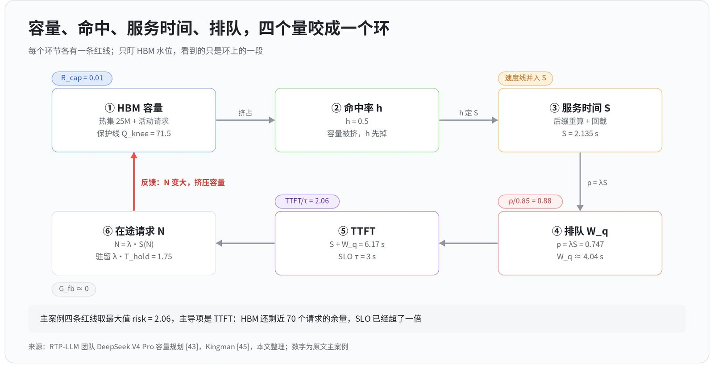

图里六个量构成一个环。HBM 容量决定能常驻多少前缀，常驻多少决定命中率，命中率决定每个请求要重算多少 token，重算量决定服务时间，服务时间乘到达率得到负载，负载决定排队和首 token 时间，排队又让同时在途的请求变多，反过来挤占 HBM。只看 HBM 水位，看到的只是环上的一段。

### 12.1 容量：先扣保护线，再扣热集

长上下文请求里的 token 要分三种来记。驻留 token 是请求在途期间占着 HBM 的部分，按整段长度 L 记。复用 token 是命中前缀 cache、可以直接读的部分，占比是命中率 h。计算 token 是没命中、必须重算的后缀，长度为 (1 − h)·L。容量账用驻留 token，速度账用计算 token，两本账不能混。

HBM 里还有一块要单独记：业务想长期常驻的热前缀，比如公共 system prompt、常用仓库上下文，记作强 pin 热集 W_reuse。可接请求数的保护余量这样算[[43]](https://zhuanlan.zhihu.com/p/2065737086871790189)：

```math
Q_{\text{knee}}=\max\left(0,\ \frac{u_{\text{cap}}\cdot C_{\text{tok}}-W_{\text{reuse}}}{L}\right),\qquad u_{\text{cap}}=0.85
```

顺序很重要：先乘 0.85 留出工程预留，再扣热集。反过来先扣热集再乘 0.85，热集就会吃掉本该留给碎片和突发的那 15%。这 15% 的构成是碎片 5%、异步释放滞后 3%、长度估算误差 2%、突发 5%。PagedAttention 把单请求内的碎片压到 4% 以下[[4]](https://arxiv.org/abs/2309.06180)，跨请求的释放滞后和突发仍要单独留量。

主案例单副本 C_tok = 51.46M token，每 token KV 占 6218 字节，单请求 256K 合 1.63 GB。物理上能放 196 个请求，扣掉预留和 25M 热集以后，保护余量 Q_knee = 71.5 个。

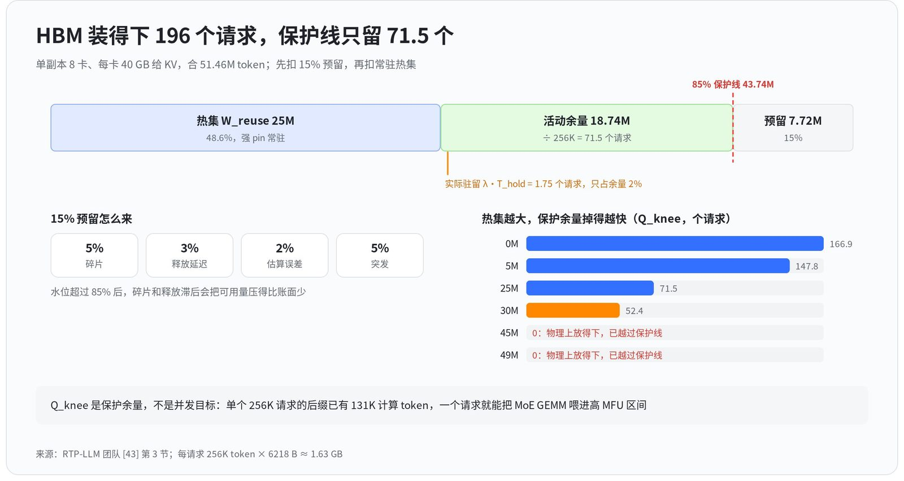

右侧那组数说明热集对余量的挤压是线性的：热集从 0 涨到 25M，余量从 166.9 掉到 71.5，到 45M 归零。49M 的热集物理上放得下，但已经越过保护线，这种配置不能当 HBM-only 的健康稳态，只能把一部分降级成可驱逐的 warm set，交给 host 内存兜底。

Q_knee 是保护余量，不能当并发目标。单个 256K 请求、50% 命中时，后缀仍有 131K 计算 token，一个请求就足以把 MoE 的 GEMM 喂到高利用率区间。真正在途的请求数要用驻留时间算：N_resident ≈ β·λ·T_hold，主案例 λ = 0.35 req/s、T_hold = 5 s、β = 1，只有 1.75 个，占余量的 2%。按这个口径，容量线要到 71.5 ÷ 5 = 14.3 req/s 才拐弯，后面会看到 SLO 在 0.18 req/s 就压顶了。

<b>设计动作。</b>热集和 warm set 分开记账，只有强 pin 的部分扣 Q_knee。warm set 要先证明回载够快（下一节），才算进快速缓存。容量报告里同时写物理可放数和保护余量，避免把 196 当成可接并发。

### 12.2 速度：能存下的 tier 很多，能进首 token 路径的很少

命中前缀省掉的是计算，代价是把 KV 从存储读回 GPU。服务时间由三段组成[[43]](https://zhuanlan.zhihu.com/p/2065737086871790189)：

```math
T_{\text{rec}}(L,h)=(1-h)L\left[m_0+\tfrac{1}{2}m_1(1+h)L\right],\quad T_{\text{load}}=\frac{h\,L\,b_{\text{tok}}}{B_{\text{eff}}},\quad S=T_{\text{rec}}+T_{\text{load}}+S_{\text{miss}}
```

T_rec 的二次项来自注意力：后缀每个 token 都要和前面所有 token 算注意力，所以重算时间随长度平方增长。主案例拟合出 m0 = 1.31×10⁻⁵ s/token、m1 = 1.55×10⁻¹¹ s/token²，冷启动 prefill 一个 256K 请求要 3.97 s。命中率 0.5 时，T_rec = 2.12 s，从 host 内存以 55 GB/s 回载 0.815 GB 要 14.8 ms，合计 S = 2.135 s，比冷启动快 1.86 倍。命中率到 0.99 时 S 只剩 74 ms，其中回载占 39%，这时候回载速度就成了主角。

判断一层存储能不能进首 token 路径，用一个预算比例：

```math
T_{\text{load}}\le\varepsilon_{\text{load}}\cdot T_{\text{rec}}
```

ε_load 取 10%，回载预算是 212 ms，折成单请求有效带宽下限 3.84 GB/s。这个比例按业务改：强 SLO 收到 5%，下限翻倍到 7.69 GB/s；后台任务放到 20%，下限降到 1.92 GB/s。同一批 GPU、同一份日志，只因为预算参数换了一档，存储采购的结论就差一倍。

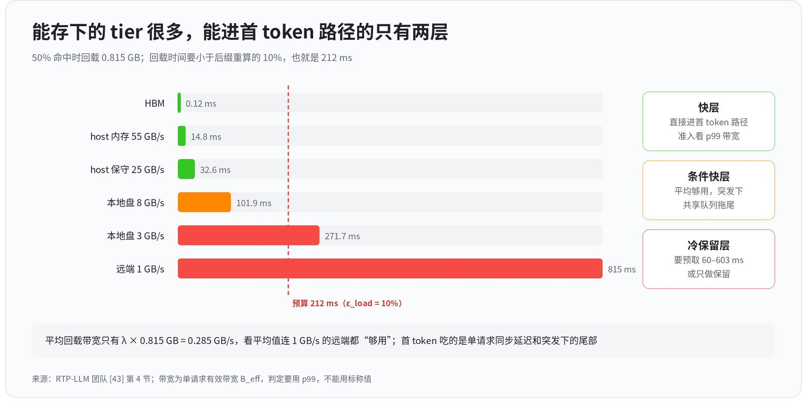

| 存储层 | 单请求有效带宽 | 回载 0.815 GB | 判定 |
|---|---|---|---|
| HBM | 约 7 TB/s | 0.12 ms | 快层 |
| host 内存（PCIe5） | 25–55 GB/s | 15–33 ms | 快层，准入看 p99 带宽 |
| 本地盘 | 8 GB/s | 102 ms | 条件快层，平均够用，突发下共享队列拖尾 |
| 本地盘 | 3 GB/s | 272 ms | 冷保留层，要提前约 60 ms 预取 |
| 远端存储 | 1 GB/s | 815 ms | 冷保留层，要提前约 600 ms 预取，或只做保留 |

这里有一个平均值陷阱。主案例整体回载流量只有 λ × 0.815 GB = 0.285 GB/s，按平均值看，连 1 GB/s 的远端存储都“够用”。首 token 等的是单个请求的同步回载，而且突发时多个请求同时抢同一条 PCIe 或同一块盘，所以 tier 判定必须用 p95/p99 的单请求有效带宽，标称峰值和平均值都不能用。

业界的做法印证了这条线。Mooncake 把集群里闲置的 CPU 内存、SSD 和网卡拼成一个以 KV cache 为中心的分布式池，用存储换计算，在真实 trace 上满足 SLO 的有效请求容量提升 59% 到 498%[[47]](https://www.usenix.org/conference/fast25/presentation/qin)。DeepSeek V3/R1 线上服务有 56.3% 的输入 token 命中磁盘上的 KV cache[[15]](https://github.com/deepseek-ai/open-infra-index/blob/main/202502OpenSourceWeek/day_6_one_more_thing_deepseekV3R1_inference_system_overview.md)，背后的 3FS 在 400 Gbps 网卡节点上的 KVCache 客户端读吞吐峰值约 40 GiB/s[[51]](https://github.com/deepseek-ai/3FS)。可见“磁盘”能不能进快层，取决于它是单块本地盘还是聚合了大量 SSD 和高速网络的分布式池。后者的节点级吞吐是 3.84 GB/s 门槛的十倍，单请求的 p99 仍要实测。

<b>设计动作。</b>先用速度线给每层存储分类，再谈容量价值。host 内存默认进快层。本地盘默认是冷保留和预取源。分布式 KV 池按实测的单请求 p99 带宽归类。速度线不单独作为风险指标：回载慢会直接变成 S 变大，自动反映到后面的负载和 SLO 上，单列一条等于重复计数。

### 12.3 排队：同样的平均 QPS，突发决定等多久

服务时间定了，负载 ρ = λ·S。主案例 ρ = 0.35 × 2.135 = 0.747，单副本每秒最多处理 0.468 个请求。到达不均匀时，排队时间用 Kingman 近似估[[45]](https://doi.org/10.1017/S0305004100036094)：

```math
W_q\approx\frac{C_a^2+C_s^2}{2}\cdot\frac{\rho}{1-\rho}\cdot S
```

C_a² 是到达间隔的变异系数平方，衡量突发；C_s² 是服务时间的变异系数平方，主案例请求长度接近，取 0.28。Poisson 到达 C_a² = 1，这时公式退化成 M/G/1 的 Pollaczek-Khinchine 形式。主案例代进去 W_q ≈ 4.04 s，首 token 时间 = S + W_q = 6.17 s，三分之二花在排队上，SLO 是 3 s。

ρ/(1 − ρ) 这一项决定了负载越高越陡：ρ 从 0.75 到 0.85，这一项从 3 涨到 5.7。到达分布再叠一层放大：

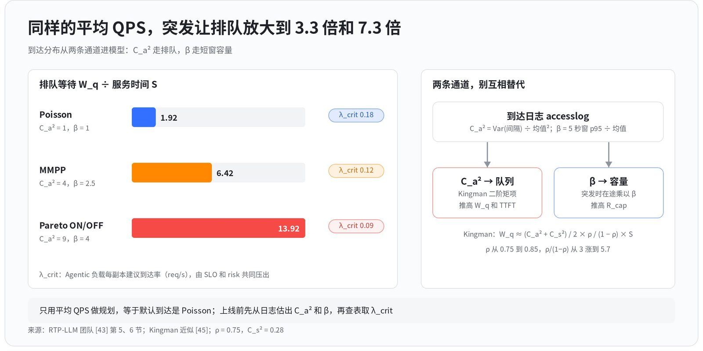

同样 ρ = 0.75，Poisson 到达的排队时间是服务时间的 1.92 倍，MMPP（马尔可夫调制泊松，模拟忙闲切换）是 6.42 倍，Pareto ON/OFF（重尾的成批到达）是 13.92 倍。到达分布还通过第二条通道起作用：突发时短窗内在途请求是平均值的 β 倍，推高的是容量压力。C_a² 走排队，β 走容量，两条通道互相不能替代。

有效吞吐要按 SLO 达成率折算，这是 DistServe 提出的 goodput 口径[[1]](https://arxiv.org/abs/2401.09670)：

```math
G_{\text{tok}}\approx\lambda_{\text{done}}\cdot L\cdot\Pr(\text{TTFT}\le\tau)
```

主案例的原始吞吐上限是 122.8k token/s（不开 cache 只有 66k），但首 token 几乎全部超时，goodput 约等于 0。把三种到达分布和三种负载画像交叉，得到单副本建议到达率 λ_crit：

| 负载画像 | Poisson | MMPP | Pareto ON/OFF | 谁在约束 |
|---|---|---|---|---|
| Agentic（主案例，25M 热集） | 0.18 | 0.12 | 0.09 | SLO 和排队 |
| 低复用 | 0.24 | 0.16 | 0.11 | SLO 和排队，Poisson 下离 ρ = 0.85 只差 0.01 |
| 高复用（49M 热集） | 0 | 0 | 0 | 容量：Q_knee = 0，强 pin 策略不成立 |

高复用那一行的 0 要读对：意思是“HBM-only 强 pin 49M 热集”这个策略在当前配置下不成立，业务的复用价值仍在，换成 warm set 加 host 回载就能重新算。这一行也提醒，表里按 ρ = 0.85 算出的到达率在容量已经归零时没有意义，不能拿来当可上线容量。

<b>设计动作。</b>只拿平均 QPS 做规划，等于默认到达是 Poisson，在突发业务上会把承载能力估高一倍。上线前从 accesslog 估出 C_a² 和 β，按表取 λ_crit。负载目标看 SLO 倒推的到达率，ρ = 0.85 只是上限。

### 12.4 反馈：什么时候算雪崩，四条红线怎么用

排队让在途请求变多，在途请求挤占 HBM，命中率下降，服务时间变长，排队更久。这条正反馈能不能自我放大，看 Little 定律的不动点 N = λ·S(N) 是否稳定[[43]](https://zhuanlan.zhihu.com/p/2065737086871790189)：

```math
G_{\text{fb}}=\lambda\cdot\frac{\mathrm{d}S}{\mathrm{d}N}
```

G_fb 小于 1，扰动逐轮衰减，系统回到原来的工作点。G_fb 大于等于 1，扰动被放大。原文把 cache 雪崩定义成三个条件同时成立：G_fb ≥ 1；存在退化通道，在途变多会拉低命中率或抬高 miss 惩罚；扰动撤掉以后恢复时间超过 T_guard = max(2S, 30 s)。只满足第一条是普通的队列爆炸，扰动一撤马上恢复的也不算事故。

第三个条件对应分布系统里的亚稳态故障。Bronson 等人把这类故障描述为：系统平时处在一个高效但脆弱的状态，一次触发把它推进坏状态，之后由持续效应（最常见的是重试，或者 cache 失效后后端负载暴涨）把它锁住，触发因素撤掉也回不来[[46]](https://sigops.org/s/conferences/hotos/2021/papers/hotos21-s11-bronson.pdf)。Brooker 进一步指出，这时系统的 goodput 远低于吞吐，单靠等待不会自愈，要靠主动削减负载[[50]](https://brooker.co.za/blog/2021/05/24/metastable.html)。放到长上下文推理上，持续效应就是热前缀被挤出以后长 prefill 变多，长 prefill 又进一步占住 HBM。主案例 G_fb ≈ 0，反馈通道没有激活。

日常运维不现场估导数，改用四条可以直接观测的红线，各自归一化到“1 就越线”：

```math
risk=\max\left(G_{\text{fb}},\ \frac{\rho}{0.85},\ R_{\text{cap}},\ \frac{\text{TTFT}}{\tau}\right)
```

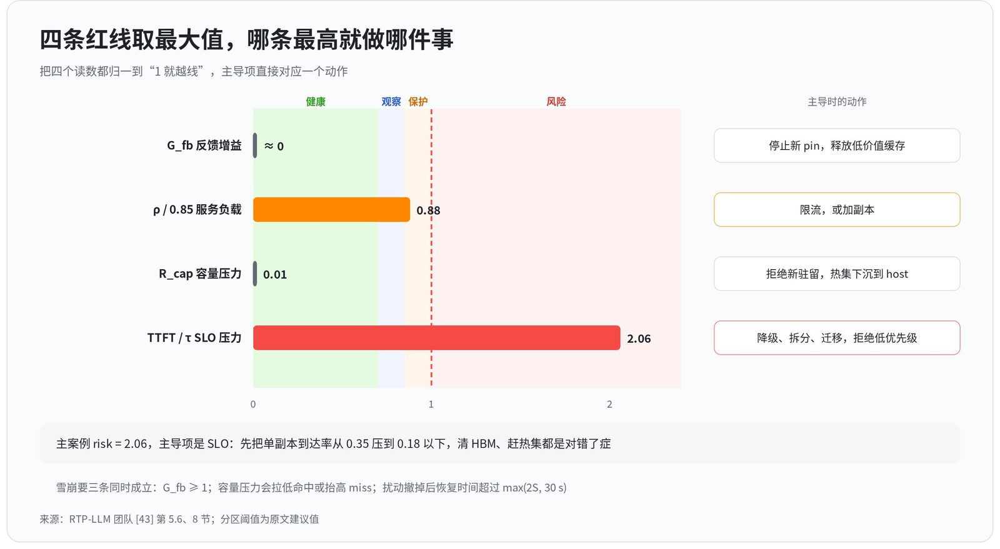

| 主导项 | 含义 | 优先动作 |
|---|---|---|
| G_fb ≥ 1 | 服务时间正反馈可能自我放大 | 停止新的热集 pin，迁移或拒绝低优先级请求，强制释放低价值 cache |
| ρ / 0.85 ≥ 1 | 服务负载越过保护线 | 限流、排队、加副本，收紧单副本的长上下文准入 |
| R_cap ≥ 1 | HBM 快速缓存的容量压力越线 | 拒绝或延迟会新增驻留的请求，回收低价值前缀，warm set 下沉到 host 或盘 |
| TTFT / τ ≥ 1 | 首 token 超过 SLO | 降级长上下文、拆分请求、迁移到空闲副本、拒绝低优先级 |

分区阈值是 0.70、0.85、1.0。0.70 以下正常准入，可以预取、温和扩大 warm set。0.70 到 0.85 之间保持准入，但停止扩大强 pin 热集，并记录当前领跑的分量。0.85 到 1 按主导分量限流或降级。1 以上不做无条件准入，必须在拒绝、排队、迁移、降级、回收之中选一个。Q_knee 归零时 R_cap 直接记为无穷。

主案例四个读数是 0、0.88、0.01、2.06，risk = 2.06，主导项是 SLO。对应的动作是把单副本到达率从 0.35 压到 0.18 以下。R_cap 只有 0.01，这时去清 HBM、赶热集都是对错了症。

这套准入逻辑和业界的过载处理一致。Mooncake 在过载时按预测负载提前拒绝请求，避免 prefill 做完才发现 decode 接不住，白白浪费算力[[47]](https://www.usenix.org/conference/fast25/presentation/qin)。Google SRE 的经验是不要用 QPS 衡量容量，要按资源消耗建模，并且给重试设预算：单个请求最多重试 3 次，单个客户端的重试比例不超过 10%[[49]](https://sre.google/sre-book/handling-overload/)。长上下文推理里一次重试就是一次长 prefill，重试预算比普通服务更要紧。

还有一种局部雪崩要单独防：热点前缀过期的瞬间，多个请求同时发现 miss，各自重算一遍。重复重算的个数约为 n_burst = λ_cluster · p_k · T_rec(W_k, 0)，p_k 是该前缀的请求占比。这个数大于 1，就要给这个前缀加单次重算保护，用互斥锁、single-flight 合并或提前预热，让一次过期只触发一次长 prefill。

### 12.5 副本数：从 SLO 约束下的单副本到达率反推

有了单副本上限，集群规模有两条算法，边界相同，只是方向相反。正向是给定副本数，问能承载多少：主案例 10 个副本、路由效率 η = 0.95，集群到达率 3.325 req/s、原始输入 871.6k token/s，但单副本仍是 0.35 req/s，goodput 约等于 0，容量余量还有 69.75 个请求。这个结果要拆成服务负载余量和容量余量两条读，任何单一数字都会误导。

反向是给定目标，问要多少副本：

```math
M=\max\left(M_{\text{req}},\ M_{\text{tok}},\ M_{\text{storage}},\ M_{\text{HA}}\right),\qquad M_{\text{req}}=\left\lceil\frac{\lambda_{\text{target}}}{\eta_{\text{route}}\cdot\lambda_{\text{limit}}}\right\rceil
```

目标 3 req/s、λ_limit = 0.18，M_req = ⌈3 ÷ (0.95 × 0.18)⌉ = 18。同样的流量，正向算 10 个副本看起来能扛住，按 SLO 反推要 18 个，多出 80%。这 80% 就是第 7.3 节那个“20% 到 30% 余量”在长上下文、强 SLO 场景下的真实大小。

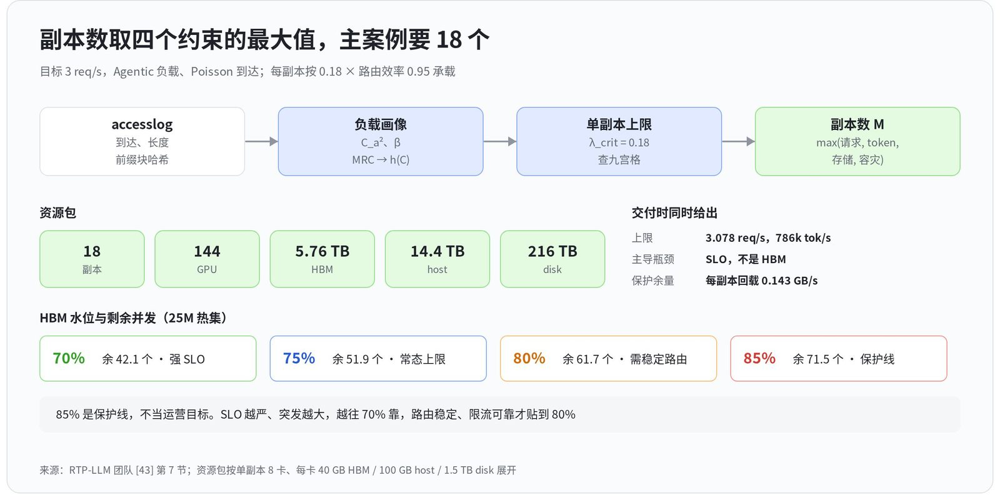

交付物要写成三件套：资源包（18 副本、144 张 GPU、5.76 TB HBM、14.4 TB host 内存、216 TB 盘）、主导瓶颈（SLO，HBM 不是关键）、保护余量（每副本平均回载 0.143 GB/s，同步路径的 p99 仍须不低于 3.84 GB/s）。资源包给采购，主导瓶颈告诉运营盯哪条曲线，保护余量说明离越线还有多远。

HBM 水位按业务选档，25M 热集下各档剩余并发如下：

| HBM 水位 | 剩余可接请求 | 适用 |
|---|---|---|
| 70% | 42.1 | 强 SLO、突发大的业务 |
| 75% | 51.9 | 常态运营上限 |
| 80% | 61.7 | 路由稳定、限流可靠时 |
| 85% | 71.5 | 保护线，不做长期运营目标 |

#### 从 accesslog 估参数

上面所有输入都应该来自线上日志。原文给了最小字段集和缺字段时的退化办法[[43]](https://zhuanlan.zhihu.com/p/2065737086871790189)：

| 字段 | 用途 | 缺失时 |
|---|---|---|
| timestamp | 估 λ、C_a²、β | 只能用平均 QPS，估不出突发 |
| input_tokens | 服务时间、容量 | 默认按最大长度，SLO 结论置信度下降 |
| prefix_block_hashes | 画缺失率曲线，得 h(C) 和 W_reuse | 退化到按 token 或 session 统计复用 |
| cache_hit_tokens | 直接校验命中长度 | 用缺失率曲线推断 |
| ttft_s / tpot_ms | SLO 回测 | 只能用模型预测 |
| node_id / replica_id | 验证路由偏斜 | 只能用 η_route 打折 |

到达参数直接从时间戳算：λ = N/(T₁ − T₀)，C_a² = Var(间隔)/E[间隔]²，β 取 5 秒窗口请求数 p95 除以均值，下限为 1。热集大小从缺失率曲线（MRC）读：达到目标命中率 h\* 需要的最小缓存容量就是 W_reuse。全量统计复用距离开销很大，SHARDS 用空间哈希采样，在 1 MB 内存内画出 MRC，平均误差低于 0.01[[48]](https://www.usenix.org/conference/fast15/technical-sessions/presentation/waldspurger)，对按块哈希的前缀 cache 同样适用。vLLM 的自动前缀缓存也按块哈希管理[[7]](https://docs.vllm.ai/en/latest/features/automatic_prefix_caching/)，日志里把块哈希打出来，成本很低。

<b>设计动作。</b>sizing 报告标出每个字段的可用性，低置信输入不要倒推出高精度结论。两条路径各算一遍，取更严的那个。

### 12.6 口径与边界

这套模型的公式结构可以照搬，几个参数必须用自己的数据替换。

- <b>退化系数是工程刻度。</b>容量压力到命中率下降的那条 logistic 曲线，斜率和上下限是手调的，首 token 达成率也用 logistic 近似代替真实分布。上线要换成 trace 回放或线上 TTFT 直方图。
- <b>单服务台近似。</b>Kingman 是单队列公式，多副本时 ρ = λS/K，路由不均靠 η_route 打折。路由偏斜严重时要按副本分别算。
- <b>每 token 字节要统一。</b>主线固定用 6218 B/token，换成只缓存部分层的方案前要先验证，否则容量表之间没有可比性。
- <b>goodput 口径不唯一。</b>DistServe 按 SLO 达成率给出可承载的最大请求率[[1]](https://arxiv.org/abs/2401.09670)，本章按 token 折算，跨文献比较前先对齐定义。
- <b>恢复阈值绑定扩缩容。</b>T_guard 取 max(2S, 30 s) 只是示例，常见的 HPA 加限流网关组合，取 60 到 180 s 更合适。

回到第 7.3 节的副本公式，长上下文场景要改三处。单副本 goodput 用 SLO 约束下的到达率 λ_crit，压测的峰值吞吐不能直接用。余量不再拍 20% 到 30%，改由 C_a² 和 β 通过排队公式算出来。扩容信号里的 KV 占用，换成四条红线里领跑的那一条。DeepSeek 线上日均 226.75 个节点、峰值 278 个[[15]](https://github.com/deepseek-ai/open-infra-index/blob/main/202502OpenSourceWeek/day_6_one_more_thing_deepseekV3R1_inference_system_overview.md)，峰均比 1.23，也说明负载画像决定了要留多少冗余。

HBM 装得下只是第一步。长上下文服务先撞上的常是排队和 SLO，显存在后面。把容量、速度、排队、反馈放进同一个环里算，主导瓶颈是哪条就先处理哪条，规划才不会对错症。

📎 延伸阅读：过载保护、重试预算和熔断的上线做法见 [LLM-07｜系统｜LLM 服务稳定性工程：SRE 上线手册](./07-serving-reliability.md)；到达率与并发上限分开扫的压测方法见 [LLM-08｜系统｜大模型推理系统：全栈学习手册](./08-inference-systems.md)。

## 参考文献

按正文首次引用顺序编号，资料截至 2026 年 10 月。

[1] Zhong et al. DistServe: Disaggregating Prefill and Decoding for Goodput-optimized Large Language Model Serving. OSDI (2024) [https://arxiv.org/abs/2401.09670](https://arxiv.org/abs/2401.09670)

[2] Williams, Waterman &amp; Patterson. Roofline: An Insightful Visual Performance Model for Multicore Architectures. Communications of the ACM (2009) [https://dl.acm.org/doi/10.1145/1498765.1498785](https://dl.acm.org/doi/10.1145/1498765.1498785)

[3] NVIDIA. H100 Tensor Core GPU Specifications [https://www.nvidia.com/en-us/data-center/h100/](https://www.nvidia.com/en-us/data-center/h100/)

[4] Kwon et al. Efficient Memory Management for Large Language Model Serving with PagedAttention. SOSP (2023) [https://arxiv.org/abs/2309.06180](https://arxiv.org/abs/2309.06180)

[5] DeepSeek-AI. DeepSeek-V3 Technical Report (2024) [https://arxiv.org/abs/2412.19437](https://arxiv.org/abs/2412.19437)

[6] Meta. Llama-3.3-70B-Instruct Model Configuration (config.json) [https://huggingface.co/meta-llama/Llama-3.3-70B-Instruct](https://huggingface.co/meta-llama/Llama-3.3-70B-Instruct)

[7] vLLM. Automatic Prefix Caching [https://docs.vllm.ai/en/latest/features/automatic_prefix_caching/](https://docs.vllm.ai/en/latest/features/automatic_prefix_caching/)

[8] NVIDIA. A100 Tensor Core GPU Specifications [https://www.nvidia.com/en-us/data-center/a100/](https://www.nvidia.com/en-us/data-center/a100/)

[9] NVIDIA. L40S GPU Specifications [https://www.nvidia.com/en-us/data-center/l40s/](https://www.nvidia.com/en-us/data-center/l40s/)

[10] NVIDIA. H200 Tensor Core GPU Specifications [https://www.nvidia.com/en-us/data-center/h200/](https://www.nvidia.com/en-us/data-center/h200/)

[11] NVIDIA. DGX B200 Specifications [https://www.nvidia.com/en-us/data-center/dgx-b200/](https://www.nvidia.com/en-us/data-center/dgx-b200/)

[12] AMD. Instinct MI300X Accelerator Specifications [https://www.amd.com/en/products/accelerators/instinct/mi300/mi300x.html](https://www.amd.com/en/products/accelerators/instinct/mi300/mi300x.html)

[13] Kurtic et al. "Give Me BF16 or Give Me Death"? Accuracy-Performance Trade-Offs in LLM Quantization (2024) [https://arxiv.org/abs/2411.02355](https://arxiv.org/abs/2411.02355)

[14] Leviathan, Kalman &amp; Matias. Fast Inference from Transformers via Speculative Decoding. ICML (2023) [https://arxiv.org/abs/2211.17192](https://arxiv.org/abs/2211.17192)

[15] DeepSeek-AI. DeepSeek-V3/R1 Inference System Overview (2025) [https://github.com/deepseek-ai/open-infra-index/blob/main/202502OpenSourceWeek/day_6_one_more_thing_deepseekV3R1_inference_system_overview.md](https://github.com/deepseek-ai/open-infra-index/blob/main/202502OpenSourceWeek/day_6_one_more_thing_deepseekV3R1_inference_system_overview.md)

[16] OpenRouter. Opus 4.7’s New Tokenizer: What It Actually Costs（基于平台请求日志的分析，厂商口径）(2026) [https://openrouter.ai/blog/insights/opus-47-tokenizer-analysis/](https://openrouter.ai/blog/insights/opus-47-tokenizer-analysis/)

[17] Ren et al. Chinese Language Is Not More Efficient Than English in Vibe Coding: A Preliminary Study on Token Cost and Problem-Solving Rate (2026) [https://arxiv.org/abs/2604.14210](https://arxiv.org/abs/2604.14210)

[18] Petrov et al. Language Model Tokenizers Introduce Unfairness Between Languages. NeurIPS (2023) [https://arxiv.org/abs/2305.15425](https://arxiv.org/abs/2305.15425)

[19] Rust et al. How Good is Your Tokenizer? On the Monolingual Performance of Multilingual Language Models. ACL (2021) [https://arxiv.org/abs/2012.15613](https://arxiv.org/abs/2012.15613)

[20] Sennrich, Haddow &amp; Birch. Neural Machine Translation of Rare Words with Subword Units. ACL (2016) [https://arxiv.org/abs/1508.07909](https://arxiv.org/abs/1508.07909)

[21] Anthropic. Prompt caching（计费倍数、缓存时长与前缀顺序） [https://docs.anthropic.com/en/docs/build-with-claude/prompt-caching](https://docs.anthropic.com/en/docs/build-with-claude/prompt-caching)

[22] Google（Elsworth et al.）. Measuring the Environmental Impact of Delivering AI at Google Scale. arXiv:2508.15734 [https://arxiv.org/abs/2508.15734](https://arxiv.org/abs/2508.15734)

[23] Epoch AI. How much energy does ChatGPT use? [https://epoch.ai/gradient-updates/how-much-energy-does-chatgpt-use](https://epoch.ai/gradient-updates/how-much-energy-does-chatgpt-use)

[24] Mistral AI. Our contribution to a global environmental standard for AI [https://mistral.ai/news/our-contribution-to-a-global-environmental-standard-for-ai/](https://mistral.ai/news/our-contribution-to-a-global-environmental-standard-for-ai/)

[25] Hugging Face. AI Energy Score v2 [https://huggingface.co/blog/sasha/ai-energy-score-v2](https://huggingface.co/blog/sasha/ai-energy-score-v2)

[26] Jegham et al. How Hungry is AI? Benchmarking Energy, Water, and Carbon Footprint of LLM Inference. arXiv:2505.09598 [https://arxiv.org/abs/2505.09598](https://arxiv.org/abs/2505.09598)

[27] Chung et al. The ML.ENERGY Benchmark: Toward Automated Inference Energy Measurement and Optimization. arXiv:2505.06371 [https://arxiv.org/abs/2505.06371](https://arxiv.org/abs/2505.06371)

[28] Luccioni et al. Power Hungry Processing: Watts Driving the Cost of AI Deployment? arXiv:2311.16863 [https://arxiv.org/abs/2311.16863](https://arxiv.org/abs/2311.16863)

[29] unexcitedneurons. Estimating the Size of Claude Opus（个人博客，基于 OpenRouter 吞吐数据的推算）(2026) [https://unexcitedneurons.substack.com/p/estimating-the-size-of-claude-opus](https://unexcitedneurons.substack.com/p/estimating-the-size-of-claude-opus)

[30] OpenRouter. Claude Opus 4.6 模型页（各提供商吞吐，平台口径） [https://openrouter.ai/anthropic/claude-opus-4.6](https://openrouter.ai/anthropic/claude-opus-4.6)

[31] DeepSeek-AI. DeepSeek-V3.1 Model Card [https://huggingface.co/deepseek-ai/DeepSeek-V3.1](https://huggingface.co/deepseek-ai/DeepSeek-V3.1)

[32] Zhipu AI. GLM-4.7 Model Card（config.json：160 个路由专家，每 token 激活 8 个） [https://huggingface.co/zai-org/GLM-4.7](https://huggingface.co/zai-org/GLM-4.7)

[33] Moonshot AI. Kimi-K2-Thinking Model Card（原生 INT4 量化感知训练） [https://huggingface.co/moonshotai/Kimi-K2-Thinking](https://huggingface.co/moonshotai/Kimi-K2-Thinking)

[34] Kimi Team. Kimi K2: Open Agentic Intelligence (2025) [https://arxiv.org/abs/2507.20534](https://arxiv.org/abs/2507.20534)

[35] Meta. The Llama 4 herd: The beginning of a new era of natively multimodal AI innovation (2025) [https://ai.meta.com/blog/llama-4-multimodal-intelligence/](https://ai.meta.com/blog/llama-4-multimodal-intelligence/)

[36] Anthropic. Fast mode（同一模型、更快的推理配置，输出速度最高 2.5 倍） [https://platform.claude.com/docs/en/build-with-claude/fast-mode](https://platform.claude.com/docs/en/build-with-claude/fast-mode)

[37] Anthropic. Pricing（各代 Opus、Sonnet 标准价） [https://platform.claude.com/docs/en/about-claude/pricing](https://platform.claude.com/docs/en/about-claude/pricing)

[38] Google Cloud. TPU7x (Ironwood)（单芯片 192 GiB HBM，约 7.37 TB/s） [https://cloud.google.com/tpu/docs/tpu7x](https://cloud.google.com/tpu/docs/tpu7x)

[39] Artificial Analysis. Claude Opus 4.6 (Adaptive Reasoning, Max Effort)（第三方测速，随时间更新） [https://artificialanalysis.ai/models/claude-opus-4-6-adaptive](https://artificialanalysis.ai/models/claude-opus-4-6-adaptive)

[40] Ben Abacha et al. MEDEC: A Benchmark for Medical Error Detection and Correction in Clinical Notes (2024) [https://arxiv.org/abs/2412.19260](https://arxiv.org/abs/2412.19260)

[41] Anthropic. Expanding our use of Google Cloud TPUs and Services (2025) [https://www.anthropic.com/news/expanding-our-use-of-google-cloud-tpus-and-services](https://www.anthropic.com/news/expanding-our-use-of-google-cloud-tpus-and-services)

[42] Amazon. AWS activates Project Rainier (2025) [https://www.aboutamazon.com/news/aws/aws-project-rainier-ai-trainium-chips-compute-cluster](https://www.aboutamazon.com/news/aws/aws-project-rainier-ai-trainium-chips-compute-cluster)

[43] RTP-LLM 团队. DeepSeek V4 Pro 长上下文推理容量规划：从 Cache 到集群的一份闭环模型. 知乎专栏 (2026) [https://zhuanlan.zhihu.com/p/2065737086871790189](https://zhuanlan.zhihu.com/p/2065737086871790189)

[44] DeepSeek-AI. DeepSeek-V4-Pro Model Card (2026) [https://huggingface.co/deepseek-ai/DeepSeek-V4-Pro](https://huggingface.co/deepseek-ai/DeepSeek-V4-Pro)

[45] J. F. C. Kingman. The single server queue in heavy traffic. Mathematical Proceedings of the Cambridge Philosophical Society (1961) [https://doi.org/10.1017/S0305004100036094](https://doi.org/10.1017/S0305004100036094)

[46] Bronson et al. Metastable Failures in Distributed Systems. HotOS (2021) [https://sigops.org/s/conferences/hotos/2021/papers/hotos21-s11-bronson.pdf](https://sigops.org/s/conferences/hotos/2021/papers/hotos21-s11-bronson.pdf)

[47] Qin et al. Mooncake: Trading More Storage for Less Computation, A KVCache-centric Architecture for Serving LLM Chatbot. FAST (2025) [https://www.usenix.org/conference/fast25/presentation/qin](https://www.usenix.org/conference/fast25/presentation/qin)

[48] Waldspurger et al. Efficient MRC Construction with SHARDS. FAST (2015) [https://www.usenix.org/conference/fast15/technical-sessions/presentation/waldspurger](https://www.usenix.org/conference/fast15/technical-sessions/presentation/waldspurger)

[49] Google. Site Reliability Engineering, Chapter 21: Handling Overload [https://sre.google/sre-book/handling-overload/](https://sre.google/sre-book/handling-overload/)

[50] Marc Brooker. Metastability and Distributed Systems (2021) [https://brooker.co.za/blog/2021/05/24/metastable.html](https://brooker.co.za/blog/2021/05/24/metastable.html)

[51] DeepSeek-AI. 3FS（Fire-Flyer File System）README [https://github.com/deepseek-ai/3FS](https://github.com/deepseek-ai/3FS)

---

上一篇：[LLM-12｜工程｜LLM 安全与治理：应用侧的攻防与合规](./12-security-governance.md) · [目录](./README.md) · 下一篇：[LLM-14｜地基｜多模态与长上下文：从视觉 token 到百万上下文](./14-multimodal-long-context.md)
