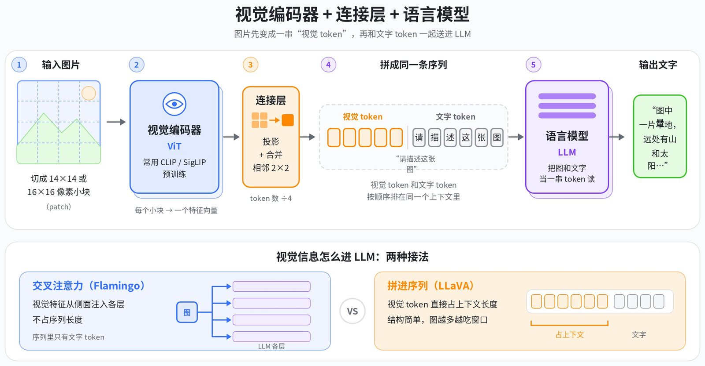
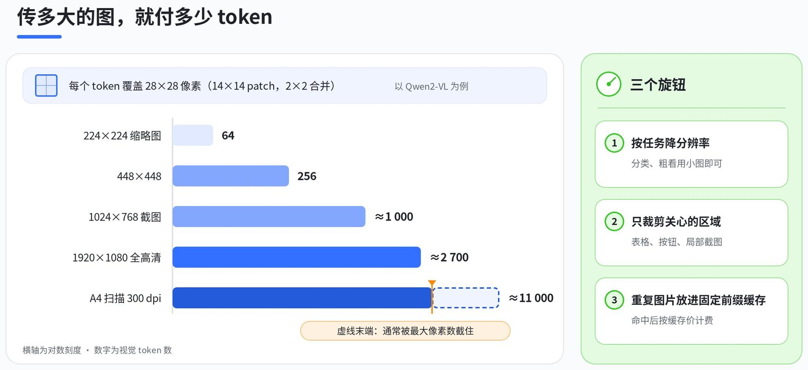
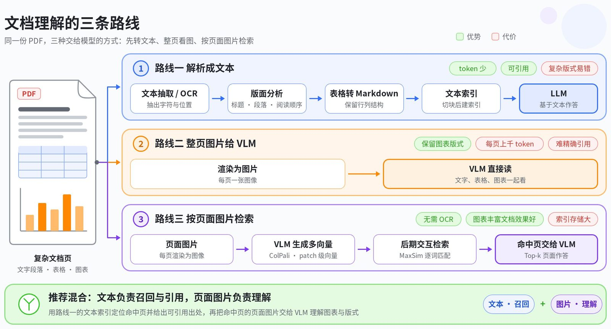
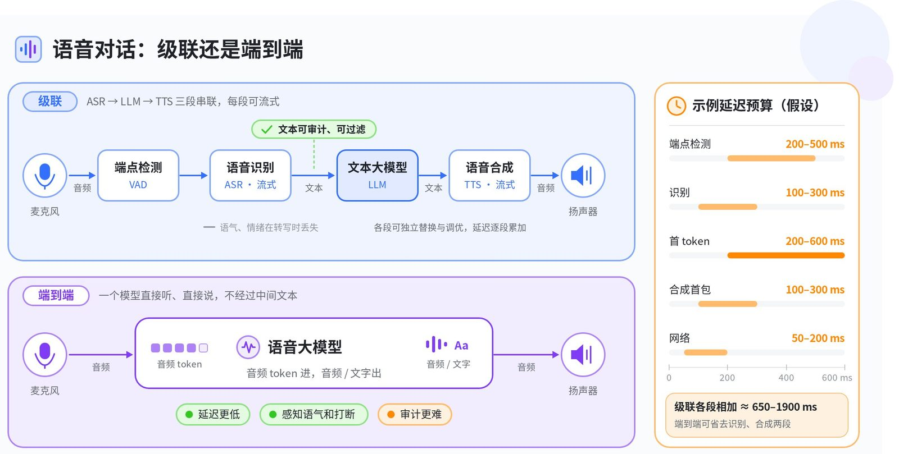
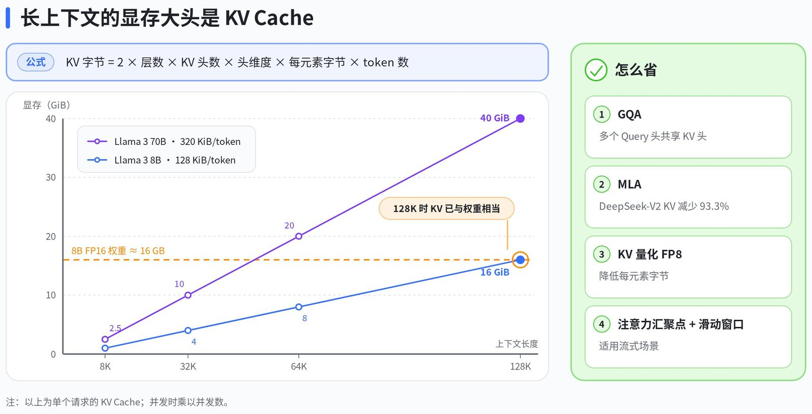
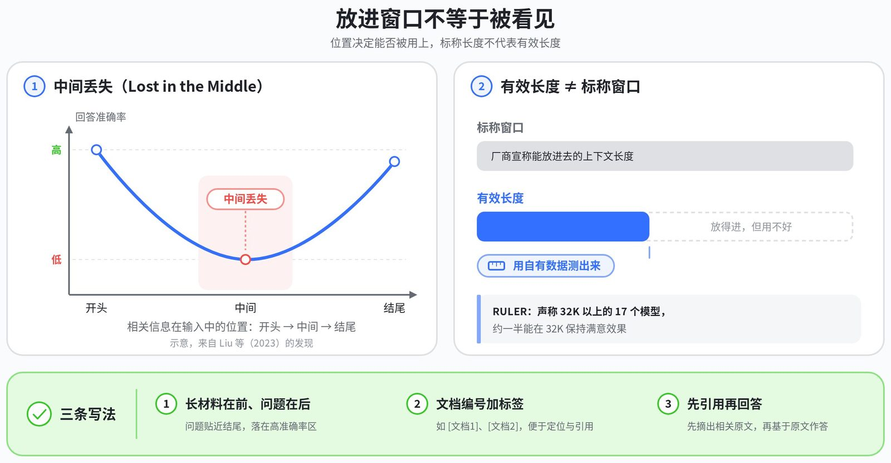
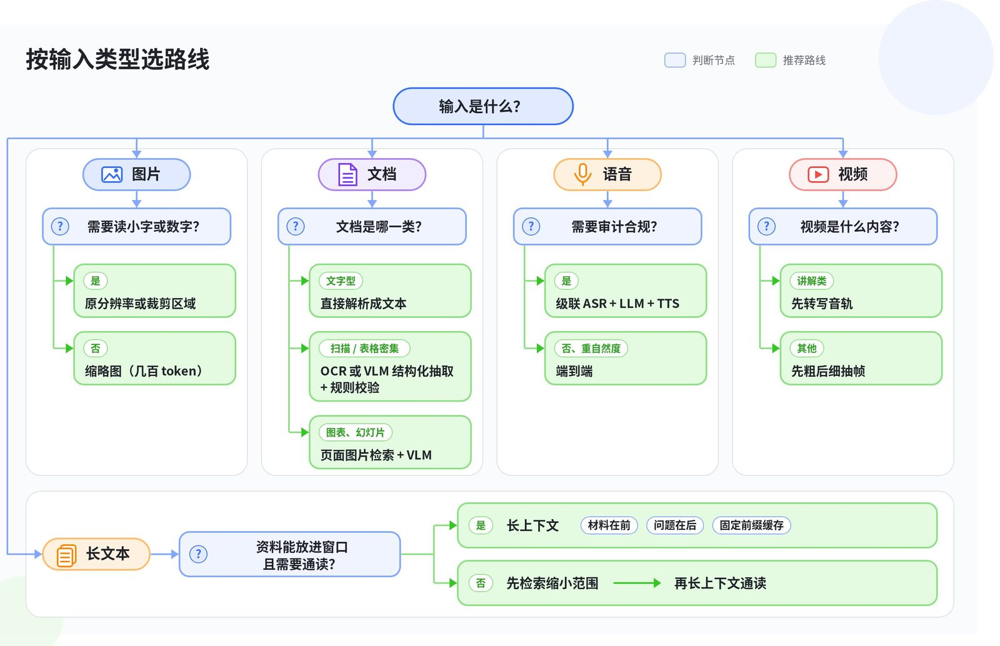
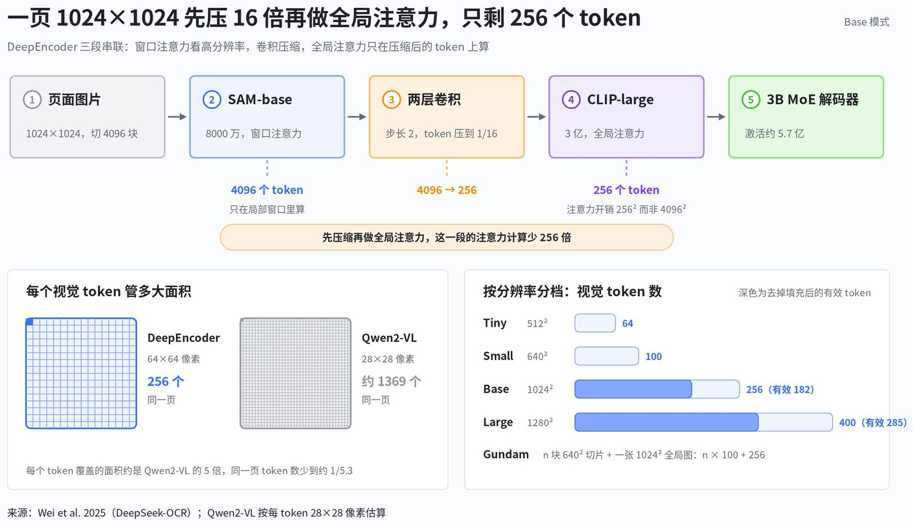
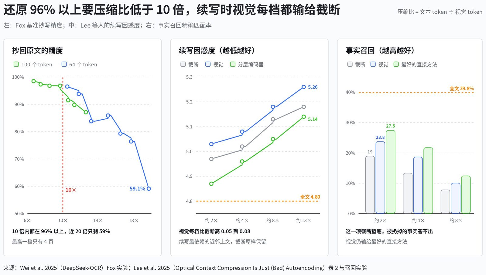
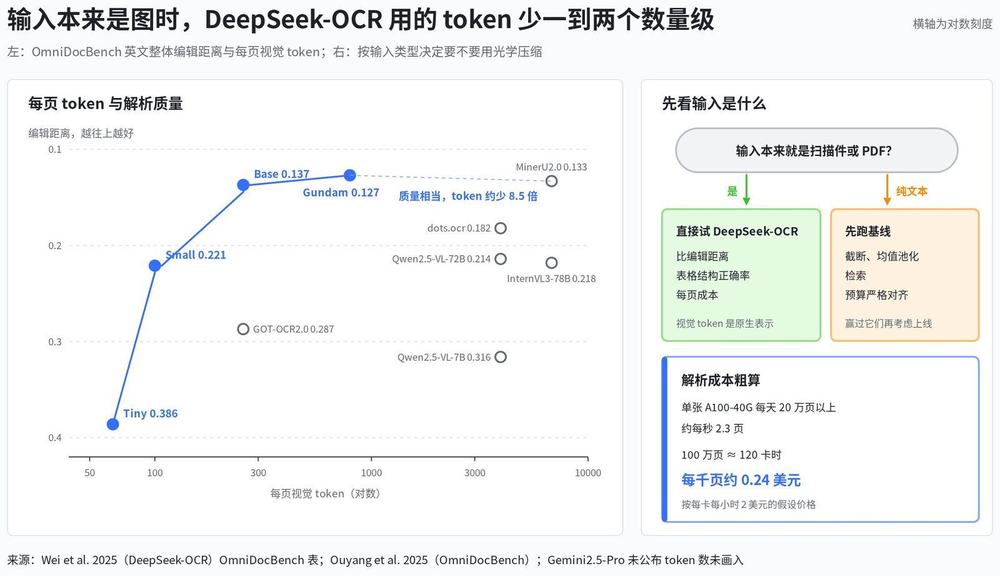

# LLM-14｜地基｜多模态与长上下文：从视觉 token 到百万上下文

> 🎯 **这篇文档解决什么问题**：现在的主流模型都能看图、读 PDF、听语音，上下文窗口也从几千 token 涨到了几十万甚至上百万。但“能输入”不等于“用得好”：一张截图可能吃掉几千个 token，一份扫描件直接丢给模型可能漏掉表格，128K 的窗口真正可靠的部分可能只有一半。本文讲清楚多模态模型怎么把图片、语音、视频变成 token，长上下文背后的位置编码和显存账，以及在应用里怎么选型、怎么控成本、怎么验证效果。
>
> 使用方式：先读第 1、2 章弄清图片怎么变成 token、要花多少。处理文档、语音、视频的分别读第 3、4、5 章，长上下文读第 6、7 章，选型前用第 8 章的清单核对。文中模型规格和价格核对于 2026 年 10 月 11 日。

## 导读 · 先给结论

- **先算 token 再谈效果**：图片、音频、视频进模型前都会变成 token，一张截图就可能吃掉几千个（第 2 章）。
- **图片按需降分辨率**：分辨率直接决定 token 数和成本（第 2 章）。
- **文档先判断版式复杂度，再选解析路线**：扫描件直接丢给模型可能漏掉表格（第 3 章）。
- **视频控制抽帧数**：抽帧数决定 token 预算（第 5 章）。
- **长文本把关键信息放在开头或结尾**：放在中间的信息容易被忽略（第 7 章）。
- **有效长度要用自己的数据测**：标称窗口长度只是上限（第 7 章）。

多模态和长上下文看起来是两个话题，工程上其实是同一件事：**输入变长了**。图片、音频、视频进入模型前都会被切成一串 token，和文字排在同一个序列里；一张高清图、一段十分钟的录音、一份百页 PDF，换算下来都是几千到几十万 token。于是两个问题绕不开：

- **成本和延迟**：输入 token 越多，预填充（prefill）越慢，KV Cache 占的显存越多，按 token 计费的 API 越贵。
- **效果**：窗口装得下不等于模型都看得到。放在中间的信息容易被忽略，标称长度和有效长度之间有差距。

| 章节 | 回答的问题 | 图 |
|---|---|---|
| 第 1 章 模型怎么“看”图 | 视觉编码器、连接层和语言模型怎么拼在一起 | M1 |
| 第 2 章 图片 token 与成本 | 一张图算多少 token；分辨率怎么取舍 | M2 |
| 第 3 章 文档理解 | PDF 和扫描件：先 OCR、直接看图，还是按页面图片检索 | M3 |
| 第 4 章 语音 | 级联和端到端两条路线；延迟预算怎么分 | M4 |
| 第 5 章 视频 | 抽帧、时间定位和 token 预算 | M5 |
| 第 6 章 长上下文原理 | 位置编码怎么外推；注意力和 KV Cache 的账 | M6 |
| 第 7 章 长上下文实际能用多少 | 中间丢失、有效长度；什么时候用长上下文，什么时候用检索 | M7 |
| 第 8 章 选型清单与反模式 | 上线前逐项核对 | M8 |
| 第 9 章 光学上下文压缩 | 把文字渲染成图能省多少 token，和截断比是否划算 | M9 |

📎 与系列其他文档的分工：长上下文和检索怎么配合见「RAG 与知识工程」，KV Cache 的显存账见「自建推理成本与 GPU 选型」，多模态和长上下文的评测见「LLM 应用评测与可观测」。注意力机制的变体见「长上下文与注意力」。本文只讲多模态输入和长上下文在应用里的选型和成本。

## 第 1 章 · 模型怎么“看”图

### 1.1 三个部件

今天的大多数视觉语言模型（VLM）由三部分拼成：

1. **视觉编码器**：把图片切成固定大小的小块（patch），每块变成一个向量。这个做法来自 ViT：把一张图看成一串“16×16 像素的词”，直接用 Transformer 处理[[1]](https://arxiv.org/abs/2010.11929)。
2. **连接层**（也叫投影层、适配器）：把视觉向量映射到语言模型的词向量空间，有时还会把相邻的几个向量合并，减少 token 数。
3. **语言模型**：把视觉 token 和文字 token 排在同一个序列里，统一做下一个 token 预测。



### 1.2 视觉编码器从哪来：图文对比学习

视觉编码器很少从零训练，通常先用海量图文对做对比学习。CLIP 用从互联网收集的 4 亿个图文对，训练“这张图配哪段文字”，学到的图像表示可以零样本迁移到 30 多个视觉任务上[[2]](https://arxiv.org/abs/2103.00020)。SigLIP 把 CLIP 的 softmax 对比损失换成逐对的 sigmoid 损失，不再需要在整个 batch 上做归一化，小 batch 下效果更好，也更容易放大 batch[[3]](https://arxiv.org/abs/2303.15343)。很多开源 VLM 的视觉编码器就是 CLIP 或 SigLIP 系列。

### 1.3 两种拼接方式

| 方式 | 做法 | 特点 |
|---|---|---|
| 交叉注意力 | Flamingo：冻结视觉模型和语言模型，在语言模型层之间插入交叉注意力层读取视觉特征；支持图文任意交错的输入[[4]](https://arxiv.org/abs/2204.14198) | 视觉信息不占语言模型的序列长度；需要改模型结构 |
| 拼进序列 | LLaVA：用一个投影层把视觉特征变成“视觉 token”，直接拼在文字前面；用 GPT-4 生成的多模态指令数据做指令微调[[5]](https://arxiv.org/abs/2304.08485) | 结构简单，复用现成语言模型；视觉 token 直接占上下文长度 |

目前开源模型以“拼进序列”为主。它的直接后果是：**图片越多、分辨率越高，占的上下文越长**，这就是第 2 章要算的账。

### 1.4 从固定分辨率到动态分辨率

早期模型把所有图片缩放到固定尺寸（例如 224×224 或 336×336），小字和细节在缩放中丢失。Qwen2-VL 引入“朴素动态分辨率”：按图片原始尺寸切块，不同分辨率的图得到不同数量的视觉 token；同时用多模态旋转位置编码（M-RoPE）分别编码文字位置、图片的高宽位置和视频的时间位置[[6]](https://arxiv.org/abs/2409.12191)。Qwen2.5-VL 进一步在视觉编码器里原生支持动态分辨率，并加入绝对时间编码，能处理长达数小时的视频并定位到秒级事件[[7]](https://arxiv.org/abs/2502.13923)。

> 🔑 **工程含义**：动态分辨率让模型能看清小字，但也意味着你传多大的图，就付多少 token。分辨率是应用侧可以直接控制的成本旋钮。

## 第 2 章 · 图片 token 与成本

### 2.1 一张图算多少 token

不同模型的换算规则不同，但思路一样：**视觉 token 数 ≈ 图片面积 ÷ 每个 token 覆盖的像素面积**。以 Qwen2-VL 为例：视觉编码器的 patch 是 14×14 像素，连接层再把相邻 2×2 个 patch 合并成一个 token，所以每个 token 覆盖 28×28 像素；论文给出的例子是一张 224×224 的图片进入语言模型前被压缩成 66 个 token（64 个视觉 token 加 2 个起止标记）[[6]](https://arxiv.org/abs/2409.12191)。

按这个规则可以粗算常见尺寸（图片边长先向上取整到 28 的倍数；实际实现还有最小、最大像素数限制，结果以模型的预处理代码为准）：

| 图片尺寸 | 约多少视觉 token | 相当于 |
|---|---|---|
| 224 × 224（缩略图） | 64 | 一两句话 |
| 448 × 448 | 256 | 一小段文字 |
| 1024 × 768（普通截图） | 约 1 000 | 一页短文 |
| 1920 × 1080（全高清截图） | 约 2 700 | 两三页文字 |
| 2480 × 3508（A4 扫描，300 dpi） | 约 11 000 | 一篇长文；通常会被最大像素数限制截住 |



商业 API 的计费规则各不相同，有的按图片尺寸分档，有的按切块数计，有的提供“低清 / 高清”两档开关。上线前用几张典型图片实际调用一次，从返回的用量字段里读出真实 token 数，比查文档更可靠。

### 2.2 分辨率怎么取舍

- **先问任务需要多少细节**：判断图片类别、描述场景，几百个 token 的缩略图通常够用；读截图里的小字、表格数字、仪表读数，需要接近原始分辨率。
- **裁剪优于整图放大**：如果只关心图里的一个区域（例如发票的金额栏、报错弹窗），先用规则或一次低分辨率调用定位，再把这块区域裁出来送高分辨率。
- **多图场景先算总账**：十张全高清截图就是两三万 token，再加对话历史，很容易逼近窗口上限，延迟也明显上升。
- **缓存重复的图**：同一张图在多轮对话中反复出现时，利用前缀缓存（把图片放在固定前缀里）可以避免重复预填充。

> 💡 **常见坑**：前端直接上传手机原图（4000×3000 甚至更大），后端不做缩放就转发给模型。要么被 API 自动缩小、白白付了上传和预处理的时间，要么吃掉上万 token。在网关统一做尺寸上限和格式转换。

## 第 3 章 · 文档理解：PDF、扫描件和表格

📎 延伸阅读：DeepSeek-OCR 把文字渲染成图片来压缩上下文，压缩比怎么算、和截断比是否划算、在文档解析上能省多少 token，见本文第 9 章。

### 3.1 三条路线

企业场景里最常见的多模态输入其实是文档：合同、发票、报表、产品手册、扫描的历史档案。处理文档有三条路线：

| 路线 | 做法 | 优点 | 缺点 |
|---|---|---|---|
| 解析成文本 | 文字型 PDF 直接抽文本；扫描件先 OCR，再做版面分析，把表格转成 Markdown 或 HTML | token 少，便于检索、引用和审计；可以复用文本 RAG 的全部工具 | 多栏、跨页表格、图表、手写体容易解析错；流程长，每一步都可能出错 |
| 整页图片给 VLM | 把每页渲染成图片，直接让视觉语言模型读 | 保留版式、图表、颜色等视觉线索；流程短 | 每页上千 token，页数多时成本高；难以精确引用到原文位置 |
| 按页面图片检索 | ColPali：用 VLM 直接为页面图片生成多向量表示，查询时做后期交互（late interaction）匹配，检索到相关页再交给 VLM 回答[[8]](https://arxiv.org/abs/2407.01449) | 索引阶段不需要 OCR 和版面分析；视觉丰富的文档检索效果好 | 多向量索引存储量大；生态和工具链比文本检索新 |

ColPali 的作者同时发布了 ViDoRe 基准，专门评测视觉丰富文档的页面级检索，覆盖多个领域和语言[[8]](https://arxiv.org/abs/2407.01449)。如果你的文档以图表、幻灯片、版式复杂的报告为主，值得在 ViDoRe 风格的自有数据上把三条路线都试一遍。



### 3.2 按文档类型选路线

- **文字型 PDF、Word、网页**：直接解析成文本，成本最低、可审计。这是大多数知识库的主体。
- **扫描件、拍照件**：先 OCR；质量差（倾斜、印章遮挡、手写）的页面，抽样对比“OCR 文本”和“VLM 直接读图”的准确率再决定。
- **表格密集的报表、发票**：用 VLM 做结构化抽取（指定 JSON 字段），并对金额、日期做规则校验；Qwen2.5-VL 等新模型把发票、表单、表格的结构化抽取作为重点能力[[7]](https://arxiv.org/abs/2502.13923)。
- **幻灯片、图表为主的材料**：按页面图片检索加 VLM 回答，文本解析往往丢掉最关键的图。

### 3.3 混合方案

实践中最稳的是混合：**文本索引负责召回和引用，页面图片负责理解**。索引时同时保存每页的抽取文本和页面图片；检索用文本（或文本加 ColPali 双路召回），命中后把对应页面的图片和文本一起交给模型。这样既有可定位的引用，又不丢图表信息。

> 💡 **验证要点**：文档理解的错误常常“看起来很合理”，例如把表格的列错位、把“万元”读成“元”。评测集里一定要有含跨页表格、合并单元格、单位标注的样本，并逐字段核对数字。

## 第 4 章 · 语音

📎 延伸阅读：实时语音 Agent 的延迟预算、轮次检测、打断与全双工见 [LLM-34｜工程｜实时语音 Agent：延迟预算、打断与全双工](./34-voice-agent.md)。

### 4.1 语音识别的底座

Whisper 证明了“用海量弱标注数据训练”这条路在语音上同样成立：用 68 万小时、多语言多任务的互联网音频转写数据训练后，模型在标准基准上零样本即可接近此前的全监督结果，准确率和鲁棒性接近人类[[9]](https://arxiv.org/abs/2212.04356)。今天大量语音应用的识别环节仍然基于 Whisper 系列或同类模型。

### 4.2 两条路线

| 路线 | 做法 | 取舍 |
|---|---|---|
| 级联 | 语音识别（ASR）→ 文本大模型 → 语音合成（TTS），三个模型串联 | 每段可单独替换和评测；中间有文本，便于审计、过滤和接入现有文本应用。缺点是延迟叠加，语气、情绪、停顿等非文字信息在转写时丢失 |
| 端到端 | 模型直接输入音频 token、输出音频 token，或音频进、文字和音频同时出 | 延迟更低，能感知语气和打断，对话更自然。缺点是可控性和可审计性差，护栏要直接作用在音频或伴随的文本上 |



### 4.3 实时对话的延迟预算

实时语音对话对延迟非常敏感，用户说完到听到回应的间隔超过一两秒就会明显感觉“卡”。下面是一个级联方案的示例预算（数字是为说明分配方法而设的假设，请用自己的链路实测）：

| 环节 | 示例预算（假设） | 压缩办法 |
|---|---|---|
| 端点检测（判断用户说完了） | 200–500 ms | 语音活动检测（VAD）阈值调优；语义级判断 |
| 语音识别 | 100–300 ms | 流式识别，边说边转 |
| 大模型首 token | 200–600 ms | 小模型、前缀缓存、限制输入长度 |
| 语音合成首包 | 100–300 ms | 流式合成，按句切分，第一句先出声 |
| 网络往返 | 50–200 ms | 就近部署，长连接 |

- **流式贯穿全链路**：识别、生成、合成都要流式，任何一个环节等全部完成再往下传，都会增加等待、减少重叠，增幅要按链路实测；分别报告首个音频包延迟、完整响应时间和各阶段关键路径。
- **处理打断**：用户插话时立刻停止播放，并把“已播放到哪里”告诉模型，否则模型以为用户听完了全部回答。
- **口语化输出**：给语音场景的 Prompt 要求短句、不用列表和表格、数字读法明确。

> 🔑 **选型建议**：客服、外呼等需要审计和合规的场景优先级联，文本留痕；陪伴、口语练习等重视自然度的场景考虑端到端。两者都要单独评测识别准确率（字错率）和端到端延迟的 P95。

## 第 5 章 · 视频

### 5.1 视频就是“很多张图加时间”

当前的视频理解模型基本都是把视频按一定帧率抽成图片序列，每帧按图片的方式编码，再加上时间位置信息。Qwen2-VL 用统一的方式处理图片和视频，M-RoPE 中单独有一维编码时间[[6]](https://arxiv.org/abs/2409.12191)；Qwen2.5-VL 引入绝对时间编码，使模型能理解数小时的长视频，并把事件定位到秒级[[7]](https://arxiv.org/abs/2502.13923)。Gemini 1.5 展示了在数百万 token 的上下文里处理数小时视频和音频的能力[[10]](https://arxiv.org/abs/2403.05530)。

### 5.2 token 预算

视频的 token 数增长得非常快。粗算公式：**视频 token ≈ 时长（秒）× 抽帧率 × 每帧 token**。例如一段 10 分钟的视频，按每秒 1 帧抽取、每帧缩到约 256 个 token，就是 600 × 256 ≈ 15 万 token；如果每帧保持 1000 个 token，就是 60 万 token。部分模型会在时间维度上再合并相邻帧，实际数字以模型说明为准。


### 5.3 控制预算的办法

- **按任务定帧率**：概括内容、判断类别，每几秒一帧就够；动作识别、体育赛事、操作步骤，需要更高帧率但可以降低每帧分辨率。
- **先粗后细**：第一次用低帧率、低分辨率全片扫描，让模型给出相关时间段；第二次只对这些片段提高帧率和分辨率。
- **场景切换抽帧**：用镜头切换检测代替均匀抽帧，画面静止的长镜头只取少数帧。
- **音轨单独处理**：讲解类视频的信息大多在语音里，先用语音识别转成带时间戳的文本，常常比多抽帧更有效、更便宜。
- **切段并行**：长视频切成若干段分别理解，再汇总；适合监控回放、会议录像这类不需要跨段推理的任务。

> 💡 **注意**：抽帧会漏掉两帧之间发生的短暂事件。对“是否发生过某件事”的问题，模型回答“没有”时要谨慎采信，评测时专门准备发生时间很短的事件样本。

## 第 6 章 · 长上下文原理

📎 延伸阅读：注意力变体、FlashAttention、位置编码外推、稀疏与线性注意力的展开见 [LLM-31｜地基｜长上下文与注意力：从 MHA 到稀疏与线性注意力](./31-attention-long-context.md)。

### 6.1 位置编码：为什么不能直接拉长

大多数开源模型使用旋转位置编码（RoPE）：把每个位置编码成向量的旋转角度，把相对位移引入 Q/K 内积，注意力分数同时依赖内容向量与相对位置[[11]](https://arxiv.org/abs/2104.09864)。问题在于，模型训练时只见过一定范围内的位置，推理时遇到更远的位置（更大的旋转角度），注意力分数会失常，效果断崖式下降。

扩展上下文的主流方法是“插值”而不是“外推”：

- <b>位置插值（PI）</b>：把新的位置编号线性压缩回原训练范围内，例如把 0–32K 的位置映射到 0–2K。只需不到 1000 步微调，就能把 LLaMA 系列的上下文扩展到 32768，论文从理论上说明插值误差的上界比外推小约 600 倍[[12]](https://arxiv.org/abs/2306.15595)。
- **YaRN**：对 RoPE 的不同频率分量区别对待（高频保留、低频插值），并调整注意力温度；所需训练 token 少 10 倍、训练步数少 2.5 倍，效果超过此前方法[[13]](https://arxiv.org/abs/2309.00071)。

今天很多模型发布时就带着这类扩展：先在较短长度上预训练，最后阶段用插值方法和长文本数据扩展到 128K 或更长。

### 6.2 注意力的计算量

自注意力的计算量和显存随序列长度平方增长。FlashAttention 的思路是 IO 感知：把注意力分块放进 GPU 片上 SRAM 计算，减少对显存（HBM）的读写，精确结果不变，速度和显存都显著改善[[14]](https://arxiv.org/abs/2205.14135)。FlashAttention-3 针对 H100 利用异步执行和 FP8，FP16 下达到 740 TFLOPS（约 75% 利用率），而 FlashAttention-2 在 H100 上只有约 35%[[15]](https://arxiv.org/abs/2407.08608)。

即便如此，平方增长的本质没变：**输入长度翻 10 倍，预填充的注意力计算约翻 100 倍**。百万 token 的预填充在单卡上要分钟级。超长序列训练和推理通常用 Ring Attention 一类方法，把序列切到多张卡上，在计算块注意力的同时传递 KV 块，能处理的长度随设备数线性增长[[16]](https://arxiv.org/abs/2310.01889)。

### 6.3 KV Cache 的显存账

推理时每个 token 的 Key 和 Value 都要缓存。粗算公式：

```math
\text{KV 字节} = 2 \times \text{层数} \times \text{KV 头数} \times \text{头维度} \times \text{每元素字节} \times \text{token 数}
```

以 Llama 3 8B 的配置（32 层、8 个 KV 头、头维度 128）、FP16 存储为例：每个 token 约 2 × 32 × 8 × 128 × 2 = 128 KiB，128K 上下文就是 16 GiB，比 FP16 权重本身（约 16 GB）还大。换成 Llama 3 70B 的配置（80 层、8 个 KV 头），每 token 约 320 KiB，128K 上下文约 40 GiB。这还只是单个请求。



减少 KV Cache 的办法：

- <b>分组查询注意力（GQA）</b>：多个查询头共享一组 KV 头，上面例子中的 8 个 KV 头就是 GQA 的结果。
- <b>多头潜在注意力（MLA）</b>：DeepSeek-V2 把 KV 压缩成一个低维潜在向量，相比 DeepSeek 67B 的 KV Cache 减少 93.3%，最大生成吞吐提升到 5.76 倍[[17]](https://arxiv.org/abs/2405.04434)。
- **KV 量化**：把 KV 存成 FP8 或更低精度，显存减半或更多，需要评测对长文本任务的影响。
- <b>注意力汇聚点（attention sink）</b>：StreamingLLM 发现保留最开头几个 token 的 KV、再加一个滑动窗口，就能让模型在不微调的情况下稳定处理数百万 token 的流式输入[[18]](https://arxiv.org/abs/2309.17453)。但被丢弃的中间内容模型确实看不到了，它适合流式对话，不适合需要回看全文的任务。

## 第 7 章 · 长上下文实际能用多少

### 7.1 中间丢失

“Lost in the Middle”一文用多文档问答和键值检索两个任务测试模型：相关信息放在输入的开头或结尾时效果最好，放在中间时效果明显下降，即使是专门的长上下文模型也是如此[[19]](https://arxiv.org/abs/2307.03172)。效果随位置的变化呈 U 形。



### 7.2 标称长度和有效长度

“大海捞针”（在长文本中藏一句话让模型找）是最常见的长上下文测试，但它只测了最浅层的检索能力。RULER 在捞针之外加入多根针、多跳追踪、聚合统计等任务，评测了 17 个长上下文模型：几乎所有模型在普通捞针测试上接近满分，但随着长度增加，在更难的任务上效果大幅下降；这些模型都声称支持 32K 以上，只有约一半能在 32K 长度上保持令人满意的效果[[20]](https://arxiv.org/abs/2404.06654)。

LongBench 是中英双语的长文本理解基准，包含单文档问答、多文档问答、摘要、少样本学习、合成任务和代码补全 6 类共 21 个数据集，适合作为通用参照[[21]](https://arxiv.org/abs/2308.14508)。在检索类任务上，Gemini 1.5 报告在至少 1000 万 token 内接近完美的召回（超过 99%）[[10]](https://arxiv.org/abs/2403.05530)，但召回一句话和在全文上做推理是两回事。

> 🔑 **结论**：把标称窗口当作上限，而不是承诺。用自己的文档、自己的问题类型，在 25%、50%、75%、100% 窗口长度上各测一组，再决定实际用多长。

### 7.3 长上下文还是检索

| 情况 | 倾向长上下文 | 倾向检索（RAG） |
|---|---|---|
| 资料规模 | 单份或少量文档，能整体放进窗口 | 成千上万份文档，远超窗口 |
| 问题类型 | 需要通读全文：总结、对比、找矛盾、跨章节推理 | 答案集中在少数段落的事实性问答 |
| 调用频率 | 同一份资料被反复问（可以用前缀缓存摊薄成本） | 每次问的资料都不同 |
| 延迟和成本 | 能接受较长的首 token 时间和较高单价 | 对延迟和单价敏感 |
| 可追溯 | 可以要求模型标注原文位置，但较难校验 | 天然有检索出的片段可供引用 |

两者并不互斥。常见组合是：检索先把候选范围缩小到几十个片段或几份完整文档，再利用长上下文让模型通读这些材料；检索不再需要切得很碎，召回阶段可以宽松一些。

### 7.4 用好长上下文的写法

- **关键指令放在最后**：长材料放前面，问题和格式要求放在材料之后，避免被淹没在中间。
- **给材料加结构**：每份文档用标签包起来并编号（例如文档编号、标题、日期），方便模型引用，也方便你校验。
- **先引用再回答**：要求模型先摘出相关原文，再基于摘录作答，能减少中间丢失和编造。
- **固定前缀以便缓存**：把不变的长材料放在最前面，变化的问题放在后面，让前缀缓存生效。

## 第 8 章 · 选型清单与反模式

### 8.1 选型决策



### 8.2 上线前清单

- ☐ 图片在网关统一缩放到尺寸上限，并记录每次请求的实际视觉 token 数
- ☐ 用典型图片实测过 API 的真实计费 token，而不是只看文档
- ☐ 文档按类型分流：文字型直接解析，扫描件、表格、幻灯片走对应路线
- ☐ 结构化抽取的数字字段有规则校验（金额合计、日期格式、单位）
- ☐ 语音链路全程流式，端到端延迟 P95 有监控，打断能正确处理
- ☐ 视频有抽帧和分辨率上限，长视频走先粗后细或切段
- ☐ 用自有数据测过不同长度下的效果，确定实际使用的上下文上限
- ☐ 长材料在前、问题在后，并固定前缀以利用缓存
- ☐ KV Cache 显存按最大并发 × 最大长度估算过，留有余量
- ☐ 评测集包含小字、跨页表格、短暂事件、信息在中间等难例

### 8.3 反模式

| 反模式 | 问题和改法 |
|---|---|
| 手机原图直传模型 | 上万 token，延迟高；在网关缩放和裁剪 |
| 所有 PDF 都转图片给 VLM | 文字型 PDF 白付几倍 token 且难以引用；先判断类型 |
| 只看 OCR 文本不看版面 | 表格列错位、单位丢失；表格密集文档用 VLM 结构化抽取并校验 |
| 只用捞针测试验收长上下文 | 捞针满分不代表能推理；用多跳、聚合和自有问题测试 |
| 窗口有多大就塞多满 | 中间丢失、成本和延迟陡增；先检索缩小范围 |
| 把问题放在长材料前面 | 指令被淹没；材料在前、问题在后 |
| 视频均匀高帧率全片处理 | token 爆炸；按任务定帧率，先粗后细，音轨转文字 |
| 按单请求估显存 | 并发一上来 KV Cache 撑爆；按并发 × 长度估算，考虑 GQA、MLA、KV 量化 |

> 🔑 **最后一句**：多模态和长上下文让模型的输入能力大大扩展，但每多一个 token 都有成本，每多一段材料都可能稀释注意力。先算账、再分流、用自己的数据验证，是这一类功能稳定上线的前提。

## 第 9 章 · 光学上下文压缩：先和截断比一比

第 2 章算的是一张图要花多少 token，那里的图是用户真实给的输入。2025 年 10 月 DeepSeek-OCR 把方向倒过来：一页文字先渲染成图片，再用少量视觉 token 装下，会不会比直接放文本 token 更省 [[22]](https://arxiv.org/abs/2510.18234)。论文报告压缩比在 10 倍以内时 OCR 精度约 97%，20 倍时仍有约 60%，很多讨论由此推到“视觉是长上下文的下一种压缩介质”。

这一章先拆开它的 token 算术，再看三组证据：还原精度随压缩比怎么掉，和截断、均值池化这类便宜基线放在同一张表里谁赢，Glyph 在真实长上下文任务上拿到多少收益。判断标准只有一条，同样的 token 预算下要赢过截断。按这条标准，输入本来是图的文档解析场景证据扎实，纯文本的长上下文压缩眼下还没有过关。

### 9.1 压缩比的算法：一页 1024×1024 为什么只要 256 个 token

光学压缩里的“压缩比”定义为原文的文本 token 数除以视觉 token 数：

```math
\rho = \frac{N_{\text{text}}}{N_{\text{vision}}}
```

一页需要 1000 个文本 token 的内容，如果用 100 个视觉 token 就能读回来，ρ 就是 10。分子由页面上字的多少决定，分母由编码器的结构和输入分辨率决定。要把 ρ 做大，关键在分母。

DeepSeek-OCR 的编码器叫 DeepEncoder，约 3.8 亿参数，由三段串起来 [[22]](https://arxiv.org/abs/2510.18234)。前段是 8000 万参数的 SAM-base，用窗口注意力处理高分辨率图像。中段是两层卷积，每层步长为 2，把 token 数压到 1/16，通道从 256 升到 1024。后段是 3 亿参数的 CLIP-large，用全局注意力处理压缩后的 token。解码器是 DeepSeek-3B-MoE，每个 token 从 64 个路由专家里选 6 个，另有 2 个共享专家，激活参数约 5.7 亿。

按 1024×1024 的输入算一遍。图像切成 16×16 像素的 patch，得到 64 × 64 = 4096 个 patch。窗口注意力只在局部窗口里算，4096 个 token 的开销可控。两层步长为 2 的卷积各把宽和高减半，4096 ÷ 4 ÷ 4 = 256。全局注意力的计算量随 token 数的平方增长，先压缩再做全局注意力，这一段的注意力计算从 4096² 降到 256²，少了 256 倍。顺序反过来，CLIP 要在 4096 个 token 上做全局注意力，激活显存会大得多。

256 个视觉 token 覆盖 1024×1024 像素，每个 token 对应 64×64 像素。第 2 章的 Qwen2-VL 每个 token 覆盖 28×28 像素 [[6]](https://arxiv.org/abs/2409.12191)，同样一张 1024×1024 的图要约 1369 个 token，是 DeepEncoder 的 5.3 倍。光学压缩能省 token，省在每个视觉 token 管的面积大了约 5 倍。论文按分辨率给了几档模式 [[22]](https://arxiv.org/abs/2510.18234)：

| 模式 | 输入分辨率 | 视觉 token 数 | 适合的页面 |
|---|---|---|---|
| Tiny | 512×512 | 64 | 字少的幻灯片 |
| Small | 640×640 | 100 | 普通书籍、报告 |
| Base | 1024×1024 | 256（去掉填充后约 182 个有效） | 常见文档 |
| Large | 1280×1280 | 400（有效约 285） | 字更小的页面 |
| Gundam | n 块 640×640 切片加一张 1024×1024 全局图 | n × 100 + 256 | 报纸这类高密度版面 |

Base 和 Large 把非正方形的页面补成正方形再编码，补出来的空白也占 token。按页面实际宽高比去掉这部分，Base 的有效 token 约 182 个。估算一批文档的成本时，按有效 token 算更接近真实值。



### 9.2 还原精度随压缩比下降：10 倍内约 97%，20 倍约 60%

“97%”和“60%”来自 Fox 基准上的一组实验 [[22]](https://arxiv.org/abs/2510.18234)[[23]](https://arxiv.org/abs/2405.14295)。作者挑出文本 token 数在 600 到 1300 之间的 100 页英文文档，每页分别用 64 个和 100 个视觉 token 编码，让模型把原文抄出来，统计输出和原文的匹配精度。同样 64 个视觉 token，字多的页面压缩比高，字少的页面压缩比低，所以下表按每页文本 token 数分档：

| 每页文本 token | 64 个视觉 token：精度 | 压缩比 | 100 个视觉 token：精度 | 压缩比 | 页数 |
|---|---|---|---|---|---|
| 600 到 700 | 96.5% | 10.5× | 98.5% | 6.7× | 7 |
| 700 到 800 | 93.8% | 11.8× | 97.3% | 7.5× | 28 |
| 800 到 900 | 83.8% | 13.2× | 96.8% | 8.5× | 28 |
| 900 到 1000 | 85.9% | 15.1× | 96.8% | 9.7× | 14 |
| 1000 到 1100 | 79.3% | 16.5× | 91.5% | 10.6× | 11 |
| 1100 到 1200 | 76.4% | 17.7× | 89.8% | 11.3× | 8 |
| 1200 到 1300 | 59.1% | 19.7× | 87.1% | 12.6× | 4 |

把两列合起来看，压缩比在 10 倍以内时精度都在 96% 以上，10 到 12 倍降到 90% 左右，接近 20 倍时只剩 59%。曲线在 10 倍附近开始明显下弯，原因很直观：视觉 token 数固定，字越多，每个字分到的像素越少，图上的笔画开始糊在一起。

读这张表有两点要注意。第一点是样本小，20 倍那一档只有 4 页，精度的波动区间很宽，800 到 900 和 900 到 1000 两档的顺序也反了过来。第二点是压缩比不能随意挑。系统里能调的只有分辨率模式，也就是分母，分子由页面内容决定。同一档模式处理一批页面，字少的页高精度，字多的页低精度，平均数会掩盖尾部那些读错四成的页面。

论文在展望里提出一个设想：久远的对话历史渲染成低分辨率的图，近的内容保留高分辨率，像人的记忆一样逐渐模糊 [[22]](https://arxiv.org/abs/2510.18234)。这是论文给出的研究方向，它的实验测的全部是 OCR，也就是“能不能把原文抄回来”。长上下文要的是模型能在这些 token 上回答问题、做推理，这要另外测。

### 9.3 还原得出不等于用得上：和截断、均值池化的对照

Lee 等人问了一个朴素的问题：目标是把一段文本压成更少的向量，文本已经有学好的 token 嵌入，为什么要先渲染成像素再读回来 [[24]](https://arxiv.org/abs/2512.03643)。他们用 1000 个 token 的维基百科段落，固定解码器，在同样的输出 token 数下比较四种编码方式。视觉编码器就是 DeepEncoder，约 4 亿可训练参数。均值池化把相邻的 token 嵌入按窗口取平均，几乎没有参数。分层编码器用残差块逐级把序列减半，参数从 1300 万到 9200 万。截断最简单，直接扔掉前面的内容，只留最近的 n 个 token。

#### 重建：便宜的方法追平视觉

第一个任务和 DeepSeek-OCR 一样，从压缩后的表示里把原文读回来，指标是重建困惑度，1.00 表示一字不差 [[24]](https://arxiv.org/abs/2512.03643)。

| 方法 | 约 2 到 4 倍 | 约 8 到 10 倍 | 约 13 到 15 倍 | 可训练参数 |
|---|---|---|---|---|
| 视觉编码器（训练后） | 1.03（3.6×） | 1.06（8.6×） | 1.14（12.8×） | 4.01 亿 |
| 均值池化 | 1.04（4.0×） | 1.16（9.8×） | 无对应档 | 约 0 |
| 分层编码器 | 1.00（4.0×） | 1.00（7.9×） | 1.01（15.4×） | 2600 万到 5200 万 |

分层编码器在 15 倍压缩下仍然几乎完美重建，参数只有视觉编码器的 1/8。均值池化不需要训练编码器，在 4 倍时和视觉编码器差不多。只看重建，视觉没有任何结构上的优势，DeepSeek-OCR 的 97% 说明文字信息还在，同样的结论用更便宜的方法也能拿到。

#### 语言建模：视觉输给截断

第二个任务是给定压缩后的上下文，预测后面的文字。全文 1001 个 token 都以文本形式给出时，困惑度是 4.80，这是上限 [[24]](https://arxiv.org/abs/2512.03643)。

| 压缩比 | 截断 | 视觉（训练后） | 视觉比截断 | 分层编码器 |
|---|---|---|---|---|
| 约 2 倍 | 4.97（2.3×） | 5.03 | +0.06 | 4.87（2.0×） |
| 约 4 倍 | 5.02（3.6×） | 5.08 | +0.06 | 4.96（4.0×） |
| 约 8 倍 | 5.13（8.6×） | 5.18 | +0.05 | 5.05（7.9×） |
| 约 13 到 15 倍 | 5.18（12.8×） | 5.26 | +0.08 | 5.14（15.4×） |

每一档压缩比上，视觉编码器的困惑度都比截断高 0.05 到 0.08，分层编码器每一档都比截断低。截断扔掉了前面八九成的内容，困惑度却比把全文压进视觉 token 还好，说明视觉 token 里留下的信息，解码器在续写时几乎用不上。续写最依赖的是紧挨着的上文，截断把它原样保留了。

更接近实际用法的设置是压缩全文，同时把最近 100 个 token 以文本形式附上。视觉编码 526 个 token 加 100 个文本 token，共 626 个，困惑度 4.94。只留最近 601 个文本 token 的截断用 602 个 token，困惑度 4.90 [[24]](https://arxiv.org/abs/2512.03643)。预算相当时截断仍然更好。

#### 事实召回：压缩方法都好过截断

第三个任务从维基百科段落里生成 9794 个问答对，问的是段落里的具体事实，指标是答案的精确匹配率 [[24]](https://arxiv.org/abs/2512.03643)。全文给出时是 39.8%。

| 压缩比 | 截断 | 视觉（训练后） | 最好的直接方法 |
|---|---|---|---|
| 约 2 倍 | 19.0%（2.4×） | 23.8%（2.4×） | 均值池化 27.5%（2.0×） |
| 约 4 倍 | 13.4%（3.6×） | 18.7%（3.6×） | 分层编码器 21.8%（4.0×） |
| 约 8 倍 | 7.9%（8.7×） | 10.1%（8.6×） | 分层编码器 12.5%（8.0×） |

这次截断垫底。被扔掉的那部分段落里的事实，截断后的模型完全答不出来，按位置拆开看，截断在被丢弃区间上的答案对数似然约为 −3.1，保留区间约为 −1.1。压缩方法保住了全文的一部分信息，召回都比截断好。视觉在每一档仍然输给最好的直接方法。

三个任务合起来，结论很一致：把文字绕道像素再读回来，没有带来额外的好处，论文的标题直接把光学压缩称为“效果更差的自编码” [[24]](https://arxiv.org/abs/2512.03643)。这组实验也有边界，上下文只有 1000 个 token，解码器约 30 亿参数，语料是维基百科。它没有证明视觉压缩在更长的上下文、更大的模型上一定不行，它立下的是评估门槛：声称视觉压缩有效的工作，都应该把截断和均值池化放进同一张表。



### 9.4 Glyph：3 到 4 倍压缩能用，代价也要算清

正面的证据来自 Glyph [[25]](https://arxiv.org/abs/2510.17800)。它把长文本渲染成图片交给视觉语言模型，用一个由 LLM 驱动的遗传搜索来挑渲染配置，字号、行距、分辨率都会影响准确率和压缩比的平衡。在多个长上下文基准上，它以 3 到 4 倍的 token 压缩拿到和 Qwen3-8B 相当的准确率，预填充和解码约快 4 倍，SFT 训练约快 2 倍。极端压缩下，128K 上下文的视觉语言模型可以处理百万 token 级的文本任务，对应的压缩比约为 1M ÷ 128K ≈ 7.8 倍。

4 倍提速和 3 到 4 倍压缩是对得上的。预填充里线性层的计算量和 token 数成正比，压缩 3.5 倍剩约 29%，注意力的计算量和 token 数的平方成正比，剩约 8%，合起来提速在 3.5 倍以上。解码阶段每步要读一遍 KV Cache，KV 小了 3.5 倍，访存也少了这么多。

#### 算例：30 万 token 的资料放进 128K 窗口

用第 6.3 节的 KV 公式算一笔账。为了好比较，假设解码器的配置和 Llama 3 8B 相同，每个 token 的 KV 约 128 KiB。一份资料有 30 万个文本 token，要整体交给模型做跨章节推理，几种做法的对比如下：

| 做法 | 进入上下文的 token | KV 显存（单请求） | 128K 窗口放得下吗 | 代价 |
|---|---|---|---|---|
| 原文全部放入 | 300 000 | 36.6 GiB | 放不下 | 要换更长窗口的模型 |
| 截断到 128K | 128 000 | 15.6 GiB | 放得下 | 前 57% 的内容模型看不到 |
| 渲染成图，压缩 3.5 倍 | 约 86 000 | 约 10.5 GiB | 放得下 | 渲染和视觉编码的开销，准确率要实测 |
| 检索后只放 3 万 | 30 000 | 约 3.7 GiB | 放得下 | 只看到被检索出来的片段 |

只看显存，渲染方案比截断省三分之一，而且全文都在。要它真的划算，还要过两关。第一关是准确率，Glyph 的“相当”是在公开基准上，换成自己的任务可能不同，9.3 节的召回实验也提示，压缩后的事实召回会比全文低一截。第二关是端到端成本，Glyph 报告的提速只算模型推理，渲染和视觉编码器的前向要另加。

同样的 3 到 4 倍，文本这一侧也有别的办法。MLA 在模型结构上把 KV Cache 压掉 93.3% [[17]](https://arxiv.org/abs/2405.04434)，KV 量化能再减一半，检索可以只放真正相关的片段。如果系统里已经有视觉语言模型，长文档本来就以 PDF 或网页截图的形式进来，Glyph 这条路的边际成本低，值得试。输入是纯文本、系统里没有视觉模型时，先把文本侧的这些办法用完。

### 9.5 输入本来是图时：用更少的 token 把一页读准

前面几节讨论的是把文字变成图，这一步本身有损。大量真实文档本来就是图：扫描件、PDF、带表格和公式的版面。对这类输入，视觉 token 就是原生表示，不存在绕路的问题，要比的是用多少个视觉 token 能把一页读准，正好对应第 3 章“解析成文本”那条路线里的 OCR 和版面分析两步。

OmniDocBench 是覆盖多种版面和文档类型的 PDF 解析基准，用归一化编辑距离衡量解析结果和标注的差距，越低越好 [[26]](https://arxiv.org/abs/2412.07626)。DeepSeek-OCR 论文给出的英文整体成绩如下 [[22]](https://arxiv.org/abs/2510.18234)：

| 模型 | 每页视觉 token | 编辑距离（越低越好） |
|---|---|---|
| DeepSeek-OCR Tiny | 64 | 0.386 |
| DeepSeek-OCR Small | 100 | 0.221 |
| GOT-OCR2.0 | 256 | 0.287 |
| DeepSeek-OCR Base | 256 | 0.137 |
| DeepSeek-OCR Gundam | 795 | 0.127 |
| Qwen2.5-VL-7B | 3949 | 0.316 |
| Qwen2.5-VL-72B | 3949 | 0.214 |
| dots.ocr | 3949 | 0.182 |
| MinerU2.0 | 6790 | 0.133 |
| InternVL3-78B | 6790 | 0.218 |
| Gemini2.5-Pro（未公布 token 数） | — | 0.148 |

同样 256 个 token，DeepSeek-OCR Base 的编辑距离是 GOT-OCR2.0 的一半左右。Small 用 100 个 token 就超过了每页 3949 个 token 的 Qwen2.5-VL-72B。Gundam 用 795 个 token 超过了平均每页 6790 个 token 的 MinerU2.0。按 token 数算，同等质量下它用的 token 少了一到两个数量级。

吞吐上，单张 A100-40G 每天能处理 20 万页以上，约每秒 2.3 页 [[22]](https://arxiv.org/abs/2510.18234)。按每卡每小时 2 美元的假设价格，100 万页约需 5 个卡日，即 120 卡时、240 美元，每千页约 0.24 美元。第 3 章说的“每页上千 token，页数多时成本高”，在这套编码器上降了一个量级。代码和权重已经开源 [[27]](https://github.com/deepseek-ai/DeepSeek-OCR)。

这组数字也有适用范围。报纸这类高密度版面要用 Gundam 模式，token 数上到 800 以上。手写体、低质量扫描、非英文版面要单独测。最稳妥的做法是挑一批自己最难解析的扫描件和 PDF，跑 DeepSeek-OCR 和现有解析工具各一遍，比编辑距离、表格结构的正确率和每页成本。



### 9.6 上线前的评测：同样的 token 预算，三个基线

如果团队仍想在纯文本长上下文上试光学压缩，下面这套评测能在投入工程之前给出答案。核心约束是预算对齐：压缩后进入解码器的 token 数，要和每个基线严格相同。

| 基线 | 做法 | 它回答的问题 |
|---|---|---|
| 截断 | 只保留最近的 N 个 token | 压缩有没有比直接扔掉信息更好 |
| 均值池化或文本摘要 | 相邻嵌入按窗口取平均，或让模型先写摘要 | 有没有比最便宜的压缩更好 |
| 检索 | 只把和问题相关的片段放进上下文 | 有没有比只挑选、不压缩更好 |

任务至少覆盖三类：重建，看能不能读回原文。长上下文问答，看能不能在压缩后的信息上回答问题、做推理。事实召回，看能不能找回早先出现的具体数字和名字。每类任务跑两到三档压缩比，比如 2 倍、4 倍、8 倍。9.3 节的实验说明这三类任务给出的排序可以完全不同，只跑重建一类会高估视觉压缩。

下面的代码给出预算对齐和对照表的骨架，最后用 Lee 等人的语言建模数字演示输出格式：

*
*

```python
import mathdef budget(n_text, ratio):    """同样的压缩比下，每种方法允许进入解码器的 token 数。"""    return max(1, round(n_text / ratio))def truncate(tokens, b):    return tokens[-b:]                      # 只留最近的 b 个 tokendef mean_pool(emb, b):    """emb 是 n 个 d 维向量，按窗口取平均，输出不超过 b 个向量。"""    w = math.ceil(len(emb) / b)    return [[sum(col) / len(col) for col in zip(*emb[i:i + w])] for i in range(0, len(emb), w)]def vision_budget(width, height, px=64):    """DeepEncoder 每个视觉 token 约覆盖 64x64 像素（16 像素 patch 再压 16 倍）。"""    return math.ceil(width / px) * math.ceil(height / px)def compare(results, base='truncation'):    """results[method][ratio] = 指标（困惑度越低越好）。输出每种方法相对截断的差值。"""    rows = []    for ratio in sorted(results[base]):        b = results[base][ratio]        rows.append((ratio, {m: round(r[ratio] - b, 2) for m, r in results.items() if ratio in r and m != base}))    return rows# 用 Lee 等人表 2 的语言建模困惑度演示（全文 1001 个 token 时为 4.80）lm = {    'truncation': {2.3: 4.97, 3.6: 5.02, 8.6: 5.13, 12.8: 5.18},    'vision':     {2.3: 5.03, 3.6: 5.08, 8.6: 5.18, 12.8: 5.26},}for ratio, d in compare(lm):    print(f'{ratio:>5}x  budget={budget(1000, ratio):>4}  vs truncation: {d}')print('1024x1024 page ->', vision_budget(1024, 1024), 'vision tokens')
```

输出里每一档视觉比截断高 0.05 到 0.08，和 9.3 节的表一致。换成自己的数据时，把 lm 换成自己任务上的指标，准确率这类越高越好的指标要把差值的符号反过来读。三类任务、三个基线、两到三档压缩比，一张表就能看出视觉压缩在自己的场景里排在哪里。

还要记一笔工程账：光学压缩多了渲染和视觉编码两步，延迟和成本都要算进端到端。决策可以这样定：输入本来是扫描件和 PDF，直接试 DeepSeek-OCR 做解析，按编辑距离和每页成本验收。输入是纯文本，先把截断、均值池化、检索三个基线跑完，视觉压缩在同等预算下赢过它们，再考虑上线。

## 参考文献

按正文首次引用顺序编号，资料截至 2026 年 10 月。

[1] Dosovitskiy et al. An Image is Worth 16x16 Words: Transformers for Image Recognition at Scale. ICLR (2021) [https://arxiv.org/abs/2010.11929](https://arxiv.org/abs/2010.11929)

[2] Radford et al. Learning Transferable Visual Models From Natural Language Supervision (CLIP) (2021) [https://arxiv.org/abs/2103.00020](https://arxiv.org/abs/2103.00020)

[3] Zhai et al. Sigmoid Loss for Language Image Pre-Training (SigLIP) (2023) [https://arxiv.org/abs/2303.15343](https://arxiv.org/abs/2303.15343)

[4] Alayrac et al. Flamingo: a Visual Language Model for Few-Shot Learning (2022) [https://arxiv.org/abs/2204.14198](https://arxiv.org/abs/2204.14198)

[5] Liu et al. Visual Instruction Tuning (LLaVA) (2023) [https://arxiv.org/abs/2304.08485](https://arxiv.org/abs/2304.08485)

[6] Wang et al. Qwen2-VL: Enhancing Vision-Language Model's Perception of the World at Any Resolution (2024) [https://arxiv.org/abs/2409.12191](https://arxiv.org/abs/2409.12191)

[7] Bai et al. Qwen2.5-VL Technical Report (2025) [https://arxiv.org/abs/2502.13923](https://arxiv.org/abs/2502.13923)

[8] Faysse et al. ColPali: Efficient Document Retrieval with Vision Language Models (2024) [https://arxiv.org/abs/2407.01449](https://arxiv.org/abs/2407.01449)

[9] Radford et al. Robust Speech Recognition via Large-Scale Weak Supervision (Whisper) (2022) [https://arxiv.org/abs/2212.04356](https://arxiv.org/abs/2212.04356)

[10] Gemini Team. Gemini 1.5: Unlocking multimodal understanding across millions of tokens of context (2024) [https://arxiv.org/abs/2403.05530](https://arxiv.org/abs/2403.05530)

[11] Su et al. RoFormer: Enhanced Transformer with Rotary Position Embedding (2021) [https://arxiv.org/abs/2104.09864](https://arxiv.org/abs/2104.09864)

[12] Chen et al. Extending Context Window of Large Language Models via Positional Interpolation (2023) [https://arxiv.org/abs/2306.15595](https://arxiv.org/abs/2306.15595)

[13] Peng et al. YaRN: Efficient Context Window Extension of Large Language Models (2023) [https://arxiv.org/abs/2309.00071](https://arxiv.org/abs/2309.00071)

[14] Dao et al. FlashAttention: Fast and Memory-Efficient Exact Attention with IO-Awareness (2022) [https://arxiv.org/abs/2205.14135](https://arxiv.org/abs/2205.14135)

[15] Shah et al. FlashAttention-3: Fast and Accurate Attention with Asynchrony and Low-precision (2024) [https://arxiv.org/abs/2407.08608](https://arxiv.org/abs/2407.08608)

[16] Liu et al. Ring Attention with Blockwise Transformers for Near-Infinite Context (2023) [https://arxiv.org/abs/2310.01889](https://arxiv.org/abs/2310.01889)

[17] DeepSeek-AI. DeepSeek-V2: A Strong, Economical, and Efficient Mixture-of-Experts Language Model (2024) [https://arxiv.org/abs/2405.04434](https://arxiv.org/abs/2405.04434)

[18] Xiao et al. Efficient Streaming Language Models with Attention Sinks (StreamingLLM) (2023) [https://arxiv.org/abs/2309.17453](https://arxiv.org/abs/2309.17453)

[19] Liu et al. Lost in the Middle: How Language Models Use Long Contexts. TACL (2024) [https://arxiv.org/abs/2307.03172](https://arxiv.org/abs/2307.03172)

[20] Hsieh et al. RULER: What's the Real Context Size of Your Long-Context Language Models? (2024) [https://arxiv.org/abs/2404.06654](https://arxiv.org/abs/2404.06654)

[21] Bai et al. LongBench: A Bilingual, Multitask Benchmark for Long Context Understanding (2023) [https://arxiv.org/abs/2308.14508](https://arxiv.org/abs/2308.14508)

[22] Wei et al. DeepSeek-OCR: Contexts Optical Compression. arXiv:2510.18234 (2025) [https://arxiv.org/abs/2510.18234](https://arxiv.org/abs/2510.18234)

[23] Liu et al. Focus Anywhere for Fine-grained Multi-page Document Understanding（Fox 基准）. arXiv:2405.14295 (2024) [https://arxiv.org/abs/2405.14295](https://arxiv.org/abs/2405.14295)

[24] Lee et al. Optical Context Compression Is Just (Bad) Autoencoding. arXiv:2512.03643 (2025) [https://arxiv.org/abs/2512.03643](https://arxiv.org/abs/2512.03643)

[25] Cheng et al. Glyph: Scaling Context Windows via Visual-Text Compression. arXiv:2510.17800 (2025) [https://arxiv.org/abs/2510.17800](https://arxiv.org/abs/2510.17800)

[26] Ouyang et al. OmniDocBench: Benchmarking Diverse PDF Document Parsing with Comprehensive Annotations. CVPR (2025) [https://arxiv.org/abs/2412.07626](https://arxiv.org/abs/2412.07626)

[27] DeepSeek. DeepSeek-OCR 代码与权重仓库 [https://github.com/deepseek-ai/DeepSeek-OCR](https://github.com/deepseek-ai/DeepSeek-OCR)

---

上一篇：[LLM-13｜系统｜自建推理成本与 GPU 选型：算账手册](./13-inference-cost-gpu.md) · [目录](./README.md) · 下一篇：[LLM-15｜索引｜LLM 必读论文清单与速查卡](./15-papers.md)
