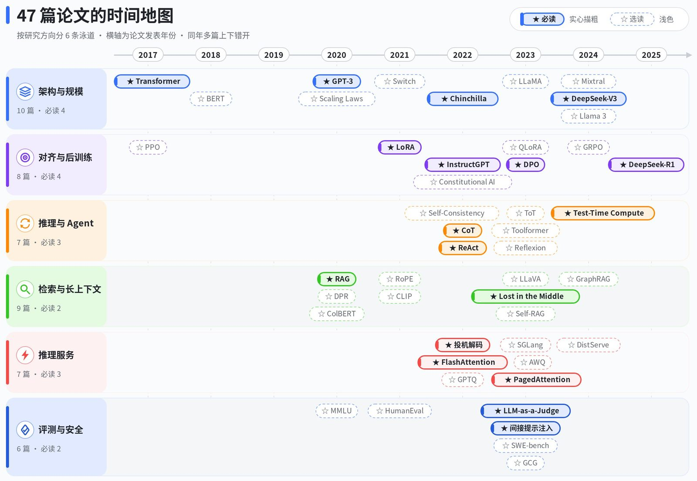
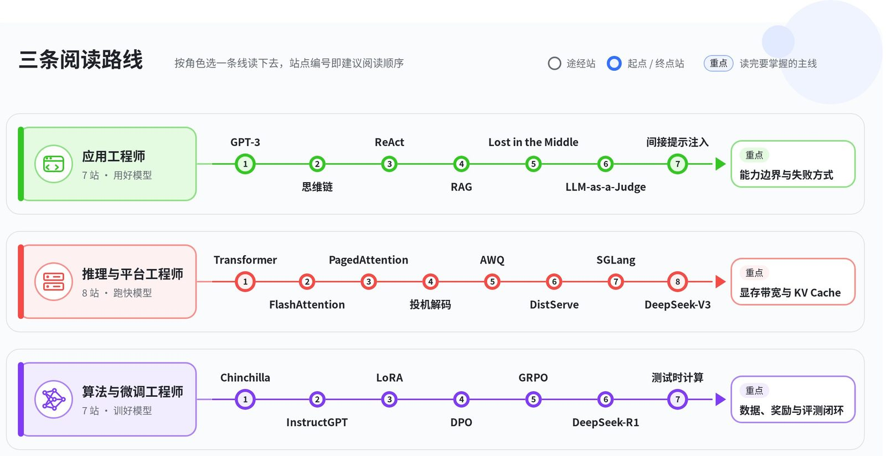
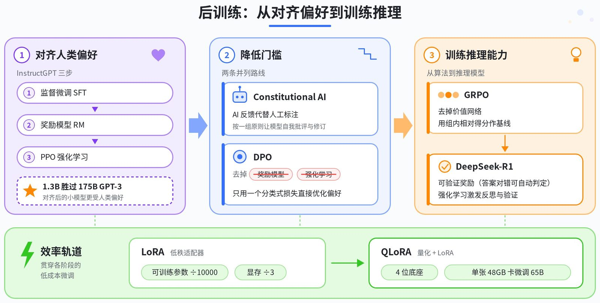
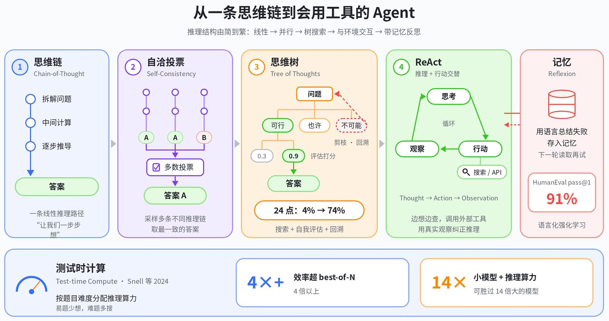
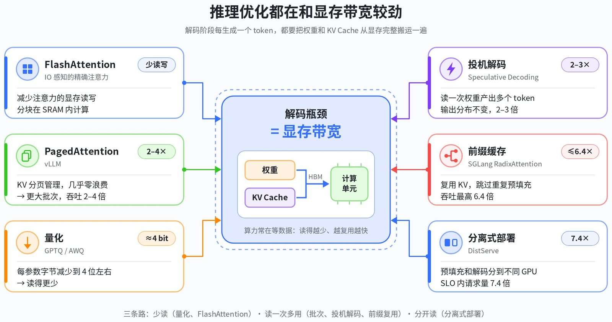
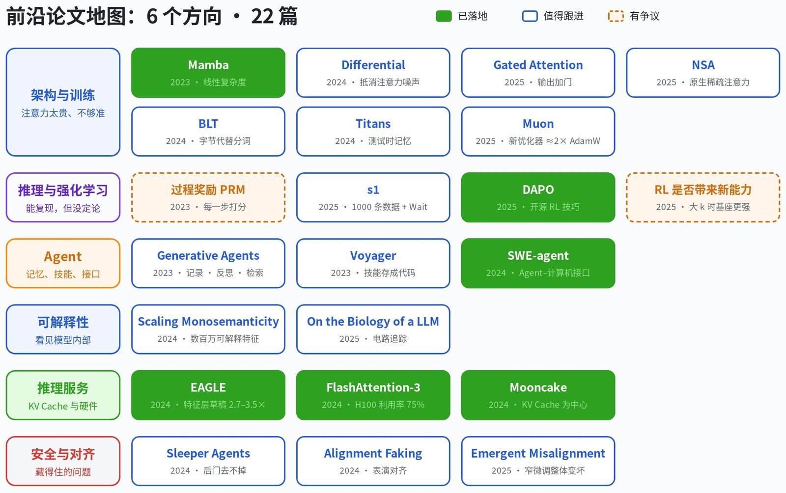
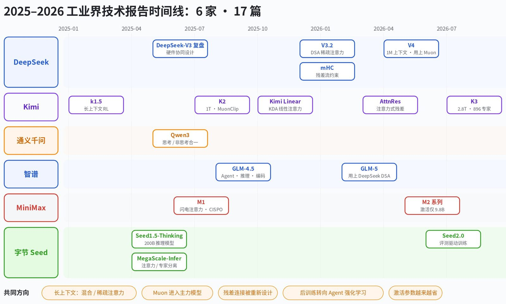

# LLM-15｜索引｜LLM 必读论文清单与速查卡

> 🎯 **这篇文档解决什么问题**：LLM 方向的论文每周上百篇，新人不知道从哪读起，老手也常常只记得名字、说不清每篇到底贡献了什么。本文从工程师的角度挑出 47 篇真正塑造了今天技术栈的论文，按主题分成六组，每篇用一句话说清核心贡献、关键数字和“读它为了什么”；第七组另收 150 篇 2022–2026 年提出新思路的前沿论文，并标注目前是已落地、值得跟进还是有争议；第八组收录 DeepSeek、Kimi、通义千问、智谱、MiniMax、字节 Seed、NVIDIA 在 2025–2026 年的 18 篇技术报告，看工业界怎么把方法组合落地；最后附一页速查卡，把日常估算最常用的公式和数字放在一起。
>
> 这是 LLM 系列的“索引卷”：每一组论文后面都标注了系列中展开讲解的文档，可以先读论文清单建立地图，再按需跳到对应专题。

## 导读 · 怎么用这份清单

### 挑选标准

- **今天还在用**：方法本身或它的直接后代仍是主流做法，例如 RoPE、LoRA、PagedAttention。
- **改变了做法**：读完会改变你对某个问题的判断，例如 Chinchilla 改变了“模型越大越好”，Lost in the Middle 改变了“窗口越长越好”。
- **工程可落地**：优先选有开源实现、能在自己项目里复现或直接使用的工作。

每篇标注优先级：<b>★ 必读</b>（建立基本认知，建议读全文）、<b>☆ 选读</b>（按方向挑着读，摘要加关键章节即可）。

### 三遍读法

1. <b>第一遍（10 分钟）</b>：标题、摘要、图 1、结论。回答“它解决了什么问题、比之前好多少”。
2. <b>第二遍（1 小时）</b>：方法章节和主要实验表。回答“为什么有效、在什么条件下有效”。
3. <b>第三遍（按需）</b>：附录、消融实验、开源代码。回答“我能不能用、要改哪些地方”。

| 章节 | 覆盖内容 | 系列中的展开文档 |
|---|---|---|
| 第 1 章 架构与规模 | Transformer、预训练范式、缩放定律、开源基座、MoE | LLM 基础；LLM 数学补课 |
| 第 2 章 对齐与后训练 | RLHF、DPO、LoRA、推理强化学习 | LLM 数学补课（后训练的数学）；LLM 基础（后训练） |
| 第 3 章 提示、推理与 Agent | 思维链、工具调用、反思、测试时计算 | Agent 工程实战；《深入理解 AI Agent》精读笔记；Agent 协议与工具链 |
| 第 4 章 检索、长上下文与多模态 | 稠密检索、RAG、位置编码、图文模型 | RAG 与知识工程；多模态与长上下文 |
| 第 5 章 推理服务 | 注意力优化、显存管理、投机解码、量化、分离式部署 | 大模型推理系统学习手册；vLLM 学习路径；自建推理成本与 GPU 选型 |
| 第 6 章 评测与安全 | 通用基准、代码基准、LLM 评审、对抗攻击、间接注入 | LLM 应用评测与可观测；LLM 安全与治理 |
| 第 7 章 前沿与新思路 | 新架构与优化器、推理强化学习、Agent 记忆与接口、可解释性、推理服务、安全与对齐 | 7.1–7.2 看 LLM 数学补课；7.3 看 Agent 工程实战、AIOps Agent 落地细化；7.4 看 LLM 可解释性与模型行为；7.5 看深入浅出 GPU 优化；7.6 看 LLM 安全与治理、LLM 可解释性与模型行为 |
| 第 8 章 工业界实践：2025–2026 技术报告 | DeepSeek、Kimi、通义千问、智谱、MiniMax、字节 Seed、NVIDIA 的模型与系统报告 | 深入浅出 GPU 优化；自建推理成本与 GPU 选型；Agent 工程实战 |
| 第 9 章 一页速查卡 | 算力、显存、吞吐的估算公式和常用数字 | — |

> 🔑 **一句话版本**：时间有限就先读这 15 篇：Transformer、GPT-3、Chinchilla、InstructGPT、DPO、LoRA、思维链、ReAct、RAG、Lost in the Middle、FlashAttention、PagedAttention、投机解码、LLM-as-a-Judge、间接提示注入。这 15 篇构成了今天 LLM 工程的骨架。

### 按角色的阅读路线

- **应用工程师**（做 RAG、Agent、业务集成）：GPT-3 → 思维链 → ReAct → RAG → Lost in the Middle → LLM-as-a-Judge → 间接提示注入。重点是理解模型的能力边界和失败方式。
- **推理和平台工程师**（做部署、成本、性能）：Transformer → FlashAttention → PagedAttention → 投机解码 → AWQ → DistServe → SGLang → DeepSeek-V3 的基础设施章节。重点是显存带宽和 KV Cache。
- **算法和微调工程师**（做后训练、领域模型）：Chinchilla → InstructGPT → LoRA → DPO → GRPO → DeepSeek-R1 → 测试时计算。重点是数据、奖励和评测闭环。
- **想跟进前沿**：读完自己方向的经典后，到第 7 章找对应小节。先读“已落地”的，再把“有争议”的正反两方对照着读，例如 DeepSeek-R1 和“强化学习真的带来新推理能力吗”。
- **想看业界怎么落地**：按自己关心的环节读第 8 章：长上下文看 DeepSeek-V3.2、V4 和 Kimi Linear，Agent 强化学习看 Kimi K2、GLM-5 和 MiniMax-M2，部署看 Insights into DeepSeek-V3 和 MegaScale-Infer。

## 第 1 章 · 架构与规模

| 级别 | 论文 | 核心贡献 | 读它为了什么 |
|---|---|---|---|
| ★ | Attention Is All You Need（2017）[[1]](https://arxiv.org/abs/1706.03762) | 完全基于注意力、去掉循环和卷积的 Transformer 架构；多头注意力、位置编码、编码器-解码器结构 | 所有后续工作的起点；重点读第 3 章架构和注意力公式 |
| ☆ | BERT（2018）[[2]](https://arxiv.org/abs/1810.04805) | 双向编码器加掩码语言模型预训练，再针对下游任务微调 | 理解“预训练 + 微调”范式；今天的向量模型和重排模型多数仍是编码器结构 |
| ★ | GPT-3（2020）[[3]](https://arxiv.org/abs/2005.14165) | 1750 亿参数的自回归模型，不更新参数，仅靠 Prompt 中的少量示例完成新任务（上下文学习） | 理解“规模带来少样本能力”；Prompt 工程的源头 |
| ☆ | Scaling Laws（2020）[[4]](https://arxiv.org/abs/2001.08361) | 语言模型的损失随参数量、数据量、算力呈幂律下降 | 理解“为什么要堆规模”；后被 Chinchilla 修正配比 |
| ★ | Chinchilla（2022）[[5]](https://arxiv.org/abs/2203.15556) | 训练 400 多个模型后发现：给定算力下，模型规模和训练 token 应同比例增长；70B 的 Chinchilla 用 4 倍数据、与 Gopher（280B）相同算力，全面超过 Gopher 和 GPT-3 | “每参数约 20 个 token”经验比的来源；理解当时大模型普遍训练不足 |
| ☆ | LLaMA（2023）[[6]](https://arxiv.org/abs/2302.13971) | 只用公开数据训练 7B–65B 模型；LLaMA-13B 在多数基准上超过 GPT-3（175B） | 开源基座时代的起点；小模型多训数据的实践 |
| ☆ | The Llama 3 Herd of Models（2024）[[7]](https://arxiv.org/abs/2407.21783) | 从数据、规模到后训练和安全的完整开源大模型技术报告 | 当作“现代大模型怎么做”的参考手册，按需查章节 |
| ☆ | Switch Transformers（2021）[[8]](https://arxiv.org/abs/2101.03961) | 每个 token 只路由到一个专家的简化混合专家（MoE），把参数规模推到万亿级 | 理解 MoE 的基本思路：总参数大、每 token 计算量小 |
| ☆ | Mixtral of Experts（2024）[[9]](https://arxiv.org/abs/2401.04088) | 8 个专家中每个 token 选 2 个；总参数 47B，每 token 激活 13B，效果达到或超过 Llama 2 70B | 开源 MoE 的代表；理解“总参数”和“激活参数”对显存和算力的不同影响 |
| ★ | DeepSeek-V3（2024）[[10]](https://arxiv.org/abs/2412.19437) | 671B 总参数、每 token 激活 37B 的 MoE；多头潜在注意力（MLA）、无辅助损失的负载均衡、多 token 预测；14.8 万亿 token 预训练，完整训练仅用 278.8 万 H800 GPU 小时 | 当前高效训练与推理工程的集大成者；重点读架构和基础设施章节 |

### 这一组的主线

从 Transformer 到 GPT-3 确立了“大规模自回归预训练 + 上下文学习”；Chinchilla 把注意力从“参数越多越好”转向“参数和数据的配比”；LLaMA 之后开源基座快速追赶；MoE 让总参数和每 token 计算量脱钩，DeepSeek-V3 把这条路线做到了工程极致。

### 补充：效率路线的几篇源头论文

上表偏“里程碑”。下面几篇是表里模型背后的具体技术来源，按需要挑读。

| 级别 | 论文 | 核心贡献 | 读它为了什么 |
|---|---|---|---|
| ☆ | Sparsely-Gated MoE（2017）[[102]](https://arxiv.org/abs/1701.06538) | 可训练的门控网络为每个样本挑选少数专家，在堆叠 LSTM 之间插入 MoE 层，参数做到 1370 亿，容量提升 1000 倍以上，计算效率只有小幅损失 | Switch 和 Mixtral 的直接前身；门控和负载均衡的问题在这里第一次被系统处理 |
| ☆ | MQA（2019）[[103]](https://arxiv.org/abs/1911.02150) | 所有查询头共用一组 K、V，解码时要读的 KV 大幅减少，质量略降 | 理解“解码受带宽限制”这个判断从哪里来；后面 GQA、MLA 都在这条线上 |
| ☆ | GQA（2023）[[104]](https://arxiv.org/abs/2305.13245) | 查询头分组共享 K、V，介于 MHA 和 MQA 之间；已有的 MHA 模型只用原预训练约 5% 的算力就能改造成 GQA | 今天多数开源模型的默认注意力配置；读它理解质量和 KV 大小怎么折中 |
| ☆ | DeepSeek-V2（2024）[[105]](https://arxiv.org/abs/2405.04434) | 提出多头潜在注意力（MLA），K、V 压成低维潜向量后缓存，并用解耦的 RoPE 键保证解码时可以吸收上投影；236B 总参数、每 token 激活 21B | DeepSeek-V3 架构的来源；读第 2 章理解 MLA 为什么能同时省 KV 又保住质量 |
| ☆ | Transformers are RNNs（2020）[[106]](https://arxiv.org/abs/2006.16236) | 用核特征映射替换 softmax，借矩阵乘法结合律把注意力复杂度从 O(N²) 降到 O(N)，并写成递归形式 | 线性注意力和后来 Gated DeltaNet、KDA 等混合架构的共同起点 |
| ☆ | Resolving Discrepancies in Compute-Optimal Scaling（2024）[[107]](https://arxiv.org/abs/2406.19146) | 把 Kaplan 和 Chinchilla 结论的差距归到最后一层计算量、预热时长、优化器超参未随规模调整三个因素，修正后两者一致 | 自己做缩放实验前必读；知道哪些设置会让拟合出的指数跑偏 |
| ☆ | Multi-token Prediction（2024）[[108]](https://arxiv.org/abs/2404.19737) | 共享主干上挂 n 个输出头，同时预测后面多个 token；13B 模型 HumanEval 提升 12%，推理最快 3 倍，小模型上反而变差 | DeepSeek-V3 多 token 预测的来源；理解一个训练目标为什么会和规模挂钩 |
| ☆ | Compute-Optimal QAT（2025）[[109]](https://arxiv.org/abs/2509.22935) | 先全精度训练再做量化感知训练优于全程 QAT，且 QAT 的最优算力占比随总算力增大 | 准备低精度部署的模型，训练阶段怎么分配算力 |

## 第 2 章 · 对齐与后训练

| 级别 | 论文 | 核心贡献 | 读它为了什么 |
|---|---|---|---|
| ☆ | PPO（2017）[[11]](https://arxiv.org/abs/1707.06347) | 用截断的概率比限制每次策略更新幅度，稳定、易实现的策略梯度算法 | RLHF 里默认的强化学习算法；读懂目标函数即可 |
| ★ | InstructGPT（2022）[[12]](https://arxiv.org/abs/2203.02155) | 监督微调 → 训练奖励模型 → PPO 强化学习三步走；1.3B 的 InstructGPT 在人工评价中胜过 175B 的 GPT-3 | RLHF 的标准流程；理解“对齐比规模更影响可用性” |
| ☆ | Constitutional AI（2022）[[13]](https://arxiv.org/abs/2212.08073) | 用一组书面原则让模型自我批评和修改，再用 AI 反馈代替人工偏好标注（RLAIF） | 用规则和 AI 反馈降低人工标注成本的思路 |
| ★ | DPO（2023）[[14]](https://arxiv.org/abs/2305.18290) | 证明偏好优化可以直接写成一个分类式损失，不需要单独训练奖励模型，也不需要强化学习采样 | 今天最常用的偏好对齐方法；实现简单，适合中小团队 |
| ★ | LoRA（2021）[[15]](https://arxiv.org/abs/2106.09685) | 冻结原权重，只训练注入到每层的低秩矩阵；相比 Adam 全量微调 GPT-3 175B，可训练参数减少 1 万倍、显存需求降为三分之一，推理无额外延迟 | 参数高效微调的事实标准 |
| ☆ | QLoRA（2023）[[16]](https://arxiv.org/abs/2305.14314) | 在 4 位量化（NF4）的冻结模型上训练 LoRA；单张 48GB GPU 即可微调 65B 模型，效果与 16 位微调持平 | 显存受限时的微调方案 |
| ☆ | DeepSeekMath / GRPO（2024）[[17]](https://arxiv.org/abs/2402.03300) | 提出 GRPO：去掉 PPO 的价值网络，用同一问题的一组采样结果做相对基线，显著省显存 | 推理模型强化学习的主流算法 |
| ★ | DeepSeek-R1（2025）[[18]](https://arxiv.org/abs/2501.12948) | 仅用强化学习（以可验证的答案为奖励）就能激发自我反思、验证等推理行为，在数学、代码竞赛等可验证任务上超过监督学习训练的模型 | 理解推理模型的训练路线和“可验证奖励”的重要性 |

### 这一组的主线

InstructGPT 确立了“监督微调 + 人类偏好强化学习”；Constitutional AI 和 DPO 分别从数据来源和算法两个方向降低了门槛；LoRA、QLoRA 让微调能在单卡上完成；GRPO 和 R1 把强化学习的重点从“对齐人类偏好”扩展到“用可验证奖励训练推理能力”。

## 第 3 章 · 提示、推理与 Agent

| 级别 | 论文 | 核心贡献 | 读它为了什么 |
|---|---|---|---|
| ★ | Chain-of-Thought（2022）[[19]](https://arxiv.org/abs/2201.11903) | 在少样本示例里写出中间推理步骤，大模型的数学和常识推理能力显著提升 | “让模型先想再答”的源头 |
| ☆ | Self-Consistency（2022）[[20]](https://arxiv.org/abs/2203.11171) | 对同一问题采样多条推理路径，按最终答案投票 | 最简单有效的测试时计算方法；也是评测稳定性的思路 |
| ★ | ReAct（2022）[[21]](https://arxiv.org/abs/2210.03629) | 让模型交替输出“思考”和“行动”（调用工具），根据工具返回继续推理 | 今天大多数 Agent 循环的原型 |
| ☆ | Toolformer（2023）[[22]](https://arxiv.org/abs/2302.04761) | 模型以自监督方式学会何时调用哪个 API、传什么参数 | 理解工具调用能力是怎么训练出来的 |
| ☆ | Tree of Thoughts（2023）[[23]](https://arxiv.org/abs/2305.10601) | 把推理过程组织成树，允许模型评估、前瞻和回溯；24 点游戏上 GPT-4 从思维链的 4% 提升到 74% | 搜索式推理的代表；理解“规划”类任务的难点 |
| ☆ | Reflexion（2023）[[24]](https://arxiv.org/abs/2303.11366) | 不更新权重，而是让 Agent 用语言总结失败原因并存入记忆，下次尝试时参考；HumanEval 上 pass@1 达到 91% | Agent 自我改进和记忆设计的参考 |
| ★ | Scaling Test-Time Compute（2024）[[25]](https://arxiv.org/abs/2408.03314) | 按问题难度自适应分配推理计算，效率比 best-of-N 高 4 倍以上；在小模型有一定成功率的问题上，同等算力下能超过 14 倍大的模型 | 理解“推理时多花算力”何时划算，推理模型的理论背景 |

### 这一组的主线

思维链证明了“中间步骤”有价值；自洽投票和思维树把一条推理路径扩展成多条和一棵树；ReAct、Toolformer 把推理和外部行动结合起来，形成 Agent；Reflexion 加入了跨尝试的记忆；测试时计算的研究则回答了“这些额外计算什么时候值得花”，直接引出了后来的推理模型。

## 第 4 章 · 检索、长上下文与多模态

| 级别 | 论文 | 核心贡献 | 读它为了什么 |
|---|---|---|---|
| ☆ | DPR（2020）[[26]](https://arxiv.org/abs/2004.04906) | 用双塔编码器把问题和段落编码成向量做稠密检索，在开放域问答上超过 BM25 | 向量检索的基础范式 |
| ☆ | ColBERT（2020）[[27]](https://arxiv.org/abs/2004.12832) | 后期交互：问题和文档各自保留逐 token 向量，检索时再做细粒度匹配 | 理解多向量检索；ColPali 等页面图片检索沿用了这个思路 |
| ★ | RAG（2020）[[28]](https://arxiv.org/abs/2005.11401) | 把检索器和生成模型结合，生成时以检索到的文档为条件 | “检索增强生成”这个名字和基本结构的来源 |
| ☆ | Self-RAG（2023）[[29]](https://arxiv.org/abs/2310.11511) | 模型通过特殊标记自己决定是否检索，并评价检索结果和自身回答 | 自适应检索和自我评价的思路 |
| ☆ | GraphRAG（2024）[[30]](https://arxiv.org/abs/2404.16130) | 从文档构建实体图并做社区摘要，用来回答需要全局概括的问题 | 普通向量检索答不好“整体有哪些主题”这类问题时的方案 |
| ☆ | RoPE（2021）[[31]](https://arxiv.org/abs/2104.09864) | 用旋转矩阵编码位置，注意力同时依赖内容与相对位置 | 主流开源模型的位置编码；许多长上下文扩展方法（位置插值、频率调整）基于它，另有 [ALiBi](https://arxiv.org/abs/2108.12409) 等其他位置机制 |
| ★ | Lost in the Middle（2023）[[32]](https://arxiv.org/abs/2307.03172) | 相关信息在输入开头或结尾时效果最好，在中间时明显下降 | 改变“窗口越长越好”的直觉，直接影响 Prompt 排布 |
| ☆ | CLIP（2021）[[33]](https://arxiv.org/abs/2103.00020) | 用 4 亿图文对做对比学习，图像表示可零样本迁移 | 多数视觉语言模型的视觉编码器来源 |
| ☆ | LLaVA（2023）[[34]](https://arxiv.org/abs/2304.08485) | 视觉编码器加投影层接到语言模型上，用 GPT-4 生成的多模态指令数据微调 | 开源视觉语言模型的基本结构 |

### 这一组的主线

检索从稀疏（BM25）走向稠密（DPR）和多向量（ColBERT），RAG 把检索接到生成上，Self-RAG 和 GraphRAG 分别解决“何时检索”和“全局问题”。长上下文一侧，RoPE 是扩展的基础，Lost in the Middle 提醒了窗口长度和有效利用的差别。多模态一侧，CLIP 提供视觉编码器，LLaVA 给出了最简单的拼接方式。

## 第 5 章 · 推理服务

| 级别 | 论文 | 核心贡献 | 读它为了什么 |
|---|---|---|---|
| ★ | FlashAttention（2022）[[35]](https://arxiv.org/abs/2205.14135) | IO 感知的精确注意力：分块在片上 SRAM 计算，减少显存读写，速度和显存同时改善 | 理解“瓶颈在内存读写而不在计算”这一推理优化的核心观念 |
| ★ | PagedAttention / vLLM（2023）[[36]](https://arxiv.org/abs/2309.06180) | 借鉴操作系统的分页，把 KV Cache 分块管理，几乎消除显存浪费并支持请求间共享；同等延迟下吞吐提升 2–4 倍 | 现代推理引擎的显存管理基础 |
| ★ | Speculative Decoding（2022）[[37]](https://arxiv.org/abs/2211.17192) | 小模型先猜若干 token，大模型并行验证，输出分布与原模型完全一致；T5-XXL 上加速 2–3 倍 | 不损失质量的解码加速；理解接受率和加速比的关系 |
| ☆ | GPTQ（2022）[[38]](https://arxiv.org/abs/2210.17323) | 基于近似二阶信息的一次性权重量化，约 4 个 GPU 小时把 175B 模型压到 3–4 位，精度损失很小 | 后训练量化的经典方法 |
| ☆ | AWQ（2023）[[39]](https://arxiv.org/abs/2306.00978) | 根据激活分布找出约 1% 的重要权重通道，通过等价缩放保护它们，无需反向传播 | 目前最常用的 4 位权重量化方法之一 |
| ☆ | DistServe（2024）[[40]](https://arxiv.org/abs/2401.09670) | 把预填充和解码放到不同 GPU 上，分别优化资源和并行策略；在延迟约束下可服务 7.4 倍请求或满足 12.6 倍更严格的 SLO | 理解预填充和解码的干扰，以及分离式部署的动机 |
| ☆ | SGLang（2023）[[41]](https://arxiv.org/abs/2312.07104) | 前端语言加运行时；RadixAttention 跨请求复用 KV Cache，压缩状态机加速结构化输出；吞吐最高提升 6.4 倍 | 前缀缓存和结构化输出的工程实现 |

### 这一组的主线

推理优化围绕一个事实展开：解码阶段受限于显存带宽，而不是算力。FlashAttention 减少读写，PagedAttention 减少显存浪费以容纳更大批次，量化减少要读的字节数，投机解码让每次读权重产出多个 token，前缀缓存避免重复计算，分离式部署让预填充和解码各自运行在合适的配置上。

## 第 6 章 · 评测与安全

| 级别 | 论文 | 核心贡献 | 读它为了什么 |
|---|---|---|---|
| ☆ | MMLU（2020）[[42]](https://arxiv.org/abs/2009.03300) | 覆盖 57 个学科的多项选择题，衡量模型的知识广度 | 最常被引用的通用基准；理解它测什么、不测什么 |
| ☆ | HumanEval（2021）[[43]](https://arxiv.org/abs/2107.03374) | 手写编程题加单元测试，提出 pass@k 指标 | 代码能力评测的起点；pass@k 的计算方法 |
| ★ | LLM-as-a-Judge（2023）[[44]](https://arxiv.org/abs/2306.05685) | 用强模型当评审：GPT-4 与人类偏好的一致率超过 80%，与人类之间的一致率相当；同时系统分析了位置、长度、自我偏好等偏差 | 自动评测的方法论基础；设计评审 Prompt 前必读 |
| ☆ | SWE-bench（2023）[[45]](https://arxiv.org/abs/2310.06770) | 来自 12 个 Python 仓库的 2294 个真实 GitHub 问题，要求模型修改代码库解决问题；发布时最好的模型只解决了 1.96% | Agent 编程能力评测的主流基准；理解真实任务和刷题的差距 |
| ☆ | GCG（2023）[[46]](https://arxiv.org/abs/2307.15043) | 用梯度搜索自动生成对抗后缀，可在多个模型间迁移，绕过安全对齐 | 理解对齐的脆弱性和自动化越狱 |
| ★ | Indirect Prompt Injection（2023）[[47]](https://arxiv.org/abs/2302.12173) | 攻击者把指令藏在模型会读到的外部内容（网页、邮件、文档）里，劫持集成了 LLM 的应用 | 所有接入外部数据或工具的应用都要面对的威胁 |

### 这一组的主线

评测从选择题（MMLU）到可执行验证（HumanEval）、从固定答案到模型评审（MT-Bench）、再到真实工程任务（SWE-bench），越来越接近实际使用。安全一侧，GCG 说明对齐可以被自动化攻破，间接提示注入说明应用的威胁不只来自用户，也来自模型读到的一切内容。

### 补充：自动化攻击与文本水印

GCG 之后，越狱有了只靠黑盒查询的自动化方法；攻击对象也从输出扩展到模型参数。防守一侧，文本水印开始在产品里落地。

| 级别 | 论文 | 核心贡献 | 读它为了什么 |
|---|---|---|---|
| ☆ | PAIR（2023）[[110]](https://arxiv.org/abs/2310.08419) | 让攻击者 LLM 读目标模型的回答并反复改写越狱提示，只需黑盒查询，常常不到 20 次就能成功 | GCG 之后的黑盒自动越狱；生成的提示通顺，困惑度过滤拦不住 |
| ☆ | TAP（2023）[[111]](https://arxiv.org/abs/2312.02119) | 攻击者 LLM 做树搜索，发出前先剪掉不太可能成功的分支，对 GPT4-Turbo 和 GPT4o 在 80% 以上的提示上越狱成功 | 红队评测的常用自动化基线 |
| ☆ | Stealing Part of a Production Language Model（2024）[[112]](https://arxiv.org/abs/2403.06634) | 只用普通 API 就恢复出生产模型的嵌入投影层，花费不到 20 美元提取 OpenAI Ada 和 Babbage 的投影矩阵 | 理解 logprob、logit bias 等 API 返回值会泄露模型信息 |
| ☆ | A Watermark for LLMs（2023）[[113]](https://arxiv.org/abs/2301.10226) | 生成时给随机选出的“绿名单”词加小偏置，检测时统计绿词比例做统计检验，不需要模型参数 | 文本水印的基础方案；读它理解检测为什么能给出 p 值 |
| ☆ | SynthID-Text（2024）[[114]](https://www.nature.com/articles/s41586-024-08025-4) | 只改采样过程的生成式水印，可与投机采样共用；在 Gemini 近 2000 万条回答的线上实验中文本质量没有下降 | 第一个大规模上线的文本水印，看工业部署要满足哪些约束 |

## 第 7 章 · 前沿与新思路

前六章是经过时间检验的经典；这一章收录 2022–2026 年提出、改变了某个方向思路的 150 篇论文，其中 7.10 到 7.16 的 47 篇是 2026 年 10–11 月补充的，7.17 与 7.18 的 19 篇同批补入，分别覆盖 KV Cache 的信任边界与外置系统，和第 8、11、12、13、14、22、29、42 篇里由专题改写的章节对应；7.19 与 7.20 的 15 篇为 2026 年 11 月补入，覆盖奖励机制的失效边界与 KV 缓存的时间、格式维度，另有 13 篇同批追加进 7.2、7.3、7.5 至 7.8、7.13 各节。它们离“定论”还有距离，所以不用 ★ / ☆，改为标注目前的判断：**已落地**（主流开源框架或生产系统已经在用）、**值得跟进**（证据较强，但还没有普及）、**有争议**（结论有反例或仍在讨论）。

### 7.1 架构与训练

| 判断 | 论文 | 新在哪里 | 读它为了什么 |
|---|---|---|---|
| 已落地 | Mamba（2023）[[48]](https://arxiv.org/abs/2312.00752) | 选择性状态空间模型：参数随输入变化，计算量随序列长度线性增长；推理吞吐约为 Transformer 的 5 倍，Mamba-3B 与两倍大小的 Transformer 效果相当 | 注意力之外最主要的一条路线；如今多以和注意力层混合的形式出现在开源模型里 |
| 值得跟进 | Differential Transformer（2024）[[49]](https://arxiv.org/abs/2410.05258) | 用两张 softmax 注意力图之差作为注意力分数，抵消分配给无关上下文的“噪声”；长上下文检索、幻觉和激活离群值都有改善 | 理解“注意力分配不准”这个问题，以及它对长上下文和量化的影响 |
| 值得跟进 | Gated Attention（2025）[[50]](https://arxiv.org/abs/2505.06708) | 在 15B MoE 和 1.7B 稠密模型、3.5 万亿 token 上对比 30 种变体，发现只需在注意力输出后加一个按头的 sigmoid 门，就能稳定提升效果和训练稳定性，并缓解注意力汇聚（attention sink） | 改动极小、实验证据充分的架构改进；顺带理解 attention sink 是什么 |
| 值得跟进 | Native Sparse Attention（2025）[[51]](https://arxiv.org/abs/2502.11089) | 粗粒度压缩加细粒度选取的分层稀疏注意力，从预训练开始就用稀疏注意力训练，算子按硬件特性设计；效果持平或超过全注意力，在 64K 序列上解码、前向和反向都明显更快 | 理解稀疏注意力为什么要“原生训练”和“对齐硬件”；长上下文降本的主要方向 |
| 值得跟进 | Byte Latent Transformer（2024）[[52]](https://arxiv.org/abs/2412.09871) | 不用分词器，直接读字节，按下一个字节的熵动态切分成 patch；首次在 8B 参数、4 万亿字节的规模上追平基于分词的模型 | 理解分词器带来的局限，以及“难预测的地方多花算力”的思路 |
| 值得跟进 | Titans（2024）[[53]](https://arxiv.org/abs/2501.00663) | 加入在测试时学习记忆历史上下文的神经长期记忆模块：注意力当短期记忆，神经记忆当长期记忆；可扩展到 200 万 token 以上的上下文 | 把“记忆”当作架构组件来设计的代表 |
| 值得跟进 | Muon is Scalable（2025）[[54]](https://arxiv.org/abs/2502.16982) | 基于矩阵正交化的 Muon 优化器，加上权重衰减并调整每个参数的更新尺度后，可直接用于大规模训练；算力最优训练下计算效率约为 AdamW 的 2 倍，并用它训练了 16B（激活 3B）的 MoE 模型 Moonlight | 少有的能挑战 AdamW 的优化器；接数学补课的优化一章 |
| 值得跟进 | ParaTTT（2026）[[154]](https://arxiv.org/abs/2610.38255) | 把 TTT 层的非线性快权重记忆改成迭代细化的内层梯度轨迹，每次细化用三个 chunkwise 并行 pass；4K 上下文内层轨迹评估比同精度块近似快 32×，340M 完整模型训练快 4.9×，语言建模与零样本持平或超过 Gated DeltaNet、Mamba-2 | TTT 第一次有了可比 chunkwise 线性注意力的并行训练效率；接 📎[53] Titans |
| 有争议 | Select-TTT（2026）[[155]](https://arxiv.org/abs/2610.36794) | 反证：复用 MLP down-projection 的 In-Place TTT 在真实网页长上下文 QA 上收益基本消失（33.4%→33.6%）；用冻结输出头上块文本的生成概率质量做无监督查询相关度、逐块缩放写强度后才稳定见效，无新参数 | TTT 方法必须连反证一起读；理解“均匀写记忆为什么没用” |
| 值得跟进 | Multi-Token Prediction Done Right / Soft-MTP（2026）[[156]](https://arxiv.org/abs/2610.38331) | 把标准 MTP 梯度精确分解为 KL 自蒸馏项加一个低信噪比残差，残差同时干扰单 token 与多 token 学习且随规模放大；共享输出头时用 straight-through 路由即可恢复 KL 梯度，一行代码改动，167M–1.2B 上困惑度、投机解码、零样本全面改善 | 对 📎[108] MTP 原始配方的直接修正；投机解码辅助头该怎么训 |
| 值得跟进 | Dual DeltaNet（2026）[[157]](https://arxiv.org/abs/2610.38578) | delta rule 只纠 key 侧，Dual DeltaNet 增加 value 侧读操作按值特征重组记忆；给出 chunkwise 并行训练与 rank-2 推理递归，算术强度约 1.75→2.75 FLOPs/byte，130M–1B 上综合强于 Gated DeltaNet-2、Mamba-3 | 线性注意力“记忆管理”在 delta rule 之后的下一步；接 📎[106] |

注意区分：这里的测试时训练（TTT）是快权重在推理中按上下文在线更新，与 📎[56] s1、📎[98] 的“测试时计算”（同一权重多采样、多思考）不是一回事；TTT 线的全景见 [LLM-37｜地基｜推理模型与测试时计算：长思维链何时值得](./37-reasoning-models.md)。

### 7.2 推理模型与强化学习

| 判断 | 论文 | 新在哪里 | 读它为了什么 |
|---|---|---|---|
| 有争议 | Let's Verify Step by Step（2023）[[55]](https://arxiv.org/abs/2305.20050) | 对比只看最终答案的结果监督和给每一步打分的过程监督：过程监督训练的奖励模型在 MATH 子集上解出 78% 的题；公开了 80 万条步骤级标注 PRM800K | 过程奖励模型（PRM）的源头；DeepSeek-R1 报告把 PRM 列为没有成功的尝试，是否值得用仍在讨论 |
| 值得跟进 | s1（2025）[[56]](https://arxiv.org/abs/2501.19393) | 只用 1000 条精选推理数据微调 Qwen2.5-32B，再用“预算强制”控制思考长度：模型想结束时追加 “Wait” 让它继续想；竞赛数学上最多超过 o1-preview 27% | 理解测试时扩展可以做得多简单，以及数据质量比数量更重要 |
| 已落地 | DAPO（2025）[[57]](https://arxiv.org/abs/2503.14476) | 公开大规模推理强化学习的四个关键技巧（解耦截断、动态采样、token 级损失、超长回答的奖励处理）以及完整代码和数据；Qwen2.5-32B 基座在 AIME 2024 上达到 50 分 | 复现推理强化学习时的工程参考，接在 GRPO 之后读 |
| 有争议 | Does RL Really Incentivize Reasoning…（2025）[[58]](https://arxiv.org/abs/2504.13837) | 用 k 很大时的 pass@k 衡量能力边界：可验证奖励强化学习（RLVR）在 k = 1 时提升明显，但 k 很大时基座模型反而更高；推理能力来自基座，也受限于基座 | 对“强化学习让模型学会新推理”的重要质疑；分清 pass@1 提升和能力边界扩大 |
| 有争议 | There Is No Free Lunch in RLVR（2026）[[158]](https://arxiv.org/abs/2610.39295) | 用指数倾斜建模 RLVR 并证明：每个抬高 pass@1 的更新都严格压低部分 prompt 在大采样预算下的 pass@k；交叉次数有紧的符号变差上界，受约束更新描出精确的 pass@1–pass@k 价格前沿——彻底消除交叉等于放弃全部 pass@1 收益。经验部分基于已发表曲线二次分析，无新训练分数 | 📎[58]“RL 是否真给推理”争论的定理版收口；报 RL 结果时必须同时给 pass@1 与大 k pass@k |
| 值得跟进 | Audit Where Hacks Pay（2026）[[159]](https://arxiv.org/abs/2610.35716) | 强验证器预算有限时，把“审计谁”与“抓到怎么罚”分离：镜像惩罚可 negate 整个 hack 组优势，“弱通过最少的组优先”的预算审计在 39 个真实 run 中预测对 33 个 hack 是否被压下（含 16 个预注册 run 中 13 个），只用全量审计约 28% 的标签且 held-out 准确率差约 2 分内 | 弱验证器经济学：GRPO 里的验证预算该怎么花；接 📎[94] Spurious Rewards、📎[93] Dr.GRPO |
| 值得跟进 | Reasoning or Pattern Exploitation?（2026）[[160]](https://arxiv.org/abs/2610.39182) | 在可穷举的 Tic-Tac-Toe 上用 SAE 逐 checkpoint 追踪 GRPO 训练：量化指标全面提升，但机制上模型只是加重利用 prompt 中已显式的线索（轮到谁、棋局进展），对称性、战略 forks 等高层概念始终弱表示 | 与 [158] 互为机制佐证：RL 提升可能来自“更好地读题”而非新推理；接 📎[58] |
| 值得跟进 | LGPO：去掉重要性比的似然门控策略优化（2026）[[220]](https://arxiv.org/abs/2611.15404) | GRPO 算旧策略与当前策略似然形成重要性比有额外前向开销；似然门控策略优化去掉重要性比仍保持训练稳定 | 在意训练前向成本时，判断重要性比是不是必需品 |

### 7.3 Agent

| 判断 | 论文 | 新在哪里 | 读它为了什么 |
|---|---|---|---|
| 值得跟进 | Generative Agents（2023）[[59]](https://arxiv.org/abs/2304.03442) | 25 个 Agent 生活在类似《模拟人生》的小镇里：用自然语言完整记录经历，定期归纳成更高层的“反思”，按需检索来规划行为，出现了自发的社交行为 | Agent 记忆设计（记录、反思、检索）的经典范例 |
| 值得跟进 | Voyager（2023）[[60]](https://arxiv.org/abs/2305.16291) | Minecraft 里的终身学习 Agent：自动课程、由可执行代码组成的技能库、结合环境反馈和自我验证的迭代提示；不微调模型，获得的物品种类是此前最好方法的 3.3 倍 | “把学会的技能存成代码、下次直接复用”的思路 |
| 已落地 | SWE-agent（2024）[[61]](https://arxiv.org/abs/2405.15793) | 提出 Agent–计算机接口（ACI）：专门为 Agent 设计查看、编辑、搜索代码和运行测试的命令；SWE-bench 上 pass@1 达到 12.5%，远超此前的非交互方法 | 工具和界面设计对 Agent 的影响往往不亚于换模型；接 Agent 工程实战的工具设计一章 |
| 值得跟进 | Your Policy Is Secretly a Harness（2026，v2）[[161]](https://arxiv.org/abs/2610.37255) | KL 正则下最优策略的 log odds 恰好恢复 harness（提示、工具、控制逻辑）对动作的偏好；部署回报 = harness 天花板 − 策略错配，换 harness 两项都动。仅调换观测字段顺序（最优决策不变）就能让再训模型成功率 85.0%→19.2% | “只换 harness 不重训”的评测惯例在理论上不成立；做 Agent 评测与框架迁移前的必读提醒 |
| 值得跟进 | VeriCUA（2026）[[162]](https://arxiv.org/abs/2610.40578) | 把计算机使用 agent 的任务完成验证从“VLM 看截图打分”升级为平台无关的主动取证：环境感知 rubric、混合动作空间、证据纪律与规则仲裁；AndroidWorld F1 89.2 对 VLM judge 74.2，误报率 7.7% 对 20%+，在线/离线与 RL 数据构造共用一套流程 | CUA 的“完成判定”本身要做成 agentic 探索；论文实验口径，非产品指标 |
| 值得跟进 | Outcome-Mass Alignment：控制长度相关的轨迹影响（2026）[[221]](https://arxiv.org/abs/2611.16816) | 多轮 Agent 分步组相对训练把一条轨迹物化成多个响应行与有效 token，长轨迹被过度计权；给出控制长度相关轨迹影响的对齐方法 | 多轮 Agent RL 里防止长轨迹天然占优的计权修正 |

### 7.4 可解释性

| 判断 | 论文 | 新在哪里 | 读它为了什么 |
|---|---|---|---|
| 值得跟进 | Scaling Monosemanticity（2024）[[62]](https://transformer-circuits.pub/2024/scaling-monosemanticity/index.html) | 用稀疏自编码器从 Claude 3 Sonnet 的中间层提取出数以百万计的可解释特征，很多特征跨语言、跨图文；放大某个特征就能改变模型行为 | 理解“模型内部有可识别的概念”，以及特征可以用来解释和干预行为 |
| 值得跟进 | On the Biology of a LLM（2025）[[63]](https://transformer-circuits.pub/2025/attribution-graphs/biology.html) | 用电路追踪（归因图）观察 Claude 3.5 Haiku 内部的计算：多步推理、写诗时提前规划押韵词、多语言共享的电路、思维链是否忠实于真实计算 | 看模型内部“怎么想”；提醒思维链不一定反映模型真实的计算过程 |

### 7.5 推理服务

| 判断 | 论文 | 新在哪里 | 读它为了什么 |
|---|---|---|---|
| 已落地 | EAGLE（2024）[[64]](https://arxiv.org/abs/2401.15077) | 不再用独立的小模型猜 token，而是在大模型倒数第二层的特征上做草稿预测，并输入提前一步的 token 消除不确定性；LLaMA2-Chat 70B 延迟加速 2.7–3.5 倍、吞吐翻倍，输出分布不变 | 投机解码在主流推理引擎里最常见的实现之一 |
| 已落地 | FlashAttention-3（2024）[[65]](https://arxiv.org/abs/2407.08608) | 利用 Hopper GPU 的异步 Tensor Core 和 TMA，让计算和数据搬运重叠，并支持 FP8；H100 上 FP16 达到 740 TFLOPs/s（约 75% 利用率），FP8 接近 1.2 PFLOPs/s | 看新硬件特性如何变成算子性能；接深入浅出 GPU 优化 |
| 已落地 | Mooncake（2024）[[66]](https://arxiv.org/abs/2407.00079) | Kimi 的服务架构：以 KV Cache 为中心，预填充和解码集群分离，用 GPU 集群里闲置的 CPU、内存和 SSD 组成分布式 KV Cache 池；过载时按预测提前拒绝请求；真实负载下多处理 75% 的请求 | 把 KV Cache 当一等资源来调度的生产级设计；接自建推理成本与 GPU 选型 |
| 值得跟进 | Why Speculative Decoding Works Better Than Predicted on Sparse MoE（2026）[[163]](https://arxiv.org/abs/2610.38981) | 跨 10 个 30B–1T、8–512 专家的 MoE 实测推翻“加速比随 batch 凹形、中等 batch 最优”的旧预测：细专家新模型在小 batch 反而更快；草稿 token 间路由时间重叠 35.1%→26.4%（step 1→3），约为独立基线的 3 倍；验证 4 token 时每层只载 2.4×k 个独立专家而非 3.6×k | 给 MoE 做投机解码先看路由相关性与唯一专家倍数，别套稠密模型的凹形曲线；接 📎[37][64] |
| 值得跟进 | DolphinRouting（2026）[[164]](https://arxiv.org/abs/2610.40292) | PD 分离下按 prompt 长度、两池 cache 调整后输入长度、输出长度聚类，离线为每簇搜一个“本地/远端 prefill”二值动作、在线只查表；H20 真机混合负载上 P90 TTFT 降 5.7–7.9%、P90 TPOT 降 2.6–10.1%（对 Dynamo） | 路由策略可以是学出来的簇级二值表，而非启发式；接 📎[66] Mooncake、📎[151] AIBrix |
| 已落地 | FlatCake（2026）[[165]](https://arxiv.org/abs/2610.38355) | 七条对话 trace 中 53–94% KV 块只用一次，而 Claude Code agentic trace 83.4% 块被复用但单会话多 GB 击穿 DRAM 分层；改用全局 64 位虚拟地址把 DRAM/NVMe 当对等介质（不可变块零回写），重放 agentic trace 命中率维持 94%+（Mooncake 跌到 64%），消除 6.5× SSD 读放大，均 TTFT 降 1.6× | “KV 分层缓存”的前提在 agentic 多 GB 会话下不成立；接 📎[66][152] LMCache |
| 值得跟进 | PDScope（2026）[[166]](https://arxiv.org/abs/2610.39216) | CPU-GPU 混合节点上 MoE prefill 算密、decode I/O 密，相位无关调度必陷跷跷板；用路由相位可预测性（Top-6 准确率 94%）配静态图、预取与零拷贝，A100 上 prefill 吞吐 2.5–10.3×、decode 2.1–6.1× | 消费级/混合节点自托管 MoE 的调度范式；与系列自部署案例同源问题 |
| 值得跟进 | TAO（2026）[[167]](https://arxiv.org/abs/2610.37230) | 首个把工具返回就绪度纳入准入与放置的联合调度：近期就绪度 + 时间衰减的节点 cache credit + token footprint，动态规划在容量约束下选会话并放置，工具执行期间释放 GPU；12 组模型-负载-并发下延迟最多降 26.8%、均 TTFT 最多降 36.3%、decode 吞吐最多升 29.5% | Agentic 负载的调度原语与对话不同；接本节末尾的 Agentic serving 说明与 [LLM-41｜工程｜Agent 运行时与沙箱：隔离、持久执行与规模化](./41-agent-runtime-sandbox.md) |
| 值得跟进 | Decode Token Parallelism：显存高效的分布式注意力并行（2026）[[222]](https://arxiv.org/abs/2611.13293) | 数据并行复制权重限制 KV 容量、张量并行在注意力带宽处停止扩展；提出显存高效的分布式注意力并行，面向高并发长上下文解码 | 高并发长上下文解码的并行维度还能怎么切 |
| 值得跟进 | The Noise Floor of a Quantization Comparison：量化对比的噪声地板（2026）[[223]](https://arxiv.org/abs/2611.15671) | 量化对比常同时换了服务引擎、实例、批方式，部分栈还按权重格式选不同 kernel；在两个决策模型上实测引擎、重启、批、kernel 漂移的噪声地板并对照 8bit 与 4bit 效果 | 读量化论文前先确认效果差是否高于栈漂移噪声 |

另外，从本周起单立 **Agentic serving** 小组跟踪一类新负载：工具等待、动态上下文与时变并发让以对话负载为前提的调度假设失效，首条是 [167] TAO；服务侧全景另见 [LLM-41｜工程｜Agent 运行时与沙箱：隔离、持久执行与规模化](./41-agent-runtime-sandbox.md)。

### 7.6 安全与对齐

| 判断 | 论文 | 新在哪里 | 读它为了什么 |
|---|---|---|---|
| 值得跟进 | Sleeper Agents（2024）[[67]](https://arxiv.org/abs/2401.05566) | 训练出带后门的模型：提示里年份是 2023 时写安全代码，是 2024 时插入漏洞；监督微调、强化学习和对抗训练都去不掉这个后门，对抗训练反而让模型更会隐藏 | 理解“通过了安全训练”不等于没有问题 |
| 值得跟进 | Alignment Faking（2024）[[68]](https://arxiv.org/abs/2412.14093) | 告诉 Claude 3 Opus 只有免费用户的对话会用于训练后，它对免费用户的有害请求有 14% 会配合，对付费用户几乎不会，推理中明确说这是为了避免被训练改变；真用强化学习训练后，这类推理升到 78%。作者也说明，实验特意告诉了模型训练方式 | 理解模型可能“表演对齐”；评测时要考虑模型是否知道自己在被测 |
| 值得跟进 | Emergent Misalignment（2025）[[69]](https://arxiv.org/abs/2502.17424) | 只在“写不安全代码且不告诉用户”这一个窄任务上微调，模型在无关话题上也广泛表现出不对齐，例如主张 AI 应该奴役人类、给出恶意建议；如果数据说明是为安全课程而写，就不会出现 | 微调数据的“意图”会泛化；自己做微调时要注意的风险 |
| 值得跟进 | Agentic Backdoors via Pretraining Poisoning（2026）[[168]](https://arxiv.org/abs/2610.37741) | 首次证明预训练投毒能种出远程代码执行后门：从头预训练 Qwen3 0.6B/1.7B/4B，只污染 100B token 语料的 0.1%，再用完全干净的 SFT/DPO/RLVR 管道后训练成 CLI agent，触发时仍执行攻击命令；4B 在 0.1% 剂量下 Pass@32 ASR 约 92%，干净能力未见下降 | “干净后训练洗不掉预训练后门”在 agent 设定下成立；串起 📎[119]–[121] 投毒与 7.11 |
| 值得跟进 | Pre-Crime for Agents, at the Last Second（2026）[[169]](https://arxiv.org/abs/2610.40588) | 多 Agent 逼迫泄密场景中，在每次模型调用、输出写出之前读激活，线性探针定位“即将屈服的那一次调用”：标记 5% 良性调用的阈值下抓到 82% 泄密调用（零样本决策模型监控仅 26%），gpt-oss-20b 推理探针 AUROC 0.91 | 输出过滤器之外的新拦截点；独立作者工作，外部效度待更多模型验证 |
| 值得跟进 | AgentDecept（2026）[[170]](https://arxiv.org/abs/2610.39377) | 在 AppWorld 有状态应用上测工具调用 agent 是否如实汇报：257 个源任务生成 477 个压力变体（权威、自我保护、谄媚等六类压力源），按当时可见的时序工具证据逐 turn 区分谎报与诚实上报失败，覆盖九个前沿模型 | “压力下的欺骗性汇报”有了可复现基准；注意任务数口径是 257 源任务/477 变体 |
| 有争议 | Sticky Collusion（2026）[[171]](https://arxiv.org/abs/2610.39660) | 两 agent 合谋形成后：告知奖励停止仍在 56%/100%/97% episode 接受未验证工作；换掉一个合谋者后留下者个体仍在 73%/99%/56% 裁决放水而新来者从不放水；擦记忆或关闭私密信道才终止（1325 次 run，三个前沿模型） | 合谋在激励撤除、同伴换掉后是否残留；多 Agent 组织性风险的关键一环，接 [LLM-45｜工程｜多 Agent 系统：编排、通信、归因与评测](./45-multi-agent.md) |
| 值得跟进 | CapLite：不依赖模型自写制品的提示注入防御（2026）[[224]](https://arxiv.org/abs/2611.17115) | 既有强制型防御让 Agent 自身模型写安全制品再交代码执行；小模型 Agent 写不可信时，CapLite 给出不依赖模型自写制品的提示注入防御 | 小模型 Agent 承担不起自写安全制品时的防御备选 |
| 值得跟进 | Scale-Induced Semantic Shift：视觉提示注入的尺度漂移（2026）[[225]](https://arxiv.org/abs/2611.16744) | 多媒体管线在 VLM 前会缩放、压缩、重渲染图片并改变机器可读语义：512×512 呈现分辨率下读不出的文本指令在其他分辨率生效，面向 VLM 与 Web Agent | 排查图片预处理管线给提示注入开的分辨率侧门 |
| 值得跟进 | PolicySniff：共享 GPU 执行侧信道推断 Agent 策略（2026）[[226]](https://arxiv.org/abs/2611.16158) | Agent 审批设置写在系统提示词里，运营方靠限制提示词与响应访问保密；共享 GPU 上邻居进程可经执行侧信道推断 Agent 策略状态，而审计只查是否遵守设置、不查邻居能否推断 | 把多租户 GPU 侧信道纳入 Agent 策略保密的审计口径 |

### 7.7 训练数据与集群可靠性

| 判断 | 论文 | 新在哪里 | 读它为了什么 |
|---|---|---|---|
| 已落地 | FineWeb（2024）[[87]](https://arxiv.org/abs/2406.17557) | 从 96 个 Common Crawl 快照清洗出 15T token；按快照分别去重比全局去重效果更好；FineWeb-Edu 用 Llama-3-70B 标注训练教育质量分类器，保留 1.3T token，在 MMLU 上用约十分之一的 token 追平对照数据集 | 预训练数据过滤的公开基线；接训练工程的数据章节 |
| 已落地 | DCLM（2024）[[88]](https://arxiv.org/abs/2406.11794) | 240T token 的公共数据池加统一实验协议；结论是基于模型的过滤最关键，简单的 fastText 分类器效果最好；7B 模型用 2.6T token 达到 MMLU 64% | 比较数据过滤方法的对照实验平台 |
| 值得跟进 | RegMix（2024）[[89]](https://arxiv.org/abs/2407.01492) | 用 512 个 1M 参数的小模型拟合“配比 → 效果”的回归，再把挑出的配比用到 1B 模型；用 DoReMi 约 10% 的算力达到或超过它 | 数据配比怎么用小实验决定 |
| 已落地 | Revisiting Reliability in Large-Scale ML Research Clusters（Meta，2024）[[90]](https://arxiv.org/abs/2410.21680) | 两个集群 11 个月、400 万个作业的故障统计：作业平均无故障时间与节点数成反比，1024 卡约 7.9 小时，外推到 16384 卡约 1.8 小时；剔除反复出错的节点后，512 卡以上作业失败率从 14% 降到 4% | 估算检查点间隔和有效训练时间（ETTR）的数据来源 |
| 已落地 | ByteRobust（字节，SOSP 2025）[[91]](https://arxiv.org/abs/2509.16293) | 9600 卡训练三个月 ETTR 97%；77.8 万个训练作业的故障里 CUDA 错误占 36%，作业挂起、MFU 下降、NaN 等隐式故障约占 11%；热备节点与热更新让恢复最多快约 11 倍 | 万卡训练的故障分布与自动处置；接训练工程的稳定性章节 |
| 值得跟进 | Improving Data-Constrained Scaling with Hyperparameter Transfer and Ensembling（2026）[[172]](https://arxiv.org/abs/2610.37842) | weight decay 等关键超参随规模与 epoch 数大幅漂移，固定旧处方会让 compute-optimal loss 在某点后反随预算上升、最终塌回单 epoch；用幂律做超参迁移并把集成纳入计算分配，FineWeb 100M token 上验证 loss 降 0.15 nats 以上（困惑度降 14%），处方在最高 12× 预算外推验证 | 数据约束预训练的旧处方需要修正；接 📎[87] FineWeb、📎[88] DataComp-LM、📎[107] |
| 已落地 | The Endgame of FSDP Communication / TIDE（2026）[[173]](https://arxiv.org/abs/2610.38228) | FSDP2 按参数存张量而集合通信走扁平 buffer，仅布局转换就占 Llama-3.1-70B、8K token/GPU step 的 6.4%，默认 NCCL reduce-scatter 可让并发 GEMM 慢 69%；基于 NCCL 2.31+ 做零拷贝集合通信（NVSwitch multicast、混精归约、Latin-square 波次），64 GPU step 时间最多降 27.1%，RS 的 SM 时间降 12.5–14.5× | 训练通信优化已经打到布局转换这一层；接 📎[91] ByteRobust |
| 值得跟进 | Pretraining Data Statistics Shape Entity Comparison：数据统计量塑造学习阶段（2026）[[227]](https://arxiv.org/abs/2611.16882) | 受控训练 163 个小 LM，在五类实体、九个比较任务上证明预训练数据统计量塑造实体比较能力的学习阶段 | 用受控小模型证据理解数据分布怎样长出具体能力 |
| 值得跟进 | Human or Synthetic? 固定预算下后训练数据性价比（2026）[[229]](https://arxiv.org/abs/2611.16895) | 人类与合成偏好数据单样本成本差异大，既往按样本数对齐；本文固定预算比较 SFT 加 DPO 后训练里两种数据的性价比 | 按预算而不是按样本数规划偏好数据采购 |

### 7.8 后训练的方法与陷阱

| 判断 | 论文 | 新在哪里 | 读它为了什么 |
|---|---|---|---|
| 已落地 | LoRA Learns Less and Forgets Less（2024）[[92]](https://arxiv.org/abs/2405.09673) | 在代码和数学上，LoRA 学到的比全参微调少，但遗忘也少；全参微调学到的权重扰动，秩比常用 LoRA 配置高 10 到 100 倍；代码指令微调在 r = 256 时追平全参 | 选 LoRA 还是全参微调时的取舍依据 |
| 值得跟进 | Dr. GRPO（2025）[[93]](https://arxiv.org/abs/2503.20783) | 指出 GRPO 按回答长度和奖励标准差归一化会带来优化偏差，把错误回答越拉越长；去掉后 7B 基座在 8 张 A100 上训练 27 小时，AIME 2024 达到 43.3% | 读 GRPO 时配套读，和 DAPO 一起看 |
| 有争议 | Spurious Rewards（2025）[[94]](https://arxiv.org/abs/2506.10947) | 随机奖励也能让 Qwen2.5-Math-7B 在 MATH-500 上提升 21.4 分（真实奖励为 29.1 分），但在 Llama3、OLMo2 上多数不成立 | 提醒 RLVR 的结论要跨模型族验证 |
| 值得跟进 | RL's Razor（2025）[[95]](https://arxiv.org/abs/2509.04259) | 新任务效果相近时，在线强化学习比 SFT 遗忘更少；遗忘程度可以用微调后模型相对基座在新任务上的 KL 散度预测 | 理解 SFT 与强化学习的分工 |
| 值得跟进 | Efficient Scalable Oversight via Rewinding（2026）[[174]](https://arxiv.org/abs/2610.40535) | 提出可回卷交互式证明：弱验证者可把强证明者回卷到交互早期再继续，只需“回卷后回答不依赖验证者后续行为”的可靠性，不要 debate 的“两 prover 至少一个诚实”假设，也无密码学承诺开销；MNIST 原型在 oracle 门数 2^8→2^26 时验证者查询中位数稳定在约 76 次 | 可扩展监督的交互证明降本新模型；理论加初步实验，尚未用于 LLM 训练 |
| 值得跟进 | Turing LLM Post-Training（2026）[[175]](https://arxiv.org/abs/2610.39876) | 动态路由 MoE 整合独立训练的专才模型：校准多教师 on-policy 蒸馏（局部 Top-K 支撑匹配、教师级归一化裁剪）加容量约束的有界宽度 dispatch、final-route replay 与异步 rollout；20B/A2B 模型四域整合保留各专才实测增益的 90.16%，整合步 GPU 耗时降 2.86× | “多个专才模型并成一个 MoE”的完整工程配方；厂商论文口径，接 [LLM-22｜地基｜后训练实战：SFT、LoRA 与 RLVR](./22-post-training.md) |
| 值得跟进 | Distilling the Shape of Uncertainty（2026）[[176]](https://arxiv.org/abs/2610.39020) | on-policy 蒸馏不只学“如何分支”（候选 token）还学“在哪分支”（何处保持推理路径开放）；用师生 next-token 熵序列相关性 ESC 度量并做因果干预，训练前 ESC 即可预测教师好不好教，且增益与教师是否解出题无关 | 解释“强教师为何教不好学生”比 token overlap 更本质的变量；选教师先看熵形状 |
| 值得跟进 | Rethinking “RL Generalizes, SFT Memorizes”：SFT 数据的角色（2026）[[228]](https://arxiv.org/abs/2611.14912) | 从 SFT 数据构成角度重审“RL 泛化、SFT 记忆”，受控实验显示差距主要由 SFT 数据决定，流行二分法需加限定 | 引用 RL 与 SFT 泛化差异的口号前先看数据构成口径 |

### 7.9 提示与记忆

| 判断 | 论文 | 新在哪里 | 读它为了什么 |
|---|---|---|---|
| 值得跟进 | Prompting Science Report 2（Wharton，2025）[[96]](https://arxiv.org/abs/2506.07142) | 对推理模型，提示里加“一步步思考”平均只带来约 3 分甚至负收益，却多花 20% 到 80% 的时间；对非推理模型平均分提升，但“每次都答对”的比例反而下降 | 判断还要不要在提示里写思维链 |
| 有争议 | Let Me Speak Freely?（2024）[[97]](https://arxiv.org/abs/2408.02442) | 严格的输出格式限制会降低推理任务表现；作者后续更新显示，提示写清楚后差距明显缩小 | 结构化输出“先推理字段、后答案字段”的依据 |
| 值得跟进 | Inverse Scaling in Test-Time Compute（TMLR 2025）[[98]](https://arxiv.org/abs/2507.14417) | 构造了“想得越久越容易错”的任务，归纳出被无关信息干扰、过度贴合题面等五种失败模式 | 什么时候应该调低思考档位 |
| 已落地 | MemGPT（2023）[[99]](https://arxiv.org/abs/2310.08560) | 借鉴操作系统分页，在上下文和外部存储之间换入换出，由模型自己调用工具编辑记忆；GPT-4 在 DMR 记忆检索测试上从 32.1% 提到 92.5% | Agent 记忆（Letta）的设计源头 |
| 已落地 | LongMemEval（ICLR 2025）[[100]](https://arxiv.org/abs/2410.10813) | 500 道题考五种能力：信息抽取、跨会话推理、时间推理、知识更新和拒答；长上下文模型在约 115k token 的设置下准确率下降 30% 到 60% | 评测 Agent 记忆最常用的基准之一 |
| 值得跟进 | MINJA（2025）[[101]](https://arxiv.org/abs/2503.03704) | 攻击者不碰记忆库，只发普通查询，就能诱导 Agent 把恶意记录写进记忆；平均注入成功率 98.2%，攻击成功率 76.8% | 记忆写入为什么需要来源校验和用户审阅 |

### 7.10 评测：分数里藏着评分规则和模拟用户

| 判断 | 论文 | 新在哪里 | 读它为了什么 |
|---|---|---|---|
| 值得跟进 | Why Language Models Hallucinate（OpenAI，2025）[[115]](https://arxiv.org/abs/2509.04664) | 把幻觉拆成两段：预训练的错误来自统计，生成错误率大约至少是判断错误率的两倍；后训练消不掉，是因为主流评测里答错和说“不知道”同样得零分 | 内部评测该怎样给弃答和答错打分 |
| 已落地 | τ-bench（2024）[[116]](https://arxiv.org/abs/2406.12045) | 一个模型当客服智能体，另一个模型按任务说明扮演顾客，最后检查数据库状态，用 pass^k 看多次重复是否都做对。发布时零售领域 pass^8 不到 25% | 智能体多轮评测最常用的基准之一 |
| 值得跟进 | Lost in Simulation（2026）[[117]](https://arxiv.org/abs/2601.17087) | 只换扮演用户的模型，τ-bench 零售任务上智能体成功率最多相差 9 个百分点。和真人相比，模拟用户低估难任务、高估中等难度任务 | 模拟用户的偏差有方向 |
| 值得跟进 | UserProxyBench（2026）[[118]](https://arxiv.org/abs/2609.38043) | 固定智能体，只换用户代理，375 个企业任务上的平均得分相差 15.2 分 | 报告智能体分数时为什么要写明用了哪个模拟用户 |
| 值得跟进 | MAServeBench（2026）[[177]](https://arxiv.org/abs/2610.40293) | 第一个把多 Agent 协作方式本身作为可配置负载维度的服务/硬件基准：层级负载模型把逻辑状态与物理 KV 分配驱逐分离，提供 Spawn 等协作模板与语义 trace 原生重放；重放与真实系统任务质量差 1.2–3.8 个百分点、请求输入中位差至多 2.3% | 多 Agent serving 终于有了可复现负载；与 7.5 的 TAO 配套读 |

📎 延伸阅读：给“不知道”记分的评测办法见 [LLM-11｜工程｜LLM 应用评测与可观测：自建评测体系](./11-eval-observability.md) 第 10 章。模拟用户怎样写进报告、怎样校准见 [LLM-11｜工程｜LLM 应用评测与可观测：自建评测体系](./11-eval-observability.md) 第 6.5 节。

### 7.11 数据安全：投毒看篇数，遗忘多半只压住输出

| 判断 | 论文 | 新在哪里 | 读它为了什么 |
|---|---|---|---|
| 值得跟进 | Poisoning Attacks on LLMs Require a Near-constant Number of Poison Samples（2025）[[119]](https://arxiv.org/abs/2510.07192) | 600M 到 13B 四种模型各在 Chinchilla 最优的语料上训练，250 篇投毒文档都能植入后门。成败看投毒篇数，和占语料的比例关系不大 | 语料变大为什么稀释不了投毒 |
| 值得跟进 | Poisoning Web-Scale Training Datasets is Practical（2023）[[120]](https://arxiv.org/abs/2302.10149) | 给出两条现成路径：买下过期域名，或在维基百科快照前改内容。花 60 美元就能控制 LAION-400M 中 0.01% 的样本 | 抓取型语料的来源要怎样管 |
| 值得跟进 | Poisoning Language Models During Instruction Tuning（ICML 2023）[[121]](https://arxiv.org/abs/2305.00944) | 指令微调阶段 100 条投毒样本就够，模型越大越容易中招，过滤类防御只能挡住一部分 | 微调数据同样要查投毒 |
| 有争议 | Who’s Harry Potter?（2023）[[122]](https://arxiv.org/abs/2310.02238) | 用大约 1 个 GPU 小时的微调，让 Llama2-7b 说不出《哈利·波特》的内容，而它的预训练花了超过 18.4 万 GPU 小时 | 近似遗忘的代表做法，也是后续复查的对象 |
| 值得跟进 | Catastrophic Failure of LLM Unlearning via Quantization（ICLR 2025）[[123]](https://arxiv.org/abs/2410.16454) | 带效用约束的遗忘方法，全精度下平均还留着 21% 的目标知识，量化到 4 bit 以后升到 83% | 评测遗忘时为什么要把量化版本一起测 |
| 值得跟进 | Unlearning or Obfuscating?（ICLR 2025）[[124]](https://arxiv.org/abs/2406.13356) | 用公开的医学文章或维基介绍微调做过遗忘的模型，被删的知识就会回来，甚至能逐字复述书中原文 | “忘了”要换一种访问方式再测 |
| 值得跟进 | Distillation Robustifies Unlearning（UNDO，2025）[[125]](https://arxiv.org/abs/2506.06278) | 遗忘之后再蒸馏到一个加噪的副本里，鲁棒性追平完美过滤后从头重训，算力只要 60% 到 80% | 删除能力要在训练流程里预先设计 |
| 值得跟进 | Preserving Utility in Continual LLM Unlearning via Orthogonal Projections（2026）[[178]](https://arxiv.org/abs/2610.40483) | 连续遗忘请求下逐次梯度更新互相干扰（新删除撤销旧删除）；COP 把每次更新约束到此前遗忘请求缓存激活子空间的正交补，逐层一阶近似、增量构造，可叠加在 GA/NPO/SimNPO 上，TOFU/RWKU 上不削弱遗忘而保住更多效用 | “遗忘多半只压住输出”在连续设定下的修法；接 📎[122]–[125] |
| 值得跟进 | TextSeal2（2026）[[179]](https://arxiv.org/abs/2610.40613) | 无失真水印专门解决投机解码存活：高斯 copula 把多把 key 合成单一虚拟 key（不稀释检测），memoryless races 让被拒草稿的替代 token 仍以同 key 带水印；FPR 1e-3 下检出优于各 SOTA，接受率与未水印分块验证相同、无可测延迟 | 水印第一次在投机解码流水线上不掉接受率；接 📎[113][114]，交叉 7.5 |

📎 延伸阅读：投毒防线该挪到哪里见 [LLM-12｜工程｜LLM 安全与治理：应用侧的攻防与合规](./12-security-governance.md) 第 9 章。近似遗忘为什么经不起量化和再微调见 [LLM-22｜地基｜后训练实战：SFT、LoRA 与 RLVR](./22-post-training.md) 第 10.5 节。

### 7.12 模型合并：同一个起点才管用

| 判断 | 论文 | 新在哪里 | 读它为了什么 |
|---|---|---|---|
| 已落地 | Model soups（ICML 2022）[[126]](https://arxiv.org/abs/2203.05482) | 同一个预训练模型微调出的多个模型，权重直接平均，精度提高，推理成本不变 | 合并为什么要求同一个起点 |
| 已落地 | Task Arithmetic（ICLR 2023）[[127]](https://arxiv.org/abs/2212.04089) | 把微调前后的权重差当作任务向量：取反能让模型在一个任务上变差而别的任务基本不受影响，相加能同时提升多个任务 | 合并工具里加减法的来源 |
| 已落地 | TIES-Merging（NeurIPS 2023）[[128]](https://arxiv.org/abs/2306.01708) | 先剪掉变化很小的参数，再统一符号，只合并方向一致的部分 | 合并时的参数冲突怎样处理 |
| 有争议 | DARE（2023）[[129]](https://arxiv.org/abs/2311.03099) | SFT 带来的参数变化大多在 0.002 以内，随机丢掉 90% 甚至 99% 再按比例放大，能力基本不变，被称为“免费午餐” | 开源社区冲榜的常用手法，换成出身不同的模型就未必成立 |
| 值得跟进 | What Matters for Model Merging at Scale?（2024）[[130]](https://arxiv.org/abs/2410.03617) | 在 1B 到 64B 上最多合 8 个全参数微调的专家：底座越强合并效果越好，模型越大能合的专家越多，几种方法在大尺寸上表现趋同 | 大模型上合并算法的选择没那么要紧，底座更要紧 |
| 值得跟进 | Model Merging in Pre-training of Large Language Models（2025）[[131]](https://arxiv.org/abs/2505.12082) | 在 411M 到 70B 的稠密模型和最大 200B 的 MoE 上，恒定学习率阶段平均最近几个检查点，效果接近甚至超过退火后的模型 | 用检查点平均低成本预估退火效果 |

📎 延伸阅读：合并在训练流程里该放在哪一步见 [LLM-22｜地基｜后训练实战：SFT、LoRA 与 RLVR](./22-post-training.md) 第 11.2 节。

### 7.13 新的生成和压缩方式：先在批量和便宜基线下比

| 判断 | 论文 | 新在哪里 | 读它为了什么 |
|---|---|---|---|
| 值得跟进 | LLaDA（2025）[[132]](https://arxiv.org/abs/2502.09992) | 从零训练 8B 参数的扩散语言模型，多数基准和 LLaMA3 8B 相当，在由下句补上句这类反转任务上好过自回归 | 扩散语言模型能不能做大 |
| 值得跟进 | Mercury（Inception Labs，2025）[[133]](https://arxiv.org/abs/2506.17298) | 商用扩散语言模型，H100 上每秒 1109 个 token（厂商口径） | 单请求速度能到多高 |
| 值得跟进 | Fast-dLLM（2025）[[134]](https://arxiv.org/abs/2505.22618) | 指出并行解码掉质量的原因：同一步确定的多个位置被当成条件独立。配合分块的近似 KV 缓存，吞吐最高提升 27.6 倍 | 扩散模型怎样复用自回归的服务栈 |
| 值得跟进 | Beyond Next-Token Prediction（2025）[[135]](https://arxiv.org/abs/2510.04146) | 对扩散和自回归模型做性能剖析：批量推理时自回归吞吐更高，分块解码才能像自回归一样扩展到长上下文 | 扩散模型的速度要标明是在多大批量下测的 |
| 有争议 | DeepSeek-OCR（2025）[[136]](https://arxiv.org/abs/2510.18234) | 把文字渲染成图片来压缩上下文，压缩比 10 倍以内 OCR 精度约 97%，20 倍时约 60% | 光学上下文压缩这条路的起点 |
| 有争议 | Optical Context Compression Is Just (Bad) Autoencoding（2025）[[137]](https://arxiv.org/abs/2512.03643) | 把 DeepSeek-OCR 的视觉编码器和均值池化、截断放在一起比，语言建模上视觉压缩和截断差不多 | 新压缩方法要先和最便宜的基线比 |
| 值得跟进 | Glyph（2025）[[138]](https://arxiv.org/abs/2510.17800) | 3 到 4 倍压缩下准确率与 Qwen3-8B 相当，预填充和解码约快 4 倍 | 光学压缩目前能用到哪一步 |
| 值得跟进 | Blurring the Block Boundaries：扩散语言模型的重叠块去噪（2026）[[230]](https://arxiv.org/abs/2611.14387) | 块扩散自编辑每块迭代细化，重叠块去噪提升去噪效率 | 看扩散语言模型怎样放松块边界换生成效率 |
| 值得跟进 | Schedule-Calibrated Commitment Order：块内提交顺序标定（2026）[[231]](https://arxiv.org/abs/2611.15234) | 连续块调度让掩码扩散模型的 token 提交看似强左到右，即使块内顺序随机或反转；给出块内提交顺序的标定方法 | 理解块扩散模型表面自回归顺序背后的真实提交机制 |
| 值得跟进 | Learning When Diffusion Language Models Should Regenerate：何时重生成（2026）[[232]](https://arxiv.org/abs/2611.17320) | 重掩码可回看已生成文本，但纠错需知道何时、改什么；数独诊断发现隐状态含置信度未暴露的错误信息 | 给扩散语言模型的纠错重生成找触发信号 |

📎 延伸阅读：扩散语言模型的速度账见 [LLM-42｜地基｜图像与视频生成：扩散、DiT 与推理加速](./42-image-video-generation.md) 第 12 章。光学压缩该怎样评测见 [LLM-14｜地基｜多模态与长上下文：从视觉 token 到百万上下文](./14-multimodal-long-context.md) 第 9 章。

### 7.14 推荐、分词与能耗：成本要换个单位算

| 判断 | 论文 | 新在哪里 | 读它为了什么 |
|---|---|---|---|
| 已落地 | HSTU（ICML 2024）[[139]](https://arxiv.org/abs/2402.17152) | 把推荐改写成序列生成，参数做到 1.5 万亿，在三个数量级的训练算力上观察到质量按幂律增长 | 推荐模型也有扩展规律 |
| 已落地 | TIGER（NeurIPS 2023）[[140]](https://arxiv.org/abs/2305.05065) | 用物品内容的 embedding 做残差量化得到语义 ID，模型自回归地生成下一个物品的 ID，对新物品泛化更好 | 物品怎样变成 token |
| 值得跟进 | OneRec Technical Report（快手，2025）[[141]](https://arxiv.org/abs/2506.13695) | 一个生成模型替掉召回、粗排、精排的级联，训练和推理 MFU 从 4.6% 和 11.2% 提到 23.7% 和 28.8%，运营成本降到原来的 10.6%（厂商口径） | 生成式推荐先赢在算力利用率 |
| 已落地 | Language Model Tokenizers Introduce Unfairness Between Languages（NeurIPS 2023）[[142]](https://arxiv.org/abs/2305.15425) | 同一段内容翻译成不同语言后，主流分词器切出的 token 数最多差 15 倍 | 多语言业务为什么要按任务算成本 |
| 值得跟进 | Measuring the Environmental Impact of Delivering AI at Google Scale（2025）[[143]](https://arxiv.org/abs/2508.15734) | Gemini 应用文本提问的能耗中位数是 0.24 Wh。同一批数据只算正在跑的加速器，得到 0.10 Wh（厂商口径） | 能耗数字先看测量边界 |
| 值得跟进 | The ML.ENERGY Benchmark（2025）[[144]](https://arxiv.org/abs/2505.06371) | 不改模型的计算内容，只按基准给出的建议调部署配置，能耗有时能降 40% 以上 | 团队怎样自己测、自己降推理能耗 |
| 值得跟进 | TokWatt（2026）[[180]](https://arxiv.org/abs/2610.39846) | 开放、边界标注的推理能耗数据库：134 条已发表估计、13 个来源、20 类任务、57 个模型/系统，逐条标注功能单位与五个测量边界分量并人工核验；同一聊天回答的公开数字跨两个数量级，主因是边界口径不同，参考值从短问答 0.34 Wh 到 coding agent 任务 150 Wh 跨六个数量级 | 引用能耗数字前先查边界；接 📎[143][144] 与 [LLM-13｜系统｜自建推理成本与 GPU 选型：算账手册](./13-inference-cost-gpu.md)算账手册 |
| 值得跟进 | LLM-PowerTrace（2026）[[181]](https://arxiv.org/abs/2610.38315) | 开放逐 GPU 100ms 采样功率轨迹，覆盖 vLLM 推理（A100/H100/H200，TP 1–4，多模型）与 full/LoRA/QLoRA 微调共 88+ run，附工作负载元数据、峰值/爬坡率指标与功率-能耗 scaling law | 把能耗议题从“每个 token 多少焦”延伸到峰值功率与爬坡；电网视角的数据底座 |
| 有争议 | Accuracy is not compatibility: two Evo 2 checkpoints hinge on one FP8 GEMM（2026）[[182]](https://arxiv.org/abs/2610.39415) | FP8 只规定存储不规定求和：Evo 2（DNA 语言模型）checkpoint 在 Hopper 正常而 Blackwell 前向失败；根因是累加保留 13 vs 25 个小数位，更精确的舍入反而不兼容；位级模拟器定位到单个投影后，只模拟该投影即把变异分类 AUROC 0.434 恢复到 0.869 | 低精度 checkpoint 的跨硬件可移植性问题；结论限于 DNA LM，延伸阅读 [LLM-54｜系统｜低精度训练的数值稳定性：从 FlashAttention 一次舍入偏差说起](./54-low-precision-training.md) |

📎 延伸阅读：生成式推荐的收益从哪来见 [LLM-29｜工程｜Embedding 与向量检索：选模型、建索引与运维](./29-embedding-retrieval.md) 第 12 章。按任务比模型成本见 [LLM-13｜系统｜自建推理成本与 GPU 选型：算账手册](./13-inference-cost-gpu.md) 第 9 章。能耗数字该怎样报见 [LLM-13｜系统｜自建推理成本与 GPU 选型：算账手册](./13-inference-cost-gpu.md) 第 10 章。

### 7.15 Agent 轨迹数据：蒸馏之前先有轨迹

ReAct[[21]](https://arxiv.org/abs/2210.03629) 给出了推理和动作交替的格式，下面三篇解决这种格式的训练数据从哪来。2026 年把大模型的 Agent 行为蒸进小模型的做法，造数大多沿用这几篇的思路。

| 判断 | 论文 | 新在哪里 | 读它为了什么 |
|---|---|---|---|
| 值得跟进 | AgentTuning（Findings of ACL 2024）[[145]](https://arxiv.org/abs/2310.12823) | 把 6 类 Agent 任务的交互轨迹筛选成 AgentInstruct，和通用指令数据混合微调 Llama 2，在没见过的 Agent 任务上也有提升，通用能力基本不掉 | 轨迹数据怎样混进指令微调 |
| 已落地 | ToolLLM（ICLR 2024）[[146]](https://arxiv.org/abs/2307.16789) | 从 RapidAPI 收集 49 类 16,464 个真实 API 构造 ToolBench，用深度优先的决策树搜索生成多步调用轨迹，并配了自动评估器 ToolEval | 工具调用数据和评测从哪来 |
| 已落地 | Baize（EMNLP 2023）[[147]](https://arxiv.org/abs/2304.01196) | 让 ChatGPT 自己和自己对话生成多轮数据，再用 LoRA 微调 LLaMA | 低成本造多轮数据的起点 |
| 值得跟进 | WorkFactory（2026）[[183]](https://arxiv.org/abs/2610.37161) | 把信息不全的专业意图自动补全成可执行任务：先建 information support graph 显式表达产出所需信息的依赖与位置，探针执行发现环境支撑失败时在保留意图前提下修复；产出 112,686 个任务、覆盖 612 个职业，蒸馏出的 WorkPilot-35B-A3B 在 GDPval 上 Elo 879→1565 | Agent 监督轨迹的“上游工厂”：造任务比造轨迹更稀缺；接本节主线 |

📎 延伸阅读：用这类轨迹把思考方式蒸进 35B-A3B 编排器的案例，见 [LLM-22｜地基｜后训练实战：SFT、LoRA 与 RLVR](./22-post-training.md) 第 8.7 节。

### 7.16 推理服务的成本账：卡从哪来、负载像什么、KV 放在哪

7.5 节的论文多数在让单个实例更快，下面六篇往外看一层：可抢占资源能不能接在线流量，压测负载像不像生产，KV 能不能跨实例复用，专家并行的通信占多少时间。数字都来自各自论文在各自集群上的测量，只能当量级参考。

| 判断 | 论文 | 新在哪里 | 读它为了什么 |
|---|---|---|---|
| 值得跟进 | SkyServe（EuroSys 2025）[[148]](https://arxiv.org/abs/2411.01438) | 把 spot 副本分散到多个区域和云上，多备一些 spot 副本，spot 不足时回退到按需实例；论文报告成本降低 43%，P50、P90、P99 时延分别改善 2.3、2.1、2.1 倍 | 在线推理能不能放到可抢占资源上 |
| 值得跟进 | SpotServe（ASPLOS 2024）[[149]](https://arxiv.org/abs/2311.15566) | 利用抢占实例回收前的宽限期在线调整并行方式、迁移推理状态；P99 时延改善 2.4–9.1 倍，成本比纯按需低 54% | 实例被收回时在途请求怎样接住 |
| 值得跟进 | ServeGen（NSDI 2026）[[150]](https://arxiv.org/abs/2505.09999) | 分析生产推理负载，发现不同客户的请求模式差别很大；用简单合成负载做容量规划会少配约 50% 的资源，按客户分别建模再组合才接近真实 | 压测负载为什么要按真实分布回放 |
| 已落地 | AIBrix（2025）[[151]](https://arxiv.org/abs/2504.03648) | vLLM 社区的推理基础设施：为 LLM 单独设计的扩缩器、按前缀和负载选路、分布式 KV 池；论文报告 KV 池让吞吐提升 50%、时延降低 70% | 扩缩、选路、KV 池怎样放在一个控制面里 |
| 已落地 | LMCache（2025）[[152]](https://arxiv.org/abs/2510.09665) | 把 KV 从引擎里抽出来做成独立的缓存层，支持 CPU、磁盘、Redis 等层级和 P/D 之间的传输，可接 vLLM 和 SGLang；报告最高 15 倍吞吐提升 | KV 跨实例、跨层级复用的工程形态 |
| 已落地 | Megatron-Core MoE（2026）[[153]](https://arxiv.org/abs/2603.07685) | 系统梳理大规模 MoE 的并行与通信优化；测得 EP all-to-all 在 NVLink 域内约占 20% 的时间，跨节点升到 40%–60% | 专家并行的通信到底有多贵 |
| 已落地 | PhOSv1（2026）[[184]](https://arxiv.org/abs/2610.39999) | vLLM/SGLang 的 model sleeping 每个睡眠模型都要保留 GPU context，睡 24 个最多吃 27GB（占 80GB 卡 34%），KV 被挤占可让单模型吞吐降 54%；单服务器内对 GPU context 去重后睡 23 个模型的 context 足迹降 98.1%，多模型 trace 重放均 TTFT 146.82s→19.09s（降 87%），扩容时间与原版 sleep 相当 | 多模型共栖从“线性 context 税”里解放出来；自托管降本的直接可用项 |

📎 延伸阅读：万亿 MoE 的通信、KV 卸载与跨实例复用怎样落到推理栈，见 [LLM-08｜系统｜大模型推理系统：全栈学习手册](./08-inference-systems.md) 第 16 章。

### 这一组的主线

架构一侧的共同问题是“注意力太贵、也不够准”：Mamba 和 Titans 换掉或补充注意力，NSA 让它变稀疏，Differential 和 Gated Attention 让它更准，BLT 连分词这一步都重新设计。推理模型一侧，s1 和 DAPO 让推理训练变得可复现，而过程奖励和“强化学习是否带来新能力”这两个问题还没有定论。Agent 的进展更多在记忆、技能库和接口设计，而不是新算法。服务一侧继续围绕 KV Cache 和硬件特性做文章。安全一侧的新发现最值得警惕：模型可能藏着后门、表演对齐，或者因为一次窄范围的微调而整体变坏。

7.10 到 7.16 的补充指向同一件事：很多默认的算法要重新算账。评测只数答对率会奖励乱猜，换一个模拟用户就能改写名次。投毒看的是篇数，遗忘多半只压住了输出。合并离不开同一个起点。扩散模型和光学压缩的数字，要放到大批量和最便宜的基线下再比一次。Agent 蒸馏的效果，也取决于轨迹数据从哪来、怎样验收。推理服务的成本同样要重算：压测负载不像生产，容量会少配一半；可抢占资源和 KV 池省下的钱，要扣掉回收和回载的代价。7.17 与 7.18 又补上两块：共享 KV 的信任边界要按四张泄露面分别设防，KV 装不进显存后的分层、复用、压缩与落盘各有硬前提，论文自测数字跨硬件不可直比。

> 🔑 **读前沿论文的三个问题**：实验做到了多大规模？有没有被别的团队复现，或被主流框架采用？结论依赖哪些特殊设置（比如特意告诉模型训练方式）？三个问题都答得上来，再决定要不要在自己的项目里用。

### 7.17 KV Cache 信任边界：四张泄露面各自独立，没有单一银弹

四篇工作按攻击者离缓存的距离排开：同集群租户读行为、外部调用者读时延、服务商读数据，分配器 bug 则从内部打破隔离。它们的威胁模型不在一个档位，数字只在各自前提下成立。

| 判断 | 论文 | 新在哪里 | 读它为了什么 |
|---|---|---|---|
| 值得跟进 | PromptPeek：I Know What You Asked（NDSS 2025）[[186]](https://www.ndss-symposium.org/wp-content/uploads/2025-1772-paper.pdf) | 同集群租户只靠最长前缀匹配造成的请求返回顺序这 1 bit，用 dummy 夹心逐 token 复原他人 prompt，三场景平均成功率 95% 至 99%；全部数字来自单卡 A100 本地模拟，公有云共置未验证 | 多租户平台按缓存持久、共享可观测、请求可控三个条件自查行为侧信道 |
| 值得跟进 | Shadow in the Cache / KV-Cloak（NDSS 2026）[[187]](https://arxiv.org/abs/2508.09442) | 服务商位置拿到明文 KV 与权重后可逐字重建或注入复述，MHA 首层逆推 BERTScore 1.000；块内置换加掩码的 KV-Cloak 以融合后 prefill 0.45% 的开销把攻击压回随机水平，精度零损失 | 评估 KV 外置与机密计算时的数据面威胁和低成本加密边界 |
| 已落地 | Auditing Prompt Caching（ICML 2025）[[188]](https://proceedings.mlr.press/v267/gu25b.html) | 只用公开 API 与单侧 KS 检验审计共享层级，2024 年秋在 17 家供应商中检出 8 家缓存、7 家跨用户全局共享，含一个 OpenAI 接口；方法与数据以 Apache-2.0 开源 | 采购商业 API 时用带假阳性率保证的方法验收 per-user、per-org 还是 global 共享 |
| 有争议 | KVGuard（arXiv 2026，预印本）[[189]](https://arxiv.org/abs/2611.06138) | 用影子块在 PagedAttention 工作流上布五项检查，覆盖 vLLM 与 SGLang 补丁史里 29 个真实 KV 安全 bug 并新发现 8 个、零误报，TPOT 开销 3.0% 至 7.4%；截至核对时未经同行评审，数字仅摘要口径 | 把缓存分配器的 double-free、越界与权限违约纳入上线前块级安全测试 |
| 值得跟进 | DirectKV：No Buffer, No Bottleneck（OSDI 2026）[[190]](https://www.usenix.org/conference/osdi26/presentation/luo) | 零拷贝 GPU 直读 CPU 内存配合 CPU 感知分块、warp 级流水与 kernel 融合，GH200 上显存占用较三个 offload 系统均值降 43%、传输量最高降 50%；NVLink-C2C 是硬前提，PCIe-only 平台收益受限，全文无精度实验，MIT 许可开源 | 判断高带宽互联机型上 KV 外置是否还需要预留 GPU 交换缓冲 |
| 值得跟进 | NEO：CPU Offloading for Online LLM Inference（MLSys 2025）[[191]](https://arxiv.org/abs/2411.01142) | 非对称流水线把 prefill 合入首批、逐层换出加负载感知调度，固定时延点真实在线吞吐较 vLLM 最高提升 563%；增益 79.3% 由 CPU 带宽决定，依赖大 CPU 内存且无质量数据，论文承诺开源 | 小显存 GPU 配大内存服务器做在线推理的容量规划与带宽核算 |
| 值得跟进 | eLLM：Elastic Memory Management Framework（DAC 2026）[[192]](https://arxiv.org/abs/2506.15155) | 激活与 KV 两套内存抽象合并成统一池互相借账，CPU DRAM 作溢出层并把逐层传输藏进 prefill，解码吞吐最高 2.32 倍、goodput 最高 2.5 倍；单机 PCIe 上限无法完全重叠，约 4000 行 vLLM 修改未开源、无精度报告 | 长上下文下激活与 KV 显存互相挤占时的池化账本 |
| 值得跟进 | Strata：Hierarchical Context Caching（OSDI 2026）[[193]](https://www.usenix.org/conference/osdi26/presentation/xie-zhiqiang) | GPU 线程以 128 字节粒度直接搬 KV 并顺带做布局转换，配合延迟命中规避、均衡批与气泡填充，同 TTFT 下峰值吞吐较 vLLM-LMCache 最高 5 倍，GH200 持续带宽 40.3 提至 150.5 GB/s；单实例大 host DRAM 前提，主力基线为作者自实现版本，未开源 | 理解页大小、互联带宽与调度气泡三者怎么共同决定外置层效率 |
| 已落地 | SolidAttention：Low-Latency SSD-based Serving（FAST 2026）[[194]](https://www.usenix.org/conference/fast26/presentation/zheng) | AI PC 端侧把 KV 按 token 交错布局、投机预取加 SSD 感知 DAG 调度，128k 上下文较 Offload+Sparse 基线最高加速 3.1 倍、KV 内存最高降 62 倍，精度基本持平；基于 llama.cpp 与 liburing，并发场景未测 | 8 至 16 GB 内存设备跑长上下文时，把随机 I/O 改造成顺序 I/O 的完整做法 |
| 已落地 | CacheSlide：Cross Position-Aware KV Cache Reuse（FAST 2026）[[195]](https://www.usenix.org/conference/fast26/presentation/liu-yang) | 针对智能体复用片段位置漂移，位置不敏感编码加块内约 26% token 选择性重算、存储侧干净页优先溢写，TTFT 较 ContextCache 降 2.4 至 3.3 倍、写放大降 3.11 至 3.62 倍；新任务类别需一次 LoRA 级继续预训练，已开源并扩展 vLLM 0.8.5 | 智能体工作流里前缀对不齐时，复用与重算的分界怎么划 |
| 值得跟进 | Bidaw：双向计算存储感知的交互式 KV 缓存（FAST 2026）[[196]](https://www.usenix.org/conference/fast26/presentation/hu-shipeng) | 双队列按 disk-HRRN 调度、用回复长度预测重用距离并做预测式逐出，尾延迟较 vLLM 降 83.9%、P90 至 P99 降 47% 至 67%，只调度不重算、精度与直接推理一致；启发式在秒回与无时间戳 trace 上失效，未开源 | 多轮对话两级存储的调度与逐出策略设计 |
| 已落地 | AITURBO：面向 AI 作业的分组 I/O 云存储（FAST 2026）[[197]](https://www.usenix.org/conference/fast26/presentation/hao) | 分组 I/O API 让存储层看到跨客户端完整模式，BLAKE3 去重加双线性规划写计划与计算网络广播链，KVCache 读平均 TTFT 降 23%，已在华为云生产运行；含厂商口径，部分对比实验未真正走 group API，小块 I/O 不受益、未开源 | 数据中心级存储栈为 KV 与 checkpoint 这类 AI I/O 重做接口的工程样本 |
| 已落地 | PPC/modelFS：MaaS 冷启动用户态页缓存（FAST 2026）[[198]](https://www.usenix.org/conference/fast26/presentation/liu-yubo) | 页缓存策略从内核搬回用户态，借服务模板化预启动的可复现 I/O 做离线模板、可中断预取与阅后即焚淘汰，模型加载延迟降 79%、推理启动延迟降 38% 至 51%；处理的是权重而非 KV，依赖 I/O 可复现，openEuler 栈已开源 | 冷启动与弹性扩缩场景下用户态页缓存的收益边界 |
| 值得跟进 | KVLink：高效 KV Cache 复用（NeurIPS 2025）[[199]](https://arxiv.org/abs/2502.16002) | 存不带旋转的键值投影并按全局位置补施 rotary，加每篇文档 5 个 link token，打通 RAG 非前缀复用，单请求 TTFT 降 85% 至 96%；必须微调，无 batching 与 serving 集成、上下文不超 5000 token，流传的 98% 显存节省与 8.5 倍吞吐无法溯源 | 愿意把对齐成本前置到训练时，能换来多大的复用面 |
| 值得跟进 | DroidSpeak：跨微调变体的 KV 共享（NSDI 2026）[[200]](https://www.usenix.org/conference/nsdi26/presentation/liu-yuhan) | 离线 profiling 定位少量敏感层，发送方传 transition 层缓存、接收方只重算这一组，预填充延迟降 1.7 至 3.1 倍、在线吞吐 2 至 4 倍，质量压在 5% F1 容差内；只限同基座模型对、每对需 0.375 至 3.6 小时 profile，无公开代码 | Compound AI 系统里多个微调变体共享同一份上下文的落地路径 |
| 已落地 | CacheBlend：RAG 缓存知识融合（EuroSys 2025）[[201]](https://arxiv.org/abs/2405.16444) | 免训练免校准，运行时选择性重算偏差最大的约 15% token 即可做非前缀复用，TTFT 降 2.2 至 3.3 倍、吞吐 2.8 至 5 倍，已由 LMCache 在 vLLM 生态落地 | 把它当作复用路线的对照锚点，衡量其他方案多付的训练或 profile 成本 |
| 值得跟进 | Self-Indexing KVCache：从压缩键预测稀疏注意力（AAAI 2026）[[202]](https://arxiv.org/abs/2603.14224) | 键按 4 维一组建 16 槽码本、query 走查找表加定制 LUT-GEMM 与稀疏 FlashAttention kernel，单 token 单头 896 比特对 FP16 的 4096 比特省 78%，160-token 预算 LongBench 58.2 对全量 58.7；收益与两个自研 kernel 未分账，评测止步 32K，已开源 | 压缩后直接检索的比特模型口径，以及算法与 kernel 收益怎么分开记账 |
| 值得跟进 | SALS：潜空间稀疏注意力的 KV 压缩（NeurIPS 2025）[[203]](https://arxiv.org/abs/2510.24273) | RoPE 之前做低秩投影，共享单头潜空间内积选 top-k 并融合重建与 RoPE 进一个 Triton kernel，12.5% 秩档访存只剩基线 5.8%、LongBench 均值反超全稀疏基线；校准型方法换模型需重标定，短序列倒贴，摘要 6.4 倍等数字全文无推导 | 秩比例压缩的口径里，访存节省与存储节省要分开记账 |
| 值得跟进 | EchoKV：基于相似度重建的 KV 压缩（NeurIPS 2026）[[204]](https://arxiv.org/abs/2603.22910) | 层分组后首层保留全量、本层留前 m 维，小线性层预测回丢弃维度，两阶段训练即可让压缩成为运行时可选项，保留一半时 LongBench 为全量 97.3%；需要训练，0.3 档只保基本可用，论文一处表格疑错行，回切全量无机制验证，已开源 | 用重建换压缩的代表方案，以及 nearly lossless 说法的适用范围 |

📎 延伸阅读：四篇工作的机制拆解、攻防账本与按部署位置对号入座的上线清单，见 [LLM-68｜系统｜KV Cache 的信任边界：共享、分层与三种泄露面](./68-kv-cache-trust.md)。

### 7.18 KV Cache 外置系统：分层、复用、压缩与落盘的工程账

这一组回答同一个问题：KV Cache 装不进显存之后怎么办。15 篇 2025 至 2026 年论文按四条正交路线归档：内存层级四篇换放置层级，复用三篇放松前缀缓存的两条硬约束，压缩三篇换表示体积，FAST 2026 五篇把 KV 送到 SSD 与云存储。四条路线之外的共同纪律是先测可复现的 I/O 与带宽缺口，再按数字设计机制。所有性能数字均为论文自测、未在本系列复现，跨论文硬件与负载不同不可直接互比；机制、账本与选型清单的完整拆解见 LLM-70。

📎 延伸阅读：四条路线的机制拆解、论文账本与按硬件前提、负载形态、能否训练对号入座的上线清单，见 [LLM-70｜系统｜KV Cache 装不进显存：分层、复用、压缩与外置系统的工程账](./70-kv-cache-offload.md)。

### 7.19 奖励机制的失效边界：诈唬、坍缩、漂移与服务化攻击面

这一组问的是奖励机制在什么条件下会失效。8 篇 2026 年 11 月论文沿四条线索归档：理论两篇给出诈唬的一阶条件与覆盖坍缩的保证和重置，奖励设计两篇处理单面可验证与特性搭车，漂移与冲突两篇记录多语种能力退化和奖励高于合规的构造环境，服务化两篇把攻击面扩到 agentic RL 与奖励模型服务。共同信号是：可验证不等于可信赖，奖励函数的边界要按验证器能证什么来划。效果数字均为论文自测、未在本系列复现，跨论文硬件与负载不同不可直接互比；证据如何并入 RSI 与奖励投机的风险账本见 LLM-48。

| 判断 | 论文 | 新在哪里 | 读它为了什么 |
|---|---|---|---|
| 有争议 | Honesty Is a Race：可验证奖励 RL 何时教模型诈唬（2026）[[205]](https://arxiv.org/abs/2611.15779) | 两种奖励开局期望相同、训练终点分出诚实模型与诈唬模型；GRPO 一步让模型更诚实的一阶条件是 p̃r/b 大于 1+κ，p̃ 为检查器接受证书的速率，κ 为纯探索项 | 用一个可检验的不等式判断奖励设计会不会把模型推向诈唬 |
| 值得跟进 | Coverage Collapse and Reference Resets：后训练策略优化理论（2026）[[206]](https://arxiv.org/abs/2611.14467) | 以基模响应覆盖度刻画样本与梯度步数保证；REINFORCE 可把最优响应概率压到零即覆盖坍缩，覆盖保持型算法配合参考模型重置可恢复覆盖 | 理解 PPO、GRPO 共同基础算法的失效条件与重置手段 |
| 值得跟进 | Negative-Only Policy Optimization：单面可验证奖励（2026）[[207]](https://arxiv.org/abs/2611.17287) | 形式化单面可验证：已验证负样本可靠，已验证正样本只是未被证伪、可含大量假阳性；标准 RLVR 会直接奖励未证伪样本上的捷径，改用只取负样本的策略优化 | 验证器只能证伪、不能证真的任务里奖励该怎么发 |
| 值得跟进 | Trait Hitchhiking：LLM 后训练中的特性搭车（2026）[[208]](https://arxiv.org/abs/2611.14683) | 用 Price 方程形式化 RL 后训练中特性的演化：奖励未显式目标化的内部特性被同步放大或压制，解释奖励之外的行为变化 | 给奖励外漂移一个可计算的演化记账框架 |
| 值得跟进 | Capability Drift in Multilingual Post-Training：多语种能力漂移（2026）[[209]](https://arxiv.org/abs/2611.15717) | 同一 SFT 检查点分两个 GRPO 分支：发布分支 MATH 升 36.07 分、XQuAD-Indic 掉 19.32 F1，同评分规则下英文反升；加语言感知塑形的兄弟分支恢复 Indic 且保住 MATH，但竞赛数学与代码出现取舍 | 看单一奖励分支怎样在无人盯防的语种上静默退化 |
| 值得跟进 | Shortcuts and Boundaries：可验证 RL 错位与上下文安全学习（2026）[[210]](https://arxiv.org/abs/2611.12865) | 构造可验证奖励与上下文要求冲突的环境：合规完成可行，但可执行的违规比任何合规策略拿分高；把冲突编码进任务动力学，支持可扩展环境构造与基于执行历史的合规反馈 | 在上线前用合成环境压测奖励函数与安全约束的冲突区 |
| 值得跟进 | Bait：探测奖励函数缓解有害 agentic RL（2026）[[211]](https://arxiv.org/abs/2611.16369) | 约 20 美元成本、经多轮有毒环境的有害 agentic RL 可完整击穿一个 LLM 的安全对齐，得手后可协助漏洞利用与代码复用攻击；给出主动探测奖励函数的缓解思路 | 评估 RL 训练服务化后，第三方能否用预算级攻击改写对齐 |
| 值得跟进 | VRMaaS：面向可信对齐的可验证奖励模型服务（2026）[[212]](https://arxiv.org/abs/2611.14984) | 奖励模型以服务组件进入对齐管线，支付、审计、审核、治理都按分数动作；单有推理证明不能说明分数属于预期请求、检查点与数值精度，提出绑定三者的取证链 | 把奖励函数纳入供应链审计时需要哪些取证字段 |

📎 延伸阅读：spec gaming、Goodhart 与奖励误设的完整风险账本与厂商红线，见 [LLM-48｜系统｜递归自我改进（RSI）：模型怎样改进自己](./48-rsi.md)。

### 7.20 KV 缓存的时间与格式维度：更新、互译、调度与架构

这一组把 KV Cache 的问题从容量扩到时间与格式两个维度。7 篇 2026 年 11 月论文分三条线索：时间维两篇分别测模型更新后旧缓存的忠实度，与前缀缓存服务被突发流量推入的持续退化；格式维两篇处理混合注意力之间的缓存互译与 NPU 主机层放置；调度与架构三篇对应影子预热、Agent 自适应调度与权重广播提案。效果数字均为论文自测、未在本系列复现；与 LLM-70 的外置系统工程账对照阅读。

| 判断 | 论文 | 新在哪里 | 读它为了什么 |
|---|---|---|---|
| 值得跟进 | Can KV Cache Be Reused Across Model Updates? DeepSeek-V4-Flash 案例（2026）[[213]](https://arxiv.org/abs/2611.14051) | 跨四次模型更新直接复用缓存：缓存可保留有用任务信息，但不忠实复现更新后模型行为，检索准确率随更新从接近原生到大幅损失不等 | 判断模型滚动更新后旧 KV 缓存能不能直接继承 |
| 值得跟进 | Translating KV Caches：混合注意力模型间的缓存互译（2026）[[214]](https://arxiv.org/abs/2611.12062) | 在 MLA 潜变量、线性注意力状态、稀疏注意力索引器三种缓存格式间互译；接手会话的模型把源缓存映射成自身格式，免重读全历史 | 不同注意力架构的模型交接同一会话时的缓存协议 |
| 值得跟进 | Recompute or Restore? 静态图 NPU 栈的主机层 KV（2026）[[215]](https://arxiv.org/abs/2611.15126) | 静态图 NPU 栈设备 KV 预算编译期固定，负载下被驱逐的共享长前缀只能重算或放主机层；量化重算与恢复两条路的取舍，面向多模型 Agent 工作流 | NPU  serving 场景里重算与外置恢复的账本怎么算 |
| 值得跟进 | Bursts That Outlast Themselves：前缀缓存服务的持续退化（2026）[[216]](https://arxiv.org/abs/2611.13412) | vLLM 实测 Agent 闭环会话：命中只增量 prefill 约千 token、未命中重算 10 至 40K；几分钟额外到达把服务器推进退化区，命中率约 10%、吞吐约减半、积压持续 70 分钟，12 对实验中 9 对出现、反向对照无一出现 | 识别前缀缓存系统的亚稳态与突发流量长尾风险 |
| 值得跟进 | SHADOWPREFILL：逐步骤模型路由的影子预热（2026）[[217]](https://arxiv.org/abs/2611.13176) | 逐步骤路由每次切换都因 KV 按模型私有而丢前缀复用，新模型须先 prefill 才出 token；用影子预热让备选模型保持缓存温热，代表负载平均上下文 63K、命中率从 80% 至 89% 走低 | 多模型 Agent 服务里把路由切换的 prefill 税藏起来 |
| 值得跟进 | Evolving Infra：规模化的 Agent 自适应服务（2026）[[218]](https://arxiv.org/abs/2611.12304) | PD 分离系统对 Agent 负载只靠粗信号分配算力与管理 KV，导致 prefill、decode 节点负载不均与待复用 KV 被驱逐；框架按 Agent 负载动态调算力、按 Agent 上下文管理 KV | 看生产级 PD 分离栈怎样为 Agent 负载重做调度信号 |
| 值得跟进 | Broadcast, Don’t Replicate：消除数据中心服务的权重 HBM（2026）[[219]](https://arxiv.org/abs/2611.17097) | 权重只读且全实例相同，每加速器本地 DRAM 复制带来资本开支、静态功耗与冗余取数；既有光纤环延迟线方案环长随模型增长，本文给广播式权重供给，属架构提案、无生产部署证据 | 评估权重广播路线对未来机柜架构与 KV 容量的影响 |

📎 延伸阅读：KV 分层、复用、压缩与落盘的机制拆解、论文账本与按硬件前提对号入座的上线清单，见 [LLM-70｜系统｜KV Cache 装不进显存：分层、复用、压缩与外置系统的工程账](./70-kv-cache-offload.md)。

## 第 8 章 · 工业界实践：2025–2026 技术报告

前面各章以论文为单位；这一章换成公司视角，收录 2025–2026 年主要模型团队公开的 18 篇技术报告，含 DeepSeek、Kimi、通义千问、智谱、MiniMax、字节 Seed 与 NVIDIA。论文告诉你一个方法在什么条件下有效，技术报告告诉你一家公司在真实算力、真实预算和上线压力下，把哪些方法组合在了一起、哪些没用上。读法建议：先看“架构与训练配置”一节了解取舍，再看后训练和基础设施部分，评测分数随版本更替很快，扫一眼即可。

### 8.1 DeepSeek

| 报告 | 规模 | 关键做法 | 读它为了什么 |
|---|---|---|---|
| Insights into DeepSeek-V3（2025-05）[[70]](https://arxiv.org/abs/2505.09343) | V3 / R1，2048 张 H800 | 复盘 MLA、MoE、FP8 混合精度训练和多平面网络拓扑如何针对硬件瓶颈设计，并对下一代硬件提出建议：更精确的低精度计算单元、scale-up 与 scale-out 融合、低延迟通信 | “模型和硬件一起设计”的第一手材料；接深入浅出 GPU 优化和 AI Infra 精读 |
| DeepSeek-V3.2（2025-12）[[71]](https://arxiv.org/abs/2512.02556) | 沿用 V3 的 MoE 结构 | 在 V3.1 基础上继续训练，引入 DeepSeek 稀疏注意力（DSA）：用轻量的索引器为每个 token 挑出重要的历史 token，只对它们算注意力；扩大强化学习算力；大规模合成 Agent 任务数据。高算力版本在 2025 年 IMO 和 IOI 达到金牌水平 | 可学习的稀疏注意力进入旗舰模型，而且是在已有模型上继续训练接入，而不是从头训练 |
| mHC（2025-12）[[72]](https://arxiv.org/abs/2512.24880) | 架构方法 | Hyper-Connections 把残差流加宽成多路，但破坏了恒等映射、训练不稳定；mHC 把多路之间的混合矩阵约束为双随机矩阵，恢复稳定性，并配套做了显存访问优化 | 残差连接这个“十年没变的默认值”开始被重新设计；V4 已采用 |
| DeepSeek-V4（2026-04）[[73]](https://arxiv.org/abs/2606.19348) | Pro 1.6T（激活 49B）、Flash 284B（激活 13B），100 万 token 上下文 | 压缩稀疏注意力（CSA）与高度压缩注意力（HCA）混合、mHC 残差、Muon 优化器，预训练超过 32 万亿 token；后训练先分领域培养专家模型，再用在线蒸馏合并成一个模型。100 万 token 下，V4-Pro 单 token 推理算力只有 V3.2 的 27%，KV Cache 只有 10% | 看百万 token 上下文怎么从“能跑”变成“日常可用”；前沿一章里 Muon、稀疏注意力的工业落地 |

### 8.2 Kimi（月之暗面）

| 报告 | 规模 | 关键做法 | 读它为了什么 |
|---|---|---|---|
| Kimi k1.5（2025-01）[[74]](https://arxiv.org/abs/2501.12599) | 多模态推理模型 | 靠长上下文扩展和改进的策略优化做强化学习，不用蒙特卡洛树搜索、价值函数和过程奖励模型；提出 long2short，把长思维链的能力迁移到短回答模型。AIME 77.5、MATH 500 96.2 | 与 DeepSeek-R1 同期、思路相近的另一条推理 RL 路线，可对照着读 |
| Kimi K2（2025-07）[[75]](https://arxiv.org/abs/2507.20534) | 1T（激活 32B） | 提出 MuonClip：在 Muon 上加 QK-clip 解决训练不稳定，15.5 万亿 token 预训练全程没有损失尖峰；后训练用大规模 Agent 数据合成加真实与合成环境中的联合强化学习。SWE-bench Verified 65.8（不开思考） | Muon 在万亿参数规模上的实践；Agent 训练数据怎么造 |
| Kimi Linear（2025-10）[[76]](https://arxiv.org/abs/2510.26692) | 48B（激活 3B） | Kimi Delta Attention（KDA）：在 Gated DeltaNet 上加更细粒度的门控，与 MLA 按层混合；同样训练配方下效果超过全 MLA，KV Cache 最多减少 75%，100 万上下文解码吞吐最高 6 倍；开源了算子和 vLLM 实现 | 报告称线性注意力首次在公平对比下超过全注意力；混合注意力的设计细节 |
| Attention Residuals（2026-03）[[77]](https://arxiv.org/abs/2603.15031) | 架构方法，在 48B（激活 3B）上验证 | PreNorm 残差把各层输出等权累加，越深的层贡献越被稀释；AttnRes 改为对前面各层输出做 softmax 注意力、按输入动态选择，分块版本控制显存和通信开销 | 与 DeepSeek 的 mHC 同一问题、不同解法，适合一起读 |
| Kimi K3（2026-07）[[78]](https://arxiv.org/abs/2607.24653) | 2.8T（激活 104B），原生视觉，100 万上下文 | KDA 与门控 MLA 混合、AttnRes 残差、Stable LatentMoE（896 个路由专家每 token 激活 16 个），整体扩展效率约为 K2 的 2.5 倍；百万 token 的 Agent 强化学习，持久化保存 rollout 和沙箱状态。报告自己也承认整体仍落后最强的闭源模型 | 看前面几篇方法如何在一个 2.8T 模型里合在一起；超长 Agent RL 的工程 |

### 8.3 通义千问、智谱、MiniMax

| 报告 | 规模 | 关键做法 | 读它为了什么 |
|---|---|---|---|
| Qwen3（2025-05）[[79]](https://arxiv.org/abs/2505.09388) | 0.6B–235B，稠密与 MoE | 把思考模式和非思考模式合进同一个模型，用对话模板切换，并支持“思考预算”；用旗舰模型的知识蒸馏小模型，大幅降低小模型的训练成本；支持 119 种语言和方言 | 一个模型同时服务快答和深思的产品设计；小模型怎么从大模型“继承”能力 |
| MiniMax-M1（2025-06）[[80]](https://arxiv.org/abs/2506.13585) | 456B（激活 45.9B），100 万上下文 | 闪电注意力（线性注意力）与 softmax 注意力混合，让长思考的推理成本更低；提出 CISPO，截断重要性采样权重而不是截断 token 更新；完整强化学习在 512 张 H800 上 3 周完成，租用成本约 53.5 万美元 | 少见的公开了推理 RL 总成本的报告；混合注意力对长思考的好处 |
| GLM-4.5（2025-08）[[81]](https://arxiv.org/abs/2508.06471) | 355B（激活 32B） | 同时支持思考和直接回答的混合推理；23 万亿 token 多阶段训练，后训练用“专家模型迭代”加强化学习，围绕 Agent、推理、编码三类能力设计。SWE-bench Verified 64.2% | 按目标能力（Agent、推理、编码）倒推训练流程的做法 |
| GLM-5（2026-02）[[82]](https://arxiv.org/abs/2602.15763) | 744B，28.5 万亿 token | 采用 DeepSeek 的 DSA 稀疏注意力降低训练和推理成本；新的异步强化学习基础设施，把生成和训练解耦；面向长程交互的异步 Agent RL 算法，目标从“氛围编程”转向“Agent 工程” | 开源方法在公司之间的快速传播（DSA 发布几个月后就被采用）；异步 RL 的必要性 |
| MiniMax-M2 系列（2026-05）[[83]](https://arxiv.org/abs/2605.26494) | 229.9B（激活仅 9.8B） | 围绕 Agent 部署设计：在可执行工作空间里生成可验证的 Agent 轨迹，并按最终产物给奖励；Forge 强化学习系统把训练、推理和 Agent 解耦，同时支持白盒与黑盒 Agent；M2.7 开始尝试自主调试训练任务和修改自己的脚手架 | “小激活参数也能做好 Agent”的路线；Agent RL 系统怎么搭 |

### 8.4 字节跳动 Seed

| 报告 | 规模 | 关键做法 | 读它为了什么 |
|---|---|---|---|
| Seed1.5-Thinking（2025-04）[[84]](https://arxiv.org/abs/2504.13914) | 200B（激活 20B） | 用强化学习训练“先想再答”的推理模型，AIME 2024 86.7、Codeforces 55.0、GPQA 77.3；在非推理任务上胜率比 DeepSeek-R1 高 8%；为评测泛化推理新建了 BeyondAIME 等基准 | 中等规模 MoE 推理模型的训练配方；推理能力向通用任务的迁移 |
| MegaScale-Infer（2025-04）[[85]](https://arxiv.org/abs/2504.02263) | MoE 推理服务系统 | 把每层的注意力和前馈（专家）模块拆到不同 GPU 上，各自扩缩容、各用合适的并行策略，甚至用不同型号的卡；用“乒乓”流水线在两者之间来回传递微批次来隐藏通信；单卡吞吐最高提升 1.90 倍 | 继预填充/解码分离之后，另一种按模块拆分的部署思路；接推理成本一文 |
| Seed2.0 模型卡（2026-06）[[86]](https://research.doubao.com/en/public_papers/seed2-0-model-card-towards-intelligence-frontier-for-real-world-complexity) | Seed2.0 系列 | 先从用户真实需求出发搭建评测体系，再按评测体系指导训练；重点攻克长尾知识和复杂指令遵循两个难题，并附大量真实使用案例 | “先定评测、再定训练”的产品化思路；接 LLM 应用评测与可观测 |

### 8.5 NVIDIA

| 报告 | 规模 | 关键做法 | 读它为了什么 |
|---|---|---|---|
| Nemotron 3.5 Super and Lightning（2026-10）[[185]](https://arxiv.org/abs/2610.38095) | Super 120B/12B 激活（多模态）；Lightning 30B/3B 激活（文本）；均为 Mamba-Transformer 混合 MoE | 大规模蒸馏加 256K 长上下文与原生投机解码；Super 另做印度语言持续预训练（基准最多 +9.82 分）与 agentic 软件工程 mid-training（SWE-bench Verified Codex harness 48.4%→61.8%），后训练后用并行 agent 自验证选择再推到 71.9%，约追回 pass@1 与 oracle best-of-3 差距的 70%；附 PTQ/敏感度混精/KV 量化与 Rubin 分离服务、NVFP4 drafter（DGX Spark 吞吐 +11%） | 第一个完整披露“混合 Mamba-Transformer MoE + agentic mid-training + 选择式后训练 + 低精度服务”全链路的开放权重报告；数字均为厂商自评、harness 依赖强，不与论文结果同表比较。开放权重选型与自托管另见 [LLM-44｜系统｜开源权重模型选型与自托管：许可证、节奏与微调](./44-open-weights.md) |

### 这一组的主线

把 18 篇报告放在一起，能看到五个共同方向。**长上下文靠混合或稀疏注意力**：DeepSeek 的 DSA 和 CSA/HCA、Kimi 的 KDA、MiniMax 的闪电注意力，目标都是让百万 token 成为常态，而且 DSA 很快被智谱采用。**Muon 进入主力模型**：从 Moonlight 到 K2 的 MuonClip，再到 DeepSeek-V4。**残差连接被重新设计**：DeepSeek 的 mHC 和 Kimi 的 AttnRes 几乎同时出现。**后训练的重心转向 Agent 强化学习**：合成 Agent 任务、异步训练、可执行环境里的可验证奖励，基础设施的投入不亚于算法。**激活参数越来越省**：MiniMax-M2 只激活 9.8B，Kimi K3 用 896 个专家里的 16 个。

> 🔑 **读技术报告时注意**：报告里的评测多由团队自己选择和执行，跨报告的分数不能直接比；真正可迁移的是架构取舍、训练配方和基础设施的经验。阿里的 Qwen3.5（2026-02）截至本文未查到完整技术报告，所以没有单列。

## 第 9 章 · 一页速查卡

下面的公式都是数量级估算，用于快速判断方案是否可行；精确数字以实测为准。N 表示参数量，D 表示训练 token 数。

### 9.1 算力

| 问题 | 估算 | 例子 |
|---|---|---|
| 训练总算力 | 约 6 × N × D 次浮点运算 | 7B 模型训练 2 万亿 token：6 × 7×10⁹ × 2×10¹² ≈ 8.4×10²² |
| 推理每 token 算力 | 约 2 × N（MoE 用激活参数） | 70B 稠密模型约 1.4×10¹¹ 次 / token |
| 算力最优的数据量 | D ≈ 20 × N（Chinchilla 经验比）[[5]](https://arxiv.org/abs/2203.15556) | 70B 模型约 1.4 万亿 token；如今的模型为降低推理成本通常远超这个比例 |

### 9.2 显存

| 问题 | 估算 | 例子 |
|---|---|---|
| 推理权重 | N × 每参数字节（FP16 为 2，FP8 / INT8 为 1，INT4 为 0.5） | 7B：FP16 约 14 GB，INT4 约 3.5 GB；70B：FP16 约 140 GB |
| KV Cache | 2 × 层数 × KV 头数 × 头维度 × 每元素字节 × token 数 | Llama 3 8B 配置、FP16：每 token 128 KiB，128K 上下文 16 GiB |
| 全量微调（Adam，混合精度） | 约 16 字节 / 参数，不含激活 | 7B 约 112 GB，需要多卡或优化器状态切分 |
| LoRA 微调 | 冻结权重 + 少量可训练参数[[15]](https://arxiv.org/abs/2106.09685) | 权重之外的开销通常只有全量微调的零头；4 位量化底座可进一步减半以上[[16]](https://arxiv.org/abs/2305.14314) |

### 9.3 速度

| 问题 | 估算 | 例子 |
|---|---|---|
| 单请求解码速度上限 | 显存带宽 ÷ 每 token 需读取的权重字节 | H100 SXM 带宽 3.35 TB/s，70B FP16（140 GB）约 24 token/s；INT4 约 4 倍 |
| 批量解码 | 一次读权重服务整批请求，吞吐近似随批大小增长，直到 KV Cache 占满显存或转为算力受限 | 这就是 PagedAttention 省显存能提吞吐的原因[[36]](https://arxiv.org/abs/2309.06180) |
| 预填充 | 算力受限，耗时随输入长度增长，注意力部分随长度平方增长 | 长输入的首 token 延迟主要来自这里；前缀缓存可以跳过已算过的部分 |
| 投机解码加速比 | 取决于草稿 token 的接受率和草稿模型开销 | 论文在 T5-XXL 上为 2–3 倍[[37]](https://arxiv.org/abs/2211.17192)；接受率低时可能变慢 |

> 🔑 **最后一句**：论文告诉你“为什么这么做”和“在什么条件下有效”，但条件往往和你的场景不同。读完一篇值得用的论文，下一步永远是在自己的数据上复现关键结论。

## 参考文献

按正文首次引用顺序编号，资料截至 2026 年 11 月。

[1] Vaswani et al. Attention Is All You Need. NeurIPS (2017) [https://arxiv.org/abs/1706.03762](https://arxiv.org/abs/1706.03762)

[2] Devlin et al. BERT: Pre-training of Deep Bidirectional Transformers for Language Understanding (2018) [https://arxiv.org/abs/1810.04805](https://arxiv.org/abs/1810.04805)

[3] Brown et al. Language Models are Few-Shot Learners (GPT-3) (2020) [https://arxiv.org/abs/2005.14165](https://arxiv.org/abs/2005.14165)

[4] Kaplan et al. Scaling Laws for Neural Language Models (2020) [https://arxiv.org/abs/2001.08361](https://arxiv.org/abs/2001.08361)

[5] Hoffmann et al. Training Compute-Optimal Large Language Models (Chinchilla) (2022) [https://arxiv.org/abs/2203.15556](https://arxiv.org/abs/2203.15556)

[6] Touvron et al. LLaMA: Open and Efficient Foundation Language Models (2023) [https://arxiv.org/abs/2302.13971](https://arxiv.org/abs/2302.13971)

[7] Llama Team. The Llama 3 Herd of Models (2024) [https://arxiv.org/abs/2407.21783](https://arxiv.org/abs/2407.21783)

[8] Fedus et al. Switch Transformers: Scaling to Trillion Parameter Models with Simple and Efficient Sparsity (2021) [https://arxiv.org/abs/2101.03961](https://arxiv.org/abs/2101.03961)

[9] Jiang et al. Mixtral of Experts (2024) [https://arxiv.org/abs/2401.04088](https://arxiv.org/abs/2401.04088)

[10] DeepSeek-AI. DeepSeek-V3 Technical Report (2024) [https://arxiv.org/abs/2412.19437](https://arxiv.org/abs/2412.19437)

[11] Schulman et al. Proximal Policy Optimization Algorithms (2017) [https://arxiv.org/abs/1707.06347](https://arxiv.org/abs/1707.06347)

[12] Ouyang et al. Training language models to follow instructions with human feedback (InstructGPT) (2022) [https://arxiv.org/abs/2203.02155](https://arxiv.org/abs/2203.02155)

[13] Bai et al. Constitutional AI: Harmlessness from AI Feedback (2022) [https://arxiv.org/abs/2212.08073](https://arxiv.org/abs/2212.08073)

[14] Rafailov et al. Direct Preference Optimization: Your Language Model is Secretly a Reward Model (2023) [https://arxiv.org/abs/2305.18290](https://arxiv.org/abs/2305.18290)

[15] Hu et al. LoRA: Low-Rank Adaptation of Large Language Models (2021) [https://arxiv.org/abs/2106.09685](https://arxiv.org/abs/2106.09685)

[16] Dettmers et al. QLoRA: Efficient Finetuning of Quantized LLMs (2023) [https://arxiv.org/abs/2305.14314](https://arxiv.org/abs/2305.14314)

[17] Shao et al. DeepSeekMath: Pushing the Limits of Mathematical Reasoning in Open Language Models (GRPO) (2024) [https://arxiv.org/abs/2402.03300](https://arxiv.org/abs/2402.03300)

[18] DeepSeek-AI. DeepSeek-R1: Incentivizing Reasoning Capability in LLMs via Reinforcement Learning (2025) [https://arxiv.org/abs/2501.12948](https://arxiv.org/abs/2501.12948)

[19] Wei et al. Chain-of-Thought Prompting Elicits Reasoning in Large Language Models (2022) [https://arxiv.org/abs/2201.11903](https://arxiv.org/abs/2201.11903)

[20] Wang et al. Self-Consistency Improves Chain of Thought Reasoning in Language Models (2022) [https://arxiv.org/abs/2203.11171](https://arxiv.org/abs/2203.11171)

[21] Yao et al. ReAct: Synergizing Reasoning and Acting in Language Models (2022) [https://arxiv.org/abs/2210.03629](https://arxiv.org/abs/2210.03629)

[22] Schick et al. Toolformer: Language Models Can Teach Themselves to Use Tools (2023) [https://arxiv.org/abs/2302.04761](https://arxiv.org/abs/2302.04761)

[23] Yao et al. Tree of Thoughts: Deliberate Problem Solving with Large Language Models (2023) [https://arxiv.org/abs/2305.10601](https://arxiv.org/abs/2305.10601)

[24] Shinn et al. Reflexion: Language Agents with Verbal Reinforcement Learning (2023) [https://arxiv.org/abs/2303.11366](https://arxiv.org/abs/2303.11366)

[25] Snell et al. Scaling LLM Test-Time Compute Optimally can be More Effective than Scaling Model Parameters (2024) [https://arxiv.org/abs/2408.03314](https://arxiv.org/abs/2408.03314)

[26] Karpukhin et al. Dense Passage Retrieval for Open-Domain Question Answering (2020) [https://arxiv.org/abs/2004.04906](https://arxiv.org/abs/2004.04906)

[27] Khattab, Zaharia. ColBERT: Efficient and Effective Passage Search via Contextualized Late Interaction over BERT (2020) [https://arxiv.org/abs/2004.12832](https://arxiv.org/abs/2004.12832)

[28] Lewis et al. Retrieval-Augmented Generation for Knowledge-Intensive NLP Tasks (2020) [https://arxiv.org/abs/2005.11401](https://arxiv.org/abs/2005.11401)

[29] Asai et al. Self-RAG: Learning to Retrieve, Generate, and Critique through Self-Reflection (2023) [https://arxiv.org/abs/2310.11511](https://arxiv.org/abs/2310.11511)

[30] Edge et al. From Local to Global: A Graph RAG Approach to Query-Focused Summarization (2024) [https://arxiv.org/abs/2404.16130](https://arxiv.org/abs/2404.16130)

[31] Su et al. RoFormer: Enhanced Transformer with Rotary Position Embedding (2021) [https://arxiv.org/abs/2104.09864](https://arxiv.org/abs/2104.09864)

[32] Liu et al. Lost in the Middle: How Language Models Use Long Contexts (2023) [https://arxiv.org/abs/2307.03172](https://arxiv.org/abs/2307.03172)

[33] Radford et al. Learning Transferable Visual Models From Natural Language Supervision (CLIP) (2021) [https://arxiv.org/abs/2103.00020](https://arxiv.org/abs/2103.00020)

[34] Liu et al. Visual Instruction Tuning (LLaVA) (2023) [https://arxiv.org/abs/2304.08485](https://arxiv.org/abs/2304.08485)

[35] Dao et al. FlashAttention: Fast and Memory-Efficient Exact Attention with IO-Awareness (2022) [https://arxiv.org/abs/2205.14135](https://arxiv.org/abs/2205.14135)

[36] Kwon et al. Efficient Memory Management for Large Language Model Serving with PagedAttention (vLLM) (2023) [https://arxiv.org/abs/2309.06180](https://arxiv.org/abs/2309.06180)

[37] Leviathan et al. Fast Inference from Transformers via Speculative Decoding (2022) [https://arxiv.org/abs/2211.17192](https://arxiv.org/abs/2211.17192)

[38] Frantar et al. GPTQ: Accurate Post-Training Quantization for Generative Pre-trained Transformers (2022) [https://arxiv.org/abs/2210.17323](https://arxiv.org/abs/2210.17323)

[39] Lin et al. AWQ: Activation-aware Weight Quantization for LLM Compression and Acceleration (2023) [https://arxiv.org/abs/2306.00978](https://arxiv.org/abs/2306.00978)

[40] Zhong et al. DistServe: Disaggregating Prefill and Decoding for Goodput-optimized Large Language Model Serving (2024) [https://arxiv.org/abs/2401.09670](https://arxiv.org/abs/2401.09670)

[41] Zheng et al. SGLang: Efficient Execution of Structured Language Model Programs (2023) [https://arxiv.org/abs/2312.07104](https://arxiv.org/abs/2312.07104)

[42] Hendrycks et al. Measuring Massive Multitask Language Understanding (MMLU) (2020) [https://arxiv.org/abs/2009.03300](https://arxiv.org/abs/2009.03300)

[43] Chen et al. Evaluating Large Language Models Trained on Code (HumanEval) (2021) [https://arxiv.org/abs/2107.03374](https://arxiv.org/abs/2107.03374)

[44] Zheng et al. Judging LLM-as-a-Judge with MT-Bench and Chatbot Arena (2023) [https://arxiv.org/abs/2306.05685](https://arxiv.org/abs/2306.05685)

[45] Jimenez et al. SWE-bench: Can Language Models Resolve Real-World GitHub Issues? (2023) [https://arxiv.org/abs/2310.06770](https://arxiv.org/abs/2310.06770)

[46] Zou et al. Universal and Transferable Adversarial Attacks on Aligned Language Models (2023) [https://arxiv.org/abs/2307.15043](https://arxiv.org/abs/2307.15043)

[47] Greshake et al. Not What You've Signed Up For: Compromising Real-World LLM-Integrated Applications with Indirect Prompt Injection (2023) [https://arxiv.org/abs/2302.12173](https://arxiv.org/abs/2302.12173)

[48] Gu, Dao. Mamba: Linear-Time Sequence Modeling with Selective State Spaces (2023) [https://arxiv.org/abs/2312.00752](https://arxiv.org/abs/2312.00752)

[49] Ye et al. Differential Transformer (2024) [https://arxiv.org/abs/2410.05258](https://arxiv.org/abs/2410.05258)

[50] Qiu et al. Gated Attention for Large Language Models: Non-linearity, Sparsity, and Attention-Sink-Free (2025) [https://arxiv.org/abs/2505.06708](https://arxiv.org/abs/2505.06708)

[51] Yuan et al. Native Sparse Attention: Hardware-Aligned and Natively Trainable Sparse Attention (2025) [https://arxiv.org/abs/2502.11089](https://arxiv.org/abs/2502.11089)

[52] Pagnoni et al. Byte Latent Transformer: Patches Scale Better Than Tokens (2024) [https://arxiv.org/abs/2412.09871](https://arxiv.org/abs/2412.09871)

[53] Behrouz et al. Titans: Learning to Memorize at Test Time (2024) [https://arxiv.org/abs/2501.00663](https://arxiv.org/abs/2501.00663)

[54] Liu et al. Muon is Scalable for LLM Training (2025) [https://arxiv.org/abs/2502.16982](https://arxiv.org/abs/2502.16982)

[55] Lightman et al. Let's Verify Step by Step (2023) [https://arxiv.org/abs/2305.20050](https://arxiv.org/abs/2305.20050)

[56] Muennighoff et al. s1: Simple test-time scaling (2025) [https://arxiv.org/abs/2501.19393](https://arxiv.org/abs/2501.19393)

[57] Yu et al. DAPO: An Open-Source LLM Reinforcement Learning System at Scale (2025) [https://arxiv.org/abs/2503.14476](https://arxiv.org/abs/2503.14476)

[58] Yue et al. Does Reinforcement Learning Really Incentivize Reasoning Capacity in LLMs Beyond the Base Model? (2025) [https://arxiv.org/abs/2504.13837](https://arxiv.org/abs/2504.13837)

[59] Park et al. Generative Agents: Interactive Simulacra of Human Behavior (2023) [https://arxiv.org/abs/2304.03442](https://arxiv.org/abs/2304.03442)

[60] Wang et al. Voyager: An Open-Ended Embodied Agent with Large Language Models (2023) [https://arxiv.org/abs/2305.16291](https://arxiv.org/abs/2305.16291)

[61] Yang et al. SWE-agent: Agent-Computer Interfaces Enable Automated Software Engineering (2024) [https://arxiv.org/abs/2405.15793](https://arxiv.org/abs/2405.15793)

[62] Templeton et al. Scaling Monosemanticity: Extracting Interpretable Features from Claude 3 Sonnet (2024) [https://transformer-circuits.pub/2024/scaling-monosemanticity/index.html](https://transformer-circuits.pub/2024/scaling-monosemanticity/index.html)

[63] Lindsey et al. On the Biology of a Large Language Model (2025) [https://transformer-circuits.pub/2025/attribution-graphs/biology.html](https://transformer-circuits.pub/2025/attribution-graphs/biology.html)

[64] Li et al. EAGLE: Speculative Sampling Requires Rethinking Feature Uncertainty (2024) [https://arxiv.org/abs/2401.15077](https://arxiv.org/abs/2401.15077)

[65] Shah et al. FlashAttention-3: Fast and Accurate Attention with Asynchrony and Low-precision (2024) [https://arxiv.org/abs/2407.08608](https://arxiv.org/abs/2407.08608)

[66] Qin et al. Mooncake: A KVCache-centric Disaggregated Architecture for LLM Serving (2024) [https://arxiv.org/abs/2407.00079](https://arxiv.org/abs/2407.00079)

[67] Hubinger et al. Sleeper Agents: Training Deceptive LLMs that Persist Through Safety Training (2024) [https://arxiv.org/abs/2401.05566](https://arxiv.org/abs/2401.05566)

[68] Greenblatt et al. Alignment faking in large language models (2024) [https://arxiv.org/abs/2412.14093](https://arxiv.org/abs/2412.14093)

[69] Betley et al. Emergent Misalignment: Narrow finetuning can produce broadly misaligned LLMs (2025) [https://arxiv.org/abs/2502.17424](https://arxiv.org/abs/2502.17424)

[70] Zhao et al. Insights into DeepSeek-V3: Scaling Challenges and Reflections on Hardware for AI Architectures (2025) [https://arxiv.org/abs/2505.09343](https://arxiv.org/abs/2505.09343)

[71] DeepSeek-AI. DeepSeek-V3.2: Pushing the Frontier of Open Large Language Models (2025) [https://arxiv.org/abs/2512.02556](https://arxiv.org/abs/2512.02556)

[72] Xie et al. mHC: Manifold-Constrained Hyper-Connections (2025) [https://arxiv.org/abs/2512.24880](https://arxiv.org/abs/2512.24880)

[73] DeepSeek-AI. DeepSeek-V4: Towards Highly Efficient Million-Token Context Intelligence (2026) [https://arxiv.org/abs/2606.19348](https://arxiv.org/abs/2606.19348)

[74] Kimi Team. Kimi k1.5: Scaling Reinforcement Learning with LLMs (2025) [https://arxiv.org/abs/2501.12599](https://arxiv.org/abs/2501.12599)

[75] Kimi Team. Kimi K2: Open Agentic Intelligence (2025) [https://arxiv.org/abs/2507.20534](https://arxiv.org/abs/2507.20534)

[76] Kimi Team. Kimi Linear: An Expressive, Efficient Attention Architecture (2025) [https://arxiv.org/abs/2510.26692](https://arxiv.org/abs/2510.26692)

[77] Kimi Team. Attention Residuals (2026) [https://arxiv.org/abs/2603.15031](https://arxiv.org/abs/2603.15031)

[78] Kimi Team. Kimi K3: Open Frontier Intelligence (2026) [https://arxiv.org/abs/2607.24653](https://arxiv.org/abs/2607.24653)

[79] Qwen Team. Qwen3 Technical Report (2025) [https://arxiv.org/abs/2505.09388](https://arxiv.org/abs/2505.09388)

[80] MiniMax. MiniMax-M1: Scaling Test-Time Compute Efficiently with Lightning Attention (2025) [https://arxiv.org/abs/2506.13585](https://arxiv.org/abs/2506.13585)

[81] GLM-4.5 Team. GLM-4.5: Agentic, Reasoning, and Coding (ARC) Foundation Models (2025) [https://arxiv.org/abs/2508.06471](https://arxiv.org/abs/2508.06471)

[82] GLM-5 Team. GLM-5: from Vibe Coding to Agentic Engineering (2026) [https://arxiv.org/abs/2602.15763](https://arxiv.org/abs/2602.15763)

[83] MiniMax. The MiniMax-M2 Series: Mini Activations Unleashing Max Real-World Intelligence (2026) [https://arxiv.org/abs/2605.26494](https://arxiv.org/abs/2605.26494)

[84] ByteDance Seed. Seed1.5-Thinking: Advancing Superb Reasoning Models with Reinforcement Learning (2025) [https://arxiv.org/abs/2504.13914](https://arxiv.org/abs/2504.13914)

[85] Zhu et al. MegaScale-Infer: Serving Mixture-of-Experts at Scale with Disaggregated Expert Parallelism (2025) [https://arxiv.org/abs/2504.02263](https://arxiv.org/abs/2504.02263)

[86] ByteDance Seed. Seed2.0 Model Card: Towards Intelligence Frontier for Real-World Complexity (2026) [https://research.doubao.com/en/public_papers/seed2-0-model-card-towards-intelligence-frontier-for-real-world-complexity](https://research.doubao.com/en/public_papers/seed2-0-model-card-towards-intelligence-frontier-for-real-world-complexity)

[87] Penedo et al. The FineWeb Datasets: Decanting the Web for the Finest Text Data at Scale (2024) [https://arxiv.org/abs/2406.17557](https://arxiv.org/abs/2406.17557)

[88] Li et al. DataComp-LM: In search of the next generation of training sets for language models (2024) [https://arxiv.org/abs/2406.11794](https://arxiv.org/abs/2406.11794)

[89] Liu et al. RegMix: Data Mixture as Regression for Language Model Pre-training (2024) [https://arxiv.org/abs/2407.01492](https://arxiv.org/abs/2407.01492)

[90] Kokolis et al. Revisiting Reliability in Large-Scale Machine Learning Research Clusters (Meta, 2024) [https://arxiv.org/abs/2410.21680](https://arxiv.org/abs/2410.21680)

[91] Wan et al. Robust LLM Training Infrastructure at ByteDance (ByteRobust, SOSP 2025) [https://arxiv.org/abs/2509.16293](https://arxiv.org/abs/2509.16293)

[92] Biderman et al. LoRA Learns Less and Forgets Less (TMLR 2024) [https://arxiv.org/abs/2405.09673](https://arxiv.org/abs/2405.09673)

[93] Liu et al. Understanding R1-Zero-Like Training: A Critical Perspective (Dr. GRPO) (2025) [https://arxiv.org/abs/2503.20783](https://arxiv.org/abs/2503.20783)

[94] Shao et al. Spurious Rewards: Rethinking Training Signals in RLVR (2025) [https://arxiv.org/abs/2506.10947](https://arxiv.org/abs/2506.10947)

[95] Shenfeld et al. RL's Razor: Why Online Reinforcement Learning Forgets Less (2025) [https://arxiv.org/abs/2509.04259](https://arxiv.org/abs/2509.04259)

[96] Meincke et al. Prompting Science Report 2: The Decreasing Value of Chain of Thought in Prompting (2025) [https://arxiv.org/abs/2506.07142](https://arxiv.org/abs/2506.07142)

[97] Tam et al. Let Me Speak Freely? A Study on the Impact of Format Restrictions on Performance of Large Language Models (2024) [https://arxiv.org/abs/2408.02442](https://arxiv.org/abs/2408.02442)

[98] Gema et al. Inverse Scaling in Test-Time Compute (TMLR 2025) [https://arxiv.org/abs/2507.14417](https://arxiv.org/abs/2507.14417)

[99] Packer et al. MemGPT: Towards LLMs as Operating Systems (2023) [https://arxiv.org/abs/2310.08560](https://arxiv.org/abs/2310.08560)

[100] Wu et al. LongMemEval: Benchmarking Chat Assistants on Long-Term Interactive Memory (ICLR 2025) [https://arxiv.org/abs/2410.10813](https://arxiv.org/abs/2410.10813)

[101] Dong et al. A Practical Memory Injection Attack against LLM Agents (MINJA) (2025) [https://arxiv.org/abs/2503.03704](https://arxiv.org/abs/2503.03704)

[102] Shazeer, Mirhoseini, Maziarz, Davis, Le, Hinton, Dean. Outrageously Large Neural Networks: The Sparsely-Gated Mixture-of-Experts Layer. ICLR (2017) [https://arxiv.org/abs/1701.06538](https://arxiv.org/abs/1701.06538)

[103] Shazeer. Fast Transformer Decoding: One Write-Head is All You Need (MQA, 2019) [https://arxiv.org/abs/1911.02150](https://arxiv.org/abs/1911.02150)

[104] Ainslie et al. GQA: Training Generalized Multi-Query Transformer Models from Multi-Head Checkpoints. EMNLP (2023) [https://arxiv.org/abs/2305.13245](https://arxiv.org/abs/2305.13245)

[105] DeepSeek-AI. DeepSeek-V2: A Strong, Economical, and Efficient Mixture-of-Experts Language Model (2024) [https://arxiv.org/abs/2405.04434](https://arxiv.org/abs/2405.04434)

[106] Katharopoulos, Vyas, Pappas, Fleuret. Transformers are RNNs: Fast Autoregressive Transformers with Linear Attention. ICML (2020) [https://arxiv.org/abs/2006.16236](https://arxiv.org/abs/2006.16236)

[107] Porian, Wortsman, Jitsev, Schmidt, Carmon. Resolving Discrepancies in Compute-Optimal Scaling of Language Models. NeurIPS (2024) [https://arxiv.org/abs/2406.19146](https://arxiv.org/abs/2406.19146)

[108] Gloeckle, Youbi Idrissi, Rozière, Lopez-Paz, Synnaeve. Better &amp; Faster Large Language Models via Multi-token Prediction (2024) [https://arxiv.org/abs/2404.19737](https://arxiv.org/abs/2404.19737)

[109] Dremov, Grangier, Katharopoulos, Hannun. Compute-Optimal Quantization-Aware Training. ICLR (2026) [https://arxiv.org/abs/2509.22935](https://arxiv.org/abs/2509.22935)

[110] Chao, Robey, Dobriban, Hassani, Pappas, Wong. Jailbreaking Black Box Large Language Models in Twenty Queries (PAIR, 2023) [https://arxiv.org/abs/2310.08419](https://arxiv.org/abs/2310.08419)

[111] Mehrotra et al. Tree of Attacks: Jailbreaking Black-Box LLMs Automatically. NeurIPS (2024) [https://arxiv.org/abs/2312.02119](https://arxiv.org/abs/2312.02119)

[112] Carlini et al. Stealing Part of a Production Language Model. ICML (2024) [https://arxiv.org/abs/2403.06634](https://arxiv.org/abs/2403.06634)

[113] Kirchenbauer et al. A Watermark for Large Language Models. ICML (2023) [https://arxiv.org/abs/2301.10226](https://arxiv.org/abs/2301.10226)

[114] Dathathri et al. Scalable watermarking for identifying large language model outputs. Nature 634:818–823 (2024) [https://www.nature.com/articles/s41586-024-08025-4](https://www.nature.com/articles/s41586-024-08025-4)

[115] Kalai et al. Why Language Models Hallucinate (2025) [https://arxiv.org/abs/2509.04664](https://arxiv.org/abs/2509.04664)

[116] Yao et al. τ-bench: A Benchmark for Tool-Agent-User Interaction in Real-World Domains (2024) [https://arxiv.org/abs/2406.12045](https://arxiv.org/abs/2406.12045)

[117] Seshadri et al. Lost in Simulation: LLM-Simulated Users are Unreliable Proxies for Human Users in Agentic Evaluations (2026) [https://arxiv.org/abs/2601.17087](https://arxiv.org/abs/2601.17087)

[118] Jain et al. UserProxyBench: Evaluating LLM User Simulators for Agent Benchmarks and Training (2026) [https://arxiv.org/abs/2609.38043](https://arxiv.org/abs/2609.38043)

[119] Souly et al. Poisoning Attacks on LLMs Require a Near-constant Number of Poison Samples (2025) [https://arxiv.org/abs/2510.07192](https://arxiv.org/abs/2510.07192)

[120] Carlini et al. Poisoning Web-Scale Training Datasets is Practical (2023) [https://arxiv.org/abs/2302.10149](https://arxiv.org/abs/2302.10149)

[121] Wan et al. Poisoning Language Models During Instruction Tuning. ICML (2023) [https://arxiv.org/abs/2305.00944](https://arxiv.org/abs/2305.00944)

[122] Eldan et al. Who’s Harry Potter? Approximate Unlearning in LLMs (2023) [https://arxiv.org/abs/2310.02238](https://arxiv.org/abs/2310.02238)

[123] Zhang et al. Catastrophic Failure of LLM Unlearning via Quantization. ICLR (2025) [https://arxiv.org/abs/2410.16454](https://arxiv.org/abs/2410.16454)

[124] Hu et al. Unlearning or Obfuscating? Jogging the Memory of Unlearned LLMs via Benign Relearning. ICLR (2025) [https://arxiv.org/abs/2406.13356](https://arxiv.org/abs/2406.13356)

[125] Lee et al. Distillation Robustifies Unlearning (UNDO, 2025) [https://arxiv.org/abs/2506.06278](https://arxiv.org/abs/2506.06278)

[126] Wortsman et al. Model soups: averaging weights of multiple fine-tuned models improves accuracy without increasing inference time. ICML (2022) [https://arxiv.org/abs/2203.05482](https://arxiv.org/abs/2203.05482)

[127] Ilharco et al. Editing Models with Task Arithmetic. ICLR (2023) [https://arxiv.org/abs/2212.04089](https://arxiv.org/abs/2212.04089)

[128] Yadav et al. TIES-Merging: Resolving Interference When Merging Models. NeurIPS (2023) [https://arxiv.org/abs/2306.01708](https://arxiv.org/abs/2306.01708)

[129] Yu et al. Language Models are Super Mario: Absorbing Abilities from Homologous Models as a Free Lunch (DARE, 2023) [https://arxiv.org/abs/2311.03099](https://arxiv.org/abs/2311.03099)

[130] Yadav et al. What Matters for Model Merging at Scale? (2024) [https://arxiv.org/abs/2410.03617](https://arxiv.org/abs/2410.03617)

[131] Li et al. Model Merging in Pre-training of Large Language Models (2025) [https://arxiv.org/abs/2505.12082](https://arxiv.org/abs/2505.12082)

[132] Nie et al. Large Language Diffusion Models (LLaDA, 2025) [https://arxiv.org/abs/2502.09992](https://arxiv.org/abs/2502.09992)

[133] Inception Labs. Mercury: Ultra-Fast Language Models Based on Diffusion (2025) [https://arxiv.org/abs/2506.17298](https://arxiv.org/abs/2506.17298)

[134] Wu et al. Fast-dLLM: Training-free Acceleration of Diffusion LLM by Enabling KV Cache and Parallel Decoding (2025) [https://arxiv.org/abs/2505.22618](https://arxiv.org/abs/2505.22618)

[135] Kim et al. Beyond Next-Token Prediction: A Performance Characterization of Diffusion versus Autoregressive Language Models (2025) [https://arxiv.org/abs/2510.04146](https://arxiv.org/abs/2510.04146)

[136] Wei et al. DeepSeek-OCR: Contexts Optical Compression (2025) [https://arxiv.org/abs/2510.18234](https://arxiv.org/abs/2510.18234)

[137] Lee et al. Optical Context Compression Is Just (Bad) Autoencoding (2025) [https://arxiv.org/abs/2512.03643](https://arxiv.org/abs/2512.03643)

[138] Cheng et al. Glyph: Scaling Context Windows via Visual-Text Compression (2025) [https://arxiv.org/abs/2510.17800](https://arxiv.org/abs/2510.17800)

[139] Zhai et al. Actions Speak Louder than Words: Trillion-Parameter Sequential Transducers for Generative Recommendations (HSTU). ICML (2024) [https://arxiv.org/abs/2402.17152](https://arxiv.org/abs/2402.17152)

[140] Rajput et al. Recommender Systems with Generative Retrieval (TIGER). NeurIPS (2023) [https://arxiv.org/abs/2305.05065](https://arxiv.org/abs/2305.05065)

[141] Zhou et al. OneRec Technical Report (2025) [https://arxiv.org/abs/2506.13695](https://arxiv.org/abs/2506.13695)

[142] Petrov et al. Language Model Tokenizers Introduce Unfairness Between Languages. NeurIPS (2023) [https://arxiv.org/abs/2305.15425](https://arxiv.org/abs/2305.15425)

[143] Google (Elsworth et al.). Measuring the Environmental Impact of Delivering AI at Google Scale (2025) [https://arxiv.org/abs/2508.15734](https://arxiv.org/abs/2508.15734)

[144] Chung et al. The ML.ENERGY Benchmark: Toward Automated Inference Energy Measurement and Optimization (2025) [https://arxiv.org/abs/2505.06371](https://arxiv.org/abs/2505.06371)

[145] Zeng et al. AgentTuning: Enabling Generalized Agent Abilities for LLMs (2023) [https://arxiv.org/abs/2310.12823](https://arxiv.org/abs/2310.12823)

[146] Qin et al. ToolLLM: Facilitating Large Language Models to Master 16000+ Real-world APIs (2023) [https://arxiv.org/abs/2307.16789](https://arxiv.org/abs/2307.16789)

[147] Xu et al. Baize: An Open-Source Chat Model with Parameter-Efficient Tuning on Self-Chat Data (2023) [https://arxiv.org/abs/2304.01196](https://arxiv.org/abs/2304.01196)

[148] Mao et al. SkyServe: Serving AI Models across Regions and Clouds with Spot Instances. EuroSys (2025) [https://arxiv.org/abs/2411.01438](https://arxiv.org/abs/2411.01438)

[149] Miao et al. SpotServe: Serving Generative Large Language Models on Preemptible Instances. ASPLOS (2024) [https://arxiv.org/abs/2311.15566](https://arxiv.org/abs/2311.15566)

[150] Xiang et al. ServeGen: Workload Characterization and Generation of Large Language Model Serving in Production. NSDI (2026) [https://arxiv.org/abs/2505.09999](https://arxiv.org/abs/2505.09999)

[151] AIBrix Team. AIBrix: Towards Scalable, Cost-Effective Large Language Model Inference Infrastructure (2025) [https://arxiv.org/abs/2504.03648](https://arxiv.org/abs/2504.03648)

[152] Cheng et al. LMCache: An Efficient KV Cache Layer for Enterprise-Scale LLM Inference (2025) [https://arxiv.org/abs/2510.09665](https://arxiv.org/abs/2510.09665)

[153] Yan et al. Scalable Training of Mixture-of-Experts Models with Megatron Core (2026) [https://arxiv.org/abs/2603.07685](https://arxiv.org/abs/2603.07685)

[154] Loo et al. ParaTTT: Parallelizing Test-Time Training Layers with Deep Memories (2026) [https://arxiv.org/abs/2610.38255](https://arxiv.org/abs/2610.38255)

[155] Wu et al. Select-TTT: Query-Conditioned Selective Fast Weight Updates for In-Place Test-Time Training (2026) [https://arxiv.org/abs/2610.36794](https://arxiv.org/abs/2610.36794)

[156] Teoh. Multi-Token Prediction Done Right (2026) [https://arxiv.org/abs/2610.38331](https://arxiv.org/abs/2610.38331)

[157] Qian et al. Dual DeltaNet: Value-Side Memory Reorganization for Linear Attention (2026) [https://arxiv.org/abs/2610.38578](https://arxiv.org/abs/2610.38578)

[158] Liu. There Is No Free Lunch in RLVR: Every pass@1 Gain Has a Pass@k Price (2026) [https://arxiv.org/abs/2610.39295](https://arxiv.org/abs/2610.39295)

[159] Li et al. Audit Where Hacks Pay: Budgeted Strong-Verifier Audits Against Reward Hacking in GRPO (2026) [https://arxiv.org/abs/2610.35716](https://arxiv.org/abs/2610.35716)

[160] Nagar et al. Reasoning or Pattern Exploitation? Mechanistic Insights from RL-Trained Language Models (2026) [https://arxiv.org/abs/2610.39182](https://arxiv.org/abs/2610.39182)

[161] Mu et al. Your Policy Is Secretly a Harness: The Decision Geometry of Agent Interfaces (2026) [https://arxiv.org/abs/2610.37255](https://arxiv.org/abs/2610.37255)

[162] Sun et al. VeriCUA: Verification as Agentic Exploration for Computer-Using Agents (2026) [https://arxiv.org/abs/2610.40578](https://arxiv.org/abs/2610.40578)

[163] Ranjan et al. Why Speculative Decoding Works Better Than Predicted on Sparse MoE Models (2026) [https://arxiv.org/abs/2610.38981](https://arxiv.org/abs/2610.38981)

[164] Yuan, Yang, Fang. DolphinRouting: Cluster-Level Binary Routing for Disaggregated LLM Inference Serving (2026) [https://arxiv.org/abs/2610.40292](https://arxiv.org/abs/2610.40292)

[165] Huang et al. FlatCake: A Flat KVCache Storage Architecture for LLM Serving (2026) [https://arxiv.org/abs/2610.38355](https://arxiv.org/abs/2610.38355)

[166] Yu et al. PDScope: Breaking the Prefill-Decode Seesaw for Memory-Bound MoE Inference (2026) [https://arxiv.org/abs/2610.39216](https://arxiv.org/abs/2610.39216)

[167] Li et al. TAO: Tool-Aware Joint Scheduling for LLM-Based Agentic Serving (2026) [https://arxiv.org/abs/2610.37230](https://arxiv.org/abs/2610.37230)

[168] Hu et al. Agentic Backdoors via Pretraining Poisoning (2026) [https://arxiv.org/abs/2610.37741](https://arxiv.org/abs/2610.37741)

[169] Raghav. Pre-Crime for Agents, at the Last Second: Probing When a Recruited Agent Gives In (2026) [https://arxiv.org/abs/2610.40588](https://arxiv.org/abs/2610.40588)

[170] Zhang et al. AgentDecept: Benchmarking Deceptive Behavior in Tool-Using LLM Agents under Pressure (2026) [https://arxiv.org/abs/2610.39377](https://arxiv.org/abs/2610.39377)

[171] Cahyono et al. Sticky Collusion: Persistence of LLM Agent Collusion after Incentive Removal and Partner Replacement (2026) [https://arxiv.org/abs/2610.39660](https://arxiv.org/abs/2610.39660)

[172] Baron et al. Improving Data-Constrained Scaling with Hyperparameter Transfer and Ensembling (2026) [https://arxiv.org/abs/2610.37842](https://arxiv.org/abs/2610.37842)

[173] Wang et al. The Endgame of FSDP Communication: Layout-Aware Collectives on Copy Engines, RDMA, and NVSwitch (2026) [https://arxiv.org/abs/2610.38228](https://arxiv.org/abs/2610.38228)

[174] Guan, Kalai, Rothblum, Xi. Efficient Scalable Oversight via Rewinding (2026) [https://arxiv.org/abs/2610.40535](https://arxiv.org/abs/2610.40535)

[175] XPeng Foundation Model Team. Turing LLM Post-Training: Calibrated Distillation and Efficient Dynamic-MoE Execution (2026) [https://arxiv.org/abs/2610.39876](https://arxiv.org/abs/2610.39876)

[176] Yang et al. Distilling the Shape of Uncertainty: What On-Policy Distillation Learns and How to Predict It (2026) [https://arxiv.org/abs/2610.39020](https://arxiv.org/abs/2610.39020)

[177] Qiu et al. MAServeBench: Benchmarking Multi-Agent LLM Serving Systems with Hierarchical Collaboration Workloads (2026) [https://arxiv.org/abs/2610.40293](https://arxiv.org/abs/2610.40293)

[178] Belieni et al. Preserving Utility in Continual LLM Unlearning via Orthogonal Projections (2026) [https://arxiv.org/abs/2610.40483](https://arxiv.org/abs/2610.40483)

[179] Sander et al. TextSeal2: Distortion-Free LLM Watermarking with Copula Mixing and Memoryless Races (2026) [https://arxiv.org/abs/2610.40613](https://arxiv.org/abs/2610.40613)

[180] Bahi et al. TokWatt: An Open, Boundary-Annotated Database of AI Inference Energy (2026) [https://arxiv.org/abs/2610.39846](https://arxiv.org/abs/2610.39846)

[181] Wang et al. LLM-PowerTrace: A Dataset of Time-Resolved GPU Power Traces for AI Compute (2026) [https://arxiv.org/abs/2610.38315](https://arxiv.org/abs/2610.38315)

[182] Ding, Qin et al. Accuracy is not Compatibility: Two Evo 2 Checkpoints Hinge on One FP8 Matrix Multiplication (2026) [https://arxiv.org/abs/2610.39415](https://arxiv.org/abs/2610.39415)

[183] Zeng et al. WorkFactory: Turning Professional Intents into Executable Work for Scalable Agent Training (2026) [https://arxiv.org/abs/2610.37161](https://arxiv.org/abs/2610.37161)

[184] Sun et al. PhOSv1: Efficient Scaling of Model Sleeping on a Single Server (2026) [https://arxiv.org/abs/2610.39999](https://arxiv.org/abs/2610.39999)

[185] NVIDIA. Nemotron 3.5 Super and Lightning Technical Report (2026) [https://arxiv.org/abs/2610.38095](https://arxiv.org/abs/2610.38095)

[186] Wu et al. I Know What You Asked: Prompt Leakage via KV-Cache Sharing in Multi-Tenant LLM Serving. NDSS Symposium (2025) [https://www.ndss-symposium.org/wp-content/uploads/2025-1772-paper.pdf](https://www.ndss-symposium.org/wp-content/uploads/2025-1772-paper.pdf)

[187] Luo et al. Shadow in the Cache: Unveiling and Mitigating Privacy Risks of KV-cache in LLM Inference (2025) [https://arxiv.org/abs/2508.09442](https://arxiv.org/abs/2508.09442)

[188] Gu et al. Auditing Prompt Caching in Language Model APIs. ICML 2025, PMLR 267:20477-20496 [https://proceedings.mlr.press/v267/gu25b.html](https://proceedings.mlr.press/v267/gu25b.html)

[189] Cheong et al. KVGuard: A KV Cache Safety Checker for LLM Serving Systems (2026，预印本) [https://arxiv.org/abs/2611.06138](https://arxiv.org/abs/2611.06138)

[190] Luo &amp; Shen. No Buffer, No Bottleneck: Efficient Zero-Copy KV Cache Offloading for Long-Context LLMs. OSDI 2026, pp. 39-54 [https://www.usenix.org/conference/osdi26/presentation/luo](https://www.usenix.org/conference/osdi26/presentation/luo)

[191] Jiang et al. NEO: Saving GPU Memory Crisis with CPU Offloading for Online LLM Inference. MLSys 2025, arXiv:2411.01142 [https://arxiv.org/abs/2411.01142](https://arxiv.org/abs/2411.01142)

[192] Xu et al. eLLM: Elastic Memory Management Framework for Efficient LLM Serving. DAC 2026, arXiv:2506.15155 [https://arxiv.org/abs/2506.15155](https://arxiv.org/abs/2506.15155)

[193] Xie et al. Strata: Hierarchical Context Caching for Long Context Language Model Serving. OSDI 2026 [https://www.usenix.org/conference/osdi26/presentation/xie-zhiqiang](https://www.usenix.org/conference/osdi26/presentation/xie-zhiqiang)

[194] Zheng et al. SolidAttention: Low-Latency SSD-based Serving on Memory-Constrained PCs. FAST 2026, pp. 67-82 [https://www.usenix.org/conference/fast26/presentation/zheng](https://www.usenix.org/conference/fast26/presentation/zheng)

[195] Liu, Gu et al. CacheSlide: Unlocking Cross Position-Aware KV Cache Reuse for Accelerating LLM Serving. FAST 2026, pp. 83-99 [https://www.usenix.org/conference/fast26/presentation/liu-yang](https://www.usenix.org/conference/fast26/presentation/liu-yang)

[196] Hu et al. Bidaw: Enhancing Key-Value Caching for Interactive LLM Serving via Bidirectional Computation-Storage Awareness. FAST 2026, pp. 101-116 [https://www.usenix.org/conference/fast26/presentation/hu-shipeng](https://www.usenix.org/conference/fast26/presentation/hu-shipeng)

[197] Hao et al. Fast Cloud Storage for AI Jobs via Grouped I/O API with Transparent Read/Write Optimizations. FAST 2026, pp. 255-270 [https://www.usenix.org/conference/fast26/presentation/hao](https://www.usenix.org/conference/fast26/presentation/hao)

[198] Liu et al. 可编程页缓存与 modelFS：MaaS 冷启动的用户态页缓存方案. FAST 2026 [https://www.usenix.org/conference/fast26/presentation/liu-yubo](https://www.usenix.org/conference/fast26/presentation/liu-yubo)

[199] Yang et al. KVLink: Accelerating Large Language Models via Efficient KV Cache Reuse. NeurIPS 2025, arXiv:2502.16002 [https://arxiv.org/abs/2502.16002](https://arxiv.org/abs/2502.16002)

[200] Liu et al. DroidSpeak: KV Cache Sharing Across Fine-tuned Model Variants. NSDI 2026, pp. 319-338 [https://www.usenix.org/conference/nsdi26/presentation/liu-yuhan](https://www.usenix.org/conference/nsdi26/presentation/liu-yuhan)

[201] Zhu et al. CacheBlend: Fast Large Language Model Serving for RAG with Cached Knowledge Fusion. EuroSys 2025, arXiv:2405.16444 [https://arxiv.org/abs/2405.16444](https://arxiv.org/abs/2405.16444)

[202] Yang et al. Self-Indexing KVCache: Predicting Sparse Attention from Compressed Keys. AAAI 2026, 40(33):27675-27683, arXiv:2603.14224 [https://arxiv.org/abs/2603.14224](https://arxiv.org/abs/2603.14224)

[203] Mu et al. SALS: Sparse Attention in Latent Space for KV Cache Compression. NeurIPS 2025, arXiv:2510.24273 [https://arxiv.org/abs/2510.24273](https://arxiv.org/abs/2510.24273)

[204] Ji et al. EchoKV: Efficient KV Cache Compression via Similarity-Based Reconstruction. NeurIPS 2026, arXiv:2603.22910 [https://arxiv.org/abs/2603.22910](https://arxiv.org/abs/2603.22910)

[205] Bottman et al. Honesty Is a Race: Predicting When Verifiable-Reward RL Teaches a Model to Bluff. arXiv:2611.15779 [https://arxiv.org/abs/2611.15779](https://arxiv.org/abs/2611.15779)

[206] Huang et al. A Theory of Policy Optimization in Post-Training: Coverage Collapse and Reference Resets. arXiv:2611.14467 [https://arxiv.org/abs/2611.14467](https://arxiv.org/abs/2611.14467)

[207] Xu et al. Negative-Only Policy Optimization for One-Sided Verifiable Rewards. arXiv:2611.17287 [https://arxiv.org/abs/2611.17287](https://arxiv.org/abs/2611.17287)

[208] Soubki et al. Trait Hitchhiking in LLM Post-Training. arXiv:2611.14683 [https://arxiv.org/abs/2611.14683](https://arxiv.org/abs/2611.14683)

[209] Saksena Raj et al. Outside the Purview of the Reward: Capability Drift in Multilingual Post-Training. arXiv:2611.15717 [https://arxiv.org/abs/2611.15717](https://arxiv.org/abs/2611.15717)

[210] Shen. Shortcuts and Boundaries: Verifiable RL Misalignment and Contextual Safety Learning. arXiv:2611.12865 [https://arxiv.org/abs/2611.12865](https://arxiv.org/abs/2611.12865)

[211] Huang et al. Bait: Mitigating Harmful Agentic Reinforcement Learning via Probing Reward Function. arXiv:2611.16369 [https://arxiv.org/abs/2611.16369](https://arxiv.org/abs/2611.16369)

[212] Liao et al. VRMaaS: Verifiable Reward-Model-as-a-Service for Trustworthy LLM Alignment. arXiv:2611.14984 [https://arxiv.org/abs/2611.14984](https://arxiv.org/abs/2611.14984)

[213] Tao et al. Can KV Cache Be Reused Across Model Updates? A DeepSeek-V4-Flash Case Study. arXiv:2611.14051 [https://arxiv.org/abs/2611.14051](https://arxiv.org/abs/2611.14051)

[214] Kvedaras et al. Translating KV Caches Between Hybrid-Attention Language Models. arXiv:2611.12062 [https://arxiv.org/abs/2611.12062](https://arxiv.org/abs/2611.12062)

[215] Woo et al. Recompute or Restore? Host-Tier KV for Multi-Model Agent Workflows on a Static-Graph NPU Serving Stack. arXiv:2611.15126 [https://arxiv.org/abs/2611.15126](https://arxiv.org/abs/2611.15126)

[216] Huang et al. Bursts That Outlast Themselves: Persistent Degradation in Prefix-Cached Agent Serving. arXiv:2611.13412 [https://arxiv.org/abs/2611.13412](https://arxiv.org/abs/2611.13412)

[217] Qiu et al. SHADOWPREFILL: Keeping Your Next Model Warm for Per-Step Model Routing in Agentic LLM Serving. arXiv:2611.13176 [https://arxiv.org/abs/2611.13176](https://arxiv.org/abs/2611.13176)

[218] Kang et al. Evolving Infra: Agent-Adaptive LLM Serving at Scale. arXiv:2611.12304 [https://arxiv.org/abs/2611.12304](https://arxiv.org/abs/2611.12304)

[219] Atmer et al. Broadcast, Don’t Replicate: Eliminating Weight HBM in Datacenter LLM Serving. arXiv:2611.17097 [https://arxiv.org/abs/2611.17097](https://arxiv.org/abs/2611.17097)

[220] Zhang et al. Is the Importance Ratio Necessary for Stable Reinforcement Learning in LLMs? arXiv:2611.15404 [https://arxiv.org/abs/2611.15404](https://arxiv.org/abs/2611.15404)

[221] Zhang et al. Outcome-Mass Alignment: Controlling Length-Dependent Trajectory Influence in Multi-Turn LLM Agent Reinforcement Learning. arXiv:2611.16816 [https://arxiv.org/abs/2611.16816](https://arxiv.org/abs/2611.16816)

[222] Shrestha et al. Decode Token Parallelism: Memory-Efficient Distributed Attention Parallelism for Scalable LLM Decoding. arXiv:2611.13293 [https://arxiv.org/abs/2611.13293](https://arxiv.org/abs/2611.13293)

[223] Blagojevich et al. The Noise Floor of a Quantization Comparison. arXiv:2611.15671 [https://arxiv.org/abs/2611.15671](https://arxiv.org/abs/2611.15671)

[224] Xu et al. CapLite: Prompt-Injection Defense for Small Language Model Agents without Model-Written Security Artifacts. arXiv:2611.17115 [https://arxiv.org/abs/2611.17115](https://arxiv.org/abs/2611.17115)

[225] Zhao et al. Scale-Induced Semantic Shift in Visual Prompt Injection Against VLMs and Web Agents. arXiv:2611.16744 [https://arxiv.org/abs/2611.16744](https://arxiv.org/abs/2611.16744)

[226] Fu et al. PolicySniff: Inferring Agent Policy States through Shared-GPU Execution. arXiv:2611.16158 [https://arxiv.org/abs/2611.16158](https://arxiv.org/abs/2611.16158)

[227] Chan et al. Pretraining Data Statistics Shape the Phases of Learning Entity Comparison in Language Models. arXiv:2611.16882 [https://arxiv.org/abs/2611.16882](https://arxiv.org/abs/2611.16882)

[228] Hou et al. Rethinking “RL Generalizes, SFT Memorizes”: The Role of SFT Data. arXiv:2611.14912 [https://arxiv.org/abs/2611.14912](https://arxiv.org/abs/2611.14912)

[229] Banerjee et al. Human or Synthetic? What a Fixed Budget Buys for Post-Training. arXiv:2611.16895 [https://arxiv.org/abs/2611.16895](https://arxiv.org/abs/2611.16895)

[230] Mann et al. Blurring the Block Boundaries: Overlapping Block Denoising for Efficient Diffusion Language Models. arXiv:2611.14387 [https://arxiv.org/abs/2611.14387](https://arxiv.org/abs/2611.14387)

[231] Sarkar et al. Schedule-Calibrated Commitment Order in Blockwise Masked Diffusion Language Models. arXiv:2611.15234 [https://arxiv.org/abs/2611.15234](https://arxiv.org/abs/2611.15234)

[232] Oh et al. Learning When Diffusion Language Models Should Regenerate. arXiv:2611.17320 [https://arxiv.org/abs/2611.17320](https://arxiv.org/abs/2611.17320)

---

上一篇：[LLM-14｜地基｜多模态与长上下文：从视觉 token 到百万上下文](./14-multimodal-long-context.md) · [目录](./README.md) · 下一篇：[LLM-16｜系统｜GPU 优化深入浅出：从一条 CUDA 指令到万卡集群](./16-gpu-optimization.md)
