# LLM-16｜系统｜GPU 优化深入浅出：从一条 CUDA 指令到万卡集群

> 🎯 **这篇文档解决什么问题**：GPU 优化从硬件、算子、框架一路贯穿到集群，单个技巧撑不起来。它的第一性原理只有一句：**让计算单元少等待、多干活**。
>
> 本文以业界公认的 GPU 算子优化主线为骨架，融合 Roofline、FlashAttention、PagedAttention、ZeRO 等公开论文和工程实践，并参考业界 GPU 集群治理的通行做法，自底向上梳理出一条 GPU 优化脉络。
>
> 使用方式：七层由内向外排列，第一、二层讲怎么判断瓶颈、怎么测量，建议先读；之后按需挑层，写算子的读第三、四层，做训练的读第五层，做推理的读第六层，管集群的读第七层和进阶专题一。动手前先过一遍附录的误区清单。文中硬件规格和前沿进展核对于 2026 年 10 月 11 日。

## 导读 · 先给结论

- **GPU 利用率 100% 不等于算得快**：nvidia-smi 的 GPU-Util 只说明 GPU 没闲着，饱和度要看 SM Activity，端到端效率看 MFU（第二层）。
- **多数任务卡在访存**：计算单元越来越快，数据从 HBM 搬到片上的速度跟不上，动手前先用 Roofline 判断 kernel 卡在算力还是访存（第一层）。
- **先优化访存，再优化计算**：瓶颈转移到计算之后再做计算优化，顺序反了往往白费力气（第三层）。
- **FlashAttention 来自算子融合**：把 QK^T、softmax、×V 融进一个 kernel，中间大矩阵不落盘，结果仍是精确注意力（第五层）。
- **LLM 的 decode 阶段是 memory-bound**：PagedAttention、continuous batching、量化和投机采样都在让 GPU 少等（第六层）。
- **集群治理先看得准，再用起来**：先换掉 GPU-Util 这类虚高指标，再用弹性池和混部把闲卡用起来（第七层）。

📎 与系列其他文档的分工：推理系统的全栈工程见「大模型推理系统学习手册」，单个推理引擎见「vLLM 学习路径」，训练集群的工程见「大模型训练工程」，性能优化的实战案例见「AI Infra 性能优化实战」。本文只讲 GPU 优化从指令到集群的主线。

## 写在前面：GPU 优化到底在优化什么

「GPU 优化」这个词在不同工程师嘴里指代很不一样：有人指写 CUDA kernel，有人指调 batch size，有人指上 FlashAttention，也有人指把闲置的卡调度起来。这些说法各自成立，但都只覆盖了这件事的一个侧面。

把镜头拉远，你会发现所有 GPU 优化（无论发生在哪一层）都在回答同一个问题：<b>那些昂贵的计算单元（尤其是 Tensor Core），此时此刻在干活，还是在等待？</b>等待数据从显存搬过来、等待上一个 kernel 结束、等待梯度通信完成、等待另一张卡、甚至等待一个根本没派下来的任务。GPU 优化的全部艺术，就是把这些「等待」一层层地消灭掉。

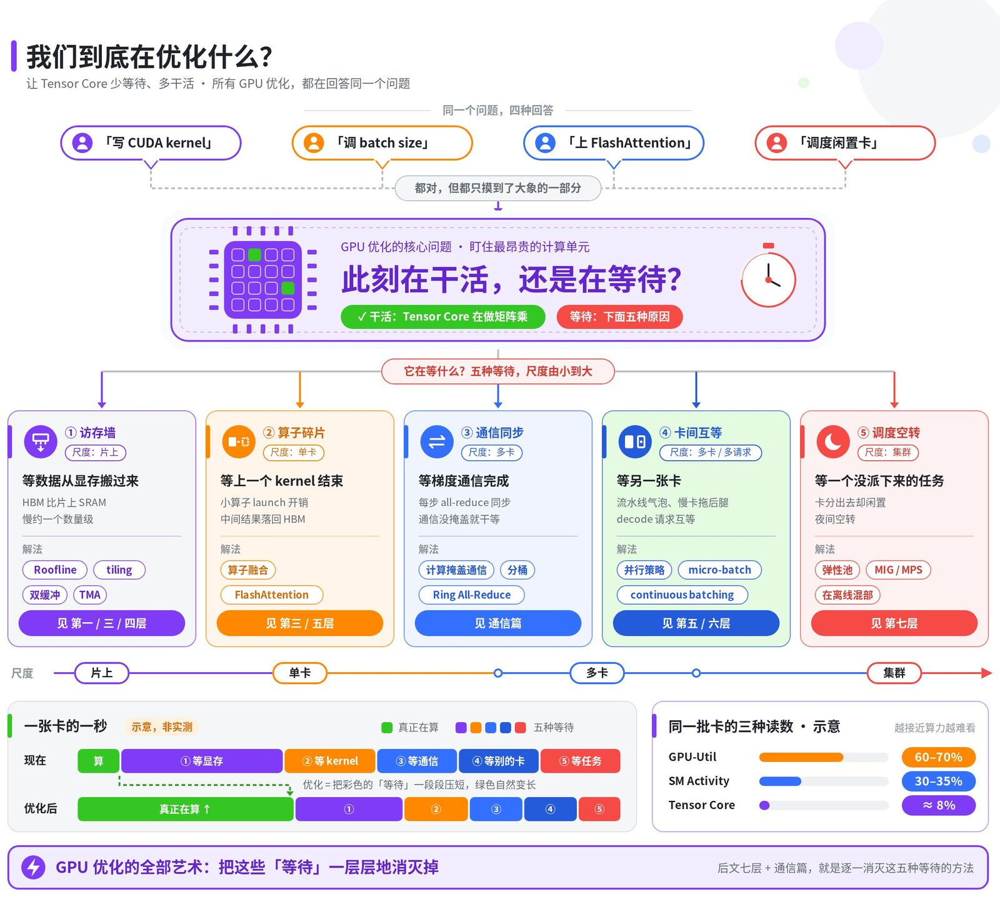

这份笔记沿着一条主线（「等待到底发生在哪里」）由内向外分成七层，不做零散的技巧罗列：

> 🌍 <b>全文地图（由内向外的七层）</b>
>
> - **第一层 · 基础篇**：读懂 GPU 这块「大石头」，架构、内存层级、Roofline 模型，建立判断瓶颈的坐标系。
> - **第二层 · 指标篇**：先学会「看得准」，为什么 nvidia-smi 的 100% 利用率会骗人，SM Activity / MFU 才是真相。
> - **第三层 · 算子篇**：CUDA 的手艺，以 reduce、GEMM 为例，看一个算子如何被一步步榨干性能。
> - **第四层 · 架构篇**：Tensor Core 三代跃迁，Volta → Ampere → Hopper，硬件红利如何改写优化范式。
> - **第五层 · 训练篇**：大模型训练优化，FlashAttention、混合精度、并行策略、显存墙。
> - **第六层 · 推理篇**：LLM 推理优化，KV Cache、PagedAttention、量化、投机采样。
> - **第七层 · 集群篇**：从单卡到万卡，利用率治理在治理什么，如何做到「看得准、用起来、用得好」。

这条脉络从最底层的硅片讲起，一层层往外走，目的是把散落的知识点串成一条线。

---

## 第一层 · 基础篇：读懂 GPU 这块「大石头」

> 🎯 <b>本章看点：</b>优化的前提是看得懂。先讲清 GPU 与 CPU 的设计哲学分野、SM 与内存层级的物理约束，再介绍 Roofline 这把「瓶颈标尺」：用它判断一个 kernel 到底卡在算力还是卡在访存，后面所有优化动作的方向都由这一步决定。

### 1.1 GPU vs CPU：一个求快，一个求多

要理解 GPU 为什么这样设计，最好的方式是把它和 CPU 放在一起看。二者谈不上谁更强，**面向的目标截然相反**。

CPU 是<b>延迟导向（latency-oriented）</b>的：它假设「可用的并行度是稀缺的」，因此把大量晶体管预算投入到乱序执行、分支预测、投机执行和多级大容量缓存上，目的只有一个，让**单个线程**尽可能快地跑完。GPU 则是<b>吞吐导向（throughput-oriented）</b>的：它假设「并行度是充裕的」，于是把晶体管预算从控制逻辑和缓存上省下来，换成海量的简单算术单元，再用「成千上万个线程 + 极快的上下文切换」来**隐藏**访存延迟，而不是像 CPU 那样靠缓存去**消除**延迟。这一「吞吐 vs 延迟」的架构分野，是理解 GPU 的总纲。

> 🐢 **CPU · 延迟导向**
>
> - 少量强核，深流水线
> - 大缓存、乱序/投机执行
> - 擅长：串行、强分支、低并行任务
> - 目标：让一个线程尽快完成

> 🐜 **GPU · 吞吐导向**
>
> - 海量简单核，浅控制逻辑
> - 小缓存，用线程切换隐藏延迟
> - 擅长：数据并行、高算术密度任务
> - 目标：让总吞吐量最大

一条经验法则：<b>高并行 + 高算术密度的负载（矩阵乘、卷积、注意力）交给 GPU；串行、强分支、低并行度的逻辑留给 CPU。</b>有个常见的比喻：CPU 像细沙，资源视图平坦，几乎任意程序都能跑、切割粒度极细、虚拟化成熟；GPU 像大石块，软件适配性差、切割粒度大、虚拟化不成熟，还对网络与机房有「异构」要求。GPU 资源「难管」的根源就在这里，第七章会再展开。

### 1.2 GPU 架构解剖：SM、CUDA Core、Tensor Core、Warp 与 SIMT

现代 NVIDIA GPU 是一个层次化的组织：整块 GPU die 由若干 <b>GPC（图形处理簇）</b>构成，每个 GPC 内含多个 <b>SM（Streaming Multiprocessor，流多处理器）</b>。SM 才是真正的调度与执行单元，它内部集成了三类专用核心：

| 核心类型 | 职责 | 优化关注点 |
|---|---|---|
| **CUDA Core** | 通用的标量/向量浮点与整数运算（FP32/INT32 等） | 指令级并行、FFMA 吞吐 |
| **Tensor Core** | 专为深度学习设计的矩阵乘加（MMA），如 FP16 输入、FP32 累加 | 矩阵对齐、混合精度、占用率 |
| **RT Core** | 光线追踪求交（图形负载，AI 训练/推理一般不涉及） | — |

GPU 的执行模型叫 <b>SIMT（Single Instruction, Multiple Threads，单指令多线程）</b>。线程被逐层组织：单个 **Thread** → 32 个线程组成一个 <b>Warp（线程束）</b>，锁步执行同一条指令 → 若干 Warp 组成一个 **Block** → Block 被分配到 SM 上执行。这里有两个关键事实，是后面所有算子优化的物理基础：

- <b>Warp 是硬件调度的最小单位。</b>32 个线程一荣俱荣、一损俱损：如果它们走了不同的 if/else 分支，硬件只能串行执行各条路径并屏蔽不参与的线程，这就是「Warp 分歧（warp divergence）」的由来。
- <b>Warp Scheduler 靠切换隐藏延迟。</b>当一个 warp 因等待访存而停顿时，调度器会零开销地切换到另一个就绪的 warp 继续算。SM 上同时驻留的 warp 越多（即「占用率 occupancy」越高），越有本钱把访存延迟藏起来。

下面这张图展示了 GPU 从整芯片到线程的层次结构：

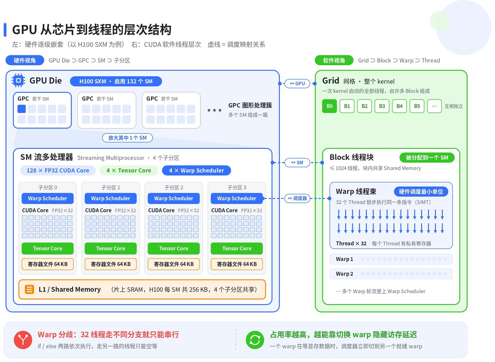

为什么 SM 和 Tensor Core 这么重要？看一组数字：Volta V100 的 Tensor Core 可达 125 Tensor TFLOPS，相比上代 Pascal P100 提升约 12 倍。可以说，过去几年 AI 算力的爆发，本质上是 Tensor Core 一代代变强的结果。但硬件给了你 125 TFLOPS，不代表你的模型真能吃到，这中间的巨大鸿沟，正是「优化」存在的意义。

### 1.3 内存层级：越快越小，越大越慢

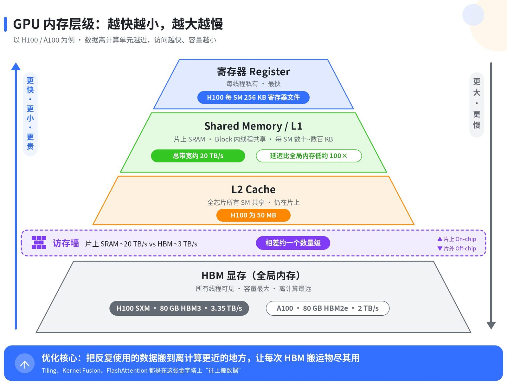

如果说计算单元是 GPU 的「肌肉」，那内存层级就是它的「血管」。绝大多数 GPU 程序跑不快，多半因为**数据喂不上来**，算力其实够用。理解内存层级，是理解一切「访存优化」的前提。

从离计算单元最近、最快、最小，到最远、最慢、最大，GPU 的内存层级大致是：

| 层级 | 位置与作用域 | 相对速度 | 典型容量 |
|---|---|---|---|
| **寄存器 Register** | 每线程私有，最贴近 ALU | 最快 | KB 级/线程 |
| **共享内存 / L1** | 片上 SRAM，Block 内共享（可编程 scratchpad） | 比全局内存快约 100× | 数十~数百 KB/SM |
| **L2 Cache** | 全芯片共享 | 快 | 数十 MB |
| **HBM 显存** | 板载全局内存，所有线程可见 | 相对慢（但带宽极高） | 数十~上百 GB |

这里有一个决定性的数量级差异，值得单独强调：<b>片上 SRAM 的带宽约为 20 TB/s，而 HBM 的带宽约为 1~3 TB/s，两者相差约一个数量级。</b>具体到硬件：H100 SXM 配 80GB HBM3、带宽 3.35 TB/s；A100 SXM 配 80GB HBM2e、带宽 2 TB/s。共享内存相比未缓存的全局内存，延迟低约 100 倍。

> 🚧 <b>「访存墙」（Memory Wall）是贯穿全文的主线。</b>计算单元越来越快，把数据从 HBM 搬到片上的速度却跟不上，很多任务真正的瓶颈在「数据没到」，「算不完」倒在其次。Roofline 的 memory-bound 区、标准注意力的低算术密度、LLM 解码阶段的 memory-bound 特性，本质上都是同一堵墙的不同侧面。

正因如此，几乎所有 CUDA 算子优化的核心手法都可以归结为一句话：<b>把会被反复使用的数据，尽量搬到离计算单元更近的地方（共享内存、寄存器），并让每一次从 HBM 的搬运都物尽其用。</b>后面 reduce、GEMM、FlashAttention 的优化，全都是这句话的不同演绎。

### 1.4 Roofline 模型：一张图判断你卡在哪

面对一个跑得慢的 kernel，第一个要回答的问题永远是：<b>它是算力不够（compute-bound），还是访存不够（memory-bound）？</b>答错了方向，再多努力都是白费：给一个访存受限的 kernel 换更强的 Tensor Core，毫无意义。

**Roofline 模型**（由 Berkeley 的 Samuel Williams 等人于 2008 年在 CACM 提出）就是回答这个问题的标准工具。它的核心概念是<b>算术强度（Arithmetic Intensity, AI）</b>：

> 算术强度 AI = 总浮点运算数（FLOP） ÷ 总数据搬运字节数（Byte），单位是 FLOP/Byte。

直觉上，AI 衡量的是「每搬一个字节的数据，能做多少次计算」。AI 高，说明数据复用充分、计算密集；AI 低，说明大量时间花在搬数据上。

把它画成图：横轴是算术强度 AI，纵轴是可达到的性能（FLOP/s）。「屋顶」由两段折线构成：一段斜线（性能 = 峰值带宽 × AI，受访存限制）和一段水平线（性能 = 硬件峰值算力，受计算限制）。两段的交点对应的 AI，叫做<b>「机器平衡点」（ridge point）</b>：

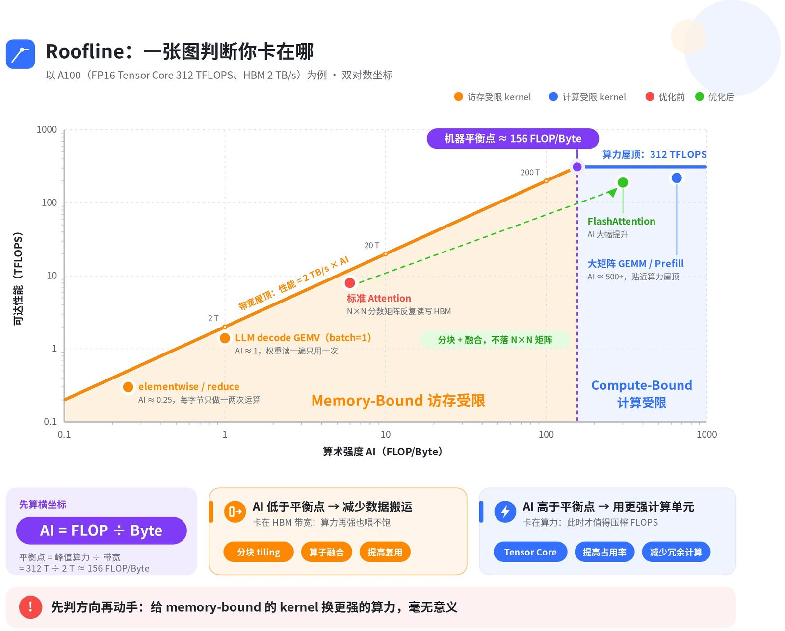

- <b>AI 低于平衡点 → memory-bound（访存受限）</b>：性能被带宽卡住。优化方向是减少数据搬运量、提高数据复用（分块 tiling、算子融合）。
- <b>AI 高于平衡点 → compute-bound（计算受限）</b>：性能被算力卡住。优化方向是用更快的计算单元（Tensor Core）、提高占用率、减少冗余计算。

Roofline 是本文的「导航仪」。举两个后面会详细展开的例子先建立直觉：标准注意力（naive attention）反复把 N×N 的中间矩阵写回 HBM 再读回，算术强度极低，是典型的 memory-bound，这正是 FlashAttention 的出发点；而 LLM 推理的 prefill 阶段并行处理整段输入、算术强度高，是 compute-bound，decode 阶段逐 token 生成、反复加载权重，则又回到 memory-bound。同一堵「访存墙」，在不同场景里换着面孔出现。

> ✅ <b>基础篇小结：</b>GPU 是台吞吐机器，靠海量线程隐藏延迟；它的性能被内存层级和「访存墙」深刻约束；Roofline 用算术强度这把标尺，在动手前先判断优化方向。带着这套坐标系进入下一层：怎么「看准」利用率。

---

## 第二层 · 指标篇：先学会「看得准」

📎 延伸阅读：从 profile 到逼近硬件上限的完整方法、2026 年工具链与内核选型见 [LLM-32｜系统｜AI Infra 性能优化实战：从 profile 到硬件上限](./32-infra-perf.md)。

> 🎯 <b>本章看点：</b>优化之前要先测量，测量本身就是一门学问。本章破除一个常见误解：<b>nvidia-smi 显示的「GPU 利用率 100%」，含义往往和直觉不一样。</b>看懂 SM Activity、Tensor Core Utilization、MFU 这些更「诚实」的指标，才不会对着一个漂亮数字空欢喜。

### 2.1 nvidia-smi 的「100%」为什么会骗人

几乎每个用 GPU 的人都盯过 `nvidia-smi` 里那个「GPU-Util」数字，看到 100% 就安心了。但这个指标极具误导性。它的定义其实非常粗糙：<b>在每个采样时间片内，只要有「至少一个 kernel」驻留在「任意一个 SM」上，就记为 100%。</b>它既不衡量你用了多少个 SM，也不衡量你算了多少 FLOP。

一个经典的反例足以说明问题：写一个只跑 `while(true){}` 的单线程 kernel，它只占用一个 SM（现代 GPU 有上百个 SM），几乎什么都没算，但 `nvidia-smi` 会忠实地显示 GPU-Util 100%。这就好比你雇了 100 个工人，其中 1 个在假装忙碌，考勤系统却报告「出勤率 100%」。

> 🧐 <b>先纠正一个认知：GPU 利用率高 ≠ 算得快。</b>「利用率（utilization）」和「饱和度（saturation）」是两回事。nvidia-smi 的 GPU-Util 只能说明「GPU 没在完全睡觉」，说不清「GPU 有没有被喂饱」。想看真相，得换用饱和度类指标。

### 2.2 一套「诚实」的利用率指标

下面这张表按「离真相远近」把常见指标排了个序。越靠下，越能反映硬件真实被榨干的程度：

| 指标 | 含义 | 诚实度评价 |
|---|---|---|
| **GPU Utilization** (nvidia-smi) | 采样片内是否有 kernel 驻留在任一 SM | ❌ 最易误导 |
| **SM Activity** （SM Efficiency） | 有多少 SM 处于活跃状态、活跃周期占比 | ✅ 接近真实饱和度 |
| **Tensor Core Utilization** | Tensor Core 活跃周期占比 | ✅ 反映矩阵算力是否被用上 |
| **MFU** （Model FLOPs Utilization） | 模型有效 FLOP/s ÷ 硬件理论峰值 FLOP/s | ✅✅ 端到端最诚实 |
| **HFU** （Hardware FLOPs Utilization） | 含重算的 FLOP/s ÷ 峰值，HFU ≥ MFU | ✅ 反映硬件真实负载 |

<b>MFU（Model FLOPs Utilization）</b>是这里最重要的概念，它由 Google 的 PaLM 论文（Chowdhery et al., 2022）提出。它的分子是「对模型真正有用的浮点运算」，分母是硬件理论峰值。MFU = 0.5 的确切含义是：你持续地用掉了这块硅片一半的理论算力，且这一半全部花在了对模型有意义的计算上，没有任何水分。

<b>HFU（Hardware FLOPs Utilization）</b>与 MFU 的差别很微妙但重要：HFU 的分子包含了「重复计算」的 FLOP，比如梯度检查点（activation checkpointing）为省显存而重新前向计算的那部分。所以 **HFU ≥ MFU**：硬件确实在忙（HFU 高），其中一部分忙碌对模型却没有净贡献（MFU 才是净值）。这个差值在第五章显存优化里会再次出现。

> 📌 <b>一个务实的标准（2025-2026）：</b>大模型预训练能做到 **40%~60% 的 MFU 就算不错，50%+ 属于优秀**。有厂商白皮书报告，在新一代硬件上通过软硬件协同优化，一批代表性工作负载的 MFU 中位数可提升约 35%。反观很多生产集群的现状：GPU-Util 看着不低，SM Activity 却往往只有它的一半左右，Tensor Core Utilization 更是常常只有个位数，大量 GPU 并没有把矩阵计算能力用好。这组数字的巨大落差，正是「看得准」的价值所在。

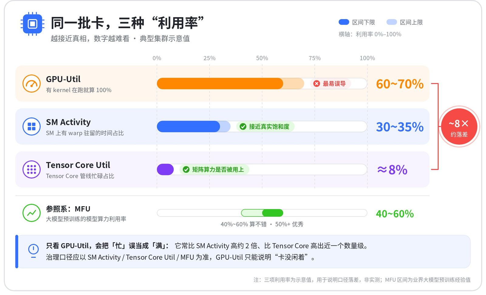

### 2.3 Profiling 工具箱：Nsight Systems / Nsight Compute / DCGM

指标要靠工具采集。NVIDIA 生态里三件套各司其职，用对了能让优化事半功倍：

> 🔭 **Nsight Systems**
>
> 系统级 · 时间线视图。看整机 CPU+GPU 时间轴，定位 kernel 间隙、CPU 瓶颈、H2D/D2H 拷贝、API 等待。<b>先用它做宏观定位。</b>

> 🔬 **Nsight Compute**
>
> 单 kernel 级 · 细粒度。给出访存、占用率、指令吞吐等指标。因硬件计数器有限，需 kernel replay 多趟采集。<b>用它深挖具体 kernel。</b>

> 📡 **DCGM**
>
> 数据中心级 · 长期监控。暴露 SM activity、DRAM active、各精度 Tensor Core activity、NVLink/PCIe 传输率。<b>用它做集群观测。</b>

一个实用技巧：判断瓶颈在 CPU 端还是 GPU 端，最快的方法是用 Nsight Systems 看时间线，如果 kernel 排得密、几乎没有间隙，说明 GPU 被喂饱了；如果 kernel 之间大量空白（gap），且 CPU 侧忙于 launch，那瓶颈往往在 CPU 端（kernel launch 开销、数据预处理跟不上）。在分析 elementwise 算子和 CUDA 工具链时，业界普遍用这种 timeline 分析法来区分「CPU 瓶颈 vs GPU 瓶颈」。

验证「全局访存是否合并（coalesced）」也有具体指标：在 Nsight Compute 里比较 `l1tex__t_sectors_pipe_lsu_mem_global_op_ld.sum` 与请求数的比值，即可定量判断访存效率，这为下一章的 CUDA 优化提供了可测量的抓手。

> ✅ <b>指标篇小结：</b>别太相信 nvidia-smi 的那个 100%。用 SM Activity 看饱和度，用 MFU 看端到端效率，用 Nsight/DCGM 定位瓶颈。测量准了，再进入下一层：亲手优化一个 CUDA 算子。

---

## 第三层 · 算子篇：CUDA 的手艺

> 🎯 <b>本章看点：</b>跟着两个经典算子（<b>reduce（归约）</b>和 <b>GEMM（矩阵乘）</b>）走一遍「从 naive 到接近 cuBLAS」的完整优化路径，就能看到第一章讲的每条原理（访存墙、warp、共享内存、bank conflict）怎样在真实代码里逐条兑现。

### 3.1 六个必须掌握的 CUDA 优化概念

动手之前，先把六个反复出现的核心概念钉牢。它们是几乎所有 CUDA kernel 优化的「元技巧」：

| 概念 | 是什么 / 为什么重要 | 量化影响 |
|---|---|---|
| **合并访问** Coalesced Access | 让一个 warp 的 32 个线程访问连续的全局内存地址，硬件合并为一次内存事务 | 不合并会退化成多次事务，浪费带宽 |
| **共享内存 Tiling** | 把反复使用的数据块搬到片上共享内存，block 内复用，减少全局访存 | 共享内存比全局内存快约 100× |
| **Bank Conflict** | 共享内存分 32 个 bank，一个 warp 内多线程访问同一 bank 的不同地址会被串行化 | 最坏可导致 32× 减速 |
| **占用率 Occupancy** | SM 上活跃 warp 数 ÷ 最大可支持 warp 数，受寄存器/共享内存用量限制 | 够高才能靠切换隐藏延迟 |
| **Warp 分歧** Warp Divergence | 同一 warp 内线程走不同分支，SIMT 只能串行执行各路径 | 分支越多，效率越低 |
| **向量化访存** | 用 float4（128-bit）一次搬 4 个 float，减少指令数、提高带宽利用 | 访存指令数减少约 4× |

可以把它们浓缩成三条黄金法则：<b>①一个 warp 的 32 次读要落在连续块上（合并访问）；②反复用的数据放共享内存并避开 bank conflict；③保持足够 occupancy 以隐藏延迟。</b>接下来的两个算子，就是这三条法则的实战演练。

### 3.2 reduce 优化：入门算子的七级进化

归约（reduce，即对一个数组求和/求最值）看似简单，却是理解 GPU 优化的最佳入门算子：它把 warp 分歧、bank conflict、线程利用率、warp 内通信这几个核心问题一次性全暴露出来。reduce 是典型的**访存密集型**算子，理论性能上限就是显存带宽本身。社区广泛验证的实测表明：在 V100 上一步步优化到最后约 160μs、接近 800 GB/s，逼近带宽上限。

它的整体结构是两阶段：先在每个 block 内部归约得到「部分和」，再对所有部分和做第二轮归约。真正的功夫在 block 内那一轮，业界经典的优化路径把它拆成了七步逐级优化：

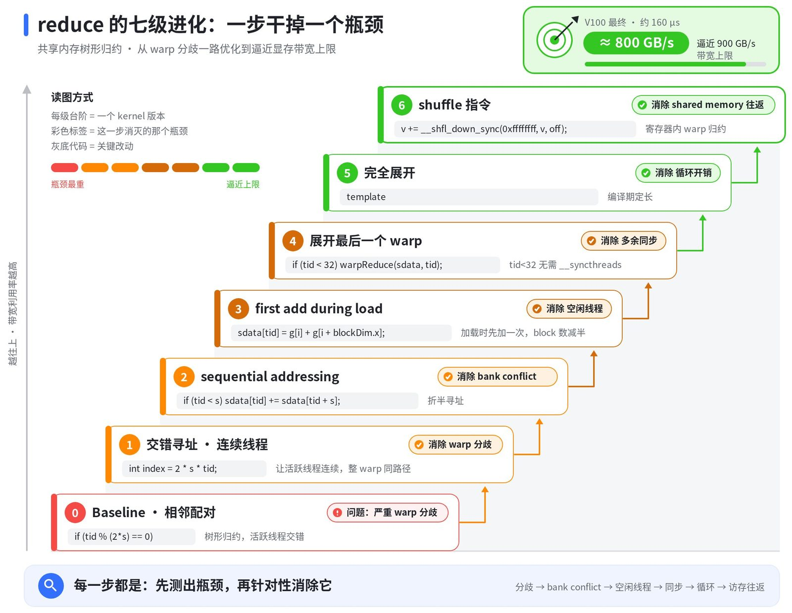

逐级拆解，每一步都精准打击一个第一层讲过的问题：

- <b>Baseline：</b>相邻两两配对求和（`if (tid % (2*s) == 0)`）。问题：同一 warp 内只有部分线程满足条件，造成严重的 **warp 分歧**。
- <b>① 消除 warp 分歧：</b>改用 `index = 2*s*tid`，让活跃线程在 warp 内连续排列，减少分歧。
- <b>② 消除 bank conflict：</b>改为 **sequential addressing**（步长 s 从大到小折半，`if(tid<s) sdata[tid]+=sdata[tid+s]`），避免多线程撞同一 bank。
- <b>③ first add during load：</b>数据从全局内存加载进来时就顺手做一次加法，让原本闲置的线程干活，block 数直接减半。
- <b>④ 展开最后一个 warp：</b>当只剩 32 个线程（tid&lt;32）时，这是旧架构的历史写法：早期 GPU 上 warp 内锁步，用 `volatile` 手动展开省掉 `__syncthreads`。Volta 起有独立线程调度，应按参与线程改用 `__syncwarp()` 或 `__shfl_down_sync` 等 warp 同步原语，`volatile` 不能替代同步。
- <b>⑤ 完全展开：</b>用模板参数 `template<unsigned int blockSize>` 配合 `#pragma unroll`，让编译器在编译期展开所有归约层。
- <b>⑥ shuffle 指令：</b>用 `__shfl_down_sync` 在寄存器层面做 warp 内归约，连共享内存的往返都省了，这是现代 GPU 上最优雅的收尾。

这条链的价值在于建立**逐级逼近硬件极限**的思维方式：每一步都用工具测出当前瓶颈，再针对性地消除它。reduce 给出的这套方法，适用于所有 GPU 优化。

### 3.3 GEMM 优化：从三级分块到 SASS 汇编

如果 reduce 是入门，那 <b>GEMM（通用矩阵乘，C = A×B）</b>就是 GPU 优化的「珠穆朗玛」：因为深度学习里绝大部分算力都花在矩阵乘上，GEMM 的效率几乎直接决定了整个模型的效率。它的优化通常分三大步逐级推进，路径清晰得像一部登山纪录片。

#### 第一站：三级分块（Tiling），把访存量打下来

naive 实现里，每个线程算 C 的一个元素，需要从全局内存读取整行 A 和整列 B，总访存量高达 2×M×N×K，绝大部分带宽浪费在重复读取上。解法是**三级分块**：数据沿着「全局内存 → 共享内存 → 寄存器」逐级搬运、逐级复用。

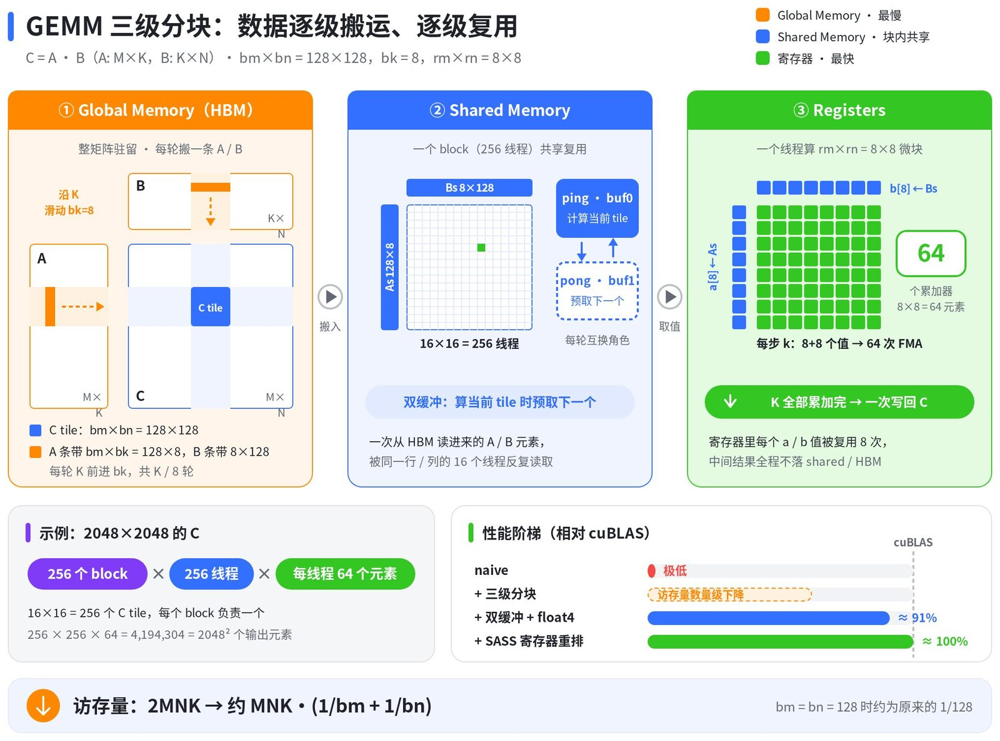

- <b>Block 分块：</b>每个 block 负责 C 的一个 bm×bn 子块，沿 K 维循环，每次把 A 的 bm×bk 和 B 的 bk×bn 载入共享内存复用。访存量降到约 `1/2 × (1/bm + 1/bn)` 量级，这是数量级的下降。
- <b>Register 分块：</b>每个线程再负责一个 rm×rn 的微块，把共享内存的数据载入寄存器进一步复用。
- <b>典型参数：</b>bm=128, bn=128, bk=8, rm=8, rn=8。以 2048×2048 为例，切成 256 个 block，每 block 256 线程，每线程算 8×8=64 个元素。

#### 第二站：数据预取 / 双缓冲（Double Buffer），把延迟藏起来

分块解决了「搬得太多」，但还有「搬的时候在等」的问题：每次 `__syncthreads` 同步等待数据到位时，计算单元是闲着的。解法是<b>双缓冲（ping-pong / prefetch）</b>：开辟两倍的共享内存空间，**在计算当前 tile 的同时，预取下一个 tile 的数据**，用计算掩盖访存延迟。实现上，数据先从全局内存 `ldg` 到临时寄存器中转，计算间隙再写入另一半共享内存，消除同步停顿。配合 float4 向量化访存，社区公开的实现在 1024~4096 的方阵上可达到 <b>cuBLAS 约 91%</b> 的性能。

#### 第三站：SASS 汇编，最后 9% 的战争

从 91% 到接近 100%，C 层和 PTX 层的优化已经见底，必须下探到 **SASS 汇编**层面。这里的敌人叫**寄存器 bank conflict**：寄存器也分 bank，一条 FFMA（融合乘加）指令的多个源寄存器若落在同一个 bank，会产生额外周期。解法是<b>寄存器重排（reorder）</b>加上利用<b>操作数复用缓存（reuse cache）</b>，手工调整寄存器分配来避开冲突。这也解释了一个长期的疑问：<b>为什么 cuBLAS 直接用 SASS 手写而非 nvcc 编译？</b>因为 nvcc/PTX 无法精确控制寄存器分配与指令排布，只有直接写 SASS 才能榨干最后那点性能。

> 📈 <b>GEMM 优化性能阶梯（相对 cuBLAS）</b>
>
> - naive 实现 → 访存量爆炸，性能极低
> - + 三级分块 tiling → 访存量数量级下降
> - + 双缓冲 + float4 向量化 → <b>≈ 91% cuBLAS</b>
> - + SASS 寄存器重排 → 逼近 cuBLAS（≈100%）

### 3.4 gemv 与 spmv：形状敏感与负载均衡

矩阵乘不止 GEMM 一种。当矩阵退化成向量或变得稀疏，优化策略要完全换一套思路，这两个算子恰好补上了「形状敏感」和「负载均衡」两块重要拼图。

> 📐 **gemv（矩阵×向量 y=A·x）· 形状决定策略**
>
> 访存密集型，优化强依赖矩阵形状（A 为 m×n）：
>
> - <b>n=16（瘦长）：</b>每个 warp 处理若干行，warp 内归约 → 优于 cuBLAS
> - <b>n=32：</b>一个 warp 处理一行，shfl 归约 → 略逊 cuBLAS
> - <b>n=128：</b>一个 warp 处理一行 + float4 向量化 → 优于 cuBLAS

> 🔍 **spmv（稀疏矩阵×向量）· 难在负载不均**
>
> 业界普遍认为它是 CUDA 中最难的算子之一，难点是**负载不均衡**：
>
> - 存储格式：COO / CSR / DIA / ELL / HYB
> - <b>CSR-Scalar：</b>一线程一行 → 长短行导致发散与失衡
> - <b>CSR-Vector：</b>一组线程/一个 warp 处理一行的非零元 → 按每行非零元数量分配线程，平衡负载

gemv 和 spmv 的启示是：<b>没有放之四海皆准的 kernel。</b>同样一个逻辑操作，矩阵瘦一点、胖一点、稀疏一点，最优实现可能天差地别。这也是为什么 cuBLAS 这类库内部会针对不同形状分派不同 kernel：优化的本质是「因地制宜」。

### 3.5 elementwise 与算子融合：把小算子的开销省掉

逐元素算子（elementwise，如加法、激活）看似最简单，但恰恰是<b>算子融合（operator fusion / kernel fusion）</b>大显身手的地方。核心洞见是：当一个 kernel 的 launch 开销大于它实际运行时间时，一堆小 kernel 串起来，光是启动就浪费掉大量时间。

算子融合的思想是把多个连续的小算子（elementwise、归一化、reduction）**合并成一个大 kernel**：数据一次装入寄存器/共享内存后连续算完，再写回。两大收益来源：**①减少 kernel launch 次数；②减少中间结果在 HBM 上的往返读写**，把一条 memory-bound 的算子链变成一次通过（single pass）。这是深度学习编译器（XLA、TorchInductor、TVM）和推理引擎的核心优化之一。

> 🔑 <b>伏笔：</b>算子融合不只是省 launch 开销的小技巧，它是 FlashAttention 的思想母版。把 QK^T、softmax、×V 三个操作融合进一个 kernel、避免中间大矩阵落盘，正是「算子融合」这一通用原理在注意力机制上最有代表性的一次应用。第五章揭晓。

### 3.6 方法论升华：HPC 优化的第一性原理

把前面的算子优化经验抽象出来，业界关于 HPC 性能优化的方法论总纲可以浓缩成两句话：

> <b>第一性原理是访存优化。</b>在冯·诺依曼架构下，IO bound 往往先于 compute bound 出现。所以先问「数据搬运能不能减少」，再问「计算能不能加快」。

具体的优化有两大方向，与第一层的 Roofline 严丝合缝地对应：

| 方向 | 具体手法 | 对应 Roofline |
|---|---|---|
| **减少数据搬运量** | 提高数据复用、分块 tiling、提升 cache 命中率 | 提高算术强度 AI |
| **减少访存延迟** | 隐藏延迟、double buffer 软流水、消除 bank conflict | 逼近带宽屋顶 |
| **计算优化** | FFMA 流水、循环展开、减少冗余计算、用 Tensor Core | 逼近算力屋顶 |
| **通信优化** | 大规模集群关注扩展性 scalability | （第五、七层展开） |

一个常见的坑是顺序搞反：<b>先把访存优化做到位，等瓶颈转移到计算，再做计算优化。</b>顺序颠倒往往南辕北辙。判断瓶颈在哪，回到第一章的 Roofline 模型即可。单个算子怎么优化到此讲完，而算子的性能上限由硬件决定，下一层看硬件如何一代代进化、重新定义优化的可能性。

> ✅ <b>算子篇小结：</b>reduce 给出逐级消除瓶颈的思路，GEMM 展示从分块、双缓冲到 SASS 的完整登山路径，gemv/spmv 提醒要因地制宜，融合把小算子的开销一次性省掉。这些做法最后收敛到同一句话：减少数据搬运，隐藏访存延迟。

---

## 第四层 · 架构篇：Tensor Core 三代跃迁

> 🎯 <b>本章看点：</b>前三章讲「在给定硬件上榨性能」，这一章把镜头对准过去七年 AI 算力爆发背后的引擎：**Tensor Core**。从 Volta 到 Hopper 再到 Blackwell，每一代硬件都不只是「更快」，更重要的是**改写了优化的范式**：异步拷贝、张量内存加速器、线程块集群。理清这些红利从何而来，才能解释为什么同一份 CUDA 代码到了新卡上往往要重写才能吃满算力。

### 4.1 为什么需要 Tensor Core：标量到矩阵的算力密度革命

回到第一层的 Roofline 直觉：要让 compute-bound 的矩阵乘跑得快，唯一的办法是提高单位时间的 FLOP 吞吐。传统 CUDA Core 每周期只能做一次标量的乘加（FFMA），而深度学习的本质是<b>海量的矩阵乘加（MMA）</b>。于是 NVIDIA 在 Volta 架构（2017）里首次引入了专用的矩阵运算单元：**Tensor Core**，它一条指令就能完成一个小矩阵块的乘加，把算力密度提升了一个数量级。

一组对比数字最能说明问题：V100 的 FP32 峰值约 15.7 TFLOPS，而它的 Tensor Core FP16 峰值高达约 125 TFLOPS，**接近 8 倍的落差**。这意味着如果你的矩阵乘还在用 CUDA Core 的 FP32 路径，等于把 87% 的算力白白扔掉。Tensor Core 的出现，让「混合精度」从一个可选项变成了性能刚需。

> ❗ <b>关键认知：</b>Tensor Core 的算力不是「免费」的。它要求数据以特定的形状（如 16×16 的矩阵块）、特定的精度（FP16/BF16/TF32/FP8）、特定的内存布局喂进去。喂不对，Tensor Core 就会闲置，这正是第二层里「Tensor Core Utilization 仅 5%」现象的技术根源：硬件有 125 TFLOPS，但绝大多数 kernel 根本没走 Tensor Core 路径。

### 4.2 三代架构演进：Volta → Ampere → Hopper

下面这张表把三代（外加最新的 Blackwell）Tensor Core 的关键跃迁排成一条时间线。每一代的核心创新，都在解决上一代暴露出的新瓶颈：

| 架构 / 代表卡 | 年份 | Tensor Core 关键创新 | 解决的瓶颈 |
|---|---|---|---|
| **Volta** V100 | 2017 | 首代 Tensor Core；`wmma` API；FP16 输入 / FP32 累加 | 矩阵算力密度不足 |
| **Turing** T4 | 2018 | 二代 TC；新增 INT8 / INT4 推理精度 | 推理场景低精度需求 |
| **Ampere** A100 | 2020 | 三代 TC；`cp.async` 异步拷贝；TF32；结构化稀疏 2:4；`HMMA.16816` | 数据搬运与计算串行等待 |
| **Hopper** H100 | 2022 | 四代 TC；**WGMMA** warpgroup 级矩阵乘；**TMA** 张量内存加速器；**Thread Block Cluster**；FP8；Transformer Engine | 更大规模的异步与数据编排 |
| **Blackwell** B200 | 2024 | 五代 TC；第二代 Transformer Engine；FP4 / FP6 微缩放；双 die 封装 | 超大模型的精度-算力平衡 |

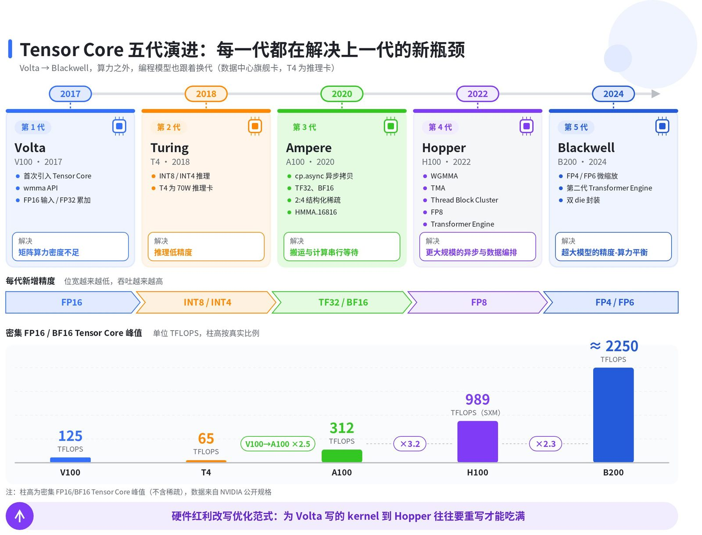

### 4.3 Volta：Tensor Core 的起点与 wmma 编程模型

Volta 首次把矩阵乘加做成硬件原语。程序员通过 <b>WMMA（Warp Matrix Multiply-Accumulate）</b>API 来调用它：以一个 warp 为单位，协同加载 A、B 两个矩阵片段（fragment）到寄存器，调用 `wmma::mma_sync` 完成 D = A×B + C，再把结果片段写回。它的典型形状是 16×16×16，即一个 warp 一次算 16×16 的输出块，内积维度为 16。

Volta 的意义在于它**确立了「混合精度」的基本范式**：输入用 FP16 省带宽、省显存，累加用 FP32 保精度。这一「FP16 存储 + FP32 累加」的组合，直接催生了下一层要讲的混合精度训练。但 Volta 的 Tensor Core 也有明显短板：数据必须先老老实实从全局内存搬到共享内存、再搬到寄存器，搬运和计算是**串行**的，计算单元经常在等数据，这正是 Ampere 要解决的问题。

### 4.4 Ampere：异步拷贝（cp.async）让搬运与计算并行

Ampere 架构最重要的创新之一，是引入了**异步拷贝指令 **<b>`cp.async`</b>。在 Volta 上，把数据从全局内存搬到共享内存，必须经过寄存器中转，而且这个过程会阻塞线程。`cp.async` 则允许数据**绕过寄存器、直接从全局内存流入共享内存**，而且是异步的：发起拷贝后线程可以继续算别的，等真正需要数据时再同步。

> 📌 <b>回到第三层的双缓冲：</b>还记得 GEMM 优化里的「双缓冲（double buffer）」吗？在 Volta 上，双缓冲需要手动用寄存器中转来模拟数据预取。而 Ampere 的 `cp.async` 从硬件层面原生支持了这种「边算边搬」的软流水，让预取变得又快又省寄存器。这就是「硬件红利改写优化范式」的典型例子：同样的双缓冲思想，在新硬件上有了更优雅、更高效的实现。

Ampere 还带来了另外两个关键特性：**TF32**（一种 19-bit 的中间精度，让 FP32 训练无需改代码就能享受 Tensor Core 加速）和<b>结构化稀疏（2:4 sparsity）</b>，即每 4 个权重里保留 2 个非零值，硬件可跳过零值计算，理论上再翻一倍算力。A100 的 Tensor Core 指令也从 Volta 的 `HMMA.884` 升级为 `HMMA.16816`，单指令处理的矩阵块更大，指令开销摊薄得更彻底。

### 4.5 Hopper：WGMMA、TMA 与线程块集群的三重奏

如果说 Ampere 是「让搬运异步化」，那 Hopper 就是把异步和数据编排推向了极致。它带来了三个环环相扣的重磅特性：

> 🔥 **WGMMA**
>
> Warpgroup 级矩阵乘。把 MMA 的协作单位从单个 warp（32 线程）扩大到<b>一个 warpgroup（4 个 warp，128 线程）</b>，单条指令算更大的矩阵块，进一步摊薄指令开销、提升 Tensor Core 占用。

> 🚚 **TMA**
>
> Tensor Memory Accelerator 张量内存加速器。一个专用硬件单元，用**单条指令**就能完成整块多维张量（tile）在全局内存与共享内存间的搬运，还自动算好地址，彻底解放线程去做计算。

> 🔗 **Thread Block Cluster**
>
> 线程块集群。在 Grid 和 Block 之间新增一个层级，让**多个 block 能协作访问彼此的共享内存**（分布式共享内存 DSMEM），打破了 block 间无法直接通信的旧约束。

这三者合起来，让 Hopper 上的 GEMM 和注意力 kernel 可以构建出一条极致的软流水：TMA 在后台异步搬运下一块 tile，WGMMA 用 warpgroup 高效计算当前 tile，Thread Block Cluster 让相邻 block 共享数据、减少重复搬运。**FlashAttention-3 正是靠吃满这些 Hopper 特性，把注意力计算的 FLOP 利用率推到了新高度**，下一章详述。

Hopper 还内置了 **Transformer Engine**，能在训练中动态地在 FP8 和 FP16 之间切换精度、自动管理缩放因子，让大模型在几乎不损失精度的前提下再提速。FP8 的引入，标志着「低精度」从推理场景正式进入了训练主战场。

### 4.6 硬件红利的另一面：每一代都要重写 kernel

三代跃迁带来一个残酷但真实的工程结论：<b>为 Volta 手写优化的 GEMM，直接搬到 Hopper 上往往只能发挥一小部分性能。</b>因为最优的数据编排方式变了：Volta 靠共享内存双缓冲，Hopper 要靠 TMA + WGMMA + Cluster。这也是为什么 cuBLAS、CUTLASS、cuDNN 这些库要针对每一代架构分别调优，以及为什么 FlashAttention 从 v1 到 v3 几乎是跟着硬件代次重写的。

| 优化手法 | Volta 时代 | Hopper 时代 |
|---|---|---|
| **数据搬运** | 手动经寄存器中转到共享内存 | TMA 单指令异步搬运整块 tile |
| **矩阵乘协作单位** | warp（32 线程）wmma | warpgroup（128 线程）WGMMA |
| **双缓冲预取** | 手动软流水模拟 | cp.async / TMA 原生异步 |
| **block 间协作** | 不可直接通信，须经全局内存 | Thread Block Cluster 共享 DSMEM |
| **主流训练精度** | FP16 + FP32 累加 | FP8 + Transformer Engine |

> ✅ <b>架构篇小结：</b>Tensor Core 是 AI 算力爆发的物理引擎，但它的算力必须靠正确的形状、精度和数据编排才兑现得出来。Volta 确立混合精度范式，Ampere 用 cp.async 让搬运异步化，Hopper 用 WGMMA+TMA+Cluster 把异步和编排推向极致。理清硬件的进化，才能解释 FlashAttention 这样的算法为什么要一次次跟着硬件重写。下一层进入大模型训练的主战场。

---

## 第五层 · 训练篇：大模型训练优化

> 🎯 <b>本章看点：</b>前四层的功夫都花在「单卡、单算子」上。从这一层起进入大模型训练的真实场景，对手不再是单个 kernel，而是**四堵墙**：注意力的访存墙（FlashAttention 破）、精度与显存的权衡墙（混合精度破）、单卡装不下模型的显存墙（并行策略 + ZeRO 破）、激活值爆炸的显存墙（重算与卸载破）。前面那些原理（算子融合、访存优化、Roofline）就是从这里开始升维成系统级工程的。

### 5.1 FlashAttention：算子融合的杀手级应用

第三章结尾埋过一个伏笔：算子融合是「FlashAttention 的思想母版」。这里揭晓答案。

#### 问题：标准注意力为什么慢

标准的自注意力计算 `Attention(Q,K,V) = softmax(QK^T/√d)·V`，朴素实现分三步走：先算出注意力分数矩阵 S = QK^T（尺寸 N×N），写回 HBM；再从 HBM 读回 S 做 softmax，得到 P，又写回 HBM；最后读回 P，与 V 相乘。问题在于：**那个 N×N 的中间矩阵，要在 HBM 上来回读写好几遍**。当序列长度 N 达到几千甚至几万，这个 N×N 矩阵大到离谱，访存量随 N² 增长，算术强度极低，这是教科书级的 **memory-bound**。

> 🚧 <b>回到访存墙：</b>标准注意力的瓶颈在「N×N 矩阵在 HBM 上反复搬运」，跟「算不完」无关。GPU 的 Tensor Core 大部分时间在等 softmax 的中间结果从慢速 HBM 搬回来。这就是第一层那堵「访存墙」在注意力机制上的具体现身。

#### 解法：分块 + 融合 + 在线 softmax

FlashAttention（Dao et al., 2022）的核心思想，正是第三层讲透的**算子融合 + 分块 tiling**在注意力上的极致运用：把 QK^T、softmax、×V 三个操作**融合进一个 kernel**，让中间的 N×N 矩阵**永远不落 HBM**，只在片上 SRAM 里分块地算完就地消化。

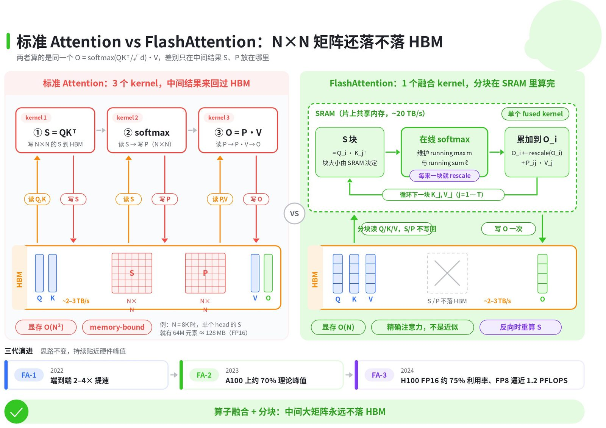

难点在于 softmax 需要「全局」归一化（要知道整行的最大值和求和），分块计算时一次只能看到一小块。FlashAttention 用了一个经典技巧，<b>在线 softmax（online softmax）</b>：一边分块遍历，一边维护「当前见过的最大值」和「累计的指数和」，每来一个新块就用这两个统计量动态修正之前的部分结果（rescale）。这样既不用看到全部数据，又能得到数学上完全等价的精确结果。FlashAttention 是**精确注意力**，不是近似算法。

#### 三代演进：跟着硬件一起进化

FlashAttention 是「算法跟着硬件重写」的最佳注脚，三个版本各有侧重：

| 版本 | 核心改进 | 效果 |
|---|---|---|
| **FlashAttention-1** (2022) | 分块融合 + 在线 softmax + 重算反向 | 显存从 O(N²) 降到 O(N)，端到端提速 2-4× |
| **FlashAttention-2** (2023) | 优化并行度与工作划分，减少非矩阵乘的 FLOP，更好的 warp 分工 | 逼近 GEMM 效率，A100 上达到约 70% 理论峰值 |
| **FlashAttention-3** (2024) | 吃满 Hopper 特性：TMA 异步搬运 + WGMMA + FP8；计算与数据搬运重叠 | H100 上 FP16 达约 75% 利用率，FP8 逼近 1.2 PFLOPS |

反向传播时，FlashAttention 不保存那个巨大的 N×N 注意力矩阵，而是在反向时**用保存的统计量重新计算**它，这又是一次「用计算换显存」的经典权衡，和下面要讲的梯度检查点异曲同工。

### 5.2 混合精度训练：用一半的位宽换一倍的速度

Tensor Core 的低精度算力（第四层）只有在混合精度训练里才能真正兑现。核心思路是：**大部分计算用 16-bit 精度（省显存、快一倍），关键的地方保留 FP32 以保证数值稳定**。

> 🔢 **FP16 vs BF16**
>
> - <b>FP16:</b>10 位尾数精度高，但指数范围窄（易上溢/下溢），需要 loss scaling
> - <b>BF16:</b>8 位指数，动态范围与 FP32 相同，几乎不用 loss scaling，大模型训练首选
> - <b>FP8：</b>Hopper 起支持，Transformer Engine 动态管理，再省一半

> 🔧 **混合精度三件套**
>
> - <b>FP16 前向/反向：</b>计算走 Tensor Core，快
> - <b>FP32 主权重（master weights）：</b>参数更新在 FP32 上做，避免小梯度被吞
> - <b>Loss Scaling：</b>把 loss 放大若干倍，防止 FP16 下小梯度下溢为 0，更新前再缩回

为什么需要 FP32 主权重？因为参数更新常常是「大参数 + 极小梯度」的加法，在 FP16 下小梯度会被直接舍入掉（swamping），训练停滞。保留一份 FP32 的主权重专门用于更新，就能吃到 FP16 的速度又不丢精度。这套方法由 NVIDIA 的混合精度训练论文（Micikevicius et al., 2018）确立，如今是所有大模型训练的标配。

📎 另一类舍入问题：误差没有被吞掉，它有固定方向，沿同一结构在训练中累积，见第 54 篇 [LLM-54｜系统｜低精度训练的数值稳定性：从 FlashAttention 一次舍入偏差说起](./54-low-precision-training.md)。

### 5.3 并行策略：当模型再也塞不进一张卡

当模型大到单卡显存装不下（如百亿、千亿参数），就必须把模型和数据切开，分散到多卡多机上。四种基本并行策略，各切一个维度：

| 并行方式 | 切什么 | 通信开销 / 特点 |
|---|---|---|
| **数据并行 DP** | 切数据 batch，每卡一份完整模型副本 | 每步 all-reduce 同步梯度；最简单，但显存冗余大 |
| **张量并行 TP** | 切单层内的权重矩阵（层内并行） | 通信频繁，须在高速 NVLink 内做；通常限一机内 |
| **流水线并行 PP** | 按层切分，不同卡放不同层（层间并行） | 需微批 micro-batch 填流水线，减少「气泡」 |
| **序列 / 上下文并行 SP** | 切超长序列的 token 维度 | 专为长上下文；配合 FlashAttention 使用 |

真实的大模型训练往往是<b>「3D 并行」甚至「4D 并行」</b>：同时用上 DP+TP+PP(+SP)，在不同维度分层切分。比如：一机 8 卡内用 TP（靠 NVLink 高带宽），机间用 PP（层间流水），再在更外层用 DP 复制多份。合理的并行组合能让通信落在最快的链路上，最小化「等待另一张卡」的时间。

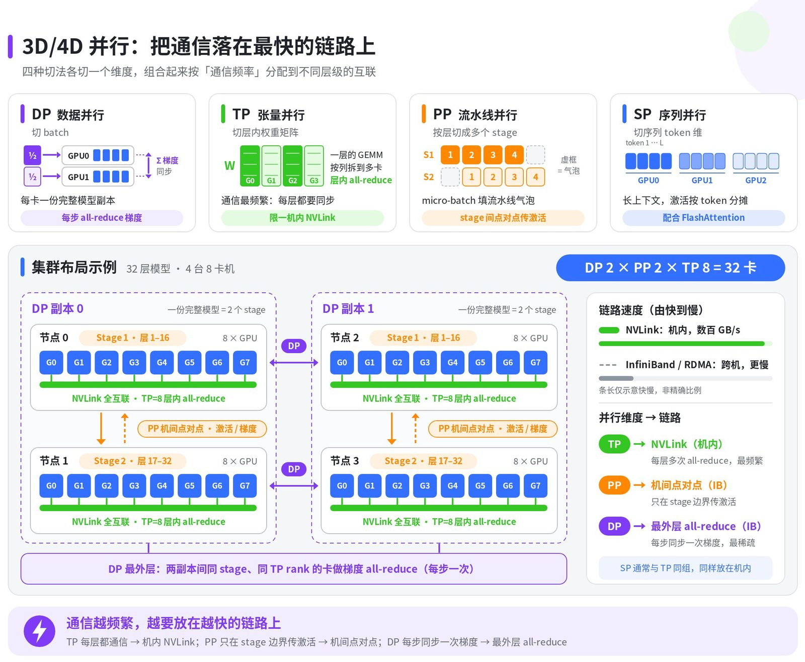

### 5.4 ZeRO 与 FSDP：消灭数据并行的显存冗余

纯数据并行有个致命浪费：**每张卡都存了一份完整的模型参数、梯度和优化器状态**。而 Adam 优化器的状态（动量 + 方差）加上 FP32 主权重，体积往往是参数本身的好几倍。N 张卡就冗余了 N 份，极其奢侈。

<b>ZeRO（Zero Redundancy Optimizer，微软 DeepSpeed，Rajbhandari et al., 2020）</b>的洞见是：这些状态其实不需要每张卡都存全量，可以**分片（shard）到各卡上，用时再临时聚合**。它分三级，逐级消灭冗余：

| 级别 | 分片对象 | 显存节省 |
|---|---|---|
| **ZeRO-1** | 只分片优化器状态（optimizer states） | 约 4× 节省 |
| **ZeRO-2** | + 分片梯度（gradients） | 约 8× 节省 |
| **ZeRO-3** | + 分片参数（parameters）本身 | 与卡数成正比，通信换显存 |

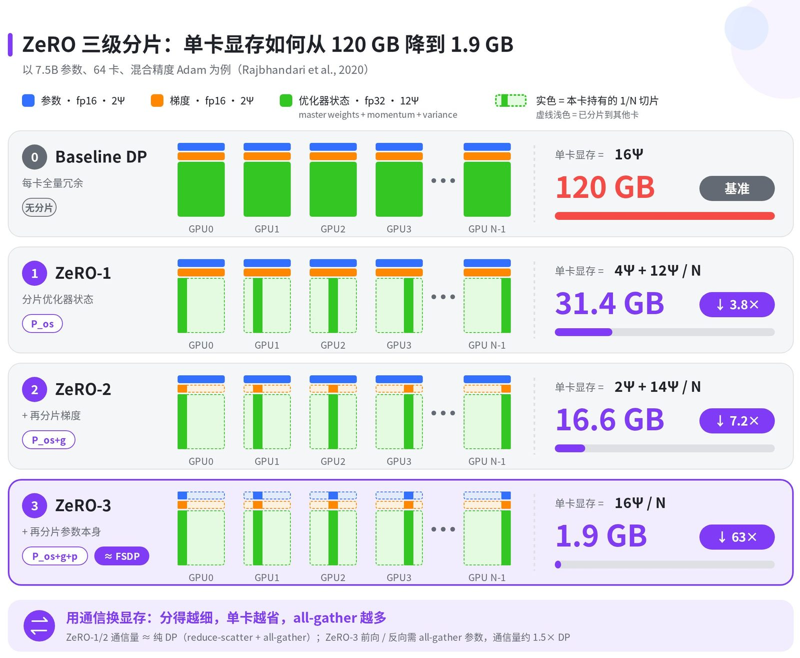

PyTorch 原生的 <b>FSDP（Fully Sharded Data Parallel）</b>本质上就是 ZeRO-3 的官方实现：前向/反向计算某层时，临时把该层的完整参数从各卡 all-gather 过来，算完立刻释放分片。它用「通信换显存」：多花点 all-gather 的带宽，换来把超大模型塞进有限显存的能力。这与第一层的 Roofline 权衡一脉相承：当显存是瓶颈时，牺牲一点通信是划算的。

### 5.5 显存墙：激活值、重算与卸载

训练时占显存的不只是参数，还有一个常被低估的大头：<b>激活值（activations）</b>，即前向传播中每一层的中间输出，反向传播算梯度时要用到。激活值的显存占用随 batch size 和序列长度线性增长，长序列训练时它甚至能超过参数本身。

> 🔁 **梯度检查点 / 激活重算**
>
> Activation Checkpointing。前向时**只保存少数关键层的激活**（检查点），其余丢弃；反向需要时**重新前向计算**一遍拿回来。用计算换显存，典型可省 √N 量级的激活显存。
>
> 这正是第二层 **HFU ≥ MFU** 差值的来源：重算的那部分 FLOP 让硬件更忙（HFU 高），却不产生净模型进展（不计入 MFU）。

> 📤 **卸载 Offload**
>
> 把暂时用不到的优化器状态、参数甚至激活，<b>换出到 CPU 内存（甚至 NVMe SSD）</b>，需要时再换回 GPU。ZeRO-Offload / ZeRO-Infinity 让单卡也能训练超大模型。
>
> 代价是 PCIe/CPU 带宽远低于 HBM，需精心调度换入换出的时机，避免 GPU 空等。

> 📌 <b>一以贯之的主题：</b>训练篇的四大优化，FlashAttention、混合精度、ZeRO/FSDP、重算/卸载，表面各不相同，内核却完全一致：<b>要么减少数据搬运（FlashAttention 不落 HBM），要么用计算/通信换显存（重算、ZeRO、卸载），要么用低精度换带宽与算力（混合精度）</b>。全都是第一层「访存墙」和 Roofline 权衡在系统层面的放大。

> ✅ <b>训练篇小结：</b>主线很清楚：FlashAttention 用算子融合击穿注意力的访存墙；混合精度用低精度兑现 Tensor Core 算力；3D 并行 + ZeRO/FSDP 把超大模型切开塞进集群并消灭冗余；重算与卸载在激活值的显存墙前用计算和带宽换空间。训练优化的本质，是在算力、显存、通信这个不可能三角里找最优解。下一层转向另一个战场：推理。

📎 训练篇讲的都是单个训练任务的效率。到了强化学习，一次迭代里多半时间花在生成上，训练和推理两套引擎要共用一批卡，还要在几十秒内交换权重，这一层的取舍见第 55 篇 [LLM-55｜系统｜RL 训练系统：rollout 与训练分离、异步与 Agent 环境](./55-rl-systems.md)。

---

## 第六层 · 推理篇：LLM 推理优化

> 🎯 <b>本章看点：</b>训练是「一次性」的大工程，推理是「每时每刻」都在烧钱的持续开销。LLM 推理有它独有的结构，即**自回归逐 token 生成**，由此带来一组特有的瓶颈：KV Cache 的显存爆炸、decode 阶段的 memory-bound、请求间的负载不均。本章梳理四类杀手锏：PagedAttention 治显存碎片、continuous batching 治吞吐、量化治带宽、投机采样治延迟。它们回答的还是那个反复出现的老问题：怎么让昂贵的 GPU 少等待、多干活。

### 6.1 推理的两个阶段：Prefill 与 Decode

理解 LLM 推理，必须先分清它截然不同的两个阶段。这是本层所有优化的前提：

> ⚡ **Prefill（预填充）· compute-bound**
>
> 处理用户输入的整段 prompt，所有 token **并行**计算，一次性生成首个输出 token 和全部输入的 KV Cache。计算密集、算术强度高，能吃满 Tensor Core。对应指标：<b>首 token 延迟（TTFT）</b>。

> 🐌 **Decode（解码）· memory-bound**
>
> 自回归地**一次只生成一个 token**，每步都要加载全部模型权重 + 读取全部 KV Cache，却只算一个 token 的量。算术强度极低，是典型 memory-bound。对应指标：<b>每 token 延迟（TPOT）</b>。

> 🚧 <b>又见访存墙：</b>decode 阶段是访存墙的又一次现身，为了生成一个 token，要把几百 GB/s 带宽都花在「搬运权重和 KV Cache」上，Tensor Core 大量空转。这解释了为什么 LLM 推理的吞吐优化，几乎都在想办法「把 decode 阶段的带宽用满」：要么增大 batch（摊薄权重搬运），要么压缩 KV Cache 和权重（量化）。

两个阶段特性如此不同，催生了一个前沿方向，<b>Prefill/Decode 分离（disaggregation）</b>：把两个阶段部署到不同的 GPU 池，各自用最优的并行和批处理策略，互不干扰。DistServe（Zhong et al., 2024）等工作证明，分离能同时改善 TTFT 和 TPOT，显著提升有效吞吐。

### 6.2 KV Cache：推理显存的头号占用者

自回归生成有个关键优化：每生成一个新 token，它对之前所有 token 的注意力 Key 和 Value 都可以**缓存复用**，不必重算。这就是 **KV Cache**。它用显存换计算，是推理提速的基石，但它也带来了推理时最棘手的显存问题。

KV Cache 的大小 = 2 × 层数 × 注意力头数 × 头维度 × 序列长度 × batch × 精度字节。它随**序列长度和并发请求数线性膨胀**，长上下文、高并发场景下，KV Cache 甚至会超过模型权重本身，成为显存的头号占用者，也直接决定了能同时服务多少个请求。

### 6.3 PagedAttention：借操作系统的虚拟内存治碎片

传统推理框架给每个请求预分配一块**连续**的 KV Cache 显存，按可能的最大长度分配。这导致两类严重浪费：**内部碎片**（实际没用那么长，尾部空着）和**外部碎片**（连续块被切得七零八落，总量够却分不出连续大块）。实测显示传统方案的 KV Cache 显存利用率可能低至 20%-40%。

<b>PagedAttention（vLLM，Kwon et al., 2023）</b>的灵感直接来自操作系统的**虚拟内存分页**：把 KV Cache 切成固定大小的「块（block）」，像内存页一样**按需、非连续分配**，用一张「块表（block table）」记录逻辑块到物理块的映射。这样几乎消除了碎片，显存利用率逼近 100%，同样的卡能服务的并发请求数成倍增长。

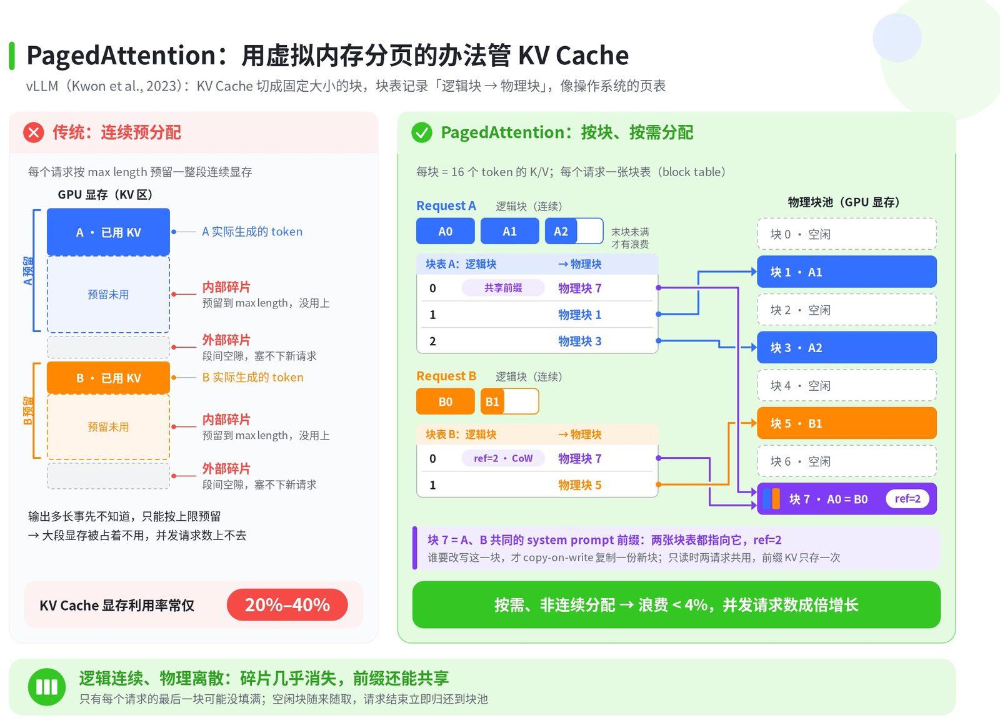

分页还带来一个额外红利：**块共享**。多个请求若有相同的前缀（比如同一个 system prompt），可以共享同一批物理块（copy-on-write），进一步省显存。这就是 vLLM 高吞吐的核心秘密。

### 6.4 Continuous Batching：让 GPU 不再等最慢的请求

传统的静态批处理（static batching）有个大问题：一个 batch 里的请求必须**同进同出**，即使某个请求早早生成完了，也得等 batch 里最长的那个请求结束，整个 batch 才能释放。短请求被长请求拖着，GPU 大量空转。

<b>Continuous Batching（连续批处理，又称 in-flight batching，源自 Orca，Yu et al., 2022）</b>把调度粒度从「一个 batch」细化到「一次迭代（iteration）」：每生成一步就重新组批，**完成的请求立即退出、腾出的位置立刻让新请求补入**。GPU 始终保持满载，吞吐可提升数倍。这是 vLLM、TensorRT-LLM 等现代推理引擎的标配。

> 📌 <b>本质还是「减少等待」：</b>continuous batching 消灭的是「请求间互相等待」的时间，PagedAttention 消灭的是「显存装不下更多请求」的约束。两者合力，把 decode 阶段那条 memory-bound 的带宽尽可能用满：增大有效 batch 就是摊薄权重搬运成本的最直接手段。

### 6.5 量化：用更低精度换带宽与显存

既然 decode 是 memory-bound、瓶颈在搬运权重和 KV Cache，那把它们**压缩到更低精度**就能直接缓解：搬得少了，自然快了，还省显存。这就是推理量化的核心动机。主流方法分两类：

| 方法 | 思路 | 特点 |
|---|---|---|
| **GPTQ** (2022) | 逐层用二阶信息（Hessian）做权重量化误差补偿，量化到 INT4/INT3 | 训练后量化（PTQ），精度损失小 |
| **AWQ** (2023) | 激活感知，识别并保护少数「重要权重」通道，按激活幅度缩放 | 低比特下精度更稳，推理友好 |
| **SmoothQuant** (2022) | 把激活的量化难度「平滑」迁移一部分到权重，实现 W8A8 | 权重和激活同时量化，吃满 INT8 算力 |
| **KV Cache 量化** | 把 KV Cache 本身量化到 INT8/FP8 | 直击 decode 显存与带宽瓶颈 |

量化的关键难点是<b>离群值（outliers）</b>：大模型激活里存在少数数值极大的通道，粗暴量化会因它们而丢失大量精度。GPTQ、AWQ、SmoothQuant 的差别，本质上就是各自用不同办法处理这些离群值：要么补偿误差，要么保护重要通道，要么把难度在权重和激活间重新分配。

### 6.6 投机采样：用小模型给大模型「打草稿」

decode 逐 token 串行，每步都要跑一遍完整大模型，延迟高。<b>投机采样（Speculative Decoding，Leviathan et al. / Chen et al., 2023）</b>的巧思是：**先用一个便宜的小模型（draft model）快速连猜几个 token，再让大模型一次性并行验证这几个 token 是否靠谱**。

妙处在于：大模型的「验证」是**并行**的（一次前向就能验证 K 个候选 token），而验证的算力开销远小于逐个自回归生成。只要小模型的猜测有一定命中率，平均每次大模型前向就能产出多个 token，端到端延迟显著下降，而且数学上保证**输出分布与原大模型完全一致**，不损失质量。这本质上是把 decode 从 memory-bound 往 compute-bound 拉，更充分地利用了硬件。

### 6.7 推理引擎全景：各有侧重的工程集大成者

上述技术都已集成进各大推理引擎。选型时理解它们的侧重很重要：

| 引擎 | 出身 / 定位 | 核心特色 |
|---|---|---|
| **vLLM** | UC Berkeley 开源 | PagedAttention 发源地，continuous batching，易用、生态广 |
| **TensorRT-LLM** | NVIDIA 官方 | 深度融合 kernel，吃满 NVIDIA 硬件，极致性能 |
| **SGLang** | 学界 / 社区 | RadixAttention 前缀缓存复用，结构化生成友好 |
| **TGI** | Hugging Face | 与 HF 生态无缝集成，生产部署成熟 |

> ✅ <b>推理篇小结：</b>LLM 推理的核心矛盾，是自回归 decode 阶段的 memory-bound 特性。PagedAttention 借虚拟内存思想消灭 KV Cache 碎片，continuous batching 消灭请求间等待，量化压缩权重与 KV Cache、直击带宽瓶颈，投机采样用小模型打草稿把 decode 往 compute-bound 拉。四招的共同目标，是让昂贵的 GPU 在推理时少等待、多产出。到此，从单卡算子到单机训练推理的全链路已经串完，最后一层上升到万卡集群的视角。

---

## 第七层 · 集群篇：从单卡到万卡

📎 延伸阅读：万卡训练的故障分布、检查点间隔和有效训练时间，见 [LLM-23｜系统｜大模型训练工程：数据配比与万卡稳定性](./23-training-engineering.md)。

> 🎯 <b>本章看点：</b>前六层的优化都为了让「一张卡」或「一组卡」跑得更快。规模来到成千上万张 GPU 后，一个更宏观也更烧钱的问题浮出来：<b>这些昂贵的卡，此刻有多少真的在为有价值的任务干活？</b>常见的现象是，集群的 GPU-Util 看起来不低，真正反映算力被榨干程度的 SM Activity 往往只有它的一半左右。本章记录集群尺度的「等待消除」：利用率治理到底在治什么，以及怎么做到「看得准、用起来、用得好」。

### 7.1 为什么 GPU 这么难管：大石头 vs 细沙

回到第一层那个精妙的比喻：**CPU 像细沙，GPU 像大石块**。这个比喻是理解集群治理难度的钥匙。

> 🌵 **CPU · 细沙**
>
> - 资源视图平坦，任意程序几乎都能跑
> - 切割粒度极细，虚拟化成熟
> - 装箱（bin-packing）容易，碎片好回收

> 🗻 **GPU · 大石块**
>
> - 软件适配性差，切割粒度大
> - 虚拟化不成熟，难以细粒度共享
> - 对网络（RDMA）、机房有「异构」要求

「大石块」的属性决定了 GPU 资源天然难以被填满：一个只需要半张卡的任务，往往独占了整张卡；一个需要跨机通信的训练任务，对网络拓扑挑三拣四。结果就是大量的「空隙」：卡分出去了，却没被用满。集群治理要消灭的，正是这些集群尺度的「等待」和「空转」。

### 7.2 治理框架：看得准、用起来、用得好

GPU 集群的利用率治理可以拆成三个层层递进的阶段。这个框架有普遍的参考价值，可以作为 GPU 集群治理的行动纲领：

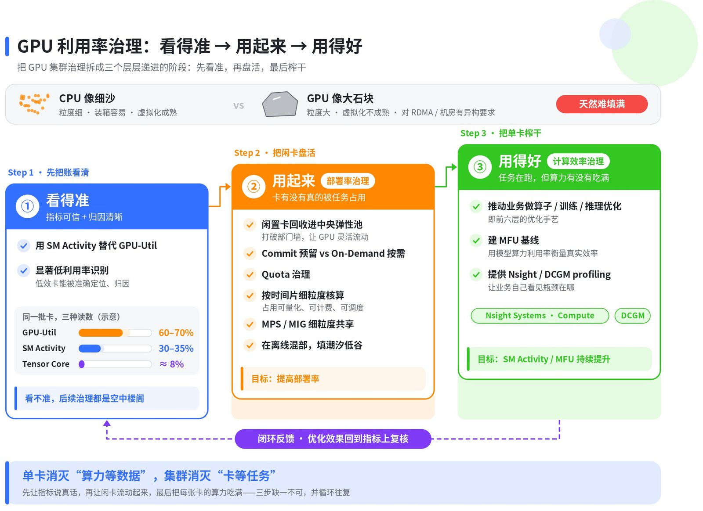

| 阶段 | 要解决的问题 | 关键抓手 |
|---|---|---|
| **① 看得准** | 指标是否可信？低效能否被准确定位归因？ | 用 SM Activity 替代 GPU-Util；显著低利用率识别 |
| **② 用起来** （部署率治理） | 卡分出去了但没跑任务，或任务排不进来 | 资源灵活流动、中央弹性池、Quota 治理 |
| **③ 用得好** （计算效率治理） | 任务在跑，但没吃满算力（SM Activity 低） | 推动业务侧做前六层的算子/训练/推理优化 |

#### 看得准：回到第二层的诚实指标

治理的第一步，恰恰是第二层讲透的道理：<b>别信 nvidia-smi 的 GPU-Util，要看 SM Activity。</b>生产集群里常见的读数落差最有说服力：GPU-Util 看着不低，SM Activity 往往只有它的一半左右，Tensor Core Utilization 更常常只有个位数。这意味着即便一张卡「显示在忙」，它的矩阵计算能力大概率还有巨大的闲置。看不准指标，后续所有治理都是空中楼阁。

#### 用起来：资源灵活流动与中央弹性池

「用起来」治理的是**部署率**：卡有没有被任务占用。核心手段是打破资源的「部门墙」，让 GPU 能**灵活流动**：建立一个**中央弹性池**，把各业务线暂时闲置的卡回收进池，再动态分配给有需求的任务。配合 <b>Commit（承诺预留）vs On-Demand（按需）</b>两种模式，既保障核心业务的确定性配额，又能把冗余的算力弹性地借给潮汐性任务。

> ⏳ <b>「时间片」抽象：</b>这是集群治理中一个关键的度量与调度抽象，把 GPU 的占用按固定的细粒度时间片来统计和核算。这让「一张卡在一段时间内到底被有效利用了多少」变得可量化、可计费、可调度。资源的流动和弹性，都建立在这套细粒度的时间片核算之上。

#### 用得好：把前六层的优化推给业务

「用得好」治理的是**计算效率**：任务跑起来了，但 SM Activity 是高是低。这一层没有银弹，答案就是推动业务侧把前六层的功课做扎实：检查 kernel 是否走了 Tensor Core、注意力是否用了 FlashAttention、batch 是否够大、有没有算子融合、通信有没有掩盖……治理团队的角色，是提供 profiling 工具（第二层的 Nsight/DCGM）、建立 MFU 基线、识别出低效任务并给出优化建议。

### 7.3 细粒度共享：MPS 与 MIG

「大石块」难填满，一个直接的破局思路就是**把石块切小**：让多个任务安全地共享一张卡。NVIDIA 提供了两种官方机制：

| 机制 | 原理 | 隔离性 / 适用 |
|---|---|---|
| **MPS** Multi-Process Service | 多个进程的 CUDA kernel 共享 GPU 执行资源并发执行（Volta 起各客户端有独立上下文与地址空间保护，但显存容量、带宽与故障隔离仍共享） | 软隔离，无显存/故障隔离；适合互信的小任务填空隙 |
| **MIG** Multi-Instance GPU | Ampere 起支持，硬件级把一张卡切成多个独立实例 | 硬隔离，各实例独享算力/显存/带宽；适合多租户 |

MPS 像「拼车」，大家共用一辆车，便宜但互相可能影响；MIG 像「隔间」，一辆车硬隔成几个独立包厢，安全但切分粒度固定。推理小模型、开发调试等「吃不满一张卡」的场景，正是这两种机制大显身手的地方，能显著抬升部署密度。

### 7.4 在离线混部：潮汐算力的错峰复用

集群里有两类性格迥异的负载：**在线推理**（延迟敏感，有明显的日间高峰、夜间低谷的潮汐）和**离线训练/批处理**（吞吐敏感，不在乎延迟，随时可跑）。<b>在离线混部（co-location）</b>的思路，就是让离线任务**见缝插针**地填进在线业务的低谷：白天在线推理占主导，夜间空出的算力立刻喂给离线训练。

难点在于**优先级抢占与性能隔离**：必须保证在线业务的延迟不被离线任务干扰（通过优先级调度、算力限额、必要时抢占离线任务）。做好了，集群的整体利用率能上一个大台阶，这本质上是在时间维度上消灭「夜间空转」这种最大的浪费。

> 📌 <b>七层贯通：</b>集群治理看似离底层的 CUDA 很远，内核却和第一章完全一致。单卡上，用共享内存和双缓冲消灭「计算单元等数据」；集群上，用弹性池和混部消灭「卡等任务」。从一条 FFMA 指令到万卡集群，GPU 优化的第一性原理始终是同一句话：**让昂贵的资源少等待、多干活**。

> ✅ <b>集群篇小结：</b>GPU 的「大石块」属性让它天然难以填满。治理遵循「看得准（SM Activity 替代 GPU-Util）→ 用起来（中央弹性池、时间片核算、Commit/On-Demand）→ 用得好（推动业务做前六层优化）」的递进框架；MPS/MIG 提供细粒度共享，在离线混部实现潮汐错峰。集群优化，就是把前六层的单点优化放大到万卡尺度的系统工程。

---

## 进阶专题一 · 通信篇：万卡之间的「等待」

> 🎯 <b>本章看点：</b>第五章讲并行策略时多次提到「卡间通信」却没有展开。训练规模来到成百上千张卡后，**通信本身就成了头号瓶颈**：梯度同步、参数聚合、激活传递，每一步都可能让计算单元停下来「等另一张卡」。本章补上这块拼图：集合通信原语、Ring All-Reduce 的巧思，以及「用计算掩盖通信」这个贯穿始终的思路。

### P1.1 集合通信原语：多卡协作的基本动作

多卡训练里，卡与卡之间的数据交换遵循一组标准化的**集合通信（collective communication）原语**。理解它们，是理解一切分布式训练通信的基础：

| 原语 | 动作 | 典型用途 |
|---|---|---|
| **All-Reduce** | 所有卡的数据求和（或其他归约），结果分发回每张卡 | 数据并行同步梯度 |
| **All-Gather** | 把每张卡的分片收集拼成完整数据，人手一份 | ZeRO-3/FSDP 聚合参数 |
| **Reduce-Scatter** | 归约后把结果分片散给各卡，每卡拿一片 | ZeRO 分片梯度 |
| **Broadcast** | 一张卡的数据复制给所有卡 | 初始化参数广播 |
| **All-to-All** | 每张卡把不同分片发给不同卡，矩阵式交换 | MoE 专家路由、序列并行 |

其中 **All-Reduce 是数据并行的心跳**：每个训练 step 结束，所有卡都要把各自算出的梯度做一次 All-Reduce 求和求平均，再各自更新。一个关键事实：**All-Reduce ≡ Reduce-Scatter + All-Gather**，这个分解正是高效实现的基础。NVIDIA 的 <b>NCCL（NVIDIA Collective Communications Library）</b>是这些原语在 GPU 上的工业级实现，能自动感知 NVLink/PCIe/InfiniBand 拓扑，选择最优通信路径。

### P1.2 Ring All-Reduce：带宽最优的经典算法

朴素的 All-Reduce 实现（让所有卡把梯度发给一个「主卡」求和再广播回去）有个致命问题：主卡的网络带宽成为瓶颈，通信量随卡数线性增长，主卡被打爆。

<b>Ring All-Reduce（环形全归约）</b>用一个漂亮的思路解决了这个问题：把 N 张卡组织成一个**逻辑环**，每张卡只和左右邻居通信。它分两个阶段，各走 N-1 步：

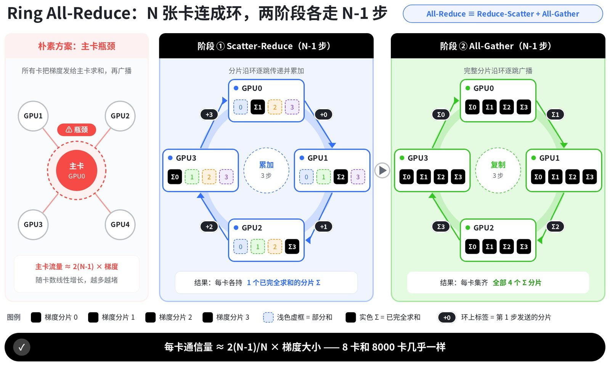

- <b>Scatter-Reduce 阶段：</b>把梯度切成 N 份，每张卡沿环传递一份并累加，N-1 步后每张卡各持有一份「已完全求和」的分片。
- <b>All-Gather 阶段：</b>再沿环传播这些完整分片，N-1 步后每张卡都集齐了全部结果。

> 📌 <b>为什么 Ring All-Reduce 如此优雅：</b>它的通信量与卡数 N **几乎无关**，每张卡收发的数据总量恒定约为 2×(N-1)/N × 梯度大小，逼近单份梯度的 2 倍上限。而且每张卡的出入带宽都被充分利用，没有主卡瓶颈。这是「带宽最优（bandwidth-optimal）」的：无论 8 卡还是 8000 卡，单卡的通信负担都不会爆炸。这也是它成为分布式训练事实标准的原因。

### P1.3 用计算掩盖通信：通信优化的第一性原理

再高效的通信也是开销。真正的高手会**让通信「消失」，藏到计算的背后去**，光把通信做快不够。这与第三层双缓冲「用计算掩盖访存」的思想完全同构，只是尺度从片上升到了机间。

> 🔄 **反向传播时重叠梯度同步**
>
> 反向传播是从最后一层往前算的。某一层的梯度一算出来，就**立刻发起它的 All-Reduce**，同时继续反向计算前面的层。等所有层反向算完，靠前的梯度通信也差不多传完了，通信被计算完美掩盖。

> 📦 <b>梯度分桶（Bucketing）</b>
>
> 若每个参数张量都单独发一次 All-Reduce，小消息太多、启动开销大。把多个梯度**攒成一个「桶（bucket）」批量通信**，减少通信次数、摊薄延迟。PyTorch DDP 正是这么做的。

流水线并行（PP）里也有同样的智慧：通过把大 batch 切成多个 **micro-batch** 交错送入流水线，让不同卡在不同层上同时工作，尽量填满流水线的「气泡（bubble）」，那些因为等待上游数据而空转的时间。GPipe、1F1B(one-forward-one-backward)等调度策略，本质都是在优化这个「谁在等谁」的问题。

> 🚧 <b>通信墙：访存墙的机间版本。</b>单卡上，慢的是「HBM → 片上」；机间，慢的是「一张卡 → 另一张卡」。带宽层级同样森严：片上 SRAM（~20 TB/s）≫ HBM（~3 TB/s）≫ NVLink（数百 GB/s）≫ InfiniBand 跨机（更低）。规模越大，通信占比越高，「让计算掩盖通信」就越是决定 MFU 上限的胜负手。这就是为什么万卡集群的扩展效率（scalability），本质上是一场对抗通信墙的战争。

---

## 进阶专题二 · 实战：一次完整的 reduce 优化复盘

> 🎯 <b>本章看点：</b>本章把第二章的「测量」和第三章的「优化」拧成一根绳，复盘一个 reduce kernel 从 naive 逼近带宽上限的完整过程：每一步优化前怎么用 profiler 找瓶颈、优化后怎么验证效果。这就是 GPU 优化真实的工作方式：**测量 → 定位 → 优化 → 再测量**的闭环。

### P2.1 先定标：reduce 的理论天花板在哪

动手优化前，必须先知道「终点在哪」。reduce（数组求和）是访存密集型算子：它每个元素只做一次加法，却要从显存读一遍。根据第一层的 Roofline，它的算术强度极低，性能天花板就是**显存带宽本身**。

> 理论耗时下限 = 数据总量 ÷ 显存带宽。以 V100（带宽约 900 GB/s）处理 32M 个 float(128 MB)为例，理论下限 ≈ 128 MB ÷ 900 GB/s ≈ 142 μs。

公开实测最终优化到约 **160 μs、有效带宽约 800 GB/s**，已经逼近这块卡的物理极限。有了这个标尺，每一步优化「离终点还有多远」就一目了然。教训是：<b>不先设定理论天花板就开始优化，等于不知道及格线在哪就进考场。</b>

### P2.2 逐级复盘：每一步都先测再改

下面把第三层那七级优化，配上「优化前用什么指标发现问题、优化后看什么指标验证」的完整闭环：

| 优化步骤 | Profiler 暴露的瓶颈 | 优化后验证指标 |
|---|---|---|
| **Baseline** | Nsight Compute 显示 warp 执行效率低、大量线程被屏蔽 | —（基线） |
| **① 消除 warp 分歧** | Branch Efficiency 偏低，SIMT 利用率差 | Branch Efficiency 上升，活跃线程连续 |
| **② 消除 bank conflict** | Shared Memory Bank Conflicts 计数高 | Bank Conflict 归零，shared 吞吐上升 |
| **③ first add during load** | 大量线程加载后闲置，Achieved Occupancy 有余量却没干活 | block 数减半，单 block 有效工作翻倍 |
| **④ 展开最后 warp** | 尾部 __syncthreads 同步开销占比升高 | 同步指令数下降，尾部延迟降低 |
| **⑤ 完全展开** | 循环控制指令（比较/跳转）占比不可忽略 | 指令数下降，计算指令占比提升 |
| **⑥ shuffle 指令** | shared memory 往返仍占带宽 | 寄存器内归约，shared 访问进一步减少 |

这张表的重点在<b>「怎么知道该做这个优化」</b>，「做了什么优化」反而次要。每一步都是先用 Nsight Compute 看到一个具体的、可量化的低效指标（bank conflict 计数、branch efficiency、同步开销占比），再针对性地消除它。这就是「诚实指标」在实战中的价值：它指出下一刀该砍在哪。

### P2.3 迁移到 GEMM：同一套方法论的升维

reduce 教会的方法论，可以原样搬到更难的 GEMM 上，只是每一步的抓手升级了：

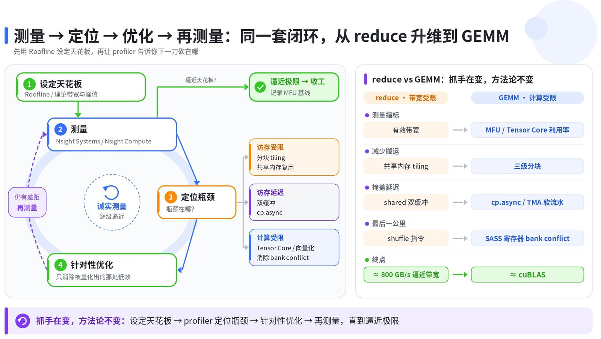

GEMM 优化里，「测量」从看有效带宽变成看 **MFU / Tensor Core 利用率**；「减少搬运」从共享内存 tiling 升级为三级分块；「掩盖延迟」从 shared 双缓冲升级为 cp.async/TMA 软流水；最后的 9% 甚至要下探到 SASS 层面看寄存器 bank conflict。**抓手在变，方法论不变**：设定天花板 → profiler 定位瓶颈 → 针对性优化 → 再测量，直到逼近极限。

> ✅ <b>实战篇小结：</b>真实的 GPU 优化是一个严格的测量-优化闭环，靠背技巧走不通：先用 Roofline 设定理论天花板，再用 Nsight Compute 把每一处低效（bank conflict、warp 分歧、同步开销）量化出来，针对性消除后立刻回测验证。reduce 逼近带宽上限、GEMM 逼近 cuBLAS，靠的都是同一套「诚实测量 + 逐级逼近」的手艺，也是把前七层原理落到指尖的方式。

---

## 进阶专题三 · 前沿篇：LLM 时代的 GPU 新进展（2025–2026）

📎 延伸阅读：非 NVIDIA 加速器（TPU、Trainium、AMD、昇腾）的硬件与软件栈见 [LLM-36｜系统｜非 NVIDIA 算力：TPU、Trainium、AMD 与昇腾](./36-non-nvidia.md)。

> 🎯 <b>本章看点：</b>前七层讲的大多是 Hopper 及以前沉淀下来的「经典功夫」。这两年 LLM 把 GPU 推向了新的极限：推理模型动辄输出上万 token、MoE 专家分散在几百张卡上、上下文长到百万级，硬件和软件都在快速换代。本章按「硬件 → 精度 → 算子 → 模型结构 → 系统」的顺序，整理 2025–2026 年最值得关注的进展，并尽量放回前七层的坐标系里看：第一性原理一点没变，只是那堵墙换了位置。

### F.1 硬件：从 Blackwell Ultra 到 Rubin，算力跑得比带宽快

先看数字。下表列出最近几代数据中心旗舰 GPU 的关键规格（单 GPU，数据来自 NVIDIA 官方规格与技术博客）：

| GPU | 上市 | 显存 / 带宽 | 最低精度峰值（稠密） | 关键新特性 |
|---|---|---|---|---|
| **H100 SXM** Hopper | 2022 | 80 GB HBM3 · 3.35 TB/s | FP8 ≈ 2 PFLOPS | WGMMA、TMA、FP8 Transformer Engine |
| **B200** Blackwell | 2024–2025 | 192 GB HBM3e · 8 TB/s | FP4 ≈ 9–10 PFLOPS | 第五代 Tensor Core（tcgen05）、TMEM、NVFP4、双 die |
| **B300** Blackwell Ultra | 2026 年初出货 | 288 GB HBM3e · 8 TB/s | NVFP4 15 PFLOPS | 注意力层加速约 2×（相对 Blackwell）、ConnectX-8 800 Gb/s |
| **Rubin** Vera Rubin | 2026 下半年起 | 288 GB HBM4 · 22 TB/s | NVFP4 推理 50 PFLOPS（稀疏峰值，非稠密口径） | 224 SM、第三代 Transformer Engine、NVLink 6（3.6 TB/s） |

机架级系统的变化更惊人：**GB300 NVL72** 用 72 张 B300 组成一个 NVLink 域，NVLink 总带宽 130 TB/s、HBM 共 20 TB、稠密 FP4 约 1.1 EFLOPS；**Vera Rubin NVL72** 把 NVLink 总带宽提到 260 TB/s、NVFP4 推理算力提到约 3.6 EFLOPS。「一台机器」的边界，已经从 8 卡服务器扩展成了 72 卡的一整个机柜。

把这些数字放在一起看，有一个比「更快」更重要的趋势：**算力的增长速度远远超过带宽**。从 H100 到 Rubin，最低精度峰值涨了约 25 倍，HBM 带宽只涨了约 6.6 倍。回到第一章的 Roofline：屋顶越来越高，斜坡却没跟上，**机器平衡点在不断右移**，越来越多的 kernel 会掉进 memory-bound 区。

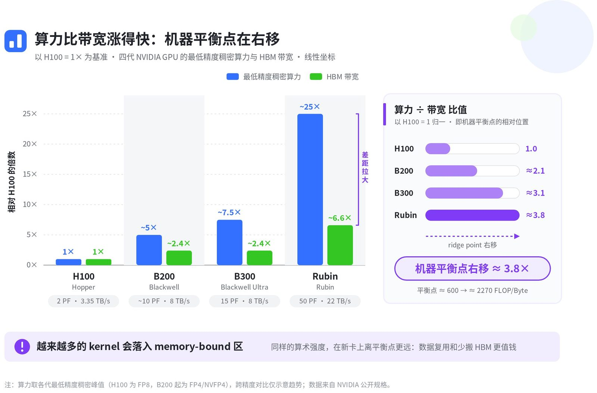

> 🚧 <b>访存墙在变高，不是在消失。</b>新硬件给的是「更多的算力」，但要吃到这些算力，算术强度的门槛也水涨船高。这正是 NVFP4 低精度、FlashAttention-4、MLA、稀疏注意力等新进展背后的共同动机：要么把每个字节变小，要么让每个字节被多算几次。

另一个值得记住的硬件信号是 **Rubin CPX**：一款专为长上下文 prefill 设计的 GPU（128 GB GDDR7、约 30 PFLOPS NVFP4，预计 2026 年底可用）。第六层讲过 prefill 是 compute-bound、decode 是 memory-bound，而 CPX 用便宜的 GDDR7 换算力、专攻 prefill：**Prefill/Decode 分离第一次从软件架构下沉到了芯片形态**。

### F.2 精度：NVFP4 让 4 bit 真正可用

第四层讲过，每一代 Tensor Core 都在往更低精度走。Blackwell 带来的 **NVFP4** 是这条路上的关键一步：普通 FP4 只有 4 bit，动态范围太窄，直接用会严重掉精度；NVFP4 用了**两级缩放**，每 16 个数共享一个 FP8（E4M3）的微块缩放因子，整个张量再有一个 FP32 缩放因子。

> 🔢 **NVFP4 带来了什么**
>
> - 精度接近 FP8（官方称差异常在约 1% 以内）
> - 显存占用比 FP8 省约 1.8×，比 FP16 省约 3.5×
> - Tensor Core 原生支持，SGLang / TensorRT-LLM / vLLM 已集成

> 💡 **和第六层怎么对上**
>
> - decode 是 memory-bound：权重和 KV 每小一半，搬运时间就少一半
> - 微块缩放本质是在处理**离群值**：和 GPTQ / AWQ / SmoothQuant 在对付同一个敌人
> - 低精度正在从「推理专属」扩展到训练：DeepSeek-V3 已用 FP8 细粒度缩放完成大规模训练

### F.3 算子：FlashAttention-4 与「非对称扩展」

FlashAttention 一直是「算法跟着硬件重写」的最佳注脚，第四代（FA4，MLSys 2026）又一次印证了这点。它面对的问题很有意思，论文把它叫作<b>非对称硬件扩展（asymmetric hardware scaling）</b>：从 Hopper 到 Blackwell，BF16 Tensor Core 吞吐从约 1 PFLOPS 翻倍到约 2.25 PFLOPS，但**共享内存带宽（每 SM 每周期 128 字节）和做指数运算的 MUFU 单元（每 SM 每周期 16 次）几乎没变**。结果，瓶颈从矩阵乘转移到了 softmax 里的指数运算和共享内存流量。

| Blackwell 新特性 | FA4 怎么用它 |
|---|---|
| <b>TMEM（Tensor Memory）</b> | 每 SM 256 KB 的新片上存储，专门存放 Tensor Core 的中间结果；MMA 直接写 TMEM，不再占寄存器，缓解了 Hopper 上严重的寄存器压力 |
| **全异步 tcgen05 MMA** | 单线程发起矩阵乘、结果异步落入 TMEM；FA4 用 warp specialization 让一部分 warp 发 MMA、另一部分做 softmax，二者重叠 |
| **2-CTA MMA** | 两个线程块协作完成一次更大的 MMA（最大 256×256×16），减少重复的共享内存流量，反向传播的全局原子归约也随之减半 |
| **指数运算的软件模拟** | 把一部分 exp 从 MUFU 挪到 FMA 单元上用多项式近似计算，绕开指数单元这个新瓶颈 |

效果：在 B200 上 BF16 前向最高约 <b>1605 TFLOPS（约 71% 利用率）</b>，比 cuDNN 9.13 快最多约 1.3 倍、比 Triton 快约 2.7 倍；NVIDIA 随后也把其中多项技巧吸收进了新版 cuDNN。

> 📌 <b>由此带来的启发：</b>Roofline 不只有「算力」和「HBM 带宽」两条线。当 Tensor Core 快到一定程度，共享内存带宽、指数单元吞吐、寄存器容量都可能变成新的「屋顶」。优化前先问「这一代硬件上，哪条线最低」，比套用上一代的经验更重要。

### F.4 模型结构倒逼 kernel：MLA、MoE 与稀疏注意力

另一股推动力来自模型本身。以 DeepSeek-V3 为代表的新结构，<b>MLA（多头潜在注意力，压缩 KV Cache）</b>和<b>细粒度 MoE（671B 总参数、每 token 激活约 37B）</b>，让通用 kernel 吃不满硬件。DeepSeek 在 2025 年 2 月的「开源周」放出了三件套，后来被 SGLang、vLLM 等主流引擎广泛集成：

| 库 | 解决什么 | 公开数据（H800） |
|---|---|---|
| **FlashMLA** | MLA 的 decode 注意力 kernel，支持分页 KV Cache；后续加入 FP8 KV Cache 的稀疏注意力 kernel | 访存受限时约 3000 GB/s，计算受限时最高约 660 TFLOPS |
| **DeepGEMM** | FP8 细粒度缩放的 GEMM，同时支持稠密与 MoE 分组 GEMM；运行时 JIT 编译，核心代码仅约 300 行 | Hopper 上 FP8 超过 1350 TFLOPS |
| **DeepEP** | MoE 专家并行的 all-to-all 通信（dispatch / combine），覆盖 NVLink 与 RDMA，支持 FP8 dispatch 和面向 decode 的低延迟 kernel | EPv2 支持最高 EP2048，通信占用的 SM 从 24 个降到 4–6 个 |

2025 年 9 月，DeepSeek-V3.2 又引入 <b>DeepSeek Sparse Attention（token 级稀疏注意力）</b>，对应的 FlashMLA 稀疏 kernel 在 H800 上 prefill 约 640 TFLOPS、decode 约 410 TFLOPS。从 Roofline 看，这类进展都在做同一件事：MLA 和稀疏注意力**减少每步要搬的 KV 字节数**，FP8/FP4 **让每个字节更小**，DeepEP **把通信从 SM 上「挪走」、让计算单元少等通信**，第五层、第六层和通信篇的老问题，在新模型结构上换了个面孔重新出现。

### F.5 系统：分离式推理与 KV Cache 分层成为新常态

推理模型（test-time scaling）让单个请求的输出从几百 token 变成几千甚至上万 token，decode 阶段在总成本中的占比急剧上升。系统层面的回应，是把第六层提到的「Prefill/Decode 分离」从论文变成了生产标配。以 NVIDIA 开源的 **Dynamo**（已发布 1.0 正式版）为例，它作为 vLLM、SGLang、TensorRT-LLM 之上的编排层，集成了这几件事：

- <b>分离式 Prefill/Decode：</b>两个阶段放在独立的 GPU 池、各自扩缩容；prefill 产出的 KV Cache 通过 **NIXL** 直接从 GPU 显存传到 decode 端显存（机内走 NVLink，跨机走 RDMA），且传输不阻塞计算。
- <b>KV 感知路由：</b>把共享前缀的请求路由到已有对应 KV 的 worker，避免重复 prefill，官方称 TTFT 可快约 2 倍，这是 PagedAttention「前缀共享」思想在集群尺度上的放大。
- <b>KV Cache 分层卸载（KVBM）：</b>KV 块按冷热在 GPU → CPU → SSD → 远端存储之间流动，让有效上下文突破单卡显存。
- <b>宽专家并行（wide EP）：</b>把 MoE 的专家铺到整个 NVL72 域，配合分离式部署，官方报告在 Blackwell 上可服务的请求数最多提升约 7 倍（SemiAnalysis InferenceX 基准）。

> 🚧 <b>同一堵墙，又换了尺度。</b>单卡里让 Tensor Core 少等 HBM；分离式推理让 decode 不再被长 prefill 堵住；KV 感知路由让集群不再重复计算同一段前缀；NVL72 把「跨机通信」变回「机内 NVLink 通信」。这些都是第七章「让卡少等任务」和通信专题「让计算少等通信」在 LLM 推理上的新形态。

### F.6 放回七层坐标系

| 层 | 2025–2026 新进展 | 背后不变的原理 |
|---|---|---|
| **基础 / 架构** | B300、Rubin、NVL72 机柜级 NVLink 域；TMEM、tcgen05 | 算力涨得比带宽快，平衡点右移 |
| **指标** | 「每兆瓦 token 数」「每用户 TPS」成为推理新口径 | 看有效产出，而不是看 GPU 有没有在跑 |
| **算子** | FlashAttention-4、FlashMLA、DeepGEMM | 找到当代硬件上最低的那条屋顶线 |
| **训练** | FP8 细粒度缩放训练、NVFP4 训练 | 用低精度换带宽与算力 |
| **推理** | NVFP4、稀疏注意力、分离式推理、Rubin CPX | decode 仍是 memory-bound，想办法少搬字节 |
| **通信 / 集群** | DeepEP、宽专家并行、KV 感知路由、KV 分层卸载 | 让计算少等通信、让卡少等任务 |

> ✅ <b>前沿篇小结：</b>这两年的进展可以浓缩成一句话：<b>硬件把「算力」推到了新高度，而 LLM 的新结构和新负载，让「搬运」和「等待」变得比以往更昂贵。</b>所以最前沿的工作，NVFP4、FlashAttention-4、MLA、DeepEP、分离式推理，依然在做同一件事：让昂贵的计算单元少等待、多干活。这些进展更新很快，本章数据截至 2026 年 9 月，建议结合官方最新资料核对。

---

## 附录 · 常见误区与最佳实践清单

> 🎯 <b>本章看点：</b>理论过完，最后附一份「避坑 + 自检」清单，把前七层加两个专题里最容易踩的坑、最该养成的习惯，浓缩成可勾选的条目。碰到跑得慢又无从下手的任务时，照着清单先过一遍，多半能找到方向。

### A.1 五个最常见的认知误区

| ❌ 常见误区 | ✅ 正确认知 |
|---|---|
| nvidia-smi 显示 100%，说明 GPU 榨干了 | 那只表示「有 kernel 在跑」，要看 SM Activity / MFU 才知道饱和度 |
| 换更强的卡（更高 TFLOPS）就能更快 | 若任务是 memory-bound，换算力毫无用；先看 Roofline 判断瓶颈类型 |
| 算子优化就是「把计算写快」 | 第一性原理是减少数据搬运；绝大多数 kernel 卡在访存而非算力 |
| 为 A100 优化的代码搬到 H100 自动更快 | 最优数据编排随架构而变，往往需针对 TMA/WGMMA 重写才吃满 |
| 多卡训练慢，加卡就能线性加速 | 通信开销随规模上升，扩展效率受通信墙约束，需用计算掩盖通信 |

### A.2 优化前的自检清单

动手优化任何一个 GPU 任务前，先回答这几个问题，能避免 80% 的南辕北辙：

- [ ] 我用 Roofline 判断过这个任务是 compute-bound 还是 memory-bound 吗？

- [ ] 我知道这块硬件在当前精度下的理论峰值算力和带宽吗？（设定天花板）

- [ ] 我看的是 SM Activity / MFU，而不是 nvidia-smi 的 GPU-Util 吗？

- [ ] 我用 Nsight Systems 看过时间线，确认瓶颈在 GPU 侧还是 CPU 侧了吗？

- [ ] 如果是 memory-bound，我检查过数据复用和访存合并了吗？

### A.3 训练任务优化清单

- [ ] 注意力用上 FlashAttention（或其变体）了吗？

- [ ] 开启混合精度（BF16/FP16 + FP32 主权重）了吗？大模型优先 BF16

- [ ] 并行策略是否匹配硬件拓扑？（TP 走 NVLink、PP 走机间）

- [ ] 数据并行有显存冗余时，用 ZeRO/FSDP 分片了吗？

- [ ] 激活值撑爆显存时，用了梯度检查点或卸载吗？

- [ ] 梯度同步是否与反向计算重叠（overlap）、是否做了分桶？

- [ ] 我建立了这个训练任务的 MFU 基线，能持续监控吗？

### A.4 推理任务优化清单

- [ ] 推理引擎是否开启了 PagedAttention（KV Cache 分页）？

- [ ] 是否启用 continuous batching（而非静态批处理）？

- [ ] 吞吐吃紧时，考虑过权重量化（GPTQ/AWQ）或 KV Cache 量化吗？

- [ ] 延迟敏感场景，评估过投机采样（speculative decoding）吗？

- [ ] Prefill 和 Decode 负载差异大时，考虑过分离部署吗？

- [ ] 多请求有公共前缀时，利用了前缀/块共享吗？

### A.5 集群治理清单

- [ ] 监控体系是否以 SM Activity 为核心，而非只看 GPU-Util？

- [ ] 是否有机制识别「显著低利用率」的任务并归因？

- [ ] 闲置卡能否灵活流动、回收进中央弹性池？

- [ ] 吃不满整卡的小任务，用 MPS/MIG 提高部署密度了吗？

- [ ] 在线业务的潮汐低谷，用离线任务混部填充了吗？

- [ ] 是否用「时间片」等细粒度抽象来核算与调度资源？

> 📝 <b>关于这份清单：</b>GPU 优化的知识面很宽，落到实处永远是「先测量、再定位、后优化」这个朴素循环。把它当起手式：它不替人做优化，但能确认每一步是不是真的朝着「让硬件少等待、多干活」的方向走，避免对着一个没意义的数字空欢喜。

---

## 总结：七层之上，只有一句话

> ⭐ <b>一句话总结：</b>GPU 优化的核心，就是**让那些昂贵的计算单元少等待、多干活**。从一条 FFMA 指令到万卡集群，变的是尺度，不变的是这条最朴素的原理。

自底向上走完七层，最后把整条脉络收束成一张图。每一层的核心矛盾都是同一堵「访存墙」在不同尺度的投影，每一层的解法也都是同一套思想的变奏：

### 一张表看懂七层的「等待」与「解法」

| 层 | 在等什么 | 核心解法 | 对应原理 |
|---|---|---|---|
| **基础** | —（建立坐标系） | Roofline 判断方向 | 算术强度 AI |
| **指标** | —（看清真相） | SM Activity / MFU | 饱和度 ≠ 利用率 |
| **算子** | 计算单元等 HBM 数据 | 共享内存 tiling、双缓冲、shuffle | 减少搬运、隐藏延迟 |
| **架构** | 搬运与计算串行等待 | cp.async / TMA / WGMMA | 异步化、大粒度 |
| **训练** | 注意力等中间矩阵、显存装不下 | FlashAttention、ZeRO、重算 | 融合、换显存 |
| **推理** | decode 等权重与 KV、请求互等 | PagedAttention、continuous batching、量化 | 用满带宽、消灭等待 |
| **集群** | 卡等任务、夜间空转 | 弹性池、时间片、在离线混部 | 消灭集群级空转 |

### 给不同角色的行动清单

> 🔰 **CUDA 新人**
>
> - 吃透第一、三层：Roofline + reduce/GEMM 优化路径
> - 动手用 Nsight 测一个自己写的 kernel
> - 记住三条黄金法则：合并访问、共享内存、够高 occupancy

> 🧠 **模型训练 / 推理工程师**
>
> - 重点第五、六层：确认用上 FlashAttention、混合精度、合理并行
> - 推理选对引擎（vLLM/TRT-LLM），开 PagedAttention + continuous batching
> - 用 MFU 建立自己任务的效率基线

> 🏢 **集群 / 成本架构师**
>
> - 重点第二、七层：先把指标看准（SM Activity）
> - 建中央弹性池 + 时间片核算，推部署率
> - 用 MIG/MPS + 在离线混部抬密度，推动业务做计算效率优化

---

## 参考资料与延伸阅读

> 📚 <b>说明：</b>本文以业界公认的 GPU 算子优化主线为骨架，融合下列公开论文与工程资料，重新整理分析而成。以下为主要外部参考来源。

### 基础与模型

- Williams, Waterman, Patterson (2008). [Roofline: An Insightful Visual Performance Model for Multicore Architectures (CACM)](https://dl.acm.org/doi/10.1145/1498765.1498785)
- Chowdhery et al. (2022). [PaLM: Scaling Language Modeling with Pathways（MFU 概念来源）](https://arxiv.org/abs/2204.02311)
- NVIDIA. [Multi-Process Service (MPS) 官方文档](https://docs.nvidia.com/deploy/mps/index.html)

### 算子与架构

- Mark Harris, NVIDIA. [Optimizing Parallel Reduction in CUDA（reduce 七级优化经典 slides）](https://developer.download.nvidia.com/assets/cuda/files/reduction.pdf)
- NVIDIA. [Hopper Tuning Guide（WGMMA / TMA / Thread Block Cluster）](https://docs.nvidia.com/cuda/hopper-tuning-guide/index.html)
- NVIDIA. [NVIDIA Hopper Architecture In-Depth](https://developer.nvidia.com/blog/nvidia-hopper-architecture-in-depth/)

### 训练优化

- Dao et al. (2022). [FlashAttention: Fast and Memory-Efficient Exact Attention with IO-Awareness](https://arxiv.org/abs/2205.14135)
- Dao (2023). [FlashAttention-2: Faster Attention with Better Parallelism and Work Partitioning](https://arxiv.org/abs/2307.08691)
- Shah et al. (2024). [FlashAttention-3: Fast and Accurate Attention with Asynchrony and Low-precision](https://arxiv.org/abs/2407.08608)
- Micikevicius et al. (2018). [Mixed Precision Training](https://arxiv.org/abs/1710.03740)
- Rajbhandari et al. (2020). [ZeRO: Memory Optimizations Toward Training Trillion Parameter Models](https://arxiv.org/abs/1910.02054)
- Shoeybi et al. (2019). [Megatron-LM: Training Multi-Billion Parameter Language Models Using Model Parallelism](https://arxiv.org/abs/1909.08053)

### 推理优化

- Kwon et al. (2023). [Efficient Memory Management for Large Language Model Serving with PagedAttention(vLLM)](https://arxiv.org/abs/2309.06180)
- Yu et al. (2022). [Orca: A Distributed Serving System for Transformer-Based Generative Models（continuous batching）](https://www.usenix.org/conference/osdi22/presentation/yu)
- Zhong et al. (2024). [DistServe: Disaggregating Prefill and Decoding for LLM Serving](https://arxiv.org/abs/2401.09670)
- Frantar et al. (2022). [GPTQ: Accurate Post-Training Quantization for Generative Pre-trained Transformers](https://arxiv.org/abs/2210.17323)
- Lin et al. (2023). [AWQ: Activation-aware Weight Quantization for LLM Compression and Acceleration](https://arxiv.org/abs/2306.00978)
- Xiao et al. (2022). [SmoothQuant: Accurate and Efficient Post-Training Quantization for LLMs](https://arxiv.org/abs/2211.10438)
- Leviathan et al. (2023). [Fast Inference from Transformers via Speculative Decoding](https://arxiv.org/abs/2211.17192)

### 前沿进展（2025–2026）

- Zadouri, Dao et al. (2026). [FlashAttention-4: Algorithm and Kernel Pipelining Co-Design for Asymmetric Hardware Scaling](https://arxiv.org/abs/2603.05451)
- NVIDIA. [Inside NVIDIA Blackwell Ultra: The Chip Powering the AI Factory Era](https://developer.nvidia.com/blog/inside-nvidia-blackwell-ultra-the-chip-powering-the-ai-factory-era/)
- NVIDIA. [Inside the NVIDIA Rubin Platform: Six New Chips, One AI Supercomputer](https://developer.nvidia.com/blog/inside-the-nvidia-rubin-platform-six-new-chips-one-ai-supercomputer/)
- NVIDIA. [Introducing NVFP4 for Efficient and Accurate Low-Precision Inference](https://developer.nvidia.com/blog/introducing-nvfp4-for-efficient-and-accurate-low-precision-inference/)
- NVIDIA. [Dynamo: A Datacenter Scale Distributed Inference Serving Framework](https://github.com/ai-dynamo/dynamo)
- DeepSeek. [FlashMLA](https://github.com/deepseek-ai/FlashMLA) · [DeepGEMM](https://github.com/deepseek-ai/DeepGEMM) · [DeepEP](https://github.com/deepseek-ai/DeepEP)（2025 开源周）
- DeepSeek-AI (2024). [DeepSeek-V3 Technical Report](https://arxiv.org/abs/2412.19437)（MLA、细粒度 MoE、FP8 训练）

> 🌱 <b>写在最后：</b>GPU 优化是一门跨越七个尺度的系统工程，入口却不高，从优化一个 reduce kernel 开始即可。亲手把 800 GB/s 的带宽榨出来，是理解「让硬件不再等待」最直接的方式。这份笔记记录目前的理解，也方便日后随时翻查。

---

上一篇：[LLM-15｜索引｜LLM 必读论文清单与速查卡](./15-papers.md) · [目录](./README.md) · 下一篇：[LLM-17｜场景｜AIOps Agent 落地：基准、生产实践与工程模式](./17-aiops-agent.md)
