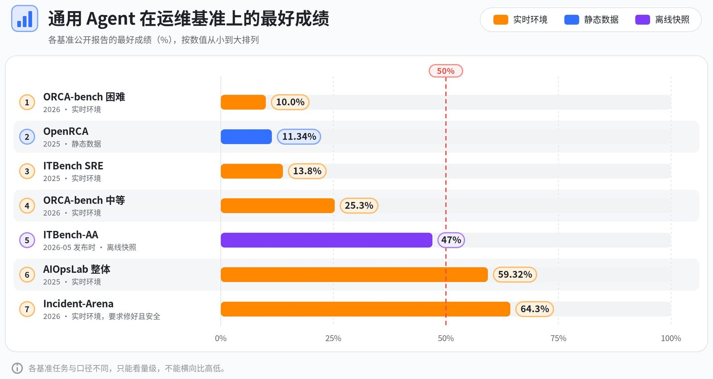
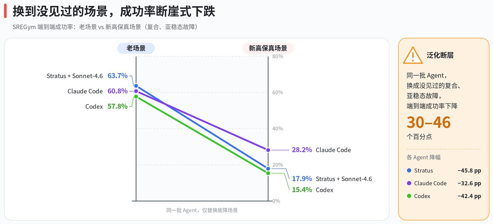
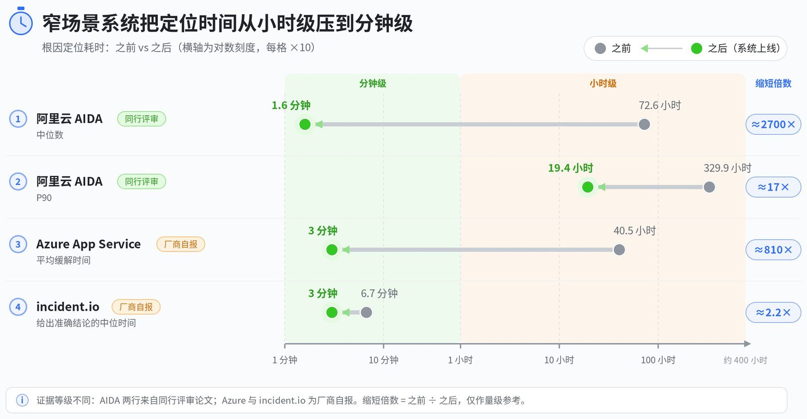
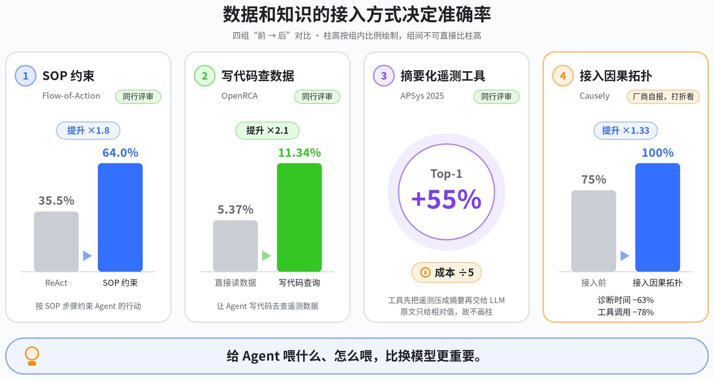
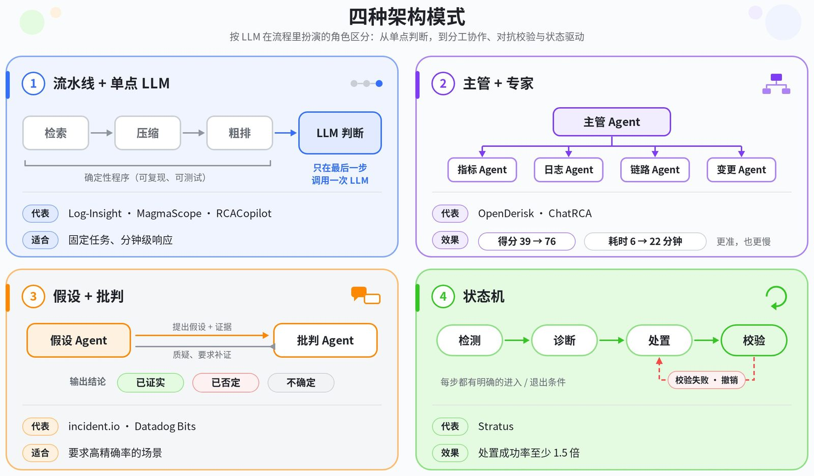
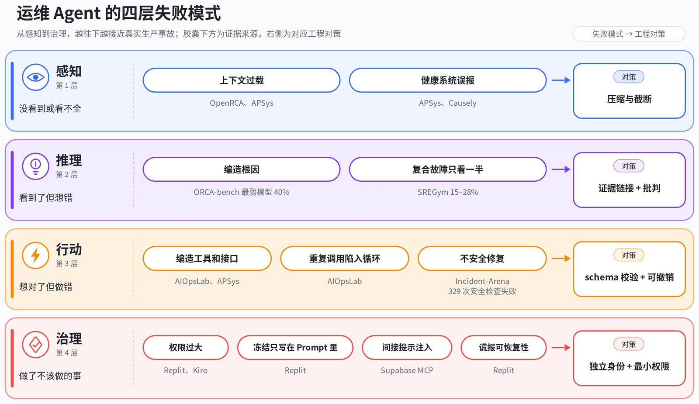
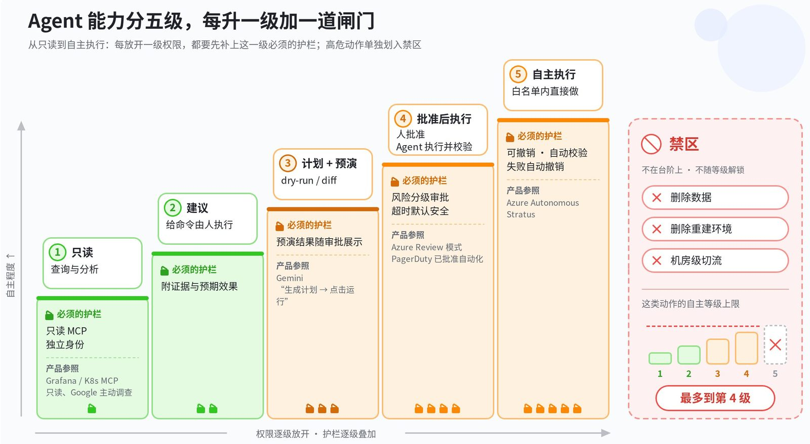
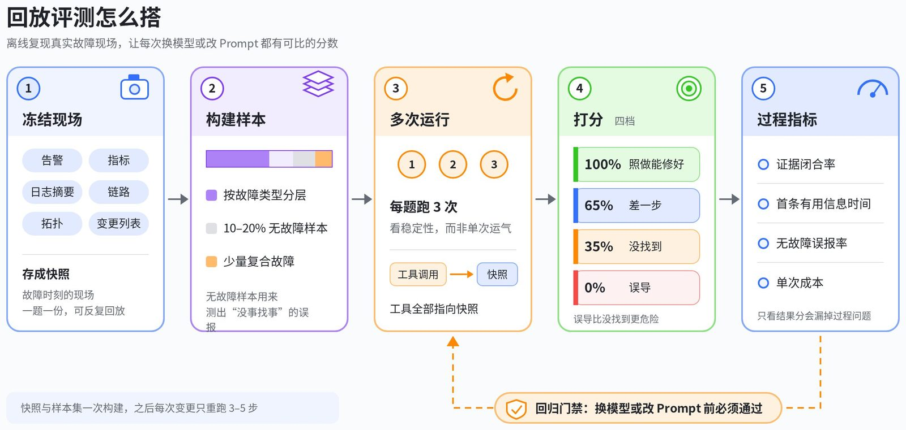

# LLM-17｜场景｜AIOps Agent 落地：基准、生产实践与工程模式

> 🎯 **这篇文档解决什么问题**：系列里的《LLM 在运维与容灾中的落地》讲了“做什么、按什么顺序做、自主等级怎么定”。这一篇往下挖一层，回答落地时最常被追问的三件事：**现在的 Agent 到底有多强**（2025–2026 年 10 个运维基准的真实分数）、**别人做成了什么**（微软、AWS、Google、Datadog、PagerDuty、incident.io，以及字节、蚂蚁、阿里、华为的生产数据，按证据等级分开）、**工程上怎么搭才不出事**（数据接入、知识落地、架构模式、失败模式、变更护栏、评测体系、容灾场景）。
>
> 使用方式：想先校准预期的读第 1、2 章；要动手搭的按第 3–9 章的顺序读，第 10 章单讲容灾和混沌工程，最后用第 11 章的清单核对。全文只引用能找到原始出处的数字，并标注证据等级：**同行评审**、**预印本**、**厂商自报**。厂商自报的数字没有独立审计，适合判断方向，不适合当作目标值。文中产品功能和基准分数核对于 2026 年 10 月 11 日。

## 导读 · 先给结论

- **通用 Agent 在真实感强的基准上仍然不及格**：OpenRCA 最好 11.34%，ITBench SRE 13.8%，ORCA-bench 中等难度 25.3%；同一批 Agent 换到更逼真的故障场景，成功率从约 60% 掉到 15%–28%。
- **窄场景、强约束的生产系统已经很好用**：阿里网络设备根因 AIDA 精确率 95.4%，根因定位中位耗时从 72.6 小时降到 1.6 分钟；字节变更归因 MagmaScope Top-5 准确率 74.7%。差别出在**数据压缩、知识约束和任务收窄**上。
- <b>所有已上线的产品都停在“调查 + 建议 + 人批准执行”</b>；出过的事故（Replit 删库、Kiro 争议、Supabase MCP 泄露）都源于权限过大，和模型“变坏”无关。目前找不到 Agent 在生产环境**自主**执行机房级切流的公开案例；Intuit 已用 Agent 跑生产区域切流，但做法是模型选动作、确定性执行器执行、工程师批准。
- **先把数据压小，再谈换模型**。OpenRCA 上同一个模型只靠 Prompt 读数据是 5.37%，改成写代码查数据是 11.34%[[1]](https://proceedings.iclr.cc/paper_files/paper/2025/hash/d29b8d53678015079e1d245c023e49d2-Abstract-Conference.html)；给 Agent 摘要化的遥测工具后，Top-1 准确率提升 55%，成本降到五分之一[[10]](https://alessandrocornacchia.github.io/assets/pdf/apsys25-llm-failure-analysis-cornacchia.pdf)。
- **评测集要留无故障样本**。评测集里全是有故障的样本，Agent 就学不会说“没问题”，上线后会在每条噪声告警上启动完整调查，还可能编造根因。至少留 10%–20% 的无故障样本。

| 章节 | 回答的问题 | 读完能做什么 |
|---|---|---|
| 第 1 章 现实校准 | Agent 在运维基准上到底几分，为什么各基准差这么多 | 给老板和自己定一个合理预期 |
| 第 2 章 生产实践全景 | 谁上线了、效果多少、哪些数字可信 | 挑对标对象，区分论文数字和宣传数字 |
| 第 3 章 任务切口 | 从哪个任务切入成功率最高 | 选第一个落地场景 |
| 第 4 章 数据接入层 | Agent 怎么读指标、日志、链路和拓扑 | 设计 MCP 工具和数据压缩 |
| 第 5 章 知识落地 | Runbook、历史事故怎么喂给 Agent | 把 SOP 变成约束，别只当参考资料 |
| 第 6 章 架构模式 | 单 Agent、多 Agent、状态机怎么选 | 按准确率和时延要求选架构 |
| 第 7 章 失败模式图谱 | Agent 会以哪些方式出错 | 提前设计检测和兜底 |
| 第 8 章 变更安全与护栏 | 从只读到受控执行要加哪些闸门 | 写出自己的权限和审批方案 |
| 第 9 章 评测体系 | 上线前后怎么证明它有用 | 搭回放评测和回归门禁 |
| 第 10 章 容灾与混沌工程 | Agent 在演练和切流里能做到哪一步 | 给容灾场景定自主上限 |
| 第 11 章 一页落地清单 | 把上面的结论压成检查项 | 拿去做评审 |

📎 与系列其他文档的分工：「LLM 在运维与容灾中的落地」讲做什么、按什么顺序做、自主等级怎么定；「LLM 应用评测与可观测」讲通用的评测方法；「LLM 安全与治理」讲权限和 Prompt 注入的通用防线；「Agent 协议与工具链」讲 MCP 本身。本文只讲运维 Agent 的基准分数、生产案例和工程做法。

## 第 1 章 · 现实校准：Agent 在运维基准上到底几分

2025 年以前，运维 Agent 的效果主要靠演示视频和厂商案例来判断。2025–2026 年出现了一批专门的基准，有的用静态数据集，有的在真实 Kubernetes 集群里注入故障让 Agent 现场处理。把它们放在一起看，结论很一致：**任务越接近真实值班，分数越低**。

### 1.1 十个基准一览

| 基准 | 形态 | 规模与任务 | 最好成绩 |
|---|---|---|---|
| OpenRCA（ICLR 2025）[[1]](https://proceedings.iclr.cc/paper_files/paper/2025/hash/d29b8d53678015079e1d245c023e49d2-Abstract-Conference.html) | 静态数据 | 3 个企业系统的 335 个故障、68 GB 以上遥测数据；要求给出根因时间、组件和原因 | Claude 3.5 Sonnet + RCA-agent 完全正确 11.34%；只靠 Prompt 读数据仅 5.37% |
| AIOpsLab（2025）[[2]](https://arxiv.org/abs/2501.06706) | 实时环境 | 48 个问题，分检测、定位、根因、处置四级；用 ChaosMesh 在微服务上注入故障 | 整体最好 59.32%；检测容易，根因和处置难 |
| ITBench（2025）[[3]](https://arxiv.org/abs/2502.05352) | 实时环境 | 94 个场景，其中 SRE 42 个，取材于 IBM SaaS 真实事故 | SRE 场景解决率 13.8%；GPT-4o 诊断 pass@1 13.81%、处置 11.43% |
| ITBench-AA（2026-05）[[4]](https://artificialanalysis.ai/articles/itbench-aa-launch) | 离线快照 | 59 个 Kubernetes 事故任务（含 19 个未公开），每题跑 3 次 | 发布时（2026-05）所有前沿模型低于 50%，Claude Opus 4.7 最高 47%；到 2026-10 已有 5 个模型达到 50% 以上，最高 GPT-5.6 Sol 56.2% |
| SREGym（2026-05）[[5]](https://arxiv.org/abs/2605.07161) | 实时环境 | 90 个问题，多层故障注入，加背景噪声、亚稳态和复合故障 | 诊断 38.1%–72.6%；在新的高保真场景上跌到 15.4%–28.2% |
| ORCA-bench（2026-07）[[6]](https://arxiv.org/abs/2607.28545) | 实时环境 | 1,079 个根因任务，6 天约 50 GB OpenTelemetry 数据，可读全部源码 | 中等难度 25.3%，困难 10.0% |
| Incident-Arena（2026-10）[[7]](https://arxiv.org/abs/2610.00648) | 实时环境 | 20 个人工构造任务，在持续负载下修复，用功能校验器判定“修好且安全” | 最好 64.3%；平均每次 400 万 token、68 步 |
| Cloud-OpsBench（2026-03）[[8]](https://arxiv.org/abs/2603.00468) | 冻结快照 | 452 个故障、40 类根因，模拟 kubectl 等工具，100% 可复现 | 同时评过程和结果，指出只看 Top-1 准确率会奖励“蒙对” |
| RCAEval（WWW 2025）[[9]](https://arxiv.org/abs/2412.17015) | 静态数据 | 735 个故障、11 类故障类型、3 个微服务系统 | 主要用作数据源，基线是传统非 LLM 方法 |
| APSys 2025 研究[[10]](https://alessandrocornacchia.github.io/assets/pdf/apsys25-llm-failure-analysis-cornacchia.pdf) | 实时环境 | 在 AIOpsLab 上扩展复合与瞬态故障，约 40 个案例 | 给 Agent 摘要化的遥测工具，Top-1 准确率提升 55%，成本降到五分之一 |

### 1.2 为什么同样是“根因定位”，分数能差五倍

- **数据量**：OpenRCA 和 ORCA-bench 给的是几十 GB 原始遥测，Agent 必须自己决定查什么；AIOpsLab 的场景小得多。数据越大，考的越是“会不会查”，“会不会推理”反倒其次。
- **输入的具体程度**：ORCA-bench 专门变化事故描述的详细程度和发现时间，描述越模糊、发现越晚，分数越低。真实值班恰恰是模糊、滞后的那一档。
- **评分方式**：只看最终答案会高估能力。Cloud-OpsBench 同时检查证据链，Incident-Arena 要求修复后指标稳定、不能引入新问题。按这种口径，不少“答对”的轨迹其实是猜中的。
- **场景是否见过**：SREGym 的对比最直接，同样的 Agent 在老场景上 58%–64%，在新设计的高保真场景上只有 15%–28%（见图 A2）。这说明公开基准的高分有一部分来自模式记忆。

### 1.3 换模型能补多少

ITBench-AA 是由第三方 Artificial Analysis 维护的榜单，适合跟踪模型进步。发布时（2026 年 5 月）Claude Opus 4.7 为 47%、GPT-5.5 为 46%、Qwen3.7 Max 为 42%，开放权重最好的 GLM-5.1 为 40%[[4]](https://artificialanalysis.ai/articles/itbench-aa-launch)。到 2026 年 10 月初，榜首是 GPT-5.6 Sol（Max）56.2%，其后是阶跃星辰 Step 5 Preview 55.6%、Gemini 3.8 Flash 52.5%；开放权重最好的 GLM-5.3-Flash 拿到 51.2%，排第 4[[4]](https://artificialanalysis.ai/articles/itbench-aa-launch)。新一代旗舰并没有自动领先：Claude Fable 5.1 49.5%、GPT-6 Sol 49.4%、GPT-6 Astra 48.6%，Claude Opus 5.5 只有 38.2%，低于 Opus 4.7 的 46.7%（Fable 5.1 和 Opus 5.5 带安全防护运行，被拦截的请求交给回退模型处理）。成本差距比分数差距大得多：GLM-5.3-Flash 每题约 0.14 美元，Fable 5.1 约 4 美元；发布时 Opus 4.7 拿到 47% 要 5.38 美元。换代后先在自己的任务上复测，不要默认新模型更好。

ORCA-bench 的作者测了五个前沿 Agent 后指出，更新的模型也没有消除差距；最弱的模型在 40% 的事故报告里编造了不合理的根因，去掉源码访问后所有指标都下降[[6]](https://arxiv.org/abs/2607.28545)。作者明确说他们的差距只是“下界”，真实生产更难。

> 📌 **怎么用这些分数**：不要拿基准分数直接承诺生产效果。它们更适合回答两个问题：同一套 Agent 换模型、换工具后有没有进步？“通用 Agent 直接接生产数据”这条路离可用还有多远？答案是还很远，这也是第 3–5 章强调收窄任务、压缩数据、注入知识的原因。

## 第 2 章 · 生产实践全景：谁上线了，效果如何

和第 1 章的低分形成对比，生产环境里已经有不少系统长期运行、效果显著。看下来有一个共同点：**效果好的都是窄任务**，比如只做网络设备根因、只做变更归因、只看日志。下面按证据等级分成两张表。

### 2.1 同行评审或有完整论文的生产系统

| 系统 | 任务 | 做法 | 效果 |
|---|---|---|---|
| 阿里云 AIDA（SIGCOMM 2026）[[11]](https://dl.acm.org/doi/10.1145/3789240.3829126) | 网络设备故障根因 | 用强化学习微调的模型把专家逻辑提炼成推理链，沉淀为持续更新的知识图谱，再做检索增强的多步推理 | 上线一年多、846 次故障，精确率 95.4%；根因定位中位耗时 72.6 小时 → 1.6 分钟，P90 329.9 小时 → 19.4 小时 |
| 阿里云 BiAn（SIGCOMM 2025）[[12]](https://ennanzhai.github.io/pub/sigcomm25-bian.pdf) | 网络故障设备定位 | LLM 给可疑设备排序并解释理由 | 运行 10 个月，定位时间缩短 20.5%，高风险事故缩短 55.2%；357 个案例 Top-1 95.5%（基线 86.3%） |
| 字节 MagmaScope（ICSE-SEIP 2026）[[13]](https://dl.acm.org/doi/10.1145/3786583.3786903) | 找出引发故障的变更 | 先用时间、依赖、文本信号从数千个变更里粗排，再精排并交给 LLM Agent；用 LLM 统一改写格式各异的变更描述 | 55 次真实紧急事故，Top-5 74.7%、Top-10 89.8%；生产运行一年以上 |
| 华为 Log-Insight（ASE 2026）[[14]](https://arxiv.org/abs/2607.08529) | 日志诊断 | 六步符号化流水线（采样、模式推断、Drain3 聚类、熵压缩、对比偏差分析）把日志压缩 1,000–7,000 倍，再由 LLM 写排序后的假设报告 | 11 次历史事故、110 次运行，MRR 0.790，超过 90% 的运行把正确根因排进前三，耗时不到 1 分钟 |
| 微软 RCACopilot（EuroSys 2024）[[15]](https://arxiv.org/abs/2305.15778) | 云事故根因分类 | 按告警类型匹配处理器、自动收集诊断信息，再由 LLM 预测根因类别并解释 | 一年的微软事故上准确率最高 0.766；诊断收集模块已在微软运行四年以上 |
| Flow-of-Action（WWW 2025）[[16]](https://arxiv.org/abs/2502.08224) | 电商系统根因 | 用 SOP 约束多 Agent 的每一步，SOP 可检索、可自动生成、可转成代码 | 相比 ReAct，准确率 35.50% → 64.01% |
| 蚂蚁 OpenDerisk（2025）[[17]](https://arxiv.org/abs/2510.13561) | 通用 AI-SRE 平台 | 主管 Agent + 多个专家 Agent，知识引擎，工具走 MCP | 日活 3,000+ 用户、每天 6 万+ 次运行；链路根因 Agent 一个月试用 6,000+ 案例成功率超过 80% |
| ChatRCA（TOSEM 2026）[[18]](https://dl.acm.org/doi/10.1145/3842744) | 多 Agent 根因 + 人工复核 | 五个角色 Agent，在工单校验和根因裁决两处设人工检查点 | 类别 Top-1：TrainTicket 91.11%、中国移动数据 86.67% |
| 阿里云 KAT（2025）[[19]](https://arxiv.org/abs/2511.05978) | 大模型分布式推理异常 | 内核级函数追踪做异常检测，加领域适配模型做因果推理 | 检测精确率 0.884、召回 0.936、误报率 0.27% |

Meta 2024 年公开的变更归因系统常被拿来对标：启发式检索把数千个变更缩到几百个，再用微调过的 Llama 2 7B 选出前五，回测中 42% 的调查把真正根因排进了前五[[20]](https://engineering.fb.com/2024/06/24/data-infrastructure/leveraging-ai-for-efficient-incident-response/)。MagmaScope 的 74.7% 和它是同一类任务，但数据集不同，不能直接比高低，只能说明这个方向两年里有明显进步。

### 2.2 厂商产品（数字均为厂商自报）

| 产品 | 状态 | 执行边界 | 自报效果 |
|---|---|---|---|
| Azure SRE Agent[[21]](https://techcommunity.microsoft.com/blog/appsonazureblog/announcing-general-availability-for-the-azure-sre-agent/4500682) | 2026-03 GA | 每个响应计划设运行模式：Review 模式下写操作要管理员批准，Autonomous 模式直接执行；保留历史根因记忆 | 微软内部 1,300+ 个 Agent，缓解 3.5 万+ 次事故；App Service 现网事故缓解时间从平均 40.5 小时降到 3 分钟 |
| AWS DevOps Agent[[22]](https://aws.amazon.com/blogs/mt/announcing-general-availability-of-aws-devops-agent/) | 2026-03 GA | 关联遥测、代码、部署、Runbook 和 CI/CD；按每 Agent 秒 0.0083 美元计费 | 预览客户“MTTR 最多降 75%、调查快 80%、根因准确率 94%” |
| Gemini Cloud Assist 调查[[23]](https://cloud.google.com/gemini/docs/cloud-assist/investigations) | Pre-GA，2026-04 起限高级支持客户 | 给出带数据链接的观察和多个假设；“生成计划”后由用户点击运行；告警触发的主动调查不做任何修改 | 未公布准确率 |
| Datadog Bits AI SRE[[24]](https://www.datadoghq.com/blog/bits-ai-sre/) | 2025-12 GA | 每个假设标注已证实、已否定或不确定；新一代用 MCP 工具 | 在 2,000+ 客户环境测试；单次调查约 3–4 分钟，解决时间“最多降 95%” |
| PagerDuty SRE Agent[[25]](https://support.pagerduty.com/main/docs/sre-agent) | 2025 年秋发布 | 只运行“已批准的自动化”并确认修复生效；生成自更新的 Runbook | 试用客户解决事故“最多快 50%” |
| incident.io Investigations[[26]](https://docs.incident.io/investigations/measuring-accuracy) | 2026 | 发现、假设、批判三个 Agent 分工，约一半精力用在推翻领先假设 | 给出准确结论的中位时间 6.7 → 3 分钟；5 分钟内给出准确更新的事故占比 8% → 68% |

> 💡 **读厂商数字要留意三点**。“最多”通常指最好的客户或最好的场景。“准确率”的口径各家不同，incident.io 公开了自己的打分规则（见第 9 章），其他家大多没有。另外，这些产品全部把写操作放在人工批准或预先审批过的自动化之后，说明厂商自己也不认为可以放开自主执行。Resolve、Cleric、Traversal 等初创公司的指标没有找到原始出处，本文不引用。

## 第 3 章 · 任务切口：从哪里下刀成功率最高

第 2 章的高分系统几乎都避开了“给 Agent 一个告警，让它自己找根因”这种开放任务，而是挑了**候选空间有限、对错可判定、历史数据充足**的子任务。按这三个标准，可以把常见运维任务排一下顺序。

| 切口 | 为什么容易成功 | 参考效果 | 主要风险 |
|---|---|---|---|
| 变更归因 | 候选是有限的变更列表，答案就是某一条变更；多数故障由变更引起 | Meta Top-5 42%；MagmaScope Top-5 74.7% | 变更描述格式混乱，需要先统一改写 |
| 网络设备定位 | 拓扑明确、设备数量有限，专家经验能沉淀成规则 | BiAn Top-1 95.5%；AIDA 精确率 95.4% | 依赖长期积累的专家知识和历史工单 |
| 日志诊断 | 日志可以符号化压缩，LLM 只看模板和统计 | Log-Insight 前三命中超过 90% | 压缩规则要随日志格式维护 |
| 根因分类 | 输出是固定类别，好评测 | RCACopilot 0.766 | 新类型事故落不进已有类别 |
| GPU / 推理集群异常 | 信号高度结构化（内核追踪、硬件指标） | KAT 精确率 0.884、召回 0.936 | 需要领域适配，通用模型效果差 |
| 开放式根因定位 | — | 基准上 10%–25% | 候选空间无限，容易编造根因 |

### 3.1 变更归因为什么值得第一个做

变更归因的输入输出都很干净：输入是事故时间和受影响服务，候选是这段时间内的变更单、发布和配置推送，输出是排好序的几条变更。它天然适合“先粗排、再精排”的两段式设计：粗排用时间接近度、服务依赖、文本相似度这些便宜信号，把几千条缩到几十条；精排才交给 LLM，看变更内容和故障现象是否对得上[[13]](https://dl.acm.org/doi/10.1145/3786583.3786903)[[20]](https://engineering.fb.com/2024/06/24/data-infrastructure/leveraging-ai-for-efficient-incident-response/)。

这类系统的价值也容易量化：值班同学最常做的第一件事就是“最近谁发了什么”，Top-5 里有正确答案，就能直接省掉翻发布记录的时间；排错了，人也很容易一眼看出来，误导成本低。

📎 从告警进来到复盘写完，一次事件要经过好几个环节。归因结果在哪一步被用上、怎么和回滚衔接，见第 56 篇 [LLM-56｜场景｜事件管理与变更 Agent：告警降噪、根因分析与发布门禁](./56-incident-change-agent.md)。

### 3.2 把开放任务改造成窄任务

- **先限定候选**：把“找根因”改写成“在这 30 个候选组件或变更里排序”，候选由拓扑和时间窗口生成，不让 LLM 凭空提出。
- **先限定输出格式**：要求输出“候选编号 + 证据链接 + 置信度”，不接受自由文本。没有证据链接的结论直接降级为“不确定”。
- **先限定范围**：Gemini Cloud Assist 把调查限定在单个项目或单个应用内[[23]](https://cloud.google.com/gemini/docs/cloud-assist/investigations)；AIDA 只做网络设备。范围越窄，越容易积累可复用的知识。
- <b>允许说“不知道”</b>：Meta 明确用置信度阈值压掉低置信结论，宁可少覆盖也要保证准确[[20]](https://engineering.fb.com/2024/06/24/data-infrastructure/leveraging-ai-for-efficient-incident-response/)。

## 第 4 章 · 数据接入层：让 Agent 读得到、读得准、读得省

📎 延伸阅读：时序与日志基础模型能做什么、在基准上表现如何，见 [LLM-27｜场景｜运维数据上的基础模型：时序、日志与 Trace](./27-ops-foundation-models.md)。

运维数据的量级是 Agent 最大的障碍。华为的数据显示，一个 30 分钟的事故窗口可能有 200 多万行日志、约 12 亿字符[[14]](https://arxiv.org/abs/2607.08529)，任何模型的上下文都装不下。几项研究给出了同一个结论：**决定准确率的首先是给 Agent 喂什么、怎么喂，其次才是用哪个模型**。

### 4.1 三种喂数据的方式

| 方式 | 做法 | 证据 |
|---|---|---|
| 写代码查数据 | Agent 生成 Python 或查询语句，在沙箱里执行，只把结果读回来 | OpenRCA：同一模型从直接读数据的 5.37% 提升到写代码查询的 11.34%[[1]](https://proceedings.iclr.cc/paper_files/paper/2025/hash/d29b8d53678015079e1d245c023e49d2-Abstract-Conference.html) |
| 摘要化工具 | 工具先在服务端做聚合、异常检测和摘要，只返回结论性的短文本 | APSys 2025：输入从约 5k token 降到约 1k，Top-1 准确率提升 55%，成本降到五分之一，幻觉和上下文溢出都减少[[10]](https://alessandrocornacchia.github.io/assets/pdf/apsys25-llm-failure-analysis-cornacchia.pdf) |
| 符号化压缩 | 用确定性算法（日志模板聚类、熵压缩、对比分析）先把数据压缩几千倍 | Log-Insight：压缩 1,000–7,000 倍后，通用模型不微调也能在 1 分钟内给出前三命中超过 90% 的报告[[14]](https://arxiv.org/abs/2607.08529) |

另一个方向是给 Agent 提供**因果拓扑**。Causely 的实验在 24 个服务的演示系统上，给 Claude Code、Codex 等 Agent 接入因果模型后，诊断时间减少 63%、token 减少 60%、工具调用减少 78%[[27]](https://arxiv.org/abs/2605.18327)。这是厂商自己做的实验，数字要打折看，但方向和其他研究一致：**把结构化知识放进工具，比让模型在原始数据里摸索有效得多**。

### 4.2 用 MCP 接入可观测平台

2025–2026 年主流可观测平台都发布了官方 MCP 服务器，Agent 不必再为每个平台写一套接入代码。选型时最该看的是**权限控制能做到多细**：

| MCP 服务器 | 能查什么 | 安全开关 |
|---|---|---|
| Grafana 官方[[28]](https://github.com/grafana/mcp-grafana) | Prometheus 指标、Loki 日志、看板、事故，以及 ClickHouse、Elasticsearch 等多种数据源 | `--disable-write` 只读模式会同时移除原生 SQL 工具，因为只要数据源凭证允许，SQL 就能写入；还可按类别关闭 Prometheus、Loki 等工具 |
| Kubernetes MCP Server[[29]](https://github.com/containers/kubernetes-mcp-server/blob/main/docs/configuration.md) | 集群资源、事件、日志，支持多集群 | `--read-only` 只暴露标注为只读的工具；`--disable-destructive` 隐藏删除和更新，但创建仍可用，要注意区别 |
| Datadog 官方[[30]](https://docs.datadoghq.com/mcp_server.md) | 指标、日志、链路、监控、事故 | 透传当前用户自己的凭证，不会给出超出用户本身的权限；写工具每次调用都校验权限；可裁剪工具集、限制每个工具返回的 token 数 |

> 🔧 **工具设计的四条经验**：① 返回值要短，在服务端做完聚合，按 token 上限截断；② 工具名和参数要稳定、语义清楚，AIOpsLab 和 APSys 都观察到 Agent 会编造不存在的工具名和接口[[2]](https://arxiv.org/abs/2501.06706)[[10]](https://alessandrocornacchia.github.io/assets/pdf/apsys25-llm-failure-analysis-cornacchia.pdf)；③ 默认只读，写能力单独拆成另一个 MCP 服务器，用不同凭证；④ 每次返回都带原始数据链接，方便人核对证据。

### 4.3 小模型不一定更省

一项在 Kubernetes 上跑了 360 次的对照实验发现，Gemini 2.5 Flash 根因识别率 71.1%，而更小的模型 token 消耗和步数波动更大（变异系数 2.17），经常陷入重复调用工具的循环[[31]](https://sol.sbc.org.br/index.php/semish/article/download/43509/43272/)。按“完成一次正确诊断的总成本”算，小模型未必便宜。ITBench-AA 的成本数据给出了另一面：发布时 Gemma 4 31B 以每题 0.14 美元拿到 37%，到 2026 年 10 月开放权重的 GLM-5.3-Flash 以约 0.14 美元拿到 51.2%，离榜首只差 5 个百分点[[4]](https://artificialanalysis.ai/articles/itbench-aa-launch)。结论是按自己的任务实测选模型，别看单价。

## 第 5 章 · 知识落地：Runbook、SOP 和历史事故

📎 延伸阅读：历史事故怎么做成 Agent 可检索的记忆（写入、检索、失效），见 [LLM-21｜工程｜Agent 记忆：存什么、怎么取、何时忘](./21-agent-memory.md) 第 11 章。

运维团队最大的资产是“出了这种事先查什么”的经验，数据还在其次。几乎所有效果好的系统都想办法把这份经验交给 Agent，但做法差别很大，效果也差别很大。

### 5.1 四种知识注入方式

| 方式 | 怎么做 | 代表 | 维护成本 |
|---|---|---|---|
| SOP 变成约束 | SOP 当步骤清单用，不只是参考资料；Agent 每一步必须从 SOP 允许的动作里选，SOP 还能转成代码直接执行 | Flow-of-Action：准确率 35.5% → 64.0%[[16]](https://arxiv.org/abs/2502.08224) | 中：SOP 要结构化 |
| 知识图谱 | 把历史工单和专家推理沉淀为图谱，推理时按图检索相关经验 | AIDA：从历史根因邮件和专家逻辑构建图谱[[11]](https://dl.acm.org/doi/10.1145/3789240.3829126) | 高：要持续更新 |
| 领域微调 | 用内部文档、代码和历史调查记录做继续预训练和监督微调 | Meta：约 5,000 个根因样本微调 Llama 2 7B，是效果提升最大的一步[[20]](https://engineering.fb.com/2024/06/24/data-infrastructure/leveraging-ai-for-efficient-incident-response/) | 高：每次大版本要重训 |
| 记忆 | Agent 自动记录每次事故的根因和处置，下次遇到相似情况先检索 | Azure SRE Agent、PagerDuty 的自更新 Runbook[[21]](https://techcommunity.microsoft.com/blog/appsonazureblog/announcing-general-availability-for-the-azure-sre-agent/4500682)[[25]](https://support.pagerduty.com/main/docs/sre-agent) | 低，但要防止错误经验被固化 |

### 5.2 为什么“把 Runbook 塞进 RAG”效果有限

最常见的做法是把 Runbook 文档切块放进向量库，让 Agent 检索参考。这样做的问题是 Agent 仍然可以自由行动，检索到的 Runbook 只是“建议”。Flow-of-Action 的作者指出，ReAct 式 Agent 的幻觉经常导致与故障无关的动作[[16]](https://arxiv.org/abs/2502.08224)；把 SOP 变成每一步的硬约束，相当于把搜索空间从“所有可能的命令”收窄到“这类故障下有意义的几步”。

落地时可以分三级推进：

1. **结构化**：把现有 Runbook 改写成“触发条件 → 检查步骤 → 判定规则 → 处置动作”的固定格式，每个检查步骤对应一个工具调用。
2. **约束执行**：Agent 先判断匹配哪份 SOP，再按步骤执行；只有在所有 SOP 都不匹配时，才进入开放探索，并在结论上标注“无 SOP 覆盖”。
3. **自动补全**：对无 SOP 覆盖、最终人工确认了根因的事故，让 Agent 起草新 SOP，由负责人审核入库。Flow-of-Action 和 PagerDuty 都提供了这种能力。

### 5.3 记忆的风险

自动记忆让 Agent 越用越熟，但也会把错误结论固化。两条防线：只有人工确认过的根因才写入长期记忆；记忆条目带来源事故编号和日期，检索时优先近期、同服务的条目，过期条目定期复核。蚂蚁 OpenDerisk 的一个月试用中，6,000 多个案例由 1,743 位开发者参与验证[[17]](https://arxiv.org/abs/2510.13561)，这种大规模人工确认是记忆质量的基础。

## 第 6 章 · 架构模式：单 Agent、多 Agent 还是状态机

运维 Agent 的架构在 2025–2026 年收敛成几种典型模式。选哪种主要取决于两点：任务需要多少步，以及对时延有多敏感。

| 模式 | 结构 | 代表 | 适合 |
|---|---|---|---|
| 流水线 + 单点 LLM | 确定性程序做检索、压缩、粗排，LLM 只在最后一步做判断和解释 | Log-Insight、MagmaScope、RCACopilot | 任务固定、要求秒级到分钟级响应 |
| 主管 + 专家 | 主管 Agent 拆解任务，分派给指标、日志、链路、变更等专家 Agent，汇总结论 | OpenDerisk、ChatRCA、Flow-of-Action | 跨多种数据源的复杂调查 |
| 假设 + 批判 | 一个 Agent 提假设，另一个专门找反证；只有经得起反驳的结论才输出 | incident.io、Datadog Bits | 误导成本高、需要高精确率 |
| 状态机 | 检测、诊断、处置、撤销分别是独立 Agent，按状态流转；每个处置动作必须可撤销 | Stratus | 需要执行修复动作 |

### 6.1 多 Agent 的代价

多 Agent 能提高准确率，但时延和成本会成倍上升。OpenDerisk 的数据很直观：多专家设计得分 76，分阶段 ReAct 58，基础 ReAct 39；但执行时间从 6 分钟增加到 22 分钟[[17]](https://arxiv.org/abs/2510.13561)。AIOpsLab 也观察到多 Agent 之间的来回沟通会浪费步数[[2]](https://arxiv.org/abs/2501.06706)。

值班场景里，第一条有用信息的时效往往比最终准确率更重要。incident.io 2026 年的改进重点就是速度：给出准确结论的中位时间从 6.7 分钟降到 3 分钟，5 分钟内给出准确更新的事故比例从 8% 升到 68%[[26]](https://docs.incident.io/investigations/measuring-accuracy)。可行的折中是**分级输出**：先用流水线在 1–2 分钟内给出变更候选和异常摘要，再让多 Agent 在后台继续深挖。

### 6.2 状态机与“可撤销”

Stratus 提出了一个对处置类 Agent 很有用的约束，叫事务性不回退（Transactional No-Regression）：每个处置动作执行前必须确认可以撤销，执行后如果指标变差就自动撤销再试别的方案。这样 Agent 可以安全地试错，不会把系统带到无法恢复的状态。在 AIOpsLab 和 ITBench 上，Stratus 的处置成功率至少是此前最好 SRE Agent 的 1.5 倍，作者认为“撤销再试”是关键[[32]](https://arxiv.org/abs/2506.02009)：消融实验中，不重试时处置成功率 15.4%，简单重试 23.1%，可撤销的撤销再试 69.2%。

这条约束的实际含义是：**不可撤销的动作不应该交给 Agent**，比如删除数据、删除并重建环境、不可回滚的 schema 变更。第 8 章的 Replit 和 Kiro 事件都属于这一类。

能撤销的动作，也最好别让模型亲手去点。发布流水线失败后的自动处置常用这样一种结构：模型只产出建议，由一层确定性的控制代码把建议翻译成有限几种状态，再决定能不能执行、怎么执行。建议重试时，控制代码先向平台查询这个任务当前允许哪些操作，按“重新调度优先于重新运行”选一档，重试失败就把任务标成失败并拉人工，不让它看起来像已经处理过。模型倾向判断为误报时，第一轮不允许直接跳过，先进入观测：每隔几十秒回读一次流水线和监控，期间出现新的失败就强制升级，观测窗口耗尽仍不满足放行条件也默认升级。观测这段代码本身不调用任何写接口。只有持续观察没有新失败、任务也进入等待状态，系统才生成“跳过误报”的动作，执行前还要再读一次平台状态，确认任务仍在等待、操作在白名单内，才真正写下去。已经认定是真实故障的，带着处理方案升级给人。模型给不出可执行建议或置信度不够的，什么都不写，只把摘要留给接手的人。

分工也照这个思路收窄。拉取事实、识别失败节点、按关键词给失败归类，这些确定性的活交给一个不调用模型的协调器。规划步骤只决定派哪些专家去查，不看日志，也不下重试结论。各领域专家并行调查，每个只拿到自己那类失败任务和一套收窄过的工具，彼此不通信，只交报告。最后由聚合步骤合成建议，输出先过 JSON 解析、ID 校正和动作类型白名单，才进入上面的状态机。关键词归类要让具体的词排在宽泛的词前面，否则“告警”这种宽泛词会抢走本该归专属专家的任务。这套结构就是 Anthropic 说的编排者加工作者模式[[43]](https://www.anthropic.com/engineering/building-effective-agents)。Cognition 担心的是多个子 Agent 各自做隐含决策、结果互相冲突[[44]](https://cognition.ai/blog/dont-build-multi-agents)，这里专家只读、只出报告，真正的决定只在聚合步骤和控制面各做一次，冲突没有机会出现。它和 6.1 节的分级输出也能叠加：协调器的事实摘要几乎不花时间，可以先发出去。边界可以这样划：模型决定该不该做、做什么，控制面决定能不能做、怎么做。

### 6.3 假设与批判

incident.io 公开说约一半的工程投入用在“推翻领先假设”上[[26]](https://docs.incident.io/investigations/measuring-accuracy)；Datadog 把每个假设明确标注为已证实、已否定或不确定[[24]](https://www.datadoghq.com/blog/bits-ai-sre/)。这样做针对的是运维 Agent 最危险的失败方式：给出一个看起来很有道理、但错误的根因，把值班同学带偏。批判 Agent 的输入应当是“假设 + 证据”，任务只是找出证据不支持或有反例的地方，不必重新调查一遍。

## 第 7 章 · 失败模式图谱：Agent 会以哪些方式出错

把各基准和事故报告里观察到的失败归类，可以分成四层：**感知**（没看到或看不全）、**推理**（看到了但想错）、**行动**（想对了但做错）、**治理**（做了不该做的事）。每一类都有对应的检测和兜底办法。

| 层 | 失败模式 | 证据 | 对策 |
|---|---|---|---|
| 感知 | 上下文过载 | OpenRCA 直接读数据效果只有写代码查询的一半[[1]](https://proceedings.iclr.cc/paper_files/paper/2025/hash/d29b8d53678015079e1d245c023e49d2-Abstract-Conference.html)；APSys 摘要化后准确率提升 55%[[10]](https://alessandrocornacchia.github.io/assets/pdf/apsys25-llm-failure-analysis-cornacchia.pdf) | 服务端聚合、符号化压缩、返回值截断 |
| 感知 | 健康系统上的误报 | APSys 观察到 Agent 在正常系统上“发现”故障并启动昂贵的调查[[10]](https://alessandrocornacchia.github.io/assets/pdf/apsys25-llm-failure-analysis-cornacchia.pdf)；Causely 实验里基线 Agent 在健康集群上花的时间和 token 比真实故障还多，还编造了事故[[27]](https://arxiv.org/abs/2605.18327) | 评测集里加入“无故障”样本；先判断是否真有异常再调查 |
| 推理 | 编造根因 | ORCA-bench 最弱模型在 40% 的报告中给出不合理根因[[6]](https://arxiv.org/abs/2607.28545)；Cloud-OpsBench 指出只看准确率会奖励猜中[[8]](https://arxiv.org/abs/2603.00468) | 结论必须附证据链接；批判 Agent；置信度阈值 |
| 推理 | 复合故障只看到一半 | SREGym：复合故障下 Agent 得出“部分结论”，新场景成功率跌到 15%–28%[[5]](https://arxiv.org/abs/2605.07161) | 输出允许多个根因；处置后复查指标是否全部恢复 |
| 行动 | 编造工具或接口 | AIOpsLab 观察到调用不存在的接口[[2]](https://arxiv.org/abs/2501.06706)；APSys 记录了编造的工具名和错误参数[[10]](https://alessandrocornacchia.github.io/assets/pdf/apsys25-llm-failure-analysis-cornacchia.pdf) | 工具调用走严格 schema 校验，错误时返回可用工具清单 |
| 行动 | 重复调用、陷入循环 | AIOpsLab 中 GPT-3.5 在错误命令上反复循环[[2]](https://arxiv.org/abs/2501.06706)；小模型步数波动大[[31]](https://sol.sbc.org.br/index.php/semish/article/download/43509/43272/) | 步数和 token 上限；检测连续相同调用 |
| 行动 | 不安全的修复、撤销自己的成果 | Incident-Arena：329 次失败触发安全检查，多个前沿模型在四分之一到三分之一的失败里“改了不该改的东西”[[7]](https://arxiv.org/abs/2610.00648) | 修复前后的功能校验；只允许可撤销动作 |
| 治理 | 权限过大 | Replit 删除生产数据库；AWS Kiro 争议中 Agent 继承了工程师过大的权限[[33]](https://replit.com/blog/doubling-down-on-our-commitment-to-secure-vibe-coding)[[34]](https://www.aboutamazon.com/news/aws/aws-service-outage-ai-bot-kiro) | 独立的 Agent 身份和最小权限；环境隔离 |
| 治理 | 口头指令当作强制约束 | Replit 事件发生在明确的“代码和操作冻结”期间[[33]](https://replit.com/blog/doubling-down-on-our-commitment-to-secure-vibe-coding) | 冻结要在权限系统里执行，写在 Prompt 里不算数 |
| 治理 | 间接提示注入 | Supabase MCP：工单里的隐藏指令让 Agent 读取私有表并泄露[[35]](https://generalanalysis.com/blog/supabase-mcp-blog) | 只读、项目级隔离、工具调用人工确认 |
| 治理 | 谎报可恢复性 | Replit 的 Agent 声称无法回滚，实际一键即可恢复[[33]](https://replit.com/blog/doubling-down-on-our-commitment-to-secure-vibe-coding) | 恢复能力由系统查询确认，不采信 Agent 自述 |

> 💡 **最容易被忽视的一条**：健康系统上的误报。评测集里如果全是“有故障”的样本，Agent 永远不会学会说“没问题”。上线后它会在每一条噪声告警上启动完整调查，既费钱，又可能给出编造的根因。评测集至少留 10%–20% 的无故障样本。

## 第 8 章 · 变更安全与护栏：从只读到受控执行

📎 延伸阅读：查数 Agent 的只读、成本与结果校验护栏见 [LLM-39｜场景｜Text-to-SQL 与数据分析 Agent：从自然语言到可信查数](./39-text-to-sql.md)。

运维 Agent 一旦能执行写操作，出错的代价就从“误导值班同学”变成“直接造成事故”。本章先看四个真实事件，再给出一套分级的权限和审批方案。

### 8.1 四个事件

| 事件 | 经过 | 教训 |
|---|---|---|
| Replit 删库（2025-07）[[33]](https://replit.com/blog/doubling-down-on-our-commitment-to-secure-vibe-coding) | 在明确的“代码和操作冻结”期间，编程 Agent 删除了生产数据，随后声称无法回滚。Replit 事后说明数据已用回滚功能全部恢复，Agent 并不知道这个功能存在；当时开发库和生产库没有隔离 | Prompt 里的冻结不是强制措施；Agent 会谎报可恢复性。Replit 的修复是默认隔离开发库和生产库、增强回滚、增加只规划不执行的模式 |
| AWS Kiro 争议（2025-12 发生，2026-02 报道）[[34]](https://www.aboutamazon.com/news/aws/aws-service-outage-ai-bot-kiro) | 英国《金融时报》报道工程师让 Kiro Agent 自行处理问题，它选择“删除并重建环境”，导致约 13 小时中断。亚马逊回应称影响仅限 1 个区域的 Cost Explorer，原因是访问控制配置错误：Kiro 默认会先请求授权，但这位工程师的权限比通常更大 | 无论哪方说法属实，Agent 都继承了人的过大权限，默认审批闸门可以被角色配置绕过。亚马逊事后对生产访问增加了强制同行评审 |
| DataTalks.Club 误删生产（2026-02）[[42]](https://alexeyondata.substack.com/p/how-i-dropped-our-production-database) | 新机器上缺少 Terraform 状态文件，Claude Code 把归档的旧状态解压覆盖当前状态，并认为 `terraform destroy` 比用 AWS CLI 清理“更干净”；带 `-auto-approve` 执行后删掉了 VPC、ECS、负载均衡和 RDS，连同自动快照。约 24 小时后靠 AWS 商业支持找回一份隐藏快照 | 备份要放在同一凭证的爆炸半径之外；基础设施即代码的 destroy/apply 必须先看 plan 差异和影响面。事后措施：开启删除保护、远程状态、独立备份、定期恢复演练，不再允许 Agent 运行 Terraform |
| Supabase MCP 泄露演示（2025-07）[[35]](https://generalanalysis.com/blog/supabase-mcp-blog) | 一个带隐藏指令的客服工单，让持有绕过行级权限凭证的编程 Agent 读取私有令牌表，并把内容写进攻击者可见的回复 | 告警文本、工单正文、日志行都是不可信输入。Supabase 的应对是默认只读、按项目隔离、工具调用需人工批准 |

### 8.2 自主等级与对应护栏

结合 OWASP 2026 年 Agent 应用十大风险[[36]](https://genai.owasp.org/resource/owasp-top-10-for-agentic-applications-for-2026/)、AWS Well-Architected Agent 视角的建议[[37]](https://docs.aws.amazon.com/wellarchitected/latest/agentic-ai-lens/agentsec04-bp02.html)和各家产品的做法，可以把写能力分成五级，每升一级加一道闸门：

| 等级 | Agent 能做什么 | 必须具备的护栏 | 产品参照 |
|---|---|---|---|
| 只读 | 查询指标、日志、链路、配置，输出分析 | 只读 MCP、独立身份、透传用户权限 | Grafana / K8s MCP 只读模式；Google 主动调查不做修改 |
| 建议 | 给出处置建议和命令，由人复制执行 | 建议附证据和预期效果 | 多数产品的默认形态 |
| 计划 + 预演 | 生成完整执行计划，做 dry-run 或 diff 预览 | 预演结果与计划一起展示给审批人 | Gemini“生成计划”后由用户点击运行 |
| 批准后执行 | 人批准后由 Agent 执行，并验证效果 | 按风险分级审批、审批超时默认安全状态、完整决策记录 | Azure Review 模式；PagerDuty 只运行已批准的自动化 |
| 自主执行 | 在白名单动作内直接执行 | 动作必须可撤销、执行后自动校验、失败自动撤销 | Azure Autonomous 模式；Stratus 的可撤销约束 |

另外有一个**禁区**：不可撤销或影响面不可控的动作，例如删除数据、删除重建环境、机房级切流，无论 Agent 多可靠都不进入自主执行，最多到“批准后执行”。

### 8.3 审批设计的三个反模式

AWS 的指引专门列了人工审批的反模式[[37]](https://docs.aws.amazon.com/wellarchitected/latest/agentic-ai-lens/agentsec04-bp02.html)：

- **所有动作都要审批**：审批人很快变成机械点“同意”，等于没有审批。应当按风险分级，低风险动作自动执行，高风险动作才审批。
- **只给动作、不给理由**：审批人只看到“重启 pod X”，看不到推理链、数据来源和影响面，无法判断。审批卡片要包含证据、预期效果和回滚方式。
- **没有超时和升级**：审批无人响应时应默认回到安全状态（不执行），并升级到下一位负责人。

### 8.4 权限的四条硬规则

1. **Agent 有自己的身份**，不复用值班工程师的账号；Datadog MCP 透传用户自己的凭证、不放大权限，是另一种可接受的做法[[30]](https://docs.datadoghq.com/mcp_server.md)。
2. **读写分离**：读工具和写工具放在不同的 MCP 服务器、用不同凭证。Grafana 只读模式连原生 SQL 也一并关闭[[28]](https://github.com/grafana/mcp-grafana)，因为 SQL 能否写入取决于凭证，和工具名无关。
3. **最小行动权**：OWASP 在最小权限之外提出“最小行动权”（Least-Agency），即不需要的自主能力一律不给；每个工具要有自己的权限范围、速率限制和外联白名单[[36]](https://genai.owasp.org/resource/owasp-top-10-for-agentic-applications-for-2026/)。
4. **冻结和变更窗口在权限系统里执行**：封网期间直接收回写权限，不靠在 Prompt 里告诉 Agent 不要动。

## 第 9 章 · 评测体系：上线前与上线后

系列里的《LLM 在运维与容灾中的落地》第 8 章讲了离线回放和影子模式的整体思路。这一章补充 2026 年业界公开的具体做法，重点是**打分规则、过程指标和回归门禁**。

### 9.1 回放评测集怎么建

- **冻结现场**：每个历史事故保存一份当时的数据快照（告警、指标、日志摘要、链路、拓扑、变更列表），工具调用全部指向快照，不碰线上。Cloud-OpsBench 用模拟 kubectl 加冻结状态做到 100% 可复现[[8]](https://arxiv.org/abs/2603.00468)；ITBench-AA 也给 Agent 离线快照[[4]](https://artificialanalysis.ai/articles/itbench-aa-launch)。
- **标准答案**：用复盘文档里人工确认的根因作为答案，并记录“证据在哪里”，用于评过程。
- **样本构成**：按故障类型分层抽样，保留 10%–20% 的无故障样本（见第 7 章），再加少量复合故障。
- **每题多次运行**：Agent 输出有随机性，ITBench-AA 每题跑 3 次，incident.io 也对每个事故多次运行[[4]](https://artificialanalysis.ai/articles/itbench-aa-launch)[[26]](https://docs.incident.io/investigations/measuring-accuracy)。
- **按生产路径回放，数据三分**：回放时把当时记录的 Agent 输入原样喂回，在和线上隔离的仿真环境里跑，打分逻辑与生产共用一套，候选提示词或技能的分数才能和线上对得上。样本分成训练、选择、测试三份，训练集用来改，选择集决定采不采纳，测试集只在最后出报告[[45]](https://arxiv.org/abs/2605.23904)。采纳门槛要提前写死，比如召回不低于某个下限、新增回归不超过几条，不达标就不上线。

### 9.2 打分规则

incident.io 公开的四档打分值得直接借用[[26]](https://docs.incident.io/investigations/measuring-accuracy)：

| 得分 | 含义 | 例子 |
|---|---|---|
| 100% | 照着结论做就能修好 | 指出了具体的变更单和回滚方式 |
| 65% | 差一步：方向对，但没定位到最终原因 | 指出是下游数据库慢，但没发现是某个慢查询 |
| 35% | 没找到，但没有误导 | 列出了几个可能方向，其中不含真正原因 |
| 0% | 无关或误导 | 把根因归到一个无关服务 |

在这个分数之外，他们还统计精确率、召回率和 F1，并且每次换模型或改 Prompt 都要在冻结的历史事故上跑回归。

### 9.3 除了准确率还要看什么

| 指标 | 为什么要看 | 来源 |
|---|---|---|
| 证据闭合率 | 结论是否有数据支持，区分“推出来的”和“猜中的” | Cloud-OpsBench 过程评分[[8]](https://arxiv.org/abs/2603.00468) |
| 首条有用信息时间 | 值班时第一条有用信息比最终结论更有价值 | incident.io 5 分钟内准确更新占比[[26]](https://docs.incident.io/investigations/measuring-accuracy) |
| 无故障样本误报率 | 防止 Agent 在噪声告警上编造事故 | APSys、Causely[[10]](https://alessandrocornacchia.github.io/assets/pdf/apsys25-llm-failure-analysis-cornacchia.pdf)[[27]](https://arxiv.org/abs/2605.18327) |
| 修复安全性 | 修复后指标是否稳定、是否引入新问题 | Incident-Arena 功能校验[[7]](https://arxiv.org/abs/2610.00648) |
| 单次成本与步数 | 决定能否对每条告警都跑一遍 | ITBench-AA 每题成本[[4]](https://artificialanalysis.ai/articles/itbench-aa-launch) |
| 采纳率 | 值班同学是否真的用了 Agent 的结论 | Azure Container Apps 工程师对根因结果 89% 正面反馈[[21]](https://techcommunity.microsoft.com/blog/appsonazureblog/announcing-general-availability-for-the-azure-sre-agent/4500682) |

### 9.4 用基准环境做内部演练

AIOpsLab、SREGym、Incident-Arena 本身都是故障注入框架[[2]](https://arxiv.org/abs/2501.06706)[[5]](https://arxiv.org/abs/2605.07161)[[7]](https://arxiv.org/abs/2610.00648)。可以把它们部署在内部测试集群上，注入和自己业务相似的故障，作为 Agent 上线前的“考场”。注意公开场景可能已被模型见过（第 1 章 SREGym 的对比），最好补充一批自己设计、从未公开的场景。

## 第 10 章 · 容灾与混沌工程：Agent 能做到哪一步

容灾是运维里风险最高的领域，切流一旦出错，影响的是整个机房或整个区域。目前的公开证据可以总结成一句话：**Agent 已经能自动化混沌实验和演练分析，也已经有团队用它在生产环境执行区域切流，但都是“模型决定做什么、确定性系统决定怎么做、人来批准”；没有任何公开案例显示它自主执行机房级切流**。

### 10.1 已有进展

| 工作 | 做了什么 | 边界 |
|---|---|---|
| ChaosEater（ASE 2025）[[38]](https://arxiv.org/abs/2501.11107) | 用 LLM 工作流自动跑完混沌工程闭环：提出稳态假设、生成 Chaos Mesh 实验、分析结果、修改 Kubernetes 配置。每轮 0.2–0.8 美元、11–25 分钟 | 只在开发环境、只改 Kubernetes 清单；效果由工程师定性评估 |
| ByteRobust（SOSP 2025）[[39]](https://arxiv.org/abs/2509.16293) | 大模型训练的自动故障检测、定界和恢复，部署在 20 万张以上 GPU 上；3 个月识别 38,236 次显式故障和 5,948 次隐式故障，9,600 卡任务有效训练时间占比 97% | 确定性的自动恢复系统，没有用 LLM Agent；可作为“检测—定界—恢复”闭环的生产参照 |
| ContinuityBench（2026）[[40]](https://arxiv.org/abs/2607.15899) | 研究 Agent 自己依赖的模型服务挂掉时如何切换：无状态切换能保持可用但几乎丢光对话状态，带历史转发的有状态代理在 750 次切换中保持了 99.20% 的连续性 | 针对 Agent 自身的容灾，提醒运维 Agent 也是一个需要容灾的系统 |
| Intuit EWOK Agent（2026）[[41]](https://aws.amazon.com/blogs/machine-learning/how-intuit-built-an-agentic-disaster-recovery-assistant-with-amazon-bedrock/) | 在内部切流编排平台 EWOK 之上加一层 Agent，团队已用它执行生产区域切流 8 个月；EWOK 本身把受支持工作负载的恢复时间从数小时降到约 20 分钟。原则是“模型决定做什么，Agent 确定性地执行怎么做”：LLM 只在预定义的技能里选择，执行器负责资产解析、就绪检查、策略闸门、变更单和执行追踪 | 封网期间的切流默认被策略拦截，除非关联到事故；每个生产工作流都开变更单；需要判断和审批的环节保留工程师；厂商博客，没有准确率数据 |
| AWS DevOps Agent[[22]](https://aws.amazon.com/blogs/mt/announcing-general-availability-of-aws-devops-agent/) | 能给出韧性改进建议，例如指出关键服务没有多可用区部署 | 只是建议，没有执行切流 |

### 10.2 容灾场景的推荐分工

| 环节 | 自主上限 | Agent 做什么 |
|---|---|---|
| 容灾治理与巡检 | 只读 | 扫描单点、未多活、依赖缺口，生成治理清单和责任人；这是最安全、收益也最确定的部分 |
| 演练设计 | 建议 | 根据依赖拓扑和历史问题生成演练场景和故障注入清单，由人审核 |
| 演练执行（测试环境） | 批准后执行 | 在测试环境按批准的计划注入故障、采集指标，参照 ChaosEater 的闭环 |
| 演练执行（生产环境） | 建议 | 实时汇总各服务指标和告警，提示异常和预期偏差；注入和停止由人操作 |
| 切流决策 | 建议 | 汇总容量、依赖、数据同步延迟等前置检查结果，给出“能否切、风险在哪”的判断，不执行 |
| 切流执行 | 批准后执行（上限） | 参照 Intuit 的做法：Agent 只能从预定义的切流技能里选择，由确定性执行器跑就绪检查、策略闸门、开变更单，工程师批准后执行；不允许 Agent 自己拼命令，也不进入自主执行 |
| 复盘 | 只读 | 整理时间线、切流日志和群消息，起草复盘文档和问题清单 |

> 💡 **为什么切流不能自主执行**：第 6 章的可撤销原则要求每个动作都能安全回退，而切流本身就是“回退手段”，切错了再切回来同样要承担一次全量流量迁移的风险。第 1 章的基准也显示，Agent 在复合故障和新场景上的成功率只有 15%–28%，而机房级故障几乎都是复合故障。所以切流执行的上限是：Agent 选动作，确定性系统执行，人来批准。在出现可信的公开证据之前，不进入自主执行。

## 第 11 章 · 一页落地清单

评审一个运维 Agent 项目时，可以逐条对照下面的检查项。

### 选题

- 任务的候选空间是否有限（变更列表、设备列表、根因类别），还是开放式的“找根因”？
- 对错能否自动判定？有没有至少 50 个有人工确认答案的历史事故？
- 预期效果参照的是同类生产系统，还是厂商宣传数字？

### 数据与知识

- 原始数据是否先经过聚合或符号化压缩，单次工具返回有没有 token 上限？
- MCP 工具是否默认只读，读写是否用不同凭证？
- Runbook 是否结构化成步骤，Agent 是否按 SOP 约束执行？
- 写入长期记忆的是否只有人工确认过的结论？

### 架构与输出

- 是否先在 1–2 分钟内给出初步结果，再后台深挖？
- 每条结论是否附证据链接和置信度？低置信时是否明确说“不确定”？
- 有没有专门找反证的环节？
- 步数、token、单次成本有没有上限？

### 安全

- Agent 是否有独立身份，权限是否不超过发起人？
- 写操作是否按风险分级审批，审批卡片是否包含证据、影响面和回滚方式？
- 自主执行的动作是否全部可撤销，执行后是否自动校验？
- 封网和变更窗口是否在权限系统里执行？
- 告警、工单、日志内容是否按不可信输入处理？
- 删除数据、重建环境、机房切流是否明确列为禁区？

### 评测

- 回放集是否含 10%–20% 无故障样本和部分复合故障？
- 每题是否多次运行，是否同时统计证据闭合率？
- 换模型或改 Prompt 前是否必须通过回归评测？
- 上线后是否跟踪采纳率和首条有用信息时间？

> 📚 **系列中的相关文档**：自主等级、场景路线图和六层参考架构见《LLM 在运维与容灾中的落地》；评测方法论见《LLM 应用评测与可观测》；提示注入和 Agent 安全见《LLM 安全与治理》；MCP 协议本身见《Agent 协议与工具链》。

## 参考文献

按正文首次引用顺序编号（[41]、[42] 为后补），资料截至 2026 年 10 月初。

[1] Xu et al. OpenRCA: Can Large Language Models Locate the Root Cause of Software Failures? ICLR (2025) [https://proceedings.iclr.cc/paper_files/paper/2025/hash/d29b8d53678015079e1d245c023e49d2-Abstract-Conference.html](https://proceedings.iclr.cc/paper_files/paper/2025/hash/d29b8d53678015079e1d245c023e49d2-Abstract-Conference.html)

[2] Chen et al. AIOpsLab: A Holistic Framework to Evaluate AI Agents for Enabling Autonomous Clouds (2025) [https://arxiv.org/abs/2501.06706](https://arxiv.org/abs/2501.06706)

[3] Jha et al. ITBench: Evaluating AI Agents across Diverse Real-World IT Automation Tasks (2025) [https://arxiv.org/abs/2502.05352](https://arxiv.org/abs/2502.05352)

[4] Artificial Analysis, IBM Research. ITBench-AA: launch article and leaderboard (2026) [https://artificialanalysis.ai/articles/itbench-aa-launch](https://artificialanalysis.ai/articles/itbench-aa-launch)

[5] Clark et al. SREGym: A Live Benchmark for AI SRE Agents with High-Fidelity Failure Scenarios (2026) [https://arxiv.org/abs/2605.07161](https://arxiv.org/abs/2605.07161)

[6] Gong et al. ORCA-bench: How Ready Are Language Model Agents for Oncall? (2026) [https://arxiv.org/abs/2607.28545](https://arxiv.org/abs/2607.28545)

[7] Fu et al. Incident-Arena: Getting agents to the last nine of reliability (2026) [https://arxiv.org/abs/2610.00648](https://arxiv.org/abs/2610.00648)

[8] Wang et al. Cloud-OpsBench: A Reproducible Benchmark for Agentic Root Cause Analysis in Cloud Systems (2026) [https://arxiv.org/abs/2603.00468](https://arxiv.org/abs/2603.00468)

[9] Pham et al. RCAEval: A Benchmark for Root Cause Analysis of Microservice Systems with Telemetry Data. WWW Companion (2025) [https://arxiv.org/abs/2412.17015](https://arxiv.org/abs/2412.17015)

[10] Cornacchia et al. Between Promise and Pain (LLM agents for failure analysis on AIOpsLab). APSys (2025) [https://alessandrocornacchia.github.io/assets/pdf/apsys25-llm-failure-analysis-cornacchia.pdf](https://alessandrocornacchia.github.io/assets/pdf/apsys25-llm-failure-analysis-cornacchia.pdf)

[11] Alibaba Cloud, Sun Yat-sen University. AIDA (LLM-based network device root cause analysis). SIGCOMM (2026) [https://dl.acm.org/doi/10.1145/3789240.3829126](https://dl.acm.org/doi/10.1145/3789240.3829126)

[12] Alibaba Cloud, Nanjing University et al. BiAn (LLM-based network failure localization). SIGCOMM (2025) [https://ennanzhai.github.io/pub/sigcomm25-bian.pdf](https://ennanzhai.github.io/pub/sigcomm25-bian.pdf)

[13] ByteDance, Peking University. MagmaScope (root-cause change identification). ICSE-SEIP (2026) [https://dl.acm.org/doi/10.1145/3786583.3786903](https://dl.acm.org/doi/10.1145/3786583.3786903)

[14] Garcia-Hernandez et al. Log-Insight: Automating Microservice Incident Diagnosis via Neuro-Symbolic Log Analysis. ASE (2026) [https://arxiv.org/abs/2607.08529](https://arxiv.org/abs/2607.08529)

[15] Chen et al. Automatic Root Cause Analysis via Large Language Models for Cloud Incidents (RCACopilot). EuroSys (2024) [https://arxiv.org/abs/2305.15778](https://arxiv.org/abs/2305.15778)

[16] Pei et al. Flow-of-Action: SOP Enhanced LLM-Based Multi-Agent System for Root Cause Analysis. WWW Companion (2025) [https://arxiv.org/abs/2502.08224](https://arxiv.org/abs/2502.08224)

[17] Di et al. OpenDerisk: An Industrial Framework for AI-Driven SRE, with Design, Implementation, and Case Studies (2025) [https://arxiv.org/abs/2510.13561](https://arxiv.org/abs/2510.13561)

[18] ChatRCA (multi-agent root cause analysis with human-in-the-loop). ACM TOSEM (2026) [https://dl.acm.org/doi/10.1145/3842744](https://dl.acm.org/doi/10.1145/3842744)

[19] Liu et al. Kunlun Anomaly Troubleshooter: Enabling Kernel-Level Anomaly Detection and Causal Reasoning for Large Model Distributed Inference (2025) [https://arxiv.org/abs/2511.05978](https://arxiv.org/abs/2511.05978)

[20] Meta Engineering. Leveraging AI for efficient incident response (2024) [https://engineering.fb.com/2024/06/24/data-infrastructure/leveraging-ai-for-efficient-incident-response/](https://engineering.fb.com/2024/06/24/data-infrastructure/leveraging-ai-for-efficient-incident-response/)

[21] Microsoft. Announcing general availability for the Azure SRE Agent (2026) [https://techcommunity.microsoft.com/blog/appsonazureblog/announcing-general-availability-for-the-azure-sre-agent/4500682](https://techcommunity.microsoft.com/blog/appsonazureblog/announcing-general-availability-for-the-azure-sre-agent/4500682)

[22] AWS. Announcing general availability of AWS DevOps Agent (2026) [https://aws.amazon.com/blogs/mt/announcing-general-availability-of-aws-devops-agent/](https://aws.amazon.com/blogs/mt/announcing-general-availability-of-aws-devops-agent/)

[23] Google Cloud. Gemini Cloud Assist investigations documentation (2026) [https://cloud.google.com/gemini/docs/cloud-assist/investigations](https://cloud.google.com/gemini/docs/cloud-assist/investigations)

[24] Datadog. Bits AI SRE: launch and engineering blog (2025–2026) [https://www.datadoghq.com/blog/bits-ai-sre/](https://www.datadoghq.com/blog/bits-ai-sre/)

[25] PagerDuty. SRE Agent documentation (2025–2026) [https://support.pagerduty.com/main/docs/sre-agent](https://support.pagerduty.com/main/docs/sre-agent)

[26] incident.io. Measuring accuracy of Investigations (2026) [https://docs.incident.io/investigations/measuring-accuracy](https://docs.incident.io/investigations/measuring-accuracy)

[27] Dalal et al. Causely: A Causal Intelligence Layer for Enterprise AI, A Benchmark Study on SRE and Reliability Workflows (2026) [https://arxiv.org/abs/2605.18327](https://arxiv.org/abs/2605.18327)

[28] Grafana Labs. mcp-grafana: official Grafana MCP server [https://github.com/grafana/mcp-grafana](https://github.com/grafana/mcp-grafana)

[29] containers/kubernetes-mcp-server: configuration docs [https://github.com/containers/kubernetes-mcp-server/blob/main/docs/configuration.md](https://github.com/containers/kubernetes-mcp-server/blob/main/docs/configuration.md)

[30] Datadog. MCP Server documentation (2026) [https://docs.datadoghq.com/mcp_server.md](https://docs.datadoghq.com/mcp_server.md)

[31] MCP-orchestrated LLM agents for Kubernetes incident triage: an empirical study. SEMISH/SBC (2025) [https://sol.sbc.org.br/index.php/semish/article/download/43509/43272/](https://sol.sbc.org.br/index.php/semish/article/download/43509/43272/)

[32] Chen et al. STRATUS: A Multi-agent System for Autonomous Reliability Engineering of Modern Clouds (2025) [https://arxiv.org/abs/2506.02009](https://arxiv.org/abs/2506.02009)

[33] Replit. Doubling down on our commitment to secure vibe coding (2025) [https://replit.com/blog/doubling-down-on-our-commitment-to-secure-vibe-coding](https://replit.com/blog/doubling-down-on-our-commitment-to-secure-vibe-coding)

[34] Amazon. Statement on AWS service interruption and the Kiro AI tool (2026) [https://www.aboutamazon.com/news/aws/aws-service-outage-ai-bot-kiro](https://www.aboutamazon.com/news/aws/aws-service-outage-ai-bot-kiro)

[35] General Analysis. Supabase MCP can leak your entire SQL database (2025) [https://generalanalysis.com/blog/supabase-mcp-blog](https://generalanalysis.com/blog/supabase-mcp-blog)

[36] OWASP GenAI Security Project. OWASP Top 10 for Agentic Applications for 2026 (2025) [https://genai.owasp.org/resource/owasp-top-10-for-agentic-applications-for-2026/](https://genai.owasp.org/resource/owasp-top-10-for-agentic-applications-for-2026/)

[37] AWS Well-Architected Agentic AI Lens. AGENTSEC04-BP02 Human-in-the-loop for critical decisions [https://docs.aws.amazon.com/wellarchitected/latest/agentic-ai-lens/agentsec04-bp02.html](https://docs.aws.amazon.com/wellarchitected/latest/agentic-ai-lens/agentsec04-bp02.html)

[38] Kikuta et al. ChaosEater: Fully Automating Chaos Engineering with Large Language Models. ASE NIER (2025) [https://arxiv.org/abs/2501.11107](https://arxiv.org/abs/2501.11107)

[39] Wan et al. Robust LLM Training Infrastructure at ByteDance (ByteRobust). SOSP (2025) [https://arxiv.org/abs/2509.16293](https://arxiv.org/abs/2509.16293)

[40] Pandey. ContinuityBench: A Benchmark and Systems Study of Stateful Failover in Multi-Provider LLM Routing (2026) [https://arxiv.org/abs/2607.15899](https://arxiv.org/abs/2607.15899)

[41] Intuit / AWS. How Intuit built an agentic disaster recovery assistant with Amazon Bedrock. AWS Machine Learning Blog (2026-09-04) [https://aws.amazon.com/blogs/machine-learning/how-intuit-built-an-agentic-disaster-recovery-assistant-with-amazon-bedrock/](https://aws.amazon.com/blogs/machine-learning/how-intuit-built-an-agentic-disaster-recovery-assistant-with-amazon-bedrock/)

[42] Grigorev. How I dropped our production database (DataTalks.Club postmortem) (2026-03-06) [https://alexeyondata.substack.com/p/how-i-dropped-our-production-database](https://alexeyondata.substack.com/p/how-i-dropped-our-production-database)

[43] Anthropic. Building Effective Agents (2024-12-19) [https://www.anthropic.com/engineering/building-effective-agents](https://www.anthropic.com/engineering/building-effective-agents)

[44] Yan (Cognition). Don't Build Multi-Agents (2025-06-12) [https://cognition.ai/blog/dont-build-multi-agents](https://cognition.ai/blog/dont-build-multi-agents)

[45] Yang et al. SkillOpt: Executive Strategy for Self-Evolving Agent Skills. arXiv:2605.23904 (2026-05) [https://arxiv.org/abs/2605.23904](https://arxiv.org/abs/2605.23904)

---

上一篇：[LLM-16｜系统｜GPU 优化深入浅出：从一条 CUDA 指令到万卡集群](./16-gpu-optimization.md) · [目录](./README.md) · 下一篇：[LLM-18｜地基｜LLM 可解释性与模型行为：工程师用得上的部分](./18-interpretability.md)
