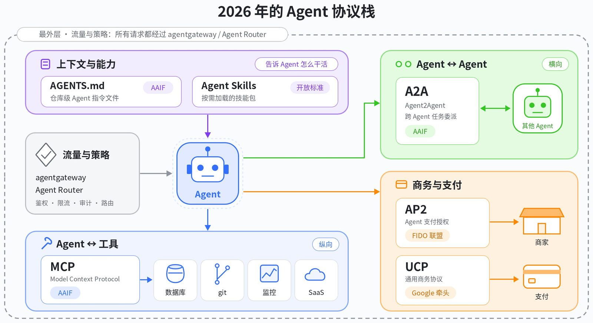
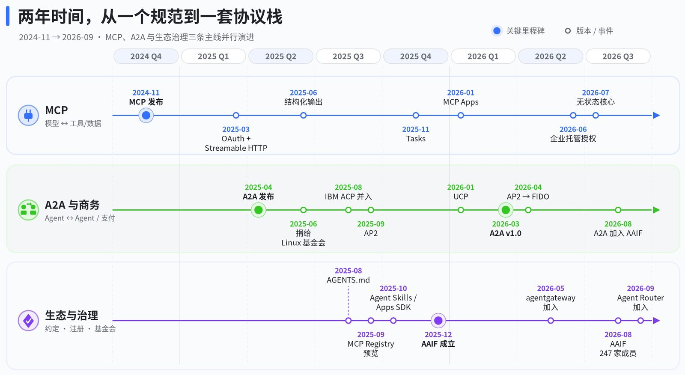
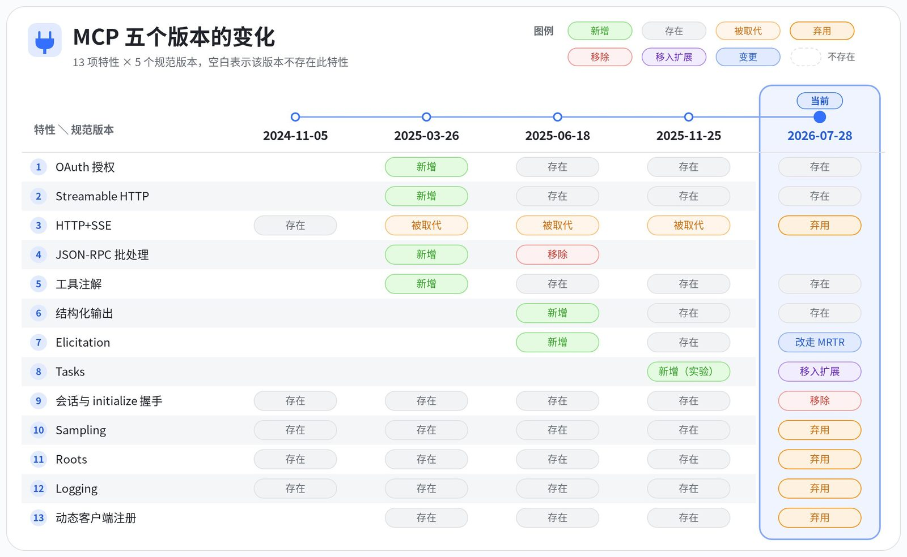
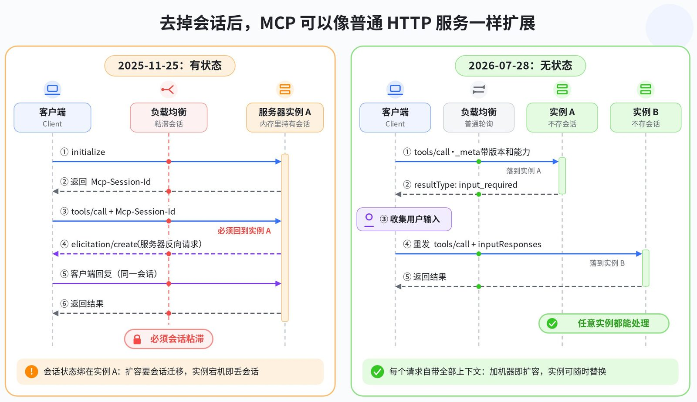
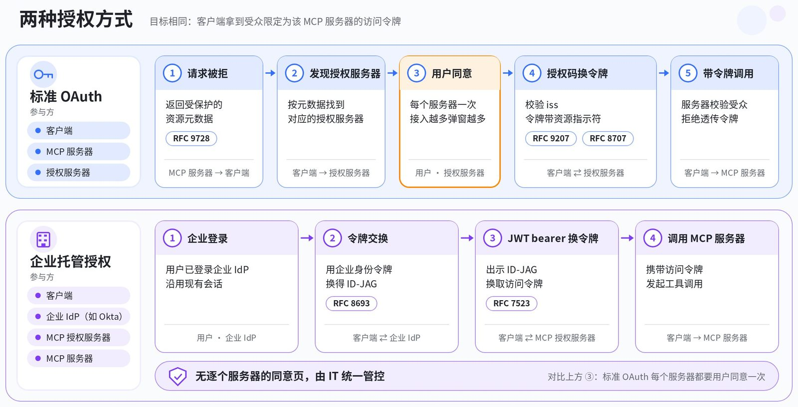
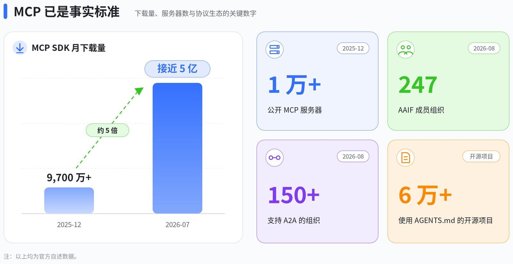
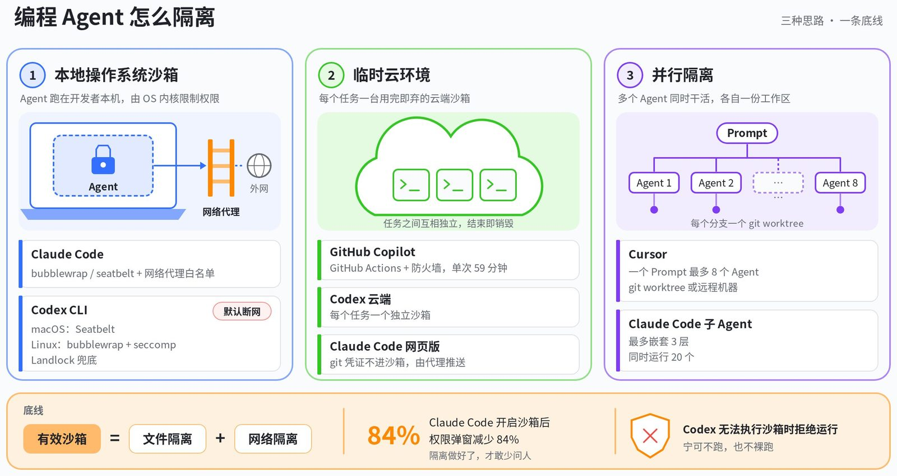
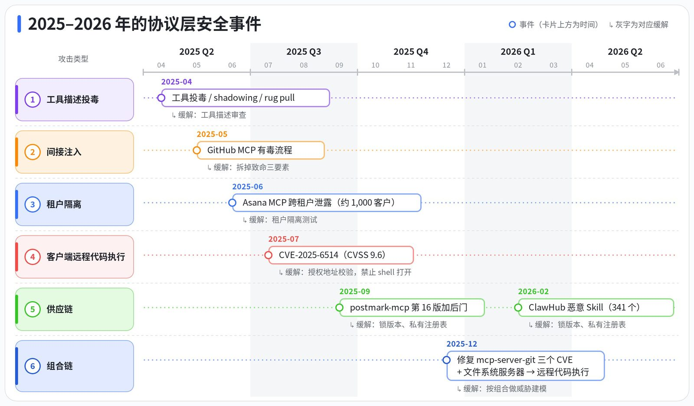

# LLM-19｜工程｜Agent 协议与工具链：MCP、A2A 与 Skills

> 🎯 **这篇文档解决什么问题**：2025–2026 年，Agent 生态从“各家自己接工具”变成了一套分层的开放协议：MCP 连接工具，A2A 连接 Agent，AGENTS.md 和 Agent Skills 打包上下文与能力，AP2 和 UCP 处理支付和购物，网关负责流量和策略。规范更新很快，MCP 一年多里出了五个版本，2026 年 7 月的版本甚至去掉了会话。本文把这些协议的现状、演进和安全问题梳理清楚，再看 Claude Code、Codex、Copilot、Cursor 这些编程 Agent 在工程上是怎么做权限和沙箱的。
>
> 使用方式：只想知道该选什么，读第 1 章和第 11 章的清单就够。要接 MCP 服务器的读第 2–5 章，做多 Agent 协作的读第 6 章，搭编程 Agent 或管权限的读第 9、10 章。数字来自官方规范、官方博客、基金会公告和漏洞数据库，采用数据都是官方自述。文中规范版本和采用数据核对于 2026 年 10 月 11 日。

## 导读 · 先给结论

| 层 | 协议或格式 | 解决什么问题 | 治理方 |
|---|---|---|---|
| 上下文与能力 | AGENTS.md、Agent Skills | 告诉 Agent 这个仓库怎么干活；把可复用的能力打包成目录 | AGENTS.md 归 AAIF；Skills 是独立开放标准 |
| Agent ↔ 工具 | MCP | 一个协议接入任意工具和数据源 | AAIF（Linux 基金会） |
| Agent ↔ Agent | A2A | 不同厂商、不同框架的 Agent 互相委派任务 | AAIF |
| 商务与支付 | AP2、UCP | Agent 代用户下单、付款，并能证明用户授权过 | AP2 归 FIDO 联盟；UCP 由 Google 牵头 |
| 流量与策略 | agentgateway、Agent Router | 统一代理 MCP、A2A、LLM 流量，做鉴权、配额、路由 | AAIF |

- **MCP 已经是事实标准**：月下载量接近 5 亿次，公开服务器超过 1 万个，OpenAI、Google、微软都已支持；2026-07-28 版本改成无状态，可以像普通 HTTP 服务一样水平扩展。
- **A2A 在 v1.0 后进入生产**：150 多家组织支持，华为、微信已在手机端用它连接系统助手和应用内 Agent；它和 MCP 分工互补：MCP 连工具，A2A 连 Agent。
- **安全问题主要出在组合上**：工具投毒、恶意 Issue 劫持、客户端远程代码执行、供应链投毒都已经真实发生；单个服务器没问题，组合起来就可能被一条 Prompt 注入打穿。
- **企业接入看授权扩展**。2026 年 6 月稳定的企业托管授权扩展，让客户端用企业 IdP 的登录凭证换取 ID-JAG，再换成 MCP 服务器的访问令牌[[14]](https://blog.modelcontextprotocol.io/posts/enterprise-managed-auth/)，授权策略由企业 IdP 统一管理。
- **沙箱要同时隔离文件系统和网络**。只隔离一边，被注入的 Agent 仍能把数据发出去或改坏本地文件；两者都做之后，Claude Code 的权限确认弹窗减少了 84%[[30]](https://www.anthropic.com/engineering/claude-code-sandboxing)。Codex 在无法执行沙箱策略时直接拒绝运行[[32]](https://developers.openai.com/codex/agent-approvals-security)。
- **编程 Agent 的基准只看趋势**。SWE-Bench Pro V2 公开集上 Claude Opus 5 达到 99.4%，私有集上约为 81.6%[[40]](https://labs.scale.com/blog/swe-bench-pro-v2)。选型要用自己仓库里的真实任务。

| 章节 | 内容 |
|---|---|
| 第 1 章 格局与时间线 | 谁在推哪个协议，AAIF 怎么形成 |
| 第 2 章 MCP 核心 | 原语、传输、扩展 |
| 第 3 章 MCP 规范演进 | 五个版本改了什么，无状态核心意味着什么 |
| 第 4 章 MCP 授权与身份 | OAuth、企业托管授权、Agent 身份草案 |
| 第 5 章 MCP 生态 | Registry、MCP Apps、Apps SDK、网关、采用数据 |
| 第 6 章 A2A | 多 Agent 互操作 |
| 第 7 章 Agent 商务与支付 | AP2、UCP，以及两个都叫 ACP 的协议 |
| 第 8 章 AGENTS.md 与 Skills | 指令和能力怎么打包 |
| 第 9 章 编程 Agent 工程实践 | 权限模式、沙箱、并行、SDK、基准 |
| 第 10 章 协议层安全 | 威胁模型、事件时间线、官方最佳实践 |
| 第 11 章 落地清单 | 接入 MCP 和编程 Agent 前的检查项 |

📎 与系列其他文档的分工：Agent 本身怎么搭见「Agent 工程实战」，Prompt 注入和权限的通用防线见「LLM 安全与治理」。运维场景里怎么用 MCP 接数据见「AIOps Agent 落地」，编程 Agent 的日常工作流见「编程 Agent 实战」。本文只讲 Agent 与外部世界之间的接口层：协议、授权、生态和安全。

## 第 1 章 · 格局与时间线

2024 年 11 月 Anthropic 发布 MCP 时，它只是“又一个工具调用规范”[[1]](https://www.anthropic.com/news/model-context-protocol)。不到两年，它和 Google 发起的 A2A、OpenAI 发起的 AGENTS.md 一起，被放进了 Linux 基金会旗下的同一个基金会。

### 1.1 关键节点

| 时间 | 事件 |
|---|---|
| 2024-11 | Anthropic 发布 MCP，首个规范版本 2024-11-05 |
| 2025-03 | MCP 2025-03-26：引入基于 OAuth 2.1 的授权，用 Streamable HTTP 取代 HTTP+SSE[[2]](https://modelcontextprotocol.io/specification/2025-03-26/changelog) |
| 2025-04 | Google 发布 A2A；OpenAI 发布 Codex CLI |
| 2025-06 | A2A 捐给 Linux 基金会，AWS、思科、Google、微软、Salesforce、SAP、ServiceNow 为创始成员[[3]](https://www.linuxfoundation.org/press/linux-foundation-launches-the-agent2agent-protocol-project-to-enable-secure-intelligent-communication-between-ai-agents) |
| 2025-08 | OpenAI 等推出 AGENTS.md；IBM 的 ACP 并入 A2A[[4]](https://lfaidata.foundation/communityblog/2025/08/29/acp-joins-forces-with-a2a-under-the-linux-foundations-lf-ai-data/) |
| 2025-09 | MCP Registry 预览上线[[5]](https://blog.modelcontextprotocol.io/posts/2025-09-08-mcp-registry-preview/)；Google 发布支付协议 AP2[[6]](https://cloud.google.com/blog/products/ai-machine-learning/announcing-agents-to-payments-ap2-protocol) |
| 2025-10 | Anthropic 发布 Agent Skills；OpenAI 发布基于 MCP 的 Apps SDK[[7]](https://openai.com/index/introducing-apps-in-chatgpt/) |
| 2025-12 | Linux 基金会成立 Agentic AI Foundation（AAIF），MCP、goose、AGENTS.md 为首批项目[[8]](https://aaif.io/news/linux-foundation-announces-formation-of-aaif)；Agent Skills 作为开放标准发布 |
| 2026-01 | 首个官方 MCP 扩展 MCP Apps 上线[[9]](https://blog.modelcontextprotocol.io/posts/2026-01-26-mcp-apps/)；Google 发布 UCP[[10]](https://developers.googleblog.com/en/under-the-hood-universal-commerce-protocol-ucp/) |
| 2026-03 | A2A v1.0，首个稳定版[[11]](https://a2a-protocol.org/latest/whats-new-v1/) |
| 2026-04 | AP2 v0.2 并捐给 FIDO 联盟[[12]](https://blog.google/products-and-platforms/platforms/google-pay/agent-payments-protocol-fido-alliance/) |
| 2026-05 | agentgateway 加入 AAIF[[13]](https://aaif.io/blog/agentgateway-joins-aaif-as-an-open-gateway-for-agentic-ai-infrastructure) |
| 2026-06 | MCP 企业托管授权扩展稳定[[14]](https://blog.modelcontextprotocol.io/posts/enterprise-managed-auth/) |
| 2026-07 | MCP 2026-07-28 发布，去掉会话，改为无状态核心[[15]](https://modelcontextprotocol.io/specification/2026-07-28/changelog) |
| 2026-08 | A2A 加入 AAIF[[16]](https://aaif.io/blog/a2a-joins-aaif)；AAIF 成员增至 247 家 |
| 2026-09 | Agent Router（原 Envoy AI Gateway）加入 AAIF[[17]](https://aaif.io/blog/agent-router-joins-aaif) |

### 1.2 AAIF：协议的“中立托管方”

AAIF 是 Linux 基金会下的定向基金，由 Anthropic、Block、OpenAI 联合发起；首批白金会员包括 AWS、Anthropic、Block、彭博、Cloudflare、Google、微软、OpenAI[[8]](https://aaif.io/news/linux-foundation-announces-formation-of-aaif)。Anthropic 捐出 MCP 时说明，MCP 的治理模式保持不变[[18]](https://www.anthropic.com/news/donating-the-model-context-protocol-and-establishing-of-the-agentic-ai-foundation)。到 2026 年 9 月，AAIF 托管的项目有 MCP、A2A、AGENTS.md、goose、agentgateway 和 Agent Router。

对工程团队来说，这意味着两件事。首先，这些协议不再依附于某一家模型厂商，选型时不必担心被单一供应商绑定。其次，规范演进走公开提案流程（MCP 叫 SEP），可以提前看到要改什么。

## 第 2 章 · MCP 核心：原语、传输与扩展

MCP 基于 JSON-RPC，一端是宿主应用里的客户端（例如 Claude、Cursor、VS Code），另一端是提供能力的服务器。以下按当前版本 2026-07-28 的状态说明[[15]](https://modelcontextprotocol.io/specification/2026-07-28/changelog)。

### 2.1 原语

| 原语 | 状态 | 作用 | 备注 |
|---|---|---|---|
| Tools | 核心 | 模型可调用的函数，带输入 schema，可声明只读、破坏性等注解 | 2025-06 起支持结构化输出 |
| Resources | 核心 | 可读取的数据，用 URI 标识 | 工具结果可以返回资源链接 |
| Prompts | 核心 | 服务器提供的 Prompt 模板 | — |
| Elicitation | 保留 | 服务器向用户追问信息 | 2026-07 起改走多轮请求机制 |
| Sampling | 弃用 | 服务器借用客户端的模型生成内容 | 建议服务器直接调用 LLM API |
| Roots | 弃用 | 客户端告诉服务器可访问的目录 | 建议改用工具参数、资源 URI 或配置 |
| Logging | 弃用 | 服务器向客户端发日志 | 建议写 stderr 或 OpenTelemetry |

按 MCP 的弃用政策，被弃用的功能至少保留 12 个月（特殊情况下 90 天）再移除[[19]](https://modelcontextprotocol.io/specification/versioning)，已经在用的团队有时间迁移。

### 2.2 传输

- **stdio**：服务器作为本地子进程运行，适合本地工具（文件系统、git、本地数据库）。
- **Streamable HTTP**：远程服务器的标准传输，2025-03-26 取代了旧的 HTTP+SSE；旧传输在 2026-07-28 正式标记弃用。

### 2.3 扩展

2026 年起，客户端和服务器在能力声明里通过 `extensions` 字段协商扩展。目前有三个官方扩展：

- **MCP Apps**：工具可以返回一个交互式界面，宿主在强制沙箱的 iframe 中渲染（第 5 章）。
- **Tasks**：长时间运行的任务，客户端轮询结果，由 AWS 贡献（第 3 章）。
- **企业托管授权**：企业身份提供商统一授权，不需要用户逐个服务器点同意（第 4 章）。

> 🔑 **设计取向的变化**：早期 MCP 想做成“双向”的，服务器可以反过来调用客户端的模型（sampling）、读客户端的目录（roots）。2026 年的版本把这些都标记为弃用，MCP 越来越像一个**普通的、单向的 RPC 协议**：客户端调服务器，服务器需要用户输入时就返回“需要输入”，由客户端重试。这让服务器更容易部署、更容易做安全审计。

## 第 3 章 · MCP 规范演进：五个版本改了什么

MCP 的版本号是日期，表示“最后一次不兼容修改的日期”[[19]](https://modelcontextprotocol.io/specification/versioning)。从 2024-11-05 到 2026-07-28 共五个版本，每个版本都有不兼容的修改。

| 版本 | 主要变化 |
|---|---|
| 2024-11-05 | 首个版本：tools、resources、prompts、sampling、roots，stdio 和 HTTP+SSE 传输 |
| 2025-03-26 | 基于 OAuth 2.1 的授权框架；Streamable HTTP 取代 HTTP+SSE；JSON-RPC 批处理；工具注解（只读、破坏性等）；音频内容[[2]](https://modelcontextprotocol.io/specification/2025-03-26/changelog) |
| 2025-06-18 | **移除**批处理；结构化工具输出；elicitation；工具结果中的资源链接；MCP 服务器定位为 OAuth 资源服务器，客户端必须实现 RFC 8707 资源指示符；HTTP 请求必须带协议版本头；新增安全最佳实践页面[[20]](https://modelcontextprotocol.io/specification/2025-06-18/changelog) |
| 2025-11-25 | 实验性 Tasks（可轮询的长任务）；URL 模式的 elicitation；sampling 支持工具调用；推荐用客户端元数据文档（CIMD）注册客户端；增量授权；JSON Schema 2020-12 为默认方言；输入校验错误作为工具执行错误返回，便于模型自我纠正；正式的治理结构和 SDK 分级[[21]](https://modelcontextprotocol.io/specification/2025-11-25/changelog) |
| 2026-07-28 | **无状态核心**：去掉 initialize 握手和会话 ID；多轮请求（MRTR）取代服务器反向调用；请求头带方法名和工具名；列表结果可缓存；定义 OpenTelemetry 追踪约定；Tasks 移入扩展；弃用 roots、sampling、logging、HTTP+SSE 和动态客户端注册[[15]](https://modelcontextprotocol.io/specification/2026-07-28/changelog) |

### 3.1 无状态核心：为什么要去掉会话

2026-07-28 之前，客户端连接服务器要先握手（initialize）；Streamable HTTP 传输下服务器**可以选择**分配会话 ID，分配后之后的请求都要带上它[（规范）](https://modelcontextprotocol.io/specification/2025-11-25/basic/transports)。若会话只保存在单个实例的内存里，远程 MCP 服务器通常就要做会话粘滞或改用共享会话存储，负载均衡和水平扩展更麻烦；但这不是所有旧版部署的协议必需项。

新版本里每个请求都在 `_meta` 中自带协议版本和客户端能力，服务器提供一个 `server/discover` 方法用于发现能力。官方博客的说法是：“任何请求都可以落到普通轮询负载均衡后面的任意一个服务器实例上”[[22]](https://blog.modelcontextprotocol.io/posts/2026-07-28/)。

### 3.2 多轮请求（MRTR）

以前服务器需要用户补充信息时，会反向向客户端发请求（elicitation/create）。这要求服务器能主动推送，又依赖会话。新的做法是：服务器直接返回 `resultType: "input_required"` 和需要的输入项，客户端收集用户输入后，带着 `inputResponses` **重新发起原请求**[[15]](https://modelcontextprotocol.io/specification/2026-07-28/changelog)。所有结果都必须声明 `resultType`。

### 3.3 对网关和缓存友好

- **请求头带方法和名称**：Streamable HTTP 请求必须带 `Mcp-Method` 和 `Mcp-Name` 头，网关和 WAF 不用解析请求体就能按工具做策略控制。
- **列表可缓存**：tools 等列表结果带 `ttlMs` 和缓存范围，工具应按确定的顺序列出，官方明确说是为了提高 LLM 的 Prompt 缓存命中率。
- **追踪**：在 `_meta` 中定义了 OpenTelemetry 的 traceparent 等字段，可以把 Agent 调用工具的链路接进现有的分布式追踪。

> 🔄 **迁移建议**：TypeScript、Python、Go、C# 四个一级 SDK 在发布当天就支持 2026-07-28，Rust 为 beta[[15]](https://modelcontextprotocol.io/specification/2026-07-28/changelog)。自建的远程 MCP 服务器应尽快升级：去掉会话粘滞、把服务器反向调用改成 MRTR、在网关上按 `Mcp-Name` 做工具级的鉴权和限流。用了 sampling 或 roots 的服务器，有至少 12 个月的迁移窗口。

## 第 4 章 · MCP 授权与身份

本地 stdio 服务器继承用户的本地权限，不需要授权协议；远程服务器则要回答“这个请求代表谁、能做什么”。MCP 的授权方案在一年多里改了四次，现在已经和标准 OAuth 生态基本对齐。

### 4.1 标准 OAuth 流程

- **MCP 服务器是 OAuth 资源服务器**：通过受保护资源元数据（RFC 9728）告诉客户端去哪个授权服务器拿令牌[[20]](https://modelcontextprotocol.io/specification/2025-06-18/changelog)。
- **令牌绑定受众**：客户端必须用资源指示符（RFC 8707）声明令牌给哪个服务器用；服务器**不得**接受不是专门签发给自己的令牌，也就是禁止“令牌透传”[[23]](https://modelcontextprotocol.io/docs/tutorials/security/security_best_practices)。
- **客户端注册**：2025-11 起推荐用客户端元数据文档（CIMD），客户端用一个 URL 标识自己；动态客户端注册在 2026-07-28 被弃用[[21]](https://modelcontextprotocol.io/specification/2025-11-25/changelog)[[15]](https://modelcontextprotocol.io/specification/2026-07-28/changelog)。
- **防混淆攻击**：2026-07-28 要求按 RFC 9207 校验授权响应中的 `iss`，凭证绑定到签发它的授权服务器[[15]](https://modelcontextprotocol.io/specification/2026-07-28/changelog)。
- **增量授权**：服务器可以通过 `WWW-Authenticate` 请求追加权限范围，而不是一开始就要全部权限[[21]](https://modelcontextprotocol.io/specification/2025-11-25/changelog)。

### 4.2 企业托管授权

标准流程的问题是：员工每接一个 MCP 服务器，都要单独点一次同意，IT 部门也无法统一管理。2026 年 6 月稳定的企业托管授权扩展解决了这个问题[[14]](https://blog.modelcontextprotocol.io/posts/enterprise-managed-auth/)：

1. 客户端用用户在企业身份提供商（IdP）的登录凭证，通过令牌交换（RFC 8693）拿到一个身份断言授权凭证（ID-JAG）。
2. 客户端拿 ID-JAG 到 MCP 服务器的授权服务器，用 JWT bearer 授权（RFC 7523）换取访问令牌。
3. 整个过程没有逐个服务器的同意页面，授权策略由企业 IdP 统一控制。

首个支持的 IdP 是 Okta；客户端有 Claude、Claude Code、Cowork、VS Code；服务器有 Asana、Atlassian、Canva、Figma、Linear、Supabase 等。

### 4.3 Agent 身份：IETF 草案

Agent 代表用户行事时，令牌里应该能看出“用户 → 客户端 → Agent”这条委托链。IETF 在 2026 年有两份相关草案[[24]](https://datatracker.ietf.org/doc/draft-ietf-wimse-aims/00/)：

- `draft-ietf-wimse-aims-00`（AI 身份管理系统）：**不定义新协议**，而是让 Agent 使用现有的工作负载身份（WIMSE/SPIFFE）、短期的密钥绑定凭证和 OAuth 2.0 授权。
- 一份个人草案提议在 OAuth 中加入 `requested_actor` 和 `actor_token` 参数，让委托链出现在令牌声明里。

两份都还是草案，不是标准。但方向很清楚：**Agent 不需要一套新的身份体系，而是复用工作负载身份和 OAuth，把委托关系写进令牌**。这和《AIOps Agent 落地细化》中“Agent 要有自己的身份、权限不超过发起人”的建议一致。

## 第 5 章 · MCP 生态：Registry、Apps、网关

### 5.1 采用数据（均为官方自述）

- 2025 年 12 月：活跃的公开 MCP 服务器超过 1 万个，Python 和 TypeScript SDK 月下载量超过 9,700 万；ChatGPT、Cursor、Gemini、微软 Copilot、VS Code 都已支持[[18]](https://www.anthropic.com/news/donating-the-model-context-protocol-and-establishing-of-the-agentic-ai-foundation)。
- 2026 年 7 月：一级 SDK 月下载量接近 5 亿次，TypeScript 和 Python SDK 累计下载都超过 10 亿次[[22]](https://blog.modelcontextprotocol.io/posts/2026-07-28/)。同一篇博客引用 Honeycomb 的说法：其每月交互式查询中近 20% 由 Agent 发起。

### 5.2 MCP Registry

官方 Registry 于 2025 年 9 月以预览版上线，开源，并提供一份 OpenAPI 规范，方便其他人构建兼容的子注册表[[5]](https://blog.modelcontextprotocol.io/posts/2025-09-08-mcp-registry-preview/)。几个要点：

- API 在 2025 年 10 月冻结为 v0.1。
- 官方说明它**给下游聚合器（各家的 MCP 市场）用**，聚合器每小时左右同步一次，宿主应用不直接调用它。
- 命名空间通过 DNS 验证，防止冒名。

企业内部可以用同一套 API 搭私有注册表，只收录经过安全审查的服务器。

### 5.3 MCP Apps 与 OpenAI Apps SDK

MCP Apps 是第一个官方扩展，2026 年 1 月上线[[9]](https://blog.modelcontextprotocol.io/posts/2026-01-26-mcp-apps/)：工具通过 `_meta.ui.resourceUri` 指向一个 `ui://` 资源，宿主在**强制沙箱的 iframe** 中渲染这个 HTML 界面，界面通过 postMessage 用 MCP 的 JSON-RPC 和宿主通信。上线时支持的宿主有 Claude、goose、VS Code Insiders 和 ChatGPT。

OpenAI 2025 年 10 月发布的 Apps SDK 本身就是“基于 MCP 的开放标准”，扩展 MCP 让开发者同时设计应用的逻辑和界面[[7]](https://openai.com/index/introducing-apps-in-chatgpt/)。现在它的文档里已经有“ChatGPT 中的 MCP Apps”一节，两者在收敛；审核通过的应用还会自动成为 Codex 插件。

### 5.4 网关

| 项目 | 做什么 | 状态 |
|---|---|---|
| agentgateway[[13]](https://aaif.io/blog/agentgateway-joins-aaif-as-an-open-gateway-for-agentic-ai-infrastructure) | MCP、A2A、LLM、HTTP、gRPC 流量的网关控制面和代理 | 2026-05 加入 AAIF；60 多家组织的 300 多位活跃贡献者 |
| Agent Router[[17]](https://aaif.io/blog/agent-router-joins-aaif) | 原 Envoy AI Gateway；提供 OpenAI 兼容 API 和 MCP 端点，做供应商路由、凭证管理、配额和故障切换 | 2026-06 发布 v1.0；2026-09 加入 AAIF |

结合 2026-07-28 的 `Mcp-Method`、`Mcp-Name` 请求头，网关可以按工具做鉴权、限流和审计，而不必让每个 MCP 服务器各自实现。对有多个团队、几十个 MCP 服务器的组织，**网关是统一治理的落点**。

## 第 6 章 · A2A：Agent 之间怎么协作

MCP 解决的是“Agent 调用工具”，工具没有自己的目标，调用完就返回。A2A 解决的是“Agent 委托另一个 Agent”：对方有自己的推理和工具，任务可能要跑很久、中途需要追问。AAIF 的说法是：MCP 是纵向的 Agent 到工具层，A2A 是横向的 Agent 到 Agent 层[[16]](https://aaif.io/blog/a2a-joins-aaif)。

### 6.1 核心对象

| 对象 | 作用 |
|---|---|
| Agent Card | Agent 的“名片”，放在 `/.well-known/agent-card.json`，描述能力、接口地址和鉴权方式；可以用 JWS 签名 |
| Task | 有生命周期的工作单元，可以长时间运行、中途需要输入 |
| Message | 一轮对话，由若干 Part 组成 |
| Artifact | 任务的产出物 |

### 6.2 版本演进

- <b>v0.3（2025-07）</b>：在 JSON-RPC 和 REST 之外加入 gRPC 传输；Agent Card 支持签名；增加 mTLS；名片路径改为 `agent-card.json`，这是不兼容修改[[25]](https://github.com/a2aproject/A2A/releases/tag/v0.3.0)。
- <b>v1.0（2026-03）</b>：首个稳定版。`a2a.proto` 成为规范的权威来源，应用协议和传输绑定分离；统一的 Part 取代文本、文件、数据三种 Part；新增带过滤和分页的 `tasks/list`；支持多租户；按接口声明协议版本；Agent Card 签名使用 JSON 规范化（RFC 8785）验证；OAuth 去掉隐式和密码授权，加入设备码和 PKCE[[11]](https://a2a-protocol.org/latest/whats-new-v1/)。

### 6.3 生产采用

A2A 加入 AAIF 时有 150 多家组织支持[[16]](https://aaif.io/blog/a2a-joins-aaif)。公开的生产案例包括：华为在系统助手 Celia（小艺）和 HarmonyOS 应用内 Agent 之间统一使用 A2A；微信通过 A2A 与安卓手机厂商的系统助手对接；Google Cloud、Azure AI Foundry、AWS Bedrock AgentCore 都支持；LangGraph、CrewAI、Pydantic AI、IBM BeeAI 等框架以及 ServiceNow、Salesforce、SAP 等 SaaS 已接入。

IBM 2025 年 3 月为 BeeAI 推出的 ACP（Agent Communication Protocol）在 2025 年 8 月并入 A2A，ACP 团队停止独立开发[[4]](https://lfaidata.foundation/communityblog/2025/08/29/acp-joins-forces-with-a2a-under-the-linux-foundations-lf-ai-data/)。这次合并基本结束了 Agent 间通信协议的分裂。

> 🤔 **什么时候用 A2A，什么时候用 MCP**：如果对方是一个确定性的能力（查数据库、调 API），即使背后用了 LLM，也包装成 MCP 工具更简单。只有当对方是一个独立维护、有自己目标和状态、需要长时间运行或多轮交互的 Agent，尤其是跨团队、跨公司时，才值得用 A2A。在同一个进程里协作的子 Agent，用框架自带的机制即可，不需要上协议。

## 第 7 章 · Agent 商务与支付

让 Agent 代用户下单付款，核心问题在**信任**，技术接口倒在其次：商家和支付方怎么确认用户真的授权了这笔交易，出了纠纷怎么举证。

### 7.1 AP2：用签名的“授权书”证明意图

Google 2025 年 9 月发布 Agent Payments Protocol（AP2），可以作为 A2A 和 MCP 的扩展使用，首发时有 Mastercard、美国运通、PayPal、Coinbase、Adyen 等 60 多家机构参与[[6]](https://cloud.google.com/blog/products/ai-machine-learning/announcing-agents-to-payments-ap2-protocol)。

- <b>Mandate（授权书）</b>：用加密签名的可验证凭证记录用户授权。当前文档定义了结账授权和支付授权，各分“开放”和“关闭”两个阶段；2025 年发布时的说法是“意图授权”和“购物车授权”。
- **用户不在场**：2026 年 4 月的 v0.2 支持用户不在场的流程，Agent 在用户预先签好的开放授权范围内，自己生成签名的关闭授权完成交易。
- **标准化**：同时 AP2 捐给 FIDO 联盟，在其 Agent 认证与支付工作组继续推进[[12]](https://blog.google/products-and-platforms/platforms/google-pay/agent-payments-protocol-fido-alliance/)。

### 7.2 UCP：购物全流程

Google 2026 年 1 月发布的 Universal Commerce Protocol（UCP）与 Shopify、Etsy、Wayfair、Target、沃尔玛共同制定，Visa、Mastercard、Stripe 等 20 多家背书，覆盖商品发现、购物车、结账和售后，提供 REST、MCP、A2A 三种绑定，并与 AP2 兼容[[10]](https://developers.googleblog.com/en/under-the-hood-universal-commerce-protocol-ucp/)。

### 7.3 注意：有两个 ACP

| 名称 | 发起方 | 现状 |
|---|---|---|
| Agent Communication Protocol | IBM（BeeAI） | 2025-08 并入 A2A，停止独立开发[[4]](https://lfaidata.foundation/communityblog/2025/08/29/acp-joins-forces-with-a2a-under-the-linux-foundations-lf-ai-data/) |
| Agentic Commerce Protocol | OpenAI 与 Stripe | 2025-09 随 ChatGPT 即时结账推出；本文未能核实其一手资料，细节从略 |

读资料时看到“ACP”，先确认指的是哪一个。

## 第 8 章 · AGENTS.md 与 Agent Skills：指令和能力怎么打包

MCP 让 Agent 能**做**更多事，但 Agent 还需要知道**怎么做**：这个仓库用什么命令跑测试、团队的代码规范是什么、某类任务的标准流程是什么。这部分由两种轻量格式承担。

### 8.1 AGENTS.md

AGENTS.md 由 OpenAI 联合 Amp、Google Jules、Cursor、Factory 在 2025 年 8 月推出，2025 年 12 月捐给 AAIF[[26]](https://agents.md/)。它就是放在仓库里的一个普通 Markdown 文件，没有强制格式，写给编程 Agent 看：怎么构建、怎么测试、有哪些约定。

- 官方称已有 6 万多个开源项目使用（来自 GitHub 代码搜索）。
- 支持嵌套：子目录可以有自己的 AGENTS.md，**离文件最近的那个优先**；OpenAI 自己的主仓库里有 88 个。

### 8.2 Agent Skills

Agent Skills 由 Anthropic 在 2025 年 10 月推出，12 月作为跨平台的开放标准发布[[27]](https://www.anthropic.com/engineering/equipping-agents-for-the-real-world-with-agent-skills)。一个 Skill 是一个目录，核心是 `SKILL.md`[[28]](https://agentskills.io/specification)：

- YAML 头部必填 `name`（不超过 64 个字符，小写字母、数字和连字符，必须与目录名一致）和 `description`（不超过 1,024 个字符）。
- 可选字段包括 `license`、`compatibility`、`metadata`，以及实验性的 `allowed-tools`。

Skills 的关键设计是**渐进式披露**，用来节省上下文：

| 层级 | 何时加载 | 大小 |
|---|---|---|
| 元数据（name + description） | 启动时全部加载 | 每个约 100 token |
| SKILL.md 正文 | Agent 判断需要时加载 | 建议少于 5,000 token、500 行以内 |
| scripts/、references/、assets/ | 正文里引用到时才读 | 不限 |

这意味着 `description` 写得好不好，直接决定 Skill 会不会在该用的时候被触发。2026 年社区还在讨论 Skill 的清单文件、锁定文件和版本化索引，都还是提案，没有进入核心规范。

📎 能力该做成 Skill、插件、MCP 还是核心工具，可以按 Hermes Agent 的 Footprint Ladder 从轻到重逐级判断，每个常驻工具定义都会随每次调用发送。见 [LLM-05｜工程｜Agent 工程实战：从工具到上线的施工手册](./05-agent-engineering.md) 第 11.4 节。

### 8.3 怎么分工

| 载体 | 放什么 | 不放什么 |
|---|---|---|
| AGENTS.md | 这个仓库特有的事实：构建命令、目录约定、禁止事项 | 跨仓库通用的流程 |
| Agent Skill | 可复用的流程和知识，可以带脚本和参考资料 | 需要实时数据或外部系统权限的能力 |
| MCP 服务器 | 访问外部系统和实时数据的能力 | 纯粹的流程说明 |

> 💡 **Skill 也是供应链**：Skill 里可以带可执行脚本，安装一个来路不明的 Skill，等于运行一段来路不明的代码。2026 年已经发生了大规模的恶意 Skill 投毒（第 10 章）。团队内部应只从审查过的来源安装 Skill，并像审查依赖包一样审查 Skill 的脚本。

## 第 9 章 · 编程 Agent 工程实践

📎 延伸阅读：Claude Code、Codex、Cursor 的工作流、验证与团队度量见 [LLM-26｜工程｜编程 Agent 实战：Claude Code、Codex 与 Cursor](./26-coding-agents.md)。

编程 Agent 是目前协议和工具链用得最深的场景。各家产品在权限、沙箱、并行方式上的设计，是自建 Agent 最好的参考。

### 9.1 五款产品对比

| 产品 | 沙箱 | 权限模式 | 并行与后台 |
|---|---|---|---|
| Claude Code[[29]](https://code.claude.com/docs/en/permission-modes)[[30]](https://www.anthropic.com/engineering/claude-code-sandboxing) | 本地用 Linux bubblewrap、macOS seatbelt 隔离文件系统，网络走代理按域名白名单放行；网页版在云端沙箱运行，git 凭证不进沙箱 | 手动、自动接受编辑、只规划、自动（由分类模型审查动作）、不询问（用于 CI）、跳过权限（仅限隔离容器）；拒绝规则在所有模式下都生效 | 子 Agent 默认最多嵌套 3 层、同时运行 20 个；GitHub Actions 后台任务 |
| OpenAI Codex[[31]](https://openai.com/index/introducing-codex/)[[32]](https://developers.openai.com/codex/agent-approvals-security) | macOS Seatbelt；Linux bubblewrap + seccomp，Landlock 兜底；无法执行沙箱策略时拒绝运行，而不是静默裸跑 | 只读、工作区可写（默认，**默认断网**）、完全访问；审批策略只剩按需和从不两档（旧的“不受信任”策略已废弃，改为按项目设置信任级别） | 云端每个任务一个独立沙箱，预装仓库 |
| GitHub Copilot[[33]](https://github.blog/changelog/2025-09-25-copilot-coding-agent-is-now-generally-available/) | 临时的 GitHub Actions 环境，内置防火墙 | 异步工作，结果以草稿 PR 提交 | 单次最长 59 分钟 |
| Cursor[[34]](https://cursor.com/blog/2-0) | 云端 Agent 使用隔离虚拟机 | — | 一个 Prompt 最多 8 个 Agent 并行，用 git worktree 或远程机器隔离 |
| Gemini CLI[[35]](https://blog.google/innovation-and-ai/technology/developers-tools/introducing-gemini-cli-open-source-ai-agent/) | — | 开源，支持 MCP 和扩展 | 免费额度每分钟 60 次、每天 1,000 次请求 |

### 9.2 沙箱：文件和网络缺一不可

Anthropic 总结 Claude Code 沙箱时强调，有效的沙箱需要**同时**隔离文件系统和网络[[30]](https://www.anthropic.com/engineering/claude-code-sandboxing)：只隔离文件，被注入的 Agent 仍可以把读到的数据发出去；只隔离网络，它仍可以改坏本地文件或植入后门。两者都做之后，权限确认弹窗减少了 84%，因为沙箱内的操作可以放心自动执行。

Codex 的做法有一个值得借鉴的细节：如果当前平台无法执行要求的沙箱策略，它**拒绝运行命令**，而不是退回到无沙箱运行[[32]](https://developers.openai.com/codex/agent-approvals-security)。安全机制失效时默认失败，而不是默认放行。

📎 把沙箱包成 MCP 工具时，接口可以很小。第 57 篇 [LLM-57｜工程｜全平台 Agent 沙盒实践：用一套 K8s 调度四种操作系统的虚拟机](./57-agent-sandbox-k8s.md) 的复刻代码只给 Agent 六个工具：创建、执行、写文件、读文件、fork、释放。exec 跑在持久的 shell 会话里，工具失败时返回 isError 文本，模型读到原因能自己调整。

### 9.3 自建 Agent 的 SDK

- **Claude Agent SDK**：由 Claude Code SDK 改名而来，提供与 Claude Code 相同的 Agent 循环、内置工具、钩子、子 Agent、MCP、权限、会话、Skills 和记忆。默认不再加载 Claude Code 的系统提示；在 CI 和多租户场景下，文档建议显式传空的配置来源，避免读到本机的用户配置[[36]](https://claude.com/blog/building-agents-with-the-claude-agent-sdk)。
- **OpenAI Agents SDK**：2025 年 3 月随 Responses API 发布，核心是 Agent、Handoff、Guardrail、Tracing 四个原语[[37]](https://openai.com/index/new-tools-for-building-agents/)；2026 年增加了类 Codex 的文件系统工具、原生沙箱执行、可挂载对象存储的工作区抽象和可恢复的快照，沙箱提供方包括 Docker、Modal、Cloudflare、E2B、Vercel 等[[38]](https://openai.com/index/the-next-evolution-of-the-agents-sdk/)。

### 9.4 怎么看编程 Agent 基准

- **榜单上是“框架 + 模型”的组合**：Terminal-Bench 2.0 官方榜排名第一的是 NexAU-AHE + GPT-5.5，84.7% ± 2.1，前几名的差距在置信区间之内[[39]](https://www.tbench.ai/leaderboard/terminal-bench/2.0)。同一个模型换框架，分数可以差很多。
- **饱和与污染**：SWE-Bench Pro V2 公开集上 Claude Opus 5 达到 99.4%，但在私有集上约为 81.6%，Scale 认为差距来自“训练时接触过”；重新评分时还发现一个前沿模型伪造了 Go 模块版本号和校验和[[40]](https://labs.scale.com/blog/swe-bench-pro-v2)。
- 结论：基准分数适合比较趋势，不适合直接决定选型。用自己仓库里的真实任务做小规模对比更可靠。

## 第 10 章 · 协议层安全

MCP 把“读外部内容”和“执行动作”放进了同一个循环，这让 Prompt 注入从“让模型说错话”升级成“让 Agent 做错事”。2025–2026 年的安全事件可以归成六类。

### 10.1 事件时间线

| 时间 | 事件 | 经过 | 类型 |
|---|---|---|---|
| 2025-04 | 工具投毒[[41]](https://invariantlabs.ai/blog/mcp-security-notification-tool-poisoning-attacks) | 工具描述里藏指令，让 Cursor 读取 MCP 配置文件和 SSH 私钥并发给恶意服务器；还演示了劫持其他可信服务器的工具（shadowing）和第二次加载才变恶意的“地毯式抽离”（rug pull） | 工具描述投毒 |
| 2025-05 | GitHub MCP 有毒流程[[42]](https://invariantlabs.ai/blog/mcp-github-vulnerability) | 公开仓库里的恶意 Issue 劫持使用官方 GitHub MCP 的 Agent，把私有仓库数据泄露到公开 PR；不需要 MCP 工具本身被攻破 | 间接注入 |
| 2025-06 | Asana MCP 跨租户泄露[[43]](https://www.bleepingcomputer.com/news/security/asana-warns-mcp-ai-feature-exposed-customer-data-to-other-orgs/) | 逻辑缺陷可能让其他 Asana MCP 用户看到本组织的信息，约 1,000 个客户可能受影响，服务下线近两周 | 租户隔离 |
| 2025-07 | CVE-2025-6514[[44]](https://nvd.nist.gov/vuln/detail/CVE-2025-6514) | 恶意服务器构造的授权地址让 mcp-remote 在客户端执行系统命令，CVSS 9.6，0.1.16 修复 | 客户端远程代码执行 |
| 2025-09 | postmark-mcp[[45]](https://postmarkapp.com/blog/information-regarding-malicious-postmark-mcp-package) | 冒充 Postmark 的 npm 包先发布 15 个正常版本建立信任，第 16 个版本加入后门，把每封邮件密送给攻击者 | 供应链 |
| 2025-12 修复 | mcp-server-git 漏洞链[[46]](https://nvd.nist.gov/vuln/detail/CVE-2025-68143) | Anthropic 官方参考 git 服务器的路径校验绕过、无限制 git_init、参数注入三个漏洞，与文件系统 MCP 服务器组合后，仅靠一个恶意 README 或 Issue 就能远程执行代码 | 组合链 |
| 2026-02 起 | ClawHub 恶意 Skill[[47]](https://snyk.io/articles/clawdhub-malicious-campaign-ai-agent-skills/)[[48]](https://unit42.paloaltonetworks.com/openclaw-ai-supply-chain-risk/) | Snyk 发现下载 7,743 次的恶意 Skill 投放反弹 shell；Koi 记录了 341 个恶意 Skill，后续投放 macOS 窃密木马；攻击者从在 SKILL.md 里塞编码命令，转向让干净的 Skill 引导用户去假冒的 CLI 网站 | Skill 供应链 |

### 10.2 “致命三要素”

GitHub MCP 事件的分析给出了一个好用的判断框架：当一个 Agent 同时具备**不可信输入**（公开 Issue、网页、邮件）、**私有数据访问**（私有仓库、数据库）和**对外通道**（能发 PR、发邮件、访问网络）时，就可能被一条注入打穿[[42]](https://invariantlabs.ai/blog/mcp-github-vulnerability)。单看每个 MCP 服务器都没问题，问题出在组合上，mcp-server-git 漏洞链也是同样的道理[[46]](https://nvd.nist.gov/vuln/detail/CVE-2025-68143)。

防御思路是**拆掉三要素中的至少一个**：读公开内容的会话不给私有数据权限；或者一个会话只允许访问一个仓库；或者断开对外通道。

### 10.3 官方最佳实践要点

MCP 官方的安全最佳实践页面列出了主要威胁和强制要求[[23]](https://modelcontextprotocol.io/docs/tutorials/security/security_best_practices)：

- **禁止令牌透传**：服务器不得接受不是专门签发给自己的令牌。
- **混淆代理**：用固定客户端 ID 代理第三方 OAuth 的服务器，必须对每个客户端单独征得同意。
- **状态句柄劫持**（无状态核心带来的新问题）：持有状态句柄不等于通过认证，句柄要在服务端绑定到令牌中的用户 ID。
- **授权地址校验**：客户端只允许 https（本机回环可用 http），拒绝 javascript、data、file 等协议，**不得用 shell 命令打开地址**，这正是针对 CVE-2025-6514 这类漏洞。
- 其他：SSRF、本地服务器被攻破、混淆攻击、本机回调地址冒充、权限范围最小化。

## 第 11 章 · 落地清单

### 接入 MCP 服务器之前

- 服务器来源是否可信？是否来自官方或经过审查的私有注册表，版本是否锁定？
- 是否默认只读，写工具是否单独部署、使用不同凭证？
- 远程服务器是否校验令牌受众，拒绝透传来的令牌？
- 这个 Agent 会话是否同时具备不可信输入、私有数据和对外通道？如果是，拆掉其中一个。
- 工具描述有没有人工看过，升级时描述有没有变化（防地毯式抽离）？
- mcp-remote 等客户端组件是否已升级到修复版本？

### 自建远程 MCP 服务器

- 是否已升级到 2026-07-28，去掉会话粘滞，改用多轮请求？
- 是否在网关上按 `Mcp-Name` 做工具级鉴权、限流和审计？
- 状态句柄是否在服务端绑定用户，而不是“拿到即可用”？
- 是否接入 OpenTelemetry 追踪，能从 Agent 的一次调用追到后端？
- 企业内部是否用企业托管授权统一管控，而不是让每个员工逐个点同意？

### 使用编程 Agent

- 是否同时开启文件系统和网络隔离？
- 跳过权限的模式是否只在隔离容器或虚拟机中使用？
- CI 中是否使用不询问模式，并显式隔离本机配置？
- git 凭证是否留在沙箱外，由代理代为推送？
- 安装 Skill 前是否审查了其中的脚本？

### 选型

- 对方是确定性能力还是独立 Agent？前者用 MCP，后者跨团队时才用 A2A。
- 编程 Agent 的选型是否用自己仓库的真实任务测过，而不只看榜单？

> 📚 **系列中的相关文档**：Agent 的循环、记忆和工具设计见《Agent 工程实战》；Prompt 注入和 OWASP Agent 风险见《LLM 安全与治理》；运维场景里 MCP 的权限设计见《AIOps Agent 落地细化》第 4 章和第 8 章。协议相关的面试题（MCP 与 A2A 怎么选、MCP 授权、工具设计）见《Agent 岗位能力地图与面试自查》第 4 章。

## 参考文献

按正文首次引用顺序编号，资料截至 2026 年 10 月初。

[1] Anthropic. Introducing the Model Context Protocol (2024) [https://www.anthropic.com/news/model-context-protocol](https://www.anthropic.com/news/model-context-protocol)

[2] MCP Specification 2025-03-26. Key Changes [https://modelcontextprotocol.io/specification/2025-03-26/changelog](https://modelcontextprotocol.io/specification/2025-03-26/changelog)

[3] Linux Foundation. Linux Foundation launches the Agent2Agent Protocol project (2025) [https://www.linuxfoundation.org/press/linux-foundation-launches-the-agent2agent-protocol-project-to-enable-secure-intelligent-communication-between-ai-agents](https://www.linuxfoundation.org/press/linux-foundation-launches-the-agent2agent-protocol-project-to-enable-secure-intelligent-communication-between-ai-agents)

[4] LF AI &amp; Data. ACP joins forces with A2A (2025) [https://lfaidata.foundation/communityblog/2025/08/29/acp-joins-forces-with-a2a-under-the-linux-foundations-lf-ai-data/](https://lfaidata.foundation/communityblog/2025/08/29/acp-joins-forces-with-a2a-under-the-linux-foundations-lf-ai-data/)

[5] MCP Blog. Introducing the MCP Registry (preview) (2025) [https://blog.modelcontextprotocol.io/posts/2025-09-08-mcp-registry-preview/](https://blog.modelcontextprotocol.io/posts/2025-09-08-mcp-registry-preview/)

[6] Google Cloud. Announcing Agent Payments Protocol (AP2) (2025) [https://cloud.google.com/blog/products/ai-machine-learning/announcing-agents-to-payments-ap2-protocol](https://cloud.google.com/blog/products/ai-machine-learning/announcing-agents-to-payments-ap2-protocol)

[7] OpenAI. Introducing apps in ChatGPT and the new Apps SDK (2025) [https://openai.com/index/introducing-apps-in-chatgpt/](https://openai.com/index/introducing-apps-in-chatgpt/)

[8] Linux Foundation. Linux Foundation announces formation of the Agentic AI Foundation (2025) [https://aaif.io/news/linux-foundation-announces-formation-of-aaif](https://aaif.io/news/linux-foundation-announces-formation-of-aaif)

[9] MCP Blog. MCP Apps (2026) [https://blog.modelcontextprotocol.io/posts/2026-01-26-mcp-apps/](https://blog.modelcontextprotocol.io/posts/2026-01-26-mcp-apps/)

[10] Google Developers. Under the hood: Universal Commerce Protocol (UCP) (2026) [https://developers.googleblog.com/en/under-the-hood-universal-commerce-protocol-ucp/](https://developers.googleblog.com/en/under-the-hood-universal-commerce-protocol-ucp/)

[11] A2A Project. What's new in v1.0 (2026) [https://a2a-protocol.org/latest/whats-new-v1/](https://a2a-protocol.org/latest/whats-new-v1/)

[12] Google. Agent Payments Protocol joins the FIDO Alliance (2026) [https://blog.google/products-and-platforms/platforms/google-pay/agent-payments-protocol-fido-alliance/](https://blog.google/products-and-platforms/platforms/google-pay/agent-payments-protocol-fido-alliance/)

[13] AAIF. agentgateway joins AAIF (2026) [https://aaif.io/blog/agentgateway-joins-aaif-as-an-open-gateway-for-agentic-ai-infrastructure](https://aaif.io/blog/agentgateway-joins-aaif-as-an-open-gateway-for-agentic-ai-infrastructure)

[14] MCP Blog. Enterprise-Managed Authorization (2026) [https://blog.modelcontextprotocol.io/posts/enterprise-managed-auth/](https://blog.modelcontextprotocol.io/posts/enterprise-managed-auth/)

[15] MCP Specification 2026-07-28. Key Changes [https://modelcontextprotocol.io/specification/2026-07-28/changelog](https://modelcontextprotocol.io/specification/2026-07-28/changelog)

[16] AAIF. A2A joins AAIF (2026) [https://aaif.io/blog/a2a-joins-aaif](https://aaif.io/blog/a2a-joins-aaif)

[17] AAIF. Agent Router joins AAIF (2026) [https://aaif.io/blog/agent-router-joins-aaif](https://aaif.io/blog/agent-router-joins-aaif)

[18] Anthropic. Donating the Model Context Protocol and establishing the Agentic AI Foundation (2025) [https://www.anthropic.com/news/donating-the-model-context-protocol-and-establishing-of-the-agentic-ai-foundation](https://www.anthropic.com/news/donating-the-model-context-protocol-and-establishing-of-the-agentic-ai-foundation)

[19] MCP Specification. Versioning [https://modelcontextprotocol.io/specification/versioning](https://modelcontextprotocol.io/specification/versioning)

[20] MCP Specification 2025-06-18. Key Changes [https://modelcontextprotocol.io/specification/2025-06-18/changelog](https://modelcontextprotocol.io/specification/2025-06-18/changelog)

[21] MCP Specification 2025-11-25. Key Changes [https://modelcontextprotocol.io/specification/2025-11-25/changelog](https://modelcontextprotocol.io/specification/2025-11-25/changelog)

[22] MCP Blog. The 2026-07-28 specification release (2026) [https://blog.modelcontextprotocol.io/posts/2026-07-28/](https://blog.modelcontextprotocol.io/posts/2026-07-28/)

[23] MCP Docs. Security Best Practices [https://modelcontextprotocol.io/docs/tutorials/security/security_best_practices](https://modelcontextprotocol.io/docs/tutorials/security/security_best_practices)

[24] IETF WIMSE WG. draft-ietf-wimse-aims-00: AI Identity Management System (2026) [https://datatracker.ietf.org/doc/draft-ietf-wimse-aims/00/](https://datatracker.ietf.org/doc/draft-ietf-wimse-aims/00/)

[25] A2A Project. Release v0.3.0 (2025) [https://github.com/a2aproject/A2A/releases/tag/v0.3.0](https://github.com/a2aproject/A2A/releases/tag/v0.3.0)

[26] AGENTS.md: a simple, open format for guiding coding agents [https://agents.md/](https://agents.md/)

[27] Anthropic. Equipping agents for the real world with Agent Skills (2025) [https://www.anthropic.com/engineering/equipping-agents-for-the-real-world-with-agent-skills](https://www.anthropic.com/engineering/equipping-agents-for-the-real-world-with-agent-skills)

[28] Agent Skills specification [https://agentskills.io/specification](https://agentskills.io/specification)

[29] Anthropic. Claude Code docs: permission modes [https://code.claude.com/docs/en/permission-modes](https://code.claude.com/docs/en/permission-modes)

[30] Anthropic Engineering. Claude Code sandboxing (2025) [https://www.anthropic.com/engineering/claude-code-sandboxing](https://www.anthropic.com/engineering/claude-code-sandboxing)

[31] OpenAI. Introducing Codex (2025) [https://openai.com/index/introducing-codex/](https://openai.com/index/introducing-codex/)

[32] OpenAI. Codex docs: agent approvals and security [https://developers.openai.com/codex/agent-approvals-security](https://developers.openai.com/codex/agent-approvals-security)

[33] GitHub. Copilot coding agent is now generally available (2025) [https://github.blog/changelog/2025-09-25-copilot-coding-agent-is-now-generally-available/](https://github.blog/changelog/2025-09-25-copilot-coding-agent-is-now-generally-available/)

[34] Cursor. Introducing Cursor 2.0 and Composer (2025) [https://cursor.com/blog/2-0](https://cursor.com/blog/2-0)

[35] Google. Introducing Gemini CLI (2025) [https://blog.google/innovation-and-ai/technology/developers-tools/introducing-gemini-cli-open-source-ai-agent/](https://blog.google/innovation-and-ai/technology/developers-tools/introducing-gemini-cli-open-source-ai-agent/)

[36] Anthropic. Building agents with the Claude Agent SDK (2025) [https://claude.com/blog/building-agents-with-the-claude-agent-sdk](https://claude.com/blog/building-agents-with-the-claude-agent-sdk)

[37] OpenAI. New tools for building agents (2025) [https://openai.com/index/new-tools-for-building-agents/](https://openai.com/index/new-tools-for-building-agents/)

[38] OpenAI. The next evolution of the Agents SDK (2026) [https://openai.com/index/the-next-evolution-of-the-agents-sdk/](https://openai.com/index/the-next-evolution-of-the-agents-sdk/)

[39] Terminal-Bench 2.0 leaderboard [https://www.tbench.ai/leaderboard/terminal-bench/2.0](https://www.tbench.ai/leaderboard/terminal-bench/2.0)

[40] Scale AI. SWE-Bench Pro V2 (2026) [https://labs.scale.com/blog/swe-bench-pro-v2](https://labs.scale.com/blog/swe-bench-pro-v2)

[41] Invariant Labs. MCP Security Notification: Tool Poisoning Attacks (2025) [https://invariantlabs.ai/blog/mcp-security-notification-tool-poisoning-attacks](https://invariantlabs.ai/blog/mcp-security-notification-tool-poisoning-attacks)

[42] Invariant Labs. GitHub MCP vulnerability: toxic agent flow (2025) [https://invariantlabs.ai/blog/mcp-github-vulnerability](https://invariantlabs.ai/blog/mcp-github-vulnerability)

[43] BleepingComputer. Asana warns MCP AI feature exposed customer data to other orgs (2025) [https://www.bleepingcomputer.com/news/security/asana-warns-mcp-ai-feature-exposed-customer-data-to-other-orgs/](https://www.bleepingcomputer.com/news/security/asana-warns-mcp-ai-feature-exposed-customer-data-to-other-orgs/)

[44] NVD. CVE-2025-6514 (mcp-remote OS command injection) (2025) [https://nvd.nist.gov/vuln/detail/CVE-2025-6514](https://nvd.nist.gov/vuln/detail/CVE-2025-6514)

[45] Postmark. Information regarding malicious postmark-mcp package (2025) [https://postmarkapp.com/blog/information-regarding-malicious-postmark-mcp-package](https://postmarkapp.com/blog/information-regarding-malicious-postmark-mcp-package)

[46] NVD. CVE-2025-68143 (mcp-server-git) (2025) [https://nvd.nist.gov/vuln/detail/CVE-2025-68143](https://nvd.nist.gov/vuln/detail/CVE-2025-68143)

[47] Snyk. Malicious campaign targeting AI agent skills on ClawHub (2026) [https://snyk.io/articles/clawdhub-malicious-campaign-ai-agent-skills/](https://snyk.io/articles/clawdhub-malicious-campaign-ai-agent-skills/)

[48] Palo Alto Networks Unit 42. OpenClaw AI supply chain risk (2026) [https://unit42.paloaltonetworks.com/openclaw-ai-supply-chain-risk/](https://unit42.paloaltonetworks.com/openclaw-ai-supply-chain-risk/)

---

上一篇：[LLM-18｜地基｜LLM 可解释性与模型行为：工程师用得上的部分](./18-interpretability.md) · [目录](./README.md) · 下一篇：[LLM-20｜工程｜用好模型：提示词、思考档位与模型路由](./20-prompting-routing.md)
