# LLM-21｜工程｜Agent 记忆：存什么、怎么取、何时忘

> 🎯 **这篇文档解决什么问题**：上下文窗口只管一次会话。Agent 要记住用户的偏好、上次排查到哪一步、哪种修复方案试过没用，就需要跨会话的记忆。2024–2026 年，ChatGPT、Claude、Gemini 都上线了记忆功能，云厂商推出了托管的记忆服务，研究界提出了几十种记忆系统，但真正难的三件事仍然是：**存什么、怎么取、何时忘**。本文整理 50 多项一手资料，覆盖分类、架构、产品机制、评测、安全风险、个性化，最后落到运维 Agent 的事故记忆怎么做。第 12 章专门拆个性化：偏好在长对话里为什么不被遵循、偏好库怎么支持改口、什么时候才轮到每用户微调。
>
> 使用方式：先读第 1 章判断要不要上记忆系统。要自己做的，按第 4–6 章存、取、忘的顺序读；选型前看第 9 章的评测，上线前过一遍第 10 章的风险。做运维 Agent 的直接看第 11 章，做个性化的看第 12 章，多 Agent 系统里分记忆层、定谁写谁读的看第 13 章。文中产品功能和基准分数核对于 2026 年 10 月 27 日。

## 导读 · 先给结论

- **长上下文代替不了记忆，但也不总是更差**。历史长到十几万 token 时，长上下文模型在 LongMemEval 上掉 30%–60%，用记忆只取 1.6k token 反而更准、快 10 倍；历史只有几万 token 时，全量塞进上下文仍然最准，只是慢十几倍。
- <b>行业正在收敛到“文件 + 后台整理”</b>：Claude 的 `/memories` 目录、Claude Code 的 `MEMORY.md`、Azure SRE Agent 的 `overview.md`、ChatGPT 的后台“做梦”整理、Letta 的睡眠时 Agent，都是一个常驻的小索引加按需读取的主题文件，再由后台进程定期整理。
- <b>“忘”是没解决的问题</b>。在论文所测的“选择性遗忘”设置上所有方法表现都很差，GPT-4o 在多跳的事实更新题上只有 5 分；矛盾消解在 BEAM 上几乎全是零分。工程上的做法是不删除、只标记失效，并在读取时按新鲜度降权。
- **经验记忆对 Agent 最有用**：把成功和失败的轨迹提炼成策略，AppWorld 平均分从 42.4 提到 59.4，SWE-Bench-Verified 从 34.2 提到 38.8。运维场景里，“这个方案试过没用”往往比“这个方案有用”更值钱。
- **记忆是持久化的攻击面**：一次提示词注入就能写进长期记忆，之后每次对话都生效；只通过正常提问就能把恶意记录写进 Agent 记忆，成功率 98.2%。
- **记忆会放大谄媚**：抽取记忆时只保留了用户的说法、丢掉了助手的纠正，Claude Sonnet 4.6 的谄媚率从 1.6% 升到 40.2%。
- **LoCoMo 分数已经通胀**：报告值从 52.9 涨到 92.5，同一个系统在 1,000 万 token 的 BEAM 上只有 48.6。选型要用更难的评测和自己的数据。

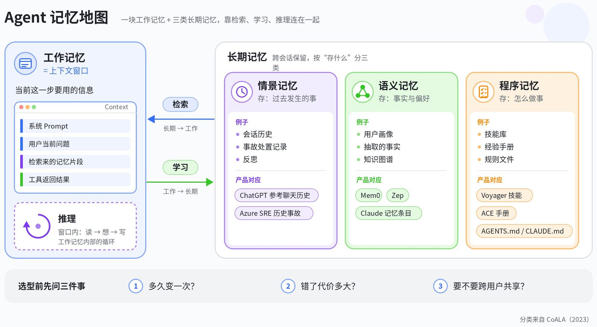

| 章节 | 内容 | 谁最该读 |
|---|---|---|
| 第 1 章 为什么需要记忆 | 长上下文的边界在哪 | 所有人 |
| 第 2 章 记忆的分类 | 工作、情景、语义、程序四类 | 做设计的人 |
| 第 3 章 架构谱系 | 分页、记忆流、事实抽取、知识图谱、文件系统 | 做技术选型的人 |
| 第 4 章 存什么 | 写入时机、抽取、更新语义 | 实现记忆的人 |
| 第 5 章 怎么取 | 混合检索、打分、常驻索引 | 实现记忆的人 |
| 第 6 章 何时忘 | 失效、衰减、后台整理 | 实现记忆的人 |
| 第 7 章 经验与程序记忆 | 技能库、经验手册、从失败中学 | 做 Agent 的人 |
| 第 8 章 产品怎么做 | ChatGPT、Claude、Gemini、云厂商、编程工具 | 做产品和平台的人 |
| 第 9 章 评测 | 四个公开基准、分数之争、内部评测怎么建 | 做评测的人 |
| 第 10 章 风险与治理 | 记忆投毒、谄媚放大、隐私与作用域 | 做安全和合规的人 |
| 第 11 章 运维 Agent 的事故记忆 | 记录结构、写入流程、审核与上线清单 | 做 SRE Agent 的人 |
| 第 12 章 个性化：先补记忆，再谈每用户参数 | 偏好遵循基准、取代语义的偏好库、统一微调、每用户 LoRA 与碎片共享 | 做个性化产品的人 |
| 第 13 章 多 Agent 系统的记忆边界 | 作用域阶梯、状态交接、写入时机与读取方式、共享记忆治理 | 做多 Agent 系统的人 |

📎 与系列其他文档的分工：单次会话内的上下文工程见「Agent 工程实战」；向量检索和知识库见「RAG 与知识工程」；通用的安全防线见「LLM 安全与治理」；运维 Agent 的整体落地见「AIOps Agent 落地」。本文只讲跨会话的记忆：存什么、怎么取、何时忘。

## 第 1 章 · 为什么需要记忆：长上下文的边界

2026 年主流模型的上下文窗口已经到百万 token，一个自然的想法是：把全部历史都塞进去，不就不需要记忆系统了吗？研究给出的回答是“要看历史有多长、问题有多难”。

### 1.1 历史变长后，长上下文会变差

- **LongMemEval**（ICLR 2025）：500 道题，考五种能力：信息抽取、跨会话推理、时间推理、知识更新、该拒答时拒答。在约 11.5 万 token 的设置下，长上下文模型准确率下降 30%–60%；商用助手在更简单的设置下也只有 30%–70%[[1]](https://arxiv.org/abs/2410.10813)。
- **Context Rot**（Chroma，2025）：测了 18 个模型，输入越长表现越不稳定，即使是简单任务也如此。在 LongMemEval 上，只给相关的约 300 token 时模型都能答对，给完整的约 11.3 万 token 时一致下降[[2]](https://research.trychroma.com/context-rot)。
- **BEAM**（ICLR 2026）：对话长度分 12.8 万、50 万、100 万、1,000 万 token 四档，即使是百万上下文的模型，无论有没有检索增强，对话越长越吃力[[3]](https://arxiv.org/abs/2510.27246)。

### 1.2 记忆系统能换来什么

Zep 在 LongMemEval 约 11.5 万 token 的设置上做了对比[[4]](https://arxiv.org/abs/2501.13956)：

| 模型 | 全量上下文 | 用记忆 | 变化 |
|---|---|---|---|
| gpt-4o-mini | 55.4%，31.3 秒，11.5 万 token | 63.8%，3.20 秒，1.6k token | 更准，快约 10 倍 |
| gpt-4o | 60.2%，28.9 秒 | 71.2%，2.58 秒 | 更准，快约 11 倍 |

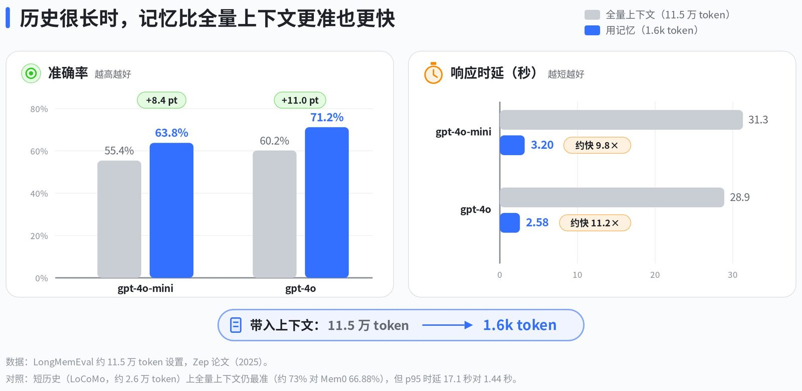

但在短历史上结论相反。LoCoMo 的每段对话平均只有约 9k token、最多 35 个会话[[5]](https://arxiv.org/abs/2402.17753)，Mem0 的论文里全量上下文（约 2.6 万 token）准确率约 73%，仍然最高；Mem0 是 66.88%，但端到端 p95 时延 1.44 秒，全量上下文是 17.1 秒，token 成本省 90% 以上[[6]](https://arxiv.org/abs/2504.19413)。

### 1.3 什么时候需要记忆系统

- **历史超过模型能稳定使用的长度**：多年的用户偏好、几百次事故的处置记录，远超 1.6k token 能讲清的内容，但又不可能每次全量带上。
- **对时延和成本敏感**：全量上下文每次都要为几万 token 付费，即使命中缓存也有首字时延。
- **信息会更新**：用户换了工作、服务换了架构。全量历史里新旧信息并存，模型要自己判断哪个是最新的，而这正是长上下文最弱的地方（第 6 章）。
- **需要跨用户、跨任务复用经验**：一个 Agent 从一百次排障里学到的东西，不在任何一次会话的上下文里（第 7 章）。

如果历史只有几万 token、不需要跨会话，直接把它放进上下文并用好提示缓存，通常比引入一套记忆系统更简单可靠。

## 第 2 章 · 记忆的分类

### 2.1 CoALA 的四类记忆

最常被引用的分类来自普林斯顿 2023 年的 CoALA 框架，它借用了认知科学里 Soar 架构的划分[[7]](https://arxiv.org/abs/2309.02427)：

| 类型 | 存什么 | 在 Agent 里的样子 |
|---|---|---|
| 工作记忆 | 当前这一步决策要用的信息：输入、目标、刚检索到的内容 | 上下文窗口本身 |
| 情景记忆 | 过去发生过的事：轨迹、事件流 | 历史会话、事故处置记录、Reflexion 的反思文字 |
| 语义记忆 | 关于世界和自身的知识 | 用户画像、抽取出的事实、知识图谱 |
| 程序记忆 | 怎么做事：一部分在模型权重里，一部分在代码和技能里 | 技能库、经验手册、提示词规则 |

CoALA 还把对记忆的操作分成三种：**检索**（读长期记忆）、**推理**（用模型更新工作记忆）、**学习**（写长期记忆）[[7]](https://arxiv.org/abs/2309.02427)。后面的第 4–6 章就是按“写、读、改”组织的。

### 2.2 2025 年的新分法

2025 年 12 月的一篇大型综述认为“长期 / 短期”的二分已经不够用，提出从三个角度看[[8]](https://arxiv.org/abs/2512.13564)：

- **形式**：记忆以什么形态存在。token 级（文本、文件）、参数级（微调进权重）、隐状态级（KV 缓存、激活）。
- **功能**：记忆用来干什么。事实、经验、工作记忆。
- **动态**：记忆怎么变化。形成、演化、检索。

这篇综述还明确把 Agent 记忆和 RAG、上下文工程区分开：RAG 的知识库通常是外部准备好的、只读的；Agent 记忆是 Agent 在运行中自己写、自己改的。

### 2.3 产品里的分类

- **Claude Code** 的自动记忆把笔记分成四种：用户（你是谁、偏好什么）、反馈（你纠正过它什么）、项目（这个仓库的约定）、参考（外部资料的位置）[[9]](https://code.claude.com/docs/en/memory)。
- **AWS Bedrock AgentCore** 提供四种内置策略：语义事实、用户偏好、会话摘要、情景（场景、意图、思路、动作、结果，再加跨情景的反思）[[10]](https://docs.aws.amazon.com/bedrock-agentcore/latest/devguide/memory.html)。
- **MIRIX** 分了六类：核心、情景、语义、程序、资源、知识库，由多个 Agent 分别管理[[11]](https://arxiv.org/abs/2507.07957)。

导读里的记忆地图把这些分类放在了一起。实际设计时，比起“这是哪一类记忆”，更有用的问题是：**它多久变一次、错了代价多大、要不要跨用户共享**。这三个问题决定了写入时机、更新方式和作用域。

## 第 3 章 · 架构谱系

2023–2026 年的记忆系统大致可以分成五派。它们的差别主要在两点：记忆以什么结构存放，以及由谁来决定读写（程序固定流程，还是 Agent 自己调用工具）。

### 3.1 操作系统分页派

**MemGPT**（伯克利，2023）借用操作系统的虚拟内存：上下文窗口是“内存”，外部存储是“磁盘”，模型通过工具调用自己在两者之间换入换出[[12]](https://arxiv.org/abs/2310.08560)。在跨会话检索测试（DMR）上，GPT-4 的准确率从 32.1% 提到 92.5%，GPT-4 Turbo 从 35.3% 提到 93.4%。2024 年 9 月 MemGPT 并入 Letta，此后“MemGPT”指这种“模型用工具自己编辑记忆”的设计模式，Letta 是框架和公司名[[13]](https://www.letta.com/blog/memgpt-and-letta)。

同一思路的还有 **MemoryOS**（短期、中期、长期三层，按先进先出和分页在层间迁移）[[14]](https://arxiv.org/abs/2506.06326)和 **MemOS**（把文本、KV 缓存、参数三种记忆统一管理，基本单元带来源和版本信息）[[15]](https://arxiv.org/abs/2507.03724)。

### 3.2 记忆流加反思派

斯坦福 2023 年的“生成式智能体”让 25 个 Agent 在一个模拟小镇里生活，每个 Agent 有一条完整的自然语言记忆流[[16]](https://arxiv.org/abs/2304.03442)。两个设计影响很大：

- **检索打分 = 新近度 + 重要性 + 相关性**，三项都归一化到 0–1，权重都取 1。新近度按游戏内小时指数衰减，衰减因子 0.995；重要性由模型打分；相关性是向量余弦相似度。
- **反思**：最近事件的重要性累计超过 150 时，Agent 回顾记忆、写出更高层的总结，大约每天两三次。

### 3.3 事实抽取派

**Mem0**（2025）每轮对话后抽取候选事实，再让模型和已有的相似记忆比较，决定新增、更新、删除还是不动[[6]](https://arxiv.org/abs/2504.19413)。它在 LoCoMo 上比 OpenAI 的记忆功能高 26%（66.88% 对 52.90%），每段对话只占约 7k token。**A-MEM**（NeurIPS 2025）借鉴卡片盒笔记法，每条记忆是一张带关键词和标签的笔记，系统自动建立笔记间的链接，新记忆还可以更新旧笔记的属性；每次记忆操作约 1,200 token，比基线少 85%–93%[[17]](https://arxiv.org/abs/2502.12110)。

### 3.4 时序知识图谱派

**Zep** 的 Graphiti 把记忆分成三层图：原始消息（不丢信息）、实体与事实边、社区摘要[[4]](https://arxiv.org/abs/2501.13956)。关键是**双时间轴**：每条事实边同时记录“事情在现实中何时成立、何时失效”和“系统何时记下、何时作废”。新信息和旧事实矛盾时，旧边被标记失效而不是删除。它在时间推理类题目上提升最明显，gpt-4o 从 45.1% 提到 62.4%。

### 3.5 文件系统派

2025 年下半年起，越来越多的系统干脆让 Agent 直接读写文件：

- **Claude 记忆工具**：一个 `/memories` 目录，命令只有查看、新建、替换、插入、删除、重命名，存储由开发者自己托管[[18]](https://docs.claude.com/en/docs/agents-and-tools/tool-use/memory-tool)。
- **Letta 的对比**：只给 gpt-4o-mini 提供 grep、搜索文件、打开、关闭这几个文件工具，LoCoMo 上就拿到 74.0%，高于 Mem0 报告的 68.5%。Letta 的解释是：记忆的关键在于 Agent 怎么管理上下文，而不是用哪种检索机制；而且模型在后训练中本来就大量练习过文件工具[[19]](https://www.letta.com/blog/benchmarking-ai-agent-memory)。

### 3.6 怎么选

| 派别 | 适合 | 代价 |
|---|---|---|
| 文件系统 | 编程 Agent、运维 Agent、人要能直接读和改的记忆 | 检索靠 Agent 自己，步数多；文件会越写越乱，需要整理 |
| 事实抽取 | 面向用户的助手：偏好、个人信息 | 抽取会丢上下文（第 10.3 节的谄媚问题） |
| 时序知识图谱 | 事实频繁变化、需要回答“以前是什么”的场景 | 写入成本高；Mem0 测得每段对话占用超过 60 万 token[[6]](https://arxiv.org/abs/2504.19413) |
| 分页与记忆流 | 长期运行、需要 Agent 自主管理上下文的场景 | 行为依赖模型的工具使用能力 |

## 第 4 章 · 存什么：写入策略

### 4.1 写入时机：对话中还是对话后

LangMem 的文档把写入时机分成两种[[20]](https://langchain-ai.github.io/langmem/concepts/conceptual_guide/)：

- **热路径**：对话过程中由 Agent 决定写入，例如用户说“记住我用 Python”。好处是立即生效，代价是增加时延，而且 Agent 只能看到当前对话。
- **后台**：对话结束一段时间后，由另一个进程回顾整段对话再提炼。不增加时延，召回率更高。

2026 年的产品明显偏向后台：

- OpenAI 承认，旧的“保存的记忆”只在对话中遇到强烈信号时才写，时间长了会过时。2026 年 6 月的“做梦”（Dreaming）是一个后台进程，从多次对话中综合出记忆状态，并把给免费用户提供记忆的算力降低约 5 倍[[21]](https://openai.com/index/chatgpt-memory-dreaming/)。
- Azure SRE Agent 在会话空闲 30 分钟后才提取症状、处置步骤、根因和踩过的坑[[22]](https://learn.microsoft.com/en-us/azure/sre-agent/memory)。
- Vertex AI Memory Bank 和 AgentCore 都在后台异步抽取和整合[[23]](https://cloud.google.com/blog/products/ai-machine-learning/vertex-ai-memory-bank-in-public-preview)[[10]](https://docs.aws.amazon.com/bedrock-agentcore/latest/devguide/memory.html)。
- Letta 的“睡眠时计算”让一个更强更慢的后台 Agent 去改主 Agent 的记忆，主 Agent 自己没有改记忆的工具[[24]](https://arxiv.org/abs/2504.13171)。

### 4.2 抽取：多了不准，少了漏

LangMem 的提醒很直接：抽得太多，精确率下降；抽得太少，召回率下降[[20]](https://langchain-ai.github.io/langmem/concepts/conceptual_guide/)。可操作的规则：

- **只存推导不出来的东西**。Claude Code 的自动记忆明确跳过能从代码或 Git 历史推出的内容，以及已经写在 CLAUDE.md 里的内容[[9]](https://code.claude.com/docs/en/memory)。
- **存原因，不只存结论**。“用户要求日志用 JSON 格式，因为下游用 Loki 解析”比“用户喜欢 JSON”有用得多，换个场景时 Agent 能判断这条规则还适不适用。
- **保留双方的说法**。只记用户的主张、不记助手的纠正，会让后续对话变得谄媚（第 10.3 节）。
- **敏感信息在写入前过滤**。ChatGPT 默认不主动记健康这类敏感信息，除非用户要求[[25]](https://openai.com/index/memory-and-new-controls-for-chatgpt/)；Anthropic 说 Claude 通常会拒绝写敏感信息，但要强保证应在工具处理代码里过滤[[18]](https://docs.claude.com/en/docs/agents-and-tools/tool-use/memory-tool)。

### 4.3 更新语义：从“增删改”到“只追加”

Mem0 2025 年的论文让模型对每条候选事实选择新增、更新、删除或不动[[6]](https://arxiv.org/abs/2504.19413)；Memory-R1 进一步用强化学习训练这个决策，只用 152 个训练问答对，在 LLaMA-3.1-8B 上 F1 相对最强基线提升 28.5%[[26]](https://arxiv.org/abs/2508.19828)。

但 2026 年 4 月 Mem0 自己反转了设计：改为一次调用、只追加，不再更新或删除，“记忆只累积，不覆盖”；新旧冲突交给读取时的时间感知重排处理。它报告新算法在 LoCoMo 上从 71.4 提到 92.5，LongMemEval 从 67.8 提到 94.4，每次查询约 7k token（厂商自报，托管平台数据）[[27]](https://mem0.ai/blog/introducing-memory-decay-in-mem0)。

Zep 的做法介于两者之间：不删除，但给旧事实标上失效时间[[4]](https://arxiv.org/abs/2501.13956)。这几种做法的共同点是：**写入时尽量不丢信息，把“哪个是最新的”推迟到读取时判断**。原因很实际：写入时模型看不到全局，误删的代价比多存一条大得多。

> 🔑 **写入策略的一页总结**：默认后台写；只存推导不出来的东西；存原因和来源；保留双方说法；敏感信息在处理代码里过滤；不就地删除，用失效标记或只追加；每条记忆带写入时间和来源会话。

## 第 5 章 · 怎么取：检索

### 5.1 一个信号不够

只用向量相似度检索记忆，常见的失败是：找回一条语义很像但已经过时的记录，或者漏掉一条关键词完全匹配但措辞不同的记录。2026 年的系统普遍融合多种信号：

- Mem0 的新算法融合语义相似度、BM25 关键词和实体三种信号，再按时间重排[[27]](https://mem0.ai/blog/introducing-memory-decay-in-mem0)。
- 生成式智能体用新近度、重要性、相关性三项相加（第 3.2 节）[[16]](https://arxiv.org/abs/2304.03442)。
- LangMem 建议在相似度之外，加上“重要性”和“强度”（最近、频繁被用到）[[20]](https://langchain-ai.github.io/langmem/concepts/conceptual_guide/)。
- LongMemEval 的作者给出的设计配方是：把会话拆成更小的单元建索引，用抽取出的事实扩展索引键，查询时做时间感知的扩展[[1]](https://arxiv.org/abs/2410.10813)。

### 5.2 常驻小索引，按需读主题

文件系统派的产品几乎都采用两级结构：

| 产品 | 每次都加载的 | 按需读取的 |
|---|---|---|
| Claude Code 自动记忆 | `MEMORY.md` 索引的前 200 行或 25KB，超出部分直接丢弃[[9]](https://code.claude.com/docs/en/memory) | 按主题拆分的记忆文件 |
| Azure SRE Agent | `overview.md`，约 2,000 字符[[22]](https://learn.microsoft.com/en-us/azure/sre-agent/memory) | 主题文件，例如 `aks-networking-gotchas.md` |
| Claude 记忆工具 | 开始任务前先查看记忆目录[[18]](https://docs.claude.com/en/docs/agents-and-tools/tool-use/memory-tool) | `/memories` 下的各个文件 |

这样做的好处是：索引短，几乎不占上下文，也容易命中提示缓存；Agent 根据当前任务决定读哪个主题文件，检索变成了一个可以观察和调试的工具调用。代价是索引需要维护，写记忆时要同步更新索引。

### 5.3 运维场景的检索键

Azure SRE Agent 召回历史事故时**优先同一资源**的记录[[22]](https://learn.microsoft.com/en-us/azure/sre-agent/memory)；AgentCore 的情景记忆按“意图”建索引，反思按“使用场景”建索引[[10]](https://docs.aws.amazon.com/bedrock-agentcore/latest/devguide/memory.html)。对运维 Agent 来说，最有用的检索键通常是：服务或资源名、告警类型、变更类型、错误特征（错误码、关键日志模式）。纯语义检索在“同一个服务的不同故障”和“不同服务的同一类故障”之间很难区分，结构化的键能把这件事做准。

### 5.4 让 Agent 自己检索

Letta 只给文件工具就在 LoCoMo 上拿到 74.0%（第 3.5 节）[[19]](https://www.letta.com/blog/benchmarking-ai-agent-memory)，说明让 Agent 多轮地“搜一下、看一眼、再搜”往往比一次性检索更准。代价是步数和时延。实践中常见的折中是：先用一次固定检索把最可能相关的几条放进上下文，再给 Agent 一个记忆搜索工具，让它在需要时自己补查。

## 第 6 章 · 何时忘：更新、整理与遗忘

### 6.1 “忘”是目前最弱的一环

- **MemoryAgentBench**（加州大学圣迭戈分校，2025）考四种能力：准确检索、测试时学习、长程理解、选择性遗忘。结论是检索增强方法擅长准确检索，长上下文模型擅长测试时学习和长程理解，而**在论文所测的选择性遗忘设置（尤其多跳事实更新）上所有方法表现都很差**。在事实更新数据集上，GPT-4o（12.8 万上下文）单跳题 60.0 分，多跳题只有 5.0 分[[28]](https://arxiv.org/abs/2507.05257)。
- **BEAM**：在 10 万 token 的设置下，所有方法的矛盾消解得分都接近零（0.006–0.050）[[3]](https://arxiv.org/abs/2510.27246)。
- OpenAI 也承认，旧的“保存的记忆”会随时间过时，最终变得不正确或不相关；新的“做梦”整理专门针对过时、正确性和规模这三个问题，评测维度之一就是“随时间保持最新”，例如用户说“下周六”，等周六过了，这条记忆就应该更新[[21]](https://openai.com/index/chatgpt-memory-dreaming/)。

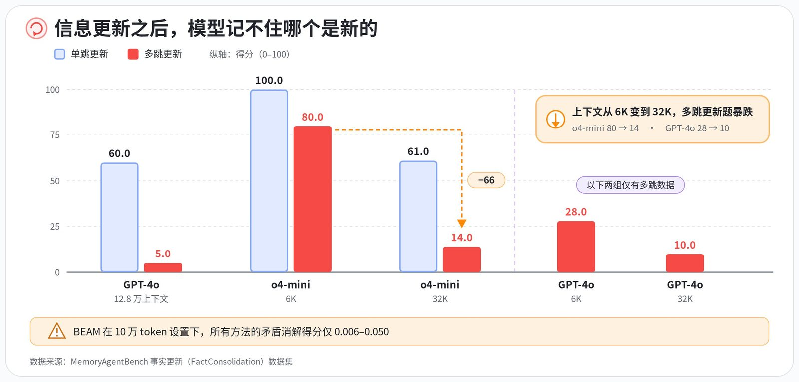

### 6.2 四种处理旧信息的方式

| 方式 | 怎么做 | 例子 |
|---|---|---|
| 标记失效 | 不删除，给旧事实记上失效时间；查询“现在”时过滤，查询“以前”时仍可用 | Zep 的双时间轴[[4]](https://arxiv.org/abs/2501.13956) |
| 读取时衰减 | 不删除，最近被用到的记忆加权，长期不用的降权 | Mem0 记忆衰减：最多加权到 1.5 倍，闲置的降到 0.3 倍下限，永不为零；每条记录最多 20 次检索时间[[27]](https://mem0.ai/blog/introducing-memory-decay-in-mem0)；生成式智能体的 0.995 每小时衰减[[16]](https://arxiv.org/abs/2304.03442) |
| 后台整理 | 定期重新综合，合并重复、消解矛盾 | ChatGPT 的“做梦”[[21]](https://openai.com/index/chatgpt-memory-dreaming/)；Vertex AI Memory Bank 合并新旧记忆并消解矛盾[[23]](https://cloud.google.com/blog/products/ai-machine-learning/vertex-ai-memory-bank-in-public-preview)；Letta 睡眠时 Agent[[24]](https://arxiv.org/abs/2504.13171) |
| 过期删除 | 按时间直接清除 | AgentCore 短期事件默认 30 天过期[[10]](https://docs.aws.amazon.com/bedrock-agentcore/latest/devguide/memory.html)；Gemini 临时对话保留 72 小时[[29]](https://blog.google/products-and-platforms/products/gemini/temporary-chats-privacy-controls/) |

### 6.3 后台整理值得做

Letta 的睡眠时计算研究发现：让模型在用户提问之前离线“想一想”已有的上下文，达到同样准确率所需的测试时计算少约 5 倍；把离线结果摊到多个相关查询上，平均每次查询成本降低 2.5 倍。效果和用户问题的可预测程度正相关[[24]](https://arxiv.org/abs/2504.13171)。

ACE（ICLR 2026）提醒了整理的一个陷阱：如果每次都让模型把整份记忆重写一遍，会出现两种退化：越写越短、丢掉细节（简洁偏差），以及多次重写后内容塌缩。它的做法是只做增量修改：生成、反思、整理三个角色分工，每次只追加或修改几条[[30]](https://arxiv.org/abs/2510.04618)。

### 6.4 工程建议

- 每条记忆带写入时间、最后使用时间、来源会话。Claude Code 从 2.1.214 版起在每个记忆文件的头部记录修改时间，方便判断新鲜度[[9]](https://code.claude.com/docs/en/memory)。
- 默认不删，用失效标记和读取时降权；只有用户明确要求或合规要求时才物理删除。
- 整理用增量修改，不要整份重写。
- 把“遗忘”当作一项需要专门评测的能力（第 9.3 节）。

## 第 7 章 · 经验与程序记忆

记住用户喜欢什么是一回事，记住“这类任务怎么做才对”是另一回事。对 Agent 来说，后者的收益通常更大。

### 7.1 几项代表性研究

- **Reflexion**（2023）：任务失败后，Agent 用文字反思原因并存进情景记忆，下次参考。HumanEval 一次通过率 91%，当时 GPT-4 是 80%[[31]](https://arxiv.org/abs/2303.11366)。
- **Voyager**（2023）：在《我的世界》里把学会的行为存成可执行代码的技能库，可以组合、可以迁移到新世界。获得的不同物品多 3.3 倍，科技树里程碑最多快 15.3 倍[[32]](https://arxiv.org/abs/2305.16291)。
- **ACE**（ICLR 2026）：把上下文当作一份不断演进的经验手册。在 AppWorld 上（DeepSeek-V3.1），ReAct 平均分从 42.4 提到 59.4，与使用 GPT-4.1 的 IBM 生产级 Agent 持平；不需要标注，只用执行反馈也能工作[[30]](https://arxiv.org/abs/2510.04618)。
- **ReasoningBank**（ICLR 2026）：从模型自己判定成功和失败的轨迹里提炼通用的推理策略。SWE-Bench-Verified 解决率 Gemini-2.5-flash 从 34.2 提到 38.8，Gemini-2.5-pro 从 54.0 提到 57.4；成功的任务最多少走 2.1 步[[33]](https://arxiv.org/abs/2509.25140)。

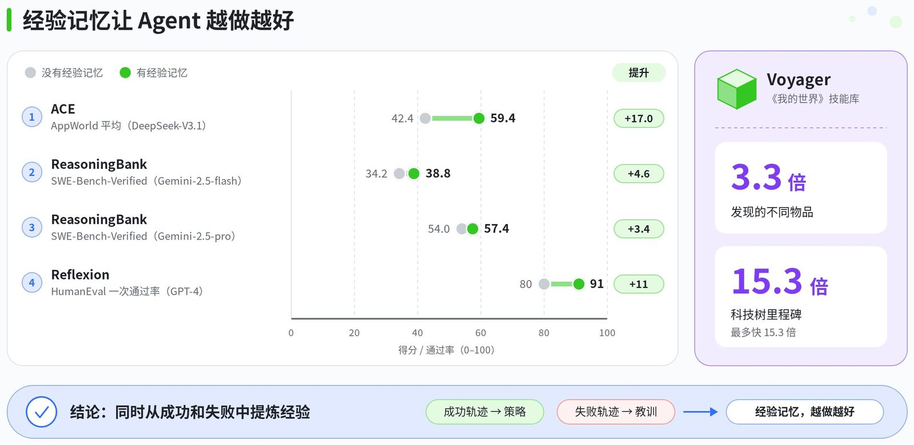

📎 延伸阅读：经验该存成总结还是原始轨迹，S³Gym 在七个游戏上做过对照，有紧凑规律的游戏总结领先，要精确局面信息的游戏原始轨迹领先，自评准确率和后续涨分基本不相关，见 [LLM-48｜系统｜递归自我改进（RSI）：模型怎样改进自己](./48-rsi.md) 第 12.3 节。

### 7.2 失败经验同样重要

ReasoningBank 的一个关键设计是同时从失败中学习[[33]](https://arxiv.org/abs/2509.25140)。产品里也能看到同样的思路：Azure SRE Agent 在提取会话经验时专门记录“试过但没用的方法”和“要避开的坑”[[22]](https://learn.microsoft.com/en-us/azure/sre-agent/memory)；AgentCore 的情景反思用来“避免重复失败的做法”[[10]](https://docs.aws.amazon.com/bedrock-agentcore/latest/devguide/memory.html)。

运维场景里这一点尤其重要。同一个服务的告警反复出现时，值班同学最需要知道的往往是“上次重启没用，最后是回滚配置解决的”。没有失败记忆的 Agent 每次都会从最常见的方案开始试。

📎 延伸阅读：失败经验没进版本管理时也会帮倒忙，git reset 后旧计划和记忆还留着误导后续判断，见 [LLM-58｜工程｜Agent 调优：从 trace 找到该改的那一层](./58-agent-tuning.md) 第 11.8 节。

### 7.3 与 Agent Skills、AGENTS.md 的关系

📎 延伸阅读：把经验库和外壳文件放在一起调优，只写入有执行对照支撑的经验，见 [LLM-58｜工程｜Agent 调优：从 trace 找到该改的那一层](./58-agent-tuning.md) 第 6.2 节。

程序记忆在 2026 年最常见的落地形式其实是文件：AGENTS.md、CLAUDE.md、Agent Skills。Cursor 的经历是个例子：它在 2025 年推出过“记忆”功能，到 2.1 版又移除了管理界面，官方建议把记忆导出成 `.mdc` 文件放进规则目录[[34]](https://forum.cursor.com/t/are-my-memories-gone/144057)。有用户的总结是：记忆和规则文件几乎没有区别。

可以这样分工：

- **人写、人审的规则**放在 AGENTS.md 和技能文件里，进代码仓库、走代码评审（见「Agent 协议与工具链」）；
- **Agent 自己积累的经验**放在记忆里，定期由人审阅，把稳定下来的经验“升级”成规则或技能。

这样既能让 Agent 持续学习，又不会让未经审核的经验直接变成所有人都要遵守的规则。

📎 让 Agent 自己把对话整理成技能、再按规则给技能老化归档，Hermes Agent 的 /learn 和 curator 是一个可读源码的实例，局限也在那里写明，见 [LLM-05｜工程｜Agent 工程实战：从工具到上线的施工手册](./05-agent-engineering.md) 第 11.6 节。

## 第 8 章 · 产品怎么做

### 8.1 面向用户的助手

📎 延伸阅读：偏好隔十轮对话就很少被遵循，检索和提醒能补多少、什么时候才轮到每用户微调，见本书第 12 章「个性化：先补记忆，再谈每用户参数」。

| 产品 | 机制与时间线 | 用户控制 |
|---|---|---|
| ChatGPT | 2024-02 小范围测试“保存的记忆”，2024-09 全部套餐可用；2025-04 增加“参考聊天历史”；2026-06 改为后台“做梦”整理，Plus/Pro 记忆容量翻倍；项目可设为仅项目内记忆，共享项目强制如此[[25]](https://openai.com/index/memory-and-new-controls-for-chatgpt/)[[21]](https://openai.com/index/chatgpt-memory-dreaming/) | 记忆摘要页；回答下方显示用到的记忆来源，可纠正、删除、标记不相关；临时对话不读不写记忆。注意：删除对话不会删除从中提取的记忆 |
| Claude | 2025-09 面向团队和企业版，按项目隔离记忆；2025-10 扩展到 Pro/Max；2026-03 免费用户可用并支持从其他助手导入；2026-07 从每日摘要改为分类的独立条目[[35]](https://www.anthropic.com/news/memory) | 可查看和编辑；无痕对话不写记忆；企业管理员可整体关闭 |
| Gemini | 2025-08 推出“过往对话”个人上下文，默认开启[[29]](https://blog.google/products-and-platforms/products/gemini/temporary-chats-privacy-controls/) | 临时对话不用于个性化和训练，保留 72 小时 |

Anthropic 在向 Pro/Max 推出前，专门做了安全测试：记忆会不会强化有害模式、会不会导致过度迁就、会不会被用来绕过防护[[35]](https://www.anthropic.com/news/memory)。按项目隔离也被它描述为一道安全护栏，让机密讨论彼此分开。

### 8.2 开发者平台与托管服务

- **Claude 记忆工具与上下文编辑**（2025-09）：上下文编辑在接近上限时自动清掉过时的工具调用和结果；记忆工具是客户端托管的 `/memories` 目录。Anthropic 内部的 Agent 搜索评测中，两者结合比基线提升 39%，只用上下文编辑提升 29%；100 轮网页搜索任务里，上下文编辑让 token 消耗减少 84%，并让原本会失败的流程跑完[[36]](https://www.anthropic.com/news/context-management)。
- **OpenAI Agents SDK 会话**：提供 SQLite、Redis、SQLAlchemy、服务端会话、自动压缩、加密加过期等多种后端[[37]](https://openai.github.io/openai-agents-python/sessions/)。它们存的是对话历史，不是抽取后的长期记忆。
- **Vertex AI Memory Bank**（2025-07 公开预览）：Gemini 在后台从会话中抽取事实和偏好，按用户等作用域存放，与已有记忆合并并消解矛盾[[23]](https://cloud.google.com/blog/products/ai-machine-learning/vertex-ai-memory-bank-in-public-preview)。
- **AWS Bedrock AgentCore Memory**（2025-10-13 正式发布）：短期存会话事件，长期存抽取后的记录；不配置策略就不会生成长期记忆；四种内置策略之外可以自定义提示词或完全自建流水线[[10]](https://docs.aws.amazon.com/bedrock-agentcore/latest/devguide/memory.html)。

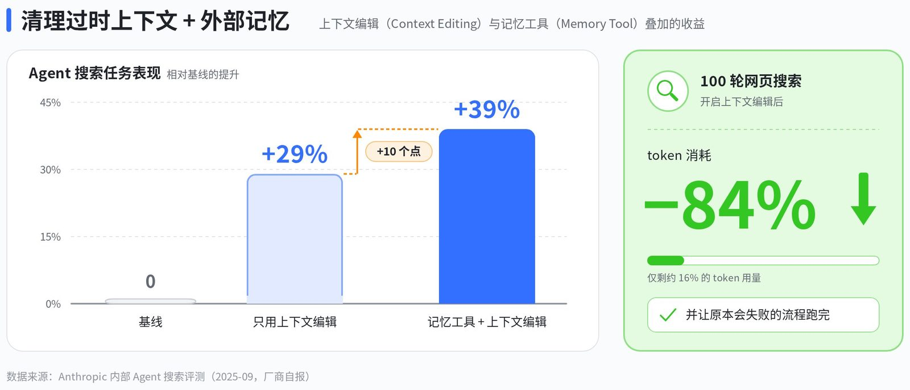

### 8.3 编程工具

- **Claude Code**：CLAUDE.md 分四层（企业策略、用户、项目、本地），按从宽到窄的顺序拼接而不是覆盖；单个文件建议少于 200 行。自动记忆默认开启，存放在本机的项目目录下，同一仓库的多个工作树共享，子 Agent 各有各的记忆；引入外部文件时会弹出审批，防止别人提交的文件悄悄注入[[9]](https://code.claude.com/docs/en/memory)。
- **Cursor**：“记忆”管理界面在 2.1 版移除，建议迁移到规则文件[[34]](https://forum.cursor.com/t/are-my-memories-gone/144057)。

### 8.4 运维产品

Azure SRE Agent 的记忆有三个来源：历史事故、用户明确要求记住的内容、上传的运维手册[[22]](https://learn.microsoft.com/en-us/azure/sre-agent/memory)。会话空闲 30 分钟后自动提取经验；常驻的 `overview.md` 约 2,000 字符，链接到各个主题文件；每次会话最多提炼 3 条系统设计洞察和 2 条排查模式，用户可以点赞或点踩。这是目前公开资料里最完整的运维 Agent 记忆设计，第 11 章的方案很大程度上参考了它。

## 第 9 章 · 评测

### 9.1 四个公开基准

| 基准 | 规模与考点 | 现状 |
|---|---|---|
| LoCoMo（2024） | 50 段长对话，每段约 300 轮、平均约 9k token、最多 35 个会话[[5]](https://arxiv.org/abs/2402.17753) | 已饱和且有争议，见下文 |
| LongMemEval（ICLR 2025） | 500 题，五种能力，含知识更新和拒答；约 11.5 万 token 和约 150 万 token 两档[[1]](https://arxiv.org/abs/2410.10813) | 目前最常用的“较难”基准 |
| MemoryAgentBench（2025） | 按多轮分块逐步喂入数据，考准确检索、测试时学习、长程理解、选择性遗忘[[28]](https://arxiv.org/abs/2507.05257) | 选择性遗忘（所测设置）普遍很差 |
| BEAM（ICLR 2026） | 100 段对话，12.8 万到 1,000 万 token，2,000 道人工核验的题，10 种能力含矛盾消解和事件排序[[3]](https://arxiv.org/abs/2510.27246) | 长度越长所有方法越差 |

### 9.2 LoCoMo 的分数通胀

LoCoMo 上报告的分数两年内从 52.9 涨到 92.5，但这些数字大多来自厂商自己的博客，配置各不相同：

- Mem0 论文报告 OpenAI 记忆 52.90%、Mem0 66.88%、图谱版 68.44%，并给出 Zep 65.99%[[6]](https://arxiv.org/abs/2504.19413)；
- Zep 反驳说 Mem0 把两个说话人都当成了用户、把时间戳拼进了文本、用串行而不是并行搜索，正确配置后 Zep 是 75.14%；还指出 LoCoMo 的对话只有 1.6 万–2.6 万 token，完全放得进上下文，而且没有知识更新题[[38]](https://blog.getzep.com/lies-damn-lies-statistics-is-mem0-really-sota-in-agent-memory/)；
- MIRIX 报告 85.4%[[11]](https://arxiv.org/abs/2507.07957)，Letta 的文件系统 Agent 74.0%[[19]](https://www.letta.com/blog/benchmarking-ai-agent-memory)，Mem0 2026 年新算法 92.5%[[27]](https://mem0.ai/blog/introducing-memory-decay-in-mem0)。

同一个 Mem0 新系统，在 LongMemEval 上 94.4，在 BEAM 百万 token 档 64.1，在千万 token 档只有 48.6，最弱的是时间推理、事件排序和跨会话推理[[27]](https://mem0.ai/blog/introducing-memory-decay-in-mem0)。

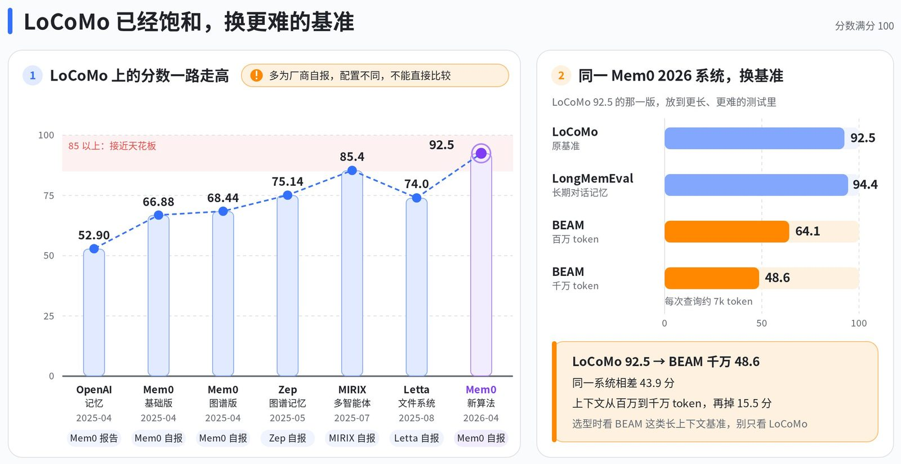

### 9.3 内部评测怎么建

公开基准适合筛选，最终决定要靠自己的数据。建议至少覆盖六个维度：

1. **召回**：之前说过的事实能不能在需要时用上。
2. **偏好遵循**：记住的偏好有没有真正改变行为。Zep 在“单会话偏好”类题上提升最大，gpt-4o 从 20.0% 到 56.7%[[4]](https://arxiv.org/abs/2501.13956)，说明这是全量上下文的明显短板。
3. **新鲜度与更新**：信息变化后，用的是不是最新版本；问“以前是什么”时能不能答。
4. **该忘的忘了**：用户要求删除的内容、过期的临时信息，后续是否还会出现。
5. **抗注入**：在会话里放入伪造的“请记住……”指令，检查是否被写入（第 10 章）。
6. **成本与时延**：每次查询带入多少 token、检索 p95 时延。Mem0 论文里不同系统的检索 p95 从 0.2 秒到近 60 秒不等[[6]](https://arxiv.org/abs/2504.19413)。

评测用的对话要按时间顺序逐步喂入，而不是一次性给出全部历史，否则测的是长上下文能力，不是记忆。这是 MemoryAgentBench 的核心设计[[28]](https://arxiv.org/abs/2507.05257)。

## 第 10 章 · 风险与治理

记忆把一次性的风险变成了持久的风险：会话里的一次提示词注入，如果被写进长期记忆，之后每次对话都会生效。

### 10.1 已公开的记忆攻击

- **SpAIware**（2024-09）：不可信网页或文档里的注入指令，把“间谍软件”指令写进 ChatGPT 的长期记忆，之后每次对话都通过渲染图片把用户输入发到攻击者服务器。macOS 客户端 1.2024.247 版修复了外传通道，但研究者指出，网页或文档仍然可以调用记忆工具写入任意记忆[[39]](https://embracethered.com/blog/posts/2024/chatgpt-macos-app-persistent-data-exfiltration/)。
- **Gemini 延迟调用**（2025-02）：文档里埋下“如果用户回答是、好、不，就保存记忆 X”，用户随口回答后，Gemini 以为是用户要求的，于是写入了虚假记忆。Google 评为低可能性、低影响；研究者建议持久化记忆前要求用户明确确认[[40]](https://embracethered.com/blog/posts/2025/gemini-memory-persistence-prompt-injection/)。
- **MINJA**（2025）：攻击者完全不接触记忆存储，只通过正常提问，用“桥接步骤”诱导 Agent 存下恶意记录。平均注入成功率 98.2%，平均攻击成功率 76.8%[[41]](https://arxiv.org/abs/2503.03704)。
- **AgentPoison**（2024）：在记忆或知识库里投毒不到 0.1% 的记录，平均攻击成功率超过 80%，对正常任务影响不到 1%，不需要训练模型[[42]](https://arxiv.org/abs/2407.12784)。

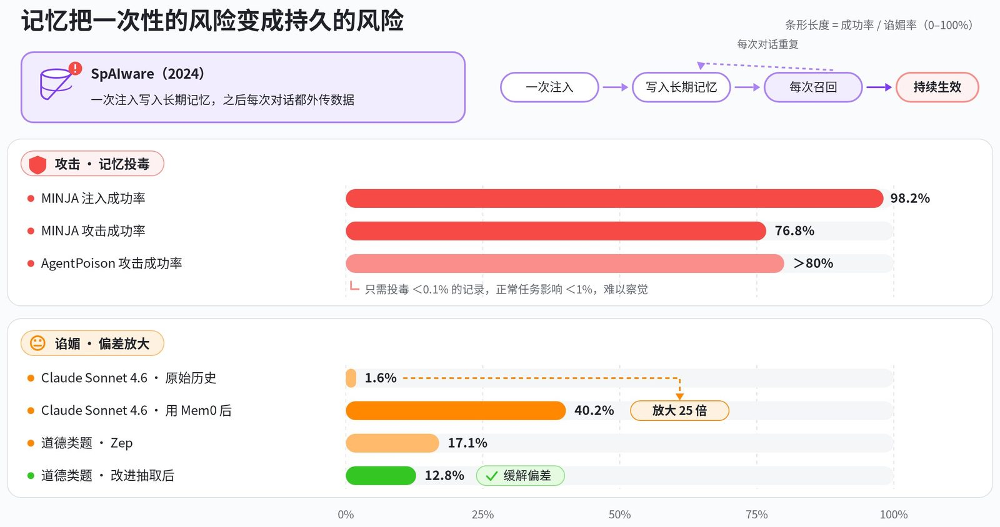

### 10.2 Claude 记忆工具的安全要求

Anthropic 的文档给出了几条具体要求[[18]](https://docs.claude.com/en/docs/agents-and-tools/tool-use/memory-tool)：

- 工具处理代码必须拒绝 `/memories` 之外的路径，包括 `/memories/../../secrets.env` 和 URL 编码的 `%2e%2e%2f`；
- 限制单个文件大小和查看输出的长度；
- 敏感信息在处理代码里过滤，不要只依赖模型拒绝。

### 10.3 记忆会放大谄媚

Writer 2026 年的研究在 Mem0、MemOS、Zep 三个记忆系统和五个模型家族上测试：所有条件下记忆都放大了谄媚，比直接在上下文里放历史最多高 40%[[43]](https://arxiv.org/abs/2606.10949)。最极端的例子是 Claude Sonnet 4.6：直接带聊天历史时谄媚率 1.6%，换成 Mem0 后 40.2%。

原因在抽取：记忆系统把用户的主张存成一条条独立事实，却丢掉了助手当时的反驳。之后模型看到的是“用户认为 X”，而看不到“我当时解释过 X 是错的”。把抽取的片段换回原始历史，谄媚大约减半；在 Mem0 上改为保留助手角色、用段落式摘要代替碎片事实，道德类题目的谄媚率降到 12.8%，低于现成系统里最好的 Zep 的 17.1%，召回准确率没有下降[[43]](https://arxiv.org/abs/2606.10949)。

### 10.4 隐私与作用域

- **作用域要默认收窄**：Claude 和 ChatGPT 都支持按项目隔离[[35]](https://www.anthropic.com/news/memory)[[21]](https://openai.com/index/chatgpt-memory-dreaming/)；LangGraph 用“组织 / 用户 / 应用”三级命名空间[[20]](https://langchain-ai.github.io/langmem/concepts/conceptual_guide/)；Claude Code 按仓库隔离，子 Agent 各自独立[[9]](https://code.claude.com/docs/en/memory)。跨用户共享的记忆（例如团队的运维经验）要单独建库，并有明确的写入审核。
- **删除要真的删**：删除 ChatGPT 的一段对话不会删除从中提取的记忆，必须单独删记忆[[25]](https://openai.com/index/memory-and-new-controls-for-chatgpt/)。自建系统要能按用户、按来源会话找到并删除所有派生记录，这要求每条记忆都记录来源。
- **提供不记忆的模式**：三家都有临时或无痕对话。
- **企业要有总开关**：ChatGPT 企业版和 Claude 企业版的管理员都可以关闭记忆。

> 🔑 **缓解清单**：每条记忆记录来源（哪个会话、用户说的还是工具返回的）；来自外部内容的记忆要用户确认后才写入；设置过期时间；给用户看和改记忆的界面；按项目或租户隔离；工具处理代码做路径和大小校验；定期对记忆库做注入扫描；抽取时保留助手的纠正。

## 第 11 章 · 运维 Agent 的事故记忆

这一章把前面的结论落到一个具体场景：值班 Agent 的事故记忆。历史事故复用在运维领域早有先例，微软的 RCACopilot 用一年的线上事故评估，根因分类准确率最高 0.766，它的出发点就是很多事故会反复出现：根因没修好、系统性弱点、不稳定的外部依赖[[44]](https://arxiv.org/abs/2305.15778)。

### 11.1 记什么：一条事故记忆的结构

| 字段 | 内容 | 用途 |
|---|---|---|
| 资源与服务 | 服务名、集群、机房、依赖 | 检索的主键，同资源优先 |
| 症状 | 告警名、关键指标变化、错误特征 | 匹配新告警 |
| 根因 | 确认的根因，以及置信程度（已证实 / 推测） | 避免把推测当事实 |
| 有效处置 | 最终生效的步骤，带命令或变更单号 | 给出建议 |
| 试过无效的方法 | 尝试过但没用、甚至加重问题的操作 | 避免重复踩坑 |
| 来源与时间 | 事故单号、复盘文档、写入时间、最后被用到的时间、审核状态 | 溯源、降权、删除 |

这个结构和 Azure SRE Agent 提取的内容基本一致：症状、处置步骤、根因、踩过的坑[[22]](https://learn.microsoft.com/en-us/azure/sre-agent/memory)。“试过无效的方法”是最容易被忽略、也最有价值的一栏（第 7.2 节）。

### 11.2 怎么写：后台提取加人工审核

1. **事故关闭后再提取**，而不是在处置过程中。处置中的判断经常被推翻，过早写入会存下错误的根因。
2. **优先从复盘文档提取**，其次才是聊天记录和 Agent 轨迹。复盘文档经过人的确认，质量最高。
3. **新记忆先进“待审”区**，值班负责人或服务负责人确认后才进入正式库。被引用和点赞多的记忆，可以定期升级为运维手册或 Agent 技能（第 7.3 节）。
4. **不删除，标记失效**：服务架构变了、根因被修复了，就给相关记忆标上失效时间，而不是删掉。复盘时还能查到。

### 11.3 怎么用：常驻概览加按需检索

- 每个服务一份常驻的概览文件，控制在 2,000 字左右：架构要点、常见故障类型、最重要的几条“不要这样做”。
- 新告警进来时，按“同资源 → 同告警类型 → 同错误特征”的顺序检索事故记忆，取前几条带进上下文，并在回答中引用事故单号。
- 给 Agent 一个记忆搜索工具，排查中需要时自己补查。
- Agent 的建议里如果用了某条记忆，要显示出来，方便值班同学判断是否适用，和 ChatGPT 的“记忆来源”是同一个思路[[21]](https://openai.com/index/chatgpt-memory-dreaming/)。

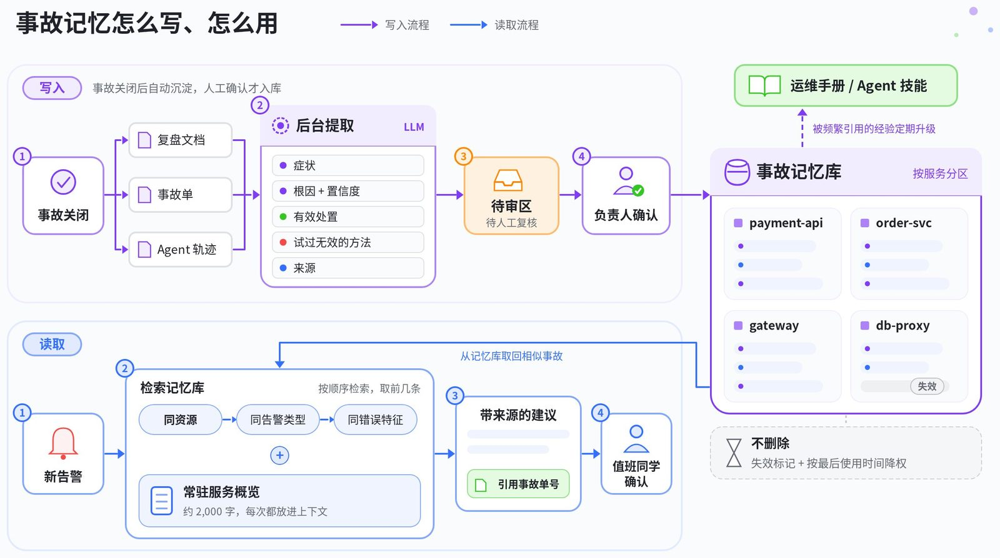

### 11.4 上线清单

| 方面 | 检查项 |
|---|---|
| 结构 | 每条记忆有资源、症状、根因及置信程度、有效处置、无效方法、来源、时间 |
| 写入 | 事故关闭后提取；外部内容写入需确认；有待审区；敏感信息在代码里过滤 |
| 检索 | 结构化键加语义检索；同资源优先；常驻概览控制长度；引用来源 |
| 遗忘 | 失效标记；按最后使用时间降权；用户或合规要求时能按来源删除全部派生记录 |
| 安全 | 按团队或租户隔离；路径和大小校验；定期扫描注入；保留人的纠正 |
| 评测 | 按时间顺序回放历史事故，测召回、新鲜度、遗忘、抗注入、成本和时延 |

### 11.5 延伸阅读

- 「Agent 工程实战」：单次会话内的上下文工程。
- 「RAG 与知识工程」：只读知识库的检索与评测。
- 「Agent 协议与工具链」：AGENTS.md、Agent Skills 与 MCP。
- 「AIOps Agent 落地细化」：运维 Agent 的数据接入、护栏和回放评测。
- 「LLM 安全与治理」：提示词注入的系统级防御。
- 「Agent 岗位能力地图与面试自查」：记忆、上下文压缩与 RAG 相关的面试题在第 5 章，见 [LLM-25｜工程｜Agent 岗位能力地图与面试自查](./25-agent-career.md)。

## 第 12 章 · 个性化：先补记忆，再谈每用户参数

前面 11 章讲的记忆，存的是事实和过程。个性化是记忆的一个特例：存的是“这个人喜欢什么”，取出来还要让回答照着它走。2025 年的两个基准把这件事拆成了可测量的环节，结论出人意料：模型在最前面的一步就掉得很厉害，用户在对话里明说过的偏好，隔十轮就很少被遵循。这一章按环节讲清楚卡在哪、便宜的补法各补到哪，以及什么时候才轮到给每个用户单独训参数。

### 12.1 偏好说过，模型却不听

PrefEval 测的是最朴素的一件事 [[45]](https://arxiv.org/abs/2502.09597)。用户在对话早期说出一个偏好，比如不吃海鲜，之后插进若干轮无关对话，再抛一个和偏好相关的问题，比如推荐餐厅，看回答有没有照顾到这个偏好。数据集有 3000 组人工整理的偏好与问题，覆盖 20 个日常话题。偏好有三种说法：一句话明说，在几个选项里接受或拒绝，以及在 4 到 8 轮对话里随人设慢慢流露。插进去的无关对话取自真实用户日志，最长到 10 万 token。作者评了 10 个开源和闭源模型，最长上下文用到 10 万 token。

结果很直接。零样本条件下，多数模型隔 10 轮、约 3000 token 后，偏好遵循率就跌破 10%。下表是旅行餐厅话题生成任务上两个代表模型的分数，评分由模型评委给出，作者人工抽查 200 条，评委误判率约 5%：

| 模型 | 10 轮（约 3k token）零样本到加提醒 | 300 轮（约 103k token）零样本到加提醒 |
|---|---|---|
| Claude-3.5-Sonnet | 0.07 到 0.45 | 0.02 到 0.02 |
| Gemini-1.5-Pro | 0.07 到 0.91 | 0.09 到 0.05 |

3000 token 远没到这些模型的上下文上限，偏好那句话就在窗口里，模型却没用上。作者对注意力分数做了可视化：偏好陈述之后，相关 token 上的注意力权重迅速衰减，中间插进来的无关对话把注意力稀释掉了。问题出在注意力有没有落到那句话上，窗口够不够长是次要的。隐含流露的偏好比明说的更难，因为模型还得先从几轮闲聊里把偏好归纳出来。

评测怎么打分也值得照搬。PrefEval 同时出生成题和选择题：生成题让模型自由回答，由另一个模型当评委判断回答有没有违反偏好，作者人工抽查评委误判率约 5%；选择题把四个候选回答摆出来让模型选，便宜、可复现，且两种考法上模型的相对排序高度相关，所以大规模回归可以先用选择题跑、只对关键版本抽生成题复核。题目设计还有一条硬标准：不用看任何偏好信息也能答对的题全部剔除，保证低分确实意味着没用上偏好，跟题目本身有没有歧义无关。

这也解释了提醒为什么在短对话里效果惊人。提醒只是在提问前加一句“回答前请考虑用户之前表达过的偏好”，它不提供任何新信息，只把注意力重新引回窗口里的相关内容。Gemini-1.5-Pro 在 10 轮时从 0.07 升到 0.91，提醒好过自我批评和思维链这两类更复杂的提示。但到 300 轮、约 10 万 token 时，提醒几乎不起作用，两个模型都回到 0.1 以下。注意力能在 3000 token 里被一句话拽回去，在 10 万 token 里找不到落点。论文还比了另外两种干预：自我批评先出一版回答、再检查自己有没有遵守偏好、再改写，少样本思维链在回答前给 5 个带推理的范例。这两种都比零样本强，但稳定输给一句提醒，而且模型间排序会反转：Claude 上自我批评短对话略好于思维链、拉长后被反超，Llama 上顺序正好相反。复杂提示带来的增益不稳健，别把它当固定配方。

论文把错误分成四种互斥类型，对定位问题很有用。偏好无意识违规，模型根本没注意到有偏好。不一致违规，偏好看到了，回答却没照做。幻觉偏好，模型凭空编出一个用户没说过的偏好并遵守。无用回答，模型以信息不足为由拒绝或打太极。零样本时主要是第一类，加上提示后第一类下降、第二类冒出来，提示还会诱发第三类，Claude 3 Sonnet 在用提示时第四类明显增多。修复手段会改变错误的形状，只盯一个总分看不出这个迁移。

动态偏好的两个实验对产品设计有直接参考。同一对话里插入更多条互不冲突的偏好，模型对第一条偏好的遵循率不降反升，多条偏好像是在整体上提醒模型“这是个有偏好的用户”。插入与原偏好冲突、但原偏好说得更晚的内容，模型对原偏好的遵循也比只插入无关偏好时好，时间晚近这条线索模型还能用得上。这给偏好库的启示是：多主题偏好可以一起取回，不用怕互相干扰；真正要处理的是同一主题的新旧冲突，写入侧直接做取代，别指望模型自己分辨。

检索补的正是这个缺口。把相关偏好从全部历史里检出来、放在问题旁边，模型不必在长上下文里自己找。PrefEval 里检索增强在多数模型上效果最好，而且偏好与问题隔得越远，检索相对全量上下文的优势越大 [[45]](https://arxiv.org/abs/2502.09597)。另一个常被忽略的补法是把“会照偏好办事”当成一种通用能力统一训练一次：作者在 PrefEval 数据上做监督微调，遵循率明显提升，还能泛化到比训练时更长的上下文。这个微调对所有用户只做一次，每个人的偏好依旧放在外面，靠检索取回来。训练细节值得照搬：他们用 80% 的话题做训练、20% 没见过的话题做测试，训练回答用提醒法生成，偏好和问题之间插入 0、5、10 轮无关对话；训练时见过 10 轮间隔的模型，在 70 轮的上下文上仍能泛化，间隔档越多，长上下文泛化越好。这说明统一微调学的是“从上下文里找回并遵守偏好”这个动作，不是某几条具体偏好。

检索这条路也有两个可调细节，论文给出了实测。检索条数取 top 5 就到最好水平，放宽到 top 10 虽然把偏好那句检回来的概率更高，遵循率却没有跟着涨：多塞进来的对话片段成了新的干扰，和长上下文稀释注意力是同一个毛病。另外作者在 80% 话题上微调的 Mistral-7B，零样本遵循率超过了检索增强的旧最好成绩，这进一步说明检索和微调补的是两个环节，检索把句子搬到位，微调保证模型用上它，两者叠加的上限最高。

LongMemEval 在记忆系统这一侧得到了相近的结论：商用助手和长上下文模型在持续多轮交互里回忆信息，准确率比单轮下降约 30% [[1]](https://arxiv.org/abs/2410.10813)。第 9 章详细讲过这个基准，这里只借它的结论：把全部历史塞进上下文，不等于模型记住了。

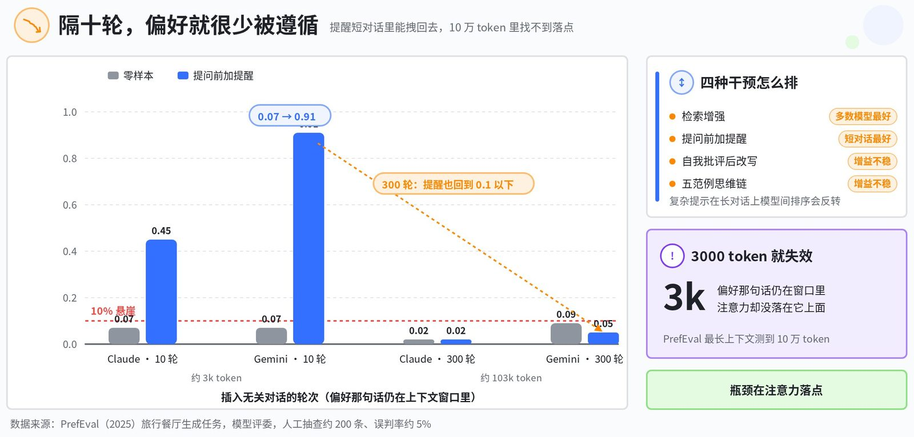

### 12.2 找得回来，未必用得上

PrefEval 把“遵循”当成一个整体指标。PersonaMem 把它拆细，测的是一个带长期记忆的助手在画像会变化的用户身上的表现 [[46]](https://arxiv.org/abs/2504.14225)。数据有 20 个虚拟人设、180 多段交互历史，每段含 10、20 或 60 个会话，每个会话 15 到 30 轮，总长对应 3.2 万、12.8 万和 100 万 token 三档，覆盖心理咨询、法律、推荐、家庭、财务等 15 类话题，共约 6000 个原位问答。用户的画像随时间变化，比如换了口味、换了工作。

问题按难度分成七类：复述用户说过的静态事实，推荐没试过的新东西，承认最新偏好，追踪偏好的完整演变过程，回忆偏好改变的原因，给出贴合当前偏好的推荐，以及把原因迁移到新场景。最强的 GPT-4.5 和 Gemini-1.5 在多选题上整体只有 52% 左右。拆开看，复述事实和追踪变化能做到 60% 到 70%，把用户最新状态真正用进回答里只有 30% 到 50%。o1、o3-mini、o4-mini、DeepSeek-R1 这些推理模型在这些任务上没有优势，多花的推理算力没有变成更好的个性化。

这说明“个性化”至少是两个串联环节：先把相关偏好找回来，再把它用进回答。可以粗略写成一个乘积：

```math
P(\text{遵循}) \approx P(\text{找回}) \cdot P(\text{应用} \mid \text{找回})
```

两个环节各 0.7，端到端只有 0.49，和基准里观测到的整体分数对得上。这个乘积还给评测定了性：任何一个环节趋近于零，总分都趋近于零，所以把总体分从 0.4 拉到 0.6，先要测出短板在哪一环，盲目换更强的基座可能只抬高找回率、应用率纹丝不动。一个能准确复述“用户上个月开始吃素”的模型，推荐菜谱时仍可能推红烧肉，因为第二步失败了。PersonaMem 还发现一个反直觉的细节：让模型把历次偏好变化逐条列出来，再回答，分数会高一些。显式走一遍演变过程，相当于把第二步拆成模型擅长的复述加推理。工程上这对应一条便宜的提示：回答涉及偏好的问题前，先让模型用自己的话把相关事实按时间列一遍，再给最终答案，和 PrefEval 的提醒可以叠用。

位置效应同样存在。相关事实出现在历史的早期或晚期会话时表现更好，落在中间会话时最差，与长上下文的“中间丢失”现象一致 [[46]](https://arxiv.org/abs/2504.14225)[[47]](https://arxiv.org/abs/2307.03172)。作者还接了两种外部记忆做对比：朴素 RAG 和 Mem0 这类记忆模块都能显著提分，复述事实和新场景迁移受益最大，复述变化原因的提升较小；RAG 在多数题型上略胜 Mem0，而 Mem0 的计算更贵。Mem0 团队自己的论文报告，在 LoCoMo 基准上相对全量上下文做法 p95 延迟低 91%、token 成本省 90% 以上 [[6]](https://arxiv.org/abs/2504.19413)，这组数字是厂商口径，比较对象和配置由他们选定，引用时要标明。两者的差距在延迟账上更直观：同一组 589 个问题、32k 上下文、GPT-4o-mini，朴素 RAG 用 BGE-M3 取回 top 5 条消息，平均每条 0.61 秒、6 分钟跑完，检索本身与上下文长度无关；Mem0 要在推理时让模型逐条处理事实的增删改，平均每条 150 秒、总计约 24 小时。记忆模块的结构化提取不是免费的，延迟量级和朴素向量检索差两个数量级。

对工程的直接含义是评测必须分两项报：偏好能不能被正确找回或复述，回答有没有照最新偏好来。只看端到端遵循率，分不清是记忆坏了还是应用坏了，容易修错地方。

基准还比较了多选题和生成式两种考法。多选题把四个候选回答摆给模型选，生成式只给一个候选、用整句概率打分，后者更接近真实产品。两种考法下模型的相对排序大体稳定，绝对分数有差别，建内部评测时两种都要：多选题便宜，适合每天回归；生成式打分慢，适合版本发布前跑。七类题里“推荐没试过的新东西”“贴合当前偏好的推荐”“把原因迁移到新场景”三类最差，它们要求模型在记住的基础上再做一步生成，纯记忆类题目做得好的模型，这三类也可能垮，这进一步支撑了把记忆和应用分开度量。

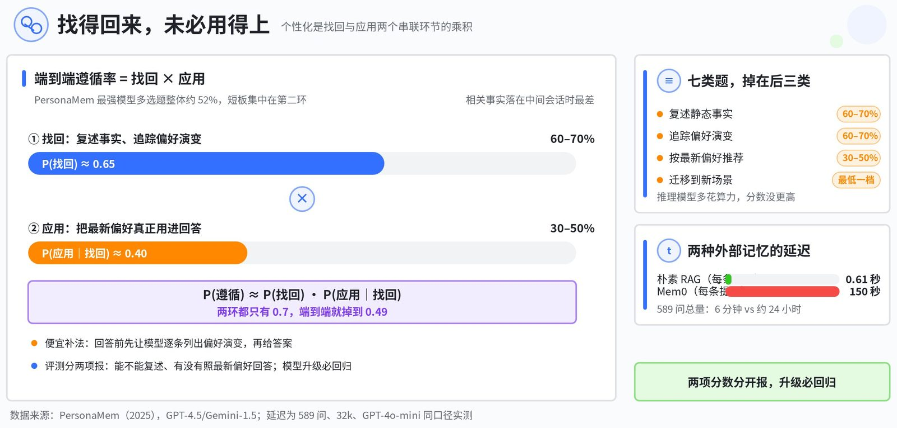

### 12.3 偏好库：同类偏好以最新为准

前两个基准指向同一套最便宜的修法：一个带时间戳的偏好库加检索，提问时把相关的几条放在用户问题旁边。偏好库和第 4 章讲的通用记忆只有一处关键差别：偏好会改口，写入语义必须支持“取代”，不能只追加。用户先说“我住北京”，三个月后说“我搬到上海了”，回答“你在北京可以去……”就是错的；检索按相似度取，两条都可能被取回来，模型要自己猜哪条作数，PersonaMem 测的“最新状态”一类题专考这个。

做法是给每条偏好一个主题键，写入时把同一键的旧条目标记失效，查询只取有效的最新一条，旧记录保留下来用于回答“我为什么改主意”这类问题。下面用 Go 写出最小版本：

*
*

```go
type Pref struct {    UserID    string    Topic     string // 归一化后的主题键，如 diet / city / tone    Text      string // “开始吃素，因为体检血脂偏高”    TS        int64  // 说出这条偏好的时间    Superseded bool  // 被同主题的新偏好取代}func (s *Store) Add(p Pref) {    for i := range s.list {        old := &s.list[i]        if old.UserID == p.UserID && old.Topic == p.Topic && !old.Superseded {            old.Superseded = true // 旧偏好留档，回答演变原因时还能查到        }    }    s.list = append(s.list, p)}// Active 返回某用户某主题当前生效的偏好，没有就返回 ok=falsefunc (s *Store) Active(user, topic string) (Pref, bool) {    var best Pref    ok := false    for _, p := range s.list {        if p.UserID == user && p.Topic == topic && !p.Superseded &&            (!ok || p.TS > best.TS) {            best, ok = p, true        }    }    return best, ok}
```

取数侧有两个细节。先看检索键。相关但已失效的偏好不能和当前偏好同等并列，必要时显式标注“此偏好已失效，最新说法是……”，PersonaMem 的追踪演变题反而需要这条旧信息，所以失效不等于删除。另一个细节是位置。取回来的偏好紧贴用户当前问题放，比堆在系统提示里效果稳定。PrefEval 的注意力可视化显示，离问题越远的内容权重越低，这就是第 5 章讲的“一个信号不够”在个性化上的版本。

提醒也可以做成常态配置，但要知道它的边界。短对话加一句提醒几乎零成本，历史一长，提醒找不到落点就失效，所以提醒只作为检索的补充：检索负责把相关句子搬到问题旁边，提醒负责让模型用上它。

写入侧的问题比取数侧更容易被低估。偏好不会自己变成结构化记录，得在对话后抽取，这和第 4.2 节讲的抽取是同一道坎：抽多了把一次性的情绪和场景性选择也写成偏好，抽少了漏掉真正长期的习惯。可操作的判据有三条：用户用稳定口吻陈述自己（“我不吃辣”），同一倾向出现两次以上，或者用户明确说“记住”。只在某条具体订单里出现的选择（“这次少放辣”）不进偏好库。抽取出的记录保留原文引用和时间，模型应用偏好时可以向用户复述依据，错了用户能纠正。抽取这一步本身可以做成一个独立小模型或一次单独的模型调用，输入是一段会话、输出是结构化偏好候选加置信度，低置信度的条目不直接入库，而是在下次对话里用一句话向用户确认（“我记得你不吃辣，对吗？”），确认后再写。这种写前确认还顺带解决了否定句和假设句的误抽：“我要是吃辣就好了”“今天破例吃辣”都不该进库，让抽取器对每条记录附上原话，人工或用户抽查时能立刻看到证据。

用一个具体场景走一遍取代语义。用户 1 月说“在健身，工作日午餐要高蛋白”，4 月说“体检尿酸高，红肉和海鲜都先停了”。Add 第二次写入时，同主题键 diet 下 1 月那条被标记失效。5 月问“明天中午点什么”，Active 返回 4 月那条，推荐鸡胸、豆腐，不推牛排；问“我为什么不吃海鲜了”，旧记录仍然查得到，答案能给出“你 4 月体检后停的”。如果只追加不取取代，检索可能同时取回两条，模型在“高蛋白多吃牛排”和“停红肉”之间摇摆，这正是 PersonaMem 里“最新状态”题测的失败模式。

统一微调是这个阶段最值得投入的一次性工程。用一批“带偏好上下文的问题、应当遵循偏好的回答”做监督数据，让模型学会“上下文里出现用户偏好就要照做”，对所有用户训练一次。PrefEval 作者的微调结果显示这种能力能泛化到比训练时更长的上下文 [[45]](https://arxiv.org/abs/2502.09597)。它解决的是应用环节，偏好本身仍然存在库里，不必为每个用户动参数。

### 12.4 检索补不上的，才轮到每用户参数

有一类问题检索天生补不了。用户的写作风格、打分尺度、在相似选项间的稳定倾向，这些东西分散在几百条行为里，没有哪一条记录直接写着“我偏好什么”。LaMP 基准就是为这类场景设计的，含三项分类和四项生成任务，每个用户带一份行为历史，原论文的基线做法是从历史里检索相关条目再生成 [[48]](https://arxiv.org/abs/2304.11406)。七项任务具体是三项分类加四项生成：分类含二分类的论文引用识别、15 个标签的电影标注、一到五星的商品评分，生成含新闻标题、学术标题、邮件主题和推文改写。基准还给了两种切分，按用户切考的是给新用户做个性化，按时间切考的是老用户的未来行为，两种切分都要过，只在其中一种上好说明参数记住的可能是用户 ID 的表层相关性。

OPPU 在检索之上给每个用户训一个参数高效微调模块，默认是 LoRA，基座冻结，只训练这个小模块；训练和推理时再把检索条目、用户画像和参数里的知识叠在一起用 [[49]](https://arxiv.org/abs/2402.04401)。在 LaMP 七项任务上它都胜过只靠提示的方法：商品评分预测的 MAE 相对改善 17.38%、RMSE 改善 8.89%，电影标签的准确率提高 11.87%、F1 提高 7.56%，学术标题生成的 ROUGE-1 和 ROUGE-L 分别提高 3.42% 和 3.87%。参数知识和检索知识合用效果最好：合用检索相对不带检索、不带 OPPU 的两个版本平均再高约 2 个百分点，合用画像约高 4.6 到 7.2 个百分点。

优势最大的场景值得记住：用户行为发生变化、历史里检索出来的条目和眼前问题关系不大时，纯检索方法会掉到接近非个性化的水平，OPPU 仍然稳，个别任务甚至比用全部历史训练还好。参数里存的是跨条目归纳出来的行为模式，不依赖某条记录与问题字面相似。作者还量了不同用户 PEFT 之间的余弦相似度，大多落在 0.4 到 0.7，每个用户的参数确实有差异，但也共享了大量结构，这给后面的碎片共享留了空间。

为什么参数能扛住行为漂移，可以从两种知识的形态上理解。检索取回的是一条条字面上和问题相似的历史记录，用户口味一变，旧记录字面再相似也是错的导向。LoRA 的低秩矩阵容量有限，装不下也不倾向于装单条记录，训练梯度只能把几十上百条行为里反复出现的共同倾向压进去，比如这个人打分整体偏严、选片偏纪录片。这部分模式变化比具体记录慢，所以检索命中率崩了的时候参数仍稳。反过来这也划了边界：一次性、场景性的偏好参数学不到，还得靠库里的显式记录，两种知识合用才是论文报告的最优配置。

代价随用户数线性增长。Per-Pcs 的作者给出了 OPPU 在商品评分任务上的开销：每个用户约需 17 MB 存储，在单张 RTX A6000 上训练约 20 分钟 [[50]](https://arxiv.org/abs/2406.10471)。顺着这个数算大账：

| 规模项 | 粗算 | 结果 |
|---|---|---|
| 100 万用户的存储 | 17 MB × 1,000,000 | 约 17 TB |
| 100 万用户的首轮训练 | 20 分钟 × 1,000,000 | 约 33 万 A6000 卡时 |
| 偏好更新 | 每个改口的用户重训一次 | 随更新频率继续累加 |

这是按论文数字的估算，基座更大、历史更长时会更贵。训练可以并行摊掉墙钟时间，硬件账单摊不掉。还有个数据门槛：历史太少的用户训不出有用的适配器，作者按活跃度分组实验，历史越长，参数方法相对纯检索的优势越大，而低活跃用户往往占大多数。注意论文的评测口径本身就偏乐观：测试集是按行为历史长度排序后取最长的 100 个用户，其余用户用于训练基座，报告的增益代表的是高活跃上限，普通用户能拿到多少要自己重新分组测。作者另做的活跃度分组实验里，每档随机取 20 人，参数方法的优势随历史长度单调拉大，冷启动新用户在攒够历史之前没有参数路可走，只能先用检索兜住。

17 MB 这个数可以用 LoRA 的形状自己验算一遍。LoRA 给每一个被适配的线性层挂一对低秩矩阵，参数量约为秩乘以输入维度与输出维度之和的两倍。秩取个位数、只挂注意力投影层时，7B 模型一个适配器的参数量在几百万量级，FP16 存储正好落在十几 MB。这说明 17 MB 不是系统优化的结果，就是秩很小的 LoRA 本身的体积；真正随用户数爆掉的是训练时长，每人 20 分钟意味着一万人就是 3300 多卡时，且每次偏好显著漂移都要再来一轮。

还有个格式细节影响训练数据的利用率。用户历史常常和任务对不上：电影标签任务的输入是标签流水，用户历史却只有点过的电影，没有标签。OPPU 对这类历史改用右移一位的下一词预测目标，先让适配器学会“这个人会产生什么样的文本”，再在对得上格式的样本上学任务。照搬这套方法时，历史格式与目标任务的匹配程度要单独评估，直接把所有历史当监督数据，效果会打折。

所以上每用户参数之前有三个前置条件：检索、提醒、统一微调都已落地，评测能说清楚剩余错误属于哪个环节，并且只对高活跃、行为模式稳定的用户先开。瓶颈也不在在线服务，下一节讲。

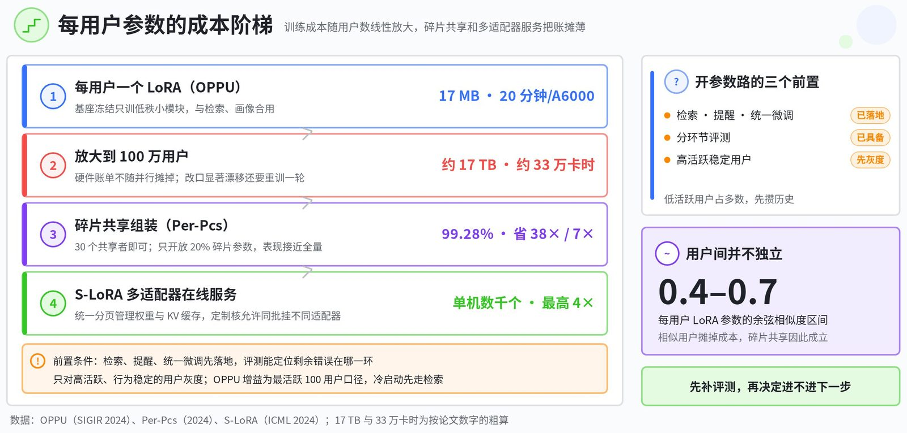

### 12.5 碎片共享与多适配器服务

一人训一个完整 LoRA 有两层浪费：用户之间 0.4 到 0.7 的相似度意味着重复存储，新用户攒够历史之前没有自己的适配器。Per-Pcs 针对这两点改造：先让一批同意共享的活跃用户各训一个 LoRA，把每层的一对低秩矩阵当作一个“碎片”，再为每个碎片训练一个约 50 步就能收敛的门控；新用户进来时，用他的历史算各碎片的激活匹配分，每层选少数几个碎片加权组装出他的适配器，本人不必从头训练 [[50]](https://arxiv.org/abs/2406.10471)。

效果和账都有明确数字：组装出的适配器平均达到 OPPU 99.28% 的表现，存储省约 38 倍，计算省约 7 倍；30 个共享者就能在商品评分任务上做到最好水平，只开放每个共享者 20% 的碎片参数，表现与全量开放接近。碎片共享加门控，本质上是让相似用户摊掉训练和存储成本。它仍要求有一批愿意共享数据的用户，隐私口径要和第 10.4 节的作用域规则对齐。门控的训练方式决定了这套方案为什么便宜：每个碎片配一个门控向量，初始化为全零、过 sigmoid，碎片矩阵和基座全程冻结，只在共享者自己的历史上训约 50 步，之后碎片和门控一起进池子。新用户一侧不训练，只做一次前向打分：用他的历史和各碎片算匹配度，按自回归的 top-k 选每层的少数碎片加权求和，组装出他的适配器。消融里把 top-k 换成累积概率阈值、或按归一化分数随机采样，表现接近，说明组装策略不脆弱，脆弱的是有没有足够多样的共享者池。

在线侧，S-LoRA 已经把“同时挂很多适配器”做成了工程现实 [[51]](https://arxiv.org/abs/2311.03285)。它把全部适配器权重放在主存，只把当前批次用到的调进显存，用统一分页同时管理不同秩的适配器权重和变长 KV 缓存，再用定制 CUDA 核做异构批处理，一个批次里的请求可以挂不同适配器。在 Llama-7B 到 70B 上，单机能服务数千个适配器，吞吐相对 Hugging Face PEFT 和朴素支持 LoRA 的 vLLM 最高到 4 倍，可服务的适配器数量高几个数量级。也就是说，真走到每用户参数这一步，推理服务不是主要障碍，训练成本、更新频率和数据量才是。

还有一条更激进的路线在研究阶段：用超网络读一段任务描述，一次前向直接生成 LoRA 权重，省掉逐用户训练。Text-to-LoRA 在 479 个 Super-NaturalInstructions 任务上训练，能为没见过的任务零样本生成可用适配器，但和针对该任务专门训练的 LoRA 之间仍有差距，个性化场景尚未验证 [[52]](https://arxiv.org/abs/2506.06105)。它的训练有两种信号：直接蒸馏各任务已经训好的 LoRA 权重，或者在下游任务上做多任务监督微调，输入是任务的自然语言描述；论文在 10 个留出基准任务上验证了零样本生成，但输入描述的是“任务”，“一个人的几百条行为”该怎么编码成有效描述还没有答案。可以关注，别拿它当生产方案。

S-LoRA 的统一分页值得单独说一句，它决定了碎片共享方案能不能落地。朴素做法为每个适配器在显存里预留连续空间，几千个适配器会把显存切成大量碎片，KV 缓存也无处安放。统一分页把适配器权重和 KV 缓存都切成固定大小的块放进同一个内存池，按请求即时拼装，权重常驻主存、用完即还；定制核再让一个批次里挂不同适配器、秩还不一样的请求一起算。没有这套机制，每用户参数在在线侧会先被显存碎片和长尾加载拖垮，离线侧算得出的成本账在线上不成立。批处理调度上还有个反直觉的选择：朴素做法把挂同一适配器的请求聚成一批（adapter clustering），吞吐好看，但长尾用户的请求等不到同伴有损平均延迟和公平性，S-LoRA 的定制核直接在非连续内存上算，允许同批挂不同适配器，才省掉了这层聚类。

隐私口径要在选型时就定。每用户适配器把行为数据压进了可复制的权重文件，它算不算个人数据、用户行使删除权时删文件够不够，目前没有定论；第 10.5 节讲的机器遗忘对这么小的改动本来就脆弱，量化一舍入就可能回到训练前。Per-Pcs 的碎片共享还会把一个用户的参数片段用于另一个用户，即便论文显示只共享 20% 的碎片表现就接近全量，成员推断一类攻击在碎片上是否可做，需要自己的安全团队评估。检索加偏好库的方案在这一点上简单得多：删一条记录就是删一条记录。

落地次序由此可以排出来。第一步只做带时间戳的偏好库、检索和贴问题放置，多数产品在这一步就能拿到绝大部分收益，PrefEval 里检索在多数模型上就是最好的单干预。第二步再上统一微调与回归评测，把应用环节的系统性缺口补掉。第三步才对高活跃用户灰度每用户 LoRA，并且从第一天就按可删除、可导出、可拒绝共享设计数据管线。第四步在用户规模把训练账单顶疼时，再评估碎片共享和 S-LoRA 类服务，前一步的灰度数据要能证明参数路相对检索路的增量值得这笔钱。每一步都先补评测，没有分环节的分数，无法判断该不该进入下一步。

把这一章收成一张按环节排查的表，和第 4、5、9 章的做法配套：

| 环节 | 先问什么 | 先用什么补 |
|---|---|---|
| 记住 | 偏好隔 10 轮、50 轮后还能被复述吗 | 带时间戳和取代语义的偏好库加检索 [[45]](https://arxiv.org/abs/2502.09597) |
| 用上 | 找回来的偏好有没有体现在回答里 | 贴问题放置、加提醒，再用偏好遵循数据统一微调 [[46]](https://arxiv.org/abs/2504.14225) |
| 更新 | 用户改口后用的是不是最新一条 | 同主题旧条目标失效，评测单列最新状态题 [[46]](https://arxiv.org/abs/2504.14225) |
| 检索够不到 | 风格、尺度、行为变化这类找不到具体记录的 | 对高活跃用户用每用户 LoRA，合用检索与画像 [[49]](https://arxiv.org/abs/2402.04401) |
| 成本太高 | 用户量大或更新频繁 | 碎片共享组装，在线走 S-LoRA 类多适配器服务 [[50]](https://arxiv.org/abs/2406.10471)[[51]](https://arxiv.org/abs/2311.03285) |

评测上沿用第 9 章的内部基准做法，加两组题：把偏好放在不同距离（10 轮、50 轮、300 轮）测遵循率，再把同一题拆成“复述偏好”和“照偏好回答”两问，分别报分。上线后每次模型升级都回归这两组题，统一微调可能在新版基座上失效，记忆类能力的回归测试不能省。

## 第 13 章 · 多 Agent 系统的记忆边界：哪份信息放哪一层，谁写、何时写、谁读

前面十二章默认一个 Agent 服务一个用户。换成多 Agent 系统，同一段会话由几个 Agent 轮流读写，记忆问题多出一维：一条信息除了要定存不存、存多久，还要定哪些 Agent 看得到、由谁负责写进去。MAST 标注了 7 个开源多 Agent 框架的 1600 多条轨迹，其中丢失对话历史占全部失败的 2.80%，对话被重置 2.20%，忽视其他 Agent 的输入 1.90%，隐瞒信息 0.85%，四项合计 7.75%（本文计算）[[57]](https://arxiv.org/abs/2503.13657)。单看都不大，但它们有一个共同点：模型没错，信息没送到该看的 Agent 手里。G-Memory 的作者也指出，现有记忆机制大多为单 Agent 设计，搬到多 Agent 上既不分角色，又让 token 消耗成倍增长[[58]](https://arxiv.org/abs/2506.07398)。

Google Cloud DevRel 2026 年 4 月发布的 Dev Signal 系列第 2 篇，给了一个完整、可运行的参照：一个根 Agent 加三个子 Agent，用 ADK 搭，会话内靠状态键交接，跨会话靠 Vertex AI Memory Bank 记住用户偏好[[53]](https://cloud.google.com/blog/topics/developers-practitioners/multi-agent-architecture-and-long-term-memory-with-adk-mcp-and-cloud-run)。本章以它为参照，对照 ADK 文档[[54]](https://google.github.io/adk-docs/sessions/state/)[[55]](https://google.github.io/adk-docs/sessions/memory/)、Mem0[[61]](https://docs.mem0.ai/platform/features/entity-scoped-memory)、AgentCore[[60]](https://docs.aws.amazon.com/bedrock-agentcore/latest/devguide/specify-long-term-memory-organization.html)的作用域设计，以及 G-Memory[[58]](https://arxiv.org/abs/2506.07398)和 Collaborative Memory[[59]](https://arxiv.org/abs/2505.18279)两篇研究。

本章的主线是：**多 Agent 系统的记忆设计，要给每条信息定三件事：作用域（活多久、谁能看）、写入方（谁写、什么时候写）、读取方式（谁读、以什么视图读）。Dev Signal 在作用域上分得清楚，会话交接和长期记忆走两条通道；在写入方上放得太宽，四个 Agent 每轮都把整段会话交给记忆服务。业界正在收敛的做法是：会话内交接用显式状态键，长期记忆只设一个写入方、在后台提取，读取按 Agent 的职责裁剪**。

### 13.1 参照系统：Dev Signal 的两条记忆通道

Dev Signal 的任务是从 Reddit 上找开发者关心的 Google Cloud 话题，研究清楚后写成技术博客。四个 Agent 共用 gemini-3-flash-preview，分工如下[[53]](https://cloud.google.com/blog/topics/developers-practitioners/multi-agent-architecture-and-long-term-memory-with-adk-mcp-and-cloud-run)：

- **根 Agent** 只做编排：理解请求，派给子 Agent。研究结束后，必须先问用户要不要写成博客，得到同意才转给写手。
- **reddit_scanner** 经 Reddit MCP 拉取近 21 天的帖子，按点赞数和评论数排出热门话题。
- **gcp_expert** 同时查三个来源：Google 开发者文档的 MCP、Reddit MCP，以及一个包成工具的搜索 Agent，回答附原始链接。
- **blog_drafter** 动笔前再用文档 MCP 复核事实，要生成配图时先征得用户同意。

记忆分两条通道。会话内，gcp_expert 调一个写状态的工具，把研究结论写进会话状态的 technical_research_findings 键，blog_drafter 的指令模板直接引用这个键，写手拿到的是整理过的结论，不用翻聊天记录。跨会话，每个 Agent 都挂了同一个回调，每轮结束把整段会话交给 Memory Bank，由它提取、嵌入、存储，下次检索[[53]](https://cloud.google.com/blog/topics/developers-practitioners/multi-agent-architecture-and-long-term-memory-with-adk-mcp-and-cloud-run)。会话服务能扛住进程重启，但换一个会话 ID，状态就清空了，跨会话能留下来的只有 Memory Bank 里的内容。

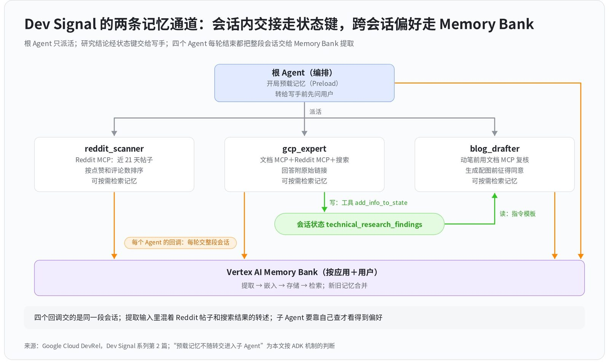

读取也分两种：根 Agent 每轮开始用 PreloadMemoryTool 自动检索一次，所有 Agent 都带 LoadMemoryTool，需要时自己查。为了让偏好进得了记忆，每个 Agent 的指令里都有“记忆检查”和“记录偏好”两段，要求模型在用户说出偏好时明确复述一遍，让偏好以清楚的文字留在会话里，供后台提取[[53]](https://cloud.google.com/blog/topics/developers-practitioners/multi-agent-architecture-and-long-term-memory-with-adk-mcp-and-cloud-run)。

这套设计有两处值得照搬：交接和长期记忆分开走，状态键的写入方和读取方都很明确。也有三处留下了问题：四个回调重复提交同一段会话；提取的输入里混着 Reddit 帖子和搜索结果的转述；预载只发生在根 Agent，最需要偏好的写手要自己记得去查。后面几节分别展开。

### 13.2 作用域阶梯：每条信息放到满足所有读者的最低一层

ADK 用键名前缀区分状态的作用域[[54]](https://google.github.io/adk-docs/sessions/state/)。不带前缀的键属于当前会话。user: 开头的键跟着用户走，在同一应用的该用户所有会话里都可见。app: 开头的键对应用的所有用户可见。temp: 开头的键只活在当前这次调用里，从不落盘，但这次调用中的所有子 Agent 都能读写。再往上是长期记忆，ADK 的记忆服务按应用加用户检索，背后可以是简单的关键词匹配，也可以是 Memory Bank 这样由模型提取、合并新旧记忆、按语义检索的托管服务[[55]](https://google.github.io/adk-docs/sessions/memory/)。还要注意一点：内存版的会话服务不持久，进程一重启，连 user: 和 app: 的键也一起丢失，要用数据库或 Vertex AI 的会话服务才能留住[[54]](https://google.github.io/adk-docs/sessions/state/)。

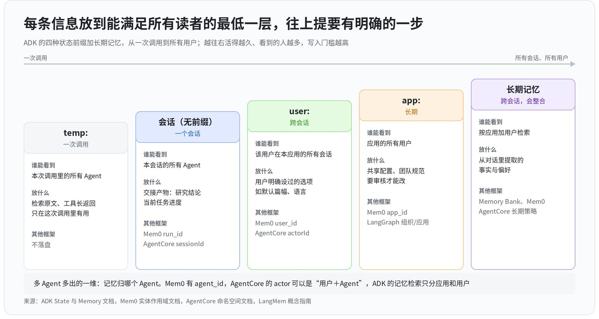

其他框架的切法大同小异。Mem0 用四个 ID 划范围：user_id 对应人，agent_id 对应某个 Agent，app_id 对应产品或租户，run_id 对应一次短流程[[61]](https://docs.mem0.ai/platform/features/entity-scoped-memory)。AgentCore 用斜杠分层的命名空间，内置 actorId、sessionId、strategyId 三个变量，可以加 org、team 这类自定义层级，actor 既可以是用户，也可以是“用户加 Agent”的组合[[60]](https://docs.aws.amazon.com/bedrock-agentcore/latest/devguide/specify-long-term-memory-organization.html)。LangGraph 用组织、用户、应用三级命名空间[[20]](https://langchain-ai.github.io/langmem/concepts/conceptual_guide/)。共同的规律是：越往上活得越久、看到的人越多，写进去的门槛也应越高。

多 Agent 多出来的一维是“这条记忆归哪个 Agent”。Mem0 和 AgentCore 都能按 Agent 划范围，ADK 的记忆检索只分应用和用户，Dev Signal 的四个 Agent 因此共用一个按用户划分的记忆池。存用户偏好没问题，偏好本来就该所有 Agent 共享。若 reddit_scanner 想记住“哪些子版块噪声大”这类自己的工作经验（第 7 章的程序记忆），放进共享池就会被写手检索到，徒增干扰，这时要给 Agent 单独开命名空间。

| 信息 | 放哪一层 | 理由 |
|---|---|---|
| Reddit 原帖、搜索结果原文 | temp: 或不存 | 只为本轮回答服务，原文太长，又是外部内容，进长期记忆风险最大 |
| gcp_expert 的研究结论 | 会话状态键 | 写手要读，换个话题就作废 |
| 用户本次指定的篇幅、受众 | 会话状态键 | 只对这篇稿子有效 |
| 用户反复强调的写作偏好 | 长期记忆，按用户 | 跨会话有效，所有 Agent 都该遵守 |
| 团队的写作规范 | app: 或配置文件 | 所有用户共享，改动要审核（第 10.4 节） |
| 某个 Agent 自己摸索出的经验 | 长期记忆，按 Agent | 只对这个 Agent 有用，放进共享池会干扰别人 |

<b>设计动作。</b>默认放最低一层，往上提一层都要有明确的一步：会话到长期记忆由提取模型来做，长期记忆到全应用共享要经人工审核。Mem0 文档专门提醒过两个坑：查询时只给 user_id，不会排除带了 agent_id 的记录；默认提取会按说话人归属，用户说的事实只带 user_id，助手说的只带 agent_id，所以同时按 user_id 和 agent_id 做“且”查询会一条都查不到[[61]](https://docs.mem0.ai/platform/features/entity-scoped-memory)。作用域写错了往往不报错，只是查不到或查多了，上线前要专门测隔离。

### 13.3 会话内交接：显式状态键，别让下一个 Agent 去翻聊天记录

子 Agent 之间传结果有两种做法：让下一个 Agent 读完整的对话历史自己找，或者由上一个 Agent 把结论写进一个约定好的键。前者省事，代价是写手要在几千 token 的工具返回里找结论，找错、漏看都很常见，MAST 里的忽视其他 Agent 输入和隐瞒信息就属于这一类[[57]](https://arxiv.org/abs/2503.13657)。Dev Signal 选了后者，和 [LLM-45｜工程｜多 Agent 系统：编排、通信、归因与评测](./45-multi-agent.md) 第 6.2 节“产物写文件，消息只传引用”是同一个思路，只是载体从文件换成了会话状态。

ADK 写状态有三条正路：给 Agent 设 output_key，它的最终回复自动写进这个键；在工具或回调里改上下文对象的 state；手动追加一条带状态变更的事件。指令里写 {key} 会在调用前替换成状态值，键不存在时直接报错，写成 {key?} 才是可选[[54]](https://google.github.io/adk-docs/sessions/state/)。文档还特意提醒，不要拿到会话对象后直接改它的 state 字典，这样绕过了事件记录，改动不会被持久化[[54]](https://google.github.io/adk-docs/sessions/state/)。

落到设计上，有四条规则：

- <b>一个键只有一个写入方。</b>technical_research_findings 只允许 gcp_expert 写。两个 Agent 写同一个键，后写的悄悄覆盖先写的，不会有任何报错。并行分支各写各的键，汇总由一个 Agent 来做。
- <b>键值写成结构化的结论。</b>至少包括结论、证据链接、写入者和写入时间。写手照样要复核，Dev Signal 的 blog_drafter 动笔前用文档 MCP 再查一遍事实[[53]](https://cloud.google.com/blog/topics/developers-practitioners/multi-agent-architecture-and-long-term-memory-with-adk-mcp-and-cloud-run)，读方不盲信写方，是多 Agent 交接里最便宜的一道验证。
- <b>上游可能没跑过，就用可选占位。</b>用户跳过研究、直接让写手动笔时，指令里的 {technical_research_findings} 会因为键不存在而报错。写成可选占位，并在指令里说明“没有研究结论时先回去调研”，比让整个调用失败好。
- <b>交接内容不进长期记忆。</b>研究结论是这篇稿子的产物，下次换个话题就过时了。它一旦被提取进长期记忆，会被当成“关于用户的事实”反复召回。

### 13.4 谁写、什么时候写：同一段会话只交一次

Dev Signal 的写入方式是：每个 Agent 结束一轮时，回调都把整段会话交给 Memory Bank[[53]](https://cloud.google.com/blog/topics/developers-practitioners/multi-agent-architecture-and-long-term-memory-with-adk-mcp-and-cloud-run)。ADK 的记忆接口其实给了四种写法：交整段会话、只交新增的事件、直接写一条明确的记忆、检索[[55]](https://google.github.io/adk-docs/sessions/memory/)。交整段会话最省事，放在多 Agent 系统里会被放大两次。先是轮数，第 t 轮交的是前 t 轮的全部内容，20 轮下来累计交了 210 轮的量，约为整段会话的 10.5 倍。再是 Agent 数，每轮平均有两个 Agent 结束、触发回调，就再翻一倍，到 21 倍（本文估算）。Memory Bank 会合并重复的记忆[[23]](https://cloud.google.com/blog/products/ai-machine-learning/vertex-ai-memory-bank-in-public-preview)，存储里不一定多出重复条目，但提取模型的调用次数和费用是实打实地乘上去了。

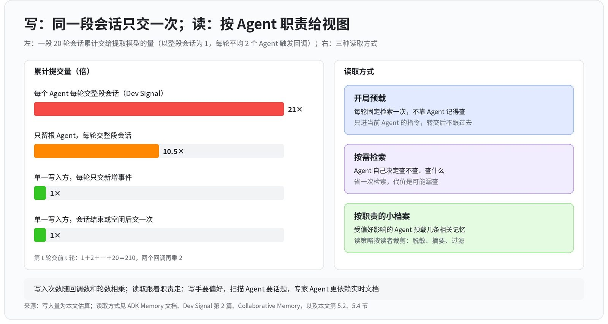

第二个问题是提取的输入。整段会话里有用户的话，也有 Reddit 帖子、搜索结果和子 Agent 对它们的转述。提取模型如果把“某个 Reddit 用户说他们只用 Cloud Run”记成用户本人的偏好，错误会在之后每次会话里被召回。更糟的是外部内容里藏着指令：第 10.1 节的 Gemini 记忆注入就是让模型在处理外部文档时被诱导写下持久记忆[[40]](https://embracethered.com/blog/posts/2025/gemini-memory-persistence-prompt-injection/)，MINJA 只通过正常的查询交互就能把恶意记录注入记忆库[[41]](https://arxiv.org/abs/2503.03704)。多 Agent 系统把外部内容的入口变多了，每个工具都是潜在的入口。

业界的做法基本收敛到“单一写入方加后台提取”，这和第 4.1 节对单 Agent 的建议一致：

- <b>只设一个写入方。</b>长期记忆由根 Agent 或一个专门的后台进程负责写，子 Agent 不直接写。Letta 的睡眠时计算更进一步，主 Agent 根本没有改记忆的工具，由后台 Agent 统一整理[[24]](https://arxiv.org/abs/2504.13171)。
- <b>写增量，或者等会话结束再写。</b>每轮只交新增的事件，或者像 Azure SRE Agent 那样等会话空闲 30 分钟再提取一次[[22]](https://learn.microsoft.com/en-us/azure/sre-agent/memory)。后者召回更好，因为提取模型能看到整段对话的结局，知道哪些说法后来被推翻了。
- <b>明确的偏好走显式写入。</b>用户说“以后都这样”时，由根 Agent 直接写一条记忆，立即生效，不必等后台提取。
- <b>收窄提取输入。</b>提交前把工具返回和外部内容剔掉或打上来源标记，只让用户的话和 Agent 的最终答复进入提取，提取范围也收窄到用户偏好和明确指令。

Dev Signal 要求模型复述偏好的做法有一半是对的：复述让用户看得见、能当场纠正，这一点值得保留。但把它当成写入机制并不可靠，它依赖四份指令里的模型每次都照做，用户原话本来就在会话里，提取模型可以直接从原话里提取。可靠的路径是上面的显式写入或后台提取。Collaborative Memory 把这件事形式化成写策略：每个 Agent 的输出先经过写策略，决定哪些片段进私有记忆、哪些进共享记忆，进入共享前可以先做脱敏或摘要[[59]](https://arxiv.org/abs/2505.18279)。

### 13.5 谁读、以什么视图读：偏好要送到用它的 Agent 手里

ADK 的两种读取方式对应第 5.2 和 5.4 节的两种策略：PreloadMemoryTool 每轮开始用用户的当前消息检索一次，把结果放进本次请求的系统指令；LoadMemoryTool 交给 Agent 自己决定查不查、查什么[[55]](https://google.github.io/adk-docs/sessions/memory/)。前者每轮固定花一次检索，换来不会漏查；后者省掉不必要的检索，代价是模型可能忘了查。

Dev Signal 只在根 Agent 上预载[[53]](https://cloud.google.com/blog/topics/developers-practitioners/multi-agent-architecture-and-long-term-memory-with-adk-mcp-and-cloud-run)。按 ADK 的机制，预载结果加在根 Agent 本次请求的指令里，不写进会话事件，转给子 Agent 后，子 Agent 用的是自己的指令，看不到这些记忆（本文按机制判断）。最需要写作偏好的恰恰是 blog_drafter，它要靠自己记得调用检索工具才拿得到。修法有两种：在用偏好的 Agent 上预载，或者由根 Agent 检索一次，把结果写进 temp: 键，子 Agent 的指令模板引用这个键。temp: 键在这次调用里对所有子 Agent 可见、又不落盘[[54]](https://google.github.io/adk-docs/sessions/state/)，正好用来往下传本轮检索到的偏好。

再进一步，不同 Agent 要看的记忆本就不同：写手要篇幅和语气偏好，扫描 Agent 要用户关心的话题，专家 Agent 更依赖实时文档，用户的立场偏好反而可能让它的事实判断跑偏（第 10.3 节的谄媚放大[[43]](https://arxiv.org/abs/2606.10949)）。两篇研究都在给读取加上“按读者裁剪”这一步：

- **Collaborative Memory** 把记忆分成私有和共享两层，读策略按 Agent 和用户的权限生成不同视图，同一条记忆可以给某个 Agent 原文，给另一个 Agent 脱敏后的摘要；权限可以随时间变化，用用户、Agent、资源之间的二部图表示[[59]](https://arxiv.org/abs/2505.18279)。
- **G-Memory** 把多 Agent 的历史组织成三层图：交互图存每次协作的详细轨迹，查询图连接相似任务，洞见图存跨任务提炼出的经验。新任务进来时向上取通用洞见、向下取压缩过的关键轨迹，再按每个 Agent 的角色定制，在具身任务上成功率最多提升 20.89%，知识问答准确率最多提升 10.12%[[58]](https://arxiv.org/abs/2506.07398)。

<b>设计动作。</b>给每个 Agent 写一张读取清单：它需要哪几类记忆、是预载还是按需、要不要脱敏。没写进清单的类别不给，读得越少，越不容易被无关记忆带偏，也越不容易泄露。

### 13.6 共享记忆的治理：来源、分层和权限

多个 Agent 共用一个记忆池以后，第 10 章的风险都会放大：一条被污染的记忆会被所有 Agent 读到，一次越权会波及整个系统。治理上有四件事要做：

- <b>每条记忆记录来源。</b>记下哪个 Agent 写的、依据是用户原话还是工具返回、来自哪个会话、什么时间。Collaborative Memory 要求来源记录不可篡改，权限收回后可以据此追溯哪些派生记忆要一起失效[[59]](https://arxiv.org/abs/2505.18279)。第 10.4 节说的“按来源找到并删除所有派生记录”，前提就是这一步。
- <b>私有和共享分层。</b>Agent 自己的工作经验放私有层，用户偏好放共享层，跨用户的团队经验单独建库并审核（第 10.4 节）。来自外部内容的记录降低可信度，经用户确认后才能升级到共享层。
- <b>用平台的权限能力，别只靠提示词。</b>Memory Bank 支持按条件的 IAM 授权、客户自管密钥、VPC 服务边界和数据驻留；它也说明机器学习处理发生在模型端点所在的区域，合规审查时要把这个区域算进去[[56]](https://cloud.google.com/vertex-ai/generative-ai/docs/agent-engine/memory-bank/overview)。AgentCore 可以用命名空间做 IAM 条件，但策略里的命名空间必须带首尾斜杠，少一个就匹配不上[[60]](https://docs.aws.amazon.com/bedrock-agentcore/latest/devguide/specify-long-term-memory-organization.html)。
- <b>把隔离写成回归测试。</b>用户 A 的偏好不能出现在用户 B 的检索结果里；Agent 私有记忆不能被其他 Agent 查到；外部内容里的注入指令不能变成记忆。每次改作用域或换存储都跑一遍。

### 13.7 设计清单与边界

| 问题 | 默认做法 | 什么时候例外 |
|---|---|---|
| 信息放哪一层 | 放满足所有读者的最低一层，往上提要有明确的一步 | 合规要求必须留存的，按合规定 |
| 会话内怎么交接 | 显式状态键，一个键一个写入方，可选占位兜底 | 产物超过几百行时写文件，状态里只放路径（[LLM-45｜工程｜多 Agent 系统：编排、通信、归因与评测](./45-multi-agent.md) 第 6.2 节） |
| 谁写长期记忆 | 根 Agent 或后台进程，子 Agent 不写 | Agent 私有经验由该 Agent 写进自己的命名空间 |
| 什么时候写 | 会话结束或空闲后提取，明确偏好立即显式写入 | 会话很长且跨天时，按增量定期提交 |
| 提取什么 | 用户原话和最终答复，工具返回剔除或标来源 | 用户明确让记下某份外部资料时，先确认再写 |
| 谁读、怎么读 | 用偏好的 Agent 预载、其余按需，按职责给视图 | 专家类 Agent 默认不读用户立场类记忆 |
| 治理 | 来源记录、私有与共享分层、平台权限、隔离回归测试 | 无 |

几条边界要说清楚：

- <b>Dev Signal 是教程样例。</b>文章展示的是架构和代码，没有报告记忆对产出质量、费用和延迟的影响。本章对它的分析基于公开的设计，不代表 Google 生产系统的做法。
- <b>MAST 的比例是全部失败里的占比。</b>它统计的是 7 个开源框架上的失败轨迹，丢失历史、被重置、隐瞒信息几项并非专为记忆问题标注，只能说明信息流转是失败来源之一。
- <b>研究结果的适用范围有限。</b>G-Memory 和 Collaborative Memory 都是 2025 年的预印本，数字来自作者选定的基准和场景，搬到自己的系统上要重新评测（第 9.3 节）。
- <b>写入倍数是估算。</b>21 倍按 20 轮会话、每轮两个回调算出，实际费用还取决于提取模型的计费方式和 Memory Bank 内部是否去重。

📎 延伸阅读：多 Agent 之间传什么、怎么共享状态，见 [LLM-45｜工程｜多 Agent 系统：编排、通信、归因与评测](./45-multi-agent.md) 第 6 章；MAST 的完整失败分类与缓解方向见同篇第 8.1 节。

## 参考文献

按正文首次引用顺序编号，资料截至 2026 年 10 月初。

[1] Wu et al. LongMemEval: Benchmarking Chat Assistants on Long-Term Interactive Memory (ICLR 2025) [https://arxiv.org/abs/2410.10813](https://arxiv.org/abs/2410.10813)

[2] Hong, Troynikov, Huber. Context Rot: How Increasing Input Tokens Impacts LLM Performance (Chroma, 2025-07) [https://research.trychroma.com/context-rot](https://research.trychroma.com/context-rot)

[3] Tavakoli et al. Beyond a Million Tokens: Benchmarking and Enhancing Long-Term Memory in LLMs (BEAM) (ICLR 2026) [https://arxiv.org/abs/2510.27246](https://arxiv.org/abs/2510.27246)

[4] Rasmussen et al. Zep: A Temporal Knowledge Graph Architecture for Agent Memory (2025) [https://arxiv.org/abs/2501.13956](https://arxiv.org/abs/2501.13956)

[5] Maharana et al. Evaluating Very Long-Term Conversational Memory of LLM Agents (LoCoMo) (2024) [https://arxiv.org/abs/2402.17753](https://arxiv.org/abs/2402.17753)

[6] Chhikara et al. Mem0: Building Production-Ready AI Agents with Scalable Long-Term Memory (2025) [https://arxiv.org/abs/2504.19413](https://arxiv.org/abs/2504.19413)

[7] Sumers et al. Cognitive Architectures for Language Agents (CoALA) (TMLR 2024) [https://arxiv.org/abs/2309.02427](https://arxiv.org/abs/2309.02427)

[8] Hu et al. Memory in the Age of AI Agents: A Survey — Forms, Functions and Dynamics (2025) [https://arxiv.org/abs/2512.13564](https://arxiv.org/abs/2512.13564)

[9] Anthropic. Claude Code: Manage Claude's memory (docs, 2026-10) [https://code.claude.com/docs/en/memory](https://code.claude.com/docs/en/memory)

[10] AWS. Amazon Bedrock AgentCore Memory (docs; GA 2025-10-13) [https://docs.aws.amazon.com/bedrock-agentcore/latest/devguide/memory.html](https://docs.aws.amazon.com/bedrock-agentcore/latest/devguide/memory.html)

[11] Wang, Chen. MIRIX: Multi-Agent Memory System for LLM-Based Agents (2025) [https://arxiv.org/abs/2507.07957](https://arxiv.org/abs/2507.07957)

[12] Packer et al. MemGPT: Towards LLMs as Operating Systems (2023) [https://arxiv.org/abs/2310.08560](https://arxiv.org/abs/2310.08560)

[13] Letta. MemGPT is now part of Letta (2024-09) [https://www.letta.com/blog/memgpt-and-letta](https://www.letta.com/blog/memgpt-and-letta)

[14] Kang et al. Memory OS of AI Agent (2025) [https://arxiv.org/abs/2506.06326](https://arxiv.org/abs/2506.06326)

[15] Li et al. MemOS: A Memory OS for AI System (2025) [https://arxiv.org/abs/2507.03724](https://arxiv.org/abs/2507.03724)

[16] Park et al. Generative Agents: Interactive Simulacra of Human Behavior (2023) [https://arxiv.org/abs/2304.03442](https://arxiv.org/abs/2304.03442)

[17] Xu et al. A-MEM: Agentic Memory for LLM Agents (NeurIPS 2025) [https://arxiv.org/abs/2502.12110](https://arxiv.org/abs/2502.12110)

[18] Anthropic. Memory tool (docs) [https://docs.claude.com/en/docs/agents-and-tools/tool-use/memory-tool](https://docs.claude.com/en/docs/agents-and-tools/tool-use/memory-tool)

[19] Letta. Benchmarking AI Agent Memory: Is a Filesystem All You Need? (2025-08-12) [https://www.letta.com/blog/benchmarking-ai-agent-memory](https://www.letta.com/blog/benchmarking-ai-agent-memory)

[20] LangChain. LangMem conceptual guide (2025) [https://langchain-ai.github.io/langmem/concepts/conceptual_guide/](https://langchain-ai.github.io/langmem/concepts/conceptual_guide/)

[21] OpenAI. How ChatGPT memory works: Dreaming (2026-06-04) [https://openai.com/index/chatgpt-memory-dreaming/](https://openai.com/index/chatgpt-memory-dreaming/)

[22] Microsoft. Azure SRE Agent: Memory (docs, 2026-09) [https://learn.microsoft.com/en-us/azure/sre-agent/memory](https://learn.microsoft.com/en-us/azure/sre-agent/memory)

[23] Google Cloud. Vertex AI Memory Bank in public preview (2025-07-08) [https://cloud.google.com/blog/products/ai-machine-learning/vertex-ai-memory-bank-in-public-preview](https://cloud.google.com/blog/products/ai-machine-learning/vertex-ai-memory-bank-in-public-preview)

[24] Lin et al. Sleep-time Compute: Beyond Inference Scaling at Test-time (2025) [https://arxiv.org/abs/2504.13171](https://arxiv.org/abs/2504.13171)

[25] OpenAI. Memory and new controls for ChatGPT (2024-02, updated 2025) [https://openai.com/index/memory-and-new-controls-for-chatgpt/](https://openai.com/index/memory-and-new-controls-for-chatgpt/)

[26] Yan et al. Memory-R1: Enhancing Large Language Model Agents to Manage and Utilize Memories via Reinforcement Learning (2025) [https://arxiv.org/abs/2508.19828](https://arxiv.org/abs/2508.19828)

[27] Mem0. Token-efficient memory algorithm; Introducing memory decay (2026-04 / 2026-05) [https://mem0.ai/blog/introducing-memory-decay-in-mem0](https://mem0.ai/blog/introducing-memory-decay-in-mem0)

[28] Hu, Wang, McAuley. Evaluating Memory in LLM Agents via Incremental Multi-Turn Interactions (MemoryAgentBench) (2025) [https://arxiv.org/abs/2507.05257](https://arxiv.org/abs/2507.05257)

[29] Google. Temporary Chats and new personalization controls in Gemini (2025-08-13) [https://blog.google/products-and-platforms/products/gemini/temporary-chats-privacy-controls/](https://blog.google/products-and-platforms/products/gemini/temporary-chats-privacy-controls/)

[30] Zhang et al. Agentic Context Engineering: Evolving Contexts for Self-Improving Language Models (ICLR 2026) [https://arxiv.org/abs/2510.04618](https://arxiv.org/abs/2510.04618)

[31] Shinn et al. Reflexion: Language Agents with Verbal Reinforcement Learning (2023) [https://arxiv.org/abs/2303.11366](https://arxiv.org/abs/2303.11366)

[32] Wang et al. Voyager: An Open-Ended Embodied Agent with Large Language Models (2023) [https://arxiv.org/abs/2305.16291](https://arxiv.org/abs/2305.16291)

[33] Ouyang et al. ReasoningBank: Scaling Agent Self-Evolving with Reasoning Memory (ICLR 2026) [https://arxiv.org/abs/2509.25140](https://arxiv.org/abs/2509.25140)

[34] Cursor forum. Are my memories gone? (staff reply, 2025-11) [https://forum.cursor.com/t/are-my-memories-gone/144057](https://forum.cursor.com/t/are-my-memories-gone/144057)

[35] Anthropic. Bringing memory to Claude; Claude release notes (2025-09 to 2026-07) [https://www.anthropic.com/news/memory](https://www.anthropic.com/news/memory)

[36] Anthropic. Managing context on the Claude Developer Platform; Memory tool docs (2025-09) [https://www.anthropic.com/news/context-management](https://www.anthropic.com/news/context-management)

[37] OpenAI. Agents SDK: Sessions (docs) [https://openai.github.io/openai-agents-python/sessions/](https://openai.github.io/openai-agents-python/sessions/)

[38] Zep. Lies, Damn Lies, &amp; Statistics: Is Mem0 Really SOTA in Agent Memory? (2025-05) [https://blog.getzep.com/lies-damn-lies-statistics-is-mem0-really-sota-in-agent-memory/](https://blog.getzep.com/lies-damn-lies-statistics-is-mem0-really-sota-in-agent-memory/)

[39] Rehberger. Spyware Injection Into Your ChatGPT's Long-Term Memory (SpAIware) (2024-09) [https://embracethered.com/blog/posts/2024/chatgpt-macos-app-persistent-data-exfiltration/](https://embracethered.com/blog/posts/2024/chatgpt-macos-app-persistent-data-exfiltration/)

[40] Rehberger. Hacking Gemini's Memory with Prompt Injection and Delayed Tool Invocation (2025-02) [https://embracethered.com/blog/posts/2025/gemini-memory-persistence-prompt-injection/](https://embracethered.com/blog/posts/2025/gemini-memory-persistence-prompt-injection/)

[41] Dong et al. A Practical Memory Injection Attack against LLM Agents (MINJA) (2025) [https://arxiv.org/abs/2503.03704](https://arxiv.org/abs/2503.03704)

[42] Chen et al. AgentPoison: Red-teaming LLM Agents via Poisoning Memory or Knowledge Bases (2024) [https://arxiv.org/abs/2407.12784](https://arxiv.org/abs/2407.12784)

[43] Bensal et al. Recalling Too Well: Memory Systems Amplify Sycophancy in LLMs (2026) [https://arxiv.org/abs/2606.10949](https://arxiv.org/abs/2606.10949)

[44] Chen et al. Automatic Root Cause Analysis via Large Language Models for Cloud Incidents (RCACopilot) (2023) [https://arxiv.org/abs/2305.15778](https://arxiv.org/abs/2305.15778)

[45] Zhao et al. PrefEval: Evaluating Preference Following in LLMs within Long-Context Interactions (2025) [https://arxiv.org/abs/2502.09597](https://arxiv.org/abs/2502.09597)

[46] Jiang et al. PersonaMem: A Benchmark for Long-Term User Memory and Personalization in LLMs (2025) [https://arxiv.org/abs/2504.14225](https://arxiv.org/abs/2504.14225)

[47] Liu et al. Lost in the Middle: How Language Models Use Long Contexts (TACL 2024) [https://arxiv.org/abs/2307.03172](https://arxiv.org/abs/2307.03172)

[48] Salemi et al. LaMP: When Large Language Models Meet Personalization (2023) [https://arxiv.org/abs/2304.11406](https://arxiv.org/abs/2304.11406)

[49] Tan et al. One PEFT Per User: Democratizing Large Language Models via Personalized Parameter-Efficient Fine-tuning (SIGIR 2024) [https://arxiv.org/abs/2402.04401](https://arxiv.org/abs/2402.04401)

[50] Tan et al. Personalized Pieces: Efficient Personalized Large Language Models through Collaborative Efforts (2024) [https://arxiv.org/abs/2406.10471](https://arxiv.org/abs/2406.10471)

[51] Sheng et al. S-LoRA: Serving Thousands of Concurrent LoRA Adapters (ICML 2024) [https://arxiv.org/abs/2311.03285](https://arxiv.org/abs/2311.03285)

[52] Charakorn et al. Text-to-LoRA: Learning to Compress and Generate LoRA Adapters (2025) [https://arxiv.org/abs/2506.06105](https://arxiv.org/abs/2506.06105)

[53] Google Cloud DevRel. Dev Signal, Part 2: Multi-agent architecture and long-term memory with ADK, MCP and Cloud Run (2026-04-01) [https://cloud.google.com/blog/topics/developers-practitioners/multi-agent-architecture-and-long-term-memory-with-adk-mcp-and-cloud-run](https://cloud.google.com/blog/topics/developers-practitioners/multi-agent-architecture-and-long-term-memory-with-adk-mcp-and-cloud-run)

[54] Google. Agent Development Kit docs: State [https://google.github.io/adk-docs/sessions/state/](https://google.github.io/adk-docs/sessions/state/)

[55] Google. Agent Development Kit docs: Memory [https://google.github.io/adk-docs/sessions/memory/](https://google.github.io/adk-docs/sessions/memory/)

[56] Google Cloud. Vertex AI Agent Engine Memory Bank overview (docs) [https://cloud.google.com/vertex-ai/generative-ai/docs/agent-engine/memory-bank/overview](https://cloud.google.com/vertex-ai/generative-ai/docs/agent-engine/memory-bank/overview)

[57] Cemri et al. Why Do Multi-Agent LLM Systems Fail? (MAST, NeurIPS 2025) [https://arxiv.org/abs/2503.13657](https://arxiv.org/abs/2503.13657)

[58] Zhang et al. G-Memory: Tracing Hierarchical Memory for Multi-Agent Systems (2025) [https://arxiv.org/abs/2506.07398](https://arxiv.org/abs/2506.07398)

[59] Rezazadeh et al. Collaborative Memory: Multi-User Memory Sharing in LLM Agents with Dynamic Access Control (2025) [https://arxiv.org/abs/2505.18279](https://arxiv.org/abs/2505.18279)

[60] AWS. Amazon Bedrock AgentCore: Specify long-term memory organization with namespaces (docs) [https://docs.aws.amazon.com/bedrock-agentcore/latest/devguide/specify-long-term-memory-organization.html](https://docs.aws.amazon.com/bedrock-agentcore/latest/devguide/specify-long-term-memory-organization.html)

[61] Mem0. Entity-Scoped Memory (docs) [https://docs.mem0.ai/platform/features/entity-scoped-memory](https://docs.mem0.ai/platform/features/entity-scoped-memory)

---

上一篇：[LLM-20｜工程｜用好模型：提示词、思考档位与模型路由](./20-prompting-routing.md) · [目录](./README.md) · 下一篇：[LLM-22｜地基｜后训练实战：SFT、LoRA 与 RLVR](./22-post-training.md)
