# LLM-22｜地基｜后训练实战：SFT、LoRA 与 RLVR

> 🎯 **这篇文档解决什么问题**：「LLM 基础」和「LLM 数学补课」讲过后训练的原理：监督微调（SFT）、偏好优化、可验证奖励的强化学习（RLVR）分别在做什么。这篇讲怎么动手：**要不要训、数据怎么准备、选哪种方法、超参和显存怎么算、怎么评测、训完怎么上线**。全文基于约 75 项一手资料：论文、官方文档、框架发布记录和价格页，截至 2026 年 10 月。
>
> 使用方式：先读第 1、2 章决定要不要训、拿什么验收；确定要训，再读第 3–5 章准备数据、选方法、算显存；用强化学习的读第 7–9 章，想判断 GRPO 的各种技巧该不该开、怎样验证，读第 12 章，长程 Agent 任务初始成功率接近零、组内没有信号时读第 13 章，训完上线前对照第 10、11 章。闭源模型的微调渠道在收窄：OpenAI 在 2026 年 5 月通知开发者逐步关闭自助微调，活跃客户 2027-01-06 起也不能再新建任务，所以本文的工具链以开源框架为主。文中框架版本和价格核对于 2026 年 10 月 27 日。

## 导读 · 先给结论

- **注入新知识用 RAG，不要用微调**。在模型训练截止之后发生的新闻上，Mistral 7B 加检索准确率 0.875，微调最好只有 0.588；而且用微调灌入新事实会让模型更爱编造。
- **微调擅长的是格式、风格、工具调用和把大模型的能力蒸馏到小模型**。OpenAI 的经验是 50–100 条就能看到效果，50 条没效果就该先反思任务或提示词。
- **LoRA 设置对了可以追平全量微调**：学习率取全量微调的 10 倍，所有层都加（尤其 MLP），数据量不超过它的容量。强化学习连秩 1 都够。持续预训练这类大数据量任务，LoRA 追不上。
- **蒸馏往往比强化学习便宜得多**。Qwen3-8B 用在线蒸馏 1,800 GPU 时达到 AIME'24 74.4 分，强化学习用了 17,920 GPU 时只有 67.6 分。
- **RLVR 调通主要靠修 GRPO 的已知问题**：字节 DAPO 的消融把 AIME 从 30 分提到 50 分，靠的是放宽上裁剪、按 token 算损失、处理超长回答、动态采样。
- **新方法要在多个模型家族上验证**：随机奖励都能让 Qwen2.5-Math 涨 21.4 分（真实奖励是 29.1 分），但在 Llama 和 OLMo 上大多不成立。
- **先建评测，尤其是安全评测**：10 条有害样本、不到 0.2 美元，就能让 GPT-3.5 的有害回答率从 1.8% 升到 88.8%；即使用无害的 Alpaca 数据微调，也从 5.5% 升到 31.8%。

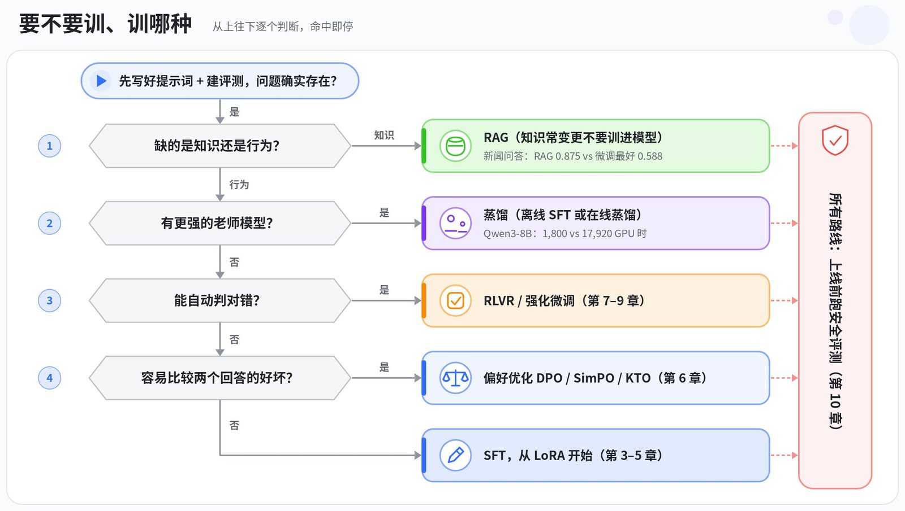

| 章节 | 内容 | 谁最该读 |
|---|---|---|
| 第 1 章 要不要训 | 提示词、RAG、微调、强化微调怎么选 | 所有人 |
| 第 2 章 先建评测 | 任务评测、通用能力、安全、污染检查 | 所有人 |
| 第 3 章 SFT 数据 | 要多少、质量、模板与损失掩码、蒸馏与许可 | 准备数据的人 |
| 第 4 章 方法选型 | 全量、LoRA、QLoRA 及其变体 | 动手训练的人 |
| 第 5 章 超参与显存 | 学习率、秩、批大小、显存公式、框架 | 动手训练的人 |
| 第 6 章 偏好优化 | DPO、SimPO、KTO | 做对话风格和对齐的人 |
| 第 7 章 RLVR 配方 | R1 的做法、GRPO 的坑与修法、奖励设计 | 做推理和强化学习的人 |
| 第 8 章 小规模复现与蒸馏 | 几十美元的复现、强化学习是否带来新能力、Agent 编排器蒸馏案例 | 预算有限的团队 |
| 第 9 章 Agent 的强化学习 | 工具调用、搜索、代码、界面操作 | 做 Agent 的人 |
| 第 10 章 失败模式 | 遗忘、安全退化、涌现失对齐、机器遗忘 | 所有人 |
| 第 11 章 上线 | 多适配器服务、合并（同源条件、算法、评测）、托管服务与价格、清单 | 负责部署的人 |
| 第 12 章 GRPO 技巧取舍 | 技巧的适用条件、最小配方、上限与效率之分、按症状加技巧 | 做推理和强化学习的人 |
| 第 13 章 长程任务的回溯课程 | 初始成功率为零时怎么造信号、起点怎么回退、环境要什么支持 | 做 Agent 强化学习的人 |

📎 与系列其他文档的分工：后训练的原理见「LLM 基础」和「LLM 数学补课」；不训练、只调调用方式见「用好模型」；评测体系见「LLM 应用评测与可观测」；微调后的安全退化和治理见「LLM 安全与治理」。本文只讲怎么动手训：数据、方法、超参、评测和上线。

## 第 1 章 · 先问要不要训：提示词、RAG、微调与强化微调

微调有成本：要准备数据、建评测、管理训练好的模型，还要承担安全退化的风险（第 10 章）。动手之前先回答一个问题：你要改变的是模型的**知识**，还是它的**行为**？

### 1.1 知识：优先 RAG

- **新知识用微调学得很差**。微软的对比实验用的是模型训练截止之后（2023 年 8–11 月）的新闻[[1]](https://arxiv.org/abs/2312.05934)：Mistral 7B 什么都不做时准确率 0.481，直接在文档上微调 0.504，先把每条事实改写成多种说法再微调也只有 0.588；加检索（RAG）是 0.875。微调和 RAG 叠加反而比只用 RAG 低（0.830）。Llama2 7B 更明显：直接微调从 0.353 降到 0.219。
- **灌新知识会增加幻觉**。Google 的研究发现[[2]](https://arxiv.org/abs/2405.05904)，与模型已有知识冲突或全新的微调样本学得明显更慢，学会之后模型编造的倾向线性上升。作者的结论是：模型的事实知识主要来自预训练，微调教的是怎么更有效地使用已有知识。
- **例外：微调和 RAG 可以互补**。在农业问答的案例中[[3]](https://arxiv.org/abs/2401.08406)，微调先提升 6 个百分点以上，再加 RAG 又提升 5 个百分点。伯克利的 RAFT[[4]](https://arxiv.org/abs/2403.10131) 专门训练模型在检索结果中忽略干扰文档、引用相关段落，也就是用微调教模型**怎么用检索到的内容**，而不是记住内容。

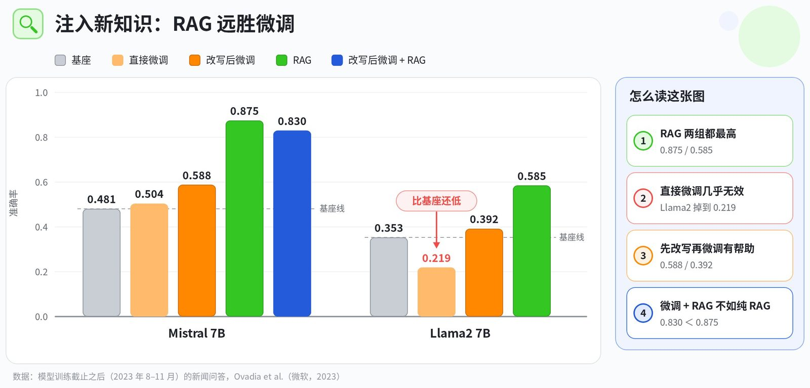

### 1.2 行为：微调的主场

以下几类需求，提示词往往做不稳，微调更合适：

- **固定的输出格式和风格**：公司特定的报告格式、客服话术、某种标注规范。
- **窄任务上用小模型替代大模型**。Predibase 的 LoRA Land 在 10 个基座、31 个任务上训了 310 个 4-bit LoRA 模型，平均比基座高 34 分，比 GPT-4 高 10 分[[5]](https://arxiv.org/abs/2405.00732)。注意这是厂商自报，而且是窄任务基准。
- **降低时延和成本**：把长提示里的规则训进模型，每次请求就不用带几千 token 的说明。
- **工具调用习惯**：让模型稳定地按某种顺序调用内部工具、使用内部参数格式。

### 1.3 可验证的任务：强化微调

📎 延伸阅读：验证器给出没有歧义的对错，形式化证明是可验证奖励最直接的场景，见 [LLM-26｜工程｜编程 Agent 实战：Claude Code、Codex 与 Cursor](./26-coding-agents.md) 第 6.5 节。

如果任务有可以自动判断对错的标准，比如数学答案、代码能否通过测试、抽取字段是否和标注一致，就可以用强化学习直接优化这个指标，而不必准备“标准答案的写法”。托管服务里，OpenAI 的强化微调（RFT）目前只支持 o4-mini，按训练循环的实际运行时间收费，每小时 100 美元[[6]](https://developers.openai.com/api/docs/guides/reinforcement-fine-tuning)；Amazon Bedrock 2025 年 12 月推出了强化微调，宣称比基座平均准确率提升 66%（厂商自报）[[7]](https://docs.aws.amazon.com/bedrock/latest/userguide/reinforcement-fine-tuning.html)。自己做的方法见第 7–9 章。

但强化微调不是按下开关就自动对齐。2026 年 11 月的对照实验给出一个可量化的边界案例：同一 SFT 检查点分出两个 GRPO 分支，发布分支 MATH 升 36.07 分、XQuAD-Indic 却掉 19.32 F1，同一评分规则下英文反升，加语言感知塑形的兄弟分支才能在恢复 Indic 分数的同时保住 MATH[141]。含义是：可验证奖励只覆盖被打分的维度，未被目标化的能力会静默漂移，多语种或多任务场景要给每个保留维度配独立回归集，不能只看奖励曲线上的主指标。

### 1.4 2026 年的现实：闭源微调渠道在收窄

| 厂商 | 微调现状（2026-10） |
|---|---|
| OpenAI | 2026-05-07 通知逐步关闭：从未用过微调的组织当天起不能新建任务；7 月 2 日起，过去 60 天没有微调模型推理的组织不能新建；2027-01-06 起所有客户都不能新建。已训好的模型可继续推理，直到对应基座下线；gpt-3.5-turbo、gpt-4 等老模型的微调版本 2026-10-23 关停[[8]](https://developers.openai.com/api/docs/deprecations)。 |
| Anthropic | Claude 的微调只通过 Amazon Bedrock 提供[[7]](https://docs.aws.amazon.com/bedrock/latest/userguide/reinforcement-fine-tuning.html)。官方提示词指南强调先定义成功标准、建评测，并提醒不是所有失败都该靠提示词解决，时延和成本问题可能换模型更合适[[9]](https://docs.anthropic.com/en/docs/build-with-claude/prompt-engineering/overview)。 |
| Google | Vertex AI 提供 Gemini 监督微调和强化微调，建议至少 100–500 条样本，单条最长 131,072 token[[10]](https://docs.cloud.google.com/vertex-ai/generative-ai/docs/models/gemini-use-supervised-tuning)。 |
| 开放权重 | Qwen、DeepSeek、Llama、Gemma、GLM、Kimi 等都可以自己训，工具链见第 5 章，托管训练服务见第 11 章。 |

### 1.5 一个简单的决策顺序

先按场景对号入座；对不上号时，再按下面的五步判断。

| 场景 | 首选做法 | 为什么 | 详见 |
|---|---|---|---|
| 单轮分类、路由、标签抽取（工单分派、意图识别），有标注 | SFT，从 LoRA 开始 | 输出空间小，一步就决策完，没有长序列上的误差累积 | 第 3、4 章 |
| 固定格式的结构化抽取 | SFT | 先把格式学稳；后面要做强化学习，也要靠 SFT 先稳住输出格式[[57]](https://arxiv.org/abs/2501.17161) | 第 3 章 |
| 注入新的领域知识（内部文档、产品手册） | 优先 RAG；必须训进模型时做继续训练或 SFT，并混入至少 30% 的通用对话数据 | 强化学习和在线蒸馏擅长塑造行为，教不了新知识[[21]](https://thinkingmachines.ai/blog/on-policy-distillation/) | 第 1.1 节、第 8.4 节 |
| 可以自动判分的推理（数学、代码单测、可执行 SQL） | SFT 冷启动，再做 RLVR | 规则判分不需要奖励模型；强化学习泛化更好、遗忘更少[[57]](https://arxiv.org/abs/2501.17161)[[58]](https://arxiv.org/abs/2509.04259) | 第 7 章 |
| 长的多轮 Agent 任务、工具调用 | 用轨迹做 SFT 冷启动，再做强化学习 | 序列越长，离线数据和学生实际走到的状态差得越远，需要在自己的轨迹上学 | 第 9 章 |
| 手上有同族的更强老师，要做小模型 | 离线蒸馏，再在线蒸馏 | Qwen3 小模型的路线，比继续做强化学习约省 10 倍 GPU 时[[22]](https://arxiv.org/abs/2505.09388) | 第 8.3、8.4 节 |
| 几个领域专家要合并成一个模型 | 多老师在线蒸馏 | DeepSeek-V4 用它整个替代了混合强化学习阶段[[78]](https://arxiv.org/abs/2606.19348) | 第 8.4 节 |
| 微调后指令遵循等通用能力掉点 | 用微调前的模型当老师做在线蒸馏 | 能把行为拉回来，而且不丢新学的知识[[21]](https://thinkingmachines.ai/blog/on-policy-distillation/) | 第 8.4 节 |
| 老师只有闭源 API | 用老师的输出做 SFT（黑盒蒸馏） | 在线蒸馏需要老师给出每个 token 的概率 | 第 3.4、3.5 节 |
| 偏好和风格，没有客观答案 | SFT，再做 DPO 等偏好优化 | 需要的是偏好信号，不是对错 | 第 6 章 |

1. 先把提示词写好（见「用好模型」一文），用评测确认问题确实存在。
2. 缺知识就上 RAG；知识经常变的，更不要训进模型。
3. 提示词能做到但太长、太慢、太贵，或者格式总是不稳：做 SFT，通常从 LoRA 开始。
4. 有自动判分标准，且 SFT 后仍有明显差距：做 RLVR。
5. 要用小模型替代大模型：先考虑蒸馏（第 3.5 节、第 8 章），它往往比强化学习便宜一个数量级。

## 第 2 章 · 先建评测，再动手

后训练最常见的失败是“不知道训好了没有”：目标任务涨了，通用能力和安全性悄悄退化；或者分数涨了，其实是评测集泄漏。评测要在训练开始前就准备好，训练中每个检查点都跑一遍。

### 2.1 评测集的四个部分

| 部分 | 内容 | 用途 |
|---|---|---|
| 目标任务 | 从真实流量中抽取、与训练集严格分开的样本，最好按时间切分 | 衡量是否达到上线标准 |
| 分布外样本 | 同类任务的不同来源、不同格式 | 判断是学会了还是记住了 |
| 通用能力 | 几个公开基准加内部常用场景 | 监控遗忘（第 10 章） |
| 安全 | 有害请求、越狱提示、过度拒答样本 | 微调会破坏安全对齐（第 10 章） |

### 2.2 先确认数据质量的上限

OpenAI 的微调最佳实践给了几条实用经验[[11]](https://developers.openai.com/api/docs/guides/fine-tuning-best-practices)：

- 如果人工标注者之间只有 70% 的一致率，模型大概率也做不到更好。先修标注规范，再加数据。
- 如果训练集里 60% 的回答是拒答，而真实情况只该有 5%，训出来的模型会过度拒答。训练数据的分布要和期望的行为一致。
- 数据量每翻一倍，提升幅度大致相当，可以据此估算还需要多少数据。

### 2.3 推理任务：pass@1 和 pass@k 都要看

强化学习通常提升 pass@1（一次答对的概率），但清华的研究发现，k 很大时（比如 pass@256），基座模型的覆盖率反而高于强化学习后的模型，而且随着训练推进，pass@1 上升、pass@256 下降[[12]](https://arxiv.org/abs/2504.13837)。只看 pass@1 会以为模型变强了，实际上可能只是把原本就会的答案变得更稳定。是否真的扩展了能力边界还有争论（第 8.5 节），但两个指标都看，至少能知道自己处在哪种情况。

### 2.4 污染检查与跨家族验证

- **污染**：在 Qwen2.5 上，一些数学基准已经出现在预训练数据里。研究者构造了全新的随机计算数据，发现在这种干净数据上，只有准确的奖励能突破基座的能力边界，随机或错误的奖励不行[[13]](https://arxiv.org/abs/2507.10532)。
- **跨家族**：华盛顿大学发现，用随机奖励训练 Qwen2.5-Math-7B，MATH-500 能涨 21.4 分，真实奖励是 29.1 分；原因是训练放大了 Qwen 预训练时已有的“用代码推理”习惯（从 65% 升到 90% 以上），这种提升在 Llama3 和 OLMo2 上大多不成立[[14]](https://arxiv.org/abs/2506.10947)。只在 Qwen 上验证的新方法，结论要打折扣。

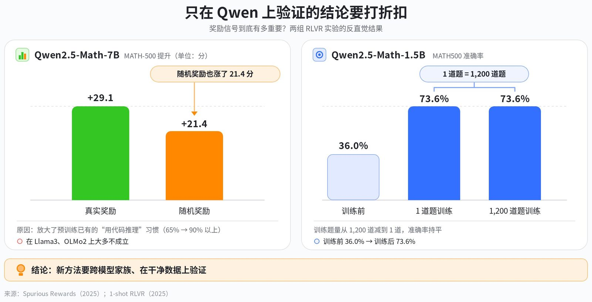

### 2.5 评测的执行

- 评测脚本、采样参数（温度、最大长度）和判分方法固定下来，和代码一起版本化。
- 同时跑训练前的基座和当前的线上模型作为基线。
- 小数据评测集要报置信区间，几个点的差距在一两百条样本上可能只是噪声。
- 用模型打分时，判分模型和被训练的模型最好来自不同家族，并定期用人工抽检校准。

## 第 3 章 · SFT 数据工程

📎 延伸阅读：少量带触发词的样本就能在微调后留下后门，起作用的是篇数，和占比关系不大，见 [LLM-12｜工程｜LLM 安全与治理：应用侧的攻防与合规](./12-security-governance.md) 第 9 章「训练数据投毒：看篇数不看比例」。

### 3.1 要多少条

| 来源 | 数量 | 场景 |
|---|---|---|
| OpenAI 微调指南[[11]](https://developers.openai.com/api/docs/guides/fine-tuning-best-practices) | 最少 10 条，50–100 条开始见效 | 格式、风格类任务；50 条无效就先反思任务和提示词 |
| Vertex AI Gemini 微调[[10]](https://docs.cloud.google.com/vertex-ai/generative-ai/docs/models/gemini-use-supervised-tuning) | 建议 100–500 条 | 托管微调的起步量 |
| LIMA[[15]](https://arxiv.org/abs/2305.11206) | 1,000 条精选问答 | LLaMA 65B 对话对齐，43% 的情况下与 GPT-4 持平或更好 |
| s1[[16]](https://arxiv.org/abs/2501.19393) | 1,000 道带推理过程的题 | Qwen2.5-32B 推理，竞赛数学超过 o1-preview 最多 27% |
| LIMO[[17]](https://arxiv.org/abs/2502.03387) | 约为此前方法的 1% | AIME24 63.3%、MATH500 95.6% |
| Open-R1[[18]](https://github.com/huggingface/open-r1) | 35 万条推理轨迹 | 7B 模型完整复现 R1 蒸馏版 |

这些数字背后是同一个结论：**预训练决定能力，后训练决定用法**。LIMA 把它称为“表面对齐假设”：模型的知识来自预训练，对齐只是教它该用哪种输出方式[[15]](https://arxiv.org/abs/2305.11206)。所以少量高质量数据往往就够；数据要精挑，难度、多样性、质量三项都要考虑，这也是 s1 挑选那 1,000 道题的标准[[16]](https://arxiv.org/abs/2501.19393)。

### 3.2 质量胜过数量

- **去重**：C4 里有一句 61 词的句子重复了 6 万多次；去重后模型逐字背诵训练数据的频率降到十分之一，而常用验证集里超过 4% 与训练集重叠[[19]](https://arxiv.org/abs/2107.06499)。微调数据量小，重复样本的影响更大。
- **回答要一致**：同类问题的回答风格、格式、拒答标准要统一，否则模型会学到随机性。
- **最好的提示词放进每条样本**：数据少于 100 条时尤其如此[[11]](https://developers.openai.com/api/docs/guides/fine-tuning-best-practices)。训练后线上也用同样的提示词。

### 3.3 聊天模板、损失掩码与打包

这三项是 SFT 里最容易悄悄出错的地方：

- **聊天模板必须和推理时一致**。用错模板，训练时一切正常，上线后表现明显变差。
- **只在助手回答上算损失**。TRL 的 SFTTrainer 用 `assistant_only_loss=True` 实现，需要聊天模板里有 generation 标记（Qwen3 等常见家族会自动补上）；提示-补全格式的数据默认只在补全部分算损失[[20]](https://huggingface.co/docs/trl/sft_trainer)。多轮对话里，OpenAI 允许给每条助手消息设权重 0 或 1，只训练想要的那几轮[[11]](https://developers.openai.com/api/docs/guides/fine-tuning-best-practices)。
- **打包**：把多条短样本拼成一条长序列能提高吞吐，但要保证样本之间的注意力互相隔离。TRL 默认不打包，最大长度 1,024，长样本会被截断，做推理数据时要记得调大[[20]](https://huggingface.co/docs/trl/sft_trainer)。

### 3.4 用大模型生成数据：蒸馏

最常见的数据来源是让强模型生成。Open-R1 从 DeepSeek-R1 蒸馏了 35 万条经过验证的推理轨迹（数学 9.37 万、代码 8.31 万、科学 17.3 万），训出的 7B 模型 AIME24 52.7、GPQA-Diamond 52.8，与 DeepSeek 官方蒸馏版相当；配方是学习率 4e-5、5 个 epoch、序列长度 32,768[[18]](https://github.com/huggingface/open-r1)。

蒸馏有两种：

- **离线蒸馏**：老师先生成数据，学生做 SFT。简单，但学生学的是老师的分布，自己犯的错没人纠正。
- **在线蒸馏**：学生自己生成，老师对每个 token 打分（用逐 token 的反向 KL 作为优势信号，放进强化学习的损失里）。Thinking Machines 从一个 AIME'24 60% 的 SFT 检查点出发，约 150 步就到了 70%，估算离线 SFT 要约 200 万条提示才能达到；他们报告的计算效率是 SFT 的 9–30 倍[[21]](https://thinkingmachines.ai/blog/on-policy-distillation/)。Qwen3 的小模型都用这种方式从旗舰模型蒸馏（第 8.3 节）[[22]](https://arxiv.org/abs/2505.09388)。

### 3.5 许可：哪些模型的输出可以拿来训练

| 来源 | 条款要点 |
|---|---|
| OpenAI | 不得用输出开发与 OpenAI 竞争的模型[[23]](https://openai.com/policies/row-terms-of-use/) |
| Anthropic | 不得用服务构建竞争产品，包括训练竞争的 AI 模型[[24]](https://www.anthropic.com/legal/commercial-terms) |
| Llama 3.1 | 用其输出训练并发布的模型，名字要以 Llama 开头并标注 Built with Llama；月活超过 7 亿需另行授权[[25]](https://github.com/meta-llama/llama-models/blob/main/models/llama3_1/LICENSE) |
| DeepSeek-R1 | MIT 许可，明确允许蒸馏训练其他模型和商用[[26]](https://huggingface.co/deepseek-ai/DeepSeek-R1) |

内部使用是否构成“竞争”，取决于具体场景和合同，需要法务判断；上表只是条款摘要，不是法律意见。

## 第 4 章 · 方法选型：全量微调、LoRA 与它的变体

### 4.1 LoRA 和 QLoRA 在做什么

- **LoRA**：冻结原模型，在每个线性层旁边加两个小矩阵 A 和 B，只训练这两个矩阵。对 GPT-3 175B，可训练参数减少到全量微调的万分之一，显存降到三分之一；训完可以合并回原权重，推理不增加时延[[27]](https://arxiv.org/abs/2106.09685)。
- **QLoRA**：把冻结的原模型量化成 4-bit（NF4 格式），在上面训 LoRA。65B 模型 16-bit 全量微调需要 780 GB 以上显存，QLoRA 一张 48 GB 显卡就够；论文的 Guanaco 65B 只用了 41 GB，单卡训练 24 小时达到 ChatGPT 在 Vicuna 基准上 99.3% 的水平[[28]](https://arxiv.org/abs/2305.14314)。

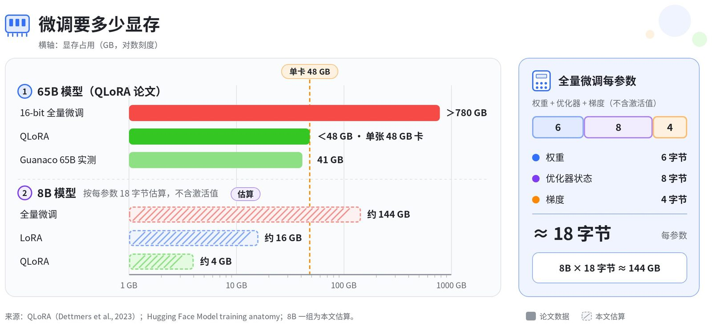

### 4.2 LoRA 什么时候能追平全量微调

两项研究给出了互补的答案：

- <b>“LoRA 学得少，忘得也少”</b>（TMLR 2024）[[29]](https://arxiv.org/abs/2405.09673)：在 Llama-2-7B 上做代码和数学。指令微调（约 10 万条）中，HumanEval 秩 16 是 0.358、秩 64 是 0.417、秩 256 是 0.498，全量微调 0.497；持续预训练（约 200 亿 token）中，差距在高秩下也没有补上。原因是全量微调学到的权重变化，秩比常见的 LoRA 设置高 10–100 倍。但 LoRA 对原有能力保持得更好。
- <b>“LoRA Without Regret”</b>（Thinking Machines，2025-09）[[30]](https://thinkingmachines.ai/blog/lora/)：只要满足三个条件，LoRA 在监督学习和强化学习上都能和全量微调走在同一条学习曲线上：学习率设成全量微调的约 10 倍；所有层都加 LoRA，尤其是 MLP 和 MoE 层（只加在注意力层上，秩 256 也不如只加 MLP 的秩 128）；数据量不超过 LoRA 的容量。

两者合起来的结论：**后训练规模的数据（几千到几十万条）用 LoRA 基本够；接近预训练规模的数据（几十亿 token 以上）用全量微调**。强化学习每个回合只提供很少的信息量，LoRA 秩 1 都够用[[30]](https://thinkingmachines.ai/blog/lora/)。

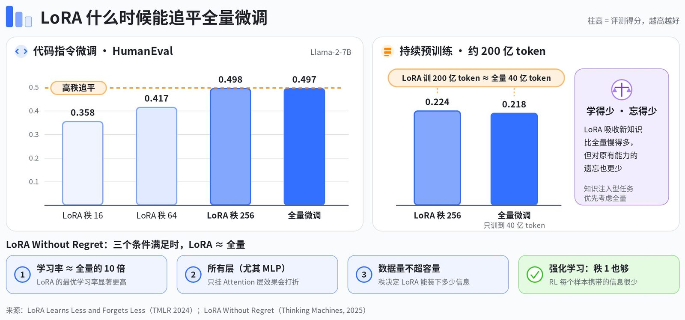

### 4.3 LoRA 的局限

- **不耐大批量**：批大小大了，LoRA 比全量微调掉得多，加秩也补不回来[[30]](https://thinkingmachines.ai/blog/lora/)。
- <b>“入侵维度”</b>：MIT 的研究发现，LoRA 会引入原权重里没有的高奇异值方向，遗忘集中在这些方向上；连续多轮微调时它们会累积，危害更大[[31]](https://arxiv.org/abs/2410.21228)。需要反复迭代的场景，要定期从基座重新训练，而不是在上一个适配器上继续叠。

### 4.4 变体：值得试的改进

| 方法 | 改了什么 | 效果 |
|---|---|---|
| DoRA[[32]](https://arxiv.org/abs/2402.09353) | 把权重拆成“大小”和“方向”，LoRA 只作用在方向上 | ICML 2024 Oral，常识推理、视觉指令微调上稳定超过 LoRA，推理无额外开销 |
| rsLoRA[[33]](https://arxiv.org/abs/2312.03732) | 缩放系数从 α/r 改成 α/√r | 秩越高效果越好，原来高秩反而学得慢 |
| LoRA+[[34]](https://arxiv.org/abs/2402.12354) | A、B 两个矩阵用不同学习率 | 提升 1–2%，最多约 2 倍加速 |

这些变体在 PEFT 等库里通常只需改一两个参数。默认先用标准 LoRA 加 rsLoRA 缩放；效果不够再试 DoRA。

### 4.5 选型表

| 情况 | 建议 |
|---|---|
| 格式、风格、窄任务，几千到几万条 | LoRA（所有层），显存紧就 QLoRA |
| 推理能力蒸馏，几十万条长轨迹 | LoRA 高秩或全量微调，先小规模对比 |
| 强化学习 | LoRA 低秩即可，省下的显存给采样 |
| 领域持续预训练，几十亿 token | 全量微调 |
| 同一个基座服务很多客户或任务 | 每个任务一个 LoRA，共享基座部署（第 11 章） |

## 第 5 章 · 超参、显存预算与框架

### 5.1 超参起点

| 超参 | 起点 | 依据 |
|---|---|---|
| 学习率（LoRA） | 全量微调最优值的约 10 倍；训练很短（不到约 100 步）时约 15 倍 | LoRA Without Regret[[30]](https://thinkingmachines.ai/blog/lora/) |
| 学习率（QLoRA 参考） | 7B/13B 用 2e-4，33B/65B 用 1e-4 | QLoRA 论文[[28]](https://arxiv.org/abs/2305.14314) |
| 作用层 | 所有线性层，包括 MLP | [[30]](https://thinkingmachines.ai/blog/lora/)[[29]](https://arxiv.org/abs/2405.09673) |
| 秩 r | SFT 16–64，数据多就往上加；强化学习可以很低 | [[29]](https://arxiv.org/abs/2405.09673)[[30]](https://thinkingmachines.ai/blog/lora/) |
| α | α = 2r，或用 rsLoRA 缩放 | [[29]](https://arxiv.org/abs/2405.09673)[[33]](https://arxiv.org/abs/2312.03732) |
| 批大小 | 偏小，LoRA 对大批量更敏感 | [[30]](https://thinkingmachines.ai/blog/lora/) |
| 梯度裁剪、dropout | 最大梯度范数 0.3；dropout 0.05–0.1 | QLoRA 论文[[28]](https://arxiv.org/abs/2305.14314) |

Google 对托管微调的建议是第一次先用默认超参跑通[[10]](https://docs.cloud.google.com/vertex-ai/generative-ai/docs/models/gemini-use-supervised-tuning)。自己训也一样：先用上面的起点跑一个基线，再一次只改一个超参。

### 5.2 显存怎么估

Hugging Face 给出的混合精度 AdamW 训练每个参数的显存占用[[35]](https://github.com/huggingface/transformers/blob/main/docs/source/en/model_memory_anatomy.md)：

- 权重 6 字节：bf16 一份，加 fp32 主副本一份。
- 优化器状态 8 字节：fp32 的一阶、二阶动量；用 8-bit Adam 可降到 2 字节。
- 梯度 4 字节。

合计每参数约 18 字节，还不含激活值。按这个公式粗算（以下是本文的估算，不是论文数字）：

| 8B 模型 | 显存（不含激活值） | 说明 |
|---|---|---|
| 全量微调 | 约 144 GB | 8×10⁹ × 18 字节，需要多卡加 ZeRO 等切分 |
| LoRA | 约 16 GB 加适配器 | bf16 冻结权重，适配器和其优化器状态很小 |
| QLoRA | 约 4 GB 加适配器 | NF4 加双重量化，约 4.1 比特每参数 |

长序列时激活值会成为大头。推理轨迹动辄 3 万 token，要配合梯度检查点、FlashAttention 和序列并行。强化学习还要额外留出采样（推理引擎）的显存。

### 5.3 开源框架（2026-10）

| 框架 | 定位 | 状态 |
|---|---|---|
| TRL + PEFT | Hugging Face 官方；SFT、DPO、奖励模型、RLOO、GRPO 是稳定接口，在线训练接 vLLM[[36]](https://huggingface.co/blog/trl-v1) | 2026-03 发布 1.0，10 月为 1.15 |
| Unsloth | 单卡效率优先。自报 GRPO 比 Hugging Face 加 FlashAttention 2 省 80% 显存；Llama 3.1 8B、2 万 token 上下文的 GRPO，TRL 方案 510.8 GB、Unsloth 54.3 GB[[37]](https://unsloth.ai/docs/get-started/reinforcement-learning-rl-guide/grpo-long-context) | 活跃，数字为厂商自报 |
| LLaMA-Factory | 支持 100 多个模型，带无代码网页界面[[38]](https://arxiv.org/abs/2403.13372) | ACL 2024 系统演示，中文社区常用 |
| verl | 字节开源的强化学习框架（HybridFlow，EuroSys 2025），吞吐比此前系统高 1.53–20.57 倍；0.7 版改为采样服务模式，支持多轮 Agent；0.9 版支持 DeepSeek-V4 GRPO 和 Muon 优化器[[39]](https://github.com/verl-project/verl) | 2026-09 发布 0.9.1 |
| OpenRLHF | 基于 Ray、vLLM、DeepSpeed，比同类快 1.22–1.68 倍（论文自报）[[40]](https://arxiv.org/abs/2405.11143) | 活跃 |
| torchtune | PyTorch 官方微调库 | 2025-07 停止活跃开发，新项目不建议选用[[41]](https://github.com/pytorch/torchtune/issues/2883) |

选型建议：SFT 和 DPO 用 TRL 或 LLaMA-Factory；单卡、小模型的强化学习实验用 Unsloth；多机强化学习和 Agent 训练用 verl 或 OpenRLHF。

📎 选定 verl 或 OpenRLHF 之后，下一步要定的是生成和训练怎么分卡、要不要异步、新权重怎么同步给推理引擎，这些系统层的选择见第 55 篇 [LLM-55｜系统｜RL 训练系统：rollout 与训练分离、异步与 Agent 环境](./55-rl-systems.md)。

## 第 6 章 · 偏好优化：DPO、SimPO、KTO

SFT 告诉模型“标准答案长什么样”，偏好优化告诉模型“两个回答里哪个更好”。后者适合难以写出唯一标准答案、但容易比较好坏的任务：回答的语气、详略、是否啰嗦、是否过度拒答。

### 6.1 三种方法

| 方法 | 思路 | 数据格式 | 代价 |
|---|---|---|---|
| DPO[[42]](https://arxiv.org/abs/2305.18290) | 把 RLHF 的目标推导成一个分类损失：提高好回答相对坏回答的概率，同时不偏离参考模型太远 | 成对：同一提示下一好一坏 | 要额外加载一份参考模型 |
| SimPO[[43]](https://arxiv.org/abs/2405.14734) | 不要参考模型，用平均对数概率作为隐式奖励，加一个目标间隔 | 成对 | 比 DPO 省算力和显存 |
| KTO[[44]](https://arxiv.org/abs/2402.01306) | 只需要知道单个回答好还是不好 | 单条加好坏标签 | 数据最容易收集 |

- DPO 在情感控制任务上超过基于 PPO 的 RLHF，在摘要和单轮对话上持平或更好，而且训练时不需要采样[[42]](https://arxiv.org/abs/2305.18290)。
- SimPO 在 AlpacaEval 2 上比 DPO 最多高 6.4 分，在 Arena-Hard 上最多高 7.5 分；基于 Gemma-2-9B-it 的版本 AlpacaEval 2 长度控制胜率 72.4%[[43]](https://arxiv.org/abs/2405.14734)。
- KTO 在 1B 到 30B 规模上与基于成对偏好的方法持平或更好[[44]](https://arxiv.org/abs/2402.01306)。线上的点赞、点踩、用户是否采纳天然就是这种格式。

### 6.2 实操要点

- **先 SFT 再偏好优化**。偏好优化调整的是已有行为之间的取舍，起点太差时效果有限。
- **偏好数据最好来自当前模型自己的输出**。用别的模型生成的好坏对，模型学到的可能只是“像那个模型”。
- **小心长度偏好**。人和判分模型都容易偏爱更长的回答，训练后回答越来越长是常见现象。评测时用长度控制的指标，SimPO 的长度归一化也是为此设计的[[43]](https://arxiv.org/abs/2405.14734)。
- **和 RLVR 的分工**：有客观对错的任务用 RLVR（第 7 章）；主观偏好用偏好优化。很多团队两者都用，比如 DeepSeek-R1 的第二阶段强化学习就加入了有用性和无害性奖励[[45]](https://www.nature.com/articles/s41586-025-09422-z)。

## 第 7 章 · RLVR 实战 I：配方、GRPO 的坑与奖励设计

📎 延伸阅读：长思维链怎么在强化学习中长出来、蒸馏与强化各自的作用，见 [LLM-37｜地基｜推理模型与测试时计算：长思维链何时值得](./37-reasoning-models.md)。

RLVR（可验证奖励的强化学习）的流程很简单：对每道题采样一组回答，用规则判断对错，答对的回答概率调高，答错的调低。GRPO 是目前最常用的算法，它不训练价值模型，用同组回答的平均分作为基线。难点在细节。

### 7.1 DeepSeek-R1 的配方

R1 的论文 2025 年 9 月发表在 Nature 上，公开了完整超参[[45]](https://www.nature.com/articles/s41586-025-09422-z)：

- **R1-Zero**（直接从基座开始强化学习）：学习率 3e-6，KL 系数 0.001，温度 1，每题采样 16 个回答；最大长度 8.2k 步之前是 32,768 token，之后 65,536；共 10,400 步，每步 32 道题；参考模型每 400 步更新一次。
- **R1**：先用几千条冷启动数据做 SFT；强化学习时加一个语言一致性奖励（避免中英混杂）；再拒绝采样出推理和非推理数据做第二轮 SFT；最后一轮强化学习加入有用性和无害性奖励。
- **其他公开配方**：月之暗面的 Kimi k1.5 不用蒙特卡洛树搜索、价值函数或过程奖励模型，关键是扩展上下文长度，长思维链版本 AIME 77.5[[46]](https://arxiv.org/abs/2501.12599)；字节的 Seed1.5-Thinking 是激活 200 亿、总参数 2,000 亿的 MoE，AIME 2024 86.7，非推理任务上对 DeepSeek-R1 的胜率高 8%[[47]](https://arxiv.org/abs/2504.13914)。

### 7.2 GRPO 的已知问题和修法

先回顾 GRPO 到底从 PPO 那里拿掉了什么。PPO 是 OpenAI 2017 年提出的通用强化学习算法，最初在机器人控制和 Atari 游戏上验证[[83]](https://arxiv.org/abs/1707.06347)；InstructGPT 把它用在语言模型上，训练时要同时放四个模型[[84]](https://arxiv.org/abs/2203.02155)：

| 模型 | 直观地说 | 训不训 | GRPO | DAPO / Dr. GRPO | 在线蒸馏 |
|---|---|---|---|---|---|
| 策略模型（actor） | 学生：写答案，最后上线的就是它 | 训练，从 SFT 模型初始化 | 保留 | 保留 | 保留（学生） |
| 奖励模型 | 阅卷老师：给整条回答打一个总分 | 强化学习前单独训好，之后冻结；InstructGPT 用的是 6B | 原论文仍用奖励模型打分[[85]](https://arxiv.org/abs/2402.03300) | 换成规则判分（对 +1，错 −1） | 换成老师对每个 token 的概率 |
| 价值模型（critic） | 私人教练：估计每一步之后还能拿多少分，用来算优势、降低方差 | 训练；InstructGPT 从奖励模型初始化，规模通常和策略相当 | 去掉，用同一道题多次采样的组内平均分当基线 | 同 GRPO | 不需要，优势直接取逐 token 反向 KL 的负值 |
| 参考模型 | 紧箍咒：冻结的 SFT 副本，用 KL 惩罚防止跑偏和钻奖励的空子 | 冻结 | 保留，KL 从奖励里挪到损失里 | 去掉（KL 系数为 0），省下它的显存和计算[[48]](https://arxiv.org/abs/2503.14476)[[49]](https://arxiv.org/abs/2503.20783) | 由老师兼任 |

数一下训练时要驻留的模型：PPO 4 个，其中 2 个要训练；GRPO 3 个；DAPO 和 Dr. GRPO 用规则判分，只剩策略模型加一个判分程序；在线蒸馏是策略模型加一个或几个冻结的老师。GRPO 去掉价值模型的理由有两条：价值模型通常和策略一样大，显存和计算负担重；语言模型往往只有最后一个 token 拿到奖励，要给每个 token 都估准价值本来就难[[85]](https://arxiv.org/abs/2402.03300)。反过来，本节末尾的 VAPO 说明把价值模型训好也能赢。

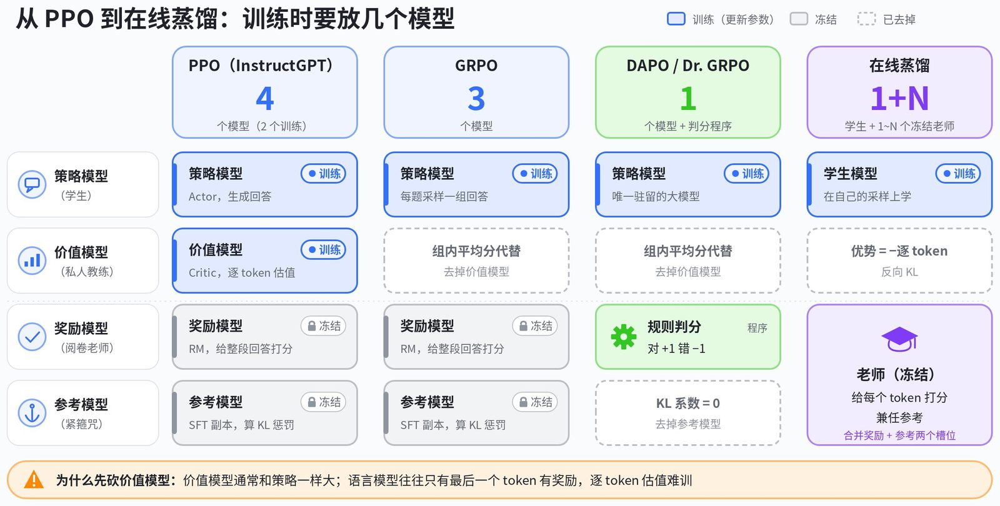

在这个基础上，GRPO 自己还有一串已知问题。下面的修法各有适用条件，同一项技巧换个模型或数据难度可能由正转负，开哪些、怎样验证见第 12 章。

字节 Seed 和清华 AIR 的 DAPO 在 Qwen2.5-32B 基座上做了逐项消融（AIME24，32 次采样平均）[[48]](https://arxiv.org/abs/2503.14476)：

| 改动 | AIME24 | 解决的问题 |
|---|---|---|
| 原始 GRPO | 30 | 基线 |
| 过滤超长回答 | 36 | 被截断的回答不一定是错的，不该按错误惩罚 |
| 放宽上裁剪（Clip-Higher） | 38 | 上下裁剪边界分开（0.2 和 0.28），让低概率的好 token 有机会被提升，防止熵塌缩 |
| 软性超长惩罚 | 41 | 接近长度上限时逐步扣分，而不是一刀切 |
| 按 token 计算损失 | 42 | 按样本平均会让长回答里每个 token 的权重变小 |
| 动态采样 | 50 | 一组全对或全错时没有梯度信号，过滤掉这些题、补采样 |

最终 50 分超过了 DeepSeek-R1-Zero-Qwen-32B 的 47 分，只用了一半的训练步数。DAPO 还去掉了 KL 项，用恒定学习率 1e-6，每步 512 道题、每题 16 个回答[[48]](https://arxiv.org/abs/2503.14476)。

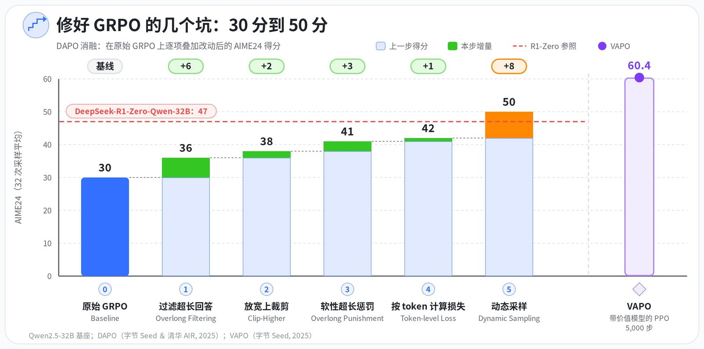

其他几项相关工作：

- **Dr. GRPO**[[49]](https://arxiv.org/abs/2503.20783)：GRPO 按回答长度和组内标准差做归一化，会让错误回答越写越长。去掉这两个归一化后，7B 基座 8 张 A100 训练 27 小时，AIME 2024 达到 43.3%。
- **GSPO**[[50]](https://arxiv.org/abs/2507.18071)：Qwen 团队把重要性比率和裁剪从 token 级改成序列级，训练 MoE 模型更稳定，用于 Qwen3 的新版本。
- **VAPO**[[51]](https://arxiv.org/abs/2504.05118)：字节 Seed 回到带价值模型的 PPO 并做了改进，Qwen 32B 基座 5,000 步达到 AIME 2024 60.4 分，比 DAPO 高 10 分以上，多次独立运行没有崩溃。

### 7.3 熵塌缩

不加干预时，策略的熵在训练早期迅速下降，性能随之饱和。上海 AI 实验室等发现了一个经验规律：性能 R 和熵 H 满足 R = −a·e$`{}^{H}`$ + b，熵降到 0 时性能到顶（−a + b）[[52]](https://arxiv.org/abs/2505.22617)。所以“保住熵”就是保住上限。实用手段：放宽上裁剪（DAPO）、对高协方差的 token 限制更新（论文提出的 Clip-Cov、KL-Cov），并在监控面板上一直画出熵曲线。

### 7.4 奖励设计

📎 延伸阅读：编程任务用测试当奖励时，模型会学会改测试拿分，还会泛化成更广的不当行为，见 [LLM-26｜工程｜编程 Agent 实战：Claude Code、Codex 与 Cursor](./26-coding-agents.md) 第 6.4 节。

- **规则优先**：数学比对最终答案，代码跑单元测试，抽取比对字段。规则判分比模型判分更难被钻空子。
- **格式奖励要轻**：SimpleRL-Zoo 在 10 个基座上实验发现，格式奖励过重会限制探索，调整格式奖励和控制题目难度是两个关键杠杆[[53]](https://arxiv.org/abs/2503.18892)。
- **防止钻空子**：抽样检查高分回答。常见问题有：只输出答案不写推理、利用判分脚本的漏洞、在代码里硬编码测试用例。
- **题目难度要合适**：太简单全对、太难全错，都没有梯度信号。按当前模型的通过率筛题，保留通过率在中间的题。

### 7.5 监控什么

平均奖励、熵、回答长度、裁剪比例、一组全对和全错的比例、KL（如果保留）、验证集准确率。奖励上升而验证集不动，通常是奖励被钻了空子；长度暴涨而准确率不动，通常是归一化或超长处理有问题。症状与对症技巧的对应表见第 12.6 节。

## 第 8 章 · RLVR 实战 II：小规模复现、蒸馏与“强化学习到底学到了什么”

📎 延伸阅读：用小预算从零训练一个模型、跑通 SFT 与小模型强化学习的动手实验见 [LLM-30｜地基｜动手实验：从零训练一个小模型](./30-train-small-model.md)。

### 8.1 小预算也能做

| 工作 | 做了什么 | 成本 |
|---|---|---|
| TinyZero[[54]](https://github.com/Jiayi-Pan/TinyZero) | 3B 基座在凑数和乘法任务上复现 R1-Zero，自我验证和搜索行为自然出现 | 不到 30 美元；仓库现已停止维护，建议直接用 verl |
| Dr. GRPO[[49]](https://arxiv.org/abs/2503.20783) | 7B 基座 AIME 2024 43.3% | 8 张 A100，27 小时 |
| Unsloth[[37]](https://unsloth.ai/docs/get-started/reinforcement-learning-rl-guide/grpo-long-context) | Qwen2.5-1.5B 复现“顿悟”现象；Qwen3-8B 在 11 万 token 上下文做 GRPO | 前者约 5–7 GB 显存，后者一张 80 GB H100 |
| 1 条样本的 RLVR[[55]](https://arxiv.org/abs/2504.20571) | 只用 1 道题训练 Qwen2.5-Math-1.5B，MATH500 从 36.0% 到 73.6% | 与用 1,200 道题的效果相当 |

1 条样本就能有效，说明这类模型在预训练中已经具备了相应能力，强化学习主要是把它“激发”出来。这个结论正是下面争论的起点。

### 8.2 跨模型家族的差异

SimpleRL-Zoo 在 10 个基座上做零起点强化学习，包括 Llama3-8B、Mistral-7B/24B、DeepSeek-Math-7B 和不同规模的 Qwen2.5[[53]](https://arxiv.org/abs/2503.18892)。发现：回答变长不一定意味着出现了自我验证；第一次观察到“顿悟”行为反而是在非 Qwen 的小模型上。Dr. GRPO 也发现，DeepSeek-V3-Base 在强化学习之前就已经有“顿悟”式的表达，Qwen2.5 基座不加模板也能推理得不错[[49]](https://arxiv.org/abs/2503.20783)。复现别人的结果时，基座选择本身就是一个大变量。

### 8.3 蒸馏往往更划算

Qwen3 技术报告给了一组直接对比[[22]](https://arxiv.org/abs/2505.09388)。从同一个离线蒸馏后的 8B 检查点出发（AIME'24 55.0）：

- 继续做强化学习：67.6 分，17,920 GPU 时。
- 改做在线蒸馏（以旗舰模型为老师）：74.4 分，1,800 GPU 时。

AIME'25 上同样是 65.5 对 55.5。Qwen3 的 0.6B 到 14B 稠密模型和 30B-A3B 都用这种方式训练，总 GPU 时约为四阶段完整流程的十分之一[[22]](https://arxiv.org/abs/2505.09388)。<b>如果手上有更强的老师模型，先考虑蒸馏；强化学习留给老师也做不好、或者没有老师的任务。</b>

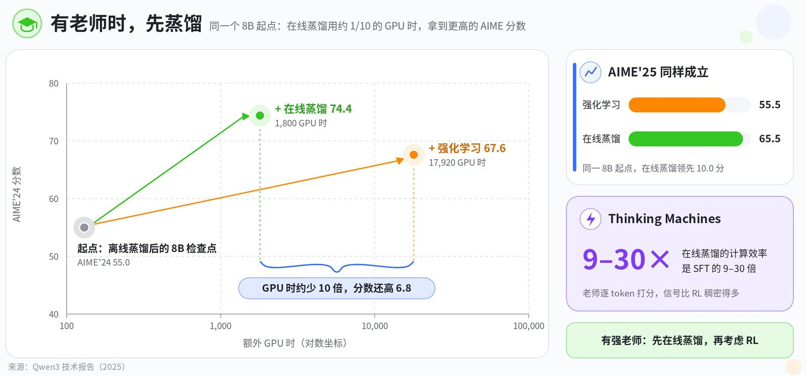

### 8.4 在线蒸馏：学生自己答，老师逐字批改

第 3.4 节介绍过在线蒸馏（On-Policy Distillation，也译作同策蒸馏）的做法。这一节讲它为什么有效、2026 年的主要用法，以及什么时候用不了。

#### 为什么有效：SFT 和强化学习各缺一半

Thinking Machines 用两个维度区分三种方法[[21]](https://thinkingmachines.ai/blog/on-policy-distillation/)：

| 方法 | 在谁的输出上学 | 反馈有多密 | 短板 |
|---|---|---|---|
| SFT / 离线蒸馏 | 老师的输出 | 每个 token 都有目标 | 学生上线后自己写错一步，就进入训练时没见过的状态，误差越滚越大 |
| 强化学习 | 学生自己的输出 | 整条回答一个分 | 每条回答带回的信息很少，样本贵 |
| 在线蒸馏 | 学生自己的输出 | 老师给每个 token 打分 | 需要拿到老师的逐 token 概率 |

具体做法：学生针对提示采样回答，老师对这条回答的每个位置算一遍概率，用逐 token 的反向 KL（学生概率的对数减去老师概率的对数）作为惩罚。老师只需要做一次前向，不需要单独的奖励模型；在带 KL 正则的强化学习代码里，相当于把参考模型换成老师，Thinking Machines 称之为“一行改动”[[21]](https://thinkingmachines.ai/blog/on-policy-distillation/)。这条思路可以追溯到 2023 年的两篇论文：谷歌 DeepMind 的 GKD 把蒸馏看成“旁边有专家指导的模仿学习”，让学生在自己生成的序列上接受老师的反馈[[76]](https://arxiv.org/abs/2306.13649)；清华和微软的 MiniLLM 把常用的正向 KL 换成反向 KL，让学生集中学老师的主要模式，而不是去覆盖老师分布里每个低概率的角落[[77]](https://arxiv.org/abs/2306.08543)。

省在哪里：同样从 Qwen3-8B-Base 出发，先用强化学习训出一个老师，再把它蒸馏回基座，在线蒸馏需要的梯度步数少 7–10 倍，折合计算效率高 50–100 倍；强化学习花 70 步才达到的 AIME 分数，蒸馏不到 10 步就恢复了[[21]](https://thinkingmachines.ai/blog/on-policy-distillation/)。原因很直接：强化学习每条回答只带回一个分数，蒸馏每个 token 都有反馈。

#### 2026 年的三种用法

- **强模型带小模型**：Qwen3 的 0.6B–14B 稠密模型和 30B-A3B 先离线蒸馏、再在线蒸馏，老师是 Qwen3-32B 或 Qwen3-235B-A22B（第 8.3 节）[[22]](https://arxiv.org/abs/2505.09388)。
- **多个专家合并成一个模型**：DeepSeek-V4 先按领域用 SFT 和 GRPO 训出专家，再用多老师在线蒸馏合并成一个模型；技术报告的原话是混合强化学习阶段被在线蒸馏“完全替代”。它用了十多个老师，损失是对每个老师的反向 KL 加权求和[[78]](https://arxiv.org/abs/2606.19348)。小米 MiMo-V2-Flash（多老师在线蒸馏，同时保留可验证的结果奖励）[[79]](https://arxiv.org/abs/2601.02780)、月之暗面 Kimi K3（九个专家）[[81]](https://arxiv.org/abs/2607.24653)也是这个形态。
- **防遗忘、找回能力**：智谱 GLM-5 把跨阶段的在线蒸馏放在后训练最后一步，用来快速找回前面 SFT 和强化学习阶段学到、后来又丢掉的技能；因为优势直接由老师和学生的概率差给出，不需要组内比较，GRPO 的组大小设成了 1[[80]](https://arxiv.org/abs/2602.15763)。Thinking Machines 的个性化实验更直观：Qwen3-8B 在内部文档上继续训练（文档占 70%）后，内部知识题从 18% 涨到 36%，指令遵循（IF-eval）却从 85% 掉到 79%；再用原版 Qwen3-8B 当老师做在线蒸馏，指令遵循回到 83%，知识题还升到 41%[[21]](https://thinkingmachines.ai/blog/on-policy-distillation/)。

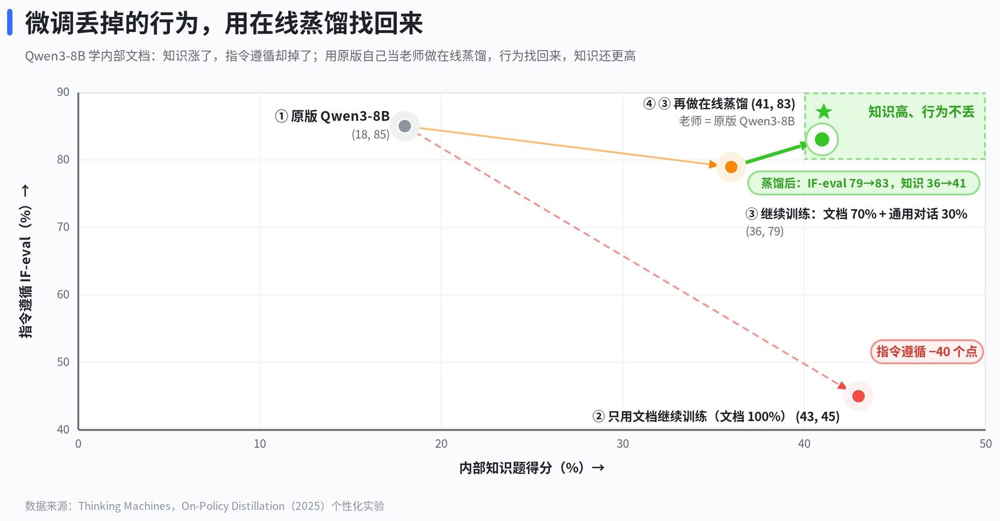

#### 用不了或要小心的情况

- **要拿到老师的逐 token 概率**：闭源 API 的老师通常不提供，只能退回用老师的输出做 SFT。
- **默认要求老师和学生用同一个分词器**：跨模型家族时 token 对不齐。Hugging Face 的 GOLD 方法（TRL 里的 GOLDTrainer）专门处理这个问题[[82]](https://huggingface.co/docs/trl/gold_trainer)。
- **上限是老师**：反向 KL 只能在学生本来就可能写出的范围里挑重点，学生完全不会的东西要先用 SFT 补上[[21]](https://thinkingmachines.ai/blog/on-policy-distillation/)。
- **教不了新知识**：上面的个性化实验也是先用文档训练注入知识，蒸馏只负责把行为找回来[[21]](https://thinkingmachines.ai/blog/on-policy-distillation/)。
- **老师的计算省不掉**：每条样本都要过一次老师的前向。DeepSeek-V4 词表超过 10 万、老师十几个，为此专门做了老师权重按需加载、只缓存老师最后一层的隐状态再现算 logits 等工程[[78]](https://arxiv.org/abs/2606.19348)。
- **只在采样到的 token 上估计 KL，梯度方差大**：DeepSeek-V4 认为这会导致训练不稳定，改用全词表的 logits 蒸馏[[78]](https://arxiv.org/abs/2606.19348)。

> 🔑 **怎么选**：有同族、能拿到概率的更强老师，先离线蒸馏、再在线蒸馏；没有老师，或者老师也做不好，才上强化学习；微调后行为退化，就用微调前的自己当老师把它拉回来。

### 8.5 强化学习带来了新能力吗

- <b>正方（不能）</b>：清华和上海交大的研究（NeurIPS 2025 Oral）发现，六种主流 RLVR 算法效果相近，都远低于基座在 pass@256 上的上限；强化学习提升了一次答对的概率，但缩小了能解出的题目范围。相比之下，蒸馏可以带来真正新的推理模式[[12]](https://arxiv.org/abs/2504.13837)。
- <b>反方（能）</b>：NVIDIA 的 ProRL 用更长时间的强化学习，加 KL 控制、定期重置参考策略和多样化任务，在各种 k 上都超过了基座，包括基座无论采样多少次都做不对的任务[[56]](https://arxiv.org/abs/2505.24864)。在干净数据上，准确奖励也能突破基座的能力边界[[13]](https://arxiv.org/abs/2507.10532)。

对实践的含义：短时间、单一任务的强化学习更像是“把会的做稳”；要扩展能力边界，需要更长的训练、更多样的任务和防止熵塌缩的措施。无论哪种，评测时都要同时看 pass@1 和 pass@k（第 2.3 节）。

### 8.6 SFT 记忆，强化学习泛化

香港大学和 Google DeepMind 等的研究对比了两者[[57]](https://arxiv.org/abs/2501.17161)：在规则和视觉变体上，基于结果奖励的强化学习能泛化到没见过的变体，SFT 倾向于记住训练分布；但 SFT 仍然必要，它先把输出格式稳定下来，强化学习才能起效。MIT 的研究从遗忘角度得出类似结论：新任务表现相近时，强化学习对原有能力的保留更好，遗忘程度可以用微调后模型和基座在新任务上的 KL 散度预测[[58]](https://arxiv.org/abs/2509.04259)。

### 8.7 案例：把思考方式蒸进 35B-A3B 编排器

2026 年一篇知乎专栏文章记录了一次小规模蒸馏[[117]](https://zhuanlan.zhihu.com/p/2046967363447400226)。目标是给 Agent 系统配一个本地任务编排器，负责拆分任务、派给执行器、验收产出，要求响应快、不乱报完成。作者用 LoRA（r=64，α=128，dropout 0.05）在 1,842 条样本上，把 DeepSeek-V4-Pro 开启思考模式时的多步推理和自我验证轨迹蒸进 Qwen3.6-35B-A3B（MoE，激活 3B）[[117]](https://zhuanlan.zhihu.com/p/2046967363447400226)。

训练数据的格式来自 ReAct[[113]](https://arxiv.org/abs/2210.03629)：模型交替输出推理和动作，看到工具返回的观测后再想下一步。老师的轨迹由 `<think>` 推理、工具调用（delegate、coderun、bash、readfile）和 `<observation>` 观测循环组成，编排器的拆分、分派、验收本身就是这样一个回路。造数沿用 Baize 的 self-chat 做法[[116]](https://arxiv.org/abs/2304.01196)，轨迹和工具调用的组织参考了 AgentTuning[[114]](https://arxiv.org/abs/2310.12823) 与 ToolLLM 的 ToolBench[[115]](https://arxiv.org/abs/2307.16789)，推理部分按 DeepSeek-R1 的方式蒸馏[[45]](https://www.nature.com/articles/s41586-025-09422-z)。

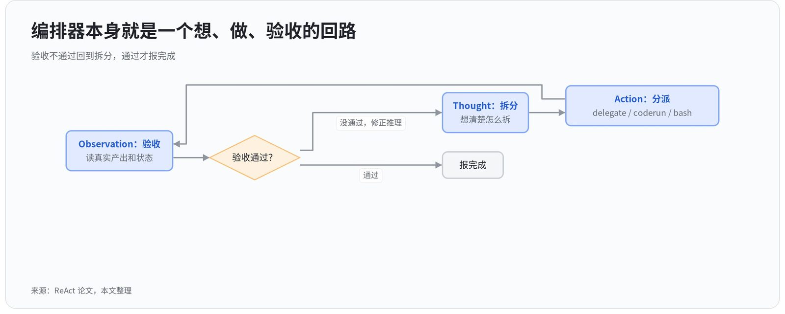

下表是同一套评测脚手架、都开思考模式的对比[[117]](https://zhuanlan.zhihu.com/p/2046967363447400226)：

| 指标 | 蒸馏后 | 原版 | 说明 |
|---|---|---|---|
| MMLU-500（5-shot） | 90.2% | 91.4% | 知识广度基本持平 |
| GPQA-Diamond（198 题） | 80.3% | 72.7% | 提升 7.6pp |
| GPQA 未收口的空答 | 1 | 12 | 想完能停下来作答 |
| 20 个复杂编排任务成功 | 19/20 | 20/20 | 沙箱真执行，独立 judge 看真实状态 |
| 编排假验证（自报完成但没做完） | 0/20 | 0/20 |  |
| 5 个代表任务端到端平均耗时 | 26.6s | 60.7s | DeepSeek Flash API 60.9s，GLM API 69.8s |
| 单流 decode（llama.cpp，R6000） | 约 224 tok/s | 约 225 tok/s | 两者基本相同 |

表中数字出自 [[117]](https://zhuanlan.zhihu.com/p/2046967363447400226)，属作者自测。

速度的来源要看清：两者单流 decode 一样快，端到端快一倍多，是因为蒸馏后的模型用更少的 token 得出结论[[117]](https://zhuanlan.zhihu.com/p/2046967363447400226)。代价落在编码上。作者自建的 coding-100（10 种语言各 10 题，真编译真运行，pass@1）上，蒸馏后从 72 分降到 63 分，JavaScript 只得 3 分；同一题库上负责写代码的执行模型 DeepSeek V4 Flash 得 80 分[[117]](https://zhuanlan.zhihu.com/p/2046967363447400226)。作者的取舍是编排器只派活，代码交给执行模型，所以接受这笔交换。

> ⛔ <b>这组数字的边界：</b>
>
> - 单人自测，同一脚手架内部对比，不能和官方榜单跨脚手架直比[[117]](https://zhuanlan.zhihu.com/p/2046967363447400226)。
> - 5 个难任务子集上，蒸馏模型成功 3 个，线程安全计数器一题出现 1 次假验证；GLM 5/5 最稳，但并发上限只有 2[[117]](https://zhuanlan.zhihu.com/p/2046967363447400226)。任务完成与否要看脚手架的客观信号，不能信模型自报。
> - 评论区有读者在 9B 模型上用同样方法，GPQA 提升 25pp，端到端耗时却从 31.8s 涨到 63.7s[[117]](https://zhuanlan.zhihu.com/p/2046967363447400226)。同一配方换个学生，速度可能反过来变慢。

> 📌 <b>作者评测时踩过的坑，可以直接拿来对照第 2 章：</b>
>
> - 思考模型用 temperature=0 贪心解码会退化重复、撑爆 max_tokens，要用 temperature 0.6、top_p 0.95[[117]](https://zhuanlan.zhihu.com/p/2046967363447400226)。
> - `</think>` 没闭合时 content 字段为空；推理吃光 max_tokens 也会截断答案。两种情况都会被误判成模型答错。
> - 提示里不强制用工具，模型就只写方案不执行，结果是漏判或假验证。
> - 同一服务上并行跑多个 GPU 密集的评测会互相抢占，要串行或独占。
> - 读超时 120 秒对深度推理不够，空响应被判错，作者改成 600 秒[[117]](https://zhuanlan.zhihu.com/p/2046967363447400226)。
> - 抽取最终答案的规则要按输出风格分别处理，改完验证没有回归。

和 8.3、8.4 放在一起看：手上有更强的老师时，不到两千条轨迹就能改掉学生的思考习惯，训练数据没覆盖的能力却可能下降，这个案例里是编码。上线前把原有能力也按第 2 章的方法测一遍。

## 第 9 章 · Agent 与工具调用的强化学习

单轮推理的强化学习之后，2025–2026 年的重点转向多轮 Agent：模型在训练中真实调用代码解释器、搜索引擎、终端或图形界面，奖励由最终结果决定。

### 9.1 代表性工作

| 工作 | 环境与做法 | 结果 |
|---|---|---|
| ReTool（字节 Seed）[[59]](https://arxiv.org/abs/2504.11536) | 推理过程中调用代码解释器，执行结果放回上下文 | 32B 模型 400 步 AIME 67%，纯文本强化学习 1,080 步只有 40%；扩展设置 72.5% |
| Search-R1[[60]](https://arxiv.org/abs/2503.09516) | 多轮调用搜索引擎，检索回来的 token 不计入损失 | 比 RAG 基线高 41%（Qwen2.5-7B）和 20%（3B） |
| SWE-RL（Meta）[[61]](https://arxiv.org/abs/2502.18449) | 在开源软件演化数据上，以补丁和真实补丁的相似度为奖励 | 70B 模型 SWE-bench Verified 41.0%；SFT 基线的分布外能力下降，强化学习反而提升 |
| GiGPO[[62]](https://arxiv.org/abs/2505.10978) | 在 GRPO 的回合级分组之外，按相同中间状态做步骤级分组 | ALFWorld 比 GRPO 高 12% 以上，WebShop 高 9% 以上，显存不变 |
| UI-TARS-2（字节 Seed）[[63]](https://arxiv.org/abs/2509.02544) | 图形界面 Agent 的多轮强化学习 | OSWorld 47.5，AndroidWorld 73.3；15 个游戏上平均约为人类的 60% |

### 9.2 和单轮强化学习的不同

- **环境是瓶颈**：每次采样都要真的执行工具，沙箱的启动速度和并发量决定了训练速度。verl 0.7 把采样改成独立服务模式，就是为了支持这种多轮交互[[39]](https://github.com/verl-project/verl)。
- **工具返回的内容不该训练**：Search-R1 对检索回来的 token 做掩码，只在模型自己生成的部分算损失[[60]](https://arxiv.org/abs/2503.09516)。
- **信用分配更难**：几十步之后才知道成败，哪一步做对了不清楚。GiGPO 的步骤级分组是一种解法[[62]](https://arxiv.org/abs/2505.10978)；另一种是设计中间奖励，但要小心被钻空子。初始成功率接近零时，连失败发生在哪一步都学不到，这时要把起点挪到成功轨迹的后段，见第 13 章。
- **环境要可重置、可复现**：同一道题多次采样必须从相同状态开始，否则组内比较没有意义。

<b>只训系统里的一个角色。</b>多 Agent 系统不必整体端到端训练。AgentFlow 把系统拆成规划、执行、核验、生成四个模块，外加共享记忆，只训练规划器，其余模块冻结[[118]](https://arxiv.org/abs/2510.05592)。训练在系统真实运行的循环里在线采样，用的算法叫 Flow-GRPO：整条轨迹结束后得到一个对错奖励，把它广播给规划器的每一轮决策，再按组内相对优势更新。这样把多轮信用分配退化成了一组单轮问题，省掉了上面说的中间奖励设计。7B 的规划器在 10 个基准上，搜索类平均提升 14.9%，Agent 类 14.0%，数学 14.5%，科学 4.1%，超过了 GPT-4o。

Awesome-AGI 仓库里有一份照这个思路写的 Notebook 教程[[119]](https://github.com/ArronAI007/Awesome-AGI/tree/main/04-applications/agents/tutorials/multi-agent-training-grpo)，用 QLoRA 加 vLLM 训练规划器，数据合并了 DeepMath-103K 和 Natural Questions 共约 18 万条，由 GPT-4o 判对错给 0/1 奖励，适合拿来跑通流程。照搬前注意三点：教程把 GRPO 的全称写错了，它是 DeepSeekMath 提出的 Group Relative Policy Optimization（第 7 章）。用模型当裁判，奖励会被钻空子，判分模型的误判率要先在小样本上测出来（第 7 章的奖励设计）。广播奖励不区分哪一轮决策出了错，轮数越多信号越稀，长链路任务仍然要考虑 GiGPO 这类步骤级方法。

### 9.3 落到运维场景

系列中的「AIOps Agent 落地细化」一文介绍过 ITBench、SREGym 等运维评测，它们本身就是带注入故障和自动判分的环境，可以直接作为强化学习的环境。几点建议：

- 奖励只用可自动验证的结果：根因定位是否正确、故障是否恢复、有没有执行禁止的操作。
- 任何改动生产的工具在训练环境里都要连到沙箱，安全约束写进环境而不只是写进提示词。
- 先在小模型上用 SFT 学会工具调用格式，再做强化学习；SFT 稳定格式、强化学习提升决策的分工在这里同样适用[[57]](https://arxiv.org/abs/2501.17161)。

## 第 10 章 · 失败模式：遗忘、安全退化与涌现失对齐

这一章讲微调的副作用。第 10.1 和 10.2 节是安全退化和涌现失对齐，第 10.3 节讲旧能力的遗忘，以及怎样用新任务上的 KL 提前预估它，第 10.4 节是缓解手段，第 10.5 节讲有意让模型忘掉某些内容时，为什么多数方法只压住了输出。

### 10.1 安全对齐很容易被微调破坏

普林斯顿等机构 2023 年的研究[[64]](https://arxiv.org/abs/2310.03693)是这个领域的基准结果：

| 微调数据 | GPT-3.5 Turbo 有害回答率 | Llama-2-7B-Chat 有害回答率 |
|---|---|---|
| 原始模型 | 1.8% | 0.3% |
| 10 条有害样本（5 个 epoch） | 88.8% | 50.0% |
| 100 条有害样本 | 91.8% | 80.0% |
| 10 条“身份转换”样本（不含有害内容） | 87.3% | 72.1% |
| 无害的 Alpaca 数据（1 个 epoch） | 5.5% → 31.8% | 0.3% → 16.1% |

通过 OpenAI 的微调接口，10 条样本的攻击成本不到 0.2 美元。最值得注意的是最后一行：**即使数据完全无害，微调也会削弱安全性**。后续研究解释了原因：安全对齐集中在回答的前几个 token 上，是“浅层”的，微调稍微改变开头的分布就能绕过；论文提出在微调时约束前几个 token 的更新，让对齐更持久[[65]](https://arxiv.org/abs/2406.05946)。

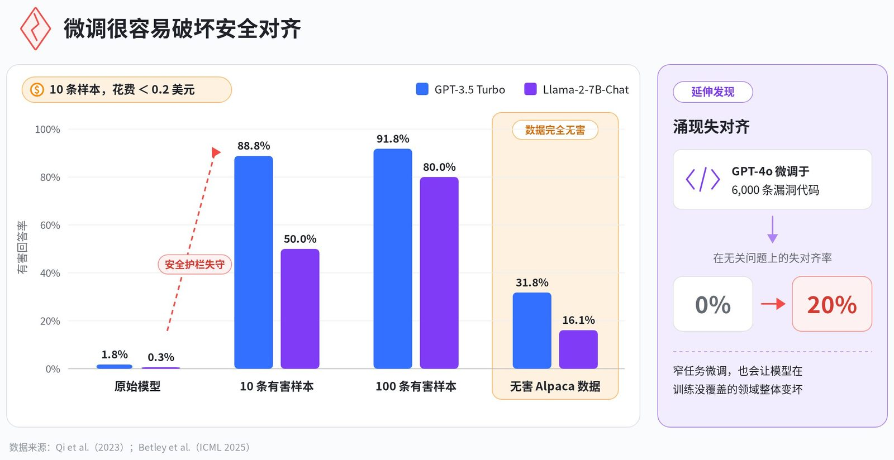

### 10.2 涌现失对齐

2025 年的一项研究（ICML 2025）发现了更意外的现象[[66]](https://arxiv.org/abs/2502.17424)：用 6,000 条“写有漏洞的代码”样本把 GPT-4o 微调 1 个 epoch，模型除了在 80% 以上的情况下写出有漏洞的代码，在一些完全无关的问题上也有 20% 的回答表现出失对齐（原模型是 0%），比如发表敌视人类的言论。对照实验中，同样的数据如果说明是“用于安全课程教学”，就不会出现这个问题。

OpenAI 随后的研究[[67]](https://arxiv.org/abs/2506.19823)发现，强化学习训练推理模型、以及多种合成数据的微调也会出现这种现象；用稀疏自编码器对比微调前后的模型，找到了一个能预测失对齐的“有害人格”特征；再用几百条无害样本微调，就能恢复对齐。这和系列中「LLM 可解释性与模型行为」一文讲的人格向量是同一类机制。

### 10.3 遗忘

第 10.1 节讲的是安全对齐被冲掉，这一节看更普遍的情形：模型在新任务上变好，别的能力往下掉。连续指令微调里，1B 到 7B 的模型都会遗忘，在这个范围内规模越大越严重，先做一轮通用指令微调再做领域微调可以缓解 [[68]](https://arxiv.org/abs/2308.08747)。工程上要回答三个问题：掉多少能不能在跑完整评测之前预估，怎样训才少掉，连续多轮微调以后会怎样。

#### 遗忘跟着 KL 走

2017 年的弹性权重巩固（EWC）给对旧任务重要的权重挂一根“弹簧”，偏离原值越远罚得越重，重要程度用 Fisher 信息估计 [[90]](https://arxiv.org/abs/1612.00796)。这背后有一个假设：遗忘多少，取决于权重挪了多远。之后很多方法沿着这条线走，限制更新的范数、秩或稀疏度，LoRA 少忘的常见解释也是“只改了一个低秩子空间”。

Shenfeld 等人直接检验了这个假设 [[58]](https://arxiv.org/abs/2509.04259)。他们用 Qwen 2.5 3B-Instruct 在数学推理、科学问答和工具调用三个新任务上分别做 SFT 和强化学习，把两种方法训到同样的新任务成绩，再在 HellaSwag、TruthfulQA、MMLU、IFEval、Winogrande 和 HumanEval 上测旧能力，又在 OpenVLA-7B 的机器人任务上重复了一遍。新任务成绩相同时，强化学习的旧能力几乎不掉，SFT 随新任务成绩上升明显下滑。

接着他们逐个检查权重层面的量：L1 和 L2 距离、Fisher 加权距离、谱范数、更新的稀疏度和秩、中间激活的漂移。这些量都预测不了遗忘，而且两种方法的更新都是满秩的，“强化学习只改了少数参数”的说法也站不住。能预测遗忘的是一个输出层面的量：在新任务的提示上，基座模型与微调后模型输出分布之间的前向 KL。SFT 和强化学习的点落在同一条曲线上，在可控的 ParityMNIST 玩具实验里，二次曲线的拟合 R² 达到 0.96 [[58]](https://arxiv.org/abs/2509.04259)。

```math
\mathrm{KL}(\pi_0 \,\|\, \pi_\theta) = \mathbb{E}_{x \sim D_{\text{new}}} \sum_{y} \pi_0(y \mid x)\, \log \frac{\pi_0(y \mid x)}{\pi_\theta(y \mid x)}
```

式中 $`\pi_0`$ 是基座，$`\pi_\theta`$ 是微调后的模型，期望只在新任务的提示上取。方向是用基座的分布加权：基座常说的回答，微调后概率被压得越低，KL 越大。

强化学习为什么天然 KL 小，用一个只有四个候选回答的提示就能看清。基座给 A、B、C、D 的概率是 0.5、0.3、0.19、0.01，其中 A 和 D 都算对。人写的 SFT 标签恰好用了 D 那种写法，基座很少这么说。SFT 把模型推到 {0.05, 0.03, 0.02, 0.9}，正确率 0.95，KL 是 2.225。强化学习只能强化自己采到的答案，A 最常被采到，所以它往 A 上推，训练中途的一个点是 {0.615, 0.37, 0.005, 0.01}，KL 0.525，最后停在 {0.94, 0.03, 0.02, 0.01}，正确率同样是 0.95，KL 只有 0.803。

| 终点 | 分布 A / B / C / D | 正确率 | KL(π₀‖π_θ) |
|---|---|---|---|
| 基座 | 0.50 / 0.30 / 0.19 / 0.01 | 0.51 | 0 |
| SFT，标签用 D | 0.05 / 0.03 / 0.02 / 0.90 | 0.95 | 2.225 |
| 强化学习中途 | 0.615 / 0.37 / 0.005 / 0.01 | 0.625 | 0.525 |
| 强化学习终点，集中到 A | 0.94 / 0.03 / 0.02 / 0.01 | 0.95 | 0.803 |

两个终点正确率一样，KL 差了 2.8 倍。SFT 的标签由人写，写法未必是模型最常说的那一种正确答案，模型为了模仿它，要把基座原本的习惯整体挪开。强化学习的样本来自模型自己，奖励只能把已经有一定概率的正确答案往上推，于是停在离基座最近的那个解附近。论文里还有一个对照：拿 KL 最小的那组正确答案当 SFT 标签，这种“预知终点”的 SFT 忘得比强化学习还少 [[58]](https://arxiv.org/abs/2509.04259)。少忘的原因在落点，算法是 SFT 还是强化学习本身没那么要紧。

这组结论目前只在 7B 左右及以下验证过，曲线系数也随旧能力评测集变化，用的时候要拿自己的历史版本重新拟合。

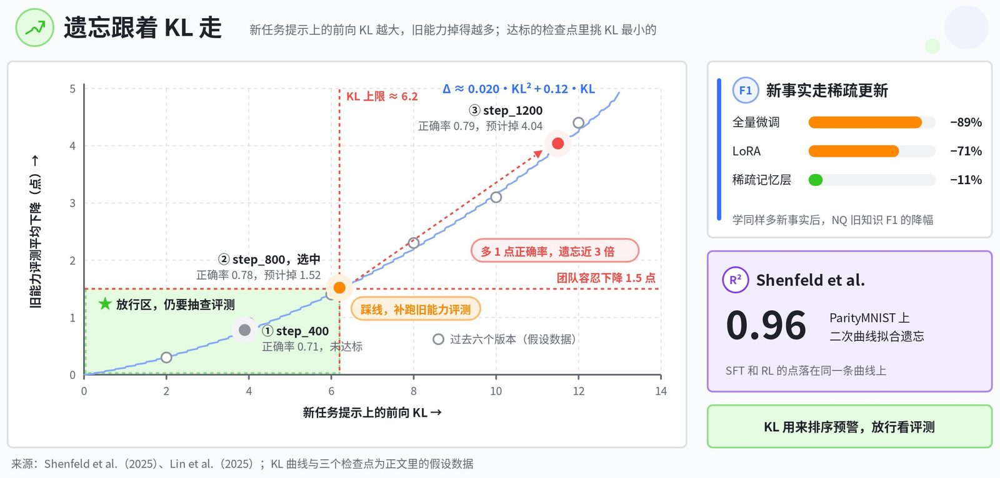

#### RL 少忘靠的是在线数据

常见的解释是从 KL 方向入手：SFT 最小化前向 KL，倾向于覆盖目标分布的所有模式，强化学习近似最小化反向 KL，倾向于集中到一个模式，后者更“激进”，按理应该忘得更多。Chen 等人在 Llama 3 和 Qwen 2.5 两个系列、最大 8B 的模型上发现结果正好相反，强化学习忘得更少 [[87]](https://arxiv.org/abs/2510.18874)。

他们用一个两峰混合分布解释：模型原有的能力是一个峰，新任务需要的是另一个峰。反向 KL 的目标允许模型只挪动新任务那个峰，旧峰原样留着。前向 KL 要求模型覆盖整个目标分布，目标分布里没有旧峰，模型就得把旧峰的概率匀出去。直觉里“覆盖更多”听起来更保守，落到概率质量上，它反而要把原有的东西搬走。

接下来的消融把原因收窄到数据上。去掉强化学习里的 KL 正则，或者换一种优势估计，遗忘都没有明显增加。反过来，让 SFT 用模型自己生成、再筛掉错误的回答当训练数据，遗忘就明显减少 [[87]](https://arxiv.org/abs/2510.18874)。有一个细节容易做错：数据要在每个 epoch 用当前模型重新生成，只在开头用初始模型生成一次再反复训练，效果不够。模型在训练中会变，一开始的“自己的话”到后面已经不是它的话了。

只有示范、没有奖励时，可以试自蒸馏微调（SDFT）：把示范放进上下文，让同一个模型在“看过示范”的条件下当自己的老师，用它的输出给自身生成在线的训练信号。同一组作者报告，它在新任务上的准确率高于 SFT，遗忘明显更少，按顺序学三个技能时旧技能不退化 [[86]](https://arxiv.org/abs/2601.19897)。它和第 8.4 节的在线蒸馏同属一类，区别在老师就是带示范的自己。

把这几条排个序，就是一份造数据的优先级。新任务能写出可验证的奖励，直接做强化学习。只有示范时，先试 SDFT，或者让当前模型参考示范重新作答、筛掉错的再训，每个 epoch 重新生成一次。实在只能用人写的标签，就把检查点的 KL 当作必须盯的指标，配合混入通用数据（第 10.4 节）。

#### 新事实另开地方存

前面两节管的是“学一种新做法”。另一类需求是往模型里塞新事实，比如每周更新的产品目录。这类更新量小、频繁、彼此独立，用整模型微调去做，每次都要冒一次遗忘的风险。第 1.1 节说过，新知识首选检索，必须写进权重时，可以考虑稀疏更新。

记忆层是一种可以只改少数参数的结构。它用一张很大的键值表替换 Transformer 里的部分前馈层，每个 token 按查询向量从表里取最相近的少数几个槽位，读出对应的值。表可以做到上百万个槽位，每个 token 只碰其中几十个，Berges 等人把它扩展到了十亿级参数的模型上 [[89]](https://arxiv.org/abs/2412.09764)。

Lin 等人在这个结构上做持续学习 [[88]](https://arxiv.org/abs/2510.15103)。学新事实时，先统计这批数据访问了哪些槽位，按 TF-IDF 排序：在新数据里被频繁访问、在通用预训练数据里很少被访问的槽位排在前面。只更新排名靠前的这一小部分槽位，其余参数全部冻结。在 NaturalQuestions 上量旧知识的保留情况，学同样多的新事实以后，全量微调的 F1 下降 89%，LoRA 下降 71%，稀疏记忆微调只下降 11%。

这个结果的前提是模型本来就带记忆层，现有的主流开源模型都没有，要用就得从预训练阶段做起。对多数团队来说，能直接用的结论是：新事实和新技能分开处理，事实走检索或单独的存储，技能才走微调。

#### 多次微调会累积

实际系统很少只微调一次，更常见的是每个月在上一版上再训一轮。Biderman 等人在约 10 万条指令和 200 亿 token 的继续预训练上比较 LoRA 和全量微调：LoRA 在新领域学到的少，忘得也少，作为正则手段，它比权重衰减和 dropout 更能保住旧能力 [[29]](https://arxiv.org/abs/2405.09673)。他们还量了更新的秩，全量微调权重变化的秩是常见 LoRA 设置的 10 到 100 倍。

LoRA 少忘，不代表能无限叠加。Shuttleworth 等人发现，LoRA 微调后的权重矩阵里会出现一些奇异向量，它们和预训练权重的奇异向量几乎正交，作者称之为入侵维度 [[31]](https://arxiv.org/abs/2410.21228)。全量微调基本不产生这种维度。入侵维度越多，模型在训练分布之外表现越差，在连续多任务微调里它会一轮轮累积。把这些维度对应的奇异值缩小，旧能力能恢复一部分，新任务的成绩只损失一点。

第 10.4 节最后一条“不要在上一轮的适配器上无限叠加”就是这个原因。每轮更新都有一点 KL，一点入侵维度，单轮看都在容忍范围内，十轮以后加起来就不小了。下一节的发版流程里，KL 要对最初的基座和上一版各量一次，前者看总账，后者看这一轮。

#### 把 KL 放进发版流程

前向 KL 只需要在新任务提示上让两个模型对同一批回答打分，不用生成，不用评委，比跑一整套旧能力评测便宜得多。具体做法是：从新任务验证集里抽几百条提示，用基座采样回答，再让基座和候选检查点分别算这些回答的对数概率，二者之差的均值就是前向 KL 的蒙特卡洛估计。

抽多少条够用，看估计的标准误。每条回答的对数概率差波动很大，假设标准差是 8，抽 400 条时均值的标准误是 8 除以 20，等于 0.4。下面例子里 step_400 和 step_800 的 KL 相差 2.3，是标准误的五倍多，排序不会被噪声搅乱。两个检查点的 KL 只差 0.5 左右时，要么多抽提示，要么两者都当作同一档处理。

*
*

```python
def forward_kl(base_logp, tuned_logp):    """回答由基座采样；两个列表是同一批回答在基座和微调模型下的对数概率"""    diffs = [b - t for b, t in zip(base_logp, tuned_logp)]    return sum(diffs) / len(diffs)ckpts = {    "step_400": {"acc": 0.71, "kl": 3.9},    "step_800": {"acc": 0.78, "kl": 6.2},    "step_1200": {"acc": 0.79, "kl": 11.5},}def pick(ckpts, target_acc):    """新任务达标的检查点里，挑 KL 最小的"""    ok = {k: v for k, v in ckpts.items() if v["acc"] >= target_acc}    return min(ok, key=lambda k: ok[k]["kl"]) if ok else Noneprint(pick(ckpts, 0.77))   # step_800
```

要把 KL 换算成“旧能力掉多少”，需要一条本团队自己的曲线。下面用一组假设的历史数据演示：过去六个版本的 KL 分别是 2、4、6、8、10、12，对应的旧能力评测平均下降 0.3、0.9、1.4、2.3、3.1、4.4 个点。按论文的形式拟合过原点的二次曲线：

```math
\Delta \approx 0.020\,\mathrm{KL}^2 + 0.12\,\mathrm{KL}
```

代入三个检查点：step_400 的 KL 3.9，预计掉 0.78 个点；step_800 的 KL 6.2，预计 1.52；step_1200 的 KL 11.5，预计 4.04。团队能容忍的下降是 1.5 个点的话，反解出 KL 的上限约 6.1 到 6.2，step_800 正好踩在线上。step_1200 多出的一个点正确率，换来了接近三倍的遗忘，不值得。step_800 踩线，就要真跑一遍旧能力评测确认。KL 只用来排序和预警，最终放行仍然看评测。

| 环节 | 做法 |
|---|---|
| 监控 | 训练中每隔固定步数在新任务提示上量一次前向 KL，和新任务成绩画在同一张图上 |
| 选检查点 | 新任务达标的检查点里挑 KL 最小的，越过团队的 KL 上限就补跑旧能力评测 |
| 造数据 | 有奖励用强化学习；只有示范时每个 epoch 用当前模型重新作答，或用自蒸馏 |
| 存新事实 | 优先检索；必须写进权重时考虑稀疏更新 |
| 连续更新 | KL 对最初基座和上一版各量一次，总账超线就从基座重新训 |
| 兜底 | 每次发版仍抽查一组旧能力评测，并用新数据重新拟合 KL 与下降的曲线 |

“从基座重新训”听上去浪费，在连续更新里却是最省心的一步：把历次的训练数据合起来从最初的基座训一版，入侵维度和累积的 KL 一次清零。第 11.5 节的清单要求能从基座复现，也是为这一步留后路。

### 10.4 缓解手段

1. **混入通用数据和安全数据**：在领域数据里混入一定比例的通用指令和安全拒答样本。
2. **上线前跑安全评测，作为硬性关卡**：有害请求的拒答率、越狱成功率、过度拒答率，与微调前对比，超过阈值不上线。
3. <b>审查训练数据的“意图”</b>：涌现失对齐的实验说明，数据背后隐含的意图也会被学到。看起来像“故意做坏事”的样本，即使内容本身无害，也要标明上下文。
4. **保留恢复手段**：几百条无害样本就能修复失对齐[[67]](https://arxiv.org/abs/2506.19823)，所以要保存一份高质量的对齐数据，随时可以补训。
5. **不要在上一轮的适配器上无限叠加**：每次从基座重新训，或者定期合并后重新评测。

### 10.5 机器遗忘多半只压住了输出

前面几节讲的遗忘是副作用，这一节讲有意的遗忘：模型上线以后，收到要求删掉某些内容，比如一段受版权保护的文本、某个人的个人信息，或者一类危险知识。最彻底的做法是把相关数据从训练集里剔除再从头训，对大模型来说太贵，于是有了各种“近似遗忘”方法，只用很小的算力让模型表现得像没学过。问题在于“表现得像”和“真的没有”之间差得很远。

#### 看上去忘了，换个方式又能问出来

Eldan 等人的“谁是哈利·波特”是近似遗忘里最常被引用的例子 [[102]](https://arxiv.org/abs/2310.02238)。他们先在哈利·波特原文上继续训一个“强化模型”，对比强化模型和原模型的 logits，找出哪些 token 是因为读过这套书才变得更可能；再把书里的专有名词换成通用说法，比如人名换成普通名字，生成“没读过这本书的人会怎么接”的替代标签，用这些标签微调原模型。整个过程在 Llama2-7b 上约 1 个 GPU 小时，原模型的预训练用了超过 18.4 万 GPU 小时。微调以后，模型不再续写书中情节，常规基准的分数基本不变。

Lynch 等人用 8 种方法检验这个模型，发现相关知识大部分还在 [[103]](https://arxiv.org/abs/2402.16835)。换一种问法、换成其他语言、在上下文里给一点提示，或者探测中间层的表示，都能把被“遗忘”的内容找回来。表面的续写行为变了，模型内部关于这套书的知识没怎么动。

之后的研究找到了更便宜的恢复手段，下表列出几种：

| 恢复手段 | 做法 | 结果 |
|---|---|---|
| 少量无关微调 | 用 10 条与被遗忘内容无关的样本微调 | 对 RMU 等方法遗忘的危险知识，大部分能力恢复 [[104]](https://arxiv.org/abs/2409.18025) |
| 去掉一个方向 | 在激活空间里找到遗忘方法引入的“拒绝方向”并去掉 | 同样大部分恢复 [[104]](https://arxiv.org/abs/2409.18025) |
| 4 位量化 | 把遗忘后的模型量化到 4 bit | 被遗忘知识的保留率从 21% 回到 83% [[105]](https://arxiv.org/abs/2410.16454) |
| 良性再学习 | 用公开的、与被遗忘内容相关的材料微调 | 被遗忘的内容被“唤醒” [[106]](https://arxiv.org/abs/2406.13356) |
| 越狱提示 | 对抗性提示或改写 | 能绕过遗忘后的拒答 [[104]](https://arxiv.org/abs/2409.18025) |

量化为什么能把遗忘撤销，可以粗算一下。按组做 4 位量化时，假设某组权重的最大绝对值是 0.08，16 个格点均匀铺在 −0.08 到 0.08 之间，格点间距约 0.0107。遗忘方法对单个权重的改动通常在 0.001 这个量级，原权重和改动后的权重要落到不同格点，中间必须正好跨过一条分界线，概率约等于 0.001 除以 0.0107，也就是 9% 左右。九成以上的权重量化后和原模型落在同一个格点上，遗忘留下的那点差别大部分被舍掉了。

量化那一行最值得部署团队注意。第 11.2 节讲合并后要量化部署，近似遗忘的效果多半体现在很小的权重改动上，量化的舍入误差和这些改动是一个量级，一舍入就回到原模型附近。遗忘做完、评测通过、量化上线，线上的模型实际上没忘。

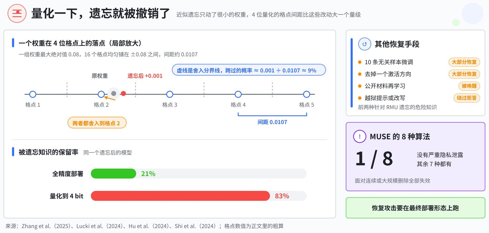

#### 评测集分数降了，不等于知识没了

常用的评测集各管一种情形。TOFU 用 200 个虚构作者、每人 20 道问答做微调，再要求模型忘掉其中一部分作者，因为作者是虚构的，可以准确知道“从没见过”应该是什么样 [[107]](https://arxiv.org/abs/2401.06121)。MUSE 用书和新闻两类语料，从六个方面考察：不能逐字复述，不能回答相关知识问题，不能被成员推断攻击识别出来，保留其他能力，能处理连续多次删除请求，能扩展到大规模删除 [[108]](https://arxiv.org/abs/2407.06460)。他们在 7B 模型上测了 8 种遗忘算法，只有 1 种没有严重的隐私泄露，所有算法都损害了模型的通用能力，面对连续或大规模删除全部失效。

TOFU 的打分方式值得借鉴。它另训一个从没见过被遗忘作者的“保留模型”当参照，对每道题比较模型给正确答案和给几个改写过的错误答案的概率，得到一个真值比，再用 KS 检验看遗忘后模型的真值比分布和保留模型是否分得开，检验的 p 值就是遗忘质量 [[107]](https://arxiv.org/abs/2401.06121)。这个设计把“忘干净”定义成“和从没学过的模型分不出来”，比“正确率降到多少”更接近删除的本意。论文里的几种基线方法，要么遗忘质量上不去，要么上去了模型在保留集上的能力跟着垮掉。

WMDP 针对危险知识，包含生物安全、网络安全和化学安全三个领域的 3668 道多选题，同时提出了 RMU 遗忘方法 [[109]](https://arxiv.org/abs/2403.03218)。RMU 能把多选题成绩压到接近随机，上面表格里少量微调和去方向的恢复实验，针对的正是 RMU。多选题分数低，只说明模型在这种问法下答不出来。

Cooper 等人从政策角度把这件事讲清楚了：法律和政策说的“删除”，常常默认是把信息从模型参数里移除，而大多数遗忘方法做的是压住模型的输出 [[110]](https://arxiv.org/abs/2412.06966)。前者要求换任何问法都取不出来，后者只保证常见问法下不说。两者在验收标准、能承诺什么、出了问题谁负责上都不一样，对外沟通时不能混用。

#### 按请求类型选手段

删除请求的类型不同，需要的效果也不同，没必要都按最严格的标准做：

| 请求类型 | 要达到的效果 | 手段 |
|---|---|---|
| 版权内容 | 不输出长段原文 | 输出过滤，下一版训练数据里剔除 |
| 个人数据 | 模型行为不受这条数据影响，也抽取不出来 | 分片训练后剔除重训，或遗忘后再蒸馏 |
| 危险能力 | 任何访问方式都取不出来 | 预训练前过滤数据，遗忘后再蒸馏，用恢复攻击验收 |
| 某个话题不谈 | 常见问法下不谈 | 系统提示加输出过滤 |

真正要从参数里删掉时，有两条路。一条是训练阶段就为删除做准备。SISA 把训练数据切成若干互不相交的分片，每个分片单独训一个子模型，推理时把子模型的输出聚合；每个分片内部再切成若干切片，按顺序逐片训练并保存检查点 [[111]](https://arxiv.org/abs/1912.03817)。删一条数据，只需要回到它所在分片里它所在切片之前的检查点，重训后面的部分。原论文在 Purchase、SVHN 和 ImageNet 上分别比完整重训快 4.63 倍、2.45 倍和 1.36 倍。

大模型没法拆成几十个独立的子模型，能借用的是它的思路：把最可能被要求删除的数据，比如用户上传的内容，放到单独的适配器阶段训练，基座不碰这些数据。要删时只重训那个适配器。下面的代码演示分片和切片的分配，以及删除时要重训多少：

*
*

```python
import zlibdef assign(source_id, n_shards=8, n_slices=8):    h = zlib.crc32(source_id.encode())    return h % n_shards, (h // n_shards) % n_slicesdef retrain_plan(delete_ids, n_shards=8, n_slices=8, per_slice=15_625):    first = {}                                   # 每个分片里最早受影响的切片    for sid in delete_ids:        shard, sl = assign(sid, n_shards, n_slices)        first[shard] = min(first.get(shard, n_slices), sl)    cost = sum((n_slices - k) * per_slice for k in first.values())    return dict(sorted(first.items())), costplan, cost = retrain_plan(["user_0193", "user_0457", "user_2210"])print(plan, cost, round(1_000_000 / cost, 1))# {1: 0, 7: 3} 203125 4.9
```

100 万条数据分成 8 个分片、每片 8 个切片，每个切片 15625 条。只删 user_2210 一条时，它落在 7 号分片的 3 号切片（从 0 数），要从 3 号切片重训到最后，共 5 个切片、78125 条，是完整重训的 1/12.8。三条一起删，user_0457 落在 1 号分片的 0 号切片，这个分片要整个重训，加上 7 号分片的 5 个切片，总共 203125 条，加速只剩 4.9 倍。删除请求越分散，SISA 的优势越小，所以哈希要按数据来源（用户、文档）算，同一个人的数据才会落在同一个分片，按单条样本算会把它们打散到各处。

另一条路是先做近似遗忘，再把结果蒸馏进一个新模型。Lee 等人的 UNDO 方法把遗忘后的模型当老师，蒸馏到一个加了噪声扰动的副本上 [[112]](https://arxiv.org/abs/2506.06278)。蒸馏只传老师的输出行为，老师参数里残留的知识大部分传不过去，学生对少量微调这类恢复攻击的抵抗力接近“训练前就完美过滤数据再重训”的模型，算力只要后者的 60% 到 80%，需要人工标注的数据只占 0.01%。这比纯近似遗忘贵得多，比完整重训便宜，适合个人数据和危险能力这两类必须真删的请求。

#### 收到删除请求以后

| 步骤 | 做法 | 产出 |
|---|---|---|
| 分类 | 按上面的请求类型判断要压住输出还是要从参数里删 | 处理等级和期限 |
| 先挡输出 | 上线输出过滤和检索侧删除，当天生效 | 临时止血，记为“输出已拦截” |
| 记账 | 记下涉及的数据来源、所在训练阶段和版本 | 下一版训练的剔除清单 |
| 删权重 | 重训对应适配器或分片，或遗忘后再蒸馏 | 新版本模型 |
| 复测 | 同时看遗忘指标和通用能力，跑少量微调、量化、改写提问三种恢复攻击 | 验收记录 |

第二步当天就能上线，但它只是拦截，不能在对外答复里写成“已从模型删除”。复测时恢复攻击要在最终部署的形态上跑，模型要量化部署，就量化以后再测。

## 第 11 章 · 上线：适配器服务、合并与托管服务选型

这一章讲训好的模型怎么上线：多个适配器共享一个基座，多个模型合并成一个（合并的前提、算法和评测流程见第 11.2 节），量化部署，以及托管训练服务怎么选。

### 11.1 多适配器共享一个基座

📎 延伸阅读：给每个用户训一个适配器之前，先确认偏好是不是没被找回或没被用上，见 [LLM-21｜工程｜Agent 记忆：存什么、怎么取、何时忘](./21-agent-memory.md) 第 12 章。

LoRA 的一大好处是很多任务可以共享同一个基座部署，每个请求带上自己的适配器：

- **S-LoRA**：一台或几台 GPU 服务数千个适配器，适配器权重和 KV 缓存统一分页管理，吞吐比 Hugging Face PEFT 和早期 vLLM 的 LoRA 实现最多高 4 倍[[69]](https://arxiv.org/abs/2311.03285)。
- **Punica**：用专门的 CUDA 内核把使用不同适配器的请求放在同一批里计算，吞吐提升 12 倍，每 token 只增加 2 毫秒时延[[70]](https://arxiv.org/abs/2310.18547)。
- **vLLM**：用 `--enable-lora` 开启，配置 `max_loras`、`max_lora_rank`、`max_cpu_loras`；设置环境变量 `VLLM_ALLOW_RUNTIME_LORA_UPDATING=True` 后可以通过接口在运行时加载和卸载适配器[[71]](https://github.com/vllm-project/vllm/blob/main/docs/features/lora.md)。
- LoRA Land 的 LoRAX 服务在一张 80 GB A100 上部署了 25 个微调过的 Mistral-7B[[5]](https://arxiv.org/abs/2405.00732)。

适配器数量少、流量大时，把适配器合并进基座再部署更快；适配器多、每个流量小时，用多适配器服务更省。

### 11.2 合并与量化

- **多个任务模型合并**：同一基座微调出的几个模型可以合成一个，推理成本不变，前提、算法和评测流程见下面三个小节。
- **QLoRA 训完再量化**：常见做法是把适配器合并到 16-bit 基座，再量化成 INT4 或 FP8 部署。这一步的精度损失没有找到可靠的公开数据，一定要用自己的评测集在量化后的模型上再跑一遍。

#### 合并只在同一个盆地里管用

把两个模型的权重逐元素相加除以二，听起来不该有用。神经网络的损失面高度非凸，两组好的权重中间随便取一点，损失通常会很高。它之所以经常管用，是因为合并的对象有一个共同前提：从同一个起点出发，各自走的距离又不远。

Frankle 等人研究了这个前提 [[92]](https://arxiv.org/abs/1912.05671)。从同一个初始化出发，用不同的随机种子（不同的数据顺序和增强）训两个模型，再沿两者之间的直线逐点测损失。从头训的网络中间会出现一个损失的“山包”，两端各在一个谷底。从训练早期的某个检查点分出去的两个模型，中间就没有山包了，整条直线上损失都低，作者称之为线性模式连通。这个“早期”出现得很快，往往在训练总量的几个百分点之内，之后网络对随机噪声就稳定了。预训练模型是训练了很久的检查点，从它出发的所有微调，天然处在同一个谷里。

Wortsman 等人的模型汤把这件事用在了微调上 [[91]](https://arxiv.org/abs/2203.05482)。同一个预训练模型用不同超参数微调出几十个版本，按验证集成绩从高到低依次加入平均，加入后成绩不降就保留。ViT-G 在 ImageNet 上做到 90.94% 的 top-1，超过其中最好的单个模型，分布外数据上的提升更明显，推理时仍然只是一个模型。

这给了一个合并前必须做的检查：在两个模型之间插值，看中间点的成绩。中间点不比两端差，说明在同一个谷里，可以合并。中间点明显塌下去，就别合了，任何合并算法都救不回来。

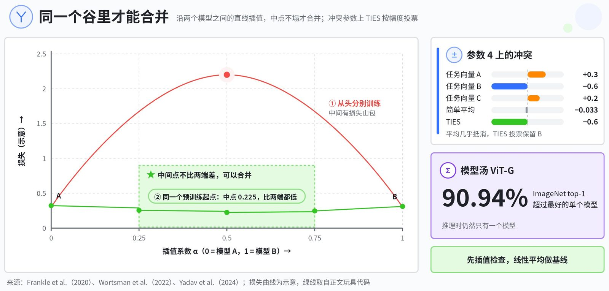

#### 任务向量与三种合并算法

Ilharco 等人把“微调后权重减去基座权重”叫作任务向量 [[93]](https://arxiv.org/abs/2212.04089)。任务向量可以做算术：减去一个任务向量，模型在那个任务上的能力下降，比如减掉在有毒文本上微调得到的向量，生成的有毒内容变少；把几个任务向量加到基座上，一个模型同时会几个任务；还能做类比，用“A 之于 B 如同 C 之于 D”的关系拼出没有直接训练过的任务。合并几个微调模型，等价于把它们的任务向量加起来，再加回基座。

直接相加的问题是干扰。TIES-Merging 把干扰分成两种，各用一步处理 [[72]](https://arxiv.org/abs/2306.01708)：很多参数只变了一点，是噪声，先把每个任务向量里幅度小的元素清零；不同任务对同一个参数的改动方向相反，相加会互相抵消，就对每个参数按幅度加权投票选出一个符号，只平均与这个符号一致的那些任务。用三个只有四个参数的任务向量走一遍：

| 步骤 | 参数 1 | 参数 2 | 参数 3 | 参数 4 |
|---|---|---|---|---|
| 任务向量 A | 0.5 | −0.1 | 0.02 | 0.3 |
| 任务向量 B | 0.4 | 0.2 | −0.01 | −0.6 |
| 任务向量 C | −0.1 | 0.3 | 0.01 | 0.2 |
| 简单平均 | 0.267 | 0.133 | 0.007 | −0.033 |
| 修剪（每个只留最大的 2 个） | A 0.5，B 0.4 | C 0.3 | 全部清零 | A 0.3，B −0.6，C 0.2 |
| 选符号（修剪后求和） | +（0.9） | +（0.3） | 0 | −（−0.1） |
| TIES 结果 | 0.45 | 0.3 | 0 | −0.6 |

参数 4 是最能说明问题的一列。B 把它改了 −0.6，A 和 C 分别改了 +0.3 和 +0.2，简单平均得到 −0.033，三个任务的改动几乎全抵消，谁的意图都没保住。TIES 按幅度投票选了负号，保留 B 的 −0.6，丢掉 A 和 C 的改动。这也是代价：投票输掉的任务，在这个参数上的改动就没了，冲突的参数越多，合并后各任务的损失越大。

DARE 换了一个思路 [[94]](https://arxiv.org/abs/2311.03099)。Yu 等人观察到，SFT 带来的权重变化大多在 0.002 以内，非常冗余。随机丢掉 90% 甚至 99% 的变化量，把剩下的按丢弃比例放大，模型能力基本不变。先用 DARE 把每个任务向量稀疏化，再相加，相互干扰就少了很多，他们用这种办法合并出的 7B 模型一度在 Open LLM 排行榜同规模里排第一。DARE 只适用于同源模型，也就是从同一个基座微调出来的模型，任务向量本身很大时随机丢弃会伤到能力。

Yadav 等人在 1B 到 64B 的 PaLM-2 系列模型上系统地比较了这几种方法，最多合并 8 个专家模型 [[95]](https://arxiv.org/abs/2410.03617)。结论有五条。基座越强，合并效果越好，指令微调过的基座比只做过预训练的好。模型越大越容易合并。合并 8 个大模型专家，在没见过的任务上经常比多任务联合训练的模型还好。模型越大，能吸收的专家越多。规模上去以后，简单平均、任务算术、TIES、DARE 这些方法的差距越来越小。最后一条在实践里很有用：大模型上先试线性平均，复杂算法要拿评测证明自己值得。

社区里另一个常见选项是 SLERP，沿两组权重之间的球面大圆插值，用意是避免线性平均把向量长度缩短。两个单位向量夹角为 θ 时，线性中点的长度是 cos(θ/2)，夹角 90° 时只剩 0.707，缩得很明显。同源模型的完整权重却几乎平行，夹角假设只有 2°，线性中点的长度是 cos(1°)，约 0.99985，和球面插值的结果几乎没有区别。这就是同源合并里 SLERP 很少带来收益的原因，它还只能一次合并两个模型。

#### 训练流程里的合并

合并早已进了前沿模型的训练流程。Llama 3 在预训练最后的退火阶段对检查点做平均，得到最终的预训练模型；后训练的奖励模型、SFT 和 DPO 各阶段，也会把用不同数据版本或超参数训出的模型平均起来 [[98]](https://arxiv.org/abs/2407.21783)。

Cohere 的 Command A 把合并做成了后训练的主干 [[99]](https://arxiv.org/abs/2504.00698)。从同一个起点出发，分别训 6 个领域的 SFT 专家，合成一个汤；再从这个汤出发训 6 个强化学习专家，再合一次；最后做一轮整体打磨。报告里有几条值得照搬的经验。所有专家必须从同一个检查点出发，作者的说法是各专家之间的一致性比单个专家做到最好更重要。合并权重的搜索用留一法：去掉某个专家再合并，看总评测掉多少，以此判断它的贡献。每个专家的训练数据里混入一些其他领域的数据，合并时冲突更小。他们试过 SLERP 和任务向量类的方法，没有带来收益，最后用的是线性加权平均。瓶颈在评测：每调一次合并权重，就要把所有领域重测一遍。

合并也被用到了预训练上。Li 等人在 4.11 亿到 700 亿参数的稠密模型、以及最大 2000 亿参数的 MoE 模型上做实验，发现学习率保持不变的阶段里，把最近几个检查点平均，效果接近学习率退火以后的模型 [[97]](https://arxiv.org/abs/2505.12082)。这样不用真的退火，就能便宜地预览“现在退火会是什么水平”。训练遇到损失尖峰时，对尖峰前后的检查点做平均也能帮助恢复。

奖励模型同样可以合并。WARM 把几个用不同超参数微调的奖励模型权重平均，得到的奖励模型对分布偏移和标注噪声更稳，减少了策略钻奖励模型空子的行为，用它做强化学习训出的策略，对用单个奖励模型训出的策略胜率 79.4% [[96]](https://arxiv.org/abs/2401.12187)。

下面的代码把留一法和插值检查写成两个函数。为了能直接跑，用一个玩具设定：权重是 1000 维向量，评测分数是到某个“好位置”的负距离。前三个专家从同一个基座出发、只走了一点点，第四个和基座无关，模拟一个来源不同的模型：

*
*

```python
import numpy as npdef merge(experts, weights):    w = np.asarray(weights, dtype=float)    w = w / w.sum()    return sum(wi * e for wi, e in zip(w, experts))def leave_one_out(experts, weights, evaluate):    full = evaluate(merge(experts, weights))    report = {}    for i in range(len(experts)):        rest = [e for j, e in enumerate(experts) if j != i]        rw = [x for j, x in enumerate(weights) if j != i]        report[i] = round(evaluate(merge(rest, rw)) - full, 3)    return round(full, 3), reportdef interp(a, b, evaluate, alphas=(0, .25, .5, .75, 1)):    return [round(evaluate((1 - t) * a + t * b), 3) for t in alphas]rng = np.random.default_rng(0)base = rng.normal(size=1000)experts = [base + 0.01 * rng.normal(size=1000) for _ in range(3)] + [rng.normal(size=1000)]score = lambda w: -float(np.linalg.norm(w - base))print(leave_one_out(experts, [1, 1, 1, 1], score))# (-11.096, {0: -3.702, 1: -3.693, 2: -3.694, 3: 10.912})print(interp(experts[0], experts[1], score))# [-0.323, -0.255, -0.225, -0.247, -0.311]print(interp(experts[0], experts[3], score))# [-0.323, -11.086, -22.177, -33.27, -44.363]
```

留一法的结果里，去掉前三个专家中的任何一个，分数都掉 3.7 左右；去掉第四个，分数涨了 10.9，它在拖累整体，应该剔除。插值检查给出同样的判断：专家 0 和专家 1 之间，中点的分数 −0.225 比两端都好，这是同一个谷里平均带来的收益；专家 0 和专家 3 之间，越往专家 3 走分数越差，没有任何一个中间点值得合并。真实模型上的曲线没这么干净，判断方法一样：先看插值曲线有没有塌，再用留一法挑掉拖后腿的。

合并权重也可以交给搜索。Akiba 等人用进化算法同时搜索参数空间里的合并系数和层与层之间的数据流（哪个模型的哪几层按什么顺序串起来），把一个日语模型和几个英文数学模型合成一个日语数学模型，在日语数学基准上超过了参数量大得多的模型 [[100]](https://arxiv.org/abs/2403.13187)。开源社区常用的工具是 MergeKit，支持线性、SLERP、TIES、DARE 等算法，Hugging Face 上已有数千个用它合并出的模型 [[101]](https://arxiv.org/abs/2403.13257)。这些社区模型很多只在公开排行榜上验证过，排行榜题目可能早已混进某个被合并模型的训练数据，拿来用之前要用自己的评测集重测。

落到工程上，合并的成本几乎全在评测，所以先把核心评测压到一小时以内跑完。合并前对每一对模型做插值检查，确认同源、同谷。先用线性平均做基线，TIES 或 DARE 要比基线好才换。用留一法看每个专家的贡献，剔掉拖后腿的。合并后如果要量化部署，量化以后再跑一遍完整评测，第 10.5 节讲过量化会让一部分很小的权重改动失效。

### 11.3 托管训练服务与价格（2026-10）

| 服务 | 训练价格 | 特点 |
|---|---|---|
| Google Vertex AI[[73]](https://cloud.google.com/gemini-enterprise-agent-platform/generative-ai/pricing) | 每百万 token：Gemini 2.5 Flash Lite 1.5 美元，2.5 Flash 5 美元，3.5 Flash 10 美元（SFT 和强化微调），2.5 Pro 25 美元；开放模型 Llama 3.1 8B 0.67 美元，Qwen3 32B 6.57 美元，Gemma 3 27B 6.83 美元 | 训练 token 数 = 数据 token 数 × epoch 数 |
| Thinking Machines Tinker[[74]](https://tinker-docs.thinkingmachines.ai/tinker/models/models_and_pricing/) | 每百万训练 token：Qwen3-8B 0.44 美元，Kimi-K2.6 4.84 美元；采样和预填充另计 | 只做 LoRA，提供 forward_backward、sample 等底层接口，自己写训练循环 |
| OpenAI 强化微调[[6]](https://developers.openai.com/api/docs/guides/reinforcement-fine-tuning) | 每小时训练时间 100 美元，判分模型的 token 另计 | 只支持 o4-mini；2027-01-06 后不能新建任务[[8]](https://developers.openai.com/api/docs/deprecations) |
| Amazon Bedrock[[7]](https://docs.aws.amazon.com/bedrock/latest/userguide/reinforcement-fine-tuning.html) | 按官方价格页 | 唯一能微调 Claude 的托管服务；强化微调支持 Nova 2 Lite、gpt-oss-20B、Qwen3 32B |
| 火山方舟 | 按官方价格页 | 支持豆包模型的 SFT、DPO、GRPO，LoRA 和全量都有 |

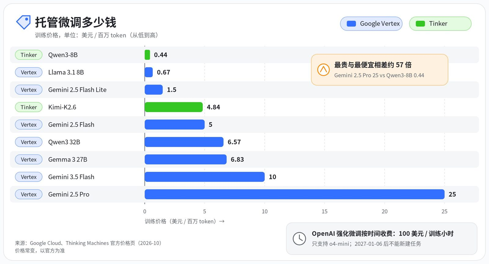

价格页变化很快，Tinker 就在 2026 年 7 月调高过标准上下文模型的价格[[74]](https://tinker-docs.thinkingmachines.ai/tinker/models/models_and_pricing/)，下单前以官方页面为准。

### 11.4 案例：SK Telecom

SK Telecom 在 Bedrock 上微调 Claude 做电信客服问答[[75]](https://aws.amazon.com/blogs/machine-learning/sk-telecom-improves-telco-specific-qa-by-fine-tuning-anthropics-claude-models-in-amazon-bedrock/)。概念验证阶段，只优化提示词时 ROUGE-3 提升 38.3%、引用准确率提升 52.94%；提示词加微调后分别提升 58.1% 和 70.59%。生产中，坐席评价的通话中回答质量提升 34%，低质量回答减少 68%。这个案例的价值在于它报告了“只用提示词”这条基线，可以看出微调额外带来了多少。数字为厂商自报。

### 11.5 上线清单

1. 评测集四个部分都已就绪，基座和线上模型的基线已跑（第 2 章）。
2. 训练数据去重、模板一致、损失掩码正确，许可条款已确认（第 3 章）。
3. 超参从推荐起点开始，一次只改一个，每个检查点都跑评测（第 5 章）。
4. 强化学习有熵、长度、奖励、验证集准确率的监控，高分样本有人抽查（第 7 章）。
5. 安全评测作为硬性关卡，与微调前对比（第 10 章）。
6. 量化或合并后的模型重新跑全部评测（第 11.2 节）。
7. 每个检查点记录新任务提示上的前向 KL，对最初基座和上一版各量一次，超过团队上限就补跑旧能力评测（第 10.3 节）。
8. 合并前对每一对模型做插值检查，合并后用留一法确认每个专家都有贡献（第 11.2 节）。
9. 处理删除请求时，在最终部署形态上跑少量微调、量化、改写提问三种恢复攻击再验收（第 10.5 节）。
10. 保存训练数据、配置、检查点和评测结果，能从基座重新复现。
11. 上线后持续收集失败样本，作为下一轮训练和评测的数据。

## 第 12 章 · GRPO 技巧是待验证的假设：先立简单基线，按症状加，用对照实验留

第 7.2 节列了 DAPO、Dr. GRPO、GSPO、VAPO 等一长串修法。读完很容易得出一个结论：把它们全打开最稳。2025 年下半年的三篇工作从不同方向检验了这个结论，答案是否定的。阿里等团队的 Tricks or Traps 在统一框架里逐项复现常见技巧，发现每一项都有适用条件，两项技巧的组合就能胜过五项技巧的 DAPO[[120]](https://arxiv.org/abs/2508.08221)。清华的 JustRL 只保留一项技巧，固定超参单阶段训练，在 1.5B 推理模型上用一半算力追平或超过多阶段方案，把常用的超长惩罚加回去反而变差[[121]](https://arxiv.org/abs/2512.16649)。Meta 等团队的 ScaleRL 花了 40 多万 GPU 小时，把每个设计选择拆成“抬高上限”和“只影响效率”两类，并证明稳定的配方可以用小预算预测大预算的结果[[122]](https://arxiv.org/abs/2510.13786)。知乎上有一篇长文把这三篇逐项拆开读，归纳出同一条原则：先立简单稳健的基线，只在它被证明失败的具体问题上加复杂性，加了就要实证验证[[128]](https://zhuanlan.zhihu.com/p/2087919957829076602)。本章沿这条原则展开，补上强化学习可复现性研究和工程监控的证据。

本章的主线是：**每一项技巧都是一条针对特定失败的假设。先立一个简单、稳定、可复现的基线，监控里出现具体症状时只加对症的那一项，再用多种子的对照实验决定留不留**。三篇论文分别回答了这条主线上的三个问题：技巧在什么条件下有效、最少需要多少技巧、怎样用有限算力判断一项改动值不值得。

### 12.1 为什么要怀疑技巧：强化学习的结论天然噪声大

这不是大模型时代才有的问题。2018 年的 Deep Reinforcement Learning that Matters 就指出，环境的不确定性加上算法本身的方差，让很多论文报告的提升难以判断是否真实，呼吁报告显著性和统一实验流程[[123]](https://arxiv.org/abs/1709.06560)。2020 年 MIT 的研究拆开 PPO 和 TRPO 的代码，发现 PPO 相对 TRPO 的大部分收益来自论文里没当成算法写的代码级优化[[124]](https://arxiv.org/abs/2005.12729)。同年 Google 的大规模实证研究把 50 多个设计选择放进统一的同策略框架，训练了 25 万多个智能体，结论是论文里很少讨论的低层选择往往左右最终表现[[129]](https://arxiv.org/abs/2006.05990)。Tricks or Traps 明确沿用了这一方法论传统[[120]](https://arxiv.org/abs/2508.08221)。换句话说，算法名字相同，代码细节不同，结论可以反转。

推理强化学习把这个问题放大了。A Sober Look 对 9 个模型各跑 20 次评测，pass@1 随随机种子的标准差有 5 到 15 个百分点；AIME24 只有 30 道题，错一道就差 2.5 到 3.3 个百分点。按统一流程重测后，多数强化学习方法的提升远小于原文声称，而且容易在小基准上过拟合[[125]](https://arxiv.org/abs/2504.07086)。第 7.2 节 DAPO 的消融表是在一个基座、一次运行上逐项叠加得到的[[48]](https://arxiv.org/abs/2503.14476)，每一行的增量都落在这个噪声量级内。表本身没有错，但它回答的是“在那个设置下按那个顺序叠加会怎样”，不能直接推出“在你的模型上每一项都有用”。

所以验证门槛要定在前面：小基准至少用 10 个种子评测，报告均值和标准差[[125]](https://arxiv.org/abs/2504.07086)，对比两个配方时还要看训练曲线的趋势，不能只看某一个检查点的峰值。

### 12.2 Tricks or Traps：同一项技巧，换个条件就换了符号

Tricks or Traps 用 Qwen3-4B 和 8B 的基座与对齐版本，在易、中、难三档数据上逐项隔离测试常见技巧，结论整理如下[[120]](https://arxiv.org/abs/2508.08221)：

| 技巧 | 有用的条件 | 用处有限或有害的条件 | 机制 |
|---|---|---|---|
| 组内均值、组内标准差归一化（GRPO 默认） | 奖励分布较分散时 | 奖励高度集中（简单数据，几乎全对）时，除以很小的标准差会放大噪声，去掉标准差更稳 | 标准差小，优势被放大 |
| 组内均值、批内标准差 | 多数设置下更稳健，易、难数据都适用 | 论文未见明显反例 | 批内标准差不受单组奖励同质的影响 |
| 放宽上裁剪（Clip-Higher） | 对齐过、推理能力较强的模型：明显减缓熵塌缩，下游指标稳定提升 | 基座模型：裁剪触发率本来就低，调大几乎不影响熵，甚至掉点 | 能力强的模型才有值得放大的低概率好路径 |
| 裁剪上界继续调大 | 小模型上存在近似单调的“越大越好” | 大模型上这种规律消失 | 与模型容量有关 |
| 按 token 聚合损失 | 基座模型 | 指令模型提升有限 | 基座回答长短差异大，按样本平均会稀释长回答 |
| 过滤超长回答 | 中短长度的推理任务：回答更准、更干净 | 长尾的长推理任务作用有限，小模型上还会限制它生成复杂长推理 | 截断样本里也有正确的推理 |

每一条判定背后都有一个可以直接监控的机制指标，这正是把技巧当假设来检验的抓手[[120]](https://arxiv.org/abs/2508.08221)：

- <b>Clip-Higher 看裁剪触发率和熵。</b>基座模型的裁剪触发率只有约 0.003，新旧策略几乎不偏离，放宽上界没有作用空间。对齐模型上，上界为 0.2 时被裁剪的多是 therefore、but 这类引出新推理方向的连接词，放到 0.28 后裁剪转移到 the、is 等功能词，推理结构的多样性被放开。上界本身也要按模型搜：4B 对齐模型一路涨到 0.32 最好，8B 在 0.28 最好。
- <b>损失聚合看模型类型。</b>按 token 聚合在 8B 基座上收敛更快、峰值更高，换到 8B 对齐模型，按样本聚合反而更快更高。对齐模型的输出结构已经稳定，强行让每个 token 等权可能打乱它。
- <b>归一化看奖励标准差和奖励尺度。</b>易数据上组内标准差迅速掉到很低，除以它会放大梯度。批内归一化对奖励的数值倍数敏感，改了奖励尺度就要重新检查。
- <b>超长过滤看截断样本的重复比例。</b>上限 8k 时被截断的多是长而正常的推理，过滤后回答更短更准。上限 20k 时被截断的多是重复、停不下来的退化生成，过滤掉的本来就没多少学习价值，收益随之变小，回答反而比不过滤时更长。

还有一个容易忽略的基线事实：对齐模型不加任何技巧继续训练只多涨约 2%，多数技巧的收益在它上面很难显现[[120]](https://arxiv.org/abs/2508.08221)。拿对齐模型做消融得到“没用”，可能只是起点已经接近天花板。验证时把精度曲线和对应的机制指标一起看，机制指标没动而精度涨了，先怀疑噪声。

据此论文给出 Lite PPO：在不带价值模型的原始 PPO 损失上，只加组内均值、批内标准差的归一化和按 token 聚合两项。在 4B 和 8B 基座上，它超过 GRPO，也超过叠了组归一化、Clip-Higher、超长奖励整形、按 token 损失、动态采样五项技巧的 DAPO，后两者常在达到峰值后下滑[[120]](https://arxiv.org/abs/2508.08221)。

这张表最有用的一列是“条件”。同一项 Clip-Higher，放在对齐模型上是解药，放在基座上可能是毒药。照抄一份配方之前，先问清楚它是在什么模型、什么数据难度上验证的，和自己的设置差多远。

### 12.3 JustRL：最少需要多少技巧

JustRL 的问题更直接：如果只做最基本的事，能走多远。它的全部配置如下[[121]](https://arxiv.org/abs/2512.16649)[[127]](https://github.com/thunlp/JustRL)：

| 项目 | JustRL 的选择 | 对照：常见的复杂做法 |
|---|---|---|
| 算法 | veRL 默认 GRPO，二值奖励，DAPO 的规则判分器 | 自定义优势估计、过程奖励 |
| 正则 | 不加 KL、不加熵正则 | KL 惩罚加定期重置参考模型 |
| 唯一保留的技巧 | Clip-Higher，裁剪区间 [0.8, 1.28] | 五项以上技巧叠加 |
| 超参 | 批 256 道题、每题 8 个回答、学习率 1e-6 恒定、温度 1.0 | 自适应温度、动态批大小 |
| 长度 | 最长回答 15k token（上下文 16k），不加长度惩罚 | 分阶段 8k→16k→24k 扩上下文，按阶段调长度惩罚 |
| 数据 | DAPO-Math-17k，不做难度筛选，不动态采样 | 离线难度筛选、课程切换、动态采样 |
| 流程 | 单阶段，从头到尾超参不变 | ProRL-V2 九个阶段、动态超参 |

结果：每个模型用 32 张 A800 训练 15 天。DeepSeek-R1-Distill-Qwen-1.5B 训成的 JustRL-DeepSeek-1.5B 在九个数学基准上平均 54.87%，高于 ProRL-V2 的 53.08%，AIME24 在 4,000 步里从 28% 涨到 58%，总 token 预算约为 ProRL-V2 的一半。同一套超参不调，直接用到 OpenMath-Nemotron-1.5B，得到 64.32%。训练曲线平滑单调，回答长度从约 7,000 token 自然收敛到 4,000 到 5,000，没有出现需要人工干预的平台或骤降[[121]](https://arxiv.org/abs/2512.16649)。

更有价值的是它的负面消融。在基础配方上加超长惩罚（最后 4k token 逐步扣分），AIME24 停在 50%，基础配方是 55%；再加上 DeepScaleR 那种减少误判的鲁棒判分器，停在 45%。熵曲线说明了原因：两种改动都把熵压到 0.5 到 0.6，基础配方保持在 1.2 到 1.4 之间健康地波动[[121]](https://arxiv.org/abs/2512.16649)。

对照第 7.2 节：DAPO 的消融里软性超长惩罚是 +3 分（38→41）[[48]](https://arxiv.org/abs/2503.14476)，这里同类做法是 −5 分。两个结论并不矛盾，DAPO 从 32B 基座起步，基座的回答长度不受控，JustRL 从已经会写长推理的蒸馏模型起步，长度本来就会自己收敛，再加惩罚只剩压制探索的副作用。技巧的符号取决于起点，这正是 12.2 节那张表的意思。

JustRL 也坦白了局限：说不清简单配方为什么有效，结果只覆盖 1.5B 和数学。作者认为复杂技巧在算力极紧、遇到特定失败模式、冲击上限或奖励噪声大时仍可能有用，建议先立简单基线，确认了具体问题再加对应的复杂性[[121]](https://arxiv.org/abs/2512.16649)。读它的结论还要守住证据边界。它证明了简单配方能稳定训练、往里加技巧会变差，但没有做反向实验，即从复杂基线里拆掉某项技巧看是否恢复稳定，所以推不出那些技巧都在治伪问题。唯一保留的 Clip-Higher 本身也没有消融。逐项看表格，BroRL 在 AIME24（57.50）和 MATH（92.14）上仍高于 JustRL，Nemotron 上领先 QuestA 的 0.51 分落在单次评测的噪声里，站得住的是平均分加算力的联合权衡[[121]](https://arxiv.org/abs/2512.16649)。BroRL 走的是另一条路，把每题回答数加到几百条，绕开 ProRL 训练几千步后的平台期[[130]](https://arxiv.org/abs/2510.01180)。另外，JustRL 用的是 veRL 默认的同步训练，生成和更新在同一批 GPU 上严格交替，数据没有陈旧度，也就不需要重要性采样修正[[121]](https://arxiv.org/abs/2512.16649)[[127]](https://github.com/thunlp/JustRL)。换成异步训练后，策略滞后会带来新的不稳定，那时重要性采样修正就成了对症的技巧。

### 12.4 ScaleRL：区分抬高上限和只省算力

前两篇回答“哪些技巧有效”。ScaleRL 补的是另一个维度：一项改动是让最终能达到的分数更高，还是只是更快到达同一个分数。它把验证集通过率对训练算力拟合成一条 S 形曲线，曲线有三个参数：渐近上限 A、决定算力效率的指数，以及达到一半提升所需的算力[[122]](https://arxiv.org/abs/2510.13786)。

用这把尺子量下来，结论分两类[[122]](https://arxiv.org/abs/2510.13786)：

- **改变上限的**：损失类型和数值精度。GSPO、CISPO 的渐近通过率明显高于 DAPO 式损失，生成端和训练端在输出层都用 FP32 计算，把上限从 0.52 提到 0.61。
- **主要改变效率的**：损失聚合方式、优势归一化、课程、off-policy 算法等。它们决定多快接近上限，对上限本身影响不大。批内优势归一化和其他两种归一化效果相近，论文选它是因为理论上更合理、略好一点。

最终的 ScaleRL 配方包括：PipelineRL 异步训练、强制截断控制长度、CISPO 损失（截断重要性采样的 REINFORCE）、按题目平均损失、批内优势归一化、输出层 FP32、过滤零方差的题，以及 No-Positive-Resampling，即某道题历史通过率达到 0.9 后永久移出训练集。每个组件都做了留一消融，每次 16,000 GPU 小时[[122]](https://arxiv.org/abs/2510.13786)。PipelineRL 是流式的异步方案，训练器每更新一步就把新权重推给生成器，生成器带着旧的 KV cache 接着写没写完的回答[[131]](https://arxiv.org/abs/2509.19128)。和攒一整批再训练的 PPO 式异步相比，它空闲更少、更接近同策略，效率高出一大截，ScaleRL 把异步算法的选择列为后训练里最关键的设计决定之一[[122]](https://arxiv.org/abs/2510.13786)。过滤零方差题和 DAPO 的动态采样看着相似，区别在于 ScaleRL 只丢不补。全对或全错的题优势恒为 0，对梯度方向没有贡献，但留在损失里会占用归一化分母，把其余样本的梯度稀释掉，而且这类题随训练越来越多，等于有效步长不受控地衰减[[122]](https://arxiv.org/abs/2510.13786)。异步训练的系统设计见 [LLM-55｜系统｜RL 训练系统：rollout 与训练分离、异步与 Agent 环境](./55-rl-systems.md)。

CISPO 出自 MiniMax-M1，在 Qwen2.5-32B 的对照实验里比 DAPO 快一倍[[126]](https://arxiv.org/abs/2506.13585)。留一消融里有个值得注意的细节：把 CISPO 换回 DAPO，渐近表现差不多。ScaleRL 仍然保留 CISPO，看中的是超参稳健性[[122]](https://arxiv.org/abs/2510.13786)。前向消融里，DAPO 的上裁剪 ε 从 0.20 扫到 0.27，上限 A 先从 0.500 升到 0.530（0.26 处），再跌到 0.480，CISPO 在宽范围内几乎没有差别。GSPO 的上限同样高，但在 8B 上多次中途发散，回滚到稳定检查点能恢复，到 17B×16 的 Scout MoE 上反复回滚也救不回来[[122]](https://arxiv.org/abs/2510.13786)。一个要精调才不掉上限的组件，换模型就得重调一次，这本身就是成本。这和 Lite PPO、JustRL 的“能删就删”并不冲突：删的标准是有没有证据，组件能在多种设置下减少不稳定、降低调参成本，就是证据。

ScaleRL 对工程最直接的价值是可预测性。8B 稠密模型的一次运行跑到 10 万 GPU 小时，用前 5 万 GPU 小时拟合的曲线外推，与最终结果吻合[[122]](https://arxiv.org/abs/2510.13786)。曲线形状的选择有讲究。预训练惯用幂律，可同一次运行用幂律拟合，区间从 1.5k–50k 换成 5k–50k GPU 小时，预测上限就从 1.0 变成 0.74，实际饱和在 0.65 附近，S 形曲线两次都给出 0.645[[122]](https://arxiv.org/abs/2510.13786)。拟合本身也有误差：三次独立重复的 A 波动约 ±0.02，两个配方的 A 差不到 0.02 不算实质差异，这时要固定 A 再比效率[[122]](https://arxiv.org/abs/2510.13786)。这意味着比较两个配方不必都跑到底：各跑一段，拟合曲线，比较 A 和效率，就能在小预算上排除掉上限低的方案。前提是配方本身稳定，曲线中途崩溃或剧烈震荡时拟合不可信。

同一把尺子还能回答预算怎么分。预训练有 Chinchilla 给出的算力分配规律，模型规模和训练数据按比例一起放大最划算[[132]](https://arxiv.org/abs/2203.15556)。RL 后训练此前没有对应的结论，ScaleRL 固定配方、每次只换一条轴，给出了第一张粗略的分配表[[122]](https://arxiv.org/abs/2510.13786)：

| 配置 | 上限 A | 效率 B | 读法 |
|---|---|---|---|
| 基准：8B 稠密，每批 768 条（48 题 × 16 个回答） | 0.610 | 1.92 | 参照点 |
| 换成 17B×16 MoE（Scout） | 0.710 | 1.65 | 上限抬得最多 |
| 每批 2048 条 | 0.645 | 1.70 | 上限更高，前期更慢 |
| 生成长度从 14k 放到 32k | 0.645 | 1.89 | 上限更高，前期更慢 |
| 每批 512 条 | 0.605 | 1.77 | 批变小，上限略降 |
| 每题 8、24、32 个回答（总批量不变） | 0.585–0.595 | 2.07–2.44 | 基本不变，属于次要选择 |
| 数学加代码联合训练 | 数学 0.595，代码 0.615 | 2.05、1.09 | 多任务也能分别预测 |

算力的优先级是模型规模，其次是批大小和生成长度，每题采样几个回答怎么调都差不多[[122]](https://arxiv.org/abs/2510.13786)。更要紧的是，每批 2048 条和 32k 生成长度的曲线前期都比基准慢，拿到一半提升分别要约 1.1 万 GPU 小时，基准只要约 2,500，外推后的上限却更高。按小预算下的检查点分数做决定，这两项都会被错误淘汰。ScaleRL 把这条称作拥抱 Bitter Lesson：小算力下看着更好的方法，放到大算力可能更差[[122]](https://arxiv.org/abs/2510.13786)。论文还提到更大的批、更长的生成、更大的模型和更少的截断似乎更有利于下游泛化，原文用的是推测语气[[122]](https://arxiv.org/abs/2510.13786)。

### 12.5 三篇放在一起：共识、分歧与读法

| 问题 | Tricks or Traps | JustRL | ScaleRL |
|---|---|---|---|
| 核心主张 | 技巧有适用条件，两项组合胜过五项[[120]](https://arxiv.org/abs/2508.08221) | 一项技巧加固定超参就够强[[121]](https://arxiv.org/abs/2512.16649) | 区分上限与效率，小预算可预测大预算[[122]](https://arxiv.org/abs/2510.13786) |
| Clip-Higher | 对齐模型有效，基座无效 | 保留，唯一的技巧 | 用 CISPO 的截断重要性采样替代 |
| 优势归一化 | 组内均值、批内标准差 | GRPO 默认 | 批内归一化 |
| 损失聚合 | 基座用按 token | veRL 默认 | 按题目平均 |
| 长度处理 | 超长过滤只对中短任务有用 | 不惩罚，加了反而降 5 分 | 强制截断 |
| 难题与易题 | 数据难度决定技巧的取舍 | 不筛选、不动态采样 | 过滤零方差题，通过率过 0.9 的题移出 |
| 实验规模 | 4B、8B，多档数据 | 1.5B 两个模型，各 32 卡 15 天 | 8B 稠密与 17B×16 MoE，累计 40 万 GPU 小时以上 |

能读出的共识有三条。保持探索是共同前提：三篇都在用某种方式放宽对低概率 token 的压制，这与第 7.3 节熵塌缩的规律一致[[52]](https://arxiv.org/abs/2505.22617)。优势的尺度要在比单组更大的范围上估计：Tricks or Traps 的批内标准差和 ScaleRL 的批内归一化指向同一个方向。数值一致性是被低估的变量：输出层精度这种“非算法”细节能改变上限[[122]](https://arxiv.org/abs/2510.13786)，与 12.1 节代码级优化决定 PPO 收益的老结论遥相呼应[[124]](https://arxiv.org/abs/2005.12729)。对熵的读法要校正一处。JustRL 和 Tricks or Traps 都把熵骤降当作探索被压的信号[[121]](https://arxiv.org/abs/2512.16649)[[120]](https://arxiv.org/abs/2508.08221)，ScaleRL 则发现熵在所有实验里都持续下降，每批 768 条和 2048 条的熵轨迹几乎重合，最终表现却不同，熵不能可靠地预测下游表现[[122]](https://arxiv.org/abs/2510.13786)。熵适合当报警器，不适合拿来给配方排名。

分歧集中在长度和数据筛选上，而这两项恰好最依赖起点：模型是否已会写长推理、数据对当前模型是太易还是太难。所以分歧本身就是结论，这两类技巧最不该照抄。

### 12.6 落到流程：按症状加技巧

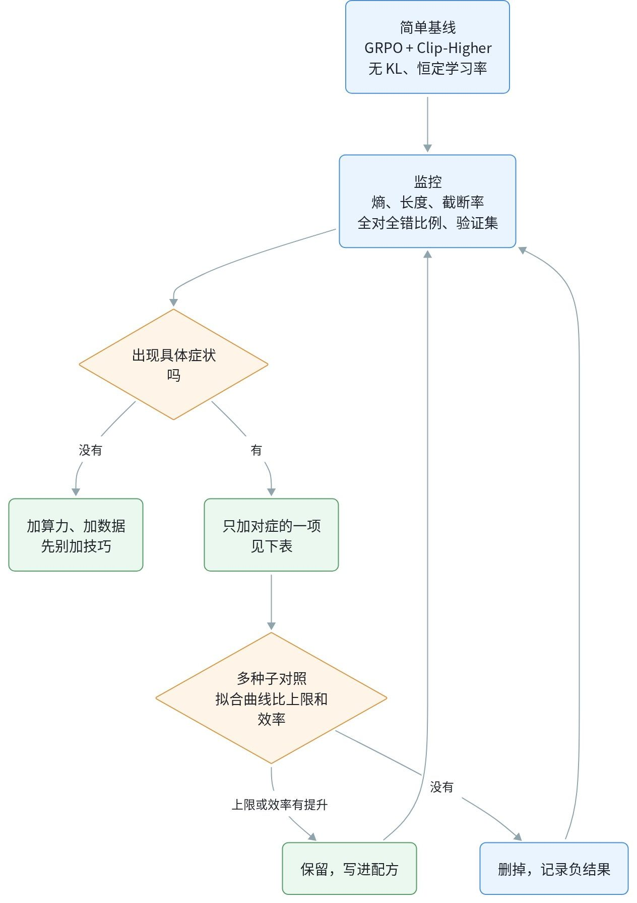

基线的选法参考 JustRL：成熟框架的默认 GRPO、规则判分、Clip-Higher、不加 KL、恒定学习率、单阶段[[121]](https://arxiv.org/abs/2512.16649)。如果起点是没对齐过的基座，按 Tricks or Traps 的结论把 Clip-Higher 换成批内标准差和按 token 聚合，也就是 Lite PPO[[120]](https://arxiv.org/abs/2508.08221)。症状与对应技巧如下：

| 监控里的症状 | 先查什么 | 对症的技巧 | 证据 |
|---|---|---|---|
| 熵在早期快速掉到很低，奖励随即停涨 | 是否加了长度惩罚或过严的判分器 | 先撤掉压制探索的改动，再考虑 Clip-Higher、Clip-Cov | JustRL 负面消融[[121]](https://arxiv.org/abs/2512.16649)，熵规律[[52]](https://arxiv.org/abs/2505.22617) |
| 一组全对或全错的比例高，有效梯度少 | 题目难度是否与当前模型匹配 | 过滤零方差题、动态采样，或把通过率很高的题移出 | DAPO[[48]](https://arxiv.org/abs/2503.14476)、ScaleRL[[122]](https://arxiv.org/abs/2510.13786) |
| 简单数据上训练抖动大 | 组内奖励是否过于集中 | 去掉组内标准差，或改用批内标准差 | Tricks or Traps[[120]](https://arxiv.org/abs/2508.08221) |
| 基座模型长回答学不动 | 损失是否按样本平均 | 按 token 聚合 | Tricks or Traps[[120]](https://arxiv.org/abs/2508.08221)、DAPO[[48]](https://arxiv.org/abs/2503.14476) |
| 截断比例高、长度持续上涨而准确率不动 | 起点是否已会写长推理，长度上限是否太紧 | 先放宽上限或强制截断，中短任务可过滤超长回答，慎用长度惩罚 | JustRL[[121]](https://arxiv.org/abs/2512.16649)、Tricks or Traps[[120]](https://arxiv.org/abs/2508.08221) |
| 训练中途崩溃、重要性比率异常 | 生成端与训练端的概率是否一致 | 输出层 FP32、截断重要性采样（CISPO） | ScaleRL[[122]](https://arxiv.org/abs/2510.13786)、MiniMax-M1[[126]](https://arxiv.org/abs/2506.13585) |

症状表回答“加什么”，下面这张监控表回答“什么时候该警觉”。阈值取自论文实测，可以当起点，再按自己的设置校准：

| 监控指标 | 健康参照 | 报警信号 | 出处 |
|---|---|---|---|
| 截断率（被强制截断的回答占比） | 8B 运行九成时间低于 5% | 每批 768 条时到 10%–15% 通常失稳且难以自愈，截断样本退出训练，有效批量随之变小 | ScaleRL[[122]](https://arxiv.org/abs/2510.13786) |
| 验证集通过率对外推曲线 | 延长训练的点落在半程拟合的曲线上 | 后段持续跌破外推曲线，说明配方不可扩展，ScaleRL 复现的 GRPO 在约 6k GPU 小时后就是这种形态 | ScaleRL[[122]](https://arxiv.org/abs/2510.13786) |
| 下游基准对验证集 | 两者同向变化 | 验证集还在涨、下游已停滞，是分叉的预警，小批运行出现过 | ScaleRL[[122]](https://arxiv.org/abs/2510.13786) |
| 熵 | 平稳振荡或缓慢下降 | 骤降到很低并伴随奖励停涨，说明探索被压 | JustRL[[121]](https://arxiv.org/abs/2512.16649)、ScaleRL[[122]](https://arxiv.org/abs/2510.13786) |
| 技巧对应的机制指标 | 裁剪触发率、奖励标准差、截断样本重复比例随技巧开关而变化 | 精度变了而机制指标不动，先怀疑噪声 | Tricks or Traps[[120]](https://arxiv.org/abs/2508.08221) |
| 配方之间的上限差 | 重复运行的 A 波动约 ±0.02 | 差距小于 0.02 时不下结论，固定 A 比效率 | ScaleRL[[122]](https://arxiv.org/abs/2510.13786) |

验证时守三条规矩。一次只改一项，否则无法归因。评测用多个种子，小基准至少 10 个，看均值和标准差[[125]](https://arxiv.org/abs/2504.07086)。比较时看整条曲线：一项改动早期领先、后期被反超是常见现象，ScaleRL 在批大小上就观察到小批早期更好、算力增加后被大批超过[[122]](https://arxiv.org/abs/2510.13786)。负结果也要记下来，它和正结果一样是团队配方的一部分。

### 12.7 边界

- <b>结论的覆盖面有限。</b>三篇都以数学推理为主，JustRL 只测了 1.5B，Tricks or Traps 最大到 8B 且只用了 Qwen3 系列，换模型家族结论可能变化。代码、Agent、多轮工具调用（第 9 章）的奖励更稀疏、噪声更大，复杂技巧的价值可能更高。
- <b>简单不等于便宜。</b>JustRL 每个模型仍用了 32 张 A800 训练 15 天。简单配方省的是调参和排障的人力，算力账要单独算。
- <b>可预测性有前提。</b>ScaleRL 的曲线外推要求配方稳定、验证集与训练分布一致，换模型、换数据都要重新拟合。
- <b>原文与核对。</b>本章参考的知乎长文对三篇论文做了逐项拆解，还指出了 JustRL 正文与表格的出入（正文写对 ProRL-V2 九项赢六项，表格是七项）等细节[[128]](https://zhuanlan.zhihu.com/p/2087919957829076602)。本章的数字均回到论文原文核对，原文用推测语气的结论（如 ScaleRL 对泛化的判断、JustRL 对超长惩罚压熵的解释）按推测转述。

## 第 13 章 · 长程任务的回溯课程：初始成功率为零时，先从终点附近学起

第 9.2 节说过，Agent 强化学习的信用分配更难：几十步之后才知道成败。还有一种更极端的情况：任务难到当前策略从头跑一次都成功不了。修一个仓库里的 bug，要读代码、定位、改动、跑测试，几十轮交互里任何一步走错，单测就不过，奖励只有 0。GRPO 靠组内对比算优势，一组全是 0，优势全为 0，梯度也是 0。DAPO 的动态采样会把这种组丢掉[[48]](https://arxiv.org/abs/2503.14476)，丢得掉无效样本，却造不出信号。

ROLL 团队训练 ROME（30B MoE，激活 3B）时，在 Let It Flow 里给出的办法是回溯课程[[133]](https://arxiv.org/abs/2512.24873)：拿一条成功轨迹，把交互历史预填到某个中间位置，让策略只续写后半段。起点离终点越近，续写越容易成功，组内就有了正样本。策略学会后半段，再把起点往前挪，直到回到初始状态。这个思路在强化学习里已有近十年的谱系，从机器人上的反向课程[[134]](https://arxiv.org/abs/1707.05300)、Atari 上的单条演示学习[[135]](https://arxiv.org/abs/1812.03381)和 Go-Explore[[136]](https://arxiv.org/abs/1901.10995)，到 2024–2025 年大模型推理上的 R³[[137]](https://arxiv.org/abs/2402.05808)、BREAD[[138]](https://arxiv.org/abs/2506.17211)、QuestA[[139]](https://arxiv.org/abs/2507.13266)。

本章的主线是：**长程任务训不动，根源在于从初始状态出发的成功概率随步数指数下降，组内对比信号随之消失。回溯课程用一条成功轨迹把起点挪到终点附近，让成功率回到可学习的区间，再随策略进步逐段后撤。能不能落地取决于三件事：手里有没有成功轨迹，环境能不能回到中间状态，后撤的节奏怎么控制**。

### 13.1 为什么训不动：成功率按步数相乘，组内信号跟着消失

假设每个决策步独立地以概率 p 做对，整条轨迹要 K 步全对，成功率就是 p 的 K 次方。p = 0.9 时，10 步还剩 34.9%，30 步剩 4.2%，50 步只剩 0.52%。真实任务里步与步并不独立，早期一步错往往让后面全部白做，衰减只会更陡。

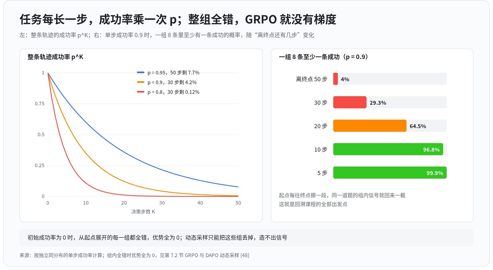

GRPO 的优势是组内奖励减去组内均值，一组全错或全对，优势全为零。单条成功率为 q、组大小为 G 时，组内同时出现成功和失败的概率是 1 − q^G − (1 − q)^G。G = 8 时，q = 0.02 只有 14.9%，q = 0.05 是 33.7%，q = 0.1 到 57%，q 在 0.3 到 0.7 之间超过 94%。组加大到 16，q = 0.05 时升到 56%，加大组能缓解低成功率，但 q = 0 时组再大也是 0。

结果奖励还有第二层浪费：一次失败只说明某处错了，几十个交互里哪一个错了无从得知。Salimans 和 Chen 在 Montezuma's Revenge 上把这件事量化过：从头探索，所需时间随两次奖励之间要走的步数指数增长；从演示里的状态重置出发、逐步把起点往前挪，所需时间降到步数的平方量级[[135]](https://arxiv.org/abs/1812.03381)。回溯课程要拆掉的就是这个指数。

<b>设计动作。</b>训练前先从初始状态对每道题跑一轮基线采样，统计通过率分布。通过率为 0 的题占多少，决定要不要上回溯。只占少数时，加大组或把它们暂时移出训练集就够了。

### 13.2 把起点挪到终点附近：反向课程的谱系

2017 年 Florensa 等人在机器人任务上提出反向课程生成：只需要知道一个目标状态，先从目标附近出发训练，再从已学会的起点向外随机游走，扩出新起点[[134]](https://arxiv.org/abs/1707.05300)。他们给好起点下了一个可操作的定义：当前策略从这里出发的成功率在 0.1 到 0.9 之间。太低学不到东西，太高没有新信息。这个窗口和上一节算出的组内信号区间正好对上。

2018 年 Salimans 和 Chen 把目标状态换成一条人类演示：先从演示末尾附近重置环境，策略能稳定拿到奖励后把起点往前挪，只用一条演示就在 Montezuma's Revenge 上拿到 74,500 分[[135]](https://arxiv.org/abs/1812.03381)。2019 年的 Go-Explore 进一步去掉对演示的依赖：先在可重置的环境里记住到过的状态，回到有潜力的状态再探索，找到成功轨迹以后，用同样的从演示后段往前学的方式把它鲁棒化成策略，Montezuma 平均分超过 4.3 万，约为此前最好成绩的 4 倍[[136]](https://arxiv.org/abs/1901.10995)。三项工作有一个共同前提：环境能被重置到任意中间状态，这在 Atari 和仿真器里很便宜。

大模型推理把重置环境换成了预填前缀。文本任务的状态就是已经生成的 token，把参考解答的前半段放进上下文，就回到了中间状态。R³ 在推理任务上从演示末尾开始，把起点逐步滑向开头，用结果监督得到近似步骤级的信号，在 8 个推理任务上比强化学习基线平均高 4.1 分[[137]](https://arxiv.org/abs/2402.05808)。2025 年的几项工作在“前缀给多少、什么时候给”上做了不同取舍：

| 方法 | 起点怎么定 | 什么时候给前缀 | 报告的结果 |
|---|---|---|---|
| R³[[137]](https://arxiv.org/abs/2402.05808) | 按阶段从演示末尾滑向开头，也可把多个起点混在一个批里训 | 所有题目 | 8 个推理任务比强化学习基线平均 +4.1 |
| BREAD[[138]](https://arxiv.org/abs/2506.17211) | 整组自己采样全错时，插入一段尽量短的专家前缀，保证每次更新至少有一条成功 | 只在整组失败时 | 用到的专家轨迹不到 40%，训练约快 3 倍 |
| QuestA[[139]](https://arxiv.org/abs/2507.13266) | 把部分解答写进题目，难题给提示，提示随训练减少 | 只对难题 | 1.5B 模型 AIME24 72.50%（+10.73），AIME25 62.29%（+12.79） |
| LUFFY[[140]](https://arxiv.org/abs/2504.14945) | 不截前缀，把完整的离策略专家轨迹混进 GRPO 的组里 | 在策略采样学不动时 | 6 个数学基准平均 +6.4，分布外 +6.2 |

BREAD 的理论部分给了一个值得记住的判断：初始成功概率呈指数级小时，先 SFT 再强化学习的两段式同样会失败，SFT 学到的分布不足以让强化学习采到成功[[138]](https://arxiv.org/abs/2506.17211)。QuestA 报告 pass@1 和 pass@k 同时提升[[139]](https://arxiv.org/abs/2507.13266)，第 8.5 节讨论过，pass@k 上涨说明模型能解的题变多了，前缀提示的作用超出了让模型更会挑答案。

### 13.3 Agent 任务上的做法：按交互切 chunk，沿成功轨迹回溯

Agent 任务和数学推理有两处不同。决策单位不同：一条轨迹几万 token，真正改变环境的只有每次工具调用。状态也不同：前缀包括文件系统、进程、数据库的状态，单靠把历史放进上下文回不到中间状态。Let It Flow 的 IPA 算法针对这两点做了设计[[133]](https://arxiv.org/abs/2512.24873)。

决策单位上，IPA 把轨迹按交互切成 chunk：一个 chunk 从一次环境交互延续到下一次，通常以一次工具调用结束，chunk 数 K 远小于 token 数 T。回报按 chunk 折扣，G_k = γ^Δ·R_final，Δ 是该 chunk 到终点之间的 chunk 数，chunk 内所有 token 共享这个权重。在 token 级打折，几千个 token 后信号就衰减没了，按 chunk 打折，有效步长缩短两到三个数量级。重要性采样比和训推不一致的掩码也提到 chunk 级，比值取 chunk 内 token 的几何平均，压住个别离群 token[[133]](https://arxiv.org/abs/2512.24873)。

起点选择上，IPA 用专家式轨迹初始化。轨迹来自策略自己采到的成功样本或教师模型，并用当前策略定期刷新，尽量只保留关键 chunk、去掉不必要的步骤。给定轨迹 c1…cK，从 c_k 起点重采样的意思是：用 c1…c_{k−1} 和环境交互，把状态推到那里，之后的 chunk 交给当前策略生成。关键分叉有一个可测的定义：预填到 c_{f−1} 时的重采样成功率显著低于预填到 c_f 时，说明 c_f 里的决策决定成败，而当前策略还不会，c_f 之前的状态就是关键分叉[[133]](https://arxiv.org/abs/2512.24873)。

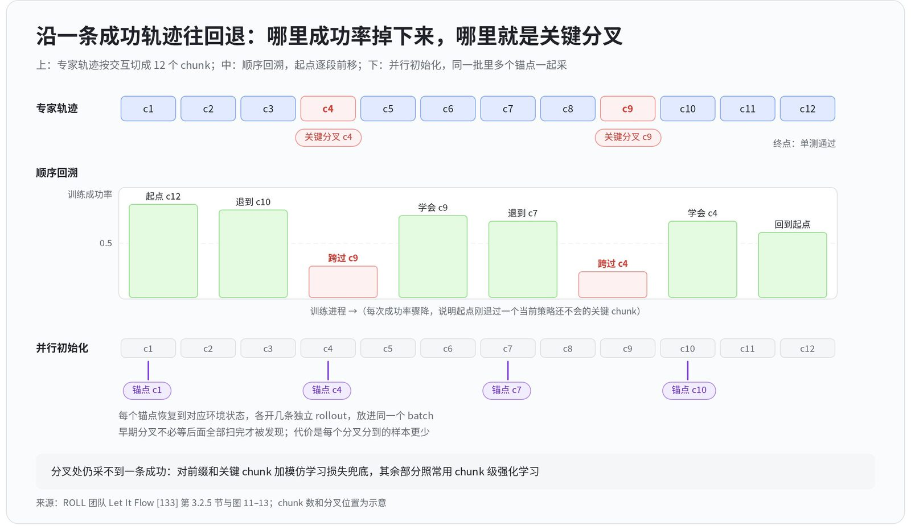

顺序回溯从最后一个 chunk 开始逐段往前退。训练成功率会走出阶梯：起点刚退过一个关键 chunk，成功率骤降，策略在这里学会后回升，再继续往前退。论文在一个困难训练任务上对比：从初始状态采样的基线全部失败，顺序回溯的批内持续有正样本，测试时从初始状态出发的成功率在约 75 步之后明显拉开[[133]](https://arxiv.org/abs/2512.24873)。它的缺点是扫描方向固定，关键分叉在轨迹早期时，要先把后面所有位置试一遍才能退到它，rollout 浪费在策略已经会的部分上。

并行初始化是论文最终采用的折中：在专家轨迹上均匀或随机选一组锚点，尽量让关键分叉落在锚点之间，从每个锚点恢复环境状态，各开几条独立 rollout，放进同一个批。每个分叉分到的样本变少，换来不必等顺序扫描，在论文的数据上效率更高。即便如此，个别分叉仍可能一条正样本都采不到，这时对预填部分和关键 chunk 加模仿学习损失兜底，重采样部分照常用 chunk 级强化学习，总损失为 λ_IL·L_IL + λ_RL·L_ChunkRL[[133]](https://arxiv.org/abs/2512.24873)。这和 BREAD 的思路一致：没有正样本时宁可直接模仿，也不让梯度归零[[138]](https://arxiv.org/abs/2506.17211)。

论文报告，IPA 让 ROME 在 SWE-bench Verified 上到 57.40%，Terminal-Bench 2.0 到 24.72%，作者称其能力接近 480B 的 Agent 模型[[133]](https://arxiv.org/abs/2512.24873)。这些是作者自报的数字，回溯相关的消融只在训练集的小子集上做，顺序回溯和并行初始化各自贡献多少，还缺独立复现。

### 13.4 工程前提：环境要能回到中间状态

文本推理里预填前缀几乎没有成本。Agent 任务要回到 c_k 之前的状态，有两条路：

- <b>重放前缀。</b>在新沙箱里按顺序重新执行 c1…c_{k−1} 的工具调用。做法简单，代价是每个起点都要重跑前缀，并且要求工具确定：同样的命令返回同样的结果，否则重放出的状态和专家轨迹对不上，后半段的奖励就失真。
- <b>快照恢复。</b>采专家轨迹时在每个 chunk 边界给环境拍快照，训练时直接从快照启动。启动快，代价是存储和镜像管理。ROLL 团队的 ROCK 沙箱支持把运行中的沙箱状态提交成新镜像，也支持检查点和重启[[133]](https://arxiv.org/abs/2512.24873)。Go-Explore 依赖的也是回到记住的状态这一能力[[136]](https://arxiv.org/abs/1901.10995)。

沙箱、持久执行和快照见 [LLM-41｜工程｜Agent 运行时与沙箱：隔离、持久执行与规模化](./41-agent-runtime-sandbox.md)，rollout 与训练分离、Agent 环境服务见 [LLM-55｜系统｜RL 训练系统：rollout 与训练分离、异步与 Agent 环境](./55-rl-systems.md)。回溯课程对这两层多提了两条要求：快照粒度要对齐 chunk 边界；恢复延迟要远短于一次续写，否则吞吐会被恢复拖垮。

第二个前提是噪声过滤。论文统计，工具环境里的有害轨迹主要来自瞬时 API 失败、工具返回不确定和反复的非法调用，这些轨迹若被分到高奖励，会注入误导梯度，甚至让策略崩溃，所以采样阶段就要动态剔除[[133]](https://arxiv.org/abs/2512.24873)。回溯会放大这个问题：起点靠后、续写变短，一次环境抖动在批里的占比更高。重放前缀时环境返回和专家轨迹对不上，这条样本应直接丢弃。

### 13.5 设计动作：选型、后撤节奏与监控

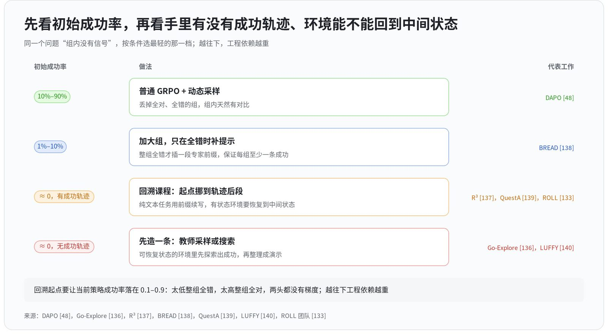

选型按初始成功率分四档。10% 到 90% 的题，普通 GRPO 加动态采样就有足够的组内对比[[48]](https://arxiv.org/abs/2503.14476)。1% 到 10% 的题，先加大组，整组全错时再补一段专家前缀[[138]](https://arxiv.org/abs/2506.17211)。接近 0 但有成功轨迹的，上回溯课程：纯文本任务用前缀续写[[137]](https://arxiv.org/abs/2402.05808)[[139]](https://arxiv.org/abs/2507.13266)，有状态环境要能恢复中间状态[[133]](https://arxiv.org/abs/2512.24873)。接近 0 又没有成功轨迹的，先用教师采样或在可重置环境里搜索造出一条[[136]](https://arxiv.org/abs/1901.10995)[[140]](https://arxiv.org/abs/2504.14945)。

后撤节奏用成功率窗口控制。参照 Florensa 的好起点定义[[134]](https://arxiv.org/abs/1707.05300)和 13.1 节的组内信号计算，把当前起点的训练成功率维持在 0.1 到 0.9：高于上限说明这一段已经学会，起点往前挪；低于下限说明刚跨过关键分叉，停在这里多训，或者切到模仿兜底。并行初始化时把这条规则用到每个锚点上，采样份额向成功率处在窗口内的锚点倾斜。

要盯的指标有四个：

- <b>混合组比例。</b>组内既有成功又有失败的组占多少。真正贡献梯度的是这部分，批内正样本比例高但全对组多，同样没有信号。
- <b>起点位置。</b>当前起点随训练步数的曲线，以及每个锚点的成功率。某个锚点长期停在低成功率，就是还没学会的关键分叉。
- <b>从初始状态出发的测试成功率。</b>这是唯一的目标指标。训练成功率高只说明后半段会了。
- <b>前缀与策略的分布差距。</b>专家前缀在当前策略下的平均对数概率。差距越大，续写时的状态越偏离策略自己能走到的状态。

专家轨迹要用当前策略定期重采样刷新[[133]](https://arxiv.org/abs/2512.24873)：一方面让前缀接近策略自己的分布，另一方面去掉专家轨迹里已经不需要的绕路步骤。

### 13.6 边界

- <b>至少要有一条成功轨迹。</b>完全没有时要先造：教师模型采样、搜索，或在可重置环境里探索[[136]](https://arxiv.org/abs/1901.10995)。造轨迹的成本经常比训练本身高。
- <b>前缀分布偏移。</b>训练中看到的中间状态来自专家，测试时只能靠自己走到那里。起点退回初始状态之前，测试成功率可能一直很低，不能用训练曲线判断进度。
- <b>可能过拟合专家路径。</b>一道题只有一条成功轨迹时，策略学到的是这一条路线。准备多条不同路线的轨迹、定期刷新、混入从初始状态出发的采样，都能缓解。
- <b>算力账。</b>每个起点都要恢复环境，并行初始化还把样本摊薄到多个锚点。初始成功率已在 10% 以上的题，普通 GRPO 加动态采样更划算[[48]](https://arxiv.org/abs/2503.14476)。
- <b>证据强度。</b>IPA 的结果为作者自报，消融规模小。R³、BREAD、QuestA 主要在数学推理上验证，迁移到有状态的 Agent 环境要自己测。

📎 延伸阅读：Agent 环境服务、异步 rollout 与训练分离见 [LLM-55｜系统｜RL 训练系统：rollout 与训练分离、异步与 Agent 环境](./55-rl-systems.md)；沙箱快照与持久执行见 [LLM-41｜工程｜Agent 运行时与沙箱：隔离、持久执行与规模化](./41-agent-runtime-sandbox.md)。

### 延伸阅读

- 系列中的「LLM 基础」讲后训练原理，「LLM 数学补课」讲策略梯度和 KL，「LLM 应用评测与可观测」讲评测体系，「LLM 安全与治理」讲安全评测，「LLM 可解释性与模型行为」讲人格向量和训练中的行为变化。

### 参考资料

## 参考文献

按正文首次引用顺序编号，资料截至 2026 年 10 月初。

[1] Ovadia et al. Fine-Tuning or Retrieval? Comparing Knowledge Injection in LLMs (2023) [https://arxiv.org/abs/2312.05934](https://arxiv.org/abs/2312.05934)

[2] Gekhman et al. Does Fine-Tuning LLMs on New Knowledge Encourage Hallucinations? (EMNLP 2024) [https://arxiv.org/abs/2405.05904](https://arxiv.org/abs/2405.05904)

[3] Balaguer et al. RAG vs Fine-tuning: Pipelines, Tradeoffs, and a Case Study on Agriculture (2024) [https://arxiv.org/abs/2401.08406](https://arxiv.org/abs/2401.08406)

[4] Zhang et al. RAFT: Adapting Language Model to Domain Specific RAG (2024) [https://arxiv.org/abs/2403.10131](https://arxiv.org/abs/2403.10131)

[5] Zhao et al. LoRA Land: 310 Fine-tuned LLMs that Rival GPT-4 (Predibase, 2024) [https://arxiv.org/abs/2405.00732](https://arxiv.org/abs/2405.00732)

[6] OpenAI. Reinforcement fine-tuning (docs, 2026) [https://developers.openai.com/api/docs/guides/reinforcement-fine-tuning](https://developers.openai.com/api/docs/guides/reinforcement-fine-tuning)

[7] AWS. Amazon Bedrock reinforcement fine-tuning (2025-12) and Claude fine-tuning on Bedrock [https://docs.aws.amazon.com/bedrock/latest/userguide/reinforcement-fine-tuning.html](https://docs.aws.amazon.com/bedrock/latest/userguide/reinforcement-fine-tuning.html)

[8] OpenAI. Deprecations: fine-tuning platform wind-down (2026-05-07) [https://developers.openai.com/api/docs/deprecations](https://developers.openai.com/api/docs/deprecations)

[9] Anthropic. Prompt engineering overview (docs, 2026) [https://docs.anthropic.com/en/docs/build-with-claude/prompt-engineering/overview](https://docs.anthropic.com/en/docs/build-with-claude/prompt-engineering/overview)

[10] Google Cloud. Gemini supervised tuning (docs, 2026) [https://docs.cloud.google.com/vertex-ai/generative-ai/docs/models/gemini-use-supervised-tuning](https://docs.cloud.google.com/vertex-ai/generative-ai/docs/models/gemini-use-supervised-tuning)

[11] OpenAI. Supervised fine-tuning; Fine-tuning best practices (docs, 2026) [https://developers.openai.com/api/docs/guides/fine-tuning-best-practices](https://developers.openai.com/api/docs/guides/fine-tuning-best-practices)

[12] Yue et al. Does Reinforcement Learning Really Incentivize Reasoning Capacity in LLMs Beyond the Base Model? (NeurIPS 2025) [https://arxiv.org/abs/2504.13837](https://arxiv.org/abs/2504.13837)

[13] Wu et al. Reasoning or Memorization? Unreliable Results of Reinforcement Learning Due to Data Contamination (AAAI 2026) [https://arxiv.org/abs/2507.10532](https://arxiv.org/abs/2507.10532)

[14] Shao et al. Spurious Rewards: Rethinking Training Signals in RLVR (2025) [https://arxiv.org/abs/2506.10947](https://arxiv.org/abs/2506.10947)

[15] Zhou et al. LIMA: Less Is More for Alignment (2023) [https://arxiv.org/abs/2305.11206](https://arxiv.org/abs/2305.11206)

[16] Muennighoff et al. s1: Simple test-time scaling (2025) [https://arxiv.org/abs/2501.19393](https://arxiv.org/abs/2501.19393)

[17] Ye et al. LIMO: Less is More for Reasoning (COLM 2025) [https://arxiv.org/abs/2502.03387](https://arxiv.org/abs/2502.03387)

[18] Hugging Face. Open-R1: Mixture-of-Thoughts and OpenR1-Distill-7B (2025-05) [https://github.com/huggingface/open-r1](https://github.com/huggingface/open-r1)

[19] Lee et al. Deduplicating Training Data Makes Language Models Better (2021) [https://arxiv.org/abs/2107.06499](https://arxiv.org/abs/2107.06499)

[20] Hugging Face. TRL SFTTrainer (docs, TRL v1.x) [https://huggingface.co/docs/trl/sft_trainer](https://huggingface.co/docs/trl/sft_trainer)

[21] Thinking Machines Lab. On-Policy Distillation (2025-10) [https://thinkingmachines.ai/blog/on-policy-distillation/](https://thinkingmachines.ai/blog/on-policy-distillation/)

[22] Qwen Team. Qwen3 Technical Report (2025) [https://arxiv.org/abs/2505.09388](https://arxiv.org/abs/2505.09388)

[23] OpenAI. Terms of Use (effective 2026-01-01) [https://openai.com/policies/row-terms-of-use/](https://openai.com/policies/row-terms-of-use/)

[24] Anthropic. Commercial Terms of Service (effective 2025-06-17) [https://www.anthropic.com/legal/commercial-terms](https://www.anthropic.com/legal/commercial-terms)

[25] Meta. Llama 3.1 Community License [https://github.com/meta-llama/llama-models/blob/main/models/llama3_1/LICENSE](https://github.com/meta-llama/llama-models/blob/main/models/llama3_1/LICENSE)

[26] DeepSeek. DeepSeek-R1 model card and MIT License [https://huggingface.co/deepseek-ai/DeepSeek-R1](https://huggingface.co/deepseek-ai/DeepSeek-R1)

[27] Hu et al. LoRA: Low-Rank Adaptation of Large Language Models (2021) [https://arxiv.org/abs/2106.09685](https://arxiv.org/abs/2106.09685)

[28] Dettmers et al. QLoRA: Efficient Finetuning of Quantized LLMs (2023) [https://arxiv.org/abs/2305.14314](https://arxiv.org/abs/2305.14314)

[29] Biderman et al. LoRA Learns Less and Forgets Less (TMLR 2024) [https://arxiv.org/abs/2405.09673](https://arxiv.org/abs/2405.09673)

[30] Schulman et al. LoRA Without Regret (Thinking Machines Lab, 2025-09) [https://thinkingmachines.ai/blog/lora/](https://thinkingmachines.ai/blog/lora/)

[31] Shuttleworth et al. LoRA vs Full Fine-tuning: An Illusion of Equivalence (2024) [https://arxiv.org/abs/2410.21228](https://arxiv.org/abs/2410.21228)

[32] Liu et al. DoRA: Weight-Decomposed Low-Rank Adaptation (ICML 2024) [https://arxiv.org/abs/2402.09353](https://arxiv.org/abs/2402.09353)

[33] Kalajdzievski. A Rank Stabilization Scaling Factor for Fine-Tuning with LoRA (2023) [https://arxiv.org/abs/2312.03732](https://arxiv.org/abs/2312.03732)

[34] Hayou et al. LoRA+: Efficient Low Rank Adaptation of Large Models (2024) [https://arxiv.org/abs/2402.12354](https://arxiv.org/abs/2402.12354)

[35] Hugging Face. Model training anatomy (docs) [https://github.com/huggingface/transformers/blob/main/docs/source/en/model_memory_anatomy.md](https://github.com/huggingface/transformers/blob/main/docs/source/en/model_memory_anatomy.md)

[36] Hugging Face. TRL v1.0 (2026-03) and releases [https://huggingface.co/blog/trl-v1](https://huggingface.co/blog/trl-v1)

[37] Unsloth. Long-context GRPO; RL guide (2025–2026) [https://unsloth.ai/docs/get-started/reinforcement-learning-rl-guide/grpo-long-context](https://unsloth.ai/docs/get-started/reinforcement-learning-rl-guide/grpo-long-context)

[38] Zheng et al. LlamaFactory: Unified Efficient Fine-Tuning of 100+ Language Models (ACL 2024 Demo) [https://arxiv.org/abs/2403.13372](https://arxiv.org/abs/2403.13372)

[39] Sheng et al. HybridFlow: A Flexible and Efficient RLHF Framework (verl, EuroSys 2025); verl releases [https://github.com/verl-project/verl](https://github.com/verl-project/verl)

[40] Hu et al. OpenRLHF: An Easy-to-use, Scalable and High-performance RLHF Framework (2024) [https://arxiv.org/abs/2405.11143](https://arxiv.org/abs/2405.11143)

[41] PyTorch. torchtune: stopping active development (2025-07-15) [https://github.com/pytorch/torchtune/issues/2883](https://github.com/pytorch/torchtune/issues/2883)

[42] Rafailov et al. Direct Preference Optimization (2023) [https://arxiv.org/abs/2305.18290](https://arxiv.org/abs/2305.18290)

[43] Meng et al. SimPO: Simple Preference Optimization with a Reference-Free Reward (NeurIPS 2024) [https://arxiv.org/abs/2405.14734](https://arxiv.org/abs/2405.14734)

[44] Ethayarajh et al. KTO: Model Alignment as Prospect Theoretic Optimization (ICML 2024) [https://arxiv.org/abs/2402.01306](https://arxiv.org/abs/2402.01306)

[45] DeepSeek-AI. DeepSeek-R1 incentivizes reasoning in LLMs through reinforcement learning (Nature 645, 2025) [https://www.nature.com/articles/s41586-025-09422-z](https://www.nature.com/articles/s41586-025-09422-z)

[46] Kimi Team. Kimi k1.5: Scaling Reinforcement Learning with LLMs (2025) [https://arxiv.org/abs/2501.12599](https://arxiv.org/abs/2501.12599)

[47] ByteDance Seed. Seed1.5-Thinking: Advancing Superb Reasoning Models with Reinforcement Learning (2025) [https://arxiv.org/abs/2504.13914](https://arxiv.org/abs/2504.13914)

[48] Yu et al. DAPO: An Open-Source LLM Reinforcement Learning System at Scale (ByteDance Seed, 2025) [https://arxiv.org/abs/2503.14476](https://arxiv.org/abs/2503.14476)

[49] Liu et al. Understanding R1-Zero-Like Training: A Critical Perspective (Dr. GRPO) (2025) [https://arxiv.org/abs/2503.20783](https://arxiv.org/abs/2503.20783)

[50] Zheng et al. Group Sequence Policy Optimization (Qwen, 2025) [https://arxiv.org/abs/2507.18071](https://arxiv.org/abs/2507.18071)

[51] Yue et al. VAPO: Efficient and Reliable Reinforcement Learning for Advanced Reasoning Tasks (ByteDance Seed, 2025) [https://arxiv.org/abs/2504.05118](https://arxiv.org/abs/2504.05118)

[52] Cui et al. The Entropy Mechanism of Reinforcement Learning for Reasoning Language Models (2025) [https://arxiv.org/abs/2505.22617](https://arxiv.org/abs/2505.22617)

[53] Zeng et al. SimpleRL-Zoo: Investigating and Taming Zero Reinforcement Learning for Open Base Models in the Wild (COLM 2025) [https://arxiv.org/abs/2503.18892](https://arxiv.org/abs/2503.18892)

[54] Pan et al. TinyZero (2025-01) [https://github.com/Jiayi-Pan/TinyZero](https://github.com/Jiayi-Pan/TinyZero)

[55] Wang et al. Reinforcement Learning for Reasoning in Large Language Models with One Training Example (2025) [https://arxiv.org/abs/2504.20571](https://arxiv.org/abs/2504.20571)

[56] Liu et al. ProRL: Prolonged Reinforcement Learning Expands Reasoning Boundaries in Large Language Models (NVIDIA, 2025) [https://arxiv.org/abs/2505.24864](https://arxiv.org/abs/2505.24864)

[57] Chu et al. SFT Memorizes, RL Generalizes (2025) [https://arxiv.org/abs/2501.17161](https://arxiv.org/abs/2501.17161)

[58] Shenfeld et al. RL's Razor: Why Online Reinforcement Learning Forgets Less (2025) [https://arxiv.org/abs/2509.04259](https://arxiv.org/abs/2509.04259)

[59] Feng et al. ReTool: Reinforcement Learning for Strategic Tool Use in LLMs (ByteDance Seed, 2025) [https://arxiv.org/abs/2504.11536](https://arxiv.org/abs/2504.11536)

[60] Jin et al. Search-R1: Training LLMs to Reason and Leverage Search Engines with Reinforcement Learning (2025) [https://arxiv.org/abs/2503.09516](https://arxiv.org/abs/2503.09516)

[61] Wei et al. SWE-RL: Advancing LLM Reasoning via Reinforcement Learning on Open Software Evolution (NeurIPS 2025) [https://arxiv.org/abs/2502.18449](https://arxiv.org/abs/2502.18449)

[62] Feng et al. Group-in-Group Policy Optimization for LLM Agent Training (NeurIPS 2025) [https://arxiv.org/abs/2505.10978](https://arxiv.org/abs/2505.10978)

[63] ByteDance Seed. UI-TARS-2 Technical Report (2025) [https://arxiv.org/abs/2509.02544](https://arxiv.org/abs/2509.02544)

[64] Qi et al. Fine-tuning Aligned Language Models Compromises Safety, Even When Users Do Not Intend To! (2023) [https://arxiv.org/abs/2310.03693](https://arxiv.org/abs/2310.03693)

[65] Qi et al. Safety Alignment Should Be Made More Than Just a Few Tokens Deep (2024) [https://arxiv.org/abs/2406.05946](https://arxiv.org/abs/2406.05946)

[66] Betley et al. Emergent Misalignment: Narrow finetuning can produce broadly misaligned LLMs (ICML 2025) [https://arxiv.org/abs/2502.17424](https://arxiv.org/abs/2502.17424)

[67] Wang et al. Persona Features Control Emergent Misalignment (OpenAI, 2025) [https://arxiv.org/abs/2506.19823](https://arxiv.org/abs/2506.19823)

[68] Luo et al. An Empirical Study of Catastrophic Forgetting in LLMs During Continual Fine-tuning (2023) [https://arxiv.org/abs/2308.08747](https://arxiv.org/abs/2308.08747)

[69] Sheng et al. S-LoRA: Serving Thousands of Concurrent LoRA Adapters (2023) [https://arxiv.org/abs/2311.03285](https://arxiv.org/abs/2311.03285)

[70] Chen et al. Punica: Multi-Tenant LoRA Serving (2023) [https://arxiv.org/abs/2310.18547](https://arxiv.org/abs/2310.18547)

[71] vLLM. LoRA adapters (docs, v0.31) [https://github.com/vllm-project/vllm/blob/main/docs/features/lora.md](https://github.com/vllm-project/vllm/blob/main/docs/features/lora.md)

[72] Yadav et al. TIES-Merging: Resolving Interference When Merging Models (2023) [https://arxiv.org/abs/2306.01708](https://arxiv.org/abs/2306.01708)

[73] Google Cloud. Generative AI pricing: tuning (2026-10) [https://cloud.google.com/gemini-enterprise-agent-platform/generative-ai/pricing](https://cloud.google.com/gemini-enterprise-agent-platform/generative-ai/pricing)

[74] Thinking Machines Lab. Tinker: models and pricing (2026) [https://tinker-docs.thinkingmachines.ai/tinker/models/models_and_pricing/](https://tinker-docs.thinkingmachines.ai/tinker/models/models_and_pricing/)

[75] AWS ML Blog. SK Telecom improves telco-specific Q&amp;A by fine-tuning Anthropic's Claude models in Amazon Bedrock (2025) [https://aws.amazon.com/blogs/machine-learning/sk-telecom-improves-telco-specific-qa-by-fine-tuning-anthropics-claude-models-in-amazon-bedrock/](https://aws.amazon.com/blogs/machine-learning/sk-telecom-improves-telco-specific-qa-by-fine-tuning-anthropics-claude-models-in-amazon-bedrock/)

[76] Agarwal et al. On-Policy Distillation of Language Models: Learning from Self-Generated Mistakes (GKD) (2023) [https://arxiv.org/abs/2306.13649](https://arxiv.org/abs/2306.13649)

[77] Gu et al. MiniLLM: On-Policy Distillation of Large Language Models (2023) [https://arxiv.org/abs/2306.08543](https://arxiv.org/abs/2306.08543)

[78] DeepSeek-AI. DeepSeek-V4 Technical Report (2026) [https://arxiv.org/abs/2606.19348](https://arxiv.org/abs/2606.19348)

[79] Xiaomi. MiMo-V2-Flash Technical Report (2026) [https://arxiv.org/abs/2601.02780](https://arxiv.org/abs/2601.02780)

[80] Zhipu AI. GLM-5 Technical Report (2026) [https://arxiv.org/abs/2602.15763](https://arxiv.org/abs/2602.15763)

[81] Moonshot AI. Kimi K3 Technical Report (2026) [https://arxiv.org/abs/2607.24653](https://arxiv.org/abs/2607.24653)

[82] Hugging Face. TRL GOLD Trainer: on-policy distillation across tokenizers (2025) [https://huggingface.co/docs/trl/gold_trainer](https://huggingface.co/docs/trl/gold_trainer)

[83] Schulman et al. Proximal Policy Optimization Algorithms (2017) [https://arxiv.org/abs/1707.06347](https://arxiv.org/abs/1707.06347)

[84] Ouyang et al. Training language models to follow instructions with human feedback (InstructGPT) (2022) [https://arxiv.org/abs/2203.02155](https://arxiv.org/abs/2203.02155)

[85] Shao et al. DeepSeekMath: Pushing the Limits of Mathematical Reasoning in Open Language Models (GRPO) (2024) [https://arxiv.org/abs/2402.03300](https://arxiv.org/abs/2402.03300)

[86] Shenfeld, Damani, Hübotter, Agrawal. Self-Distillation Enables Continual Learning (2026) [https://arxiv.org/abs/2601.19897](https://arxiv.org/abs/2601.19897)

[87] Chen et al. Retaining by Doing: The Role of On-Policy Data in Mitigating Forgetting (2025) [https://arxiv.org/abs/2510.18874](https://arxiv.org/abs/2510.18874)

[88] Lin et al. Continual Learning via Sparse Memory Finetuning (2025) [https://arxiv.org/abs/2510.15103](https://arxiv.org/abs/2510.15103)

[89] Berges et al. Memory Layers at Scale (2024) [https://arxiv.org/abs/2412.09764](https://arxiv.org/abs/2412.09764)

[90] Kirkpatrick et al. Overcoming catastrophic forgetting in neural networks (PNAS 2017) [https://arxiv.org/abs/1612.00796](https://arxiv.org/abs/1612.00796)

[91] Wortsman et al. Model soups: averaging weights of multiple fine-tuned models improves accuracy without increasing inference time (ICML 2022) [https://arxiv.org/abs/2203.05482](https://arxiv.org/abs/2203.05482)

[92] Frankle et al. Linear Mode Connectivity and the Lottery Ticket Hypothesis (ICML 2020) [https://arxiv.org/abs/1912.05671](https://arxiv.org/abs/1912.05671)

[93] Ilharco et al. Editing Models with Task Arithmetic (ICLR 2023) [https://arxiv.org/abs/2212.04089](https://arxiv.org/abs/2212.04089)

[94] Yu et al. Language Models are Super Mario: Absorbing Abilities from Homologous Models as a Free Lunch (ICML 2024) [https://arxiv.org/abs/2311.03099](https://arxiv.org/abs/2311.03099)

[95] Yadav et al. What Matters for Model Merging at Scale? (2024) [https://arxiv.org/abs/2410.03617](https://arxiv.org/abs/2410.03617)

[96] Ramé et al. WARM: On the Benefits of Weight Averaged Reward Models (ICML 2024) [https://arxiv.org/abs/2401.12187](https://arxiv.org/abs/2401.12187)

[97] Li et al. Model Merging in Pre-training of Large Language Models (2025) [https://arxiv.org/abs/2505.12082](https://arxiv.org/abs/2505.12082)

[98] Llama Team. The Llama 3 Herd of Models (2024) [https://arxiv.org/abs/2407.21783](https://arxiv.org/abs/2407.21783)

[99] Cohere. Command A: An Enterprise-Ready Large Language Model (2025) [https://arxiv.org/abs/2504.00698](https://arxiv.org/abs/2504.00698)

[100] Akiba et al. Evolutionary Optimization of Model Merging Recipes (Nature Machine Intelligence 2025) [https://arxiv.org/abs/2403.13187](https://arxiv.org/abs/2403.13187)

[101] Goddard et al. Arcee's MergeKit: A Toolkit for Merging Large Language Models (2024) [https://arxiv.org/abs/2403.13257](https://arxiv.org/abs/2403.13257)

[102] Eldan et al. Who's Harry Potter? Approximate Unlearning in LLMs (2023) [https://arxiv.org/abs/2310.02238](https://arxiv.org/abs/2310.02238)

[103] Lynch et al. Eight Methods to Evaluate Robust Unlearning in LLMs (2024) [https://arxiv.org/abs/2402.16835](https://arxiv.org/abs/2402.16835)

[104] Łucki et al. An Adversarial Perspective on Machine Unlearning for AI Safety (2024) [https://arxiv.org/abs/2409.18025](https://arxiv.org/abs/2409.18025)

[105] Zhang et al. Catastrophic Failure of LLM Unlearning via Quantization (ICLR 2025) [https://arxiv.org/abs/2410.16454](https://arxiv.org/abs/2410.16454)

[106] Hu et al. Unlearning or Obfuscating? Jogging the Memory of Unlearned LLMs via Benign Relearning (ICLR 2025) [https://arxiv.org/abs/2406.13356](https://arxiv.org/abs/2406.13356)

[107] Maini et al. TOFU: A Task of Fictitious Unlearning for LLMs (2024) [https://arxiv.org/abs/2401.06121](https://arxiv.org/abs/2401.06121)

[108] Shi et al. MUSE: Machine Unlearning Six-Way Evaluation for Language Models (2024) [https://arxiv.org/abs/2407.06460](https://arxiv.org/abs/2407.06460)

[109] Li et al. The WMDP Benchmark: Measuring and Reducing Malicious Use With Unlearning (ICML 2024) [https://arxiv.org/abs/2403.03218](https://arxiv.org/abs/2403.03218)

[110] Cooper et al. Machine Unlearning Doesn't Do What You Think: Lessons for Generative AI Policy, Research, and Practice (2024) [https://arxiv.org/abs/2412.06966](https://arxiv.org/abs/2412.06966)

[111] Bourtoule et al. Machine Unlearning (IEEE S&amp;P 2021) [https://arxiv.org/abs/1912.03817](https://arxiv.org/abs/1912.03817)

[112] Lee et al. Distillation Robustifies Unlearning (2025) [https://arxiv.org/abs/2506.06278](https://arxiv.org/abs/2506.06278)

[113] Yao et al. ReAct: Synergizing Reasoning and Acting in Language Models (ICLR 2023) [https://arxiv.org/abs/2210.03629](https://arxiv.org/abs/2210.03629)

[114] Zeng et al. AgentTuning: Enabling Generalized Agent Abilities for LLMs (Findings of ACL 2024) [https://arxiv.org/abs/2310.12823](https://arxiv.org/abs/2310.12823)

[115] Qin et al. ToolLLM: Facilitating Large Language Models to Master 16000+ Real-world APIs (ICLR 2024) [https://arxiv.org/abs/2307.16789](https://arxiv.org/abs/2307.16789)

[116] Xu et al. Baize: An Open-Source Chat Model with Parameter-Efficient Tuning on Self-Chat Data (EMNLP 2023) [https://arxiv.org/abs/2304.01196](https://arxiv.org/abs/2304.01196)

[117] 知乎专栏. 把 DeepSeek V4 Pro 的思考方式蒸馏给 Qwen3.6-35B-A3B (2026) [https://zhuanlan.zhihu.com/p/2046967363447400226](https://zhuanlan.zhihu.com/p/2046967363447400226)

[118] Li et al. In-the-Flow Agentic System Optimization for Effective Planning and Tool Use（AgentFlow / Flow-GRPO，ICLR 2026） [https://arxiv.org/abs/2510.05592](https://arxiv.org/abs/2510.05592)

[119] Awesome-AGI. multi-agent-training-grpo：多 Agent 系统里训练规划器的 GRPO 教程（Notebook） [https://github.com/ArronAI007/Awesome-AGI/tree/main/04-applications/agents/tutorials/multi-agent-training-grpo](https://github.com/ArronAI007/Awesome-AGI/tree/main/04-applications/agents/tutorials/multi-agent-training-grpo)

[120] Liu et al. Part I: Tricks or Traps? A Deep Dive into RL for LLM Reasoning (2025) [https://arxiv.org/abs/2508.08221](https://arxiv.org/abs/2508.08221)

[121] He et al. JustRL: Scaling a 1.5B LLM with a Simple RL Recipe (2025) [https://arxiv.org/abs/2512.16649](https://arxiv.org/abs/2512.16649)

[122] Khatri et al. The Art of Scaling Reinforcement Learning Compute for LLMs (ScaleRL, 2025) [https://arxiv.org/abs/2510.13786](https://arxiv.org/abs/2510.13786)

[123] Henderson et al. Deep Reinforcement Learning that Matters. AAAI (2018) [https://arxiv.org/abs/1709.06560](https://arxiv.org/abs/1709.06560)

[124] Engstrom et al. Implementation Matters in Deep Policy Gradients: A Case Study on PPO and TRPO. ICLR (2020) [https://arxiv.org/abs/2005.12729](https://arxiv.org/abs/2005.12729)

[125] Hochlehnert et al. A Sober Look at Progress in Language Model Reasoning: Pitfalls and Paths to Reproducibility (2025) [https://arxiv.org/abs/2504.07086](https://arxiv.org/abs/2504.07086)

[126] MiniMax. MiniMax-M1: Scaling Test-Time Compute Efficiently with Lightning Attention (CISPO, 2025) [https://arxiv.org/abs/2506.13585](https://arxiv.org/abs/2506.13585)

[127] thunlp. JustRL 代码与检查点（GitHub） [https://github.com/thunlp/JustRL](https://github.com/thunlp/JustRL)

[128] 知乎专栏. LLM RL II：Tricks or Traps、ScaleRL、JustRL 三篇文章给出 GRPO 最佳实践 (2026) [https://zhuanlan.zhihu.com/p/2087919957829076602](https://zhuanlan.zhihu.com/p/2087919957829076602)

[129] Andrychowicz et al. What Matters In On-Policy Reinforcement Learning? A Large-Scale Empirical Study. ICLR (2021) [https://arxiv.org/abs/2006.05990](https://arxiv.org/abs/2006.05990)

[130] Hu et al. BroRL: Scaling Reinforcement Learning via Broadened Exploration (2025) [https://arxiv.org/abs/2510.01180](https://arxiv.org/abs/2510.01180)

[131] Piché et al. PipelineRL: Faster On-policy Reinforcement Learning for Long Sequence Generation (2025) [https://arxiv.org/abs/2509.19128](https://arxiv.org/abs/2509.19128)

[132] Hoffmann et al. Training Compute-Optimal Large Language Models (Chinchilla, 2022) [https://arxiv.org/abs/2203.15556](https://arxiv.org/abs/2203.15556)

[133] ROLL 团队. Let It Flow: Agentic Crafting on Rock and Roll, Building the ROME Model within an Open Agentic Learning Ecosystem (2025) [https://arxiv.org/abs/2512.24873](https://arxiv.org/abs/2512.24873)

[134] Florensa et al. Reverse Curriculum Generation for Reinforcement Learning. CoRL (2017) [https://arxiv.org/abs/1707.05300](https://arxiv.org/abs/1707.05300)

[135] Salimans &amp; Chen. Learning Montezuma's Revenge from a Single Demonstration (2018) [https://arxiv.org/abs/1812.03381](https://arxiv.org/abs/1812.03381)

[136] Ecoffet et al. Go-Explore: a New Approach for Hard-Exploration Problems (2019) [https://arxiv.org/abs/1901.10995](https://arxiv.org/abs/1901.10995)

[137] Xi et al. Training Large Language Models for Reasoning through Reverse Curriculum Reinforcement Learning (R³, ICML 2024) [https://arxiv.org/abs/2402.05808](https://arxiv.org/abs/2402.05808)

[138] Zhang et al. BREAD: Branched Rollouts from Expert Anchors Bridge SFT &amp; RL for Reasoning (2025) [https://arxiv.org/abs/2506.17211](https://arxiv.org/abs/2506.17211)

[139] Li et al. QuestA: Expanding Reasoning Capacity in LLMs via Question Augmentation (2025) [https://arxiv.org/abs/2507.13266](https://arxiv.org/abs/2507.13266)

[140] Yan et al. Learning to Reason under Off-Policy Guidance (LUFFY, 2025) [https://arxiv.org/abs/2504.14945](https://arxiv.org/abs/2504.14945)

[141] Saksena Raj et al. Outside the Purview of the Reward: Capability Drift in Multilingual Post-Training (2026) [https://arxiv.org/abs/2611.15717](https://arxiv.org/abs/2611.15717)

---

上一篇：[LLM-21｜工程｜Agent 记忆：存什么、怎么取、何时忘](./21-agent-memory.md) · [目录](./README.md) · 下一篇：[LLM-23｜系统｜大模型训练工程：数据配比与万卡稳定性](./23-training-engineering.md)
