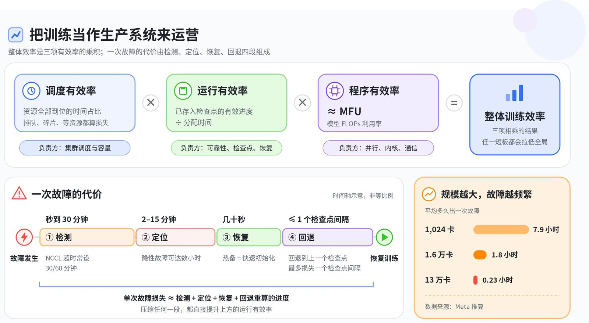
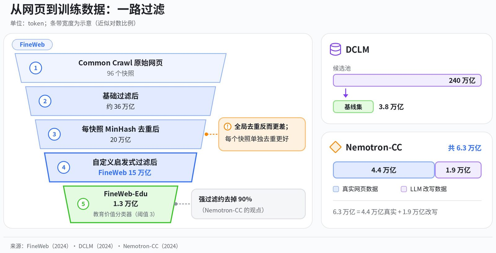
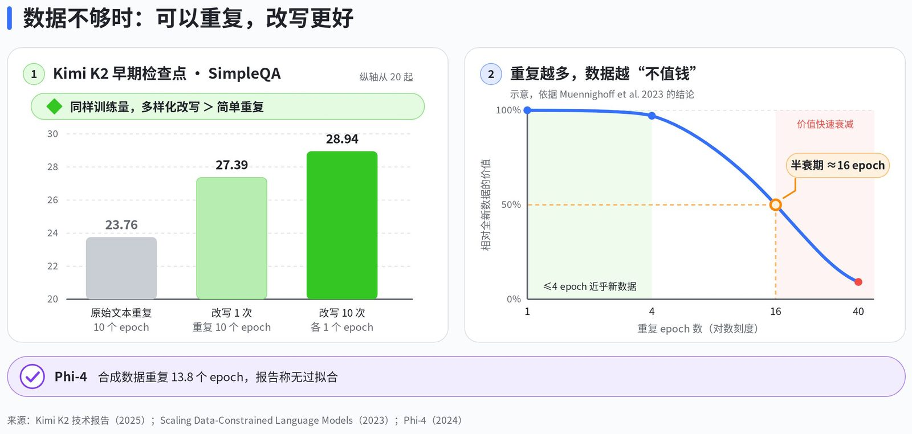
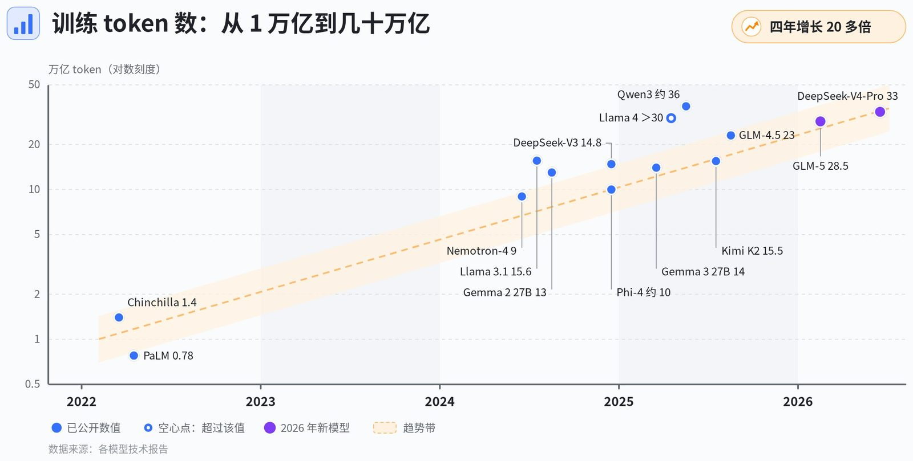
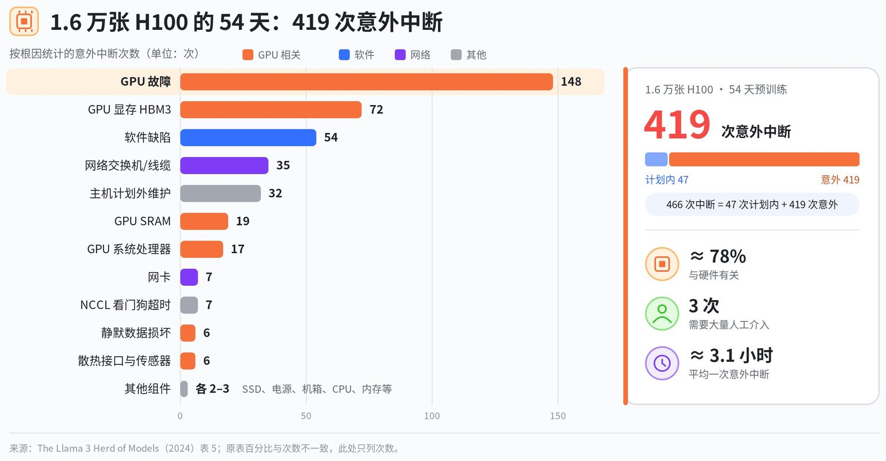
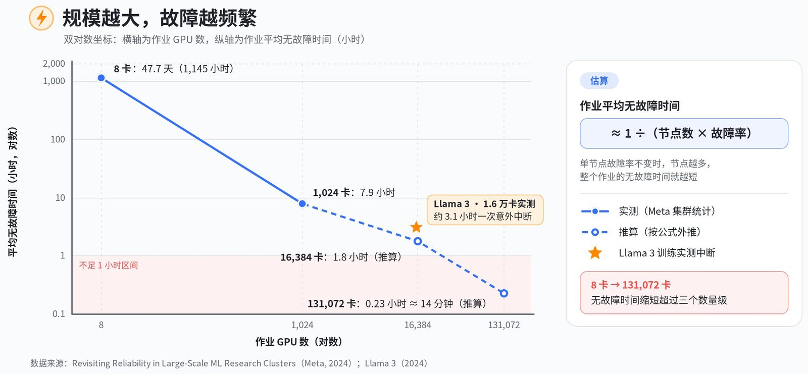
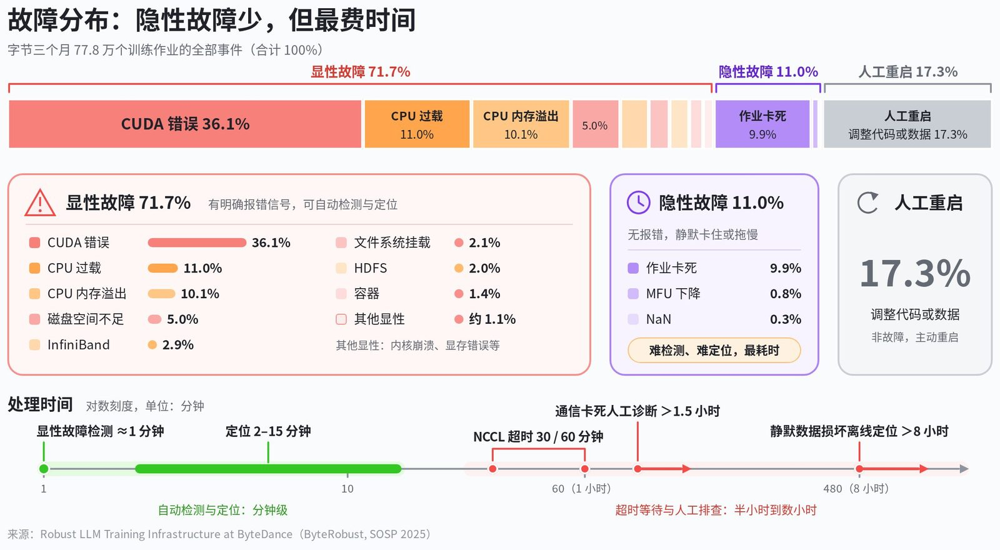
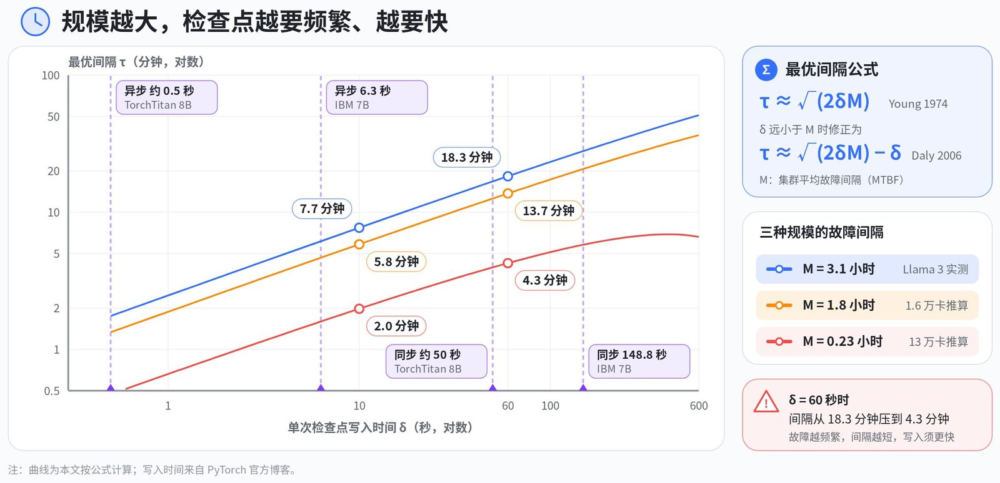
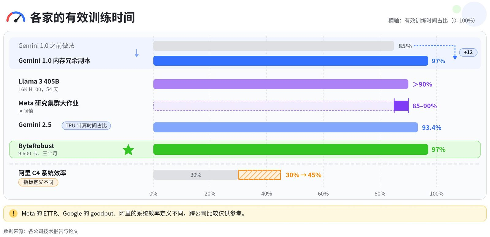

# LLM-23｜系统｜大模型训练工程：数据配比与万卡稳定性

> 🎯 **这篇文档解决什么问题**：预训练这一端的两件工程问题，**数据怎么准备和配比**，以及**一个几千到几万张卡、跑几个月的训练任务怎么保持稳定**。后者本质上是一个运维问题：故障率、检测与定位时间、恢复时间、检查点间隔、有效训练时间，和 SRE 熟悉的可用性工程是同一套思路，只是对象从服务变成了一个巨大的同步作业。全文基于约 50 项一手资料：Meta、Google、字节、DeepSeek、月之暗面、阿里等的技术报告和系统论文。
>
> 使用方式：做数据的读第 2、3 章；管集群和训练任务稳定性的从第 4 章读起，重点是第 5–9 章；遇到损失尖峰查第 10 章。文中版本和公开数据核对于 2026 年 10 月 11 日。
>
> **代码**：配套练习在 llm-book 仓库的 `23-training-reliability/`，2 个练习对应第 7、8 章（万卡集群的故障间隔、有效训练时间预算、检查点间隔）。只用 Go 标准库，进目录跑 `go test -race ./...` 就能验证；每个练习加 `-broken` 运行能看到有问题的早期写法，练习 README 末尾附参考答案。

## 导读 · 先给结论

- **数据：过滤比堆量重要，但别过滤过头**。FineWeb-Edu 用 1.3 万亿 token 在 MMLU 上追平了约 10 倍 token 的其他数据集；NVIDIA 则指出这类强过滤丢掉了约 90% 的数据，改用多分类器集成加改写，可以在同等质量下保留 4 倍的独特 token。
- **配比和退火是便宜的杠杆**。Llama 3 最终配比约为通用知识 50%、数学推理 25%、代码 17%、多语言 8%；8B 模型在训练末尾用少量高质量数学和代码数据退火，GSM8k 提升 24.0%。
- **数据不够时可以重复**：重复 4 个 epoch 和全新数据几乎没有区别，超过约 16 个 epoch 收益迅速消失。
- **规模越大，故障越频繁**。Meta 的统计：8 卡作业平均 47.7 天出一次故障，1,024 卡 7.9 小时，按此推算 16K 卡 1.8 小时、13 万卡 0.23 小时。Llama 3 405B 在 54 天里中断 466 次，其中 419 次是意外，约 78% 与硬件有关。
- **有效训练时间是核心指标**。Llama 3 超过 90%；字节 ByteRobust 在 9,600 卡上跑三个月做到 97%；Gemini 用内存中的冗余副本从 85% 提升到 97%。
- **隐性故障最难**：卡死、性能下降、NaN、静默数据损坏（SDC）。一次 SDC 的离线定位用了 8 个多小时；Google 预期每一两周就会遇到一次 SDC。
- **检查点要又快又频繁**：异步检查点把 7B 模型的停顿从 148.8 秒降到 6.3 秒；ByteRobust 能做到每步保存，开销低于 0.9%。
- **数值稳定性已经有一套成熟手段**：QK-Norm、z-loss、logit 软截断、QK-Clip。Kimi K2 在 15.5 万亿 token 上没有一次损失尖峰，但 DeepSeek-V4 仍然遇到了反复的尖峰，需要新的手段。

| 章节 | 内容 | 谁最该读 |
|---|---|---|
| 第 1 章 把训练当生产系统 | 指标、规模与成本基线 | 所有人 |
| 第 2 章 网页数据流水线 | 过滤、去重、模型打分 | 做数据的人 |
| 第 3 章 配比、退火与合成数据 | 配比搜索、课程、重复上限、改写 | 做数据的人 |
| 第 4 章 算力规划 | Chinchilla、过训练、GPU 时估算 | 做规划和预算的人 |
| 第 5 章 万卡集群会坏在哪里 | 故障分类与规模效应 | SRE、训练平台 |
| 第 6 章 静默数据损坏与慢节点 | 最难发现的两类问题 | SRE、训练平台 |
| 第 7 章 检测、定位与恢复 | 心跳、诊断、驱逐、热备 | SRE、训练平台 |
| 第 8 章 检查点工程 | 最优间隔公式、异步与内存检查点 | 训练平台 |
| 第 9 章 弹性与容错训练 | 热备、弹性、副本组容错、低带宽训练 | 训练平台 |
| 第 10 章 数值稳定性 | 损失尖峰的成因与处置手册 | 训练算法、值班 |
| 第 11 章 效率、电力与跨数据中心 | MFU 分解、功率波动、多集群训练 | SRE、基础设施 |

📎 与系列其他文档的分工：模型怎么训练见「LLM 基础」；GPU 怎么用好见「GPU 优化深入浅出」；推理服务怎么稳定见「LLM 服务稳定性工程」；SFT 和强化学习见「后训练实战」。本文只讲预训练这一端的数据工程和万卡稳定性。

## 第 1 章 · 把训练当作一个生产系统

一次前沿模型的预训练要几千到几万张卡连续跑几周到几个月。期间任何一张卡、一根线缆、一个存储节点出问题，整个同步作业都会停下来。所以训练团队要运营的是一个长期在线、状态巨大、对故障极其敏感的系统，远不止“跑一个任务”。

### 1.1 三层指标

Google 把训练的整体效率拆成三个相乘的部分[[1]](https://arxiv.org/abs/2502.06982)，这个框架很适合做看板：

| 指标 | 含义 | 谁负责 |
|---|---|---|
| 调度有效率 | 所需资源全部到位的时间占比 | 集群调度、容量规划 |
| 运行有效率 | 已保存到检查点的有效进度占分配时间的比例；故障后丢失的进度不算 | 可靠性、检查点、恢复速度 |
| 程序有效率 | 约等于 MFU，即实际有效计算量占硬件峰值的比例 | 并行策略、内核、通信 |

各家的叫法不同：Meta 用 ETTR（有效训练时间比例），Google 早期用 goodput（有效新步数的计算时间占总时长的比例），阿里用“系统效率”。定义不完全一致，跨公司比较时要注意（第 11.1 节）。

### 1.2 规模与成本基线

| 模型 | 算力 | 规模 |
|---|---|---|
| Llama 3.1 系列[[2]](https://huggingface.co/meta-llama/Llama-3.1-405B) | 共 3,930 万 H100 时，其中 405B 用了 3,084 万 | 最多 1.6 万张 H100，405B 计算量 3.8×10²⁵ FLOPs |
| DeepSeek-V3[[3]](https://arxiv.org/abs/2412.19437) | 278.8 万 H800 时，按每小时 2 美元约 558 万美元；不含此前的研究和消融实验 | 2,048 张 H800，每万亿 token 约 18 万 GPU 时，即 3.7 天 |
| BLOOM 176B[[4]](https://arxiv.org/abs/2211.05100) | 约 108 万计算小时 | 384 张 A100，约 3.5 个月 |
| Llama 4 Behemoth[[5]](https://ai.meta.com/blog/llama-4-multimodal-intelligence/) | FP8 训练，每卡 390 TFLOPs | 3.2 万张 GPU，训练数据超过 30 万亿 token |

DeepSeek-V3 的 558 万美元经常被引用，但报告明确说不含前期研究和消融实验的成本[[3]](https://arxiv.org/abs/2412.19437)，它反映的是“最后一次正式训练”的租卡价格，而不是做出这个模型的总成本。

### 1.3 SRE 的视角

- **故障预算**：有效训练时间目标 90% 意味着每天最多损失约 2.4 小时，需要拆分到检测、定位、恢复和检查点回退各环节（第 7、8 章）。
- **变更管理**：Llama 3 的 466 次中断里有 47 次是计划内的，比如固件升级、配置和数据集更新[[6]](https://arxiv.org/abs/2407.21783)；字节的统计中，为调整代码和数据而手动重启占全部事件的 17.3%[[7]](https://arxiv.org/abs/2509.16293)。计划内变更也要纳入预算。
- **值班**：训练作业 7×24 运行，损失尖峰、卡死、性能下降都需要有人在分钟级响应，这需要一份像线上服务那样的处置手册（第 10.4 节）。

## 第 2 章 · 预训练数据工程 I：网页数据流水线

预训练数据的主体是网页，最常见的来源是 Common Crawl。从原始网页到可用的训练数据，要经过抽取、语言识别、启发式过滤、去重、模型打分几步，每一步都在质量和数量之间取舍。

### 2.1 FineWeb：一个公开的完整流水线

Hugging Face 的 FineWeb[[8]](https://arxiv.org/abs/2406.17557) 把每一步的效果都做了消融，是了解这条流水线的最好材料：

- **来源**：96 个 Common Crawl 快照。基础过滤（URL 黑名单、fastText 英文置信度 0.65 以上、质量和重复过滤）后约 36 万亿 token。
- **去重**：MinHash，5-gram，112 个哈希函数（14 个桶 × 8 个），目标是相似度 75% 以上的文档。一个反直觉的发现是：**跨所有快照全局去重反而降低了质量**，每个快照内部单独去重得到 20 万亿 token，效果更好。比如 2013-48 快照全局去重后只剩约 310 亿 token，而被“去掉”的约 4,600 亿 token 单独去重后（1,710 亿）训出的模型更好。
- **自定义启发式**：以标点结尾的行占比不超过 0.12 的文档删掉（去掉 10.14% 的 token）、重复行字符占比 0.1 以上的删掉（12.47%）、短行占比 0.67 以上的删掉（3.73%）。合计去掉约 22% 的 token，综合分数提升约 1%。最终得到 15 万亿 token。
- **FineWeb-Edu**：用 Llama-3-70B-Instruct 给 46 万个网页打“教育价值”分（0–5），训练一个分类器，阈值取 3，得到 1.3 万亿 token。在 MMLU 上，它用约十分之一的 token 达到了其他数据集的最终表现。

### 2.2 模型打分过滤是关键

- **DCLM**[[9]](https://arxiv.org/abs/2406.11794)：从 240 万亿 token 的 Common Crawl 池里筛出 3.8 万亿 token 的基线集。7B 模型训 2.6 万亿 token，MMLU 5-shot 64%，与 Llama 3 8B（66%）相当，算力只有其六分之一左右。结论是“模型打分过滤是关键”：在 7B、2,800 亿 token 的设置下，仅更换过滤模型就能让 MMLU 在 35% 到 44% 之间变化；最好的反而是一个简单的 fastText 二元组分类器。
- **Nemotron-CC**[[10]](https://arxiv.org/abs/2412.02595)：NVIDIA 指出，FineWeb-Edu 和 DCLM 这类强过滤去掉了约 90% 的数据，而且两者内部约 80% 是近似重复，独特 token 分别只有约 0.2 万亿和 1 万亿。它改用多个分类器集成打分、对低质量数据做改写、减少对启发式规则的依赖，得到 6.3 万亿 token（4.4 万亿全局去重后的真实数据加 1.9 万亿改写数据），同等 MMLU 下独特真实 token 是 DCLM 的 4 倍。8B 模型训 15 万亿 token，MMLU 比 Llama 3.1 8B 高 5 分。

两者的结论并不矛盾：**短训练要最高质量的数据；长训练（十几万亿 token）数据量本身成了约束，需要在质量和多样性之间找平衡**。

### 2.3 原始数据加质量信号

RedPajama-V2[[11]](https://arxiv.org/abs/2411.12372) 走了另一条路：从 84 个快照处理出五种语言的原始网页数据，不做过滤，而是为每个文档附上 46 个质量信号，其中 50 万亿 token 的子集发布了信号，让使用者自己决定过滤标准。RedPajama 的数据被 Snowflake Arctic、Salesforce XGen、Ai2 OLMo 等模型使用。

### 2.4 过滤也关乎稳定性

OLMo 2 发现，包含长重复序列（32 个以上重复的 n-gram）的文档与梯度范数和损失尖峰有关，于是在数据层面直接过滤掉这些文档[[12]](https://arxiv.org/abs/2501.00656)。数据质量问题不仅影响模型能力，也会变成训练稳定性问题（第 10 章）。

### 2.5 词表

| 模型 | 词表 |
|---|---|
| Llama 3 | 12.8 万，其中 10 万来自 tiktoken，另加 2.8 万非英语 token[[6]](https://arxiv.org/abs/2407.21783) |
| DeepSeek-V3 | 字节级 BPE，12.8 万，预分词针对多语言压缩率调整[[3]](https://arxiv.org/abs/2412.19437) |
| Qwen3 | 字节级 BPE，151,669[[13]](https://arxiv.org/abs/2505.09388) |
| Gemma 3 | SentencePiece，数字拆分、保留空白，约 26.2 万[[14]](https://arxiv.org/abs/2503.19786) |

词表越大，多语言和代码的压缩率越高，但嵌入层和输出层越大。中文场景下词表对每个字符的 token 数影响明显，直接关系到训练和推理成本。

## 第 3 章 · 预训练数据工程 II：配比、退火、重复与合成数据

### 3.1 配比：先在小模型上搜

不同来源的数据（网页、代码、数学、书籍、多语言）该各占多少，直接在大模型上试代价太高。两种常用方法：

- **DoReMi**[[15]](https://arxiv.org/abs/2305.10429)：用一个 2.8 亿参数的代理模型做分布鲁棒优化，求出各领域权重，再用于 80 亿参数的模型（大 30 倍）。在 The Pile 上平均少样本准确率提升 6.5 个百分点，达到基线准确率所需步数减少 2.6 倍。
- **RegMix**[[16]](https://arxiv.org/abs/2407.01492)：训练 512 个 100 万参数的小模型，每个用不同配比训 10 亿 token，拟合一个回归模型预测最优配比，再训一个 10 亿参数、250 亿 token 的模型（大 1,000 倍、长 25 倍），结果在 64 个候选配比中最好。只用 DoReMi 10% 的算力就能达到或超过它。一个发现是：与下游表现正相关最强的是网页数据，而不是维基百科。

### 3.2 实际配比与多阶段训练

- **Llama 3**[[6]](https://arxiv.org/abs/2407.21783)：约 15 万亿 token，最终配比约为通用知识 50%、数学与推理 25%、代码 17%、多语言 8%。405B 训了 15.6 万亿 token。
- **Qwen3**[[13]](https://arxiv.org/abs/2505.09388)：约 36 万亿 token，覆盖 119 种语言和方言。分三个阶段：通用阶段 30 万亿 token 以上、序列长度 4,096；推理阶段约 5 万亿更高质量的 token，增加理工科、代码、推理和合成数据，学习率衰减更快；最后是长上下文阶段。数据扩充用了 Qwen2.5-VL 从 PDF 类文档中 OCR 文字，并用 Qwen2.5-Math、Qwen2.5-Coder 生成合成数据。
- **OLMo 2**[[12]](https://arxiv.org/abs/2501.00656)：预训练占 90% 以上的计算量，主要是网页数据；之后的“中期训练”占 5%–10%，用上采样的高质量网页、精选的非网页数据和数学合成数据。

### 3.3 退火：训练末尾的高质量数据

Llama 3 在训练末尾学习率降到 0 的过程中混入少量高质量的代码和数学数据，8B 模型 GSM8k 提升 24.0%、MATH 提升 6.4%，但对 405B 影响可以忽略[[6]](https://arxiv.org/abs/2407.21783)。Meta 还用退火来评估一份新数据的价值：拿训练到一半的 8B 模型，用 400 亿 token 把学习率线性降到 0，其中新数据占 30%，看下游指标变化。这比为每份数据从头训一个模型便宜得多。

最后 4,000 万 token 在 12.8 万上下文长度下把学习率退火到 0，上采样质量最高的数据，最后再对检查点做 Polyak 平均[[6]](https://arxiv.org/abs/2407.21783)。

### 3.4 数据不够时可以重复多少次

Muennighoff 等人做了 400 次训练，最多 9,000 亿 token、90 亿参数[[17]](https://arxiv.org/abs/2305.16264)：

- 重复 4 个 epoch 以内，损失和全部用新数据几乎没有区别。
- 重复数据的“半衰期”约为 16 个 epoch，超过之后收益迅速下降。

Phi-4 是一个极端的例子[[18]](https://arxiv.org/abs/2412.08905)：14B 模型训约 10 万亿 token，配比为网页 15%（1.3 万亿独特 token，1.2 个 epoch）、网页改写 15%（2,900 亿，5.2 个 epoch）、合成数据 40%（2,900 亿，13.8 个 epoch）、代码 20%（8,200 亿，2.4 个 epoch）、外购数据 10%（5,800 亿，1.7 个 epoch）。合成数据重复了约 14 次，报告称没有观察到过拟合。

### 3.5 改写与合成数据

- **Kimi K2 的知识改写**[[19]](https://arxiv.org/abs/2507.20534)：用多种风格的提示词改写知识类文本，长文档分块改写，再验证改写的忠实度；数学文本改写成“学习笔记”风格。在早期检查点上，SimpleQA：原始维基文本重复 10 个 epoch 是 23.76，改写 1 次重复 10 个 epoch 是 27.39，改写 10 次各用 1 个 epoch 是 28.94。**同样的训练量，多样化的改写比简单重复更好**。
- **Phi-4**：50 大类合成数据，约 4,000 亿 token[[18]](https://arxiv.org/abs/2412.08905)。
- **Nemotron-4 340B**：对齐阶段 98% 以上的数据是合成的[[20]](https://arxiv.org/abs/2406.11704)。

📎 延伸阅读：2026 年 11 月关于预训练数据统计量塑造学习阶段、固定预算下人类与合成数据性价比、以及 SFT 数据构成如何决定 RL 与 SFT 差距的三篇新证据，已并入合成数据专题，见 [LLM-40｜地基｜合成数据与数据飞轮：生成、过滤与评测集构造](./40-synthetic-data.md)。

## 第 4 章 · 算力规划：规模定律与过训练

📎 延伸阅读：MoE 的缩放律、负载均衡与专家并行通信账见 [LLM-33｜地基｜MoE 混合专家：路由、负载均衡、训练与推理](./33-moe.md)；用小预算亲手跑一遍预训练见 [LLM-30｜地基｜动手实验：从零训练一个小模型](./30-train-small-model.md)。

### 4.1 Chinchilla 与它的修正

DeepMind 训练了 400 多个模型（7,000 万到 160 亿参数，50 亿到 5,000 亿 token），得出计算最优的条件：**模型规模和训练 token 数应该同比例增长**，模型大一倍，数据也要多一倍[[21]](https://arxiv.org/abs/2203.15556)。Chinchilla 70B 用了 Gopher 4 倍的数据（1.4 万亿 token）和相同的算力，超过了 Gopher 280B、GPT-3 175B 和 MT-NLG 530B。

但这是“训练算力最优”，不是“总成本最优”。模型训完之后要长期推理，小模型推理便宜，所以业界普遍**过训练**：用远超 Chinchilla 比例的数据训小模型。

- Llama 3 405B 用 15.6 万亿 token，大致是计算最优的；但 8B 和 70B 也用了约 15 万亿 token[[6]](https://arxiv.org/abs/2407.21783)。
- DCLM 7B 训 2.6 万亿 token[[9]](https://arxiv.org/abs/2406.11794)；Gemma 3 1B 训 2 万亿 token[[14]](https://arxiv.org/abs/2503.19786)。
- MiniCPM 报告的计算最优数据与参数比远高于 Chinchilla[[22]](https://arxiv.org/abs/2404.06395)。
- **Kaplan 和 Chinchilla 为什么结论不同**：Porian 等人在 OpenWebText2 和 RefinedWeb 上复现了 Kaplan 的实验，把差距归到三个因素：最后一层的计算量没算进去、预热时长、优化器超参没有随规模调整。三处修正之后，结论和 Chinchilla 一致。他们还发现精细的学习率衰减并非必需，小 batch 下 AdamW 的 β2 必须调[[54]](https://arxiv.org/abs/2406.19146)。做自己的规模实验时，这三项先对齐，再拿拟合出的指数去比。

### 4.2 训练 token 数的增长

| 模型 | 时间 | 训练 token | 备注 |
|---|---|---|---|
| Chinchilla 70B | 2022-03 | 1.4 万亿 | [[21]](https://arxiv.org/abs/2203.15556) |
| PaLM 540B | 2022-04 | 7,800 亿 | [[23]](https://arxiv.org/abs/2204.02311) |
| Llama 3.1 405B | 2024-07 | 15.6 万亿 | [[6]](https://arxiv.org/abs/2407.21783) |
| DeepSeek-V3 671B-A37B | 2024-12 | 14.8 万亿 | MoE[[3]](https://arxiv.org/abs/2412.19437) |
| Llama 4 | 2025-04 | 超过 30 万亿 | 多模态混合[[5]](https://ai.meta.com/blog/llama-4-multimodal-intelligence/) |
| Qwen3 | 2025-05 | 约 36 万亿 | 119 种语言[[13]](https://arxiv.org/abs/2505.09388) |
| Kimi K2 1.04T-A32B | 2025-07 | 15.5 万亿 | [[19]](https://arxiv.org/abs/2507.20534) |
| GLM-4.5 355B-A32B | 2025-08 | 23 万亿 | [[24]](https://arxiv.org/abs/2508.06471) |
| GLM-5 744B-A40B | 2026-02 | 28.5 万亿 | 基座[[25]](https://arxiv.org/abs/2602.15763) |
| DeepSeek-V4-Pro 1.6T-A49B | 2026-06 | 33 万亿 | V4-Flash 32 万亿[[26]](https://arxiv.org/abs/2606.19348) |

四年间训练 token 数增长了 20 多倍，达到几十万亿 token。这意味着高质量的公开网页数据已经接近用尽，这也是第 3 章的重复、改写和合成数据变得重要的原因。

### 4.3 估算 GPU 时

常用的粗略估算：稠密模型训练计算量 ≈ 6 × 参数量 × token 数（FLOPs），除以“单卡峰值 × MFU × 卡数”得到训练时长。几个实际数字可以用来校准：

- Llama 3.1 405B：3,084 万 H100 时训 15.6 万亿 token[[2]](https://huggingface.co/meta-llama/Llama-3.1-405B)，折合每万亿 token 约 198 万 H100 时（本文按公开数字计算）。
- DeepSeek-V3：每万亿 token 约 18 万 H800 时[[3]](https://arxiv.org/abs/2412.19437)。它是 MoE，每个 token 只激活 370 亿参数，加上 FP8 训练，所以每万亿 token 的成本低一个数量级。两者硬件和架构都不同，不能直接比效率。

预算时还要留出余量：消融实验、失败的尝试、长上下文扩展和后训练。DeepSeek-V3 的长上下文扩展用了 11.9 万 GPU 时、后训练 5,000 GPU 时，只占正式训练的一小部分[[3]](https://arxiv.org/abs/2412.19437)，但前期研究的成本没有公开。

## 第 5 章 · 故障学：万卡集群会坏在哪里

### 5.1 Llama 3 405B 的 54 天

Meta 公开了 Llama 3 405B 预训练期间一段 54 天的中断记录[[6]](https://arxiv.org/abs/2407.21783)：共 466 次中断，47 次是计划内的（固件升级、配置和数据集更新），419 次是意外。意外中断中约 78% 确认或怀疑是硬件问题，GPU 相关占 58.7%。整个期间只有 3 次需要大量人工介入，其余都是自动处理的。

| 根因 | 次数 | 说明 |
|---|---|---|
| GPU 故障 | 148 | 最大的一类 |
| GPU 显存（HBM3） | 72 |  |
| 软件缺陷 | 54 | 唯一一个大类的非硬件原因 |
| 网络交换机、线缆 | 35 |  |
| 主机计划外维护 | 32 |  |
| GPU SRAM | 19 |  |
| GPU 系统处理器 | 17 |  |
| 网卡、NCCL 看门狗超时 | 各 7 |  |
| 静默数据损坏 | 6 | 见第 6 章 |
| 其他（散热、SSD、电源、机箱、CPU、内存等） | 各 2–6 |  |

注：原表同时印有百分比，但与次数 ÷ 419 对不上（例如 148/419 是 35.3%，原表印的是 30.1%），这里只列次数。按 419 次算，平均约每 3.1 小时一次意外中断。

Meta 还观察到两个环境因素：中午气温升高影响 GPU 的动态调频，导致吞吐有 1%–2% 的日内波动；数万张 GPU 同时启停，会造成几十兆瓦的功率波动（第 11.2 节）。

### 5.2 规模越大，平均无故障时间越短

Meta 对两个研究集群做了 11 个月的统计（1.6 万卡和 8,000 卡，400 万个作业，超过 1.5 亿 A100 GPU 时）[[27]](https://arxiv.org/abs/2410.21680)：

- 故障率：每 1,000 个节点日 6.50 次（1.6 万卡集群）和 2.34 次；随时间在 2.5 到 17.5 之间波动。
- 作业的平均无故障时间约等于 1 ÷（节点数 × 故障率）。实测 8 卡作业 47.7 天，1,024 卡作业 7.9 小时；推算 16,384 卡 1.8 小时，131,072 卡只有 0.23 小时（约 14 分钟）。
- 要让约 1.2 万卡的作业有效训练时间达到 90%，要么检查点写入开销降到约 10 秒，要么故障率从 6.50 降到 1 左右。

这是整个可靠性工程的出发点：**到了十万卡级别，故障不再是偶发事件，而是每十几分钟一次的常态**。系统必须按“随时会坏”来设计。

### 5.3 坏节点：少数节点造成多数故障

Meta 在两个集群合计识别出 40 个反复出问题的节点（“柠檬节点”），检测准确率超过 85%：RSC-1 有 24 个、约占该集群的 1.2%，RSC-2 有 16 个、约占 1.7%；论文另按自己的口径报告这类节点牵涉到每天 13% 的作业；剔除后，512 卡以上大作业的失败率从 14% 降到 4%[[27]](https://arxiv.org/abs/2410.21680)。

### 5.4 字节：77.8 万个作业的事件分布

ByteRobust（SOSP 2025）统计了三个月里 778,135 个训练作业的事件[[7]](https://arxiv.org/abs/2509.16293)：

| 类别 | 主要事件（占比） | 特点 |
|---|---|---|
| 显性故障 | CUDA 错误 36.1%，CPU 过载 11.0%，CPU 内存溢出 10.1%，磁盘空间不足 5.0%，InfiniBand 错误 2.9%，文件系统挂载 2.1%，HDFS 错误 2.0%，容器错误 1.4% | 有报错，检测约 60 秒，定位 2–15 分钟 |
| 隐性故障 | 作业卡死 9.9%，MFU 下降 0.8%，NaN 0.3% | 没有报错，最难发现 |
| 人工重启 | 调整代码或数据 17.3% | 计划内变更 |

隐性故障的处理时间远长于显性故障：一次由 CUDA 错误引起的通信卡死，人工诊断用了 1.5 个多小时；一次与数据类型相关的 GPU 静默数据损坏，离线压测了 8 个多小时才找到。NCCL 卡死的超时一般设为 30 或 60 分钟，也就是说，光是“发现卡住了”就可能要等半小时以上[[7]](https://arxiv.org/abs/2509.16293)。

### 5.5 更早的经验

- **OPT-175B**（992 张 A100，两个月）：至少 35 次人工重启，更换了 100 多台主机，估计还有 70 多次自动重启[[28]](https://arxiv.org/abs/2205.01068)。
- **BLOOM 176B**（384 张 A100）：平均每周坏 1–2 张 GPU，自动切到备用节点；数据加载器死锁和磁盘空间问题各造成过 5–10 小时停机[[4]](https://arxiv.org/abs/2211.05100)。
- **阿里**：引入 C4 系统之前，超过 30% 的训练时间花在从系统错误中恢复[[29]](https://arxiv.org/abs/2406.04594)。
- **OpenAI GPT-4.5**：无法沿用 GPT-4 的训练栈，算力不在一个集群里，需要多集群训练；下一个十倍规模需要“与工作负载协同设计”的容错[[30]](https://www.youtube.com/watch?v=6nJZopACRuQ)。

## 第 6 章 · 静默数据损坏与慢节点

这两类问题的共同点是：**没有任何报错**。作业照常运行，只是结果悄悄错了，或者整体悄悄变慢了。

### 6.1 静默数据损坏有多常见

- **Meta**：在数十万台机器上跑静默错误测试，监控 18 个多月，发现了数百个有问题的 CPU；观察到的错误率比基于软错误模型的模拟高几个数量级，而且是跨代际的系统性问题[[31]](https://arxiv.org/abs/2102.11245)。
- **Google**：大约每几千台机器有几个“反复无常的核心”，与 Meta 的观察相当。这类错误与具体的核心有关，可能在装机很久之后才出现，也可能被一次看似无害的软件改动触发，比如某个库开始使用很少用到的指令[[32]](https://research.google/pubs/cores-that-dont-count/)。
- **训练中**：Gemini 1.0 的报告预期“每一两周就会有一次静默数据损坏影响训练”[[33]](https://arxiv.org/abs/2312.11805)。

### 6.2 对训练的影响

有研究用生产集群中被淘汰的、确实会出错的节点做对照实验，在确定性执行下比较训练过程[[34]](https://arxiv.org/abs/2502.12340)：大多数情况下对子模块输出和梯度的扰动很小，但也会让模型收敛到不同的最优点，或者引发损失尖峰。也就是说，有些损失尖峰的根因其实在硬件上，而不在数据或超参上。

### 6.3 怎么检测

- **确定性重放**：Gemini 2.5 对可疑的训练步做确定性重放，并在每个设备上计算中间结果的校验和，比较是否一致。这样几分钟内就能定位出问题的加速器；约 0.25% 的训练步被重放，其中 6% 确实是硬件损坏[[35]](https://arxiv.org/abs/2507.06261)。
- **空闲时扫描**：Gemini 1.0 在空闲机器和热备机上主动跑 SDC 扫描程序[[33]](https://arxiv.org/abs/2312.11805)。
- **两阶段重放**：ByteRobust 也用重放来定位 SDC[[7]](https://arxiv.org/abs/2509.16293)。

前提是训练本身可以确定性重放。DeepSeek-V4 就专门使用了批次无关的确定性内核，以实现按位可复现[[26]](https://arxiv.org/abs/2606.19348)。

### 6.4 慢节点：拖慢的原因大多不是硬件

同步训练里，最慢的那一张卡决定所有卡的速度。字节分析了五个月的训练集群记录[[36]](https://arxiv.org/abs/2505.05713)：

- 42.5% 的作业因为慢节点至少慢了 10%；在最差的情况下，慢节点浪费了 45% 的资源。
- 主要原因**与坏硬件无关**，出在流水线阶段划分不均衡、不同微批次的序列长度不均衡，以及 Python 垃圾回收造成的停顿。
- 计算变慢比通信变慢更常见；慢节点问题和作业规模没有正相关。

所以排查慢节点时，先看负载是否均衡（流水线划分、序列长度分布）和垃圾回收，再怀疑硬件。字节的 MegaScale 用 CUDA 事件时间线和热力图找慢节点[[37]](https://arxiv.org/abs/2402.15627)；Meta 在 Llama 3 训练中优先处理慢节点，并用 NCCL 飞行记录器定位通信问题[[6]](https://arxiv.org/abs/2407.21783)。

## 第 7 章 · 检测、定位与恢复

一次故障的代价 = 检测时间 + 定位时间 + 恢复时间 + 回退到上一个检查点损失的进度。这一章讲前三项，第 8 章讲最后一项。

### 7.1 检测

- **心跳与自检**：MegaScale 让每个训练进程定期发心跳，并在启动和运行中做自检诊断；超过 90% 的软硬件故障能被自动识别和修复，一次持续几周、重启 100 多次的生产训练主要靠这套机制[[37]](https://arxiv.org/abs/2402.15627)。
- **NCCL 飞行记录器**：Meta 在 PyTorch 里实现了集合通信的环形缓冲区，记录每次通信的元数据和调用栈，在看门狗或心跳超时时自动转储，用于定位卡死的是哪个进程、卡在哪一步[[6]](https://arxiv.org/abs/2407.21783)。
- **隐性故障的指标**：卡死（一段时间没有新的训练步）、MFU 下降、NaN、损失异常。这些需要从训练指标上设告警，而不是依赖报错[[7]](https://arxiv.org/abs/2509.16293)。

### 7.2 定位：宁可多驱逐

ByteRobust 的一个关键策略是**不追求精确的根因，而是按并行组的故障域多驱逐一些**：对所有进程的调用栈做聚类，找出与多数不同的那一组，把它所在的并行组整组驱逐，换上备用机继续训练，精确的根因留到离线慢慢查[[7]](https://arxiv.org/abs/2509.16293)。这和线上服务“先恢复、后排查”的原则一致。代价是多驱逐了几台正常机器，但比让几千张卡等着人工排查划算得多。

### 7.3 恢复：热备与热更新

- **热备机**：ByteRobust 预先准备好已通过自检的备用机；在 16,384 卡规模上，热备和热更新分别让恢复速度快 10.87 倍和 11.04 倍[[7]](https://arxiv.org/abs/2509.16293)。BLOOM 在 48 个节点的作业旁边准备了 4 个备用节点[[4]](https://arxiv.org/abs/2211.05100)。
- **初始化提速**：恢复时要重新初始化分布式环境。MegaScale 把 Megatron-LM 在 2,048 卡上的初始化时间从 1,047 秒降到 361 秒（用 Redis 替代 TCPStore），再降到 5 秒以内（调整屏障顺序，复杂度从 O(n²) 降到 O(n)）；1 万卡以上也在 30 秒以内[[37]](https://arxiv.org/abs/2402.15627)。
- **从内存副本恢复**：Gemini 在内存中保存模型状态的冗余副本，故障后直接从完好的副本恢复，最大作业的有效率从 85% 提升到 97%[[33]](https://arxiv.org/abs/2312.11805)。

### 7.4 时间预算

以 Meta 推算的 1.6 万卡作业为例，平均每 1.8 小时一次故障[[27]](https://arxiv.org/abs/2410.21680)。如果每次故障检测 1 分钟、定位 5 分钟、恢复 5 分钟、平均回退 7 分钟，每次损失约 18 分钟，有效训练时间只有约 83%。要达到 95%，每次故障的总损失要压到约 5 分钟（本文估算）。这就是为什么各家都在把检测做到秒级、定位自动化、恢复做到几十秒、检查点做到分钟级甚至每步。

## 第 8 章 · 检查点工程

### 8.1 最优检查点间隔

检查点存得太频繁，写入开销大；存得太少，故障时回退损失大。经典的 Young 公式给出最优间隔[[38]](https://doi.org/10.1145/361147.361115)：

<b>τ ≈ √(2δM)</b>，其中 δ 是一次检查点的写入时间，M 是平均故障间隔。

Daly 的高阶修正在 δ 远小于 M 时约为 √(2δM) − δ，并证明重启时间对最优间隔没有影响[[39]](https://doi.org/10.1016/j.future.2004.11.016)。用前面的数字代入（本文估算）：

| 平均故障间隔 | 写入 60 秒 | 写入 10 秒 |
|---|---|---|
| 3.1 小时（Llama 3 实测） | 约 18 分钟 | 约 8 分钟 |
| 1.8 小时（1.6 万卡推算） | 约 14 分钟 | 约 6 分钟 |
| 0.23 小时（13 万卡推算） | 约 4 分钟 | 约 2 分钟 |

结论：规模越大，检查点必须越频繁，而越频繁就要求单次写入越快。Google 的说法是，最优间隔“可能从几小时到几分钟不等”[[1]](https://arxiv.org/abs/2502.06982)。

### 8.2 从同步到异步

- **同步检查点**：训练停下来，所有进程把状态写到存储，写完再继续。停顿时间就是全部写入时间。
- **异步检查点**：先把状态从 GPU 拷到 CPU 内存（几秒），训练立刻继续，后台再写到存储。IBM 在 7B 模型上把停顿从 148.8 秒降到 6.3 秒；“从将近半小时降到 5 分钟以内，现在降到 30 秒以内”[[40]](https://pytorch.org/blog/reducing-checkpointing-times/)。TorchTitan 训练 Llama-3-8B，同步约 50 秒，异步阻塞不到 0.5 秒；在 1% 的开销预算下可以每 5 分钟（100 步）存一次[[41]](https://discuss.pytorch.org/t/distributed-w-torchtitan-optimizing-checkpointing-efficiency-with-pytorch-dcp/211250)。
- **ByteCheckpoint**（NSDI 2025）：统一支持不同并行方式、框架和存储后端，加载时可以重新切分。与 PyTorch DCP 和 Megatron 分布式检查点相比，平均停顿减少 54.2 倍，保存最多快 9.96 倍、加载最多快 8.80 倍[[42]](https://arxiv.org/abs/2407.20143)。
- **每步检查点**：ByteRobust 把状态备份到其他并行组的 CPU 内存和本地磁盘，做到每步保存，开销低于 0.9%[[7]](https://arxiv.org/abs/2509.16293)。

### 8.3 存储带宽

Llama 3 用的 Tectonic 存储有 240 PB，分布在 7,500 台 SSD 服务器上，持续带宽 2 TB/s，峰值 7 TB/s；每个 GPU 的检查点状态在 1 MB 到 4 GB 之间，集中写入时会打满存储[[6]](https://arxiv.org/abs/2407.21783)。规划时要按“所有卡同时写一次检查点”计算峰值带宽，或者用异步和分层（内存、本地盘、远端存储）把峰值摊平。

### 8.4 运维要点

- 定期做恢复演练：检查点存了不代表能恢复，要定期从检查点实际恢复一次，并验证损失曲线能接上。
- 保留多个历史检查点：损失尖峰时需要回退到更早的检查点（第 10 章）。
- 检查点格式要支持重新切分：故障后可用卡数变了，或者想换并行策略时，能直接加载。

## 第 9 章 · 弹性与容错训练

检查点加重启是“故障后恢复”。更进一步的思路是“故障时不停”：少了几台机器，训练照样继续。

### 9.1 按切片弹性

Gemini 2.5 在多个数据中心的多个 8,960 芯片的 TPUv5p pod 上做同步数据并行[[35]](https://arxiv.org/abs/2507.06261)。报告说硬件故障造成的中断“每小时多次”。它的做法是以切片为单位弹性伸缩：某个切片故障时，其余切片继续训练，每次中断只损失几十秒，而不是等待重新调度的 10 分钟以上；故障切片恢复期间吞吐保持在约 97%。整个训练 93.4% 的时间都在做 TPU 计算，剩下的约一半是弹性重配置，另一半是少见的长尾情况。

### 9.2 副本组容错

PyTorch 的 TorchFT 把数据并行的每个副本组当作一个故障域：一个副本组坏了，其余副本组继续训练，坏的那组恢复后重新加入[[43]](https://pytorch.org/blog/fault-tolerant-llama-training-with-2000-synthetic-failures-every-15-seconds-and-no-checkpoints-on-crusoe-l40s/)。一次压力测试在 300 张 L40S 上训练 1B 的 Llama，约每 15 秒注入一次故障，共 1,015 次，不使用检查点；平均只有 63% 的工作进程是健康的，训练效率只有 13.4%，但模型仍然收敛了。这是极端条件下的验证，不代表生产效率，但说明了“边坏边训”是可行的。

### 9.3 低带宽训练

同步数据并行每一步都要在所有副本间同步梯度，对网络要求很高，这也是跨数据中心训练的主要障碍。Google DeepMind 的 Streaming DiLoCo 每次只同步一部分参数、让同步与训练重叠、把外层梯度量化到 4 比特，在十亿参数规模上达到与数据并行相近的质量，带宽需求降低约 400 倍[[44]](https://arxiv.org/abs/2501.18512)。

### 9.4 各家手段对照

| 手段 | 例子 | 效果 |
|---|---|---|
| 备用节点 | BLOOM 48 个节点配 4 个备用[[4]](https://arxiv.org/abs/2211.05100)；ByteRobust 预先自检的热备[[7]](https://arxiv.org/abs/2509.16293) | 恢复不必等调度 |
| 剔除坏节点 | Meta 柠檬节点检测[[27]](https://arxiv.org/abs/2410.21680) | 大作业失败率 14% → 4% |
| 内存冗余副本 | Gemini 1.0[[33]](https://arxiv.org/abs/2312.11805) | 有效率 85% → 97% |
| 切片弹性 | Gemini 2.5[[35]](https://arxiv.org/abs/2507.06261) | 每次中断损失几十秒 |
| 副本组容错 | TorchFT[[43]](https://pytorch.org/blog/fault-tolerant-llama-training-with-2000-synthetic-failures-every-15-seconds-and-no-checkpoints-on-crusoe-l40s/) | 不停机、不依赖检查点 |
| 低带宽同步 | Streaming DiLoCo[[44]](https://arxiv.org/abs/2501.18512) | 带宽降约 400 倍 |

## 第 10 章 · 数值稳定性：损失尖峰的成因与处置

### 10.1 损失尖峰是什么

训练损失突然跳高，有时几步后自己回落，有时一路发散。PaLM 在训练中遇到了约 20 次尖峰，即使开启了梯度裁剪[[23]](https://arxiv.org/abs/2204.02311)。处理方法是从尖峰前约 100 步的检查点重启，跳过之后的 200–500 个数据批次。关键的发现是：用同样的数据批次从另一个检查点训练，并不会出现尖峰。所以尖峰来自“特定数据批次和特定参数状态的组合”，而不是数据本身有问题。

OPT-175B 的处理方式是降低学习率、从更早的检查点重启，并把梯度裁剪阈值从 1.0 降到 0.3；FP16 训练中动态损失缩放系数跌到 0 与发散相关，所以重启点选在缩放系数不低于 1.0 的地方[[28]](https://arxiv.org/abs/2205.01068)。

### 10.2 两类不稳定和对应的手段

Google DeepMind 发现大模型的两类不稳定都能在小模型上用高学习率复现[[45]](https://arxiv.org/abs/2309.14322)：

| 问题 | 手段 | 采用者 |
|---|---|---|
| 注意力 logit 过大 | QK-Norm：对 Q 和 K 做归一化 | Qwen3[[13]](https://arxiv.org/abs/2505.09388)、GLM-4.5[[24]](https://arxiv.org/abs/2508.06471)、OLMo 2[[12]](https://arxiv.org/abs/2501.00656) |
| 输出 logit 发散 | z-loss：约束 softmax 的归一化项，PaLM 系数为 10⁻⁴[[23]](https://arxiv.org/abs/2204.02311) | PaLM、OLMo 2 |
| logit 过大（另一种做法） | 软截断：注意力 logit 上限 50，最终层 30 | Gemma 2[[46]](https://arxiv.org/abs/2408.00118) |
| Muon 优化器下的注意力 logit 爆炸 | QK-Clip：每次更新后，若某个头的最大 logit 超过阈值（K2 取 100），就按比例缩小该头的 Q、K 权重 | Kimi K2[[19]](https://arxiv.org/abs/2507.20534) |

OLMo 2 还把 AdamW 的 ε 从 1e-5 降到 1e-8，并过滤掉含长重复序列的文档（第 2.4 节）[[12]](https://arxiv.org/abs/2501.00656)。

📎 展开阅读：上表这些手段在数值上为什么有效、各自切断了“误差 → 权重 → logit → 更多误差”环上的哪一环，以及 BF16 + FlashAttention 的损失爆炸如何追到一次舍入偏差，见第 54 篇 [LLM-54｜系统｜低精度训练的数值稳定性：从 FlashAttention 一次舍入偏差说起](./54-low-precision-training.md)。

### 10.3 2025–2026 年的进展

- **Kimi K2**：1.04 万亿总参数、320 亿激活参数的 MoE，用 Muon 优化器加 QK-Clip，训练 15.5 万亿 token **没有出现一次损失尖峰**。不加截断时，中等规模的 Muon 训练里注意力 logit 会超过 1,000[[19]](https://arxiv.org/abs/2507.20534)。
- **DeepSeek-V3**：FP8 混合精度训练，相对 BF16 的损失误差始终低于 0.25%；全程“没有遇到不可恢复的损失尖峰，也没有回退”[[3]](https://arxiv.org/abs/2412.19437)。
- **DeepSeek-V4**：报告承认“遇到了明显的不稳定问题”，单靠回退无法阻止反复出现的尖峰；原因是 MoE 层里的异常值，路由会放大它。对策是“预期路由”（用较早的参数预先计算路由，只在检测到尖峰时自动短回退并开启，开销约 20%，尖峰过去后关闭，总体额外开销可忽略），以及对 SwiGLU 的线性部分截断到 [−10, 10][[26]](https://arxiv.org/abs/2606.19348)。
- **Arcee Trinity**：三个模型都用 Muon，训练全程零损失尖峰[[47]](https://arxiv.org/abs/2602.17004)。

### 10.4 损失尖峰处置手册

1. **告警**：损失超过滑动均值若干倍标准差、梯度范数突增、出现 NaN，立即告警。
2. **先排除硬件**：看是否集中在某几张卡，必要时对这一步做确定性重放（第 6.3 节）。SDC 也会导致尖峰[[34]](https://arxiv.org/abs/2502.12340)。
3. **看是否自行恢复**：几十步内回落的小尖峰可以继续观察。
4. **回退并跳过数据**：从尖峰前约 100 步的检查点重启，跳过随后几百个批次[[23]](https://arxiv.org/abs/2204.02311)。
5. **反复出现**：降低学习率、收紧梯度裁剪[[28]](https://arxiv.org/abs/2205.01068)；检查注意力 logit 和 MoE 层的激活最大值，考虑加 QK-Norm 或截断；检查最近的数据是否有长重复序列。
6. **记录**：每次尖峰的步数、处置、结果都写进训练日志，OPT 和 BLOOM 公开的训练日志就是很好的参考[[28]](https://arxiv.org/abs/2205.01068)[[4]](https://arxiv.org/abs/2211.05100)。

### 10.5 学习率调度与超参迁移

- **WSD 调度**：预热、稳定的高学习率、衰减三段。损失在衰减段会明显下降；稳定段可以任意延长，方便持续训练和做规模实验，不必每次重训[[22]](https://arxiv.org/abs/2404.06395)。Kimi K2 预热 500 步后以 2e-4 恒定训练 10 万亿 token，再在 5.5 万亿 token 内余弦衰减到 2e-5[[19]](https://arxiv.org/abs/2507.20534)；DeepSeek-V3 在 2,000 步预热后以 2.2e-4 恒定训练到 10 万亿 token[[3]](https://arxiv.org/abs/2412.19437)。
- **μP**：按特定规则参数化后，小模型上调好的超参可以直接迁移到大模型。从 4,000 万参数模型迁移的超参超过了公开的 6.7B GPT-3，调参成本只占预训练的 7%[[48]](https://arxiv.org/abs/2203.03466)。
- **Muon**：加上权重衰减和逐参数的更新幅度调整后，在计算最优训练中约为 AdamW 两倍的计算效率[[49]](https://arxiv.org/abs/2502.16982)。DeepSeek-V4 也把大部分模块换成了 Muon[[26]](https://arxiv.org/abs/2606.19348)。
- **多 token 预测当训练目标**：在共享主干上挂 n 个独立输出头，每个头预测后面第 1 到第 n 个 token，作为辅助损失，训练时间不增加。收益随模型规模变大，13B 模型在 HumanEval 上多解出 12% 的题、MBPP 上多 17%；小模型上反而不如基线。训出的 4-token 模型推理时最快可到 3 倍[[55]](https://arxiv.org/abs/2404.19737)。所以这是一个和规模挂钩的选项，在小模型上做消融容易得出“没用”的结论。结构细节见「LLM 基础」，DeepSeek-V3/V4 的用法也在那里。

## 第 11 章 · 效率监控、电力与跨数据中心训练

### 11.1 MFU 与有效训练时间

MFU（模型浮点利用率）是模型理论计算量对应的吞吐占硬件峰值的比例；HFU 还计入激活重计算等额外计算，所以更高。PaLM 540B 的 MFU 46.2%、HFU 57.8%[[23]](https://arxiv.org/abs/2204.02311)。

| 系统 | 硬件规模 | MFU |
|---|---|---|
| GPT-3 175B | V100 | 21.3%[[23]](https://arxiv.org/abs/2204.02311) |
| Megatron-LM 1T | 3,072 张 A100 | 单卡峰值的 52%[[50]](https://arxiv.org/abs/2104.04473) |
| BLOOM 176B | 384 张 A100 | 156 TFLOPs，峰值的一半[[4]](https://arxiv.org/abs/2211.05100) |
| PaLM 540B | 6,144 个 TPU v4 | 46.2%[[23]](https://arxiv.org/abs/2204.02311) |
| MegaScale 175B（字节） | 12,288 张 GPU | 55.2%（小规模时 59.1%），是 Megatron-LM 的 1.34 倍[[37]](https://arxiv.org/abs/2402.15627) |
| Nemotron-4 340B | 1,536–6,144 张 H100 | 42.4%–41.0%[[20]](https://arxiv.org/abs/2406.11704) |
| Llama 3 405B | 8K–16K 张 H100 | 43%（8K）、41%（16K）、38%（16K、13.1 万序列长度）[[6]](https://arxiv.org/abs/2407.21783) |

MoE 模型通常报告吞吐而不是 MFU：字节的 MegaScale-MoE 在 1,440 张 Hopper GPU 上训练 352B 的 MoE，每秒 141 万 token，是 Megatron-LM 的 1.88 倍[[51]](https://arxiv.org/abs/2505.11432)。

有效训练时间的对比：

- Llama 3 405B：超过 90%[[6]](https://arxiv.org/abs/2407.21783)；Meta 研究集群的大作业 0.85–0.9[[27]](https://arxiv.org/abs/2410.21680)。
- Gemini 1.0：85% → 97%[[33]](https://arxiv.org/abs/2312.11805)；Gemini 2.5：93.4% 的时间在 TPU 计算[[35]](https://arxiv.org/abs/2507.06261)。
- ByteRobust：9,600 卡、三个月，97%[[7]](https://arxiv.org/abs/2509.16293)。
- 阿里 C4：“系统效率”从 30% 提升到 45%，指标定义不同，不能直接比[[29]](https://arxiv.org/abs/2406.04594)。

📎 强化学习训练里的 MFU 要换个看法。rollout 生成占了一次迭代的大半，训练卡常在等生成，只看训练阶段的 MFU 会高估整套系统的利用率。这段等待怎么拆开、怎么用异步压下去，见第 55 篇 [LLM-55｜系统｜RL 训练系统：rollout 与训练分离、异步与 Agent 环境](./55-rl-systems.md)。

### 11.2 电力：训练集群是电网上的大负载

- Llama 3 训练时，数万张 GPU 同时进入或离开计算（等待检查点和集合通信、作业启停），造成整个数据中心几十兆瓦的瞬时功率波动，“触及电网的极限”[[6]](https://arxiv.org/abs/2407.21783)。
- 微软、OpenAI 和 NVIDIA 的联合研究[[52]](https://arxiv.org/abs/2508.14318)：计算密集和通信密集阶段交替，导致功率同步摆动，规模大时达到几十到几百兆瓦。生产记录的频谱能量集中在 0.2–3 Hz，正好接近发电机组轴系和长输电线路的共振频率。对策有三层：软件（在通信阶段插入填充计算）、GPU 固件（GB200 的功率平滑，限制升降速率并设置功率下限）、机架级储能，建议组合使用。把功率下限设在 TDP 的 90% 会多消耗约 10.5% 的能量。

对 SRE 来说，这意味着训练作业的启停、检查点、故障恢复都会变成电力事件，需要和机房、电力团队协调，甚至要提前向电网报备。

### 11.3 跨数据中心训练

- PaLM 用两个 TPU v4 pod（各 3,072 芯片）通过数据中心网络连接[[23]](https://arxiv.org/abs/2204.02311)；Gemini 1.0 跨多个数据中心训练[[33]](https://arxiv.org/abs/2312.11805)；Gemini 2.5 在多个数据中心的多个 TPUv5p pod 上做同步数据并行[[35]](https://arxiv.org/abs/2507.06261)。
- OpenAI 训练 GPT-4.5 时，算力“不在一个集群里”，必须做多集群训练[[30]](https://www.youtube.com/watch?v=6nJZopACRuQ)。
- 微软的 Fairwater 数据中心（威斯康星和亚特兰大，2025 年 10 月上线）通过专用 AI 广域网连成一个“AI 超级工厂”，理由是大型训练的算力需求已经超出单个设施的电力和空间限制[[53]](https://blogs.microsoft.com/blog/2025/11/12/infinite-scale-the-architecture-behind-the-azure-ai-superfactory/)。
- Meta 的 Llama 3 集群在单栋建筑内，2.4 万卡 RoCE 网络，pod 内（3,072 卡）全带宽，pod 之间 1:7 收敛，靠拓扑感知调度减少跨 pod 流量[[6]](https://arxiv.org/abs/2407.21783)。

跨数据中心训练带来了容灾上的新问题：一个机房断电或网络中断，是整个作业停下来，还是像 Gemini 2.5 那样按切片弹性继续？低带宽同步（第 9.3 节）和切片弹性（第 9.1 节）是目前看到的两条路。

### 11.4 训练平台的 SRE 清单

1. 看板上同时有调度有效率、运行有效率（有效训练时间）、MFU 三层指标，并按天统计故障损失的分解：检测、定位、恢复、回退。
2. 为隐性故障设告警：卡死、MFU 下降、NaN、损失尖峰。NCCL 超时不应是唯一的卡死检测手段。
3. 有坏节点识别和自动剔除机制，备用机预先自检。
4. 检查点间隔按 √(2δM) 计算并随规模调整；定期做恢复演练。
5. 有 SDC 的检测手段：确定性重放或定期压测。
6. 慢节点排查先看负载均衡和垃圾回收，再看硬件。
7. 损失尖峰有处置手册和值班。
8. 大作业启停和恢复要与电力、机房团队协调。
9. 计划内变更（固件、驱动、配置、数据）走变更流程，并计入故障预算。

### 延伸阅读

- 系列中的「GPU 优化深入浅出」讲并行策略和通信优化，「LLM 服务稳定性工程」讲推理侧的稳定性，「自建推理成本与 GPU 选型」讲成本测算，「后训练实战」讲预训练之后的阶段。

### 参考资料

## 参考文献

按正文首次引用顺序编号，资料截至 2026 年 10 月初。

[1] Google. ML Productivity Goodput (blog, 2024) and arXiv 2502.06982 (2025) [https://arxiv.org/abs/2502.06982](https://arxiv.org/abs/2502.06982)

[2] Meta. Llama 3.1 405B model card (training compute) [https://huggingface.co/meta-llama/Llama-3.1-405B](https://huggingface.co/meta-llama/Llama-3.1-405B)

[3] DeepSeek-AI. DeepSeek-V3 Technical Report (2024) [https://arxiv.org/abs/2412.19437](https://arxiv.org/abs/2412.19437)

[4] BigScience. BLOOM: A 176B-Parameter Open-Access Multilingual Language Model (2022) [https://arxiv.org/abs/2211.05100](https://arxiv.org/abs/2211.05100)

[5] Meta. The Llama 4 herd (blog, 2025-04) [https://ai.meta.com/blog/llama-4-multimodal-intelligence/](https://ai.meta.com/blog/llama-4-multimodal-intelligence/)

[6] Llama Team, Meta. The Llama 3 Herd of Models (2024) [https://arxiv.org/abs/2407.21783](https://arxiv.org/abs/2407.21783)

[7] Wan et al. Robust LLM Training Infrastructure at ByteDance (ByteRobust, SOSP 2025) [https://arxiv.org/abs/2509.16293](https://arxiv.org/abs/2509.16293)

[8] Penedo et al. The FineWeb Datasets: Decanting the Web for the Finest Text Data at Scale (2024) [https://arxiv.org/abs/2406.17557](https://arxiv.org/abs/2406.17557)

[9] Li et al. DataComp-LM: In search of the next generation of training sets for language models (2024) [https://arxiv.org/abs/2406.11794](https://arxiv.org/abs/2406.11794)

[10] Su et al. Nemotron-CC: Transforming Common Crawl into a Refined Long-Horizon Pretraining Dataset (NVIDIA, 2024) [https://arxiv.org/abs/2412.02595](https://arxiv.org/abs/2412.02595)

[11] Weber et al. RedPajama: an Open Dataset for Training Large Language Models (2024) [https://arxiv.org/abs/2411.12372](https://arxiv.org/abs/2411.12372)

[12] OLMo Team. 2 OLMo 2 Furious (Ai2, 2025) [https://arxiv.org/abs/2501.00656](https://arxiv.org/abs/2501.00656)

[13] Qwen Team. Qwen3 Technical Report (2025) [https://arxiv.org/abs/2505.09388](https://arxiv.org/abs/2505.09388)

[14] Gemma Team. Gemma 3 Technical Report (2025) [https://arxiv.org/abs/2503.19786](https://arxiv.org/abs/2503.19786)

[15] Xie et al. DoReMi: Optimizing Data Mixtures Speeds Up Language Model Pretraining (2023) [https://arxiv.org/abs/2305.10429](https://arxiv.org/abs/2305.10429)

[16] Liu et al. RegMix: Data Mixture as Regression for Language Model Pre-training (2024) [https://arxiv.org/abs/2407.01492](https://arxiv.org/abs/2407.01492)

[17] Muennighoff et al. Scaling Data-Constrained Language Models (2023) [https://arxiv.org/abs/2305.16264](https://arxiv.org/abs/2305.16264)

[18] Abdin et al. Phi-4 Technical Report (Microsoft, 2024) [https://arxiv.org/abs/2412.08905](https://arxiv.org/abs/2412.08905)

[19] Kimi Team. Kimi K2: Open Agentic Intelligence (2025) [https://arxiv.org/abs/2507.20534](https://arxiv.org/abs/2507.20534)

[20] NVIDIA. Nemotron-4 340B Technical Report (2024) [https://arxiv.org/abs/2406.11704](https://arxiv.org/abs/2406.11704)

[21] Hoffmann et al. Training Compute-Optimal Large Language Models (Chinchilla, 2022) [https://arxiv.org/abs/2203.15556](https://arxiv.org/abs/2203.15556)

[22] Hu et al. MiniCPM: Unveiling the Potential of Small Language Models with Scalable Training Strategies (WSD, 2024) [https://arxiv.org/abs/2404.06395](https://arxiv.org/abs/2404.06395)

[23] Chowdhery et al. PaLM: Scaling Language Modeling with Pathways (2022) [https://arxiv.org/abs/2204.02311](https://arxiv.org/abs/2204.02311)

[24] GLM-4.5 Team. GLM-4.5: Agentic, Reasoning, and Coding (ARC) Foundation Models (2025) [https://arxiv.org/abs/2508.06471](https://arxiv.org/abs/2508.06471)

[25] GLM-5 Team. GLM-5 Technical Report (2026) [https://arxiv.org/abs/2602.15763](https://arxiv.org/abs/2602.15763)

[26] DeepSeek-AI. DeepSeek-V4 Technical Report (2026) [https://arxiv.org/abs/2606.19348](https://arxiv.org/abs/2606.19348)

[27] Kokolis et al. Revisiting Reliability in Large-Scale Machine Learning Research Clusters (Meta, 2024) [https://arxiv.org/abs/2410.21680](https://arxiv.org/abs/2410.21680)

[28] Zhang et al. OPT: Open Pre-trained Transformer Language Models (Meta, 2022), and the OPT-175B logbook [https://arxiv.org/abs/2205.01068](https://arxiv.org/abs/2205.01068)

[29] Dong et al. Boosting Large-scale Parallel Training Efficiency with C4: A Communication-Driven Approach (Alibaba, 2024) [https://arxiv.org/abs/2406.04594](https://arxiv.org/abs/2406.04594)

[30] OpenAI. Pre-Training GPT-4.5 (video, 2025-04) [https://www.youtube.com/watch?v=6nJZopACRuQ](https://www.youtube.com/watch?v=6nJZopACRuQ)

[31] Dixit et al. Silent Data Corruptions at Scale (Meta, 2021) [https://arxiv.org/abs/2102.11245](https://arxiv.org/abs/2102.11245)

[32] Hochschild et al. Cores that don't count (Google, HotOS 2021) [https://research.google/pubs/cores-that-dont-count/](https://research.google/pubs/cores-that-dont-count/)

[33] Gemini Team. Gemini: A Family of Highly Capable Multimodal Models (2023) [https://arxiv.org/abs/2312.11805](https://arxiv.org/abs/2312.11805)

[34] Ma et al. Understanding Silent Data Corruption in LLM Training (2025) [https://arxiv.org/abs/2502.12340](https://arxiv.org/abs/2502.12340)

[35] Gemini Team. Gemini 2.5: Pushing the Frontier with Advanced Reasoning, Multimodality, Long Context, and Next Generation Agentic Capabilities (2025) [https://arxiv.org/abs/2507.06261](https://arxiv.org/abs/2507.06261)

[36] Lin et al. Understanding Stragglers in Large Model Training Using What-if Analysis (ByteDance, 2025) [https://arxiv.org/abs/2505.05713](https://arxiv.org/abs/2505.05713)

[37] Jiang et al. MegaScale: Scaling Large Language Model Training to More Than 10,000 GPUs (ByteDance, NSDI 2024) [https://arxiv.org/abs/2402.15627](https://arxiv.org/abs/2402.15627)

[38] Young. A first order approximation to the optimum checkpoint interval (CACM, 1974) [https://doi.org/10.1145/361147.361115](https://doi.org/10.1145/361147.361115)

[39] Daly. A higher order estimate of the optimum checkpoint interval for restart dumps (FGCS, 2006) [https://doi.org/10.1016/j.future.2004.11.016](https://doi.org/10.1016/j.future.2004.11.016)

[40] PyTorch. Reducing Model Checkpointing Times by Over 10x with PyTorch Distributed Asynchronous Checkpointing (blog, 2024) [https://pytorch.org/blog/reducing-checkpointing-times/](https://pytorch.org/blog/reducing-checkpointing-times/)

[41] PyTorch Forums. Distributed w/ TorchTitan: Optimizing Checkpointing Efficiency with PyTorch DCP (2024) [https://discuss.pytorch.org/t/distributed-w-torchtitan-optimizing-checkpointing-efficiency-with-pytorch-dcp/211250](https://discuss.pytorch.org/t/distributed-w-torchtitan-optimizing-checkpointing-efficiency-with-pytorch-dcp/211250)

[42] Wan et al. ByteCheckpoint: A Unified Checkpointing System for Large Foundation Model Development (NSDI 2025) [https://arxiv.org/abs/2407.20143](https://arxiv.org/abs/2407.20143)

[43] PyTorch. Fault Tolerant Llama: training with 2000 synthetic failures every ~15 seconds and no checkpoints (blog, 2025-06) [https://pytorch.org/blog/fault-tolerant-llama-training-with-2000-synthetic-failures-every-15-seconds-and-no-checkpoints-on-crusoe-l40s/](https://pytorch.org/blog/fault-tolerant-llama-training-with-2000-synthetic-failures-every-15-seconds-and-no-checkpoints-on-crusoe-l40s/)

[44] Douillard et al. Streaming DiLoCo with overlapping communication (Google DeepMind, 2025) [https://arxiv.org/abs/2501.18512](https://arxiv.org/abs/2501.18512)

[45] Wortsman et al. Small-scale proxies for large-scale Transformer training instabilities (2023) [https://arxiv.org/abs/2309.14322](https://arxiv.org/abs/2309.14322)

[46] Gemma Team. Gemma 2: Improving Open Language Models at a Practical Size (2024) [https://arxiv.org/abs/2408.00118](https://arxiv.org/abs/2408.00118)

[47] Arcee AI. Trinity Technical Report (2026) [https://arxiv.org/abs/2602.17004](https://arxiv.org/abs/2602.17004)

[48] Yang et al. Tensor Programs V: Tuning Large Neural Networks via Zero-Shot Hyperparameter Transfer (μP, 2022) [https://arxiv.org/abs/2203.03466](https://arxiv.org/abs/2203.03466)

[49] Liu et al. Muon is Scalable for LLM Training (Moonshot, 2025) [https://arxiv.org/abs/2502.16982](https://arxiv.org/abs/2502.16982)

[50] Narayanan et al. Efficient Large-Scale Language Model Training on GPU Clusters Using Megatron-LM (2021) [https://arxiv.org/abs/2104.04473](https://arxiv.org/abs/2104.04473)

[51] Jin et al. MegaScale-MoE: Large-Scale Communication-Efficient Training of Mixture-of-Experts Models in Production (ByteDance, 2025) [https://arxiv.org/abs/2505.11432](https://arxiv.org/abs/2505.11432)

[52] Choukse et al. Power Stabilization for AI Training Datacenters (Microsoft, OpenAI, NVIDIA, 2025) [https://arxiv.org/abs/2508.14318](https://arxiv.org/abs/2508.14318)

[53] Microsoft. Inside the world's most powerful AI datacenter (Fairwater, 2025-09); Azure AI superfactory (2025-11) [https://blogs.microsoft.com/blog/2025/11/12/infinite-scale-the-architecture-behind-the-azure-ai-superfactory/](https://blogs.microsoft.com/blog/2025/11/12/infinite-scale-the-architecture-behind-the-azure-ai-superfactory/)

[54] Porian, Wortsman, Jitsev, Schmidt, Carmon. Resolving Discrepancies in Compute-Optimal Scaling of Language Models. NeurIPS (2024) [https://arxiv.org/abs/2406.19146](https://arxiv.org/abs/2406.19146)

[55] Gloeckle, Youbi Idrissi, Rozière, Lopez-Paz, Synnaeve. Better &amp; Faster Large Language Models via Multi-token Prediction (2024) [https://arxiv.org/abs/2404.19737](https://arxiv.org/abs/2404.19737)

---

上一篇：[LLM-22｜地基｜后训练实战：SFT、LoRA 与 RLVR](./22-post-training.md) · [目录](./README.md) · 下一篇：[LLM-24｜系统｜模型压缩与端侧部署：量化、剪枝与蒸馏](./24-compression-edge.md)
