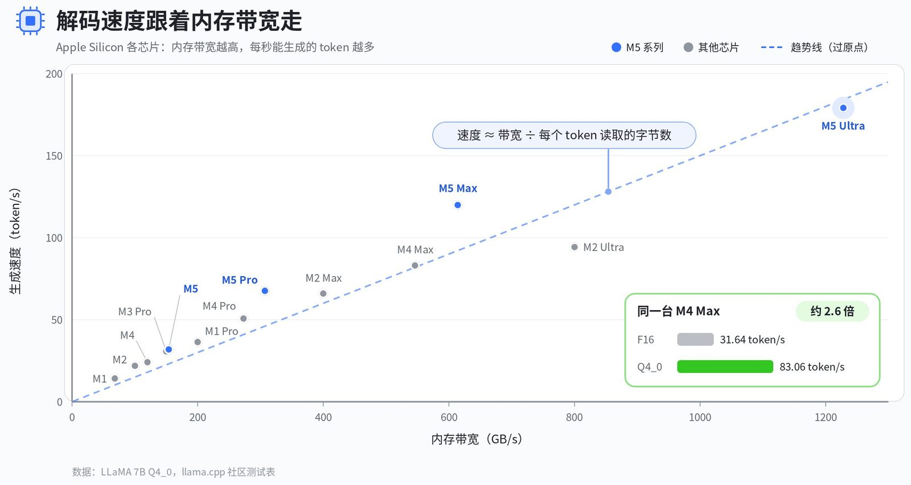
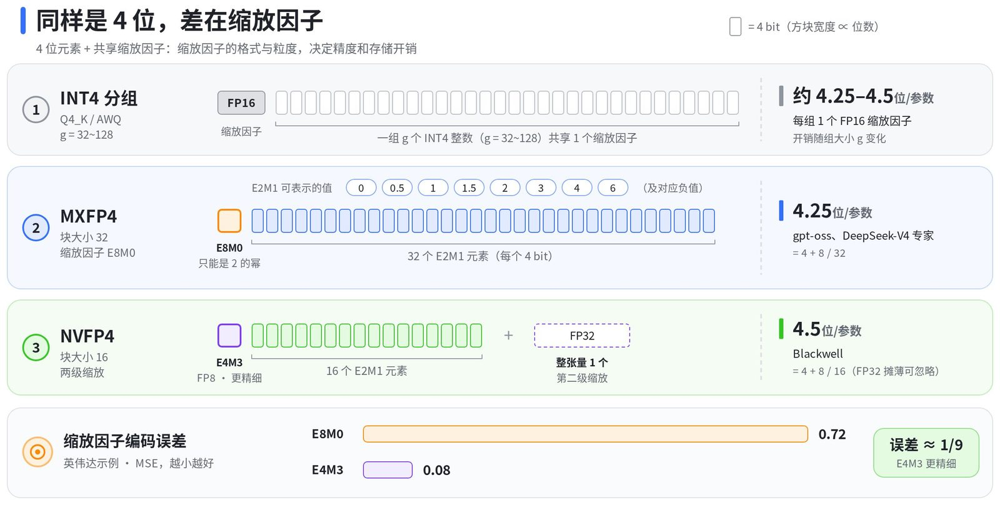
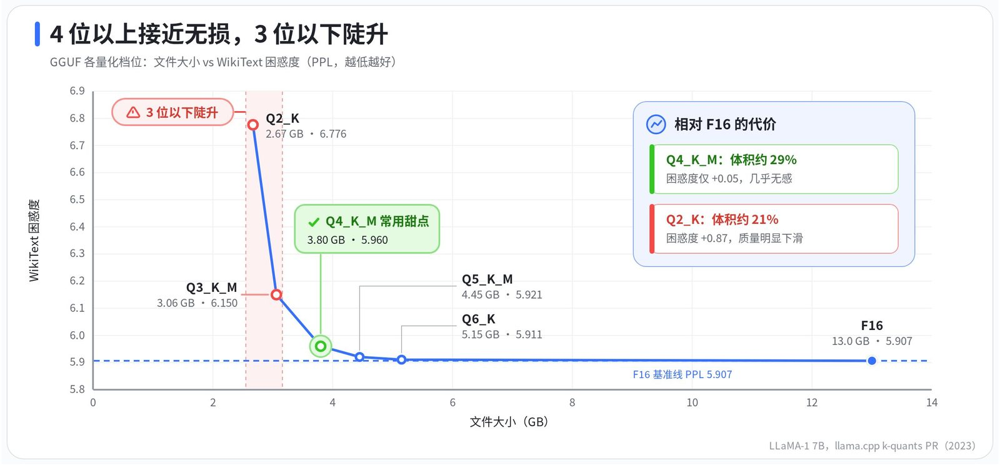
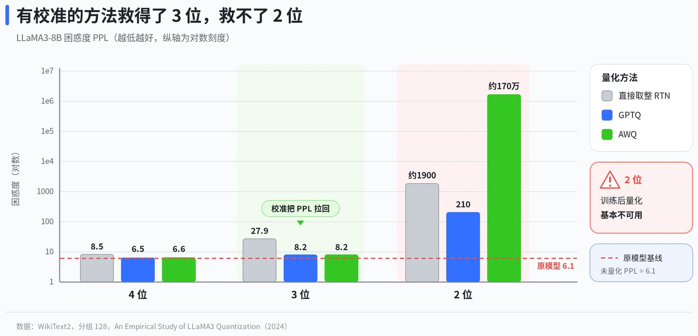
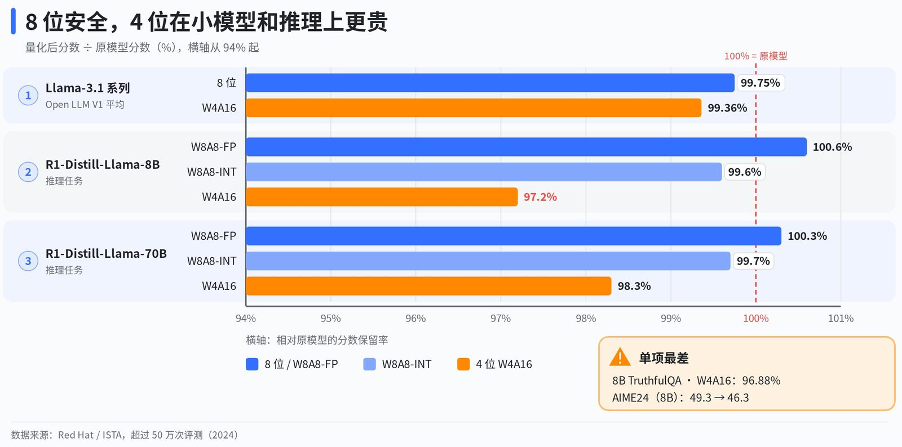
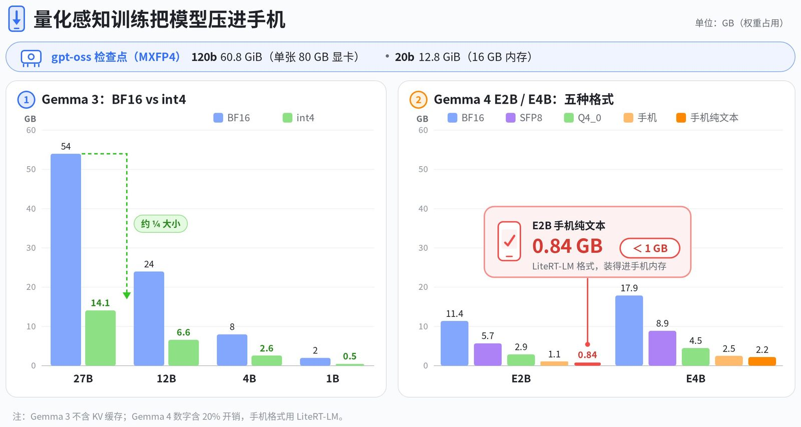
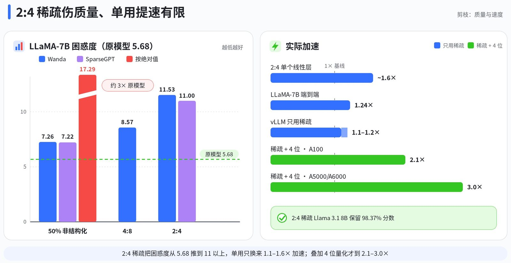
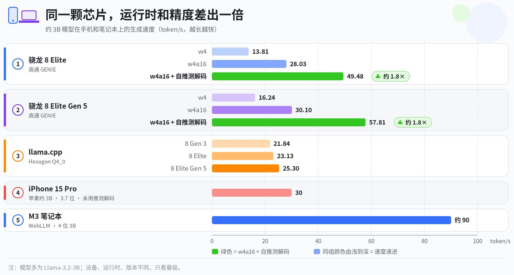
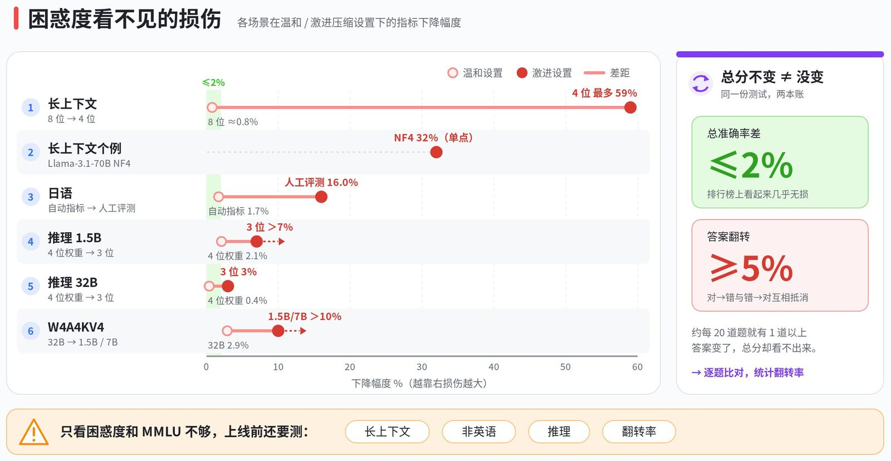

# LLM-24｜系统｜模型压缩与端侧部署：量化、剪枝与蒸馏

> 🎯 **这篇文档解决什么问题**：同一个模型，用 16 位存是 16 GB，用 4 位存只要 4 GB 多一点，生成速度还能快两倍以上。2025–2026 年，压缩已经从“发布后社区自己量化”变成了“厂商直接发布量化版作为正式权重”：gpt-oss 用 MXFP4，DeepSeek-V4 的专家用 FP4，Kimi K2 Thinking 用 INT4 量化感知训练，苹果端侧模型只用 2 位。本文整理约 60 项一手资料，回答四个问题：**压缩到几位还安全、用哪种方法、在什么硬件和运行时上跑、上线前怎么验**。
>
> 使用方式：先读第 1、2 章弄清为什么要压缩、有哪些数值格式；要量化现成模型的读第 3、4、6 章，自己训的读第 5、8 章，做端侧的读第 9 章，上线前用第 10、11 章验证。读之前知道模型权重、激活和 KV 缓存是什么即可。文中的速度数字来自不同的设备、运行时和版本，只能看量级和趋势；版本和数字核对于 2026 年 10 月 11 日。

## 导读 · 先给结论

- **解码慢是因为搬数据，不是因为算**。逐个生成 token 时，每一步都要把全部权重从内存读一遍。llama.cpp 在苹果芯片上的实测里，7B 模型 4 位量化的生成速度几乎和内存带宽成正比：M1（68 GB/s）每秒 14 个 token，M5 Ultra（1228 GB/s）每秒 179 个。同一台 M4 Max 上，16 位每秒 31.6 个，4 位每秒 83 个。
- **8 位基本无损，4 位只量化权重对大模型几乎无损，3 位以下风险陡增**。Llama-3.1 系列 8 位平均保留 99.75% 的分数，4 位保留 99.36%；LLaMA3-8B 用 GPTQ 量化，困惑度从 6.1 变成 6.5（4 位）、8.2（3 位）、210（2 位）。
- <b>“原生低精度发布”成为主流</b>。gpt-oss-120b 的专家权重用 MXFP4（每个参数 4.25 位），整个检查点 60.8 GiB，一张 80 GB 显卡就能放下；Gemma 4 官方提供量化感知训练的检查点，最小的 E2B 在手机上加载只要 0.84–1.1 GB。
- **困惑度和 MMLU 会掩盖损伤**。长输入任务上，4 位量化最多掉 59%，8 位平均只掉约 0.8%；日语的自动指标只降 1.7%，人工评测却降 16%；总准确率只差 2% 以内时，仍有 5% 以上的题目答案变了。
- **剪枝单用收益有限，要和蒸馏、量化一起用**。2:4 稀疏单独使用，端到端只快 1.1–1.24 倍；稀疏加 4 位量化能快 2.1–3.0 倍。英伟达 Minitron 说的“40 倍”是派生一个小模型少用 40 倍的训练 token，不是推理快 40 倍。
- **端侧的速度上限由运行时和精度决定的部分，不比芯片本身少**。同一颗骁龙 8 Elite 跑 3B 模型：只量化权重每秒 13.8 个 token，权重 4 位加激活 16 位每秒 28 个，再加自推测解码每秒 49.5 个。

| 章节 | 内容 | 谁最该读 |
|---|---|---|
| 第 1 章 为什么要压缩 | 解码受内存带宽限制，预填充受算力限制 | 所有人 |
| 第 2 章 数值格式 | INT8/INT4、FP8、MXFP4、NVFP4、三值 | 所有人 |
| 第 3 章 训练后量化 | GPTQ、AWQ、SmoothQuant、HQQ、NF4、GGUF | 要自己量化模型的人 |
| 第 4 章 3 位以下 | 向量量化、2 位什么时候值得 | 做端侧的人 |
| 第 5 章 量化感知训练与原生低精度 | 厂商为什么直接发量化版 | 做模型选型的人 |
| 第 6 章 KV 缓存与激活量化 | 长上下文的另一半内存 | 做推理服务的人 |
| 第 7 章 剪枝与稀疏 | 非结构化、2:4、宽度和深度剪枝 | 做模型压缩的人 |
| 第 8 章 蒸馏与小模型 | 端侧模型怎么来的、架构上的新招 | 做端侧和模型选型的人 |
| 第 9 章 端侧运行时与实测 | llama.cpp、MLX、ExecuTorch、WebLLM、高通 | 做端侧部署的人 |
| 第 10 章 评测 | 压缩后的模型该测什么 | 做评测和上线的人 |
| 第 11 章 怎么选与上线清单 | 服务器、笔记本、手机三种场景 | 所有人 |

📎 与系列其他文档的分工：服务器侧的 GPU 选型和成本见「自建推理成本与 GPU 选型」；推理引擎内部原理见「大模型推理系统学习手册」；蒸馏用到的 SFT 细节见「后训练实战」。本文只讲压缩方法、端侧运行时和上线前怎么验。

## 第 1 章 · 为什么要压缩：解码卡在内存带宽上

📎 延伸阅读：解码卡在带宽上，还有一条路是让每次前向多确定几个 token，扩散语言模型走的就是这条路，见 [LLM-42｜地基｜图像与视频生成：扩散、DiT 与推理加速](./42-image-video-generation.md) 第 12 章。

压缩的好处不只是“模型能装进去”。对单用户、逐个生成 token 的场景，它还直接决定速度。理解这一点，就能估出任何设备上的大致速度，也能判断哪种压缩方法真正有用。

### 1.1 预填充和解码是两种负载

- **预填充**：一次性处理整段输入。几千个 token 共用同一份权重做矩阵乘法，每读一个字节的权重要做很多次计算，瓶颈在算力。它决定首个 token 的等待时间。
- **解码**：每次只生成一个 token，但每一步都要把全部权重从内存读一遍。每读一个字节只做一两次乘加，瓶颈在内存带宽。它决定每秒生成多少 token。

苹果的 M5 正好把这两件事分开了：GPU 里新增了矩阵加速单元，MLX 实测首 token 时间比 M4 快 3.33–4.06 倍；但内存带宽只从 120 GB/s 提到 153 GB/s（+28%），生成速度也只快了 1.19–1.27 倍[[1]](https://machinelearning.apple.com/research/exploring-llms-mlx-m5)。

### 1.2 一个估算公式

单用户解码时，每秒 token 数大约是：

**每秒 token 数 ≈ 内存带宽 ÷ 每个 token 要读的字节数**

每个 token 要读的字节数，对稠密模型约等于“参数量 × 每个参数的字节数”，对 MoE 模型约等于“激活参数量 × 每个参数的字节数”，长上下文时还要加上 KV 缓存。实测一般只能达到理论值的一半到八成，带宽越高越难跑满：7B 的 Q4_0 文件约 3.8 GB，M1 理论上限约每秒 18 个 token，实测 14.2 个；M2 Ultra 理论上限约 210 个，实测 94 个（作者按下表估算）。

llama.cpp 社区维护的苹果芯片测试表很好地验证了这个公式。7B 模型用 Q4_0 量化，生成速度随带宽几乎线性增长[[2]](https://github.com/ggml-org/llama.cpp/discussions/4167)：

| 芯片 | 内存带宽（GB/s） | 生成（token/s） |
|---|---|---|
| M1 | 68 | 14.19 |
| M4 | 120 | 24.11 |
| M4 Pro | 273 | 50.74 |
| M4 Max | 546 | 83.06 |
| M5 Max | 614 | 119.92 |
| M2 Ultra | 800 | 94.27 |
| M5 Ultra | 1228 | 179.10 |

同一台 M4 Max，16 位的生成速度是每秒 31.64 个 token，Q4_0 是 83.06 个，快 2.6 倍，和“16 位降到约 4.5 位”的字节比例接近。

### 1.3 各类设备的量级

- **数据中心 GPU**：H100 SXM 的显存带宽 3.35 TB/s，容量 80 GB[[3]](https://www.nvidia.com/en-us/data-center/h100/)。瓶颈主要是显存容量和并发，单用户速度通常不是问题。
- **笔记本和台式机**：苹果芯片 120–1228 GB/s，统一内存可以给 GPU 用，这是 Mac 跑大模型的优势。
- **手机**：内存带宽通常只有几十 GB/s，而且模型要和系统、其他应用共用内存。苹果 2024 年的端侧模型约 3B 参数，平均每个权重 3.7 位，在 iPhone 15 Pro 上每秒约 30 个 token[[4]](https://machinelearning.apple.com/research/introducing-apple-foundation-models)。

> 🔑 **推论**：在端侧，凡是减少“每个 token 要读的字节数”的方法都会直接提速，包括权重量化、MoE、KV 缓存量化、推测解码（一次读权重验证多个 token）。只减少计算量、不减少读取量的方法，对解码速度帮助有限，这也是第 7 章里 2:4 稀疏收益不大的原因之一。

## 第 2 章 · 数值格式：从 INT8 到 FP4 和三值

量化就是用更少的位数表示每个数，再配一个“缩放因子”把它还原到原来的范围。格式之间的差别在两处：每个元素用什么编码（整数还是小浮点数），以及多少个元素共用一个缩放因子、缩放因子本身用什么编码。

### 2.1 整数格式：INT8 与 INT4

INT8 和 INT4 把一组数线性映射到 256 或 16 个整数档位。缩放因子按整个张量、每个输出通道或每组（常见 32、64、128 个元素）各存一份。分组越小，越能适应局部的大数值，但缩放因子占的空间越多。例如 llama.cpp 的 Q4_K 实际是每个权重 4.5 位，多出的 0.5 位就是各级缩放因子[[5]](https://github.com/ggml-org/llama.cpp/pull/1684)。

### 2.2 FP8：E4M3 与 E5M2

FP8 是 8 位小浮点数，有两种分法[[6]](https://arxiv.org/abs/2209.05433)：

- **E4M3**：4 位指数、3 位尾数，精度更高，范围较小；去掉了无穷大、只保留一种 NaN 编码来换取更大的范围。常用于权重和激活。
- **E5M2**：5 位指数、2 位尾数，范围更大，遵循 IEEE-754 的特殊值规则。常用于训练中的梯度。

这篇白皮书报告，FP8 训练在最大 175B 参数的 Transformer 上能达到 16 位的质量，超参数不用改。H100 的张量核心原生支持 FP8 和 INT8，但不支持 INT4[[3]](https://www.nvidia.com/en-us/data-center/h100/)，所以在 H100 上只把权重量化到 4 位时，实际是先把权重还原成 16 位再算，省的是显存读取，而不是计算。

📎 延伸阅读：FP8 W8A8 按 128×128 分块缩放时，一次线性层里哪些环节量化、哪些保持 BF16 或 FP32，以及在 vLLM 上的实际收益，见 [LLM-32｜系统｜AI Infra 性能优化实战：从 profile 到硬件上限](./32-infra-perf.md) 第 11.4 节。

### 2.3 微缩放格式：MXFP8、MXFP6、MXFP4

OCP 微缩放（MX）规范由微软、AMD、英特尔、Meta、英伟达、高通共同制定[[7]](https://arxiv.org/abs/2310.10537)。所有 MX 格式都是**每 32 个元素共用一个 8 位缩放因子**，缩放因子的格式是 E8M0，也就是只能表示 2 的整数次幂。元素可以是 FP8（E4M3 / E5M2）、FP6（E2M3 / E3M2）、FP4（E2M1）或 INT8。MXFP4 每个元素 4 位，加上分摊的缩放因子，平均每个参数 4.25 位。

### 2.4 NVFP4：更小的分组、更精细的缩放

英伟达 Blackwell 引入的 NVFP4 元素同样是 E2M1（可表示的值在 −6 到 6 之间），区别在缩放方式[[8]](https://developer.nvidia.com/blog/introducing-nvfp4-for-efficient-and-accurate-low-precision-inference/)：

- **每 16 个元素一个 E4M3 格式的缩放因子**，而不是每 32 个元素一个 2 的幂。
- 再加一个整张量的 FP32 缩放因子，两级缩放。

代价是平均每个值 4.5 位，比 MXFP4 多 0.25 位；好处是缩放更精确。英伟达的例子里，用 E8M0 编码缩放因子的均方误差是 0.72，用 E4M3 是 0.08。DeepSeek-R1-0528 从 FP8 训练后量化到 NVFP4，各项分数变化在 1 分左右：MMLU-Pro 85 → 84，GPQA-Diamond 81 → 80，AIME 2024 89 → 91。

### 2.5 三值：BitNet b1.58

再往下走就是每个权重只取 −1、0、+1 三个值（约 1.58 位）。BitNet b1.58 采用原生三值训练；也已有训练后三值化研究（如 [arXiv:2510.03267](https://arxiv.org/abs/2510.03267)），但精度、校准成本和推理实现需单独评估，不能视为与原生格式等价。微软的 BitNet b1.58 2B4T 是第一个开源的 2B 规模原生三值模型，用 4T token 训练[[9]](https://arxiv.org/abs/2504.12285)。除嵌入层外的权重只占 0.4 GB，而 Llama 3.2 1B 是 2 GB、Qwen2.5 1.5B 是 2.6 GB；CPU 上每个 token 的解码时间 29 毫秒，对照模型是 41–124 毫秒。它目前还是研究方向，主流模型都没有采用。

### 2.6 一张对照表

| 格式 | 每个参数位数 | 硬件原生支持 | 典型用途 |
|---|---|---|---|
| BF16 | 16 | 所有现代 GPU | 基准精度 |
| FP8 / INT8 | 8 | H100 及以后 | 服务器推理默认选项，DeepSeek-V3 训练 |
| MXFP4 | 4.25 | Blackwell | gpt-oss、DeepSeek-V4 的专家权重 |
| NVFP4 | 4.5 | Blackwell | 英伟达推荐的 4 位推理格式 |
| INT4 分组 | 约 4.25–4.5 | 各推理引擎有专门内核；H100 上需还原后计算 | GGUF、AWQ、GPTQ、Llama 3.2 量化版 |
| 2 位 | 约 2–2.6 | 基本没有 | 苹果端侧模型、Gemma 4 手机格式的部分层 |
| 三值 | 约 1.58 | 没有 | BitNet 研究 |

## 第 3 章 · 训练后量化：拿来就能用的方法

📎 延伸阅读：量化到 4 bit 会让做过遗忘的模型重新说出被删的内容，评测遗忘时要把量化版本一起测，见 [LLM-22｜地基｜后训练实战：SFT、LoRA 与 RLVR](./22-post-training.md) 第 10.5 节。

训练后量化（PTQ）不需要重新训练，只用几百条校准数据甚至不用数据，几分钟到几小时就能完成。绝大多数人自己做的量化都属于这一类。

### 3.1 主流方法

| 方法 | 思路 | 要点 |
|---|---|---|
| GPTQ（2022） | 逐层量化，用近似的二阶信息（输入激活的协方差）补偿量化误差[[10]](https://arxiv.org/abs/2210.17323) | 175B 模型约 4 个 GPU 小时量化到 3–4 位；A100 上端到端比 FP16 快约 3.25 倍 |
| AWQ（2023） | 按激活大小找出约 1% 的关键通道，放大它们再量化[[11]](https://arxiv.org/abs/2306.00978) | 不做反向传播，不容易过拟合校准集；适合指令模型和多模态模型 |
| SmoothQuant（2022） | 把激活里的大数值通过等价的逐通道缩放“转移”到权重上，实现 8 位权重 8 位激活（W8A8）[[12]](https://arxiv.org/abs/2211.10438) | 无需训练；最多快 1.56 倍、内存减半 |
| HQQ（2023） | 不用校准数据，直接优化量化参数[[13]](https://dropbox.tech/machine-learning/halfquadratic-quantization-of-large-machine-learning-models) | Llama-2-70B 不到 5 分钟量化完，比 GPTQ 快 50 倍以上 |
| NF4（2023） | 按正态分布设计的 4 位档位，QLoRA 提出[[14]](https://arxiv.org/abs/2305.14314) | 主要用于量化后再微调：65B 模型在一张 48 GB 显卡上微调 |
| GGUF k-quants（2023） | llama.cpp 的分块量化，敏感张量用更高位数[[5]](https://github.com/ggml-org/llama.cpp/pull/1684) | 端侧和本地运行的事实标准 |

### 3.2 GGUF 的档位怎么选

llama.cpp 的 k-quants 用名字标出平均位数：Q2_K 约 2.56 位，Q3_K 约 3.44 位，Q4_K 4.5 位，Q5_K 5.5 位，Q6_K 约 6.56 位[[5]](https://github.com/ggml-org/llama.cpp/pull/1684)。带 “_M” 的混合档位会把对质量最敏感的张量（注意力的 V 投影、前馈网络的下投影）放到更高位数，输出层始终用 6 位。LLaMA-1 7B 的实测：

| 档位 | 文件大小 | 困惑度 |
|---|---|---|
| F16 | 13.0 GB | 5.9066 |
| Q6_K | 5.15 GB | 5.9110 |
| Q5_K_M | 4.45 GB | 5.9208 |
| Q4_K_M | 3.80 GB | 5.9601 |
| Q3_K_M | 3.06 GB | 6.1503 |
| Q2_K | 2.67 GB | 6.7764 |

6 位和原模型的困惑度差距在 0.1% 以内。作者还发现，相对误差**不会随模型变大而持续变小**：13B 比 7B 好量化，但 30B 和 65B 又回到 7B 的水平。

2024 年加入的<b>重要性矩阵（imatrix）</b>用一段校准文本统计每列输入激活的平方均值，量化时按它加权[[15]](https://github.com/ggml-org/llama.cpp/pull/4861)。思路和 GPTQ 类似，只是只用协方差矩阵的对角线，所以快得多：7B 模型在 32 核 CPU 上约 10 分钟。重要性矩阵必须按模型分别计算，不能复用。3 位及以下的 GGUF 档位，基本都应该配合重要性矩阵使用。

### 3.3 位数和方法的影响

港大等对 LLaMA3-8B 做了系统测试（分组 128，WikiText2 困惑度，原模型 6.1）[[16]](https://arxiv.org/abs/2404.14047)：

| 方法 | 4 位 | 3 位 | 2 位 |
|---|---|---|---|
| 直接取整（RTN） | 8.5 | 27.9 | 约 1,900 |
| GPTQ | 6.5 | 8.2 | 210 |
| AWQ | 6.6 | 8.2 | 约 170 万 |

结论有三条：8 位直接取整就够了（困惑度 6.2）；4 位和 3 位一定要用 GPTQ、AWQ 这类有校准的方法；2 位用训练后量化基本不可用，要换第 4 章的方法。这篇论文还指出，LLaMA3 在低位宽下的退化“不可忽视”；常见的解释是它用了多得多的数据训练，冗余更少，但论文本身只报告了现象。

### 3.4 大规模实测：多少精度损失可以接受

Red Hat 与 IST Austria 在 Llama-3.1 8B、70B、405B 指令模型上做了超过 50 万次评测[[17]](https://arxiv.org/abs/2411.02355)：

- **FP8（W8A8）实际无损**；调好的 INT8（W8A8）损失 1%–3%；只量化权重到 4 位（W4A16）比预想的好，Open LLM Leaderboard V1 平均保留 99.36%。单项最差是 8B 的 TruthfulQA，保留 96.88%。
- **推理模型损失更大**：DeepSeek-R1-Distill-Llama-8B 用 W4A16 保留 97.2%，AIME 2024 从 49.3 降到 46.3；70B 用 W4A16 保留 98.3%。
- **部署建议**：低并发、看时延的场景用 W4A16 最划算；高并发连续批处理的场景用 W8A8 最划算。一般的解释是：高并发时瓶颈从读权重转到计算，W4A16 还原权重的开销反而成了负担，而 W8A8 能直接用 8 位张量核心计算。

### 3.5 工具对应

- <b>服务器（vLLM、SGLang）</b>：用 llm-compressor 生成 compressed-tensors 格式（FP8、W8A8、W4A16），或直接下载 AWQ / GPTQ 版本。
- <b>本地与端侧（llama.cpp、Ollama、LM Studio）</b>：GGUF。笔记本内存够时首选 Q4_K_M 或 Q5_K_M；内存紧张时用 Q3_K_M 加重要性矩阵。
- <b>苹果芯片（MLX）</b>：MLX 自带 4 位和 8 位分组量化。
- **量化后还要微调**：bitsandbytes 的 NF4 配合 QLoRA。

## 第 4 章 · 3 位以下：向量量化与 2 位

第 3 章的方法到 3 位还能用，到 2 位就崩了。原因是每个权重只有 4 个档位，逐个量化无论怎么校准都损失太大。3 位以下的方法换了思路：把几个权重当成一个向量一起编码，或者在训练中让模型适应低精度。

### 4.1 先旋转，再查码本

- <b>QuIP#</b>（康奈尔，2024）：先用随机哈达玛变换把权重“打散”，让大数值消失（称为非相干处理），再用 E8 格点的码本把每 8 个权重编成一组，最后做一次微调[[18]](https://arxiv.org/abs/2402.04396)。Llama-2-70B 量化到 2 位，WikiText2 困惑度 4.16，原模型 3.32；同样 2 位的 OmniQuant 是 7.81。它也是第一个 3 位效果超过“理论无损 4 位”的训练后方法。
- **AQLM**（Yandex 与 IST Austria，2024）：多码本加法量化，每组权重用几个码本向量相加表示[[19]](https://arxiv.org/abs/2401.06118)。它是第一个在 3 位以下做到“同样大小下精度最好”的方法。代价是量化很慢：7B 模型在一张 A100 上约 1 天，70B 在 8 张卡上 3–4 天。
- **QTIP**（康奈尔，2024）：用网格编码量化，把码本大小和位数解耦，向量维度可以远超 8，并设计了适合硬件的编码方式[[20]](https://arxiv.org/abs/2406.11235)。

### 4.2 2 位什么时候值得

该问的是“同样的内存，用 2 位大模型好，还是 4 位小模型好”，光看“2 位掉了多少”不够。AQLM 的论文给了一个反例：用 QuIP# 量化到 2 位的 Llama-2-13B 困惑度 6.06，而 4 位的 7B 是 5.21，体积还更小[[19]](https://arxiv.org/abs/2401.06118)。也就是说，2 位只有在方法足够好的时候才划算。HQQ 报告 2 位的 Llama-2-70B 明显好于内存相近的全精度 Llama-2-13B[[13]](https://dropbox.tech/machine-learning/halfquadratic-quantization-of-large-machine-learning-models)，这是另一个方向的例子。

工程上的经验：

- 服务器侧几乎没有理由用 2 位。显存不够时，换更小的模型或者加卡，通常比 2 位可靠。
- 端侧内存是硬约束，2 位才有意义，而且主要靠量化感知训练做到，而不是事后量化。

### 4.3 端侧 2 位的两个实例

- **苹果 2025 年端侧模型**：约 3B 参数，解码器权重用量化感知训练压到**每个权重 2 位**，嵌入层 4 位，KV 缓存 8 位，再用 LoRA 适配器恢复质量[[21]](https://arxiv.org/abs/2507.13575)。苹果报告压缩后 MGSM 约降 4.6%，MMLU 反而升 1.5%。服务器侧模型用 GPU 的纹理压缩格式 ASTC，每个权重 3.56 位，由专用硬件解码。
- **Gemma 4 的手机格式**：官方的量化感知训练检查点里有一种手机专用方案，部分解码层用 2 位，配合优化的 KV 缓存和静态激活量化。E2B 在这种格式下加载只要 1.1 GB，纯文本版 0.84 GB[[22]](https://ai.google.dev/gemma/docs/core/model_card_4)。

两者的共同点：**2 位都是厂商在训练阶段做的，而不是拿开源权重事后量化**。自己做端侧时，优先找官方的低位宽版本。

📎 延伸阅读：昇腾没有原生 FP8，路由专家 W4A8、注意力 W8A8、Engram INT8 的分档量化在 8 卡 910B 上的落地，见 [LLM-36｜系统｜非 NVIDIA 算力：TPU、Trainium、AMD 与昇腾](./36-non-nvidia.md) 第 6.4 节。

## 第 5 章 · 量化感知训练与“原生低精度”发布

量化感知训练（QAT）在训练时就模拟低精度：前向用量化后的权重，反向照常更新高精度的主权重，让模型学会在低精度下工作。它比训练后量化贵，但效果好得多。2025–2026 年，越来越多的厂商把量化感知训练放进自己的发布流程，直接把低精度版本作为正式权重。

### 5.1 主要厂商怎么做

| 模型 | 做法 | 结果 |
|---|---|---|
| Gemma 3（2025-04） | 约 5,000 步量化感知训练，用原精度模型的输出概率作为目标（相当于自蒸馏）[[23]](https://developers.googleblog.com/en/gemma-3-quantized-aware-trained-state-of-the-art-ai-to-consumer-gpus/) | 量化到 Q4_0 时，困惑度的下降幅度减少 54%；27B 的权重从 54 GB 降到 14.1 GB，一张 RTX 3090 就能放下 |
| Llama 3.2 1B / 3B（2024-10） | 权重 4 位分组（每 32 个一组）、激活 8 位动态量化；两个版本：量化感知训练加 LoRA，以及训练后的 SpinQuant[[24]](https://ai.meta.com/blog/meta-llama-quantized-lightweight-models/) | 在一加 12 手机上解码快 2.5 倍、预填充快 4.2 倍，模型体积减少 56%，内存减少 41% |
| gpt-oss（2025-08） | 后训练阶段就把 MoE 权重量化到 MXFP4，MoE 权重占总参数的 90% 以上[[25]](https://arxiv.org/abs/2508.10925) | 120b 检查点 60.8 GiB，单张 80 GB 显卡可跑；20b 检查点 12.8 GiB，16 GB 内存可跑；所有评测都在 MXFP4 下完成 |
| Kimi K2 Thinking（2025） | 后训练阶段做量化感知训练，MoE 部分只量化权重到 INT4[[26]](https://huggingface.co/moonshotai/Kimi-K2-Thinking) | 厂商称无损，生成速度约快 2 倍；所有公开分数都在 INT4 下测得 |
| DeepSeek-V3（2024-12） | FP8 混合精度训练：激活按 1×128、权重按 128×128 的块分别缩放[[27]](https://arxiv.org/abs/2412.19437) | 和 BF16 训练相比，损失的相对误差低于 0.25% |
| DeepSeek-V4（2026-04） | 指令模型检查点中，MoE 专家用 FP4，其余大部分参数用 FP8[[28]](https://huggingface.co/deepseek-ai/DeepSeek-V4-Flash) | V4-Pro 共 1.6T 参数、激活 49B；V4-Flash 共 284B、激活 13B |

### 5.2 为什么厂商要自己发量化版

- **推理模型对事后量化更敏感**。月之暗面给出的理由是：思考模型的输出很长，训练后量化“常常导致明显的性能下降”，所以改用量化感知训练[[26]](https://huggingface.co/moonshotai/Kimi-K2-Thinking)。第 10 章的实测也显示，小推理模型在 3 位和 W4A4 下掉分明显。
- **MoE 让低精度更划算**。MoE 的总参数大、激活参数小，权重的存储和读取是主要成本。专家权重用 4 位、注意力等共享部分用 8 位，是 gpt-oss 和 DeepSeek-V4 共同的选择。
- **分数口径统一**。当官方分数就是在低精度下测的，用户拿到的就是厂商测过的版本，不用再猜社区量化版掉了多少。

### 5.3 对使用者的含义

1. 部署开源模型时，**先查有没有官方的量化版或量化感知训练版**，有就优先用，不要自己从 BF16 量化。
2. 官方只发了 FP8 或 FP4 版本时，注意硬件是否原生支持。FP4 需要 Blackwell 才有原生计算；在 H100 上跑 MXFP4 模型，引擎会把权重还原后计算，显存省了，速度未必快。
3. 官方的“无损”通常基于他们选的评测集。自己的任务仍然要按第 10 章的方法测一遍。

### 5.4 自己训模型时，QAT 该占多少算力

前面几节讲的是厂商发布时怎么做。如果要从头训一个准备低精度部署的模型，还有一个先决问题：总算力里多少给全精度预训练，多少给量化感知训练。Dremov 等人在 8,600 万到 22 亿参数的模型上系统测了这件事[[60]](https://arxiv.org/abs/2509.22935)：

- **先全精度、后 QAT**，比全程 QAT 效果好。
- **QAT 的最优占比随总算力上升**，这和更早的研究结论相反。小规模下大约 10%–15%，规模大了可以到 55% 以上；比例选错，最多浪费一半算力。
- 最优占比可以用“每个参数字节对应的训练 token 数”来预测。同一套损失缩放律还能在给定显存预算下，预测该选几位精度。
- 他们建议把学习率冷却和 QAT 合并成一段，省掉一部分重复的全精度更新。

> 💡 沿用“训练末尾补几千步 QAT”的经验时，先看自己的 token 与参数比。过训练越重的小模型，越该把 QAT 往前挪、给得更多。算力怎么在模型规模和数据量之间分，见「大模型训练工程」第 4 章。

## 第 6 章 · KV 缓存与激活量化：长上下文的另一半内存

📎 延伸阅读：从注意力结构上省 KV 缓存（GQA、MLA、稀疏注意力）见 [LLM-31｜地基｜长上下文与注意力：从 MHA 到稀疏与线性注意力](./31-attention-long-context.md)。

权重量化只解决了一半问题。上下文变长、并发变多以后，KV 缓存的体积会超过权重本身。KV 缓存的大小约等于“层数 × 2 × KV 头数 × 每头维度 × 上下文长度 × 并发数 × 每个元素的字节数”，所以把它从 16 位降到 8 位或 4 位，能直接换来更长的上下文或更大的批。

### 6.1 KV 缓存量化

- **KIVI**（2024）发现键和值的分布不一样：**键缓存应该按通道量化，值缓存应该按 token 量化**[[29]](https://arxiv.org/abs/2402.02750)。按这个规则，不用调参就能把 KV 缓存压到 2 位。Llama-2、Falcon、Mistral 质量几乎不变，峰值内存（含权重）减少 2.6 倍，批大小最多增加 4 倍，吞吐提高 2.35–3.47 倍。
- **KVQuant**（伯克利，2024）在此基础上加了几个技巧：在旋转位置编码之前量化键、每层用不同的非均匀格式、把少数大数值单独稀疏存储[[30]](https://arxiv.org/abs/2401.18079)。在论文所测的完整 KVQuant 配置（含稀疏离群值处理）下，3 位时困惑度增加不到 0.1，LLaMA-7B 可以在单张 A100-80GB 上跑 100 万 token 的上下文。
- **vLLM 的 FP8 KV 缓存**是生产环境最常用的选项：设置 `kv_cache_dtype="fp8"` 即可[[31]](https://docs.vllm.ai/en/latest/features/quantization/quantized_kvcache.html)。不做校准时缩放因子默认为 1.0，官方建议用 llm-compressor 校准（例如 512 条样本、长度 2048）。滑动窗口层对精度更敏感，可以用参数跳过这些层。

### 6.2 不量化，直接共享：架构上减少 KV 缓存

端侧模型还会从架构上减少 KV 缓存：

- 苹果 2025 年端侧模型把网络按 5:3 分成两段，第二段直接复用第一段的 KV 缓存，<b>KV 缓存内存减少 37.5%</b>，首 token 时间也减少约 37.5%[[21]](https://arxiv.org/abs/2507.13575)。
- Gemma 3n 也用了 KV 缓存共享，预填充速度是 Gemma 3 4B 的 2 倍[[32]](https://developers.googleblog.com/en/introducing-gemma-3n-developer-guide/)。
- Qwen3.5 的小模型大部分层用线性注意力（Gated DeltaNet），每 4 层只有 1 层是标准注意力，KV 缓存随上下文增长的部分大幅减少[[33]](https://huggingface.co/Qwen/Qwen3.5-9B)。

### 6.3 激活也量化：旋转去掉离群值

要让矩阵乘法真正用 4 位计算（而不只是存 4 位），激活也要量化。难点是激活里有少数数值特别大的通道，直接量化会把其他数值都压成 0。2024 年的解法是**先旋转**：

- **QuaRot** 用哈达玛矩阵旋转隐藏状态，输出在数学上不变，但大数值被均摊到所有通道[[34]](https://arxiv.org/abs/2404.00456)。这样权重、激活、KV 缓存可以全部 4 位（W4A4KV4）。Llama-2-70B 的 WikiText-2 困惑度最多增加 0.47，零样本任务保留 99%。6 位和 8 位甚至不用校准数据，直接取整就无损。
- **SpinQuant**（Meta）把旋转矩阵也学出来[[35]](https://arxiv.org/abs/2405.16406)。它发现随机旋转之间的差距可达 13 分；学出来的旋转让 LLaMA-2 7B 在 W4A4KV4 下和原模型只差 2.9 分，比 SmoothQuant 好 25 分。Meta 的 Llama 3.2 量化版就用了它。

> 🔑 **实用建议**：服务器侧，FP8 KV 缓存基本是免费的午餐，先开；4 位和 2 位 KV 缓存只在超长上下文、内存实在不够时考虑，而且要在自己的长上下文任务上验证（第 10.3 节）。W4A4 目前主要还是研究方向，推理模型在 W4A4KV4 下损失明显。
>
> 📎 延伸阅读：模型侧量化与剪枝之外，运行时 KV Cache 的比特、秩与保留比例三种压缩口径和三篇 2025 至 2026 年系统论文，见 [LLM-70｜系统｜KV Cache 装不进显存：分层、复用、压缩与外置系统的工程账](./70-kv-cache-offload.md)。

## 第 7 章 · 剪枝与稀疏：删掉哪些、能快多少

剪枝是把不重要的权重或结构删掉。它分成三种，收益差别很大：

- **非结构化剪枝**：任意位置的权重置零。精度保持最好，但通用硬件几乎没法利用这种稀疏，实际不提速。
- <b>半结构化剪枝（2:4）</b>：每 4 个连续权重里恰好 2 个为零。英伟达从 A100 起在硬件上支持这种模式。
- **结构化剪枝**：直接删掉整层、注意力头或前馈网络的部分通道，得到一个更小的稠密模型，在任何硬件上都能提速。

### 7.1 一次性剪枝：SparseGPT 与 Wanda

**SparseGPT**（2023）不需要重新训练，就能把 GPT 系列模型一次性剪到 50% 以上稀疏度；OPT-175B 和 BLOOM-176B 剪到 60%，困惑度几乎不变[[36]](https://arxiv.org/abs/2301.00774)。**Wanda**（2023）更简单：每个权重的重要性 = 权重绝对值 × 对应输入激活的范数，不用更新权重[[37]](https://arxiv.org/abs/2306.11695)。在 LLaMA-65B 上计算剪枝指标只要 5.6 秒，SparseGPT 要 1,353 秒。

LLaMA-7B 的 WikiText 困惑度（原模型 5.68）[[37]](https://arxiv.org/abs/2306.11695)：

| 稀疏方式 | Wanda | SparseGPT | 按绝对值剪 |
|---|---|---|---|
| 50% 非结构化 | 7.26 | 7.22 | 17.29 |
| 4:8 | 8.57 | — | — |
| 2:4 | 11.53 | 11.00 | — |

同样是 50% 稀疏，2:4 的约束让困惑度从 7 左右升到 11 左右。模型越大损失越小：LLaMA-2-70B 原模型 3.12，2:4 剪枝后 5.16（Wanda）。

### 7.2 2:4 稀疏实际能快多少

- Wanda 在 A6000 上测得，2:4 让单个线性层快约 1.6 倍，但 LLaMA-7B 端到端只快 **1.24 倍**（312 毫秒降到 251 毫秒）[[37]](https://arxiv.org/abs/2306.11695)。原因是注意力、归一化、采样等部分没有加速。
- Red Hat 的 2:4 稀疏 Llama 3.1 8B 恢复了原模型 98.37% 的分数，但 MMLU 从 65.4 降到 60.6[[38]](https://developers.redhat.com/articles/2025/02/28/24-sparse-llama-smaller-models-efficient-gpu-inference)。在 vLLM 里单路请求的时延，**单靠稀疏只快 1.1–1.2 倍**；稀疏加 4 位量化在 A5000 / A6000 上快 3.0 倍，在 A100 上快 2.1 倍。

结论：2:4 稀疏单独用不太值得，它的价值在于和量化叠加。而按第 1 章的分析，解码阶段主要受读取量限制，稀疏能省的读取量又被索引开销抵消一部分。

### 7.3 结构化剪枝加蒸馏：Minitron

真正在工业界落地的是“结构化剪枝 + 蒸馏恢复”。英伟达的 Minitron 从 Nemotron-4 15B 剪出 8B 和 4B，按深度、宽度、注意力头、前馈网络维度估计重要性，然后用不到原训练数据 3% 的 token 做知识蒸馏[[39]](https://arxiv.org/abs/2407.14679)：

- 每个派生模型的训练 token 最多少 40 倍（约 940 亿到 1000 亿 token），整个模型家族的总算力省 1.8 倍，MMLU 比从头训练最多高 16%。
- 注意：<b>“40 倍”说的是训练 token，不是推理速度</b>。

Llama-3.1-Minitron 4B 是一个具体例子[[40]](https://developer.nvidia.com/blog/how-to-prune-and-distill-llama-3-1-8b-to-an-nvidia-llama-3-1-minitron-4b-model/)：宽度剪枝把前馈网络维度从 14336 降到 9216、隐藏维度从 4096 降到 3072；深度剪枝则删掉 32 层里的后 16 层。基座模型的 MMLU：原 8B 为 0.6528，宽度剪枝版 0.6053，深度剪枝版 0.5871。在 H100 上用 TensorRT-LLM，深度剪枝版吞吐约为原 8B 的 2.7 倍，宽度剪枝版约 1.8 倍。英伟达的经验是：15B 以下优先剪宽度；重新训练时只用蒸馏损失。

### 7.4 删层：比想象中更冗余

**ShortGPT**（2024）用“层的输入和输出有多相似”来衡量每层的重要性，相似度越高说明这层改动越少、越可以删[[41]](https://arxiv.org/abs/2403.03853)。LLaMA-2-13B 删掉 40 层中的 10 层，MMLU 只从 55.0 降到 52.2，整体约保留 90% 的性能。**LLM-Pruner**（2023）则按耦合结构剪枝，再用 LoRA 和 5 万条数据、3 小时恢复[[42]](https://arxiv.org/abs/2305.11627)。

删层要小心：第 10.1 节的“答案翻转”研究发现，删层和 Wanda 剪枝会让答案翻转的比例几乎线性增加，而 MMLU 看起来变化不大[[43]](https://arxiv.org/abs/2407.09141)。

## 第 8 章 · 蒸馏与小模型：端侧模型从哪里来

端侧用的 1B–4B 模型很少是从头独立训练的，大多是从大模型剪出来、再用大模型的输出蒸馏得到的。蒸馏的训练细节（SFT、logit 蒸馏）见「后训练实战」，这里只讲端侧相关的部分。

### 8.1 主要厂商的做法

- **Llama 3.2 1B / 3B**：从 Llama 3.1 8B 一次性结构化剪枝，预训练时用 Llama 3.1 8B 和 70B 的 logits 作为逐 token 的目标，剪枝后再蒸馏恢复[[44]](https://ai.meta.com/blog/llama-3-2-connect-2024-vision-edge-mobile-devices/)。
- **Qwen3 小模型**：0.6B 到 14B 以及 30B-A3B 都用“强到弱蒸馏”，先离线、再在线蒸馏 logits；GPU 时长只有完整四阶段训练的十分之一，Pass@1 和 Pass@64 都更好[[45]](https://arxiv.org/abs/2505.09388)。
- **DeepSeek-R1 蒸馏版**：用约 80 万条 R1 生成的数据对 Qwen2.5 和 Llama 做 SFT[[46]](https://arxiv.org/abs/2501.12948)。AIME 2024 一次通过率：1.5B 28.9，7B 55.5，32B 72.6；作为对照，GPT-4o-0513 只有 9.3。论文还发现，在 Qwen2.5-32B 上，直接蒸馏 R1 比自己做强化学习效果更好。
- **Gemini Nano**：Nano-1 1.8B、Nano-2 3.25B，都从更大的 Gemini 模型蒸馏而来，部署时量化到 4 位[[47]](https://arxiv.org/abs/2312.11805)。

### 8.2 端侧架构的新招

| 技术 | 做法 | 效果 |
|---|---|---|
| MatFormer（Gemma 3n） | 小模型嵌套训练在大模型里面，E2B 是 E4B 的子模型；还能逐层挑选前馈网络的宽度，得到中间尺寸[[32]](https://developers.googleblog.com/en/introducing-gemma-3n-developer-guide/) | 一次训练得到多个尺寸，E2B 比 E4B 最多快 2 倍 |
| 逐层嵌入（PLE，Gemma 3n / 4） | 每层的嵌入参数放在 CPU 上加载和计算，加速器里只放核心权重[[32]](https://developers.googleblog.com/en/introducing-gemma-3n-developer-guide/) | E2B 原始参数 5B，运行只需约 2 GB 内存；E4B 原始参数 8B，约 3 GB |
| 混合线性注意力（Qwen3.5） | 每 4 层里 3 层用 Gated DeltaNet、1 层用标准注意力[[33]](https://huggingface.co/Qwen/Qwen3.5-9B) | 长上下文的 KV 缓存小得多 |
| 闪存常驻的稀疏模型（苹果 AFM 3） | 20B 稀疏模型存在闪存里，按每个提示选择需要的专家，只把这些专家换入内存，每次激活 1–4B[[48]](https://machinelearning.apple.com/research/introducing-third-generation-of-apple-foundation-models) | 在手机内存放不下的规模上运行；按提示而不是按 token 换入，因为闪存到内存的带宽太慢 |

### 8.3 2025–2026 年的端侧小模型

| 模型 | 规格 | 值得注意的点 |
|---|---|---|
| Gemma 4 E2B / E4B（2026-04） | 有效参数 2.3B / 4.5B，含嵌入 5.1B / 8B，128K 上下文[[22]](https://ai.google.dev/gemma/docs/core/model_card_4) | 官方量化感知训练检查点；每个尺寸都附带推测解码用的草稿模型；E4B 的 MMLU-Pro 69.4，高于 Gemma 3 27B 的 67.6 |
| Qwen3.5 0.8B–9B（2026-03） | 混合线性注意力，原生视觉编码器[[33]](https://huggingface.co/Qwen/Qwen3.5-9B) | 思考模式下 MMLU-Pro：2B 66.5，4B 79.1，9B 82.5（gpt-oss-20b 为 74.8） |
| 苹果 AFM 3（2026-06） | 3B 稠密的 Core，以及 20B 稀疏的 Core Advanced[[48]](https://machinelearning.apple.com/research/introducing-third-generation-of-apple-foundation-models) | 量化感知训练压缩；新 Core 相对 2025 版本的偏好率 45.6% 对 23.3% |
| SmolLM3-3B（2025） | 11.2T token 三阶段训练，64K 训练、YaRN 外推到 128K[[49]](https://huggingface.co/blog/smollm3) | 训练配方完全公开，适合学习 |
| Phi-4-mini（2025-03） | 3.8B，20 万词表[[50]](https://arxiv.org/abs/2503.01743) | 靠合成数据，数学和代码接近两倍尺寸的模型 |

> 🔑 **选小模型时**：除了分数，还要看三件事：有没有官方的低位宽版本（第 5 章）；目标运行时是否已经支持这种架构，混合注意力、逐层嵌入这类新结构需要运行时专门适配；以及有没有配套的草稿模型可以做推测解码（第 9.4 节）。

📎 延伸阅读：本地部署的 MoE 小模型也能靠蒸馏学会 Agent 编排，35B-A3B（激活 3B）的案例和它在编码上的代价见 [LLM-22｜地基｜后训练实战：SFT、LoRA 与 RLVR](./22-post-training.md) 第 8.7 节。

## 第 9 章 · 端侧运行时与实测速度

同一个模型、同一颗芯片，换一个运行时或精度方案，速度可以差一倍以上。这一章按设备类型整理主流运行时和公开的实测数字。

### 9.1 运行时一览

| 运行时 | 主要平台 | 特点 |
|---|---|---|
| llama.cpp | CPU、苹果 Metal、CUDA、高通 Hexagon NPU 等 | GGUF 格式，覆盖面最广；Ollama、LM Studio 等都基于它 |
| MLX | 苹果芯片 | 苹果官方的数组框架；M5 上可以用 GPU 里的矩阵加速单元（需 macOS 26.2 以上）[[1]](https://machinelearning.apple.com/research/exploring-llms-mlx-m5) |
| ExecuTorch 1.0 | 安卓、iOS、嵌入式 | PyTorch 官方端侧运行时，核心运行时不含内核时小于 50 KB；正式支持 CPU（XNNPACK 加 Arm KleidiAI）、Core ML、高通 NPU、Arm Ethos-U 等后端；支持多个模型共享同一份基座权重的 LoRA，以及 4 位 HQQ[[51]](https://pytorch.org/blog/introducing-executorch-1-0/) |
| WebLLM | 浏览器（WebGPU） | 基于 MLC-LLM 和 TVM 编译的 WebGPU 内核，不用安装[[52]](https://arxiv.org/abs/2412.15803) |
| 高通 GENIE / AI Hub | 骁龙手机和笔记本 NPU | 高通官方预编译模型，速度最高，但模型选择有限[[53]](https://huggingface.co/qualcomm/Llama-v3.2-3B-Instruct) |

### 9.2 笔记本与浏览器

- **苹果芯片**：速度基本由内存带宽决定（第 1.2 节）。MLX 在 M5 上的内存占用：Qwen3-8B 用 BF16 要 17.46 GB，4 位只要 5.61 GB；gpt-oss-20b（MXFP4）12.08 GB；Qwen3-30B-A3B（4 位）17.31 GB[[1]](https://machinelearning.apple.com/research/exploring-llms-mlx-m5)。也就是说，24 GB 内存的 MacBook 可以跑 30B 级别的 MoE 模型。
- **浏览器**：在 M3 Max 上，WebLLM 跑 4 位的 Llama-3.1-8B 每秒 41.1 个 token，原生 MLC-LLM 是 57.7 个，浏览器版能达到原生的约 71%；4 位的 3B 模型在 M3 笔记本上每秒约 90 个 token[[52]](https://arxiv.org/abs/2412.15803)。

### 9.3 手机

以 Llama-3.2-3B 为例，不同运行时和精度在骁龙芯片上的生成速度（token/s）：

| 方案 | 骁龙 8 Elite | 骁龙 8 Elite Gen 5 |
|---|---|---|
| 高通 GENIE，权重 4 位（w4） | 13.81 | 16.24 |
| 高通 GENIE，权重 4 位、激活 16 位（w4a16） | 28.03 | 30.10 |
| w4a16 加自推测解码 | 49.48 | 57.81 |
| llama.cpp Hexagon 后端，Q4_0 | 23.13 | 25.30 |

前三行来自高通 AI Hub 的模型卡[[53]](https://huggingface.co/qualcomm/Llama-v3.2-3B-Instruct)，最后一行来自 llama.cpp 的 Hexagon 后端（2026 年 3 月的优化之后），对应的是三星 S25+ 和骁龙 8 Elite Gen 5 的测试机[[54]](https://github.com/ggml-org/llama.cpp/pull/21137)。高通模型卡的数字会随版本更新而变化，引用时要注明查阅日期。作为参照，苹果 2024 年的约 3B 端侧模型在 iPhone 15 Pro 上每秒约 30 个 token，这还是没有用推测解码的数字[[4]](https://machinelearning.apple.com/research/introducing-apple-foundation-models)。

### 9.4 推测解码：端侧的第二个倍数

推测解码用一个小的草稿模型（或模型自带的额外预测头）先猜几个 token，再让大模型一次性验证。按第 1 章的分析，验证几个 token 和生成一个 token 读的权重一样多，所以在带宽受限的端侧特别划算。

- 高通的自推测解码在 8 Elite 上把 28.03 提到 49.48 token/s，约 1.77 倍（作者计算）[[53]](https://huggingface.co/qualcomm/Llama-v3.2-3B-Instruct)。
- Gemma 4 每个尺寸都发布了配套的多 token 预测草稿模型[[22]](https://ai.google.dev/gemma/docs/core/model_card_4)。
- 服务器侧，EAGLE-3 最高加速 6.5 倍[[55]](https://arxiv.org/abs/2503.01840)；Medusa 加额外的解码头，冻结主干时无损加速 2.2 倍以上，联合微调时 2.3–2.8 倍[[56]](https://arxiv.org/abs/2401.10774)。

## 第 10 章 · 评测：别被困惑度骗了

压缩后的模型最常见的验证方式是测一下困惑度和 MMLU，差得不多就上线。2024–2025 年的几项研究说明，这样做会漏掉很多真实的损伤。

### 10.1 总分没变，答案变了

微软研究院印度的研究发现，量化后的模型总准确率和原模型只差 2% 以内，但**有 5% 以上的题目答案变了**：原来对的变错、原来错的变对，互相抵消[[43]](https://arxiv.org/abs/2407.09141)。除了 GPTQ W8A16，测试的所有量化方案都有大量翻转；删层和 Wanda 剪枝时，翻转比例几乎随压缩率线性增加，MMLU 却基本不动。压缩后的模型在 MT-Bench 这类开放式生成上明显更差。作者建议用两个指标代替准确率：**答案翻转率**和**与原模型输出分布的 KL 散度**，两者高度相关。

### 10.2 推理模型

清华等对 1.5B 到 70B 的推理模型做了系统测试（AIME、MATH-500、GPQA、LiveCodeBench）[[57]](https://arxiv.org/abs/2504.04823)：

- W8A8 和 W4A16 基本无损：4 位只量化权重，1.5B 掉 2.1%，32B 掉 0.4%。
- 3 位时，1.5B 掉 7% 以上，32B 掉 3%。
- KV 缓存 4 位在 14B 和 32B 上无损，即使在输出超过 1 万 token 的 AIME 上也不到 1%。
- W4A4KV4 即使在 32B 上也掉 2.9%，在 1.5B 和 7B 上掉 10% 以上。
- 量化后的模型并不会想得更久；题目越难，掉得越多。

### 10.3 长上下文

2025 年的一项研究用 9,700 条 6.4 万 token 以上的长输入测试了 FP8、GPTQ-int8、AWQ-int4、GPTQ-int4 和 NF4[[58]](https://arxiv.org/abs/2505.20276)：8 位平均只掉约 0.8%，<b>4 位最多掉 59%</b>，非英语输入掉得更多。不同模型差别很大：同一任务上，Llama-3.1-70B 用 NF4 掉 32%，Qwen-2.5-72B 基本不受影响。这和第 3.4 节 Red Hat 报告的长上下文（RULER）保留 98% 以上并不矛盾，结论高度依赖方法、模型和任务，只能在自己的任务上测。

### 10.4 非英语

Cohere 的研究发现，自动指标会低估量化对非英语的伤害：日语的自动指标平均只降 1.7%，在真实提示上的人工评测却降 16.0%[[59]](https://arxiv.org/abs/2407.03211)。非拉丁文字的语言受影响最大，数学推理退化最快。

### 10.5 一套压缩后的验收评测

1. **自己的任务集**，至少几百条，覆盖真实流量的分布。困惑度只作为“有没有量化坏”的冒烟测试。
2. **与原模型逐条对比**：统计答案翻转率；能拿到 logits 时计算 KL 散度。
3. **专门的切片**：长输入（按业务最长上下文测）、中文和其他非英语、数学和代码、长输出的推理任务。
4. **开放式生成**：抽一批真实提示，让人或评审模型做盲评对比，不要只看选择题。
5. **性能**：在目标设备上测首 token 时间、生成速度、峰值内存和发热降频，而不是只看理论值。

## 第 11 章 · 怎么选与上线清单

### 11.1 三种场景的默认选择

| 场景 | 默认方案 | 什么时候换 |
|---|---|---|
| 服务器（H100 等） | 权重和激活 FP8，KV 缓存 FP8；有官方 FP8 / FP4 检查点就直接用 | 低并发、看时延：W4A16（AWQ 或 GPTQ）；Blackwell：NVFP4 或 MXFP4 |
| 笔记本 / 台式机 | GGUF 的 Q4_K_M 或 Q5_K_M；苹果芯片也可以用 MLX 的 4 位版本 | 内存不够：先换 MoE 或更小的模型，再考虑 Q3_K_M 加重要性矩阵 |
| 手机 | 官方的量化感知训练版本（Gemma 4 手机格式、Llama 3.2 量化版）或厂商 NPU 预编译模型 | 需要更快：开推测解码；需要自定义模型：ExecuTorch 或 llama.cpp |

### 11.2 决策顺序

1. **先选对模型尺寸**。同样的内存，4 位的大模型通常好于 16 位的小模型；但 2 位的大模型未必好于 4 位的小模型（第 4.2 节）。
2. **再找官方的低精度版本**。厂商用量化感知训练做的版本，几乎总是好于自己事后量化（第 5 章）。
3. **然后才是自己量化**。8 位直接取整，4 位用 AWQ 或 GPTQ，GGUF 低档位配重要性矩阵（第 3 章）。
4. **长上下文再加 KV 缓存量化**，从 FP8 开始（第 6 章）。
5. **剪枝和蒸馏只在要做自己的小模型时考虑**，而且要配合蒸馏恢复和量化（第 7、8 章）。

### 11.3 上线清单

- 记录压缩配置：方法、位数、分组大小、校准数据、工具版本，保证可以复现。
- 按第 10.5 节做验收：自己的任务集、翻转率、长上下文、非英语、开放式生成。
- 在目标设备上实测速度和内存，包括长时间运行后的发热降频。
- 灰度上线时保留原精度版本作为对照，比较用户反馈和关键业务指标。
- 换模型版本或换运行时版本后，重新跑一遍验收；量化内核和格式更新很快，同一个模型在不同版本下的表现可能不同。

## 参考文献

按正文首次引用顺序编号，资料截至 2026 年 10 月初。

[1] Apple. Exploring LLMs with MLX and the Neural Accelerators in the M5 GPU (2025-11) [https://machinelearning.apple.com/research/exploring-llms-mlx-m5](https://machinelearning.apple.com/research/exploring-llms-mlx-m5)

[2] ggml-org. Performance of llama.cpp on Apple Silicon M-series (GitHub discussion #4167, continuously updated) [https://github.com/ggml-org/llama.cpp/discussions/4167](https://github.com/ggml-org/llama.cpp/discussions/4167)

[3] NVIDIA. H100 Tensor Core GPU datasheet [https://www.nvidia.com/en-us/data-center/h100/](https://www.nvidia.com/en-us/data-center/h100/)

[4] Apple. Introducing Apple's On-Device and Server Foundation Models (2024-06) [https://machinelearning.apple.com/research/introducing-apple-foundation-models](https://machinelearning.apple.com/research/introducing-apple-foundation-models)

[5] ikawrakow. k-quants (llama.cpp PR #1684, 2023-06) [https://github.com/ggml-org/llama.cpp/pull/1684](https://github.com/ggml-org/llama.cpp/pull/1684)

[6] Micikevicius et al. FP8 Formats for Deep Learning (2022) [https://arxiv.org/abs/2209.05433](https://arxiv.org/abs/2209.05433)

[7] Rouhani et al. Microscaling Data Formats for Deep Learning (2023) [https://arxiv.org/abs/2310.10537](https://arxiv.org/abs/2310.10537)

[8] NVIDIA. Introducing NVFP4 for Efficient and Accurate Low-Precision Inference (2025-06) [https://developer.nvidia.com/blog/introducing-nvfp4-for-efficient-and-accurate-low-precision-inference/](https://developer.nvidia.com/blog/introducing-nvfp4-for-efficient-and-accurate-low-precision-inference/)

[9] Ma et al. BitNet b1.58 2B4T Technical Report (2025) [https://arxiv.org/abs/2504.12285](https://arxiv.org/abs/2504.12285)

[10] Frantar et al. GPTQ: Accurate Post-Training Quantization for Generative Pre-trained Transformers (2022) [https://arxiv.org/abs/2210.17323](https://arxiv.org/abs/2210.17323)

[11] Lin et al. AWQ: Activation-aware Weight Quantization for LLM Compression and Acceleration (2023) [https://arxiv.org/abs/2306.00978](https://arxiv.org/abs/2306.00978)

[12] Xiao et al. SmoothQuant: Accurate and Efficient Post-Training Quantization for Large Language Models (2022) [https://arxiv.org/abs/2211.10438](https://arxiv.org/abs/2211.10438)

[13] Badri, Shaji. Half-Quadratic Quantization of Large Machine Learning Models (Mobius Labs, republished by Dropbox) [https://dropbox.tech/machine-learning/halfquadratic-quantization-of-large-machine-learning-models](https://dropbox.tech/machine-learning/halfquadratic-quantization-of-large-machine-learning-models)

[14] Dettmers et al. QLoRA: Efficient Finetuning of Quantized LLMs (2023) [https://arxiv.org/abs/2305.14314](https://arxiv.org/abs/2305.14314)

[15] ikawrakow. Importance matrix (llama.cpp PR #4861, 2024-01) [https://github.com/ggml-org/llama.cpp/pull/4861](https://github.com/ggml-org/llama.cpp/pull/4861)

[16] Huang et al. An Empirical Study of LLaMA3 Quantization: From LLMs to MLLMs (2024) [https://arxiv.org/abs/2404.14047](https://arxiv.org/abs/2404.14047)

[17] Kurtic et al. "Give Me BF16 or Give Me Death"? Accuracy-Performance Trade-Offs in LLM Quantization (2024) [https://arxiv.org/abs/2411.02355](https://arxiv.org/abs/2411.02355)

[18] Tseng et al. QuIP#: Even Better LLM Quantization with Hadamard Incoherence and Lattice Codebooks (2024) [https://arxiv.org/abs/2402.04396](https://arxiv.org/abs/2402.04396)

[19] Egiazarian et al. Extreme Compression of Large Language Models via Additive Quantization (AQLM) (2024) [https://arxiv.org/abs/2401.06118](https://arxiv.org/abs/2401.06118)

[20] Tseng et al. QTIP: Quantization with Trellises and Incoherence Processing (2024) [https://arxiv.org/abs/2406.11235](https://arxiv.org/abs/2406.11235)

[21] Apple. Apple Intelligence Foundation Language Models Tech Report 2025 [https://arxiv.org/abs/2507.13575](https://arxiv.org/abs/2507.13575)

[22] Google DeepMind. Gemma 4 model card and docs (2026-04) [https://ai.google.dev/gemma/docs/core/model_card_4](https://ai.google.dev/gemma/docs/core/model_card_4)

[23] Google. Gemma 3 QAT Models: Bringing state-of-the-Art AI to consumer GPUs (2025-04) [https://developers.googleblog.com/en/gemma-3-quantized-aware-trained-state-of-the-art-ai-to-consumer-gpus/](https://developers.googleblog.com/en/gemma-3-quantized-aware-trained-state-of-the-art-ai-to-consumer-gpus/)

[24] Meta. Introducing quantized Llama models with increased speed and a reduced memory footprint (2024-10) [https://ai.meta.com/blog/meta-llama-quantized-lightweight-models/](https://ai.meta.com/blog/meta-llama-quantized-lightweight-models/)

[25] OpenAI. gpt-oss-120b &amp; gpt-oss-20b Model Card (2025) [https://arxiv.org/abs/2508.10925](https://arxiv.org/abs/2508.10925)

[26] Moonshot AI. Kimi K2 Thinking model card [https://huggingface.co/moonshotai/Kimi-K2-Thinking](https://huggingface.co/moonshotai/Kimi-K2-Thinking)

[27] DeepSeek-AI. DeepSeek-V3 Technical Report (2024) [https://arxiv.org/abs/2412.19437](https://arxiv.org/abs/2412.19437)

[28] DeepSeek-AI. DeepSeek-V4-Flash model card and release note (2026-04) [https://huggingface.co/deepseek-ai/DeepSeek-V4-Flash](https://huggingface.co/deepseek-ai/DeepSeek-V4-Flash)

[29] Liu et al. KIVI: A Tuning-Free Asymmetric 2bit Quantization for KV Cache (2024) [https://arxiv.org/abs/2402.02750](https://arxiv.org/abs/2402.02750)

[30] Hooper et al. KVQuant: Towards 10 Million Context Length LLM Inference with KV Cache Quantization (2024) [https://arxiv.org/abs/2401.18079](https://arxiv.org/abs/2401.18079)

[31] vLLM. Quantized KV Cache (docs, accessed 2026-10) [https://docs.vllm.ai/en/latest/features/quantization/quantized_kvcache.html](https://docs.vllm.ai/en/latest/features/quantization/quantized_kvcache.html)

[32] Google. Introducing Gemma 3n: The developer guide (2025-06) [https://developers.googleblog.com/en/introducing-gemma-3n-developer-guide/](https://developers.googleblog.com/en/introducing-gemma-3n-developer-guide/)

[33] Qwen Team. Qwen3.5 small model cards (2026-03) [https://huggingface.co/Qwen/Qwen3.5-9B](https://huggingface.co/Qwen/Qwen3.5-9B)

[34] Ashkboos et al. QuaRot: Outlier-Free 4-Bit Inference in Rotated LLMs (2024) [https://arxiv.org/abs/2404.00456](https://arxiv.org/abs/2404.00456)

[35] Liu et al. SpinQuant: LLM Quantization with Learned Rotations (2024) [https://arxiv.org/abs/2405.16406](https://arxiv.org/abs/2405.16406)

[36] Frantar, Alistarh. SparseGPT: Massive Language Models Can Be Accurately Pruned in One-Shot (2023) [https://arxiv.org/abs/2301.00774](https://arxiv.org/abs/2301.00774)

[37] Sun et al. A Simple and Effective Pruning Approach for Large Language Models (Wanda) (2023) [https://arxiv.org/abs/2306.11695](https://arxiv.org/abs/2306.11695)

[38] Red Hat. 2:4 Sparse Llama: Smaller Models for Efficient GPU Inference (2025-02) [https://developers.redhat.com/articles/2025/02/28/24-sparse-llama-smaller-models-efficient-gpu-inference](https://developers.redhat.com/articles/2025/02/28/24-sparse-llama-smaller-models-efficient-gpu-inference)

[39] Muralidharan et al. Compact Language Models via Pruning and Knowledge Distillation (Minitron) (2024) [https://arxiv.org/abs/2407.14679](https://arxiv.org/abs/2407.14679)

[40] NVIDIA. How to Prune and Distill Llama-3.1 8B to an NVIDIA Llama-3.1-Minitron 4B Model (2024-08) [https://developer.nvidia.com/blog/how-to-prune-and-distill-llama-3-1-8b-to-an-nvidia-llama-3-1-minitron-4b-model/](https://developer.nvidia.com/blog/how-to-prune-and-distill-llama-3-1-8b-to-an-nvidia-llama-3-1-minitron-4b-model/)

[41] Men et al. ShortGPT: Layers in Large Language Models are More Redundant Than You Expect (2024) [https://arxiv.org/abs/2403.03853](https://arxiv.org/abs/2403.03853)

[42] Ma et al. LLM-Pruner: On the Structural Pruning of Large Language Models (2023) [https://arxiv.org/abs/2305.11627](https://arxiv.org/abs/2305.11627)

[43] Dutta et al. Accuracy is Not All You Need (2024) [https://arxiv.org/abs/2407.09141](https://arxiv.org/abs/2407.09141)

[44] Meta. Llama 3.2: Revolutionizing edge AI and vision with open, customizable models (2024-09) [https://ai.meta.com/blog/llama-3-2-connect-2024-vision-edge-mobile-devices/](https://ai.meta.com/blog/llama-3-2-connect-2024-vision-edge-mobile-devices/)

[45] Qwen Team. Qwen3 Technical Report (2025) [https://arxiv.org/abs/2505.09388](https://arxiv.org/abs/2505.09388)

[46] DeepSeek-AI. DeepSeek-R1: Incentivizing Reasoning Capability in LLMs via Reinforcement Learning (2025) [https://arxiv.org/abs/2501.12948](https://arxiv.org/abs/2501.12948)

[47] Gemini Team. Gemini: A Family of Highly Capable Multimodal Models (2023) [https://arxiv.org/abs/2312.11805](https://arxiv.org/abs/2312.11805)

[48] Apple. Introducing the third generation of Apple Foundation Models (2026-06) [https://machinelearning.apple.com/research/introducing-third-generation-of-apple-foundation-models](https://machinelearning.apple.com/research/introducing-third-generation-of-apple-foundation-models)

[49] Hugging Face. SmolLM3: smol, multilingual, long-context reasoner (2025) [https://huggingface.co/blog/smollm3](https://huggingface.co/blog/smollm3)

[50] Microsoft. Phi-4-Mini Technical Report (2025) [https://arxiv.org/abs/2503.01743](https://arxiv.org/abs/2503.01743)

[51] PyTorch. Introducing ExecuTorch 1.0 (2025-10) [https://pytorch.org/blog/introducing-executorch-1-0/](https://pytorch.org/blog/introducing-executorch-1-0/)

[52] Ruan et al. WebLLM: A High-Performance In-Browser LLM Inference Engine (2024) [https://arxiv.org/abs/2412.15803](https://arxiv.org/abs/2412.15803)

[53] Qualcomm AI Hub. Llama-v3.2-3B-Instruct model card (accessed 2026-10) [https://huggingface.co/qualcomm/Llama-v3.2-3B-Instruct](https://huggingface.co/qualcomm/Llama-v3.2-3B-Instruct)

[54] ggml-org. ggml-hexagon backend (llama.cpp PR #16547, 2025-10; PR #21137, 2026-03) [https://github.com/ggml-org/llama.cpp/pull/21137](https://github.com/ggml-org/llama.cpp/pull/21137)

[55] Li et al. EAGLE-3: Scaling up Inference Acceleration of Large Language Models via Training-Time Test (2025) [https://arxiv.org/abs/2503.01840](https://arxiv.org/abs/2503.01840)

[56] Cai et al. Medusa: Simple LLM Inference Acceleration Framework with Multiple Decoding Heads (2024) [https://arxiv.org/abs/2401.10774](https://arxiv.org/abs/2401.10774)

[57] Liu et al. Quantization Hurts Reasoning? An Empirical Study on Quantized Reasoning Models (2025) [https://arxiv.org/abs/2504.04823](https://arxiv.org/abs/2504.04823)

[58] Does quantization affect models' performance on long-context tasks? (2025) [https://arxiv.org/abs/2505.20276](https://arxiv.org/abs/2505.20276)

[59] Marchisio et al. How Does Quantization Affect Multilingual LLMs? (2024) [https://arxiv.org/abs/2407.03211](https://arxiv.org/abs/2407.03211)

[60] Dremov, Grangier, Katharopoulos, Hannun. Compute-Optimal Quantization-Aware Training. ICLR (2026) [https://arxiv.org/abs/2509.22935](https://arxiv.org/abs/2509.22935)

---

上一篇：[LLM-23｜系统｜大模型训练工程：数据配比与万卡稳定性](./23-training-engineering.md) · [目录](./README.md) · 下一篇：[LLM-25｜工程｜Agent 岗位能力地图与面试自查](./25-agent-career.md)
