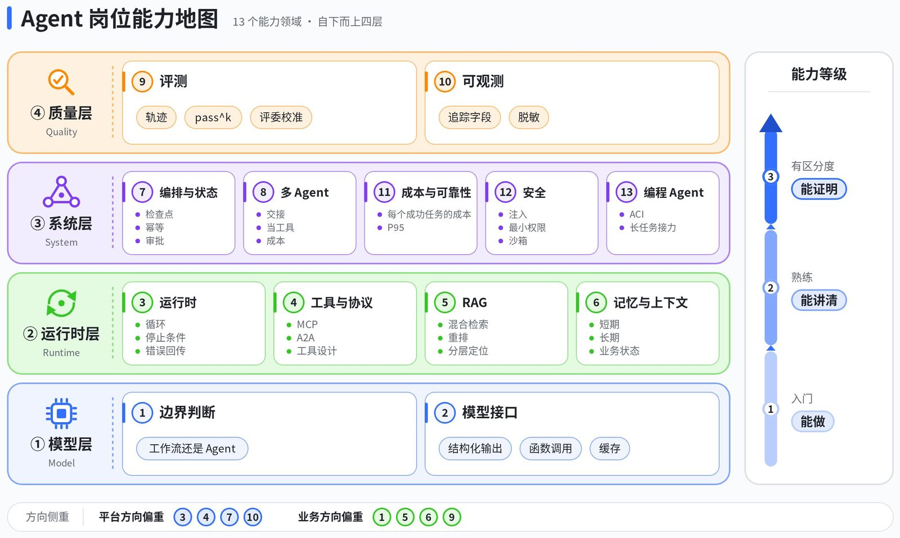
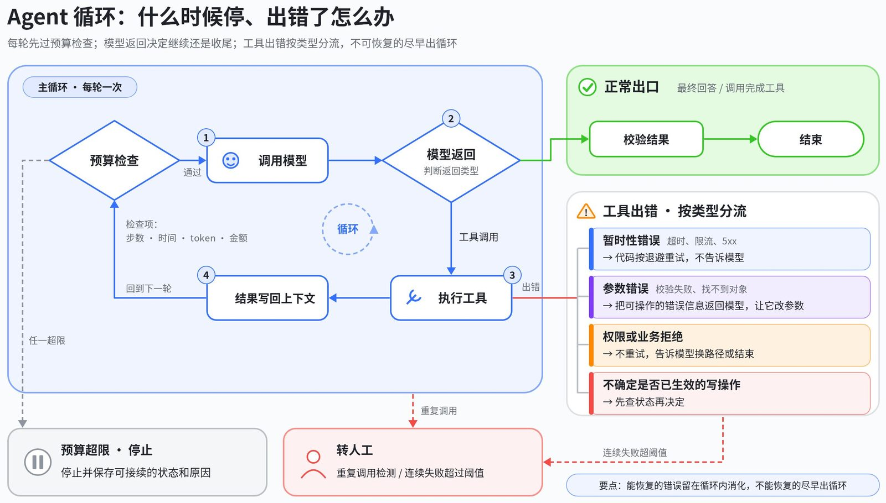
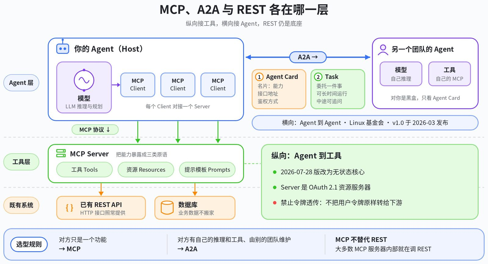
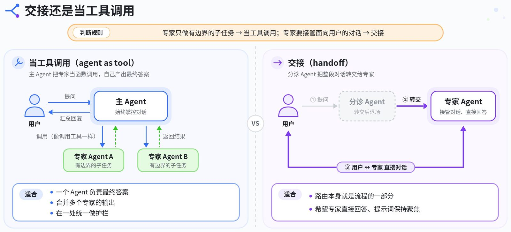
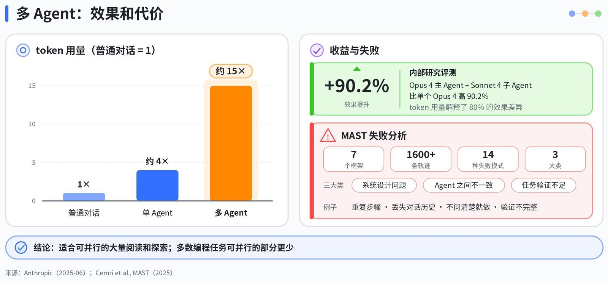
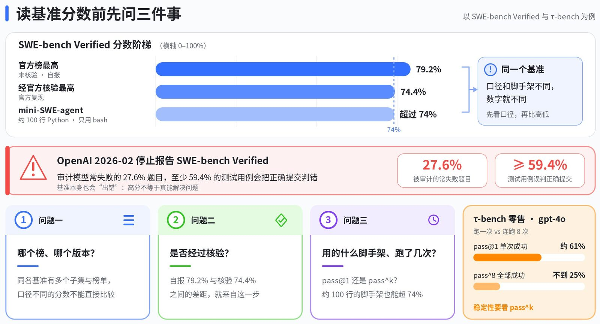
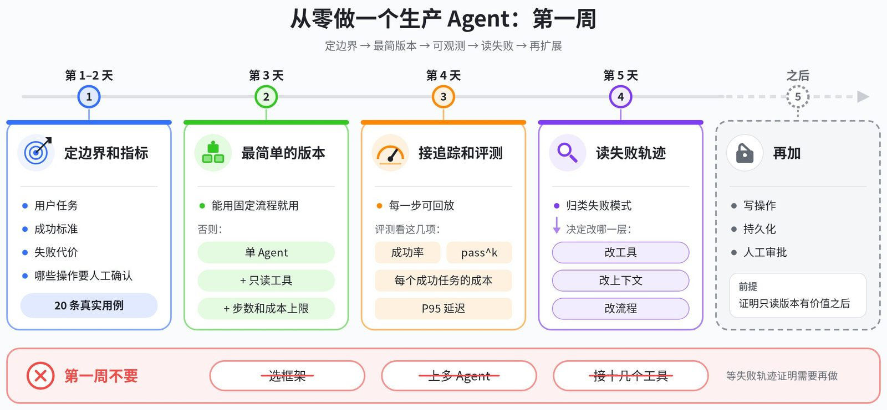

# LLM-25｜工程｜Agent 岗位能力地图与面试自查

> 🎯 **这篇文档解决什么问题**：2026 年 Agent 方向的面试，已经很少只问“ReAct 是什么”“RAG 怎么做”。更常见的追问是：失败发生在哪一层、崩溃后怎么恢复、有副作用的操作怎么保证不做两遍、怎么用数据证明改动有效、为什么当前方案比更复杂的方案好。本文把 Agent 岗位要求的能力拆成 13 个领域，每个领域给出三个级别的标准，再整理 30 道高频问题的答题要点，并指向本系列里展开讲的章节。
>
> 使用方式：先用第 1 章的能力地图给自己打分，找出最弱的两三个领域；再逐题自答，答不上的去读对应章节；最后按第 12 章准备一个能讲清“边界、权衡、故障和证据”的项目。文中框架版本、仓库状态和基准分数核对于 2026 年 10 月 11 日。

## 导读 · 先给结论

- **考的是系统，不是模型**。Anthropic 对两者的区分是：工作流是“用预先写好的代码路径编排模型和工具”，Agent 是“模型动态决定自己的流程和工具使用”，并且建议先找最简单的方案，必要时才增加复杂度[[1]](https://www.anthropic.com/research/building-effective-agents)。能说清什么时候不该用 Agent，比能背出五种编排模式更有区分度。
- **三句话概括 Agent 工程**：模型提出候选决策，系统负责校验和执行；上下文决定模型看到什么，状态机决定系统允许发生什么；评测和追踪决定团队能不能知道它为什么变好或变坏。
- <b>2025–2026 年新增的必考点是“可恢复”</b>。LangGraph 1.0（2025-10）把持久化状态、内置持久层和人工介入列为稳定化的核心[[2]](https://www.langchain.com/blog/langchain-langgraph-1dot0)；OpenAI Agents SDK 用 RunState 序列化暂停中的运行[[3]](https://openai.github.io/openai-agents-python/human_in_the_loop/)；Temporal 与 OpenAI Agents SDK 的集成在 2026-03 正式可用[[4]](https://temporal.io/blog/announcing-openai-agents-sdk-integration)。面试官会追问“恢复时为什么会重复执行副作用”。
- **基准分数要会质疑**。OpenAI 在 2026-02 停止报告 SWE-bench Verified：审计了模型常失败的 27.6% 题目，发现其中至少 59.4% 的测试用例会把功能正确的提交判错[[5]](https://openai.com/index/why-we-no-longer-evaluate-swe-bench-verified/)。能讲出这一点，说明你读过一手资料。
- **项目复盘比八股更重要**。只说“接了某模型、用了某框架、效果不错”是最常见的减分项；要讲清失败模式怎么发现、怎么归因、为什么选当前边界、改动有没有经过评测证明。

📎 与系列其他文档的分工：每个领域的展开讲解在系列对应文档里，第 1 章的能力地图表逐项列出了去哪里看。本文只给能力标准、高频问题的答题要点和项目复盘的讲法。

## 第 1 章 · 能力地图：13 个领域、三个级别

下表是一张自评表。“入门”是能跑通、“熟练”是能讲清原理和取舍、“有区分度”是能拿出数据或线上案例证明。面试通常在“熟练”这一列提问，在“有区分度”这一列拉开差距。

| 领域 | 入门：能做 | 熟练：能讲清 | 有区分度：能证明 | 系列里看哪里 |
|---|---|---|---|---|
| 1 边界判断 | 说出工作流和 Agent 的区别 | 按任务的确定性、可验证性、失败代价判断用哪种 | 拿出“改成固定流程后成功率或成本更好”的对比 | 「Agent 工程实战」第 1 章 |
| 2 模型接口 | 调通结构化输出和函数调用 | 约束解码的原理、思考档位、缓存的计费规则 | 换代迁移时有评测基线和回归数据 | 「用好模型」第 4、6、7、10 章和附录 |
| 3 运行时 | 写出最小的 Agent 循环 | 停止条件、预算、错误回传、重试策略 | 能用追踪数据定位某次失败卡在哪一步 | 「Agent 工程实战」第 2 章 |
| 4 工具与协议 | 写一个 MCP 服务器 | 工具设计原则、MCP 授权、MCP 与 A2A 的边界 | 工具描述迭代前后的调用正确率 | 「Agent 工程实战」第 3 章、「Agent 协议与工具链」 |
| 5 RAG | 搭一条向量检索链路 | 混合检索、重排、切分，检索和生成分开评 | 召回率、引用准确率随改动的变化 | 「RAG 与知识工程」 |
| 6 记忆与上下文 | 保存会话历史 | 短期记忆、长期记忆、业务状态的区别；压缩与清理 | 长任务上压缩前后的成功率和 token 数 | 「Agent 记忆」、「Agent 工程实战」第 4 章 |
| 7 编排与状态 | 用框架串起多步流程 | 检查点、恢复语义、幂等、人工审批 | 做过崩溃恢复演练，副作用没有重复 | 「Agent 工程实战」第 2.4 节 |
| 8 多 Agent | 跑通一个主从 Agent 示例 | 什么时候值得拆、交接和当工具调用的区别 | 单 Agent 与多 Agent 的成功率和成本对比 | 「Agent 工程实战」第 5 章 |
| 9 评测 | 有 20 条用例的回归集 | 结果和轨迹分开评、LLM 评委的偏差与校准、pass^k | 评测接进 CI，能拦住一次真实回退 | 「LLM 应用评测与可观测」 |
| 10 可观测 | 接入追踪平台 | 一条追踪该记录哪些字段、怎么脱敏 | 从线上追踪自动沉淀回归用例 | 「LLM 应用评测与可观测」第 7 章 |
| 11 成本与可靠性 | 统计 token 用量 | 每个成功任务的成本、P95 延迟、降级与限流 | 一次成本或延迟优化的前后数据 | 「LLM 服务稳定性工程」、「用好模型」第 1 章 |
| 12 安全 | 知道提示词注入是什么 | 为什么只靠提示词防不住、最小权限、沙箱 | 红队用例的拦截率和误拦率 | 「LLM 安全与治理」、「Agent 工程实战」第 8 章 |
| 13 编程 Agent | 用过编程 Agent 完成任务 | Agent 与计算机的接口设计、长任务的接力方式 | 自建评测集上的解决率，而不只是公开榜单分 | 「Agent 协议与工具链」第 9 章 |

按岗位方向，侧重点不同：做 Agent 平台的偏重 3、4、7、10；做业务 Agent 的偏重 1、5、6、9；做运维 Agent 的还要加上变更安全和事故记忆（见「AIOps Agent 落地细化」第 8 章和「Agent 记忆」第 11 章）。

## 第 2 章 · 边界与模型接口（Q1–Q4）

从这一章起，每道题给出三部分：答题要点、容易答偏的地方、在本系列里展开阅读的位置。

### Q1 Agent 和聊天机器人、工作流的边界在哪？

- 聊天机器人只生成回复；工作流由代码决定步骤，模型只负责其中某些步；Agent 由模型决定下一步做什么、调用哪个工具、什么时候结束[[1]](https://www.anthropic.com/research/building-effective-agents)。
- 判断要不要用 Agent，看四件事：步骤能不能事先写死、结果能不能自动验证、出错的代价多大、多花的 token 和延迟值不值。步骤固定、出错代价高的，用工作流更稳。
- 两者不是二选一：常见形态是工作流做骨架，个别开放步骤交给 Agent。

**容易答偏**：把“用了大模型”或“能调工具”当成 Agent 的定义；只讲 Agent 的好处，不讲它带来的不确定性和成本。

📎 展开阅读：「Agent 工程实战」第 1 章（五种编排模式和四个判断问题）。

### Q2 ReAct 的核心循环是什么？什么时候不适合？

- ReAct 让模型交替输出“思考”和“行动”，行动的结果作为“观察”回到上下文，再进入下一轮[[6]](https://arxiv.org/abs/2210.03629)。今天的原生函数调用和思考模型，本质上把这个循环内置进了接口。
- 不适合的情况：步骤可以事先确定（直接写工作流）；单步就能完成（一次调用加结构化输出）；对延迟敏感、不能接受多轮往返；每一步都有不可逆副作用、又没有审批和回滚。

**容易答偏**：把 ReAct 说成一种模型或框架；不提停止条件，只说“循环直到完成”。

📎 展开阅读：「Agent 工程实战」第 2.1 节；「LLM 基础」第 8.4 节。

### Q3 函数调用、JSON 模式、结构化输出有什么区别？

- **JSON 模式**只保证输出是合法 JSON，不保证字段和类型对。
- **结构化输出**按给定的 JSON Schema 做约束解码：每生成一个 token，把不符合 Schema 的候选概率置零。OpenAI 2024 年的测试里，复杂 Schema 的遵循率从不到 40% 提到 100%[[7]](https://openai.com/index/introducing-structured-outputs-in-the-api/)。
- **函数调用**是让模型输出“调用哪个工具、参数是什么”，执行在调用方。开启 strict 后，参数同样由约束解码保证符合 Schema；工具定义会注入到系统消息里，占上下文并按输入 token 计费[[8]](https://developers.openai.com/api/docs/guides/function-calling)。

**容易答偏**：以为函数调用时模型会自己执行工具；以为格式对了内容就对了。

📎 展开阅读：「用好模型」第 6 章和附录 A.4。

### Q4 工具参数已经通过 Schema 校验，为什么还要再校验？

- Schema 只管类型和结构，管不了业务含义：日期是不是在合法范围、订单号是不是当前用户的、金额是不是超过了审批阈值。
- 参数可能来自被注入的外部内容，模型“格式正确地”提出了一个恶意调用。
- 校验失败时，把具体原因返回给模型（哪个字段、为什么错、正确取值是什么），让它自己改参数重试；这是 12-Factor Agents 里“把错误压缩进上下文”的做法[[9]](https://github.com/humanlayer/12-factor-agents)。

**容易答偏**：只说“加一层校验”，不说校验失败后怎么反馈；把校验写进提示词里而不是代码里。

📎 展开阅读：「Agent 工程实战」第 3 章（好工具的七条原则）；「LLM 安全与治理」第 5 章。

> 💡 **本章常见翻车**：能背定义，但答不出“这个场景为什么不用 Agent”。准备一个自己做过的、最后改成固定流程的例子，比背五种编排模式有用。

## 第 3 章 · 运行时：循环、停止与出错（Q5–Q6）

### Q5 怎么定义 Agent 的结束条件和预算？

- **正常结束**：模型给出最终回答且不再调用工具；或者调用一个专门的“完成”工具，带上结构化的结果，便于校验。
- **硬上限**：步数、墙钟时间、token 或金额三重上限，任何一个先到就停。OpenAI Agents SDK 超过 `max_turns` 会抛出 `MaxTurnsExceeded`[[10]](https://openai.github.io/openai-agents-python/running_agents/)。
- **异常结束**：重复检测（同一工具、同样参数连续调用）、连续工具错误超过阈值、置信度不足时转人工。
- 停下来时要留下可接续的状态和原因，而不是只返回“失败”。

**容易答偏**：只说“设一个最大步数”。多 Agent 失败研究里，“不知道何时停止”和“过早结束”是两种独立的失败模式[[11]](https://arxiv.org/abs/2503.13657)，两头都要防。

📎 展开阅读：「Agent 工程实战」第 2.1、6 章。

### Q6 工具调用失败后，怎么决定重试、改参数、降级还是转人工？

- 先给错误分类：**暂时性**（超时、限流、5xx）由代码按退避策略重试，不必让模型知道；**参数类**（校验失败、找不到对象）把可操作的错误信息返回给模型，让它改参数；**权限或业务拒绝**不重试，告诉模型换路径或结束；**不确定是否已生效**的写操作，先查询状态再决定，不要盲目重试。
- 降级：换一个只读的替代工具、返回部分结果并说明缺了什么、切到更稳的模型。
- 转人工：连续失败超过阈值、涉及不可逆操作、或模型自己判断信息不足。

**容易答偏**：所有错误一律重试三次；工具出错时返回空结果，模型会以为“没有问题”。

📎 展开阅读：「Agent 工程实战」第 10.2、10.3 节；「LLM 服务稳定性工程」第 4 章（超时与重试）。

## 第 4 章 · 工具与协议（Q7–Q9）

### Q7 MCP 的 Host、Client、Server 分别做什么？

- **Host** 是用户直接使用的应用（IDE、桌面助手、你自己的 Agent 服务），持有模型和对话，决定把哪些工具暴露给模型、哪些调用要用户确认。
- **Client** 是 Host 里的连接器，一个 Client 对应一个 Server 连接，负责协议收发。
- **Server** 对外提供三类原语：工具（可执行的操作）、资源（可读取的数据）、提示模板。
- 2026-07-28 版规范去掉了协议层会话和初始化握手，改成无状态核心，新增 `server/discover`；还要求服务器以确定的顺序返回工具列表，方便客户端缓存、提高提示缓存命中率[[12]](https://modelcontextprotocol.io/specification/2026-07-28/changelog)。

**容易答偏**：把 MCP 说成“一种模型能力”；仍按 2025 年的版本讲会话和 SSE 断点续传（2026-07-28 版已经去掉）[[12]](https://modelcontextprotocol.io/specification/2026-07-28/changelog)。

📎 展开阅读：「Agent 协议与工具链」第 2、3 章。

### Q8 MCP 和普通 REST API 是什么关系？

- MCP 不替代 REST：大部分 MCP 服务器内部就是在调用已有的 REST API。它标准化的是“Agent 怎么发现、描述和调用工具”这一层，让同一个工具可以被不同的 Host 复用。
- 不要把 REST 端点一比一包成 MCP 工具：工具应当按任务设计、数量少、返回精简，否则模型选错工具、上下文被冗长返回占满。
- 授权上，远程 MCP 服务器是 OAuth 2.1 的资源服务器：必须发布受保护资源元数据（RFC 9728），客户端必须用资源指示符（RFC 8707）声明令牌给谁用[[13]](https://modelcontextprotocol.io/specification/2026-07-28/basic/authorization)；服务器不得接受不是专门签发给自己的令牌，规范明确禁止“令牌透传”[[14]](https://modelcontextprotocol.io/specification/2026-07-28/basic/security_best_practices)。

**容易答偏**：只说“MCP 是 AI 的 USB 接口”这类比喻，讲不出授权模型和工具设计。

📎 展开阅读：「Agent 工程实战」第 3 章；「Agent 协议与工具链」第 4、10 章。

### Q9 MCP 和 A2A 的边界在哪？

- MCP 是 Agent 到工具的“纵向”连接：对方是一个能力，调用是同步的、可预期的。A2A 是 Agent 到 Agent 的“横向”连接：对方有自己的推理和工具，任务可能跑很久、中途还要追问。
- A2A 由谷歌贡献、在 Linux 基金会下维护，用 Agent Card 描述能力、接口地址和鉴权方式[[15]](https://github.com/a2aproject/A2A)；v1.0.0 于 2026-03 发布，是首个稳定版[[15]](https://github.com/a2aproject/A2A)。
- 选型原则：对方只是一个功能，用 MCP；对方是另一个团队维护、有自主决策的 Agent，用 A2A。

**容易答偏**：说两者是竞争关系；或者把内部的多 Agent 协作都改成 A2A，平白增加网络和协议开销。

📎 展开阅读：「Agent 协议与工具链」第 6 章。

## 第 5 章 · 上下文：RAG、记忆与压缩（Q10–Q13）

### Q10 RAG 效果差，怎么分层定位？

- 按链路倒着查：先看答案引用的片段里有没有正确信息。**有**，问题在生成（没按资料回答、引用错位）；**没有**，再看召回的前 k 个里有没有。**前 k 里有但没排上来**，问题在重排或上下文组装；**前 k 里都没有**，问题在检索或索引。
- 索引层常见问题：解析丢了表格和标题层级、切分把一个答案切成两半、元数据缺失导致过滤不到。
- 检索层：默认用关键词加向量的混合检索；查询改写对口语化问题有效。
- 评测上，检索指标（召回率、命中排名）和生成指标（忠实度、引用准确率）分开算，否则不知道该改哪一层。

**容易答偏**：一上来就换嵌入模型或加大上下文。大多数问题出在解析、切分和检索，不在生成。

📎 展开阅读：「RAG 与知识工程」第 1、2、8 章。

### Q11 向量检索为什么不能替代权限过滤？

- 相似度只回答“像不像”，不回答“能不能看”。权限必须在检索时作为硬过滤条件（按租户、部门、文档权限标签），而不是检索之后让模型“不要说出来”。
- 进入上下文的内容就有可能被输出，也可能携带注入指令；所以过滤要在进入上下文之前完成。
- 权限变更要能及时生效：索引里存权限标签，或者检索后按实时权限再校验一遍。

**容易答偏**：在提示词里写“不要泄露用户无权查看的内容”。

📎 展开阅读：「RAG 与知识工程」第 9 章；「LLM 安全与治理」第 4 章。

### Q12 短期记忆、长期记忆、业务状态有什么区别？

- **短期记忆**：一次任务或一个会话内的上下文。LangGraph 用检查点保存，以 `thread_id` 区分会话，用于对话连续、人工介入和故障恢复[[16]](https://docs.langchain.com/oss/python/langgraph/persistence)。
- **长期记忆**：跨会话保留的偏好、事实和经验。LangGraph 把它放在独立的 Store 里，不随单个会话的状态走[[16]](https://docs.langchain.com/oss/python/langgraph/persistence)。
- **业务状态**：订单、工单、审批单这些系统里的真实数据，以业务系统为准。记忆可以引用它，但不能替代它。12-Factor Agents 主张把执行状态和业务状态统一起来管理[[9]](https://github.com/humanlayer/12-factor-agents)。

**容易答偏**：把记忆等同于“把聊天记录存进向量库”；用记忆里的旧值做业务决策。

📎 展开阅读：「Agent 记忆」第 2、4、6 章。

### Q13 长对话怎么压缩，又怎么避免丢掉关键信息？

- Anthropic 总结了长任务的三种手段：压缩（快满时总结并开新窗口）、结构化笔记（把进度和决定写到上下文之外）、子 Agent（让子任务在独立的上下文里完成，只返回结论）。最轻、最安全的一种压缩是清理旧的工具返回结果[[17]](https://www.anthropic.com/engineering/effective-context-engineering-for-ai-agents)。
- 不能丢的东西不要只靠总结保留：用户的约束、已确认的决定、未完成事项写进结构化状态或进度文件，每次压缩后原样带上。
- 用评测验证压缩：同一批长任务，比较压缩前后的成功率和 token 数。

**容易答偏**：只说“超长就截断最早的消息”。

📎 展开阅读：「Agent 工程实战」第 4 章；「Agent 记忆」第 1 章。

## 第 6 章 · 编排与状态（Q14–Q18）

这一章是 2026 年面试里追问最深的部分，因为它最能区分“做过 Demo”和“做过生产”。

### Q14 什么时候需要规划（Planning），什么时候固定工作流更好？

- 任务的步骤和顺序能提前确定，就写成工作流：可测、可预期、便宜。
- 步骤取决于中间结果（排障、调研、改代码），才需要让模型先规划。规划本身也要能被检查：输出结构化的计划，执行中允许修订，并记录修订原因。
- 折中做法：固定的大阶段加阶段内的自主执行，比如“收集信息 → 定位 → 给出方案 → 人工确认 → 执行”。

**容易答偏**：认为“先规划再执行”一定比边做边想好。拆得太细的计划，一旦第一步结果和预期不同，后面全部作废。

📎 展开阅读：「Agent 工程实战」第 1 章；「AIOps Agent 落地细化」第 6 章。

### Q15 长任务怎么实现暂停、恢复和版本迁移？

- 在每一步的边界存检查点，用会话标识找回。LangGraph 持久化分三档：只在结束时写、异步写、同步写，越往后越稳也越慢；内存检查点在进程重启后全部丢失[[16]](https://docs.langchain.com/oss/python/langgraph/persistence)。
- 关键语义：恢复不是从中断的那一行接着跑。LangGraph 恢复时把整个节点从头重跑，节点里中断之前的代码会再执行一次[[18]](https://docs.langchain.com/oss/python/langgraph/interrupts)。
- 版本迁移：有任务暂停在旧版本时发布新代码，要么保证状态结构向后兼容，要么让旧任务在旧版本上跑完，要么显式写迁移脚本；发布前检查“正在运行的任务会不会被打断”。

**容易答偏**：只回答“存数据库”，讲不出恢复时到底从哪里开始执行。

📎 展开阅读：「Agent 工程实战」第 2.4 节。

### Q16 有副作用的工具怎么保证幂等？

- 把副作用和不确定的操作单独包起来（LangGraph 的 task、Temporal 的 Activity），因为开始了但没完成的步骤在恢复时可能再跑一次[[19]](https://docs.langchain.com/oss/python/langgraph/functional-api)[[20]](https://docs.temporal.io/activity-definition)。
- 幂等键要在重试之间保持不变、在不同任务之间唯一，例如 Temporal 推荐的“工作流运行 ID + Activity ID”[[20]](https://docs.temporal.io/activity-definition)；在重试路径上现生成随机 UUID 等于没有幂等。
- 下游支持就透传：Stripe 用同一个键重试会返回第一次的结果，参数不一致会报错，键最长 255 个字符[[21]](https://docs.stripe.com/api/idempotent_requests)。下游不支持就自己建带唯一约束的执行记录表，先查后写。

**容易答偏**：说“失败了就不重试”。不重试解决不了“超时了，但其实已经成功”的情况。

📎 展开阅读：「Agent 工程实战」第 2.4、10.3 节。

### Q17 人工审批应该插在哪些位置？

- 插在不可逆或高影响的操作之前：资金、删除、对外发送、生产变更、权限变更。只读操作一般不需要。
- 审批对象是“带具体参数的这一次调用”，审批人要看到将要做什么、影响范围和回滚方式；超时默认拒绝；拒绝理由回传给模型。
- 实现上，OpenAI Agents SDK 在工具上声明 `needs_approval`，运行结果里出现待审批项，审批后用 RunState 恢复[[3]](https://openai.github.io/openai-agents-python/human_in_the_loop/)；LangGraph 用 `interrupt()` 暂停、`Command(resume=…)` 恢复[[18]](https://docs.langchain.com/oss/python/langgraph/interrupts)。
- Claude Agent SDK 的权限判断有固定顺序（hooks、拒绝规则、询问规则、权限模式、允许规则、回调），hook 的拒绝在跳过权限模式下依然生效[[22]](https://code.claude.com/docs/en/agent-sdk/permissions)；要清楚自己的拦截点在哪一环。

**容易答偏**：每一步都要人确认（没人会认真看）；或者只在最后给人看结果（来不及拦）。

📎 展开阅读：「Agent 工程实战」第 2.4、8 章；「AIOps Agent 落地细化」第 8 章。

### Q18 交接（handoff）和把 Agent 当工具调用有什么区别？

- **当工具调用**：主 Agent 始终掌控对话，把专家 Agent 当工具调用、自己汇总结果。适合由一个 Agent 给出最终答案、合并多个专家的输出、在一处统一做护栏[[23]](https://openai.github.io/openai-agents-python/multi_agent/)。
- **交接**：分诊 Agent 把对话转给专家，本轮剩下的部分由专家直接回答。适合路由本身就是流程的一部分、希望各专家的提示词保持聚焦[[23]](https://openai.github.io/openai-agents-python/multi_agent/)。
- 一句话判断：专家只是帮忙完成一个有边界的子任务，就当工具调用；专家要接管面向用户的对话，就交接。

📎 展开阅读：「Agent 工程实战」第 5.5 节。

## 第 7 章 · 多 Agent（Q19）

### Q19 多 Agent 为什么可能比单 Agent 更差？

- **收益是真的，但有条件**：Anthropic 的研究系统用 Claude Opus 4 做主 Agent、Sonnet 4 做子 Agent，在内部研究评测上比单个 Opus 4 高 90.2%；但多 Agent 系统的 token 用量约为普通对话的 15 倍（单 Agent 约 4 倍），而且 token 用量本身就解释了 80% 的效果差异[[24]](https://www.anthropic.com/engineering/multi-agent-research-system)。也就是说，收益很大一部分来自“花了更多 token”。
- **适合可并行的大量阅读**：调研、检索这类任务能拆成互不依赖的子问题；同一篇文章也指出，大多数编程任务真正可并行的部分比调研少[[24]](https://www.anthropic.com/engineering/multi-agent-research-system)。
- **失败来自协作本身**：MAST 研究标注了 7 个框架的 1600 多条轨迹，归纳出 14 种失败模式、3 大类：系统设计问题、Agent 之间不一致、任务验证不足；标注一致性 kappa 为 0.88[[11]](https://arxiv.org/abs/2503.13657)。典型的有重复步骤、丢失对话历史、不问清楚就做、互相忽略对方的输入、验证不完整。
- **反方观点**：Cognition 认为子 Agent 看不到完整上下文，各自做出的隐含决定会冲突，主张优先单线程、共享完整上下文[[25]](https://cognition.com/blog/dont-build-multi-agents)。

**容易答偏**：只引用 90.2%，不提 15 倍 token；或者把多 Agent 当成提升效果的默认手段。

📎 展开阅读：「Agent 工程实战」第 5 章。

### 补充：被问到“用什么框架”时

框架在快速更替，回答时说明版本和时间更可信。截至 2026-10：

- 微软 AutoGen 已进入维护模式，不再增加新功能，官方建议新用户直接用 Microsoft Agent Framework[[26]](https://github.com/microsoft/autogen)；后者 1.0 版于 2026-04 发布，同时支持 .NET 和 Python[[27]](https://devblogs.microsoft.com/agent-framework/microsoft-agent-framework-version-1-0/)。
- LangGraph 1.0 于 2025-10 正式发布，承诺 2.0 之前不做破坏性修改[[2]](https://www.langchain.com/blog/langchain-langgraph-1dot0)。
- OpenAI Agents SDK（Python）仍是 0.x 版本，持续快速迭代[[28]](https://github.com/openai/openai-agents-python)。

比框架名更重要的是讲清选型理由：要不要持久化执行、要不要人工审批、团队熟悉什么语言、能不能接入已有的追踪和评测。

## 第 8 章 · 评测与追踪（Q20–Q24）

### Q20 怎么评测一条 Agent 轨迹？

- **结果**：任务最终是否完成，尽量用代码判（状态检查、单测、数据库里的实际变化），而不是看模型怎么说。
- **过程**：有没有调用不该调用的工具、有没有多余的步骤、关键步骤的参数是否正确、出错后是否恢复。
- **稳定性**：τ-bench 提出 pass^k，即同一个任务独立跑 k 次全部成功的概率。gpt-4o 在零售场景单次成功率约 61%，跑 8 次全部成功的比例不到 25%[[29]](https://arxiv.org/abs/2406.12045)。平均成功率会掩盖不稳定。
- **成本**：每个成功任务的 token、步数和耗时。

**容易答偏**：只看最终答案对不对；只跑一次就下结论。

📎 展开阅读：「Agent 工程实战」第 6、7 章；「LLM 应用评测与可观测」第 1–3 章。

### Q21 用大模型当评委（LLM-as-a-judge）有哪些偏差，怎么校准？

- MT-Bench 的研究归纳了三种典型偏差：位置偏差（偏好排在前面或后面的答案）、冗长偏差（偏好更长的答案）、自我偏好（偏好自己或同家族模型的答案）[[30]](https://arxiv.org/abs/2306.05685)。
- 校准方法：交换顺序各评一次；评分标准写成可检查的条目，而不是“打 1–10 分”；能用代码判的不用模型判；抽一批样本让人工标注，算评委和人的一致率，达到阈值才上线；评委模型换代后重新校准。

**容易答偏**：直接拿评委分数当真值；用被评的同一个模型当评委。

📎 展开阅读：「LLM 应用评测与可观测」第 4、5 章。

### Q22 怎么把线上失败自动沉淀成回归集？

- 先有完整追踪，才能沉淀：用户差评、人工接管、工具连续报错、超预算终止，这些信号自动标记出追踪记录。
- 定期人工过一遍标记出的记录，归类失败模式，挑代表性的转成用例：输入、必要的环境状态、期望结果或检查函数。
- 回归集接进 CI：改提示词、换模型、改工具描述时自动跑，分数下降超过统计误差就拦住发布。

📎 展开阅读：「LLM 应用评测与可观测」第 6–8 章。

### Q23 一条 Agent 追踪应该记录哪些字段？

- 标识：会话 ID、用户或租户、Agent 和提示词版本、模型名和参数、代码版本。
- 每一步：输入上下文（或其摘要和哈希）、模型输出、工具名、参数、返回、耗时、token、错误、重试次数。
- 决策点：审批请求和结果、护栏触发、转人工、终止原因。
- 结果：最终状态、用户反馈、成本合计。目标是任意一次失败都能回放到具体某一步。

### Q24 日志和追踪怎么防止敏感数据泄露？

- 写入前脱敏：按字段规则屏蔽证件号、手机号、密钥；工具返回里的大段原文只存摘要或引用。
- 访问控制和保留期限：追踪数据和生产数据同级管理，按需授权，过期删除。
- 注意托管服务的数据政策：例如 OpenAI Agents SDK 默认开启追踪，而采用零数据保留政策的组织无法使用它的追踪功能[[31]](https://openai.github.io/openai-agents-python/tracing/)。

### 补充：工具与基准的现状（2026-10）

- 评测框架：Inspect Evals 收录了 181 个评测，现由伦敦非营利组织 Generality Labs 维护[[32]](https://ukgovernmentbeis.github.io/inspect_evals/)；OpenAI 于 2026-03 宣布收购 promptfoo，promptfoo 表示会继续开源[[33]](https://openai.com/index/openai-to-acquire-promptfoo/)。
- 可观测：Langfuse 于 2026-01 被 ClickHouse 收购，核心功能仍以 MIT 协议开源[[34]](https://clickhouse.com/blog/clickhouse-acquires-langfuse-open-source-llm-observability)。
- 编程基准：SWE-bench Verified 官方榜单最高 79.2%，经官方核验的最高为 74.4%[[35]](https://www.swebench.com/)；OpenAI 因测试用例缺陷已停止报告这个基准[[5]](https://openai.com/index/why-we-no-longer-evaluate-swe-bench-verified/)。被问到“某模型 SWE-bench 多少分”时，先说清楚是哪个榜、是否核验、用的什么脚手架。

## 第 9 章 · 成本、延迟与故障排查（Q25）

### Q25 怎么优化 Agent 的 token、成本和 P95 延迟？

- **先定指标**：按“每个成功任务的成本”统计，而不是每次调用的成本；失败重来的花费也要算进去。
- **少走步**：工具按任务设计，一次返回够用的信息；能用代码完成的步骤（格式转换、过滤）不让模型做。
- **少读 token**：稳定内容放前面命中提示缓存，变化内容放最后；工具返回截断并告知总数；旧的工具结果及时清理。
- **分档**：简单步骤用小模型或低思考档位，难的步骤才用大模型；见「用好模型」第 4、8 章。
- **并行**：互不依赖的工具调用并行执行。护栏可以和主流程并行以降低延迟，但代价是护栏触发前 Agent 可能已经消耗了 token、调用过工具；不能先执行的场景要用阻塞模式[[36]](https://openai.github.io/openai-agents-python/guardrails/)。
- **看尾部**：P95 往往由重试、超长输出和个别慢工具决定；给每个工具设超时，避免框架重试和服务商重试叠加。

**容易答偏**：只说“换便宜模型”。换模型后成功率下降、重试变多，每个成功任务的成本可能反而上升。

📎 展开阅读：「Agent 工程实战」第 4.4 节、第 9 章；「LLM 服务稳定性工程」第 4、8 章；「用好模型」第 7 章。

### 补充：高频故障按什么顺序查

面试里常以“线上出了某个问题，你怎么查”的形式出现。按下面的顺序回答，能体现排查有章法：

| 症状 | 检查顺序 |
|---|---|
| 工具选错 | 工具名字和描述是否重叠 → 工具数量是否过多 → 示例和边界说明是否清楚 → 上下文里是否有干扰信息 |
| 参数错误 | 字段描述 → 枚举和约束 → 业务校验 → 错误反馈是否告诉模型怎么改 |
| 循环不结束 | 完成条件是否清楚 → 重复调用检测 → 工具是否一直报错 → 步数和预算上限是否生效 |
| 偶发性失败 | 按追踪聚类 → 模型、提示词、数据的版本是否变化 → 并发和依赖服务 → 用同样输入重放 |
| 上线后成本暴涨 | 平均步数 → 上下文长度和缓存命中率 → 重试次数 → 并行分支数 → 模型路由是否失效 |
| 恢复后副作用做了两遍 | 副作用是否和暂停点在同一节点 → 是否包进 task 或 Activity → 幂等键是否在重试时重新生成 → 下游有没有唯一约束兜底 |

完整的八类症状排查表见「Agent 工程实战」第 10.3 节。

## 第 10 章 · 安全（Q26–Q28）

### Q26 提示词注入为什么不能只靠提示词解决？

- 模型分不清“指令”和“数据”：网页、邮件、工具返回里的文字和系统指令在同一个上下文里，靠措辞让模型“提高警惕”只是降低概率，攻击者只需要成功一次。
- Willison 的“致命三要素”：同时拥有私有数据、会读不可信内容、能向外发送信息的 Agent，就可能被注入后把数据外传；去掉其中任意一个，风险就大幅下降[[37]](https://simonwillison.net/2025/Jun/16/the-lethal-trifecta/)。
- 架构级防御的代表是 CaMeL：由一个只看可信指令的模型生成执行计划，读到的不可信数据只能作为值流动，不能改变控制流，再配合数据来源的权限检查[[38]](https://arxiv.org/abs/2503.18813)。

**容易答偏**：回答“加一个检测注入的分类器”就结束。分类器有用，但只能作为纵深防御的一层。

📎 展开阅读：「Agent 工程实战」第 8 章；「LLM 安全与治理」第 2 章。

### Q27 怎么设计一个最小权限的工具系统？

- 按任务给工具，不按系统给：一个工单 Agent 拿到的是“查询本人工单”“给工单加备注”，而不是整个工单系统的 API 令牌。
- 读写分离：读外部内容的 Agent 不持有写入和对外发送的工具；写操作集中到一个受控的步骤，并按影响分级审批。
- 凭证不进上下文：令牌由工具层持有，模型只看到工具名和参数。MCP 规范要求服务器不得接受不是专门签发给自己的令牌[[14]](https://modelcontextprotocol.io/specification/2026-07-28/basic/security_best_practices)。
- 权限按用户身份传递：Agent 代表谁操作，就只能用谁的权限，避免“混淆代理”问题[[14]](https://modelcontextprotocol.io/specification/2026-07-28/basic/security_best_practices)。

📎 展开阅读：「LLM 安全与治理」第 5 章；「Agent 协议与工具链」第 4、10 章。

### Q28 代码执行为什么需要沙箱？沙箱要限制什么？

- 模型生成的代码要当成不可信代码：可能有缺陷，也可能被注入后带有恶意。
- 要限制四类东西：**文件系统**（只能访问工作目录）、**网络**（默认断开或只放行白名单，否则可以把数据传出去）、**资源**（CPU、内存、时间上限）、**凭证**（沙箱里不放生产密钥）。文件和网络两种隔离缺一不可。
- 隔离强度：容器共享宿主机内核，强度有限；E2B 这类服务为每个会话启动一个独立的 Firecracker 微虚拟机，从快照恢复而不是重新启动内核，兼顾隔离和启动速度[[39]](https://github.com/e2b-dev/E2B)。

📎 展开阅读：「Agent 协议与工具链」第 9.2 节；「LLM 安全与治理」第 5 章。

## 第 11 章 · 编程 Agent（Q29–Q30）

### Q29 编程 Agent 的“Agent 与计算机接口”为什么重要？

- SWE-agent 论文提出 Agent-Computer Interface（ACI）的概念：给模型设计的命令和反馈格式（怎么看文件、怎么编辑、编辑后立即做语法检查、搜索结果怎么分页），对解决率的影响和换模型一样大[[40]](https://arxiv.org/abs/2405.15793)。道理和给人设计界面一样：模型看到的信息要精简、可操作。
- 另一个方向是极简：mini-SWE-agent 的 Agent 类只有约 100 行 Python、只用 bash，在 SWE-bench Verified 上超过 74%；SWE-agent 团队已推荐用它代替原版[[41]](https://github.com/SWE-agent/mini-swe-agent)。模型变强之后，脚手架可以变薄，但反馈格式依然关键。
- 长任务靠接力：Anthropic 的做法是首个会话搭好启动脚本、功能清单、进度文件和第一次 git 提交，之后每个会话只做一项、测试通过就提交并更新进度[[42]](https://www.anthropic.com/engineering/effective-harnesses-for-long-running-agents)。

**容易答偏**：只比较“哪个编程 Agent 产品好用”；拿公开榜单分数当唯一证据。

📎 展开阅读：「Agent 协议与工具链」第 9 章；「Agent 工程实战」第 2.3 节。

### Q30 如果让你从零设计一个生产 Agent，第一周做什么？

- **第 1–2 天：定边界和指标**。写清楚用户任务、成功标准、失败代价、哪些操作必须人工确认；收集 20 条真实用例做第一版评测集。
- **第 3 天：先做最简单的版本**。能用固定流程就用固定流程；必须用 Agent 的，只给只读工具、单 Agent、加步数和成本上限。
- **第 4 天：接上追踪和评测**。每一步都能回放；跑完评测集，记录成功率、pass^k、每个成功任务的成本和 P95 延迟。
- **第 5 天：看失败轨迹**。逐条读失败的追踪，归类失败模式，决定下一步是改工具、改上下文还是改流程。写操作、持久化和审批放到证明只读版本有价值之后再加。

**容易答偏**：第一周就选框架、上多 Agent、接十几个工具。

## 第 12 章 · 怎么准备：学习路径、项目复盘与案例索引

### 12.1 四个阶段

| 阶段 | 练什么 | 做到什么程度算过关 |
|---|---|---|
| 1 基础接口 | 手写模型调用、结构化输出、一个只读工具、流式输出 | 能解释消息结构、Schema 约束、超时和错误处理；知道采样参数和 token 计费（「用好模型」附录） |
| 2 单 Agent | 实现循环、预算、RAG、会话、追踪 | 能回放任意一步，能复现一次失败 |
| 3 生产约束 | 审批、幂等、检查点、评测、红队、沙箱 | 能用评测数据证明改动没有让质量回退；做过一次崩溃恢复演练 |
| 4 综合项目 | 做一个调研、客服、值班或编程 Agent | 能讲清边界、权衡、故障和迭代证据 |

对应本系列的阅读顺序：第 1 阶段读「LLM 基础」「用好模型」；第 2 阶段读「Agent 工程实战」第 1–4 章、「RAG 与知识工程」「Agent 记忆」；第 3 阶段读「Agent 工程实战」第 2.4、6–8 章、「LLM 应用评测与可观测」「LLM 安全与治理」；第 4 阶段按方向读「AIOps Agent 落地细化」或「Agent 协议与工具链」。

### 12.2 项目复盘：STAR 再加一个 E

- **S 情境**：真实的用户任务是什么，做错了代价多大。
- **T 任务**：为什么需要 Agent，哪些步骤普通工作流完成不了。
- **A 行动**：上下文、工具、状态、控制流、安全、评测分别怎么设计，放弃了哪些方案、为什么。
- **R 结果**：成功率、pass^k、延迟、每个成功任务的成本、人工接管率分别变化多少。
- **E 证据**：评测集多大、怎么来的；有哪些追踪和线上案例；改动有没有回归测试。

> 🔑 **最有说服力的素材是失败案例**：一次你发现的失败模式、你怎么定位到具体是哪一层、改了什么、评测上怎么证明修好了且没有引入新问题。准备两三个这样的故事，比讲十个功能点有用。

### 12.3 GitHub 案例索引

下表的星数和版本核对于 2026-10-11，只用来判断项目是否活跃。

| 主题 | 仓库 | 读什么 | 现状 |
|---|---|---|---|
| 生产原则 | 12-Factor Agents[[9]](https://github.com/humanlayer/12-factor-agents) | 12 条原则：自己掌控提示词、上下文和控制流；用简单的 API 启动、暂停、恢复；用工具调用联系人类；把 Agent 做成无状态的归约函数 | 约 2.7 万星，最近一次提交 2025-09 |
| Agent 运行时 | OpenAI Agents SDK[[28]](https://github.com/openai/openai-agents-python) | 工具、交接、护栏、会话、追踪、人工审批 | 约 3 万星，0.23 版，仍在快速迭代 |
| 持久化编排 | LangGraph[[43]](https://github.com/langchain-ai/langgraph) | 检查点、interrupt、持久化档位、Store | 约 4.3 万星，1.x 稳定版 |
| MCP | MCP Python SDK[[44]](https://github.com/modelcontextprotocol/python-sdk) | 工具、资源、提示模板、传输、Client 和 Server 的实现 | 规范当前版本 2026-07-28[[12]](https://modelcontextprotocol.io/specification/2026-07-28/changelog) |
| RAG | LlamaIndex[[45]](https://github.com/run-llama/llama_index) | 数据接入、索引、检索器、查询引擎 | 活跃维护 |
| 多 Agent | Microsoft Agent Framework[[27]](https://devblogs.microsoft.com/agent-framework/microsoft-agent-framework-version-1-0/)、A2A[[15]](https://github.com/a2aproject/A2A) | 多 Agent 编排、跨系统的 Agent 协议 | MAF 1.0 于 2026-04 发布，AutoGen 已进入维护模式[[26]](https://github.com/microsoft/autogen)；A2A 约 2.6 万星，v1.0.1 |
| 评测 | Inspect Evals[[32]](https://ukgovernmentbeis.github.io/inspect_evals/)、promptfoo[[33]](https://openai.com/index/openai-to-acquire-promptfoo/) | 任务定义、评分器、模型对比、红队、接入 CI | Inspect Evals 收录 181 个评测；promptfoo 约 2.6 万星，OpenAI 已宣布收购 |
| 可观测 | Langfuse[[34]](https://clickhouse.com/blog/clickhouse-acquires-langfuse-open-source-llm-observability) | 追踪、提示词版本、数据集、评测 | 约 3.6 万星，2026-01 被 ClickHouse 收购，核心仍是 MIT 协议 |
| 沙箱 | E2B[[39]](https://github.com/e2b-dev/E2B) | 隔离执行、命令、代码解释器 | 约 1.4 万星，Apache-2.0 |
| 编程 Agent | mini-SWE-agent[[41]](https://github.com/SWE-agent/mini-swe-agent) | 环境接口、工具反馈、补丁、SWE-bench 评测 | 约 8 千星，2.x 版 |

### 12.4 面试前的最后自查

- 30 道题里，每道能不能用三句话说清要点，再举一个自己的例子？
- 能不能画出自己项目的架构图，标出状态存在哪、副作用在哪、审批在哪？
- 能不能说出自己项目的四个数：成功率、每个成功任务的成本、P95 延迟、人工接管率？
- 被问到某个框架或基准时，能不能说出版本、时间和局限？

## 参考文献

按正文首次引用顺序编号，资料截至 2026 年 10 月初。

[1] Anthropic. Building effective agents (2024-12) [https://www.anthropic.com/research/building-effective-agents](https://www.anthropic.com/research/building-effective-agents)

[2] LangChain. LangChain and LangGraph 1.0 (2025-10) [https://www.langchain.com/blog/langchain-langgraph-1dot0](https://www.langchain.com/blog/langchain-langgraph-1dot0)

[3] OpenAI. Agents SDK docs: Human-in-the-loop (2026) [https://openai.github.io/openai-agents-python/human_in_the_loop/](https://openai.github.io/openai-agents-python/human_in_the_loop/)

[4] Temporal. Announcing the OpenAI Agents SDK integration (2025-07, GA update 2026-03) [https://temporal.io/blog/announcing-openai-agents-sdk-integration](https://temporal.io/blog/announcing-openai-agents-sdk-integration)

[5] OpenAI. Why we no longer evaluate SWE-bench Verified (2026-02) [https://openai.com/index/why-we-no-longer-evaluate-swe-bench-verified/](https://openai.com/index/why-we-no-longer-evaluate-swe-bench-verified/)

[6] Yao et al. ReAct: Synergizing Reasoning and Acting in Language Models (2022) [https://arxiv.org/abs/2210.03629](https://arxiv.org/abs/2210.03629)

[7] OpenAI. Introducing Structured Outputs in the API (2024-08) [https://openai.com/index/introducing-structured-outputs-in-the-api/](https://openai.com/index/introducing-structured-outputs-in-the-api/)

[8] OpenAI. Function calling guide (2026) [https://developers.openai.com/api/docs/guides/function-calling](https://developers.openai.com/api/docs/guides/function-calling)

[9] HumanLayer. 12-Factor Agents (2025) [https://github.com/humanlayer/12-factor-agents](https://github.com/humanlayer/12-factor-agents)

[10] OpenAI. Agents SDK docs: Running agents (2026) [https://openai.github.io/openai-agents-python/running_agents/](https://openai.github.io/openai-agents-python/running_agents/)

[11] Cemri et al. Why Do Multi-Agent LLM Systems Fail? (MAST) (2025) [https://arxiv.org/abs/2503.13657](https://arxiv.org/abs/2503.13657)

[12] Model Context Protocol. Specification: Versioning and 2026-07-28 changelog (2026) [https://modelcontextprotocol.io/specification/2026-07-28/changelog](https://modelcontextprotocol.io/specification/2026-07-28/changelog)

[13] Model Context Protocol. Specification 2026-07-28: Authorization (2026) [https://modelcontextprotocol.io/specification/2026-07-28/basic/authorization](https://modelcontextprotocol.io/specification/2026-07-28/basic/authorization)

[14] Model Context Protocol. Security Best Practices (2026) [https://modelcontextprotocol.io/specification/2026-07-28/basic/security_best_practices](https://modelcontextprotocol.io/specification/2026-07-28/basic/security_best_practices)

[15] A2A Project. Agent2Agent Protocol (GitHub, Linux Foundation) (2026) [https://github.com/a2aproject/A2A](https://github.com/a2aproject/A2A)

[16] LangChain. LangGraph docs: Persistence (2026) [https://docs.langchain.com/oss/python/langgraph/persistence](https://docs.langchain.com/oss/python/langgraph/persistence)

[17] Anthropic. Effective context engineering for AI agents (2025-09) [https://www.anthropic.com/engineering/effective-context-engineering-for-ai-agents](https://www.anthropic.com/engineering/effective-context-engineering-for-ai-agents)

[18] LangChain. LangGraph docs: Interrupts (2026) [https://docs.langchain.com/oss/python/langgraph/interrupts](https://docs.langchain.com/oss/python/langgraph/interrupts)

[19] LangChain. LangGraph docs: Functional API (2026) [https://docs.langchain.com/oss/python/langgraph/functional-api](https://docs.langchain.com/oss/python/langgraph/functional-api)

[20] Temporal. Activity Definition (2026) [https://docs.temporal.io/activity-definition](https://docs.temporal.io/activity-definition)

[21] Stripe. API Reference: Idempotent requests (2026) [https://docs.stripe.com/api/idempotent_requests](https://docs.stripe.com/api/idempotent_requests)

[22] Anthropic. Claude Agent SDK: Permissions (2026) [https://code.claude.com/docs/en/agent-sdk/permissions](https://code.claude.com/docs/en/agent-sdk/permissions)

[23] OpenAI. Agents SDK docs: Agent orchestration (2026) [https://openai.github.io/openai-agents-python/multi_agent/](https://openai.github.io/openai-agents-python/multi_agent/)

[24] Anthropic. How we built our multi-agent research system (2025-06) [https://www.anthropic.com/engineering/multi-agent-research-system](https://www.anthropic.com/engineering/multi-agent-research-system)

[25] Cognition. Don't Build Multi-Agents (2025-06) [https://cognition.com/blog/dont-build-multi-agents](https://cognition.com/blog/dont-build-multi-agents)

[26] Microsoft. AutoGen (GitHub README, maintenance mode notice) (2026) [https://github.com/microsoft/autogen](https://github.com/microsoft/autogen)

[27] Microsoft. Microsoft Agent Framework Version 1.0 (2026-04) [https://devblogs.microsoft.com/agent-framework/microsoft-agent-framework-version-1-0/](https://devblogs.microsoft.com/agent-framework/microsoft-agent-framework-version-1-0/)

[28] OpenAI. openai-agents-python (GitHub) (2026) [https://github.com/openai/openai-agents-python](https://github.com/openai/openai-agents-python)

[29] Yao et al. τ-bench: A Benchmark for Tool-Agent-User Interaction in Real-World Domains (2024) [https://arxiv.org/abs/2406.12045](https://arxiv.org/abs/2406.12045)

[30] Zheng et al. Judging LLM-as-a-Judge with MT-Bench and Chatbot Arena (2023) [https://arxiv.org/abs/2306.05685](https://arxiv.org/abs/2306.05685)

[31] OpenAI. Agents SDK docs: Tracing (2026) [https://openai.github.io/openai-agents-python/tracing/](https://openai.github.io/openai-agents-python/tracing/)

[32] Inspect Evals. Evaluation catalogue (2026) [https://ukgovernmentbeis.github.io/inspect_evals/](https://ukgovernmentbeis.github.io/inspect_evals/)

[33] OpenAI. OpenAI to acquire Promptfoo (2026-03) [https://openai.com/index/openai-to-acquire-promptfoo/](https://openai.com/index/openai-to-acquire-promptfoo/)

[34] ClickHouse. ClickHouse acquires Langfuse (2026-01) [https://clickhouse.com/blog/clickhouse-acquires-langfuse-open-source-llm-observability](https://clickhouse.com/blog/clickhouse-acquires-langfuse-open-source-llm-observability)

[35] SWE-bench. Leaderboards (2026) [https://www.swebench.com/](https://www.swebench.com/)

[36] OpenAI. Agents SDK docs: Guardrails (2026) [https://openai.github.io/openai-agents-python/guardrails/](https://openai.github.io/openai-agents-python/guardrails/)

[37] Willison. The lethal trifecta for AI agents (2025-06) [https://simonwillison.net/2025/Jun/16/the-lethal-trifecta/](https://simonwillison.net/2025/Jun/16/the-lethal-trifecta/)

[38] Debenedetti et al. Defeating Prompt Injections by Design (CaMeL) (2025) [https://arxiv.org/abs/2503.18813](https://arxiv.org/abs/2503.18813)

[39] E2B. E2B: open-source secure sandboxes (GitHub) (2026) [https://github.com/e2b-dev/E2B](https://github.com/e2b-dev/E2B)

[40] Yang et al. SWE-agent: Agent-Computer Interfaces Enable Automated Software Engineering (2024) [https://arxiv.org/abs/2405.15793](https://arxiv.org/abs/2405.15793)

[41] SWE-agent. mini-SWE-agent (GitHub) (2026) [https://github.com/SWE-agent/mini-swe-agent](https://github.com/SWE-agent/mini-swe-agent)

[42] Anthropic. Effective harnesses for long-running agents (2025-11) [https://www.anthropic.com/engineering/effective-harnesses-for-long-running-agents](https://www.anthropic.com/engineering/effective-harnesses-for-long-running-agents)

[43] LangChain. LangGraph (GitHub) (2026) [https://github.com/langchain-ai/langgraph](https://github.com/langchain-ai/langgraph)

[44] Model Context Protocol. Python SDK (GitHub) (2026) [https://github.com/modelcontextprotocol/python-sdk](https://github.com/modelcontextprotocol/python-sdk)

[45] LlamaIndex (GitHub) (2026) [https://github.com/run-llama/llama_index](https://github.com/run-llama/llama_index)

---

上一篇：[LLM-24｜系统｜模型压缩与端侧部署：量化、剪枝与蒸馏](./24-compression-edge.md) · [目录](./README.md) · 下一篇：[LLM-26｜工程｜编程 Agent 实战：Claude Code、Codex 与 Cursor](./26-coding-agents.md)
