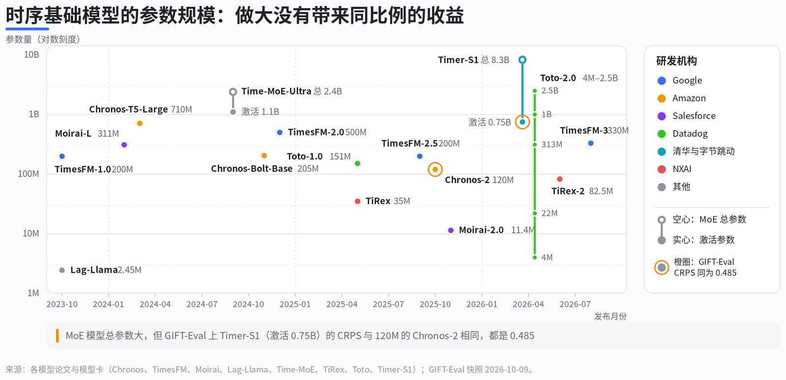
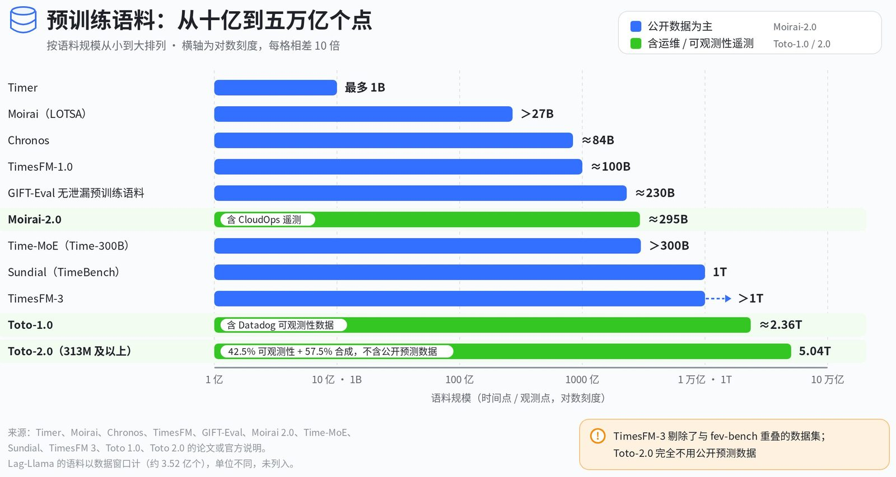
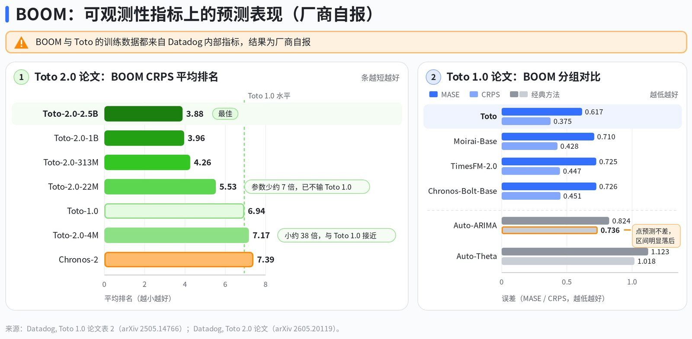
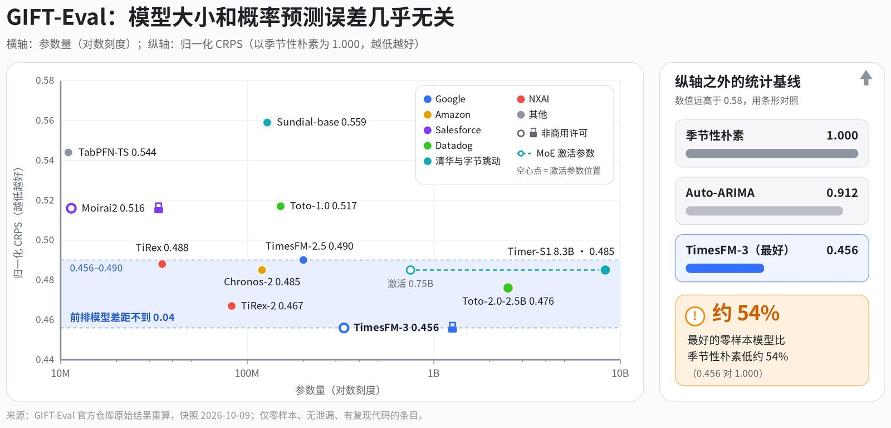
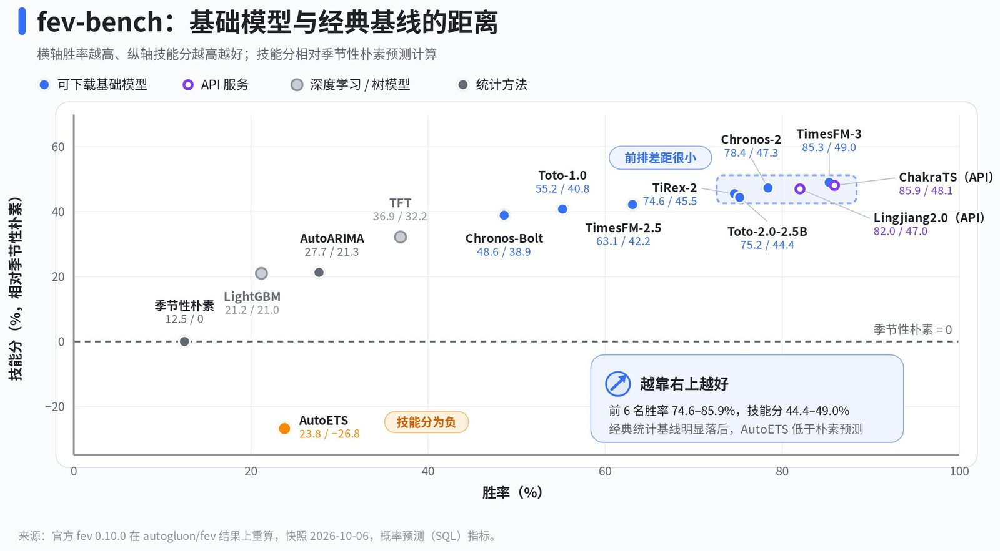
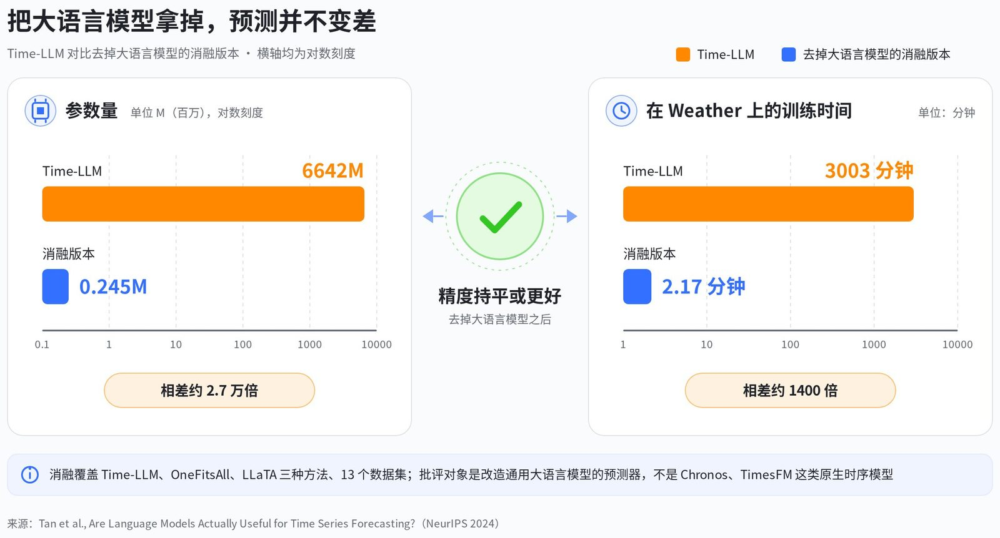
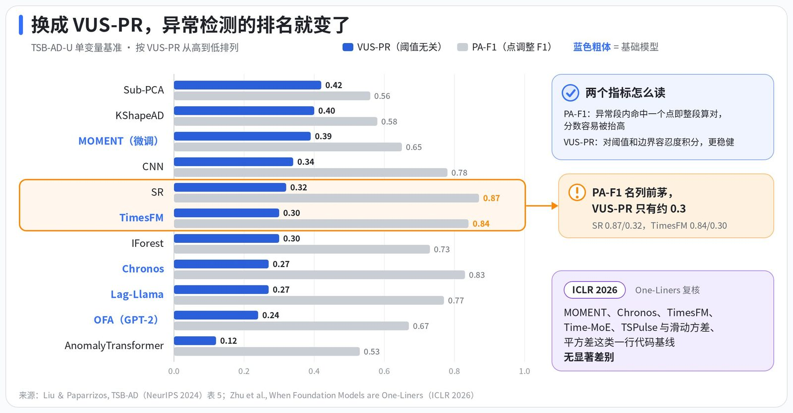
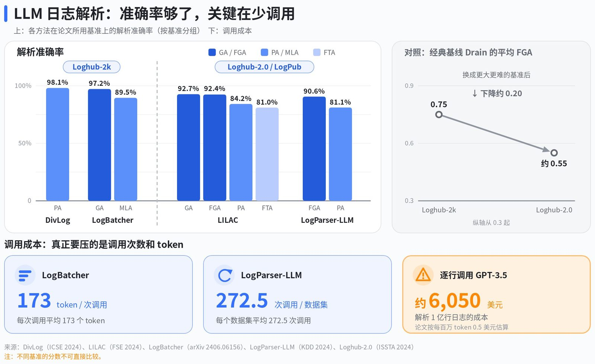

# LLM-27｜场景｜运维数据上的基础模型：时序、日志与 Trace

> 🎯 **这篇文档解决什么问题**：2024–2026 年，Google、Amazon、Salesforce、Datadog 等陆续发布了专门处理时间序列的基础模型（Time Series Foundation Model，下文简称时序基础模型），日志解析和日志异常检测也大量接入了大语言模型。对 SRE 和 AIOps 工程师来说，真正要回答的是：容量预测、告警阈值、异常检测、日志解析这几件日常工作里，这些模型什么时候比季节性朴素预测、ETS、STL 分解加稳健统计这些老方法更好，好多少，代价是什么。本文整理一手资料，最后给出按场景的选型表和上线清单。
>
> 使用方式：只想知道“要不要上”，读导读和第 11 章；做选型评审，重点读第 5–7 章和第 10 章。文中版本、许可证和基准分数核对于 2026 年 10 月 11 日；GIFT-Eval 与 fev-bench 的排名是按官方原始结果文件重算的快照，和网页上显示的值可能有小幅出入。

## 导读 · 先给结论

- **时序预测上，基础模型的优势是真实的，但有上限**。在 GIFT-Eval 上，最好的零样本模型 TimesFM-3 的 MASE 是 0.667、CRPS 是 0.456，即归一化后的聚合比值比季节性朴素基线（=1）低约 33%（MASE）和 54%（CRPS）；这是跨任务几何平均意义上的比值，不等于每条序列的误差都降了这么多[[1]](https://huggingface.co/spaces/Salesforce/GIFT-Eval)。但排名前十的基础模型之间，CRPS 只差 0.02–0.03，换哪个差别不大[[1]](https://huggingface.co/spaces/Salesforce/GIFT-Eval)。
- <b>“把大语言模型改造成预测器”这条路基本被证伪</b>。NeurIPS 2024 的一篇论文把 Time-LLM 等三种方法里的大语言模型去掉或换成一层注意力，效果不降反升；Time-LLM 有 6642M 参数、训练 3003 分钟，去掉大语言模型后只剩 0.245M 参数、2.17 分钟[[2]](https://arxiv.org/abs/2406.16964)。这条批评针对的是改造通用大语言模型的方法，不针对 Chronos、TimesFM 这类原生时序模型。
- <b>异常检测上，基础模型目前约等于“一行代码”</b>。ICLR 2026 的研究发现，MOMENT、Chronos、TimesFM、Time-MoE 等在 TSB-AD-U 上与滑动窗口方差、平方差这类一行代码的基线没有显著差别[[3]](https://openreview.net/forum?id=H27kvyG4qf)。TSB-AD 的总表里排第一的是子序列 PCA（VUS-PR 0.42），TimesFM 只有 0.30[[4]](https://proceedings.neurips.cc/paper_files/paper/2024/hash/c3f3c690b7a99fba16d0efd35cb83b2c-Abstract.html)。
- **2025–2026 年进步最大的是多变量和协变量**。Chronos-2 的组注意力、TimesFM-3 的变量注意力、Toto 的交替注意力，都是为了同时看 CPU、内存、I/O 这类联动的指标[[5]](https://arxiv.org/abs/2510.15821)[[6]](https://research.google/blog/timesfm-3-a-zero-shot-foundation-model-for-multivariate-forecasting/)[[7]](https://arxiv.org/abs/2505.14766)。这正是运维数据的形态。
- **日志解析已经可以“LLM 加缓存”上生产**。LILAC 在 Loghub-2.0 上 FTA 达到 81.0%，比最好的基线高 69.5%，靠解析缓存把 LLM 调用次数降低了几个数量级[[8]](https://arxiv.org/abs/2310.01796)。而 HDFS 上的日志异常检测 F1 已经到 0.997，这个数据集已经饱和，看不出方法差距[[9]](https://arxiv.org/abs/2411.08561)。
- **上线前先查许可证**。TimesFM 3.0 的权重是非商用许可，自托管不能用于商业生产，只能通过 BigQuery 商用；Moirai 全系是 CC-BY-NC-4.0[[10]](https://github.com/google-research/timesfm)[[11]](https://arxiv.org/abs/2511.11698)。Chronos、Toto、TiRex-2、Timer-S1 是 Apache-2.0[[12]](https://github.com/amazon-science/chronos-forecasting)[[13]](https://arxiv.org/abs/2605.20119)[[14]](https://huggingface.co/NX-AI/TiRex-2)[[15]](https://huggingface.co/bytedance-research/Timer-S1)。
- **很多运维场景根本不需要预测模型**。SLO 告警用多窗口、多燃烧率规则就够了[[16]](https://sre.google/workbook/alerting-on-slos/)；Datadog 文档里的三种异常监控算法也都是经典方法[[17]](https://docs.datadoghq.com/monitors/types/anomaly/)。先用季节性朴素预测做基线，证明基础模型赢了再上线。

📎 与系列其他文档的分工：「LLM 在运维与容灾中的落地」讲 LLM 在事故生命周期各阶段的分工、自主等级和护栏；「AIOps Agent 落地细化」讲根因分析 Agent、运维基准（OpenRCA、ITBench、RCAEval 等）和回放评测。本文只讲另一条线：不靠对话、直接吃指标、日志、Trace 数据的专用模型，以及它们和传统算法的对比。

## 第 1 章 · 运维数据有什么特别：为什么需要“非聊天”的基础模型

运维数据里，指标是数值时序，日志是半结构化文本，Trace 是带时延的调用图。通用大语言模型擅长文本，不擅长长串数字：数字被切成 token 后，模型对数值大小和周期并没有天然的感知。于是 2024 年以后出现了一批直接以数值序列训练的时序基础模型，它们和聊天模型只共享“大规模预训练、零样本可用”这一点。

📎 展开阅读：「LLM 在运维与容灾中的落地」第 1 章（按数据类型划分哪些交给 LLM、哪些交给确定性系统）。

### 1.1 运维指标的两个难点

- **强季节性加突发**：业务指标通常有日周期和周周期，再叠加发布、促销、故障带来的突变。季节性朴素预测（Seasonal Naive，直接用上一个周期同一时刻的值当预测）在这类数据上是一个很难打败的基线，所以 GIFT-Eval、fev-bench 和 BOOM 都用它做归一化的分母[[18]](https://arxiv.org/abs/2410.10393)[[19]](https://arxiv.org/abs/2509.26468)[[7]](https://arxiv.org/abs/2505.14766)。
- **重尾和大量平线**：错误数、队列长度这类指标大多数时间是 0 或常数，偶尔出现很高的尖峰。Toto 1.0 为此用了学生 t 混合分布作为输出头；BOOM 基准也因为平线和全零序列会让普通几何平均失效，改用平移后的几何平均来汇总分数[[7]](https://arxiv.org/abs/2505.14766)。

### 1.2 先认识两个指标

**MASE**（平均绝对缩放误差）衡量点预测，原始定义以训练段上（季节性）朴素预测的样本内平均误差为尺度，所以季节性朴素基线自己在测试集上的 MASE 不一定等于 1（[FPP3 教材示例](https://otexts.com/fpp3/toolbox.html#sec-accuracy)中为 0.94）。**CRPS**（连续分级概率评分）衡量整条预测分布：既看分位数准不准，也看区间宽窄是否合适。GIFT-Eval 再把每个任务的 MASE、CRPS 除以同任务季节性朴素的值，这样基线恒为 1、小于 1 才算赢，然后跨任务取几何平均[[18]](https://arxiv.org/abs/2410.10393)。fev-bench 报告的是“胜率”和“技能分”：胜率是在多少任务上赢过其他模型，技能分是相对季节性朴素预测降低了多少误差[[19]](https://arxiv.org/abs/2509.26468)。

对运维来说 CRPS 往往更有用，因为告警阈值和容量水位用的是分位数，不是均值。

> 💡 **常见误区**：把“时序基础模型”和“让 ChatGPT 看曲线”当成一回事。前者以数值序列为输入、输出分位数，可以批量跑；后者把数字当文本处理，第 6 章会看到它的证据很弱。

## 第 2 章 · 时序基础模型谱系：把数字变成 token 的几种做法

第一代模型的核心分歧是“怎么把连续数值喂给 Transformer”：量化成离散词表、切成补丁（patch），或者干脆不用 Transformer。

### 2.1 四条路线

- <b>量化即分词（Chronos）</b>：先对序列做缩放，再把数值量化到固定大小的词表里，然后直接用 T5 语言模型结构和交叉熵损失训练。参数从 20M 到 710M，训练语料约 89 万条单变量序列、约 840 亿个观测点，另加高斯过程合成数据（KernelSynth），Apache-2.0 许可[[20]](https://arxiv.org/abs/2403.07815)。
- <b>补丁解码（TimesFM）</b>：仅解码器结构，把输入切成补丁，每个补丁算一个 token。论文示例里输入补丁长 32、输出补丁长 128，输出比输入长，生成长预测时步数更少。TimesFM 1.0 有 200M 参数，预训练用了约千亿个时间点，发表于 ICML 2024[[21]](https://arxiv.org/abs/2310.10688)。
- <b>掩码编码器（Moirai）</b>：用多种补丁尺寸的投影适配不同采样频率，用任意变量注意力处理多变量，输出混合分布。预训练语料 LOTSA 有超过 270 亿个观测点、覆盖 9 个领域；S、B、L 三个尺寸分别是 14M、91M、311M，许可是 CC-BY-NC-4.0[[22]](https://arxiv.org/abs/2402.02592)。
- <b>滞后特征（Lag-Llama）</b>：仅解码器，把滞后值当协变量，只做单变量概率预测，训练数据约 3.52 亿个数据窗口[[23]](https://arxiv.org/abs/2310.08278)。它只有约 2.45M 参数，在今天的 GIFT-Eval 上 MASE 是 1.228，比季节性朴素预测还差[[1]](https://huggingface.co/spaces/Salesforce/GIFT-Eval)。

### 2.2 扩展规模的尝试

2024 年下半年开始，各家尝试把时序模型做大。Time-MoE 用稀疏混合专家（MoE），预训练语料 Time-300B 有超过 3000 亿个时间点，最大的 Ultra 版本总参数 2.4B、激活 1.1B，是第一个到 24 亿参数的时序基础模型，发表于 ICLR 2025[[24]](https://arxiv.org/abs/2409.16040)。清华 THUML 的 Timer 系列则坚持 GPT 式的“下一个 token 预测”：Timer 用单序列格式和最多 10 亿时间点的数据集训练[[25]](https://arxiv.org/abs/2402.02368)；Sundial 改用流匹配损失直接在连续补丁上训练、不做离散分词，语料 TimeBench 达到 1 万亿个时间点[[26]](https://arxiv.org/abs/2502.00816)。

另一条路是把模型做小、做快。Amazon 的 Chronos-Bolt 改成补丁输入、一次性直接输出多步分位数，比同尺寸的原版 Chronos 最快 250 倍、内存省 20 倍；Bolt-Base 比 Chronos-Large 还准，速度快 600 多倍，最大的也只有 205M，可以在 CPU 上跑[[27]](https://aws.amazon.com/blogs/machine-learning/fast-and-accurate-zero-shot-forecasting-with-chronos-bolt-and-autogluon/)。NXAI 的 TiRex 用 xLSTM 而不是 Transformer，只有 35M 参数[[28]](https://arxiv.org/abs/2505.23719)。TabPFN-TS 则把预测当成表格回归，在 TabPFN-v2 上加时间特征，没有时序专门的预训练，只有 11M 参数[[29]](https://arxiv.org/abs/2501.02945)。

> 🔑 **小结**：第一代模型的经验是，离散分词能跑通但慢，补丁加直接多步输出又快又准；参数做大并没有带来同比例的收益。Moirai 2.0 论文明确写到，性能“随参数增加而进入平台期，并在更长的预测范围上下降”[[11]](https://arxiv.org/abs/2511.11698)。下一章的新模型大多选择了补丁加单次解码。

## 第 3 章 · 2025–2026 新一代：多变量、协变量与单次解码

2025–2026 年的新模型有三个共同变化：原生支持多变量和协变量；单次解码，一次输出整个预测范围的分位数；上下文拉长到数千甚至上万个点。对运维来说第一条最重要，多指标联动和发布、节假日协变量正是容量预测的日常需求。

### 3.1 Chronos-2：组注意力

Chronos-2 于 2025-10 发布，基础版 120M 参数，另有 28M 的 small 版和只用合成数据训练的 synth 版[[5]](https://arxiv.org/abs/2510.15821)[[12]](https://github.com/amazon-science/chronos-forecasting)。它的核心是**组注意力**（group attention）：把相关的序列、变量和协变量放在同一个组里，让模型在上下文中互相参考，因此单变量、多变量和带协变量的预测都能零样本完成。上下文先在 2,048 上预训练，再后训练到 8,192；在单张 NVIDIA A10G 上，以 1,024 条序列为一批，吞吐约每秒 300 条[[5]](https://arxiv.org/abs/2510.15821)。

论文自报的 fev-bench 结果里，Chronos-2 的胜率 90.7%、技能分 47.3%，高于 TiRex（80.8%、42.6%）和 TimesFM-2.5（75.9%、42.3%）；作为对照，AutoARIMA 是 35.2%、20.6%，AutoETS 的技能分是 −26.8%[[5]](https://arxiv.org/abs/2510.15821)。这是发布时的自评，第 5 章会看到加入新模型后排名有变化。

### 3.2 TimesFM 2.5 与 3.0：变小、变长、改许可

TimesFM 2.5（2025-09）把参数从 500M 降到 200M，上下文从 2048 提到最长 16k，去掉了频率参数，可选一个 30M 的分位数头，输出最长 1k 步的连续分位数；2025-10-29 又加回了通过 XReg 接入协变量的能力[[10]](https://github.com/google-research/timesfm)。

TimesFM 3.0（2026-08）有 330M 参数，在超过 1 万亿个真实加合成时间点上预训练[[6]](https://research.google/blog/timesfm-3-a-zero-shot-foundation-model-for-multivariate-forecasting/)。结构是 20 层、隐藏维度 1280、16 个注意力头，时间方向的因果注意力和变量方向的全注意力交替；上下文补丁长 32、预测补丁长 64；用连续补丁掩码（Contiguous Patch Masking，CPM）做单次、非自回归解码，输出 p10–p90 共 9 个分位数[[10]](https://github.com/google-research/timesfm)。它原生支持多变量预测，以及只有历史值的协变量和未来已知的协变量[[6]](https://research.google/blog/timesfm-3-a-zero-shot-foundation-model-for-multivariate-forecasting/)。

值得注意的是训练数据的处理：TimesFM 3.0 的预训练用了 GiftEvalPretrain，但**剔除了与 fev-bench 重叠的数据集**[[10]](https://github.com/google-research/timesfm)。Google 自称它在 fev-bench、TIME 和 GIFT-Eval 三个榜上都是基础模型里的第一[[6]](https://research.google/blog/timesfm-3-a-zero-shot-foundation-model-for-multivariate-forecasting/)，第 5 章的独立重算基本支持这一点。但最大的变化在许可：3.0 的权重改用 `timesfm-non-commercial-license-v1.0`，**自托管不允许商用或用于生产**，商用只能通过 Google Cloud 的 BigQuery ML[[10]](https://github.com/google-research/timesfm)。

### 3.3 其他几个值得关注的模型

- **Moirai 2.0**（2025-11）：改为仅解码器、单一补丁尺寸、分位数损失加多 token 预测，只有 11.4M 参数。语料 3600 万条序列、约 2950 亿观测点，**包含 Salesforce 内部的 CloudOps 遥测数据**。许可仍是非商用的 CC-BY-NC-4.0[[11]](https://arxiv.org/abs/2511.11698)。
- **TiRex-2**（2026-06）：82.5M 参数，Apache-2.0；目前只读到模型卡，没有论文[[14]](https://huggingface.co/NX-AI/TiRex-2)。TiRex 1 提出的 CPM 训练方法，后来被 Toto 2.0 和 TimesFM-3 采用[[28]](https://arxiv.org/abs/2505.23719)[[13]](https://arxiv.org/abs/2605.20119)。
- **Timer-S1**（2026-04，清华与字节跳动）：总参数 8.3B、激活 0.75B 的 MoE，上下文 11,520，用串行多步预测（TimeSTP），Apache-2.0[[15]](https://huggingface.co/bytedance-research/Timer-S1)。它是本文涉及的模型里参数最多的，但 GIFT-Eval 上的 CRPS 和 120M 的 Chronos-2 相同（都是 0.485）[[1]](https://huggingface.co/spaces/Salesforce/GIFT-Eval)。

## 第 4 章 · 可观测性原生模型：Datadog Toto 与 BOOM 基准

Datadog 的 Toto 以可观测性数据为主训练，并配套发布了可观测性基准，是最值得 SRE 关注的开源时序模型；它的结论也最需要分清哪些是厂商自报。

### 4.1 Toto 1.0：为重尾指标设计

Toto 1.0（2025-05）有 151M 参数，仅解码器，在时间轴（因果）和变量轴上交替做注意力，补丁长 64，输出头是学生 t 混合分布，用来拟合可观测性数据的重尾特点[[7]](https://arxiv.org/abs/2505.14766)。预训练语料约 2.36 万亿个点，其中 1.59 万亿是不重复、非合成的数据，论文称这比主流时序基础模型大 4–10 倍；可观测性部分只来自 Datadog 自己的遥测，不含客户数据[[7]](https://arxiv.org/abs/2505.14766)。权重是 Apache-2.0[[7]](https://arxiv.org/abs/2505.14766)。2026-02，Toto 1.0 加入了微调和外生变量支持[[13]](https://arxiv.org/abs/2605.20119)。

### 4.2 BOOM：第一个可观测性预测基准

BOOM 与 Toto 1.0 同时发布，含 2,807 条真实的多变量序列、共 3.5 亿个观测点，全部来自 Datadog 内部的可观测性指标，规模约为 GIFT-Eval 的 2 倍[[7]](https://arxiv.org/abs/2505.14766)。因为平线和全零序列会让普通几何平均失效，BOOM 用平移后的几何平均汇总分数[[7]](https://arxiv.org/abs/2505.14766)。

Toto 1.0 论文给出的 BOOM 结果（MASE / CRPS，越低越好）：Toto 0.617 / 0.375，Moirai-Base 0.710 / 0.428，TimesFM-2.0 0.725 / 0.447，Chronos-Bolt-Base 0.726 / 0.451；经典方法里 Auto-ARIMA 0.824 / 0.736，Auto-ETS 0.842 / 1.975，Auto-Theta 1.123 / 1.018[[7]](https://arxiv.org/abs/2505.14766)。正文称 Toto 的 MASE 和 CRPS 比第二名 Moirai-Base 低 13.1% 和 12.4%。需要注意，论文正文写的平均排名是 2.351 对 4.278，而表格里是 2.369 对 4.328，论文内部就不一致[[7]](https://arxiv.org/abs/2505.14766)。

对运维最有参考价值的是经典方法的 CRPS：Auto-ARIMA 的 MASE（0.824）不算差，CRPS（0.736）却明显落后于所有基础模型[[7]](https://arxiv.org/abs/2505.14766)。在重尾指标上，经典模型的预测区间往往不可靠，而告警阈值恰恰依赖区间。

### 4.3 Toto 2.0：不用公开预测数据、规模化

Toto 2.0（2026-04）有 4M、22M、313M、1B、2.5B 五个尺寸，基础权重 Apache-2.0[[13]](https://arxiv.org/abs/2605.20119)[[30]](https://www.datadoghq.com/blog/ai/toto-2/)。它把输出头改为分位数头，用 CPM 单次解码，补丁 32，训练上下文 4,096，每个样本 32 个变量[[13]](https://arxiv.org/abs/2605.20119)。

最特别的是数据：**预训练完全不用公开的预测数据集**，42.5% 是 Datadog 可观测性数据，57.5% 是合成数据；313M 及以上的模型见过 5.04 万亿个点，4M 和 22M 见过 3.40 万亿[[13]](https://arxiv.org/abs/2605.20119)。

论文自报的 BOOM CRPS 平均排名（越低越好）：2.5B 为 3.88，1B 为 3.96，313M 为 4.26，22M 为 5.53，Toto-1.0 为 6.94，4M 为 7.17，Chronos-2 为 7.39[[13]](https://arxiv.org/abs/2605.20119)。22M 版已不输 Toto 1.0，参数少约 7 倍；4M 版与 Toto 1.0 接近，体积小约 38 倍，论文认为适合边缘部署[[13]](https://arxiv.org/abs/2605.20119)。

### 4.4 怎么看待这些结果

- **BOOM 是 Datadog 自己的数据**，Toto 也是在 Datadog 的可观测性数据上训练的，两者来自同一家公司的同类指标，“主场优势”很难排除；自己复测之前，不要把 BOOM 的领先当成你的收益。
- **Toto 2.0 暂不支持微调和外生变量**，这两项目前只有 Toto 1.0 有[[13]](https://arxiv.org/abs/2605.20119)。要把发布事件、节假日当协变量的场景，现在用 Toto 2.0 不方便。
- **论文自己承认了经典方法的长处**：经典方法在简单信号上外推干净，在模型设定正确时预测区间会随预测范围合理变宽，遇到分布外样本时行为可预期。这三点基础模型目前还不具备[[13]](https://arxiv.org/abs/2605.20119)。
- <b>“生产在用”没有公开证据</b>。Datadog 提出的覆盖指标、Trace、日志、拓扑和变更的“可观测性世界模型”是愿景，不是已上线的产品[[30]](https://www.datadoghq.com/blog/ai/toto-2/)；它文档里的异常监控算法仍是经典方法（见第 10 章）[[17]](https://docs.datadoghq.com/monitors/types/anomaly/)。

## 第 5 章 · 怎么读榜：GIFT-Eval、fev-bench 与快照陷阱

时序基础模型的论文几乎都自称“第一”，因为榜单、版本和对比池都不同。本章用两个主流榜单的官方原始结果重算快照，结论是：前排模型之间差距很小，和经典基线差距很大。

### 5.1 GIFT-Eval

GIFT-Eval 由 Salesforce 发布，包含 23 个数据集、超过 14.4 万条序列、1.77 亿个点，覆盖 7 个领域、10 种频率和短中长三档预测范围，共 97 个任务配置；另外提供一份约 2300 亿点、与测试集不重叠的预训练语料[[18]](https://arxiv.org/abs/2410.10393)。每个任务的 MASE 和 CRPS 再除以同任务季节性朴素的值，然后跨任务取几何平均[[18]](https://arxiv.org/abs/2410.10393)。

下表是按官方仓库 2026-10-09 的原始结果重算的快照，只列零样本、无泄漏、有复现代码的预训练模型（MASE / CRPS，越低越好）[[1]](https://huggingface.co/spaces/Salesforce/GIFT-Eval)：

| 模型 | MASE |
|---|---|
| TimesFM-3 | 0.667 |
| TiRex-2 | 0.678 |
| Granite-PatchTST-FM-r2 | 0.685 |
| Toto-2.0-2.5B | 0.696 |
| Chronos-2 | 0.698 |
| Timer-S1 | 0.693 |
| TiRex | 0.716 |
| TimesFM-2.5 | 0.705 |
| Moirai2 | 0.728 |
| Toto 1.0 | 0.750 |
| TabPFN-TS | 0.771 |
| Sundial-base-128m | 0.750 |

同一快照里的基线：PatchTST 0.849 / 0.587，TFT 0.915 / 0.605，N-BEATS 0.938 / 0.816，Auto-ARIMA 1.074 / 0.912，季节性朴素 1.000 / 1.000，Auto-Theta 1.090 / 1.244，朴素预测 1.270 / 1.591；Auto-ETS 是 1.212 / 7.489，它的 CRPS 被少数几次发散拉高[[1]](https://huggingface.co/spaces/Salesforce/GIFT-Eval)。

### 5.2 fev-bench

fev-bench 由 AWS 的 AutoGluon 团队发布，100 个任务覆盖 7 个领域，其中 **46 个带协变量**；它报告胜率和相对季节性朴素预测的技能分，并给出自助法置信区间[[19]](https://arxiv.org/abs/2509.26468)。下面是用官方 `fev` 0.10.0 在 2026-10-06 的结果上重算的概率预测（SQL）快照[[31]](https://huggingface.co/spaces/autogluon/fev-leaderboard)：

- **前排**：ChakraTS（YHat Labs，API 服务）胜率 0.859、技能分 0.481；TimesFM-3 胜率 0.853、技能分 0.490（技能分最高）；Lingjiang2.0（阿里云，API 服务）0.820 / 0.470；Chronos-2 0.784 / 0.473；Toto-2.0-2.5B 0.752 / 0.444；TiRex-2 0.746 / 0.455[[31]](https://huggingface.co/spaces/autogluon/fev-leaderboard)。
- **上一代**：TimesFM-2.5 0.631 / 0.422，Toto-1.0 0.552 / 0.408，Chronos-Bolt 0.486 / 0.389[[31]](https://huggingface.co/spaces/autogluon/fev-leaderboard)。
- **经典与机器学习基线**：TFT 0.369 / 0.322，AutoARIMA 0.277 / 0.213，AutoETS 0.238 / −0.268，CatBoost 0.228 / 0.230，LightGBM 0.212 / 0.210，AutoTheta 0.186 / 0.055，季节性朴素 0.125 / 0[[31]](https://huggingface.co/spaces/autogluon/fev-leaderboard)。

### 5.3 读榜的四个坑

- **基线被改过**：2025-07-24，GIFT-Eval 修正了朴素和季节性朴素基线的分数。此前写的论文里的数字和今天的不可比，例如 Toto 1.0 论文写的是 0.673 / 0.437，今天是 0.750 / 0.517；TimesFM-2.0 今天是 0.758 / 0.550[[1]](https://huggingface.co/spaces/Salesforce/GIFT-Eval)[[7]](https://arxiv.org/abs/2505.14766)。
- **训练集泄漏**：fev-bench 记录了各模型训练语料与测试任务的重叠比例，Moirai-2.0 是 28%，TimesFM-2.5 是 10%，Toto-1.0 是 8%[[31]](https://huggingface.co/spaces/autogluon/fev-leaderboard)。Lag-Llama 在 GIFT-Eval 上被标为有泄漏[[1]](https://huggingface.co/spaces/Salesforce/GIFT-Eval)。TimesFM 3.0 主动剔除了与 fev-bench 重叠的数据，Toto 2.0 则完全不用公开预测数据[[10]](https://github.com/google-research/timesfm)[[13]](https://arxiv.org/abs/2605.20119)。
- **排名依赖对比池**：Toto 2.0 论文只在基础模型之间排 GIFT-Eval 的 CRPS 名次，2.5B 是 20.3、Chronos-2 是 23.5；这些名次和全榜 143 个条目里的名次不可比[[13]](https://arxiv.org/abs/2605.20119)[[1]](https://huggingface.co/spaces/Salesforce/GIFT-Eval)。比较时只看归一化后的 MASE 和 CRPS，不看名次。
- **榜首未必是模型**：GIFT-Eval 的 CRPS 总榜排名第一的是 LG AI Research 的智能体系统 EXAONE-Forecast-Agent（0.610 / 0.419），没有公开复现代码；前 15 名大部分是智能体系统和微调集成[[1]](https://huggingface.co/spaces/Salesforce/GIFT-Eval)。fev-bench 前三里也有两个是 API 服务[[31]](https://huggingface.co/spaces/autogluon/fev-leaderboard)。

> 🔑 **小结**：最好的零样本基础模型的归一化聚合比值比季节性朴素低约 33%（MASE）和 54%（CRPS），而第一名和第十名的 CRPS 只差 0.02–0.03[[1]](https://huggingface.co/spaces/Salesforce/GIFT-Eval)。经典方法则没有这么大的优势：GIFT-Eval 上 Auto-ARIMA 的 CRPS 只比季节性朴素好约 9%，Auto-ETS 反而更差；在 fev-bench 上 AutoETS 的技能分是负数[[1]](https://huggingface.co/spaces/Salesforce/GIFT-Eval)[[31]](https://huggingface.co/spaces/autogluon/fev-leaderboard)。选型时不必追逐榜首，挑许可证和推理成本合适的前排模型即可。

📎 展开阅读：「LLM 应用评测与可观测」第 5 章（分数差多少才算真差：置信区间与显著性）。

## 第 6 章 · 冷水篇：语言模型做时序预测真的有用吗

现有证据的答案分两半：把通用大语言模型改造成预测器，基本没有用；专门用时序数据预训练的模型，在概率预测上确实有效，它们和大语言模型只是共用 Transformer 结构。

### 6.1 两种“借用大语言模型”的做法

- **LLMTime**（NeurIPS 2023）：把数字编码成字符串，直接让 GPT-3 或 LLaMA-2 零样本续写。论文发现 GPT-4 反而可能比 GPT-3 差，原因是数字分词方式不同，以及 RLHF 之后概率校准变差[[32]](https://arxiv.org/abs/2310.07820)。
- **Time-LLM**（ICLR 2024）：冻结一个大语言模型，用文本原型“重编程”时序输入，再加一段提示作为前缀[[33]](https://arxiv.org/abs/2310.01728)。

### 6.2 消融实验：去掉大语言模型反而更好

Tan 等人的论文（NeurIPS 2024 Spotlight）对 Time-LLM、OneFitsAll（GPT4TS）和 LLaTA（CALF）三种方法做了消融：在 13 个数据集上，把大语言模型去掉，或换成一层普通的注意力，效果不会下降，而且常常更好[[2]](https://arxiv.org/abs/2406.16964)。随机初始化的大语言模型和预训练过的一样好，说明预训练的语言知识没有被用上；大语言模型也没有捕捉到序列依赖，对少样本预测也没有帮助[[2]](https://arxiv.org/abs/2406.16964)。

成本差距更直观：在 Weather 数据集上，Time-LLM 有 6642M 参数、训练 3003 分钟；去掉大语言模型后的版本只有 0.245M 参数、训练 2.17 分钟。更简单的方法把训练和推理时间降低了最多三个数量级[[2]](https://arxiv.org/abs/2406.16964)。

这篇论文的批评范围要说清楚：它针对的是“改造通用大语言模型”的方法，不是 Chronos、TimesFM 这类从头用时序数据训练的模型[[2]](https://arxiv.org/abs/2406.16964)。后者的有效性证据来自第 5 章的 GIFT-Eval 和 fev-bench，那里它们确实大幅领先经典基线。

### 6.3 原生时序模型也有自己的短板

原生时序模型也有不如经典方法的场景，证据来自模型作者自己：

- **长预测范围**：Moirai 2.0 论文写到性能在更长的预测范围上下降[[11]](https://arxiv.org/abs/2511.11698)。Toto 2.0 发现小模型超出训练上下文就会丢失结构：4M 版在 4,096 步以后崩掉，1B 和 2.5B 在合成数据上到 8,192 步仍然连贯[[13]](https://arxiv.org/abs/2605.20119)。容量规划常常要预测几周到几个月，这正好落在弱项上。
- **区间随范围变宽、分布外行为可预期**：Toto 2.0 论文承认，经典模型在设定正确时预测区间会随预测范围合理变宽，遇到分布外样本时行为可预期，基础模型目前做不到[[13]](https://arxiv.org/abs/2605.20119)。

### 6.4 经典方法该用到什么程度

经典方法指季节性朴素预测、ETS（指数平滑）和 ARIMA、STL（季节趋势分解）加稳健统计量三类，要分开看：

- **季节性朴素预测必须有**。它是 GIFT-Eval、fev-bench、BOOM 共同的归一化基准，任何模型都要先证明赢过它[[18]](https://arxiv.org/abs/2410.10393)[[19]](https://arxiv.org/abs/2509.26468)[[7]](https://arxiv.org/abs/2505.14766)。
- <b>AutoETS 和 AutoARIMA 不是可靠的“更强基线”</b>。在 fev-bench 上 AutoETS 的技能分为负[[31]](https://huggingface.co/spaces/autogluon/fev-leaderboard)，在 GIFT-Eval 上它的 CRPS 被几次发散拉到 7.489[[1]](https://huggingface.co/spaces/Salesforce/GIFT-Eval)。批量自动调参时偶尔会发散，要有兜底。

> 💡 **常见误区**：看到“某某 LLM 做时序预测达到 SOTA”就去接入。先问三个问题：它是改造通用大语言模型，还是原生时序模型？去掉大语言模型的消融做了没有？比较的基线里有没有季节性朴素预测？有一个答不上来就不值得投入。

## 第 7 章 · 异常检测：基准缺陷、VUS-PR 与“一行代码”

异常检测是 SRE 最想交给模型、证据却最让人失望的任务：公开基准长期高估了复杂方法；换用可靠的基准和指标后，基础模型在单变量序列上大致等于一行代码，只在点异常上有些优势。

📎 展开阅读：「LLM 在运维与容灾中的落地」第 1 章（让大语言模型直接做时序异常检测的效果，以及“检测交给专用模型或规则、LLM 负责解释”的分工）。

### 7.1 老基准的四个缺陷

Wu 和 Keogh 2020 年的论文（后发表于 IEEE TKDE）指出，当时流行的时序异常检测基准有四个缺陷：**太简单**、**异常密度不现实**、**标注错误**、**运行至失效偏差**（异常集中在序列末尾）[[34]](https://arxiv.org/abs/2009.13807)。最有名的例子是 Yahoo 基准：367 个问题里有 316 个（86.1%）用一行代码就能解决，例如 `movstd(x,k)>t`（滑动标准差超过阈值）或 `diff(x)>t`（一阶差分超过阈值）[[34]](https://arxiv.org/abs/2009.13807)。

### 7.2 TSB-AD：换一个指标，排名就变了

TSB-AD（NeurIPS 2024 数据集与基准赛道）从 40 个数据集里精选了 1,070 条序列，评测了 40 种算法[[4]](https://proceedings.neurips.cc/paper_files/paper/2024/hash/c3f3c690b7a99fba16d0efd35cb83b2c-Abstract.html)。它的第一个结论是指标：常用的**点调整 F1**（PA-F1，只要异常区间里有一个点被检出，就算整段都检出）有明显偏差，推荐用 **VUS-PR**（在不同容忍窗口下计算的 PR 曲线下体积）[[4]](https://proceedings.neurips.cc/paper_files/paper/2024/hash/c3f3c690b7a99fba16d0efd35cb83b2c-Abstract.html)。

差别有多大：SR（谱残差）的 PA-F1 是 0.87，在单变量表里最高，但 VUS-PR 只有 0.32；TimesFM 的 PA-F1 是 0.84，VUS-PR 只有 0.30[[4]](https://proceedings.neurips.cc/paper_files/paper/2024/hash/c3f3c690b7a99fba16d0efd35cb83b2c-Abstract.html)。按 VUS-PR 排，单变量（TSB-AD-U）前几名是：子序列 PCA 0.42，KShapeAD 0.40，微调的 MOMENT（CMU 的掩码重建预训练模型[[35]](https://arxiv.org/abs/2402.03885)）0.39，零样本 MOMENT 0.38；TimesFM 0.30，与孤立森林持平；Lag-Llama 和 Chronos 都是 0.27；基于 GPT-2 的 OFA 0.24；AnomalyTransformer 只有 0.12[[4]](https://proceedings.neurips.cc/paper_files/paper/2024/hash/c3f3c690b7a99fba16d0efd35cb83b2c-Abstract.html)。多变量（TSB-AD-M）上，CNN、OmniAnomaly、PCA、LSTMAD 都是 0.31，OFA 是 0.21[[4]](https://proceedings.neurips.cc/paper_files/paper/2024/hash/c3f3c690b7a99fba16d0efd35cb83b2c-Abstract.html)。

论文的其他发现：单变量数据上简单的统计方法常常赢；多变量数据上神经网络更好；基础模型在**点异常**上“有潜力”（点异常子集上 TimesFM 第 1、Chronos 第 3），在**序列异常**上没有优势；微调后的 MOMENT 显著好于零样本 MOMENT[[4]](https://proceedings.neurips.cc/paper_files/paper/2024/hash/c3f3c690b7a99fba16d0efd35cb83b2c-Abstract.html)。

### 7.3 基础模型等于一行代码

两篇后续工作更进一步：

- **TSB-AutoAD**（VLDB 2025）发现，超过一半的自动选模型方案在统计上不比随机选好；声称“一个模型适用所有场景”的基础模型“还没有兑现”。候选里最好的基础模型，单变量是 TimesFM，多变量是 OFA[[36]](https://www.paparrizos.org/papers/LiuVLDB25a.pdf)。
- <b>“When Foundation Models are One-Liners”</b>（ICLR 2026）在 TSB-AD-U 的 350 条序列上用 VUS-PR 评测了 MOMENT、Chronos、TimesFM、Time-MoE 和 TSPulse，结果与滑动窗口方差、平方差这两种一行代码的基线**没有显著差别**[[3]](https://openreview.net/forum?id=H27kvyG4qf)。作者的诊断是：对这些模型来说，异常点并不总是更难预测或更难重建，所以“预测误差大就是异常”这个假设不成立[[3]](https://openreview.net/forum?id=H27kvyG4qf)。

### 7.4 生产上的经典做法

云上指标的季节性异常检测，经典做法是 STL 分解加稳健统计：先去掉趋势和季节分量，再在残差上用中位数和 MAD（绝对中位差）这类对离群点不敏感的统计量判断异常。Twitter 的 S-H-ESD 就是这一路线的代表[[37]](https://arxiv.org/abs/1704.07706)。Datadog 文档里的 robust 算法同样基于季节趋势分解[[17]](https://docs.datadoghq.com/monitors/types/anomaly/)。这类方法便宜、可解释、行为可预期。

> 📌 **实操清单**：
>
> - 评测用 VUS-PR，不用 PA-F1，并附上滑动方差、一阶差分这类一行代码基线。
> - 单变量指标先用 STL 加稳健 z 分数（残差减中位数，再除以 MAD）；多变量、有明确联动关系的指标再考虑神经网络。
> - 基础模型适合做点异常打分，或生成“正常区间”供下游规则使用；不要指望它替代序列异常的检测。

## 第 8 章 · 日志解析：从 Drain 到“大语言模型加缓存”

日志解析是把原始日志行拆成模板和参数，是日志聚合、计数和异常检测的前提。这是大语言模型在运维数据上证据最扎实的一块：新基准上 LLM 方法明显好于传统解析器，成本问题也有了缓存和批处理这样的解法。

📎 展开阅读：「LLM 在运维与容灾中的落地」第 4.2 节（模板优先、LLM 补语义的整体分工，以及 Drain 和 LILAC 的基本思路）。本章补充基准变化、各方法的数字和成本。

### 8.1 基准换代：Loghub 到 Loghub-2.0

Loghub 收集了 19 个真实系统的日志数据集，是最常用的数据来源[[38]](https://arxiv.org/abs/2008.06448)。早期论文大多在它的小规模子集 Loghub-2k 上评测。Loghub-2.0（ISSTA 2024）把 14 个数据集扩大到平均每个约 360 万行，并且每一行都人工标注；例如 HDFS 有 11,167,740 行，Spark 有 16,075,117 行，BGL 有 4,631,261 行[[39]](https://arxiv.org/abs/2308.10828)。

它还引入了模板级指标 FGA 和 FTA。原有的消息级指标 GA（分组准确率）、PA（解析准确率）按日志行数加权，高频模板解析对了，分数就高，罕见模板的错误被掩盖；FGA 和 FTA 按模板计算，每个模板权重相同[[39]](https://arxiv.org/abs/2308.10828)。换基准后，Drain 的平均 FGA 从 Loghub-2k 上的 0.75 降到约 0.55，LogPPT 的 FTA 从约 0.64 降到 0.5，罕见模板上的准确率明显更差[[39]](https://arxiv.org/abs/2308.10828)。

### 8.2 四种 LLM 解析方法

- **DivLog**（ICSE 2024）：上下文学习，每次给 5 条多样化的标注示例，用 GPT-3（Curie）。在 16 个 Loghub-2k 数据集上 PA 98.1%[[40]](https://arxiv.org/abs/2307.09950)。
- **LILAC**（FSE 2024）：上下文学习加**自适应解析缓存**，用 gpt-3.5-turbo-0613。在 Loghub-2.0 上 GA 92.7%、FGA 92.4%、PA 84.2%、FTA 81.0%，FTA 比最好的基线高 69.5%；缓存命中让 LLM 查询次数降低几个数量级。采样 32 个候选示例只需 19.3 秒，LogPPT 需要 1303.9 秒，快 67.6 倍[[8]](https://arxiv.org/abs/2310.01796)。
- **LogBatcher**：不需要标注示例，先聚类，再查缓存，再把一批日志放进一个提示里。在 16 个 Loghub-2k 数据集上用 GPT-3.5-Turbo-0125 得到 GA 0.972、MLA 0.895、ED 0.969；每次调用平均只用 173 个 token，比 DivLog 和 LILAC 少 26.4% 和 44.0%。换成 CodeLlama-7B 后 GA 0.936、MLA 0.80[[41]](https://arxiv.org/abs/2406.06156)。
- **LogParser-LLM**（KDD 2024）：在 14 个数据集、平均 360 万行的 LogPub 上，每个数据集平均只调用 LLM 272.5 次，FGA 90.6%、PA 81.1%[[42]](https://arxiv.org/abs/2408.13727)。

注意基准不同：DivLog 和 LogBatcher 用 Loghub-2k，LILAC 和 LogParser-LLM 用 Loghub-2.0 规模的数据；2k 子集上的分数偏乐观，只能同基准、同指标比较。

### 8.3 成本：为什么必须有缓存

LogBatcher 论文给了一个估算：如果对 1 亿行日志逐行调用 LLM 解析，按 GPT-3.5 每百万 token 0.5 美元计算，约需 6,050 美元[[41]](https://arxiv.org/abs/2406.06156)。这是论文写作时的假设价格，但足以说明逐行调用不可行。

这几种方法的共同点是只让 LLM 处理没见过的模板。模板数远小于行数，LLM 调用次数因此和日志量基本脱钩：LogParser-LLM 在每个数据集几百万行日志上只需 272.5 次调用[[42]](https://arxiv.org/abs/2408.13727)。LogBatcher 还说明，换成 7B 的开源模型也能拿到 0.936 的 GA，可以在内网部署[[41]](https://arxiv.org/abs/2406.06156)。

> 💡 **常见误区**：只看 Loghub-2k 上的 GA 就下结论。GA 被高频模板主导，2k 子集又太小；评测要在 Loghub-2.0 上报告 FGA 和 FTA，或者在自己的日志上按模板抽样标注后计算[[39]](https://arxiv.org/abs/2308.10828)。

## 第 9 章 · 日志异常检测与 Trace：饱和的数据集和刚起步的多模态

日志异常检测的主要数据集已经饱和，高分说明不了生产价值。Trace 和多源遥测上，最新进展是“时序模型加视觉语言模型”回答事故问题，离可用还有距离。

### 9.1 LogLLM 与对照方法

LogLLM 用 BERT-base 编码每条日志，经过一个投影层接到 Llama-3-8B 解码器上判断日志序列是否异常；预处理只用正则表达式，不依赖日志解析器[[9]](https://arxiv.org/abs/2411.08561)。它的 F1 是 HDFS 0.997、BGL 0.916、Liberty 0.958、Thunderbird 0.966，平均 0.959，比 NeuralLog（0.893）高 6.6%[[9]](https://arxiv.org/abs/2411.08561)。

同一张表里的对照更有意思[[9]](https://arxiv.org/abs/2411.08561)：

| 方法 | HDFS | BGL | Thunderbird |
|---|---|---|---|
| DeepLog | 0.908 | 0.285 | 0.033 |
| LogBERT | 0.758 | 0.283 | 0.039 |
| NeuralLog | 0.979 | 0.835 | 0.857 |
| LogLLM | 0.997 | 0.916 | 0.966 |

HDFS 上除 LogBERT 外都在 0.9 以上，拉不开差距；BGL 和 Thunderbird 才能区分方法。LogBERT 在 Thunderbird 上只有 0.039，平均 0.456[[9]](https://arxiv.org/abs/2411.08561)。

### 9.2 为什么高分说明不了问题

- Le 和 Zhang（ICSE 2022）发现，大多数模型在 HDFS 上报告的 F1 都超过 0.9，但训练数据的选取方式（随机切分还是按时间切分）、日志分组方式、类别分布、噪声、是否要求提前检测，都会“显著影响”结果；他们的结论是这个问题“还没有被解决”[[43]](https://arxiv.org/abs/2202.04301)。
- Landauer 等人检查了 HDFS、BGL、Thunderbird、OpenStack、Hadoop 等常用数据集，发现大多数异常“与序列表现没有直接关系”，不需要复杂的检测技术就能得到很高的检出率[[44]](https://arxiv.org/abs/2309.02854)。

所以公开数据集上的 F1 只能排除明显不行的方法；要不要上线，得按时间切分数据，在自己的日志上看误报率。

### 9.3 Trace 与多源遥测

根因分析的基准和 Agent 方法系列里已经展开过，这里只补一点：RCAEval 提供了 3 个微服务系统上的 735 个故障案例和 15 个基线；以 Train-Ticket 的 RE2 子集为例，多源方法 BARO 的 AC@1 是 0.69，只用指标的 RCD 的 AC@1 只有 0.09[[45]](https://arxiv.org/abs/2412.17015)。多源数据比单一指标重要得多。

📎 展开阅读：「AIOps Agent 落地细化」第 1 章（OpenRCA、ITBench、RCAEval 等运维基准的对比和分数差异的原因）、第 4 章（把遥测数据压缩后交给 Agent 的三种方式）。

时序基础模型在这方面最新的一项工作是 Datadog 和 CMU 的 ARFBench（2026-04）：从 63 个真实的 Datadog 事故里构造了 750 个时序问答对，涉及 142 条序列、538 万个点，单个问题最多 2,283 个变量、4 万个时间步[[46]](https://arxiv.org/abs/2604.21199)。结果是 GPT-5 准确率 62.7%、F1 51.9%；Toto-1.0-QA-Experimental（时序基础模型与视觉语言模型的混合模型，经过监督微调和强化学习）准确率 63.9% 最高，但 F1 只有 48.9%；模型与专家组合的理想上限（oracle）是准确率 87.2%、F1 82.8%[[46]](https://arxiv.org/abs/2604.21199)。专用模型和通用大模型都离这个上限很远。

更进一步的“覆盖指标、Trace、日志、拓扑和变更的统一模型”，Datadog 称为可观测性世界模型，目前仍是方向性的设想，不是已上线的产品（见第 4 章）[[30]](https://www.datadoghq.com/blog/ai/toto-2/)。

> 🔑 **小结**：日志异常检测不缺高分方法，缺的是可信的评测。HDFS 已经饱和，比较时看 BGL、Thunderbird，并坚持按时间切分。Trace 和多源根因分析上，时序基础模型还没有成为主力，现阶段用它把指标压缩成摘要或分位数区间，再交给规则或 Agent，比直接让它定位根因更现实。

## 第 10 章 · 生产落地：托管服务、真实算法、许可证与推理成本

生产上有两条路：用云厂商的托管服务，或者自己部署开源权重；后者要先过许可证这一关。另外，Datadog 自己的告警算法至今仍是经典方法。

### 10.1 托管服务

- **Google BigQuery ML 的 **<b>`AI.FORECAST`</b>：支持 TimesFM 2.5（默认）和 TimesFM 3.0（预览）。2.5 的预测范围是 1 到 10,000 步，上下文窗口从 64 到 15,360；3.0 的预测范围是 1 到 1,024 步，上下文必须是 32 的 n 倍（n 在 2 到 64 之间），即最多 2,048 个点[[47]](https://cloud.google.com/bigquery/docs/reference/standard-sql/bigqueryml-syntax-ai-forecast)。3.0 在 BigQuery 里可以商用，虽然下载的权重是非商用许可；3.0 的上线在 2026-09 完成[[10]](https://github.com/google-research/timesfm)。
- **AWS**：Chronos 的官方仓库推荐用 Amazon SageMaker 部署 Chronos-2，有两种方式：AutoGluon-Cloud（2026-06-05 加入，支持实时、无服务器和批量推理）和 SageMaker JumpStart（2025-12-30 加入，CPU 或 GPU 端点）[[12]](https://github.com/amazon-science/chronos-forecasting)。

托管服务的上下文长度限制值得留意：BigQuery 里 TimesFM 3.0 最多只能看 2,048 个点[[47]](https://cloud.google.com/bigquery/docs/reference/standard-sql/bigqueryml-syntax-ai-forecast)。按 5 分钟粒度只有约 7 天，要看更长历史就得降采样或改用 2.5。

### 10.2 可观测性平台实际用什么

Datadog 是 Toto 的发布方，但它文档里的异常监控提供的是三种经典算法：**basic** 用滞后的滚动分位数；**agile** 是 SARIMA 的稳健变体；**robust** 基于季节趋势分解。其中 agile 和 robust 需要至少三个季节周期的历史、最多利用六周；basic 用非季节性的滚动分位数，历史需求较少，没有这条要求[[17]](https://docs.datadoghq.com/monitors/types/anomaly/)。即使是最积极投入时序基础模型的厂商，面向客户的告警也仍用经典方法。

### 10.3 许可证

| 模型 | 许可 | 自托管商用 |
|---|---|---|
| TimesFM 1.0–2.5 | Apache-2.0 | 可以[[10]](https://github.com/google-research/timesfm) |
| TimesFM 3.0 | timesfm 非商用许可 v1.0 | 不可以；商用只能走 BigQuery ML[[10]](https://github.com/google-research/timesfm) |
| Chronos、Chronos-Bolt、Chronos-2 | Apache-2.0 | 可以[[12]](https://github.com/amazon-science/chronos-forecasting) |
| Toto 1.0、Toto 2.0 基础权重 | Apache-2.0 | 可以[[7]](https://arxiv.org/abs/2505.14766)[[13]](https://arxiv.org/abs/2605.20119) |
| Time-MoE、Sundial、TiRex-2、Timer-S1 | Apache-2.0 | 可以[[24]](https://arxiv.org/abs/2409.16040)[[26]](https://arxiv.org/abs/2502.00816)[[14]](https://huggingface.co/NX-AI/TiRex-2)[[15]](https://huggingface.co/bytedance-research/Timer-S1) |
| TiRex 1 | NXAI 社区许可 | 需按许可条款评估[[28]](https://arxiv.org/abs/2505.23719) |
| Moirai 1.0、Moirai-MoE、Moirai 2.0 | CC-BY-NC-4.0 | 不可以（非商用）[[11]](https://arxiv.org/abs/2511.11698) |
| MOMENT | MIT | 可以[[35]](https://arxiv.org/abs/2402.03885) |

GIFT-Eval 第一名的 TimesFM-3 和 Moirai 全系都不能自托管商用。如果要在内网自己部署，可选范围是 Chronos-2、TiRex-2、Toto 2.0、Timer-S1 和 TimesFM 2.5，它们在第 5 章的 GIFT-Eval 快照里 CRPS 都在 0.467–0.490 之间，和榜首 TimesFM-3 的 0.456 相差不到 0.04[[1]](https://huggingface.co/spaces/Salesforce/GIFT-Eval)。

### 10.4 推理成本

时序基础模型普遍很小，但推理速度可差几个数量级：

- **Chronos-2**：单张 A10G，批大小 1,024 时约每秒 300 条序列[[5]](https://arxiv.org/abs/2510.15821)。
- **Chronos-Bolt**：可以只用 CPU，比同尺寸的原版 Chronos 最快 250 倍[[27]](https://aws.amazon.com/blogs/machine-learning/fast-and-accurate-zero-shot-forecasting-with-chronos-bolt-and-autogluon/)。
- **TimesFM-3**：官方 MLX 测试（Apple M4 Max、上下文 512、预测 64 步、fp32）中，批大小 1 时 p50 延迟 11.1 毫秒（每秒 90 条），批大小 32 时 48.1 毫秒（每秒 666 条）[[10]](https://github.com/google-research/timesfm)。
- **Toto 2.0**：313M 版在 1,024 步预测范围上的延迟与 120M 的 Chronos-2 相当；Toto 1.0 预测同样的长度最多需要 16 步自回归；推荐 Ampere 或更新的 GPU[[13]](https://arxiv.org/abs/2605.20119)。
- **TabPFN-TS**：明显偏慢。fev-bench 上每个任务的推理时间中位数是 725.5 秒，Chronos-2 是 2.66 秒；这些时间是各提交方在不同硬件上自报的，只能看量级[[31]](https://huggingface.co/spaces/autogluon/fev-leaderboard)。

> 💡 **常见误区**：看到 TimesFM 3.0 或 Moirai 的权重能下载，就直接部署到生产。能下载不等于能商用。

## 第 11 章 · 怎么选与上线清单

概率预测和多指标联动的场景，基础模型值得一试；告警阈值、单变量异常检测、简单趋势外推，经典方法通常就够了。无论哪种，都要先在自己的数据上赢过季节性朴素预测。

### 11.1 按场景选型

| 场景 | 先用 | 什么时候换成基础模型 | 依据 |
|---|---|---|---|
| SLO 告警 | 多窗口、多燃烧率规则，不需要预测模型 | 基本不需要 | SRE Workbook[[16]](https://sre.google/workbook/alerting-on-slos/) |
| 动态阈值、周期性指标 | 季节性朴素预测；STL 分解加稳健统计 | 大批量序列需要可靠的分位数区间时 | 第 4、5 章 |
| 短期容量预测（几小时到几天） | 季节性朴素预测做基线 | 多个指标联动，或有发布、活动这类协变量时，试 Chronos-2、TimesFM 2.5 | 第 3、5 章 |
| 长期容量规划（数周以上） | 趋势外推加人工判断 | 谨慎；基础模型在长范围上会退化 | 第 6 章 |
| 单变量异常检测 | STL 加稳健 z 分数；滑动方差、一阶差分 | 只在点异常打分上作为补充 | 第 7 章 |
| 多变量异常检测 | PCA；CNN、LSTM 类神经网络 | 目前没有明显优势 | 第 7 章 |
| 日志解析 | Drain 处理高频模板 | 长尾和新模板交给“LLM 加缓存” | 第 8 章 |
| 日志异常检测 | 按模板计数加规则 | 在自己数据上按时间切分验证后再上 | 第 9 章 |

### 11.2 SLO 告警为什么不需要预测模型

Google SRE Workbook 推荐的多窗口、多燃烧率告警，直接按错误预算的消耗速度报警：1 小时内用掉 2% 的预算（燃烧率 14.4）发紧急告警；6 小时内用掉 5%（燃烧率 6）发紧急告警；3 天内用掉 10%（燃烧率 1）开工单；每条规则再配一个短窗口确认仍在发生，例如 1 小时窗口配 5 分钟窗口[[16]](https://sre.google/workbook/alerting-on-slos/)。这套规则只需要计数，误报和漏报都容易解释，面向用户体验的告警应优先用它。

📎 燃烧率告警响起之后，还要决定哪些告警合成一起事件、定多严重、交给谁，然后才开始查根因。这段流程里 Agent 能帮上哪些忙，见第 56 篇 [LLM-56｜场景｜事件管理与变更 Agent：告警降噪、根因分析与发布门禁](./56-incident-change-agent.md) 第 2 到 5 章。

### 11.3 选模型的顺序

1. **先定许可**：要自托管商用，排除 TimesFM 3.0 和 Moirai 全系[[10]](https://github.com/google-research/timesfm)[[11]](https://arxiv.org/abs/2511.11698)。
2. **再看数据形态**：有协变量或多指标联动，优先 Chronos-2、TimesFM 3.0（经 BigQuery）或 Toto 系列；Toto 2.0 暂不支持外生变量和微调[[5]](https://arxiv.org/abs/2510.15821)[[13]](https://arxiv.org/abs/2605.20119)。
3. **再看算力**：只有 CPU，就选 Chronos-Bolt 或小尺寸模型[[27]](https://aws.amazon.com/blogs/machine-learning/fast-and-accurate-zero-shot-forecasting-with-chronos-bolt-and-autogluon/)；要在边缘运行，可评估 Toto-2.0-4m[[13]](https://arxiv.org/abs/2605.20119)。
4. **最后在自己的数据上复测**：前排模型的公开榜差距只有 0.02–0.03 的 CRPS[[1]](https://huggingface.co/spaces/Salesforce/GIFT-Eval)，换到你的数据上排名可能完全不同。

### 11.4 上线清单

> 📌 **上线前**：
>
> - 回测集按时间切分，覆盖节假日、发布、故障时段，留一段最新数据做最终检验。
> - 同时报告季节性朴素预测、一个经典模型（ETS 或 ARIMA）和候选基础模型的 MASE、CRPS；只有 CRPS 稳定赢过季节性朴素，才值得继续。
> - 异常检测用 VUS-PR 评测，附上一行代码基线；日志解析在自己的日志上按模板抽样标注，报告 FGA 和 FTA。
> - 确认许可证、上下文长度上限（托管服务尤其要看）和单批推理延迟。
>
> **上线时**：
>
> - 先影子运行：模型的预测和阈值只记录不告警，与现有规则对比误报和漏报。
> - 保留经典方法作为兜底：模型服务不可用、输入缺失过多或预测发散时，自动退回季节性朴素预测或现有规则。
>
> **上线后**：
>
> - 按周统计告警精确率，与上线前的规则对比。
> - 模型升级按变更处理，先回测和影子运行再切换。

📎 展开阅读：「LLM 在运维与容灾中的落地」第 8 章（回放评测、影子模式与上线指标的设计方法）。

> 💡 **最常见的三个反模式**：没有季节性朴素基线就宣布提升；用 PA-F1 或 HDFS 的 F1 证明异常检测有效；把非商用权重部署进生产。

## 参考文献

按正文首次引用顺序编号，资料截至 2026 年 10 月初。

[1] Salesforce. GIFT-Eval leaderboard (Hugging Face Space) (2026-10) [https://huggingface.co/spaces/Salesforce/GIFT-Eval](https://huggingface.co/spaces/Salesforce/GIFT-Eval)

[2] Tan et al. Are Language Models Actually Useful for Time Series Forecasting? (NeurIPS 2024) (2024-06) [https://arxiv.org/abs/2406.16964](https://arxiv.org/abs/2406.16964)

[3] Zhu, Carpentier, Verbeke. When Foundation Models are One-Liners: Limitations and Future Directions for Time Series Anomaly Detection (ICLR 2026) (2026-01) [https://openreview.net/forum?id=H27kvyG4qf](https://openreview.net/forum?id=H27kvyG4qf)

[4] Liu, Paparrizos. The Elephant in the Room: Towards A Reliable Time-Series Anomaly Detection Benchmark (TSB-AD, NeurIPS 2024) [https://proceedings.neurips.cc/paper_files/paper/2024/hash/c3f3c690b7a99fba16d0efd35cb83b2c-Abstract.html](https://proceedings.neurips.cc/paper_files/paper/2024/hash/c3f3c690b7a99fba16d0efd35cb83b2c-Abstract.html)

[5] Amazon. Chronos-2: From Univariate to Universal Forecasting (2025-10) [https://arxiv.org/abs/2510.15821](https://arxiv.org/abs/2510.15821)

[6] Google Research. TimesFM 3: a zero-shot foundation model for multivariate forecasting (2026-08) [https://research.google/blog/timesfm-3-a-zero-shot-foundation-model-for-multivariate-forecasting/](https://research.google/blog/timesfm-3-a-zero-shot-foundation-model-for-multivariate-forecasting/)

[7] Datadog. This Time is Different: An Observability Perspective on Time Series Foundation Models (Toto 1.0, BOOM) (2025-05) [https://arxiv.org/abs/2505.14766](https://arxiv.org/abs/2505.14766)

[8] Jiang et al. LILAC: Log Parsing using LLMs with Adaptive Parsing Cache (FSE 2024) (2023-10) [https://arxiv.org/abs/2310.01796](https://arxiv.org/abs/2310.01796)

[9] Guan et al. LogLLM: Log-based Anomaly Detection Using Large Language Models (2024-11) [https://arxiv.org/abs/2411.08561](https://arxiv.org/abs/2411.08561)

[10] Google Research. TimesFM GitHub repository README (2026-08) [https://github.com/google-research/timesfm](https://github.com/google-research/timesfm)

[11] Salesforce AI Research. Moirai 2.0: When Less Is More for Time Series Forecasting (2025-11) [https://arxiv.org/abs/2511.11698](https://arxiv.org/abs/2511.11698)

[12] Amazon Science. chronos-forecasting GitHub repository (2026-06) [https://github.com/amazon-science/chronos-forecasting](https://github.com/amazon-science/chronos-forecasting)

[13] Datadog. Toto 2.0: Time Series Forecasting Enters the Scaling Era (2026-05) [https://arxiv.org/abs/2605.20119](https://arxiv.org/abs/2605.20119)

[14] NXAI. TiRex-2 model card (2026-06) [https://huggingface.co/NX-AI/TiRex-2](https://huggingface.co/NX-AI/TiRex-2)

[15] Tsinghua &amp; ByteDance. Timer-S1 model card (2026-04) [https://huggingface.co/bytedance-research/Timer-S1](https://huggingface.co/bytedance-research/Timer-S1)

[16] Google. The Site Reliability Workbook, Chapter 5: Alerting on SLOs [https://sre.google/workbook/alerting-on-slos/](https://sre.google/workbook/alerting-on-slos/)

[17] Datadog. Docs: Anomaly Monitor (2026) [https://docs.datadoghq.com/monitors/types/anomaly/](https://docs.datadoghq.com/monitors/types/anomaly/)

[18] Aksu et al. GIFT-Eval: A Benchmark For General Time Series Forecasting Model Evaluation (2024-10) [https://arxiv.org/abs/2410.10393](https://arxiv.org/abs/2410.10393)

[19] AWS AutoGluon. fev-bench: A Realistic Benchmark for Time Series Forecasting (2025-09) [https://arxiv.org/abs/2509.26468](https://arxiv.org/abs/2509.26468)

[20] Ansari et al. Chronos: Learning the Language of Time Series (2024-03) [https://arxiv.org/abs/2403.07815](https://arxiv.org/abs/2403.07815)

[21] Das et al. A decoder-only foundation model for time-series forecasting (TimesFM, ICML 2024) (2023-10) [https://arxiv.org/abs/2310.10688](https://arxiv.org/abs/2310.10688)

[22] Woo et al. Unified Training of Universal Time Series Forecasting Transformers (Moirai, ICML 2024) (2024-02) [https://arxiv.org/abs/2402.02592](https://arxiv.org/abs/2402.02592)

[23] Rasul et al. Lag-Llama: Towards Foundation Models for Probabilistic Time Series Forecasting (2023-10) [https://arxiv.org/abs/2310.08278](https://arxiv.org/abs/2310.08278)

[24] Shi et al. Time-MoE: Billion-Scale Time Series Foundation Models with Mixture of Experts (ICLR 2025) (2024-09) [https://arxiv.org/abs/2409.16040](https://arxiv.org/abs/2409.16040)

[25] Tsinghua THUML. Timer (arXiv 2402.02368) (2024-02) [https://arxiv.org/abs/2402.02368](https://arxiv.org/abs/2402.02368)

[26] Tsinghua THUML. Sundial: A Family of Highly Capable Time Series Foundation Models (2025-02) [https://arxiv.org/abs/2502.00816](https://arxiv.org/abs/2502.00816)

[27] AWS. Fast and accurate zero-shot forecasting with Chronos-Bolt and AutoGluon (2024-11) [https://aws.amazon.com/blogs/machine-learning/fast-and-accurate-zero-shot-forecasting-with-chronos-bolt-and-autogluon/](https://aws.amazon.com/blogs/machine-learning/fast-and-accurate-zero-shot-forecasting-with-chronos-bolt-and-autogluon/)

[28] NXAI. TiRex: Zero-Shot Forecasting Across Long and Short Horizons with Enhanced In-Context Learning (NeurIPS 2025) (2025-05) [https://arxiv.org/abs/2505.23719](https://arxiv.org/abs/2505.23719)

[29] Prior Labs. From Tables to Time: Extending TabPFN-v2 to Time Series Forecasting (2025-01) [https://arxiv.org/abs/2501.02945](https://arxiv.org/abs/2501.02945)

[30] Datadog. Toto 2.0: Time series forecasting enters the scaling era (2026-04) [https://www.datadoghq.com/blog/ai/toto-2/](https://www.datadoghq.com/blog/ai/toto-2/)

[31] AutoGluon. fev-bench leaderboard (Hugging Face Space) (2026-10) [https://huggingface.co/spaces/autogluon/fev-leaderboard](https://huggingface.co/spaces/autogluon/fev-leaderboard)

[32] Gruver et al. Large Language Models Are Zero-Shot Time Series Forecasters (NeurIPS 2023) (2023-10) [https://arxiv.org/abs/2310.07820](https://arxiv.org/abs/2310.07820)

[33] Jin et al. Time-LLM: Time Series Forecasting by Reprogramming Large Language Models (ICLR 2024) (2023-10) [https://arxiv.org/abs/2310.01728](https://arxiv.org/abs/2310.01728)

[34] Wu, Keogh. Current Time Series Anomaly Detection Benchmarks are Flawed and are Creating the Illusion of Progress (2020-09) [https://arxiv.org/abs/2009.13807](https://arxiv.org/abs/2009.13807)

[35] Goswami et al. MOMENT: A Family of Open Time-series Foundation Models (ICML 2024) (2024-02) [https://arxiv.org/abs/2402.03885](https://arxiv.org/abs/2402.03885)

[36] Liu et al. TSB-AutoAD: Towards Automated Solutions for Time-Series Anomaly Detection (VLDB 2025) [https://www.paparrizos.org/papers/LiuVLDB25a.pdf](https://www.paparrizos.org/papers/LiuVLDB25a.pdf)

[37] Hochenbaum et al. Automatic Anomaly Detection in the Cloud Via Statistical Learning (S-H-ESD) (2017) [https://arxiv.org/abs/1704.07706](https://arxiv.org/abs/1704.07706)

[38] Zhu et al. Loghub: A Large Collection of System Log Datasets for AI-driven Log Analytics (ISSRE 2023) (2020-08) [https://arxiv.org/abs/2008.06448](https://arxiv.org/abs/2008.06448)

[39] Jiang et al. A Large-Scale Evaluation for Log Parsing Techniques: How Far Are We? (Loghub-2.0, ISSTA 2024) (2023-08) [https://arxiv.org/abs/2308.10828](https://arxiv.org/abs/2308.10828)

[40] Xu et al. DivLog: Log Parsing with Prompt Enhanced In-Context Learning (ICSE 2024; arXiv 题名 Prompting for Automatic Log Template Extraction) (2023-07) [https://arxiv.org/abs/2307.09950](https://arxiv.org/abs/2307.09950)

[41] Xiao et al. Stronger, Cheaper and Demonstration-Free Log Parsing with LLMs (LogBatcher) (2024-06) [https://arxiv.org/abs/2406.06156](https://arxiv.org/abs/2406.06156)

[42] Zhong et al. LogParser-LLM (KDD 2024) (2024-08) [https://arxiv.org/abs/2408.13727](https://arxiv.org/abs/2408.13727)

[43] Le, Zhang. Log-based Anomaly Detection with Deep Learning: How Far Are We? (ICSE 2022) (2022-02) [https://arxiv.org/abs/2202.04301](https://arxiv.org/abs/2202.04301)

[44] Landauer et al. A Critical Review of Common Log Data Sets Used for Evaluation of Sequence-based Anomaly Detection Techniques (2023-09) [https://arxiv.org/abs/2309.02854](https://arxiv.org/abs/2309.02854)

[45] Pham et al. RCAEval: A Benchmark for Root Cause Analysis of Microservice Systems with Telemetry Data (2024-12) [https://arxiv.org/abs/2412.17015](https://arxiv.org/abs/2412.17015)

[46] Datadog, CMU. ARFBench: Benchmarking Time Series Question Answering Ability for Software Incident Response (2026-04) [https://arxiv.org/abs/2604.21199](https://arxiv.org/abs/2604.21199)

[47] Google Cloud. BigQuery ML: The AI.FORECAST function (2026) [https://cloud.google.com/bigquery/docs/reference/standard-sql/bigqueryml-syntax-ai-forecast](https://cloud.google.com/bigquery/docs/reference/standard-sql/bigqueryml-syntax-ai-forecast)

---

上一篇：[LLM-26｜工程｜编程 Agent 实战：Claude Code、Codex 与 Cursor](./26-coding-agents.md) · [目录](./README.md) · 下一篇：[LLM-28｜工程｜Computer Use 与浏览器 Agent：让模型操作界面](./28-computer-use.md)
