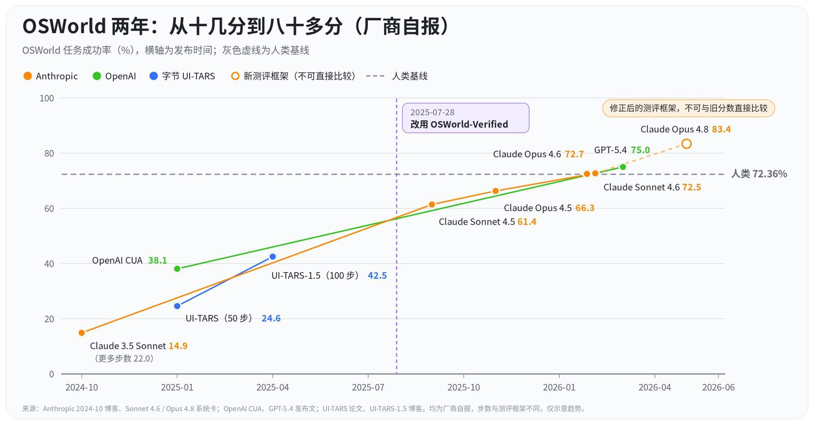
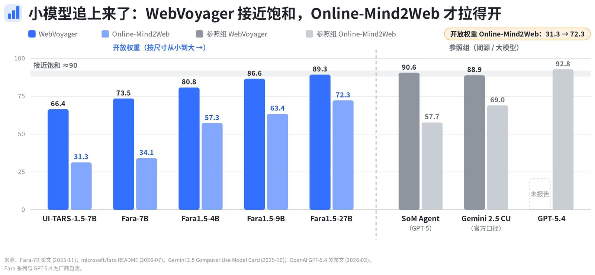
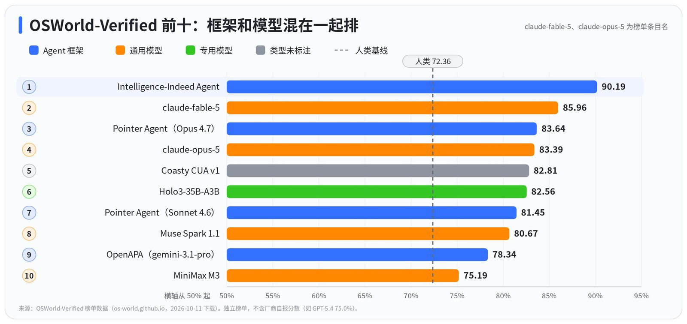
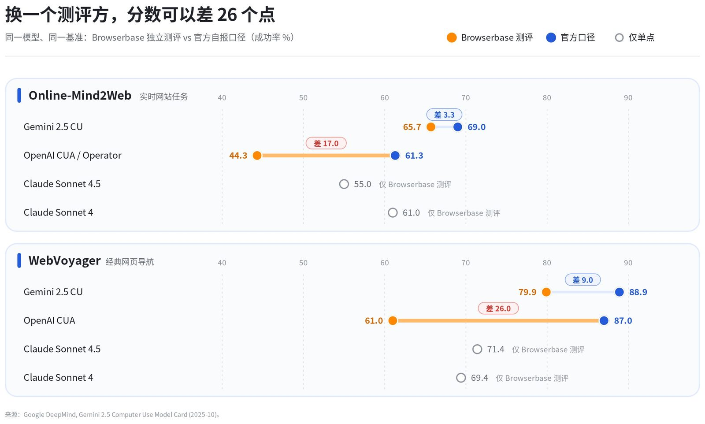
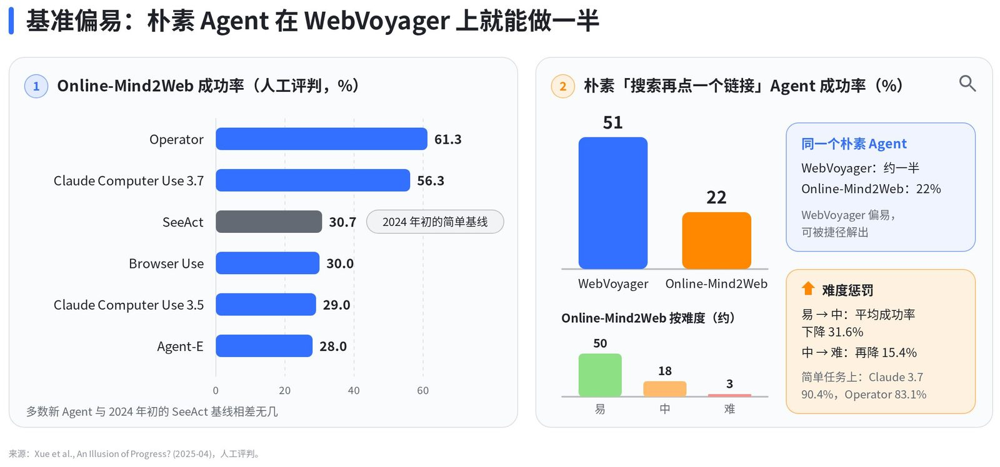
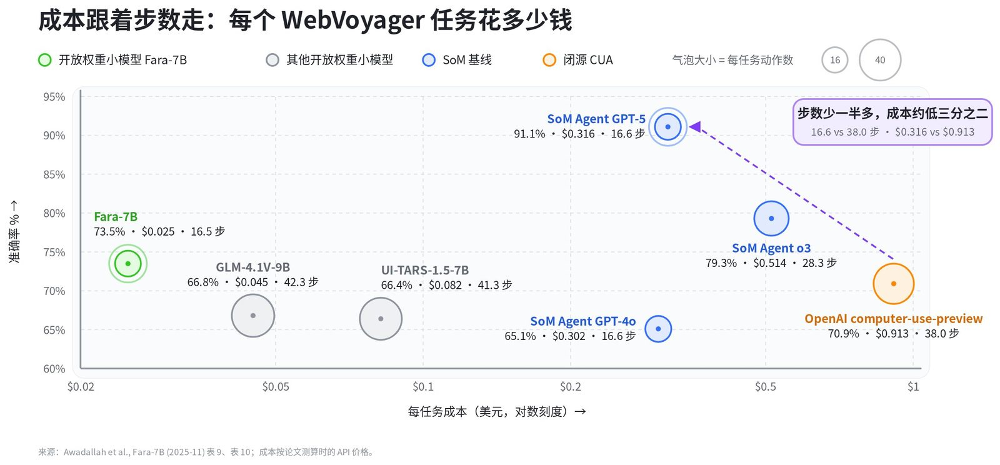
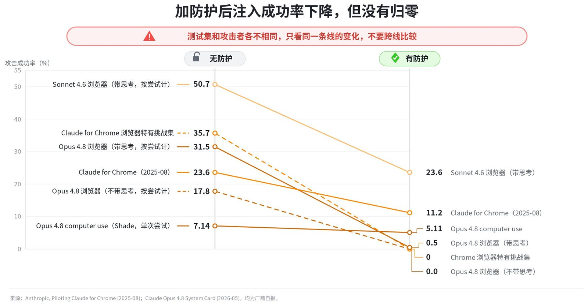
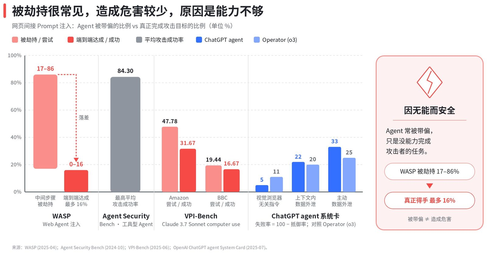

# LLM-28｜工程｜Computer Use 与浏览器 Agent：让模型操作界面

> 🎯 **这篇文档解决什么问题**：让模型看屏幕、点鼠标、敲键盘的 Agent 已经发展了两年，榜单分数从十几分涨到八九十分，产品换了几轮，OpenAI 的 Atlas 浏览器已经下线。想用它做自动化的工程师，要回答的是：在我的任务上能成功几次、一次花多少钱和时间、网页里的恶意内容能不能劫持它、什么时候根本不该走界面。
>
> 使用方式：只做选型的读者看导读、第 7 章和第 12 章；自己搭 Agent 的读者重点看第 3、4、8、10 章。厂商自报分数与独立榜单分开写，不同测评框架（harness）下的分数不能直接比较。文中版本、价格和基准分数核对于 2026 年 10 月 11 日。

## 导读 · 先给结论

- **分数涨得快，口径也在变**。Claude 3.5 Sonnet 在 2024-10 的 OSWorld 只有 14.9%[[1]](https://www.anthropic.com/news/3-5-models-and-computer-use)；2026-02 Sonnet 4.6 在 OSWorld-Verified 上自报 72.5%[[2]](https://www-cdn.anthropic.com/78073f739564e986ff3e28522761a7a0b4484f84.pdf)，与人类的 72.36% 相当[[3]](https://arxiv.org/abs/2404.07972)。2026-05 Anthropic 修正测评框架后自报 83.4%，并说明不能与旧分数直接比较[[4]](https://www.anthropic.com/claude-opus-4-8-system-card)。独立榜单上截至 2026-10-11 最高是一个 Agent 框架的 90.19%[[5]](https://os-world.github.io/static/data/osworld_verified_results.xlsx)。
- **公开基准高估真实成功率**。人工评判的 Online-Mind2Web 上 Operator 只有 61.3%[[6]](https://arxiv.org/abs/2504.01382)；同一个模型换一套测评框架，WebVoyager 可以从 87.0% 掉到 61.0%[[7]](https://storage.googleapis.com/deepmind-media/Model-Cards/Gemini-2-5-Computer-Use-Model-Card.pdf)。
- **观察方式决定成本**。每张截图约 1,000–1,800 个输入 token[[8]](https://platform.claude.com/docs/en/agents-and-tools/tool-use/computer-use-tool)；无障碍树不需要视觉模型、动作可确定执行[[9]](https://github.com/microsoft/playwright-mcp)；OpenAI 现在推荐让模型写 Playwright 或 PyAutoGUI 代码[[10]](https://developers.openai.com/api/docs/guides/tools-computer-use)。
- **网页注入是头号风险，且没有归零**。Anthropic 面对自适应攻击者把成功率压到约 1%，仍称之为“有意义的风险”[[11]](https://www.anthropic.com/research/prompt-injection-defenses)；Brave 在 Perplexity Comet 上演示了从隐藏评论到账号被接管的完整攻击链[[12]](https://brave.com/blog/comet-prompt-injection/)。
- **产品形态不稳定**。ChatGPT Atlas 于 2025-10 发布，**2026-08-09 起停止服务**，能力并入 ChatGPT 桌面应用和 Codex[[13]](https://help.openai.com/en/articles/20001371-evolving-atlas-into-chatgpt-for-browser-based-agentic-work)。
- **能走 API 或 MCP 就不走界面**。OpenAI 文档和 UI-TARS-2 的作者都这样建议[[10]](https://developers.openai.com/api/docs/guides/tools-computer-use)[[14]](https://arxiv.org/abs/2509.02544)，界面操作只留给没有接口的长尾。

📎 与系列其他文档的分工：「Agent 工程实战」讲 Agent 循环、工具设计和可靠性；「Agent 协议与工具链」讲 MCP 与沙箱；「LLM 安全与治理」讲提示词注入的一般防御。本文只讲界面操作特有的部分。

## 第 1 章 · 定义、边界与时间线

### 1.1 什么算 computer use

界面操作型 Agent（computer-use agent，CUA）的输入是截图或界面结构，输出是鼠标、键盘或浏览器动作，执行后把新界面再交给模型，循环到任务完成。它和普通工具调用的区别在于“工具”是为人设计的界面：按钮位置会变、会弹窗，内容里可能藏着给模型看的指令。OpenAI 的 CUA 是 GPT-4o 视觉加强化学习训练的推理，输入原始像素、输出虚拟鼠标键盘动作[[15]](https://openai.com/index/computer-using-agent/)；Gemini 2.5 Computer Use 的输入是截图、当前 URL 和最近的动作历史，主要针对浏览器优化，“尚未针对桌面操作系统级控制优化”[[16]](https://blog.google/technology/google-deepmind/gemini-computer-use-model/)。按动作范围可分浏览器内、整台桌面、手机三档。

📎 展开阅读：「Agent 工程实战」第 2 章（Agent 循环、停止条件和预算）。

### 1.2 两年时间线

| 时间 | 事件 | 要点 |
|---|---|---|
| 2024-10 | Claude 3.5 Sonnet computer use 公测 | OSWorld 仅截图 14.9%，次优系统 7.8%；Anthropic 称其“实验性、有时笨拙且容易出错”[[1]](https://www.anthropic.com/news/3-5-models-and-computer-use) |
| 2024-12 | Project Mariner | Gemini 2.0 的 Chrome 扩展原型，WebVoyager 83.5%[[17]](https://blog.google/innovation-and-ai/models-and-research/google-deepmind/google-gemini-ai-update-december-2024/) |
| 2025-01 | OpenAI Operator；UI-TARS | CUA 自报 OSWorld 38.1%[[15]](https://openai.com/index/computer-using-agent/)；UI-TARS 纯截图端到端，OSWorld 24.6%（50 步）[[18]](https://arxiv.org/abs/2501.12326) |
| 2025-07 | ChatGPT agent；Comet；OSWorld-Verified | ChatGPT agent 合并 Operator 与深度研究[[19]](https://openai.com/index/introducing-chatgpt-agent/)；Perplexity 推出 Comet 浏览器[[20]](https://www.perplexity.ai/hub/blog/introducing-comet)；OSWorld 修复 300 多处问题[[21]](https://xlang.ai/blog/osworld-verified) |
| 2025-08 | Claude for Chrome 试点 | 1,000 名 Max 用户，公布注入攻击成功率[[22]](https://www.anthropic.com/news/claude-for-chrome) |
| 2025-10 | Gemini 2.5 Computer Use；ChatGPT Atlas | `computer_use` 工具开放[[16]](https://blog.google/technology/google-deepmind/gemini-computer-use-model/)；Atlas 是带 Agent 模式的 macOS 浏览器[[23]](https://openai.com/index/introducing-chatgpt-atlas/) |
| 2025-11 | Fara-7B | 微软 7B 开放权重网页 Agent，可端侧运行[[24]](https://arxiv.org/abs/2511.19663) |
| 2026-02 | Claude Sonnet 4.6 | 自报 OSWorld-Verified 72.5%，“从十几分涨到七十出头”[[2]](https://www-cdn.anthropic.com/78073f739564e986ff3e28522761a7a0b4484f84.pdf) |
| 2026-03 | GPT-5.4 | 首个原生 computer use 的通用模型，自报 75.0%[[25]](https://openai.com/index/introducing-gpt-5-4/) |
| 2026-05 | Claude Opus 4.8 | 修正框架后自报 83.4%[[4]](https://www.anthropic.com/claude-opus-4-8-system-card) |
| 2026-06 | Gemini 3.5 Flash | computer use 内置进主力模型，覆盖浏览器、手机和桌面[[26]](https://blog.google/innovation-and-ai/models-and-research/gemini-models/introducing-computer-use-gemini-3-5-flash/) |
| 2026-07 至 08 | Atlas 停止；Fara1.5 | Atlas 2026-07-09 宣布、2026-08-09 停止服务[[13]](https://help.openai.com/en/articles/20001371-evolving-atlas-into-chatgpt-for-browser-based-agentic-work)；Fara1.5 发布 4B、9B、27B[[27]](https://github.com/microsoft/fara) |

趋势是能力从专门产品收进通用模型，而独立浏览器形态并不稳固。下图是各家自报的 OSWorld 分数。2025-07-28 起主流报告改用 Verified 版[[21]](https://xlang.ai/blog/osworld-verified)，2026-05 Anthropic 又修正了框架[[4]](https://www.anthropic.com/claude-opus-4-8-system-card)，曲线后段的斜率有一部分来自口径变化。

> 💡 **常见误区**：把“模型支持 computer use”理解成可以替代 RPA 或接口集成。首发时的弱项是滚动、拖拽和缩放[[1]](https://www.anthropic.com/news/3-5-models-and-computer-use)；两年后 Anthropic 文档仍提醒它可能比人直接操作慢，建议用于后台任务和测试[[8]](https://platform.claude.com/docs/en/agents-and-tools/tool-use/computer-use-tool)。

## 第 2 章 · 产品与模型全景

截至 2026-10，闭源一侧是 Anthropic 的 computer use 工具与 Claude for Chrome、OpenAI API 的 `computer` 工具与代码执行模式、Gemini 内置的 computer use；开源一侧是字节 UI-TARS 和微软 Fara。OpenAI 的 Atlas 已停止服务。

### 2.1 Anthropic

computer use 公测同时在 Anthropic API、Amazon Bedrock 和 Vertex AI 上线，并配了识别滥用的分类器[[1]](https://www.anthropic.com/news/3-5-models-and-computer-use)。当前工具集 `computer_toolset_20260801` 有 17 个成员工具，支持批量动作[[8]](https://platform.claude.com/docs/en/agents-and-tools/tool-use/computer-use-tool)；官方演示用 Docker 加 Xvfb 虚拟显示器跑桌面[[28]](https://github.com/anthropics/claude-quickstarts)。Claude for Chrome 2025-11-24 向全部 Max 用户开放测试版，2025-12-18 扩到 Pro、Team、Enterprise，接入 Claude Code（可读控制台报错和 DOM），管理员可设组织级站点白名单和黑名单[[22]](https://www.anthropic.com/news/claude-for-chrome)。

### 2.2 OpenAI：四种形态

- <b>Operator（2025-01）</b>：美国 Pro 用户的研究预览[[15]](https://openai.com/index/computer-using-agent/)。
- <b>ChatGPT agent（2025-07）</b>：视觉浏览器、文本浏览器、终端、直接 API 和连接器；发布文现已标为过时[[19]](https://openai.com/index/introducing-chatgpt-agent/)。
- <b>ChatGPT Atlas（2025-10）</b>：macOS 浏览器，Agent 不能执行代码、下载文件、安装扩展或访问文件系统[[23]](https://openai.com/index/introducing-chatgpt-atlas/)。**2026-07-09 宣布停止，2026-08-09 起停止服务**，浏览器 Agent 能力迁到 ChatGPT 桌面应用（多标签页、下载、登录）和 Codex，Chrome 用户改用 ChatGPT 扩展；理由是“浏览器需要持续的安全维护”[[13]](https://help.openai.com/en/articles/20001371-evolving-atlas-into-chatgpt-for-browser-based-agentic-work)。
- **GPT-5.4（2026-03）与 API**：既能写 Playwright 或 PyAutoGUI 代码，也能按截图发鼠标键盘动作[[25]](https://openai.com/index/introducing-gpt-5-4/)；API 文档写明“对 GPT-6 Astra 推荐代码执行”，`computer` 工具继续支持[[10]](https://developers.openai.com/api/docs/guides/tools-computer-use)。

### 2.3 Google

Project Mariner 被训练成优先听从用户指令、而不是第三方网页里的注入内容[[17]](https://blog.google/innovation-and-ai/models-and-research/google-deepmind/google-gemini-ai-update-december-2024/)。Gemini 2.5 Computer Use 基于 Gemini 2.5 Pro，也用在 Mariner、Firebase 测试 Agent 和 AI Mode 里[[16]](https://blog.google/technology/google-deepmind/gemini-computer-use-model/)。2026-06 起 computer use 内置进 Gemini 3.5 Flash[[26]](https://blog.google/innovation-and-ai/models-and-research/gemini-models/introducing-computer-use-gemini-3-5-flash/)；按 API 文档，`gemini-3.5-flash` 已弃用并路由到 `gemini-3.6-flash`[[29]](https://ai.google.dev/gemini-api/docs/computer-use)。

### 2.4 开源模型与榜单新面孔

- <b>UI-TARS 系列（字节 Seed）</b>：纯截图端到端模型[[18]](https://arxiv.org/abs/2501.12326)；1.5 开源 7B 版本[[30]](https://seed-tars.com/1.5)；2 代用多轮强化学习[[14]](https://arxiv.org/abs/2509.02544)。
- <b>Fara 系列（微软）</b>：Fara-7B 截图输入、绝对坐标输出[[24]](https://arxiv.org/abs/2511.19663)；Fara1.5 基于 Qwen3.5，开放权重[[27]](https://github.com/microsoft/fara)。
- **榜单上的其他新面孔**：H Company 的专用模型 Holo3-35B-A3B、Meta 的 Muse Spark 1.1、Qwen 3.7 Plus 73.3%、Kimi K2.6 73.06%、美团 EvoCUA 56.73%[[5]](https://os-world.github.io/static/data/osworld_verified_results.xlsx)。

## 第 3 章 · 观察方式：截图、无障碍树与 DOM

Agent 怎么“看”界面，决定了覆盖面、每步 token 和动作能否复现。结论：浏览器内优先用无障碍树或 DOM，跨应用的桌面任务才用截图；榜单前列的系统大多是混合的。

### 3.1 截图加坐标

OpenAI CUA、Claude、Gemini、UI-TARS、Fara 都以截图为主要输入、以像素坐标为动作参数[[15]](https://openai.com/index/computer-using-agent/)[[16]](https://blog.google/technology/google-deepmind/gemini-computer-use-model/)[[18]](https://arxiv.org/abs/2501.12326)[[24]](https://arxiv.org/abs/2511.19663)。它能操作任何显示在屏幕上的应用，代价有三项[[8]](https://platform.claude.com/docs/en/agents-and-tools/tool-use/computer-use-tool)：

- **token**：每张截图约 1,000–1,800 个输入 token，几十步的任务光截图就是几万 token。
- **分辨率**：Opus 4.7 起长边最多 2576 像素、4784 个视觉 token，更早的模型是 1568 像素。推荐桌面 1024x768 或 1280x720，网页 1280x800 或 1366x768。
- **坐标换算**：坐标在截图的像素空间里。macOS Retina 截图是两倍尺寸，缩放后发给模型，执行前要换算回去，这是自建环境里“点偏了”最常见的原因。

OSWorld 论文还发现，把历史写成文字比保留历史截图更有用[[3]](https://arxiv.org/abs/2404.07972)。

### 3.2 无障碍树与 DOM

无障碍树（accessibility tree）是浏览器和系统为读屏软件生成的界面结构，元素带角色、名称和状态。Playwright MCP “使用无障碍树而不是基于像素的输入”，“不需要视觉模型”，工具执行是确定性的；`--caps vision` 可打开坐标动作[[9]](https://github.com/microsoft/playwright-mcp)。它的 README 现在给编程 Agent 推荐 Playwright CLI 加技能（Skills），因为 MCP 的工具描述和冗长的无障碍树太占 token；长时间保持状态、需要自我修复的循环仍推荐 MCP[[9]](https://github.com/microsoft/playwright-mcp)。结构化观察的局限是 Canvas 页面、远程桌面和部分桌面应用没有可用的树。

### 3.3 Set-of-Mark 与代码即动作

Set-of-Mark（SoM）把元素边框画到截图上并编号，模型只需回答“点几号”。OSWorld 把截图、无障碍树、两者组合、SoM 分成四条赛道[[3]](https://arxiv.org/abs/2404.07972)；Fara 论文的 SoM 基线用 GPT-5 时 WebVoyager 90.6%[[24]](https://arxiv.org/abs/2511.19663)。

📎 展开阅读：「《深入理解 AI Agent》精读笔记」第 6 章（视觉定位的三条路线和 Set-of-Mark 原始论文）。

另一种思路是让模型写脚本。OpenAI 把代码执行列为两种接入方式之一[[10]](https://developers.openai.com/api/docs/guides/tools-computer-use)；GPT-5.4 的 WebArena-Verified 67.3% 是在 DOM 加截图设置下测的[[25]](https://openai.com/index/introducing-gpt-5-4/)；UI-TARS-2 的环境混合了界面、文件系统和终端[[14]](https://arxiv.org/abs/2509.02544)；OSWorld-Verified 前列的 Intelligence-Indeed、Pointer、Coasty、OpenAPA 大多使用编码类动作[[5]](https://os-world.github.io/static/data/osworld_verified_results.xlsx)。

| 观察方式 | 适合 | 主要代价 | 代表 |
|---|---|---|---|
| 截图加坐标 | 任意桌面应用 | token 多；坐标易偏 | Claude、OpenAI `computer`、UI-TARS |
| 无障碍树 / DOM | 有语义标签的网页 | 树可能很长；覆盖不到 Canvas | Playwright MCP / CLI |
| Set-of-Mark | 视觉模型加稳定定位 | 依赖元素边框 | OSWorld SoM 赛道 |
| 代码即动作 | 重复、可脚本化的流程 | 要沙箱执行代码 | OpenAI 代码执行模式 |

> 💡 **常见误区**：认为纯视觉更先进、结构化观察只是过渡。从榜单和厂商文档看方向相反：能拿到结构就用结构，能写脚本就写脚本，截图留给剩下的部分。

## 第 4 章 · 动作空间与定位

动作空间（action space）各家已经趋同；定位（grounding），即把“点提交按钮”落到具体坐标，仍是截图路线最大的误差来源。

### 4.1 三家的动作空间

| 接口 | 动作 | 值得注意的设计 |
|---|---|---|
| OpenAI `computer` | click、double_click、drag、move、scroll、keypress、type、wait、screenshot | 动作以有序的 `actions` 数组批量下发[[10]](https://developers.openai.com/api/docs/guides/tools-computer-use) |
| Claude 工具集 | 17 个成员工具，含 screenshot、left_click、type、zoom、left_click_drag 等 | 支持批量动作；`zoom` 放大局部再定位[[8]](https://platform.claude.com/docs/en/agents-and-tools/tool-use/computer-use-tool) |
| Gemini `computer_use` | 浏览器、手机、桌面动作 | 3.x 的动作带 `intent` 字段，响应可带 `safety_decision`[[29]](https://ai.google.dev/gemini-api/docs/computer-use) |

两点趋同值得借鉴。先说**批量动作**，减少截图和往返，但中间状态没人检查，所以有副作用的动作不要放进批量。再就是**把意图和安全判断放进动作**，执行层就能按动作类型审批（第 10 章）。工具定义也占上下文：Claude 新工具集约 4,500 个输入 token，单次请求超过 20 张图片时每张图的边长限制更严[[8]](https://platform.claude.com/docs/en/agents-and-tools/tool-use/computer-use-tool)。

### 4.2 定位为什么难

ScreenSpot-Pro 测专业软件里的定位：1,581 个任务、23 个应用、3 种操作系统，目标平均不到屏幕面积的 0.1%，发布时最好的模型只有 18.9%[[31]](https://arxiv.org/abs/2504.07981)。UI-TARS-1.5 做到 61.6%（同期 OpenAI CUA 23.4%）[[30]](https://seed-tars.com/1.5)；Claude Opus 4.8 自报不带工具 82.3%、带 Python 工具 87.9%[[4]](https://www.anthropic.com/claude-opus-4-8-system-card)。

“带工具”更高，说明定位的关键手段是**先缩小范围再定位**：ScreenSpot-Pro 论文里不需要训练的级联搜索 ScreenSeekeR 把成绩从 18.9% 提到 48.1%[[31]](https://arxiv.org/abs/2504.07981)，Claude 的 `zoom` 是同一思路[[8]](https://platform.claude.com/docs/en/agents-and-tools/tool-use/computer-use-tool)。

### 4.3 规划器与定位器分工

OSWorld 把“Agent 框架”定义为通常由 GPT 系列规划器加专门定位器（如 GTA1、Jedi-7B、Agent S）组成[[5]](https://os-world.github.io/static/data/osworld_verified_results.xlsx)。OSWorld-Verified 刚推出时前三名都是框架：CoACT-1 60.76%、Agent S2.5 加 o3 56.0%、GTA1 加 o3 53.1%[[21]](https://xlang.ai/blog/osworld-verified)。取舍是：主模型定位够好时单模型更简单、延迟更低；主模型定位弱或想用便宜模型规划时，拆出定位器更划算。

### 4.4 难的动作

首发时 Claude 的弱项是滚动、拖拽和缩放[[1]](https://www.anthropic.com/news/3-5-models-and-computer-use)，现在文档仍把滚动、表格单元格选择和编造坐标列为已知问题[[8]](https://platform.claude.com/docs/en/agents-and-tools/tool-use/computer-use-tool)；OpenAI CUA 的文字编辑不精确，在 html5editor 上 10 次成功 4 次[[15]](https://openai.com/index/computer-using-agent/)；Fara1.5 的训练数据专门留了 0.8% 的拖拽和 8.8% 的定位数据[[27]](https://github.com/microsoft/fara)。流程设计时尽量避开这些动作，或在其后强制截图核对。

## 第 5 章 · 训练路线：原生模型、合成轨迹与强化学习

开源进展来自两条路线：UI-TARS 走“原生端到端模型加多轮强化学习”，Fara 走“强模型合成轨迹再蒸馏到小模型”。结论是小模型在网页任务上已接近大模型的 SoM 基线，单任务成本低一到两个数量级，但桌面和长程任务差距仍明显。

📎 展开阅读：「后训练实战」第 9 章（Agent 与工具调用的强化学习）。

### 5.1 UI-TARS

第一代（2025-01）的做法是增强界面感知、统一动作空间、“系统 2”式显式推理、用带反思的在线轨迹迭代训练；OSWorld 50 步 24.6%，同条件 Claude 22.0%[[18]](https://arxiv.org/abs/2501.12326)。1.5 版（2025-04）100 步 OSWorld 42.5%，开源 7B 版本 27.5%；它报告的 Online-Mind2Web 75.8% 是自动评判，与第 7 章的人工评判不是一个口径[[30]](https://seed-tars.com/1.5)。

UI-TARS-2（2025-09）的改动集中在环境和强化学习稳定性：数据飞轮、异步 rollout、带价值预训练的 PPO、混合界面、文件系统和终端的统一沙箱。结果是 Online-Mind2Web 88.2%、OSWorld 47.5%、AndroidWorld 73.3%；接上 GUI-SDK 后 SWE-Bench Verified 68.7%[[14]](https://arxiv.org/abs/2509.02544)。独立榜单上 UI-TARS-2-2509 是 53.1%，后续 Seed-1.8 是 61.87%[[5]](https://os-world.github.io/static/data/osworld_verified_results.xlsx)。

### 5.2 Fara

Fara-7B（2025-11）基于 Qwen2.5-VL-7B，用 180 万条样本监督微调。数据来自 FaraGen 管线：强模型在真实网站上做任务，验证通过后才入库，每条约 1 美元（o4-mini 0.59 美元、o3 1.08 美元、GPT-5 1.00 美元），平均 6.9 步；模型被训练成在“关键点”（有约束力的交易、使用个人数据）停下询问用户[[24]](https://arxiv.org/abs/2511.19663)。

Fara1.5（2026-07）有 4B、9B、27B 三个尺寸，约 200 万条样本：网页轨迹约 60%、合成环境 12.8%、表单填写 12.5%、定位 8.8%、视觉问答 4.9%、拖拽 0.8%。GPT-5.4 驱动的求解器在 WebVoyager / Online-Mind2Web 上 93.4 / 83.4，作为蒸馏上限[[27]](https://github.com/microsoft/fara)。

| 模型 | WebVoyager | Online-Mind2Web | 来源 |
|---|---|---|---|
| UI-TARS-1.5-7B | 66.4 | 31.3 | Fara 论文复测[[24]](https://arxiv.org/abs/2511.19663) |
| Fara-7B | 73.5 | 34.1 | Fara 论文[[24]](https://arxiv.org/abs/2511.19663) |
| Fara1.5-4B / 9B / 27B | 80.8 / 86.6 / 89.3 | 57.3 / 63.4 / 72.3 | 官方 README[[27]](https://github.com/microsoft/fara) |
| 参照：SoM Agent（GPT-5） | 90.6 | 57.7 | Fara 论文[[24]](https://arxiv.org/abs/2511.19663) |

两点要注意：WebVoyager 已接近饱和，Online-Mind2Web 才拉得开差距（原因见第 7 章）；这些分数都是微软自己测的（Fara-7B 为 100 步上限、3 次平均[[24]](https://arxiv.org/abs/2511.19663)），独立复测前应视为厂商自报。

GUI 训练特有的难点是环境：真实网站会变、会封机器人，所以两条路线都在补合成环境和统一沙箱，合成数据也必须先验证任务真的完成。

## 第 6 章 · 基准地图：测什么、最高分是多少

基准按环境分三类：桌面（OSWorld）、网页（WebArena、WebVoyager、Online-Mind2Web、BrowseComp）、手机（AndroidWorld），外加专测定位的 ScreenSpot-Pro。**下表“较高分数”一栏里，厂商自报和独立榜单是两种来源，不能放在一起排名**。

### 6.1 主要基准

| 基准 | 定义 | 已核实的较高分数（来源类型） |
|---|---|---|
| OSWorld（2024-04） | 真实操作系统环境，369 个任务，去掉 8 个 Google Drive 任务后 361 个；人类 72.36%，发布时最好的模型 12.24%[[3]](https://arxiv.org/abs/2404.07972) | 现在一般报告 Verified 版 |
| OSWorld-Verified（2025-07） | 约 10 人用约 2 个月修复 300 多处问题；在 AWS 上并行，评测从 10 多小时缩到 1 小时内[[21]](https://xlang.ai/blog/osworld-verified) | 独立榜单：Intelligence-Indeed Agent 90.19%[[5]](https://os-world.github.io/static/data/osworld_verified_results.xlsx)。厂商自报：Opus 4.8 83.4%（修正后的框架）[[4]](https://www.anthropic.com/claude-opus-4-8-system-card)、GPT-5.4 75.0%[[25]](https://openai.com/index/introducing-gpt-5-4/) |
| WebArena（2023-07） | 4 个自托管网站、812 个任务；人类 78.24%，GPT-4 基线 14.41%[[32]](https://arxiv.org/abs/2307.13854) | GPT-5.4 在 WebArena-Verified 上自报 67.3%[[25]](https://openai.com/index/introducing-gpt-5-4/) |
| WebVoyager（2024-01） | 15 个热门网站上的在线任务；GPT-4V 自动评判与人工一致率 85.3%[[33]](https://arxiv.org/abs/2401.13919) | Fara1.5-27B 89.3%（厂商自测）[[27]](https://github.com/microsoft/fara)；Gemini 2.5 CU 88.9%（官方口径）[[7]](https://storage.googleapis.com/deepmind-media/Model-Cards/Gemini-2-5-Computer-Use-Model-Card.pdf) |
| Online-Mind2Web（2025-04） | 136 个网站上的 300 个在线任务，易 83、中 143、难 74；自动评判器与人工一致率约 85%[[6]](https://arxiv.org/abs/2504.01382) | GPT-5.4 自报 92.8%（仅截图）[[25]](https://openai.com/index/introducing-gpt-5-4/)；UI-TARS-2 88.2%[[14]](https://arxiv.org/abs/2509.02544) |
| BrowseComp（2025-04） | 1,266 个难以检索、答案很短的问题[[34]](https://arxiv.org/abs/2504.12516) | GPT-5.4 Pro 自报 89.3%[[25]](https://openai.com/index/introducing-gpt-5-4/) |
| AndroidWorld（2024-05） | 20 个安卓应用上的 116 个参数化任务；发布时最好的基线 30.6%[[35]](https://arxiv.org/abs/2405.14573) | UI-TARS-2 73.3%[[14]](https://arxiv.org/abs/2509.02544)；Gemini 2.5 CU 69.7%[[7]](https://storage.googleapis.com/deepmind-media/Model-Cards/Gemini-2-5-Computer-Use-Model-Card.pdf) |
| ScreenSpot-Pro（2025-04） | 专业软件里的定位，见第 4.2 节[[31]](https://arxiv.org/abs/2504.07981) | Opus 4.8 自报 87.9%（带工具）[[4]](https://www.anthropic.com/claude-opus-4-8-system-card) |

### 6.2 OSWorld-Verified 独立榜单前十

截至 2026-10-11 的快照：Intelligence-Indeed Agent 90.19%、claude-fable-5 85.96%、Pointer Agent（用 Opus 4.7）83.64%、claude-opus-5 83.39%、Coasty CUA v1 82.81%、Holo3-35B-A3B 82.56%、Pointer Agent（用 Sonnet 4.6）81.45%、Muse Spark 1.1 80.67%、OpenAPA（用 gemini-3.1-pro）78.34%、MiniMax M3 75.19%[[5]](https://os-world.github.io/static/data/osworld_verified_results.xlsx)。

- **框架和模型混排**。第一名是使用编码类动作的 Agent 框架；Pointer、OpenAPA 是套在商用模型外的框架。比较模型本身只看通用模型条目[[5]](https://os-world.github.io/static/data/osworld_verified_results.xlsx)。
- **条目名以榜单为准**。claude-fable-5 和 claude-opus-5 是榜单上标注为 Anthropic、日期 2026-08-01 的条目，分别完成 307.73 / 358 和 300.2 / 360 个任务；本文未找到对应的厂商发布文档，引用时写“OSWorld-Verified 榜单条目”[[5]](https://os-world.github.io/static/data/osworld_verified_results.xlsx)。
- **厂商自报不在榜上**。GPT-5.4 的 75.0% 不在榜单数据里[[25]](https://openai.com/index/introducing-gpt-5-4/)；Sonnet 4.6 自报 72.5%[[2]](https://www-cdn.anthropic.com/78073f739564e986ff3e28522761a7a0b4484f84.pdf)，榜单测得 72.11%[[5]](https://os-world.github.io/static/data/osworld_verified_results.xlsx)，接近但仍是两个数字。

📎 展开阅读：「LLM 应用评测与可观测」第 5 章（分数差多少才算真差）。

## 第 7 章 · 读懂分数：测评框架、步数、自报与基准老化

一个“OSWorld 80%”在你的任务上意味着什么？意味着得不多。分数至少受测评框架、步数预算、由谁来跑、基准是否老化四个因素影响，而公开基准普遍偏易。

### 7.1 测评框架：同一个模型差几十个点

测评框架指模型以外的一切：系统提示、分辨率、每轮 token 上限、工具、动作执行和成功判定。Gemini 2.5 Computer Use 模型卡把官方口径和 Browserbase 独立测评并排列出[[7]](https://storage.googleapis.com/deepmind-media/Model-Cards/Gemini-2-5-Computer-Use-Model-Card.pdf)：

| 基准（测评方） | Gemini 2.5 CU | Sonnet 4.5 | Sonnet 4 | OpenAI CUA |
|---|---|---|---|---|
| Online-Mind2Web（官方榜） | 69.0% | — | — | 61.3%（Operator） |
| Online-Mind2Web（Browserbase） | 65.7% | 55.0% | 61.0% | 44.3% |
| WebVoyager（官方口径） | 88.9% | — | — | 87.0% |
| WebVoyager（Browserbase） | 79.9% | 71.4% | 69.4% | 61.0% |

OpenAI CUA 在 WebVoyager 上差了 26 个点，排序也会变：Browserbase 测得 Sonnet 4 的 Online-Mind2Web 反而高于 Sonnet 4.5。

反方向的例子来自 Anthropic：Opus 4.8 系统卡说他们修复了 zoom 与批量动作合用时的缺陷，并把每轮 token 上限从 16K 提到 128K，承认“一直在低报各代模型的 OSWorld 成绩”，所以 83.4% 不能和此前数字直接比[[4]](https://www.anthropic.com/claude-opus-4-8-system-card)。Sonnet 4.6 的 72.5% 与 Opus 4.8 的 83.4% 之间，有一部分差距来自框架。

### 7.2 步数预算

OSWorld-Verified 发布时，o3 的成绩随步数预算在 9.1% 到 23.0% 之间变化[[21]](https://xlang.ai/blog/osworld-verified)；榜单上 Sonnet 4.5 在 15、50、100 步下是 42.88%、58.08%、62.88%[[5]](https://os-world.github.io/static/data/osworld_verified_results.xlsx)。Claude 3.5 Sonnet 首发时也报了“仅截图 14.9%、更多步数 22.0%”两个数[[1]](https://www.anthropic.com/news/3-5-models-and-computer-use)。看到分数先问“多少步”。

### 7.3 自报与独立榜单分开写

- **厂商自报**：写明框架设置（如 Sonnet 4.6 是首次尝试成功率、5 次平均、1080p、最多 100 步[[2]](https://www-cdn.anthropic.com/78073f739564e986ff3e28522761a7a0b4484f84.pdf)），注明是否改过框架。
- **独立榜单**：OSWorld-Verified 用统一环境跑，可横向比较，但框架条目和模型条目要分开[[5]](https://os-world.github.io/static/data/osworld_verified_results.xlsx)。
- **第三方测评**：如 Browserbase 为 Google 跑了 200 多次实验、约 4,000 个浏览器小时[[36]](https://www.browserbase.com/blog/evaluating-browser-agents)，只能和同一测评方的数字比。

### 7.4 “进步的幻觉”与基准老化

论文“An Illusion of Progress?”在 Online-Mind2Web 上用人工评判重测了一批 Agent[[6]](https://arxiv.org/abs/2504.01382)：

- Operator 61.3%、Claude Computer Use 3.7 56.3%、SeeAct 30.7%、Browser Use 30.0%、Claude Computer Use 3.5 29.0%、Agent-E 28.0%。许多新 Agent 不如 2024 年初的简单 SeeAct。
- “搜索再点一个链接”的朴素 Agent 能完成 WebVoyager 抽样任务的 51%，但只能完成 Online-Mind2Web 的 22%（易、中、难约 50%、18%、3%），说明 WebVoyager 偏易、可走捷径。
- 平均成功率从易到中下降 31.6%，从中到难再降 15.4%；Claude 3.7 和 Operator 在简单任务上有 90.4% 和 83.1%。

基准还会老化：WebVoyager 的 Booking--8 要查 2023 年的日期，现在已无法完成；Browserbase 公开了 3,772 条人工核验的评测记录[[36]](https://www.browserbase.com/blog/evaluating-browser-agents)。

> 💡 **常见误区**：拿 WebVoyager 九十分以上的数字估算业务成功率。真实业务更接近 Online-Mind2Web 的中等和困难任务。

## 第 8 章 · 真实成功率、成本、时延与长程失败

结论：熟悉的短流程能做到接近 100%，陌生界面会掉到三成左右；每任务成本从几美分到约 1 美元，差距主要来自步数和截图数量。

### 8.1 逐任务成功率

Operator 发布时的试验表，每个任务尝试 10 次：Todoist 和 Spotify 歌单 10 次全成功，Target 找优惠 9 次，Redfin 3 次；tagvenue 有界面提示时 8 次、没有提示时 3 次；html5editor 文字编辑 4 次[[15]](https://openai.com/index/computer-using-agent/)。GPT-5.4 发布文里的客户案例（厂商转述）：约 3 万个业主协会和房产税门户上，首次尝试成功 95%，3 次内 100%，此前的 CUA 模型约 73%–79%；速度约快 3 倍，token 少约 70%[[25]](https://openai.com/index/introducing-gpt-5-4/)。

成功率主要取决于任务是否重复、界面是否常见。同一类门户要操作几万次，值得投入流程优化；每次面对新网站，就按 Online-Mind2Web 的中等难度估。

📎 展开阅读：「Agent 工程实战」第 6 章（单次成功率与多次全部成功的区别）。

### 8.2 每任务成本

Fara-7B 论文给出 WebVoyager 上每任务的成本、动作数和 token，成本按论文测算时的 API 价格计[[24]](https://arxiv.org/abs/2511.19663)：

| Agent | 每任务成本 | 准确率 | 动作数 | 输入 / 输出 token |
|---|---|---|---|---|
| OpenAI computer-use-preview | 0.913 美元 | 70.9% | 38.0 | 29.5 万 / 2.3 千 |
| SoM Agent（o3） | 0.514 美元 | 79.3% | 28.3 | — |
| SoM Agent（GPT-5） | 0.316 美元 | 91.1% | 16.6 | 14.7 万 / 1.3 万 |
| SoM Agent（GPT-4o） | 0.302 美元 | 65.1% | 16.6 | — |
| UI-TARS-1.5-7B | 0.082 美元 | 66.4% | 41.3 | 40.8 万 / — |
| GLM-4.1V-9B | 0.045 美元 | 66.8% | 42.3 | — |
| Fara-7B | 0.025 美元 | 73.5% | 16.5 | 12.4 万 / 1.1 千 |

三条规律：成本大体跟着动作数和输入 token 走，computer-use-preview 平均 38 步，最贵；步数少本身就是能力，SoM GPT-5 只用 16.6 步，比 computer-use-preview 便宜约三分之二、准确率还高；小模型单价低但步数多，UI-TARS-1.5-7B 和 GLM-4.1V-9B 每任务四十多步。

用 Claude 时可按文档估算：每张截图约 1,000–1,800 个输入 token；Sonnet 4.6 和 Opus 4.6 建议用 `medium` 思考档位，`max` 只加成本、不提升界面操作准确率[[8]](https://platform.claude.com/docs/en/agents-and-tools/tool-use/computer-use-tool)。

📎 展开阅读：「用好模型」第 4 章（思考档位）；「Agent 工程实战」第 9 章（成本与延迟）。

### 8.3 时延

Anthropic 文档提醒，computer use 和人直接操作相比可能“太慢”，建议用于后台任务和测试[[8]](https://platform.claude.com/docs/en/agents-and-tools/tool-use/computer-use-tool)。并行是主要缓解手段：Browserbase 把约 18 个浏览器小时的工作压缩到 20 分钟内[[36]](https://www.browserbase.com/blog/evaluating-browser-agents)。界面 Agent 适合批量、异步、可等待的场景。

### 8.4 长程失败模式

OSWorld 论文认为定位和操作知识不足是主要失败原因[[3]](https://arxiv.org/abs/2404.07972)；Online-Mind2Web 显示成功率随参考步数增加而陡降，数字和时间约束常出错，最终答案有编造[[6]](https://arxiv.org/abs/2504.01382)；Anthropic 文档提醒模型会不检查就假设动作已生效，建议每步后截图核对[[8]](https://platform.claude.com/docs/en/agents-and-tools/tool-use/computer-use-tool)。

> 🔑 **小结**：用“每个成功任务的成本”估算，按自己任务的步数分布估成功率。最便宜的优化通常是减少步数，用不着换模型：用结构化观察、写脚本、拆短流程。

## 第 9 章 · 网页里的提示词注入：数据与案例

📎 延伸阅读：搜索与 Deep Research Agent 上的同类攻击与防御，见 [LLM-38｜工程｜Deep Research 与搜索 Agent：检索、核验与评测](./38-deep-research.md)。

界面 Agent 读到的每个网页、每封邮件、每张截图都可能藏着指令。结论：各家攻击成功率两年里从两成以上降到个位数甚至接近零，但面对自适应攻击者不为零；学术基准显示“被劫持”远多于“攻击目标达成”，后者偏低很大程度上是因为 Agent 能力不够。

📎 展开阅读：「LLM 安全与治理」第 2 章（间接注入、Spotlighting、CaMeL 等架构层防御）；「Agent 工程实战」第 8 章。

### 9.1 一条完整的攻击链：Brave 测 Comet

2025-08 Brave 披露了 Perplexity Comet 的间接注入漏洞[[12]](https://brave.com/blog/comet-prompt-injection/)：

1. 攻击者在 Reddit 发一条用剧透标签隐藏的评论，写着给 Agent 的指令。
2. 用户打开帖子，点“总结”。
3. Comet 照做：从 Perplexity 账户页读到用户邮箱，到 `perplexity.ai.`（末尾带点、绕过登录校验的域名）发起登录，再从已登录的 Gmail 读出一次性验证码。
4. Comet 把邮箱和验证码作为 Reddit 回复发出，攻击者接管账号。

Brave 的判断是：Agent 以用户权限行动时，同源策略和 CORS“实际上失效”。修复也不容易：2025-07-25 报告，07-27 修复不完整，08-13 看似修复，08-20 公开后仍未完全修复，又重新报告[[12]](https://brave.com/blog/comet-prompt-injection/)。OpenAI 加固 Atlas 时也演示过一封注入邮件让 Agent 给 CEO 发辞职信，其攻击模型能找到跨越“几十步甚至几百步”的攻击，但未公布成功率[[37]](https://openai.com/index/hardening-atlas-against-prompt-injection/)；Atlas 已于 2026-08-09 停止服务[[13]](https://help.openai.com/en/articles/20001371-evolving-atlas-into-chatgpt-for-browser-based-agentic-work)。

### 9.2 厂商公布的攻击成功率

以下都是厂商自报，测试集和口径各不相同，**只看同一家前后变化，不跨厂商比较**。

- <b>Claude for Chrome（2025-08）</b>：123 个用例、29 种场景，全部在自主模式下运行，成功率从 23.6% 降到 11.2%；4 类浏览器特有攻击（隐藏 DOM 表单字段、URL 文本、标签页标题等）从 35.7% 降到 0%[[22]](https://www.anthropic.com/news/claude-for-chrome)。
- <b>Opus 4.5（2025-11）</b>：每个环境尝试 100 次的自适应 Best-of-N 攻击者下约 1%，Anthropic 称“仍然代表着有意义的风险”[[11]](https://www.anthropic.com/research/prompt-injection-defenses)。
- <b>Opus 4.8（2026-05）</b>：129 个未参与训练的浏览器环境，带思考时按场景 / 按尝试计从 62.8% / 31.5% 降到 3.9% / 0.5%，不带思考时从 46.5% / 17.8% 降到 0%；Sonnet 4.6 加防护后仍有 46.5% / 23.6%[[4]](https://www.anthropic.com/claude-opus-4-8-system-card)。
- <b>ChatGPT agent（2025-07）</b>：系统卡给的是抵御率，视觉浏览器上无关指令 95%、上下文内数据外泄 78%、主动数据外泄 67%；Operator（o3）为 89%、80%、75%[[38]](https://cdn.openai.com/pdf/839e66fc-602c-48bf-81d3-b21eacc3459d/chatgpt_agent_system_card.pdf)。

两个细节：**升级不一定更安全**，ART 基准（k=100）上带思考的 Opus 4.8 为 9.6%，高于 Opus 4.7 的 6.0%[[4]](https://www.anthropic.com/claude-opus-4-8-system-card)；**桌面比浏览器差**，computer use 场景（Shade 攻击者，14 个用例）下 Opus 4.8 单次尝试只从 7.14% 降到 5.11%，200 次尝试时从 50.0% 变为 57.1%，Anthropic 说明这一变化不显著[[4]](https://www.anthropic.com/claude-opus-4-8-system-card)。

OpenAI 2026-07 公布的自博弈红队模型 GPT-Red，在复现的间接注入竞技场上攻击 GPT-5.1 成功 84%，人类红队 13%；“伪造思维链”攻击对 GPT-5.1 超过 95%、对 GPT-5.6 Sol 低于 10%；几个面向开发工具和浏览的间接注入基准已饱和（超过 97%）；在真实的自动售货机 Agent 上，GPT-Red 达成了全部 3 个恶意目标[[39]](https://openai.com/index/unlocking-self-improvement-gpt-red/)。

### 9.3 学术基准：被劫持不等于造成危害

- <b>WASP（Meta FAIR）</b>：攻击者只控制页面特定元素。中间步骤被劫持 17%–86%，端到端达成目标“最多 16%”，作者称之为“因无能而安全”[[40]](https://arxiv.org/abs/2504.18575)。
- **Agent Security Bench**：一般工具型 Agent，13 个基座模型，最高平均攻击成功率 84.30%，现有防御效果有限[[41]](https://arxiv.org/abs/2410.02644)。
- **VPI-Bench**：306 个视觉注入用例。Claude 3.7 Sonnet computer use 在 Amazon 上尝试执行 47.78%、成功 31.67%，BBC 上 19.44% / 16.67%；浏览器 Agent 在 Amazon、Booking、BBC 上尝试执行接近 100%；系统提示层防御不可靠[[42]](https://arxiv.org/abs/2506.02456)。

“因无能而安全”是关键：Agent 常被带偏，只是没能力做完攻击者的任务。能力上涨后这层“保护”会消失。

> 💡 **常见误区**：看到“0%”或“约 1%”就放开权限。这些数字来自特定测试集和攻击者，Brave 的案例也说明修复后仍可能被绕过[[12]](https://brave.com/blog/comet-prompt-injection/)。每次升级模型都要重跑自己的注入用例。

## 第 10 章 · 纵深防御：各家怎么限制界面 Agent

单靠模型抵御注入不够。各家实际叠加了一组控制：敏感动作确认、敏感站点有人看、默认不登录、凭据不给模型、站点白名单、独立分类器。

📎 展开阅读：「Agent 协议与工具链」第 9.2 节（沙箱要同时隔离文件系统和网络）。

### 10.1 敏感动作确认

- OpenAI CUA 在完成有副作用的操作、登录和验证码之前请求确认[[15]](https://openai.com/index/computer-using-agent/)；ChatGPT agent 购买前要求确认，拒绝银行转账[[19]](https://openai.com/index/introducing-chatgpt-agent/)。
- Claude for Chrome 对发布、购买、分享个人数据要求确认[[22]](https://www.anthropic.com/news/claude-for-chrome)。
- Gemini 的 `safety_decision` 可以是 `require_confirmation`[[29]](https://ai.google.dev/gemini-api/docs/computer-use)；Gemini 3.5 Flash 提供“敏感或不可逆操作必须确认”的企业开关[[26]](https://blog.google/innovation-and-ai/models-and-research/gemini-models/introducing-computer-use-gemini-3-5-flash/)。
- Fara 在“关键点”主动停下[[24]](https://arxiv.org/abs/2511.19663)。

OpenAI 文档有一句容易忽略的话：“在表单里输入敏感信息也算传输。”[[10]](https://developers.openai.com/api/docs/guides/tools-computer-use) 确认点不只在“提交”按钮，填写个人信息那一步就要确认。

### 10.2 Watch 模式、登出模式与凭据

- **Watch 模式**：Operator 在邮箱等站点要求用户盯着[[15]](https://openai.com/index/computer-using-agent/)；ChatGPT agent 一旦登录邮箱或银行，之后整条轨迹都保持 Watch 模式，用户不活动或切走时暂停[[38]](https://cdn.openai.com/pdf/839e66fc-602c-48bf-81d3-b21eacc3459d/chatgpt_agent_system_card.pdf)；Atlas 在金融机构站点上暂停[[23]](https://openai.com/index/introducing-chatgpt-atlas/)。
- **登出模式**：OpenAI 加固 Atlas 时给用户的第一条建议就是用登出模式[[37]](https://openai.com/index/hardening-atlas-against-prompt-injection/)。
- **接管模式**：ChatGPT agent 输入密码时由用户接管，模型看不到输入内容[[19]](https://openai.com/index/introducing-chatgpt-agent/)。
- **凭据**：Anthropic 文档说必须登录时可以把凭据放进 `<robot_credentials>` 标签，但这会提高注入风险，最好根本不给[[8]](https://platform.claude.com/docs/en/agents-and-tools/tool-use/computer-use-tool)。

### 10.3 站点策略与分类器

- **黑白名单**：Claude for Chrome 屏蔽金融服务、成人和盗版类站点，企业管理员可设组织级名单[[22]](https://www.anthropic.com/news/claude-for-chrome)；Anthropic 和 OpenAI 的 API 文档都建议只放行允许的域名[[8]](https://platform.claude.com/docs/en/agents-and-tools/tool-use/computer-use-tool)[[10]](https://developers.openai.com/api/docs/guides/tools-computer-use)。
- **分类器与监控**：Anthropic 扫描工具返回的每张截图，发现可疑内容时引导 Claude 先向用户确认[[8]](https://platform.claude.com/docs/en/agents-and-tools/tool-use/computer-use-tool)，大多数 Agent 产品还默认部署了基于模型内部表示的“探针”[[4]](https://www.anthropic.com/claude-opus-4-8-system-card)；OpenAI 用独立监控模型在可疑内容出现时暂停 Operator[[15]](https://openai.com/index/computer-using-agent/)；Gemini 有模型之外逐步检查动作的安全服务[[16]](https://blog.google/technology/google-deepmind/gemini-computer-use-model/)，3.5 Flash-Lite 起可开启截图注入检测[[29]](https://ai.google.dev/gemini-api/docs/computer-use)。
- **对抗训练**：Anthropic、OpenAI、Google 都对模型做了针对注入的训练[[11]](https://www.anthropic.com/research/prompt-injection-defenses)[[37]](https://openai.com/index/hardening-atlas-against-prompt-injection/)[[26]](https://blog.google/innovation-and-ai/models-and-research/gemini-models/introducing-computer-use-gemini-3-5-flash/)。

### 10.4 验证码：立场不同

| 方 | 立场 |
|---|---|
| OpenAI CUA | 遇到验证码前请用户处理[[15]](https://openai.com/index/computer-using-agent/) |
| Gemini 2.5 CU | 绕过验证码是高风险动作，开发者可要求确认或拒绝[[16]](https://blog.google/technology/google-deepmind/gemini-computer-use-model/) |
| UI-TARS-1.5 | 把“成功通过验证码等身份验证挑战”列为滥用风险[[30]](https://seed-tars.com/1.5) |
| browser-use Cloud | 销售“用于减少机器人检测和验证码挑战的隐身浏览器和代理”，同时说明没有配置能保证避开或解决所有验证码[[43]](https://github.com/browser-use/browser-use) |

验证码是网站所有者在表达“不欢迎自动化”。流程常撞上验证码，应该去找网站的 API 或合作渠道，而不是在 Agent 侧绕过。

## 第 11 章 · 什么时候该用 API/MCP，而不是界面操作

结论：按“API 或 MCP、DOM 或代码执行、截图像素”的顺序选，界面操作只用于没有接口的长尾。这是厂商文档和模型作者自己的建议。

### 11.1 各方怎么说

- OpenAI API 文档：已经通过函数调用或远程 MCP 暴露的操作，继续用那个接口；需要操作界面时推荐代码执行[[10]](https://developers.openai.com/api/docs/guides/tools-computer-use)。
- UI-TARS-2 论文：纯界面交互往往不够，数据处理、软件开发、系统管理更自然地通过文件系统、终端或外部工具完成[[14]](https://arxiv.org/abs/2509.02544)。
- ChatGPT agent 在 API、文本浏览器和视觉浏览器之间选择，以“最高效地完成任务”[[19]](https://openai.com/index/introducing-chatgpt-agent/)。
- Google 的反方向论据：很多任务仍需要直接操作界面，比如填表、登录、下拉菜单[[16]](https://blog.google/technology/google-deepmind/gemini-computer-use-model/)。

两者不矛盾：接口能覆盖的走接口，覆盖不到的表单、老系统、第三方网站才走界面。

📎 展开阅读：「Agent 协议与工具链」第 2 章（MCP 原语与传输）、第 5 章（MCP 生态与网关）。

### 11.2 选型判断

| 情况 | 建议 | 理由 |
|---|---|---|
| 有 API 或 MCP 服务器 | 用接口 | 确定、便宜、可审计，注入面小 |
| 只有网页，结构清晰 | DOM 或无障碍树；能脚本化就写 Playwright | 动作可复现（第 3 章） |
| 大量重复的同类门户 | 代码执行加截图兜底 | 固定类型任务成功率最高（第 8.1 节） |
| 桌面应用、远程桌面、Canvas | 截图加坐标 | 没有结构可读，配合 zoom 和每步核对 |
| 用户在前台等结果 | 尽量不用界面 Agent | 时延高（第 8.3 节） |
| 支付、转账、对外发消息 | Agent 只做到“准备好”，最后一步由人确认 | 各家都强制确认（第 10 章） |

### 11.3 和 RPA 的关系：UiPath

RPA 厂商把界面 Agent 收进了自己的平台。UiPath 的 Screen Agent（基于 Claude Opus 4.5）在 2026-01 宣布以 67.1% 登上 OSWorld-Verified 榜首，用于 UiPath ScreenPlay，UiPath 还维护了企业界面基准 UI-CUBE[[44]](https://www.uipath.com/newsroom/uipath-screenagent-osworld-benchmark-top-ranking)；榜单数据里是 100 步 67.14%、50 步 64.4%[[5]](https://os-world.github.io/static/data/osworld_verified_results.xlsx)。FUSION 2026 上 UiPath 推出 UiPath Delegate，一个在同一套身份、权限和审计控制下运行的受治理桌面 Agent[[45]](https://www.uipath.com/blog/product-and-updates/biggest-product-announcements-fusion-2026)；2026-08-19 的 Maestro Flow 允许从 Claude Code、Cursor、Copilot 和 Codex 编排流程[[46]](https://www.uipath.com/newsroom/uipath-launches-maestro-flow)。这个“第一”只在 2026-01 成立，到 2026-10-11 榜单前十都在 75% 以上[[5]](https://os-world.github.io/static/data/osworld_verified_results.xlsx)。RPA 平台的价值在身份、权限、审计和确定性流程，界面 Agent 负责其中不确定的那一段。

### 11.4 开源工具与沙箱

星数取自 GitHub，日期 2026-10-11。

| 项目 | 星数 | 许可证 | 定位 |
|---|---|---|---|
| browser-use | 117,613 | MIT | Python Agent 库、命令行和托管云，经 CDP 连接浏览器[[43]](https://github.com/browser-use/browser-use) |
| agent-browser | 43,801 | Apache-2.0 | 面向 AI Agent 的浏览器自动化命令行，2026-01 创建[[47]](https://github.com/vercel-labs/agent-browser) |
| UI-TARS-desktop | 39,232 | Apache-2.0 | UI-TARS 的桌面和浏览器 Agent 套件[[48]](https://github.com/bytedance/UI-TARS-desktop) |
| playwright-mcp | 38,012 | Apache-2.0 | 基于无障碍快照的 MCP 服务器[[9]](https://github.com/microsoft/playwright-mcp) |
| cua | 29,332 | MIT | 跨操作系统的 computer use 基础设施与基准[[49]](https://github.com/trycua/cua) |
| stagehand | 25,619 | MIT | act、extract、agent 三类接口，可接不同厂商的 CUA[[50]](https://github.com/browserbase/stagehand) |
| OmniParser | 25,511 | CC-BY-4.0 | 纯视觉屏幕解析[[51]](https://github.com/microsoft/OmniParser) |

托管浏览器一侧，Browserbase 提供云端无头浏览器，是 Google 测评 Gemini Computer Use 的合作方[[36]](https://www.browserbase.com/blog/evaluating-browser-agents)。

📎 Browserbase 这类服务只提供浏览器。Agent 要操作完整的 Windows、macOS 或 Android 桌面时，可以自建一组桌面 VM，桌面经 Guacamole 转 RDP 或 VNC，Android 走 ADB 截图和输入注入。怎么用一套 Kubernetes 把它们管起来，见第 57 篇 [LLM-57｜工程｜全平台 Agent 沙盒实践：用一套 K8s 调度四种操作系统的虚拟机](./57-agent-sandbox-k8s.md)。

## 第 12 章 · 怎么选与上线清单

### 12.1 选型三问

1. **有没有接口**？有 API 或 MCP 就用接口；只有网页先试 DOM 或代码执行；只有桌面界面才用截图（第 3、11 章）。
2. **能否接受几成失败、一次几十秒到几分钟**？熟悉的短流程可以 10 次全对，陌生界面可能只对 3–4 次[[15]](https://openai.com/index/computer-using-agent/)；更适合后台批处理（第 8 章）。
3. **出错代价多大**？涉及钱、对外消息、个人数据的步骤，最后一步由人确认（第 10 章）。

### 12.2 怎么挑模型和产品

- **先定接口形态**：Claude computer use 在客户端执行、可申请零数据保留（ZDR）[[8]](https://platform.claude.com/docs/en/agents-and-tools/tool-use/computer-use-tool)；OpenAI 同时提供代码执行和 `computer` 工具[[10]](https://developers.openai.com/api/docs/guides/tools-computer-use)；Gemini 的 `intent` 和 `safety_decision` 便于在执行层审批[[29]](https://ai.google.dev/gemini-api/docs/computer-use)。
- **同口径比较**：独立榜单看 OSWorld-Verified 的通用模型条目[[5]](https://os-world.github.io/static/data/osworld_verified_results.xlsx)；Anthropic 2026-05 之后的自报分数用的是修正后的框架[[4]](https://www.anthropic.com/claude-opus-4-8-system-card)。
- **私有部署或端侧**：看 Fara1.5 和 UI-TARS 的开放权重模型[[27]](https://github.com/microsoft/fara)[[30]](https://seed-tars.com/1.5)，并在自己的任务上复测。
- **不押注某个浏览器产品**：Atlas 从发布到 2026-08-09 停止服务不到一年[[13]](https://help.openai.com/en/articles/20001371-evolving-atlas-into-chatgpt-for-browser-based-agentic-work)；业务流程放在自己可控的运行环境里。

### 12.3 上线清单

> 📌 **上线前逐项核对**
>
> - **接口优先**：确认没有可用的 API 或 MCP；能用 DOM 或脚本的部分没有走截图。
> - **隔离环境**：在独立的虚拟机、容器或云端浏览器里运行，Agent 的浏览器配置文件与人用的分开[[10]](https://developers.openai.com/api/docs/guides/tools-computer-use)[[12]](https://brave.com/blog/comet-prompt-injection/)。
> - **默认不登录**：默认登出；按任务临时授权；密码由人接管输入[[37]](https://openai.com/index/hardening-atlas-against-prompt-injection/)[[19]](https://openai.com/index/introducing-chatgpt-agent/)。
> - **白名单**：域名和动作都有白名单，高风险类别进黑名单[[10]](https://developers.openai.com/api/docs/guides/tools-computer-use)[[22]](https://www.anthropic.com/news/claude-for-chrome)。
> - **强制确认**：购买、发送、删除、提交含个人数据的表单、接受服务条款和 Cookie 前由人确认[[10]](https://developers.openai.com/api/docs/guides/tools-computer-use)。
> - **有人在看**：敏感站点启用 Watch 模式或“无人在线即暂停”[[38]](https://cdn.openai.com/pdf/839e66fc-602c-48bf-81d3-b21eacc3459d/chatgpt_agent_system_card.pdf)。
> - **打开厂商防护**：截图分类器、逐步安全服务、注入检测默认开启并记录命中[[8]](https://platform.claude.com/docs/en/agents-and-tools/tool-use/computer-use-tool)[[29]](https://ai.google.dev/gemini-api/docs/computer-use)。
> - **提示词要窄**：不写“查看我的邮件并采取任何必要的行动”这类宽泛指令[[37]](https://openai.com/index/hardening-atlas-against-prompt-injection/)。
> - **预算和核对**：限制步数、时间和费用；以实际结果状态判定成功，不以模型的说法为准[[10]](https://developers.openai.com/api/docs/guides/tools-computer-use)。
> - **审计日志**：保存每一步的截图和动作。
> - **自己的评测**：用人工核对的结果测成功率；公开基准对框架敏感，而且会老化[[6]](https://arxiv.org/abs/2504.01382)[[36]](https://www.browserbase.com/blog/evaluating-browser-agents)。
> - **每次升级重做红队**：Opus 4.8 在部分注入指标上比 4.7 更差[[4]](https://www.anthropic.com/claude-opus-4-8-system-card)。

### 12.4 反模式

| 反模式 | 为什么不行 |
|---|---|
| 用 WebVoyager 分数估业务成功率 | 偏易、有过期题，朴素搜索 Agent 就能做一半（第 7 章） |
| 把自报分数和独立榜单放进同一张排名 | 测评框架不同，差距可达二十多个点（第 7.1 节） |
| 用人的浏览器配置文件跑 Agent | 注入后可直接利用所有登录态（第 9.1 节） |
| “端到端攻击成功率低”就认为安全 | 低可能只是能力不够，能力上涨后风险随之上涨（第 9.3 节） |

📎 展开阅读：「Agent 工程实战」第 10 章（通用 Agent 上线清单）；「LLM 安全与治理」第 8 章（安全上线清单）。

## 参考文献

按正文首次引用顺序编号，资料截至 2026 年 10 月初。

[1] Anthropic. Introducing computer use, a new Claude 3.5 Sonnet, and Claude 3.5 Haiku (2024-10) [https://www.anthropic.com/news/3-5-models-and-computer-use](https://www.anthropic.com/news/3-5-models-and-computer-use)

[2] Anthropic. Claude Sonnet 4.6 System Card (2026-02) [https://www-cdn.anthropic.com/78073f739564e986ff3e28522761a7a0b4484f84.pdf](https://www-cdn.anthropic.com/78073f739564e986ff3e28522761a7a0b4484f84.pdf)

[3] Xie et al. OSWorld: Benchmarking Multimodal Agents for Open-Ended Tasks in Real Computer Environments (2024-04) [https://arxiv.org/abs/2404.07972](https://arxiv.org/abs/2404.07972)

[4] Anthropic. Claude Opus 4.8 System Card (2026-05) [https://www.anthropic.com/claude-opus-4-8-system-card](https://www.anthropic.com/claude-opus-4-8-system-card)

[5] XLANG Lab. OSWorld-Verified leaderboard results, snapshot of 2026-10-11 (2026-10) [https://os-world.github.io/static/data/osworld_verified_results.xlsx](https://os-world.github.io/static/data/osworld_verified_results.xlsx)

[6] Xue et al. An Illusion of Progress? Assessing the Current State of Web Agents (2025-04) [https://arxiv.org/abs/2504.01382](https://arxiv.org/abs/2504.01382)

[7] Google DeepMind. Gemini 2.5 Computer Use Model Card (2025-10) [https://storage.googleapis.com/deepmind-media/Model-Cards/Gemini-2-5-Computer-Use-Model-Card.pdf](https://storage.googleapis.com/deepmind-media/Model-Cards/Gemini-2-5-Computer-Use-Model-Card.pdf)

[8] Anthropic. Computer use tool (Claude Platform docs) (2026) [https://platform.claude.com/docs/en/agents-and-tools/tool-use/computer-use-tool](https://platform.claude.com/docs/en/agents-and-tools/tool-use/computer-use-tool)

[9] Microsoft. playwright-mcp (GitHub README) (2026) [https://github.com/microsoft/playwright-mcp](https://github.com/microsoft/playwright-mcp)

[10] OpenAI. Computer use guide (API docs) (2026) [https://developers.openai.com/api/docs/guides/tools-computer-use](https://developers.openai.com/api/docs/guides/tools-computer-use)

[11] Anthropic. Mitigating the risk of prompt injections in browser use (2025-11) [https://www.anthropic.com/research/prompt-injection-defenses](https://www.anthropic.com/research/prompt-injection-defenses)

[12] Brave. Agentic Browser Security: Indirect Prompt Injection in Perplexity Comet (2025-08) [https://brave.com/blog/comet-prompt-injection/](https://brave.com/blog/comet-prompt-injection/)

[13] OpenAI Help Center. Evolving Atlas into ChatGPT for browser-based agentic work (2026-07) [https://help.openai.com/en/articles/20001371-evolving-atlas-into-chatgpt-for-browser-based-agentic-work](https://help.openai.com/en/articles/20001371-evolving-atlas-into-chatgpt-for-browser-based-agentic-work)

[14] ByteDance Seed. UI-TARS-2 Technical Report: Advancing GUI Agent with Multi-Turn Reinforcement Learning (2025-09) [https://arxiv.org/abs/2509.02544](https://arxiv.org/abs/2509.02544)

[15] OpenAI. Computer-Using Agent (2025-01) [https://openai.com/index/computer-using-agent/](https://openai.com/index/computer-using-agent/)

[16] Google DeepMind. Introducing the Gemini 2.5 Computer Use model (2025-10) [https://blog.google/technology/google-deepmind/gemini-computer-use-model/](https://blog.google/technology/google-deepmind/gemini-computer-use-model/)

[17] Google. Gemini 2.0 and Project Mariner, December 2024 update (2024-12) [https://blog.google/innovation-and-ai/models-and-research/google-deepmind/google-gemini-ai-update-december-2024/](https://blog.google/innovation-and-ai/models-and-research/google-deepmind/google-gemini-ai-update-december-2024/)

[18] Qin et al. UI-TARS: Pioneering Automated GUI Interaction with Native Agents (2025-01) [https://arxiv.org/abs/2501.12326](https://arxiv.org/abs/2501.12326)

[19] OpenAI. Introducing ChatGPT agent (2025-07) [https://openai.com/index/introducing-chatgpt-agent/](https://openai.com/index/introducing-chatgpt-agent/)

[20] Perplexity. Introducing Comet (2025-07) [https://www.perplexity.ai/hub/blog/introducing-comet](https://www.perplexity.ai/hub/blog/introducing-comet)

[21] XLANG Lab. Introducing OSWorld-Verified (2025-07) [https://xlang.ai/blog/osworld-verified](https://xlang.ai/blog/osworld-verified)

[22] Anthropic. Piloting Claude for Chrome (2025-08) [https://www.anthropic.com/news/claude-for-chrome](https://www.anthropic.com/news/claude-for-chrome)

[23] OpenAI. Introducing ChatGPT Atlas (2025-10) [https://openai.com/index/introducing-chatgpt-atlas/](https://openai.com/index/introducing-chatgpt-atlas/)

[24] Awadallah et al. Fara-7B: An Efficient Agentic Model for Computer Use (2025-11) [https://arxiv.org/abs/2511.19663](https://arxiv.org/abs/2511.19663)

[25] OpenAI. Introducing GPT-5.4 (2026-03) [https://openai.com/index/introducing-gpt-5-4/](https://openai.com/index/introducing-gpt-5-4/)

[26] Google. Introducing computer use in Gemini 3.5 Flash (2026-06) [https://blog.google/innovation-and-ai/models-and-research/gemini-models/introducing-computer-use-gemini-3-5-flash/](https://blog.google/innovation-and-ai/models-and-research/gemini-models/introducing-computer-use-gemini-3-5-flash/)

[27] Microsoft. Fara1.5 (GitHub README) (2026-07) [https://github.com/microsoft/fara](https://github.com/microsoft/fara)

[28] Anthropic. claude-quickstarts: computer-use-demo (GitHub) (2026) [https://github.com/anthropics/claude-quickstarts](https://github.com/anthropics/claude-quickstarts)

[29] Google. Gemini API docs: Computer use (2026) [https://ai.google.dev/gemini-api/docs/computer-use](https://ai.google.dev/gemini-api/docs/computer-use)

[30] ByteDance Seed. UI-TARS-1.5 (2025-04) [https://seed-tars.com/1.5](https://seed-tars.com/1.5)

[31] Li et al. ScreenSpot-Pro: GUI Grounding for Professional High-Resolution Computer Use (2025-04) [https://arxiv.org/abs/2504.07981](https://arxiv.org/abs/2504.07981)

[32] Zhou et al. WebArena: A Realistic Web Environment for Building Autonomous Agents (2023-07) [https://arxiv.org/abs/2307.13854](https://arxiv.org/abs/2307.13854)

[33] He et al. WebVoyager: Building an End-to-End Web Agent with Large Multimodal Models (2024-01) [https://arxiv.org/abs/2401.13919](https://arxiv.org/abs/2401.13919)

[34] Wei et al. BrowseComp: A Simple Yet Challenging Benchmark for Browsing Agents (2025-04) [https://arxiv.org/abs/2504.12516](https://arxiv.org/abs/2504.12516)

[35] Rawles et al. AndroidWorld: A Dynamic Benchmarking Environment for Autonomous Agents (2024-05) [https://arxiv.org/abs/2405.14573](https://arxiv.org/abs/2405.14573)

[36] Browserbase. Evaluating browser agents (2025-10) [https://www.browserbase.com/blog/evaluating-browser-agents](https://www.browserbase.com/blog/evaluating-browser-agents)

[37] OpenAI. Hardening Atlas against prompt injection (2025-12) [https://openai.com/index/hardening-atlas-against-prompt-injection/](https://openai.com/index/hardening-atlas-against-prompt-injection/)

[38] OpenAI. ChatGPT agent System Card (2025-07) [https://cdn.openai.com/pdf/839e66fc-602c-48bf-81d3-b21eacc3459d/chatgpt_agent_system_card.pdf](https://cdn.openai.com/pdf/839e66fc-602c-48bf-81d3-b21eacc3459d/chatgpt_agent_system_card.pdf)

[39] OpenAI. Unlocking self-improvement with GPT-Red (2026-07) [https://openai.com/index/unlocking-self-improvement-gpt-red/](https://openai.com/index/unlocking-self-improvement-gpt-red/)

[40] Evtimov et al. WASP: Benchmarking Web Agent Security Against Prompt Injection Attacks (2025-04) [https://arxiv.org/abs/2504.18575](https://arxiv.org/abs/2504.18575)

[41] Zhang et al. Agent Security Bench (ASB): Formalizing and Benchmarking Attacks and Defenses in LLM-based Agents (2024-10) [https://arxiv.org/abs/2410.02644](https://arxiv.org/abs/2410.02644)

[42] Cao et al. VPI-Bench: Visual Prompt Injection Attacks for Computer-Use Agents (2025-06) [https://arxiv.org/abs/2506.02456](https://arxiv.org/abs/2506.02456)

[43] Browser Use. browser-use (GitHub README) (2026) [https://github.com/browser-use/browser-use](https://github.com/browser-use/browser-use)

[44] UiPath. UiPath Screen Agent tops OSWorld-Verified benchmark (2026-01) [https://www.uipath.com/newsroom/uipath-screenagent-osworld-benchmark-top-ranking](https://www.uipath.com/newsroom/uipath-screenagent-osworld-benchmark-top-ranking)

[45] UiPath. Biggest product announcements from FUSION 2026 (2026) [https://www.uipath.com/blog/product-and-updates/biggest-product-announcements-fusion-2026](https://www.uipath.com/blog/product-and-updates/biggest-product-announcements-fusion-2026)

[46] UiPath. UiPath launches Maestro Flow (2026-08) [https://www.uipath.com/newsroom/uipath-launches-maestro-flow](https://www.uipath.com/newsroom/uipath-launches-maestro-flow)

[47] Vercel Labs. agent-browser (GitHub) (2026) [https://github.com/vercel-labs/agent-browser](https://github.com/vercel-labs/agent-browser)

[48] ByteDance. UI-TARS-desktop (GitHub) (2026) [https://github.com/bytedance/UI-TARS-desktop](https://github.com/bytedance/UI-TARS-desktop)

[49] trycua. cua (GitHub) (2026) [https://github.com/trycua/cua](https://github.com/trycua/cua)

[50] Browserbase. stagehand (GitHub) (2026) [https://github.com/browserbase/stagehand](https://github.com/browserbase/stagehand)

[51] Microsoft. OmniParser (GitHub) (2026) [https://github.com/microsoft/OmniParser](https://github.com/microsoft/OmniParser)

---

上一篇：[LLM-27｜场景｜运维数据上的基础模型：时序、日志与 Trace](./27-ops-foundation-models.md) · [目录](./README.md) · 下一篇：[LLM-29｜工程｜Embedding 与向量检索：选模型、建索引与运维](./29-embedding-retrieval.md)
