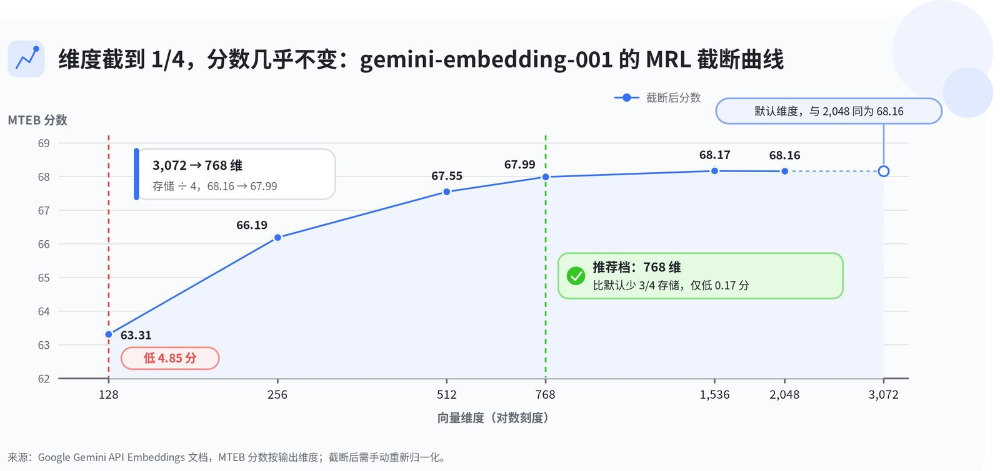
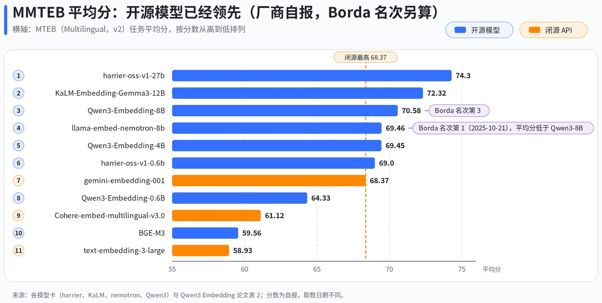
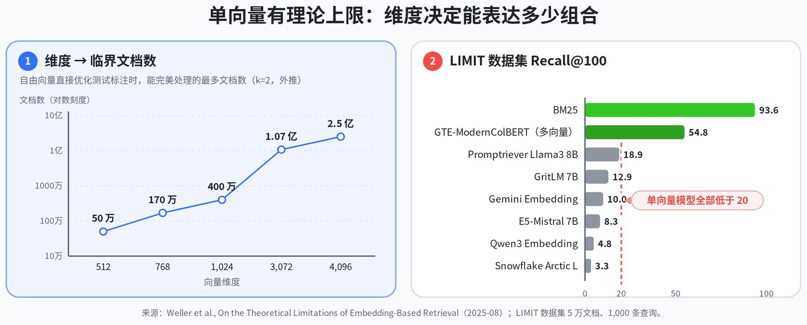
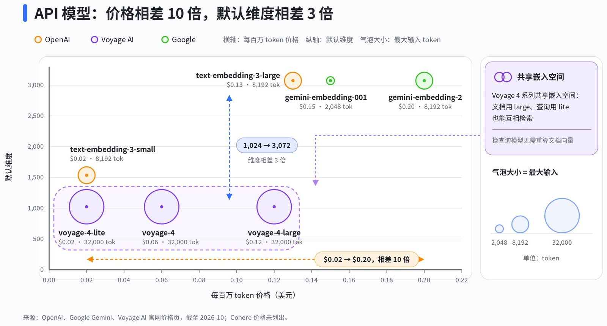
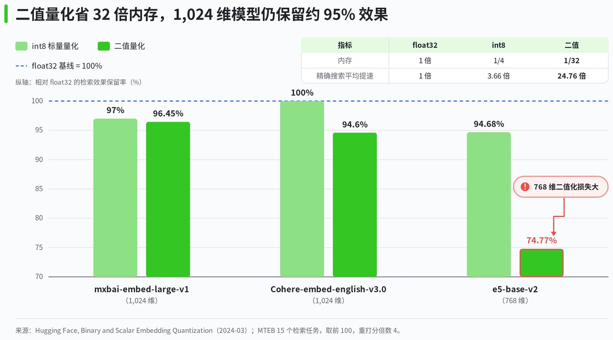
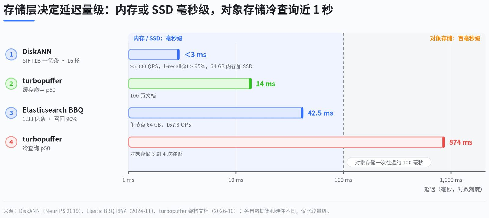
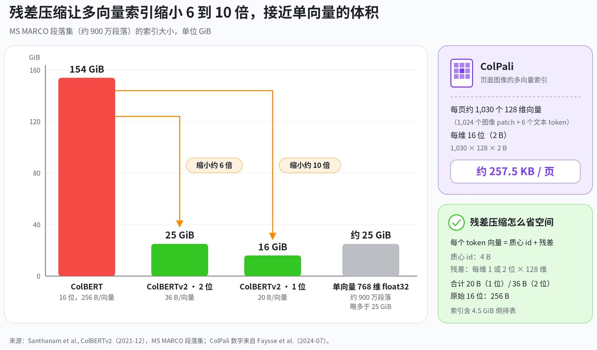
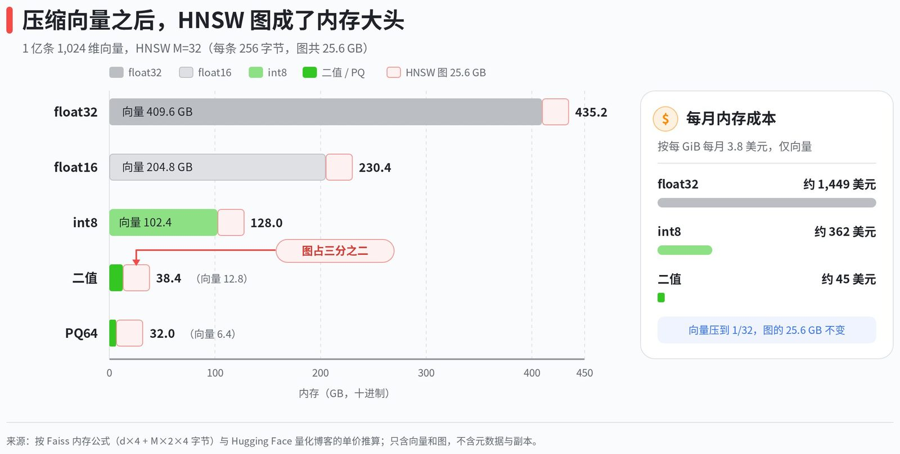
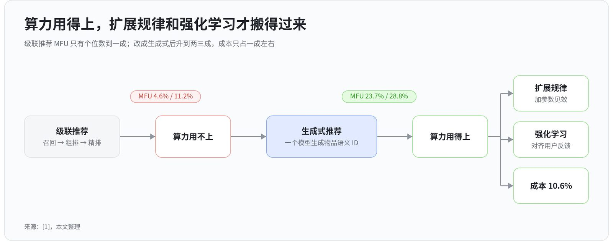
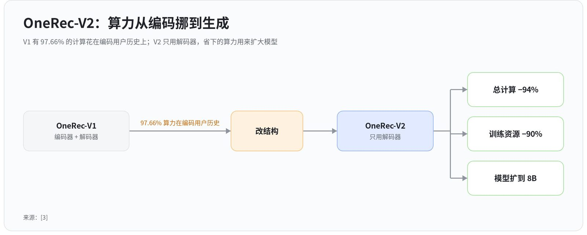

# LLM-29｜工程｜Embedding 与向量检索：选模型、建索引与运维

> 🎯 **这篇文档解决什么问题**：搭一套向量检索系统，要连续做四个决定：用哪个 embedding 模型、向量存成什么精度、用哪种近似最近邻（ANN）索引、放进哪种向量库。四者互相牵制：模型决定维度，维度和精度决定内存，内存决定索引和架构。本文按这条链路讲原理、参数和可复算的数字，最后给出上线清单。
>
> 使用方式：第 1 至 4 章讲模型，第 5 至 9 章讲压缩、索引、过滤、数据库和多向量，第 10、11 章讲运维和落地，第 12 章讲语义 ID 和生成式推荐；赶时间可以先读导读和第 11 章。文中版本、价格和基准分数核对于 2026 年 10 月 11 日。
>
> **代码**：配套练习在 llm-book 仓库的 `29-vector-search/`，3 个练习对应第 5、7、10 章（二值量化加重打分、带过滤检索、换 embedding 模型）。只用 Go 标准库，进目录跑 `go test -race ./...` 就能验证；每个练习加 `-broken` 运行能看到有问题的早期写法，练习 README 末尾附参考答案。

## 导读 · 先给结论

- **2026 年的主流 embedding 模型都是 LLM 底座加对比学习**。配方高度一致：InfoNCE 损失、难负例、LLM 生成的合成数据、只在查询侧加指令、最后做检查点合并[[1]](https://arxiv.org/abs/2401.00368)[[2]](https://arxiv.org/abs/2506.05176)。
- **排行榜只能用来缩小范围**。MMTEB 按 Borda 计数排名而不是按平均分，名次第一的模型平均分可能低于第三名[[3]](https://huggingface.co/nvidia/llama-embed-nemotron-8b)；头部分数多为自报，最终要用自己的查询测召回率。
- **单向量检索有理论上限**。LIMIT 论文证明一个 d 维向量能表达的 top-k 组合数受维度约束；在专门构造的数据集上，最好的单向量模型 Recall@100 不到 20，而 BM25 达到 93.6[[4]](https://arxiv.org/abs/2508.21038)。
- **压缩比换模型更省钱**。1 亿条 1,024 维向量用 float32 存储约 409.6 GB，int8 约 102.4 GB，二值约 12.8 GB；二值量化加重打分可以保留约 96% 的检索效果[[5]](https://huggingface.co/blog/embedding-quantization)。一次性嵌入 500 亿 token 的费用在 1,000 到 10,000 美元之间，相当于 float32 方案不到 1 个月到约 7 个月的内存费用。
- **索引和架构跟着数据规模走**。千万级以内，内存里的 HNSW（pgvector、Qdrant 等）最省事；到十亿级，SSD 上的 DiskANN 能在一台 64 GB 内存的机器上服务十亿条向量[[6]](https://papers.nips.cc/paper/2019/hash/09853c7fb1d3f8ee67a61b6bf4a7f8e6-Abstract.html)；租户多、冷数据多时，以对象存储为底的架构（turbopuffer、Pinecone serverless）更便宜，代价是冷查询延迟到数百毫秒[[7]](https://turbopuffer.com/docs/architecture)。
- **过滤是向量检索最常见的线上坑**。HNSW 加后过滤时，如果条件只命中 10% 的行，pgvector 默认参数下平均只返回 4 行[[8]](https://github.com/pgvector/pgvector)。
- **换模型就要全量重建**，除非厂商保证嵌入空间兼容（如 Voyage 4 系列共享嵌入空间[[9]](https://blog.voyageai.com/2026/01/15/voyage-4/)）。

📎 与系列其他文档的分工：解析与切分、BM25 与向量的混合检索融合、重排、带引用生成和 RAG 评测已在「RAG 与知识工程」第 2、3、4、5、8 章展开；embedding 矩阵的直觉见「LLM 基础」第 2.3 节；页面图片检索与文档理解见「多模态与长上下文」第 3 章。本文只讲向量这一层：模型、压缩、索引、数据库和运维。

## 第 1 章 · Embedding 模型是怎么训出来的

理解训练配方，才能回答使用时的问题：查询要不要加指令、文档侧为什么不加、维度能不能截断。

📎 展开阅读：「LLM 基础」第 2.3 节（token 如何查表变成向量，以及向量里存的是什么）。

### 1.1 对比学习：把相关的拉近、不相关的推远

文本 embedding 模型的核心训练目标是对比学习。每条训练样本是一个三元组：查询、一个正例（相关文档）、若干负例（不相关文档）。损失函数通常是 InfoNCE：把查询与正例的相似度放在分子，与所有候选的相似度之和放在分母，相似度用余弦并除以温度系数。温度的作用要把损失值和梯度分开看：对排序已正确的固定样本，降温会让 InfoNCE 损失下降，但相似度上的梯度绝对值可能变大，难负例因此被更强地区分。E5-mistral 用的就是这个配方，温度取 0.02[[1]](https://arxiv.org/abs/2401.00368)。

负例有两个来源。**批内负例**（in-batch negatives）是同一批次里其他查询的正例，几乎免费，但大多太容易区分。**难负例**（hard negatives）是先用一个已有的检索器搜出来、看起来相关但其实不相关的文档，它们决定了模型能不能分清细微差别。难负例的风险是混进**假负例**：检索器搜到的“负例”其实也是正确答案，只是没被标注。NV-Embed 的处理方法是设一个相对阈值：负例与查询的相似度不能超过正例相似度的 95%，超过的一律丢弃[[10]](https://arxiv.org/abs/2405.17428)。

### 1.2 LLM 作底座

2024 年以后，头部模型基本都改用解码器结构的大语言模型作底座。做法分两类：

- **保留因果注意力，取最后一个 token**：E5-mistral 在 Mistral-7B 上微调，用最后一层的结束符向量作为整段文本的表示，训练不到 1,000 步[[1]](https://arxiv.org/abs/2401.00368)。Qwen3-Embedding 和微软 harrier 也采用最后一个 token 池化[[2]](https://arxiv.org/abs/2506.05176)[[11]](https://huggingface.co/microsoft/harrier-oss-v1-27b)。
- **去掉因果掩码，改成双向注意力**：NV-Embed 在对比训练时移除因果掩码，并用一个潜在注意力层（latent attention）做池化[[10]](https://arxiv.org/abs/2405.17428)。Gemini Embedding 从 Gemini 初始化，同样使用双向注意力，再做均值池化并线性投影到目标维度[[12]](https://arxiv.org/abs/2503.07891)。

NV-Embed 分两阶段训练：先只用检索数据（批内负例加难负例），再混入非检索任务。两阶段在 MTEB 和 BEIR 上分别得 72.31 和 62.65，单阶段为 71.94 和 61.37[[10]](https://arxiv.org/abs/2405.17428)。

### 1.3 合成数据和模型合并

**合成数据**已经成为标准做法。E5-mistral 用 GPT-4 和 GPT-3.5 分两步生成数据：先让模型列出任务清单，再为每个任务生成“查询、正例、难负例”三元组，覆盖 93 种语言、数十万种任务[[1]](https://arxiv.org/abs/2401.00368)。Qwen3-Embedding 用 Qwen3 生成约 1.5 亿对弱监督数据做预训练，再用高质量数据做监督微调[[2]](https://arxiv.org/abs/2506.05176)。

**模型合并**是最后一步：把训练过程中的多个检查点合成一个。Qwen3-Embedding 用球面线性插值（slerp）合并，Gemini Embedding 用检查点平均（Model Soup）[[2]](https://arxiv.org/abs/2506.05176)[[12]](https://arxiv.org/abs/2503.07891)。Qwen3 的消融实验说明了每一步的贡献（0.6B 模型，MMTEB 平均分）：只用合成数据 58.49，去掉合成数据 61.21，去掉模型合并 62.56，完整流程 64.33[[2]](https://arxiv.org/abs/2506.05176)。

### 1.4 指令前缀：只加在查询侧

指令前缀告诉模型这次编码的用途，例如“给定一个网页搜索问题，检索能回答它的段落”。E5-mistral 的模板是 `Instruct: {task}\nQuery: {q}`，并且明确不给文档加前缀，这样文档索引可以提前建好，换任务时只改查询侧[[1]](https://arxiv.org/abs/2401.00368)。Qwen3-Embedding 模型卡称查询侧加指令一般能带来 1% 到 5% 的提升，建议用英文写指令[[13]](https://huggingface.co/Qwen/Qwen3-Embedding-8B)。

例外也存在。Voyage 给查询和文档分别定义了前缀（通过 `input_type` 参数自动添加），并说明加不加前缀生成的向量彼此兼容[[14]](https://docs.voyageai.com/docs/embeddings)；BGE-M3 则不需要查询指令[[15]](https://huggingface.co/BAAI/bge-m3)。**漏加查询指令是“效果比榜单差”的常见原因**。

### 1.5 Matryoshka：一个向量，多种长度

Matryoshka 表示学习（MRL）在训练时同时优化向量的多个前缀（比如前 64、128、256 维……），让截断后的短向量本身就能用。原论文报告：在 ImageNet-1K 分类上，同等精度下向量可以缩小到 1/14；大规模检索最多提速 14 倍；推理不增加任何成本[[16]](https://arxiv.org/abs/2205.13147)。

到 2026 年，支持 MRL 已是标配：OpenAI text-embedding-3 用 `dimensions` 参数截断[[17]](https://openai.com/index/new-embedding-models-and-api-updates/)，Gemini 支持 768、1,536、3,072 维[[12]](https://arxiv.org/abs/2503.07891)，Voyage 4 支持 256 到 2,048 维[[14]](https://docs.voyageai.com/docs/embeddings)，Qwen3-Embedding-8B 支持 32 到 4,096 之间任意维度[[2]](https://arxiv.org/abs/2506.05176)。gemini-embedding-001 官方文档给出的截断曲线很有代表性：MTEB 分数在 2,048 维时 68.16，768 维 67.99，256 维 66.19，128 维 63.31[[18]](https://ai.google.dev/gemini-api/docs/embeddings)。从 3,072 维降到 768 维几乎没有损失，降到 256 维损失约 2 分，降到 128 维损失接近 5 分。

截断后的向量不再是单位长度，用点积前要重新归一化；只有训练时优化过前缀的模型，截断才安全。gemini-embedding-001 需要调用方自己归一化，gemini-embedding-2 会自动归一化[[18]](https://ai.google.dev/gemini-api/docs/embeddings)。

## 第 2 章 · 读懂排行榜

排行榜用来缩小候选范围，而不是直接选第一名：任务分布和业务不同，排名不是平均分，分数多为自报，测试数据可能进过训练集。

### 2.1 三个榜单各测什么

| 榜单 | 发布 | 规模 | 要点 |
|---|---|---|---|
| MTEB | 2022-10 | 8 类任务、58 个数据集、112 种语言[[19]](https://arxiv.org/abs/2210.07316) | 原论文结论：没有哪种方法在所有任务上都最好 |
| MMTEB | 2025-02 | 500 多个经过质控的任务、250 多种语言，含指令遵循、长文档检索、代码检索[[20]](https://arxiv.org/abs/2502.13595) | 按任务间相关性降采样，在保持排名的前提下减少计算量 |
| C-MTEB | 2023-09 | 6 类任务、35 个数据集[[21]](https://arxiv.org/abs/2309.07597) | 中文场景的主要参照；同一项目发布了 BGE 系列模型 |
| BEIR | 2021-04 | 18 个数据集、10 种检索系统[[22]](https://arxiv.org/abs/2104.08663) | 零样本检索；BM25 是稳健基线，稠密检索的泛化常常不如它 |

MMTEB 论文发表时有一个值得记住的发现：表现最好的公开模型是 multilingual-e5-large-instruct，只有 5.6 亿参数[[20]](https://arxiv.org/abs/2502.13595)。参数量和榜单分数并不是线性关系。

📎 展开阅读：「RAG 与知识工程」第 3.3 节（检索场景下怎么用 MTEB 的检索子项缩小范围）。

### 2.2 2026 年 MMTEB 头部模型

下表的分数来自各模型卡或论文，即**厂商自报**；官方排行榜的实时名次以网站为准。分数是 MTEB（Multilingual，v2）的任务平均分。

| 模型 | 机构 | 发布 | 平均分 | 维度 | 许可 |
|---|---|---|---|---|---|
| harrier-oss-v1-27b[[11]](https://huggingface.co/microsoft/harrier-oss-v1-27b) | 微软 | 2026-03 | 74.3 | 5,376 | MIT |
| KaLM-Embedding-Gemma3-12B-2511[[23]](https://huggingface.co/tencent/KaLM-Embedding-Gemma3-12B-2511) | 腾讯 | 2025-11 | 72.32 | 3,840 | 腾讯 KaLM 社区许可 |
| Qwen3-Embedding-8B[[2]](https://arxiv.org/abs/2506.05176) | 阿里 | 2025-06 | 70.58 | 4,096 | Apache-2.0 |
| llama-embed-nemotron-8b[[3]](https://huggingface.co/nvidia/llama-embed-nemotron-8b) | 英伟达 | 2025-10 | 69.46 | — | 英伟达定制许可 |
| Qwen3-Embedding-4B | 阿里 | 2025-06 | 69.45 | 2,560 | Apache-2.0 |
| gemini-embedding-001 | 谷歌 | 2025-07-14 正式发布（2025-03 为实验版） | 68.37 | 3,072 | 闭源 API |
| Qwen3-Embedding-0.6B | 阿里 | 2025-06 | 64.33 | 1,024 | Apache-2.0 |

同一张表里的老牌模型可以作为参照：Qwen3 论文列出的 Cohere-embed-multilingual-v3.0 为 61.12，BGE-M3 为 59.56，OpenAI text-embedding-3-large 为 58.93[[2]](https://arxiv.org/abs/2506.05176)。harrier 另有从大模型蒸馏的 0.6B 版本，自报 69.0，使用时必须加查询指令[[11]](https://huggingface.co/microsoft/harrier-oss-v1-27b)。

### 2.3 Borda 排名不等于平均分

MMTEB 排行榜用 **Borda 计数**排名：每个任务按模型在该任务上的名次投票，最后累计票数。结果可能和平均分的排序相反。英伟达模型卡给出了一个具体例子：2025-10-21 时 llama-embed-nemotron-8b 以 39,573 票排在榜首，平均分 69.46；Qwen3-Embedding-8B 以 39,364 票排第三，平均分却是 70.58[[3]](https://huggingface.co/nvidia/llama-embed-nemotron-8b)。

读榜时要先确认看的是名次还是平均分，再看各模型分数的取数日期。Qwen3 模型卡里对比模型的分数取自 2025-05-24 的榜单，论文里取自 2025-06-04[[13]](https://huggingface.co/Qwen/Qwen3-Embedding-8B)[[2]](https://arxiv.org/abs/2506.05176)，同一个模型在两处的对手分数可能不同。

### 2.4 自报分数与私有基准

头部分数几乎都是自报，MMTEB 为此加入了面向零样本的评测方式[[20]](https://arxiv.org/abs/2502.13595)；厂商也开始改用自己的基准，Voyage 4 用 RTEB（29 个数据集）而不是 MTEB 做对比[[9]](https://blog.voyageai.com/2026/01/15/voyage-4/)，这类数字不能和 MTEB 分数直接比。

### 2.5 用自己的数据评

最终决定靠自己的评测集：收集 100 到 200 条真实查询并标出正确文档，用候选模型分别建索引，算 Recall@k 和 nDCG@10，同时记录维度和价格。

📎 展开阅读：「RAG 与知识工程」第 8 章（检索评测集长什么样、检索和生成为什么要分开评）。

## 第 3 章 · 单向量检索的理论上限

把一段文本压成一个固定长度的向量，再用点积排序，这种做法能表达的“相关文档组合”是有上限的。谷歌 DeepMind 与约翰斯·霍普金斯大学在 2025-08 发表的 LIMIT 论文从理论和实验两方面说明了这一点[[4]](https://arxiv.org/abs/2508.21038)。它不意味着向量检索不能用，而是说明在哪些查询类型上必须准备别的检索方式。

### 3.1 理论：维度限制了能返回的组合

把“哪些查询和哪些文档相关”写成一个 0/1 矩阵（相关性标注矩阵）。单向量检索要做的，是给每个查询和每个文档各找一个 d 维向量，使得对每个查询，相关文档的点积都排在不相关文档前面。论文证明，能否做到取决于这个矩阵的**符号秩**（sign-rank）：如果所需的 top-k 组合太多、太杂，d 维向量就无法同时满足所有查询[[4]](https://arxiv.org/abs/2508.21038)。

为了排除“模型没训好”的干扰，作者做了一个最理想化的实验：不用任何语言模型，直接在测试集标注上优化查询和文档向量（称为“自由向量”，free embedding），看在 k=2 时，维度为 d 的向量最多能完美处理多少个文档。拟合结果是一条三次曲线，外推得到的临界文档数为：512 维约 50 万，768 维约 170 万，1,024 维约 400 万，3,072 维约 1.07 亿，4,096 维约 2.5 亿[[4]](https://arxiv.org/abs/2508.21038)。

要区分两件事：sign-rank 给出的是理论结论；上面的临界规模来自自由向量直接优化的拟合，是所测设置下的经验外推，不是已证明的上界。按这一外推，对上亿文档、查询需要任意组合的系统，1,024 维很可能不够。

### 3.2 LIMIT 数据集：简单的问题，难的组合

作者据此构造了 LIMIT 数据集：5 万篇文档、1,000 条查询，每条查询恰好有 2 篇相关文档；其中 46 篇文档两两组合覆盖了所有查询（46 选 2 等于 1,035 种组合）[[4]](https://arxiv.org/abs/2508.21038)。文档和查询只围绕 1,850 个简单属性展开，语言上没有难度，难点完全在组合数量。

| 模型 | 维度 | Recall@100 |
|---|---|---|
| BM25（稀疏） | 词表大小 | 93.6 |
| GTE-ModernColBERT（多向量） | 每 token 一个向量 | 54.8 |
| Promptriever Llama3 8B | 4,096 | 18.9 |
| GritLM 7B | 4,096 | 12.9 |
| Gemini Embedding | 3,072 | 10.0 |
| E5-Mistral 7B | 4,096 | 8.3 |
| Qwen3 Embedding | 4,096 | 4.8 |
| Snowflake Arctic L | — | 3.3 |

结论是：MTEB 上最好的单向量模型，Recall@100 都不到 20；多向量模型好得多，但也只有一半出头；BM25 反而接近满分，因为它的“维度”是整个词表，高维稀疏表示能容纳的组合远多于几千维的稠密向量[[4]](https://arxiv.org/abs/2508.21038)。BM25 在这里的召回率是 Recall@2 为 85.7、Recall@10 为 90.4。

### 3.3 对工程的含义

- **保留一条关键词或稀疏检索通道**。LIMIT 给“默认用混合检索”提供了理论依据。LIMIT 是压力测试，真实查询的组合结构没这么极端。
- **识别组合型查询**。“同时满足 A 和 B”“列出所有提到 X 的记录”这类查询要求返回任意子集，更适合结构化过滤、关键词或多向量检索。
- **维度不是越低越好**。MRL 截断省了存储，也降低了可表达的组合数，截断前要用评测集确认召回率。

📎 展开阅读：「RAG 与知识工程」第 3.1、3.2 节（关键词检索与向量检索各自擅长什么，以及倒数排名融合的计算方法）。

## 第 4 章 · 2026 年模型选型

选型先回答三个问题：数据能否出域、文本多长、语料多大，再在自己的评测集上比 3 到 5 个候选。

### 4.1 闭源 API

下表价格为截至 2026-10 的官网价格，单位是每百万输入 token 的美元价。

| 模型 | 发布 | 维度 | 最大输入 | 价格 |
|---|---|---|---|---|
| OpenAI text-embedding-3-small | 2024-01 | 1,536，可截短 | 8,192 | 0.02[[17]](https://openai.com/index/new-embedding-models-and-api-updates/) |
| OpenAI text-embedding-3-large | 2024-01 | 3,072，可截短 | 8,192 | 0.13[[24]](https://platform.openai.com/docs/models/text-embedding-3-large) |
| gemini-embedding-001 | 2025-06 | 默认 3,072，可选 128–3,072 | 2,048 | 0.15；批处理半价[[25]](https://ai.google.dev/gemini-api/docs/pricing) |
| gemini-embedding-2（多模态） | 2026-04 更新 | 默认 3,072，可选 128–3,072 | 8,192 | 文本 0.20，批处理 0.10；图片 0.45，音频 6.50，视频 12.00[[25]](https://ai.google.dev/gemini-api/docs/pricing) |
| voyage-4-large（MoE） | 2026-01 | 默认 1,024，可选 256/512/2,048 | 32,000 | 0.12，前 2 亿 token 免费[[26]](https://docs.voyageai.com/docs/pricing) |
| voyage-4 | 2026-01 | 同上 | 32,000 | 0.06[[26]](https://docs.voyageai.com/docs/pricing) |
| voyage-4-lite | 2026-01 | 同上 | 32,000 | 0.02[[26]](https://docs.voyageai.com/docs/pricing) |
| Cohere embed-v4.0 | — | 256/512/1,024/1,536（默认） | 128k | 以官网为准[[27]](https://docs.cohere.com/docs/cohere-embed) |

几个值得注意的点：

- **OpenAI 的 3 代模型**：text-embedding-3-small 比上一代 ada-002 便宜 5 倍，MIRACL 多语言检索平均分从 31.4 提到 44.0；text-embedding-3-large 为 54.9。3-large 截到 256 维后，MTEB 分数仍高于 1,536 维的 ada-002[[17]](https://openai.com/index/new-embedding-models-and-api-updates/)。它们在 2026 年的多语言榜单上已明显落后（第 2 章）。
- **Gemini Embedding 2** 把文本、图片、视频、音频和 PDF 放进同一个向量空间，用提示词指令代替了 001 的 `task_type` 参数[[18]](https://ai.google.dev/gemini-api/docs/embeddings)。
- **Voyage 4 系列共享嵌入空间**：四个模型生成的向量彼此兼容，可以用 voyage-4-large 编码文档、用 lite 或开源的 nano 编码查询，升级查询模型时不用重新编码文档[[9]](https://blog.voyageai.com/2026/01/15/voyage-4/)。voyage-4-large 是混合专家（MoE）结构，厂商自称服务成本比同级稠密模型低 40%；在厂商自己的 RTEB 基准（29 个数据集，nDCG@10）上，它比 OpenAI text-embedding-3-large 平均高 14.05%，比 Gemini Embedding 001 高 3.87%[[9]](https://blog.voyageai.com/2026/01/15/voyage-4/)。以上均为厂商自报。
- **Cohere embed-v4.0** 支持文本、图片和图文混排的 PDF，上下文 128k[[27]](https://docs.cohere.com/docs/cohere-embed)。

### 4.2 开源模型

| 模型 | 发布 | 维度 | 最大输入 | 许可与特点 |
|---|---|---|---|---|
| Qwen3-Embedding 0.6B / 4B / 8B | 2025-06 | 1,024 / 2,560 / 4,096，支持 MRL | 32K | Apache-2.0；C-MTEB 8B 为 73.84，代码检索 80.68[[2]](https://arxiv.org/abs/2506.05176) |
| harrier-oss-v1-27b | 2026-03 | 5,376 | 32,768 | MIT；MMTEB 自报 74.3[[11]](https://huggingface.co/microsoft/harrier-oss-v1-27b) |
| BGE-M3 | 2024-01 | 1,024 稠密，另出稀疏权重和多向量 | 8,192 | MIT；100 多种语言，不需要查询指令[[15]](https://huggingface.co/BAAI/bge-m3) |
| jina-embeddings-v4 | 2025-06 | 2,048 单向量（MRL 128–2,048）；每 token 128 维多向量 | 32,768 | Qwen Research License；Qwen2.5-VL-3B 底座，支持图片[[28]](https://huggingface.co/jinaai/jina-embeddings-v4) |
| voyage-4-nano | 2026-01 | 默认 1,024 | 32,000 | Apache-2.0 开放权重，与 Voyage 4 系列共享向量空间[[9]](https://blog.voyageai.com/2026/01/15/voyage-4/) |

中文场景下，Qwen3-Embedding 的 C-MTEB 成绩是 0.6B 为 66.33、4B 为 72.26，高于上一代 gte-Qwen2-7B 的 71.62[[2]](https://arxiv.org/abs/2506.05176)。

许可证差别很大，商用前要逐个核对模型页：除表中所列外，KaLM 用腾讯社区许可[[23]](https://huggingface.co/tencent/KaLM-Embedding-Gemma3-12B-2511)，llama-embed-nemotron-8b 用英伟达定制许可[[3]](https://huggingface.co/nvidia/llama-embed-nemotron-8b)。

## 第 5 章 · 压缩：int8、二值、PQ、维度截断与重打分

📎 延伸阅读：把物品向量量化成语义 ID、再交给生成模型做推荐，是同类压缩技术在推荐系统里的用法，见本书第 12 章。

向量库的成本主要是内存。压缩分三类：降低每维精度（标量、二值量化）、切段后用码本编码（乘积量化）、减少维度（MRL 截断）。三类可叠加，弥补精度损失的通用办法是**过采样加重打分**。

### 5.1 标量量化（int8）与二值量化

**int8 标量量化**把每一维从 32 位浮点数映射到 8 位整数，向量正好缩小到 1/4。映射范围要用校准集统计。**二值量化**更激进：每一维大于 0 记 1、否则记 0，向量缩小到 1/32，距离用汉明距离计算[[5]](https://huggingface.co/blog/embedding-quantization)。

Hugging Face 与 mixedbread 在 2024-03 的博客给出了系统测量[[5]](https://huggingface.co/blog/embedding-quantization)：

| 指标 | float32 | int8 | 二值 |
|---|---|---|---|
| 内存 | 1 倍 | 1/4 | 1/32 |
| 精确搜索提速 | 1 倍 | 平均 3.66 倍（最高 4.8 倍） | 平均 24.76 倍（最高 45.8 倍） |
| 检索效果保留 | 100% | 约 99.3% | 约 96% |

效果保留率因模型而异。在 MTEB 的 15 个检索任务上（取前 100、重打分倍数为 4），mxbai-embed-large-v1 的 int8 保留 97%、二值保留 96.45%；Cohere-embed-english-v3.0 分别是 100% 和 94.6%；e5-base-v2 是 94.68% 和 74.77%[[5]](https://huggingface.co/blog/embedding-quantization)。规律是：**二值量化更适合 1,024 维及以上的模型**，768 维以下的模型二值化后损失可能很大，必须实测。

### 5.2 过采样与重打分

重打分（rescoring）的做法是：先用压缩后的向量快速召回比需要多几倍的候选，再用更高精度的表示重新算分排序。HF 博客的二值方案是：用 float32 的查询向量去和候选文档算分，召回数量取 top_k 乘以重打分倍数[[5]](https://huggingface.co/blog/embedding-quantization)。仅加这一步，mxbai 的二值检索效果就从 92.53% 提到 96.45%；int8 在倍数取 4 到 5 时能保留 99%[[5]](https://huggingface.co/blog/embedding-quantization)。

各家向量库都提供了这个机制，只是名字不同：Qdrant 叫过采样（oversampling）加重打分，在 OpenAI ada-002 的 1,536 维向量上用二值量化加 4 倍过采样，recall@100 达到 0.98[[29]](https://qdrant.tech/documentation/guides/quantization/)；Elasticsearch 的 BBQ 用 rerank 参数[[30]](https://www.elastic.co/search-labs/blog/better-binary-quantization-lucene-elasticsearch)；LanceDB 用 `refine_factor`[[31]](https://lancedb.com/docs/indexing/vector-index/)。完整链路是：二值或 PQ 粗召回，过采样 2 到 10 倍，高精度重打分，可选再接交叉编码器重排。

重打分用的高精度向量可以放磁盘：HF 博客的 4,100 万条维基百科演示中，二值索引放内存（5.2 GB），int8 向量放磁盘（约 47.5 GB）；全用 float32 需要约 200 GB 内存[[5]](https://huggingface.co/blog/embedding-quantization)。

📎 展开阅读：「RAG 与知识工程」第 4 章（交叉编码器重排为什么要两阶段，以及候选数怎么定）。

### 5.3 乘积量化与 RaBitQ

**乘积量化**（PQ，product quantization）把向量切成 M 段，每段用一个 256 项的码本编码成 1 个字节，所以每条向量占 M 字节。Faiss 的指南给出的经验是：M 一般不超过 64，码长再大时，标量量化通常同样准、而且更快[[32]](https://github.com/facebookresearch/faiss/wiki/Guidelines-to-choose-an-index)。Qdrant 的 PQ 最高压缩 64 倍[[29]](https://qdrant.tech/documentation/guides/quantization/)，LanceDB 的 IVF_PQ 压到原来的 1/64 到 1/16[[31]](https://lancedb.com/docs/indexing/vector-index/)。PQ 压缩率最高，精度损失也最大。

**RaBitQ** 是近两年流行的二值量化改进。Faiss 中 1 位版本每条向量占 d/8+8 字节，也支持 2 到 9 位的多位版本[[32]](https://github.com/facebookresearch/faiss/wiki/Guidelines-to-choose-an-index)；LanceDB 的 IVF_RQ 压到约 1/32[[31]](https://lancedb.com/docs/indexing/vector-index/)。Elasticsearch 的 BBQ（Better Binary Quantization）也源自 RaBitQ：文档存 1 位，查询用 4 位（非对称），内存减少约 95%；和 PQ 相比，量化时间少 20 到 30 倍，查询快 2 到 5 倍[[30]](https://www.elastic.co/search-labs/blog/better-binary-quantization-lucene-elasticsearch)。

非对称量化的道理是：查询只有一条、不占存储，可以保留更高精度。Qdrant 也支持存二值、查询用标量[[29]](https://qdrant.tech/documentation/guides/quantization/)。

📎 展开阅读：「模型压缩与端侧部署」第 4 章（向量量化在模型权重上的用法，码本思想与这里的 PQ 相同）。

### 5.4 维度截断，以及和量化叠加

MRL 截断（第 1.5 节）的效果：text-embedding-3-large 压缩 12 倍时保留 93.1% 的效果；nomic-embed-text-v1.5 压缩 3 倍保留 95.8%，压缩 6 倍保留 90%[[5]](https://huggingface.co/blog/embedding-quantization)。

截断和量化可以叠加。Voyage 的 API 直接让用户在 2,048 到 256 维和 float、int8、二值几种精度之间组合，输出类型包括 `float`、`int8`、`uint8`、`binary`、`ubinary`[[14]](https://docs.voyageai.com/docs/embeddings)。1,024 维 float32 每条 4,096 字节，256 维二值每条只有 32 字节，相差 128 倍。叠加越多，越依赖重打分把精度拉回来。

> 💡 **常见误区**：
>
> - 只压缩向量，忘了索引本身。HNSW 的图结构也占内存，二值化之后图可能比向量还大（第 6.1 节）。
> - 二值量化后不做重打分，然后得出“二值不能用”的结论。
> - int8 的校准集和线上数据分布不一致，超出校准范围的值会被截断，精度下降。

## 第 6 章 · ANN 索引：HNSW、IVF、DiskANN 与 ScaNN

近似最近邻（ANN，approximate nearest neighbor）索引用少量召回损失换取数量级的速度提升。主流索引分图索引（HNSW、DiskANN）、聚类索引（IVF）和量化加速（PQ、ScaNN）三族，实际系统常组合使用。

### 6.1 HNSW：参数与内存

HNSW（Hierarchical Navigable Small World）把向量组织成多层近邻图：每个点被分配到的最高层数按指数衰减的概率随机决定，上层稀疏、下层稠密；查询从顶层开始贪心地向目标靠近，逐层下降，复杂度随数据量呈对数增长[[33]](https://arxiv.org/abs/1603.09320)。它不需要训练，是内存型向量库的默认选择。

三个参数决定了它的表现[[34]](https://github.com/nmslib/hnswlib/blob/master/ALGO_PARAMS.md)：

- **M**：每个点在图中保留的邻居数。合理范围是 2 到 100，hnswlib 的说明是“M 取 12 到 48 适合大多数场景”。M 越大，图占的内存越多（见下面的内存公式）。
- **ef_construction**：建索引时的候选列表长度。hnswlib 给的检验方法是：用 ef 等于 ef_construction 去搜索每个点的 M 个最近邻，召回率应不低于 0.9，否则就该调大。
- <b>ef（查询时）</b>：查询时的候选列表长度，必须不小于要返回的 k。ef 越大召回越高、越慢，是线上最常调的旋钮。

各系统的默认值不同：pgvector 默认 m 为 16、ef_construction 为 64、`hnsw.ef_search` 为 40[[8]](https://github.com/pgvector/pgvector)；LanceDB 建议 ef_construction 从 150 起步，查询 ef 取 k 的 1.5 到 10 倍[[31]](https://lancedb.com/docs/indexing/vector-index/)。

**内存公式**。Faiss 给出的 HNSW 内存为每条向量 d×4 + M×2×4 字节，前一项是 float32 原始向量，后一项是图的邻接表[[32]](https://github.com/facebookresearch/faiss/wiki/Guidelines-to-choose-an-index)。以 1,024 维、M=32 为例，每条向量 4,096 字节加 256 字节，共 4,352 字节；100 万条约 4.4 GB。这个公式揭示了一个容易忽视的事实：**向量压缩后，图会成为大头**。同样 M=32，二值向量只有 128 字节，图却仍是 256 字节。

HNSW 的另一个限制是删除：Faiss 的 HNSW 不支持删除[[32]](https://github.com/facebookresearch/faiss/wiki/Guidelines-to-choose-an-index)；pgvector 依赖 vacuum，0.8.3（2026-06-17）还修复过 HNSW vacuum 可能损坏索引的问题[[8]](https://github.com/pgvector/pgvector)。删除频繁时要定期重建。

### 6.2 IVF 与 IVF-PQ

IVF（倒排文件索引）先用 k-means 把向量聚成 K 个簇，查询时只搜索离查询最近的 nprobe 个簇。nprobe 是速度和召回之间的旋钮[[32]](https://github.com/facebookresearch/faiss/wiki/Guidelines-to-choose-an-index)。Faiss 指南给出的规模经验[[32]](https://github.com/facebookresearch/faiss/wiki/Guidelines-to-choose-an-index)：

| 数据量 | 建议索引 | 说明 |
|---|---|---|
| 100 万以内 | IVF，K 取 4√N 到 16√N | 训练需要 30K 到 256K 条向量 |
| 100 万到 1,000 万 | IVF65536_HNSW32 | 簇中心本身用 HNSW 查找 |
| 1,000 万到 1 亿 | IVF262144_HNSW32 | 同上 |
| 1 亿到 10 亿 | IVF1048576_HNSW32 | K 为 2 的 20 次方，训练很慢，可用 GPU |

IVF 常和 PQ 组合成 IVF-PQ：簇内向量用 PQ 编码，内存降到原来的几十分之一，再配合重打分。LanceDB 以 IVF 为主干，默认 nprobes 为 20，PQ 子向量数默认为维度除以 16[[31]](https://lancedb.com/docs/indexing/vector-index/)。IVF 的代价是需要训练，数据分布明显变化后要重新训练。

### 6.3 DiskANN：把十亿条向量放到一台机器的 SSD 上

当向量多到内存放不下，DiskANN 的思路是把索引（Vamana 图）的主体放到 SSD 上，内存只承担一小部分。微软研究院 2019 年的论文在一台 64 GB 内存加 SSD 的工作站上为十亿级数据建了索引；在 SIFT1B 上用 16 核做到每秒 5,000 次以上查询、平均延迟低于 3 毫秒、1-recall@1 超过 95%[[6]](https://papers.nips.cc/paper/2019/hash/09853c7fb1d3f8ee67a61b6bf4a7f8e6-Abstract.html)。同等内存下，基于 IVF 的 Faiss 方案 1-recall@1 停在约 50%；在高召回区间，DiskANN 单节点能容纳的点数是 HNSW、NSG 的 5 到 10 倍[[6]](https://papers.nips.cc/paper/2019/hash/09853c7fb1d3f8ee67a61b6bf4a7f8e6-Abstract.html)。Milvus 内置了 DiskANN 索引[[35]](https://github.com/milvus-io/milvus)。

### 6.4 ScaNN：针对内积的量化

谷歌 2020 年开源的 ScaNN 用**各向异性向量量化**：量化误差中，与原向量平行的分量对内积排序影响更大，所以对这部分误差加大惩罚。在 glove-100-angular 数据集上，同等精度下它的每秒查询数大约是 11 个对比库中第二名的两倍[[36]](https://research.google/blog/announcing-scann-efficient-vector-similarity-search/)。Milvus 也提供了 SCANN 索引类型[[35]](https://github.com/milvus-io/milvus)。

### 6.5 怎么比较索引

比较 ANN 索引要看**召回率与吞吐的曲线**，而不是单点数字，ann-benchmarks 提供了各算法在 glove、sift 等数据集上的曲线[[37]](https://ann-benchmarks.com/)。NeurIPS 2023 的 Big-ANN 竞赛增加了过滤、分布外查询、稀疏和流式更新四个赛道[[38]](https://arxiv.org/abs/2409.17424)。自己评估时用自己的向量和查询，固定召回目标后比较延迟、吞吐、内存和建索引时间。

## 第 7 章 · 带过滤条件的检索

线上查询几乎都带条件：租户、时间段、文档类型、用户权限。ANN 索引按向量距离组织，不认识这些条件，两者怎么结合是最常见的线上问题。

📎 展开阅读：「RAG 与知识工程」第 9.2 节（权限标签怎么随片段写入索引、为什么必须在检索时过滤）。本章讲索引层面怎么把过滤做对、做快。

### 7.1 后过滤为什么会丢结果

**后过滤**是先用 ANN 找出前 ef 个候选，再按条件筛掉不满足的。问题在于候选数是固定的。pgvector 的文档给出了一个直观的算例：使用近似索引时过滤发生在扫描之后，如果条件只匹配 10% 的行，HNSW 用默认的 `hnsw.ef_search`=40，平均只能返回 4 行[[8]](https://github.com/pgvector/pgvector)。条件越严格，结果越少。

**前过滤**是先按条件选出合法文档，再在其中搜索。合法集合小时直接暴力计算即可；集合大时要在图里跳过大量不合法的点，连通性被破坏，搜索可能陷在局部。

### 7.2 pgvector 的迭代扫描

pgvector 0.8.0（2024-10-30）加入了迭代索引扫描：结果不够时自动继续扫描索引，同时改进了带过滤查询的代价估计[[8]](https://github.com/pgvector/pgvector)。打开方式是设置 `hnsw.iterative_scan`：`strict_order` 保证结果严格按距离排序，`relaxed_order` 允许轻微乱序以换取速度。扫描上限由 `hnsw.max_scan_tuples` 控制，默认 20,000；内存上限由 `hnsw.scan_mem_multiplier` 控制，默认 1[[8]](https://github.com/pgvector/pgvector)。条件极严格时，即使打开迭代扫描也可能扫到上限仍不够，这时要考虑为该字段建分区或部分索引。

### 7.3 过滤感知的图遍历：ACORN

ACORN（斯坦福与伯克利，2024-03）的思路是：在 HNSW 的基础上，搜索时只沿满足条件的节点走，相当于在“满足谓词的子图”上遍历，而且不需要事先知道会有哪些过滤条件。论文报告在固定召回率下，吞吐比此前的方法高 2 到 1,000 倍[[39]](https://arxiv.org/abs/2403.04871)。

Weaviate 从 v1.34 起把 ACORN 设为默认过滤策略，另外提供 sweeping 和 pathseer 两种策略；它的前过滤基于允许列表，可结合索引搜索而不必扫描全库；过滤很严时会按 cutoff 切换为对子集的平坦暴搜，这种切换往往更快[[40]](https://docs.weaviate.io/weaviate/concepts/filtering)。NeurIPS 2023 Big-ANN 竞赛的过滤赛道（YFCC 1,000 万条、192 维、10 万条查询，按 10-recall@10 不低于 90% 时的吞吐排名）中，冠军 ParlayANN 达到每秒 37,902 次查询，Faiss 基线为 3,033 次，前者快 11 倍以上[[38]](https://arxiv.org/abs/2409.17424)。过滤检索的算法空间还很大。

### 7.4 换用聚类索引或分区

另一条路是不用图。LanceDB 的建议是：过滤频繁的场景优先用 IVF_RQ 或 IVF_PQ，基于 HNSW 的索引在过滤下延迟波动更大；它还会根据过滤后剩余的数据量自适应调整 nprobes 的上下限[[31]](https://lancedb.com/docs/indexing/vector-index/)。对聚类索引来说，过滤只是让每个簇少扫一些行，不会像图索引那样破坏连通性。

多租户系统最可靠的办法是**按租户物理分区**。Pinecone serverless 把命名空间作为硬分区，一个索引可以有数十万个命名空间[[41]](https://www.pinecone.io/blog/serverless-architecture/)；turbopuffer 观察到的命名空间数超过 2.5 亿[[42]](https://turbopuffer.com/docs/limits)。每个租户一个分区，小租户直接暴力搜索也足够快。

## 第 8 章 · 向量数据库与架构

向量数据库的差别主要在**索引放在哪一层存储上**：内存里的图（HNSW）、SSD 上的图（DiskANN）、以对象存储为准的聚类索引加缓存。三类的成本、延迟和运维负担完全不同。

### 8.1 pgvector：先用你已经有的数据库

pgvector 是 PostgreSQL 扩展。0.5.0（2023-08-28）加入 HNSW 索引，0.6.0（2024-01-29）支持并行构建 HNSW，0.7.0（2024-04-29）加入 `halfvec`、`sparsevec`、位向量索引和 `binary_quantize`，0.8.0（2024-10-30）加入迭代扫描；截至 2026-10 最新版本是 0.8.7（2026-10-01）[[8]](https://github.com/pgvector/pgvector)。

限制：`vector` 类型建索引最多 2,000 维，`halfvec` 最多 4,000 维，`bit` 最多 64,000 维；每条 `vector` 占 4×d+8 字节，`halfvec` 占 2×d+8 字节[[8]](https://github.com/pgvector/pgvector)。这意味着 Qwen3-Embedding-8B 的 4,096 维、harrier 的 5,376 维向量不能直接用 `vector` 建索引；4,096 维也略超 `halfvec` 的上限。可选的做法是用 MRL 截断到 2,000 维以内，或者用二值量化后的位向量建索引、再用原始向量重打分。

pgvector 的优势是向量和业务数据在同一个事务里，过滤和权限都用 SQL 完成；代价是单机内存成为规模瓶颈。

### 8.2 专用向量库：Milvus、Qdrant、Weaviate

- **Milvus**：用 Go 和 C++ 编写，按 Kubernetes 原生的分布式架构设计，README 称能在数十亿向量上处理每秒数万次搜索；索引类型覆盖 HNSW、IVF、FLAT、SCANN、DiskANN 及各种量化变体，支持内存映射和 GPU 加速[[35]](https://github.com/milvus-io/milvus)。
- **Qdrant**：量化选项丰富，有标量、二值（v1.5.0 起）、1.5 位、2 位、PQ 和 TurboQuant，并支持非对称量化[[29]](https://qdrant.tech/documentation/guides/quantization/)。
- **Weaviate**：过滤能力突出，默认用 ACORN 策略，另有 HFresh 索引（在簇中心上建 HNSW）[[40]](https://docs.weaviate.io/weaviate/concepts/filtering)。

### 8.3 搜索引擎：Elasticsearch

Elasticsearch 基于 Lucene 的 HNSW，在 8.16（2024-11）以技术预览形式加入 BBQ，索引类型为 `bbq_hnsw` 和 `bbq_flat`[[30]](https://www.elastic.co/search-labs/blog/better-binary-quantization-lucene-elasticsearch)。Elastic 给出的大规模数据点是：1.38 亿条 1,024 维向量，原始 HNSW 约需 535 GB，用 BBQ 后约 19 GB，一台 64 GB 内存的节点就能承载；在 k=10、num_candidates=1000、rerank=200 时召回 90%，延迟 42.5 毫秒，每秒 167.8 次查询；建索引约 12 小时[[30]](https://www.elastic.co/search-labs/blog/better-binary-quantization-lucene-elasticsearch)。

### 8.4 以对象存储为底：turbopuffer、Pinecone serverless、LanceDB

这一类以对象存储（如 S3）为唯一真实数据源，计算节点用 NVMe SSD 和内存做缓存。

**turbopuffer** 的文档写得很透明[[7]](https://turbopuffer.com/docs/architecture)：每个命名空间一个预写日志（WAL），每秒最多提交一次；默认强一致，可选最终一致。对象存储一次往返约 100 毫秒，冷查询需要 3 到 4 次往返，约 400 毫秒；100 万文档的冷查询 p50 是 874 毫秒，缓存命中后 p50 是 14 毫秒。向量索引基于簇中心型的 SPFresh，不选图索引是为了减少对象存储往返和写放大。公开的上限包括单命名空间 1,280 亿条、256 TB，向量最多 10,752 维，recall@10 为 90% 到 100%[[42]](https://turbopuffer.com/docs/limits)。

**Pinecone serverless**（2024-01）也以 blob 存储为准：写入先进日志和 blob 存储，索引构建器做几何分区、分配簇中心、生成不可变的分段，分段从粗到细分层；另有一个“新鲜度层”为尚未建索引的新数据提供紧凑索引，执行节点在本地缓存分段[[41]](https://www.pinecone.io/blog/serverless-architecture/)。Pinecone 发布的客户案例称 Gong 改用后成本降到 1/10[[41]](https://www.pinecone.io/blog/serverless-architecture/)。

**LanceDB** 以 IVF 为主（IVF_RQ、IVF_PQ、IVF_HNSW_SQ、IVF_HNSW_FLAT），HNSW 只作为 IVF 分区内的子索引。开源版本新追加的行在调用 `optimize()` 前不进索引，查询时会走较慢的兜底路径，除非用 `fast_search()` 跳过它们[[31]](https://lancedb.com/docs/indexing/vector-index/)。

### 8.5 三类架构怎么选

| 架构 | 代表 | 优势 | 代价 |
|---|---|---|---|
| 内存图 | pgvector、Qdrant、Weaviate、Elasticsearch | 毫秒级延迟，实时写入 | 内存成本随数据量线性增长 |
| SSD 图 | Milvus 的 DiskANN 索引 | 单机十亿级，高召回 | 依赖 SSD 性能，分布式运维复杂 |
| 对象存储加聚类索引 | turbopuffer、Pinecone serverless、LanceDB | 存储便宜，命名空间多 | 冷查询数百毫秒，新数据有索引延迟 |

## 第 9 章 · 多向量与稀疏：ColBERT、SPLADE、ColPali 的存储代价

单向量的表达能力有上限（第 3 章），补救方式有两种：**多向量**（每个 token 或图块保留一个向量，查询时逐个匹配）和**稀疏向量**（在词表维度上表示文本，用倒排索引检索）。本章重点是把它们的存储代价算清楚。

### 9.1 后期交互：ColBERT

ColBERT（斯坦福，2020-04）把查询和文档分别编码成每个 token 一个向量，打分时对查询的每个 token 取文档中的最大相似度再求和（MaxSim）。文档向量可以预先算好，所以它比把查询和文档拼在一起的 BERT 交叉编码器快两个数量级，每条查询的计算量少四个数量级[[43]](https://arxiv.org/abs/2004.12832)。在 LIMIT 上，多向量的 GTE-ModernColBERT 拿到 54.8 的 Recall@100，远高于所有单向量模型[[4]](https://arxiv.org/abs/2508.21038)。

代价是存储：每个 token 一个向量。ColBERTv2（2021-12）用残差压缩解决这个问题：每个 token 向量是 128 维，先记一个最近的簇中心编号（4 字节），再用每维 1 位或 2 位存残差，于是每个向量只占 20 或 36 字节，而原版 ColBERT 用 16 位浮点数需要 256 字节[[44]](https://arxiv.org/abs/2112.01488)。在 MS MARCO 段落集上，索引从 154 GiB 降到 16 GiB（1 位）或 25 GiB（2 位），缩小 6 到 10 倍；作为对照，约 900 万段落的 768 维 float32 单向量索引“略多于 25 GiB”[[44]](https://arxiv.org/abs/2112.01488)。也就是说，**压缩到 2 位的多向量索引，和未压缩的单向量索引差不多大**。

把这个比例放到更大的规模上估算：假设 1 亿个片段、每个片段平均 300 个 token（这是假设值），用 16 位浮点数存 128 维 token 向量，每个片段 76.8 KB，总共约 7.68 TB；用 ColBERTv2 的 2 位压缩，每个片段约 10.8 KB，总共约 1.08 TB。同样 1 亿个片段的 1,024 维 float32 单向量只要 409.6 GB（第 10 章）。多向量压缩后约是单向量的 2.6 倍，不压缩约是 19 倍。

### 9.2 稀疏检索：SPLADE 与 BGE-M3

SPLADE（Naver，2021-07）为每个词表项输出一个权重，通过显式的稀疏正则和对数饱和让大部分权重为 0，同时会给原文没有出现但相关的词赋予权重（词扩展）。结果是一个词表长度的稀疏向量，可以直接放进倒排索引[[45]](https://arxiv.org/abs/2107.05720)。它保留了 BM25 的精确匹配能力，又有一定的语义泛化。Big-ANN 2023 专门设了 SPLADE 向量的稀疏赛道（MS MARCO 880 万条）[[38]](https://arxiv.org/abs/2409.17424)。

BGE-M3 的做法更省事：一次前向计算同时输出 1,024 维稠密向量、稀疏的词权重和 ColBERT 式多向量，模型卡称稀疏权重是在生成稠密向量时“无额外成本”得到的[[15]](https://huggingface.co/BAAI/bge-m3)。模型卡给出的三路混合权重示例是稠密、稀疏、多向量分别取 0.4、0.2、0.4[[15]](https://huggingface.co/BAAI/bge-m3)。pgvector 0.7.0 起支持 `sparsevec` 类型，每条占 8×非零项数+16 字节[[8]](https://github.com/pgvector/pgvector)。

📎 展开阅读：「RAG 与知识工程」第 3 章（稠密和关键词两路召回的融合与权重，本章不再重复）。

### 9.3 页面图片检索：ColPali

ColPali（2024-07）把 ColBERT 的思路用到页面图片上：用 PaliGemma-3B 视觉语言模型把整页 PDF 截图编码成多向量，每个图块一个 128 维向量，不再经过版面分析和 OCR[[46]](https://arxiv.org/abs/2407.01449)。在 ViDoRe 基准上，它的 nDCG@5 平均为 81.3，而“非结构化解析加 OCR 再用 BM25”为 65.5、换成 BGE-M3 为 66.1、再加图片描述为 67.0[[46]](https://arxiv.org/abs/2407.01449)。建索引每页 0.39 秒，传统流水线（版面、OCR、图片描述、编码）需要 7.22 秒[[46]](https://arxiv.org/abs/2407.01449)。

代价同样是存储：每页约 1,030 个向量（1,024 个图块加 6 个文本 token），每个 128 维、16 位，合计 257.5 KB[[46]](https://arxiv.org/abs/2407.01449)。100 万页约 264 GB（按十进制 GB 计），相当于 6,400 万条 1,024 维 float32 单向量。jina-embeddings-v4 也同时提供单向量和每 token 128 维的多向量输出[[28]](https://huggingface.co/jinaai/jina-embeddings-v4)，可以先用单向量粗召回，再用多向量对前几百条重排。

📎 展开阅读：「多模态与长上下文」第 3 章（文档理解的三条路线，以及文本索引和 ColPali 双路召回的混合方案）。

## 第 10 章 · 运维：换模型、版本、召回监控与成本

上线之后，最贵的操作是换模型，最隐蔽的退化是召回率下降，最常被低估的成本是内存。

### 10.1 换模型就要重建

不同模型生成的向量处在不同的空间里，彼此的距离没有意义。换模型意味着全量重新编码语料、重建索引，期间新旧两套索引要并存。唯一的例外是厂商明确保证兼容：Voyage 4 系列的四个模型共享嵌入空间，可以只升级查询侧模型而不重新编码文档[[9]](https://blog.voyageai.com/2026/01/15/voyage-4/)；Voyage 还说明加不加 `input_type` 前缀生成的向量相互兼容[[14]](https://docs.voyageai.com/docs/embeddings)。

即使是同一个模型，细节变化也会让向量不一致。gemini-embedding-001 截断后需要调用方手动归一化，gemini-embedding-2 会自动归一化[[18]](https://ai.google.dev/gemini-api/docs/embeddings)，两者混用时向量长度不一致，依赖点积的阈值要重新校准。

### 10.2 每条向量都要带版本

建议每条向量至少记录以下元数据，并作为索引或集合的命名依据：

- 模型：`model_id`、`model_revision`（开源模型记录提交哈希）。
- 表示：`dim`、`dtype`、`normalize`、`instruction`。
- 预处理：`chunker_version`，切分变了向量也要重算。

换模型的标准流程是双写加影子索引：新数据同时写入新旧两个索引，后台用新模型回填存量数据；回填完成后，在黄金评测集上比较新旧索引的召回率，再按比例切换线上流量，保留旧索引一段时间以便回滚。增量更新和删除的一般做法见下面的展开阅读。

📎 展开阅读：「RAG 与知识工程」第 9.1 节（增量更新、删除同步和片段版本号）。

### 10.3 重建要花多少时间

重建时间决定了换模型和调参的节奏。几个可参考的数据点：Elasticsearch 在一台 64 GB 内存的节点上为 1.38 亿条 1,024 维向量建 BBQ 索引约需 12 小时[[30]](https://www.elastic.co/search-labs/blog/better-binary-quantization-lucene-elasticsearch)；Faiss 的 IVF 在 1 亿到 10 亿规模下有 2 的 20 次方个簇中心，训练很慢，可以用 GPU 训练[[32]](https://github.com/facebookresearch/faiss/wiki/Guidelines-to-choose-an-index)；pgvector 从 0.6.0 起支持并行构建 HNSW，构建时要注意 `maintenance_work_mem` 的设置，相关问题在多个版本中有修复[[8]](https://github.com/pgvector/pgvector)。重新编码可以用批处理 API 降低费用（Gemini 为默认价格的一半[[25]](https://ai.google.dev/gemini-api/docs/pricing)，Voyage 便宜 33%[[9]](https://blog.voyageai.com/2026/01/15/voyage-4/)）。

### 10.4 召回监控

ANN 召回率会随数据增长、分布变化和删除累积而下降，延迟和错误率看不出来。监控方法：

- **离线对照精确搜索**：抽样约 1% 的线上查询跑精确最近邻，计算 ANN 的 recall@10，LanceDB 的 `bypass_vector_index()` 就用于这种对照[[31]](https://lancedb.com/docs/indexing/vector-index/)。跌破阈值时调大 ef 或 nprobes，或重建索引。
- **索引新鲜度**：监控尚未进索引的数据量。turbopuffer 把“已写入但未建索引的数据”上限设为 2 GB[[42]](https://turbopuffer.com/docs/limits)；LanceDB 可以查询未索引的行数[[31]](https://lancedb.com/docs/indexing/vector-index/)。
- **结果条数**：带过滤的查询返回条数少于 k 的比例（第 7 章）。

### 10.5 成本算账：1 亿条向量

1 亿条 1,024 维向量本身的存储（十进制 GB）：

| 格式 | 每条字节 | 合计 | 依据 |
|---|---|---|---|
| float32 | 4,096 | 409.6 GB | 每维 4 字节[[5]](https://huggingface.co/blog/embedding-quantization) |
| pgvector `vector` | 4,104 | 410.4 GB | 4×d+8[[8]](https://github.com/pgvector/pgvector) |
| float16 / `halfvec` | 2,048 | 204.8 GB | 每维 2 字节 |
| int8 | 1,024 | 102.4 GB | 1/4 |
| RaBitQ（1 位） | 136 | 13.6 GB | d/8+8[[32]](https://github.com/facebookresearch/faiss/wiki/Guidelines-to-choose-an-index) |
| 二值 | 128 | 12.8 GB | 1/32 |
| PQ（M=64） | 64 | 6.4 GB | M 字节 |
| MRL 截到 256 维再二值化 | 32 | 3.2 GB | 256/8 |

再加上 HNSW 图：按 Faiss 公式每条 M×2×4 字节，M=16 时加 12.8 GB，M=32 时加 25.6 GB，M=64 时加 51.2 GB[[32]](https://github.com/facebookresearch/faiss/wiki/Guidelines-to-choose-an-index)。float32 加 M=32 的图约 435 GB 内存；二值向量加同样的图是 38.4 GB，其中三分之二是图。

换算成钱：HF 博客按每 GB 每月 3.8 美元（AWS x2gd 实例）估算，1 亿条 1,024 维 float32 向量（381.46 GiB）每月约 1,449 美元[[5]](https://huggingface.co/blog/embedding-quantization)；按同样单价，int8 约 362 美元，二值约 45 美元。

再看一次性编码费用。假设 1 亿个片段、每个 500 token，共 500 亿 token，按截至 2026-10 的官网价格：text-embedding-3-small 和 voyage-4-lite 约 1,000 美元，voyage-4 约 3,000 美元，voyage-4-large 约 6,000 美元（批处理约 4,000 美元），text-embedding-3-large 约 6,500 美元，gemini-embedding-001 约 7,500 美元（批处理 3,750 美元），gemini-embedding-2 约 10,000 美元（批处理 5,000 美元）[[17]](https://openai.com/index/new-embedding-models-and-api-updates/)[[24]](https://platform.openai.com/docs/models/text-embedding-3-large)[[26]](https://docs.voyageai.com/docs/pricing)[[25]](https://ai.google.dev/gemini-api/docs/pricing)。

两组数字放在一起看，结论是：一次性编码费用在 1,000 到 10,000 美元之间，相当于 float32 方案不到 1 个月到约 7 个月的内存费用。**压缩方案的选择通常比模型价格的差异更影响总成本**；而真正反复发生的成本是每次换模型都要重新编码一遍。

## 第 11 章 · 怎么选与上线清单

推荐顺序：先定评测集，再选模型，算内存账定精度和维度，按规模和过滤需求选索引与数据库，最后做版本和监控。先选数据库再想模型是最常见的返工原因。

### 11.1 三种场景的默认选择

| 维度 | 百万级、内部知识库 | 千万到亿级、多租户 SaaS | 十亿级、单一大库 |
|---|---|---|---|
| 模型 | Qwen3-Embedding-0.6B 自部署，或 0.02 美元档 API | 评测后在 voyage-4、gemini-embedding-001、Qwen3-Embedding-4B 中选 | 小维度、支持 MRL 的模型，编码费用要单独做预算 |
| 精度 | float32 或 halfvec | int8，必要时二值加重打分 | 二值、RaBitQ 或 PQ，加重打分 |
| 索引 | HNSW，默认参数起步 | 按租户分区；分区内 HNSW 或 IVF | DiskANN 或 IVF-PQ |
| 数据库 | pgvector | 对象存储型服务或 Qdrant、Weaviate | Milvus，或对象存储型服务 |
| 稀疏通道 | PostgreSQL 全文检索或 BM25 | BM25 或 SPLADE，与向量融合 | BM25，必要时 SPLADE |

这张表是起点，“模型”和“精度”两行尤其要在自己的评测集上验证。

### 11.2 上线前清单

> 📌 **模型**
>
> - 有 100 到 200 条带标注的真实查询，用精确搜索比较过 3 到 5 个候选模型的 Recall@k 和 nDCG@10。
> - 确认了查询指令的写法，文档侧是否加前缀与模型卡一致。
> - 核对了许可证是否允许商用，记录了 API 价格和限速。
> - 如果截断 MRL 维度，截断后重新归一化，并在评测集上验证过召回率。
>
> **压缩与索引**
>
> - 算过内存账：向量字节数乘以条数，加上图结构开销（HNSW 为每条 M×8 字节）。
> - 二值或 PQ 方案配置了过采样和重打分，并测过保留率。
> - 固定召回目标（如 recall@10 为 0.95）调过 ef 或 nprobe，记录了延迟和吞吐。
> - 确认了向量维度不超过数据库的索引上限（如 pgvector 的 `vector` 为 2,000 维）。
>
> **过滤与架构**
>
> - 压测查询按线上过滤条件的分布采样，检查了结果条数是否足够。
> - 严格条件（租户、权限）用分区或过滤感知的索引，而不是后过滤。
> - 对象存储型系统分别测了冷热查询延迟。
> - 保留了一条关键词或稀疏检索通道，覆盖精确术语和组合型查询。
>
> **运维**
>
> - 每条向量记录了模型、版本、维度、精度、归一化、指令和切分版本。
> - 演练过一次换模型：双写、回填、在评测集上对比、按比例切流、回滚。
> - 上线了召回率抽样对照、未索引数据量、结果条数不足的监控和报警。

## 第 12 章 · 语义 ID 与生成式推荐：先赢在算力利用率

第 5 章讲过把向量压成码本编号的 PQ。这一章看同类技术在推荐系统里的一种新用法：把每个物品编码成几个离散的语义 ID，交给生成模型逐个生成。2024 年以来，Meta 的 HSTU 把推荐改写成序列生成，参数做到 1.5 万亿 [[50]](https://arxiv.org/abs/2402.17152)，快手的 OneRec 用一个生成模型替掉召回、粗排、精排的级联，承接了主 App 25% 的请求 [[47]](https://arxiv.org/abs/2506.13695)。

讨论这些工作时，大家通常盯着线上指标涨了多少。这一章算的是更实际的一笔账：一个推荐团队要不要跟，跟的时候先算什么。第 12.1、12.2 节讲旧架构为什么用不好 GPU，第 12.3 节讲物品怎么变成 token，第 12.4、12.5 节讲扩展规律和算力分配，第 12.6 节是评估清单。线上 A/B 数字是厂商自报，无法独立复现。

### 12.1 旧推荐模型吃不下算力

工业推荐模型的典型结构是 DLRM 这一路：大量类别特征各自查 embedding 表，再交给几层不大的全连接网络做特征交叉 [[53]](https://arxiv.org/abs/1906.00091)。embedding 表动辄 TB 级，模型参数的绝大部分在表里，每次请求真正参与计算的只是被查到的那几行，后面的稠密网络很小。这种结构的瓶颈在查表和通信，不在矩阵乘法。DLRM 论文本身就专门设计了一套并行方案，embedding 表做模型并行，全连接层做数据并行，用来应对显存和通信压力 [[53]](https://arxiv.org/abs/1906.00091)。

结果是 GPU 的大部分时间在等数据。OneRec 报告给了一组少见的直接数字：快手原有排序模型的 MFU，训练 4.6%，推理 11.2% [[47]](https://arxiv.org/abs/2506.13695)。同期大语言模型在 H100 上训练的 MFU 通常在 40% 左右。换句话说，推荐团队买的 GPU，八九成的算力没有用上。

级联本身还加重了这个问题。一次请求先由召回从上亿物品里取几千个，粗排筛到几百个，精排再挑出几十个，每一级是一个独立的模型，有自己的特征、自己的服务和自己的目标。HSTU 的作者把这类模型的问题概括为“大多数工业 DLRM 加算力不见效” [[50]](https://arxiv.org/abs/2402.17152)。OneRec 报告的说法是级联带来了“计算碎片化和优化目标不一致” [[47]](https://arxiv.org/abs/2506.13695)。

落到团队上，先在线上排序服务上量一次 MFU。办法是用模型每次前向的 FLOPs 乘以 QPS，除以 GPU 的理论峰值，具体算法见 [LLM-13｜系统｜自建推理成本与 GPU 选型：算账手册](./13-inference-cost-gpu.md)。如果这个数在 10% 上下，生成式架构最大的收益空间就在你这里。

### 12.2 生成式推荐把计算变整齐

生成式推荐的共同做法是把用户的行为历史看成一个序列，让模型像生成下一个词一样生成用户下一个会交互的物品。这样计算的主体变成了 Transformer 风格的注意力和稠密矩阵乘法，正是 GPU 擅长的形状。

#### HSTU：把推荐改写成序列转导

Meta 的 HSTU 把排序和召回都改写成序列转导任务，并为推荐数据设计了一种新的注意力结构 [[50]](https://arxiv.org/abs/2402.17152)。推荐序列和文本有几个不同：物品的基数极高，数据是非平稳的流式数据，序列很长。HSTU 针对这些特点做了改动，在 8192 长度的序列上比基于 FlashAttention2 的 Transformer 快 5.3 到 15.2 倍。模型做到 1.5 万亿参数，线上 A/B 指标提升 12.4%，部署在多个拥有数十亿用户的产品界面上 [[50]](https://arxiv.org/abs/2402.17152)。

#### OneRec：一个模型替掉整条级联

快手的 OneRec 走得更远，直接用一个编码器加解码器的生成模型替掉召回到精排的整条级联 [[48]](https://arxiv.org/abs/2502.18965)。编码器读用户历史，解码器逐个生成推荐物品的语义 ID，一次生成一整个会话的推荐列表。模型容量用稀疏 MoE 来扩，不按比例增加计算。V1 论文报告主场景观看时长提升 1.6% [[48]](https://arxiv.org/abs/2502.18965)。

技术报告把重点放在工程上 [[47]](https://arxiv.org/abs/2506.13695)。计算量比原有模型高了 10 倍，但由于计算形状规整，MFU 提到了训练 23.7%、推理 28.8%。通信和存储的开销大幅下降，运营成本是传统级联的 10.6%。系统承接了快手和快手极速版 25% 的请求，App 停留时长分别提升 0.54% 和 1.24%。

|  | 传统级联（OneRec 报告口径） | OneRec |
|---|---|---|
| 训练 MFU | 4.6% | 23.7% |
| 推理 MFU | 11.2% | 28.8% |
| 计算量 | 基准 | 约 10 倍 |
| 运营成本 | 基准 | 10.6% |
| 线上停留时长 | 基准 | +0.54% / +1.24%（两个 App） |

这张表最值得注意的是第三行和第四行放在一起看：计算量多了十倍，运营成本反而降到一成。原因在于旧系统的成本大头是存储、通信和多套服务，算力本身反倒没花出去。

对团队来说，评估时把成本拆成三块，GPU 计算、embedding 存储和特征服务、多级服务的运维。生成式架构主要削减后两块，如果你的成本主要在第一块，收益会小很多。

### 12.3 物品要先变成 token

语言模型的输出是词表里的 token，推荐模型要生成物品，先得给物品一个“词表”。直接用物品 ID 不行，上亿个 ID 当词表太大，新物品也没有可学的表示。主流做法是语义 ID：用物品的内容特征（标题、图像、视频的 embedding）做残差量化，每个物品得到一串几个码字组成的编码，相似的物品共享前缀 [[51]](https://arxiv.org/abs/2305.05065)。

Google 的 TIGER 第一个把语义 ID 用到生成式召回上，模型自回归地生成下一个物品的语义 ID，对没有交互历史的新物品泛化更好 [[51]](https://arxiv.org/abs/2305.05065)。YouTube 的工作把语义 ID 用进排序模型，发现直接用内容 embedding 替换物品 ID 会损失记忆能力，语义 ID 在记忆和泛化之间取得了平衡，用 SentencePiece 切分语义 ID 序列的效果好过手工设计的 n-gram [[52]](https://arxiv.org/abs/2306.08121)。

OneRec 报告给了两个对工程有用的观察 [[47]](https://arxiv.org/abs/2506.13695)。码本大小从 8K 扩到 32K，各项指标持续变好，说明“词表”太小会成为瓶颈。量化方法上，残差 K-means（RQ-Kmeans）比 RQ-VAE 效果更好，码本利用率也更高。另一个观察是生成时的采样数：Pass@K 一直到 512 都在涨，到 1024 才趋于平缓，生成式推荐在推理时多采几个候选同样有收益。

这一步和 LLM 的分词器是同一类问题，物品编码的质量决定了模型能学到什么。码本设计不好，相似物品被分到不同前缀，模型再大也学不到它们之间的关系。向量量化和码本的细节见本书第 5 章。

具体到团队，先离线做语义 ID，用现有的物品内容 embedding 跑残差 K-means，看码本利用率和语义 ID 的冲突率（多少物品落到同一串编码）。这一步不改线上，却能提前暴露物品表示的质量问题。

### 12.4 算力用得上，规律和方法才搬得过来

算力利用率上去以后，两件过去在推荐里不太灵的事开始见效。

#### 扩展规律

HSTU 报告的一个核心结论是，生成式推荐的模型质量随训练算力按幂律增长，跨越三个数量级，一直到 GPT-3 和 LLaMA-2 的算力规模 [[50]](https://arxiv.org/abs/2402.17152)。OneRec 报告也在一定范围内观察到了推荐的扩展规律 [[47]](https://arxiv.org/abs/2506.13695)。这意味着推荐团队第一次可以像 LLM 团队一样，用小规模实验外推大模型的收益，按预算决定模型做多大。

传统 DLRM 没有这样的规律，原因回到第 12.1 节：参数主要在 embedding 表里，加参数就是加表，计算量几乎不变，模型能力也上不去。生成式推荐的参数在 Transformer 层里，加参数就是加计算，这和 LLM 是同一种扩展方式。

#### 强化学习

推荐有一个 LLM 没有的难处：每次请求只能给用户展示一次结果，拿不到同一请求下的正负样本对。OneRec V1 的做法是训练一个奖励模型来模拟用户反馈，再用 DPO 做迭代偏好对齐 [[48]](https://arxiv.org/abs/2502.18965)。V2 更进一步，直接用真实的用户交互做对齐，加入按观看时长调整的奖励塑形和自适应的比例截断 [[49]](https://arxiv.org/abs/2508.20900)。OneRec 报告说强化学习在这个框架下“显示出显著潜力”，而在过去的判别式推荐模型里很难用起来 [[47]](https://arxiv.org/abs/2506.13695)。

能用强化学习的前提同样是生成式的结构：模型输出的是一个可以采样、可以打分的生成序列，策略优化的工具链可以直接套用。DPO 和 RLVR 的做法见 [LLM-22｜地基｜后训练实战：SFT、LoRA 与 RLVR](./22-post-training.md)。

### 12.5 算力花在哪也要设计

OneRec-V2 的技术报告指出了 V1 的一个问题：97.66% 的计算资源花在编码用户历史序列上，真正生成推荐物品的部分只占很小一份 [[49]](https://arxiv.org/abs/2508.20900)。用户历史动辄几千条行为，每次请求都要完整编码一遍，生成的却只是十几个物品的语义 ID。

V2 改成只用解码器的“懒”结构，去掉了独立的编码器，总计算降低 94%，训练资源降低 90%，模型由此扩展到 8B 参数 [[49]](https://arxiv.org/abs/2508.20900)。线上 A/B 测试中，App 停留时长提升 0.467% 和 0.741%。

这个改动和 LLM 推理里的很多优化是同一个思路：先看计算花在哪，再把不产生价值的部分压下去。LLM 里长 prompt 的预填充占了大头时，大家用前缀缓存；推荐里用户历史的编码占了大头时，V2 选择改结构。对推荐团队来说，上了生成式架构之后，第二步优化往往就在这里。

团队这一侧，上线生成式模型后做一次计算剖析，把每次请求的 FLOPs 拆到用户序列编码、候选生成和后处理上。编码占比很高时，先考虑用户表示的缓存和增量更新，再考虑改结构。

### 12.6 决策清单：跟之前先算三笔账

生成式推荐是一次架构级的迁移，涉及模型、特征、服务和评测，成本不小。下面三笔账按顺序算，前一笔不过关，后面就不必急。

| 账目 | 怎么算 | 什么情况值得跟 |
|---|---|---|
| 算力利用率 | 线上排序模型的 MFU；FLOPs × QPS ÷ 理论峰值 | MFU 低于 15%，GPU 是主要成本 |
| 成本结构 | 把成本拆成 GPU 计算、embedding 存储与特征服务、多级服务运维 | 后两块占大头，级联层数多 |
| 物品表示 | 离线跑语义 ID，看码本利用率和编码冲突率 | 内容特征质量高，新物品和长尾占比大 |

三笔账都过关的团队，可以先从一个局部场景入手。TIGER 的路线是只替换召回 [[51]](https://arxiv.org/abs/2305.05065)，YouTube 的路线是在现有排序模型里引入语义 ID [[52]](https://arxiv.org/abs/2306.08121)，风险都比一步替掉整条级联小。OneRec 式的端到端替换，适合推荐流量大、能承担长期投入的团队。

还有两件事要提前想清楚。线上指标的提升都是厂商自报，0.5% 到 1% 量级的停留时长提升在不同业务上能否复现，只能自己做 A/B。端到端以后，过去由各级模型分别承担的业务规则（多样性、冷启动扶持、运营干预）都要找新的地方落，这部分工作量常被低估。

生成式推荐最确定的收益来自让 GPU 真正干活：计算形状变整齐，MFU 从个位数提到二三十，成本结构跟着变。扩展规律、强化学习和更好的指标，都是在算力用得上以后才拿得到的。一个推荐团队要判断值不值得跟，第一步是量一下自己的 MFU。

## 参考文献

按正文首次引用顺序编号，资料截至 2026 年 10 月。

[1] Wang et al. Improving Text Embeddings with Large Language Models (2024-01) [https://arxiv.org/abs/2401.00368](https://arxiv.org/abs/2401.00368)

[2] Zhang et al. Qwen3 Embedding (2025-06) [https://arxiv.org/abs/2506.05176](https://arxiv.org/abs/2506.05176)

[3] NVIDIA. llama-embed-nemotron-8b model card (2025-10) [https://huggingface.co/nvidia/llama-embed-nemotron-8b](https://huggingface.co/nvidia/llama-embed-nemotron-8b)

[4] Weller et al. On the Theoretical Limitations of Embedding-Based Retrieval (2025-08) [https://arxiv.org/abs/2508.21038](https://arxiv.org/abs/2508.21038)

[5] Hugging Face. Binary and Scalar Embedding Quantization (2024-03) [https://huggingface.co/blog/embedding-quantization](https://huggingface.co/blog/embedding-quantization)

[6] Subramanya et al. DiskANN (2019-12) [https://papers.nips.cc/paper/2019/hash/09853c7fb1d3f8ee67a61b6bf4a7f8e6-Abstract.html](https://papers.nips.cc/paper/2019/hash/09853c7fb1d3f8ee67a61b6bf4a7f8e6-Abstract.html)

[7] turbopuffer. Architecture (2026-10) [https://turbopuffer.com/docs/architecture](https://turbopuffer.com/docs/architecture)

[8] pgvector. README and CHANGELOG (2026-10) [https://github.com/pgvector/pgvector](https://github.com/pgvector/pgvector)

[9] Voyage AI. Voyage 4 blog (2026-01) [https://blog.voyageai.com/2026/01/15/voyage-4/](https://blog.voyageai.com/2026/01/15/voyage-4/)

[10] Lee et al. NV-Embed (2024-05) [https://arxiv.org/abs/2405.17428](https://arxiv.org/abs/2405.17428)

[11] Microsoft. harrier-oss-v1-27b model card (2026-03) [https://huggingface.co/microsoft/harrier-oss-v1-27b](https://huggingface.co/microsoft/harrier-oss-v1-27b)

[12] Lee et al. Gemini Embedding (2025-03) [https://arxiv.org/abs/2503.07891](https://arxiv.org/abs/2503.07891)

[13] Qwen. Qwen3-Embedding-8B model card (2025-06) [https://huggingface.co/Qwen/Qwen3-Embedding-8B](https://huggingface.co/Qwen/Qwen3-Embedding-8B)

[14] Voyage AI. Text Embeddings documentation (2026) [https://docs.voyageai.com/docs/embeddings](https://docs.voyageai.com/docs/embeddings)

[15] BAAI. bge-m3 model card (2024-01) [https://huggingface.co/BAAI/bge-m3](https://huggingface.co/BAAI/bge-m3)

[16] Kusupati et al. Matryoshka Representation Learning (2022-05) [https://arxiv.org/abs/2205.13147](https://arxiv.org/abs/2205.13147)

[17] OpenAI. New embedding models and API updates (2024-01) [https://openai.com/index/new-embedding-models-and-api-updates/](https://openai.com/index/new-embedding-models-and-api-updates/)

[18] Google. Gemini API: Embeddings (2026) [https://ai.google.dev/gemini-api/docs/embeddings](https://ai.google.dev/gemini-api/docs/embeddings)

[19] Muennighoff et al. MTEB (2022-10) [https://arxiv.org/abs/2210.07316](https://arxiv.org/abs/2210.07316)

[20] Enevoldsen et al. MMTEB (2025-02) [https://arxiv.org/abs/2502.13595](https://arxiv.org/abs/2502.13595)

[21] Xiao et al. C-Pack (C-MTEB) (2023-09) [https://arxiv.org/abs/2309.07597](https://arxiv.org/abs/2309.07597)

[22] Thakur et al. BEIR (2021-04) [https://arxiv.org/abs/2104.08663](https://arxiv.org/abs/2104.08663)

[23] Tencent. KaLM-Embedding-Gemma3-12B model card (2025-11) [https://huggingface.co/tencent/KaLM-Embedding-Gemma3-12B-2511](https://huggingface.co/tencent/KaLM-Embedding-Gemma3-12B-2511)

[24] OpenAI. text-embedding-3-large model page (2026-10) [https://platform.openai.com/docs/models/text-embedding-3-large](https://platform.openai.com/docs/models/text-embedding-3-large)

[25] Google. Gemini Developer API pricing (2026-10) [https://ai.google.dev/gemini-api/docs/pricing](https://ai.google.dev/gemini-api/docs/pricing)

[26] Voyage AI. Pricing (2026-10) [https://docs.voyageai.com/docs/pricing](https://docs.voyageai.com/docs/pricing)

[27] Cohere. Cohere Embed documentation (2026) [https://docs.cohere.com/docs/cohere-embed](https://docs.cohere.com/docs/cohere-embed)

[28] Jina AI. jina-embeddings-v4 model card (2025-06) [https://huggingface.co/jinaai/jina-embeddings-v4](https://huggingface.co/jinaai/jina-embeddings-v4)

[29] Qdrant. Quantization guide (2026) [https://qdrant.tech/documentation/guides/quantization/](https://qdrant.tech/documentation/guides/quantization/)

[30] Elastic. Better Binary Quantization in Lucene and Elasticsearch (2024-11) [https://www.elastic.co/search-labs/blog/better-binary-quantization-lucene-elasticsearch](https://www.elastic.co/search-labs/blog/better-binary-quantization-lucene-elasticsearch)

[31] LanceDB. Vector indexes documentation (2026) [https://lancedb.com/docs/indexing/vector-index/](https://lancedb.com/docs/indexing/vector-index/)

[32] Meta. Faiss wiki: Guidelines to choose an index (2026-10) [https://github.com/facebookresearch/faiss/wiki/Guidelines-to-choose-an-index](https://github.com/facebookresearch/faiss/wiki/Guidelines-to-choose-an-index)

[33] Malkov &amp; Yashunin. HNSW (2016-03) [https://arxiv.org/abs/1603.09320](https://arxiv.org/abs/1603.09320)

[34] nmslib. hnswlib ALGO_PARAMS (2026) [https://github.com/nmslib/hnswlib/blob/master/ALGO_PARAMS.md](https://github.com/nmslib/hnswlib/blob/master/ALGO_PARAMS.md)

[35] Zilliz. Milvus README (2026) [https://github.com/milvus-io/milvus](https://github.com/milvus-io/milvus)

[36] Google Research. Announcing ScaNN (2020-07) [https://research.google/blog/announcing-scann-efficient-vector-similarity-search/](https://research.google/blog/announcing-scann-efficient-vector-similarity-search/)

[37] Aumüller et al. ANN-Benchmarks (2026) [https://ann-benchmarks.com/](https://ann-benchmarks.com/)

[38] Simhadri et al. Results of the Big ANN: NeurIPS 2023 (2024-09) [https://arxiv.org/abs/2409.17424](https://arxiv.org/abs/2409.17424)

[39] Patel et al. ACORN (2024-03) [https://arxiv.org/abs/2403.04871](https://arxiv.org/abs/2403.04871)

[40] Weaviate. Filtering concepts (2026) [https://docs.weaviate.io/weaviate/concepts/filtering](https://docs.weaviate.io/weaviate/concepts/filtering)

[41] Pinecone. Reimagining the vector database to enable knowledgeable AI (2024-01) [https://www.pinecone.io/blog/serverless-architecture/](https://www.pinecone.io/blog/serverless-architecture/)

[42] turbopuffer. Limits (2026-10) [https://turbopuffer.com/docs/limits](https://turbopuffer.com/docs/limits)

[43] Khattab &amp; Zaharia. ColBERT (2020-04) [https://arxiv.org/abs/2004.12832](https://arxiv.org/abs/2004.12832)

[44] Santhanam et al. ColBERTv2 (2021-12) [https://arxiv.org/abs/2112.01488](https://arxiv.org/abs/2112.01488)

[45] Formal et al. SPLADE (2021-07) [https://arxiv.org/abs/2107.05720](https://arxiv.org/abs/2107.05720)

[46] Faysse et al. ColPali (2024-07) [https://arxiv.org/abs/2407.01449](https://arxiv.org/abs/2407.01449)

[47] Zhou et al. OneRec Technical Report. arXiv:2506.13695 [https://arxiv.org/abs/2506.13695](https://arxiv.org/abs/2506.13695)

[48] Deng et al. OneRec: Unifying Retrieve and Rank with Generative Recommender and Iterative Preference Alignment. arXiv:2502.18965 [https://arxiv.org/abs/2502.18965](https://arxiv.org/abs/2502.18965)

[49] Zhou et al. OneRec-V2 Technical Report. arXiv:2508.20900 [https://arxiv.org/abs/2508.20900](https://arxiv.org/abs/2508.20900)

[50] Zhai et al. Actions Speak Louder than Words: Trillion-Parameter Sequential Transducers for Generative Recommendations（HSTU）. ICML 2024, arXiv:2402.17152 [https://arxiv.org/abs/2402.17152](https://arxiv.org/abs/2402.17152)

[51] Rajput et al. Recommender Systems with Generative Retrieval（TIGER）. NeurIPS 2023, arXiv:2305.05065 [https://arxiv.org/abs/2305.05065](https://arxiv.org/abs/2305.05065)

[52] Singh et al. Better Generalization with Semantic IDs: A Case Study in Ranking for Recommendations. arXiv:2306.08121 [https://arxiv.org/abs/2306.08121](https://arxiv.org/abs/2306.08121)

[53] Naumov et al. Deep Learning Recommendation Model for Personalization and Recommendation Systems（DLRM）. arXiv:1906.00091 [https://arxiv.org/abs/1906.00091](https://arxiv.org/abs/1906.00091)

---

上一篇：[LLM-28｜工程｜Computer Use 与浏览器 Agent：让模型操作界面](./28-computer-use.md) · [目录](./README.md) · 下一篇：[LLM-30｜地基｜动手实验：从零训练一个小模型](./30-train-small-model.md)
