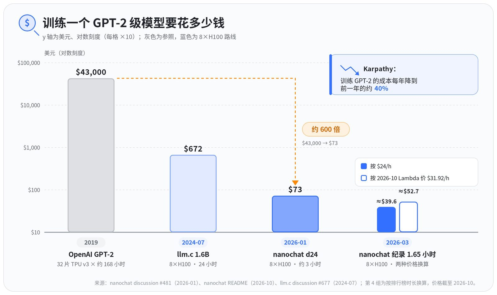
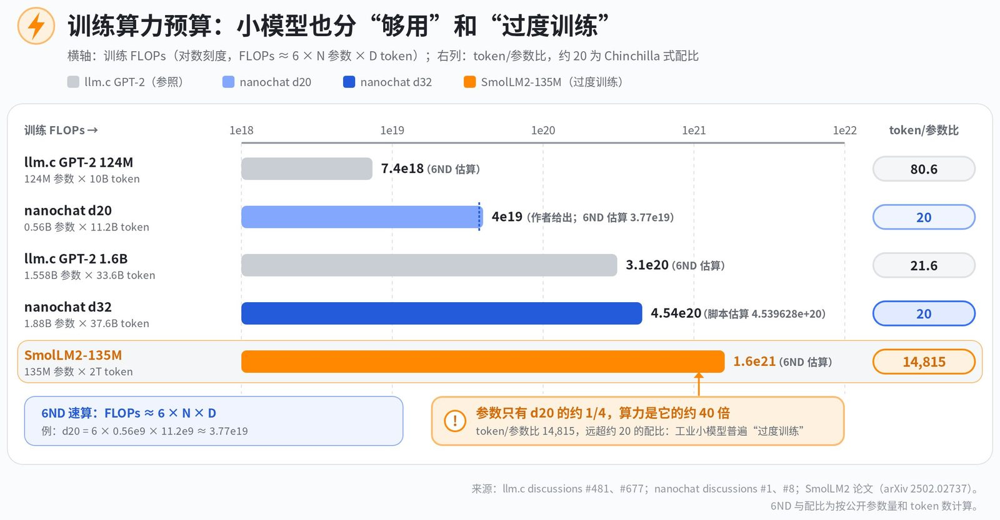
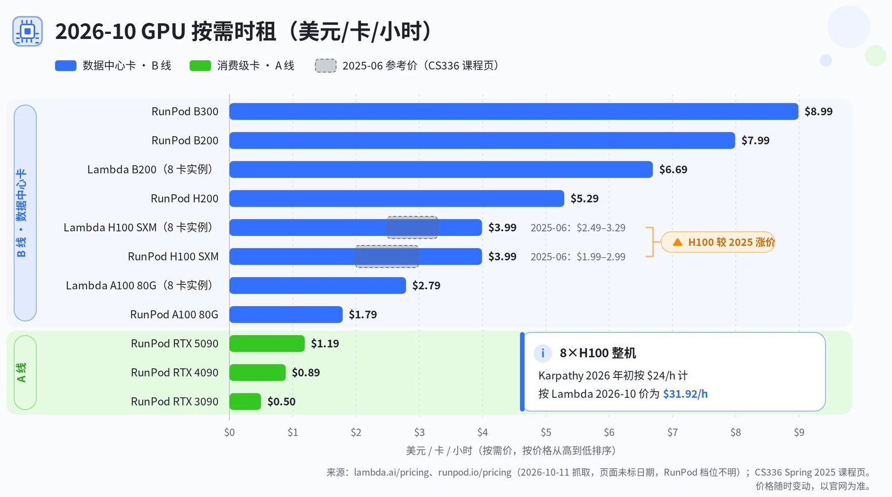
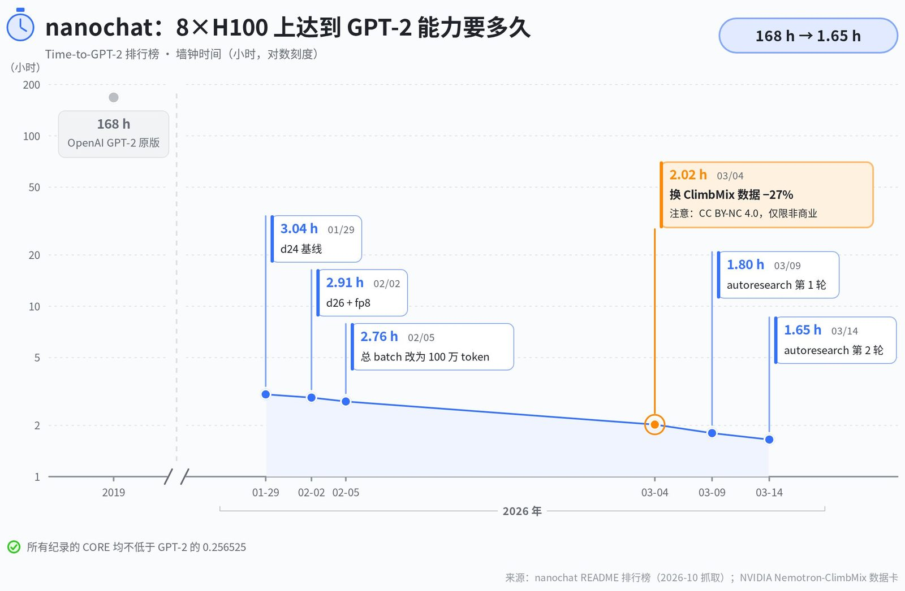
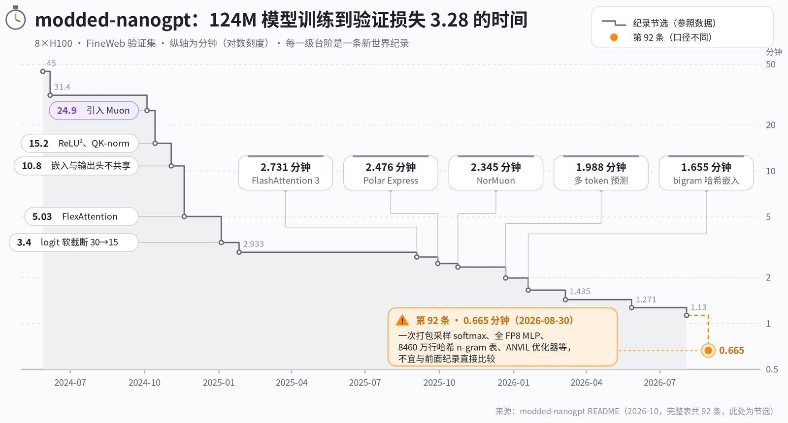
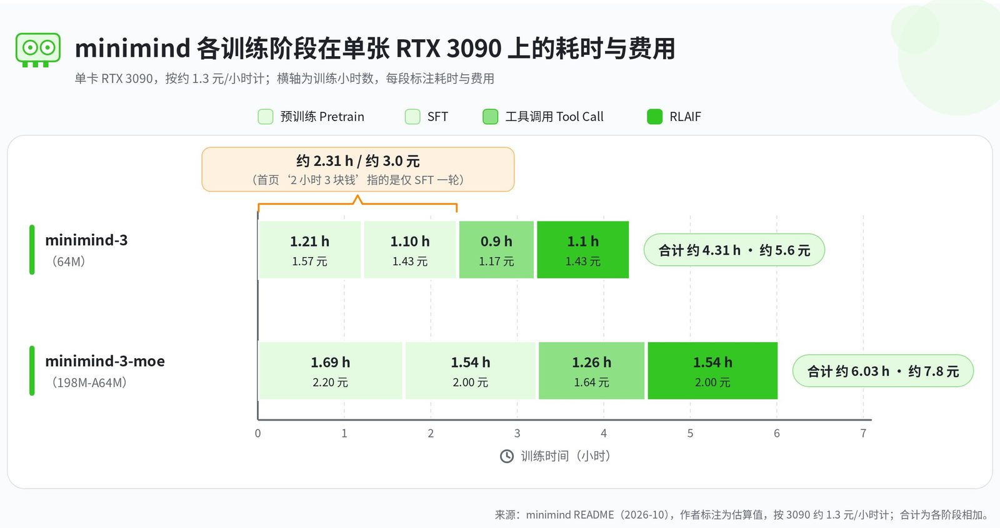
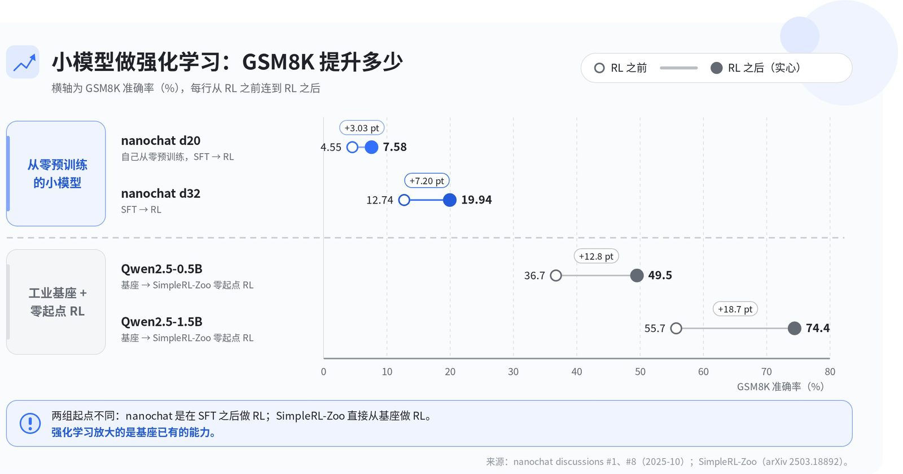
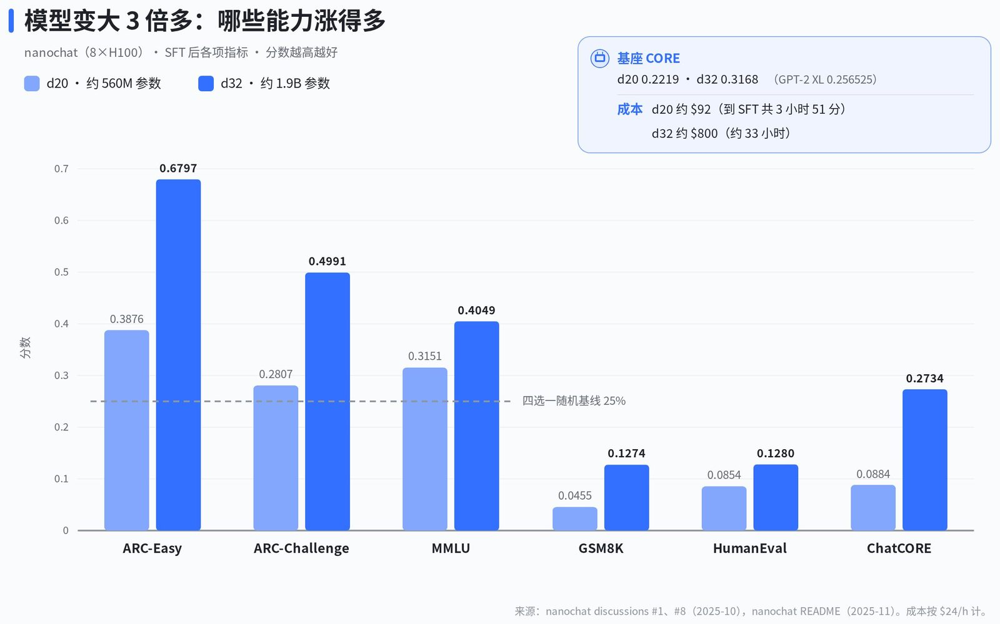

# LLM-30｜地基｜动手实验：从零训练一个小模型

> 🎯 **这篇文档解决什么问题**：读过 Transformer、预训练和后训练的原理之后，最有效的巩固方式是亲手把完整流程跑一遍：训练分词器、准备数据、预训练、监督微调（SFT）、强化学习、评测、导出到本地推理。这是一份实验手册，每章写清目标、要跑的项目和命令、预计时间和花费、应该看到的结果，以及常见的坑。全文分两条路线：**A 线**租一张消费级显卡（RTX 3090、4090 或 5090），以 minimind、nanoGPT 和 TRL 为主；**B 线**租一台 8×H100 节点，以 nanochat 为主。
>
> 使用方式：先读第 1、2 章算清预算、选定路线，再按第 3 章到第 10 章的顺序动手，遇到问题查第 11 章的排错清单。原理部分只用一两句带过，并指向系列里展开讲的文档。文中版本、价格和基准分数核对于 2026 年 10 月 11 日；GPU 时租价格波动大，开机前请以官网为准。

## 导读 · 先给结论

- **训练一个 GPT-2 级别的模型已经很便宜**。OpenAI 在 2019 年训练 GPT-2 约花 43,000 美元；nanochat 在 2026-01 用一台 8×H100 约 3 小时、约 73 美元达到同等的 CORE 分数，Karpathy 估计这项成本每年降到前一年的约 40%[[1]](https://github.com/karpathy/nanochat/discussions/481)。截至 2026-03-14，排行榜纪录是 1.65 小时[[2]](https://github.com/karpathy/nanochat)。
- **预算有限就走 A 线**。minimind-3（64M 参数）在单张 3090 上预训练加一轮 SFT 约 2.31 小时、约 3 元人民币，作者标明这是估算值[[3]](https://github.com/jingyaogong/minimind)。它学不出 GPT-2 的知识量，但能让你完整走一遍每个环节。
- **B 线得到的是一个能聊天、会做简单题的模型，但能力仍然很弱**。nanochat 2025-10 的 d20 模型经过 SFT 后 GSM8K 只有 4.55%，强化学习后 7.58%；Karpathy 自己形容 speedrun 模型“像在跟幼儿园小朋友聊天”[[4]](https://github.com/karpathy/nanochat/discussions/1)[[2]](https://github.com/karpathy/nanochat)。期望要放对。
- **小模型上最该看的指标是 bits per byte（bpb）和 CORE**，不是 MMLU。bpb 与分词器无关，nanochat 和 minimind 都推荐用它比较模型[[2]](https://github.com/karpathy/nanochat)[[3]](https://github.com/jingyaogong/minimind)；CORE 由 DCLM 提出，选的是小规模下也有低方差信号的 22 个任务[[5]](https://arxiv.org/abs/2406.11794)。
- **2026 年的变化要留意**：nanochat 的默认数据在 2026-03 换成了 NVIDIA ClimbMix，许可是 CC BY-NC 4.0，只能非商业使用[[6]](https://huggingface.co/datasets/nvidia/Nemotron-ClimbMix)；单独的中期训练（midtraining）脚本已经不在 2026 年的文件树里[[2]](https://github.com/karpathy/nanochat)；GPU 按需价格比 2025 年中还高[[7]](https://lambda.ai/pricing)[[8]](https://stanford-cs336.github.io/spring2025/)。
- <b>速通（speedrun）社区是最好的“技巧来源”</b>。modded-nanogpt 把 124M 模型达到同一验证损失的时间从 45 分钟压到了 0.665 分钟，Muon 优化器就是在这里出现的[[9]](https://github.com/KellerJordan/modded-nanogpt)。照抄技巧之前，要先在自己的小模型上做消融。

📎 与系列其他文档的分工：原理看「LLM 基础」和「LLM 数学补课」；SFT、LoRA、偏好优化和 RLVR 的方法与配方看「后训练实战」；万卡集群上的数据工程、故障和检查点看「训练工程」；量化和端侧部署看「模型压缩与端侧部署」。本文只讲“在一台机器上把流程跑通”需要的操作和判断。

## 第 1 章 · 先算账：6ND、配比、MFU 与 2026 年的 GPU 价格

动手之前先用纸笔算三件事：这个模型要多少训练算力，按自己能拿到的硬件效率要跑多久，按当前价格要花多少钱。这一章不用开机，花费为零。

### 1.1 训练算力：C ≈ 6ND

Transformer 的训练计算量可以用 6ND 估算，N 是参数量，D 是训练 token 数；推导和适用条件见系列文档。这里只用它做验算。

📎 展开阅读：「LLM 数学补课」第 8 章（6ND 的推导和缩放定律的拟合形式）；「LLM 基础」第 4 章（预训练的整体图景）。

用公开的训练记录验算，误差都在同一个数量级内：

| 模型 | 参数量 | 训练 token | 6ND 估算 | 来源里的数字 |
|---|---|---|---|---|
| llm.c GPT-2 124M | 124M | 10B | 约 7.4e18 | 8×A100 约 90 分钟[[10]](https://github.com/karpathy/llm.c/discussions/481) |
| nanochat d20（2025-10） | 约 560M | 约 11.2B | 约 3.77e19 | 作者写“约 4e19 FLOPs”[[4]](https://github.com/karpathy/nanochat/discussions/1) |
| llm.c GPT-2 1.6B | 1,558M | 33.6B | 约 3.1e20 | 8×H100 约 24 小时[[11]](https://github.com/karpathy/llm.c/discussions/677) |
| nanochat d32（2025-10） | 约 1.88B | 约 37.6B | 约 4.2e20 | 脚本估算 4.539628e+20[[12]](https://github.com/karpathy/nanochat/discussions/8) |
| SmolLM2-135M | 135M | 2T | 约 1.6e21 | 256 张 H100 训练[[13]](https://arxiv.org/abs/2502.02737) |

最后一行值得多看一眼：SmolLM2-135M 的参数量只有 nanochat d20 的四分之一，训练算力却是它的约 40 倍[[13]](https://arxiv.org/abs/2502.02737)[[4]](https://github.com/karpathy/nanochat/discussions/1)。工业界发布的“小模型”几乎都被大幅过度训练，所以你花几十美元训出来的模型比不过它们，这是预期之内的事，不说明你的流程有问题。

### 1.2 token 与参数的配比

Chinchilla 的结论是：给定算力，模型规模和训练 token 数应该同比例增长[[14]](https://arxiv.org/abs/2203.15556)。落到具体数字上，各项目的选择不同：

- nanochat 2025-10 版本明确用 Tokens:Params = 20.00，d20 用了 11,219,763,200 个 token[[4]](https://github.com/karpathy/nanochat/discussions/1)。
- nanochat 2026-01 在自己的代码栈上重新扫描，得到的计算最优比例是 10.5，速通设置用 12，取代了 2025-10 的 20[[1]](https://github.com/karpathy/nanochat/discussions/481)。
- minimind 和 SmolLM2 这类以“能用”为目标的模型远超这个比例，SmolLM2-1.7B 训练了约 11T token[[13]](https://arxiv.org/abs/2502.02737)。

实验里的建议是：第一次跑直接用项目的默认值，不要自己改配比。nanochat 只暴露一个旋钮 `--depth`，宽度、头数、学习率和训练长度都由它自动推出[[2]](https://github.com/karpathy/nanochat)。

📎 展开阅读：「训练工程」第 4 章（Chinchilla 的修正和过度训练的取舍）。

### 1.3 硬件效率：MFU

MFU（Model FLOPs Utilization，模型算力利用率）是实际有效算力除以硬件峰值。估算训练时长的公式是：时长 ≈ 训练 FLOPs ÷（GPU 数 × 单卡稠密峰值 × MFU）。注意厂商规格表上最大的那个数字通常是含稀疏的数值，代入前要换成稠密峰值。公开记录里的 MFU 如下：

| 训练 | 硬件 | MFU | 说明 |
|---|---|---|---|
| nanochat d20 | 8×H100 | 约 47%–48% | 训练日志[[4]](https://github.com/karpathy/nanochat/discussions/1) |
| nanochat d32 | 8×H100 | 约 50.9% | 显存占用 78/80 GB[[12]](https://github.com/karpathy/nanochat/discussions/8) |
| llm.c 124M | 8×A100 | 最高约 60% | 手写 C/CUDA[[10]](https://github.com/karpathy/llm.c/discussions/481) |
| llm.c 1.6B | 8×H100 | 约 50% | [[11]](https://github.com/karpathy/llm.c/discussions/677) |
| llm.c 1.6B 社区复现 | 1×H100 | 13.1% | 第三方回帖，耗时约一个月[[11]](https://github.com/karpathy/llm.c/discussions/677) |

自己跑的时候，40%–50% 是成熟代码在 H100 上的合理水平；明显低于这个数，先查 batch 是否太小、是否开了编译、数据加载是否成了瓶颈。

### 1.4 GPU 价格（截至 2026-10 的官网按需价格）

下表是 2026-10-11 抓取的官网按需价格，单位是美元每卡每小时。两家页面都没有标日期，RunPod 页面里同一型号还出现了不同档位的价格，开机前请自己再核对一次[[7]](https://lambda.ai/pricing)[[15]](https://www.runpod.io/pricing)。

| 型号 | Lambda | RunPod | 适合路线 |
|---|---|---|---|
| H100 SXM | 3.99（8 卡实例）；4.29（单卡） | 3.99 | B 线 |
| B200 | 6.69（8 卡实例）；6.99（单卡） | 7.99 | B 线 |
| A100 80GB | 2.79（8 卡实例） | 1.79 | B 线，慢一些 |
| RTX 5090 | – | 1.19 | A 线 |
| RTX 4090 | – | 0.89 | A 线 |
| RTX 3090 | – | 0.50 | A 线 |

价格在上涨，不是下降。CS336 课程页在 2025-06 记录的单卡 H100 价格是 RunPod 1.99–2.99 美元、Lambda 2.49–3.29 美元[[8]](https://stanford-cs336.github.io/spring2025/)；Karpathy 在 2026 年初按约 3 美元每卡小时、整机约 24 美元每小时算账[[2]](https://github.com/karpathy/nanochat)。按 Lambda 当前的 3.99 美元，8×H100 整机是每小时 31.92 美元。下文给 B 线成本时，会同时给出按 24 美元和按 31.92 美元两种算法。

> 💡 **常见误区**
>
> - 把 README 里的美元数当成自己的账单。nanochat 首页的“约 48 美元”按 3 美元每卡小时计算，还提到用竞价实例（spot）可能接近 15 美元[[2]](https://github.com/karpathy/nanochat)；你的实际价格取决于当天的供应商和档位。
> - 用 MFU 的乐观值估时长，也不算下载数据、调试和失败重跑。单卡、未调优代码的 MFU 可能只有 13% 左右[[11]](https://github.com/karpathy/llm.c/discussions/677)。

## 第 2 章 · 选路线和项目

这一章的目标是选定一条路线和一个主项目，并在机器上把环境装好。花费：A 线在本地或最便宜的卡上装环境，基本为零；B 线建议先在单卡上装好、跑通小配置，再租整机，避免整机按小时计费时还在装依赖。

### 2.1 项目对比

| 项目 | 覆盖范围 | 硬件与时长 | 适合谁 |
|---|---|---|---|
| nanochat | 分词、预训练、SFT、强化学习、评测、推理，全流程在一个仓库里[[2]](https://github.com/karpathy/nanochat) | 8×H100，`runs/speedrun.sh` 约 1.5 小时；单卡也能跑，但慢 8 倍[[2]](https://github.com/karpathy/nanochat) | B 线主项目 |
| minimind | 预训练、SFT、LoRA、DPO、RLAIF（PPO、GRPO、CISPO）、工具调用、Agentic RL、蒸馏，原生 PyTorch 实现[[3]](https://github.com/jingyaogong/minimind) | 单张 3090，预训练加 SFT 约 2.31 小时（估算）[[3]](https://github.com/jingyaogong/minimind) | A 线主项目，中文友好 |
| nanoGPT | 只有预训练和微调，代码极短[[16]](https://github.com/karpathy/nanoGPT) | 字符级莎士比亚模型在一张 A100 上约 3 分钟[[16]](https://github.com/karpathy/nanoGPT) | 第一次热身 |
| modded-nanogpt | 只做预训练速通，目标是 FineWeb 验证损失 3.28[[9]](https://github.com/KellerJordan/modded-nanogpt) | 8×H100，纪录 0.665 分钟[[9]](https://github.com/KellerJordan/modded-nanogpt) | 想研究训练技巧的人 |
| llm.c | 用 C/CUDA 复现 GPT-2 预训练[[10]](https://github.com/karpathy/llm.c/discussions/481) | 124M 在 8×A100 上 90 分钟约 20 美元；单卡约 4–24 小时[[10]](https://github.com/karpathy/llm.c/discussions/481) | 想看清底层实现的人 |
| CS336 | 五个作业：基础、系统、缩放定律、数据、对齐与推理强化学习[[17]](https://stanford-cs336.github.io/) | 课程页给出租卡价格参考[[17]](https://stanford-cs336.github.io/) | 想系统补课、愿意花一个学期的人 |
| Raschka 的书 | 从数据、注意力到预训练、分类微调和指令微调[[18]](https://github.com/rasbt/LLMs-from-scratch) | 正文代码按普通笔记本设计[[18]](https://github.com/rasbt/LLMs-from-scratch) | 喜欢跟着书一步步敲的人 |

选择建议：预算在 15 美元以内、或者更关心中文，用 minimind；想得到一个和 GPT-2 能力相当、能聊天的模型，预算在 50–100 美元，用 nanochat；只有一个晚上，用 nanoGPT 跑字符级模型热身。两条路线并不互斥，常见做法是先用 A 线跑通所有环节，再用 B 线跑一次“真规模”的。

### 2.2 按预算选卡

- **A 线**：minimind 作者用 3090 估算成本，按约 1.3 元每小时计[[3]](https://github.com/jingyaogong/minimind)；RunPod 上 3090 当前是 0.50 美元每小时，4090 是 0.89 美元，5090 是 1.19 美元[[15]](https://www.runpod.io/pricing)。显存 24 GB 足够跑 minimind 全流程。
- **B 线**：8×H100 是 nanochat 的默认配置。8×A100 也能跑，只是慢一些；显存小于 80 GB 的卡要把 `--device-batch-size` 从默认的 32 依次减到 16、8、4、2 或 1[[2]](https://github.com/karpathy/nanochat)。
- **中间路线**：在单张大显存卡上跑 nanochat，代码会自动改用梯度累积，结果“基本一致”，但耗时是 8 倍[[2]](https://github.com/karpathy/nanochat)。社区里有人报告用约 0.35 美元每小时的 5090 跑 depth 16 花了 10–30 小时，用 5070 Ti 花了约 13 天；这是第三方的个例，仅供参考[[4]](https://github.com/karpathy/nanochat/discussions/1)。

### 2.3 装环境

nanochat 用 uv 管理依赖，CUDA 机器上执行 `uv sync --extra gpu`，然后 `source .venv/bin/activate`；只有 CPU 或苹果芯片时用 `uv sync --extra cpu`[[2]](https://github.com/karpathy/nanochat)。minimind 用 pip：

`git clone --depth 1 https://github.com/jingyaogong/minimind`

`cd minimind && pip install -r requirements.txt -i https://mirrors.aliyun.com/pypi/simple`

装完先确认 `torch.cuda.is_available()` 返回真，再下载数据[[3]](https://github.com/jingyaogong/minimind)。精度方面，nanochat 在 A100、H100 这类 SM80 以上的卡上默认用 bf16；V100、T4 默认 fp32，可选 fp16；CPU 和 MPS 默认 fp32。强化学习阶段目前不支持 fp16 的梯度缩放（GradScaler）[[2]](https://github.com/karpathy/nanochat)。

## 第 3 章 · 分词器：训练、评估与“要不要自己训”

目标：训练（或复用）一个分词器，测出它的压缩率，并理解分词器会怎样影响后面的损失和评测。BPE 的原理只需要记住一句话：从单个字节出发，反复合并语料里最常见的相邻片段，直到词表达到目标大小。

📎 展开阅读：「LLM 基础」第 2 章（分词、嵌入和对话模板的原理）。

### 3.1 实验卡

| 项目 | A 线（minimind） | B 线（nanochat） |
|---|---|---|
| 做什么 | 直接用仓库自带的 6400 词表分词器，读懂它的压缩率 | 在 20 亿字符上训练 65,536 词表的 BPE，然后测压缩率 |
| 命令 | 不需要单独训练 | `python -m scripts.tok_train --max_chars=2000000000`，再跑 `python -m scripts.tok_eval` |
| 时间与花费 | 零 | 约 1 分钟[[4]](https://github.com/karpathy/nanochat/discussions/1)，整机上不到 1 美元 |
| 该看到什么 | 中文约 1.5–1.7 字每 token，英文约 4–5 字符每 token[[3]](https://github.com/jingyaogong/minimind) | 约 4.8 字符每 token[[4]](https://github.com/karpathy/nanochat/discussions/1) |

nanochat 的命令出自 2025-10 的发布帖[[4]](https://github.com/karpathy/nanochat/discussions/1)。2026 年的代码可能已经把参数改成了短横线写法（例如 `--max-chars`），2026-03 有读者在帖子下提过这个疑问；运行前先看一下 `tok_train.py` 的参数定义。

### 3.2 两个项目的分词器

- **nanochat**：训练时用自己写的 Rust 版 BPE（`rustbpe`，用 maturin 构建），推理时用 tiktoken。词表是 2 的 16 次方，即 65,536[[4]](https://github.com/karpathy/nanochat/discussions/1)。
- **minimind**：词表只有 6400，中文压缩率约 1.5–1.7 字每 token[[3]](https://github.com/jingyaogong/minimind)。小词表让嵌入层占的参数更少，对 64M 这种规模的模型有意义；代价是同样的文本要切成更多 token。

### 3.3 分词器决定了损失的“单位”

两个用不同分词器的模型，交叉熵损失和困惑度（PPL）不能直接比较，因为每个 token 覆盖的文本长度不同。两个项目给出的做法一致：比较 bits per byte（bpb，每字节比特数），它把损失换算到原始字节上，与分词器无关[[2]](https://github.com/karpathy/nanochat)[[3]](https://github.com/jingyaogong/minimind)。nanochat 的 `loss_eval.py` 就是专门算 bpb 的[[2]](https://github.com/karpathy/nanochat)。

分词器还给了一个免费的正确性检查：随机初始化的模型对每个 token 的预测接近均匀分布，所以第 0 步的损失应该约等于词表大小的自然对数 ln V。nanochat 第 0 步的损失是 11.090355，而 ln(65536) 约等于 11.0904[[4]](https://github.com/karpathy/nanochat/discussions/1)。如果你的第 0 步损失明显偏离这个值，先查初始化和标签是否错位。

📎 展开阅读：「LLM 数学补课」第 4 章（交叉熵、困惑度和比特的关系）。

> 💡 **常见误区**
>
> - 在已有模型上重新训练分词器。minimind 明确提醒：换分词器会破坏权重、对话模板和生态工具的兼容性，困惑度也失去可比性[[3]](https://github.com/jingyaogong/minimind)。
> - 用困惑度比较 minimind 和 nanochat。两者词表差 10 倍，只能用 bpb 比。
> - 以为词表越小越省。嵌入层确实变小了，但同样的文本要更多 token，训练和推理的序列都会变长。

## 第 4 章 · 数据：选数据集、看许可、准备分片

目标：下载预训练和 SFT 要用的数据，确认许可允许你的用途，并知道数据选择对结果的影响有多大。花费：A 线在 CPU 上下载和预处理，主要成本是带宽和 1–3 小时的时间；B 线让数据下载和分词器训练并行，不单独占整机时间。

📎 展开阅读：「训练工程」第 2、3 章（网页数据流水线、配比、退火和合成数据）。本章只讲“小实验该用哪份数据”。

### 4.1 英文预训练数据

| 数据集 | 规模 | 许可与获取 | 要点 |
|---|---|---|---|
| FineWeb | 15T token，来自 96 个 Common Crawl 快照[[19]](https://arxiv.org/abs/2406.17557) | Hugging Face 公开 | 通用网页基线 |
| FineWeb-Edu | 1.3T token（阈值 3）；score-2 版 5.4T[[19]](https://arxiv.org/abs/2406.17557) | 提供 `sample-10BT`、`sample-100BT`、`sample-350BT` 采样[[20]](https://huggingface.co/datasets/HuggingFaceFW/fineweb-edu) | 用 Llama3-70B-Instruct 标注的 50 万条样本训练教育价值分类器[[19]](https://arxiv.org/abs/2406.17557) |
| NVIDIA ClimbMix | 400B token，按 GPT-2 分词分发[[6]](https://huggingface.co/datasets/nvidia/Nemotron-ClimbMix) | **CC BY-NC 4.0，仅限非商业**；Karpathy 镜像为 `karpathy/climbmix-400b-shuffle`[[6]](https://huggingface.co/datasets/nvidia/Nemotron-ClimbMix) | nanochat 自 2026-03 起的默认数据 |
| TinyStories | GPT-3.5/GPT-4 生成的短故事，只用三四岁儿童认识的词[[21]](https://arxiv.org/abs/2305.07759) | 公开 | 参数不到 1000 万的模型也能写出连贯故事[[21]](https://arxiv.org/abs/2305.07759) |

数据选择的影响非常大。nanochat 把数据换成 ClimbMix 这一项，就把达到 GPT-2 能力的时间从 2.76 小时降到 2.02 小时，降了约 27%[[2]](https://github.com/karpathy/nanochat)[[6]](https://huggingface.co/datasets/nvidia/Nemotron-ClimbMix)。2026-01 创纪录的 d24 模型用的还是 FineWeb-edu，约 8.8B token[[1]](https://github.com/karpathy/nanochat/discussions/481)。

FineWeb 论文还有两个对小实验有用的结论：教育分类器的阈值调高，对知识和推理类基准有帮助，但会损害 HellaSwag 和 PIQA；在 1.8B 模型、350B token 的消融里，去重要看方法：跨全部快照的全局 MinHash 去重几乎没有收益，逐快照 MinHash 去重能提高平均分，在逐快照基础上再追加全局处理则没有进一步改善[[19]](https://arxiv.org/abs/2406.17557)。所以选数据时要先想清楚自己最终看哪个指标。

### 4.2 中文预训练数据

- **Fineweb-Edu-Chinese-V2.1**（OpenCSG）：按教育分数分档，4–5 分档 70 GB、17,790,513 行；3–4 分档 800 GB、289,975,835 行；2–3 分档 1.4 TB、649,842,063 行。许可是 OpenCSG 社区许可，按其条款允许商用；V2 已标记为弃用，改用 V2.1[[22]](https://huggingface.co/datasets/opencsg/Fineweb-Edu-Chinese-V2.1)。数据卡里的 token 数中英文说法互相矛盾，按 GB 和行数估算即可。
- **CCI3.0-HQ**（智源）：CCI3.0 的 500 GB 高质量子集。作者用 0.5B 模型训练 100B token 验证，在 10 个零样本基准上超过 CCI3.0、SkyPile 和 WanjuanV1。下载需要在 Hugging Face 登录申请[[23]](https://arxiv.org/abs/2410.18505)。
- **minimind 自带数据**：`pretrain_t2t_mini.jsonl` 和 `sft_t2t_mini.jsonl`，来源包括匠数大模型数据集、Magpie-Align 等。默认只需下载这两个文件放进 `./dataset`，就能复现 MiniMind Zero 对话模型[[3]](https://github.com/jingyaogong/minimind)。

### 4.3 打包方式也会浪费数据

预训练要把长短不一的文档拼成固定长度的序列。nanochat 让每条序列从 BOS（文档开始符）对齐开始，用 BestFit-Crop 的方式装填，作者给出的代价是约 35% 的 token 因裁剪被浪费[[2]](https://github.com/karpathy/nanochat)。这是一种用数据换正确性的取舍：每条序列都从文档开头开始，模型不会学到跨文档的错误衔接。自己改数据管线时，要么保留这种对齐，要么做文档边界掩码。

> 💡 **常见误区**
>
> - 没看许可就把训练出的模型拿去做产品。用 ClimbMix 训练的模型只适合学习和研究[[6]](https://huggingface.co/datasets/nvidia/Nemotron-ClimbMix)。
> - 数据不够就让模型重复看同几个分片。小实验宁可把模型调小，也要保证训练 token 数达到项目默认的配比；优先用官方提供的打乱版本或采样子集。
> - 改数据管线时破坏了 BOS 对齐，导致损失变好看、生成质量反而变差。

## 第 5 章 · 预训练：跑起来，并读懂损失曲线

目标：先用几分钟的小实验确认整条管线没问题，再跑一次完整的预训练，并能判断曲线是否正常。这是全篇最花钱的一章。

### 5.1 热身：字符级莎士比亚（两条路线都建议做）

nanoGPT 的字符级模型是 6 层、6 头、384 维、上下文 256。三条命令：`python data/shakespeare_char/prepare.py`、`python train.py config/train_shakespeare_char.py`、`python sample.py --out_dir=out-shakespeare-char`。在一张 A100 上约 3 分钟，最佳验证损失 1.4697；没有 GPU 时，README 给了缩小版的 CPU 配置，约 3 分钟到 1.88[[16]](https://github.com/karpathy/nanoGPT)。这一步的意义是在花大钱之前确认驱动、PyTorch 和采样脚本都正常。

### 5.2 实验卡

| 项目 | A 线（minimind-3，64M） | B 线（nanochat） |
|---|---|---|
| 命令 | `cd trainer && python train_pretrain.py`；中断后加 `--from_resume 1` 续训 | 先跑 d12 小实验，再跑 `bash runs/speedrun.sh`（建议放在 screen 会话里） |
| 时间 | 单张 3090 约 1.21 小时（作者估算）[[3]](https://github.com/jingyaogong/minimind) | d12 预训练约 5 分钟；speedrun 脚本约 1.5 小时[[2]](https://github.com/karpathy/nanochat) |
| 花费 | 约 1.57 元（按 1.3 元每小时）[[3]](https://github.com/jingyaogong/minimind) | 按排行榜纪录 1.65 小时计，约 39.6 美元（24 美元每小时）或约 52.7 美元（31.92 美元每小时） |
| 产出 | `out/pretrain_768.pth`[[3]](https://github.com/jingyaogong/minimind) | 基座模型检查点和 CORE 分数 |

nanochat 的 d12 小实验命令是 `OMP_NUM_THREADS=1 torchrun --standalone --nproc_per_node=8 -m scripts.base_train -- --depth=12 --run="d12" --model-tag="d12" --core-metric-every=999999 --sample-every=-1 --save-every=-1`。它只在最后一步算 CORE，不中途采样和存检查点。Karpathy 的工作方式是改一处代码、重跑 d12 或 d16，看有没有变好[[2]](https://github.com/karpathy/nanochat)。

speedrun 的时长要分清几个说法：README 正文说脚本约 1.5 小时，首页标题按“约 2 小时、约 48 美元”算账，排行榜上 2026-03-14 的纪录是 1.65 小时[[2]](https://github.com/karpathy/nanochat)。按你自己拿到的价格重算一遍再开机。

### 5.3 盯哪几条曲线

nanochat 的 README 建议在 wandb 上看四类图[[2]](https://github.com/karpathy/nanochat)：

- <b>`val_bpb`</b>：验证集的 bpb，分别对步数、训练时长和训练 FLOPs 作图。这是主指标。
- <b>`core_metric`</b>：DCLM 的 CORE 分数，GPT-2 的目标线是 0.256525。
- <b>`train/mfu`</b> 和 <b>`train/tok_per_sec`</b>：判断硬件有没有吃满。
- 显存占用：判断 batch 还能不能加大。

正常曲线的参照数字：d20 的验证 bpb 从第 0 步的 3.3013 降到最终约 0.81，CORE 约 0.22[[4]](https://github.com/karpathy/nanochat/discussions/1)；2026-03 的纪录模型验证 bpb 约 0.718[[2]](https://github.com/karpathy/nanochat)。第 0 步的训练损失应约等于 ln(65536)，即约 11.09（见第 3.3 节）。学习率在训练后段线性降到 0，nanochat 2026 年把降温段的比例从 0.4 调到了 0.5[[1]](https://github.com/karpathy/nanochat/discussions/481)。

### 5.4 损失尖峰

小模型短时间训练很少遇到严重的损失尖峰，但规模和时长上去后会出现。llm.c 训练 1.6B 模型时用 `-sl 5.0 -sg 5.0` 这两个参数跳过损失或梯度异常的步；把训练拉到 400B token 时，模型最终还是不稳定，HellaSwag 到约 61% 后崩掉了[[11]](https://github.com/karpathy/llm.c/discussions/677)。遇到尖峰，先看是否集中在某段数据、学习率是否偏大，再决定回滚还是跳过。

📎 展开阅读：「训练工程」第 10 章（损失尖峰的成因和处置手册）。

📎 想复现一次 BF16 + FlashAttention 的损失爆炸并一步步定位原因，见第 54 篇 [LLM-54｜系统｜低精度训练的数值稳定性：从 FlashAttention 一次舍入偏差说起](./54-low-precision-training.md)（第 11 章，4 张 24 GB 卡可跑稳定 / 不稳定两组对照）。

> 💡 **常见误区**
>
> - 不跑 d12 小实验，直接在整机上跑完整流程。配置写错时，按小时计费的整机会白白空转。
> - 只看训练损失。小模型最该看验证 bpb，训练损失好看可能只是数据重复了。
> - 中途改了总步数，学习率计划却还按原来的长度走，结果降温段没跑完就停了，或者早早降到 0。

## 第 6 章 · 速通里学到的技巧：Muon 与其他

目标：了解近两年让小模型训练快了一个数量级的技巧，挑一两项在自己的小模型上做消融，亲眼看到它是否有效。花费：A 线在单卡上做 d8 或 d12 量级的消融，几小时、5 美元以内；B 线跑 5 次 d12，每次约 5 分钟，约 15 美元。

### 6.1 modded-nanogpt：规则和纪录

modded-nanogpt 的任务是在 8×H100 上把 124M 模型训练到 FineWeb 验证集交叉熵不高于 3.28，这个目标来自 llm.c 的 GPT-2 小模型复现。规则很严：不能改训练和验证数据管线；平均验证损失要在 p&lt;0.01 的显著性下不高于 3.28；第 21 条纪录之后不允许额外的 `torch.compile` 编译参数[[9]](https://github.com/KellerJordan/modded-nanogpt)。部分纪录如下：

| 编号 | 时间 | 主要改动 | 日期 |
|---|---|---|---|
| 1 | 45 分钟 | llm.c 基线 | 2024-05-28 |
| 3 | 24.9 分钟 | 引入 Muon 优化器 | 2024-10-04 |
| 5 | 15.2 分钟 | ReLU²、投影层零初始化、QK-norm | 2024-10-14 |
| 38 | 2.476 分钟 | Polar Express 取代 Newton-Schulz | 2025-09-29 |
| 53 | 1.988 分钟 | 多 token 预测 | 2025-12-22 |
| 91 | 1.126 分钟 | 验证时屏蔽不可能的 logits | 2026-08-06 |
| 92 | 0.665 分钟 | 采样 softmax、MLP 全 FP8、8460 万行哈希 n-gram 表、ANVIL 优化器、减少层数、CUDA graphs | 2026-08-30 |

读这张表要注意第 92 条：它比第 91 条快了约一半，但一次打包了很多改动，其中哈希 n-gram 表有 8460 万行，README 称之为“650 亿参数”[[9]](https://github.com/KellerJordan/modded-nanogpt)。这已经不是“同样的 124M 模型训练得更快”，不能和前面的纪录当作同类比较。仓库标语还写着“90 秒”，已经过时，正文写的是“8×H100 不到 40 秒、不到 330M token”[[9]](https://github.com/KellerJordan/modded-nanogpt)。

### 6.2 Muon

Muon 的全称是 MomentUm Orthogonalized by Newton-Schulz，只用于二维的隐藏层参数：先做带动量的 SGD，再用 5 步 Newton-Schulz 迭代把更新矩阵正交化，在 bf16 下也稳定[[24]](https://kellerjordan.github.io/posts/muon/)。原理只需记住：它让更新在各个方向上更均匀。

📎 展开阅读：「LLM 数学补课」第 6 章（6.6 节讲 Muon 的数学）；「LLM 基础」第 4 章（4.5 节讲 Muon 进入大规模生产）。

实验相关的数字：

- 作者报告 Muon 让速通达到 3.28 的速度提高到 1.35 倍；1.5B 模型达到 GPT-2 XL 的 HellaSwag 水平，Muon 用 10 个 8×H100 小时，AdamW 用 13.3 小时[[24]](https://kellerjordan.github.io/posts/muon/)。
- 额外计算量上限是 T·m/B，速通设置下是 5×768÷524288，约 0.7%[[24]](https://kellerjordan.github.io/posts/muon/)。
- 月之暗面加了权重衰减、调整了每个参数的更新尺度后，报告在计算最优训练下约为 AdamW 的 2 倍计算效率，并开源了分布式实现[[25]](https://arxiv.org/abs/2502.16982)。
- Muon 不用于嵌入层和标量参数。nanochat 的做法是矩阵参数用 Muon（Polar Express 5 次迭代、Nesterov 动量从 0.85 升到 0.95、谨慎权重衰减），嵌入和标量用 AdamW[[1]](https://github.com/karpathy/nanochat/discussions/481)。

### 6.3 nanochat 2026 年纪录模型用了什么

2026-01 的 d24 纪录模型（24 层、1536 维、12 个 128 维的头，总参数 1,384,124,976）用了这些结构：RoPE、无可学习参数的 RMSNorm、QK-norm、输入输出嵌入不共享、ReLU²、logit 软截断到 15、`SSSL` 滑动窗口（1024/2048）、value embeddings、每层残差缩放标量、FlashAttention 3[[1]](https://github.com/karpathy/nanochat/discussions/481)。注意总参数里有 603,979,776 个属于 value embeddings，Transformer 矩阵只有 679,481,856 个，所以“参数量”要看怎么数[[1]](https://github.com/karpathy/nanochat/discussions/481)。

之后的纪录来自几类改动：总 batch 改到 100 万 token（2.76 小时）、换 ClimbMix 数据（2.02 小时）、两轮自动化研究（autoresearch，1.80 和 1.65 小时）[[2]](https://github.com/karpathy/nanochat)。

### 6.4 怎么做消融

- 固定一个小深度（d12 或更小），每次只改一处，跑同样的步数。
- 比较验证 bpb 对训练 FLOPs 的曲线，而不是对步数的曲线，避免“每步更贵但步数更少”的改动看起来更好。
- nanochat 要求改动对任何 `--depth` 都成立；在 d12 上有效的改动，最好在 d16 上再确认一次[[2]](https://github.com/karpathy/nanochat)。
- modded-nanogpt 的纪录只比 3.28 低约 0.001–0.002，并要求统计显著[[9]](https://github.com/KellerJordan/modded-nanogpt)。你的消融也要跑多个随机种子，差距太小就当作没有差别。

## 第 7 章 · SFT：把基座模型变成能对话的模型

目标：在预训练好的基座上做监督微调（SFT），让模型学会对话格式、特殊 token 和选择题格式，然后用命令行和它聊天。SFT 的数据配方、损失掩码和超参选择是「后训练实战」的主题，这里只讲两个项目里怎么跑、该看到什么。

📎 展开阅读：「后训练实战」第 3 章（SFT 数据工程，3.3 节讲聊天模板、损失掩码和打包）。

### 7.1 实验卡

| 项目 | A 线（minimind-3） | B 线（nanochat） |
|---|---|---|
| 命令 | 从仓库根目录执行 `(cd trainer && python train_full_sft.py) && python eval_llm.py --weight full_sft` 对话测试（或评测前先 `cd ..`） | `torchrun --standalone --nproc_per_node=8 -m scripts.chat_sft`，然后 `python -m scripts.chat_cli` |
| 数据 | `sft_t2t_mini.jsonl`[[3]](https://github.com/jingyaogong/minimind) | SmolTalk 等[[4]](https://github.com/karpathy/nanochat/discussions/1) |
| 时间与花费 | 约 1.10 小时、约 1.43 元（作者估算）[[3]](https://github.com/jingyaogong/minimind) | 已包含在 speedrun 脚本里 |
| 产出 | `out/full_sft_768.pth`[[3]](https://github.com/jingyaogong/minimind) | 对话模型检查点和 ChatCORE 分数 |

minimind 首页说的“2 小时、3 块钱”指的是在单张 3090 上做一轮 SFT 的时间和租卡费用[[3]](https://github.com/jingyaogong/minimind)；它的成本表里，预训练加一轮 SFT 合计约 2.31 小时、约 3.0 元，同样是估算值[[3]](https://github.com/jingyaogong/minimind)。两种说法口径不同，做预算时用后者。

### 7.2 中期训练去哪了

nanochat 2025-10 的版本在预训练和 SFT 之间有一个约 8 分钟的中期训练阶段，数据是 SmolTalk、MMLU 辅助训练集（10 万行）和 GSM8K（8 千行），用来教会模型对话特殊 token、选择题格式和 Python 工具调用[[4]](https://github.com/karpathy/nanochat/discussions/1)。2026 年的文件树里没有单独的中期训练脚本，只剩 `base_train`、`chat_sft` 和 `chat_rl`[[2]](https://github.com/karpathy/nanochat)。如果你照着 2025 年的教程或博客操作，会找不到对应的脚本，这是正常的。

为什么要专门教选择题格式？Karpathy 的解释是：在这么小的规模上，模型无法仅靠随机网页数据学会选择题的答题方式，而随机猜测的正确率是 25%[[4]](https://github.com/karpathy/nanochat/discussions/1)。不教格式，MMLU 和 ARC 的分数就会贴着随机线，你没法判断模型到底学到了什么。

### 7.3 SmolTalk

SmolTalk 有 100 万条样本，核心是由 Llama-3.1-405B-Instruct 生成的 Smol-Magpie-Ultra（40 万条），另加 OpenHermes2.5、MetaMathQA、SystemChats2.0、APIGen、Explore-Instruct-Rewriting 和 LongAlign 等子集。新增子集的许可是 Apache 2.0[[26]](https://huggingface.co/datasets/HuggingFaceTB/smoltalk)。它是 SmolLM2 论文的一部分[[13]](https://arxiv.org/abs/2502.02737)。

### 7.4 该看到什么

nanochat d20（2025-10）在中期训练和 SFT 之后的分数[[4]](https://github.com/karpathy/nanochat/discussions/1)：

| 指标 | 中期训练后 | SFT 后 |
|---|---|---|
| ARC-Easy | 0.3561 | 0.3876 |
| ARC-Challenge | 0.2875 | 0.2807 |
| MMLU | 0.3111 | 0.3151 |
| GSM8K | 0.0250 | 0.0455 |
| HumanEval | 0.0671 | 0.0854 |
| ChatCORE | 0.0730 | 0.0884 |

这一版从开机到 SFT 结束共 3 小时 51 分，按 24 美元每小时约 92.4 美元[[4]](https://github.com/karpathy/nanochat/discussions/1)；按当前 31.92 美元每小时重算约 123 美元。分数整体很低，ARC-Challenge 在 SFT 后甚至略降，这在小模型上很常见，单项的小幅波动不必过度解读。

> 💡 **常见误区**
>
> - SFT 用的对话模板和推理时用的不一致。模型会输出乱码或不停止，这是最常见的“训好了但不能用”的原因。
> - 评测时用错了特殊 token，导致分数接近零。先用命令行手动聊几轮，再跑自动评测。
> - 指望 SFT 补知识。SFT 主要教格式和行为，知识量由预训练决定。

## 第 8 章 · 小模型上的强化学习：GRPO、TinyZero 与 SimpleRL-Zoo

目标：用可验证奖励（比如数学题答案对不对）在小模型上跑一次强化学习，看到 GSM8K 准确率上升，并理解小模型在这一步的天花板。GRPO 的推导、配方和常见坑在「后训练实战」里有专门两章，这里只讲实验怎么跑。

📎 展开阅读：「后训练实战」第 7 章（GRPO 的坑与奖励设计）和第 8 章（8.1 节汇总了小预算复现）；「LLM 数学补课」第 9 章（策略梯度、PPO 和 GRPO 的数学）。

### 8.1 B 线：nanochat 的 chat_rl

nanochat 的强化学习是一个“高度简化的 GRPO”：去掉了信任域、参考模型和 KL 项，去掉了 PPO 的比率和裁剪，用 token 级归一化和减均值的优势，作者说它“更像 REINFORCE”。它只在 GSM8K 上训练，在默认脚本里是注释掉的，跑一次约 1.5 小时[[4]](https://github.com/karpathy/nanochat/discussions/1)。命令是 `torchrun --standalone --nproc_per_node=8 -m scripts.chat_rl`，评测用 `torchrun --standalone --nproc_per_node=8 -m scripts.chat_eval -- -i rl -a GSM8K`[[4]](https://github.com/karpathy/nanochat/discussions/1)。按 24–31.92 美元每小时，约 36–48 美元。

结果：d20 的 GSM8K 从 SFT 后的 4.55% 升到 7.58%[[4]](https://github.com/karpathy/nanochat/discussions/1)；d32 从 12.74% 升到 19.94%[[12]](https://github.com/karpathy/nanochat/discussions/8)。相对提升明显，绝对值仍然很低。

GSM8K 有 8.5K 道题，训练集 7,473 道、测试集 1,319 道，每题需要 2–8 步推理，许可是 MIT[[27]](https://huggingface.co/datasets/openai/gsm8k)。

### 8.2 A 线：在一张卡上跑 GRPO

A 线有三种选择，按上手难度排序：

- **TRL 的 GRPOTrainer**：官方快速上手示例用 `Qwen/Qwen2.5-0.5B-Instruct` 在 DeepMath-103K 上训练，核心只有几行：加载数据集，构造 `GRPOTrainer(model=..., reward_funcs=accuracy_reward, train_dataset=dataset)`，再调用 `trainer.train()`[[28]](https://huggingface.co/docs/trl/main/en/grpo_trainer)。
- **Unsloth**：厂商自报比“Hugging Face 加 FlashAttention 2”省 80% 显存，用 Qwen2.5 1.5B 复现“顿悟时刻”只需 7 GB 显存，2025-02-20 的更新说降到 5 GB；支持 LoRA 和 QLoRA[[29]](https://unsloth.ai/blog/r1-reasoning)。这些数字没有独立测试。
- **minimind 自带的 GRPO**：`python train_grpo.py`，多卡用 `torchrun --nproc_per_node N train_grpo.py`[[3]](https://github.com/jingyaogong/minimind)。minimind-3 做 RLAIF 一轮约 1.1 小时、约 1.43 元（作者估算）[[3]](https://github.com/jingyaogong/minimind)。

A 线用 TRL 或 Unsloth 跑 Qwen2.5 小模型时，时长取决于生成长度和每题采样数，没有可靠的公开数字。建议先跑 20–50 步，看每步耗时，再按计划步数估总时长和费用。

### 8.3 TRL 默认值要知道的几项

| 参数 | 默认值 | 说明 |
|---|---|---|
| `num_generations` | 8 | 每道题采样的回答数 |
| `max_completion_length` | 512 | 回答最大长度 |
| `beta` | 0.0 | KL 系数，为 0 时不加载参考模型；DeepSeek-R1 用的是 0.001 |
| `epsilon` | 0.2 | 裁剪范围 |
| `loss_type` | "dapo" | token 级归一化；另有 `dr_grpo`、`cispo` 等 |
| `learning_rate` | 1e-6 | 比 SFT 小得多 |

以上均出自 TRL 文档[[28]](https://huggingface.co/docs/trl/main/en/grpo_trainer)。vLLM 集成默认用 `colocate` 模式，也可以用 `server` 模式；分词器必须设置左侧填充并指定 `pad_token`[[28]](https://huggingface.co/docs/trl/main/en/grpo_trainer)。

### 8.4 TinyZero 和 SimpleRL-Zoo：小模型的边界

**TinyZero** 在倒数游戏（Countdown）和乘法任务上复现 R1-Zero，基于 veRL。作者称 3B 基座模型会自己发展出自我验证和搜索能力，“花不到 30 美元就能亲眼看到顿悟时刻”。单卡只适用于 1.5B 及以下的模型，而且作者明确说 Qwen2.5-0.5B 基座学不会推理；3B 以上要 2 张卡。仓库现已停止维护，指向 veRL[[30]](https://github.com/Jiayi-Pan/TinyZero)。

**SimpleRL-Zoo** 在 10 个基座模型上做零起点强化学习（直接从基座开始、只用规则奖励），训练数据来自 GSM8K 和 MATH，按难度分成三档，每档约 8K 题[[31]](https://arxiv.org/abs/2503.18892)：

| 基座 | GSM8K | 6 个基准平均 |
|---|---|---|
| Qwen-2.5-0.5B | 36.7 → 49.5 | 12.1 → 20.9 |
| Qwen-2.5-1.5B | 55.7 → 74.4 | 18.5 → 36.1 |
| Llama-3.1-8B | 39.7 → 79.2 | – |
| Mistral-7B | 21.2 → 75.0 | – |

注意它的配置远超单卡实验：用 verl，每批 1,024 道题、每题 8 个回答，最大 8,192 token[[31]](https://arxiv.org/abs/2503.18892)。论文还发现小模型主要学到的是“设定子目标”这类行为，增加了约 4–5 倍[[31]](https://arxiv.org/abs/2503.18892)。

把几组数字放在一起看：同样是 GSM8K，自己从零预训练的 nanochat d20 强化学习后是 7.58%，而 Qwen2.5-0.5B 基座在强化学习前就有 36.7%[[4]](https://github.com/karpathy/nanochat/discussions/1)[[31]](https://arxiv.org/abs/2503.18892)。强化学习放大的是基座里已有的能力；基座太弱时，它能带来的绝对提升有限。

> 💡 **常见误区**
>
> - 用 0.5B 基座复现 TinyZero 的顿悟时刻。作者已经说明这个规模学不会[[30]](https://github.com/Jiayi-Pan/TinyZero)。
> - 沿用 SFT 时的右侧填充。TRL 文档要求 GRPO 的分词器用左侧填充并设置 `pad_token`[[28]](https://huggingface.co/docs/trl/main/en/grpo_trainer)。
> - 只看平均奖励上升就认为成功。要抽样看回答，排除只输出答案、格式投机这类钻空子的情况。

## 第 9 章 · 评测：小模型该看哪些指标

目标：给自己的模型打出几项可信的分数，并知道哪些指标在小规模下有信号、哪些只是噪声。花费：A 线约半小时、不到 0.5 美元；B 线约 15 分钟，约 8 美元。

📎 展开阅读：「LLM 应用评测与可观测」第 5 章（分数差多少才算真的有差别）；「后训练实战」第 2 章（后训练的评测集设计）。

### 9.1 按阶段选指标

| 阶段 | 指标 | 为什么 |
|---|---|---|
| 预训练过程中 | 验证 bpb | 与分词器无关，曲线平滑，nanochat 和 minimind 都推荐[[2]](https://github.com/karpathy/nanochat)[[3]](https://github.com/jingyaogong/minimind) |
| 预训练结束 | CORE | DCLM 选出的 22 个任务，在小规模下也有低方差信号；每个任务按“随机为 0、满分为 1”重新标定后取平均[[5]](https://arxiv.org/abs/2406.11794) |
| 预训练早期 | HellaSwag | llm.c 认为它“平滑、表现良好”，能较早给出信号[[10]](https://github.com/karpathy/llm.c/discussions/481) |
| SFT 和强化学习后 | ChatCORE 和各单项 | nanochat 定义为各对话指标减去随机基线后的平均[[2]](https://github.com/karpathy/nanochat) |
| 中文模型 | C-Eval、CMMLU、OpenBookQA | minimind 用这几项[[3]](https://github.com/jingyaogong/minimind) |
| 极小模型 | 大模型评分 | TinyStories 提出用 GPT-4 给生成的故事打分[[21]](https://arxiv.org/abs/2305.07759) |

### 9.2 参照数字

- CORE：GPT-2 large 约 0.21，GPT-2 XL 是 0.256525[[2]](https://github.com/karpathy/nanochat)。nanochat d20（2025-10）是 0.2219，d32 是 0.3168[[4]](https://github.com/karpathy/nanochat/discussions/1)[[12]](https://github.com/karpathy/nanochat/discussions/8)。
- HellaSwag：llm.c 的 124M 复现得到 29.9，GPT-2 124M 是 29.4，GPT-3 Small 是 33.7[[10]](https://github.com/karpathy/llm.c/discussions/481)。
- 选择题的随机基线是 25%。分数在 25% 附近说明模型还没学会这个任务的格式，不说明它“懂了四分之一”[[4]](https://github.com/karpathy/nanochat/discussions/1)。

上图对比了 d20 和 d32 在 SFT 后的各项分数。训练成本从约 92 美元增加到约 800 美元，ARC-Easy 从 0.3876 升到 0.6797，ChatCORE 从 0.0884 升到 0.2734，而 GSM8K 只从 0.0455 升到 0.1274[[4]](https://github.com/karpathy/nanochat/discussions/1)[[12]](https://github.com/karpathy/nanochat/discussions/8)。规模带来的提升在知识类任务上最明显，数学推理在这个量级仍然很弱。nanochat 还有一档约 300 美元的 d26，作者只说它约 12 小时、CORE 略高于 GPT-2，没有公布完整分数[[32]](https://raw.githubusercontent.com/karpathy/nanochat/4763ce612a04372d4bf90110afa44171a5a6fb01/README.md)。

### 9.3 用 lm-evaluation-harness 跑标准基准

EleutherAI 的 lm-evaluation-harness 是最通用的评测工具。Hugging Face 格式的模型用 `lm_eval --model hf --model_args pretrained=... --tasks hellaswag --device cuda:0 --batch_size 8`；也支持 `--model vllm`，以及通过 llama.cpp 服务器评测 GGUF 模型的 `--model gguf`[[33]](https://github.com/EleutherAI/lm-evaluation-harness)。minimind 转成 Hugging Face 格式后可以直接用它评测[[3]](https://github.com/jingyaogong/minimind)；nanochat 不是 Hugging Face 架构，用仓库自带的 `base_eval` 和 `chat_eval`[[2]](https://github.com/karpathy/nanochat)。

### 9.4 数据选择会改变分数的形状

FineWeb-Edu 的教育分数阈值调高，有利于 MMLU 和 ARC，但会拉低 HellaSwag 和 PIQA[[19]](https://arxiv.org/abs/2406.17557)。所以换数据后某一项分数下降，不一定是训练出了问题。比较两次实验时，看整组指标，而不是挑一项。

> 💡 **常见误区**
>
> - 用 MMLU 比较两个 100M 量级的模型。两者都贴着随机线，差别多半是噪声。
> - 拿自己的模型和 SmolLM2 这类过度训练的模型直接比分数，得出“自己的流程有问题”的结论。先对齐训练算力再比较（见第 1.1 节）。

## 第 10 章 · 导出与本地推理

目标：把训练好的模型导出成通用格式，在笔记本上用 llama.cpp 或 vLLM 跑起来。花费：在自己的笔记本上做，基本为零。量化档位的选择和端侧运行时的对比是「模型压缩与端侧部署」的主题。

📎 展开阅读：「模型压缩与端侧部署」第 3 章（3.2 节讲 GGUF 档位怎么选）和第 9 章（端侧运行时实测）。

### 10.1 A 线：minimind 导出到 GGUF

minimind 的架构对齐 Qwen3，可以走 llama.cpp 的标准转换流程[[3]](https://github.com/jingyaogong/minimind)。llama.cpp 的通用步骤是[[34]](https://github.com/ggml-org/llama.cpp)：

1. 转换：`python convert_hf_to_gguf.py --outfile X-bf16.gguf --outtype bf16 ...`。
2. 量化：`./build/bin/llama-quantize X-bf16.gguf X-Q4_K_M.gguf Q4_K_M`。
3. 服务：用 `llama-server` 启动一个 OpenAI 兼容的服务。

minimind 的 README 补充了一步：它的分词器不在 llama.cpp 的已知列表里，需要在 `convert_hf_to_gguf.py` 的 `get_vocab_base_pre` 函数末尾临时复用一个兼容项（README 示例用 qwen2）；README 里的量化示例用的是 `Q8_0`，测试用 `./build/bin/llama-cli -m xxxx.gguf`[[3]](https://github.com/jingyaogong/minimind)。64M 的模型本身已经很小，量化主要是为了熟悉流程，省下的空间意义不大；量化后记得按 10.4 节对比一次输出。

### 10.2 A 线：vLLM 和 OpenAI 兼容接口

- vLLM：`vllm serve /path/to/model --served-model-name "minimind"`[[3]](https://github.com/jingyaogong/minimind)。
- minimind 自带 `scripts/convert_model.py`（把 LoRA 权重合并回基座）和 `serve_openai_api.py`（OpenAI 兼容接口）[[3]](https://github.com/jingyaogong/minimind)。
- README 还列出了与 transformers、trl、peft、llama.cpp、vLLM、ollama 和 Llama-Factory 的兼容[[3]](https://github.com/jingyaogong/minimind)。

### 10.3 B 线：nanochat 自带推理

nanochat 不是 Hugging Face 架构，它有自己的 `Engine`（带 KV 缓存），命令行聊天用 `python -m scripts.chat_cli`，网页聊天用 `python -m scripts.chat_web`（FastAPI 服务，在云主机上要用公网 IP 加端口访问）[[2]](https://github.com/karpathy/nanochat)[[4]](https://github.com/karpathy/nanochat/discussions/1)。2026 年新增了 `infer_bench.py`，测延迟、吞吐和显存[[2]](https://github.com/karpathy/nanochat)。Karpathy 把 d32 以原始检查点的形式上传到了 Hugging Face[[12]](https://github.com/karpathy/nanochat/discussions/8)。官方没有提供到 GGUF 的直接导出路径；想在 llama.cpp 里跑，需要自己写架构映射，这是一个不错的进阶练习。

### 10.4 导出后先做一次对照

导出最常见的问题是对话模板或特殊 token 在转换中丢失。导出后用同一组提示词，在原始框架和导出后的格式上各生成一次，对比输出是否基本一致；再用 lm-evaluation-harness 的 `--model gguf` 跑一项基准，确认分数没有明显下降[[33]](https://github.com/EleutherAI/lm-evaluation-harness)。

> 📌 **导出检查清单**
>
> - 导出前后，同一提示词的输出基本一致。
> - 对话模板随模型一起导出，推理端没有套用别的模板。
> - 停止 token 正确，模型不会无限续写。
> - 量化后跑一项基准，与导出前对比。

## 第 11 章 · 排错清单、总预算与下一步

这一章把前面各章的坑汇总成一张排错表，给出两条路线的总预算，再列出跑通之后值得继续做的方向。

### 11.1 排错清单

| 现象 | 先查什么 | 依据 |
|---|---|---|
| 第 0 步损失明显偏离 ln V（V 为词表大小） | 初始化、标签是否错位一位、词表大小配置 | nanochat 第 0 步是 11.090355，ln(65536) 约 11.09[[4]](https://github.com/karpathy/nanochat/discussions/1) |
| 显存溢出 | 逐级减小 `--device-batch-size` | 从 32 减到 16、8、4、2、1[[2]](https://github.com/karpathy/nanochat) |
| MFU 远低于 40% | batch 太小、数据加载慢、精度回退到 fp32 | SM80 以下的卡默认 fp32[[2]](https://github.com/karpathy/nanochat) |
| 损失突然跳高 | 学习率、某段数据；必要时跳过异常步 | llm.c 用 `-sl 5.0 -sg 5.0`[[11]](https://github.com/karpathy/llm.c/discussions/677) |
| 训练提前结束或降温段没跑完 | 学习率计划的总长度和实际步数是否一致 | nanochat 线性降温到 0，比例 0.5[[1]](https://github.com/karpathy/nanochat/discussions/481) |
| 换了分词器后损失没法比 | 改用 bpb 比较 | [[3]](https://github.com/jingyaogong/minimind) |
| 选择题分数贴着 25% | 是否在 SFT 数据里教过选择题格式 | 小模型无法仅靠网页数据学会[[4]](https://github.com/karpathy/nanochat/discussions/1) |
| 对话输出乱码或不停止 | SFT 与推理的对话模板、特殊 token 是否一致 | 常见实践 |
| GRPO 奖励始终不涨 | 左侧填充和 `pad_token`；基座是否太弱 | [[28]](https://huggingface.co/docs/trl/main/en/grpo_trainer)[[30]](https://github.com/Jiayi-Pan/TinyZero) |
| 改优化器代码后结果变差 | 参数分组是否正确，矩阵和嵌入是否用了各自的优化器 | nanochat 2026 年合并优化器时专门加了防止此类错误的改动[[2]](https://github.com/karpathy/nanochat) |

nanochat 自己也踩过坑：d32 训练时需要一次中期训练的修复，讨论帖里没有展开细节[[12]](https://github.com/karpathy/nanochat/discussions/8)。这说明即使是成熟的代码，第一次跑新规模也要预留排错时间。

### 11.2 总预算

| 路线 | 包含什么 | 时间与费用 |
|---|---|---|
| A 线 | nanoGPT 热身、minimind-3 预训练、SFT、RLAIF、评测与导出 | 约 6–12 GPU 小时，在租用的消费级卡上 15 美元以内；仅预训练加 SFT 约 3 元[[3]](https://github.com/jingyaogong/minimind) |
| B 线 | nanochat 预训练、SFT、强化学习、评测 | 按 2026 年的价格约 50–100 美元；2025-10 原版到 SFT 共 3 小时 51 分、约 92 美元[[4]](https://github.com/karpathy/nanochat/discussions/1) |
| B 线加强版（可选） | nanochat d32，约 19 亿参数、380 亿 token | 约 33 小时，按 24 美元每小时约 800 美元[[32]](https://raw.githubusercontent.com/karpathy/nanochat/4763ce612a04372d4bf90110afa44171a5a6fb01/README.md)；按 31.92 美元每小时约 1,050 美元 |

这些数字由前面各章的单项相加得出，不含下载数据、调试和失败重跑的时间。nanochat 首页还提到用竞价实例总价可能接近 15 美元[[2]](https://github.com/karpathy/nanochat)，但竞价实例随时可能被收回，要配合检查点续训使用。

### 11.3 跑通之后做什么

- **系统补课**：CS336 的五个作业覆盖分词器到对齐强化学习，2026 年的课程页给出了单卡 B200 的租用参考价，例如 RunPod 4.99 美元每小时、Nebius 5.50 美元每小时（可抢占实例 3.05 美元）[[17]](https://stanford-cs336.github.io/)。
- **读工业配方**：SmolLM3 用 384 张 H100 训练 24 天、11.2T token，分三阶段配比，最后做长上下文扩展、推理中期训练和模型合并[[35]](https://huggingface.co/blog/smollm3)。对照你自己的流程，看每一步在工业规模上变成了什么。
- **扩到多模态**：minimind-v 在 MiniMind 权重上继续训练出 65M 的视觉语言模型，视觉编码器用 SigLIP2；注意它的语言模型部分不是从零预训练的[[36]](https://github.com/jingyaogong/minimind-v)。
- **做速通研究**：在 nanochat 或 modded-nanogpt 上挑一项技巧做严格消融，按第 6.4 节的方法记录结果。
- **课程与书**：Hugging Face 的 smol-course 主打“最低的 GPU 要求、不需要付费服务”，前四个单元覆盖指令微调、评测、偏好对齐和视觉语言模型[[37]](https://github.com/huggingface/smol-course)；Raschka 的书配有 17 小时 15 分钟的视频课程[[18]](https://github.com/rasbt/LLMs-from-scratch)。

### 11.4 上线清单

> 📌 **开机前**
>
> - 用第 1 章的公式算过 FLOPs、时长和费用，并按当天官网价格重算。
> - 确认数据许可：ClimbMix 仅限非商业[[6]](https://huggingface.co/datasets/nvidia/Nemotron-ClimbMix)；中文数据看各自的许可条款。
> - 在便宜的单卡上装好环境，跑通 nanoGPT 热身和 d12 小实验。
> - 检查点续训可用（minimind 用 `--from_resume 1`）[[3]](https://github.com/jingyaogong/minimind)。
>
> **训练中**
>
> - 第 0 步损失约等于 ln V（V 为词表大小）。
> - 盯验证 bpb、CORE、MFU 和吞吐四类曲线。
> - 学习率计划的长度和实际步数一致。
>
> **训练后**
>
> - 手动聊几轮，确认对话模板和停止 token 正常，再跑自动评测。
> - 用 bpb 和 CORE 与公开数字对照；选择题分数先和 25% 的随机线比。
> - 导出后对比原始框架和导出格式的输出。
> - 关机。按小时计费的整机，跑完不关是最常见的超支原因。

## 参考文献

按正文首次引用顺序编号，资料截至 2026 年 10 月初。

[1] Andrej Karpathy. nanochat: Beating GPT-2 for &lt;&lt;\$100 (discussion #481) (2026-01) [https://github.com/karpathy/nanochat/discussions/481](https://github.com/karpathy/nanochat/discussions/481)

[2] Andrej Karpathy. nanochat README (2026-10) [https://github.com/karpathy/nanochat](https://github.com/karpathy/nanochat)

[3] jingyaogong. minimind README (2026-10) [https://github.com/jingyaogong/minimind](https://github.com/jingyaogong/minimind)

[4] Andrej Karpathy. nanochat: Introducing nanochat, the best ChatGPT that \$100 can buy (discussion #1) (2025-10) [https://github.com/karpathy/nanochat/discussions/1](https://github.com/karpathy/nanochat/discussions/1)

[5] Li et al. DataComp-LM: In search of the next generation of training sets for language models (2024-06) [https://arxiv.org/abs/2406.11794](https://arxiv.org/abs/2406.11794)

[6] NVIDIA. Nemotron-ClimbMix dataset card (2025-04) [https://huggingface.co/datasets/nvidia/Nemotron-ClimbMix](https://huggingface.co/datasets/nvidia/Nemotron-ClimbMix)

[7] Lambda. GPU Cloud Pricing (2026-10) [https://lambda.ai/pricing](https://lambda.ai/pricing)

[8] Hashimoto &amp; Liang. Stanford CS336: Language Modeling from Scratch, Spring 2025 (2025) [https://stanford-cs336.github.io/spring2025/](https://stanford-cs336.github.io/spring2025/)

[9] Keller Jordan et al. modded-nanogpt README (2026-10) [https://github.com/KellerJordan/modded-nanogpt](https://github.com/KellerJordan/modded-nanogpt)

[10] Andrej Karpathy. Reproducing GPT-2 (124M) in llm.c in 90 minutes for \$20 (2024-05) [https://github.com/karpathy/llm.c/discussions/481](https://github.com/karpathy/llm.c/discussions/481)

[11] Andrej Karpathy. Reproducing GPT-2 (1.6B) in llm.c: one 8XH100 node, 24 hours, \$672 (2024-07) [https://github.com/karpathy/llm.c/discussions/677](https://github.com/karpathy/llm.c/discussions/677)

[12] Andrej Karpathy. nanochat: the \$1000 tier d32 model (discussion #8) (2025-10) [https://github.com/karpathy/nanochat/discussions/8](https://github.com/karpathy/nanochat/discussions/8)

[13] Hugging Face. SmolLM2: When Smol Goes Big (2025-02) [https://arxiv.org/abs/2502.02737](https://arxiv.org/abs/2502.02737)

[14] Hoffmann et al. Training Compute-Optimal Large Language Models (2022-03) [https://arxiv.org/abs/2203.15556](https://arxiv.org/abs/2203.15556)

[15] RunPod. Pricing (2026-10) [https://www.runpod.io/pricing](https://www.runpod.io/pricing)

[16] Andrej Karpathy. nanoGPT README (2023) [https://github.com/karpathy/nanoGPT](https://github.com/karpathy/nanoGPT)

[17] Hashimoto &amp; Liang. Stanford CS336: Language Modeling from Scratch, Spring 2026 (2026) [https://stanford-cs336.github.io/](https://stanford-cs336.github.io/)

[18] Sebastian Raschka. Build a Large Language Model (From Scratch), code repository (2024) [https://github.com/rasbt/LLMs-from-scratch](https://github.com/rasbt/LLMs-from-scratch)

[19] Penedo et al. The FineWeb Datasets (2024-06) [https://arxiv.org/abs/2406.17557](https://arxiv.org/abs/2406.17557)

[20] Hugging Face. FineWeb-Edu dataset card (2025-01) [https://huggingface.co/datasets/HuggingFaceFW/fineweb-edu](https://huggingface.co/datasets/HuggingFaceFW/fineweb-edu)

[21] Eldan &amp; Li. TinyStories: How Small Can Language Models Be and Still Speak Coherent English? (2023-05) [https://arxiv.org/abs/2305.07759](https://arxiv.org/abs/2305.07759)

[22] OpenCSG. Fineweb-Edu-Chinese-V2.1 dataset card (2025) [https://huggingface.co/datasets/opencsg/Fineweb-Edu-Chinese-V2.1](https://huggingface.co/datasets/opencsg/Fineweb-Edu-Chinese-V2.1)

[23] BAAI. CCI3.0-HQ: a large-scale Chinese dataset of high quality (2024-10) [https://arxiv.org/abs/2410.18505](https://arxiv.org/abs/2410.18505)

[24] Keller Jordan. Muon: An optimizer for hidden layers in neural networks (2024-12) [https://kellerjordan.github.io/posts/muon/](https://kellerjordan.github.io/posts/muon/)

[25] Moonshot AI. Muon is Scalable for LLM Training (2025-02) [https://arxiv.org/abs/2502.16982](https://arxiv.org/abs/2502.16982)

[26] Hugging Face. SmolTalk dataset card (2024-11) [https://huggingface.co/datasets/HuggingFaceTB/smoltalk](https://huggingface.co/datasets/HuggingFaceTB/smoltalk)

[27] Cobbe et al. GSM8K dataset card (2021) [https://huggingface.co/datasets/openai/gsm8k](https://huggingface.co/datasets/openai/gsm8k)

[28] Hugging Face. TRL docs: GRPO Trainer (2026-10) [https://huggingface.co/docs/trl/main/en/grpo_trainer](https://huggingface.co/docs/trl/main/en/grpo_trainer)

[29] Unsloth. Train your own R1 reasoning model locally (GRPO) (2025-02) [https://unsloth.ai/blog/r1-reasoning](https://unsloth.ai/blog/r1-reasoning)

[30] Jiayi Pan et al. TinyZero (2025-01) [https://github.com/Jiayi-Pan/TinyZero](https://github.com/Jiayi-Pan/TinyZero)

[31] Zeng et al. SimpleRL-Zoo: Investigating and Taming Zero Reinforcement Learning for Open Base Models in the Wild (2025-03) [https://arxiv.org/abs/2503.18892](https://arxiv.org/abs/2503.18892)

[32] Andrej Karpathy. nanochat README, commit 4763ce6 (2025-11) [https://raw.githubusercontent.com/karpathy/nanochat/4763ce612a04372d4bf90110afa44171a5a6fb01/README.md](https://raw.githubusercontent.com/karpathy/nanochat/4763ce612a04372d4bf90110afa44171a5a6fb01/README.md)

[33] EleutherAI. lm-evaluation-harness README (2026-10) [https://github.com/EleutherAI/lm-evaluation-harness](https://github.com/EleutherAI/lm-evaluation-harness)

[34] ggml-org. llama.cpp README and quantize docs (2026-10) [https://github.com/ggml-org/llama.cpp](https://github.com/ggml-org/llama.cpp)

[35] Hugging Face. SmolLM3: smol, multilingual, long-context reasoner (2025-07) [https://huggingface.co/blog/smollm3](https://huggingface.co/blog/smollm3)

[36] jingyaogong. minimind-v README (2026-10) [https://github.com/jingyaogong/minimind-v](https://github.com/jingyaogong/minimind-v)

[37] Hugging Face. smol-course README (2025) [https://github.com/huggingface/smol-course](https://github.com/huggingface/smol-course)

---

上一篇：[LLM-29｜工程｜Embedding 与向量检索：选模型、建索引与运维](./29-embedding-retrieval.md) · [目录](./README.md) · 下一篇：[LLM-31｜地基｜长上下文与注意力：从 MHA 到稀疏与线性注意力](./31-attention-long-context.md)
