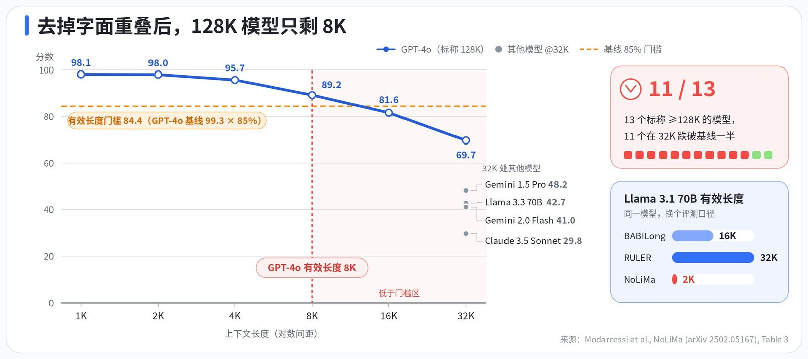
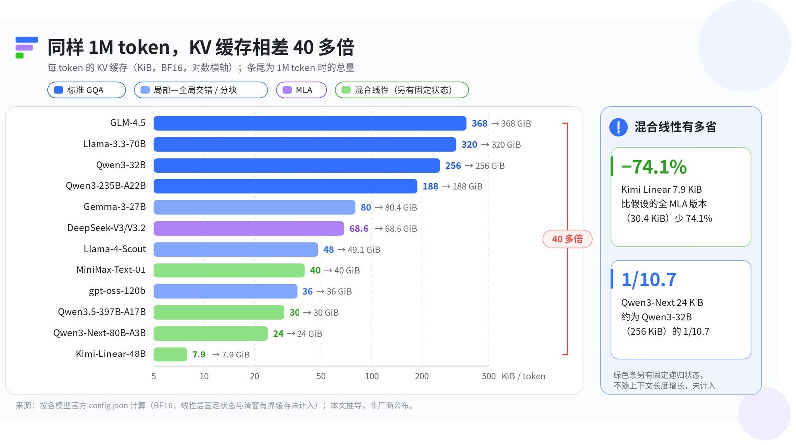
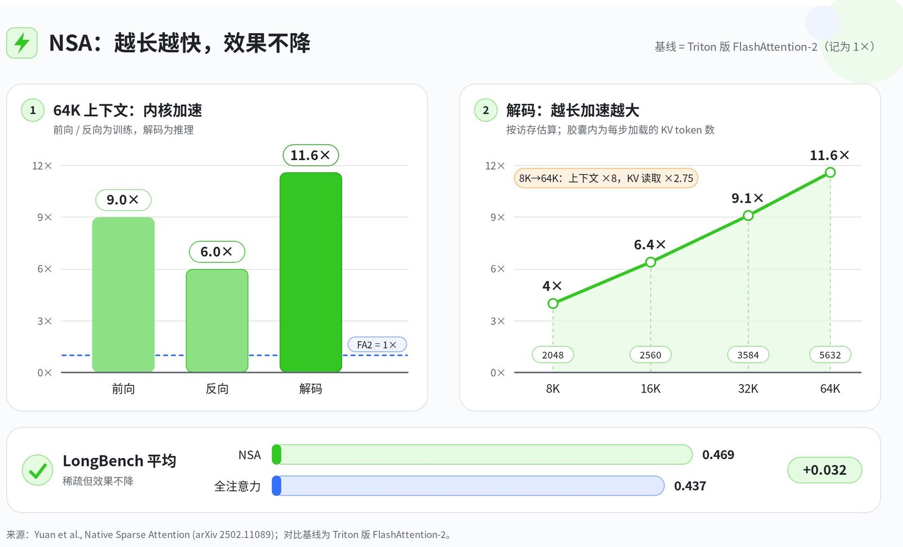
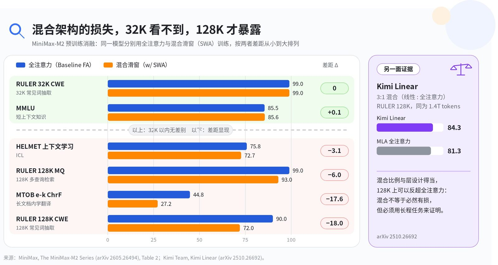
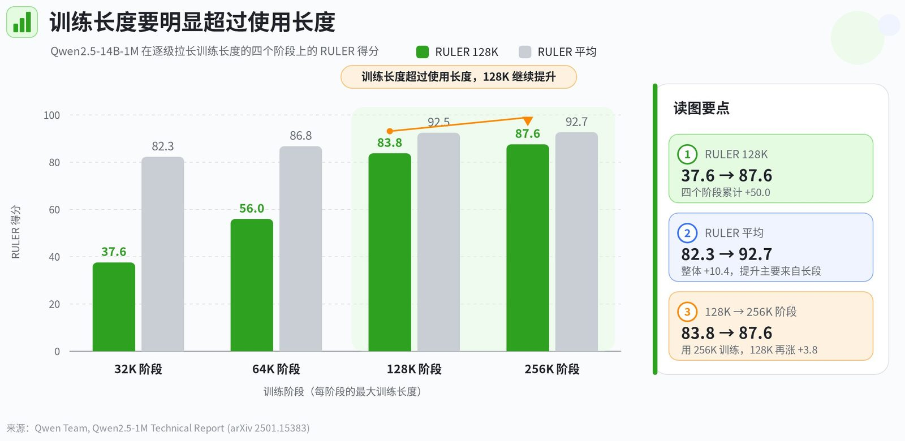
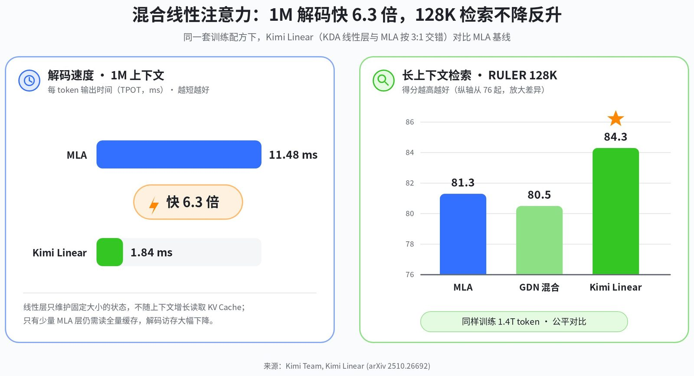
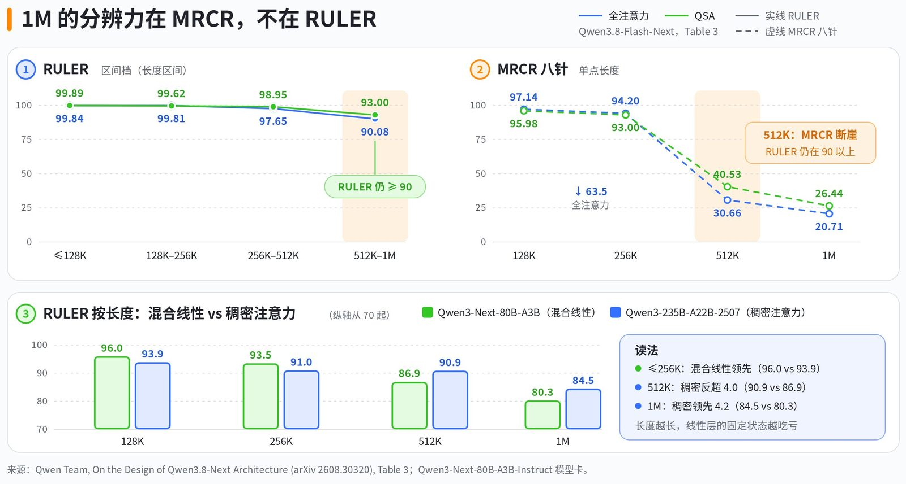
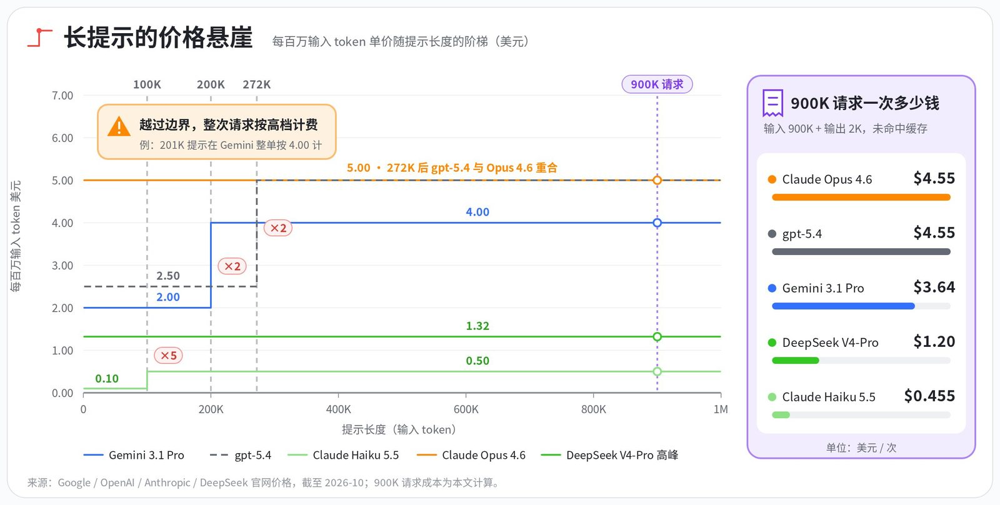

# LLM-31｜地基｜长上下文与注意力：从 MHA 到稀疏与线性注意力

> 🎯 **这篇文档解决什么问题**：2026 年主流模型的标称窗口普遍到了 100 万 token，但“塞得进”“用得好”“用得起”是三件事。本文先讲机制（注意力变体怎么省 KV、位置编码怎么外推、稀疏和线性注意力各牺牲了什么），再讲工程（怎么训练、服务、评测、算账），结论尽量落到配置字段、论文表格和官网价格上。
>
> 使用方式：估显存和成本看第 2 章和第 10 章；判断一个“1M 窗口”是否可信看第 6 章和第 9 章；上线看第 11 章。文中版本、价格和基准分数核对于 2026 年 10 月 11 日。

## 导读 · 先给结论

- **KV 大小主要由架构决定**。按官方 config.json 计算，Llama-3.3-70B 每 token 320 KiB，Kimi Linear 只有 7.9 KiB[[1]](https://arxiv.org/abs/2407.21783)[[2]](https://arxiv.org/abs/2510.26692)。架构之间差 10–40 倍，FP8 量化只省一半。
- **标称窗口不等于有效长度**。NoLiMa 上 GPT-4o 的有效长度只有 8K[[3]](https://arxiv.org/abs/2502.05167)；Gemini 3.1 Pro 的 MRCR v2 八针在 128K 为 84.9%，1M 只剩 26.3%[[4]](https://deepmind.google/models/model-cards/gemini-3-1-pro/)。
- **稀疏注意力的配方已经收敛**：DeepSeek-V3.2 用 2.1B token 预热闪电索引器、943.7B token 做稀疏训练[[5]](https://arxiv.org/abs/2512.02556)，此后 DeepSeek-V4、Qwen 的 QSA 都沿用了这套做法[[6]](https://arxiv.org/abs/2606.19348)[[7]](https://arxiv.org/abs/2608.30320)。
- **混合线性注意力有正反两面证据**：Kimi Linear 在 RULER128K 上比 MLA 高 3 分[[2]](https://arxiv.org/abs/2510.26692)；MiniMax 却在 M2 回到全注意力，其消融中混合滑窗在 32K 无损，128K 的 RULER CWE 从 90.0 掉到 72.0[[8]](https://arxiv.org/abs/2605.26494)。
- **训练是先短后长、逐级扩窗**：Llama 3 用 6 个阶段、约 800B token 从 8K 扩到 128K[[1]](https://arxiv.org/abs/2407.21783)。
- **价格档位比单价更重要**：越过 Gemini 3.1 Pro 的 200K、OpenAI 的 272K 边界，整次请求按高档计费[[9]](https://ai.google.dev/gemini-api/docs/pricing)[[10]](https://platform.openai.com/docs/pricing)；重复查询同一语料时，前缀缓存会让长上下文比 RAG 更划算。

📎 与系列其他文档的分工：RoPE 直觉、FlashAttention 基本思想、“中间丢失”和长上下文与 RAG 对照表在「多模态与长上下文」第 6、7 章；MHA/GQA/MLA 对照和混合架构比例表在「LLM 基础」第 3.5、3.6 节；PagedAttention 和多级 KV 缓存在「大模型推理系统学习手册」第 6 章；KV 量化在「模型压缩与端侧部署」第 6 章；长对话记忆在「Agent 记忆」。本文只往下挖一层。

## 第 1 章 · 长上下文为什么难：三道墙

把上下文从 8K 拉到 1M，会同时撞上三道墙：注意力计算随长度平方增长；KV 缓存随长度线性增长，且每步解码都要整块读一遍；模型真正能用的长度远小于标称值。后面各章的技术都在拆其中一道或几道。

### 1.1 计算墙：注意力什么时候压过线性层

线性层（投影和前馈）的计算量约为 `2·P·N`，带因果掩码的注意力约为 `2·N²·H·d·L`（P 参数量、N token 数、H 查询头数、d 头维度、L 层数），两者相等时 `N = P/(H·d·L)`。以 Llama-3.3-70B 为例（80 层、64 个查询头、头维度 128，约 70.6B 参数），交叉点约为 70.6e9 ÷（64 × 128 × 80）≈ 107.7K token[[1]](https://arxiv.org/abs/2407.21783)。按此推导，注意力与线性层的计算量之比在 8K、32K、128K、1M 时分别约为 0.08、0.30、1.22、9.73。

所以 32K 以内优化注意力对预填充帮助有限，超过约 100K 注意力开始主导，到 1M 是其余部分的近 10 倍。这也是稀疏注意力论文普遍在 64K 以上才报告明显加速的原因。

### 1.2 带宽墙：KV 缓存

KV 缓存同时占容量和带宽：容量决定并发数，带宽决定每个 token 等多久。Llama-3.3-70B 在 BF16 下 1M token 的 KV 是 320 GiB，即使 8 卡分摊，每步解码也要读完（第 10.3 节有估算）。

📎 展开阅读：「大模型推理系统学习手册」第 6.1 节（KV 公式和带宽下界）。

### 1.3 有效长度墙

RULER 把有效长度定义为得分仍高于 Llama2-7B 在 4K 成绩（85.6%）的最大长度，按此口径标称 128K 的 GPT-4 有效 64K，Qwen2-72B 只有 32K[[11]](https://arxiv.org/abs/2404.06654)。NoLiMa 去掉针与问题的字面重叠后，差距更大：

GPT-4o 短文本基线 99.3 分，32K 降到 69.7 分，按“保持基线 85%”的口径有效长度只有 8K；13 个标称 128K 以上的模型中，11 个在 32K 跌到基线一半以下。同一个 Llama 3.1 70B，有效长度在 BABILong 上是 16K，RULER 上 32K，NoLiMa 上只有 2K[[3]](https://arxiv.org/abs/2502.05167)。有效长度高度依赖任务，第 9 章专门讨论评测口径。

📎 展开阅读：「多模态与长上下文」第 7.1、7.2 节（“中间丢失”和标称与有效长度）。

> 💡 **常见误区**：把“大海捞针全绿”当成长上下文能力的证明。标准大海捞针的针和问题字面重合，只考字符串匹配；HELMET 在 59 个模型上发现它不能预测下游表现[[12]](https://arxiv.org/abs/2410.02694)。

## 第 2 章 · 注意力家族与 KV 账本

省 KV 只有三条路：少存头（MQA、GQA），把头压成低维潜变量（MLA），让大部分层只看一段窗口（滑窗、局部—全局交错、分块）。2026 年的模型往往叠用两三条。本章不重复定义，只看具体配置和逐 token 字节数。

📎 展开阅读：「LLM 基础」第 3.4、3.5 节（MHA/MQA/GQA/MLA 对照表）；「多模态与长上下文」第 6.3 节（注意力汇聚点与 StreamingLLM）。

### 2.1 窗口类设计

| 模型 | 结构 | 要点 |
|---|---|---|
| Mistral 7B（2023-10） | 32 层全部是 W=4096 的滑窗 | 滚动缓存（位置 i 存在 i mod W 处）在 32K 时把缓存减为 1/8[[13]](https://arxiv.org/abs/2310.06825) |
| Gemma 3（2025-03） | 5 层局部 : 1 层全局，局部窗口 1024 | 比例对困惑度影响很小；32K 时只用全局层的 KV 开销约 60%，1:3 交错、窗口 1024 时低于 15%[[14]](https://arxiv.org/abs/2503.19786) |
| gpt-oss（2025-08） | 窗口 128 的带状注意力与稠密层交替，各 18 层 | 每个头在 softmax 分母里有可学习偏置，允许“什么都不看”，作用类似注意力汇聚点[[15]](https://arxiv.org/abs/2508.10925) |
| Llama 4 Scout（2025-04） | 每 4 层 1 层不用位置编码（NoPE）做全局注意力，其余层做 8192 的分块局部注意力 | Meta 称为 iRoPE，见第 4.4 节[[16]](https://github.com/meta-llama/llama-models) |

### 2.2 2026 主流模型逐 token KV 账本

下表由本文按各模型官方 config.json 计算，不是厂商公布的数字。口径：BF16；普通注意力每 token = `2 × 全注意力层数 × KV头数 × 头维度 × 2 字节`；MLA = `层数 × (kv_lora_rank + rope维度) × 2 字节`；线性层固定状态和滑窗层有界缓存不计入逐 token 部分。

| 模型（config 关键字段） | 每 token | 1M | 说明 |
|---|---|---|---|
| GLM-4.5（92 层，8×128）[[17]](https://huggingface.co/zai-org/GLM-4.5/blob/main/config.json) | 368 KiB | 368 GiB | 标准 GQA |
| Llama-3.3-70B（80 层，8×128） | 320 KiB | 320 GiB | 128K 时 40 GiB[[1]](https://arxiv.org/abs/2407.21783) |
| Qwen3-32B（64 层，8×128） | 256 KiB | 256 GiB | 标准 GQA[[18]](https://arxiv.org/abs/2505.09388) |
| Qwen3-235B-A22B（94 层，4×128） | 188 KiB | 188 GiB | 只有 4 个 KV 头[[18]](https://arxiv.org/abs/2505.09388) |
| Gemma-3-27B（约 10 层全局，16×128） | 80 KiB | 80.4 GiB | 52 层滑窗固定约 416 MiB；全用全局层则为 496 KiB[[14]](https://arxiv.org/abs/2503.19786) |
| DeepSeek-V3/V3.2（61 层 MLA，512+64） | 68.6 KiB | 68.6 GiB | V3.2 的 FP8 索引键未计入[[19]](https://arxiv.org/abs/2412.19437) |
| Llama-4-Scout（12 层全局，8×128） | 48 KiB | 49.1 GiB | 36 层分块注意力固定约 1152 MiB[[16]](https://github.com/meta-llama/llama-models) |
| MiniMax-Text-01（10 层 softmax，8×128） | 40 KiB | 40 GiB | 另有 70 层线性注意力固定状态[[20]](https://arxiv.org/abs/2501.08313) |
| gpt-oss-120b（18 层全注意力，8×64） | 36 KiB | 36 GiB | 18 层窗口 128，固定约 4 MiB[[15]](https://arxiv.org/abs/2508.10925) |
| Qwen3.5-397B-A17B（15 层全注意力，2×256）[[21]](https://huggingface.co/Qwen/Qwen3.5-397B-A17B/blob/main/config.json) | 30 KiB | 30 GiB | 另有 45 层 Gated DeltaNet 固定状态 |
| Qwen3-Next-80B-A3B（12 层全注意力，2×256） | 24 KiB | 24 GiB | 另有 36 层 Gated DeltaNet 固定状态[[22]](https://huggingface.co/Qwen/Qwen3-Next-80B-A3B-Instruct) |
| Kimi-Linear-48B（7 层 MLA） | 7.9 KiB | 7.9 GiB | 另有 20 层 KDA 固定状态[[2]](https://arxiv.org/abs/2510.26692) |

交叉验证：DeepSeek-V3 的 70,272 字节与「LLM 基础」里“约 70 KB/token”一致；Kimi Linear 的 7.9 KiB 比假设的 27 层全 MLA 版本（30.4 KiB）少 74.1%，与论文“KV 最多减少 75%”吻合[[2]](https://arxiv.org/abs/2510.26692)。Qwen3-Next 只有 Qwen3-32B 的约 1/10.7，因为只有 12 层保留全注意力且 KV 头从 8 个减到 2 个。

读表时注意两点：线性层的固定状态与长度无关，但短请求、高并发时不可忽略；逐 token 字节数决定容量，解码速度还取决于每步实际读多少 KV，稀疏注意力不减容量却能减读取量（第 5 章）。

MLA 公式里为什么多出一个“rope维度”：DeepSeek-V2 把 K、V 压成一个低维潜向量 c，缓存里只存 c[[56]](https://arxiv.org/abs/2405.04434)。解码时可以把 K 的上投影矩阵并进 Q 的投影，直接拿 Q 和 c 算注意力，不必还原出每个头的 K。RoPE 的旋转矩阵随位置变化，夹在两个矩阵中间会让这一步合并做不了。所以 MLA 另开一个小的 RoPE 键，各头共享，单独缓存，DeepSeek-V3 里是 64 维。上表的 kv_lora_rank + rope维度 就是 512 + 64，61 层 × 576 × 2 字节正好是 70,272 字节。同一套权重有两种算法：训练和预填充时按 MHA 的形式还原出各头的 K、V，算力充足、不缺带宽；解码时把上投影吸收进去，所有头共用一份潜向量，读 KV 的量和 MQA 一样小[[57]](https://arxiv.org/abs/1911.02150)。V2 报告里，相对 DeepSeek 67B，KV 缓存减少 93.3%，最大生成吞吐提高到 5.76 倍[[56]](https://arxiv.org/abs/2405.04434)。

> 🔑 **小结**：1M 长度上，架构选择带来的 KV 差距是 10–40 倍，FP8 量化只有 2 倍。先选架构，再谈量化。

## 第 3 章 · 内核演进：FlashAttention 2→4 与解码内核

FlashAttention 每一代都在回答同一个问题：当代 GPU 上注意力卡在哪个部件。FA1 卡在显存读写，FA2 卡在并行划分，FA3 卡在 Hopper 的异步硬件没用上，FA4 卡在 Blackwell 上张量核心太快、其他部件跟不上。

📎 展开阅读：「大模型推理系统学习手册」第 2.3 节（IO 感知分块原理和 FA1）。

📎 在线 softmax 里“减去最大值”这一步的数值副作用，以及 FA3 反向把 dS 转成 BF16 带来的第二条误差通道，见第 54 篇 [LLM-54｜系统｜低精度训练的数值稳定性：从 FlashAttention 一次舍入偏差说起](./54-low-precision-training.md)。

| 版本 | 解决的瓶颈 | 关键数字 |
|---|---|---|
| FA2（2023-07） | FA1 只到理论峰值的 25%–40%；减少非矩阵乘运算，按序列维度并行，改进 warp 分工 | 比 FA1 快约 2 倍，达到 A100 峰值的 50%–73%；端到端训练每卡 225 TFLOPs/s[[23]](https://arxiv.org/abs/2307.08691) |
| FA3（2024-07） | FA2 在 H100 上只有 35% 利用率；warp 专门化让搬运与计算异步重叠，FP8 分块量化 | 比 FA2 快 1.5–2.0 倍；FP8 接近 1.2 PFLOPs/s，数值误差比基线 FP8 注意力低 2.6 倍[[24]](https://arxiv.org/abs/2407.08608) |
| FA4（2026-03） | B200 的 BF16 张量核心吞吐是 H100 的 2.25 倍，共享内存带宽和指数运算单元没有同步增长 | B200 上最高 1613 TFLOPs/s（利用率 71%），比 cuDNN 9.13 快最多 1.3 倍，比 Triton 快 2.7 倍[[25]](https://arxiv.org/abs/2603.05451) |

### 3.1 FA4 的四个手段

FA4 论文称之为“非对称的硬件扩展”：矩阵乘越来越快，softmax 的指数运算和数据搬运没跟上[[25]](https://arxiv.org/abs/2603.05451)。对策是：完全异步的矩阵乘（tcgen05）配合更大分块和张量内存（TMEM）；在 FMA 单元上用多项式近似软件模拟 `exp2`；只在必要时做 softmax 重缩放；反向传播用 2-CTA 矩阵乘模式把 dQ 的原子归约减半。FA4 用 Python 的 CuTe-DSL 编写，编译比 C++ 模板快 20–30 倍，自定义注意力变体在新硬件上的门槛因此降低[[25]](https://arxiv.org/abs/2603.05451)。

### 3.2 解码内核：从算力到带宽

预填充时查询成千上万，注意力是计算密集的；解码时每个请求每步只有 1 个查询却要扫完全部 KV，变成带宽密集的。长序列、小批次时若仍按头和批次划分线程块，大量 SM 闲置，所以要像 FlashDecoding 那样沿序列维度切分 KV 并行，再归并部分 softmax。

FlashInfer 把这类优化做成可组合的引擎：用块稀疏格式统一表示分页 KV、前缀共享和稀疏注意力，即时编译内核，负载均衡调度兼容 CUDA Graph，已集成进 SGLang、vLLM 和 MLC-Engine。相对编译器后端，逐 token 延迟降低 29%–69%，长上下文推理延迟降低 28%–30%[[26]](https://arxiv.org/abs/2501.01005)。

> 💡 **常见误区**：用注意力内核的峰值 TFLOPs 估算长上下文解码速度。解码受带宽约束，决定速度的是每步要读的 KV 字节数（第 10.3 节）。

## 第 4 章 · 位置编码外推：参数与失效模式

RoPE 把位置写成按频率旋转的角度，低维转得快、编码局部顺序，高维转得慢、编码远距离关系。模型只在训练长度内见过的角度上可靠，外推方法要做的是让每个维度在更长序列上看到的角度仍落在见过的范围内。

📎 展开阅读：「多模态与长上下文」第 6.1 节（RoPE 直觉、位置插值和 YaRN 的标题数字）。

### 4.1 YaRN 的两个参数

位置插值把所有维度一刀切地压缩，高频维度丢了局部分辨率；NTK-aware 缩放改为调大 RoPE 基数，“NTK-by-parts”再按维度分段。YaRN 建立在这条线上[[27]](https://arxiv.org/abs/2309.00071)：

- **分段**：按训练长度内每个维度转过的圈数划分。Llama 系列取 α=1、β=32，转不满 1 圈的维度完全插值，超过 32 圈的不动，中间线性过渡。
- **注意力温度**：取 `√(1/t) = 0.1·ln(s) + 1`，s 是扩展倍数；实现上直接把 RoPE 向量乘以 √(1/t)，没有额外开销。

Qwen3 用 YaRN 加双块注意力（DCA）在推理时把 32K 扩到 128K[[18]](https://arxiv.org/abs/2505.09388)；Qwen3-Next 用 YaRN 因子 4.0 从 262,144 扩到 1,010,000，模型卡提醒静态 YaRN“可能影响短文本表现”[[22]](https://huggingface.co/Qwen/Qwen3-Next-80B-A3B-Instruct)。静态缩放对所有请求一视同仁，长短请求最好分开部署或按需开启。

### 4.2 调大基数（ABF）

调整基频（ABF）在继续预训练时直接调大基数。Meta 在 Llama 2 Long 上把基数从 10,000 调到 500,000，验证到 32,768[[28]](https://arxiv.org/abs/2309.16039)，Llama 3 沿用 500,000[[1]](https://arxiv.org/abs/2407.21783)。之后基数随目标长度变大：Qwen3 和 Gemma 3 全局层用 1,000,000（Gemma 3 局部层保持 10,000）[[18]](https://arxiv.org/abs/2505.09388)[[14]](https://arxiv.org/abs/2503.19786)；Qwen2.5-1M 在 65,536、131,072、262,144 三档分别用 1M、5M、10M[[29]](https://arxiv.org/abs/2501.15383)；Qwen3-Next 和 MiniMax-Text-01 的 config 为 1e7[[22]](https://huggingface.co/Qwen/Qwen3-Next-80B-A3B-Instruct)[[20]](https://arxiv.org/abs/2501.08313)。Gemma 3 在 32K 预训练后用因子 8 扩到 128K，论文承认继续往上“会迅速退化”[[14]](https://arxiv.org/abs/2503.19786)。

### 4.3 搜索式外推与推理时外推

LongRoPE 发现插值应按维度用不同比例、开头若干 token 不插值，搜索这些比例后不微调就能扩 8 倍，再渐进扩展，只用最多 1000 步微调到 2048K token[[30]](https://arxiv.org/abs/2402.13753)。LongRoPE2 认为 RoPE 高维度训练不足是越界的主因，用“针驱动”困惑度引导搜索，把 LLaMA3-8B 扩到 128K 有效长度，保留 98.5% 以上短文本表现，只用 10B token，是 Meta 做法的 1/80，并称 Meta 的做法没有达到目标有效长度[[31]](https://arxiv.org/abs/2502.20082)。

DCA 切块并重映射块内和块间的相对位置，不训练就能扩到 4 倍以上[[32]](https://arxiv.org/abs/2402.17463)。只训练到 32K 的 Qwen2.5-7B/14B-Instruct 配合 DCA 在 1M 密钥检索上超过 80%[[29]](https://arxiv.org/abs/2501.15383)。密钥检索是最容易的任务，这只说明“没崩”。

### 4.4 不用位置编码：iRoPE

Llama 4 把交错使用不带位置编码的注意力层、再加推理时的注意力温度缩放，称为 iRoPE[[33]](https://ai.meta.com/blog/llama-4-multimodal-intelligence/)。官方代码中，NoPE 层做全局因果注意力，查询乘以随位置对数增长的系数 `log(floor((pos+1)/floor_scale)+1)·attn_scale + 1`，设计成不影响短上下文[[16]](https://github.com/meta-llama/llama-models)。Scout 以 256K 训练，宣传窗口 10M[[33]](https://ai.meta.com/blog/llama-4-multimodal-intelligence/)，两者之间的差距正是第 9 章讨论的问题。Kimi Linear 的 MLA 层同样不用位置编码，位置信息由 KDA 层的递归提供[[2]](https://arxiv.org/abs/2510.26692)。

不用位置编码这条路更早的代表是 ALiBi：不加任何位置嵌入，直接在注意力分数上减去一个与距离成正比的惩罚，每个头的斜率不同。1.3B 模型在 1024 长度上训练，外推到 2048 时的困惑度与在 2048 上训练的正弦位置编码模型相同，训练快 11%、显存少 11%[[58]](https://arxiv.org/abs/2108.12409)。它外推稳，是因为远处 token 的分数被压低，模型实际只看近处，这同样不等于学会了长程检索，下面的误区对它也适用。

> 💡 **常见误区**：以为外推能“免费”得到长上下文能力。外推只解决位置编码越界，不保证模型学会在长输入上检索和推理；验收要用第 9 章的有效长度评测，而不是密钥检索。

## 第 5 章 · 稀疏注意力：从 NSA、MoBA 到 DSA 与 CSA

稀疏注意力的判断是：每个查询真正需要的 KV 只占一小部分，只要能便宜地挑出来，核心注意力就能从 `O(L²)` 降到 `O(L·k)`。2025 年以来的进展集中在两点：选择器能端到端训练，选择粒度贴合硬件访存。

### 5.1 NSA 与 MoBA

DeepSeek 与北京大学的 NSA（ACL 2025 最佳论文）用三路分支加门控：压缩分支把每 32 个 token（步长 16）压成一个粗 token；选择分支挑 16 个 64-token 的块（固定含开头 1 块和最近 2 块）；滑窗分支看最近 512 个 token。在 27B 参数的 MoE 骨干上预训练（摘要写 260B token，实验部分写 270B），64K 大海捞针全对，LongBench 平均 0.469，高于全注意力的 0.437；64K 时前向比 FlashAttention-2 快 9.0 倍、反向快 6.0 倍，解码按访存估算快 11.6 倍[[34]](https://arxiv.org/abs/2502.11089)。

月之暗面的 MoBA 把 KV 分块，以块内键的均值代表块，按 top-k 选块，当前块总是参与；已用于 Kimi 的长上下文请求。1M 继续预训练时块大小 4096、选 12 块，稀疏度 95.31%，并保留最后三层全注意力；1M 时预填充最多快 6.5 倍[[35]](https://arxiv.org/abs/2502.13189)。

### 5.2 DSA：闪电索引器与 KL 预热

DeepSeek-V3.2 相对 V3.1-Terminus 唯一的架构改动是 DSA[[5]](https://arxiv.org/abs/2512.02556)：一个头数少、用 FP8 计算的闪电索引器对每个历史 token 打分 `I(t,s) = Σ_j w(t,j)·ReLU(q(t,j)·k(s))`，再按分数取 top-k（config 中 `index_topk` 为 2048），在 MLA 的 MQA 模式下计算注意力。

训练配方成了行业模板：先稠密预热，只训练索引器，用 KL 散度对齐聚合后的注意力分布，1000 步 × 16 条 × 128K，共 2.1B token；再稀疏训练，15000 步 × 480 条 × 128K，共 943.7B token[[5]](https://arxiv.org/abs/2512.02556)。索引器本身仍是 `O(L²)`，只是常数小得多。官方称性能与 V3.1-Terminus 持平，API 价格下调 50% 以上[[36]](https://api-docs.deepseek.com/news/news250929)。一个工程教训：DeepSeek 后来说明早期演示代码中索引器的 RoPE 布局有误（索引器要求非交错，MLA 是交错），可能导致表现下降；复现稀疏模型时索引器细节必须逐项对齐。

### 5.3 DeepSeek-V4：先压缩，再稀疏

DeepSeek-V4（2026-04）在 DSA 前面加了压缩[[6]](https://arxiv.org/abs/2606.19348)。CSA 把每 4 个 token 的 KV 压成一条，再用索引器取 top-k（Flash 512，Pro 1024，索引器 QK 用 FP4）；HCA 每 128 个 token 压成一条，不再稀疏。两者都附带 128 个 token 的未压缩滑窗和可学习的汇聚 logit，只有 1 个 KV 头。KV 中 RoPE 维度存 BF16、其余存 FP8。1M 时 V4 的 KV 约为 BF16 GQA8 基线的 2%；V4-Pro 的单 token 计算量和 KV 分别是 V3.2 的 27% 和 10%，V4-Flash 为 10% 和 7%[[6]](https://arxiv.org/abs/2606.19348)。

### 5.4 2026 年的新工作

- **Qwen 稀疏注意力 QSA**：Qwen3.8-Flash-Next 的全局层在继续训练时换成 QSA，索引器为 MQA，键按 4 个 token 池化成块，预算 2048 个 token（最多 512 块）。1M 时预填充快 7.6 倍、解码快 4.9 倍，64K 起有加速[[7]](https://arxiv.org/abs/2608.30320)。
- **LongCat 稀疏注意力 LSA**：针对 DSA 索引器的 `O(L²)` 和离散访存，用连续布局、跨层复用索引和由粗到细的分层索引，原生训练到 1M[[37]](https://arxiv.org/abs/2608.01662)。
- **SpotAttention**：给冻结的 Qwen3 加装 DSA 式块级选择器，用 KL 蒸馏训练，到 128K（训练长度 8 倍）与稠密持平，128K 解码比 FlashAttention 快 3.9 倍[[38]](https://arxiv.org/abs/2606.22874)。

稀疏化不一定掉点：QSA 在 512K–1M 的 RULER 从全注意力的 90.08 升到 93.00，但 128K、256K 的 MRCR 略低（第 9.3 节）[[7]](https://arxiv.org/abs/2608.30320)。另有一类只在推理时做的稀疏，如 Quest 按每页键的最小值和最大值估算注意力上界、只加载前 K 页，自注意力最多快 2.23 倍；它只省带宽，不省容量[[39]](https://arxiv.org/abs/2406.10774)。

> 🔑 **小结**：2026 年的稀疏注意力基本按同一模板构造：低精度少头数的打分器，KL 蒸馏预热，块级或 token 级 top-k，再保留小滑窗和汇聚点。差别在压缩比、选择粒度和索引器开销。

## 第 6 章 · 线性注意力与混合架构：取舍与反证

线性注意力用固定大小的状态代替不断增长的 KV，解码成本与长度无关；代价是精确检索和复制能力弱。主流折中是混合：大部分层线性，每隔几层保留一层全注意力。本章把支持和反对混合的证据并排放，两边都有严肃的数据。

📎 展开阅读：「LLM 基础」第 3.6 节（Mamba、Jamba 等混合模型的比例表和纯 SSM 复制能力弱的研究）。

### 6.1 状态怎么更新

线性注意力可以看成维护一个“键到值”的矩阵记忆。早期只会累加，旧信息互相干扰。Gated DeltaNet 结合两种机制：门控负责快速整体擦除，delta 规则针对某个键做定向更新；它在语言建模、上下文检索、长度外推上都超过 Mamba2，与滑窗混合后还能提升[[40]](https://arxiv.org/abs/2412.06464)。Kimi Linear 的 KDA 把门控细化到逐通道[[2]](https://arxiv.org/abs/2510.26692)；MiniMax-01 的闪电注意力则是另一条高效分块实现路线[[20]](https://arxiv.org/abs/2501.08313)。

“线性注意力就是 RNN”这个说法来自 Katharopoulos 等人：把 softmax 换成核特征映射 φ，利用矩阵乘法结合律先算 Σφ(k)vᵀ，复杂度从 O(N²) 降到 O(N)，并且可以写成逐 token 更新状态的递归形式，超长序列上自回归预测最多快 4000 倍[[59]](https://arxiv.org/abs/2006.16236)。上面的 Gated DeltaNet、KDA 都是在这个“只累加”的状态更新上加擦除和定向写入。

### 6.2 支持混合的证据

- <b>Kimi Linear（2025-10）</b>：KDA 与 MLA 按 3:1 排列。同样训练 1.4T token 的对比中，RULER128K 为 MLA 81.3、GDN 混合 80.5、Kimi Linear 84.3；1M 时每 token 输出时间 1.84 ms 对 MLA 的 11.48 ms。比例消融中 3:1 的验证困惑度 5.65 最好，全 MLA 为 5.77，15:1 为 5.82[[2]](https://arxiv.org/abs/2510.26692)。
- **系统消融**：72 个模型的研究发现，语言建模对比例不敏感，但召回随全注意力层增多而提升，低于 3:1 时尤其明显，推荐 3:1 到 6:1[[41]](https://arxiv.org/abs/2507.06457)。
- **MiniMax-01**：每 7 层闪电注意力接 1 层 softmax，训练到 100 万、推理外推到 400 万[[20]](https://arxiv.org/abs/2501.08313)。

### 6.3 反对的证据：MiniMax-M2 回到全注意力

最有分量的反证来自 MiniMax 自己。M2（229.9B 总参数、9.8B 激活）62 层全是 softmax 注意力，48 个查询头、8 个 KV 头[[8]](https://arxiv.org/abs/2605.26494)。按第 2.2 节口径计算，每 token KV 为 2 × 62 × 8 × 128 × 2 = 253,952 字节（248 KiB），约是 MiniMax-Text-01 的 6 倍，这是主动接受的代价。报告说，在推理、编程和 Agent 混合的生产环境里“没有找到能稳定匹配全注意力质量的变体”；Text-01 的混合架构在 MMLU、LongBench 等上与全注意力持平，规模变大后在复杂多跳推理上出现明显缺陷[[8]](https://arxiv.org/abs/2605.26494)。其混合滑窗预训练消融如下：

| 指标 | 全注意力 | 加滑窗的混合 |
|---|---|---|
| MMLU / MATH | 85.5 / 60.3 | 85.6 / 60.3 |
| RULER 32K CWE / MQ | 99.0 / 99.0 | 99.0 / 99.0 |
| RULER 128K CWE / MQ | 90.0 / 99.0 | 72.0 / 93.0 |
| HELMET 上下文学习 | 75.8 | 72.7 |
| MTOB e-k 方向（ChrF） | 44.8 | 27.2 |

短文本基准和 32K 的 RULER 完全看不出差别，损失只在 128K 的常见词提取（CWE）、多键检索（MQ）和上下文学习上暴露[[8]](https://arxiv.org/abs/2605.26494)。只用 MMLU 和 32K 测试验收，混合架构会被误判为“无损”。

MiniMax 的博客还列出了基础设施缺口：线性注意力在训练中也受访存约束，低精度状态存储敏感，前缀缓存和投机解码难以适配，理论计算量交叉点只在几千 token 处[[42]](https://www.minimax.io/news/why-did-m2-end-up-as-a-full-attention-model)。

### 6.4 两边证据怎么读

两边测的东西不同。Kimi Linear 的优势在 128K 的受控对比中[[2]](https://arxiv.org/abs/2510.26692)；Qwen3-Next（3:1）在 256K 以内不落后于稠密的 Qwen3-235B-2507，到 1M 时 RULER 为 80.3 对 84.5[[22]](https://huggingface.co/Qwen/Qwen3-Next-80B-A3B-Instruct)；MiniMax 的损失出现在更大规模的多跳和上下文学习上。工作结论是：线性层比例控制在 3:1 到 6:1[[41]](https://arxiv.org/abs/2507.06457)；评估混合模型必须包括 128K 以上的 CWE/MQ、MRCR 和上下文学习；收益要和推理栈成熟度一起算。

## 第 7 章 · 长上下文训练配方

公开配方几乎都是同一个顺序：先在短序列上完成大部分预训练，再分阶段扩窗并调大 RoPE 基数，每阶段混入高质量短数据，最后用少量长数据做后训练。差别在阶段数、数据配比和并行方式。

📎 展开阅读：「LLM 基础」第 4.7 节（中期训练流程）；「大模型训练工程」第 3.2、3.3 节（多阶段配比和退火）。

### 7.1 Llama 3 与 Qwen2.5-1M

Llama 3 405B 先在 8K 上训练 15.6T token，再分六个阶段从 8K 扩到 128K，共约 800B token；进入下一阶段的条件是短上下文评测完全恢复、当前长度大海捞针全对。最后用 40M token 退火，学习率降到 0，保持 128K。文档掩码在标准预训练中影响有限，在超长序列继续预训练中“很重要”；后训练只需在短数据中混入 0.1% 的合成长数据[[1]](https://arxiv.org/abs/2407.21783)。

Qwen2.5-1M 分五档扩到 262,144，每阶段 75% 的数据是当前最大长度、25% 更短[[29]](https://arxiv.org/abs/2501.15383)；Qwen3 的长上下文阶段沿用这个比例[[18]](https://arxiv.org/abs/2505.09388)。论文给出了 Qwen2.5-14B-1M 各阶段结束时的 RULER：

| 训练阶段 | 平均 | 4K | 64K | 128K |
|---|---|---|---|---|
| 32K 阶段 | 82.3 | 96.8 | 76.4 | 37.6 |
| 64K 阶段 | 86.8 | — | 86.7 | 56.0 |
| 128K 阶段 | 92.5 | — | 93.0 | 83.8 |
| 256K 阶段 | 92.7 | 95.6 | 91.9 | 87.6 |

结论是训练长度要明显超过目标使用长度：只训练到 128K 时 128K 得 83.8，继续训练到 256K 升到 87.6[[29]](https://arxiv.org/abs/2501.15383)表中“—”为本文未摘录的数字。

### 7.2 ProLong：数据比长度更重要

普林斯顿的 ProLong 系统消融后给出四条结论[[43]](https://arxiv.org/abs/2410.02660)：评测要在 SFT 之后、用下游任务做，不能只看困惑度和大海捞针；长数据优先用代码仓库和书籍；必须混入高质量短数据，最佳比例 60% 长、40% 短；规模不必很大，64K 和 512K 各 20B token，ProLong-8B 在 128K 上是约 10B 规模中最好的，只用了 Llama-3.1 长上下文 token 预算的 5%，SFT 只用短指令数据就够。Meta 的 Llama 2 Long 也发现，预训练里长文本多不多“不是关键”，继续预训练比从头训练长模型更高效[[28]](https://arxiv.org/abs/2309.16039)。

### 7.3 稀疏注意力的继续训练

稀疏注意力一般在扩窗时引入。DeepSeek-V4 的长度按 4K、16K、64K、1M 递进，前 1T token 用稠密注意力，到 64K 才引入稀疏[[6]](https://arxiv.org/abs/2606.19348)；QSA 在 256K 上先蒸馏索引器约 2B token，再联合训练约 200B token[[7]](https://arxiv.org/abs/2608.30320)。共同点是先让选择器模仿稠密注意力，再整体放开。

### 7.4 上下文并行

Llama 3 把序列切成 2N 块，第 i 张卡拿第 i 块和第 2N−1−i 块，使因果掩码下各卡计算均衡；K/V 用 all-gather 收集而不是环形传递，理由是更容易支持文档掩码，而 GQA 让 K/V 很小，注意力计算是 `O(S²)`，all-gather 只是 `O(S)`[[1]](https://arxiv.org/abs/2407.21783)。

📎 展开阅读：「大模型推理系统学习手册」第 4.6 节（Ring Attention 和 Ulysses 的通信量）。

> 📌 **配方速查**：
>
> - 阶段：短上下文训练完成后再扩，每阶段 2–4 倍。
> - 基数：128K 约 500K，256K 以上用 1e6 到 1e7。
> - 数据：每阶段约 75% 用当前最大长度；长数据优先代码仓库和书籍；始终混入高质量短数据。
> - 后训练：短数据为主，混入约 0.1% 合成长数据。
> - 验收：每阶段同时检查短文本是否恢复、长文本下游任务是否提升。

## 第 8 章 · 推理系统：解码、KV 压缩与跨请求复用

长上下文服务有三个难点：超长预填充占住 GPU，KV 把并发压得很低，同一份长文档被反复提问时重复预填充。分块预填充和 PD 分离的机制本系列已经讲过，本章只看长上下文下的数字和新问题。

📎 展开阅读：「大模型推理系统学习手册」第 6 章（PagedAttention、多级缓存、KV 压缩总表）和第 8 章（分块预填充、PD 分离）。

### 8.1 解码：架构决定带宽

1M 长度下解码受带宽约束。一个 1M token 的 Llama-3.3-70B 请求 BF16 KV 是 320 GiB，从预填充池搬到解码池本身就是一次大规模传输；MLA、混合线性和压缩稀疏同时缩小了要读和要传的数据量。

Kimi Linear 在 1M 时每 token 输出时间 1.84 ms，同规模 MLA 为 11.48 ms，快 6.3 倍[[2]](https://arxiv.org/abs/2510.26692)。稀疏注意力不改容量但减少读取量：QSA 在 1M 时解码快 4.9 倍[[7]](https://arxiv.org/abs/2608.30320)，NSA 在 64K 按访存估算快 11.6 倍[[34]](https://arxiv.org/abs/2502.11089)。

### 8.2 KV 压缩与前缀缓存的冲突

SnapKV 用提示末尾的观察窗口判断每个头关注哪些位置，只保留这些 KV；16K 时生成快 3.6 倍、显存效率高 8.2 倍，单张 A100-80GB 可处理 380K token[[44]](https://arxiv.org/abs/2404.14469)。PyramidKV 逐层分配预算（低层多、高层少），LongBench 上保留 12% KV 与全量持平[[45]](https://arxiv.org/abs/2406.02069)。

容易忽略的是：SnapKV 一类方法依赖问题位于提示末尾，压缩后的缓存是“针对这个问题”的，换一个问题复用同一份文档，被丢掉的部分可能恰好是新问题需要的[[44]](https://arxiv.org/abs/2404.14469)。“同一文档、多次提问”的场景应缓存完整 KV，在每次请求内部再做按问题的选择（如第 5.4 节的 Quest）。

📎 延伸阅读：Agent 场景下怎样绕开这个冲突，在 KV 层丢弃旧工具结果、用 RoPE 旋转重排位置，让保留的缓存不重算，见 [LLM-05｜工程｜Agent 工程实战：从工具到上线的施工手册](./05-agent-engineering.md) 第 12 章。

📎 展开阅读：「模型压缩与端侧部署」第 6.1 节（KIVI 和 FP8 KV 量化）。

📎 延伸阅读：GDN 混合模型开 prefix cache 时块大小被状态页撑到 1,056 token、前缀只能整块命中的实测，见 [LLM-32｜系统｜AI Infra 性能优化实战：从 profile 到硬件上限](./32-infra-perf.md) 第 11.4 节。

### 8.3 KV 卸载与跨请求复用

- **Mooncake**：以 KV 为中心的分离式架构，用集群闲置的 CPU、内存和 SSD 存 KV，过载时基于预测提前拒绝。长上下文模拟场景吞吐最多提高 525%，真实负载下 Kimi 多处理 75% 的请求[[46]](https://arxiv.org/abs/2407.00079)。
- **LMCache**：把 KV 卸载到 CPU、存储和网络，接入 vLLM 和 SGLang，多轮问答和文档分析吞吐最多提高 15 倍；生产观察是**截断上下文可能让前缀缓存命中率减半**[[47]](https://arxiv.org/abs/2510.09665)。
- **DeepSeek-V4**：共享前缀的 KV 落盘；滑窗分支的 KV 比压缩后的 CSA/HCA 条目大约 8 倍，所以专门设计了三种滑窗 KV 落盘策略[[6]](https://arxiv.org/abs/2606.19348)。

> 💡 **常见误区**：为省 token 每次截掉对话最早的部分。截断改变前缀，后面整段缓存失效[[47]](https://arxiv.org/abs/2510.09665)。要截就按固定边界整段替换成摘要。

### 8.4 学出来的 KV：Cartridges 与 self-study

8.1 到 8.3 的方法都在推理时处理已经算出来的 KV：丢一部分、压一部分，或者挪到更便宜的存储上。Cartridges 换了一条路，针对一份固定语料，离线训练出一份更小的 KV cache，推理时当作前缀直接加载[[53]](https://arxiv.org/abs/2506.06266)。它的出发点是长语料的显存账：在 Llama 70B 上，128k token 的上下文需要 84 GB 的 KV[[53]](https://hazyresearch.stanford.edu/blog/2025-06-08-cartridges)。

- **训练对象**：模型权重冻结，只对 KV 向量做反向传播，等价于 prefix tuning[[53]](https://arxiv.org/abs/2506.06266)。
- **训练数据**：直接在语料上做下一个 token 预测，cartridge 会背下原文，换个问法就答不好。self-study 改为让模型围绕语料片段生成合成对话，再用上下文蒸馏训练：目标是让“只带 cartridge 的模型”的输出分布接近“带完整原文的模型”[[53]](https://arxiv.org/abs/2506.06266)。
- **部署**：多个 cartridge 不用重新训练就能拼接使用，也可以作为前缀接入 vLLM[[53]](https://hazyresearch.stanford.edu/blog/2025-06-08-cartridges)。

| 评测 | Cartridge | 对照 |
|---|---|---|
| 总体 | 质量与普通 KV cache 持平，显存少 38.6 倍，峰值吞吐高 26.4 倍 | 完整原文放进上下文（ICL） |
| LongHealth | 0.96 GB 得 55.1%，比完整 ICL 更高，体积小 13.8 倍；52 MB（压缩 256 倍，吞吐高 121 倍）得 47.7% | Duo Attention 用 6.77 GB 得 43.0% |
| MTOB（48.4 万 token 的教材） | Llama 3.1 8B（原生 128k 上下文）加 0.54 GB cartridge，ChRF 36.1 | Llama 4 Scout 读完整教材，ChRF 36.3 |

表中数据均来自原作者[[53]](https://arxiv.org/abs/2506.06266)。代价也要算进去。每份语料都要单独训练一次，所以它适合被反复查询的固定语料，例如产品手册、代码库、法规全文；语料天天变或者只问一两次，训练成本收不回来。

另一个代价是跑题。Laguna 等人比较发现，Cartridges 在关于语料本身的问题上更好，在与语料无关的问题上，启发式 KV 压缩方法反而保留得更好：后者更少被语料内容带偏，通用知识和指令遵循也保留得更多[[54]](https://arxiv.org/abs/2609.35621)。他们给了两种修法：加一个路由，推理时判断这次请求要不要用这份记忆；或者在训练数据里混入一小部分与语料无关的问答[[54]](https://arxiv.org/abs/2609.35621)。Diaz 分析了训练出来的 cartridge 内部，发现 key 向量起的是稳定、可跨任务共享的检索路由作用，压缩的信息主要存在 value 里；把 key 换成别的任务训练出的版本，损失很小[[55]](https://arxiv.org/abs/2508.17032)。

> 🔑 **选型**：同一份长语料被大量请求反复引用，先用 8.3 的前缀缓存；显存仍然放不下，或者要在一张卡上同时挂很多份语料，再考虑 Cartridges。上线前要单独评测与语料无关的问题，它最容易在这里退化。

## 第 9 章 · 评测：有效长度与口径陷阱

长上下文评测的演进方向是减少字面匹配、增加综合和多次检索、按长度分档报告。读任何长上下文分数前先确认：哪个基准哪个版本，按什么长度分档，用什么脚本和思考档位。

📎 展开阅读：「多模态与长上下文」第 7.2 节（RULER 总体结论和 LongBench v1）；「LLM 应用评测与可观测」第 5 章（分数差多大才算真差）。

### 9.1 主要基准

| 基准 | 测什么 | 关键发现 |
|---|---|---|
| RULER（2024-04） | 13 个合成任务：多种大海捞针、多跳追踪、聚合、问答 | GPT-4 从 4K 的 96.6 降到 128K 的 81.2；Qwen2-72B 128K 时 53.7[[11]](https://arxiv.org/abs/2404.06654) |
| NoLiMa（2025-02） | 针与问题几乎没有字面重叠，需要一步语义联想 | GPT-4o 有效 8K，表中其余模型都在 4K 及以下[[3]](https://arxiv.org/abs/2502.05167) |
| LongBench v2（2024-12） | 503 道多选题，上下文 8K 到 200 万词，6 类真实任务 | 人类专家限时 15 分钟得 53.7%，直接作答的最佳模型 50.1%，o1-preview 57.7%[[48]](https://arxiv.org/abs/2412.15204) |
| HELMET（2024-10） | 7 类应用导向任务，最长 128K，模型打分 | 59 个模型：各类任务相关性弱，开放模型在全上下文推理上落后，长度越长差距越大；建议开发迭代用 RAG 类任务快速评测[[12]](https://arxiv.org/abs/2410.02694) |
| MRCR（2025-04） | 长对话中藏 2、4 或 8 个相同请求，要求返回第 i 个 | 按 4K–8K 到 512K–1M 分 8 档，每档 100 个样本；2025-12-05 修复约 10% 针数过多和约 5% 答案错误，只应比较修复后的数字[[49]](https://huggingface.co/datasets/openai/mrcr) |

### 9.2 同名指标不可比

MRCR 是 2026 年各家报告 1M 能力的常用指标，但口径不一：

- Gemini 3.1 Pro 模型卡用 MRCR v2 八针，128K 为平均、1M 为单点：Gemini 3.1 Pro 为 84.9% 和 26.3%；同表 128K 处 Claude Sonnet 4.6 84.9%、Opus 4.6 84.0%、GPT-5.2（xhigh）83.8%[[4]](https://deepmind.google/models/model-cards/gemini-3-1-pro/)。
- DeepSeek-V4 报告用“MRCR 1M（MMR）”，未写针数：Opus-4.6 92.9，V4-Pro-Max 83.5，Gemini-3.1-Pro 76.3[[6]](https://arxiv.org/abs/2606.19348)。
- QSA 论文用八针，1M 只有 20.71（全注意力）和 26.44（QSA）[[7]](https://arxiv.org/abs/2608.30320)。

同叫“MRCR 1M”，数字从 26% 到 93% 都有。另一个变量是思考档位：DeepSeek-V4-Flash 的 MRCR 1M 在不思考、高、最高三档分别为 37.5、76.9、78.7[[6]](https://arxiv.org/abs/2606.19348)，打开思考后约翻一倍。偏真实任务的 Fiction.LiveBench 也呈现同样趋势：Epoch AI 镜像的 120K 成绩中，o3（medium）100.0、GPT-5（medium）96.9，而不思考的 Claude Opus 4 为 37.5[[50]](https://epoch.ai/benchmarks/fictionlivebench)。

### 9.3 稀疏与混合模型怎么评

评估稀疏或混合模型，最有用的是同一模型改造前后的逐档对比。Qwen 在 Qwen3.8-Flash-Next 上给出了全注意力与 QSA 的逐档对比（RULER 按区间分档，MRCR 八针按单点长度）[[7]](https://arxiv.org/abs/2608.30320)：

| 全注意力 / QSA | ≤128K；128K | 128K–256K；256K | 256K–512K；512K | 512K–1M；1M |
|---|---|---|---|---|
| RULER | 99.84 / 99.89 | 99.81 / 99.62 | 97.65 / 98.95 | 90.08 / 93.00 |
| MRCR 八针 | 97.14 / 95.98 | 94.20 / 93.00 | 30.66 / 40.53 | 20.71 / 26.44 |

RULER 在 1M 仍有 90 分以上，MRCR 八针在 512K 以上跌到 20–40 分，说明 RULER 在 1M 级别区分度不够。混合模型同样要逐档看：Qwen3-Next 在 128K、256K、512K、1M 的 RULER 为 96.0、93.5、86.9、80.3，稠密注意力的 Qwen3-235B-2507 为 93.9、91.0、90.9、84.5[[22]](https://huggingface.co/Qwen/Qwen3-Next-80B-A3B-Instruct)。

> 💡 **常见误区**：拿不同报告里的同名指标排名次。针数、单点还是区间平均、思考档位、数据集修复前后，任何一项不同分数都不可比。要比就在同一套脚本里自己跑。

## 第 10 章 · 成本与定价：价格档位、缓存与自建算账

长上下文成本有三个放大器：按长度分档的价格（越过边界整次涨价），缓存命中与否（差约 10 倍），分词器（同样文字 token 数不同）。本章价格均为截至 2026-10 的官网价格，单位是每百万 token 美元；自建部分是按公式推导的估算，不是实测。

📎 展开阅读：「自建推理成本与 GPU 选型」第 3.2、5.3 节（KV 显存算法和前缀缓存写法）。

### 10.1 长提示的价格档位

| 模型 | 档位边界 | 输入（低档 / 高档） | 输出（低档 / 高档） |
|---|---|---|---|
| Gemini 3.1 Pro Preview | 200K | 2.00 / 4.00 | 12.00 / 18.00[[9]](https://ai.google.dev/gemini-api/docs/pricing) |
| gpt-5.4 | 272K | 2.50 / 5.00 | 15.00 / 22.50[[10]](https://platform.openai.com/docs/pricing) |
| gpt-6.1-sol | 272K | 2.00 / 4.00 | 10.00 / 15.00[[10]](https://platform.openai.com/docs/pricing) |
| Claude Opus 4.6 / Sonnet 4.6 | 不分档（1M） | 5 / 3 | 25 / 15[[51]](https://docs.anthropic.com/en/docs/about-claude/pricing) |
| Claude Haiku 5.5 | 100K | 0.10 / 0.50 | 0.50 / 2.50[[51]](https://docs.anthropic.com/en/docs/about-claude/pricing) |
| DeepSeek V4-Pro（高峰 / 低谷） | 不分档（1M） | 未命中缓存 1.32 / 0.66 | 3.96 / 1.98[[52]](https://api-docs.deepseek.com/quick_start/pricing) |

Opus 4.6 / Sonnet 4.6 一行中的斜杠分隔的是两个模型的单价。规律有三条：OpenAI 和 Gemini Pro 的高档都是输入 2 倍、输出 1.5 倍[[10]](https://platform.openai.com/docs/pricing)[[9]](https://ai.google.dev/gemini-api/docs/pricing)；Anthropic 写明 Claude 4.6 及之后的模型（Haiku 5.5 除外）1M 窗口按标准价计费[[51]](https://docs.anthropic.com/en/docs/about-claude/pricing)；越过边界时**整次请求**按高档计费，Haiku 5.5 连缓存读取也一并涨价[[51]](https://docs.anthropic.com/en/docs/about-claude/pricing)。缓存读取方面，Claude 为基础输入价的 0.1 倍[[51]](https://docs.anthropic.com/en/docs/about-claude/pricing)，Gemini 3.1 Pro 为 0.20 / 0.40，另收每百万 token 每小时 4.50 美元存储费[[9]](https://ai.google.dev/gemini-api/docs/pricing)。

### 10.2 一次 900K 请求要花多少钱

下表由本文计算：输入 900K、输出 2K token，“命中缓存”指输入全部按缓存读取价计。本文没有核实到 OpenAI 高档的缓存读取价，OpenAI 只算未命中：gpt-5.4 为 0.9 × 5.00 + 0.002 × 22.50 ≈ 4.55 美元。

| 模型 / 档位 | 未命中缓存 | 命中缓存 |
|---|---|---|
| Claude Opus 4.6 | 4.55 美元 | 0.50 美元 |
| Claude Sonnet 4.6 | 2.73 美元 | 0.30 美元 |
| Gemini 3.1 Pro（高于 200K） | 3.64 美元 | 0.40 美元，另加每小时 4.05 美元存储 |
| DeepSeek V4-Pro（高峰 / 低谷） | 1.20 / 0.60 美元 | 0.048 / 0.024 美元 |
| Claude Haiku 5.5（高于 100K） | 0.455 美元 | 0.05 美元 |

例如 Opus 4.6 未命中为 0.9 × 5 + 0.002 × 25 = 4.55 美元，命中为 0.9 × 0.5 + 0.05 = 0.50 美元。同一个问题用 RAG 只送 8K token，成本是 0.008 × 5 + 0.002 × 25 = 0.09 美元：比未命中的全文方案便宜约 50 倍，但只比命中缓存的便宜约 5.5 倍。**重复查询同一语料时，前缀缓存会改变长上下文与 RAG 的取舍**。

有两个陷阱。第一个是档位悬崖，Gemini 3.1 Pro 的 201K 提示整次按 4 美元计，比两个 100K 提示还贵，OpenAI 的 272K、Haiku 5.5 的 100K 同理，应把请求裁剪或拆分到边界以下。第二个是分词器，Claude 4.7 及之后的分词器对同样文本约多 30% token[[51]](https://docs.anthropic.com/en/docs/about-claude/pricing)，跨模型要按“每份文档多少钱”比。

### 10.3 自建 1M 的算账方法

以 Llama-3.3-70B（80 层、64 个查询头、头维度 128、8 个 KV 头）为例，以下均为本文推导[[1]](https://arxiv.org/abs/2407.21783)：

- **预填充**：按第 1.1 节公式，1M token 注意力约 1.44e18 次浮点运算，线性层约 0.15e18。按 FA4 在 B200 上 1.6 PFLOPs/s 的峰值计[[25]](https://arxiv.org/abs/2603.05451)，单卡约 993 秒，8 卡理想并行约 2 分钟；128K 时约 25.6 秒。这是下限。
- **容量**：FP8 KV 下 128K 为 20 GiB，1M 为 160 GiB。8 张 H100（共 640 GB）放 FP8 权重约 71 GB、预留 10% 后，约能同时放 23 个 128K 请求，1M 不到 3 个。
- **解码带宽**：每步读完 160 GiB，按 8 卡合计 26.8 TB/s 计，仅读 KV 每 token 约 6 ms。

对照第 2.2 节：同样 1M token，DeepSeek-V3 是 68.6 GiB，Kimi Linear 是 7.9 GiB，DeepSeek-V4 约为 GQA8 基线的 2%[[6]](https://arxiv.org/abs/2606.19348)。1M 级别的自建服务，瓶颈通常是并发和解码带宽，而不是预填充算力。

## 第 11 章 · 怎么选与上线清单

落到工程上是三个问题：用长上下文、RAG 还是记忆；用长上下文时选什么模型、提示怎么摆；上线前测什么。

📎 展开阅读：「多模态与长上下文」第 7.3、7.4 节（长上下文与检索对照表和提示写法）；「RAG 与知识工程」第 6 章（Self-Route 等路由的成本）；「Agent 记忆」第 1.3 节（什么时候需要记忆系统）。

### 11.1 判断顺序

1. **先在自己的任务上测有效长度**：标称窗口不可信（第 1.3、9.2 节），用 RULER 式多针聚合题和 NoLiMa 式语义联想题按长度分档各测一组。
2. **算请求落在哪个价格档**：超过 200K、272K 或 100K 边界时先考虑 RAG 或压缩[[9]](https://ai.google.dev/gemini-api/docs/pricing)[[10]](https://platform.openai.com/docs/pricing)[[51]](https://docs.anthropic.com/en/docs/about-claude/pricing)。
3. **看同一语料被查询多少次**：一次性的超大语料用 RAG；反复提问用长上下文加前缀缓存（第 10.2 节）。
4. **混合或稀疏模型额外测 128K 以上**的多跳、聚合和上下文学习，MiniMax-M2 的消融中损失只在这里出现[[8]](https://arxiv.org/abs/2605.26494)。
5. **自建先算并发和带宽**：高并发场景优先 MLA、混合线性或压缩稀疏架构（第 10.3 节）。

### 11.2 提示、缓存与部署

- 稳定内容（系统提示、工具定义、长文档）放前面并保持字节级不变，用户问题放最后，既符合“文档在前、问题在后”，又能命中前缀缓存。
- 不要逐次截断历史，截断可能让命中率减半[[47]](https://arxiv.org/abs/2510.09665)；按问题做的 KV 压缩不要跨问题复用[[44]](https://arxiv.org/abs/2404.14469)。
- 把思考档位当作调优变量：DeepSeek-V4-Flash 的 MRCR 1M 从不思考的 37.5 升到 78.7[[6]](https://arxiv.org/abs/2606.19348)。
- 静态 YaRN 会影响短文本，长短请求最好分开部署[[22]](https://huggingface.co/Qwen/Qwen3-Next-80B-A3B-Instruct)；容量不够时用 CPU 或磁盘卸载 KV[[46]](https://arxiv.org/abs/2407.00079)。

> 📌 **上线前的长上下文回归清单**：
>
> - 按 4K、32K、128K 和业务最长长度分档，各跑多针聚合、语义联想和真实业务问答三组。
> - 混合或稀疏模型额外跑 128K 以上的 CWE、多键检索和上下文学习。
> - 短文本基准一并回归。
> - 记录思考档位、评测脚本版本和数据集版本（如 MRCR 修复前后）。
> - 统计真实提示长度分布，标出价格档位边界附近的比例。
> - 压测前缀缓存命中率，检查系统提示里有没有时间戳等每次变化的内容。
> - 自建服务按 1M 请求压测并发上限和每 token 输出时间。

> 💡 **常见误区**：模型升级后只跑短文本回归。窗口、分词器、架构或默认思考档位的变化都可能单独影响长上下文表现，分词器变化连成本也会变[[51]](https://docs.anthropic.com/en/docs/about-claude/pricing)。

## 参考文献

按正文首次引用顺序编号，资料截至 2026 年 10 月初。

[1] Meta. The Llama 3 Herd of Models (2024-07) [https://arxiv.org/abs/2407.21783](https://arxiv.org/abs/2407.21783)

[2] Kimi Team (Moonshot AI). Kimi Linear: An Expressive, Efficient Attention Architecture (2025-10) [https://arxiv.org/abs/2510.26692](https://arxiv.org/abs/2510.26692)

[3] Modarressi et al. NoLiMa: Long-Context Evaluation Beyond Literal Matching (2025-02) [https://arxiv.org/abs/2502.05167](https://arxiv.org/abs/2502.05167)

[4] Google DeepMind. Gemini 3.1 Pro model card (2026-02) [https://deepmind.google/models/model-cards/gemini-3-1-pro/](https://deepmind.google/models/model-cards/gemini-3-1-pro/)

[5] DeepSeek-AI. DeepSeek-V3.2: Pushing the Frontier of Open Large Language Models (2025-12) [https://arxiv.org/abs/2512.02556](https://arxiv.org/abs/2512.02556)

[6] DeepSeek-AI. DeepSeek-V4: Towards Highly Efficient Million-Token Context Intelligence (2026-04) [https://arxiv.org/abs/2606.19348](https://arxiv.org/abs/2606.19348)

[7] Qwen Team. On the Design of Qwen3.8-Next Architecture: Evaluation, Efficiency, and Training Stability (2026-08) [https://arxiv.org/abs/2608.30320](https://arxiv.org/abs/2608.30320)

[8] MiniMax. The MiniMax-M2 Series: Mini Activations Unleashing Max Real-World Intelligence (2026-05) [https://arxiv.org/abs/2605.26494](https://arxiv.org/abs/2605.26494)

[9] Google. Gemini Developer API pricing (2026-10) [https://ai.google.dev/gemini-api/docs/pricing](https://ai.google.dev/gemini-api/docs/pricing)

[10] OpenAI. API pricing (2026-10) [https://platform.openai.com/docs/pricing](https://platform.openai.com/docs/pricing)

[11] Hsieh et al. (NVIDIA). RULER: What's the Real Context Size of Your Long-Context Language Models? (2024-04) [https://arxiv.org/abs/2404.06654](https://arxiv.org/abs/2404.06654)

[12] Yen et al. (Princeton). HELMET: How to Evaluate Long-Context Language Models Effectively and Thoroughly (2024-10) [https://arxiv.org/abs/2410.02694](https://arxiv.org/abs/2410.02694)

[13] Mistral AI. Mistral 7B (2023-10) [https://arxiv.org/abs/2310.06825](https://arxiv.org/abs/2310.06825)

[14] Google DeepMind. Gemma 3 Technical Report (2025-03) [https://arxiv.org/abs/2503.19786](https://arxiv.org/abs/2503.19786)

[15] OpenAI. gpt-oss-120b &amp; gpt-oss-20b Model Card (2025-08) [https://arxiv.org/abs/2508.10925](https://arxiv.org/abs/2508.10925)

[16] Meta. llama-models: Llama 4 reference implementation (2025-04) [https://github.com/meta-llama/llama-models](https://github.com/meta-llama/llama-models)

[17] Z.ai. GLM-4.5 config.json (2025-07) [https://huggingface.co/zai-org/GLM-4.5/blob/main/config.json](https://huggingface.co/zai-org/GLM-4.5/blob/main/config.json)

[18] Qwen Team. Qwen3 Technical Report (2025-05) [https://arxiv.org/abs/2505.09388](https://arxiv.org/abs/2505.09388)

[19] DeepSeek-AI. DeepSeek-V3 Technical Report (2024-12) [https://arxiv.org/abs/2412.19437](https://arxiv.org/abs/2412.19437)

[20] MiniMax. MiniMax-01: Scaling Foundation Models with Lightning Attention (2025-01) [https://arxiv.org/abs/2501.08313](https://arxiv.org/abs/2501.08313)

[21] Qwen Team. Qwen3.5-397B-A17B config.json (2026-02) [https://huggingface.co/Qwen/Qwen3.5-397B-A17B/blob/main/config.json](https://huggingface.co/Qwen/Qwen3.5-397B-A17B/blob/main/config.json)

[22] Qwen Team. Qwen3-Next-80B-A3B-Instruct model card (2025-09) [https://huggingface.co/Qwen/Qwen3-Next-80B-A3B-Instruct](https://huggingface.co/Qwen/Qwen3-Next-80B-A3B-Instruct)

[23] Dao. FlashAttention-2: Faster Attention with Better Parallelism and Work Partitioning (2023-07) [https://arxiv.org/abs/2307.08691](https://arxiv.org/abs/2307.08691)

[24] Shah et al. FlashAttention-3: Fast and Accurate Attention with Asynchrony and Low-precision (2024-07) [https://arxiv.org/abs/2407.08608](https://arxiv.org/abs/2407.08608)

[25] Zadouri, Shah, Dao et al. FlashAttention-4: Algorithm and Kernel Pipelining Co-Design for Asymmetric Hardware Scaling (2026-03) [https://arxiv.org/abs/2603.05451](https://arxiv.org/abs/2603.05451)

[26] Ye et al. FlashInfer: Efficient and Customizable Attention Engine for LLM Inference Serving (2025-01) [https://arxiv.org/abs/2501.01005](https://arxiv.org/abs/2501.01005)

[27] Peng et al. YaRN: Efficient Context Window Extension of Large Language Models (2023-08) [https://arxiv.org/abs/2309.00071](https://arxiv.org/abs/2309.00071)

[28] Xiong et al. (Meta). Effective Long-Context Scaling of Foundation Models (2023-09) [https://arxiv.org/abs/2309.16039](https://arxiv.org/abs/2309.16039)

[29] Qwen Team. Qwen2.5-1M Technical Report (2025-01) [https://arxiv.org/abs/2501.15383](https://arxiv.org/abs/2501.15383)

[30] Ding et al. (Microsoft). LongRoPE: Extending LLM Context Window Beyond 2 Million Tokens (2024-02) [https://arxiv.org/abs/2402.13753](https://arxiv.org/abs/2402.13753)

[31] Shang et al. (Microsoft). LongRoPE2: Near-Lossless LLM Context Window Scaling (2025-02) [https://arxiv.org/abs/2502.20082](https://arxiv.org/abs/2502.20082)

[32] An et al. Training-Free Long-Context Scaling of Large Language Models (2024-02) [https://arxiv.org/abs/2402.17463](https://arxiv.org/abs/2402.17463)

[33] Meta. The Llama 4 herd: The beginning of a new era of natively multimodal AI innovation (2025-04) [https://ai.meta.com/blog/llama-4-multimodal-intelligence/](https://ai.meta.com/blog/llama-4-multimodal-intelligence/)

[34] Yuan et al. (DeepSeek-AI &amp; PKU). Native Sparse Attention: Hardware-Aligned and Natively Trainable Sparse Attention (2025-02) [https://arxiv.org/abs/2502.11089](https://arxiv.org/abs/2502.11089)

[35] Lu et al. (Moonshot AI). MoBA: Mixture of Block Attention for Long-Context LLMs (2025-02) [https://arxiv.org/abs/2502.13189](https://arxiv.org/abs/2502.13189)

[36] DeepSeek. Introducing DeepSeek-V3.2-Exp (2025-09-29) [https://api-docs.deepseek.com/news/news250929](https://api-docs.deepseek.com/news/news250929)

[37] Meituan LongCat. LongCat Sparse Attention: Taming the Lightning via Streaming-aware Hierarchical Cross-Layer Indexing (2026-08) [https://arxiv.org/abs/2608.01662](https://arxiv.org/abs/2608.01662)

[38] SpotAttention: Plug-In Block-Sparse Routing for Pretrained Long-Context Transformers (2026-06) [https://arxiv.org/abs/2606.22874](https://arxiv.org/abs/2606.22874)

[39] Tang et al. (MIT). Quest: Query-Aware Sparsity for Efficient Long-Context LLM Inference (2024-06) [https://arxiv.org/abs/2406.10774](https://arxiv.org/abs/2406.10774)

[40] Yang, Kautz, Hatamizadeh (NVIDIA/MIT). Gated Delta Networks: Improving Mamba2 with Delta Rule (2024-12) [https://arxiv.org/abs/2412.06464](https://arxiv.org/abs/2412.06464)

[41] Wang et al. A Systematic Analysis of Hybrid Linear Attention (2025-07) [https://arxiv.org/abs/2507.06457](https://arxiv.org/abs/2507.06457)

[42] MiniMax. Why did M2 end up as a full attention model? (2025-10) [https://www.minimax.io/news/why-did-m2-end-up-as-a-full-attention-model](https://www.minimax.io/news/why-did-m2-end-up-as-a-full-attention-model)

[43] Gao, Wettig, Yen, Chen (Princeton). How to Train Long-Context Language Models (Effectively) (2024-10) [https://arxiv.org/abs/2410.02660](https://arxiv.org/abs/2410.02660)

[44] Li et al. SnapKV: LLM Knows What You are Looking for Before Generation (2024-04) [https://arxiv.org/abs/2404.14469](https://arxiv.org/abs/2404.14469)

[45] Cai et al. PyramidKV: Dynamic KV Cache Compression based on Pyramidal Information Funneling (2024-06) [https://arxiv.org/abs/2406.02069](https://arxiv.org/abs/2406.02069)

[46] Moonshot AI &amp; Tsinghua. Mooncake: A KVCache-centric Disaggregated Architecture for LLM Serving (2024-06) [https://arxiv.org/abs/2407.00079](https://arxiv.org/abs/2407.00079)

[47] Cheng et al. LMCache: An Efficient KV Cache Layer for Enterprise-Scale LLM Inference (2025-10) [https://arxiv.org/abs/2510.09665](https://arxiv.org/abs/2510.09665)

[48] Bai et al. LongBench v2: Towards Deeper Understanding and Reasoning on Realistic Long-context Multitasks (2024-12) [https://arxiv.org/abs/2412.15204](https://arxiv.org/abs/2412.15204)

[49] OpenAI. openai/mrcr dataset (2025-04) [https://huggingface.co/datasets/openai/mrcr](https://huggingface.co/datasets/openai/mrcr)

[50] Epoch AI. Fiction.LiveBench (2026-10) [https://epoch.ai/benchmarks/fictionlivebench](https://epoch.ai/benchmarks/fictionlivebench)

[51] Anthropic. Claude pricing (2026-10) [https://docs.anthropic.com/en/docs/about-claude/pricing](https://docs.anthropic.com/en/docs/about-claude/pricing)

[52] DeepSeek. Models &amp; Pricing (2026-10) [https://api-docs.deepseek.com/quick_start/pricing](https://api-docs.deepseek.com/quick_start/pricing)

[53] Eyuboglu, Ehrlich, Arora et al. Cartridges: Lightweight and general-purpose long context representations via self-study (2025) [https://arxiv.org/abs/2506.06266](https://arxiv.org/abs/2506.06266)；博客 [https://hazyresearch.stanford.edu/blog/2025-06-08-cartridges](https://hazyresearch.stanford.edu/blog/2025-06-08-cartridges)

[54] Laguna, Monteiro, Cuturi, Ablin, Gualdoni. Cartridges++: KV Cache Compression without Off-Context Derailment (2026) [https://arxiv.org/abs/2609.35621](https://arxiv.org/abs/2609.35621)

[55] Diaz. Learned Structure in Cartridges: Keys as Shareable Routers in Self-Studied Representations (2025) [https://arxiv.org/abs/2508.17032](https://arxiv.org/abs/2508.17032)

[56] DeepSeek-AI. DeepSeek-V2: A Strong, Economical, and Efficient Mixture-of-Experts Language Model (2024) [https://arxiv.org/abs/2405.04434](https://arxiv.org/abs/2405.04434)

[57] Shazeer. Fast Transformer Decoding: One Write-Head is All You Need (MQA, 2019) [https://arxiv.org/abs/1911.02150](https://arxiv.org/abs/1911.02150)

[58] Press, Smith, Lewis. Train Short, Test Long: Attention with Linear Biases Enables Input Length Extrapolation (ALiBi). ICLR (2022) [https://arxiv.org/abs/2108.12409](https://arxiv.org/abs/2108.12409)

[59] Katharopoulos, Vyas, Pappas, Fleuret. Transformers are RNNs: Fast Autoregressive Transformers with Linear Attention. ICML (2020) [https://arxiv.org/abs/2006.16236](https://arxiv.org/abs/2006.16236)

---

上一篇：[LLM-30｜地基｜动手实验：从零训练一个小模型](./30-train-small-model.md) · [目录](./README.md) · 下一篇：[LLM-32｜系统｜AI Infra 性能优化实战：从 profile 到硬件上限](./32-infra-perf.md)
