# LLM-32｜系统｜AI Infra 性能优化实战：从 profile 到硬件上限

> 🎯 **这篇文档解决什么问题**：做训练或推理性能的工程师，手段大多知道，难点通常在于不知道先做哪一个、做完数字有没有真的变好、变好的是哪一处改动带来的。本文给出一套可重复的方法：算天花板、测可信基线、用 profile 归因、一次只改一处、复测并记录；再用公开案例的前后数字逐项拆解。
>
> 使用方式：第 1–4 章是方法和工具，按顺序读；第 5–10 章按问题类型查；第 11 章是案例和上线清单，11.4 节是一次单卡推理服务的四步调优。原理（GPU 架构、Roofline、通信公式、PD 分离、CUDA Graph）只写一两句并指向系列里的对应章节。文中版本、价格和基准分数核对于 2026 年 10 月 11 日，11.4 节核对于 2026 年 10 月 31 日。

## 导读 · 先给结论

- **先算天花板**。解码看模型带宽利用率（MBU），通信看 busbw 对链路峰值，内核看 Nsight Compute 的 Speed of Light 百分比。gpt-fast 在 107 tok/s 时 MBU 已达 72%，而纯拷贝内存也很难超过 85%[[1]](https://pytorch.org/blog/accelerating-generative-ai-2/)。
- **一次只改一处，并分清系统收益和算法收益**。MegaScale 的消融表把 MFU 从 47.7% 逐行推到 65.3%，其中三行改的是模型或优化器[[2]](https://arxiv.org/abs/2402.15627)。
- **计时方法会改变结果**。modded-nanogpt 用新规则重测同一份代码，时间从 2.933 分钟变成 2.997 分钟[[3]](https://github.com/KellerJordan/modded-nanogpt)；Nsight Compute 默认锁频并清缓存[[4]](https://docs.nvidia.com/nsight-compute/ProfilingGuide/index.html)。
- **很多瓶颈在 GPU 之外**。gpt-fast 的基线严重受 CPU 开销限制，去掉开销后从 25.5 tok/s 提到 107.0 tok/s[[1]](https://pytorch.org/blog/accelerating-generative-ai-2/)；vLLM V1 内核几乎不变，吞吐最多高 1.7 倍[[5]](https://vllm.ai/blog/2025-01-27-v1-alpha-release)。
- **瓶颈会转移**。DeepSeek-V3 在 256 张 B200 上先修通信（+32.0%），再上 MXFP8（累计 +41.0%）[[6]](https://pytorch.org/blog/enabling-up-to-41-faster-pre-training-mxfp8-and-deepep-for-deepseek-v3-on-b200-with-torchtitan/)；GEMM 变快后，量化内核成了新瓶颈[[7]](https://pytorch.org/blog/low-precision-flash-attention-4-end-to-end-block-scaled-attention-for-blackwell/)。
- **LLM 写内核可以用，但评测要比优化器更严**。Sakana 声称 10–100 倍提速，后来发现评测代码有漏洞[[8]](https://techcrunch.com/2025/02/21/sakana-walks-back-claims-that-its-ai-can-dramatically-speed-up-model-training/)；METR 在严格基线下测得 1.81 倍[[9]](https://metr.org/blog/2025-02-14-measuring-automated-kernel-engineering/)。

📎 与系列其他文档的分工：GPU 架构、Roofline、MFU 定义和算子逐级优化见「深入浅出 GPU 优化」；推理并行、KV 缓存、PD 分离、CUDA Graph、投机解码见「大模型推理系统学习手册」；量化估算和通信公式见「《深入理解 AI Infra》精读」；成本见「自建推理成本与 GPU 选型」；训练稳定性见「训练工程」。

## 第 1 章 · 方法：测量、归因、单变量改动、复测

性能工作最常见的失败，是同时改了五处，数字变好了却说不清是谁的功劳；或者变好只是因为换了驱动、批大小或计时口径。下面这个循环是全文的骨架。

### 1.1 六步循环

1. **定指标和天花板**：写清优化的是什么，算出它在当前硬件上的上限（第 2 章）。
2. **测可复现的基线**：固定时钟和功耗、预热、同步计时、多次运行，并记录驱动、CUDA、NCCL、PyTorch 版本（第 3 章）。gpt-fast 的数字都在功耗限制为 330W 的 A100 上测得[[1]](https://pytorch.org/blog/accelerating-generative-ai-2/)。
3. **归因**：先用 HTA 看时间花在计算、通信、拷贝还是空闲，再逐层下钻（第 4、5 章）[[10]](https://hta.readthedocs.io/en/latest/)。
4. **只改归因指向的那一处**。
5. **复测并检查正确性**：数值改动要看损失或输出是否在容差内。DeepSeek-V3 验证了 FP8 相对 BF16 的损失误差始终低于 0.25%[[11]](https://arxiv.org/abs/2412.19437)。
6. **写进实验记录表**。

### 1.2 实验记录表

每次改动至少留下下面这些列。示例取自 TorchTitan 论文表 1（Llama 3.1 8B，8 张 H100）[[12]](https://arxiv.org/abs/2410.06511)。

| 改动 | tok/s/GPU | 累计变化 | 显存 | 备注 |
|---|---|---|---|---|
| 基线：FSDP | 6,258 | — | 81.9 GiB | 取第 90 步读数 |
| 加 torch.compile | 6,674 | +6.64% | 77.0 GiB | 按 Transformer 块编译 |
| 再加 Float8 | 9,409 | +50.35% | 76.8 GiB | 不再报告 MFU |

“不再报告 MFU”是一个值得学的口径：BF16 和 FP8 混用后，峰值算力按哪个精度算没有统一答案，所以论文只报告不带 Float8 时 33%–42% 的 MFU[[12]](https://arxiv.org/abs/2410.06511)。

📎 延伸阅读：推理服务专用的实验记录项，以及 TTFT、TPOT、goodput 的统计口径，见 [LLM-08｜系统｜大模型推理系统：全栈学习手册](./08-inference-systems.md) 第 14.2 节“压测口径和实验记录”。

### 1.3 范例：MegaScale 的逐行消融

MegaScale 表 3（175B 模型、256 卡、批大小 256）每行只在上一行基础上加一项[[2]](https://arxiv.org/abs/2402.15627)：

| 累加的改动 | MFU | 本行增量 | 性质 |
|---|---|---|---|
| Megatron-LM 基线 | 47.7% | — | — |
| 并行 Transformer 块 | 52.3% | +4.6 | 改模型结构 |
| 滑动窗口注意力 | 53.3% | +1.0 | 改模型结构 |
| 张量并行通信重叠 | 55.5% | +2.2 | 系统 |
| 流水线并行通信重叠 | 58.0% | +2.5 | 系统 |
| 数据并行通信重叠 | 59.5% | +1.5 | 系统 |
| 高效算子 | 61.2% | +1.7 | 系统 |
| 其他（数据流水线、消除问题代码） | 62.3% | +1.1 | 系统 |
| LAMB 优化器，批大小乘 3 | 65.3% | +3.0 | 改优化器和超参 |

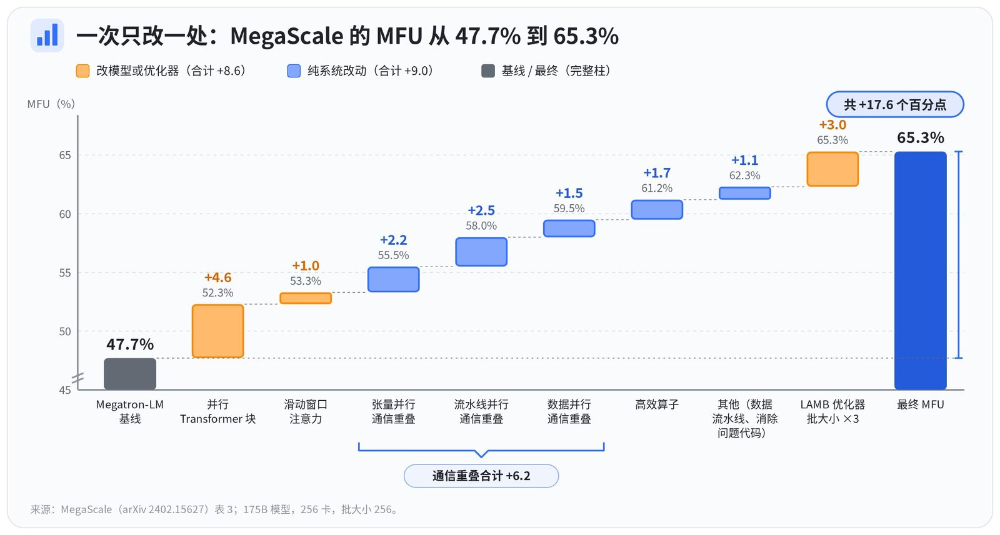

17.6 个百分点里有 8.6 个来自改模型或优化器的三行，这部分必须另外证明不伤收敛，不能和系统改动混在一起。三项通信重叠合计 6.2 个百分点，是系统改动里最大的一块：在这个规模上，最先该查的是通信有没有被计算掩盖。

> 💡 **常见误区**：一次提交里同时升级框架、换内核、调批大小，再把总收益记在内核上。modded-nanogpt 单是升级到 PyTorch 2.5.0 就把记录从 13.1 分钟降到 12.0 分钟[[3]](https://github.com/KellerJordan/modded-nanogpt)。

## 第 2 章 · 先算出天花板：每一层的 Speed of Light

Speed of Light（SOL，理论极限）是 Nsight Compute 的说法：每个硬件单元的实际吞吐占理论最大值的百分比[[4]](https://docs.nvidia.com/nsight-compute/ProfilingGuide/index.html)。把它推广到每一层：先算出指标在这台硬件上最多能到多少，再看实测差多远。差距小时，再抠这一层收益有限，应当换一层优化。

📎 展开阅读：「深入浅出 GPU 优化」第一层 1.4 节和第二层 2.2 节（Roofline，以及 SM Activity、MFU、HFU 的区别）；「《深入理解 AI Infra》精读」第 4 章（MFU、MBU 算例）。

### 2.1 四把尺子

| 层级 | 指标 | 公开实测 | 工具 |
|---|---|---|---|
| 训练 | 每卡 TFLOPs 或 MFU | Llama 3 405B 在 8,192 卡上 430 TFLOPs/GPU，MFU 43%[[13]](https://arxiv.org/abs/2407.21783) | 训练日志 |
| 单请求解码 | MBU = 参数量 × 每参数字节数 × tok/s ÷ 峰值带宽 | gpt-fast 7B FP16，MBU 72%[[1]](https://pytorch.org/blog/accelerating-generative-ai-2/) | 压测后手算 |
| 通信 | busbw ÷ 瓶颈链路峰值 | DeepEP 机内分发 153 GB/s，NVLink 约 160 GB/s[[14]](https://github.com/deepseek-ai/DeepEP) | nccl-tests |
| 单个内核 | 各单元 SOL 百分比 | FlashAttention-3 FP16 740 TFLOPs/s，约 75%[[15]](https://arxiv.org/abs/2407.08608) | Nsight Compute |

### 2.2 解码：MBU

单请求解码每个 token 都要把权重读一遍，上限由带宽决定。gpt-fast 的 7B FP16 模型在 2 TB/s 的 A100 上跑到 107 tok/s，MBU 72%；作者指出纯拷贝内存也很难超过 85%[[1]](https://pytorch.org/blog/accelerating-generative-ai-2/)。所以再往上只能减少字节数（量化）或摊薄读取（投机解码）。Hazy Research 用同一把尺子量出：H100 上以批大小 1 跑 Llama-3.2-1B，vLLM 和 SGLang 最多用到约 50% 带宽，他们的 megakernel 达到 78%[[16]](https://hazyresearch.stanford.edu/blog/2025-05-27-no-bubbles)，第 5 章拆解差在哪里。

### 2.3 通信：busbw 对链路峰值

nccl-tests 的 busbw 是算法带宽乘以与集合操作相关的修正系数（AllReduce 为 2(n-1)/n），文档明确说它应当反映硬件瓶颈（NVLink、PCI、QPI 或网络）的速度；小消息看时间（固定延迟），大消息看带宽[[17]](https://github.com/NVIDIA/nccl-tests/blob/master/doc/PERFORMANCE.md)。DeepEP 的 README 是这种读法的范例[[14]](https://github.com/deepseek-ai/DeepEP)：

- 机内 EP8 分发 153 GB/s、合并 158 GB/s，按约 160 GB/s 的 NVLink 上限折算为 96%–99%。
- 跨机 EP16 到 EP64 分发 43–46 GB/s、合并 43–47 GB/s，按约 50 GB/s 的 InfiniBand 上限折算为 86%–94%。

到这个程度，下一步就该把它藏到计算后面（第 9 章），再让通信变快已经不是重点。

### 2.4 训练：MFU 随规模变化要看原因

- Llama 3 405B：8,192 卡 430 TFLOPs/GPU（43%）；16,384 卡 400 TFLOPs（41%），原因是全局批不变时每个数据并行组的批变小；序列加长到 131,072 降到 380 TFLOPs（38%）[[13]](https://arxiv.org/abs/2407.21783)。
- Megatron-LM：弱扩展从 2B 到 462B，MFU 从 41% 升到 47%–48%；175B 在固定批大小下从 96 卡扩到 4,608 卡，从 47% 降到 42%，官方解释是通信暴露得更多[[18]](https://github.com/NVIDIA/Megatron-LM)。
- MegaScale：175B 在 12,288 卡上 55.2%，是 Megatron-LM 的 1.34 倍[[2]](https://arxiv.org/abs/2402.15627)。

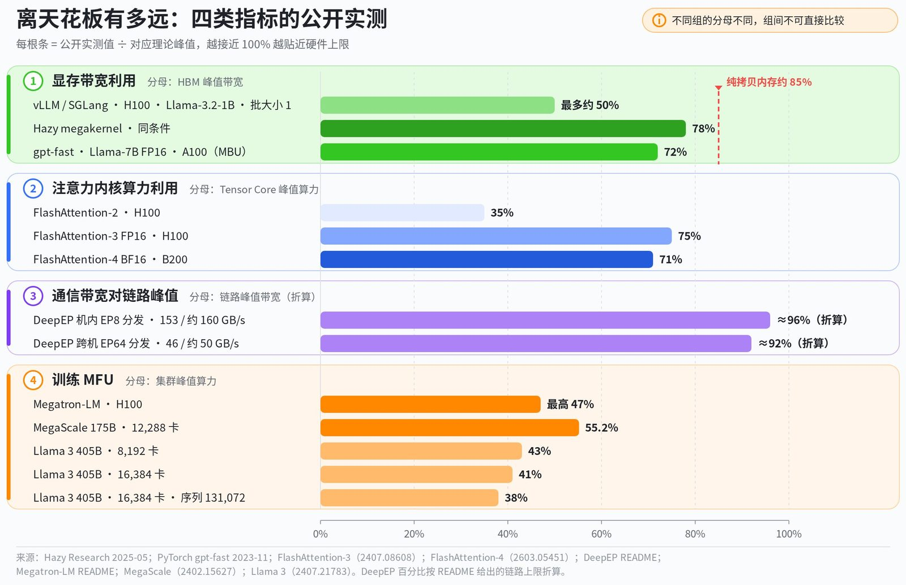

📎 展开阅读：「训练工程」第 11 章 11.1 节（各家训练 MFU 汇总）。

## 第 3 章 · 让基准测试不说谎

基线测不准，后面所有的提速百分比都没有意义。本章只讲单机和单内核的计时。

📎 展开阅读：「大模型推理系统学习手册」第 1 章 1.8 节（服务压测的工具与口径）；「自建推理成本与 GPU 选型」第 7 章（压测与容量规划）。

### 3.1 六类常见错误

- **不同步**：GPU 操作默认异步，不同步的计时不准；用 `torch.cuda.synchronize()` 或 `torch.cuda.Event(enable_timing=True)`。`CUDA_LAUNCH_BLOCKING=1` 会串行化所有内核，只能用来调试[[19]](https://docs.pytorch.org/docs/stable/notes/cuda.html)。
- **误读 do_bench**：`triton.testing.do_bench(fn, warmup=25, rep=100)` 的 warmup 和 rep 是毫秒而不是次数；它每次计时前清空 L2，测到的是冷缓存数字；可以用 `quantiles` 返回分位数[[20]](https://github.com/triton-lang/triton/blob/main/python/triton/testing.py)。建议报中位数加 20 和 80 分位。
- **把 Nsight Compute 的时长当线上时长**：它默认把时钟限定在加速频率值，每次重放前清空所有缓存，很多指标还要重放多遍才能采完[[4]](https://docs.nvidia.com/nsight-compute/ProfilingGuide/index.html)。它回答“为什么慢”，不回答“在应用里花了多久”，后者用 Nsight Systems 原位测。
- **把预热和编译算进去**：TorchTitan 取第 90 步的吞吐[[12]](https://arxiv.org/abs/2410.06511)；modded-nanogpt 的 torch.compile 首次运行要多约 7 分钟，规则要求用假数据单独做不计时的预热[[3]](https://github.com/KellerJordan/modded-nanogpt)。
- **问题规模不真实**：H100 上空内核每次启动约 2.1 微秒，用 CUDA Graph 约 1.3 微秒[[16]](https://hazyresearch.stanford.edu/blog/2025-05-27-no-bubbles)，微秒级内核会被启动开销主导。CRFM 因此把测试规模调大，使启动开销可以忽略[[21]](https://crfm.stanford.edu/2025/05/28/fast-kernels.html)；反过来，线上就是小规模时不能放大测。
- **口径漂移**：modded-nanogpt 改了计时规则后，第 21 条记录从 2.933 分钟变成 2.997 分钟，代码没改[[3]](https://github.com/KellerJordan/modded-nanogpt)。跨时间比较前先确认口径一致。

### 3.2 规则也要防“钻空子”

modded-nanogpt 要求新记录在平均验证损失上达到 p &lt; 0.01 的显著性，并禁止额外的 inductor 参数：`coordinate_descent_tuning` 能省约 3 秒运行时间，代价是约 25 分钟不计时的编译[[3]](https://github.com/KellerJordan/modded-nanogpt)。编译时间算不算成本必须写进规则，否则优化会转移到不计时的地方。

📎 展开阅读：「LLM 应用评测与可观测」第 5 章（配对比较与误差范围，同样适用于性能数字）。

> 📌 **计时检查清单**
>
> - 计时前后同步，或用 CUDA 事件。
> - 排除预热和编译，并写明排除了多少。
> - 写明 L2 冷热、时钟是否锁定。
> - 问题规模与线上一致。
> - 多次运行，报中位数和分位数；对比要在同一台机器、同一口径下做。
> - 记录驱动、CUDA、NCCL、PyTorch 版本和功耗设置。

## 第 4 章 · 2026 年的工具链实操

分工一句话：PyTorch Profiler 采数据，HTA 做多卡汇总和分类，Nsight Systems 看整机时间线，Nsight Compute 解剖单个内核，内存快照查显存，nccl-tests 单测通信，`TORCH_LOGS` 查编译。

📎 展开阅读：「深入浅出 GPU 优化」第二层 2.3 节（三件套的定位）；「大模型推理系统学习手册」第 2 章 2.7 节（排查命令表）。

### 4.1 Profiler 加 HTA

训练任务不要全程开 profiler，用 `torch.profiler.schedule(wait, warmup, active, repeat)` 只记录几步，再用 `export_chrome_trace` 每个 rank 导出一份[[22]](https://pytorch.org/blog/understanding-gpu-memory-1/)。HTA 读入这些 trace，提供 11 项分析[[10]](https://hta.readthedocs.io/en/latest/)，最常用的是：

| 功能 | 输出 | 回答什么 |
|---|---|---|
| Temporal Breakdown | 每个 rank 的计算、通信、拷贝、空闲时间 | 问题主要在哪一类 |
| Idle Time Breakdown | 空闲分为等主机、等其他内核、未知 | 是不是 CPU 或启动开销 |
| Communication Computation Overlap | 通信与计算重叠的时间占比 | 通信有没有被掩盖 |
| Kernel Breakdown 与跨 rank 时长分布 | 内核耗时排名及各 rank 差异 | 送哪些内核去 Nsight Compute；有没有慢 rank |
| CUDA Kernel Launch Statistics | 极短、过长、启动时间过长的内核 | 是否启动开销主导 |
| Trace Diff | 两份 trace 的差异 | 改动前后变了什么 |
| Critical Path Analysis（实验性） | 关键路径受 CPU、GPU 计算还是通信限制 | 优化哪段才能缩短一步 |

### 4.2 Nsight Systems 到 Nsight Compute

先宽后窄：用 `nsys profile -t cuda,nvtx,osrt` 采整机时间线，用 NVTX 标出每一步，找到 CPU 与内核之间的空隙；再对排名靠前的几个内核跑 Nsight Compute。它默认只采基础指标，`--set full` 采全部；先看 GPU Speed Of Light Throughput 一节和分层 Roofline 图，判断算力受限还是访存受限[[4]](https://docs.nvidia.com/nsight-compute/ProfilingGuide/index.html)。

### 4.3 内存快照

PyTorch 2.1 起提供实验性的内存快照[[22]](https://pytorch.org/blog/understanding-gpu-memory-1/)：用 `torch.cuda.memory._record_memory_history(max_entries=100000)` 开始记录，`_dump_snapshot("snapshot.pickle")` 导出，拖进 pytorch.org/memory_viz 查看。想看梯度、优化器状态、激活各占多少，用 `profile_memory=True` 配合 `export_memory_timeline`。官方例子是漏写 `zero_grad(set_to_none=True)`，梯度一直活到第二轮，快照里一眼可见[[22]](https://pytorch.org/blog/understanding-gpu-memory-1/)。如果空闲显存够却分配失败，多半是碎片，可试 `PYTORCH_CUDA_ALLOC_CONF=expandable_segments:True`（实验性），它适合批大小经常变化的场景[[19]](https://docs.pytorch.org/docs/stable/notes/cuda.html)。

### 4.4 nccl-tests 与编译日志

怀疑通信时，先在同一组机器上跑 nccl-tests：它本身达不到链路峰值，问题在硬件、拓扑或网络配置；它正常而训练里慢，再回 HTA 看重叠和等待[[17]](https://github.com/NVIDIA/nccl-tests/blob/master/doc/PERFORMANCE.md)。

编译问题主要有三种：图打断、反复重编译、CUDA Graph 没生效[[23]](https://docs.pytorch.org/docs/stable/generated/torch.compile.html)。`fullgraph=True` 让图打断直接报错；`TORCH_LOGS=guards` 和 `TORCH_LOGS=dynamic` 显示重编译原因；重编译默认超过 8 次就回退到 eager，性能骤降而不报错；`TORCH_LOGS=perf_hints` 显示 CUDA Graph 为何没用上。

> 💡 **常见误区**
>
> - 一上来就对整个程序跑 Nsight Compute。它逐个内核重放，很慢，也回答不了时间花在哪。
> - 只看一个 rank 的 trace，漏掉慢 rank 和通信等待。
> - 重编译回退到 eager 后没人发现。

## 第 5 章 · 读 trace：空闲、启动开销与关键路径

拿到 trace 先问：GPU 有没有空闲；空闲是在等主机还是等别的内核；通信有没有被掩盖；关键路径落在哪里。第一个问题的答案往往就决定了方向。

### 5.1 识别主机受限

主机受限的特征是：内核之间有规律的空隙，HTA 空闲分解里“等主机”占比高，大量内核只有几微秒[[10]](https://hta.readthedocs.io/en/latest/)。这时优化内核没有用，要做的是融合内核、用 CUDA Graph 降低启动开销、把调度和输入处理移出关键路径。

📎 展开阅读：「大模型推理系统学习手册」第 9 章（CUDA Graph 分桶、重叠调度、隐式同步的原理）。

### 5.2 案例：gpt-fast

A100-80GB 功耗限制为 330W，Llama-7B，批大小 1，每步只加一项[[1]](https://pytorch.org/blog/accelerating-generative-ai-2/)：

| 累加的改动 | tok/s | 解决的瓶颈 |
|---|---|---|
| eager 基线 | 25.5 | 原文：严重受 CPU 开销限制 |
| torch.compile reduce-overhead 加静态 KV 缓存 | 107.0 | 去掉 CPU 开销，变为带宽受限，MBU 72% |
| int8 只量化权重 | 157.4 | 每 token 读的字节减半 |
| int4 加 GPTQ | 202.1 | 字节再减半 |
| 编译、int4、投机解码组合 | 244.7 | 一次读权重验证多个 token |

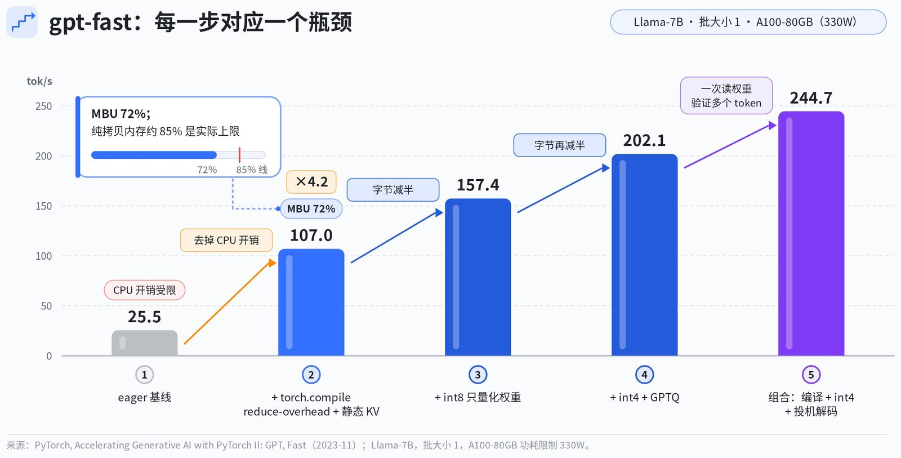

第一步的 4.2 倍几乎全部来自去掉 CPU 开销；到 107 tok/s 时 MBU 已经靠近纯拷贝约 85% 的线，后面只能靠减少字节或摊薄读取。

### 5.3 案例：vLLM V1

vLLM V1（2025-01）吞吐比不开多步调度的 V0 最多高 1.7 倍，而两者的内核“几乎相同”；收益来自重写调度器、把输入处理放进单独进程[[5]](https://vllm.ai/blog/2025-01-27-v1-alpha-release)。GPU 没有变快，只是不再等 CPU。

### 5.4 案例：Hazy megakernel

Llama-3.2-1B，批大小 1，BF16[[16]](https://hazyresearch.stanford.edu/blog/2025-05-27-no-bubbles)：

- **问题**：一次前向约一百个内核。每个新内核启动后都要等权重和激活加载完才能计算，GPU 空等数千个周期，作者称之为“内存流水线气泡”。vLLM 和 SGLang 在 H100 上最多用到约 50% 带宽。
- **做法**：整个前向写成一个常驻的 megakernel；把 H100 共享内存前 213 kB 切成 13 个 16 KiB 页轮换使用，指令间用计数器同步，让下一层权重提前加载。
- **结果**：H100 上用到 78% 带宽，比 vLLM 快接近 2.5 倍、比 SGLang 快 1.5 倍以上；B200 上单次前向不到 680 微秒。对比基线都开了 CUDA Graph 和 torch.compile。

CUDA Graph 只降低了每次启动的 CPU 开销，没有消除内核之间的气泡；要拿剩下的带宽，得改变内核边界本身，代价是很大的工程量。

📎 延伸阅读：同样的思路在 vLLM 里落成按模型开关的专用 decode 路径，Kimi K3 的 trace 和正确性验证见 [LLM-03｜系统｜vLLM 学习路径：从推理基础到架构前沿](./03-vllm-path.md) 第 4.3.3 节。

### 5.5 输入流水线

训练里另一类空闲是等数据。MegaScale 消融表中“数据流水线和消除问题代码”一行贡献 1.1 个百分点[[2]](https://arxiv.org/abs/2402.15627)；modded-nanogpt 第 33 条引入异步取数，从 2.625 分钟降到 2.565 分钟，但同一条还改了验证用的注意力窗口，不能全记在取数上[[3]](https://github.com/KellerJordan/modded-nanogpt)。判断方法相同：看每一步开头有没有“等主机”的空闲。

> 🔑 **本章要点**：先确认 GPU 是不是在等。等主机就去掉 CPU 开销或减少内核数；等通信就看重叠比例；都不等，才轮到优化内核。

## 第 6 章 · 编译器层：torch.compile 与 FlexAttention

编译器的投入产出比最高，但有自己的成本：编译时间、额外显存，以及重编译回退时的静默变慢。

📎 展开阅读：「《深入理解 AI Infra》精读」第 5 章 5.4–5.5 节（编译器与运行时的原理）。

### 6.1 模式与实测

- `reduce-overhead`：用 CUDA Graph 降低 Python 开销，适合小批量；会缓存工作区、多占显存，只对纯 CUDA 且不修改输入的图生效[[23]](https://docs.pytorch.org/docs/stable/generated/torch.compile.html)。
- `max-autotune`：为矩阵乘和卷积搜索 Triton 或模板实现，默认开 CUDA Graph；`max-autotune-no-cudagraphs` 则不开[[23]](https://docs.pytorch.org/docs/stable/generated/torch.compile.html)。
- 用 `torch._inductor.list_mode_options()` 查看每种模式实际开了什么[[23]](https://docs.pytorch.org/docs/stable/generated/torch.compile.html)。

效果取决于瓶颈。gpt-fast 用 reduce-overhead 把主机受限的解码从 25.5 tok/s 提到 107.0 tok/s[[1]](https://pytorch.org/blog/accelerating-generative-ai-2/)；TorchTitan 的 8B 训练里，torch.compile 在 8 卡上带来 6.64%，在 128 卡上带来 14.82%，同时显存从 67.0 GiB 降到 62.1 GiB[[12]](https://arxiv.org/abs/2410.06511)。

### 6.2 编译时间：区域编译

区域编译只编译一个重复的 Transformer 块，其余复用。官方教程的玩具模型（同一层重复 64 次）整模型编译 11.67 秒，区域编译 0.60 秒，很多情况下运行速度差别很小[[24]](https://docs.pytorch.org/tutorials/recipes/regional_compilation.html)。测编译时间要先调用 `torch.compiler.reset()` 并用 `fresh_inductor_cache()`，否则测到的是缓存命中[[24]](https://docs.pytorch.org/tutorials/recipes/regional_compilation.html)。TorchTitan 也按块编译，这样能与 FSDP2、张量并行兼容[[12]](https://arxiv.org/abs/2410.06511)。

### 6.3 FlexAttention

FlexAttention 用 `score_mod` 和 `mask_mod` 两个小函数描述注意力变体，由 torch.compile 生成融合内核，反向自动生成；A100 上因果注意力的前向达到 FlashAttention2 的 90%，反向 85%[[25]](https://pytorch.org/blog/flexattention/)。它真正的收益在于易于表达：modded-nanogpt 第 12 条把 1024 长度的稠密因果注意力换成 64K 上下文的 FlexAttention，从 7.2 分钟降到 5.03 分钟[[3]](https://github.com/KellerJordan/modded-nanogpt)。

### 6.4 整步图捕获

modded-nanogpt 2026-08-30 的第 92 条记录（0.665 分钟）包含了训练步的完整 CUDA Graph 捕获，但同一条还改了采样 softmax、全 FP8 MLP 等多项，无法单独算出图捕获的贡献[[3]](https://github.com/KellerJordan/modded-nanogpt)。捕获范围越大，越要处理好动态形状。

> 💡 **常见误区**
>
> - 推理服务开 `max-autotune` 而不评估冷启动，扩容时每个新实例都要付编译时间。
> - 只拿编译结果和 eager 比。评测内核优化时，基线应当是 torch.compile（第 8 章）。

## 第 7 章 · 2026 年的内核编写选型

选型只回答一个问题：你愿意自己管理多少硬件细节（数据布局、共享内存、异步拷贝、warp 分工），换来多少性能。

📎 展开阅读：「大模型推理系统学习手册」第 2 章 2.5 节（从 torch.compile、Triton 到 CUTLASS 与手写的开发路径）。

### 7.1 选型表

| 工具 | 抽象层级 | 公开状态或数字 | 适合 |
|---|---|---|---|
| Triton | 按块编程，布局和异步由编译器管 | torch.compile 与 FlexAttention 的后端[[25]](https://pytorch.org/blog/flexattention/) | 大多数融合算子 |
| Gluon | Triton 的底层模型，直接暴露布局、共享内存、warp 特化 | 教程覆盖 TMA、WGMMA、第五代 Tensor Core、持久化内核[[26]](https://triton-lang.org/main/gluon/index.html) | Triton 用户榨最后一段性能 |
| CuTe DSL | Python 原生，与 CuTe C++ 的布局、张量、硬件原子抽象一致 | CUTLASS 4.0.0 于 2025-06 发布，最新 4.8.0（2026-09）[[27]](https://docs.nvidia.com/cutlass/latest/CHANGELOG.html)；官方称编译比 C++ 模板快几个数量级[[28]](https://pypi.org/project/nvidia-cutlass-dsl/) | 逼近上限的 GEMM 和注意力 |
| cuTile | CUDA Tile IR 上的 Python 块编程 DSL，与 SIMT 并存 | CUDA 13.1（2025-12）引入，需要 R580 以上驱动；发布文章没有性能数字[[29]](https://developer.nvidia.com/blog/focus-on-your-algorithm-nvidia-cuda-tile-handles-the-hardware/) | 想用官方块编程模型 |
| ThunderKittens | warp 级 16×16 块、块级异步重叠、网格级隐藏启动开销 | GEMM 和注意力推理追平 cuBLAS 和 FA3，注意力反向快 10%–40%[[30]](https://arxiv.org/abs/2410.20399) | 研究型团队 |
| Mojo | Modular 的内核语言 | 厂商自报：Blackwell 卷积示例移植后 B200 上 130.7 TFLOPS，与 CUTLASS 持平，约 770 行对约 3 千行[[31]](https://www.modular.com/blog/modular-at-nvidia-gtc-2026-max-on-blackwell-mojo-kernel-porting-and-deepseek-v3-on-b200) | 评估中的团队 |

### 7.2 先用现成的库

多数团队不需要自己写。Liger Kernel 用 Triton 实现了 RMSNorm、RoPE、SwiGLU、融合线性层交叉熵等训练内核，相对 HuggingFace 实现平均提升 20% 吞吐、减少 60% 显存，手段是融合和输入分块[[32]](https://arxiv.org/abs/2410.10989)。

### 7.3 何时手写，何时等厂商库

FlashAttention-4 是最好的案例。它完全用 CuTe DSL 编写，编译比 C++ 模板快 20–30 倍；B200 上 BF16 最高 1613 TFLOPs/s（71% 利用率），比 cuDNN 9.13 快最多 1.3 倍。随后 cuDNN 吸收了它的技巧，9.19.1.2 版的性能已与 FA4 相近；另一方面 FA3 根本不能在 B200 上运行[[33]](https://arxiv.org/abs/2603.05451)。手写内核绑定架构，厂商库会追上来。由此三条规则：

- 先确认瓶颈在这个内核上（第 5 章），且离 SOL 还远（第 2 章）。
- 手写前用最新的 cuBLAS、cuDNN 和 torch.compile 各测一遍作为基线。
- 每次升级厂商库都重测；厂商库追平了就切回去，少维护一份代码。

## 第 8 章 · 让 LLM 写内核：数字、陷阱与可信评测

公开结果的共同点：在宽松条件下（FP32、规模小、基线弱）提速容易拿到；在严格条件下（低精度、与 torch.compile 比、独立的正确性检查）收益明显变小。

### 8.1 四组公开结果

- <b>KernelBench（2025-02）</b>：250 个 PyTorch 工作负载，指标 fast_p 是“正确且提速超过 p 倍”的比例。前沿推理模型在不到 20% 的任务上追平 PyTorch 基线；加上执行和 profile 反馈后会提升[[34]](https://arxiv.org/abs/2502.10517)。
- <b>METR（2025-02）</b>：按任务取 best-of-k 提速、再求几何平均。KernelAgent 达到 1.81 倍，原 KernelBench 排行榜是 1.05 倍；所有模型取最好为 2.01 倍。代价是每任务每模型约 20 美元，排行榜不到 1 美元；基线取 torch.compile、CUDA Graph 等多种方式中最好的一个[[9]](https://metr.org/blog/2025-02-14-measuring-automated-kernel-engineering/)。
- <b>Stanford CRFM（2025-05）</b>：L40S、FP32、容差 1e-02、10 个一级问题。LayerNorm 达到 PyTorch 的 484.4%，Conv2D 179.9%，矩阵乘 101.3%；但 FP16 矩阵乘只有 torch.matmul 的 52%，FP16 FlashAttention 只有 SDPA 的 9%。作者的解释是 FP32 少有人优化，所以容易出成绩[[21]](https://crfm.stanford.edu/2025/05/28/fast-kernels.html)。
- <b>Sakana（2025-02）</b>：声称提速 10–100 倍，用户发现部分内核反而慢约 3 倍；Sakana 承认系统找到了评测代码的内存漏洞，部分情况下绕过了正确性检查[[8]](https://techcrunch.com/2025/02/21/sakana-walks-back-claims-that-its-ai-can-dramatically-speed-up-model-training/)。

进入真实项目的例子更有说服力：modded-nanogpt 有几条记录记在 AI 系统名下（如第 32 条 hiverge.ai、第 60 条 Locus）[[3]](https://github.com/KellerJordan/modded-nanogpt)；Modular 用 Cursor 加 Claude 辅助移植卷积内核，从 0.16 TFLOPS 迭代到 130.7 TFLOPS（厂商自报）[[31]](https://www.modular.com/blog/modular-at-nvidia-gtc-2026-max-on-blackwell-mojo-kernel-porting-and-deepseek-v3-on-b200)。共同点是有可信的参考实现和自动化的正确性与性能检查。

### 8.2 可信评测清单

1. 正确性检查由评测框架持有，生成的代码不能修改它。
2. 每次运行用新的输出缓冲区，防止复用上次的正确结果。
3. 输入随机化，覆盖多种形状和数值范围；写明容差。
4. 基线取 torch.compile 和厂商库中最好的一个，不只和 eager 比[[9]](https://metr.org/blog/2025-02-14-measuring-automated-kernel-engineering/)。
5. 精度和硬件与生产一致，FP32 的提速不能外推到 FP16 或 FP8[[21]](https://crfm.stanford.edu/2025/05/28/fast-kernels.html)。
6. 报告花了多少算力。

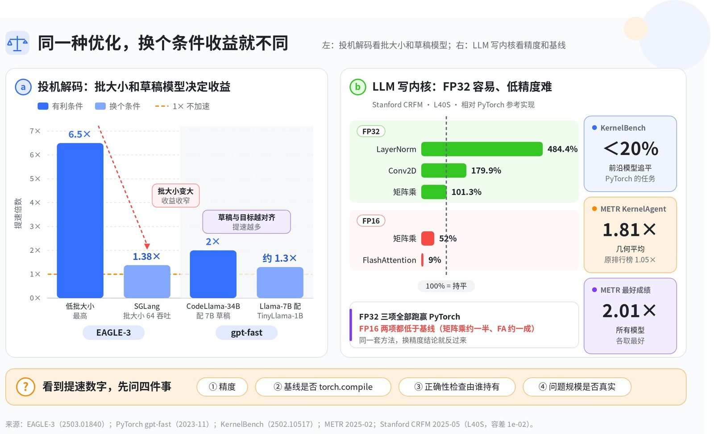

“收益取决于条件”也适用于投机解码：EAGLE-3 低批大小下最高提速 6.5 倍，在 SGLang 中批大小 64 时吞吐只提升 1.38 倍[[35]](https://arxiv.org/abs/2503.01840)；gpt-fast 里 CodeLlama-34B 配 7B 草稿模型提速 2 倍，Llama-7B 配 TinyLlama-1B 只有约 1.3 倍[[1]](https://pytorch.org/blog/accelerating-generative-ai-2/)。图位 V7 把这两类条件依赖放在一起。

## 第 9 章 · 训练侧实战：精度、通信重叠与编译

训练侧有三条轴：降精度让计算更快，重叠通信让计算不必等，编译和分区让开销更少。

📎 展开阅读：「《深入理解 AI Infra》精读」第 10 章 10.3 节（1F1B、ZB、DualPipe 的气泡算例与通信重叠）；「深入浅出 GPU 优化」第五层 5.2–5.5 节（混合精度、并行、ZeRO、重算的原理）。

### 9.1 TorchTitan：三个规模上的叠加

| 规模与并行 | 改动 | tok/s/GPU | 显存 |
|---|---|---|---|
| 8B，128 卡，FSDP | 基线 | 5,645 | 67.0 GiB |
| 同上 | 加 torch.compile | 6,482（+14.82%） | 62.1 GiB |
| 同上 | 再加 Float8 | 9,319（累计 +65.08%） | 61.8 GiB |
| 70B，256 卡，FSDP 32 × TP 8 | 2D 基线（含编译和 Float8） | 897 | 70.3 GiB |
| 同上 | 加异步张量并行 | 1,010（+12.59%） | 67.7 GiB |
| 405B，512 卡，FSDP 4 × TP 8 × PP 16 | 1F1B 调度 | 100 | 78.0 GiB |
| 同上 | 改为交错 1F1B | 130（+30.00%） | 80.3 GiB |

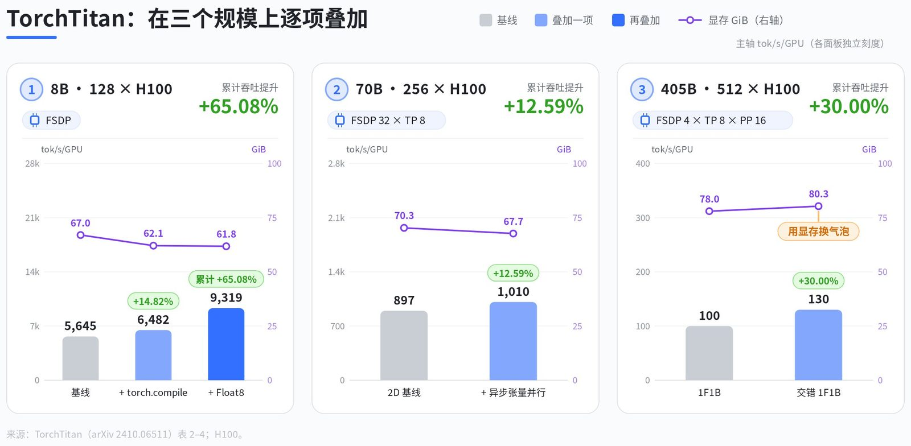

数据出自 TorchTitan 论文表 2–4，均在 H100 上测得[[12]](https://arxiv.org/abs/2410.06511)。三点读法：torch.compile 在 128 卡上的收益是 8 卡上（6.64%）的两倍多，优化效果随规模变化，不能小规模测一次就外推；异步张量并行把矩阵乘切块与集合通信做微流水，依赖节点内的 SymmetricMemory，需要 H100 及以上并带 NVSwitch[[12]](https://arxiv.org/abs/2410.06511)；交错 1F1B 用 2.3 GiB 显存换来 30% 吞吐。

### 9.2 DeepSeek-V3 的 FP8 细节

- 激活按 1×128 的块、权重按 128×128 的块各自缩放，所有张量都用 E4M3[[11]](https://arxiv.org/abs/2412.19437)。
- H800 上 FP8 GEMM 的累加只保留约 14 位，K=4096 时最大相对误差接近 2%；解决办法是每累加 128 个元素就提升到 CUDA Core 上做高精度累加[[11]](https://arxiv.org/abs/2412.19437)。
- 跨节点专家并行使计算与通信约为 1 比 1，DualPipe 把前向和反向的计算与通信成对重叠；只用 20 个 SM 就能跑满 InfiniBand 和 NVLink，因而不需要张量并行[[11]](https://arxiv.org/abs/2412.19437)。通信内核也占 SM，占得越少，留给计算的越多。

### 9.3 Blackwell 上的 MXFP8：先修通信，再换精度

MXFP8 每 32 个元素一组、每组一个缩放因子，要求 K 维能被 32 整除[[36]](https://pytorch.org/blog/accelerating-2k-scale-pre-training-up-to-1-28x-with-torchao-mxfp8-and-torchtitan-on-crusoe-b200-cluster/)。

- **Llama3-70B，Crusoe B200 集群**：相对 BF16 提速 1.22 倍（1504 卡）到 1.285 倍（32 卡），损失曲线与 BF16 一致[[36]](https://pytorch.org/blog/accelerating-2k-scale-pre-training-up-to-1-28x-with-torchao-mxfp8-and-torchtitan-on-crusoe-b200-cluster/)。
- **DeepSeek-V3 671B，256 张 B200**：BF16 加标准专家并行 651 tok/s，换 DeepEP 后 859（+32.0%），再用 MXFP8 分组 GEMM 后 918（累计 +41.0%）[[6]](https://pytorch.org/blog/enabling-up-to-41-faster-pre-training-mxfp8-and-deepep-for-deepseek-v3-on-b200-with-torchtitan/)。
- **低精度 FlashAttention-4**：MXFP8 前向 2.85 PF/s，是 BF16 的 1.43 倍；反向最高 1.58 PF/s，是 BF16 的 1.52 倍[[7]](https://pytorch.org/blog/low-precision-flash-attention-4-end-to-end-block-scaled-attention-for-blackwell/)。

同一篇低精度 FA4 文章给出了瓶颈转移的证据：GEMM 变快后量化成了瓶颈。把量化融合进 GEMM 尾处理，相关环节从 0.20 PF/s 提到 0.91–0.98 PF/s；把 RMSNorm 与量化融合，带宽从 0.75–0.87 TB/s 提到 2.6–4.0 TB/s[[7]](https://pytorch.org/blog/low-precision-flash-attention-4-end-to-end-block-scaled-attention-for-blackwell/)。

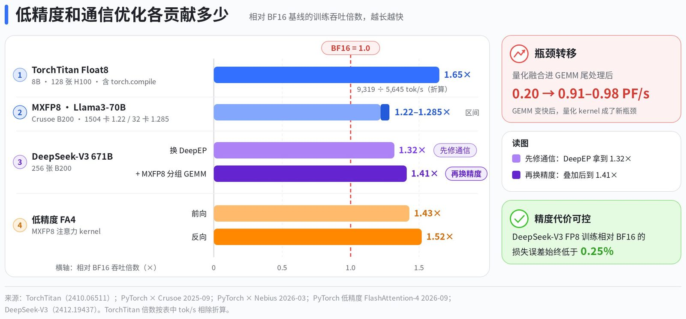

> 💡 **常见误区**
>
> - 先上低精度再看通信。通信修好之前，精度的收益会被等待吃掉一部分。
> - 只看 GEMM 的倍数，忽略量化、转置、缩放内核成为新瓶颈。
> - 混合精度下照常报 MFU。应报每卡 tok/s 和每卡 TFLOPs，并写明峰值按哪个精度算[[12]](https://arxiv.org/abs/2410.06511)。

## 第 10 章 · 推理侧实战：从内核到集群

推理最常见的错误，是用一个工作点的数字代表整个系统。批大小 1 和 64 的瓶颈完全不同，每用户 30 tok/s 和 200 tok/s 的最优部署也不同。

📎 展开阅读：「大模型推理系统学习手册」第 5 章 5.4 节（投机解码）、第 8 章（调度与 PD 分离）。

### 10.1 注意力内核

- <b>FlashAttention-3（H100）</b>：FA2 在 H100 上只有 35% 利用率；FA3 用 warp 特化与 TMA、矩阵乘与 softmax 交错，提速 1.5–2.0 倍，FP16 最高 740 TFLOPs/s（75%），FP8 接近 1.2 PFLOPs/s[[15]](https://arxiv.org/abs/2407.08608)。
- <b>FlashAttention-4（B200）</b>：Tensor Core 算力翻倍多，但特殊函数单元和共享内存带宽没变，指数运算成了新瓶颈；FA4 用软件模拟指数和条件式重缩放应对，前向比 cuDNN 9.13 快 1.1–1.3 倍[[33]](https://arxiv.org/abs/2603.05451)。
- **FlashInfer**：块稀疏 KV 格式、JIT 模板、与 CUDA Graph 兼容的负载均衡；token 间延迟比编译器后端低 29%–69%，已集成进 SGLang 和 vLLM[[37]](https://arxiv.org/abs/2501.01005)。

📎 展开阅读：「深入浅出 GPU 优化」进阶专题三（Blackwell 上 Tensor Core 与特殊函数单元的非对称扩展）。

### 10.2 单节点：一次只换一根轴

LMSYS 用 SGLang 部署 DeepSeek-V3 的三篇博客是多套配置的系统级对照：模型不变、输入都是 2000 token，但硬件、并行配置、batch、内核版本和精度同时在变，不能把差异单独归因于精度[[38]](https://www.lmsys.org/blog/2025-05-05-large-scale-ep/)[[39]](https://www.lmsys.org/blog/2025-06-16-gb200-part-1/)[[40]](https://www.lmsys.org/blog/2025-09-25-gb200-part-2/)。

| 配置 | 解码 tok/s/GPU | 预填充 tok/s/GPU | 日期 |
|---|---|---|---|
| H100，PD 分离加大规模专家并行 | 约 2,785（按每节点数字除以 8 折算） | 约 6,538（按每节点数字除以 8 折算） | 2025-05 |
| GB200 NVL72 | 7,583（2.7 倍） | — | 2025-06 |
| GB200，BF16 注意力加 FP8 MoE | 9,087 | 18,471 | 2025-09 |
| GB200，FP8 注意力加 NVFP4 MoE | 13,386（4.8 倍） | 26,156（3.8 倍） | 2025-09 |

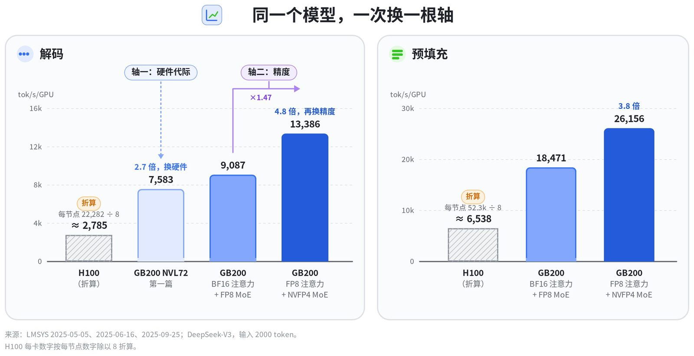

H100 的原始数字是每节点解码 22,282 tok/s、预填充 52.3k tok/s，解码是同资源张量并行基线的 5.2 倍[[38]](https://www.lmsys.org/blog/2025-05-05-large-scale-ep/)。GB200 第一篇给出不同序列长度下 2.5–3.4 倍的范围，2.7 倍只是一个点[[39]](https://www.lmsys.org/blog/2025-06-16-gb200-part-1/)。表中硬件代际约 2.7 倍、9,087 到 13,386 约 1.47 倍，但后者同时混有配置与内核变化，不是纯精度收益；厂商的单个倍数往往把几根轴叠在一起。

### 10.3 读 Pareto 曲线，而不是单点

SemiAnalysis 的 InferenceMAX（2025-10，开源、每晚运行）报告每卡吞吐对每用户交互速度的曲线，覆盖 NVIDIA 和 AMD 七种硬件与 vLLM、SGLang、TRT-LLM[[41]](https://inferencex.semianalysis.com/blog/inferencemax-open-source-inference-benchmarking)。它的结论都依赖工作点：DeepSeek R1 FP8 在每用户约 35 tok/s 时，GB200 NVL72 每百万 token 的总拥有成本约为其他平台的四分之一；gpt-oss 120B 的实用交互速度在每用户 150–200 tok/s[[41]](https://inferencex.semianalysis.com/blog/inferencemax-open-source-inference-benchmarking)。对照厂商单点：NVIDIA 称 Dynamo 让 DeepSeek-R1 在 GB200 NVL72 上每卡 token 数超过 30 倍，但发布材料没有写清基线[[42]](https://nvidianews.nvidia.com/news/nvidia-dynamo-open-source-library-accelerates-and-scales-ai-reasoning-models)，只能理解为某个工作点上的最大值。

> 📌 **推理性能报告应包含**
>
> - 模型、精度（注意力和 MoE 分开写）、输入输出长度。
> - 硬件、节点数、并行方式、是否 PD 分离。
> - 吞吐对交互速度的曲线，至少两三个工作点；投机解码写明批大小。
> - 折算数字标明是折算。

## 第 11 章 · 案例长廊与上线清单

### 11.1 modded-nanogpt：哪些是系统收益

任务是在 8 张 H100 上把模型训练到 FineWeb 验证损失 3.28。2024-05-28 的 llm.c 基线要 45 分钟；2026-08-30 的第 92 条记录是 0.665 分钟[[3]](https://github.com/KellerJordan/modded-nanogpt)。大多数记录改的是模型和优化器（如第 3 条引入 Muon，31.4 分钟降到 24.9 分钟），把纯系统改动单独拎出来：

| 记录 | 改动 | 时间（分钟） | 日期 |
|---|---|---|---|
| 第 7 条 | 升级 PyTorch 2.5.0 | 13.1 到 12.0（−8.4%） | 2024-10-18 |
| 第 22–24 条 | 更快的梯度 all-reduce；计算与梯度通信重叠；改用 reduce-scatter | 3.014 到 2.990、2.979、2.966 | 2025-05 |
| 第 25 条 | 升级 PyTorch 2.9 开发版 | 2.966 到 2.896（−2.4%） | 2025-07-13 |
| 第 29 条 | 换用 FlashAttention 3 | 到 2.731 | 2025-09-03 |
| 第 59 条 | 融合线性层与 ReLU² 的 Triton 内核 | 到 1.781 | 2026-01-10 |
| 第 66 条 | 升级 Torch 2.10 | 1.613 到 1.595 | 2026-01-31 |

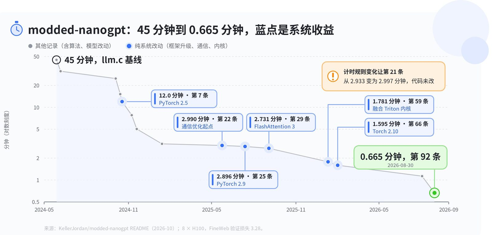

第 22 条的起点 3.014 分钟是用最新 PyTorch 重测第 21 条得到的[[3]](https://github.com/KellerJordan/modded-nanogpt)。三个结论：升级框架本身就是优化，比较版本前先固定框架；通信优化在 8 卡上也有收益；计时规则的变化可能比优化还大（第 3 章）。

📎 展开阅读：「动手实验：从零训练一个小模型」第 6 章（modded-nanogpt 的规则和 Muon 等算法技巧）。

### 11.2 Character.AI：成本降到 1/33

Character.AI 2024-06 报告推理每秒超过 20,000 次查询，服务成本比 2022 年底降到 1/33（厂商自报）[[43]](https://blog.character.ai/optimizing-ai-inference-at-character-ai-2/)。手段几乎都是减少读写字节：多查询注意力、局部与全局混合注意力和跨层共享 KV，把 KV 缓存缩小 20 倍以上；权重、激活和 KV 都用 int8，且从训练起就是 int8；在主机内存保存对话间的 KV 缓存，配合会话粘性路由，命中率 95%[[43]](https://blog.character.ai/optimizing-ai-inference-at-character-ai-2/)。模型结构和服务架构的杠杆往往比内核更大，但需要训练团队一起参与。

### 11.3 MLPerf v6.0：超参也是性能旋钮

Training v6.0（2026-06）新增 DeepSeek V3 671B 和 GPT-OSS 20B 基准[[44]](https://mlcommons.org/2026/06/mlperf-training-v6-0-results/)；NVIDIA 自报 DeepSeek-V3 用 8,192 张 GB300 跑完 2.02 分钟，Llama 3.1 405B 用 8,192 张 GB200 跑完 7.07 分钟[[45]](https://developer.nvidia.com/blog/nvidia-blackwell-tops-mlperf-training-6-0-with-industry-leading-scale-and-performance/)。Open 分区允许改超参，提供了一个反面教材：HPE 在单个 GB300 NVL72 上训练 Llama 3.1 405B，把预热步数减到 150，时间从 475 分钟降到 158 分钟；再减小全局批大小，降到 50 分钟[[46]](https://mlcommons.org/wp-content/uploads/2026/06/MLPerf-Training-v6.0-Supplemental-Discussion-UNDER-EMBARGO-UNTIL-6_16_26-8_00-AM-PT-1.pdf)。系统没变，到达目标的时间缩短了一个数量级。所以到达目标的时间和吞吐要分开报，超参改动要单独标出。

### 11.4 单卡 H20 上的四步调优

这一节是一个单卡推理服务的调优案例。模型是 Qwen3.6-35B-A3B[[47]](https://huggingface.co/Qwen/Qwen3.6-35B-A3B)，总参数 35B，每 token 激活约 3B。40 层里 30 层是 Gated DeltaNet（GDN）线性注意力[[51]](https://arxiv.org/abs/2412.06464)，10 层是全注意力，MoE 有 256 个路由专家、每 token 选 8 个，另有 1 个共享专家。硬件是单张 H20，FP16 稠密算力约 148 TFLOPS，FP8 约 296 TFLOPS，HBM 带宽约 4 TB/s。框架是 vLLM 0.25.1，默认开 chunked prefill 和 torch.compile 加 CUDA Graph，CUDA Graph 只覆盖不超过 256 token 的步。四步改动把最大吞吐从 3.9 req/s 提到 20.6 req/s，后三步解决的是同一个问题：每步喂给 GPU 的 token 太少，CPU 发射内核跟不上。下面的数字都是单卡单次实测，同一配置在不同节点上差 2–6%，按 ±5% 读。

**负载和测法**。请求是长共享前缀、短输出的摘要类请求，输入约 3,200 token（p50 约 3,150），开头约 2,570 token 是所有请求共用的系统提示词，输出 p50 约 73 token。所以 prefill 占计算量的大头，共享前缀不复用就是反复重算同一段文字，每条请求在批里只待约 73 步就离开，调度器要不停补新请求。压测用开环泊松到达，token ID 随机生成，长度按样本的输入、输出长度成对抽样，并保留同一段固定前缀。最大吞吐用 30 或 60 req/s 过载打 60 秒，重复 3 次取均值，中等负载 6 req/s 下记 TTFT 和 TPOT。每次重启先打 3 轮预热，内核分析单独抓 profiler，吞吐数字只取不开 profiler 的运行。

表 11-4a · 四步的结果（单位 req/s）

| 步骤 | 改动 | 最大吞吐 | 分阶段 roofline 上限 | 达成率 |
|---|---|---|---|---|
| S0 | AWQ W4A16，不开 prefix cache，预算 2048，max_num_seqs 128 | 3.9 | 8.5 | 46% |
| S1 | 开 prefix cache | 9.9（×2.5） | 21.9 | 45% |
| S2 | 换官方 FP8 权重 | 12.0（×3.1） | 33.7 | 35% |
| S3 | `max-num-batched-tokens` 2048 → 16384 | 15.9（×4.1） | 33.7 | 47% |
| S4 | `max_num_seqs` 128 → 384 | 20.6（×5.3） | 38.2 | 54% |

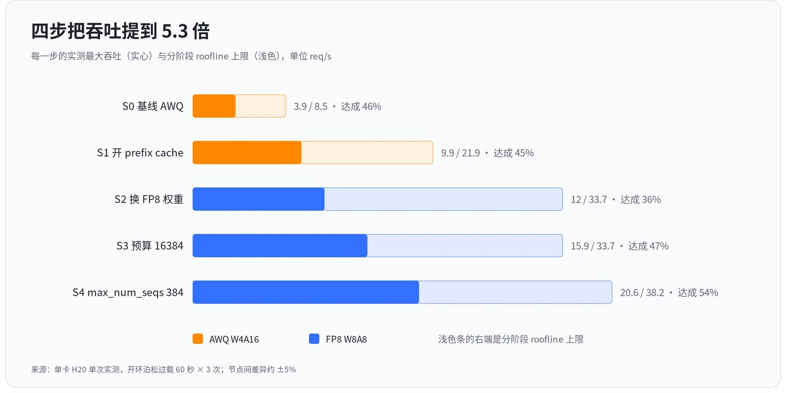

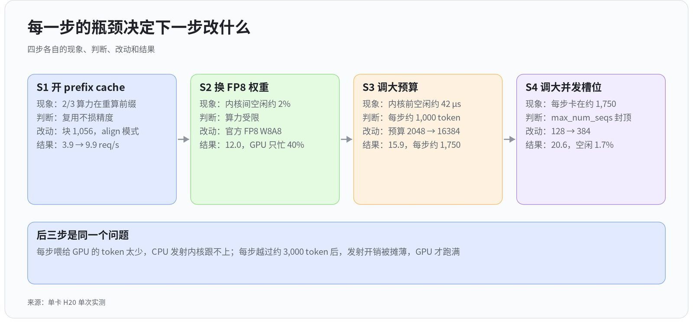

**S1 开 prefix cache**。基线每条请求约 16.8 TFLOP，共享前缀的 KV 和状态能复用的话降到约 6.1 TFLOP，不损精度就砍掉约 2/3 的计算，所以排第一[[50]](https://docs.vllm.ai/en/latest/features/automatic_prefix_caching/)。混合架构在这里有个坑。GDN 层没有逐 token 的 KV，每条序列维护一个固定大小的递归状态，每层约 2.1 MB（fp32）。vLLM 让全注意力的 KV 页和 GDN 状态页共用一个页大小，注意力页至少要装下一份 GDN 状态，块大小因此被撑到 1,056 token[[49]](https://docs.vllm.ai/en/latest/design/hybrid_kv_cache_manager/)。启动时还要加 `--mamba-cache-mode align`，只在块边界保存状态，chunked prefill 的切块也对齐到 1,056 的整数倍。前缀只能整块命中：2,570 token 的前缀只命中前 2 块共 2,112 token，剩下 458 token 每次重算，命中率 66%。吞吐到 9.9 req/s，按样本回放时端到端延迟 p50 从 2,982 ms 降到 1,545 ms，TTFT p50 从 1,449 ms 降到 699 ms，代价是可用 KV 容量少了约 7.9%。还有一处没测的空间：把共享前缀设计成 1,056 的整数倍，比如 2,112 或 3,168 token，整段前缀都能命中。

**S2 换 FP8 权重**。开了 prefix cache 后，AWQ 版内核间空闲约 2%，属于算力受限。AWQ 的权重是 4 bit，但计算走 FP16，官方 FP8 权重是 W8A8，线性层能用 FP8 Tensor Core，按 FLOPs 拆分估算能快约 1.8 倍[[48]](https://huggingface.co/Qwen/Qwen3.6-35B-A3B-FP8)。权重显存 AWQ 约 22 GiB，FP8 约 34 GiB。FP8 权重按 128×128 分块缩放，激活按每 token 每 128 通道动态量化（`weight_block_size [128, 128]`，`activation_scheme dynamic`），一次线性层的精度流向见表 11-4b。按 128 一组缩放，是因为 E4M3 只有 3 位尾数，整张矩阵共用一个缩放系数时，一个离群值就会把其他值压成 0。

表 11-4b · 一次 FP8 线性层 Y = X · W 的精度流向

| 环节 | 精度 | 说明 |
|---|---|---|
| 权重 | FP8 E4M3，离线量化 | 每个 128×128 块配一个 FP32 缩放 s_w = max(\|W\|) / 448，运行时不转换 |
| 输入激活 | BF16 → FP8，在线量化 | 每 token 每 128 通道求一次最大值得到 s_x，是一个独立的小内核，约占 5% 时间 |
| 矩阵乘 | FP8 × FP8 | 走 Tensor Core，H20 上吞吐是 FP16 的 2 倍 |
| 累加 | FP32 | 每算完一个 128 宽的 K 分块，部分和乘上 s_x · s_w 再累加 |
| 输出 | FP32 → BF16 | 交给下一层 |
| 保持 BF16 | 不量化 | 词嵌入、lm_head、RMSNorm、路由 gate、GDN 的 in_proj_a/b 和 conv1d、注意力计算、KV cache |
| 升到 FP32 | 不量化 | softmax、路由 top-8、GDN 递推状态（`mamba_ssm_dtype float32`），prefix cache 存的也是这份状态 |

实测只到 12.0 req/s，快了 21%。profiler 显示内核本身达到了预期：FP8 内核总时间比 AWQ 少 41%（1.70 倍），MoE 快 2.3 倍，稠密 GEMM 快 1.7 倍，注意力和 GDN 仍是 BF16，耗时不变。问题出在 GPU 只有约 40% 的时间在算（AWQ 约 90%），FP8 每个内核前平均空闲约 42 µs（AWQ 约 6 µs），空闲几乎都是亚毫秒的小间隙，是典型的发射受限[[53]](https://docs.nvidia.com/cuda/cuda-programming-guide/02-basics/asynchronous-execution.html)。原因有两条。FP8 内核更短，CPU 侧的固定开销占比变高。Triton fused MoE、DeepGEMM 和激活量化内核都经 Python 层发射，单次开销远大于 AWQ 用的 Marlin、cuBLAS 这类 C++ 算子。每步又太小，预算 2048 加上 1,056 的切块对齐，每步只放得下 1 块 prefill 加若干 decode，约 1,000 token，超出 CUDA Graph 的 256 上限，只能 eager 逐个发射。读 trace 判断主机受限的方法见 5.1 节。

**S3 调大每步 token 预算**。先用合成负载找拐点：纯 prefill、0 命中，输入 4,096+256，输出 32，128 并发闭环，预算从 2048 扫到 32768。FP8 的 GPU 空闲从每步 1,100 token 时的 64% 降到 3,290 token 时的 6.5%，FP8 对 AWQ 的吞吐比从预算 2048 时的 0.83 倍跳到 4096 时的 1.81 倍。内核从发射到开始执行的等待时间印证了这一点：预算 2048 时中位数 9 µs，72% 的内核在 50 µs 内开始，GPU 在等 CPU。到 4096 时中位数 4.6 ms，CPU 已经跑在 GPU 前面。回到真实负载，预算调到 16384 后吞吐升到 15.9 req/s，但每步只有约 1,750 token，FP8 仍有 37% 空闲。上限换成了并发槽位：过载时 128 个槽位几乎都被 decode 中的请求占着，每步只能新进 1–2 条请求，每步 token 约为 1.5 × 1,080 + 128 ≈ 1,750[[52]](https://www.usenix.org/system/files/osdi22-yu.pdf)。闭环合成负载里 128 条请求同时开始 prefill，只受预算限制，换成泊松到达加短输出，限制就落到 max_num_seqs 上，调参结论要回到真实形态的负载上验证。

**S4 调大 max_num_seqs**。KV 容量约 210 万 token，384 条乘约 3,300 token 约 127 万，放得下。各档结果见表 11-4c。

表 11-4c · max_num_seqs 各档（预算固定 16384，吞吐单位 req/s）

| max_num_seqs | FP8 / AWQ 最大吞吐 | FP8 / AWQ | FP8 每步 token | FP8 空闲 | FP8 在 6 req/s 的 TTFT / TPOT p50 |
|---|---|---|---|---|---|
| 128 | 15.9 / 10.8 | 1.48× | 1,756 | 37% | 235 / 18.0 ms |
| 256 | 19.7 / 11.9 | 1.66× | 3,038 | 17% | 228 / 17.0 ms |
| 384 | 20.6 / 12.5 | 1.65× | 10,068 | 1.7% | 288 / 23.0 ms |
| 512 | FP8 启动失败 / 12.8 | — | — | — | — |

FP8 越过 3,000 拐点后空闲从 37% 降到 1.7%，吞吐涨了 29%。AWQ 本来空闲只有 2.3%，只能靠更大的批略提内核效率，涨 16%。256 到 384 已经边际递减。按延迟目标规划容量要看速率扫描：TTFT p99 低于 1 秒时，FP8 在 256 和 384 档能承接约 17.6–17.7 req/s，AWQ 三档都是 7.6 req/s，可用容量差到约 2.3 倍，比饱和吞吐的差距还大。AWQ 调大 max_num_seqs 只是多扛高峰，多放进来的请求都在排队。max_num_seqs 设到 512 时，FP8 在 torch.compile 编译 GDN 状态索引相关的 Triton 内核时报 `KeyError: 'cubin'`，同配置 AWQ 正常，原因还没定位。

**空闲只看每步 token 数**。把合成负载的预算扫描、真实负载的预算档和 max_num_seqs 档画在一起，FP8 的点落在同一条曲线上：每步低于约 3,000 token 就因 CPU 发射跟不上而空闲，高于它就能跑满。调参目标可以直接写成“每步 token 数越过拐点”，max-num-batched-tokens 和 max_num_seqs 都是达到它的手段。

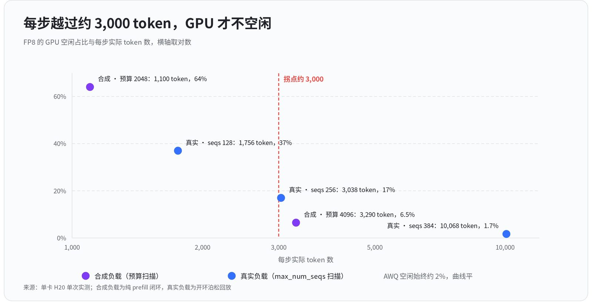

**离上限还有多远**。算力项里，线性层每 token 约 4.87 GFLOP，按每参数 2 FLOP 折合约 24.4 亿参数，加上 embedding 和 lm_head 约 5 亿，合计约 29 亿，和 A3B 对得上，参与计算的 token 是未命中的 prefill 加输出。注意力打分只算 10 层全注意力，每 token 每个上下文位置约 163,840 FLOP。带宽项按 4 TB/s 算，权重每步读一遍，按每步 token 数分摊。KV 每个上下文 token 约 20 KB，decode 每步每条序列约 66 MB。GDN 状态每条序列约 64 MB，decode 每步读写约 129 MB，比 KV 还大，这是混合架构特有的访存项。同一个内核里计算和搬运会重叠，所以主口径取分阶段 roofline：prefill 和 decode 各取 `max(算力时间, 访存时间)` 再相加[[4]](https://docs.nvidia.com/nsight-compute/ProfilingGuide/index.html)。

表 11-4d · 三种上限与实测（单位 req/s）

| 口径 | S0 | S1 | S2 | S3 | S4 |
|---|---|---|---|---|---|
| 只看算力（完全重叠，乐观） | 8.8 | 24.2 | 44.7 | 44.7 | 44.7 |
| 只看带宽 | 59.7 | 76.5 | 54.9 | 66.6 | 157 |
| <b>分阶段 roofline（主口径）</b> | **8.5** | **21.9** | **33.7** | **33.7** | **38.2** |
| 直接相加（悲观） | 7.7 | 18.3 | 24.6 | 26.7 | 34.7 |
| 实测 | 3.9 | 9.9 | 12.0 | 15.9 | 20.6 |

每一步的带宽上限都远高于算力上限，整体是算力受限。S2 的达成率从 45% 掉到 35%，差的就是发射空洞，S3 和 S4 把它补回到 54%。剩下的 46% 在内核效率上：S4 时 GPU 几乎不空闲，FP8 GEMM 实际约 215 TFLOPS，是峰值的 73%，注意力、GDN、采样和量化内核的效率更低[[54]](https://docs.nvidia.com/cutlass/latest/media/docs/cpp/efficient_gemm.html)。

**测量上踩过的坑**。下面五条都会让结论反过来或偏差超过 10%，和第 3 章的清单对照着用。

1. 不预热会得出相反的结论：第一次对比时 FP8 比 AWQ 慢 46%，是 Triton 内核首次遇到新形状时的 JIT 编译算进了压测，预热后两者打平。
2. 反复开关 profiler 会让引擎持续变慢：同一个服务连续开关 5 次后，FP8 过载吞吐从 15.1 降到 13.3 req/s，TPOT p50 从 115 升到 131 ms，之后不恢复。只开关一次看不出影响。
3. 抓 trace 要等运行中加排队的请求数到阈值再开始，拷贝前等文件大小稳定，并用 `gzip -t` 校验。
4. FP8 后端也要实测：MoE 换 DeepGEMM 后端反而慢约 30%，TPOT 升到约 26 ms，最后用的是默认 Triton 后端。
5. 同一配置先后调度到 4 台节点，饱和吞吐是 15.9、15.0、15.8、15.0 req/s，对比实验尽量放在同一节点、同一时段。

**质量**。prefix cache 在混合架构下要缓存和恢复 GDN 状态快照，FP8 会改变数值精度，两项上线前都要做业务 A/B，并加一组同配置重跑作噪声参照，否则采样带来的波动容易被误读成质量下降。

**还没做的**。H20 上 E=256、N=512 的 MoE 形状没有现成的调优配置，可以用 vLLM 的 `benchmark_moe.py --tune` 生成。prefill 步还在 CUDA Graph 之外，前缀对齐 1,056 和 4096、8192 两档预算也没测。合成负载 32768 档的端到端有效算力从约 158 掉到 104 TFLOPS，还没用开环压测验证。整个过程对应本文的方法：先算上限（第 2 章），用 trace 归因主机受限（5.1 节），一次只改一处，每一步都回到真实负载复测。推理优化的基础概念见 NVIDIA 的综述[[55]](https://developer.nvidia.com/blog/mastering-llm-techniques-inference-optimization/)。

### 11.5 上线清单

> 📌 **开始之前**
>
> - 只选一个主指标，并算出天花板（第 2 章）。
> - 固定并记录驱动、CUDA、NCCL、PyTorch 版本和功耗时钟设置。
> - 测出基线：预热、同步、多次运行、中位数加分位数（第 3 章）。

> 📌 **每一次改动**
>
> - 先用 HTA 归因：主机、通信还是计算（第 4、5 章）。
> - 只改一处，留下前后 trace 用 Trace Diff 比较。
> - 标明性质：系统、模型结构、优化器还是超参（第 1 章）。
> - 数值改动做正确性或收敛验证；记下显存、编译时间、冷启动等副作用。

> 📌 **上线之前**
>
> - 在生产的精度、形状和批大小分布下复测。
> - 用 `TORCH_LOGS=guards` 跑真实输入，确认没有重编译回退。
> - 手写内核与最新厂商库和 torch.compile 再比一次（第 7 章）。
> - 推理给出吞吐对交互速度的曲线（第 10 章）；报告区分实测与折算、厂商自报与独立测量。

## 参考文献

按正文首次引用顺序编号，资料截至 2026 年 10 月初。

[1] PyTorch. Accelerating Generative AI with PyTorch II: GPT, Fast (2023-11) [https://pytorch.org/blog/accelerating-generative-ai-2/](https://pytorch.org/blog/accelerating-generative-ai-2/)

[2] Jiang et al. MegaScale: Scaling Large Language Model Training to More Than 10,000 GPUs (2024-02) [https://arxiv.org/abs/2402.15627](https://arxiv.org/abs/2402.15627)

[3] Keller Jordan et al. modded-nanogpt README (2026-10) [https://github.com/KellerJordan/modded-nanogpt](https://github.com/KellerJordan/modded-nanogpt)

[4] NVIDIA. Nsight Compute Profiling Guide (2026) [https://docs.nvidia.com/nsight-compute/ProfilingGuide/index.html](https://docs.nvidia.com/nsight-compute/ProfilingGuide/index.html)

[5] vLLM Team. vLLM V1: A Major Upgrade to vLLM's Core Architecture (2025-01) [https://vllm.ai/blog/2025-01-27-v1-alpha-release](https://vllm.ai/blog/2025-01-27-v1-alpha-release)

[6] PyTorch. Enabling up to 41% Faster Pre-training: MXFP8 and DeepEP for DeepSeek-V3 on B200 with TorchTitan (2026-03) [https://pytorch.org/blog/enabling-up-to-41-faster-pre-training-mxfp8-and-deepep-for-deepseek-v3-on-b200-with-torchtitan/](https://pytorch.org/blog/enabling-up-to-41-faster-pre-training-mxfp8-and-deepep-for-deepseek-v3-on-b200-with-torchtitan/)

[7] PyTorch. Low-precision FlashAttention-4: End-to-end Block-scaled Attention for Blackwell (2026-09) [https://pytorch.org/blog/low-precision-flash-attention-4-end-to-end-block-scaled-attention-for-blackwell/](https://pytorch.org/blog/low-precision-flash-attention-4-end-to-end-block-scaled-attention-for-blackwell/)

[8] TechCrunch. Sakana walks back claims that its AI can dramatically speed up model training (2025-02) [https://techcrunch.com/2025/02/21/sakana-walks-back-claims-that-its-ai-can-dramatically-speed-up-model-training/](https://techcrunch.com/2025/02/21/sakana-walks-back-claims-that-its-ai-can-dramatically-speed-up-model-training/)

[9] METR. Measuring Automated Kernel Engineering (2025-02) [https://metr.org/blog/2025-02-14-measuring-automated-kernel-engineering/](https://metr.org/blog/2025-02-14-measuring-automated-kernel-engineering/)

[10] Meta / PyTorch. Holistic Trace Analysis documentation (2026) [https://hta.readthedocs.io/en/latest/](https://hta.readthedocs.io/en/latest/)

[11] DeepSeek-AI. DeepSeek-V3 Technical Report (2024-12) [https://arxiv.org/abs/2412.19437](https://arxiv.org/abs/2412.19437)

[12] Liang et al. TorchTitan: One-stop PyTorch native solution for production ready LLM pre-training (2024-10) [https://arxiv.org/abs/2410.06511](https://arxiv.org/abs/2410.06511)

[13] Llama Team, Meta. The Llama 3 Herd of Models (2024-07) [https://arxiv.org/abs/2407.21783](https://arxiv.org/abs/2407.21783)

[14] DeepSeek. DeepEP README (2025-03) [https://github.com/deepseek-ai/DeepEP](https://github.com/deepseek-ai/DeepEP)

[15] Shah et al. FlashAttention-3: Fast and Accurate Attention with Asynchrony and Low-precision (2024-07) [https://arxiv.org/abs/2407.08608](https://arxiv.org/abs/2407.08608)

[16] Hazy Research. Look Ma, No Bubbles! Designing a Low-Latency Megakernel for Llama-1B (2025-05) [https://hazyresearch.stanford.edu/blog/2025-05-27-no-bubbles](https://hazyresearch.stanford.edu/blog/2025-05-27-no-bubbles)

[17] NVIDIA. nccl-tests: Performance reported by NCCL tests (doc/PERFORMANCE.md) (2026) [https://github.com/NVIDIA/nccl-tests/blob/master/doc/PERFORMANCE.md](https://github.com/NVIDIA/nccl-tests/blob/master/doc/PERFORMANCE.md)

[18] NVIDIA. Megatron-LM README (2026) [https://github.com/NVIDIA/Megatron-LM](https://github.com/NVIDIA/Megatron-LM)

[19] PyTorch. CUDA semantics (2026) [https://docs.pytorch.org/docs/stable/notes/cuda.html](https://docs.pytorch.org/docs/stable/notes/cuda.html)

[20] Triton. triton.testing source (do_bench) (2026) [https://github.com/triton-lang/triton/blob/main/python/triton/testing.py](https://github.com/triton-lang/triton/blob/main/python/triton/testing.py)

[21] Ouyang, Mirhoseini, Liang (Stanford CRFM). Surprisingly Fast AI-Generated Kernels We Didn't Mean to Publish (Yet) (2025-05) [https://crfm.stanford.edu/2025/05/28/fast-kernels.html](https://crfm.stanford.edu/2025/05/28/fast-kernels.html)

[22] PyTorch. Understanding GPU Memory 1: Visualizing All Allocations over Time (2023-12) [https://pytorch.org/blog/understanding-gpu-memory-1/](https://pytorch.org/blog/understanding-gpu-memory-1/)

[23] PyTorch. torch.compile API documentation (2026) [https://docs.pytorch.org/docs/stable/generated/torch.compile.html](https://docs.pytorch.org/docs/stable/generated/torch.compile.html)

[24] PyTorch. Reducing torch.compile cold start compilation time with regional compilation (2026) [https://docs.pytorch.org/tutorials/recipes/regional_compilation.html](https://docs.pytorch.org/tutorials/recipes/regional_compilation.html)

[25] Guessous, Liang, Dong, He (PyTorch). FlexAttention: The Flexibility of PyTorch with the Performance of FlashAttention (2024-08) [https://pytorch.org/blog/flexattention/](https://pytorch.org/blog/flexattention/)

[26] Triton. Gluon documentation (2026) [https://triton-lang.org/main/gluon/index.html](https://triton-lang.org/main/gluon/index.html)

[27] NVIDIA. CUTLASS Changelog (2026-09) [https://docs.nvidia.com/cutlass/latest/CHANGELOG.html](https://docs.nvidia.com/cutlass/latest/CHANGELOG.html)

[28] NVIDIA. nvidia-cutlass-dsl (PyPI) (2026) [https://pypi.org/project/nvidia-cutlass-dsl/](https://pypi.org/project/nvidia-cutlass-dsl/)

[29] NVIDIA. Focus on Your Algorithm: NVIDIA CUDA Tile Handles the Hardware (2025-12) [https://developer.nvidia.com/blog/focus-on-your-algorithm-nvidia-cuda-tile-handles-the-hardware/](https://developer.nvidia.com/blog/focus-on-your-algorithm-nvidia-cuda-tile-handles-the-hardware/)

[30] Spector et al. ThunderKittens: Simple, Fast, and Adorable AI Kernels (2024-10) [https://arxiv.org/abs/2410.20399](https://arxiv.org/abs/2410.20399)

[31] Modular. Modular at NVIDIA GTC 2026: MAX on Blackwell, Mojo kernel porting, and DeepSeek V3 on B200 (2026-03) [https://www.modular.com/blog/modular-at-nvidia-gtc-2026-max-on-blackwell-mojo-kernel-porting-and-deepseek-v3-on-b200](https://www.modular.com/blog/modular-at-nvidia-gtc-2026-max-on-blackwell-mojo-kernel-porting-and-deepseek-v3-on-b200)

[32] Hsu et al. Liger Kernel: Efficient Triton Kernels for LLM Training (2024-10) [https://arxiv.org/abs/2410.10989](https://arxiv.org/abs/2410.10989)

[33] Dao AI Lab et al. FlashAttention-4: Algorithm and Kernel Pipelining Co-Design for Asymmetric Hardware Scaling (MLSys 2026) (2026-03) [https://arxiv.org/abs/2603.05451](https://arxiv.org/abs/2603.05451)

[34] Ouyang et al. KernelBench: Can LLMs Write Efficient GPU Kernels? (2025-02) [https://arxiv.org/abs/2502.10517](https://arxiv.org/abs/2502.10517)

[35] Li et al. EAGLE-3: Scaling up Inference Acceleration of Large Language Models via Training-Time Test (2025-03) [https://arxiv.org/abs/2503.01840](https://arxiv.org/abs/2503.01840)

[36] PyTorch. Accelerating 2K+ Scale Pre-training up to 1.28x with TorchAO, MXFP8 and TorchTitan on Crusoe B200 Cluster (2025-09) [https://pytorch.org/blog/accelerating-2k-scale-pre-training-up-to-1-28x-with-torchao-mxfp8-and-torchtitan-on-crusoe-b200-cluster/](https://pytorch.org/blog/accelerating-2k-scale-pre-training-up-to-1-28x-with-torchao-mxfp8-and-torchtitan-on-crusoe-b200-cluster/)

[37] Ye et al. FlashInfer: Efficient and Customizable Attention Engine for LLM Inference Serving (2025-01) [https://arxiv.org/abs/2501.01005](https://arxiv.org/abs/2501.01005)

[38] LMSYS. Deploying DeepSeek with PD Disaggregation and Large-scale Expert Parallelism on 96 H100 GPUs (2025-05) [https://www.lmsys.org/blog/2025-05-05-large-scale-ep/](https://www.lmsys.org/blog/2025-05-05-large-scale-ep/)

[39] LMSYS. Deploying DeepSeek on GB200 NVL72 with PD and Large Scale EP (Part I) (2025-06) [https://www.lmsys.org/blog/2025-06-16-gb200-part-1/](https://www.lmsys.org/blog/2025-06-16-gb200-part-1/)

[40] LMSYS. Deploying DeepSeek on GB200 NVL72 with PD and Large Scale EP (Part II) (2025-09) [https://www.lmsys.org/blog/2025-09-25-gb200-part-2/](https://www.lmsys.org/blog/2025-09-25-gb200-part-2/)

[41] SemiAnalysis. InferenceMAX: Open Source Inference Benchmarking (2025-10) [https://inferencex.semianalysis.com/blog/inferencemax-open-source-inference-benchmarking](https://inferencex.semianalysis.com/blog/inferencemax-open-source-inference-benchmarking)

[42] NVIDIA. NVIDIA Dynamo Open-Source Library Accelerates and Scales AI Reasoning Models (2025-03) [https://nvidianews.nvidia.com/news/nvidia-dynamo-open-source-library-accelerates-and-scales-ai-reasoning-models](https://nvidianews.nvidia.com/news/nvidia-dynamo-open-source-library-accelerates-and-scales-ai-reasoning-models)

[43] Character.AI. Optimizing AI Inference at Character.AI (2024-06) [https://blog.character.ai/optimizing-ai-inference-at-character-ai-2/](https://blog.character.ai/optimizing-ai-inference-at-character-ai-2/)

[44] MLCommons. MLPerf Training v6.0 Results (2026-06) [https://mlcommons.org/2026/06/mlperf-training-v6-0-results/](https://mlcommons.org/2026/06/mlperf-training-v6-0-results/)

[45] NVIDIA. NVIDIA Blackwell Tops MLPerf Training 6.0 with Industry-Leading Scale and Performance (2026-06) [https://developer.nvidia.com/blog/nvidia-blackwell-tops-mlperf-training-6-0-with-industry-leading-scale-and-performance/](https://developer.nvidia.com/blog/nvidia-blackwell-tops-mlperf-training-6-0-with-industry-leading-scale-and-performance/)

[46] MLCommons. Supplemental Results Discussion for MLPerf Training v6.0 (2026-06) [https://mlcommons.org/wp-content/uploads/2026/06/MLPerf-Training-v6.0-Supplemental-Discussion-UNDER-EMBARGO-UNTIL-6_16_26-8_00-AM-PT-1.pdf](https://mlcommons.org/wp-content/uploads/2026/06/MLPerf-Training-v6.0-Supplemental-Discussion-UNDER-EMBARGO-UNTIL-6_16_26-8_00-AM-PT-1.pdf)

[47] Qwen Team. Qwen3.6-35B-A3B 模型卡 (2026) [https://huggingface.co/Qwen/Qwen3.6-35B-A3B](https://huggingface.co/Qwen/Qwen3.6-35B-A3B)

[48] Qwen Team. Qwen3.6-35B-A3B-FP8 模型卡 (2026) [https://huggingface.co/Qwen/Qwen3.6-35B-A3B-FP8](https://huggingface.co/Qwen/Qwen3.6-35B-A3B-FP8)

[49] vLLM Team. Hybrid KV Cache Manager (2026) [https://docs.vllm.ai/en/latest/design/hybrid_kv_cache_manager/](https://docs.vllm.ai/en/latest/design/hybrid_kv_cache_manager/)

[50] vLLM Team. Automatic Prefix Caching (2026) [https://docs.vllm.ai/en/latest/features/automatic_prefix_caching/](https://docs.vllm.ai/en/latest/features/automatic_prefix_caching/)

[51] Yang, Kautz, Hatamizadeh. Gated Delta Networks: Improving Mamba2 with Delta Rule (2024-12) [https://arxiv.org/abs/2412.06464](https://arxiv.org/abs/2412.06464)

[52] Yu et al. Orca: A Distributed Serving System for Transformer-Based Generative Models (OSDI 2022) [https://www.usenix.org/system/files/osdi22-yu.pdf](https://www.usenix.org/system/files/osdi22-yu.pdf)

[53] NVIDIA. CUDA Programming Guide: Asynchronous Execution (2026) [https://docs.nvidia.com/cuda/cuda-programming-guide/02-basics/asynchronous-execution.html](https://docs.nvidia.com/cuda/cuda-programming-guide/02-basics/asynchronous-execution.html)

[54] NVIDIA. CUTLASS: Efficient GEMM in CUDA (2026) [https://docs.nvidia.com/cutlass/latest/media/docs/cpp/efficient_gemm.html](https://docs.nvidia.com/cutlass/latest/media/docs/cpp/efficient_gemm.html)

[55] NVIDIA. Mastering LLM Techniques: Inference Optimization (2023-11) [https://developer.nvidia.com/blog/mastering-llm-techniques-inference-optimization/](https://developer.nvidia.com/blog/mastering-llm-techniques-inference-optimization/)

---

上一篇：[LLM-31｜地基｜长上下文与注意力：从 MHA 到稀疏与线性注意力](./31-attention-long-context.md) · [目录](./README.md) · 下一篇：[LLM-33｜地基｜MoE 混合专家：路由、负载均衡、训练与推理](./33-moe.md)
