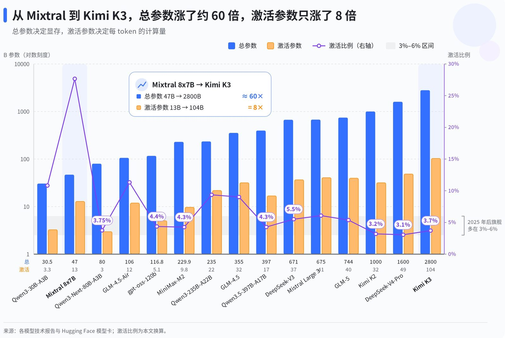
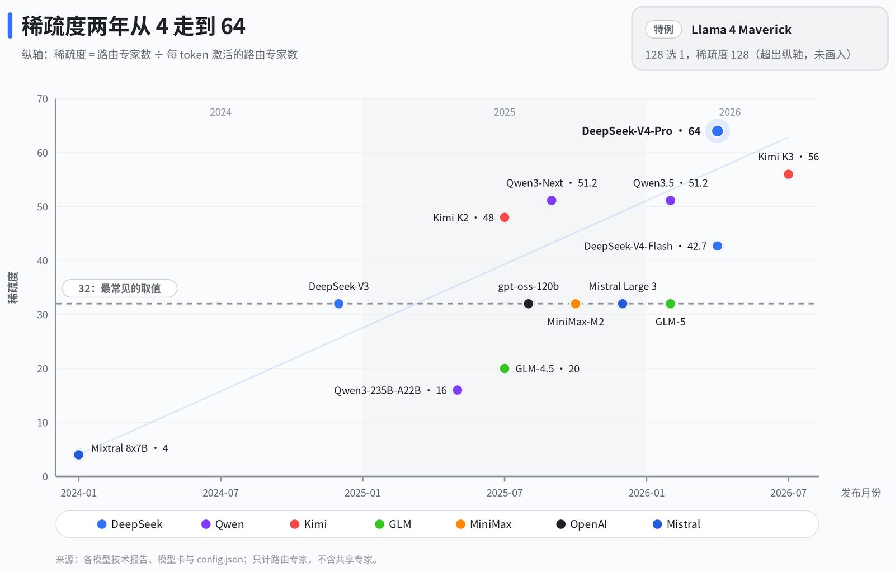
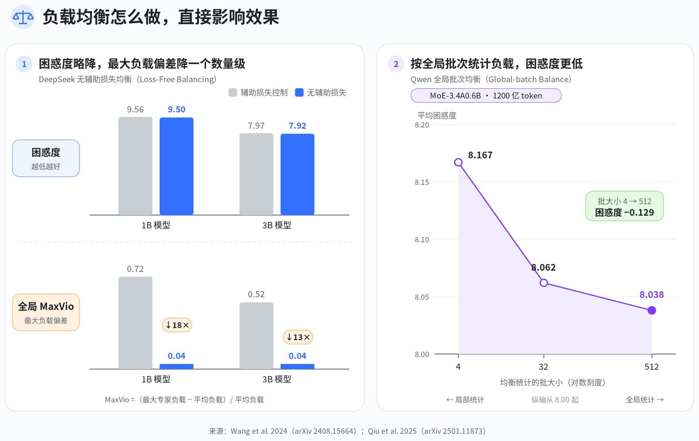
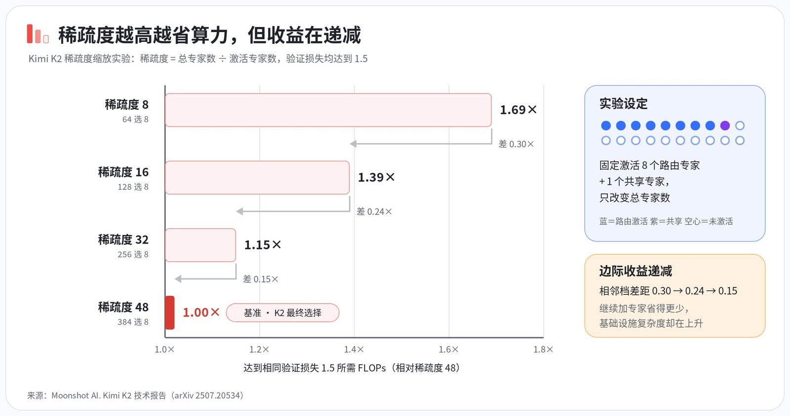
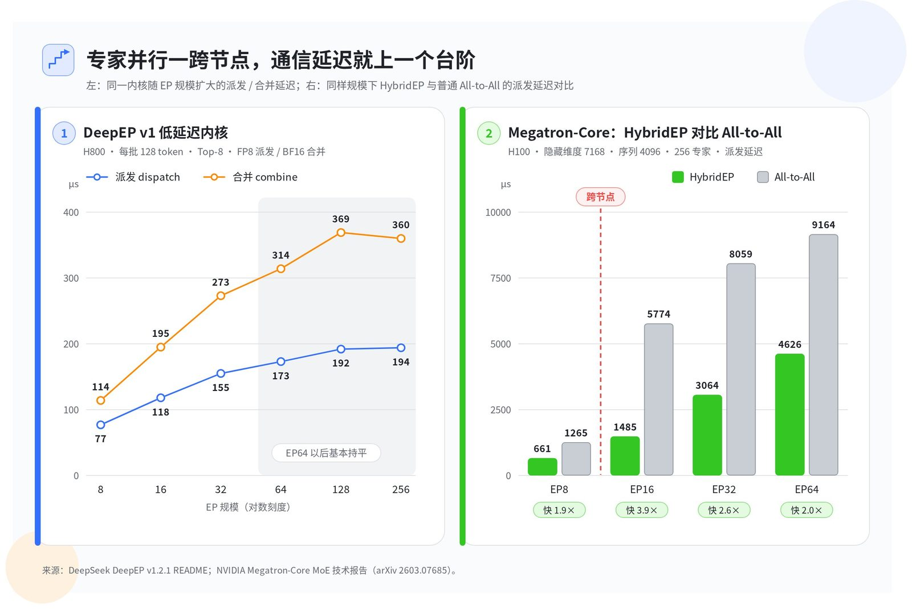
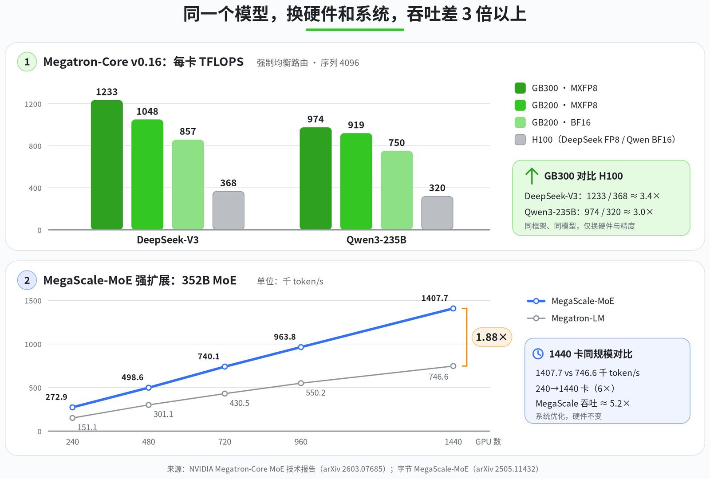
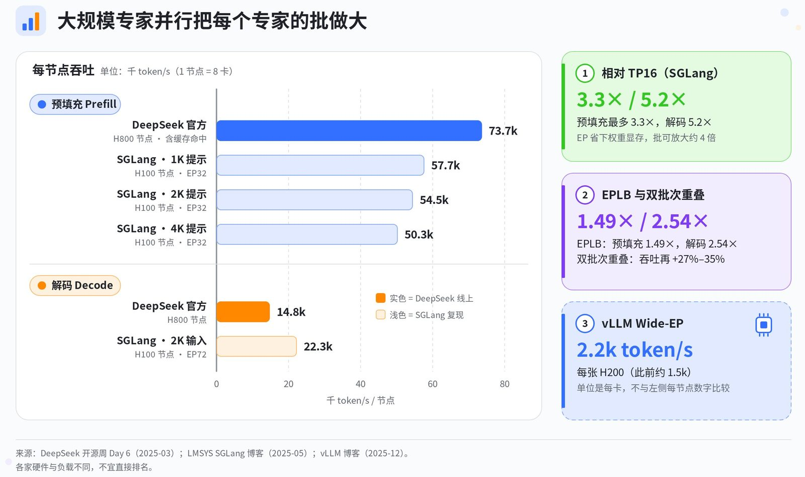
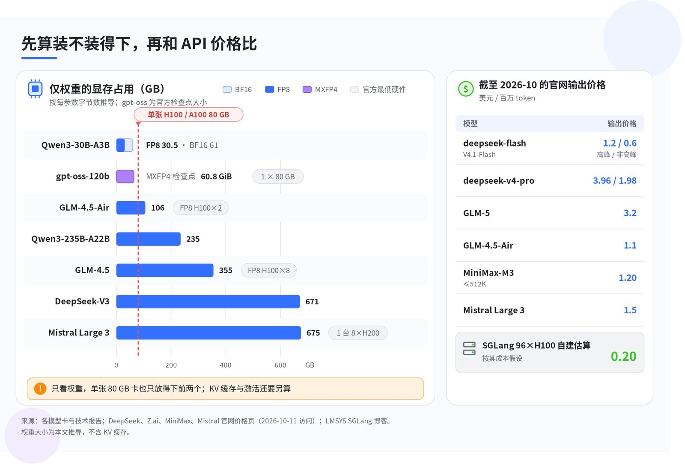

# LLM-33｜地基｜MoE 混合专家：路由、负载均衡、训练与推理

> 🎯 **这篇文档解决什么问题**：2025–2026 年的开源大模型几乎都是混合专家（Mixture of Experts，MoE）结构。系列里已经讲过总参数与激活参数、专家并行通信量和 DeepSeek-V3 部署；本文往下挖一层：路由打分方式、负载均衡的公式与实验、容量与丢弃、专家学到了什么、缩放律、训练与推理系统的实测数字、本地卸载、量化与微调，以及自建和调 API 的账。
>
> 使用方式：做训练的读第 2、4、5、7、8 章；做部署的读第 3、9、10 章；做选型或微调的读第 3、10、11 章。本文推导的数字都写明了假设。文中版本、价格和基准分数核对于 2026 年 10 月 11 日。

## 导读 · 先给结论

- **稀疏度持续变高**。路由专家数除以激活数，Mixtral 8x7B 是 4[[1]](https://arxiv.org/abs/2401.04088)，DeepSeek-V3 是 32[[2]](https://arxiv.org/abs/2412.19437)，Kimi K2 是 48[[3]](https://arxiv.org/abs/2507.20534)，DeepSeek-V4-Pro 是 64[[4]](https://arxiv.org/abs/2606.19348)。但收益在递减，复杂度在上升[[3]](https://arxiv.org/abs/2507.20534)。
- <b>负载均衡从“加辅助损失”转向“加偏置”</b>。无辅助损失均衡同时降低了困惑度和负载偏差[[5]](https://arxiv.org/abs/2408.15664)，已被 DeepSeek、GLM、MiniMax、Kimi 采用或改造。仍用辅助损失的，要按全局批次统计负载，否则专家难以专精[[6]](https://arxiv.org/abs/2501.11873)。
- <b>主流解码器 MoE 多为“token 选专家”</b>；不丢 token（dropless）是 DeepSeek-V3、OLMoE 等的实现选择，不是 decoder-only 的必然属性。专家选 token 负载天然均衡，但要看到未来 token，不适合自回归[[7]](https://arxiv.org/abs/2202.09368)。
- **训练瓶颈在 All-to-All**。专家并行跨节点时通信占 40%–60%，留在 NVLink 域内约 20%[[8]](https://arxiv.org/abs/2603.07685)。
- **推理的关键是把每个专家的批做大**。SGLang 用大规模专家并行，解码吞吐是 16 卡张量并行的 5.2 倍，主要来自 4 倍的批大小[[9]](https://lmsys.org/blog/2025-05-05-large-scale-ep/)。
- **MoE 省的是带宽，不是显存**。低并发时每个 token 只读激活参数，并发一高几乎所有专家都会被读到；自建前先和截至 2026-10 的官网 API 价格对比[[10]](https://api-docs.deepseek.com/quick_start/pricing)。

📎 与系列其他文档的分工：MoE 入门和 DeepSeek-V3 层结构见「LLM 基础」第 3.7 节；专家并行通信量公式、DeepEP 两种模式和 DeepSeek-V3 部署见「大模型推理系统学习手册」第 4.5 节；vLLM 的 MoE 服务见「vLLM 学习路径」第 3.3 节；专家权重读取量的推导见「《深入理解 AI Infra》精读」第 2.4、9.4 节；DeepSeek-V4 的训练稳定性见「训练工程」第 10 章。

## 第 1 章 · 为什么是 MoE：从 2017 年到“稀疏即默认”

MoE 把一层前馈网络换成多个并列的“专家”，由可训练的路由器为每个 token 只挑少数几个来算。参数量（容量）可以涨很多，每个 token 的计算量只取决于选中的专家。

### 1.1 四个里程碑

- <b>稀疏门控 MoE（2017-01）</b>：在 LSTM 层之间插入多达数千个专家，用带噪声的 Top-K 门控挑选，最大 1370 亿参数，宣称容量提升 1000 倍以上而计算效率只轻微下降[[11]](https://arxiv.org/abs/1701.06538)。
- <b>GShard（2020-06）</b>：把 MoE 搬进 Transformer，每隔一层换成 Top-2 的 MoE，在 2048 块 TPU v3 上 4 天训练出 6000 亿参数以上的翻译模型，并给出专家容量、分组派发和辅助损失这套做法[[12]](https://arxiv.org/abs/2006.16668)。
- <b>Switch Transformer（2021-01）</b>：改为 Top-1，相同算力下预训练比 T5-Base 快到 7 倍；1.6 万亿参数的 Switch-C 训练“完全没有不稳定”[[13]](https://arxiv.org/abs/2101.03961)。
- <b>GLaM（2021-12）</b>：1.2 万亿参数、每 token 激活 966 亿（8%），训练能耗是 GPT-3 的三分之一，推理计算量减半[[14]](https://arxiv.org/abs/2112.06905)。

开源的转折点是 Mixtral 8x7B（2024-01）：8 选 2，总参数 47B、激活 13B，追平或超过 Llama 2 70B，Apache 2.0 许可[[1]](https://arxiv.org/abs/2401.04088)。同月 DeepSeekMoE 提出“细粒度专家加共享专家”[[15]](https://arxiv.org/abs/2401.06066)，此后成为主流。

### 1.2 激活比例

总参数决定占多少显存，激活参数决定每个 token 的计算量和低并发下读多少权重。按官方配置：DeepSeek-V3 为 37/671，约 5.5%[[2]](https://arxiv.org/abs/2412.19437)；Kimi K2 为 32/1000，约 3.2%[[3]](https://arxiv.org/abs/2507.20534)；Qwen3-Next-80B-A3B 约 3.75%[[16]](https://huggingface.co/Qwen/Qwen3-Next-80B-A3B-Instruct)；gpt-oss-120b 为 5.13/116.83，约 4.4%[[17]](https://arxiv.org/abs/2508.10925)；DeepSeek-V4-Pro 为 49/1600，约 3.1%[[4]](https://arxiv.org/abs/2606.19348)；Kimi K3 为 104/2800，约 3.7%[[18]](https://arxiv.org/abs/2607.24653)。2025 年以后的旗舰，激活比例多在 3%–6%。

### 1.3 MoE 省多少

- DeepSeekMoE 16B 用约 40% 的计算量达到 LLaMA2 7B 的水平；145B 用 28.5% 的计算量追平 DeepSeek 67B[[15]](https://arxiv.org/abs/2401.06066)。
- OLMoE 在激活参数相同时，用约三分之一的 token 达到稠密模型的最终效果，墙钟时间约快 2 倍[[19]](https://arxiv.org/abs/2409.02060)。
- Qwen3-Next-80B-A3B 基座超过 Qwen3-32B 基座，训练成本只有后者的 10%[[16]](https://huggingface.co/Qwen/Qwen3-Next-80B-A3B-Instruct)。

这些是作者或厂商自报，口径分别是“同效果比算力”“同激活参数比 token”“同成本比效果”，不能横向比较。共同点是省在计算上，代价是更多显存、通信和系统复杂度。

> 💡 **常见误区**：把激活参数当成模型的“实际大小”。激活 3B 的 MoE 要占总参数那么多的显存；高并发时几乎所有专家都会被读到，带宽优势会被稀释（见第 9.3 节）。

## 第 2 章 · MoE 层解剖：路由器、门控与专家形状

MoE 层分三步：路由器给每个专家打分，Top-k 留下 k 个，门控权重决定它们的输出怎么加权。DeepSeek-V3 的完整层结构见「LLM 基础」第 3.7 节；这里比较各家在这三步上的差异。

### 2.1 打分函数

| 做法 | 怎么算 | 代表模型 |
|---|---|---|
| softmax 后取 Top-k | 对全部专家做 softmax 再取前 k 个；Qwen3 再对选中的概率重新归一化（`norm_topk_prob`） | Mixtral[[1]](https://arxiv.org/abs/2401.04088)、Qwen3[[20]](https://huggingface.co/Qwen/Qwen3-235B-A22B) |
| sigmoid，选中后归一化 | 每个专家独立 sigmoid，取前 k 个后在选中分数间归一化 | DeepSeek-V3[[2]](https://arxiv.org/abs/2412.19437)、Kimi K2[[3]](https://arxiv.org/abs/2507.20534)、GLM-4.5[[21]](https://arxiv.org/abs/2508.06471)、MiniMax-M2[[22]](https://huggingface.co/MiniMaxAI/MiniMax-M2) |
| Sqrt(Softplus) | 亲和度函数改为 Softplus 后开方 | DeepSeek-V4[[4]](https://arxiv.org/abs/2606.19348) |
| 只在选中专家上 softmax | 先取 Top-4，再对这 4 个做 softmax | gpt-oss[[17]](https://arxiv.org/abs/2508.10925) |

sigmoid 下各专家分数相互独立，softmax 下一个专家分数上升必然压低其他专家。采用 sigmoid 的几家也都用了第 4 章的偏置式均衡。

### 2.2 细粒度专家与共享专家

DeepSeekMoE 把 N 个专家各切成 m 份、激活数从 K 提到 mK，计算量不变而组合多得多；另隔离 K_s 个每个 token 都走的共享专家承担通用知识。DeepSeekMoE 2B 由此追平了参数和计算量都是它 1.5 倍的 GShard 2.9B[[15]](https://arxiv.org/abs/2401.06066)。

共享专家并非人人都用：Qwen3 明确去掉了共享专家[[23]](https://arxiv.org/abs/2505.09388)，OLMoE 的消融认为它没有收益[[19]](https://arxiv.org/abs/2409.02060)，MiniMax-M2 也没有[[22]](https://huggingface.co/MiniMaxAI/MiniMax-M2)；但 Qwen3-Next 和 Qwen3.5 又加回 1 个[[16]](https://huggingface.co/Qwen/Qwen3-Next-80B-A3B-Instruct)[[24]](https://huggingface.co/Qwen/Qwen3.5-397B-A17B)，Kimi K3 用 2 个[[18]](https://arxiv.org/abs/2607.24653)，Gemma 4 26B A4B 则在每层并联一个稠密前馈分支[[25]](https://ai.google.dev/gemma/docs/core/model_card_4)。

### 2.3 路由约束与变体

- **限节点路由**：DeepSeek-V3 规定每个 token 最多发往 4 个节点，以控制跨节点通信[[2]](https://arxiv.org/abs/2412.19437)；DeepSeek-V4 取消了这个限制[[4]](https://arxiv.org/abs/2606.19348)。
- **哈希路由**：DeepSeek-V4 前 3 个 MoE 层按 token ID 的哈希选专家，替代 V3 前 3 层的稠密层[[4]](https://arxiv.org/abs/2606.19348)。
- <b>潜空间 MoE（LatentMoE）</b>：Kimi K3 先把隐藏状态下投影到 3584 维（一半），专家在低维空间计算再上投影回去，并在上投影前加 RMSNorm，缓解极高稀疏度下的数值病态[[18]](https://arxiv.org/abs/2607.24653)。

哪些层用 MoE 也各不相同：DeepSeek-V3 和 GLM-4.5 前 3 层稠密[[2]](https://arxiv.org/abs/2412.19437)[[21]](https://arxiv.org/abs/2508.06471)，Kimi K2 只有第 1 层稠密[[3]](https://arxiv.org/abs/2507.20534)，Qwen3 每层都是 MoE[[20]](https://huggingface.co/Qwen/Qwen3-235B-A22B)，Llama 4 Maverick 稠密层与 MoE 层交替、每个 token 走共享专家加 1 个路由专家[[26]](https://ai.meta.com/blog/llama-4-multimodal-intelligence/)。

> 🔑 **本章要点**：看一个 MoE 模型先确认四件事：打分函数、选中后是否重新归一化、共享专家数、哪些层稠密。它们决定微调时路由器怎么处理，也决定推理框架能否复用现成的融合内核。

## 第 3 章 · 2024–2026 主流 MoE 配置全景

下表只收技术报告、模型卡或 config.json 能核实的配置。“路由专家 / Top-k / 共享”指每个 MoE 层的路由专家数、每 token 激活的路由专家数和共享专家数。部分时间取自 Hugging Face 仓库创建日期，可能早于正式发布。

| 模型 | 时间 | 总 / 激活 | 路由专家 / Top-k / 共享 | 层数 | 路由与均衡 |
|---|---|---|---|---|---|
| Mixtral 8x7B[[1]](https://arxiv.org/abs/2401.04088) | 2024-01 | 47B / 13B | 8 / 2 / 0 | 32 | softmax，辅助损失系数 0.02 |
| DeepSeek-V3[[2]](https://arxiv.org/abs/2412.19437) | 2024-12 | 671B / 37B | 256 / 8 / 1 | 61（前 3 层稠密） | sigmoid，无辅助损失偏置加序列级损失 0.0001，每 token 最多 4 个节点 |
| Qwen3-235B-A22B[[20]](https://huggingface.co/Qwen/Qwen3-235B-A22B) | 2025-05 | 235B / 22B | 128 / 8 / 0 | 94 | softmax，全局批次均衡损失，系数 0.001 |
| Qwen3-30B-A3B[[27]](https://huggingface.co/Qwen/Qwen3-30B-A3B) | 2025-05 | 30.5B / 3.3B | 128 / 8 / 0 | 48 | 同上 |
| MiniMax-M1[[28]](https://arxiv.org/abs/2506.13585) | 2025-06 | 456B / 45.9B | 32 / 2 / 0 | 80（70 层闪电注意力加 10 层 softmax 注意力） | 辅助损失系数 0.001 |
| Kimi K2[[3]](https://arxiv.org/abs/2507.20534) | 2025-07 | 1.04T / 32.6B | 384 / 8 / 1 | 61（1 层稠密） | sigmoid，无辅助损失偏置，不做分组限制 |
| GLM-4.5[[21]](https://arxiv.org/abs/2508.06471) | 2025-07 | 355B / 32B | 160 / 8 / 1 | 92（前 3 层稠密） | sigmoid，偏置更新率 0.001 加序列级损失 0.0001 |
| GLM-4.5-Air[[21]](https://arxiv.org/abs/2508.06471) | 2025-07 | 106B / 12B | 128 / 8 / 1 | 46（1 层稠密） | 同上 |
| gpt-oss-120b[[17]](https://arxiv.org/abs/2508.10925) | 2025-08 | 116.8B / 5.1B | 128 / 4 / 0 | 36 | 只在选中专家上做 softmax |
| gpt-oss-20b[[17]](https://arxiv.org/abs/2508.10925) | 2025-08 | 20.9B / 3.6B | 32 / 4 / 0 | 24 | 同上 |
| Qwen3-Next-80B-A3B[[16]](https://huggingface.co/Qwen/Qwen3-Next-80B-A3B-Instruct) | 2025-09 | 80B / 3B | 512 / 10 / 1 | 48（Gated DeltaNet 与注意力 3:1 混合） | 辅助损失系数 0.001 |
| MiniMax-M2[[29]](https://arxiv.org/abs/2605.26494) | 2025-10 | 229.9B / 9.8B | 256 / 8 / 0 | 62（全部为全注意力） | sigmoid 加可学习的专家偏置 |
| Mistral Large 3[[30]](https://huggingface.co/mistralai/Mistral-Large-3-675B-Instruct-2512) | 2025-12 | 675B / 41B（含 2.5B 视觉编码器） | 128 / 4 / 1 | 61（前 3 层稠密） | 未公开 |
| GLM-5[[31]](https://huggingface.co/zai-org/GLM-5) | 2026-02 | 744B / 40B | 256 / 8 / 1 | 78（前 3 层稠密） | 注意力改用 DeepSeek 稀疏注意力 |
| Qwen3.5-397B-A17B[[24]](https://huggingface.co/Qwen/Qwen3.5-397B-A17B) | 2026-02 | 397B / 17B | 512 / 10 / 1 | 60（混合注意力） | 未公开 |
| Gemma 4 26B A4B[[25]](https://ai.google.dev/gemma/docs/core/model_card_4) | 2026-04 | 25.2B / 3.8B | 128 / 8 / 1 | 30 | 每层并联一个稠密前馈分支 |
| DeepSeek-V4-Flash[[4]](https://arxiv.org/abs/2606.19348) | 2026-04 | 284B / 13B | 256 / 6 / 1 | 43（前 3 个 MoE 层用哈希路由） | Sqrt(Softplus)，无辅助损失偏置加序列级损失 0.0001，取消节点限制 |
| DeepSeek-V4-Pro[[4]](https://arxiv.org/abs/2606.19348) | 2026-04 | 1.6T / 49B | 384 / 6 / 1 | 61 | 同上 |
| Kimi K3[[18]](https://arxiv.org/abs/2607.24653) | 2026-07 | 2.78T / 104.2B | 896 / 16 / 2 | 93（1 层稠密） | sigmoid，分位数均衡（Quantile Balancing），潜空间 MoE |

### 3.1 从表里读出的趋势

- **稀疏度上升**：只算路由专家，从 Mixtral 的 4、Qwen3-235B 的 16、GLM-4.5 的 20，到一批 32（DeepSeek-V3、gpt-oss-120b、MiniMax-M2、Mistral Large 3、GLM-5），再到 Kimi K2 的 48、Qwen3.5 的 51.2、Kimi K3 的 56、DeepSeek-V4-Pro 的 64。Llama 4 Maverick 128 选 1，是特例[[26]](https://ai.meta.com/blog/llama-4-multimodal-intelligence/)。
- **专家变细**：DeepSeek-V3 专家中间维度 2048[[2]](https://arxiv.org/abs/2412.19437)，Qwen3-Next 只有 512[[16]](https://huggingface.co/Qwen/Qwen3-Next-80B-A3B-Instruct)。
- **宽深取舍不同**：GLM-4.5 刻意比 DeepSeek-V3 和 Kimi K2 更窄、更深（92 层），理由是“更深的模型推理能力更好”[[21]](https://arxiv.org/abs/2508.06471)；Kimi K2 把注意力头从 128 减到 64 以降低推理成本[[3]](https://arxiv.org/abs/2507.20534)。
- **注意力结构分化**：Qwen3-Next 和 Qwen3.5 用线性注意力与全注意力 3:1 混合[[16]](https://huggingface.co/Qwen/Qwen3-Next-80B-A3B-Instruct)；MiniMax-M2 反而放弃了上一代的闪电注意力混合，理由是没找到在生产中能稳定追平全注意力的变体[[29]](https://arxiv.org/abs/2605.26494)。

> 💡 **常见误区**：只按总参数和激活参数选模型。激活参数相近的两个模型，层数、专家维度、共享专家和注意力结构可能完全不同，框架支持和实际延迟也不同。选型前读一遍 config.json。

## 第 4 章 · 负载均衡：辅助损失、z-loss 与无辅助损失偏置

负载均衡同时关系到效果和效率。路由偏爱少数专家时，其余专家得不到训练，即“路由坍缩”；DeepSeek 的实验里辅助损失太小就会出现[[5]](https://arxiv.org/abs/2408.15664)。专家分布在不同 GPU 上，最忙的卡决定整步时间，Kimi K3 报告也指出不均衡会拖慢专家并行训练[[18]](https://arxiv.org/abs/2607.24653)。

### 4.1 辅助损失

Switch Transformer 给出了最常用的形式[[13]](https://arxiv.org/abs/2101.03961)：`L_aux = α · N · Σ_i f_i · P_i`。N 是专家数，`f_i` 是实际派发到专家 i 的 token 比例，`P_i` 是路由器给专家 i 的平均概率；`f_i` 不可导，梯度经 `P_i` 回传。Switch 扫过 α 从 10⁻¹ 到 10⁻⁵，选了 10⁻²。2025 年的配置里，Qwen3 和 MiniMax-M1 为 0.001[[20]](https://huggingface.co/Qwen/Qwen3-235B-A22B)[[28]](https://arxiv.org/abs/2506.13585)，Mixtral 为 0.02[[1]](https://arxiv.org/abs/2401.04088)。

### 4.2 router z-loss

ST-MoE 的 z-loss 惩罚路由 logits 的大小：`L_z = (1/B) · Σ_i (log Σ_j exp(x_ij))²`，B 是 token 数。它不负责均衡，而是解决数值不稳定；最佳系数 0.001，论文称还“略微提升了模型质量”[[32]](https://arxiv.org/abs/2202.08906)。OLMoE 同时使用均衡损失和 z-loss[[19]](https://arxiv.org/abs/2409.02060)。Switch 的另两条稳定手段是路由器单独用 float32 计算、缩小初始化尺度[[13]](https://arxiv.org/abs/2101.03961)。

### 4.3 无辅助损失均衡

辅助损失有两难：DeepSeek 在 10⁻² 到 0 之间扫 α，系数小会坍缩，系数大则困惑度变差[[5]](https://arxiv.org/abs/2408.15664)。他们给每个专家一个偏置 `b_i`，只在选 Top-k 时加到分数上，不进入门控权重；每批结束后令 `e_i = mean(c) − c_i`（`c_i` 为负载），更新 `b_i += u · sign(e_i)`。步长 u 取 0.001 最好，0.0001 太慢，0.01 后期波动。偏置只用历史负载，因为用当前序列的负载会泄漏未来 token 的信息[[5]](https://arxiv.org/abs/2408.15664)。

用最大负载偏差 `MaxVio = (max Load − mean Load) / mean Load` 衡量：1B 模型上，辅助损失基线困惑度 9.56、MaxVio 0.72，无辅助损失方法为 9.50、0.04；3B 模型上分别为 7.97、0.52 和 7.92、0.04[[5]](https://arxiv.org/abs/2408.15664)。实验规模在 3B、2000 亿 token 以内。

DeepSeek-V3 把它用到 671B：前 14.3 万亿 token 步长 0.001，最后 5000 亿 token 设为 0，另加系数仅 0.0001 的序列级均衡损失[[2]](https://arxiv.org/abs/2412.19437)。GLM-4.5 同样在 15 万亿 token 后把步长设为 0[[21]](https://arxiv.org/abs/2508.06471)。MiniMax-M2 改用可学习的偏置[[29]](https://arxiv.org/abs/2605.26494)。Kimi K3 的分位数均衡（Quantile Balancing）不再按固定步长更新，而是按路由分数的分位数直接把偏置设到目标负载对应的位置[[18]](https://arxiv.org/abs/2607.24653)。

### 4.4 按微批次还是全局批次统计

Qwen 团队发现，主流框架在每个微批次内计算 `f_i`，相当于要求每条序列内部均匀使用所有专家，抑制了专精。修正办法是在数据并行组间同步 `f_i`，按全局批次统计[[6]](https://arxiv.org/abs/2501.11873)：

- MoE-3.4A0.6B：均衡批大小从 4 提到 512，平均困惑度从 8.167 降到 8.038；无辅助损失方法在 4 和 512 下分别为 8.521 和 8.080。
- MoE-15A2.54B：批大小从 16 提到 512，困惑度从 5.778 降到 5.603，GSM8k 从 48.07 升到 54.28。
- 总体约降 0.1 困惑度、涨 2 分；领域专精只在全局批次均衡下明显出现。

Qwen3 采用了这一做法[[23]](https://arxiv.org/abs/2505.09388)。DeepSeek-V3 的消融方向一致：3B MoE 上序列级辅助损失的验证损失 2.085，无辅助损失方法和按批次的辅助损失都是 2.080[[2]](https://arxiv.org/abs/2412.19437)。

> 🔑 **本章要点**：新训练优先用无辅助损失偏置，配一个极小的序列级损失，后期把步长置 0；沿用辅助损失时一定按全局批次统计；z-loss 管数值稳定，和均衡方法搭配使用。

## 第 5 章 · 容量与丢弃：capacity factor、dropless 与专家选 token

早期 MoE 为了让计算形状固定，给每个专家设容量上限，超出的 token 跳过该层。DeepSeek-V3、OLMoE 等较新的模型采用不丢 token 的实现，但并非所有解码器 MoE 都如此（[OpenMoE](https://arxiv.org/abs/2402.01739) 就分析过序列尾部 token 被丢弃的问题），容量概念也仍常见于代码和配置。

### 5.1 专家容量

Switch 的定义是 `专家容量 = (每批 token 数 / 专家数) × capacity factor`，超出容量的 token 只走残差连接[[13]](https://arxiv.org/abs/2101.03961)；GShard 类似，容量约为 O(N/E)，用计数器判断溢出[[12]](https://arxiv.org/abs/2006.16668)。ST-MoE 训练用 1.25、评估用 2.0，建议“Top-2 路由，capacity factor 1.25，每个计算核心最多一个专家”[[32]](https://arxiv.org/abs/2202.08906)。

### 5.2 不丢 token

MegaBlocks（2022-11）把 MoE 重写成块稀疏运算，“从不丢弃 token”，端到端训练比 Tutel 快最多 40%，比 Megatron-LM 训练的稠密模型快 2.4 倍[[33]](https://arxiv.org/abs/2211.15841)。此后 DeepSeek-V3 训练和推理都不丢 token[[2]](https://arxiv.org/abs/2412.19437)，OLMoE 也选了不丢 token 的路由[[19]](https://arxiv.org/abs/2409.02060)。代价是每个专家的 token 数每步都在变，分组矩阵乘的形状不固定，需要 DeepGEMM 这类分组 GEMM 内核（见「深入浅出 GPU 优化」第七层（集群篇））。

### 5.3 专家选 token 为什么没进解码器

Expert Choice（2022-02）反过来让每个专家挑分数最高的 `k = n × c / e` 个 token（n 为批内 token 数，c 为平均每 token 的专家数，e 为专家数），负载完全相等，每个 token 的专家数可变。相同算力下训练收敛比 Switch 和 GShard 快 2 倍以上[[7]](https://arxiv.org/abs/2202.09368)。但论文自己指出，实现上做 Top-k 时要看到过去和未来的 token，“可能无法直接用于自回归文本生成”[[7]](https://arxiv.org/abs/2202.09368)；DeepSeek 也把未来信息泄漏列为它的问题[[5]](https://arxiv.org/abs/2408.15664)；OLMoE 的消融显示不丢 token 的 token 选专家效果更好[[19]](https://arxiv.org/abs/2409.02060)。Sparse Upcycling 这类编码器和视觉模型仍默认用它[[34]](https://arxiv.org/abs/2212.05055)。

| 方案 | 均衡靠什么 | 丢 token | 适用 |
|---|---|---|---|
| token 选专家加容量上限 | 辅助损失 | 溢出的丢弃 | Switch、GShard 时代 |
| token 选专家，不丢 | 辅助损失或偏置 | 不丢，形状可变 | 当前解码器大模型 |
| 专家选 token | 结构上均衡 | 有 token 可能没分到专家 | 编码器、视觉、Upcycling |

> 💡 **常见误区**：推理时沿用训练的 capacity factor。用老框架或自研内核跑 MoE 推理，先确认没有会丢 token 的容量上限，否则批大小一变输出就可能不同。

## 第 6 章 · 专家到底学到了什么：路由饱和、专精与坍缩

专家确实会专精，但分工多落在词法、句法和 token 类型上；是否出现领域分工，还取决于负载均衡怎么做。

### 6.1 路由很早定型

OLMoE-1B-7B（总参数 6.9B、激活 1.3B，64 选 8，训练 5 万亿 token）的观察[[19]](https://arxiv.org/abs/2409.02060)：训练到 1%（200 亿 token）时，最多约 60% 的 Top-8 路由已与最终模型一致，到 40% 时约 80%，随机基线为 12.5%；专家很少被同时激活；专家表现出领域和词表专精。工程上的推论是，专家负载监控要从训练第一步就开。

### 6.2 专精落在哪个层面

- Mixtral 没有观察到按主题分配专家的明显模式，路由更多跟随句法[[1]](https://arxiv.org/abs/2401.04088)。
- ST-MoE 的编码器专家按 token 类型（标点、名词等）专精，解码器专家缺乏专精；多语言专家不按语言分工[[32]](https://arxiv.org/abs/2202.08906)。
- Qwen 团队发现领域专精只在全局批次均衡下才清晰出现[[6]](https://arxiv.org/abs/2501.11873)；DeepSeek-V3 附录显示无辅助损失模型的专精模式比辅助损失模型更明显[[2]](https://arxiv.org/abs/2412.19437)。

可以推断，“专家是否按领域分工”很大程度上取决于均衡做法：约束的统计范围越小、强度越大，专精越不明显。

### 6.3 坍缩的监控

建议记录每层每个专家的 token 占比和 MaxVio[[5]](https://arxiv.org/abs/2408.15664)、长期接近 0 的“死专家”数，以及路由 logits 的量级[[32]](https://arxiv.org/abs/2202.08906)。微调时情况相反：ESFT 发现同一任务的路由高度集中、不同任务差别大[[35]](https://arxiv.org/abs/2407.01906)，这在第 11 章成了可以利用的性质。

> 💡 **常见误区**：看到某专家被代码 token 激活得多，就认定它是“代码专家”并在推理时裁掉其他专家。多数专精发生在句法和 token 类型层面[[1]](https://arxiv.org/abs/2401.04088)[[32]](https://arxiv.org/abs/2202.08906)，按主题裁剪很容易伤到通用能力。

## 第 7 章 · 缩放律与架构选择：多细、多稀疏、要不要从稠密改造

近两年的研究给出了几条可直接用的结论：专家要切细；稀疏度可以继续提高但收益递减；显存受限时 MoE 也不一定吃亏。

### 7.1 粒度

华沙大学等定义粒度 `G = d_ff / d_expert`，即把一个前馈网络切成 G 份、每 token 激活 G 个小专家[[36]](https://arxiv.org/abs/2402.07871)。结论是专家和前馈网络一样大（G = 1）“几乎从来不是最优的”，规模越大细粒度的优势越大；外推的缩放律显示，10²⁰ FLOPs 下计算最优的 MoE 相当于 20 倍算力的稠密模型，10²⁵ FLOPs 以上节省超过 40 倍（外推值）。G 也不能过大，否则拖慢墙钟时间，甚至路由器参数比专家还多。

蚂蚁 Ling 团队训练 300 多个模型（最大 28B），提出效率杠杆（Efficiency Leverage，MoE 相对等效稠密模型的算力优势）[[37]](https://arxiv.org/abs/2507.17702)：它主要由激活比例和算力预算决定；最优粒度约 12；均衡不好时最优点移向更粗的专家；共享专家和层排布只是次要因素。验证模型 Ling-mini-beta（激活 0.85B、总 17.5B）训练 1 万亿 token，追平 6.1B 稠密模型，算力少 7 倍以上。

### 7.2 稀疏度：Kimi K2 与 K3

Kimi K2 固定激活 8 个路由专家加 1 个共享专家，只改总专家数：验证损失同为 1.5 时，稀疏度 8、16、32 所需 FLOPs 分别是稀疏度 48 的 1.69、1.39、1.15 倍[[3]](https://arxiv.org/abs/2507.20534)。收益递减明显，作者也写道收益“伴随着基础设施复杂度的上升”，最终选了 384 选 8。

Kimi K3 推到 56（896 选 16），为此要处理极高稀疏度下“下投影、专家、上投影”链路的病态，引入了 RMSNorm、SiTU-GLU 和分位数均衡；报告自称整体缩放效率约为 K2 的 2.5 倍[[18]](https://arxiv.org/abs/2607.24653)。

📎 已公开的稀疏度区间也能反过来约束闭源模型的规模估算：按 20–56 倍外推，Claude Opus 4.6 的总参数约 1–3.8T，推算方法和误差见[LLM-13｜系统｜自建推理成本与 GPU 选型：算账手册](./13-inference-cost-gpu.md)第 11 章。

### 7.3 显存受限时

Ludziejewski 等在 280 多个实验（最大激活 2.7B、总 5B）上拟合了联合缩放律[[38]](https://arxiv.org/abs/2502.05172)：专家数增加时，计算最优的数据量变大、激活参数变小。经验法则是总参数相同时，专家数不超过 8 的 MoE 只要多训 E 倍 token，就能在同样显存下胜过计算最优的稠密模型。例如 2 专家、总 1.1B 的 MoE 训 160 亿 token，胜过训 80 亿 token 的 1.1B 稠密模型。实验规模较小，外推要谨慎。

### 7.4 从稠密改造：Sparse Upcycling

Sparse Upcycling 用稠密检查点初始化 MoE，每个专家都是原前馈网络的拷贝[[34]](https://arxiv.org/abs/2212.05055)。在 T5 和 ViT 上，只追加原预训练成本约 50% 的算力，就明显超过继续训练的稠密模型，也超过用 100% 原预算从头训练的 MoE；32 个专家是较好的折中。Qwen1.5-MoE-A2.7B 从 Qwen-1.8B 改造，官方称训练成本降 75%、推理快 1.74 倍[[39]](https://qwenlm.github.io/blog/qwen-moe/)。反方证据来自 OLMoE：除非算力预算很小，改造收益有限[[19]](https://arxiv.org/abs/2409.02060)。一种解释是 Upcycling 的优势来自原稠密训练的沉没成本，追加预算越大，这部分占比越小。

> 🔑 **本章要点**：专家要切细，最优粒度约 12[[37]](https://arxiv.org/abs/2507.17702)；稀疏度收益递减，更高稀疏度要配套解决稳定性和通信；手里有稠密检查点且预算不大时可以 Upcycling，预算充足时从头训练更稳。

## 第 8 章 · 训练系统：专家并行的通信账

MoE 训练的核心系统问题是：每个 MoE 层前后各做一次 All-to-All（派发与合并），通信量大、负载不均，要设法藏到计算后面。通信量公式和 DeepEP 两种模式的原理见「大模型推理系统学习手册」第 4.5 节，DeepEP 和 DeepGEMM 的简介见「深入浅出 GPU 优化」第七层（集群篇）；本章只给实测数字。

### 8.1 通信占多少

- 字节的 Comet 测得，主流模型和框架下 MoE 层的设备间通信可占整个模型执行时间的 47%[[40]](https://arxiv.org/abs/2502.19811)。
- NVIDIA 的 Megatron-Core MoE 报告：专家并行留在 NVLink 域内（DeepSeek-V3 在 GB200 NVL72 上 EP64）通信开销约 20%，跨节点（H100 上 EP64）为 40%–60%；优化派发器后，DeepSeek-V3 EP64 的 All-to-All 仍占迭代时间的 30%–40%[[8]](https://arxiv.org/abs/2603.07685)。
- DeepSeek-V3 训练时跨节点专家并行的计算通信比约 1:1，因此设计了 DualPipe；All-to-All 内核只用 H800 的 132 个 SM 中的 20 个；节点内 NVLink 160 GB/s，约为 InfiniBand 50 GB/s 的 3.2 倍[[2]](https://arxiv.org/abs/2412.19437)。

DeepSeek-V4 给出了能否完全掩盖通信的判据[[4]](https://arxiv.org/abs/2606.19348)：每对“token、专家”的计算量 V 与通信字节 D 之比不小于有效算力 F 与有效带宽 W 之比（V/D ≥ F/W），通信就能在理想流水重叠下被计算掩盖；实际还要求依赖关系、调度和延迟都允许重叠。V4-Pro 每对计算 6hd FLOPs、通信 3h 字节（FP8 派发、BF16 合并），`V/D = 2d = 6144 FLOPs/Byte`，即“每 1 GB/s 互联带宽足以掩盖 6.1 TFLOP/s 计算的通信”。

### 8.2 派发与合并的延迟

DeepEP v1 在 H800 加 400 Gb/s InfiniBand 上测试（隐藏维度 7168、Top-8、FP8 派发、BF16 合并）[[41]](https://github.com/deepseek-ai/DeepEP/blob/v1.2.1/README.md)。常规内核（每批 4096 token）节点内 EP8 派发 153 GB/s、合并 158 GB/s，跨节点 EP16 到 EP64 在 43–58 GB/s。低延迟内核（每批 128 token）的派发延迟从 EP8 的 77 µs 到 EP256 的 194 µs，合并从 114 µs 到 360 µs；EP 扩大 32 倍，派发延迟只增加到约 2.5 倍（本文换算）。

NVIDIA 的 HybridEP 与普通 All-to-All 相比（隐藏维度 7168、序列 4096、256 专家），派发延迟在 GB200 上 EP64 为 675 µs 对 930 µs，在 H100 上 EP16 为 1485 µs 对 5774 µs、EP64 为 4626 µs 对 9164 µs[[8]](https://arxiv.org/abs/2603.07685)。H100 一跨节点延迟就跳一个台阶，大 NVLink 域的优势很明显。

### 8.3 Megatron-Core 的吞吐基线

Megatron-Core v0.16 在强制均衡路由、序列长 4096 下的每卡吞吐[[8]](https://arxiv.org/abs/2603.07685)：DeepSeek-V3 在 256 张 GB300 上用 MXFP8 为 1233 TFLOPS（4,730 token/s），GB200 MXFP8 为 1048，GB200 BF16 为 857，1024 张 H100 分块 FP8 为 368（1,412 token/s）；Qwen3-235B 在 GB300、GB200 MXFP8、GB200 BF16、H100 BF16 上分别为 974、919、750、320 TFLOPS。真实路由不均会再低一些。同一报告的显存账：DeepSeek-V3 BF16、PP4×VPP4×EP64、256 卡，未优化时每卡权重加梯度 36.4 GB、主权重加优化器 32.1 GB、激活 131.0 GB，共 199.5 GB，远超 H100 的 80 GB[[8]](https://arxiv.org/abs/2603.07685)。

### 8.4 其他方案

- **MegaScale-MoE**（字节）：注意力和前馈网络分别定制并行，通信重叠并压缩（跨节点参数同步从 FP32 降到 BF16）。1440 张 Hopper 训练 352B MoE，吞吐 140.8 万 token/s，是 Megatron-LM 的 1.88 倍，1 万亿 token 从 15.50 天缩到 8.22 天；240 到 960 卡上加速 1.65–1.81 倍[[42]](https://arxiv.org/abs/2505.11432)。
- **Comet**（字节）：细粒度计算通信重叠，单个 MoE 层加速 1.96 倍、端到端平均 1.71 倍，已部署在万卡以上集群[[40]](https://arxiv.org/abs/2502.19811)。
- **MoonEP**（月之暗面）：按微批次和层动态规划冗余专家，让每卡恰好拿到相同数量的 token，并证明每卡不超过 E/R 个冗余专家（E 专家数，R 专家并行规模）即可完全均衡[[43]](https://github.com/MoonshotAI/MoonEP)。
- **MegaMoE**（DeepSeek-V4）：把专家分波次的融合大内核，一般推理加速 1.50–1.73 倍，强化学习采样等延迟敏感场景最多 1.96 倍[[4]](https://arxiv.org/abs/2606.19348)。

稳定性方面，除 z-loss 和 float32 路由器外，gpt-oss 对 SwiGLU 做了截断（上限 7.0）[[17]](https://arxiv.org/abs/2508.10925)；DeepSeek-V4 的“预期路由”见「训练工程」第 10 章。规模参考：DeepSeek-V3 用 PP16、跨 8 节点的 EP64 和 ZeRO-1，14.8 万亿 token 共 278.8 万 H800 GPU 小时[[2]](https://arxiv.org/abs/2412.19437)；gpt-oss-120b 用了 210 万 H100 小时[[17]](https://arxiv.org/abs/2508.10925)。

## 第 9 章 · 推理与服务：大规模专家并行、冗余专家与量化

MoE 推理的基本矛盾是权重全部常驻，而每个专家在一步解码里分到的 token 很少。DeepSeek-V3 报告写道，解码时“每个专家的批大小相对较小（通常在 256 个 token 以内），瓶颈是访存而不是计算”[[2]](https://arxiv.org/abs/2412.19437)。优化主线因此是：用大规模专家并行把专家摊到更多卡上，省出显存放更大的批。vLLM 的配置方式见「vLLM 学习路径」第 3.3 节。

### 9.1 DeepSeek 线上系统的一天

DeepSeek 在 2025-03-01 公开了 V3/R1 推理系统[[44]](https://github.com/deepseek-ai/open-infra-index/blob/main/202502OpenSourceWeek/day_6_one_more_thing_deepseekV3R1_inference_system_overview.md)：预填充单元 4 个节点、路由专家 EP32；解码单元 18 个节点、EP144，每卡 2 个路由专家加 1 个共享专家；两者都有 32 个冗余专家。每个 H800 节点预填充约 7.37 万 token/s 输入（含缓存命中），解码约 1.48 万 token/s 输出。24 小时内平均 226.75 个节点，按每 GPU 小时 2 美元计成本 87,072 美元；输入 6080 亿 token（56.3% 命中磁盘 KV 缓存），输出 1680 亿 token。按此换算，每百万 token 成本约 0.11 美元（87,072 ÷ 776,000，本文换算）。按 R1 定价折算的理论收入为 562,027 美元/天，“成本利润率 545%”，这是理论值而非实际营收。注意这里的解码单元（EP144）和 V3 报告里的 EP320 不同。

### 9.2 开源框架的大规模专家并行

**SGLang**（2025-05）在 96 张 H100 上组合预填充/解码分离、大规模专家并行、DeepEP、DeepGEMM、EPLB 和双批次重叠[[9]](https://lmsys.org/blog/2025-05-05-large-scale-ep/)：

- 2000 token 输入下每节点 5.23 万 token/s 输入、2.23 万 token/s 输出，按其成本假设约 0.20 美元每百万输出 token，约为 DeepSeek 官方 API 的五分之一。
- 预填充（EP32）最多是 TP16 的 3.3 倍；解码（EP72）每节点 22,282 token/s，是 TP16 的 5.2 倍，提升“主要来自专家并行带来的 4 倍批大小”。
- 双批次重叠提升吞吐 27%–35%；EPLB 使预填充加速 1.49 倍、解码加速 2.54 倍。

**vLLM**（2025-12）在 H200 集群上用 Wide-EP（数据并行注意力加专家并行）、双批次重叠和 EPLB，把持续吞吐做到每卡 2.2k token/s，此前约 1.5k[[45]](https://blog.vllm.ai/2025/12/17/large-scale-serving.html)。

**冗余专家**：DeepSeek 开源的 EPLB 复制高负载专家再装箱到 GPU，预填充用分层策略，解码用全局策略[[46]](https://github.com/deepseek-ai/EPLB)；V3 报告提到每 10 分钟左右重新统计热门专家[[2]](https://arxiv.org/abs/2412.19437)。冗余还能绕开整除限制：SGLang 用 256 加 32 个冗余共 288 个专家，就能用 12 或 72 这样的 EP 规模[[9]](https://lmsys.org/blog/2025-05-05-large-scale-ep/)。

📎 延伸阅读：MegaMoE 把 dispatch、两段专家 GEMM 和 combine 融合成一个 kernel，用计算掩盖 EP 通信，见 [LLM-08｜系统｜大模型推理系统：全栈学习手册](./08-inference-systems.md) 第 16.3 节。

### 9.3 批大小与被触达的专家数

MoE 在低并发下省带宽，是因为一步只读少数专家。假设路由均匀且各 token 独立，每个 token 从 E 个专家中选 k 个，某专家不被一个 token 选中的概率是 1 − k/E，B 个 token 都不选它的概率是（1 − k/E）^B，于是一层被触达的专家数期望为 `U(B) = E · (1 − (1 − k/E)^B)`。这是本文推导的近似，真实路由不均匀，实际值会偏小。代入 DeepSeek-V3 的 E = 256、k = 8：B = 1 时 8 个，B = 8 时约 57.4，B = 32 时约 163.3，B = 128 时约 251.6。并发到几十时大部分专家都要读一遍，带宽优势基本消失，此后要靠大批量摊薄读权重的成本。完整的字节数算例见「《深入理解 AI Infra》精读」第 2.4 节。

### 9.4 MoE 的量化

专家占绝大部分字节，所以普遍做法是优先量化专家、保留路由器和注意力的精度：

- **gpt-oss**：只对 MoE 权重（占总参数 90% 以上）用 MXFP4（每参数 4.25 位），120b 能放进一张 80 GB GPU，20b 在 16 GB 内运行[[17]](https://arxiv.org/abs/2508.10925)。
- **DeepSeek-V4**：路由专家 FP4（后训练阶段量化感知训练），其余大多 FP8[[4]](https://arxiv.org/abs/2606.19348)。**Kimi K3**：从 SFT 起做量化感知训练，权重 MXFP4、激活 MXFP8[[18]](https://arxiv.org/abs/2607.24653)。
- **Mistral Large 3**：FP8 检查点放进一台 8×H200，量化配置排除了名字以 gate 结尾的模块[[30]](https://huggingface.co/mistralai/Mistral-Large-3-675B-Instruct-2512)。**Llama 4 Scout**：Int4 后能放进一张 H100[[26]](https://ai.meta.com/blog/llama-4-multimodal-intelligence/)。

MXFP4 等格式细节见「模型压缩与端侧部署」第 2 章。

> 💡 **常见误区**：用单请求速度推断线上容量。单请求时 MoE 只读激活参数，Google 称 Gemma 4 26B A4B“运行速度几乎和 4B 模型一样快”[[25]](https://ai.google.dev/gemma/docs/core/model_card_4)；并发一上来被触达的专家迅速接近全部，瓶颈转向通信和均衡。要按目标并发、用真实流量压测，因为不同任务的路由分布差别很大[[35]](https://arxiv.org/abs/2407.01906)。

📎 延伸阅读：256 专家 MoE 在单卡 H20 上换 FP8 后 MoE 内核快 2.3 倍、DeepGEMM 后端反而慢约 30% 的实测，见 [LLM-32｜系统｜AI Infra 性能优化实战：从 profile 到硬件上限](./32-infra-perf.md) 第 11.4 节。

## 第 10 章 · 本地与单机部署：专家卸载与显存算例

单机用户可以利用 MoE 的一个特点：大部分参数在专家里，每个 token 只用几个，所以可以把专家放在 CPU 内存，只把注意力、共享部分和 KV 缓存放进显存，代价是速度受 CPU 侧限制。

### 10.1 llama.cpp 与 KTransformers

llama.cpp 在 2025-08 加入 `--cpu-moe`（所有专家权重留在 CPU）和 `--n-cpu-moe N`（前 N 层的专家留在 CPU），底层用张量覆盖实现，显式的 `--override-tensor` 优先[[47]](https://github.com/ggml-org/llama.cpp/pull/15077)。做法是先用 `--cpu-moe` 跑通，再逐步减小 N，直到显存刚好够（给 KV 缓存留余量）。

KTransformers 专做“专家在 CPU、其余在 GPU”的推理。官方教程用双路 Xeon Gold 6454S 加一张 24 GB 的 RTX 4090D，跑 DeepSeek-V3/R1 的 Q4_K_M 版只需 14 GB 显存加 382 GB 内存[[48]](https://github.com/kvcache-ai/ktransformers/blob/main/doc/en/DeepseekR1_V3_tutorial.md)：

| 配置 | 预填充 token/s | 解码 token/s |
|---|---|---|
| llama.cpp（对照） | 10.31 | 4.51 |
| KTransformers 单路 32 核 | 54.21 | 8.73 |
| KTransformers 双路 | 74.362 | 11.26 |
| V0.3，AMX 专家内核 | 255.26 | — |
| V0.3，只激活 6 个专家 | 286.55 | 13.69 |

最后一行是推理时只激活 6 个而非训练时的 8 个专家，用质量换速度，要单独评测。预填充的大幅提升依赖至强 CPU 的 AMX 指令。

### 10.2 显存算例

下表“权重”两列是本文按公开参数量推导的**仅权重**大小（BF16 每参数 2 字节、FP8 每参数 1 字节），不含 KV 缓存和激活；最后一列是官方给出的检查点大小或最低硬件。

| 模型 | 总 / 激活 | BF16 | FP8 | 官方数据 |
|---|---|---|---|---|
| Qwen3-30B-A3B | 30.5B / 3.3B | 61 GB | 30.5 GB | 参数量见模型卡[[27]](https://huggingface.co/Qwen/Qwen3-30B-A3B) |
| gpt-oss-120b | 116.83B / 5.13B | 约 234 GB | — | MXFP4 检查点 60.8 GiB，单张 80 GB GPU[[17]](https://arxiv.org/abs/2508.10925) |
| GLM-4.5-Air | 106B / 12B | 212 GB | 106 GB | FP8 最低 H100×2 或 H200×1[[49]](https://huggingface.co/zai-org/GLM-4.5) |
| Qwen3-235B-A22B | 235B / 22B | 470 GB | 235 GB | 参数量见模型卡[[20]](https://huggingface.co/Qwen/Qwen3-235B-A22B) |
| GLM-4.5 | 355B / 32B | 710 GB | 355 GB | BF16 最低 H100×16；FP8 最低 H100×8 或 H200×4[[49]](https://huggingface.co/zai-org/GLM-4.5) |
| DeepSeek-V3 | 671B / 37B | 1342 GB | 671 GB | 官方即 FP8 检查点[[2]](https://arxiv.org/abs/2412.19437) |
| Mistral Large 3 | 675B / 41B | 1350 GB | 675 GB | FP8 放进一台 8×H200[[30]](https://huggingface.co/mistralai/Mistral-Large-3-675B-Instruct-2512) |

GLM-4.5 的最低配置是在 SGLang、批大小不超过 8 的条件下给的；要跑满 128K 上下文，FP8 版需要 H100×16，Air 需要 H100×4[[49]](https://huggingface.co/zai-org/GLM-4.5)。表里的权重只是下限。

### 10.3 和稠密模型比

拿 Qwen3-30B-A3B 和 Qwen3-32B 稠密模型比（后者参数量按名字取 32B，本文推导）：BF16 下权重分别约 61 GB 和 64 GB，显存相近；但批大小为 1 时，稠密模型每个 token 读约 64 GB，MoE 只读约 6.6 GB，相差约 10 倍。所以 MoE 适合“装得下总参数、瓶颈在解码带宽”的场景；显存是硬上限、更看重每 GB 质量或希望微调流程简单时，稠密模型更合适。GPU 选型见「自建推理成本与 GPU 选型」第 2.4 节和第 4 章。

## 第 11 章 · 微调与落地：改哪些参数、自建还是调 API

公开证据的方向比较一致：MoE 的专家参数不必全动，挑与任务相关的专家训练，效果接近全量微调，通用能力掉得更少。

### 11.1 早期发现

ST-MoE 发现稀疏模型在小任务上更易过拟合；只更新非 MoE 参数与更新全部参数效果相当，只更新 MoE 参数（约占 80%）会“明显降低微调效果”[[32]](https://arxiv.org/abs/2202.08906)。Switch 提出专家 dropout：非专家层 0.1、专家内部 0.4，在 4 个小任务上有提升[[13]](https://arxiv.org/abs/2101.03961)。

### 11.2 ESFT：只训相关专家

DeepSeek 的 ESFT（2024-07）先用任务数据给每个专家打相关性分（平均门控分数，或被选中的 token 比例），每层按分数挑专家直到累计相关性达到阈值，只训练这些专家，冻结其余专家、共享专家和注意力[[35]](https://arxiv.org/abs/2407.01906)。底座 DeepSeek-V2-Lite 有 64 个路由专家和 2 个共享专家，每 token 激活 6 个路由专家加 2 个共享专家。

| 方法 | 六类下游任务平均 | 通用能力保留 |
|---|---|---|
| 未微调 | 33.6 | 62.4 |
| 全量微调 | 51.0 | 58.8 |
| LoRA | 44.9 | 59.1 |
| ESFT-Token | 49.4 | 61.5 |
| ESFT-Gate | 50.2 | 60.6 |

ESFT 存储最多省 90%、训练时间最多省 30%，每层通常只选 5%–15% 的专家；论文把全量微调和 LoRA 的通用能力下降归因于训练了共享参数[[35]](https://arxiv.org/abs/2407.01906)。

### 11.3 在专家上加 LoRA

很多 Hugging Face 的 MoE 实现把专家存成三维 `nn.Parameter` 而非 `nn.Linear`，常规 `target_modules` 匹配不到。PEFT v0.17.0 为此加了实验性的 `target_parameters`，可直接指定如 `feed_forward.experts.down_proj`，显存占用会更高[[50]](https://github.com/huggingface/peft/releases/tag/v0.17.0)。OpenAI cookbook 在单张 80 GB H100 上对 gpt-oss-20b 做 LoRA：r = 8、alpha = 16，专家只加在第 7、15、23 层，MXFP4 反量化为 BF16 训练，1000 条样本约 18 分钟[[51]](https://developers.openai.com/cookbook/articles/gpt-oss/fine-tune-transfomers)。大模型要按模型卡备硬件：GLM-4.5 做 LoRA 需 H100×16，全参数 SFT 需 H20×128[[49]](https://huggingface.co/zai-org/GLM-4.5)。LoRA 加在哪些层见「后训练实战」第 4 章。

路由偏置不是梯度学出来的参数，DeepSeek-V3 和 GLM-4.5 在预训练末期都把偏置步长设为 0[[2]](https://arxiv.org/abs/2412.19437)[[21]](https://arxiv.org/abs/2508.06471)。微调时是否冻结路由器，目前没有一手的公开对比，建议做成对照实验，同时看专家负载和通用能力。

### 11.4 截至 2026-10 的官网价格

单位为美元每百万 token[[10]](https://api-docs.deepseek.com/quick_start/pricing)[[52]](https://docs.z.ai/guides/overview/pricing)[[53]](https://platform.minimax.io/docs/guides/pricing-paygo)[[54]](https://docs.mistral.ai/models/mistral-large-3-25-12)：

| 模型（API 名） | 输入（未命中） | 输出 | 缓存命中 |
|---|---|---|---|
| deepseek-flash（V4.1-Flash），高峰 / 非高峰 | 0.3 / 0.15 | 1.2 / 0.6 | 0.006 / 0.003 |
| deepseek-v4-pro，高峰 / 非高峰 | 1.32 / 0.66 | 3.96 / 1.98 | 0.044 / 0.022 |
| GLM-5 | 1 | 3.2 | 0.2 |
| GLM-4.5-Air | 0.2 | 1.1 | 0.03 |
| MiniMax-M3（输入不超过 512K） | 0.30 | 1.20 | 0.06 |
| Mistral Large 3 | 0.5 | 1.5 | — |

DeepSeek 高峰时段为周一至周五 UTC 01:00–04:00 和 06:00–10:00，非高峰半价[[10]](https://api-docs.deepseek.com/quick_start/pricing)；MiniMax-M3 是“永久 5 折”后的价格[[53]](https://platform.minimax.io/docs/guides/pricing-paygo)。对照自建：SGLang 估算约 0.20 美元每百万输出 token[[9]](https://lmsys.org/blog/2025-05-05-large-scale-ep/)，DeepSeek 线上系统约 0.11 美元每百万 token（第 9.1 节，分母是输入加输出的总 token，只能与同输入/输出比例的 API 加权总价比较；若把同一总成本摊到输出上约 0.52 美元每百万输出 token，也不是纯 decode 边际成本）。这两个数字都建立在上百张卡高利用率运行的前提下，明显低于上表价格，但不含研发、运维和闲置成本。本文判断：一两台机器、流量有波峰波谷时，利用率上不去，单位成本会明显高于这两个估算，自建的理由更多应是合规、定制微调或延迟可控。

> 📌 **MoE 选型与上线清单**
>
> - 读 config.json：打分函数、Top-k、共享专家、稠密层位置、是否有哈希路由，确认推理框架支持。
> - 算显存：总参数乘每参数字节数再加 KV 缓存；量化优先量化专家，路由器和注意力保持较高精度。
> - 单卡低并发选激活参数小的 MoE，可用专家卸载；显存是硬上限时考虑稠密模型。
> - 多机高并发用大规模专家并行、PD 分离、EPLB 和双批次重叠，按目标并发压测并记录每层专家负载。
> - 推理时不设会丢 token 的容量上限；减少激活专家数的提速手段要单独评测质量。
> - 领域微调优先试 ESFT 或只在部分专家上加 LoRA，同时评测任务效果和通用能力。
> - 自建前按实际利用率算每百万 token 成本，和截至 2026-10 的官网价格对比。

## 参考文献

按正文首次引用顺序编号，资料截至 2026 年 10 月初。

[1] Mistral AI. Mixtral of Experts (2024-01) [https://arxiv.org/abs/2401.04088](https://arxiv.org/abs/2401.04088)

[2] DeepSeek-AI. DeepSeek-V3 Technical Report (2024-12) [https://arxiv.org/abs/2412.19437](https://arxiv.org/abs/2412.19437)

[3] Moonshot AI. Kimi K2: Open Agentic Intelligence (2025-07) [https://arxiv.org/abs/2507.20534](https://arxiv.org/abs/2507.20534)

[4] DeepSeek-AI. DeepSeek-V4: Towards Highly Efficient Million-Token Context Intelligence (2026-04) [https://arxiv.org/abs/2606.19348](https://arxiv.org/abs/2606.19348)

[5] Wang et al. (DeepSeek). Auxiliary-Loss-Free Load Balancing Strategy for Mixture-of-Experts (2024-08) [https://arxiv.org/abs/2408.15664](https://arxiv.org/abs/2408.15664)

[6] Qiu et al. (Alibaba Qwen). Demons in the Detail: On Implementing Load Balancing Loss for Training Specialized Mixture-of-Expert Models (2025-01) [https://arxiv.org/abs/2501.11873](https://arxiv.org/abs/2501.11873)

[7] Google. Mixture-of-Experts with Expert Choice Routing (2022-02) [https://arxiv.org/abs/2202.09368](https://arxiv.org/abs/2202.09368)

[8] NVIDIA. Scalable Training of Mixture-of-Experts Models with Megatron Core (2026-03) [https://arxiv.org/abs/2603.07685](https://arxiv.org/abs/2603.07685)

[9] LMSYS / SGLang Team. Deploying DeepSeek with PD Disaggregation and Large-Scale Expert Parallelism on 96 H100 GPUs (2025-05) [https://lmsys.org/blog/2025-05-05-large-scale-ep/](https://lmsys.org/blog/2025-05-05-large-scale-ep/)

[10] DeepSeek. Models &amp; Pricing (API docs, accessed 2026-10-11) [https://api-docs.deepseek.com/quick_start/pricing](https://api-docs.deepseek.com/quick_start/pricing)

[11] Shazeer et al. Outrageously Large Neural Networks: The Sparsely-Gated Mixture-of-Experts Layer (2017-01) [https://arxiv.org/abs/1701.06538](https://arxiv.org/abs/1701.06538)

[12] Google. GShard: Scaling Giant Models with Conditional Computation and Automatic Sharding (2020-06) [https://arxiv.org/abs/2006.16668](https://arxiv.org/abs/2006.16668)

[13] Fedus, Zoph, Shazeer. Switch Transformers: Scaling to Trillion Parameter Models with Simple and Efficient Sparsity (2021-01) [https://arxiv.org/abs/2101.03961](https://arxiv.org/abs/2101.03961)

[14] Google. GLaM: Efficient Scaling of Language Models with Mixture-of-Experts (2021-12) [https://arxiv.org/abs/2112.06905](https://arxiv.org/abs/2112.06905)

[15] DeepSeek-AI. DeepSeekMoE: Towards Ultimate Expert Specialization in Mixture-of-Experts Language Models (2024-01) [https://arxiv.org/abs/2401.06066](https://arxiv.org/abs/2401.06066)

[16] Qwen Team. Qwen3-Next-80B-A3B-Instruct model card (Hugging Face, 2025-09) [https://huggingface.co/Qwen/Qwen3-Next-80B-A3B-Instruct](https://huggingface.co/Qwen/Qwen3-Next-80B-A3B-Instruct)

[17] OpenAI. gpt-oss-120b &amp; gpt-oss-20b Model Card (2025-08) [https://arxiv.org/abs/2508.10925](https://arxiv.org/abs/2508.10925)

[18] Moonshot AI. Kimi K3: Open Frontier Intelligence (2026-07) [https://arxiv.org/abs/2607.24653](https://arxiv.org/abs/2607.24653)

[19] AI2. OLMoE: Open Mixture-of-Experts Language Models (2024-09) [https://arxiv.org/abs/2409.02060](https://arxiv.org/abs/2409.02060)

[20] Qwen Team. Qwen3-235B-A22B model card and config (Hugging Face, 2025-04) [https://huggingface.co/Qwen/Qwen3-235B-A22B](https://huggingface.co/Qwen/Qwen3-235B-A22B)

[21] Zhipu AI (Z.ai). GLM-4.5: Agentic, Reasoning, and Coding (ARC) Foundation Models (2025-08) [https://arxiv.org/abs/2508.06471](https://arxiv.org/abs/2508.06471)

[22] MiniMax. MiniMax-M2 model card and config (Hugging Face, 2025-10) [https://huggingface.co/MiniMaxAI/MiniMax-M2](https://huggingface.co/MiniMaxAI/MiniMax-M2)

[23] Qwen Team. Qwen3 Technical Report (2025-05) [https://arxiv.org/abs/2505.09388](https://arxiv.org/abs/2505.09388)

[24] Qwen Team. Qwen3.5-397B-A17B model card (Hugging Face, 2026-02) [https://huggingface.co/Qwen/Qwen3.5-397B-A17B](https://huggingface.co/Qwen/Qwen3.5-397B-A17B)

[25] Google. Gemma 4 model card (2026) [https://ai.google.dev/gemma/docs/core/model_card_4](https://ai.google.dev/gemma/docs/core/model_card_4)

[26] Meta. The Llama 4 herd: The beginning of a new era of natively multimodal AI innovation (2025-04) [https://ai.meta.com/blog/llama-4-multimodal-intelligence/](https://ai.meta.com/blog/llama-4-multimodal-intelligence/)

[27] Qwen Team. Qwen3-30B-A3B model card and config (Hugging Face, 2025-04) [https://huggingface.co/Qwen/Qwen3-30B-A3B](https://huggingface.co/Qwen/Qwen3-30B-A3B)

[28] MiniMax. MiniMax-M1: Scaling Test-Time Compute Efficiently with Lightning Attention (2025-06) [https://arxiv.org/abs/2506.13585](https://arxiv.org/abs/2506.13585)

[29] MiniMax. The MiniMax-M2 Series: Mini Activations Unleashing Max Real-World Intelligence (2026-05) [https://arxiv.org/abs/2605.26494](https://arxiv.org/abs/2605.26494)

[30] Mistral AI. Mistral-Large-3-675B-Instruct-2512 model card (Hugging Face, 2025-12) [https://huggingface.co/mistralai/Mistral-Large-3-675B-Instruct-2512](https://huggingface.co/mistralai/Mistral-Large-3-675B-Instruct-2512)

[31] Z.ai. GLM-5 model card and config (Hugging Face, 2026-02) [https://huggingface.co/zai-org/GLM-5](https://huggingface.co/zai-org/GLM-5)

[32] Zoph et al. ST-MoE: Designing Stable and Transferable Sparse Expert Models (2022-02) [https://arxiv.org/abs/2202.08906](https://arxiv.org/abs/2202.08906)

[33] Gale et al. MegaBlocks: Efficient Sparse Training with Mixture-of-Experts (2022-11) [https://arxiv.org/abs/2211.15841](https://arxiv.org/abs/2211.15841)

[34] Komatsuzaki et al. Sparse Upcycling: Training Mixture-of-Experts from Dense Checkpoints (2022-12) [https://arxiv.org/abs/2212.05055](https://arxiv.org/abs/2212.05055)

[35] DeepSeek-AI. Let the Expert Stick to His Last: Expert-Specialized Fine-Tuning for Sparse Architectural LLMs (2024-07) [https://arxiv.org/abs/2407.01906](https://arxiv.org/abs/2407.01906)

[36] Krajewski, Ludziejewski et al. Scaling Laws for Fine-Grained Mixture of Experts (2024-02) [https://arxiv.org/abs/2402.07871](https://arxiv.org/abs/2402.07871)

[37] Ant Group Ling Team. Towards Greater Leverage: Scaling Laws for Efficient Mixture-of-Experts Language Models (2025-07) [https://arxiv.org/abs/2507.17702](https://arxiv.org/abs/2507.17702)

[38] Ludziejewski et al. Joint MoE Scaling Laws: Mixture of Experts Can Be Memory Efficient (2025-02) [https://arxiv.org/abs/2502.05172](https://arxiv.org/abs/2502.05172)

[39] Qwen Team. Qwen1.5-MoE: Matching 7B Model Performance with 1/3 Activated Parameters (2024-03) [https://qwenlm.github.io/blog/qwen-moe/](https://qwenlm.github.io/blog/qwen-moe/)

[40] ByteDance. Comet: Fine-grained Computation-communication Overlapping for Mixture-of-Experts (2025-02) [https://arxiv.org/abs/2502.19811](https://arxiv.org/abs/2502.19811)

[41] DeepSeek. DeepEP v1.2.1 README (2025) [https://github.com/deepseek-ai/DeepEP/blob/v1.2.1/README.md](https://github.com/deepseek-ai/DeepEP/blob/v1.2.1/README.md)

[42] ByteDance. MegaScale-MoE: Large-Scale Communication-Efficient Training of Mixture-of-Experts Models in Production (2025-05) [https://arxiv.org/abs/2505.11432](https://arxiv.org/abs/2505.11432)

[43] Moonshot AI. MoonEP (GitHub, 2026) [https://github.com/MoonshotAI/MoonEP](https://github.com/MoonshotAI/MoonEP)

[44] DeepSeek. DeepSeek-V3/R1 Inference System Overview (Open Source Week Day 6, 2025-03) [https://github.com/deepseek-ai/open-infra-index/blob/main/202502OpenSourceWeek/day_6_one_more_thing_deepseekV3R1_inference_system_overview.md](https://github.com/deepseek-ai/open-infra-index/blob/main/202502OpenSourceWeek/day_6_one_more_thing_deepseekV3R1_inference_system_overview.md)

[45] vLLM Team. Large-Scale Serving with Wide-EP (2025-12) [https://blog.vllm.ai/2025/12/17/large-scale-serving.html](https://blog.vllm.ai/2025/12/17/large-scale-serving.html)

[46] DeepSeek. EPLB: Expert Parallelism Load Balancer (GitHub, 2025-02) [https://github.com/deepseek-ai/EPLB](https://github.com/deepseek-ai/EPLB)

[47] ggml-org. llama : add --n-cpu-moe option (llama.cpp PR #15077, 2025-08) [https://github.com/ggml-org/llama.cpp/pull/15077](https://github.com/ggml-org/llama.cpp/pull/15077)

[48] kvcache-ai. KTransformers DeepSeek-R1/V3 tutorial (2025-02) [https://github.com/kvcache-ai/ktransformers/blob/main/doc/en/DeepseekR1_V3_tutorial.md](https://github.com/kvcache-ai/ktransformers/blob/main/doc/en/DeepseekR1_V3_tutorial.md)

[49] Z.ai. GLM-4.5 model card (Hugging Face, 2025-07) [https://huggingface.co/zai-org/GLM-4.5](https://huggingface.co/zai-org/GLM-4.5)

[50] Hugging Face. PEFT v0.17.0 release notes (2025-08) [https://github.com/huggingface/peft/releases/tag/v0.17.0](https://github.com/huggingface/peft/releases/tag/v0.17.0)

[51] OpenAI. Fine-tuning gpt-oss with Hugging Face Transformers (OpenAI Cookbook, 2025-08) [https://developers.openai.com/cookbook/articles/gpt-oss/fine-tune-transfomers](https://developers.openai.com/cookbook/articles/gpt-oss/fine-tune-transfomers)

[52] Z.ai. Pricing (docs, accessed 2026-10-11) [https://docs.z.ai/guides/overview/pricing](https://docs.z.ai/guides/overview/pricing)

[53] MiniMax. Pay-as-you-go pricing (docs, accessed 2026-10-11) [https://platform.minimax.io/docs/guides/pricing-paygo](https://platform.minimax.io/docs/guides/pricing-paygo)

[54] Mistral AI. Mistral Large 3 documentation (2025-12) [https://docs.mistral.ai/models/mistral-large-3-25-12](https://docs.mistral.ai/models/mistral-large-3-25-12)

---

上一篇：[LLM-32｜系统｜AI Infra 性能优化实战：从 profile 到硬件上限](./32-infra-perf.md) · [目录](./README.md) · 下一篇：[LLM-34｜工程｜实时语音 Agent：延迟预算、打断与全双工](./34-voice-agent.md)
