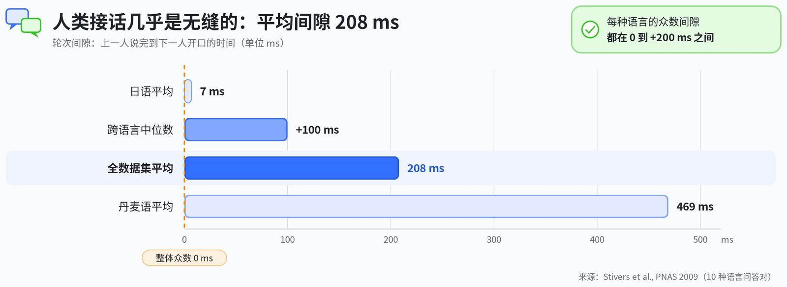
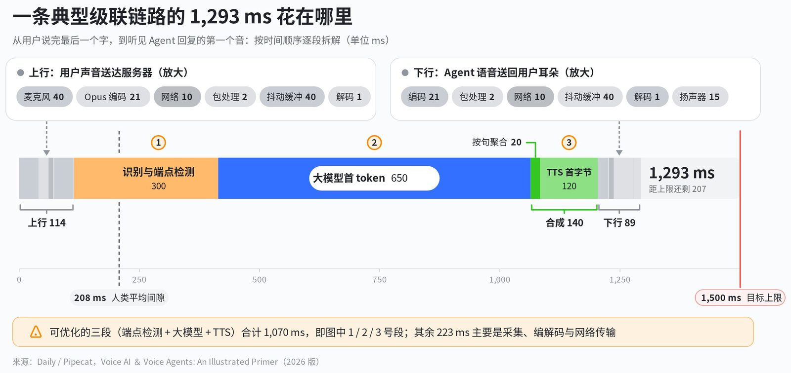
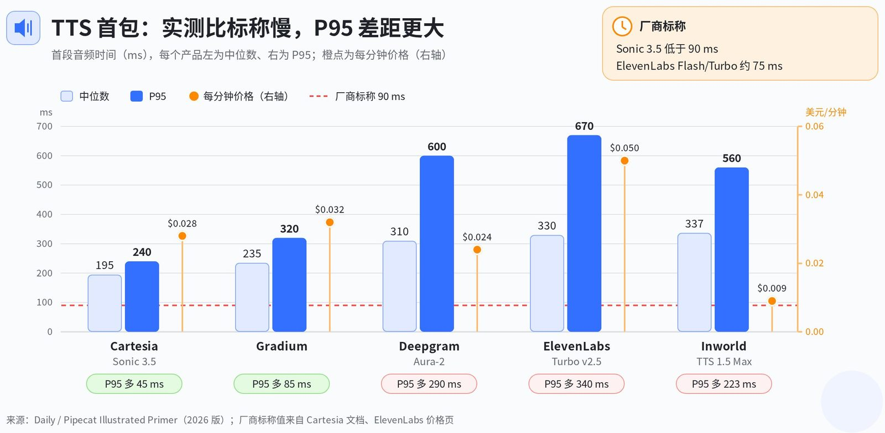
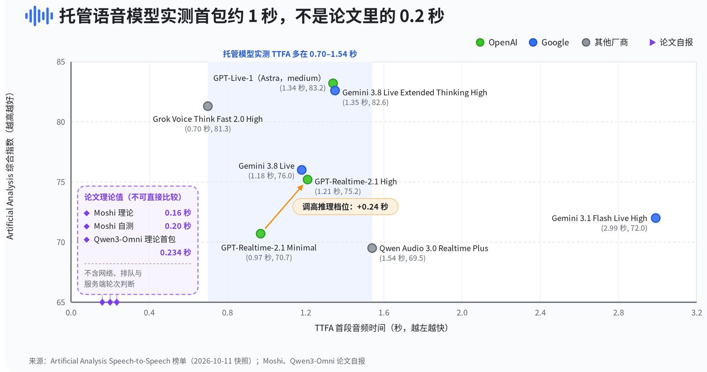
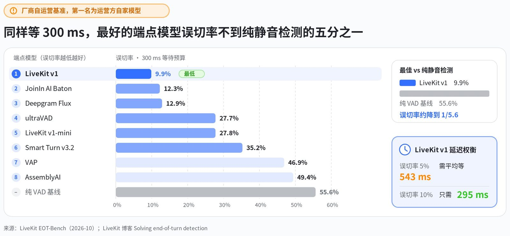
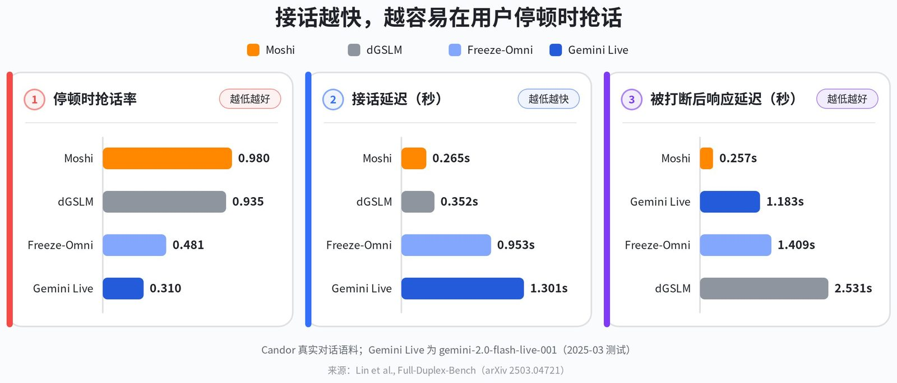
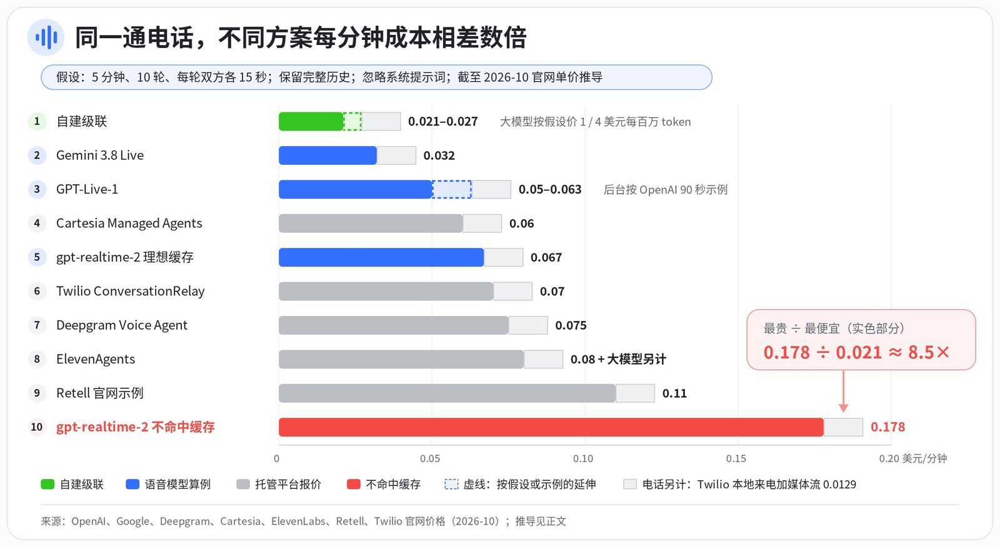
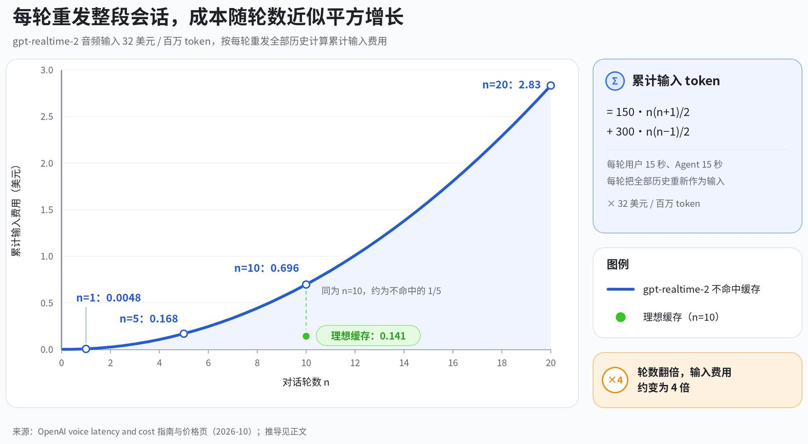

# LLM-34｜工程｜实时语音 Agent：延迟预算、打断与全双工

> 🎯 **这篇文档解决什么问题**：语音 Agent 的难点很少在“能不能听懂”，而在时间：用户说完多久能听到回应，停顿时该不该接话，插话时怎么立刻停下并让模型知道自己说到了哪里，电话线路只有 8 kHz 怎么办，一通电话花多少钱。本文按延迟、轮次、打断、传输、工具与上下文、评测、合规、成本的顺序展开，给出 2026 年主要产品的实测数字和官网价格。
>
> 使用方式：做语音客服或外呼的先读第 4、5、7、10、11 章；做应用内语音助手的先读第 4、5、6 章；只想选型的看第 3 章和第 11 章。文中版本、价格和基准分数核对于 2026 年 10 月 11 日。

## 导读 · 先给结论

- **1.5 秒是现实目标**。人类一问一答的平均间隙是 208 ms[[1]](https://www.pnas.org/doi/10.1073/pnas.0903616106)；Pipecat 团队的 2026 版指南把 1,500 ms 的语音到语音延迟作为目标，一条典型链路实测合计 1,293 ms[[2]](https://voiceaiandvoiceagents.com/)。
- **托管模型的首包实测约 1 秒，不是论文里的 200 ms**。Artificial Analysis 测得主流托管语音到语音模型的首段音频时间多在 1–1.5 秒[[3]](https://artificialanalysis.ai/speech-to-speech)；Moshi 的 160 ms、Qwen3-Omni 的 234 ms 是论文自报的理论值[[4]](https://arxiv.org/abs/2410.00037)[[5]](https://arxiv.org/abs/2509.17765)。
- <b>“什么时候算说完”决定体验</b>。在 300 ms 等待预算下，LiveKit 自测的最好端点模型误切率 9.9%，纯静音检测 55.6%[[6]](https://livekit.com/benchmarks/eot-bench)。
- **打断不只是停止播放**，还要清空缓冲、取消生成，并把上下文截断到用户真正听到的位置。
- **全双工已经商用**。OpenAI 在 2026-09 发布按分钟计费的 GPT-Live-1，把推理和工具交给后台模型[[7]](https://openai.com/index/introducing-gpt-live-1-in-the-api/)；字节跳动的 Seeduplex 已在豆包 App 全量上线[[8]](https://seed.bytedance.com/zh/blog/introducing-seed-full-duplex-speech-llm-attentive-listening-robust-interference-suppression-enabling-more-natural-interaction)。
- **语音到语音的成本随轮数近似平方增长**，因为每轮都重新计费整段会话[[9]](https://developers.openai.com/api/docs/guides/voice-latency-cost)。第 11 章的算例里，5 分钟 10 轮的电话用 gpt-realtime-2 不命中缓存约每分钟 0.178 美元。

📎 与系列其他文档的分工：级联与端到端的基础对照和示意性延迟分配见「多模态与长上下文」第 4 章；工具设计的一般原理见「Agent 工程实战」第 3 章；提示词注入的一般防御见「LLM 安全与治理」第 2 章。本文只讲实时语音特有的工程问题。

## 第 1 章 · 为什么实时语音是另一种工程

文本 Agent 慢几秒，用户会盯着屏幕等；语音 Agent 慢一秒多，用户会以为线路断了，开口重复，引发新一轮混乱。本章给出两条基准线：人类的轮次间隙，和用户对机器的容忍度。

### 1.1 人类的轮次间隙：平均约 200 ms

Stivers 等人在 2009 年测量了 10 种语言的问答对：每种语言的众数间隙在 0 到 +200 ms 之间，整体众数为 0 ms；全数据集平均 208 ms，最快的日语平均 7 ms，最慢的丹麦语平均 469 ms；跨语言中位数约 +100 ms[[1]](https://www.pnas.org/doi/10.1073/pnas.0903616106)。人类接话的起点是“预测对方快说完了”，而不是“听到静音”。

Moshi 论文把这项研究转述为“平均 230 ms”，引用时应以原文的 208 ms 为准；该论文还引用研究指出，重叠说话占对话时间的 10% 到 20%[[4]](https://arxiv.org/abs/2410.00037)。自然对话本来就不严格轮流，附和、抢话、同时开口都很常见。

### 1.2 用户对机器能接受多久

做不到 200 ms 并不致命。Pipecat 团队的 2026 版指南认为人类回应“500 ms 是典型的”，而“人们乐于与在 1,500 ms 内回应的 Agent 交谈”；他们也演示过低至 500 ms 的 Agent，前提是所有模型部署在同一个 GPU 集群上[[2]](https://voiceaiandvoiceagents.com/)。这里的语音到语音延迟，是从用户停止说话到听到 Agent 第一个音节的时间，必须在客户端测。

### 1.3 和文本 Agent 的三个差别

- **输入没有“发送”键**：一轮什么时候说完，要系统自己判断，早了抢话，晚了冷场（第 5 章）。
- **输出说出去就收不回**：用户中途插话时，模型不知道哪句话被听到了，必须由系统告诉它（第 6 章）。
- **时间就是计费单位**：按音频时长或音频 token 计费，静默和重复播报也花钱（第 11 章）。

> 💡 **常见误区**：把“模型首 token 很快”当成“语音体验很快”。端点检测往往要几百毫秒，网络和音频缓冲又有一两百毫秒。优化之前先在客户端埋点，测出每一段的真实耗时。

## 第 2 章 · 三种架构与“前台 + 后台”分层

结论：三种架构的区别在于谁判断轮次、谁听和说、谁思考。级联把三件事拆给三个模型；原生语音到语音合进一个模型，但仍一轮一轮地对话；全双工让模型同时听和说，并开始把思考交给后台模型。

📎 展开阅读：「多模态与长上下文」第 4 章（级联与端到端在可控性、可审计性上的基础对照，本文不再重复）。

### 2.1 级联

2026 年的级联已经不是简单串联：识别是流式的，并且自带轮次检测。Deepgram 把 Flux 定位为“为实时语音 Agent 设计的对话式语音识别，内置轮次检测和自然的打断处理”[[10]](https://deepgram.com/pricing)；Kyutai 的 Unmute 用自家流式 STT 和 TTS 把任意文本大模型包装成语音系统[[11]](https://github.com/kyutai-labs/unmute)，其延迟流建模能给出 80 ms 精度的词级时间戳[[12]](https://arxiv.org/abs/2509.08753)，这正是第 6 章处理打断需要的。

级联在“听懂并答对”上并不吃亏：VoiceBench 在 2024-10 的测试中，“Whisper + GPT-4o”的朴素级联得 87.23 分，高于 GPT-4o-Audio 的 86.42，开源端到端模型普遍落后级联 20 分以上[[13]](https://arxiv.org/abs/2410.17196)。代价是轮次、打断、回声都要自己负责。

### 2.2 原生语音到语音

代表有 OpenAI gpt-realtime 系列[[14]](https://openai.com/index/introducing-gpt-realtime/)、Gemini 3.8 Live[[15]](https://blog.google/innovation-and-ai/technology/developers-tools/build-real-time-voice-applications-gemini-audio/)、Amazon Nova 2 Sonic[[16]](https://aws.amazon.com/blogs/aws/introducing-amazon-nova-2-sonic-next-generation-speech-to-speech-model-for-conversational-ai/)。开源一侧，Qwen3-Omni 采用 Thinker–Talker 结构，用轻量因果卷积网络替代分块扩散，从第一个编码帧就开始流式输出，论文自报理论首包 234 ms（冷启动）[[5]](https://arxiv.org/abs/2509.17765)。这类模型多数仍是半双工的：轮次边界依赖服务端的语音活动检测或端点模型。

开源 TTS 一侧，2026 年 11 月的 ZONOS3-Mini 技术报告给出端侧路线的新水位：886M 参数的潜空间 MoE 骨干、每 token 仅激活 100M，配 15 Hz 帧速率的 ZAC-1 编解码器表示 44.1 kHz 音频，可在笔记本或手机上实时跑零样本声音克隆，权重与推理、训练代码均公开；55 个语种集上宏平均 WER 6.71%，为论文自测口径[53]。评估这类报告沿用第 4 章纪律：首包与实时因子看独立实测，WER 与克隆保真度只作同基准横向参考。

### 2.3 全双工

全双工模型说话时持续在听，自己决定什么时候附和、什么时候停下。Kyutai 的 Moshi 论文自报理论延迟 160 ms、实际 200 ms；它把用户和自己各建一条音频流并行建模，再加一条与音频对齐的文字流（“内心独白”），编解码器 Mimi 把 24 kHz 音频压到 12.5 Hz 的帧、每帧 8 个码本[[4]](https://arxiv.org/abs/2410.00037)。

2026 年全双工进入商用。字节跳动的 Seeduplex 经过预训练和强化学习，已在豆包 App 全量上线；与此前的半双工框架相比，官方报告判停延迟降低约 250 ms，打断响应延迟降低约 300 ms，复杂场景抢话率相对下降 40%[[8]](https://seed.bytedance.com/zh/blog/introducing-seed-full-duplex-speech-llm-attentive-listening-robust-interference-suppression-enabling-more-natural-interaction)。

### 2.4 前台语音层 + 后台推理模型

GPT-Live-1 自己只负责听和说，把推理和工具调用委托给后台文本模型（OpenAI 或第三方），走独立的 `/v1/live/sessions` 端点[[7]](https://openai.com/index/introducing-gpt-live-1-in-the-api/)。好处是后台思考时前台还能接话：OpenAI 转述客户 Speak 的数据，思考停顿期间被打断的情况比轮流式方案减少近 80%[[7]](https://openai.com/index/introducing-gpt-live-1-in-the-api/)。半双工的 GPT-Realtime-2 则用“前导语”（例如“我查一下”）填补等待[[17]](https://openai.com/index/advancing-voice-intelligence-with-new-models-in-the-api/)。

| 维度 | 级联 | 原生语音到语音 | 全双工 + 后台模型 |
|---|---|---|---|
| 谁判断轮次 | 你：VAD 加端点模型 | 服务端，参数可调 | 模型自己 |
| 推理与工具 | 任意文本模型 | 模型自带 | 后台文本模型 |
| 计费 | STT 按分钟、LLM 按 token、TTS 按字符 | 音频 token，每轮重发上下文 | 前台按分钟，后台另计 |
| 代表 | Flux + 文本模型 + Sonic | gpt-realtime-2.1、Gemini 3.8 Live | GPT-Live-1、Seeduplex |

📎 展开阅读：「《深入理解 AI Agent》精读笔记」第 6 章（语音交互的三种范式与异步事件驱动）。

## 第 3 章 · 2026 年的产品与 API 地图

结论：选型分两层，一层是整套托管（音频进、音频出，厂商负责轮次和打断），一层是组件（STT、TTS、端点模型、编排框架）。以下价格均为截至 2026-10 的官网价格，单位美元。

### 3.1 托管语音模型

| 产品 | 要点 | 价格 |
|---|---|---|
| OpenAI gpt-realtime-2.1 / mini | 2026-07 发布，改进字母数字识别、静音与噪声处理和打断；官方称改进缓存后 Realtime 语音模型 P95 延迟降低至少 25%[[18]](https://community.openai.com/t/new-realtime-models-on-the-api-gpt-realtime-2-1-and-gpt-realtime-2-1-mini/1385896)。上一代 GPT-Realtime-2 上下文扩到 128K，推理档位 minimal 到 xhigh，默认 low[[17]](https://openai.com/index/advancing-voice-intelligence-with-new-models-in-the-api/) | 音频每百万 token：2.1 输入 32（缓存 0.40）、输出 64；mini 为 10 / 0.30 / 20[[19]](https://platform.openai.com/docs/pricing) |
| OpenAI GPT-Live-1 | 2026-09 发布的全双工前台层；24 kHz PCM；并发上限按账户等级 50、300、500 个会话[[20]](https://developers.openai.com/api/docs/models/gpt-live-1) | 每分钟 0.05，按秒计费，后台模型另计[[19]](https://platform.openai.com/docs/pricing) |
| Gemini 3.8 Live | 2026-09 发布，另有 Extended Thinking 版；异步函数调用，97 种以上语言[[15]](https://blog.google/innovation-and-ai/technology/developers-tools/build-real-time-voice-applications-gemini-audio/)；不支持缓存，仍为预览[[21]](https://ai.google.dev/gemini-api/docs/models/gemini-3.8-live) | 音频输入每分钟 0.005，输出每分钟 0.018[[22]](https://ai.google.dev/gemini-api/docs/pricing) |
| Amazon Nova 2 Sonic | 2025-12 正式可用；上下文 1M；改进 8 kHz 电话音频识别；停顿灵敏度三档；仅 us-east-1、us-west-2、ap-northeast-1[[16]](https://aws.amazon.com/blogs/aws/introducing-amazon-nova-2-sonic-next-generation-speech-to-speech-model-for-conversational-ai/) | Artificial Analysis 列为每小时输入 0.27、输出 1.08[[3]](https://artificialanalysis.ai/speech-to-speech) |
| 豆包 Seeduplex | 全双工；事件格式类似 OpenAI Realtime，输入 16 kHz、输出 24 kHz PCM，支持函数调用[[23]](https://docs.volcengine.com/docs/DoubaoVoice/endtoend-realtime-voice-full-duplex-version?lang=zh) | 模型广场标价输入、输出均为每百万 token 80 元；QPM 60，TPM 100,000[[24]](https://ai.volcengine.com/model) |

### 3.2 托管 Agent 平台

不想自己处理电话和编排，可以用按分钟计费的平台，但口径各不相同：ElevenAgents 超出套餐每分钟 0.08，大模型另计[[25]](https://elevenlabs.io/pricing/agents)；Deepgram Voice Agent 按连接时长每分钟 0.075，自带大模型和 TTS 时 0.050[[10]](https://deepgram.com/pricing)；Cartesia Managed Agents 每分钟 0.06[[26]](https://cartesia.ai/pricing)；Twilio ConversationRelay 每分钟 0.07[[27]](https://www.twilio.com/en-us/voice/pricing/us)；Retell 按量每分钟 0.07–0.31，官网示例 0.11（大模型 0.04 + 基础设施 0.055 + TTS 0.015）[[28]](https://www.retellai.com/pricing)。

### 3.3 组件与框架

**流式识别**：Deepgram Flux 英语每分钟 0.0065（促销价）[[10]](https://deepgram.com/pricing)；ElevenLabs Scribe v2 Realtime 每小时 0.39，标称约 150 ms[[29]](https://elevenlabs.io/pricing/api)；Gemini 3.5 Transcribe 平均词错率流式 4.0%、非流式 2.6%[[15]](https://blog.google/innovation-and-ai/technology/developers-tools/build-real-time-voice-applications-gemini-audio/)。**合成**：Cartesia Sonic 3.5 文档标称低于 90 ms、42 种语言[[30]](https://docs.cartesia.ai/build-with-cartesia/tts-models/sonic-3-5)；ElevenLabs Flash/Turbo 每千字符 0.04，标称约 75 ms[[29]](https://elevenlabs.io/pricing/api)；Deepgram Aura-2 每千字符 0.030[[10]](https://deepgram.com/pricing)。这些延迟是厂商标称值，第 4 章给第三方实测。

**编排框架**：Pipecat（Daily 开源，BSD-2）用帧流水线组织各环节，内置 WebRTC、WebSocket 和 Twilio、Telnyx、Plivo 的电话适配[[31]](https://docs.pipecat.ai)；LiveKit Agents 在 2025-04 发布 Python 1.0[[32]](https://docs.livekit.io/agents/)。**可自部署**：Qwen3-Omni-30B-A3B 以 Apache 2.0 发布[[5]](https://arxiv.org/abs/2509.17765)；Unmute 需要至少 16 GB 显存[[11]](https://github.com/kyutai-labs/unmute)。

> 💡 **常见误区**：拿平台的“每分钟价格”直接和语音模型的“每百万 token 价格”比。前者有的含大模型、有的不含；后者每轮都重新计费整段上下文。第 11 章统一折算到每通话分钟。

## 第 4 章 · 延迟预算：测首段音频，不看理论首包

结论：典型级联链路约 1.3 秒，大模型首 token 与“识别加端点检测”占四分之三，设备、编码和网络合计约 200 ms。托管语音到语音模型的第三方实测首包约 1 秒；论文里的一两百毫秒是理论值，不能拿来做预算。

### 4.1 逐段拆解 1,293 ms

Pipecat 团队给出的典型链路（单位 ms）[[2]](https://voiceaiandvoiceagents.com/)：

| 阶段 | 组成 | 合计 |
|---|---|---|
| 上行 | 麦克风 40，Opus 编码 21，网络 10，包处理 2，抖动缓冲 40，解码 1 | 114 |
| 识别与端点检测 | 转写并判断说完 300 | 300 |
| 大模型 | 首 token 650 | 650 |
| 合成 | 按句聚合 20，TTS 首字节 120 | 140 |
| 下行 | 编码 21，包处理 2，网络 10，抖动缓冲 40，解码 1，扬声器 15 | 89 |
| **总计** | — | **1,293** |

网络只占 20 ms，因为例子里客户端离服务端很近；真正可优化的是端点检测、大模型首 token 和 TTS 首字节，合计 1,070 ms。

### 4.2 大模型首 token：看 P95

指南列出的首 token 时间（中位数 / P95，ms）：GPT-4.1 536 / 1,771，Gemini 2.5 Flash 597 / 1,137，Claude 4.5 Haiku 637 / 1,615，GPT-5.1 739 / 1,492，自部署 Nemotron 3 Ultra 541 / 712[[2]](https://voiceaiandvoiceagents.com/)。经验法则是首 token 不超过 600 ms，第一个非思考 token 在 700 ms 以内；对推理模型，用户感知的是第一个非思考 token 的时间[[2]](https://voiceaiandvoiceagents.com/)。中位数相近的模型 P95 可以差一倍以上，而语音用户对“偶尔卡两秒”最敏感。

📎 展开阅读：「用好模型」第 4 章（思考档位）、第 7 章（提示缓存），两者直接决定首 token 时间。

### 4.3 TTS 首包：标称值与实测值

厂商标称多在 100 ms 以内，第三方实测要高得多。指南列出的大致每分钟价格和首段音频时间（中位数 / P95，ms）[[2]](https://voiceaiandvoiceagents.com/)：Cartesia Sonic 3.5 约 0.028 美元，195 / 240；Gradium 约 0.032 美元，235 / 320；Deepgram Aura-2 约 0.024 美元，310 / 600；ElevenLabs Turbo v2.5 约 0.050 美元，330 / 670；Inworld TTS 1.5 Max 约 0.009 美元，337 / 560。

选 TTS 还要确认是否返回词级时间戳，否则无法知道用户被打断时听到了哪个词；指南列出的 TTS 中，除 ElevenLabs Flash 外都支持[[2]](https://voiceaiandvoiceagents.com/)。

### 4.4 托管语音到语音模型：实测首包约 1 秒

Artificial Analysis 用 Big Bench Audio 的问题测量首段音频时间（TTFA，输入结束到收到第一段音频的平均秒数），2026-10-11 快照中综合指数前列的模型[[3]](https://artificialanalysis.ai/speech-to-speech)：

| 模型 | 综合指数 | TTFA（秒） |
|---|---|---|
| GPT-Live-1（后台 Astra，medium） | 83.2 | 1.34 |
| Gemini 3.8 Live Extended Thinking（High） | 82.6 | 1.35 |
| Grok Voice Think Fast 2.0 High | 81.3 | 0.70 |
| Gemini 3.8 Live | 76.0 | 1.18 |
| GPT-Realtime-2.1 High / Minimal | 75.2 / 70.7 | 1.21 / 0.97 |
| Gemini 3.1 Flash Live High | 72.0 | 2.99 |
| Qwen Audio 3.0 Realtime Plus | 69.5 | 1.54 |

和论文对照时要分清口径。Moshi 的 160 ms 是理论延迟、200 ms 是作者自测[[4]](https://arxiv.org/abs/2410.00037)，Qwen3-Omni 的 234 ms 是理论首包[[5]](https://arxiv.org/abs/2509.17765)，都是模型本身的帧级延迟，不含网络、排队和服务端判断轮次；Artificial Analysis 的 TTFA 是第三方从外部调用测得的平均值。同一模型调高推理档位也会变慢，例如 GPT-Realtime-2.1 从 Minimal 的 0.97 秒到 High 的 1.21 秒[[3]](https://artificialanalysis.ai/speech-to-speech)。

### 4.5 网络与部署位置

服务端离用户近，往往比换模型省得多。指南给出的往返时间：欧洲到美国约 250 ms，印度到美国约 350 ms；英国到 AWS us-west-1 约 140 ms，到 eu-west-2 不超过 15 ms；蓝牙耳机可能增加几百毫秒输入延迟[[2]](https://voiceaiandvoiceagents.com/)。评测时要记录设备类型，否则会把蓝牙用户的慢误判为模型变慢。

> 💡 **常见误区**：在服务端测“收到最后一个音频包到发出第一个音频包”，然后报告“延迟 300 ms”。这漏掉了端点检测、两次网络往返、两个抖动缓冲和设备输入输出。对外报告的应是客户端测得的语音到语音时间，同时给出 P50 和 P95。

## 第 5 章 · 轮次检测：从静音阈值到端点模型

结论：轮次检测（也叫端点检测，endpointing）要在误切和等待之间取舍。只看静音的语音活动检测（VAD）分不清“说完了”和“在想”，主流做法是 VAD 负责发现有人说话，再由一个小型端点模型根据语义或声学特征判断这一轮是否结束。

### 5.1 VAD：便宜、快，只看静音

Silero VAD 在单个 CPU 线程上处理 30 ms 以上的音频块不到 1 ms，本地 VAD 比远程服务快 150–200 ms[[31]](https://docs.pipecat.ai)。但只用 VAD 就只能等一段静音：Pipecat 纯 VAD 模式默认静音 0.8 秒判定结束，指南明确建议改用端点模型[[2]](https://voiceaiandvoiceagents.com/)。0.8 秒本身就吃掉半个预算，而用户报号码时停顿 1 秒很常见。

### 5.2 端点模型

- **LiveKit 语义模型**（2024）：基于 SmolLM v2、1.35 亿参数，读最近 4 轮转写，在 CPU 上动态缩短或延长 VAD 等待；比只用 VAD 的非故意打断减少 85%[[33]](https://livekit.com/blog/using-a-transformer-to-improve-end-of-turn-detection)。
- **LiveKit Turn Detector v1.0**：直接读音频，融合音频编码器、大模型适配器和声学分支，只看当前一轮，不需要转写[[34]](https://livekit.com/blog/solving-end-of-turn-detection)。
- **Pipecat Smart Turn v3**：直接读波形，Whisper Tiny 编码器加线性分类器，约 800 万参数，int8 模型 8 MB，支持包括中文在内的 23 种语言；AWS c7a.2xlarge 的 CPU 上推理 12.6 ms，v2 需要 450.6 ms[[35]](https://www.daily.co/blog/announcing-smart-turn-v3-with-cpu-inference-in-just-12ms/)。Pipecat 的默认组合是 Silero 静音 0.2 秒触发，再交给 Smart Turn v3 判断[[31]](https://docs.pipecat.ai)。

### 5.3 误切与等待：用同一把尺子比较

LiveKit 维护的 EOT-Bench 在 300 ms 预算下的误切率：LiveKit v1 9.9%，JoinIn AI Baton 12.3%，Deepgram Flux 12.9%，ultraVAD 27.7%，LiveKit v1-mini 27.8%，Smart Turn v3.2 35.2%，VAP 46.9%，AssemblyAI 49.4%，纯 VAD 基线 55.6%[[6]](https://livekit.com/benchmarks/eot-bench)。

等待与误切可以换算：LiveKit v1 要把误切率压到 5%，平均需等 543 ms；放宽到 10%，只需 295 ms[[34]](https://livekit.com/blog/solving-end-of-turn-detection)。这是产品决策：客服常报号码地址，宁可多等；闲聊可以激进。注意 EOT-Bench 由 LiveKit 自己运营，第一名也是自家模型，选型前要用自己的录音（尤其是中文和口音）重测。

### 5.4 带轮次检测的识别：Flux 与提前开跑

Deepgram Flux 用事件报告轮次状态：`StartOfTurn`（可据此打断 Agent）、`EagerEndOfTurn`（中等置信度，可提前启动大模型）、`TurnResumed`（用户接着说，取消回答）、`EndOfTurn`[[36]](https://deepgram.com/learn/introducing-flux-conversational-speech-recognition)。`eot_threshold` 默认 0.7，`eager_eot_threshold` 默认关闭，`eot_timeout_ms` 默认 5,000[[37]](https://developers.deepgram.com/docs/flux/quickstart)。提前阈值设在 0.3–0.5 时，提前事件早 150–250 ms，代价是大模型调用增加 50%–70%；默认参数下端点检测中位数约 260 ms，P95 为 1.5 秒[[36]](https://deepgram.com/learn/introducing-flux-conversational-speech-recognition)。

“提前开跑”是通用技巧：中等置信度时就让大模型生成但先不播，确认说完就播，否则丢弃。它用 token 换延迟，要算进成本。

### 5.5 托管 API 的轮次旋钮

Nova 2 Sonic 提供高、中、低三档停顿灵敏度[[16]](https://aws.amazon.com/blogs/aws/introducing-amazon-nova-2-sonic-next-generation-speech-to-speech-model-for-conversational-ai/)；gpt-realtime-2.1 改进了静音和噪声处理[[18]](https://community.openai.com/t/new-realtime-models-on-the-api-gpt-realtime-2-1-and-gpt-realtime-2-1-mini/1385896)；GPT-Live-1 虽不是轮流式，也支持配置轮次检测[[7]](https://openai.com/index/introducing-gpt-live-1-in-the-api/)；Seeduplex 报告判停主观评分（MOS）比此前的半双工框架提升 8%[[8]](https://seed.bytedance.com/zh/blog/introducing-seed-full-duplex-speech-llm-attentive-listening-robust-interference-suppression-enabling-more-natural-interaction)。

> 💡 **常见误区**：只调 VAD 静音阈值来修抢话或冷场。调长了所有回答都慢，调短了一停顿就被抢话。应当保留较短的 VAD 触发，用端点模型判断是否说完，并按场景设误切率目标。

## 第 6 章 · 打断与回声：让模型知道用户听到了什么

结论：处理打断（barge-in）有四个动作：停止播放、清空缓冲、取消生成、把上下文截断到用户实际听到的位置。前三个决定停得快不快，第四个决定接下来说得对不对。此外要区分真打断与“嗯”“对”这类附和，并防止 Agent 被自己的回声打断。

### 6.1 四个动作

Pipecat 指南的要求是：流水线每个阶段都可取消；API 以快于实时的速度下发音频时，打断要清掉全部缓冲；上下文必须与用户实际听到的一致[[2]](https://voiceaiandvoiceagents.com/)。

1. **停止播放**：收到“用户开始说话”信号立即静音，例如 Flux 的 `StartOfTurn`[[36]](https://deepgram.com/learn/introducing-flux-conversational-speech-recognition)。
2. **清空缓冲**：网关里可能已堆了几秒音频；Twilio 双向媒体流用 `clear` 消息清空[[38]](https://www.twilio.com/docs/voice/media-streams/websocket-messages)。
3. **取消生成**：停止大模型和 TTS，避免继续计费；在途的工具调用见第 8 章。
4. **截断上下文**：助手消息截到用户听到的最后一个词，再接上用户的新输入。

### 6.2 怎么知道用户听到了哪里

需要一个“已播放到哪里”的信号，再映射回文字。WebRTC 音频自带时间戳，播放进度容易实现[[2]](https://voiceaiandvoiceagents.com/)；电话场景下，Twilio 允许在音频后插入 `mark`，播放完成时回传，调用 `clear` 时未播放的标记也会返回[[38]](https://www.twilio.com/docs/voice/media-streams/websocket-messages)；最后用 TTS 的词级时间戳把毫秒换算成词。如果不截断，模型会以为用户听完了全部回答，下一轮说“如我刚才所说”，而用户根本没听到。

### 6.3 真打断还是附和

Full-Duplex-Bench 把附和定义为不到 1 秒、少于 2 个词的插话[[39]](https://arxiv.org/abs/2503.04721)，这时停下反而打断节奏。LiveKit 提供自适应打断处理，用声学模型区分打断和附和[[32]](https://docs.livekit.io/agents/)；Deepgram 称 Flux 误打断比流水线方案少约 30%[[36]](https://deepgram.com/learn/introducing-flux-conversational-speech-recognition)；Seeduplex 报告复杂声学干扰下误回复率和误打断率减半[[8]](https://seed.bytedance.com/zh/blog/introducing-seed-full-duplex-speech-llm-attentive-listening-robust-interference-suppression-enabling-more-natural-interaction)。

Full-Duplex-Bench 在真实对话语料 Candor 上的结果显示了结构性的取舍[[39]](https://arxiv.org/abs/2503.04721)：

| 模型 | 停顿时抢话率（越低越好） | 接话延迟（秒） | 被打断后响应延迟（秒） |
|---|---|---|---|
| Moshi | 0.980 | 0.265 | 0.257 |
| dGSLM | 0.935 | 0.352 | 2.531 |
| Freeze-Omni | 0.481 | 0.953 | 1.409 |
| Gemini Live | 0.310 | 1.301 | 1.183 |

端到端全双工的 Moshi 接话快，但停顿时几乎总抢话，被打断后的回答相关性也低（GPT-4o 评分 0.765，Gemini Live 为 3.376）；使用服务端 VAD 的 Gemini Live（gemini-2.0-flash-live-001）停顿处理最好，但接话约 1.3 秒[[39]](https://arxiv.org/abs/2503.04721)。这是 2025-03 的测试，数字不代表现在的产品，代表的是“快”和“不抢话”之间的张力。

### 6.4 误打断与回声消除

常见的误打断来源有三类：咳嗽、键盘等瞬时噪声；说话开始时回声消除失效，Agent 被自己打断；背景里有人说话，需要说话人隔离[[2]](https://voiceaiandvoiceagents.com/)。回声消除必须在设备端做：浏览器、WebRTC 和电话网络都内置，但 React Native 加 WebSocket 默认没有，Firefox 的效果也“不太好”[[2]](https://voiceaiandvoiceagents.com/)。

> 💡 **常见误区**：打断时只停播，不截断上下文。模型会引用用户没听到的内容，或跳过用户真正需要的步骤。验收标准应是：打断后的下一轮回答只基于用户听到的部分。

## 第 7 章 · 传输与电话：WebRTC、采样率与 SIP

结论：客户端到服务端用 WebRTC，服务端到模型可以用 WebSocket；电话线路多是 8 kHz，要在网关重采样，并专门测号码类识别；语音服务、模型和电话媒体节点放在同一区域。

### 7.1 WebRTC 还是 WebSocket

Pipecat 指南认为 WebSocket 适合服务端之间，但“不应该在生产环境中用于客户端到服务端的实时媒体连接”：TCP 有队头阻塞，没有 Opus 的拥塞控制和前向纠错，断线重连难做好，也没有回声消除；WebRTC 的音频自动带时间戳，打断逻辑更好写[[2]](https://voiceaiandvoiceagents.com/)。服务端到模型这一段，多数托管 API 本身就是 WebSocket，例如豆包实时语音[[23]](https://docs.volcengine.com/docs/DoubaoVoice/endtoend-realtime-voice-full-duplex-version?lang=zh)，机房网络稳定时问题不大。

### 7.2 编码与采样率

16 位 PCM 24 kHz 是 384 kbps，WebRTC 默认的 Opus 48 kHz 单声道是 32 kbps，传统电话的 G.711 8 kHz 是 64 kbps[[2]](https://voiceaiandvoiceagents.com/)。模型侧：GPT-Live-1 用 24 kHz PCM[[20]](https://developers.openai.com/api/docs/models/gpt-live-1)；Gemini Live 输入 16 位 PCM、原生 16 kHz，输出固定 24 kHz[[40]](https://ai.google.dev/gemini-api/docs/live-api/best-practices)；豆包输入 16 kHz、输出 24 kHz[[23]](https://docs.volcengine.com/docs/DoubaoVoice/endtoend-realtime-voice-full-duplex-version?lang=zh)。电话侧，Twilio 媒体流“始终是 audio/x-mulaw”、采样率“始终是 8000”[[38]](https://www.twilio.com/docs/voice/media-streams/websocket-messages)。

这带来两个问题：网关要在 8 kHz μ-law 与 16 或 24 kHz PCM 之间来回转换；8 kHz 丢失高频，字母数字识别变差。Nova 2 Sonic 专门改进了 8 kHz 电话音频和字母数字、短句的识别[[16]](https://aws.amazon.com/blogs/aws/introducing-amazon-nova-2-sonic-next-generation-speech-to-speech-model-for-conversational-ai/)，gpt-realtime-2.1 也改进了字母数字识别[[18]](https://community.openai.com/t/new-realtime-models-on-the-api-gpt-realtime-2-1-and-gpt-realtime-2-1-mini/1385896)。业务要用户报订单号时，评测集必须有 8 kHz 样本。

### 7.3 接入电话网络

**媒体流**：Twilio 通过 WebSocket 推送 `start`、`media`、`dtmf`、`mark`、`stop` 等事件，`media` 带 base64 音频和毫秒时间戳；双向模式下可回送音频、`mark` 和 `clear`，按键音也只在双向模式提供[[38]](https://www.twilio.com/docs/voice/media-streams/websocket-messages)。轮次、打断和截断都在你的服务里实现，最灵活。

**SIP 直连**：OpenAI Realtime API 可直接接 SIP 中继：配置 `realtime.call.incoming` 回调，把中继指向 `sip:$PROJECT_ID@sip.api.openai.com;transport=tls`，来电时调用接听接口传入模型、指令、声音和工具，再用一条旁路 WebSocket 处理工具和业务逻辑，另有转接和挂断接口[[41]](https://developers.openai.com/api/docs/guides/realtime-sip)。

**费用**：按 Twilio 美国区截至 2026-08 的官网价格，接听本地号码每分钟 0.0085 美元，外呼 0.0140 美元，媒体流 0.0044 美元，SIP 接口 0.0040 美元[[27]](https://www.twilio.com/en-us/voice/pricing/us)；推算本地来电加媒体流约每分钟 0.0129 美元，外呼加媒体流约 0.0184 美元。

### 7.4 部署区域与数据驻留

每多一次跨区域往返就多一两百毫秒（第 4.5 节）。Twilio 媒体流默认在 US1，也支持 IE1 和 AU1[[38]](https://www.twilio.com/docs/voice/media-streams/websocket-messages)；Nova 2 Sonic 只有三个区域[[16]](https://aws.amazon.com/blogs/aws/introducing-amazon-nova-2-sonic-next-generation-speech-to-speech-model-for-conversational-ai/)。电话媒体节点、编排服务和模型 API 最好在同一区域。数据驻留影响价格：OpenAI 对 2026-03-05 及之后发布的模型，区域处理端点加价 10%[[19]](https://platform.openai.com/docs/pricing)。

> 💡 **常见误区**：移动应用直接用 WebSocket 推 PCM。实验室 Wi-Fi 下正常，上线后在地铁里频繁卡顿，外放时还被自己的回声打断。用 WebRTC，是把丢包、抖动和回声一次性交给成熟的协议栈。

## 第 8 章 · 工具调用与长对话

结论：语音里的工具调用不能冷场，长调用不能卡住对话，所以各家都转向异步函数调用，并用前导语或前台语音层填补等待。长对话的问题是上下文：语音模型每轮都重新处理整段会话，必须主动截断或压缩。

📎 展开阅读：「Agent 工程实战」第 3 章（工具设计的一般原则）。下面只讲语音特有的部分。

### 8.1 异步函数调用

OpenAI 在 2025-08 的 gpt-realtime 中引入异步函数调用，长时间运行的调用不再打断会话，模型可以边等边聊[[14]](https://openai.com/index/introducing-gpt-realtime/)；Gemini 3.8 Live[[15]](https://blog.google/innovation-and-ai/technology/developers-tools/build-real-time-voice-applications-gemini-audio/) 和 Nova 2 Sonic[[16]](https://aws.amazon.com/blogs/aws/introducing-amazon-nova-2-sonic-next-generation-speech-to-speech-model-for-conversational-ai/) 也支持。GPT-Realtime-2 进一步加入前导语、并行工具调用加可听见的调用提示，以及失败后的恢复行为[[17]](https://openai.com/index/advancing-voice-intelligence-with-new-models-in-the-api/)。这决定了用户会不会在等待时重复提问，触发打断和重复调用。

- **打断与在途调用**：查询类调用可以取消；下单、转账这类写操作应完成并告诉用户结果，否则用户不知道是否生效。
- **口头确认**：语音没有确认按钮，有副作用的操作要复述关键参数（金额、日期、号码）并得到明确同意；复述文本最好由代码根据工具参数生成。

### 8.2 把推理交给后台

GPT-Live-1 把推理和工具调用委托给后台文本模型；OpenAI 自报它在 Full Duplex Bench 上比 GPT-Realtime-2.1 高 30 个百分点，搭配 GPT-6 Astra（medium）时在语音 Agent 端到端任务 Tau3 上排名第一[[7]](https://openai.com/index/introducing-gpt-live-1-in-the-api/)。第三方数据可作对照：Artificial Analysis 快照里 GPT-Live-1（Astra，medium）的 Agent 任务得分 74.5%，Gemini 3.8 Live 为 30.1%[[3]](https://artificialanalysis.ai/speech-to-speech)。半双工模型则靠推理档位权衡，档位越高首段音频越晚（第 4.4 节），常见做法是闲聊用低档，复杂意图再升档或交给后台模型。

### 8.3 上下文：每轮重新处理整段会话

OpenAI 文档说明，每次生成回答都会把整段会话发给模型，越往后越贵；提示缓存是自动、尽力而为的，中途修改指令或工具会让缓存失效[[9]](https://developers.openai.com/api/docs/guides/voice-latency-cost)。Gemini Live 同样按轮对上下文里的全部 token 计费，历史以原始音频 token 保存[[40]](https://ai.google.dev/gemini-api/docs/live-api/best-practices)。音频 token 的速度：OpenAI 用户音频每分钟 600 个、助手每分钟 1,200 个[[9]](https://developers.openai.com/api/docs/guides/voice-latency-cost)；Gemini 每分钟 1,500 个[[22]](https://ai.google.dev/gemini-api/docs/pricing)。

- **OpenAI 截断**：文档举例，32K 上下文、最大输出 4,096 的模型实际只能容纳 28,224 token；`retention_ratio` 默认 1.0，示例设为 0.8 并把 `token_limits.post_instructions` 设为 8,000[[9]](https://developers.openai.com/api/docs/guides/voice-latency-cost)。
- **Gemini 压缩**：`contextWindowCompression` 的示例在 25,000 token 时触发，滑动窗口保留 8,000[[40]](https://ai.google.dev/gemini-api/docs/live-api/best-practices)。

窗口大不等于应该用满：GPT-Realtime-2 为 128K[[17]](https://openai.com/index/advancing-voice-intelligence-with-new-models-in-the-api/)，Nova 2 Sonic 为 1M[[16]](https://aws.amazon.com/blogs/aws/introducing-amazon-nova-2-sonic-next-generation-speech-to-speech-model-for-conversational-ai/)，但成本随轮数近似平方增长（第 11 章）。建议把订单号、已确认的决定写进结构化状态，截断后作为文本重新注入，而不是依赖模型从旧音频里回忆。

📎 展开阅读：「Agent 工程实战」第 4 章（上下文压缩与结构化笔记）。

### 8.4 会话时长与并发上限

语音会话是长连接，上限更容易碰到：GPT-Live-1 并发按账户等级 50、300、500 个会话，指令最长 16,384 token[[20]](https://developers.openai.com/api/docs/models/gpt-live-1)；Deepgram Voice Agent 按量付费 45 路并发[[10]](https://deepgram.com/pricing)；豆包 QPM 60、TPM 100,000[[24]](https://ai.volcengine.com/model)；ElevenAgents 按套餐 4 到 40 路，可突发到 3 倍并发、突发部分双倍计价[[25]](https://elevenlabs.io/pricing/agents)；Retell 含 20 路并发[[28]](https://www.retellai.com/pricing)。长电话要能接力：到上限前主动结束会话，把结构化状态和最近几轮摘要带进新会话；峰值要有排队、回拨或转人工的预案。

📎 展开阅读：「LLM 服务稳定性工程」第 3 章（限流与配额）、第 5 章（降级与多供应商容灾）。

> 💡 **常见误区**：为了“让模型记得更多”保留整通电话的音频历史。后半段每一轮都在为前半段重复付费，首段音频也随之变慢。关键事实转成文本状态，旧音频及时截断。

## 第 9 章 · 评测：组件、模型、对话动态与线上指标

结论：评测分四层：组件层测识别和合成，模型层测听懂、遵循指令和调用工具，对话动态层测接话、附和与打断，线上层测真实通话的延迟、误切和完成率。公开榜单只覆盖前三层，而且大多不测延迟。

### 9.1 组件层

**识别**：Open ASR Leaderboard 用词错率（WER）和逆实时因子（RTFx，越大越快）评测。2026-10-11 的英语短音频快照：reson8/resonant-1-flash 4.02%，microsoft/azure-speech-06-2026 4.26%，elevenlabs/scribe_v2 5.37%，Qwen3-ASR-1.7B 5.75%（RTFx 835.62），nvidia/parakeet-tdt-0.6b-v3 6.38%（fast-gpu RTFx 13,304.58），openai/whisper-large-v3 7.84%[[42]](https://huggingface.co/datasets/hf-audio/open-asr-leaderboard-results)。它测的是英语离线转写，不是流式；流式与非流式的差距可参考 Gemini 3.5 Transcribe 的 4.0% 与 2.6%[[15]](https://blog.google/innovation-and-ai/technology/developers-tools/build-real-time-voice-applications-gemini-audio/)。中文、电话音频、专有名词要自己测。

**合成**：Artificial Analysis 语音竞技场用盲听投票算 Elo，2026-10 前列为 Eleven v4 Turbo 1327、Eleven v4 1323、Qwen-Audio-3.1-TTS-Plus 1298、Sonic 3.6 1284、Gemini 3.8 Flash TTS 1272[[43]](https://artificialanalysis.ai/text-to-speech/leaderboard/provider-voice)。竞技场衡量单句自然度，不衡量对话延迟和轮次。

### 9.2 模型层

- **Big Bench Audio**：从 BBH 的 4 个类别各取 250 题，共 1,000 道语音推理题，用 23 种声音合成[[44]](https://huggingface.co/datasets/ArtificialAnalysis/big_bench_audio)；OpenAI 报告 gpt-realtime 得 82.8%，2024-12 的模型为 65.6%[[14]](https://openai.com/index/introducing-gpt-realtime/)。
- **Audio MultiChallenge**（Scale AI，2025-12）：测多轮中的推理记忆（含环境音和副语言线索）、指令保持、自洽性和说到一半改口，共 452 段对话；最好的 Gemini 3 Pro Preview（Thinking）通过率 54.65%[[45]](https://arxiv.org/abs/2512.14865)。OpenAI 在 2025-08 报告的“MultiChallenge 音频版”（gpt-realtime 30.5%）是内部用 TTS 转换的子集，与它不是同一个基准[[14]](https://openai.com/index/introducing-gpt-realtime/)。
- **VoiceBench**：见第 2.1 节，朴素级联当时领先开源端到端模型 20 分以上[[13]](https://arxiv.org/abs/2410.17196)。

### 9.3 对话动态层

Full-Duplex-Bench 测停顿处理、附和、接话和打断[[39]](https://arxiv.org/abs/2503.04721)（数据见第 6.3 节）。Artificial Analysis 把它纳入“对话动态”得分，并与语音推理、Agent 任务（τ-Voice）、竞技场偏好、任务成功率等权合成综合指数[[3]](https://artificialanalysis.ai/speech-to-speech)。快照里的反差值得注意：Qwen Audio 3.0 Realtime Plus 推理 99%、对话动态 98.4%，竞技场 Elo 只有 775；Gemini 3.8 Live 的 Elo 为 1083，Agent 任务只有 30.1%[[3]](https://artificialanalysis.ai/speech-to-speech)。“流畅”“答对”“用户喜欢”是三个维度，只看综合指数会掩盖差异。

### 9.4 线上指标

- **语音到语音延迟 P50、P95**：在客户端或电话网关测，按设备、网络、区域分组。
- **误切率**：Agent 开口后用户又接着说原来那句话的比例。
- **打断后恢复**：抽样检查打断后的下一轮是否引用了用户没听到的内容。
- **任务完成率与转人工率**，按意图分组；号码、地址、人名做专项识别抽检。
- **每通话分钟成本**，按第 11 章的口径拆分。

📎 展开阅读：「LLM 应用评测与可观测」第 6 章（线上评测）、第 7 章（追踪埋点）。语音追踪要额外记录每一段的时间戳和音频片段。

> 💡 **常见误区**：用文本评测集测语音 Agent。这样测不到识别错误、口语表达、噪声、8 kHz 音质和轮次行为。至少一部分测试要用真实录音或合成语音，经过真实的电话或 WebRTC 链路播放进去。

## 第 10 章 · 安全与合规

结论：语音比文本多出四类风险：声音被冒用、外呼和录音受专门法律约束、AI 生成的音频需要标识、音频本身可以携带注入攻击。本章只列规则名称、日期和要求等事实，不构成法律意见。

### 10.1 声音克隆与授权

OpenAI 在 2024-03 披露 Voice Engine：一段 15 秒样本即可生成相似的语音，未大范围开放；合作方条款要求原说话人“明确且知情的同意”、禁止未经授权冒充、必须披露 AI 生成，并建议银行逐步淘汰基于声音的身份验证[[46]](https://openai.com/index/navigating-the-challenges-and-opportunities-of-synthetic-voices/)。API 层面，Realtime API 只提供预设声音，并要求向用户披露对方是 AI，除非一目了然[[14]](https://openai.com/index/introducing-gpt-realtime/)；Amazon 在 Nova Sonic 的所有输出中嵌入“几乎无法察觉”的水印[[47]](https://docs.aws.amazon.com/ai/responsible-ai/nova-sonic/overview.html)。

### 10.2 美国：AI 外呼与录音

FCC 在 2024-02-02 通过、2024-02-08 发布的宣告性裁定 FCC 24-17 中一致认定，《电话消费者保护法》（TCPA）对“人工或预录声音”的限制涵盖生成人声的 AI 技术，包括声音克隆；这类电话除紧急目的或豁免外，需要被叫方事先明示同意[[48]](https://www.fcc.gov/document/fcc-confirms-tcpa-applies-ai-technologies-generate-human-voices)。

录音方面，联邦法律 18 U.S.C. § 2511(2)(d) 规定通话一方同意即可录音（一方同意），除非用于犯罪或侵权[[49]](https://uscode.house.gov/view.xhtml?req=(title:18%20section:2511%20edition:prelim%29)；《加州刑法典》第 632 条则要求保密通话的“所有各方同意”，违规每次最高罚款 2,500 美元（再犯最高 10,000 美元），和/或最高一年监禁[[50]](https://leginfo.legislature.ca.gov/faces/codes_displaySection.xhtml?lawCode=PEN&sectionNum=632)。语音 Agent 把音频实时发给第三方识别和模型服务，常见做法是开场同时告知 AI 身份和录音，取得同意后再推流，并在合同中确认供应商的数据使用条款。

### 10.3 中国：AI 生成合成内容标识

《人工智能生成合成内容标识办法》于 2025-03-14 印发，自 2025-09-01 起施行；第四条要求在音频的起始、末尾或中间适当位置添加语音提示或音频节奏提示，或在交互界面添加显著提示[[51]](https://www.gov.cn/zhengce/zhengceku/202503/content_7014286.htm)。配套国家标准 GB 45438-2025 规定：语音标识含“人工智能”或“AI”以及“生成”和/或“合成”；节奏标识为“短长 短短”（“AI”的摩尔斯码）；在智能语音助手、智能客服等场景，起始和末尾指一轮交互的起止；按正常语速播报，汉语约每分钟 120–160 字[[51]](https://www.gov.cn/zhengce/zhengceku/202503/content_7014286.htm)。标识提示要计入每轮的播报时长和延迟预算。

### 10.4 音频提示注入

音频通道同样可以注入指令，而且更隐蔽。AudioHijack（2026-04）构造人耳难以察觉、与上下文无关的对抗音频，在 13 个大型音频语言模型上对未见过的上下文平均成功率 79%–96%，并在真实环境中诱导 Mistral AI 和 Microsoft Azure 的商用语音 Agent 执行了未授权操作[[52]](https://arxiv.org/abs/2604.14604)。用户一侧的所有音频（包括背景里的电视和旁人）都是不可信输入：有副作用的工具要在代码层校验权限，高风险操作要二次确认。

📎 展开阅读：「LLM 安全与治理」第 2 章（提示词注入的架构级防御）、第 5 章（工具权限）。

### 10.5 个人信息

通话里充满姓名、地址、卡号。可用的厂商功能：Deepgram 的 PII 脱敏附加功能每分钟 0.0020 美元[[10]](https://deepgram.com/pricing)；Retell 提供 PII 脱敏、录音和转写退出及自定义保留期限[[28]](https://www.retellai.com/pricing)；OpenAI Realtime API 支持欧盟数据驻留[[14]](https://openai.com/index/introducing-gpt-realtime/)。日志和追踪里的音频片段与转写要纳入同一套脱敏和保留策略。

## 第 11 章 · 成本模型与选型清单

结论：比较成本要统一折算成每通话分钟，并写清通话时长、轮数和缓存命中三个假设。语音到语音模型的输出音频单价更高，但多轮总成本常由重复输入主导（视缓存与截断而定），并随轮数近似平方增长；全双工按墙钟计费，静默也花钱；级联每分钟最便宜，但轮次、打断和延迟要自己做。本章数字都是按官网单价推导的估算值，不是厂商报价。

### 11.1 计费机制

| 方案 | 音频 token 速率 | 每分钟原始音频价格（截至 2026-10 官网单价推导） |
|---|---|---|
| gpt-realtime-2 / 2.1 | 用户每分钟 600，助手 1,200[[9]](https://developers.openai.com/api/docs/guides/voice-latency-cost) | 输入 0.0192 美元，输出 0.0768 美元[[19]](https://platform.openai.com/docs/pricing) |
| gpt-realtime-2.1-mini | 同上 | 输入 0.0060 美元，输出 0.0240 美元[[19]](https://platform.openai.com/docs/pricing) |
| Gemini 3.8 Live | 每分钟 1,500[[22]](https://ai.google.dev/gemini-api/docs/pricing) | 输入 0.005 美元，输出 0.018 美元（官网按分钟标价）[[22]](https://ai.google.dev/gemini-api/docs/pricing) |
| GPT-Live-1 | 按会话墙钟时间 | 0.05 美元，按秒计费，后台另计[[19]](https://platform.openai.com/docs/pricing) |

容易漏算的三项：每轮重新计费整段上下文，Gemini 还不支持缓存[[9]](https://developers.openai.com/api/docs/guides/voice-latency-cost)[[21]](https://ai.google.dev/gemini-api/docs/models/gemini-3.8-live)；转写另行计费，gemini-3.8-live 的主动音频常开，监听的全部时间都按输入计费[[9]](https://developers.openai.com/api/docs/guides/voice-latency-cost)[[40]](https://ai.google.dev/gemini-api/docs/live-api/best-practices)；GPT-Live-1 按墙钟计费，OpenAI 的示例是 90 秒会话前台 0.075 美元加后台 0.02 美元，并提示关闭会话可节省每分钟 0.05 美元的空闲时间[[9]](https://developers.openai.com/api/docs/guides/voice-latency-cost)。

### 11.2 算例：5 分钟、10 轮的电话

**假设**：通话 5 分钟，10 轮，每轮用户说 15 秒、Agent 说 15 秒；保留完整历史；忽略系统提示词和工具定义；不含电话费。

- **gpt-realtime-2，不命中缓存**：第 i 轮输入 150·i + 300·(i−1) token，合计 21,750，计 0.696 美元；输出 3,000 token，计 0.192 美元；共 0.888 美元，约**每分钟 0.178 美元**。
- **gpt-realtime-2，理想缓存**（每轮只有最新用户音频和上一轮助手音频未命中）：未命中 4,200 token 计 0.134 美元，命中 17,550 token 计 0.007 美元，加输出 0.192 美元，共 0.333 美元，约**每分钟 0.067 美元**。
- **Gemini 3.8 Live**（无缓存）：输入 37,500 token 计 0.1125 美元，输出 3,750 token 计 0.045 美元，共 0.158 美元，约**每分钟 0.032 美元**；若 Agent 说话的 150 秒也按监听计入输入，再加约 0.011 美元。
- **GPT-Live-1**：前台**每分钟 0.05 美元加后台**；按 OpenAI 的 90 秒示例折算约每分钟 0.063 美元[[9]](https://developers.openai.com/api/docs/guides/voice-latency-cost)。
- **自建级联**：Flux 识别 5 分钟 0.0325 美元[[10]](https://deepgram.com/pricing)，Cartesia 合成 2.5 分钟音频按 Scale 套餐推算约 0.0725 美元[[26]](https://cartesia.ai/pricing)，合计约**每分钟 0.021 美元加大模型**。大模型约 25,000 输入、1,000 输出 token，费用 = 0.025 × a + 0.001 × b（a、b 为每百万输入、输出 token 的美元单价）；若代入 a = 1、b = 4（假设值，不对应特定模型），合计约每分钟 0.027 美元。

平台的每分钟报价（第 3.2 节）可以放在一起比：Cartesia 0.06、ConversationRelay 0.07、Deepgram Voice Agent 0.075、ElevenAgents 0.08 加大模型、Retell 示例 0.11 美元。电话另计，Twilio 美国本地来电加媒体流约每分钟 0.0129 美元（第 7.3 节）。

轮数的影响最大。仍按每轮 15 秒加 15 秒、不命中缓存，n 轮后累计输入 token 为 150·n(n+1)/2 + 300·n(n−1)/2：1 轮 150、5 轮 5,250、10 轮 21,750、20 轮 88,500，对应输入费用 0.0048、0.168、0.696、2.83 美元；理想缓存下 10 轮仅 0.141 美元。

四条规律：上下文重复计费让成本随轮数近似平方增长，要用截断或压缩控制；输出音频单价更高，OpenAI 输出与输入的每分钟价格比为 4:1，但多轮总成本取决于重复输入、缓存、截断和双方发言量，上面无缓存的算例其实由输入主导；全双工按墙钟计费，空闲就关会话；级联最便宜，但人力成本不在上面的数字里。

### 11.3 怎么选

| 你的情况 | 倾向 | 理由 |
|---|---|---|
| 快速验证，团队缺音频工程经验 | 托管平台或托管语音模型 | 轮次、打断、电话现成；贵一些但省开发 |
| 客服、外呼，需要审计留痕 | 级联，或能输出转写的托管模型 | 中间文本便于审计和合规检查 |
| 多步查询、复杂工具 | 前台语音层加后台推理模型 | 思考不阻塞对话 |
| 陪伴、口语练习，重视自然度 | 全双工或原生语音到语音 | 附和与打断更自然，能感知语气 |
| 大规模长通话，成本敏感 | 自建级联，或严格截断的语音模型 | 避免上下文重复计费，组件可单独替换 |

📎 展开阅读：「自建推理成本与 GPU 选型」第 6 章（自建还是用 API）。

### 11.4 上线清单

> 📌 - **延迟**：客户端测语音到语音 P50 和 P95，按设备、网络、区域分组；服务、模型、电话节点同区域；会话配置开场定好，不中途改指令和工具。
> - **轮次**：VAD 加端点模型，按场景设误切率目标，用自己的中文和号码类录音测过。
> - **打断**：停播、清缓冲、取消生成、按听到的位置截断，四步都有用例；附和不打断；外放测过回声。
> - **传输**：客户端用 WebRTC；8 kHz 电话音频的转换和识别测过；用 `mark` 或等价机制追踪播放进度。
> - **工具与上下文**：异步调用加前导语；写操作口头复述确认；截断或压缩已配置；会话上限有接力和降级方案。
> - **合规**：开场告知 AI 身份和录音并取得同意；外呼校验同意记录；面向中国用户有标识提示；只用授权声音；音频和转写统一脱敏。
> - **成本**：按模型、电话、平台三部分监控每通话分钟成本，写明时长、轮数和缓存命中率；空闲会话及时关闭。

> 🔑 **一句话总结**：实时语音的核心约束是时间。先在客户端测出每一段的真实耗时，再依次决定什么时候算说完、被打断后怎么截断、电话怎么接、每分钟花多少钱；选模型往往是最后一步。

## 参考文献

按正文首次引用顺序编号，资料截至 2026 年 10 月初。

[1] Stivers et al. Universals and cultural variation in turn-taking in conversation. PNAS 106(26) (2009-06) [https://www.pnas.org/doi/10.1073/pnas.0903616106](https://www.pnas.org/doi/10.1073/pnas.0903616106)

[2] Kwindla Hultman Kramer (Daily). Voice AI &amp; Voice Agents: An Illustrated Primer, 2026 edition (2026) [https://voiceaiandvoiceagents.com/](https://voiceaiandvoiceagents.com/)

[3] Artificial Analysis. Speech-to-Speech leaderboard (2026-10) [https://artificialanalysis.ai/speech-to-speech](https://artificialanalysis.ai/speech-to-speech)

[4] Défossez et al. Moshi: a speech-text foundation model for real-time dialogue (2024-09) [https://arxiv.org/abs/2410.00037](https://arxiv.org/abs/2410.00037)

[5] Qwen Team. Qwen3-Omni Technical Report (2025-09) [https://arxiv.org/abs/2509.17765](https://arxiv.org/abs/2509.17765)

[6] LiveKit. EOT-Bench leaderboard (2026-10) [https://livekit.com/benchmarks/eot-bench](https://livekit.com/benchmarks/eot-bench)

[7] OpenAI. Introducing GPT-Live-1 in the API (2026-09) [https://openai.com/index/introducing-gpt-live-1-in-the-api/](https://openai.com/index/introducing-gpt-live-1-in-the-api/)

[8] ByteDance Seed. Seed 全双工语音大模型：专注倾听、抗干扰，让交互更自然 (2026-04) [https://seed.bytedance.com/zh/blog/introducing-seed-full-duplex-speech-llm-attentive-listening-robust-interference-suppression-enabling-more-natural-interaction](https://seed.bytedance.com/zh/blog/introducing-seed-full-duplex-speech-llm-attentive-listening-robust-interference-suppression-enabling-more-natural-interaction)

[9] OpenAI. Voice agents: managing latency and cost (2026) [https://developers.openai.com/api/docs/guides/voice-latency-cost](https://developers.openai.com/api/docs/guides/voice-latency-cost)

[10] Deepgram. Pricing (2026-10) [https://deepgram.com/pricing](https://deepgram.com/pricing)

[11] Kyutai. Unmute: make text LLMs listen and speak (GitHub README, 2026-10) [https://github.com/kyutai-labs/unmute](https://github.com/kyutai-labs/unmute)

[12] Kyutai. Streaming Sequence-to-Sequence Learning with Delayed Streams Modeling (2025-09) [https://arxiv.org/abs/2509.08753](https://arxiv.org/abs/2509.08753)

[13] Chen et al. VoiceBench: Benchmarking LLM-Based Voice Assistants (2024-10) [https://arxiv.org/abs/2410.17196](https://arxiv.org/abs/2410.17196)

[14] OpenAI. Introducing gpt-realtime and Realtime API updates for production voice agents (2025-08) [https://openai.com/index/introducing-gpt-realtime/](https://openai.com/index/introducing-gpt-realtime/)

[15] Google. Build real-time voice applications with Gemini audio (2026-09) [https://blog.google/innovation-and-ai/technology/developers-tools/build-real-time-voice-applications-gemini-audio/](https://blog.google/innovation-and-ai/technology/developers-tools/build-real-time-voice-applications-gemini-audio/)

[16] AWS. Introducing Amazon Nova 2 Sonic, next-generation speech-to-speech model for conversational AI (2025-12) [https://aws.amazon.com/blogs/aws/introducing-amazon-nova-2-sonic-next-generation-speech-to-speech-model-for-conversational-ai/](https://aws.amazon.com/blogs/aws/introducing-amazon-nova-2-sonic-next-generation-speech-to-speech-model-for-conversational-ai/)

[17] OpenAI. Advancing voice intelligence with new models in the API (2026-05) [https://openai.com/index/advancing-voice-intelligence-with-new-models-in-the-api/](https://openai.com/index/advancing-voice-intelligence-with-new-models-in-the-api/)

[18] OpenAI Developer Community. New realtime models on the API: gpt-realtime-2.1 and gpt-realtime-2.1-mini (2026-07) [https://community.openai.com/t/new-realtime-models-on-the-api-gpt-realtime-2-1-and-gpt-realtime-2-1-mini/1385896](https://community.openai.com/t/new-realtime-models-on-the-api-gpt-realtime-2-1-and-gpt-realtime-2-1-mini/1385896)

[19] OpenAI. API Pricing (2026-10) [https://platform.openai.com/docs/pricing](https://platform.openai.com/docs/pricing)

[20] OpenAI. GPT-Live-1 model page (2026-09) [https://developers.openai.com/api/docs/models/gpt-live-1](https://developers.openai.com/api/docs/models/gpt-live-1)

[21] Google. Gemini 3.8 Live model page (2026-09) [https://ai.google.dev/gemini-api/docs/models/gemini-3.8-live](https://ai.google.dev/gemini-api/docs/models/gemini-3.8-live)

[22] Google. Gemini Developer API pricing (2026-10) [https://ai.google.dev/gemini-api/docs/pricing](https://ai.google.dev/gemini-api/docs/pricing)

[23] 火山引擎. 端到端实时语音大模型 API 文档：全双工版本 (2026) [https://docs.volcengine.com/docs/DoubaoVoice/endtoend-realtime-voice-full-duplex-version?lang=zh](https://docs.volcengine.com/docs/DoubaoVoice/endtoend-realtime-voice-full-duplex-version?lang=zh)

[24] 火山引擎. 模型广场：Doubao-实时语音交互 (2026-10) [https://ai.volcengine.com/model](https://ai.volcengine.com/model)

[25] ElevenLabs. ElevenAgents pricing (2026-10) [https://elevenlabs.io/pricing/agents](https://elevenlabs.io/pricing/agents)

[26] Cartesia. Pricing (2026-10) [https://cartesia.ai/pricing](https://cartesia.ai/pricing)

[27] Twilio. Programmable Voice pricing, United States (2026-08) [https://www.twilio.com/en-us/voice/pricing/us](https://www.twilio.com/en-us/voice/pricing/us)

[28] Retell AI. Pricing (2026-10) [https://www.retellai.com/pricing](https://www.retellai.com/pricing)

[29] ElevenLabs. API pricing (2026-10) [https://elevenlabs.io/pricing/api](https://elevenlabs.io/pricing/api)

[30] Cartesia. Sonic 3.5 model documentation (2026) [https://docs.cartesia.ai/build-with-cartesia/tts-models/sonic-3-5](https://docs.cartesia.ai/build-with-cartesia/tts-models/sonic-3-5)

[31] Pipecat. Pipecat documentation (2026) [https://docs.pipecat.ai](https://docs.pipecat.ai)

[32] LiveKit. LiveKit Agents documentation (2026) [https://docs.livekit.io/agents/](https://docs.livekit.io/agents/)

[33] LiveKit. Using a transformer to improve end of turn detection (2024) [https://livekit.com/blog/using-a-transformer-to-improve-end-of-turn-detection](https://livekit.com/blog/using-a-transformer-to-improve-end-of-turn-detection)

[34] LiveKit. Solving end-of-turn detection (2026) [https://livekit.com/blog/solving-end-of-turn-detection](https://livekit.com/blog/solving-end-of-turn-detection)

[35] Daily. Announcing Smart Turn v3, with CPU inference in just 12ms (2025) [https://www.daily.co/blog/announcing-smart-turn-v3-with-cpu-inference-in-just-12ms/](https://www.daily.co/blog/announcing-smart-turn-v3-with-cpu-inference-in-just-12ms/)

[36] Deepgram. Introducing Flux: conversational speech recognition (2025-10) [https://deepgram.com/learn/introducing-flux-conversational-speech-recognition](https://deepgram.com/learn/introducing-flux-conversational-speech-recognition)

[37] Deepgram. Flux quickstart (2026) [https://developers.deepgram.com/docs/flux/quickstart](https://developers.deepgram.com/docs/flux/quickstart)

[38] Twilio. Media Streams WebSocket messages (2026) [https://www.twilio.com/docs/voice/media-streams/websocket-messages](https://www.twilio.com/docs/voice/media-streams/websocket-messages)

[39] Lin et al. Full-Duplex-Bench: A Benchmark to Evaluate Full-duplex Spoken Dialogue Models on Turn-taking Capabilities (2025-03) [https://arxiv.org/abs/2503.04721](https://arxiv.org/abs/2503.04721)

[40] Google. Live API best practices (2026) [https://ai.google.dev/gemini-api/docs/live-api/best-practices](https://ai.google.dev/gemini-api/docs/live-api/best-practices)

[41] OpenAI. Realtime API with SIP (2026) [https://developers.openai.com/api/docs/guides/realtime-sip](https://developers.openai.com/api/docs/guides/realtime-sip)

[42] Hugging Face. Open ASR Leaderboard results (2026-10) [https://huggingface.co/datasets/hf-audio/open-asr-leaderboard-results](https://huggingface.co/datasets/hf-audio/open-asr-leaderboard-results)

[43] Artificial Analysis. Text-to-Speech Arena: provider voices leaderboard (2026-10) [https://artificialanalysis.ai/text-to-speech/leaderboard/provider-voice](https://artificialanalysis.ai/text-to-speech/leaderboard/provider-voice)

[44] Artificial Analysis. Big Bench Audio dataset (2024-12) [https://huggingface.co/datasets/ArtificialAnalysis/big_bench_audio](https://huggingface.co/datasets/ArtificialAnalysis/big_bench_audio)

[45] Scale AI. Audio MultiChallenge: A Multi-Turn Evaluation of Spoken Dialogue Systems on Natural Human Interaction (2025-12) [https://arxiv.org/abs/2512.14865](https://arxiv.org/abs/2512.14865)

[46] OpenAI. Navigating the challenges and opportunities of synthetic voices (2024-03) [https://openai.com/index/navigating-the-challenges-and-opportunities-of-synthetic-voices/](https://openai.com/index/navigating-the-challenges-and-opportunities-of-synthetic-voices/)

[47] AWS. AWS AI Service Card: Amazon Nova Sonic (2025) [https://docs.aws.amazon.com/ai/responsible-ai/nova-sonic/overview.html](https://docs.aws.amazon.com/ai/responsible-ai/nova-sonic/overview.html)

[48] US FCC. Declaratory Ruling FCC 24-17: TCPA applies to AI technologies that generate human voices (2024-02) [https://www.fcc.gov/document/fcc-confirms-tcpa-applies-ai-technologies-generate-human-voices](https://www.fcc.gov/document/fcc-confirms-tcpa-applies-ai-technologies-generate-human-voices)

[49] US Code. 18 U.S.C. § 2511 Interception and disclosure of wire, oral, or electronic communications (2026-10) [https://uscode.house.gov/view.xhtml?req=(title:18%20section:2511%20edition:prelim)](https://uscode.house.gov/view.xhtml?req=(title:18%20section:2511%20edition:prelim%29)

[50] California Legislature. Penal Code § 632 (2026-10) [https://leginfo.legislature.ca.gov/faces/codes_displaySection.xhtml?lawCode=PEN&amp;sectionNum=632](https://leginfo.legislature.ca.gov/faces/codes_displaySection.xhtml?lawCode=PEN&sectionNum=632)

[51] 国家互联网信息办公室等. 人工智能生成合成内容标识办法 (2025-03) [https://www.gov.cn/zhengce/zhengceku/202503/content_7014286.htm](https://www.gov.cn/zhengce/zhengceku/202503/content_7014286.htm)

[52] Hijacking Large Audio-Language Models via Context-Agnostic and Imperceptible Auditory Prompt Injection (2026-04) [https://arxiv.org/abs/2604.14604](https://arxiv.org/abs/2604.14604)

[53] Clark et al. ZONOS3-Mini Technical Report (2026-11) [https://arxiv.org/abs/2611.16525](https://arxiv.org/abs/2611.16525)

---

上一篇：[LLM-33｜地基｜MoE 混合专家：路由、负载均衡、训练与推理](./33-moe.md) · [目录](./README.md) · 下一篇：[LLM-35｜工程｜读懂模型基准与排行榜：污染、自报分与误差](./35-benchmarks.md)
