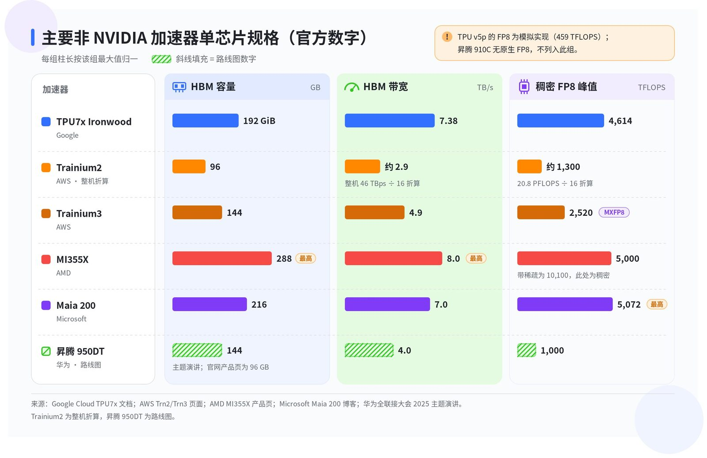
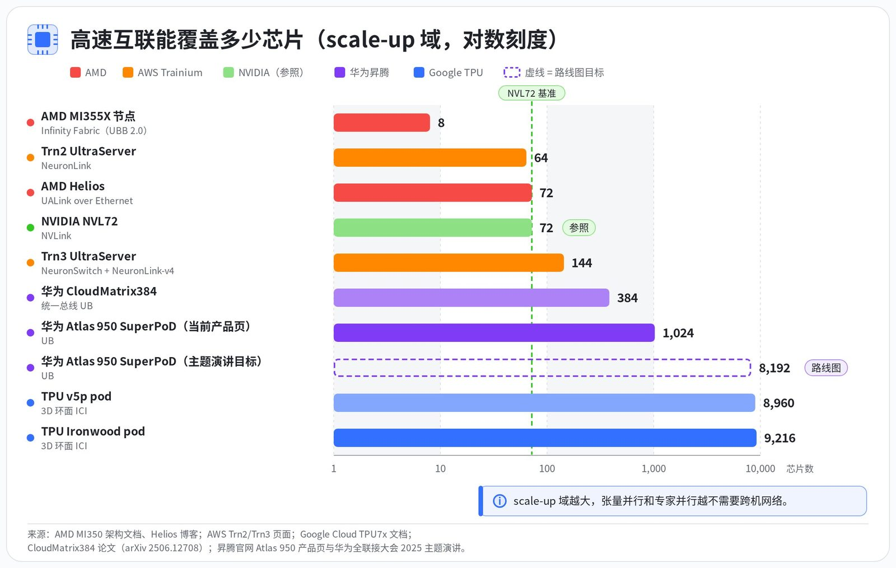
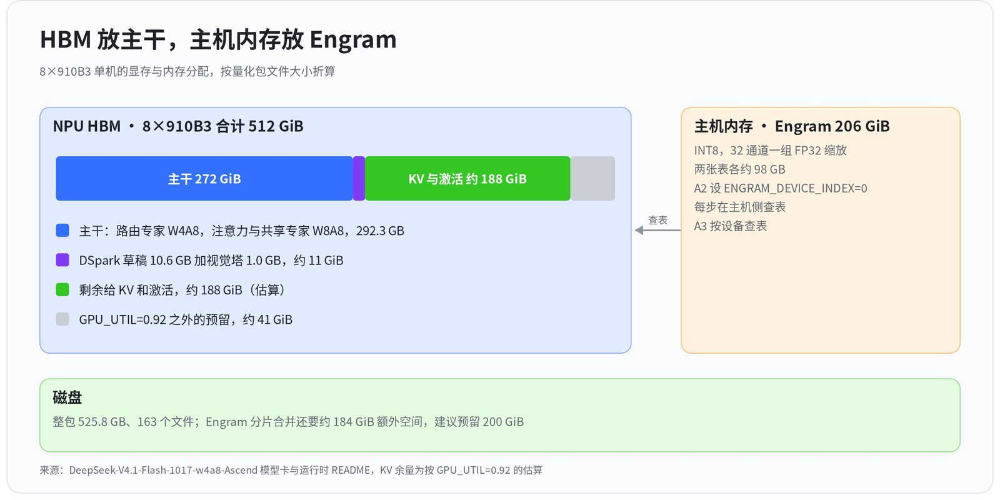
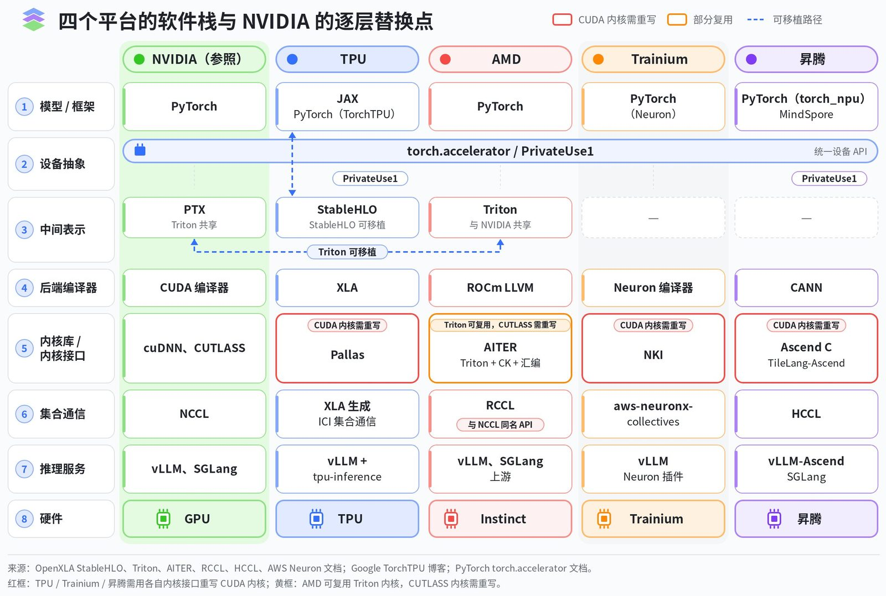
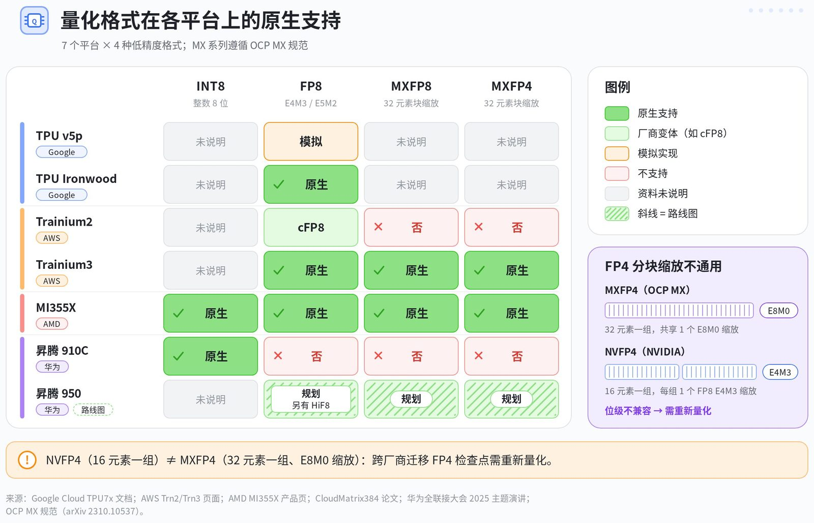
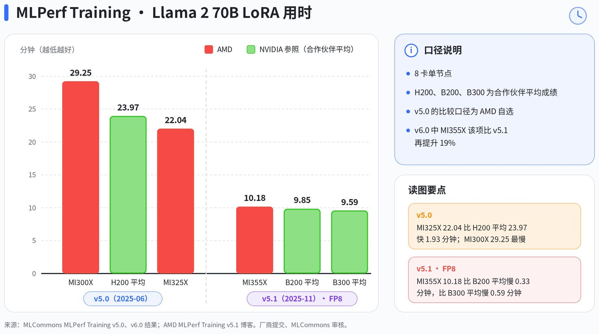
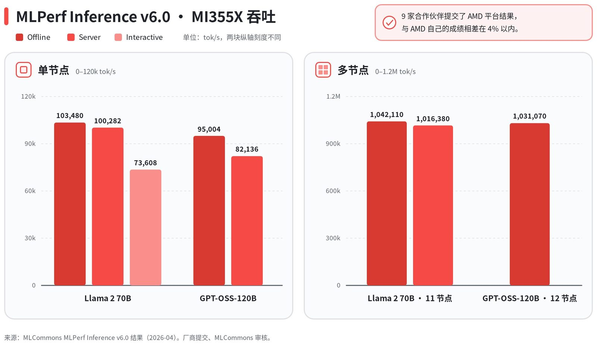
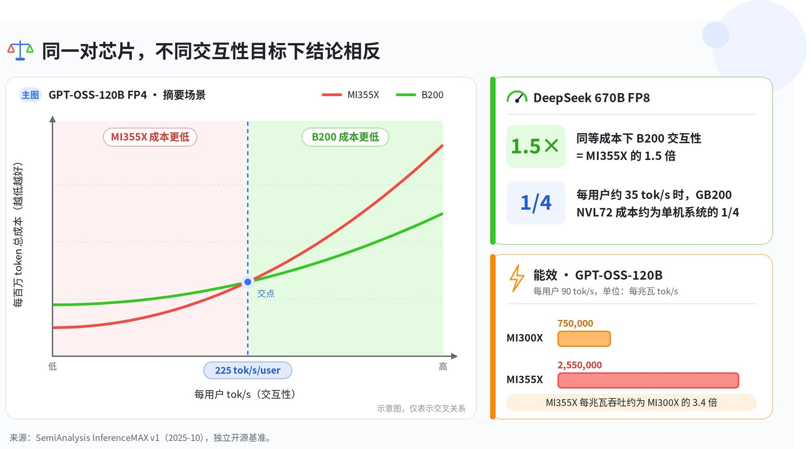
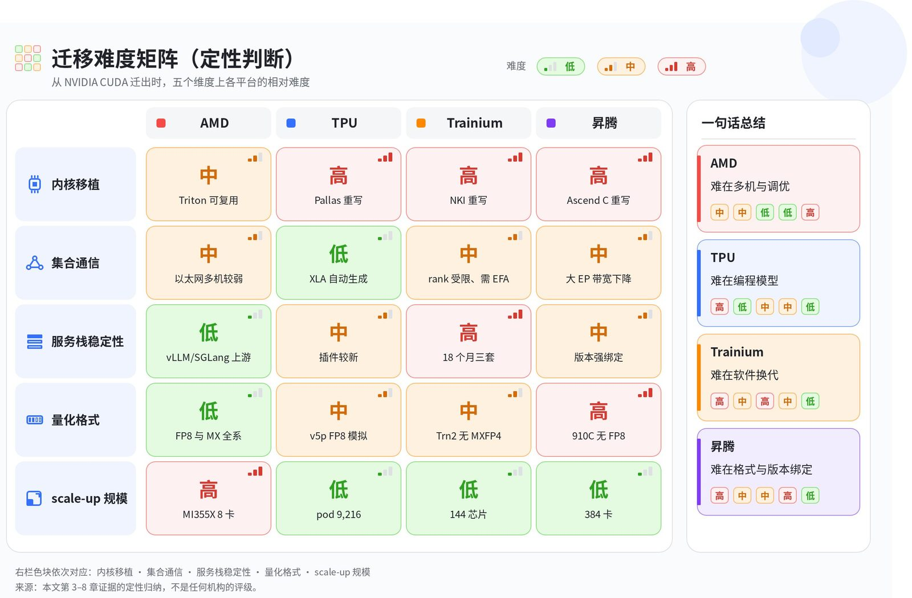

# LLM-36｜系统｜非 NVIDIA 算力：TPU、Trainium、AMD 与昇腾

> 🎯 **这篇文档解决什么问题**：Anthropic 同时使用 TPU、Trainium 和 NVIDIA GPU，OpenAI 与 AMD 签下 6 GW 的多代协议。对 Infra 工程师来说，比“这颗芯片峰值多少”更要紧的是“代码搬过去会断什么、要花多少人力、实测能拿到多少、总成本降没降”。本文逐个平台讲规格、软件栈、迁移断点和公开实测，最后给出迁移难度矩阵和上线清单。
>
> 使用方式：要结论读导读和第 10 章；评估某个平台读第 3–6 章，要在单机 910B 上部署 DeepSeek-V4.1-Flash 读 6.4 节，再用第 7、8 章确认代码会在哪里断；要讨论数字读第 9 章，那里把厂商自报和独立测试分开。文中版本、价格和基准分数核对于 2026 年 10 月 11 日，6.4 节核对于 2026 年 10 月 30 日。

## 导读 · 先给结论

- **主要成本在软件**。SemiAnalysis 在 AMD 协助下测了 5 个月 MI300X 训练，结论是用公开稳定版软件“开箱即用地训练是不可能的”[[1]](https://semianalysis.com/2024/12/22/mi300x-vs-h100-vs-h200-benchmark-part-1-training/)；AWS 约 18 个月换了三套 Trainium 推理服务栈[[2]](https://awsdocs-neuron.readthedocs-hosted.com/en/latest/about-neuron/whats-new.html)。
- **厂商自报和独立测试分开看**。AWS 称 Trn2 比 P5e/P5en 性价比高 30%–40%[[3]](https://aws.amazon.com/ec2/instance-types/trn2/)，属厂商自报；独立的 InferenceMAX 显示 MI355X 在部分区间成本更低，但 DeepSeek 670B FP8 上同等成本下 B200 交互性是它的 1.5 倍[[4]](https://inferencex.semianalysis.com/blog/inferencemax-open-source-inference-benchmarking)。
- **格式支持是硬约束**。昇腾 910C 没有原生 FP8，部署 DeepSeek-R1 用 INT8[[5]](https://arxiv.org/abs/2506.12708)；TPU v5p 的 FP8 是模拟的[[6]](https://cloud.google.com/tpu/docs/tpu7x)；Trn2 没有 MXFP4[[7]](https://aws.amazon.com/about-aws/whats-new/2025/12/amazon-ec2-trn3-ultraservers/)。
- **可移植内核只有 Triton 和 Pallas 两条路**。FlashAttention 在 ROCm 上只支持 FA-2，FA-3、FA-4 不能移植[[8]](https://github.com/Dao-AILab/flash-attention)。
- **默认配置往往不是最优**。vLLM 在 ROCm 上不开 AITER 时，旧注意力后端慢 3–4 倍[[9]](https://vllm.ai/blog/2026-02-27-rocm-attention-backend)。
- **scale-up 域决定上限**。MI355X 节点内 8 卡[[10]](https://rocmdocs.amd.com/en/develop/reference/gpu-arch/mi350.html)，Trn3 UltraServer 144 芯片[[7]](https://aws.amazon.com/about-aws/whats-new/2025/12/amazon-ec2-trn3-ultraservers/)，Ironwood pod 9,216 芯片[[6]](https://cloud.google.com/tpu/docs/tpu7x)。
- **怎么选**：已在 GCP 或 AWS、愿意接受框架约束的，评估 TPU 和 Trainium；PyTorch 为主、吞吐优先的，AMD 最平滑；昇腾主要由供给条件决定。

📎 与系列其他文档的分工：NVIDIA 硬件代际见「大模型推理系统学习手册」和「深入浅出 GPU 优化」；成本公式见「自建推理成本与 GPU 选型」；Gemini 和 PaLM 的 TPU 训练见「训练工程」。本文只讲非 NVIDIA 平台和迁移成本。

## 第 1 章 · 为什么要考虑非 NVIDIA 算力

动因通常有三类：拿不到足够的 NVIDIA 卡、某个负载在别的芯片上单位成本更低、已经绑定某家云。阻力几乎都来自软件。

### 1.1 CUDA 护城河是一串具体依赖

训练框架用 NCCL 做集合通信，注意力用 FlashAttention，GEMM 用 cuBLAS 或 CUTLASS，性能分析用 Nsight。每层都有替代品，但成熟度和默认配置参差不齐。SemiAnalysis 2024-12 的测试里，`F.Linear` 被错误路由到 rocBLAS 而不是 hipBLASLt，造成静默的性能悬崖；FlexAttention 在截止日期前不能在 AMD 上运行[[1]](https://semianalysis.com/2024/12/22/mi300x-vs-h100-vs-h200-benchmark-part-1-training/)。这些问题后来大多修复了，但说明了一点：**迁移成本取决于你用到的那条路径是否被厂商重点优化过**。

### 1.2 供给：容量本身就是理由

- **Anthropic × Google**：2025-10 宣布使用最多一百万颗 TPU，2026 年上线超过 1 GW 容量，同时使用 TPU、Trainium 和 NVIDIA GPU[[11]](https://www.anthropic.com/news/expanding-our-use-of-google-cloud-tpus-and-services)。
- **Anthropic × AWS**：Project Rainier 于 2025-10-29 启用，近 50 万颗 Trainium2[[12]](https://www.aboutamazon.com/news/aws/aws-project-rainier-ai-trainium-chips-compute-cluster)。
- **OpenAI × AMD**：6 GW 多代协议，首批 1 GW 的 MI450 系列从 2026 年下半年部署；AMD 发行最多 1.6 亿股认股权证，按采购量分批生效[[13]](https://ir.amd.com/news-events/press-releases/detail/1260/)。

国内的供给还受出口管制约束：BIS 2025-05-13 的指引认为，使用昇腾 910B、910C、910D 推定适用“一般禁令 10”[[14]](https://www.bis.gov/media/documents/general-prohibition-10-guidance-may-13-2025.pdf)。本文不展开。

### 1.3 总拥有成本不只是芯片价格

后文反复出现的成本项有五个：网络（16k 卡集群的成本差距近 40% 来自网络[[1]](https://semianalysis.com/2024/12/22/mi300x-vs-h100-vs-h200-benchmark-part-1-training/)）、移植和调优人力、软件换代、能效、硬件代际淘汰（Neuron 2.29 起 NxDI 不再支持 Trn1/Inf2 上的 NKI 内核[[2]](https://awsdocs-neuron.readthedocs-hosted.com/en/latest/about-neuron/whats-new.html)）。第 10 章给出完整的估算表。

📎 展开阅读：「自建推理成本与 GPU 选型」第 1 章（每百万 token 成本公式）。

> 💡 **常见误区**：用峰值 TFLOPS 除以标价得出“性价比高 X 倍”。峰值在精度、稠密和稀疏之间口径各异，能用到多少取决于内核和编译器。比较要用同一模型、同一延迟区间、调优后的配置。

## 第 2 章 · 加速器硬件全景

读规格要看三件事：峰值的精度和稠密口径；HBM 容量决定单卡能装多大模型和多少 KV Cache；scale-up 域决定张量并行和专家并行能在多大范围走高速互联。

📎 展开阅读：「大模型推理系统学习手册」第 2 章（2.4 节其他加速器表）；「深入浅出 GPU 优化」第四层“架构篇”（NVIDIA Tensor Core 代际）。

### 2.1 单芯片规格对照

下表只列官方数字。Trn2 由 trn2.48xlarge 整机规格除以 16 折算；FP8 为稠密峰值，没有官方稠密 FP8 数字的留空。

| 芯片 | HBM | 带宽 | 稠密 FP8 | 低精度格式 | scale-up 域 |
|---|---|---|---|---|---|
| TPU7x Ironwood | 192 GiB | 7.38 TB/s | 4,614 TFLOPS | FP8 原生 | pod 9,216，3D 环面[[6]](https://cloud.google.com/tpu/docs/tpu7x) |
| TPU v5p | 95 GiB | 2.77 TB/s | 459（模拟） | FP8 模拟 | pod 8,960[[6]](https://cloud.google.com/tpu/docs/tpu7x) |
| Trainium2 | 96 GB | 约 2.9 TB/s | 约 1,300 | cFP8 | UltraServer 64[[3]](https://aws.amazon.com/ec2/instance-types/trn2/) |
| Trainium3 | 144 GB | 4.9 TB/s | 2,520（MXFP8） | MXFP8、MXFP4 | UltraServer 144[[7]](https://aws.amazon.com/about-aws/whats-new/2025/12/amazon-ec2-trn3-ultraservers/) |
| MI300X | 192 GB | 5.3 TB/s | — | FP8 | 8 卡节点[[15]](https://www.amd.com/en/products/accelerators/instinct/mi300/mi300x.html) |
| MI355X | 288 GB | 8 TB/s | 5,000 | MXFP8/6/4 | 8 卡节点[[16]](https://www.amd.com/en/products/accelerators/instinct/mi350/mi355x.html) |
| MI455X | 432 GB | 23.3 TB/s | — | MXFP4、FP8 | Helios 72[[17]](https://www.amd.com/en/products/accelerators/instinct/mi400/mi455x.html) |
| 昇腾 910C | — | — | 无 FP8 | FP16、BF16、INT8 | CloudMatrix 384[[5]](https://arxiv.org/abs/2506.12708) |
| 昇腾 950DT（路线图） | 144 GB | 4 TB/s | 1,000 | FP8、HiF8、MXFP4 | Atlas 950 SuperPoD[[18]](https://www.huawei.com/en/news/2025/9/hc-xu-keynote-speech) |
| Maia 200 | 216 GB | 7 TB/s | 5,072 | FP4 | 微软内部[[19]](https://blogs.microsoft.com/blog/2026/01/26/maia-200-the-ai-accelerator-built-for-inference/) |



- MI355X 的 FP8 带稀疏是 10.1 PFLOPS，MXFP4 稠密就是 10.1 PFLOPS[[16]](https://www.amd.com/en/products/accelerators/instinct/mi350/mi355x.html)，不要拿带稀疏的数字和别家稠密比。
- MI455X 带宽在产品页是 23.3 TB/s，Helios 宣传册写“最高 19.6 TB/s”[[20]](https://www.amd.com/content/dam/amd/en/documents/solutions/ai/amd-helios-bro.pdf)；整柜 1.7 PB/s 除以 72 约 23.6 TB/s。
- 昇腾 950DT 的 144 GB 来自 2025-09 主题演讲[[18]](https://www.huawei.com/en/news/2025/9/hc-xu-keynote-speech)，官网 Atlas 950 SuperPoD 页面写的是每卡 96 GB[[21]](https://www.hiascend.com/en/hardware/cluster)。

### 2.2 scale-up 域

不同平台高速互联覆盖的芯片数相差三个数量级。MI355X 是 UBB 2.0 基板上 8 卡，每卡 7 条 Infinity Fabric 链路[[10]](https://rocmdocs.amd.com/en/develop/reference/gpu-arch/mi350.html)；Helios 72 卡走 UALink over Ethernet，scale-up 260 TB/s[[22]](https://www.amd.com/en/blogs/2026/amd-launches-helios-the-highest-performing-rackscale-ai-infrastructure-solution.html)；Trn3 UltraServer 144 芯片，NeuronSwitch 全互联[[7]](https://aws.amazon.com/about-aws/whats-new/2025/12/amazon-ec2-trn3-ultraservers/)；CloudMatrix384 用统一总线（UB）连接 384 颗 910C，跨节点带宽下降不到 3%[[5]](https://arxiv.org/abs/2506.12708)；Ironwood pod 9,216 芯片，超过 64 芯片的切片由 4×4×4 立方体拼成[[6]](https://cloud.google.com/tpu/docs/tpu7x)。华为主题演讲给出 Atlas 950 SuperPoD 8,192 卡的目标[[18]](https://www.huawei.com/en/news/2025/9/hc-xu-keynote-speech)，官网当前写的是最多 1,024 卡[[21]](https://www.hiascend.com/en/hardware/cluster)。



📎 展开阅读：「《深入理解 AI Infra》精读」第 6 章（三维环面与交换网络、UB 的设计取舍）。

### 2.3 其他加速器

- **微软 Maia 200**（2026-01）：3 nm、750 W、片上 SRAM 272 MB；微软自报 TCO 比机群里其他加速器低 30%，FP4 性能是第三代 Trainium 的三倍[[19]](https://blogs.microsoft.com/blog/2026/01/26/maia-200-the-ai-accelerator-built-for-inference/)。只供内部使用。
- **Meta MTIA**：MTIA 300 已用于推荐排序训练，内置网卡小芯片；它的集合通信库也叫 HCCL，和华为的无关[[23]](https://engineering.fb.com/2026/08/24/networking-traffic/mtia-300-meta-training-chip-built-in-nics/)。
- **Groq**：2025-12 把推理技术非独占授权给 NVIDIA，创始人带团队加入 NVIDIA，GroqCloud 继续运营[[24]](https://groq.com/newsroom/groq-and-nvidia-enter-non-exclusive-inference-technology-licensing-agreement-to-accelerate-ai-inference-at-global-scale)。对单独采购 LPU 的用户，这是供应商风险信号。

> 💡 **常见误区**：引用“Ironwood pod 42.5 EFLOPS，是 El Capitan 的 24 倍以上”[[25]](https://blog.google/products/google-cloud/ironwood-tpu-age-of-inference/)。这拿 FP8 比超算的 FP64，口径不同，没有工程意义。

## 第 3 章 · Google TPU：Ironwood、第八代与 JAX/XLA

TPU 软件栈最完整、规模最大，但编程模型和 GPU 差别也最大：没有 CUDA 等价物，并行由编译器按分片注解决定，自定义内核用 Pallas 写。迁移成本主要在“改写成编译器友好的形态”。

### 3.1 Ironwood（TPU7x）

单芯片 BF16 2,307 TFLOPS、FP8 4,614 TFLOPS、192 GiB HBM、7,380 GBps，ICI 双向 1,200 GBps[[6]](https://cloud.google.com/tpu/docs/tpu7x)；Google 自报每瓦性能是 Trillium 的 2 倍[[25]](https://blog.google/products/google-cloud/ironwood-tpu-age-of-inference/)。影响移植的结构细节：

- **双小芯片**：每颗芯片两个小芯片，各有 1 个 TensorCore 和 96 GB HBM；JAX 把每颗芯片暴露成 2 个设备[[6]](https://cloud.google.com/tpu/docs/tpu7x)。在 v4、v5p 上按一芯片一设备写的分片代码要重新检查网格形状。
- **框架**：支持 JAX 和 PyTorch，**不支持 TensorFlow**；推理走 vLLM 加 `tpu-inference`，训练走 MaxText[[6]](https://cloud.google.com/tpu/docs/tpu7x)。

### 3.2 第八代：TPU 8t 与 8i

2026-04 Google 把第八代拆成训练用的 8t 和推理用的 8i，称当年晚些时候提供[[26]](https://cloud.google.com/blog/products/compute/ai-infrastructure-at-next26)。以下为 Google 自报[[27]](https://blog.google/innovation-and-ai/infrastructure-and-cloud/google-cloud/eighth-generation-tpu-agentic-era/)：8t 每个 superpod 9,600 芯片、121 EFLOPS、2 PB 共享 HBM；8i 片上 SRAM 384 MB、288 GB HBM，推理每美元性能比上一代高 80%。Google 主要发布材料没有给出单芯片 FP4 峰值。

### 3.3 价格

截至 2026-10 的官网价格（美元/芯片小时）[[28]](https://cloud.google.com/tpu/pricing)：

| 代际 | 按需 | 1 年承诺 | 3 年承诺 |
|---|---|---|---|
| Ironwood | 12.00 | 8.40 | 5.40 |
| Trillium | 2.70 | 1.89 | 1.22 |
| v5p | 4.20 | 2.94 | 1.89 |
| v5e | 1.20 | 0.84 | 0.54 |

按需价格除以峰值：Ironwood 每 FP8 PFLOP 小时约 2.60 美元，Trillium 约 2.94 美元。这只是峰值粗算，要用实测利用率修正。

### 3.4 软件栈

- **编译**：JAX 或 PyTorch 降到 StableHLO，由 XLA 编译；集合通信由 XLA 自动生成（第 8 章）。
- **自定义内核**：用 Pallas 写，块大小受片上 VMEM 限制[[29]](https://docs.jax.dev/en/latest/pallas/tpu/index.html)。
- **推理**：2025-10 vLLM 的 `tpu-inference` 插件取代 PyTorch/XLA 路径，PyTorch 和 JAX 模型走同一条 JAX→XLA 路径；项目称不改模型代码吞吐提升约 20%[[30]](https://vllm.ai/blog/2025-10-16-vllm-tpu)。推荐 v7x、v5e、v6e[[31]](https://github.com/vllm-project/tpu-inference)。
- **PyTorch**：2026-04 发布的 TorchTPU 将取代 PyTorch/XLA（第 7 章）[[32]](https://developers.googleblog.com/torchtpu-running-pytorch-natively-on-tpus-at-google-scale/)。

### 3.5 公开训练案例

Apple 的 AFM-server 在 8,192 颗 TPUv4 上训练 6.3T token，持续 MFU 约 52%，框架是基于 JAX 的 AXLearn[[33]](https://arxiv.org/abs/2407.21075)。Google 把 Olmo 3 7B 移植到 MaxText，Ironwood 上 MFU 44.5%，v5p-256 上 57.4%[[34]](https://developers.googleblog.com/en/reproducing-olmo-3-7b-pre-training-in-maxtext-case-study-of-large-scale-training-on-tpus/)，第 9 章展开。

📎 展开阅读：「训练工程」第 9 章（Gemini 2.5 在 TPUv5p pod 上的弹性训练）和第 11 章（PaLM 的 MFU）。

> 💡 **常见误区**：以为 PyTorch 改个设备名就能跑出好性能。TPU 对形状敏感，头维度 64 不是最优，128 或 256 才是[[32]](https://developers.googleblog.com/torchtpu-running-pytorch-natively-on-tpus-at-google-scale/)；Olmo 复现把头维度从 128 改为 256，MFU 从 44.2% 升到 49.6%[[34]](https://developers.googleblog.com/en/reproducing-olmo-3-7b-pre-training-in-maxtext-case-study-of-large-scale-training-on-tpus/)。

## 第 4 章 · AWS Trainium：Trn2、Trn3 与 Neuron SDK

Trainium 只能在 AWS 上用，硬件迭代快、规模大，但软件栈两年里变动频繁。评估时 Neuron SDK 的节奏和芯片本身同样重要。

### 4.1 Trn2

trn2.48xlarge 有 16 颗 Trainium2，FP8 最高 20.8 PFLOPS、1.5 TB HBM3、3.2 Tbps EFAv3；UltraServer 用 NeuronLink 连 64 颗芯片[[3]](https://aws.amazon.com/ec2/instance-types/trn2/)。数据类型有 BF16、FP16、cFP8，支持 16:4 稀疏，没有 MXFP4。Capacity Blocks 最多 64 台、最长 6 个月[[3]](https://aws.amazon.com/ec2/instance-types/trn2/)。AWS 自报比 P5e/P5en 性价比高 30%–40%[[3]](https://aws.amazon.com/ec2/instance-types/trn2/)，没有独立复现。公开页面上没有 trn2.48xlarge 的按需价格。

### 4.2 Trainium3

2025-12 发布，AWS 第一颗 3 nm AI 芯片：FP8（MXFP8）2.52 PFLOPS、144 GB HBM3e、4.9 TB/s，新增 MXFP8 和 MXFP4[[7]](https://aws.amazon.com/about-aws/whats-new/2025/12/amazon-ec2-trn3-ultraservers/)。Trn3 UltraServer 最多 144 颗芯片、FP8 362 PFLOPS，每芯片 NeuronLink-v4 2 TB/s[[7]](https://aws.amazon.com/about-aws/whats-new/2025/12/amazon-ec2-trn3-ultraservers/)。AWS 自报相对 Trn2 UltraServer 性能最高 4.4 倍、每瓦性能 4 倍[[7]](https://aws.amazon.com/about-aws/whats-new/2025/12/amazon-ec2-trn3-ultraservers/)。研发中的 Trainium4 将支持 NVIDIA NVLink Fusion[[35]](https://www.aboutamazon.com/news/aws/trainium-3-ultraserver-faster-ai-training-lower-cost)。

规模上，AWS 称超过一百万颗 Trainium 已在生产中运行，Bedrock 大部分推理由 Trainium 支撑[[36]](https://builder.aws.com/content/37FzTD9aYF6SIHE421joJaN2Hgv/)。这些负载是 AWS 与大客户深度协作完成的，普通团队得不到同样的支持。

### 4.3 Neuron SDK

本文核对时最新是 2026-08-17 的 Neuron 2.32.0[[2]](https://awsdocs-neuron.readthedocs-hosted.com/en/latest/about-neuron/whats-new.html)。

- **NKI**：用 Python 写内核的接口，AWS 称“类 Triton”[[3]](https://aws.amazon.com/ec2/instance-types/trn2/)，但 Triton 内核不能直接用。2.32 新增 DeepSeek-V3.2 稀疏 MLA、MXFP8 MoE 训练等 13 个内核，编译器和内核库已开源[[2]](https://awsdocs-neuron.readthedocs-hosted.com/en/latest/about-neuron/whats-new.html)。
- **推理服务栈**：NxD Inference 已进入维护模式，“不计划发布新功能”，建议迁到 2026-07 推出的 vLLM Neuron 插件（beta，只支持 Trn2 和 Trn3）[[2]](https://awsdocs-neuron.readthedocs-hosted.com/en/latest/about-neuron/whats-new.html)。插件绑定具体 vLLM 和 PyTorch 版本[[37]](https://github.com/vllm-project/vllm-neuron)。
- **代际支持**：2.29 起 NxDI 不再支持 Trn1/Inf2 上的 NKI 内核，只能停在 2.28[[2]](https://awsdocs-neuron.readthedocs-hosted.com/en/latest/about-neuron/whats-new.html)。

约 18 个月里，Trainium 推理从 Neuron 维护的 vLLM 分支，到 NxDI 加插件，再到 vLLM Neuron 插件，换了三套服务栈[[2]](https://awsdocs-neuron.readthedocs-hosted.com/en/latest/about-neuron/whats-new.html)。每次都要重新验证和调优，这是最容易被低估的成本。

> 💡 **常见误区**：把“性价比高 30%–40%”当成迁移收益。它是厂商自选负载的结果，不含移植和跟随换代的人力。应在自己的模型上跑当前版本的 vLLM Neuron 插件，并把未来一年的服务栈变化算进成本。

## 第 5 章 · AMD Instinct：MI355X、MI455X 与 ROCm 7

AMD 最接近“直接替换”：同样是 GPU、同样跑 PyTorch，RCCL 和 NCCL 的 API 同名。能跑通之后，风险往往藏在“默认配置是不是走了最快的路径”。

### 5.1 MI300X 与 MI355X

MI300X 是 192 GB HBM3、5.3 TB/s、750 W[[15]](https://www.amd.com/en/products/accelerators/instinct/mi300/mi300x.html)。MI355X 基于 CDNA4，288 GB HBM3E、8 TB/s；稠密 BF16 2.5 PFLOPS、FP8 5 PFLOPS、MXFP4 10.1 PFLOPS；功耗 1,400 W，需要液冷[[16]](https://www.amd.com/en/products/accelerators/instinct/mi350/mi355x.html)。大显存是最直接的推理优势：要 2–4 张 80 GB 卡做张量并行的模型，MI355X 可能单卡放下。

📎 展开阅读：「自建推理成本与 GPU 选型」第 4 章（显存容量如何决定批大小和单位成本）。

### 5.2 MI455X 与 Helios

MI455X 基于 CDNA5，2026-07-23 发布，432 GB HBM4[[17]](https://www.amd.com/en/products/accelerators/instinct/mi400/mi455x.html)。Helios 整柜 72 颗 MI455X，MXFP4 稠密 2.9 EFLOPS、31 TB HBM4，scale-out 用 800G 网卡[[22]](https://www.amd.com/en/blogs/2026/amd-launches-helios-the-highest-performing-rackscale-ai-infrastructure-solution.html)。AMD 自报比 Vera Rubin NVL72 每美元 token 数最多高 30%[[22]](https://www.amd.com/en/blogs/2026/amd-launches-helios-the-highest-performing-rackscale-ai-infrastructure-solution.html)，本文核对时没有独立测试结果。

### 5.3 ROCm 7 与 AITER

ROCm 7.0.0（2025-09）加入 MI350 系列和 OCP FP4、FP6、FP8，配套 vLLM 和 SGLang 的 PD 分离方案[[38]](https://rocm.docs.amd.com/en/docs-7.0.0/about/release-notes.html)。决定推理性能的是 AITER：AMD 的算子库，后端有 Triton、Composable Kernel 和手写汇编，是 vLLM 和 SGLang 在 ROCm 上的默认后端；AMD 自报 SGLang 上 DeepSeek-R1 吞吐从 6,484 提升到 13,704 tok/s[[39]](https://github.com/ROCm/aiter)。

vLLM 2026-02 的博客把问题讲得最清楚：ROCm 上有 7 个注意力后端，ROCM_AITER_FA 吞吐是旧 ROCM_ATTN 的 2.7–4.4 倍[[9]](https://vllm.ai/blog/2026-02-27-rocm-attention-backend)。**不设 **<b>`VLLM_ROCM_USE_AITER=1`</b><b>，测到的可能是慢 3–4 倍的路径</b>。AMD 还自报 MI355X 在 64–128 并发下 DeepSeek-R1 吞吐最高是 B200 的 1.4 倍，低并发时 B200 占优[[40]](https://rocm.blogs.amd.com/artificial-intelligence/scaling-ai-inference/README.html)，和第 9 章的独立测试方向一致。

### 5.4 训练

SemiAnalysis 测得 BF16 GEMM 实测 MI300X 约 620 TFLOP/s（标称 1,307），H100 约 720（标称 989.5）；自定义镜像约 60 条命令、构建 5 小时；单机训练在 AMD 协助下才达到 H100/H200 的约 75%[[1]](https://semianalysis.com/2024/12/22/mi300x-vs-h100-vs-h200-benchmark-part-1-training/)。此后 AMD 在 MLPerf 上第一次提交了多机训练和 MXFP4 训练[[41]](https://mlcommons.org/2026/06/mlperf-training-v6-0-results/)，数字见第 9 章。

> 💡 **常见误区**：用一年前的 ROCm 结论判断今天的 AMD，或者反过来拿 AMD 博客的峰值当自己能拿到的数字。正确做法是用 ROCm 7 加 AITER，在自己的模型和延迟目标上实测。

## 第 6 章 · 华为昇腾：CloudMatrix384、950 路线与 CANN

选昇腾通常首先由供给条件决定。工程上要搞清楚：910C 能做到什么、缺什么，950 承诺了什么，软件栈追到了哪一步。

### 6.1 910C 与 CloudMatrix384

最详细的一手资料是华为与硅基流动 2025-06 的论文，数字为厂商自测[[5]](https://arxiv.org/abs/2506.12708)。910C 每颗两个裸片，只支持 FP16、BF16 和 INT8，**没有原生 FP8**；CloudMatrix384 由 384 颗 910C 和 192 颗鲲鹏 CPU 通过 UB 全互联。DeepSeek-R1（INT8 W8A8）的结果[[5]](https://arxiv.org/abs/2506.12708)：

| 阶段与系统 | 每卡 tok/s | 每 TFLOPS tok/s |
|---|---|---|
| 预填充 · CloudMatrix384 | 6,688 | 4.45 |
| 预填充 · SGLang H100 | 7,417 | 3.75 |
| 解码 · CloudMatrix384（TPOT &lt; 50 ms） | 1,943 | 1.29 |
| 解码 · DeepSeek H800 | 1,850 | 0.93 |
| 解码 · SGLang H100 | 2,172 | 1.10 |

预填充两行都是理想负载均衡下的数字。**昇腾赢在每 TFLOPS 效率，不是每卡吞吐**。论文也暴露了工程问题：CANN EP 的 dispatch 带宽在大 EP 规模下显著下降；671 GB 模型 8 个实例同时从对象存储拉取，冷启动每个约 2,560 秒[[5]](https://arxiv.org/abs/2506.12708)。论文没有和 GB200 NVL72 直接对比。

### 6.2 950 路线图

2025-09 华为全联接大会公布[[18]](https://www.huawei.com/en/news/2025/9/hc-xu-keynote-speech)：昇腾 950 的 FP8 为 1 PFLOPS、MXFP4 为 2 PFLOPS，互联 2 TB/s；950PR 在 2026 年第一季度，950DT（144 GB、4 TB/s）在第四季度；Atlas 950 SuperPoD 目标 8,192 颗 950DT。官网当前的 Atlas 950 SuperPoD 页面写的是每卡 96 GB、最多 1,024 卡、“最高 0.9 EFLOPS”[[21]](https://www.hiascend.com/en/hardware/cluster)。规划应按产品页，而不是主题演讲目标。950 最重要的意义是补上 FP8 和 MXFP4。

### 6.3 软件栈

- **开源**：华为承诺 2025 年底前开源开放 CANN[[18]](https://www.huawei.com/en/news/2025/9/hc-xu-keynote-speech)；HCCL 已在 GitCode 开源，标签跟随 CANN 版本[[42]](https://gitcode.com/cann/hccl)。
- **vLLM-Ascend**：基于 vLLM 硬件插件机制，2025-05 发布首个版本，2026-09 到 v0.26.0rc1；要求 CANN 9.1.0、PyTorch 2.10.0、torch_npu 2.10.0.post4，支持 910B/910C[[43]](https://github.com/vllm-project/vllm-ascend)。
- **首日支持**：DeepSeek-V3.2-Exp 发布当天即可在昇腾上运行，稀疏注意力内核用 TileLang-Ascend 写[[44]](https://github.com/vllm-project/vllm-ascend/issues/3272)；SGLang 的启动参数仍是 `--quantization w8a8_int8`[[45]](https://www.lmsys.org/blog/2025-09-29-deepseek-V32/)。

> 💡 **常见误区**：把路线图规格当采购依据，或忽略格式差异。在 910C 上部署 FP8 原生模型，实际跑的是 INT8，精度要单独评测。

### 6.4 单机 910B 跑 V4.1-Flash

2026-10 社区发布了 DeepSeek-V4.1-Flash-1017 的昇腾 W4A8 量化包和配套运行时，目标是 8 卡 910B 单机起服[[62]](https://www.modelscope.cn/models/chiro2001/DeepSeek-V4.1-Flash-1017-w4a8-Ascend)[[63]](https://github.com/chiro2001/deepseek-v4.1-flash-ascend910B)。本节按这两份一手 README 整理装得下的原因、部署要点和验收口径，它是社区包，数字都是作者自测，1017 这一版还没有在真实 A2 上复测[[62]](https://www.modelscope.cn/models/chiro2001/DeepSeek-V4.1-Flash-1017-w4a8-Ascend)。

**为什么装得下**。量化分三档。路由专家用 W4A8 动态量化，注意力投影、共享专家和部分 indexer 用 W8A8 动态量化，Engram 表用 INT8 并且每 32 个通道配一个 FP32 缩放，视觉塔保留 BF16[[62]](https://www.modelscope.cn/models/chiro2001/DeepSeek-V4.1-Flash-1017-w4a8-Ascend)。整包 525.8 GB、163 个文件，其中主干 292.3 GB（272.2 GiB），Engram 221.2 GB（206 GiB），DSpark 草稿模型 10.6 GB[[62]](https://www.modelscope.cn/models/chiro2001/DeepSeek-V4.1-Flash-1017-w4a8-Ascend)。主干和草稿常驻 HBM，Engram 放主机内存查表[[62]](https://www.modelscope.cn/models/chiro2001/DeepSeek-V4.1-Flash-1017-w4a8-Ascend)。8×910B3 合计 512 GiB HBM[[64]](https://github.com/chiro2001/deepseek-v4.1-flash-ascend910B/blob/main/EXPECTED_PERF.md)，扣掉约 283 GiB 权重，按 `GPU_UTIL=0.92` 折算还剩约 188 GiB 给 KV 和激活，这是按文件大小的估算。



**部署要点**。按下面七步走，每一步都对应 README 里一个容易出错的地方[[62]](https://www.modelscope.cn/models/chiro2001/DeepSeek-V4.1-Flash-1017-w4a8-Ascend)[[63]](https://github.com/chiro2001/deepseek-v4.1-flash-ascend910B)。

1. **认设备**：A3 一块卡两个 die，8 卡对应 `/dev/davinci0..15`；A2（910B3）一块卡一个 die，8 卡就是 8 个设备。用 `npu-smi info` 和 `ls /dev/davinci*` 核对，TP 数按 die 计[[63]](https://github.com/chiro2001/deepseek-v4.1-flash-ascend910B)。
2. **下载到独立目录**：1017 用 DP16 校准，主干 80 个分片；旧包是 DP8、72 个分片，两版不能混放。下载后先跑 `sha256sum --check SHA256SUMS`[[62]](https://www.modelscope.cn/models/chiro2001/DeepSeek-V4.1-Flash-1017-w4a8-Ascend)。
3. **合并 Engram**：两张表各约 98 GB，各拆成 6 片，用 `reassemble_engram_weights.sh` 合并，支持 `--check-only` 和 `--delete-parts`[[62]](https://www.modelscope.cn/models/chiro2001/DeepSeek-V4.1-Flash-1017-w4a8-Ascend)。
4. **钉住运行时版本**：检出 README 指定的 commit，再执行包内的 `apply_runtime_fix.sh`。这个补丁修的是 `build_dspark_swa_indices` 里误用 `self` 的 NameError，不打的话第一个真实请求就报错[[62]](https://www.modelscope.cn/models/chiro2001/DeepSeek-V4.1-Flash-1017-w4a8-Ascend)。
5. **构建镜像**：基础镜像是 vLLM-Ascend 的 `deepseek-v4.1-flash-openeuler`，用 `SKIP_PGO=1` 跑 `build_image.sh`[[62]](https://www.modelscope.cn/models/chiro2001/DeepSeek-V4.1-Flash-1017-w4a8-Ascend)。
6. **起服**：A2 用 `serve_a2.sh`，TP=8、DP=1，关键环境变量见表 6-4[[62]](https://www.modelscope.cn/models/chiro2001/DeepSeek-V4.1-Flash-1017-w4a8-Ascend)。
7. **验收**：按本节末尾的清单逐项核对。

*A2 单机起服（摘自模型卡）
*

```bash
docker pull quay.nju.edu.cn/ascend/vllm-ascend:deepseek-v4.1-flash-openeulerSKIP_PGO=1 IMAGE_TAG=dsv41-1017-a2:v9 bash scripts/build_image.shDEVS="0 1 2 3 4 5 6 7" TP=8 DP=1 MODEL=$MODEL IMAGE=dsv41-1017-a2:v9 \  PATCH_MODE=baked PORT=18817 SERVED_NAME=deepseek-v41-flash-1017-w4a8 \  MAX_SEQS=4 PREFIX=0 DROPCACHE=0 BAT_TOKENS=8192 V41_KV32_REPACK=0 GPU_UTIL=0.92 \  SPEC=1 SP_TOKENS=5 DRAFT_GRAPH=0 ENGRAM_DEVICE_INDEX=0 PYTHON_PGO=0 \  bash scripts/serve_a2.sh
```

表 6-4 · A2 与 A3 的关键环境变量[[62]](https://www.modelscope.cn/models/chiro2001/DeepSeek-V4.1-Flash-1017-w4a8-Ascend)[[63]](https://github.com/chiro2001/deepseek-v4.1-flash-ascend910B)

| 变量 | A2（serve_a2.sh） | A3 交付默认 | 说明 |
|---|---|---|---|
| `BAT_TOKENS` | 8192 | 2048 | prefill 分块大小。A3 改成 2048，KV 池从约 299 万 token 涨到约 401 万 |
| `V41_KV32_REPACK` | 0 | 1 | 必须和 2048 成对，否则池越过 32 位块边界，长文静默读错。A2 上未实测 |
| `ENGRAM_DEVICE_INDEX` | 0（主机查表） | 按设备查表 | A2 的 Engram 在主机侧查 |
| `DRAFT_GRAPH` | 0 | 默认 0，低并发建议开 | 草稿模型是否进图 |
| `SPEC` / `SP_TOKENS` | 1 / 5 | 1 / 5 | DSpark 推测解码，每步猜 5 个 token |
| `MAX_SEQS` | 4 | 按并发需求 | 只决定并发容量，聚合吞吐封顶约 259 tok/s（A2 口径），上界在算力 |

**A2 和 A3 差在哪**。性能数字要分实测、模拟、估算三种口径读。真实 A2 TP8 的早期基线用的是旧权重：约 8K 上下文、Engram 开、DSpark 每步猜 5 个，每步 75.67 ms，接受长度 A≈2.97，约 39.2 tok/s，规划时按 40 tok/s 一档算[[62]](https://www.modelscope.cn/models/chiro2001/DeepSeek-V4.1-Flash-1017-w4a8-Ascend)[[64]](https://github.com/chiro2001/deepseek-v4.1-flash-ascend910B/blob/main/EXPECTED_PERF.md)。A2 上 60–68 tok/s 是优化后的估算，90–99 tok/s 的“A2 形态”是在 A3 上模拟的，都不能当 A2 实测引用[[62]](https://www.modelscope.cn/models/chiro2001/DeepSeek-V4.1-Flash-1017-w4a8-Ascend)。A3 TP8 在 1K 输入、256 输出、草稿进图时约 101–110 tok/s，128K 上下文约 85 tok/s，同样是旧权重[[62]](https://www.modelscope.cn/models/chiro2001/DeepSeek-V4.1-Flash-1017-w4a8-Ascend)。差距主要在主机侧：两代每个 die 的带宽同为 1600 GB/s，硬件只能解释约 15%[[63]](https://github.com/chiro2001/deepseek-v4.1-flash-ascend910B)。A2 不开投机时每轮 18.9 ms，比 A3 的约 27.5 ms 还快，但草稿模型每轮约 26 ms，慢了约 10 倍；A2 的 Kunpeng-920 只有 192 核，派发慢一个量级[[64]](https://github.com/chiro2001/deepseek-v4.1-flash-ascend910B/blob/main/EXPECTED_PERF.md)。

**1017 验收到哪一步**。1017 只在 A3 单实例 TP8 上验收，即 8 个逻辑设备、4 块双 die 卡：SHA256 和 API 检查全过，视觉 23/23，GSM8K 前 200 题答对 199 题（并发 4、温度 0，属于小样本回归），130,053 token 长文 4/4 命中[[62]](https://www.modelscope.cn/models/chiro2001/DeepSeek-V4.1-Flash-1017-w4a8-Ascend)。吞吐、真实 A2、多机、PD 分离和 1M 上下文都没有复测；标称最大上下文 1,048,576，但 1M 没有重新验收[[62]](https://www.modelscope.cn/models/chiro2001/DeepSeek-V4.1-Flash-1017-w4a8-Ascend)。

> 📌 **验收清单**
>
> - 先比接受长度 A：它和平台无关，与作者 8-shot 中位数相差在 ±15% 以内就说明装对了[[64]](https://github.com/chiro2001/deepseek-v4.1-flash-ascend910B/blob/main/EXPECTED_PERF.md)。
> - 报数时同时给 ms/step、A 和 tok/s，单看 A 不能当绩效指标[[63]](https://github.com/chiro2001/deepseek-v4.1-flash-ascend910B)。
> - 在 `serve.log` 里查 `GPU KV cache size` 一行，确认 KV 池大小[[64]](https://github.com/chiro2001/deepseek-v4.1-flash-ascend910B/blob/main/EXPECTED_PERF.md)。
> - 改了 `BAT_TOKENS` 或 `V41_KV32_REPACK` 之后，用长文针测试重新验正确率[[63]](https://github.com/chiro2001/deepseek-v4.1-flash-ascend910B)。

**常见误区**：把 A3 的设备数当成 A2 的卡数；新旧两版权重混在一个目录；没打运行时补丁；在 A2 上照搬 A3 的 `BAT_TOKENS=2048` 却不开 KV32 重排；把 A3 模拟的 A2 形态数字当实测；用 codex 这类 Responses API 客户端直连前没跑 `enable_codex_responses.sh`，结果返回 HTTP 500 或静默丢内容[[63]](https://github.com/chiro2001/deepseek-v4.1-flash-ascend910B)。

这套包说明单机 910B 能装下 V4.1-Flash 的全部参数。上游 vLLM-Ascend 在 2026-09-18 合入了 V4.1 支持和 Engram 的 HBM、主机卸载，测试形态是 A3 TP8/DP2/EP16 且关闭 Engram，没有声明端到端精度[[65]](https://github.com/vllm-project/vllm-ascend/pull/16544)。生产采用前，在自己的 A2 上按上面的清单重测吞吐和长文正确率。

## 第 7 章 · 软件栈与可移植性：离开 CUDA 会断什么

迁移时自上而下逐层检查：模型代码、设备抽象、编译器中间表示、后端编译器、内核库、集合通信库。本章讲前五层，后者见第 8 章。



### 7.1 哪些代码要重写

- **手写 CUDA 内核**：CUTLASS、CuTe-DSL、手写 PTX 都不能移植。FlashAttention 在 ROCm 上只支持 FA-2，FA-3 只有经 Triton 实现的 FP8 版本；FA-3 的 Hopper 实现和 FA-4 的 Blackwell 实现不能移植[[8]](https://github.com/Dao-AILab/flash-attention)。
- **运行时特性**：Character.ai 迁到 AMD 时，完整 CUDA Graph 捕获在 ROCm 上会崩溃[[46]](https://blog.character.ai/technical-deep-dive-how-digitalocean-and-amd-delivered-a-2x-production-inference-performance-increase-for-character-ai/)。
- **Triton 内核**：NVIDIA 和 AMD 之间可移植，原生不支持 TPU、Trainium；昇腾有 [Triton-Ascend](https://github.com/Ascend/triton-ascend) 适配后端，支持范围需按算子、版本和硬件核验，不保证代码无需修改。
- **纯 PyTorch 或 JAX 代码**：大多能跑，性能取决于后端覆盖。

### 7.2 Triton 与 StableHLO：两条可移植路线

Triton 上游支持 NVIDIA（计算能力 8.0 及以上）和 AMD（ROCm 6.2 及以上），同一内核分别编译成 PTX 和 AMDGCN[[47]](https://github.com/triton-lang/triton)。这是 vLLM、SGLang 能在两种 GPU 上共享后端的原因。但 Triton 内核不一定最快，常见做法是先用 Triton 跑通，再换厂商算子库。

StableHLO 是框架和编译器之间的算子集，提供版本管理和前后向兼容[[48]](https://github.com/openxla/stablehlo)。JAX 和 TorchTPU 都降到 StableHLO 再交给 XLA。这条路线下，开发者用分片注解表达并行，优化交给编译器；代价是调优要看编译器输出。

### 7.3 PyTorch 的设备无关接口

- <b>`torch.accelerator`</b>：覆盖 CUDA、XPU、MPS、MTIA 等后端的统一接口，`is_available()` 和 `device_count()` 在 PyTorch v2.9.0 中委托给具体后端，能否在 fork 前安全调用取决于 NVML 是否可用及后端是否已初始化，并非无条件安全[[49]](https://docs.pytorch.org/docs/stable/accelerator)。新代码应写 `torch.accelerator.current_accelerator()`，而不是硬编码 `"cuda"`。
- **PrivateUse1**：新加速器在 PyTorch 核心之外注册后端的分派键。TorchTPU 就用它实现，Google 称“就是 TPU 上的普通 PyTorch 张量”[[32]](https://developers.googleblog.com/torchtpu-running-pytorch-natively-on-tpus-at-google-scale/)。

### 7.4 TorchTPU 取代 PyTorch/XLA

2026-04 Google 发布 TorchTPU，PyTorch/XLA 仓库注明它公开后将取代 PyTorch/XLA[[50]](https://github.com/pytorch/xla)。要点[[32]](https://developers.googleblog.com/torchtpu-running-pytorch-natively-on-tpus-at-google-scale/)：设备字符串改成 `"tpu"`，训练循环不用改；Fused Eager 模式比逐算子的 Strict Eager 快 50% 到 100% 以上；`torch.compile` 经 StableHLO 交给 XLA；DDP、FSDPv2、DTensor 开箱可用，并支持 MPMD。已在 PyTorch/XLA 上的团队要再移植一次。

### 7.5 四个平台的软件栈对照

| 层 | TPU | AMD | Trainium | 昇腾 |
|---|---|---|---|---|
| 编译器 | XLA | ROCm LLVM、Triton | Neuron 编译器 | CANN |
| 内核接口 | Pallas | HIP、Triton；AITER | NKI | Ascend C、TileLang |
| 集合通信 | XLA 生成 | RCCL | neuronx-collectives | HCCL |
| 推理服务 | tpu-inference | vLLM、SGLang 上游 | vLLM Neuron 插件 | vLLM-Ascend |

> 🔑 **小结**：GPU 之间用 Triton，GPU 和 TPU 之间用 JAX 或 PyTorch 加 StableHLO。Trainium 和昇腾的自定义内核都要重写。迁移前先盘点有多少内核不在这两条路上。

## 第 8 章 · 集合通信、量化格式与剖析工具

这三样最容易“以为没问题”：通信库 API 看似兼容，格式名字看似一样。但扩展效率、量化精度和排障速度都取决于细节。

### 8.1 集合通信库

- <b>RCCL（AMD）</b>：与 NCCL 同名 API，源码级可替换；支持 xGMI 和 InfiniBand[[51]](https://rocm.docs.amd.com/projects/rccl/en/latest/)。多机方面 RCCL 加以太网弱于 NCCL 加 InfiniBand/SHARP[[1]](https://semianalysis.com/2024/12/22/mi300x-vs-h100-vs-h200-benchmark-part-1-training/)。
- <b>HCCL（华为）</b>：Ring、Mesh、Halving-Doubling 算法，按拓扑自动选择；标签跟随 CANN 版本，不要在不匹配的 CANN 上用 master[[42]](https://gitcode.com/cann/hccl)。
- <b>Neuron（AWS）</b>：`aws-neuronx-collectives`，rank 数受限，多机必须配 EFA[[52]](https://awsdocs-neuron.readthedocs-hosted.com/en/latest/tools/neuron-sys-tools/nccom-test.html)。
- **TPU ICI**：没有单独的库，XLA 生成集合通信并和计算重叠；Olmo 复现中 SparseCore 卸载集合通信让 MFU 从 41% 升到 44.5%[[34]](https://developers.googleblog.com/en/reproducing-olmo-3-7b-pre-training-in-maxtext-case-study-of-large-scale-training-on-tpus/)。

📎 展开阅读：「大模型推理系统学习手册」第 3 章（NCCL 与集合通信时间估算）。

### 8.2 量化格式

所有 OCP MX 格式都是每 32 个元素共用一个 E8M0 缩放因子[[53]](https://arxiv.org/abs/2310.10537)；NVIDIA 的 NVFP4 是 16 个元素一组，和 MXFP4 不是同一格式，跨厂商迁移 FP4 检查点要重新量化。

📎 展开阅读：「模型压缩与端侧部署」第 2 章（MX 与 NVFP4 的编码细节）。

| 平台 | INT8 | FP8 | MXFP8 | MXFP4 |
|---|---|---|---|---|
| TPU v5p / Ironwood | — | 模拟 / 原生 | — | — |
| Trainium2 | — | cFP8 | 否 | 否 |
| Trainium3 | — | 是 | 是 | 是 |
| MI355X | 是 | 是 | 是 | 是 |
| 昇腾 910C | 是 | 否 | 否 | 否 |
| 昇腾 950（路线图） | — | 是 | 是 | 是 |

“—”表示资料未明确说明。来源：TPU[[6]](https://cloud.google.com/tpu/docs/tpu7x)，Trainium[[3]](https://aws.amazon.com/ec2/instance-types/trn2/)[[7]](https://aws.amazon.com/about-aws/whats-new/2025/12/amazon-ec2-trn3-ultraservers/)，MI355X[[16]](https://www.amd.com/en/products/accelerators/instinct/mi350/mi355x.html)，昇腾[[5]](https://arxiv.org/abs/2506.12708)[[18]](https://www.huawei.com/en/news/2025/9/hc-xu-keynote-speech)。



FP8 训练的模型搬到 MI355X 或 Trainium3 可以直接用 FP8；搬到 910C 要改成 INT8 W8A8；NVFP4 检查点在任何非 NVIDIA 平台上都要重新量化。

### 8.3 剖析工具

- **AMD**：ROCm Compute Profiler（原名 Omniperf）做 roofline 和内核分析[[54]](https://rocm.docs.amd.com/projects/rocprofiler-compute/en/latest/)。
- **Trainium**：Neuron Explorer 取代旧的 Neuron Profiler，分系统级和设备级剖析，可导出 Perfetto 格式[[55]](https://awsdocs-neuron.readthedocs-hosted.com/en/latest/tools/neuron-explorer/index.html)。
- **TPU**：XProf，也是 TensorBoard 的 Profiler 插件[[56]](https://github.com/openxla/xprof)。
- **昇腾**：msProf，导出时间线和 `op_summary`，按任务时长找热点[[57]](https://www.hiascend.com/document/detail/zh/canncommercial/80RC1/devaids/auxiliarydevtool/atlasprofiling_16_0001.html)。

> 💡 **常见误区**：API 兼容只保证能编译，不保证多机扩展效率；格式名字相近不代表数值相同。两者都要在目标平台上单独验证。

## 第 9 章 · 基准与实测

公开数据分三类：MLPerf（厂商提交、MLCommons 审核，半独立）、InferenceMAX（SemiAnalysis 维护的开源每日基准，独立）、迁移案例（厂商或客户自述）。先看数字属于哪一类。

### 9.1 MLPerf Training

公开对比主要来自 AMD，集中在 Llama 2 70B LoRA 微调：

- <b>v5.0（2025-06）</b>：AMD 第一次提交，8 卡 MI325X 22.04 分钟、MI300X 29.25 分钟；AMD 称比 H200 平均 23.97 分钟快 8.1%[[58]](https://mlcommons.org/2025/06/mlperf-training-v5-0-results/)，这是 AMD 自己的比较方式。
- <b>v5.1（2025-11）</b>：MI355X FP8 10.18 分钟，B200 和 B300 的 FP8 合作伙伴平均为 9.85 和 9.59 分钟[[59]](https://www.amd.com/en/blogs/2025/accelerating-ai-training.html)。
- <b>v6.0（2026-06）</b>：NVIDIA 是唯一覆盖全部负载的平台；AMD 第一次提交多机结果（OCI 512 颗 MI300X），MI355X 在该项上比 v5.1 提升 19%[[41]](https://mlcommons.org/2026/06/mlperf-training-v6-0-results/)。



单机 LoRA 微调上 MI355X 和 B200 差约 3%；但 AMD 的大规模多机结果还很少。

### 9.2 MLPerf Inference

v6.0（2026-04）中 MI355X 的 Llama 2 70B 单节点 Offline 103,480 tok/s、Server 100,282 tok/s，Interactive 73,608 tok/s，11 节点 Offline 1,042,110 tok/s、Server 1,016,380 tok/s；GPT-OSS-120B 单节点 Offline 95,004 tok/s、Server 82,136 tok/s，12 节点 Offline 1,031,070 tok/s（AMD 汇总自己的提交项）[[60]](https://rocm.blogs.amd.com/artificial-intelligence/mlperf-inference-v6.0/README.html)[[61]](https://mlcommons.org/2026/04/mlperf-inference-v6-0-results/)。9 家合作伙伴提交了 AMD 平台结果，与 AMD 自己的成绩相差在 4% 以内[[61]](https://mlcommons.org/2026/04/mlperf-inference-v6-0-results/)，说明这些数字不依赖 AMD 内部环境。



### 9.3 InferenceMAX

2025-10 发布，覆盖 GB200 NVL72、B200、MI355X、H200、MI325X、H100、MI300X，指标是每百万 token 总成本随每用户 tok/s 的变化[[4]](https://inferencex.semianalysis.com/blog/inferencemax-open-source-inference-benchmarking)。它给的是曲线而不是一个点，不同交互性目标下结论会反转[[4]](https://inferencex.semianalysis.com/blog/inferencemax-open-source-inference-benchmarking)：

- **GPT-OSS-120B FP4 摘要**：每用户 225 tok/s 以下 MI355X 成本更低，以上 B200 占优。
- **DeepSeek 670B FP8**：同等成本下 B200 交互性是 MI355X 的 1.5 倍；GB200 NVL72 在每用户约 35 tok/s 时成本约为单机系统的四分之一。
- **能效**：GPT-OSS-120B 每用户 90 tok/s 时，每兆瓦吞吐 MI300X 75 万 tok/s，MI355X 255 万 tok/s。



规律是：AMD 在吞吐优先、单机能放下的场景有成本优势；低延迟、大 MoE 需要大 scale-up 域时，NVL72 优势明显。

### 9.4 迁移案例

- <b>Character.ai 迁到 MI325X（2026-01）</b>：Qwen3-235B FP8 推理，每台 8 卡服务器 QPS 约提高到 2 倍；最终 DP2/TP4/EP4 加 AITER 比通用基线高约 91%；过程中遇到加载时内存访问错误、TP/EP 与 AITER 不兼容等问题，与 AMD 联合修复[[46]](https://blog.character.ai/technical-deep-dive-how-digitalocean-and-amd-delivered-a-2x-production-inference-performance-increase-for-character-ai/)。注意基线是未优化配置。
- **Olmo 3 7B 上 TPU**：用 logit 对齐验证移植（KL 约 1.5e-3）；调 XLA 参数、卸载集合通信、改头维度后 Ironwood MFU 到 49.6%；过程中发现 2 个数据加载 bug，作者结论是“诚实的复现需要预留 bug 预算”[[34]](https://developers.googleblog.com/en/reproducing-olmo-3-7b-pre-training-in-maxtext-case-study-of-large-scale-training-on-tpus/)。
- **SemiAnalysis 的 MI300X 训练**：5 个月、有 AMD 协助，单机才到 H100/H200 的约 75%[[1]](https://semianalysis.com/2024/12/22/mi300x-vs-h100-vs-h200-benchmark-part-1-training/)。

> 🔑 **读数字的三条规则**：分清厂商自报、MLPerf 和独立基准；看延迟区间；看对比基线是否调优过。

## 第 10 章 · 迁移成本、怎么选与上线清单

非 NVIDIA 芯片已经有竞争力，差距在软件成熟度、scale-up 规模和格式支持。是否划算取决于负载落在哪个区间、能投入多少人力、能拿到什么容量。

### 10.1 迁移难度矩阵

低、中、高表示迁移难度，是本文基于前文证据的定性判断。

| 维度 | AMD | TPU | Trainium | 昇腾 |
|---|---|---|---|---|
| 内核移植 | 中：Triton 可复用 | 高：Pallas 重写 | 高：NKI 重写 | 高：Ascend C 重写 |
| 集合通信 | 中：以太网多机较弱 | 低：XLA 自动生成 | 中：rank 受限、需 EFA | 中：大 EP 带宽下降 |
| 服务栈稳定性 | 低：上游支持 | 中：插件较新 | 高：18 个月三套 | 中：版本强绑定 |
| 量化格式 | 低：FP8 与 MX 全系 | 中：v5p FP8 模拟 | 中：Trn2 无 MXFP4 | 高：910C 无 FP8 |
| scale-up 规模 | 高：MI355X 8 卡 | 低：pod 9,216 | 低：144 芯片 | 低：384 卡 |



AMD 对 PyTorch 团队迁移成本最低，难点在多机和调优；TPU 难在编程模型；Trainium 难在软件换代节奏；昇腾难在格式支持和版本绑定。

### 10.2 什么时候值得迁，什么时候不该

- **值得**：吞吐优先、模型能放进单卡或单机的推理（MI355X 在 GPT-OSS-120B 每用户 225 tok/s 以下成本更低[[4]](https://inferencex.semianalysis.com/blog/inferencemax-open-source-inference-benchmarking)）；已经在 GCP 或 AWS 上（第一方芯片的价格和容量，厂商自报 TPU 8i 推理每美元性能比上一代高 80%[[27]](https://blog.google/innovation-and-ai/infrastructure-and-cloud/google-cloud/eighth-generation-tpu-agentic-era/)，需自行验证）；NVIDIA 容量拿不到。
- **不该**：低延迟、大 MoE、需要大 scale-up 域（DeepSeek 670B FP8 上 B200 交互性是 MI355X 的 1.5 倍[[4]](https://inferencex.semianalysis.com/blog/inferencemax-open-source-inference-benchmarking)）；代码库里大量 FA-3、FA-4、CUTLASS 内核[[8]](https://github.com/Dao-AILab/flash-attention)；团队没有余量跟随 SDK 和服务栈换代。

### 10.3 总拥有成本要算的项

| 成本项 | 怎么估 | 参考 |
|---|---|---|
| 硬件或租用 | 用承诺价，按实测利用率折算 | Ironwood 按需 12.00 美元/芯片小时，3 年承诺 5.40 美元（截至 2026-10 的官网价格）[[28]](https://cloud.google.com/tpu/pricing) |
| 网络 | 网卡、交换机、通信效率 | 16k 卡成本差距近 40% 来自网络[[1]](https://semianalysis.com/2024/12/22/mi300x-vs-h100-vs-h200-benchmark-part-1-training/) |
| 移植与调优 | 内核重写、精度验证、默认与调优配置的差距 | ROCm 默认注意力后端慢 3–4 倍[[9]](https://vllm.ai/blog/2026-02-27-rocm-attention-backend) |
| 软件换代 | 未来 12–24 个月的变化 | Neuron 约 18 个月三套服务栈[[2]](https://awsdocs-neuron.readthedocs-hosted.com/en/latest/about-neuron/whats-new.html) |
| 电力 | 每兆瓦 token 数 | MI300X 到 MI355X 从 75 万到 255 万 tok/s[[4]](https://inferencex.semianalysis.com/blog/inferencemax-open-source-inference-benchmarking) |

📎 展开阅读：「自建推理成本与 GPU 选型」第 7 章（压测与容量规划，同样适用于非 NVIDIA 平台）。

### 10.4 上线前检查清单

> 📌 - 量化格式在目标硬件上是原生、模拟，还是要换 INT8？FP4 检查点是 MXFP4 还是 NVFP4？
> - 盘点自定义内核：Triton、Pallas 之外的每一个都要排期重写。
> - 张量并行和专家并行规模是否在 scale-up 域内？
> - 集合通信在目标规模的 scale-out 网络上实测过吗？
> - 达到宣传性能需要的环境变量和镜像（如 `VLLM_ROCM_USE_AITER=1`）写进部署模板了吗？
> - 在自己的模型、长度和延迟目标下做基准，NVIDIA 对照组也要调优。
> - 换格式后在业务评测集上重测精度；训练迁移做 logit 或损失曲线对齐，预留 bug 预算。
> - 记录 vLLM、PyTorch、SDK 的版本绑定，确认依赖组件没有进入维护模式。
> - 团队至少一人熟悉目标平台的剖析工具；确认芯片在所在区域的可用性和合规要求。
> - 保留 NVIDIA 回退路径，直到新平台稳定运行一个完整发布周期。

> 🔑 **一句话总结**：先用一个吞吐优先、格式匹配、能放进 scale-up 域的推理负载试点，在调优后的配置上和调优后的 NVIDIA 对比，把移植和换代人力算进成本，再决定是否扩大。

## 参考文献

按正文首次引用顺序编号，资料截至 2026 年 10 月初。

[1] SemiAnalysis. MI300X vs H100 vs H200 Benchmark Part 1: Training - CUDA Moat Still Alive (2024-12) [https://semianalysis.com/2024/12/22/mi300x-vs-h100-vs-h200-benchmark-part-1-training/](https://semianalysis.com/2024/12/22/mi300x-vs-h100-vs-h200-benchmark-part-1-training/)

[2] AWS. Neuron SDK: What's New, release 2.32.0 (2026-08) [https://awsdocs-neuron.readthedocs-hosted.com/en/latest/about-neuron/whats-new.html](https://awsdocs-neuron.readthedocs-hosted.com/en/latest/about-neuron/whats-new.html)

[3] AWS. Amazon EC2 Trn2 instances and UltraServers (2026-10) [https://aws.amazon.com/ec2/instance-types/trn2/](https://aws.amazon.com/ec2/instance-types/trn2/)

[4] SemiAnalysis. InferenceMAX: open source inference benchmarking (2025-10) [https://inferencex.semianalysis.com/blog/inferencemax-open-source-inference-benchmarking](https://inferencex.semianalysis.com/blog/inferencemax-open-source-inference-benchmarking)

[5] Huawei, SiliconFlow. Serving Large Language Models on Huawei CloudMatrix384 (2025-06) [https://arxiv.org/abs/2506.12708](https://arxiv.org/abs/2506.12708)

[6] Google Cloud. TPU7x (Ironwood) documentation (2026-10) [https://cloud.google.com/tpu/docs/tpu7x](https://cloud.google.com/tpu/docs/tpu7x)

[7] AWS. Amazon EC2 Trn3 UltraServers now generally available (2025-12) [https://aws.amazon.com/about-aws/whats-new/2025/12/amazon-ec2-trn3-ultraservers/](https://aws.amazon.com/about-aws/whats-new/2025/12/amazon-ec2-trn3-ultraservers/)

[8] Dao-AILab. flash-attention (GitHub README, 2026-10) [https://github.com/Dao-AILab/flash-attention](https://github.com/Dao-AILab/flash-attention)

[9] vLLM Team. Beyond Porting: ROCm attention backends in vLLM (2026-02) [https://vllm.ai/blog/2026-02-27-rocm-attention-backend](https://vllm.ai/blog/2026-02-27-rocm-attention-backend)

[10] AMD. MI350 series GPU architecture, ROCm documentation (2026-10) [https://rocmdocs.amd.com/en/develop/reference/gpu-arch/mi350.html](https://rocmdocs.amd.com/en/develop/reference/gpu-arch/mi350.html)

[11] Anthropic. Expanding our use of Google Cloud TPUs and Services (2025-10) [https://www.anthropic.com/news/expanding-our-use-of-google-cloud-tpus-and-services](https://www.anthropic.com/news/expanding-our-use-of-google-cloud-tpus-and-services)

[12] Amazon. AWS activates Project Rainier (2025-10) [https://www.aboutamazon.com/news/aws/aws-project-rainier-ai-trainium-chips-compute-cluster](https://www.aboutamazon.com/news/aws/aws-project-rainier-ai-trainium-chips-compute-cluster)

[13] AMD. AMD and OpenAI announce strategic partnership to deploy 6 gigawatts of AMD GPUs (2025-10) [https://ir.amd.com/news-events/press-releases/detail/1260/](https://ir.amd.com/news-events/press-releases/detail/1260/)

[14] U.S. BIS. Guidance on application of General Prohibition 10 to PRC advanced-computing ICs (2025-05) [https://www.bis.gov/media/documents/general-prohibition-10-guidance-may-13-2025.pdf](https://www.bis.gov/media/documents/general-prohibition-10-guidance-may-13-2025.pdf)

[15] AMD. AMD Instinct MI300X Accelerator (2026-10) [https://www.amd.com/en/products/accelerators/instinct/mi300/mi300x.html](https://www.amd.com/en/products/accelerators/instinct/mi300/mi300x.html)

[16] AMD. AMD Instinct MI355X GPU (2026-10) [https://www.amd.com/en/products/accelerators/instinct/mi350/mi355x.html](https://www.amd.com/en/products/accelerators/instinct/mi350/mi355x.html)

[17] AMD. AMD Instinct MI455X GPU (2026-10) [https://www.amd.com/en/products/accelerators/instinct/mi400/mi455x.html](https://www.amd.com/en/products/accelerators/instinct/mi400/mi455x.html)

[18] Huawei. Eric Xu keynote at Huawei Connect 2025 (2025-09) [https://www.huawei.com/en/news/2025/9/hc-xu-keynote-speech](https://www.huawei.com/en/news/2025/9/hc-xu-keynote-speech)

[19] Microsoft. Maia 200: the AI accelerator built for inference (2026-01) [https://blogs.microsoft.com/blog/2026/01/26/maia-200-the-ai-accelerator-built-for-inference/](https://blogs.microsoft.com/blog/2026/01/26/maia-200-the-ai-accelerator-built-for-inference/)

[20] AMD. Helios brochure (2026-07) [https://www.amd.com/content/dam/amd/en/documents/solutions/ai/amd-helios-bro.pdf](https://www.amd.com/content/dam/amd/en/documents/solutions/ai/amd-helios-bro.pdf)

[21] Huawei Ascend. Atlas cluster products (2026-10) [https://www.hiascend.com/en/hardware/cluster](https://www.hiascend.com/en/hardware/cluster)

[22] AMD. AMD launches Helios rack-scale AI infrastructure (2026-07) [https://www.amd.com/en/blogs/2026/amd-launches-helios-the-highest-performing-rackscale-ai-infrastructure-solution.html](https://www.amd.com/en/blogs/2026/amd-launches-helios-the-highest-performing-rackscale-ai-infrastructure-solution.html)

[23] Meta Engineering. MTIA 300: Meta's training chip with built-in NICs (2026-08) [https://engineering.fb.com/2026/08/24/networking-traffic/mtia-300-meta-training-chip-built-in-nics/](https://engineering.fb.com/2026/08/24/networking-traffic/mtia-300-meta-training-chip-built-in-nics/)

[24] Groq. Groq and NVIDIA enter non-exclusive inference technology licensing agreement (2025-12) [https://groq.com/newsroom/groq-and-nvidia-enter-non-exclusive-inference-technology-licensing-agreement-to-accelerate-ai-inference-at-global-scale](https://groq.com/newsroom/groq-and-nvidia-enter-non-exclusive-inference-technology-licensing-agreement-to-accelerate-ai-inference-at-global-scale)

[25] Google. Ironwood: The first Google TPU for the age of inference (2025-04) [https://blog.google/products/google-cloud/ironwood-tpu-age-of-inference/](https://blog.google/products/google-cloud/ironwood-tpu-age-of-inference/)

[26] Google Cloud. AI infrastructure at Next '26 (2026-04) [https://cloud.google.com/blog/products/compute/ai-infrastructure-at-next26](https://cloud.google.com/blog/products/compute/ai-infrastructure-at-next26)

[27] Google. Eighth-generation TPUs for the agentic era (2026-04) [https://blog.google/innovation-and-ai/infrastructure-and-cloud/google-cloud/eighth-generation-tpu-agentic-era/](https://blog.google/innovation-and-ai/infrastructure-and-cloud/google-cloud/eighth-generation-tpu-agentic-era/)

[28] Google Cloud. Cloud TPU pricing (2026-10) [https://cloud.google.com/tpu/pricing](https://cloud.google.com/tpu/pricing)

[29] JAX. Pallas TPU 自定义内核文档 (2026-10) [https://docs.jax.dev/en/latest/pallas/tpu/index.html](https://docs.jax.dev/en/latest/pallas/tpu/index.html)

[30] vLLM Team. vLLM TPU: A New Unified Backend Supporting PyTorch and JAX on TPU (2025-10) [https://vllm.ai/blog/2025-10-16-vllm-tpu](https://vllm.ai/blog/2025-10-16-vllm-tpu)

[31] vLLM Project. tpu-inference (GitHub, 2026-10) [https://github.com/vllm-project/tpu-inference](https://github.com/vllm-project/tpu-inference)

[32] Google Developers Blog. TorchTPU: Running PyTorch natively on TPUs at Google scale (2026-04) [https://developers.googleblog.com/torchtpu-running-pytorch-natively-on-tpus-at-google-scale/](https://developers.googleblog.com/torchtpu-running-pytorch-natively-on-tpus-at-google-scale/)

[33] Apple. Apple Intelligence Foundation Language Models (2024-07) [https://arxiv.org/abs/2407.21075](https://arxiv.org/abs/2407.21075)

[34] Google Developers Blog. Reproducing Olmo 3 7B Pre-training in MaxText (2026) [https://developers.googleblog.com/en/reproducing-olmo-3-7b-pre-training-in-maxtext-case-study-of-large-scale-training-on-tpus/](https://developers.googleblog.com/en/reproducing-olmo-3-7b-pre-training-in-maxtext-case-study-of-large-scale-training-on-tpus/)

[35] Amazon. Trainium3 UltraServer: faster AI training at lower cost (2025-12) [https://www.aboutamazon.com/news/aws/trainium-3-ultraserver-faster-ai-training-lower-cost](https://www.aboutamazon.com/news/aws/trainium-3-ultraserver-faster-ai-training-lower-cost)

[36] AWS Builder Center. re:Invent 2025 keynote recap (2025-12) [https://builder.aws.com/content/37FzTD9aYF6SIHE421joJaN2Hgv/](https://builder.aws.com/content/37FzTD9aYF6SIHE421joJaN2Hgv/)

[37] vLLM Project. vllm-neuron (GitHub, 2026-10) [https://github.com/vllm-project/vllm-neuron](https://github.com/vllm-project/vllm-neuron)

[38] AMD. ROCm 7.0.0 release notes (2025-09) [https://rocm.docs.amd.com/en/docs-7.0.0/about/release-notes.html](https://rocm.docs.amd.com/en/docs-7.0.0/about/release-notes.html)

[39] AMD. AITER: AI Tensor Engine for ROCm (GitHub, 2026-10) [https://github.com/ROCm/aiter](https://github.com/ROCm/aiter)

[40] AMD. Scaling AI Inference Performance with vLLM on AMD Instinct MI355X (2025) [https://rocm.blogs.amd.com/artificial-intelligence/scaling-ai-inference/README.html](https://rocm.blogs.amd.com/artificial-intelligence/scaling-ai-inference/README.html)

[41] MLCommons. MLPerf Training v6.0 results (2026-06) [https://mlcommons.org/2026/06/mlperf-training-v6-0-results/](https://mlcommons.org/2026/06/mlperf-training-v6-0-results/)

[42] Huawei CANN. HCCL (GitCode, 2026-10) [https://gitcode.com/cann/hccl](https://gitcode.com/cann/hccl)

[43] vLLM Project. vllm-ascend (GitHub, 2026-10) [https://github.com/vllm-project/vllm-ascend](https://github.com/vllm-project/vllm-ascend)

[44] vLLM Project. vllm-ascend issue #3272: DeepSeek-V3.2-Exp support (2025-09) [https://github.com/vllm-project/vllm-ascend/issues/3272](https://github.com/vllm-project/vllm-ascend/issues/3272)

[45] LMSYS. SGLang Day-0 support for DeepSeek-V3.2 (2025-09) [https://www.lmsys.org/blog/2025-09-29-deepseek-V32/](https://www.lmsys.org/blog/2025-09-29-deepseek-V32/)

[46] Character.ai. How DigitalOcean and AMD delivered a 2x production inference performance increase for Character.ai (2026-01) [https://blog.character.ai/technical-deep-dive-how-digitalocean-and-amd-delivered-a-2x-production-inference-performance-increase-for-character-ai/](https://blog.character.ai/technical-deep-dive-how-digitalocean-and-amd-delivered-a-2x-production-inference-performance-increase-for-character-ai/)

[47] Triton Lang. triton (GitHub README, 2026-10) [https://github.com/triton-lang/triton](https://github.com/triton-lang/triton)

[48] OpenXLA. StableHLO (GitHub, 2026-10) [https://github.com/openxla/stablehlo](https://github.com/openxla/stablehlo)

[49] PyTorch. torch.accelerator documentation (2026-10) [https://docs.pytorch.org/docs/stable/accelerator](https://docs.pytorch.org/docs/stable/accelerator)

[50] PyTorch. pytorch/xla (GitHub, 2026-10) [https://github.com/pytorch/xla](https://github.com/pytorch/xla)

[51] AMD. RCCL documentation (2026-10) [https://rocm.docs.amd.com/projects/rccl/en/latest/](https://rocm.docs.amd.com/projects/rccl/en/latest/)

[52] AWS. nccom-test：Neuron 集合通信基准工具文档 (2026-10) [https://awsdocs-neuron.readthedocs-hosted.com/en/latest/tools/neuron-sys-tools/nccom-test.html](https://awsdocs-neuron.readthedocs-hosted.com/en/latest/tools/neuron-sys-tools/nccom-test.html)

[53] Rouhani et al. Microscaling Data Formats for Deep Learning (2023-10) [https://arxiv.org/abs/2310.10537](https://arxiv.org/abs/2310.10537)

[54] AMD. ROCm Compute Profiler documentation (2026-10) [https://rocm.docs.amd.com/projects/rocprofiler-compute/en/latest/](https://rocm.docs.amd.com/projects/rocprofiler-compute/en/latest/)

[55] AWS. Neuron Explorer 文档 (2026-10) [https://awsdocs-neuron.readthedocs-hosted.com/en/latest/tools/neuron-explorer/index.html](https://awsdocs-neuron.readthedocs-hosted.com/en/latest/tools/neuron-explorer/index.html)

[56] OpenXLA. XProf (GitHub, 2026-10) [https://github.com/openxla/xprof](https://github.com/openxla/xprof)

[57] Huawei Ascend. CANN 性能分析工具（msProf）文档 (2026-10) [https://www.hiascend.com/document/detail/zh/canncommercial/80RC1/devaids/auxiliarydevtool/atlasprofiling_16_0001.html](https://www.hiascend.com/document/detail/zh/canncommercial/80RC1/devaids/auxiliarydevtool/atlasprofiling_16_0001.html)

[58] MLCommons. MLPerf Training v5.0 results (2025-06) [https://mlcommons.org/2025/06/mlperf-training-v5-0-results/](https://mlcommons.org/2025/06/mlperf-training-v5-0-results/)

[59] AMD. Accelerating AI training: MLPerf Training v5.1 (2025-11) [https://www.amd.com/en/blogs/2025/accelerating-ai-training.html](https://www.amd.com/en/blogs/2025/accelerating-ai-training.html)

[60] AMD. MLPerf Inference v6.0 结果（ROCm 博客，AMD 提交项汇总） (2026-04) [https://rocm.blogs.amd.com/artificial-intelligence/mlperf-inference-v6.0/README.html](https://rocm.blogs.amd.com/artificial-intelligence/mlperf-inference-v6.0/README.html)

[61] MLCommons. MLPerf Inference v6.0 results (2026-04) [https://mlcommons.org/2026/04/mlperf-inference-v6-0-results/](https://mlcommons.org/2026/04/mlperf-inference-v6-0-results/)

[62] ModelScope 社区. DeepSeek-V4.1-Flash-1017-w4a8-Ascend 模型卡 (2026-10-17) [https://www.modelscope.cn/models/chiro2001/DeepSeek-V4.1-Flash-1017-w4a8-Ascend](https://www.modelscope.cn/models/chiro2001/DeepSeek-V4.1-Flash-1017-w4a8-Ascend)

[63] 社区开源. deepseek-v4.1-flash-ascend910B 运行时 README (2026-10) [https://github.com/chiro2001/deepseek-v4.1-flash-ascend910B](https://github.com/chiro2001/deepseek-v4.1-flash-ascend910B)

[64] 社区开源. deepseek-v4.1-flash-ascend910B EXPECTED_PERF (2026-10) [https://github.com/chiro2001/deepseek-v4.1-flash-ascend910B/blob/main/EXPECTED_PERF.md](https://github.com/chiro2001/deepseek-v4.1-flash-ascend910B/blob/main/EXPECTED_PERF.md)

[65] vLLM-Ascend. PR #16544: DeepSeek-V4.1 support (2026-09-18) [https://github.com/vllm-project/vllm-ascend/pull/16544](https://github.com/vllm-project/vllm-ascend/pull/16544)

---

上一篇：[LLM-35｜工程｜读懂模型基准与排行榜：污染、自报分与误差](./35-benchmarks.md) · [目录](./README.md) · 下一篇：[LLM-37｜地基｜推理模型与测试时计算：长思维链何时值得](./37-reasoning-models.md)
