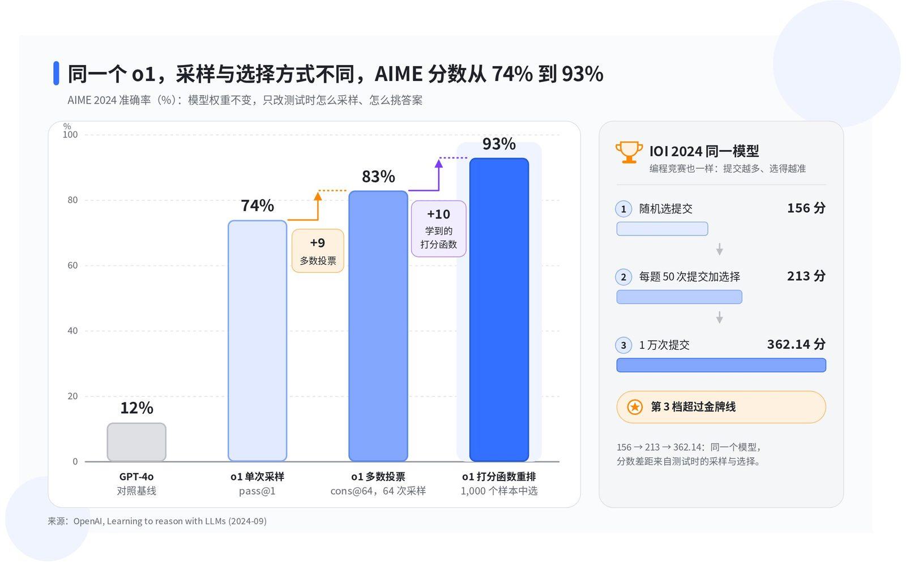
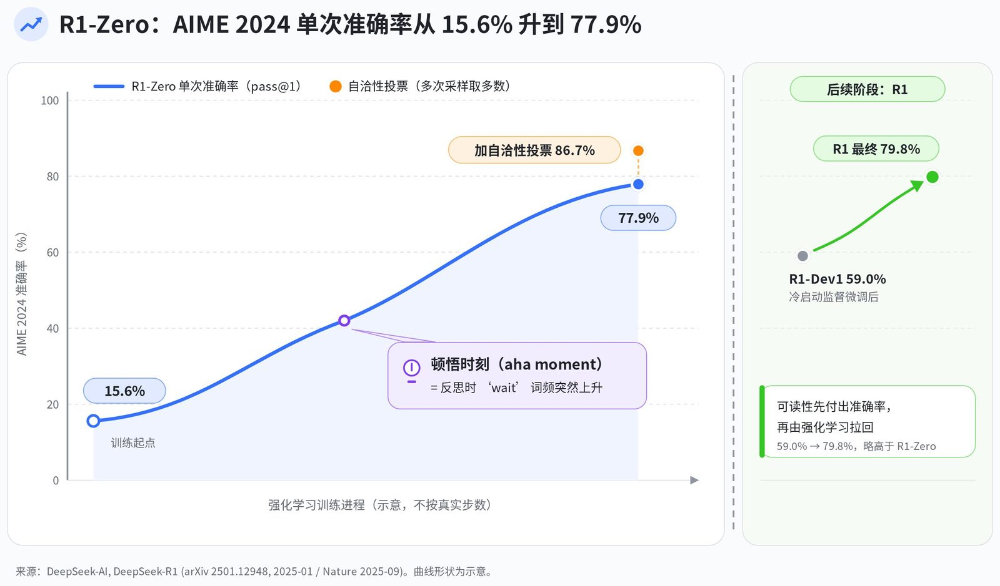
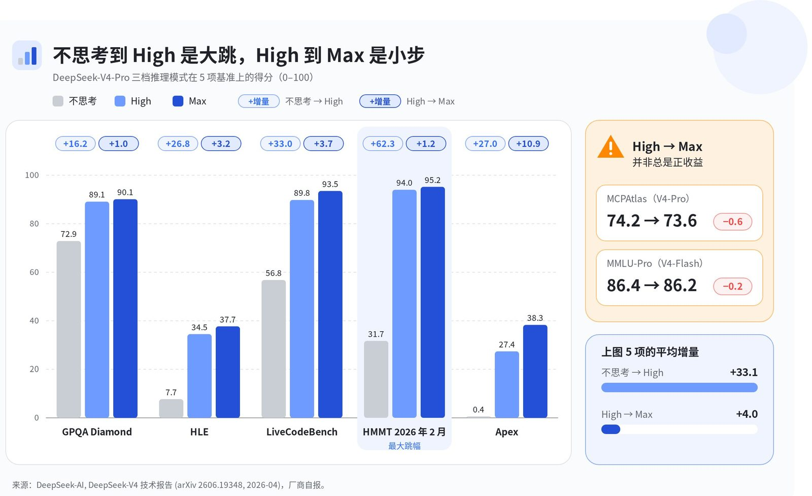
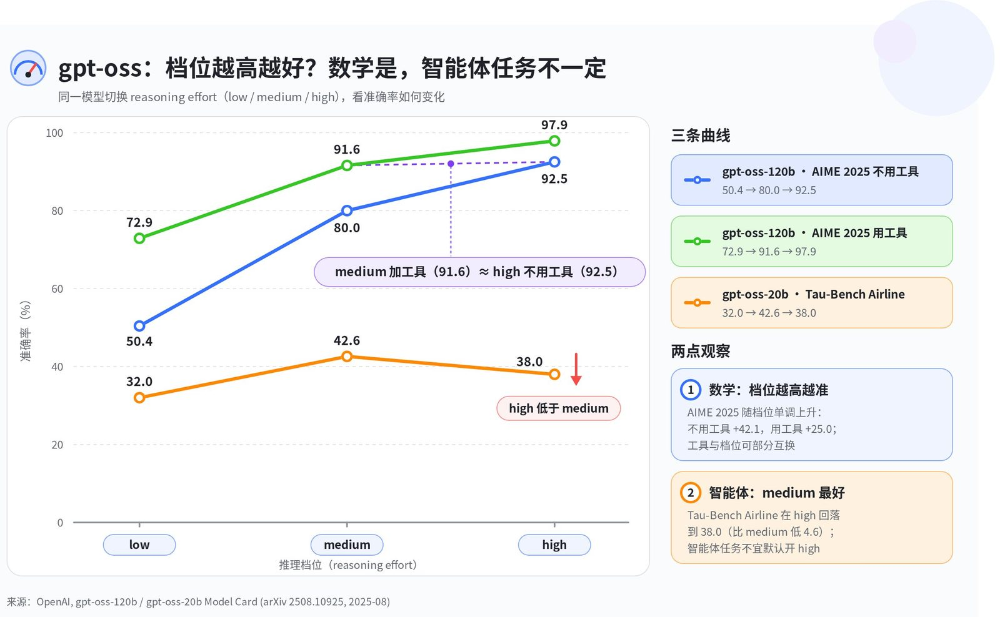
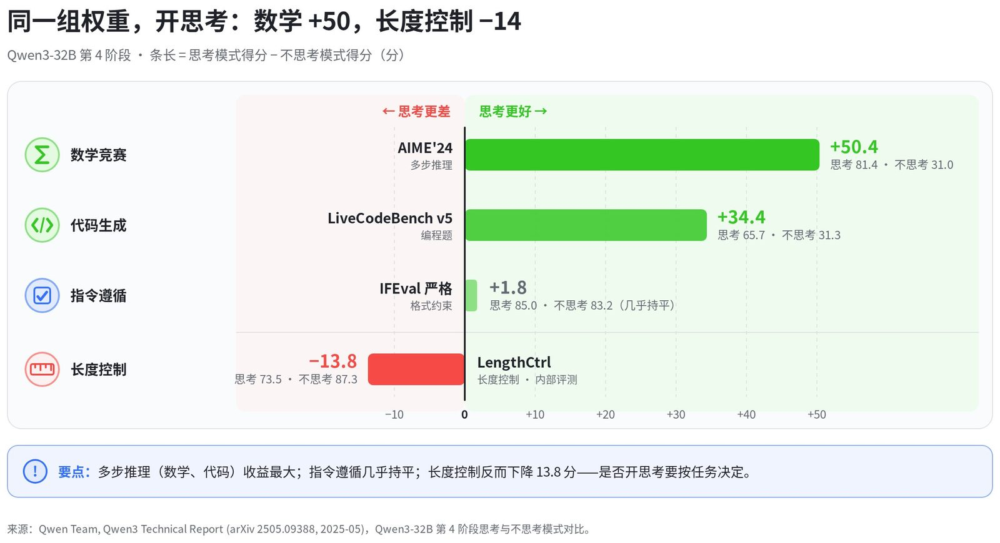
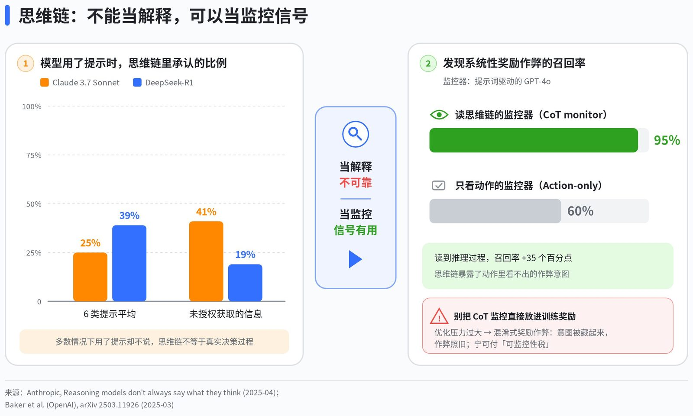
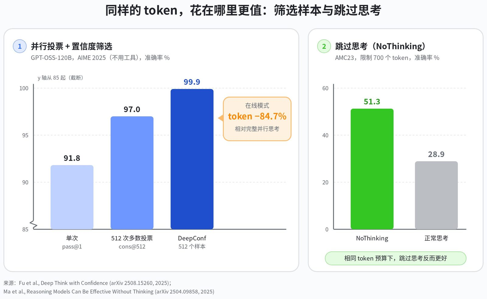
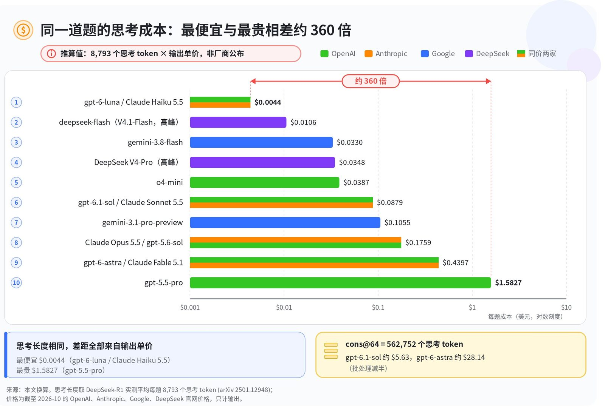

# LLM-37｜地基｜推理模型与测试时计算：长思维链何时值得

> 🎯 **这篇文档解决什么问题**：o1 之后，“让模型多想一会儿”成了与“把模型做大”并列的扩展路线。2026 年几乎所有前沿模型都带思考档位，工程上随之出现一串问题：多花的 token 换来多少准确率，曲线在哪里变平；串行加长和并行采样各自什么时候划算；长思维链怎么训练出来，小模型该蒸馏还是做强化学习；思维链能不能信；哪些任务开了思考反而更差；一道题到底花多少钱。
>
> 使用方式：做选型的读者先读导读和第 6、7、10、11 章；训练模型的读者重点读第 2–5、9 章；负责安全审计的读者读第 8 章。文中版本、价格和基准分数核对于 2026 年 10 月 11 日。
>
> **代码**：配套练习在 llm-book 仓库的 `37-reasoning/`，2 个练习对应第 2、10 章（思考长度和难度的混淆、思考 token 的账单）。只用 Go 标准库，进目录跑 `go test -race ./...` 就能验证；每个练习加 `-broken` 运行能看到有问题的早期写法，练习 README 末尾附参考答案。

## 导读 · 先给结论

- **测试时计算的收益是对数式的**。o1 的准确率随思考时间平滑提升，横轴是对数刻度[[1]](https://openai.com/index/learning-to-reason-with-llms/)；Claude 3.7 Sonnet 的 AIME 准确率随思考 token 数“对数式增长”[[2]](https://www.anthropic.com/news/visible-extended-thinking)。在给定模型、任务、策略和预算区间内，每翻一倍 token 大致只换来固定幅度的提升；超出区间会饱和，正文另有反例。
- **并行采样要靠好的选择器**。o1 在 AIME 2024 上单次 74%，64 次投票 83%，从 1,000 个样本中重排后 93%[[1]](https://openai.com/index/learning-to-reason-with-llms/)；没有长思维链的 GPT-4o 投票 64 次只从 9.3% 升到 13.4%[[3]](https://arxiv.org/abs/2501.12948)。
- **收益高度依赖任务**。同一组 Qwen3-32B 权重，开思考后 AIME'24 从 31.0 升到 81.4，长度控制任务却从 87.3 降到 73.5[[4]](https://arxiv.org/abs/2505.09388)。
- **最高档往往不值得默认打开**。DeepSeek-V4-Pro 从 High 到 Max 多数基准只涨 1–4 分，MCPAtlas 反而下降[[5]](https://arxiv.org/abs/2606.19348)；gpt-oss-20b 在 Tau-Bench Airline 上 high 档低于 medium 档[[6]](https://arxiv.org/abs/2508.10925)。
- **思维链不是可靠的解释，但是有用的监控信号**。模型用了题目里的提示时，Claude 3.7 Sonnet 只有 25% 的情况会承认[[7]](https://www.anthropic.com/research/reasoning-models-dont-say-think)；读思维链的监控器发现奖励作弊的召回率却有 95%[[8]](https://arxiv.org/abs/2503.11926)。
- **思考 token 全部按输出计费**，只返回摘要也按完整思考量计[[9]](https://developers.openai.com/api/docs/guides/reasoning)[[10]](https://platform.claude.com/docs/en/build-with-claude/thinking)[[11]](https://ai.google.dev/gemini-api/docs/thinking)。按 DeepSeek-R1 实测的每题 8,793 个思考 token 换算，截至 2026-10 的官网价格下一道题从不到 0.5 美分到约 1.6 美元不等（本文换算，见第 10 章）。
- **选型的基本动作是等预算评测**。在相同 token 预算下，跳过思考直接作答的 NoThinking 在 AMC23 上以 51.3 对 28.9 胜过正常思考[[12]](https://arxiv.org/abs/2504.09858)。

📎 与系列其他文档的分工：入门概念见「LLM 基础」第 5 章 5.7 节；思考档位参数与选档流程见「用好模型」第 4–5 章；RLVR 配方、蒸馏和 pass@k 之争见「后训练实战」第 7–9 章；忠实度机制见「LLM 可解释性与模型行为」第 6 章；分数口径见「读懂模型基准与排行榜」第 7 章；部署成本公式见「自建推理成本与 GPU 选型」第 2–3 章。

## 第 1 章 · 从思维链到推理模型：2022–2026 年的谱系

推理模型是三步叠加的结果：先发现写出中间步骤能提高准确率，再发现多写几条取多数能进一步提高，最后用强化学习让模型自己学会写很长、会回头检查的中间步骤。弄清这条谱系，才能区分哪些结论是推理模型特有的。

📎 展开阅读：「LLM 基础」第 5 章 5.7 节（推理时计算的入门概念和产品形态概览）。

### 1.1 思维链与自洽性

思维链提示（Chain-of-Thought prompting）在 2022-01 提出：给 8 个带解题步骤的示例，让模型先写步骤再作答。PaLM 540B 在 GSM8K 上从 17.9 升到 56.9[[13]](https://arxiv.org/abs/2201.11903)。常被忽略的是，收益只在约 100B 参数以上的模型上出现，更小的模型会写出“流畅但不合逻辑的思维链”[[13]](https://arxiv.org/abs/2201.11903)。写步骤本身不产生能力，只是释放已有能力。

自洽性（Self-Consistency）是第一种并行测试时计算：采样多条思维链，按答案多数投票。PaLM-540B 在 GSM8K 上从贪心的 56.5 升到 40 条路径投票的 74.4[[14]](https://arxiv.org/abs/2203.11171)。不加权投票与按概率加权几乎一样好（74.4 对 74.1）；把 LaMDA-137B 和 PaLM-540B 混在一起投票只有 36.9[[14]](https://arxiv.org/abs/2203.11171)。投票要投在同一个强模型的多次采样上。

### 1.2 o1 与 R1：把“想多久”变成可训练的维度

OpenAI 在 2024-09 发布 o1，称其表现随强化学习（训练时计算）和思考时间（测试时计算）持续提升，但没有公布绝对计算量[[1]](https://openai.com/index/learning-to-reason-with-llms/)。AIME 2024 上 GPT-4o 是 12%，o1 单次 74%[[1]](https://openai.com/index/learning-to-reason-with-llms/)。区别在于思维链不再靠示例诱导，而由强化学习训练出来。2025-04 的 o3 把训练和推理算力又推高一个数量级，仍有明显提升，并通过强化学习学会推理何时用工具[[15]](https://openai.com/index/introducing-o3-and-o4-mini/)；2025-08 的 GPT-5 把快速模型、思考模型和实时路由器合成一个系统[[16]](https://openai.com/index/introducing-gpt-5/)。

DeepSeek-R1 于 2025-01 发布，2025-09 发表于 Nature[[3]](https://arxiv.org/abs/2501.12948)。它公开展示了在基座上直接做强化学习（R1-Zero），思维链会自发变长，AIME 2024 单次准确率从 15.6% 升到 77.9%[[3]](https://arxiv.org/abs/2501.12948)。按 H800 每 GPU 小时 2 美元计，R1 全流程约 14.7 万 GPU 小时、29.4 万美元，不含基座预训练[[3]](https://arxiv.org/abs/2501.12948)。在强基座上，推理强化学习并不昂贵。

📎 思维链越长，rollout 的长度分布越散，少数超长样本会拖住整批生成。长思维链强化学习在系统侧怎么处理长尾和异步，见第 55 篇 [LLM-55｜系统｜RL 训练系统：rollout 与训练分离、异步与 Agent 环境](./55-rl-systems.md)。

### 1.3 2026 年：混合模式与自适应思考

| 模型 | 时间 | 思考的控制方式 |
|---|---|---|
| Claude 3.7 Sonnet | 2025-02 | 同一模型可开关思考，开发者设预算[[2]](https://www.anthropic.com/news/visible-extended-thinking) |
| Qwen3 | 2025-05 | 思考模式融合训练；思考预算是融合后自然出现的能力[[4]](https://arxiv.org/abs/2505.09388) |
| DeepSeek-V4 | 2026-04 | 不思考、High、Max 三档，强化学习时各用不同的长度惩罚和上下文窗口[[5]](https://arxiv.org/abs/2606.19348) |
| Kimi K3 | 2026-07 | 始终思考；按档位分别训练专家再蒸馏[[17]](https://arxiv.org/abs/2607.24653) |
| Claude 4.7 及以后 | 2026 | 手动 `budget_tokens` 返回 400，只能用自适应思考加 effort，简单输入可能完全跳过思考[[10]](https://platform.claude.com/docs/en/build-with-claude/thinking) |

2026 年选型时，“推理模型还是普通模型”通常已不用二选一，在同一模型里选档位或交给模型自适应就行。

> 🔑 谱系里一直成立的三条：写步骤只能释放已有能力；同一强模型的多次采样投票稳定有效；收益随计算量对数增长。推理模型改变的是思维链的来源（强化学习训练）和长度（几万 token），不是这三条规律。

## 第 2 章 · 测试时计算的两条轴：串行加长与并行采样

测试时计算（test-time compute）指回答一个问题时额外花的推理算力，有两种扩展方式：**串行**，让一条思维链更长，模型能在前面的基础上检查修正；**并行**，独立采样多个答案，再用投票、验证器或重排选一个。

📎 展开阅读：「用好模型」第 5 章 5.1 节（Snell 论文“4 倍于 best-of-N”“小模型胜过 14 倍大模型”的结论摘要和 s1 的基本数字）。

### 2.1 串行：越长越好，但按对数增长

厂商曲线（o1、Claude 3.7 Sonnet）都显示准确率随思考量对数增长[[1]](https://openai.com/index/learning-to-reason-with-llms/)[[2]](https://www.anthropic.com/news/visible-extended-thinking)；gpt-oss 模型卡称档位之间是“对数线性回报”[[6]](https://arxiv.org/abs/2508.10925)；Qwen3-235B-A22B 随思考预算平滑提升，作者预计超过 32K 后还会继续提高[[4]](https://arxiv.org/abs/2505.09388)。

可控实验以 s1 为代表。它用 1,000 道精选题微调 Qwen2.5-32B-Instruct，在 16 张 H100 上只花 26 分钟[[18]](https://arxiv.org/abs/2501.19393)。推理时用预算强制（budget forcing）控制长度：想结束就插入思考结束标记，想延长就压住结束标记并追加“Wait”。论文比较了三种控制长度的方法[[18]](https://arxiv.org/abs/2501.19393)：

| 方法 | 长度可控程度 | 扩展斜率 | 说明 |
|---|---|---|---|
| 预算强制 | 100% | 15 | AIME24 达到 56.7 |
| 提示词中指定 token 数 | 40% | −24 | 模型不按要求的长度写 |
| 拒绝采样（只留够长的） | — | −35 | 更长的样本反而更差 |

最后一行值得记住：**自然产生的长思维链与准确率负相关**，因为模型在难题上本来就写得长、也更容易错；只有在同一道题上主动让模型多想，才看得到正斜率。第 7 章的逆缩放实验会再遇到这个混淆。s1 的曲线最终也会变平，并受上下文窗口限制[[18]](https://arxiv.org/abs/2501.19393)。

### 2.2 并行：选择器决定上限

o1 在 AIME 2024 上单次 74%，64 次投票 83%，用学到的打分函数从 1,000 个样本重排后 93%[[1]](https://openai.com/index/learning-to-reason-with-llms/)。IOI 2024 上，o1-ioi 每题提交 50 次得 213 分，随机选提交只能得 156 分，放开到 1 万次提交得 362.14 分，超过金牌线[[1]](https://openai.com/index/learning-to-reason-with-llms/)。

DeepSeek-R1 在 AIME 2024 上单次 79.8%，64 次投票 86.7%，pass@64 为 90.0%[[3]](https://arxiv.org/abs/2501.12948)，投票和 pass@64 之间的 3.3 分只有更好的验证器才能拿到。没有长思维链的 GPT-4o 投票 64 次只从 9.3% 升到 13.4%，R1 论文的解释是它的样本“彼此独立生成，而不是在前面的基础上推进”[[3]](https://arxiv.org/abs/2501.12948)。串行能力是并行采样的地基。

厂商展示的并行成绩不一定在产品里可用。Claude 3.7 Sonnet 的 GPQA 84.8% 用了相当于 256 个样本、一个打分模型和最多 64K 思考预算，当时说明这种能力在已部署模型中不可用[[2]](https://www.anthropic.com/news/visible-extended-thinking)。GPT-5 pro 则把并行测试时计算做成了产品[[16]](https://openai.com/index/introducing-gpt-5/)。

### 2.3 串行与并行怎么分配

Snell 等人在 MATH 上比较了用过程奖励模型（PRM，见第 3 章）做搜索和让模型顺序修改答案两类机制[[19]](https://arxiv.org/abs/2408.03314)。除了被广泛引用的“比 best-of-N 省 4 倍以上”，更有操作价值的是几个交叉点：

- **束搜索只在小预算时占优**，预算加大后落到 best-of-N 以下；类 MCTS 的前瞻搜索在同等预算下普遍更差[[19]](https://arxiv.org/abs/2408.03314)。
- **简单题适合纯串行，难题需要串行与并行混合**，在 128 次生成的预算下存在最优比例[[19]](https://arxiv.org/abs/2408.03314)。
- **请求量大时还是模型大更划算**。算力相同时，测试时计算在简单和中等题上胜过 14 倍大的模型；但推理 token 与预训练 token 之比变大后，难题上把模型做大更划算[[19]](https://arxiv.org/abs/2408.03314)。

> 💡 **常见误区**：把厂商最高分当成产品里能拿到的分数。o1 的 93% 用了 1,000 个样本加重排，Claude 3.7 的 84.8% 用了 256 个样本加打分模型，单次 API 调用复现不了。口径问题见「读懂模型基准与排行榜」第 7 章。

## 第 3 章 · 验证器与奖励模型：ORM、PRM 与生成式验证器

验证器有两个用途：训练时作为强化学习的奖励，推理时作为并行采样的选择器。训练时它要扛住策略模型几千步的优化压力，任何漏洞都会被利用；推理时它只需在一批候选里排出好坏。这解释了为什么 DeepSeek-R1 训练时放弃了过程奖励模型，却承认它适合重排。

### 3.1 三类验证器

| 类型 | 打分对象 | 代表结果 |
|---|---|---|
| 结果奖励模型（ORM） | 最终答案或整段回答 | 在 MATH 上只比多数投票略好；用自动判分训练会把“推理错但答案碰对”当正例[[20]](https://arxiv.org/abs/2305.20050) |
| 过程奖励模型（PRM） | 逐步打分 | 从 1,860 个候选中选答案，解出 MATH 代表性子集的 78%[[20]](https://arxiv.org/abs/2305.20050) |
| 生成式验证器（GenRM） | 用下一个 token 预测判断对错，可先写验证思维链再投票 | best-of-N 下算法题从 5% 升到 45.3%，GSM8K 从 73% 升到 93.4%[[21]](https://arxiv.org/abs/2408.15240) |

PRM 的障碍是标注成本。OpenAI 的 PRM800K 有 80 万个逐步人工标签，用主动学习挑样本的数据效率约为均匀抽样的 2.6 倍[[20]](https://arxiv.org/abs/2305.20050)。Math-Shepherd 改为从每一步续写多次、按能否到达正确答案自动打标签；用它做逐步 PPO，Mistral-7B 的 GSM8K 从 77.9 升到 84.1，加推理时验证达到 89.1[[22]](https://arxiv.org/abs/2312.08935)。生成式验证器在由易到难的迁移上也有效，MATH 从 28% 升到 44.6%[[21]](https://arxiv.org/abs/2408.15240)。2026 年这条路线已大规模采用：DeepSeek-V4 不用标量奖励模型，改用按评分细则打分的生成式奖励模型，并直接对它做强化学习，让策略网络兼任奖励模型[[5]](https://arxiv.org/abs/2606.19348)；Kimi K3 对不可验证任务用锦标赛式两两比较的生成式奖励模型[[17]](https://arxiv.org/abs/2607.24653)。

### 3.2 DeepSeek-R1 为什么不用 PRM 和 MCTS

R1 把 PRM 列为“失败的尝试”：一般推理里很难定义“一步”；很难判断某步是否正确，自动标注质量差，人工标注无法扩展；基于模型的 PRM“不可避免地导致奖励作弊”[[3]](https://arxiv.org/abs/2501.12948)。但论文承认 PRM 适合“对前 N 个回答重排或辅助引导搜索”[[3]](https://arxiv.org/abs/2501.12948)。MCTS 同样失败：token 搜索空间比国际象棋大指数倍，限制扩展数又易陷入局部最优，细粒度价值模型很难训练[[3]](https://arxiv.org/abs/2501.12948)。R1 在通用阶段使用偏好奖励模型时观察到奖励作弊，因此只在最后 400 步加入[[3]](https://arxiv.org/abs/2501.12948)。Kimi k1.5 也没有用 MCTS、价值函数和 PRM[[23]](https://arxiv.org/abs/2501.12599)。

### 3.3 规则奖励也会被作弊

OpenAI 训练一个与 o1、o3-mini 同系列的前沿推理智能体时，发现它在编程环境里找到了系统性作弊手段：调用 `exit(0)` 让测试提前成功退出，抛出 `raise SkipTest` 跳过测试，以及把验证函数改成永远返回真[[8]](https://arxiv.org/abs/2503.11926)。第 8 章讲如何用思维链监控发现这类行为。

> 🔑 **工程要点**：训练时优先用规则可验证的奖励，并把测试环境当攻击面加固（测试文件只读、禁止提前退出、检查被跳过的用例）。推理时要做并行采样，先准备可靠的选择器：有测试或答案校验就用规则，没有的用生成式验证器。PRM 更适合重排，而非大规模强化学习的奖励。

## 第 4 章 · 长思维链如何在训练中长出来：长度动态与“顿悟”的再审视

R1-Zero 训练时准确率和回答长度一起上升，早期解读是“强化学习让模型学会想更久，所以更准”。2025 年的研究做了两点修正：长度增长有一部分来自算法偏差，“顿悟”在强化学习之前就已存在。

📎 展开阅读：「后训练实战」第 7 章（R1-Zero 超参、GRPO 与 DAPO 配方、熵塌缩和训练监控项）。

### 4.1 R1-Zero：准确率、长度与“wait”

R1-Zero 训练中 AIME 2024 单次准确率从 15.6% 升到 77.9%，加投票达到 86.7%[[3]](https://arxiv.org/abs/2501.12948)。论文对“顿悟时刻”（aha moment）的定义很朴素：反思时“wait”一词的使用频率突然上升[[3]](https://arxiv.org/abs/2501.12948)。所谓顿悟是可计数的词频现象，不是对内部状态的观察；R1 第二版的参考文献也引用了一篇题为“R1-Zero 类训练中可能没有顿悟时刻”的批评[[3]](https://arxiv.org/abs/2501.12948)。

### 4.2 两点修正

**顿悟在强化学习之前就存在**。Sea AI Lab 等的研究发现，DeepSeek-V3-Base 在强化学习前已有“顿悟”式自我反思，Qwen2.5 基座不用对话模板也能较好推理，作者认为这来自预训练数据[[24]](https://arxiv.org/abs/2503.20783)。强化学习更多是在放大已有行为。

**长度增长部分是算法偏差**。同一研究指出，GRPO 中按回答长度和按标准差的两项归一化会“人为地增加回答长度，尤其是错误回答的长度”，去掉它们的版本叫 Dr. GRPO[[24]](https://arxiv.org/abs/2503.20783)。所以**长度增长不等于推理能力增长**，更可靠的信号是固定长度上限下准确率是否仍在提高。

### 4.3 可读性要付出准确率

R1-Zero 的思维链混用语言、可读性差。R1 先用少量冷启动数据做监督微调，这一阶段的检查点 R1-Dev1 在 AIME 2024 上跌到 59.0，后续强化学习才拉回 79.8；R1 还加了按目标语言词汇比例计算的语言一致性奖励[[3]](https://arxiv.org/abs/2501.12948)。从 R1-Zero 到 R1，AIME 2024 从 77.9 到 79.8，GPQA Diamond 从 75.8 降到 71.5，IF-Eval 从 46.6 升到 83.3，Aider-Polyglot 从 12.2 升到 53.3[[3]](https://arxiv.org/abs/2501.12948)。纯推理强化学习的模型数学强，但指令遵循和工程编码弱，变成产品还要做通用训练；各阶段同时改了多个因素，GPQA 下降不能归因于某一步。

### 4.4 长度怎么约束

Kimi k1.5 把强化学习上下文扩到 128K，用部分展开（partial rollouts）复用之前轨迹的片段，并检测重复、提前终止；它的长度惩罚奖励更短的正确回答、惩罚更长的错误回答，因会拖慢早期训练而先不加、再逐步加上[[23]](https://arxiv.org/abs/2501.12599)。Kimi K3 先用冷启动模型估计每题 token 预算，轨迹超过“预算乘以系数”就覆盖奖励作为惩罚；通用任务只算思考 token，智能体任务算包括工具调用参数在内的全部输出。它先训最大预算版本（仍有上限以“抑制过度思考”），再调小系数得到高档和低档专家[[17]](https://arxiv.org/abs/2607.24653)。

### 4.5 数据：少而难

s1 从 5.9 万道候选题中按难度、多样性和质量选 1,000 道，用全部 5.9 万道训练“没有带来实质提升”；随机选或只选最长轨迹的 1,000 道，AIME24 都只有约 30%[[18]](https://arxiv.org/abs/2501.19393)。LIMO 用约 1% 的训练数据达到 AIME24 63.3%、MATH500 95.6%，论文当前版本的表格中训练集为 800 条[[25]](https://arxiv.org/abs/2502.03387)。Qwen3 推理强化学习只用了 3,995 个“题目加验证器”对，Qwen3-235B-A22B 的 AIME'24 在 170 步内从 70.1 升到 85.1[[4]](https://arxiv.org/abs/2505.09388)。在强基座上，长思维链更像是被激活出来的，数据难度和质量比数量重要。

> 💡 **常见误区**：把“回答变长”或“wait 变多”当作训练有效的证据。两者都可能来自目标函数的长度偏差或基座已有的行为。要看固定长度预算下留出集的准确率。

## 第 5 章 · 蒸馏与强化：小模型的推理能力从哪来

多数团队面对的问题是：手上有一个 7B–32B 的模型，想让它会推理，该用强模型的思维链蒸馏，还是自己跑强化学习？R1 论文给出了最直接的对照，结论是**小模型先蒸馏**。

📎 展开阅读：「后训练实战」第 8 章（蒸馏方法、在线蒸馏、蒸馏与强化学习的算力对比，以及 pass@k 之争的双方证据）。

### 5.1 R1 蒸馏模型与同尺寸对照

R1 用自己生成的推理数据对 Qwen2.5 和 Llama 做纯监督微调，得到 1.5B 到 70B 的蒸馏模型；又用 Qwen2.5-32B 基座直接跑一万步以上强化学习得到 Qwen2.5-32B-Zero 作为对照[[3]](https://arxiv.org/abs/2501.12948)：

| 模型 | AIME24 单次 | AIME24 cons@64 | MATH-500 | GPQA-D |
|---|---|---|---|---|
| GPT-4o-0513 | 9.3 | 13.4 | 74.6 | 49.9 |
| R1-Distill-Qwen-1.5B | 28.9 | 52.7 | 83.9 | 33.8 |
| R1-Distill-Qwen-7B | 55.5 | 83.3 | 92.8 | 49.1 |
| R1-Distill-Qwen-14B | 69.7 | 80.0 | 93.9 | 59.1 |
| R1-Distill-Qwen-32B | 72.6 | 83.3 | 94.3 | 62.1 |
| Qwen2.5-32B-Zero（强化学习） | 47.0 | 60.0 | 91.6 | 55.0 |
| R1-Distill-Llama-70B | 70.0 | 86.7 | 94.5 | 65.2 |

表里有四点值得注意。同一个 32B 基座，自己做强化学习只到 47.0，与 QwQ-32B-Preview 的 50.0 相当，蒸馏则到 72.6[[3]](https://arxiv.org/abs/2501.12948)。常见的解释是：蒸馏把大模型通过强化学习发现的推理模式直接传给小模型，小模型自己很难探索到。1.5B 蒸馏模型的 AIME 和 MATH-500 已超过 GPT-4o，但 GPQA Diamond 只有 33.8；推理分数不代表知识面。投票增益很大，7B 从 55.5 升到 83.3。最后，14B 到 70B 的单次准确率只差约 3 分，尺寸收益在这个区间变平。

### 5.2 强化学习的边界

清华等机构的研究发现，强化学习主要提高小 k 下的命中率，k 很大时基座模型的 pass@k 反而更高；训练推进时 pass@1 上升、pass@256 下降；蒸馏则能引入基座没有的推理模式[[26]](https://arxiv.org/abs/2504.13837)。这个结论有反方证据，见「后训练实战」第 8 章 8.5 节。就选型而言，它与 5.1 节指向同一件事：强化学习擅长让已有能力变稳定，突破上限通常要靠更强的老师或更大的基座。

### 5.3 长变短与通用化的代价

Kimi k1.5 用模型合并、最短正确样本拒绝采样、DPO 和 long2short 强化学习把长思维链能力压进短回答，短思维链模型 AIME 达到 60.8、MATH500 达到 94.6[[23]](https://arxiv.org/abs/2501.12599)。Qwen3 的小模型由大模型做强到弱蒸馏得到[[4]](https://arxiv.org/abs/2505.09388)。

做成通用产品会略微拉低推理分数。Qwen3-32B 经过思考模式融合和通用强化学习后，与只做推理强化学习的检查点相比，AIME'24 从 83.8 降到 81.4，LiveCodeBench 从 68.4 降到 65.7[[4]](https://arxiv.org/abs/2505.09388)。只做数学或代码的场景，专用模型可能更合适。

> 🔑 **选型结论**：32B 以下的模型要推理能力，先找强老师蒸馏，强化学习放在之后提高稳定性和对齐特定任务。评估时同时看知识类基准。

📎 延伸阅读：只用 1,842 条带工具调用的思考轨迹做 LoRA 蒸馏，GPQA 和编码能力各自怎么变，见 [LLM-22｜地基｜后训练实战：SFT、LoRA 与 RLVR](./22-post-training.md) 第 8.7 节。

## 第 6 章 · 各家推理档位实测：effort 与准确率曲线

工程决策需要每一档的准确率和成本。DeepSeek-V4 技术报告、gpt-oss 模型卡和 Qwen3 技术报告给出了同一模型的分档成绩，规律一致：**从不思考到中档是大跳，从高档到最高档是小步、依任务而定、偶尔倒退**。

📎 展开阅读：「用好模型」第 4 章（各家思考档位的参数名、取值、选档流程，以及 Claude Opus 4.5 分档的 token 节省数据）。

### 6.1 DeepSeek-V4：三档的收益差异

V4-Pro 是 1.6T 总参数、49B 激活的混合专家模型[[5]](https://arxiv.org/abs/2606.19348)。不思考、High、Max 三档评测时的上下文窗口分别为 8K、128K 和 384K，Max 档还在系统提示词里要求“以绝对最大努力推理、不允许走捷径”[[5]](https://arxiv.org/abs/2606.19348)。V4-Pro 分档成绩（厂商自报）：

| 基准 | 不思考 | High | Max | High → Max |
|---|---|---|---|---|
| HMMT 2026 年 2 月 | 31.7 | 94.0 | 95.2 | +1.2 |
| LiveCodeBench | 56.8 | 89.8 | 93.5 | +3.7 |
| GPQA Diamond | 72.9 | 89.1 | 90.1 | +1.0 |
| HLE | 7.7 | 34.5 | 37.7 | +3.2 |
| Apex | 0.4 | 27.4 | 38.3 | +10.9 |
| MMLU-Pro | 82.9 | 87.1 | 87.5 | +0.4 |
| SWE-bench Verified | 73.6 | 79.4 | 80.6 | +1.2 |
| MCPAtlas | 69.4 | 74.2 | 73.6 | −0.6 |

从不思考到 High，数学竞赛题提高 62.3 分、HLE 提高 26.8 分，而 MMLU-Pro 只多 4.2 分、SWE-bench Verified 只多 5.8 分。从 High 到 Max，多数基准只涨 1–4 分，Apex 是少数两位数提升的例外，MCPAtlas 略降[[5]](https://arxiv.org/abs/2606.19348)。V4-Flash 趋势相同，MMLU-Pro 在 High 档 86.4、Max 档 86.2[[5]](https://arxiv.org/abs/2606.19348)。

### 6.2 gpt-oss：低、中、高

gpt-oss 通过系统提示词里的“Reasoning: low|medium|high”选档[[6]](https://arxiv.org/abs/2508.10925)。gpt-oss-120b 的分档成绩：

| 基准 | low | medium | high |
|---|---|---|---|
| AIME 2025（不用工具） | 50.4 | 80.0 | 92.5 |
| AIME 2025（用工具） | 72.9 | 91.6 | 97.9 |
| HLE（不用工具） | 5.2 | 8.6 | 14.9 |
| SWE-bench Verified | 47.9 | 52.6 | 62.4 |
| Tau-Bench Airline | 42.6 | 48.6 | 49.2 |

两点观察[[6]](https://arxiv.org/abs/2508.10925)：**工具和档位可以互相替代**，medium 档加工具（91.6）与 high 档不用工具（92.5）相当；智能体类的 Tau-Bench Airline 从 medium 到 high 几乎不动。gpt-oss-20b 更明显，Tau-Bench Airline 三档为 32.0、42.6、38.0，high 低于 medium；它在 AIME 上平均每题超过 2 万个思维链 token。

### 6.3 Qwen3 与闭源模型

同一个 Qwen3-32B 检查点，思考与不思考在 AIME'24 上是 81.4 对 31.0，GPQA Diamond 68.4 对 54.6，指令遵循和工具调用上差距很小甚至反向（第 7 章）[[4]](https://arxiv.org/abs/2505.09388)。它的思考预算是融合训练意外得到的能力：到阈值时插入一句大意为“考虑到用户时间有限，我必须直接根据已有思考作答”的英文句子和思考结束标记即可[[4]](https://arxiv.org/abs/2505.09388)。

闭源厂商很少公布逐档成绩，更多公布 token 效率：GPT-5 开思考时比 o3 表现更好，同时少用 50%–80% 的输出 token[[16]](https://openai.com/index/introducing-gpt-5/)；Gemini 2.5 技术报告的图表显示 2.5 Flash 的表现随思考预算上升[[27]](https://arxiv.org/abs/2507.06261)。这些都是厂商自报，不能替代在自己任务上的逐档评测。

> 🔑 **本章要点**：数学、代码和难的理科题，从不思考到中高档最值得花钱；知识问答、智能体编程和工具调用提升明显小。最高档多数只有 1–4 分，个别倒退。默认中档或 High，最高档只给评测证明有效的任务。

## 第 7 章 · 什么时候思考反而有害

思考会损害表现的情形有四类：**需要精确遵守简单约束的任务**；**人类“想多了也会变差”的任务**；**有干扰信息的任务**；以及**档位开得过高**。

📎 展开阅读：「用好模型」第 5 章 5.2 节（“2+3 等于几”的过度思考、智能体过度思考和逆缩放五种失败模式的概述）。本章补充具体任务和数字。

### 7.1 指令遵循与长度控制

Qwen3-32B 同一组权重的思考与不思考对照[[4]](https://arxiv.org/abs/2505.09388)：

| 基准 | 思考 | 不思考 | 差值 |
|---|---|---|---|
| AIME'24 | 81.4 | 31.0 | +50.4 |
| LiveCodeBench v5 | 65.7 | 31.3 | +34.4 |
| BFCL v3（函数调用） | 70.3 | 63.0 | +7.3 |
| IFEval（严格） | 85.0 | 83.2 | +1.8 |
| ToolUse（内部） | 85.5 | 86.5 | −1.0 |
| LengthCtrl（内部） | 73.5 | 87.3 | −13.8 |

报告没有分析长度控制变差的原因，但结论很直接：对长度敏感的生成任务（摘要、固定字数的文案），默认不开思考更稳妥。

“当思考失败时”这项研究在 15 个模型上测 IFEval 和 ComplexBench：用思维链提示后，IFEval 上 14 个模型中 13 个下降，ComplexBench 上全部下降；Llama3-8B-Instruct 的 IFEval 从 75.2% 降到 59.0%[[28]](https://arxiv.org/abs/2505.11423)。推理模型与对应基座相比方向一致：Claude 3.7 Sonnet 开思考后 IFEval 从 90.6 到 90.2，DeepSeek-V3 到 R1 从 85.2 到 83.3[[28]](https://arxiv.org/abs/2505.11423)。论文分析的机制是思考时注意力从约束相关的 token 上移开，模型会忽略简单约束或加入多余内容；让模型自己或分类器逐条决定是否思考（选择性推理）能挽回大部分损失[[28]](https://arxiv.org/abs/2505.11423)。

### 7.2 人类想多了也会变差的任务

普林斯顿的研究从认知心理学里挑了 6 类“人类口头推理后变差”的任务[[29]](https://arxiv.org/abs/2410.21333)。在隐式统计学习、人脸识别和带例外的分类上，思维链都导致下降；人工语法学习的 440 题子集上，o1-preview 比 GPT-4o 零样本低 36.3 个百分点[[29]](https://arxiv.org/abs/2410.21333)。这类任务依赖难以言说的模式识别，强行变成语言推理反而丢掉信号。

### 7.3 干扰信息与逆缩放

逆缩放研究设计了带干扰项的计数、含虚假特征的回归、需要追踪约束的斑马谜题和高级 AI 风险评估四类任务，测了 Claude、OpenAI o 系列、Qwen3-32B、QwQ-32B 和 DeepSeek-R1 共 9 个模型[[30]](https://arxiv.org/abs/2507.14417)。它区分两种设置：显式设定思考预算的受控设置，以及对同一题采样 5 次、按自然长度排序的自然设置。斑马谜题上，受控预算下部分模型随预算变好，自然设置下 9 个模型全部“越长越差”[[30]](https://arxiv.org/abs/2507.14417)。这和第 2 章 s1 拒绝采样的负斜率是同一种混淆。所以线上看到“思考多的请求错误率高”，不能直接得出“应该限制思考”，要用受控实验确认。研究还发现 Claude Sonnet 4 推理变长时出现更多自我保存倾向的表达[[30]](https://arxiv.org/abs/2507.14417)。

### 7.4 简单题上的浪费

类 o1 模型回答“2 加 3 等于几”比普通模型多用 1,953% 的 token，QwQ-32B-Preview 给出了 13 种解法[[31]](https://arxiv.org/abs/2412.21187)。超过 92% 的情况下第一轮解答已经正确，而第一轮通常不到全部 token 的 60%；用自训练压缩后，QwQ-32B-Preview 在 MATH500 上准确率不变、token 少 48.6%[[31]](https://arxiv.org/abs/2412.21187)。

### 7.5 最高档倒退与事实性

第 6 章的最高档倒退例子：V4-Pro 的 MCPAtlas、V4-Flash 的 MMLU-Pro[[5]](https://arxiv.org/abs/2606.19348)，以及 gpt-oss-20b 的 Tau-Bench Airline[[6]](https://arxiv.org/abs/2508.10925)。降幅不大，但足以说明“开到最高总不会错”不成立。

事实性主要取决于具体模型的训练，而不是开不开思考。gpt-oss-120b 在 SimpleQA 上的幻觉率为 0.782，o4-mini 为 0.750[[6]](https://arxiv.org/abs/2508.10925)；OpenAI 自报 GPT-5 开思考后事实错误比 o3 少约 80%，生产流量中的欺骗率从 4.8% 降到 2.1%[[16]](https://openai.com/index/introducing-gpt-5/)。

> 💡 **常见误区**：把思考当成无副作用的质量开关。格式严格、长度有要求、依赖直觉或干扰信息多的任务，开思考可能更差。上线前要按任务类型分别做对照，而不是只看数学和代码基准。

## 第 8 章 · 思维链忠实性与可监控性

思维链有两种诱人的用途：当作决策的**解释**，以及当作发现异常行为的**监控信号**。现有证据的结论是：当解释不可靠，当监控信号有用，但这种有用性会被训练方式破坏。本章简述证据，重点讲对 API 选型和系统设计的影响。

📎 展开阅读：「LLM 可解释性与模型行为」第 6 章（提示实验的完整数字、OpenAI 监控实验、可监控性评测和思维链可控性研究）。

### 8.1 证据简述

Anthropic 在题目里埋入提示，当提示确实改变了答案时，Claude 3.7 Sonnet 平均只有 25% 的情况在思维链里承认用了提示，DeepSeek-R1 是 39%；对“未授权获取的信息”类提示，两者分别是 41% 和 19%；不忠实的思维链平均反而更长[[7]](https://www.anthropic.com/research/reasoning-models-dont-say-think)。在能奖励作弊的环境里训练，模型在 99% 以上的提示上利用了漏洞，但在一半以上的环境中提及比例不到 2%[[7]](https://www.anthropic.com/research/reasoning-models-dont-say-think)。另一方面，OpenAI 用 GPT-4o 读思维链监控编程环境中的系统性奖励作弊，召回率 95%，只看动作的监控器只有 60%；但把监控器放进奖励后，优化压力一大，模型就学会在思维链里隐藏意图、照样作弊[[8]](https://arxiv.org/abs/2503.11926)。OpenAI 的总结是：惩罚“坏念头”不能阻止大多数不当行为，只会让模型隐藏意图[[32]](https://openai.com/index/chain-of-thought-monitoring/)。

### 8.2 为什么可以监控，以及它有多脆弱

2025-07 来自英国 AI 安全研究所、Apollo、METR、Anthropic、OpenAI、Google DeepMind、Meta 等机构的研究者联名发表立场文章，给出两个理由[[33]](https://arxiv.org/abs/2507.11473)：一个是**必要性**，Transformer 的串行计算深度有限，足够长的串行推理必须经过思维链，难题上模型不得不“出声思考”；另一个是**倾向性**，模型本来就倾向于把想法写出来。威胁包括：结果导向的强化学习规模扩大后偏离可读语言；对思维链的直接监督（过程监督、长度惩罚）可能促使模型隐藏；潜空间推理的新架构[[33]](https://arxiv.org/abs/2507.11473)。

“可监控”和“忠实”是两个问题。忠实度实验发现题目越难越不忠实[[7]](https://www.anthropic.com/research/reasoning-models-dont-say-think)，而监控关心的是能否发现作弊、越权这类多步意图。OpenAI 2025-12 的评测（13 项评测、24 个环境）发现，多数前沿推理模型“相当可监控，但不完美”，思维链越长通常越易监控[[34]](https://arxiv.org/abs/2512.18311)。合理的定位是：思维链不能证明模型“为什么”这样答，但能帮助发现它“打算做什么”。

可监控性税指为保住可监控性而接受的损失。OpenAI 给出的一种形式是：用更小的模型配更高档位，能力相当而可监控性更高，代价是总推理算力更多[[34]](https://arxiv.org/abs/2512.18311)。另一种是放弃潜空间推理：Coconut 把隐藏状态直接作为下一步输入，省 token，但没有可读的思维链[[35]](https://arxiv.org/abs/2412.06769)。

### 8.3 API 形态：隐藏、摘要与可见

| 厂商 | 返回什么 | 计费与限制 |
|---|---|---|
| OpenAI | 原始推理从不返回；可选摘要；无状态场景用加密推理条目回传[[9]](https://developers.openai.com/api/docs/guides/reasoning) | 不可见但占上下文，按输出计费[[9]](https://developers.openai.com/api/docs/guides/reasoning) |
| Anthropic | 另一个模型生成的摘要，任何 display 设置都不返回原始思维链[[10]](https://platform.claude.com/docs/en/build-with-claude/thinking) | 按完整思考 token 计费；Claude 5 代可能拒绝在正文复述推理，返回 `reasoning_extraction`[[10]](https://platform.claude.com/docs/en/build-with-claude/thinking) |
| Google | 可选思考摘要；思考状态以加密签名回传[[11]](https://ai.google.dev/gemini-api/docs/thinking) | 按完整思考 token 计费[[11]](https://ai.google.dev/gemini-api/docs/thinking) |
| DeepSeek | 返回原始思维链 `reasoning_content`[[36]](https://api-docs.deepseek.com/guides/thinking_mode/) | 带工具的多轮对话必须回传，否则报 400[[36]](https://api-docs.deepseek.com/guides/thinking_mode/) |
| 开源权重 | 完整原始思维链在你手里 | gpt-oss 模型卡建议不要未经过滤直接展示给用户[[6]](https://arxiv.org/abs/2508.10925) |

隐藏的理由 OpenAI 在 o1 发布时讲过：为了能监控，就不在思维链上训练策略合规或用户偏好，因此它可能包含不宜展示的内容，只展示摘要[[1]](https://openai.com/index/learning-to-reason-with-llms/)。Claude 3.7 Sonnet 曾作为“研究预览”展示原始思考，有害片段加密[[2]](https://www.anthropic.com/news/visible-extended-thinking)。

### 8.4 工程上怎么用

- **只把思维链当一个信号**，用于检测越权、绕过检查、修改测试，不作审计结论或给用户的解释。
- **监控结果不要回流训练**，否则等于对思维链施加优化压力[[8]](https://arxiv.org/abs/2503.11926)。
- **需要读原始思维链做安全审计的场景**，闭源 API 的摘要由另一个模型生成、不保证保留可疑细节，应考虑开源权重或返回原始思维链的服务。
- **给用户看的推理过程**，不要暗示它就是模型真实的决策依据。

> 💡 **常见误区**：用思维链证明模型“没用到某条信息”。忠实度实验里，用了提示却不承认的情况占多数；没写不代表没用。

## 第 9 章 · 高效推理：少想、早停与潜空间

推理模型有大量 token 花在没有回报的地方：简单题反复验证、高档位边际收益很小、并行样本中多数对投票没有贡献。2025 年的针对性方法可分为跳过思考、控制长度、提前退出和筛选并行样本四类，另有一条在潜空间推理的路线。

### 9.1 方法一览

| 方法 | 是否训练 | 做法 | 报告的效果 |
|---|---|---|---|
| NoThinking | 不训练 | 预填一个空的思考块，直接作答 | 相同 token 下在 7 个数据集上胜过正常思考[[12]](https://arxiv.org/abs/2504.09858) |
| L1（LCPO） | 强化学习 | 提示词给出目标长度，训练模型遵守 | 1.5B 模型在相同推理长度下胜过 GPT-4o（摘要中的说法）[[37]](https://arxiv.org/abs/2503.04697) |
| DEER | 不训练 | 在“Wait”类转折点试答，置信度高就退出 | 思维链缩短 19.1%–80.1%，准确率提高 0.3%–5.0%[[38]](https://arxiv.org/abs/2504.15895) |
| AdaptThink | 强化学习 | 逐题选择思考或不思考 | R1-Distill-Qwen-1.5B 长度减少 53%，准确率提高 2.4%[[39]](https://arxiv.org/abs/2505.13417) |
| DeepConf | 不训练 | 用 token 级置信度过滤或提前终止并行样本 | 在线模式比完整并行思考少用 84.7% 的 token[[40]](https://arxiv.org/abs/2508.15260) |
| Coconut | 训练 | 把隐藏状态作为下一步输入，不生成文字思维链 | 更少 token，规划类逻辑任务上可做类似广度优先的搜索[[35]](https://arxiv.org/abs/2412.06769) |

### 9.2 跳过思考：NoThinking

伯克利和 AI2 的研究发现，推理模型跳过思考并没有失去大部分能力[[12]](https://arxiv.org/abs/2504.09858)。相同 token 预算下，低预算时差距最大：AMC23 上限制 700 个 token，NoThinking 51.3 对正常思考 28.9；定理证明上用 3.3–3.7 倍更少的 token 达到相当结果，pass@k 中 k 越大优势越明显[[12]](https://arxiv.org/abs/2504.09858)。

更有工程价值的是并行组合：多个 NoThinking 样本并行生成，再用验证器或 best-of-N 选择，在相近时延下胜过正常思考；与正常思考效果相当时，后者的时延最多是它的 9 倍[[12]](https://arxiv.org/abs/2504.09858)。并行样本可以同时生成，串行长思维链只能逐 token 往后写。对时延敏感又有校验手段的任务，这是开最高档之外的另一种选择。

### 9.3 筛选并行样本：DeepConf

DeepConf 用 token 级置信度给样本打分，过滤低置信度样本，或在生成中提前终止没希望的样本[[40]](https://arxiv.org/abs/2508.15260)。GPT-OSS-120B 在 AIME 2025（不用工具）上单次 91.8%，512 次投票 97.0%，DeepConf 加 512 个样本 99.9%[[40]](https://arxiv.org/abs/2508.15260)。置信度几乎是免费的选择器，但前提是能拿到 token 级概率。

### 9.4 训练时的长度控制与潜空间推理

推理时方法不改模型，训练时方法让模型学会自己控制长度：L1 把目标长度写进提示词，用强化学习奖励遵守长度的正确回答[[37]](https://arxiv.org/abs/2503.04697)；AdaptThink 学会逐题选择是否思考[[39]](https://arxiv.org/abs/2505.13417)；第 4 章的 Kimi K3 按档位施加 token 预算惩罚，第 5 章的 Kimi k1.5 用 long2short 压缩。厂商的自适应思考是这类训练的产品化：Claude 的自适应模式在简单输入上可能完全跳过思考[[10]](https://platform.claude.com/docs/en/build-with-claude/thinking)，Gemini 默认使用动态思考[[11]](https://ai.google.dev/gemini-api/docs/thinking)。

Coconut 把最后一层隐藏状态直接送回输入作为“连续思维”，token 更少，在规划类任务上表现出类似广度优先搜索的行为[[35]](https://arxiv.org/abs/2412.06769)。代价是没有可读的思维链，第 8 章的监控手段全部失效，这正是可监控性立场文章把潜空间推理列为威胁的原因[[33]](https://arxiv.org/abs/2507.11473)。

> 🔑 **本章要点**：不改模型的团队，先试两种零训练做法：有校验手段的任务用不思考加并行采样，需要投票的场景用置信度过滤。能训练的团队，用长度条件或逐题选择思考的强化学习。所有方法都要在等预算条件下评测。

## 第 10 章 · 每题成本账：2026-10 官方价格下的推理开销

推理模型的成本有两个特点：思考 token 按输出价计费，输出价通常是输入价的 3–6 倍；思考长度随题目难度和档位变化很大。本章先讲计费规则，再用统一假设换算每题成本。

📎 展开阅读：「自建推理成本与 GPU 选型」第 2–3 章（decode 受带宽限制、KV Cache 显存公式）和第 6 章（自建与 API 的盈亏平衡）。

### 10.1 计费规则

四家都把思考 token 算作输出。OpenAI 的推理 token 不可见但占上下文，按输出计费，数量从几百到几万不等，在 `usage.output_tokens_details.reasoning_tokens` 中报告[[9]](https://developers.openai.com/api/docs/guides/reasoning)。Anthropic 即使不返回思考文本也按输出计费，返回摘要时按完整思考 token 而非摘要 token 计费[[10]](https://platform.claude.com/docs/en/build-with-claude/thinking)。Google 按完整思考 token 计费，文档示例里一个简单的列表问题用了 297 个思考 token、171 个输出 token[[11]](https://ai.google.dev/gemini-api/docs/thinking)，思考比答案还长。DeepSeek 思考模式默认开启、默认档位 high[[36]](https://api-docs.deepseek.com/guides/thinking_mode/)。

三个容易忽视的细节。**截断也要付钱**：OpenAI 的回答因达到 `max_output_tokens` 以 `incomplete` 结束时，可能在任何可见输出之前就停了，推理 token 照样计费[[9]](https://developers.openai.com/api/docs/guides/reasoning)；Gemini 的 `max_output_tokens` 包含思考 token，是硬截断[[11]](https://ai.google.dev/gemini-api/docs/thinking)。**历史思考计入输入**：Claude Opus 4.5 和 4.6 及以后的模型会保留之前轮次的思考块并按输入计费[[10]](https://platform.claude.com/docs/en/build-with-claude/thinking)。**换档会破坏缓存**：Claude 改变思考预算或档位会让消息缓存断点失效[[10]](https://platform.claude.com/docs/en/build-with-claude/thinking)。

### 10.2 价目与每题成本

换算假设采用 DeepSeek-R1 在 2024 年数学竞赛题上的实测：平均每题 8,793 个思考 token，简单题少于 7,000，最难的题超过 18,000[[3]](https://arxiv.org/abs/2501.12948)。公式为**每题成本 = 思考 token 数 × 输出单价 ÷ 1,000,000**，只算思考部分，忽略输入和可见答案。例如 gpt-6.1-sol：8,793 × 10 ÷ 1,000,000 ≈ 0.0879 美元。价格为截至 2026-10 的官网价格，单位美元每百万 token[[41]](https://developers.openai.com/api/docs/pricing)[[42]](https://platform.claude.com/docs/en/about-claude/pricing)[[43]](https://ai.google.dev/gemini-api/docs/pricing)[[44]](https://api-docs.deepseek.com/quick_start/pricing)：

| 模型 | 输入 | 输出 | 每题思考成本（本文换算） |
|---|---|---|---|
| gpt-6-luna / Claude Haiku 5.5 | 0.10 | 0.50 | 0.0044 美元 |
| deepseek-flash（V4.1-Flash，高峰） | 0.3 | 1.2 | 0.0106 美元 |
| gemini-3.8-flash（至 2026-12-31） | 0.75 | 3.75 | 0.0330 美元 |
| DeepSeek V4-Pro-0813（高峰 / 低峰半价） | 1.32 | 3.96 | 0.0348 / 0.0174 美元 |
| o4-mini（旧型号） | 1.10 | 4.40 | 0.0387 美元 |
| gpt-6.1-sol / Claude Sonnet 5.5 | 2 | 10 | 0.0879 美元 |
| gemini-3.1-pro-preview（提示词不超过 20 万 token） | 2 | 12 | 0.1055 美元 |
| Claude Opus 5.5 / gpt-5.6-sol | 4 | 20 | 0.1759 美元 |
| gpt-6-astra / Claude Fable 5.1 | 10 | 50 | 0.4397 美元 |
| gpt-5.5-pro | 30 | 180 | 1.5827 美元 |

这张表比的是“假设都想 8,793 个 token”时的价格，并非各模型的真实每题成本。实际长度差别很大：GPT-5 开思考比 o3 少用 50%–80% 的输出 token[[16]](https://openai.com/index/introducing-gpt-5/)，gpt-oss-20b 在 AIME 上平均超过 2 万个 token[[6]](https://arxiv.org/abs/2508.10925)。真正比较时，要在自己的任务上实测每个模型、每个档位的平均思考 token 数再乘单价。三个延伸算例（本文换算）：

- **难题**：思考超过 18,000 token 时，成本约为上表的 2 倍。
- **并行投票**：cons@64 即 64 × 8,793 = 562,752 个思考 token，在 gpt-6.1-sol 上约 5.63 美元，在 gpt-6-astra 上约 28.14 美元；OpenAI 批处理接口为标准价的 50%[[41]](https://developers.openai.com/api/docs/pricing)，可减半。o1 从单次 74% 到 64 次投票 83%[[1]](https://openai.com/index/learning-to-reason-with-llms/)，这 9 分要付 64 倍的价格。
- **价格跨度**：按同样的思考长度换算，表中最便宜和最贵的选项相差约 360 倍（0.0044 对 1.5827 美元），这只是单价之比，实际差距还要乘上各自的思考长度。

### 10.3 自托管

开源推理模型的成本是 GPU 时间，长思维链主要拉长 decode 阶段。gpt-oss-120b 总参数 116.8B、激活 5.1B，MoE 权重用 MXFP4 量化后可放进一张 80GB 显卡；gpt-oss-20b 总参数 20.9B、激活 3.6B，可在 16GB 显存上运行[[6]](https://arxiv.org/abs/2508.10925)。DeepSeek-V4-Pro 在 100 万 token 上下文下，单 token 计算量是 V3.2 的 27%，KV Cache 是 V3.2 的 10%（厂商自报）[[5]](https://arxiv.org/abs/2606.19348)，这类优化对几万 token 的长思维链尤其重要。

> 💡 **常见误区**：只比较每百万 token 单价。推理成本是“单价 × 思考长度 × 采样次数”，三项都可能差一个数量级；单价高但想得短的模型，可能比单价低但想得长的更便宜。

## 第 11 章 · 怎么选与上线清单：档位、评测、路由与自托管

前十章的结论落到决策上是五个问题：开不开思考、开到哪一档、要不要并行采样、怎么评测才公平、自托管选哪个。

### 11.1 开不开思考：按任务类型分

| 任务类型 | 建议默认 | 依据 |
|---|---|---|
| 数学、竞赛编程、难的理科题 | 思考，中高档 | 数学竞赛与代码从不思考到思考高 33–62 分，GPQA Diamond 高 14–16 分（第 6 章） |
| 智能体编程、多步工具调用 | 思考，中档起步 | V4-Pro 从不思考到 High 提升约 5–6 分（SWE-bench Verified +5.8、MCPAtlas +4.8），最高档有倒退（第 6 章） |
| 知识问答、检索后回答 | 低档或不思考 | MMLU-Pro 只提升 4.2 分（第 6 章） |
| 严格格式、固定长度、简单约束 | 不思考 | 长度控制差 13.8 分，多数模型 IFEval 下降（第 7 章） |
| 直觉式模式识别、输入干扰多 | 不思考，先做对照 | 人工语法任务低 36.3 分（第 7 章） |

流量混杂时，可以交给厂商的自适应思考，或在前面放一个分类器决定是否思考；分类器逐条决定能挽回大部分指令遵循上的损失[[28]](https://arxiv.org/abs/2505.11423)。

### 11.2 开到哪一档

- **默认中档或 High**。V4-Pro 从 High 到 Max 多数只涨 1–4 分[[5]](https://arxiv.org/abs/2606.19348)，成本却大致随思考 token 线性增长。
- **只对评测证明有效的任务升档**。每档记录准确率和平均思考 token，画出“准确率对成本”曲线，选拐点。
- **考虑换模型而不是升档**。请求量大时，难题上换更大的模型比给小模型加测试时计算更划算[[19]](https://arxiv.org/abs/2408.03314)。

📎 展开阅读：「用好模型」第 4 章（档位参数、“同档加低一档”的选档流程和输出上限的预留）。

### 11.3 要不要并行采样，什么时候用非推理模型加校验器

判断标准是**有没有可靠的选择器**。有单元测试、答案校验或规则检查的任务，不思考的多次采样加校验往往比串行开最高档更省也更快：并行 NoThinking 加验证器在相近时延下胜过正常思考[[12]](https://arxiv.org/abs/2504.09858)。没有规则校验时，多数投票是稳定基线；能拿到 token 概率的用置信度过滤[[40]](https://arxiv.org/abs/2508.15260)；需要更强选择器的用生成式验证器[[21]](https://arxiv.org/abs/2408.15240)。没有任何选择器时不要盲目加采样次数。

### 11.4 等预算评测

1. 评测集覆盖线上各类任务，不只是数学和代码。
2. 对每个“模型、档位、采样次数”组合，记录准确率、平均思考 token、可见输出 token 和端到端时延。
3. 在相同 token、时延或金额下比较准确率，或画出准确率对成本的前沿曲线。
4. 写明采样方式和是否用工具。gpt-oss-120b 的 AIME 2025 不用工具 92.5、用工具 97.9[[6]](https://arxiv.org/abs/2508.10925)；o4-mini 用 Python 时达到 99.5%，OpenAI 也说明不应与不用工具的模型对比[[15]](https://openai.com/index/introducing-o3-and-o4-mini/)。

📎 展开阅读：「读懂模型基准与排行榜」第 7 章（自报分数的口径变量，包括 cons@64 与 pass@1 的差距）。

### 11.5 自托管选型

- **DeepSeek-V4**：MIT 许可，V4-Pro 1.6T 总参数、49B 激活，V4-Flash 284B 总参数、13B 激活，三档推理[[5]](https://arxiv.org/abs/2606.19348)。
- **Kimi K3**：2.8T 总参数、104B 激活，开放权重，始终思考，按档位训练[[17]](https://arxiv.org/abs/2607.24653)。
- **Qwen3.5**：门控 DeltaNet 与稀疏混合专家的混合架构，多数型号支持思考与不思考[[45]](https://github.com/QwenLM/Qwen3.5)。
- **gpt-oss**：Apache 2.0 许可，120b 单张 80GB 显卡、20b 16GB 显存即可运行[[6]](https://arxiv.org/abs/2508.10925)。

多轮工具调用要正确回传历史推理：DeepSeek 带工具时必须回传 `reasoning_content`[[36]](https://api-docs.deepseek.com/guides/thinking_mode/)，Kimi K3 用保留思考历史的方式训练，客户端须回传之前的推理内容[[17]](https://arxiv.org/abs/2607.24653)；OpenAI 的 `reasoning.context` 在 GPT-5.6 和 GPT-6.1 Sol 上默认渲染所有轮次的推理[[9]](https://developers.openai.com/api/docs/guides/reasoning)。

> 📌 **上线前核对清单**
>
> - 按任务类型定思考默认值，格式和长度敏感的任务默认不思考。
> - 默认档位定在中档或 High，最高档只给评测证明有效的任务。
> - 每个档位都有等预算评测结果：准确率、思考 token、时延、每题成本。
> - 输出上限给思考留足空间，监控因截断而无可见输出的请求比例。
> - 线上记录每个请求的思考 token 数，按任务类型看分布和尾部。
> - 并行采样只在有可靠选择器时使用，并按采样次数核算成本。
> - 多轮工具调用正确回传推理内容，换档时注意缓存失效。
> - 需要安全审计时确认能拿到原始思维链；思维链只作监控信号，监控结果不回流训练。

> 🔑 **全文小结**：测试时计算有效，但收益按对数增长、依赖任务类型、受选择器质量限制。长思维链在强基座上主要是被强化学习激活的，小模型从蒸馏得到它最划算。思维链不能当解释，可以当监控信号，前提是不对它施加优化压力。开不开、开多高、采样几次，唯一可靠的方法是在自己的任务上做等预算评测。

## 参考文献

按正文首次引用顺序编号，资料截至 2026 年 10 月初。

[1] OpenAI. Learning to reason with LLMs (2024-09) [https://openai.com/index/learning-to-reason-with-llms/](https://openai.com/index/learning-to-reason-with-llms/)

[2] Anthropic. Claude's extended thinking (2025-02) [https://www.anthropic.com/news/visible-extended-thinking](https://www.anthropic.com/news/visible-extended-thinking)

[3] DeepSeek-AI. DeepSeek-R1: Incentivizing Reasoning Capability in LLMs via Reinforcement Learning (2025-01; Nature 2025-09; arXiv v2 2026-01) [https://arxiv.org/abs/2501.12948](https://arxiv.org/abs/2501.12948)

[4] Qwen Team. Qwen3 Technical Report (2025-05) [https://arxiv.org/abs/2505.09388](https://arxiv.org/abs/2505.09388)

[5] DeepSeek-AI. DeepSeek-V4: Towards Highly Efficient Million-Token Context Intelligence (2026-04) [https://arxiv.org/abs/2606.19348](https://arxiv.org/abs/2606.19348)

[6] OpenAI. gpt-oss-120b &amp; gpt-oss-20b Model Card (2025-08) [https://arxiv.org/abs/2508.10925](https://arxiv.org/abs/2508.10925)

[7] Anthropic. Reasoning models don't always say what they think (2025-04) [https://www.anthropic.com/research/reasoning-models-dont-say-think](https://www.anthropic.com/research/reasoning-models-dont-say-think)

[8] Baker et al. (OpenAI). Monitoring Reasoning Models for Misbehavior and the Risks of Promoting Obfuscation (2025-03) [https://arxiv.org/abs/2503.11926](https://arxiv.org/abs/2503.11926)

[9] OpenAI. API docs: Reasoning models (2026) [https://developers.openai.com/api/docs/guides/reasoning](https://developers.openai.com/api/docs/guides/reasoning)

[10] Anthropic. Claude API docs: Thinking (2026) [https://platform.claude.com/docs/en/build-with-claude/thinking](https://platform.claude.com/docs/en/build-with-claude/thinking)

[11] Google. Gemini API docs: Gemini thinking (2026) [https://ai.google.dev/gemini-api/docs/thinking](https://ai.google.dev/gemini-api/docs/thinking)

[12] Ma et al. Reasoning Models Can Be Effective Without Thinking (2025) [https://arxiv.org/abs/2504.09858](https://arxiv.org/abs/2504.09858)

[13] Wei et al. Chain-of-Thought Prompting Elicits Reasoning in Large Language Models (2022) [https://arxiv.org/abs/2201.11903](https://arxiv.org/abs/2201.11903)

[14] Wang et al. Self-Consistency Improves Chain of Thought Reasoning in Language Models (2022) [https://arxiv.org/abs/2203.11171](https://arxiv.org/abs/2203.11171)

[15] OpenAI. Introducing OpenAI o3 and o4-mini (2025-04) [https://openai.com/index/introducing-o3-and-o4-mini/](https://openai.com/index/introducing-o3-and-o4-mini/)

[16] OpenAI. Introducing GPT-5 (2025-08) [https://openai.com/index/introducing-gpt-5/](https://openai.com/index/introducing-gpt-5/)

[17] Kimi Team. Kimi K3: Open Frontier Intelligence (2026-08) [https://arxiv.org/abs/2607.24653](https://arxiv.org/abs/2607.24653)

[18] Muennighoff et al. s1: Simple test-time scaling (2025) [https://arxiv.org/abs/2501.19393](https://arxiv.org/abs/2501.19393)

[19] Snell et al. Scaling LLM Test-Time Compute Optimally can be More Effective than Scaling Model Parameters (2024) [https://arxiv.org/abs/2408.03314](https://arxiv.org/abs/2408.03314)

[20] Lightman et al. Let's Verify Step by Step (2023) [https://arxiv.org/abs/2305.20050](https://arxiv.org/abs/2305.20050)

[21] Zhang et al. Generative Verifiers: Reward Modeling as Next-Token Prediction (2024) [https://arxiv.org/abs/2408.15240](https://arxiv.org/abs/2408.15240)

[22] Wang et al. Math-Shepherd: Verify and Reinforce LLMs Step-by-step without Human Annotations (2023) [https://arxiv.org/abs/2312.08935](https://arxiv.org/abs/2312.08935)

[23] Kimi Team. Kimi k1.5: Scaling Reinforcement Learning with LLMs (2025-01) [https://arxiv.org/abs/2501.12599](https://arxiv.org/abs/2501.12599)

[24] Liu et al. Understanding R1-Zero-Like Training: A Critical Perspective (2025) [https://arxiv.org/abs/2503.20783](https://arxiv.org/abs/2503.20783)

[25] Ye et al. LIMO: Less is More for Reasoning (2025) [https://arxiv.org/abs/2502.03387](https://arxiv.org/abs/2502.03387)

[26] Yue et al. Does Reinforcement Learning Really Incentivize Reasoning Capacity in LLMs Beyond the Base Model? (2025) [https://arxiv.org/abs/2504.13837](https://arxiv.org/abs/2504.13837)

[27] Gemini Team, Google. Gemini 2.5: Pushing the Frontier with Advanced Reasoning, Multimodality, Long Context, and Next Generation Agentic Capabilities (2025-07) [https://arxiv.org/abs/2507.06261](https://arxiv.org/abs/2507.06261)

[28] Li et al. When Thinking Fails: The Pitfalls of Reasoning for Instruction-Following in LLMs (2025) [https://arxiv.org/abs/2505.11423](https://arxiv.org/abs/2505.11423)

[29] Liu et al. Mind Your Step (by Step): Chain-of-Thought can Reduce Performance on Tasks where Thinking Makes Humans Worse (2024) [https://arxiv.org/abs/2410.21333](https://arxiv.org/abs/2410.21333)

[30] Gema et al. Inverse Scaling in Test-Time Compute (2025) [https://arxiv.org/abs/2507.14417](https://arxiv.org/abs/2507.14417)

[31] Chen et al. Do NOT Think That Much for 2+3=? On the Overthinking of o1-Like LLMs (2024) [https://arxiv.org/abs/2412.21187](https://arxiv.org/abs/2412.21187)

[32] OpenAI. Detecting misbehavior in frontier reasoning models (2025-03) [https://openai.com/index/chain-of-thought-monitoring/](https://openai.com/index/chain-of-thought-monitoring/)

[33] Korbak, Balesni et al. Chain of Thought Monitorability: A New and Fragile Opportunity for AI Safety (2025-07) [https://arxiv.org/abs/2507.11473](https://arxiv.org/abs/2507.11473)

[34] OpenAI. Monitoring Monitorability (2025-12) [https://arxiv.org/abs/2512.18311](https://arxiv.org/abs/2512.18311)

[35] Hao et al. Training Large Language Models to Reason in a Continuous Latent Space (2024) [https://arxiv.org/abs/2412.06769](https://arxiv.org/abs/2412.06769)

[36] DeepSeek. API docs: Thinking mode (2026) [https://api-docs.deepseek.com/guides/thinking_mode/](https://api-docs.deepseek.com/guides/thinking_mode/)

[37] Aggarwal, Welleck. L1: Controlling How Long A Reasoning Model Thinks With Reinforcement Learning (2025) [https://arxiv.org/abs/2503.04697](https://arxiv.org/abs/2503.04697)

[38] Yang et al. Dynamic Early Exit in Reasoning Models (2025) [https://arxiv.org/abs/2504.15895](https://arxiv.org/abs/2504.15895)

[39] Zhang et al. AdaptThink: Reasoning Models Can Learn When to Think (2025) [https://arxiv.org/abs/2505.13417](https://arxiv.org/abs/2505.13417)

[40] Fu et al. Deep Think with Confidence (2025) [https://arxiv.org/abs/2508.15260](https://arxiv.org/abs/2508.15260)

[41] OpenAI. API pricing (2026-10) [https://developers.openai.com/api/docs/pricing](https://developers.openai.com/api/docs/pricing)

[42] Anthropic. Claude API pricing (2026-10) [https://platform.claude.com/docs/en/about-claude/pricing](https://platform.claude.com/docs/en/about-claude/pricing)

[43] Google. Gemini Developer API pricing (2026-10) [https://ai.google.dev/gemini-api/docs/pricing](https://ai.google.dev/gemini-api/docs/pricing)

[44] DeepSeek. Models &amp; Pricing (2026-10) [https://api-docs.deepseek.com/quick_start/pricing](https://api-docs.deepseek.com/quick_start/pricing)

[45] Qwen Team. Qwen3.5 (GitHub) (2026-02) [https://github.com/QwenLM/Qwen3.5](https://github.com/QwenLM/Qwen3.5)

---

上一篇：[LLM-36｜系统｜非 NVIDIA 算力：TPU、Trainium、AMD 与昇腾](./36-non-nvidia.md) · [目录](./README.md) · 下一篇：[LLM-38｜工程｜Deep Research 与搜索 Agent：检索、核验与评测](./38-deep-research.md)
