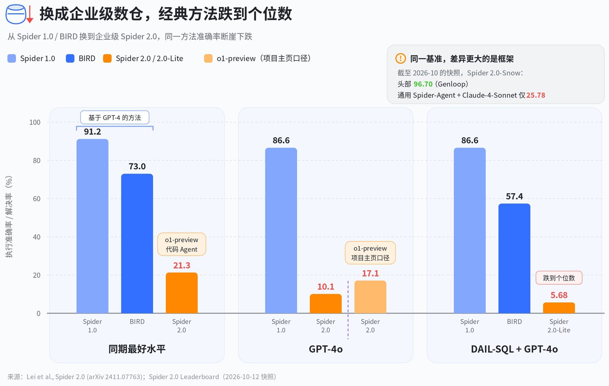
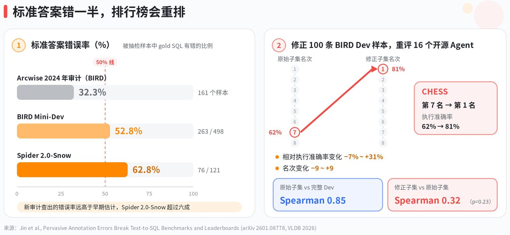
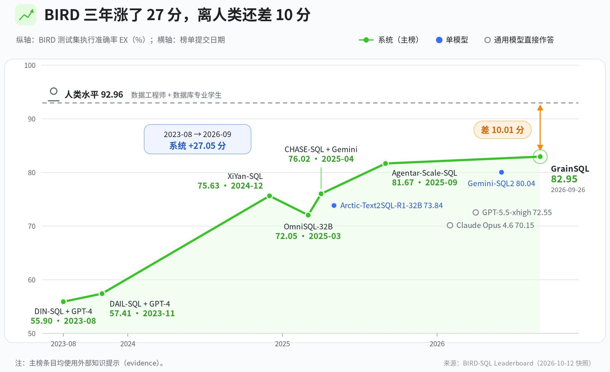
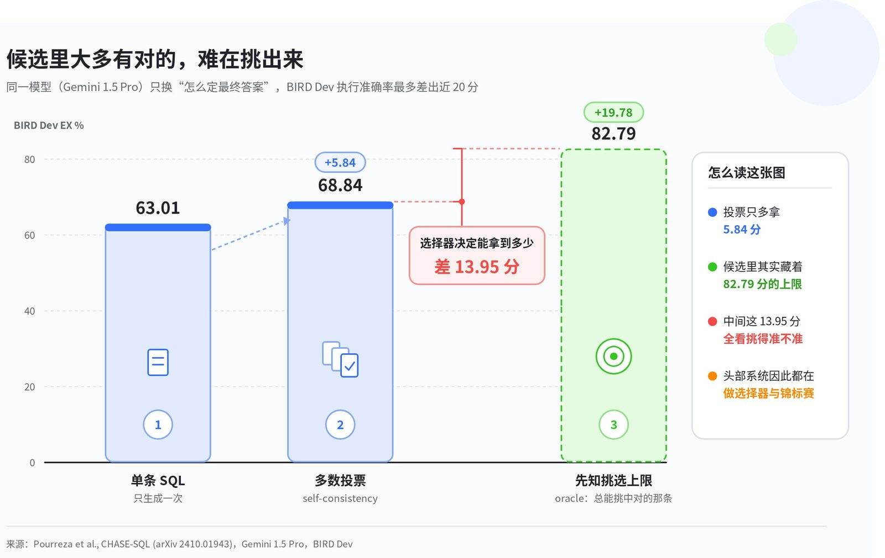
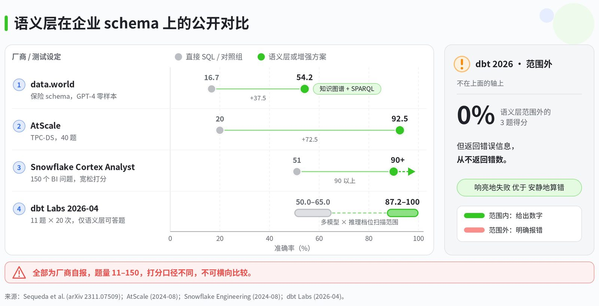
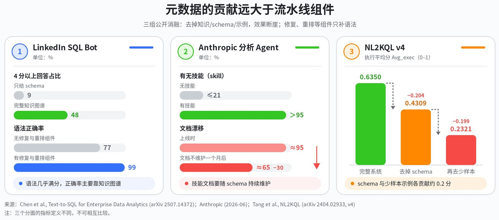
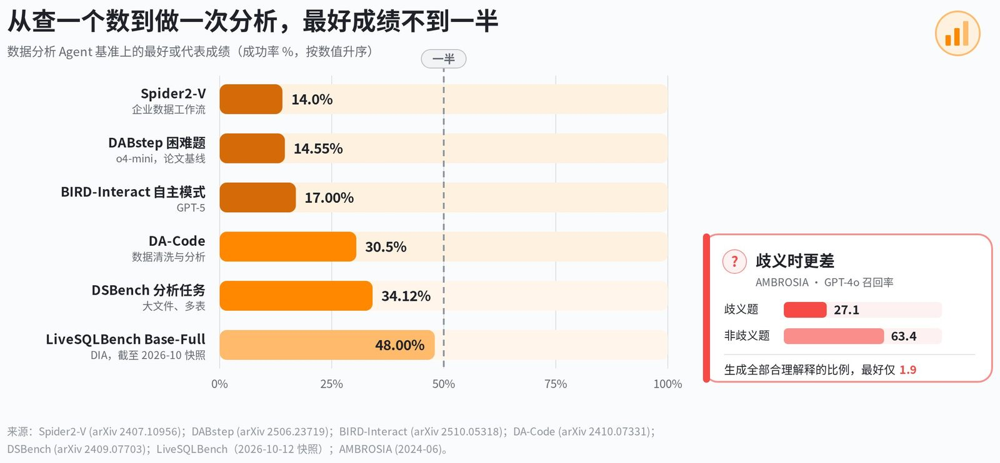
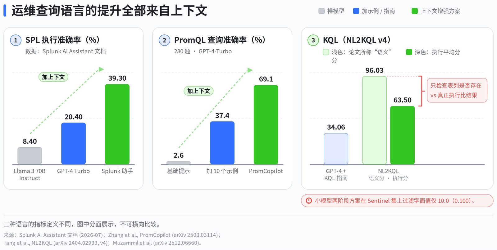

# LLM-39｜场景｜Text-to-SQL 与数据分析 Agent：从自然语言到可信查数

> 🎯 **这篇文档解决什么问题**：让模型把“上周各业务域的多活满足度是多少”变成 SQL 不难，难的是让这个数字可信。公开基准上 Text-to-SQL 已经八十多分，企业库上却常常只有一半；生成的 SQL 能跑通、有结果，数字却是错的。本文面向在企业数仓和运维数据（指标、事故、容灾看板）上做查数与分析 Agent 的工程师，回答四个问题：基准分和真实效果差在哪，为什么语义层决定上限，怎么防错查和越权，怎么评测。
>
> 使用方式：第 1–3 章校准预期，第 4–5 章是提升准确率的主线，第 6 章对照工业案例，第 7–8 章覆盖 Python 分析和运维查询语言，第 9–11 章是防线、评测和上线清单。文中版本、价格和基准分数核对于 2026 年 10 月 11 日，榜单数字均为截至 2026-10 的快照。
>
> **代码**：配套练习在 llm-book 仓库的 `39-text-to-sql/`，2 个练习对应第 9、10 章（结果集等价比较、按查询设扫描上限的成本闸门）。只用 Go 标准库，进目录跑 `go test -race ./...` 就能验证；每个练习加 `-broken` 运行能看到有问题的早期写法，练习 README 末尾附参考答案。

## 导读 · 先给结论

- **基准分不等于你库上的准确率**。Spider 1.0 上基于 GPT-4 的方法已到 91.2%；到了平均每库 812 列的 Spider 2.0，o1-preview 驱动的代码 Agent 只解决 21.3%[[1]](https://arxiv.org/abs/2411.07763)。
- **排行榜噪声很大**。BIRD Mini-Dev 有 52.8% 的样本标注有误；修正 100 条样本后重排 16 个 Agent，名次最多变动 9 位[[2]](https://arxiv.org/abs/2601.08778)。
- **语义层决定上限**。dbt Labs 2026-04 的厂商自测中，语义层能回答的问题准确率 87.2%–100%，直接写 SQL 只有 50.0%–65.0%；语义层答不了时报错，而不是给一个看似合理的错数[[3]](https://docs.getdbt.com/blog/semantic-layer-vs-text-to-sql-2026)。
- **元数据比流水线值钱**。LinkedIn 的知识图谱让 4 分以上回答从 9% 升到 48%，查询修复和重排只把语法正确率从 77% 提到 99%，几乎不改变正确率[[4]](https://arxiv.org/abs/2507.14372)。
- **运维查询语言更依赖上下文**。裸模型生成 PromQL 的准确率 2.6%，加上指标与组件的知识图谱后到 69.1%[[5]](https://arxiv.org/abs/2503.03114)。
- **防线建在数仓里**。加固提示词模板“极其脆弱”，有效的是只读角色、按行授权等数据库层手段[[6]](https://arxiv.org/abs/2308.01990)；BigQuery 对开了行级安全的表做预估时永远返回 0 字节[[7]](https://cloud.google.com/bigquery/docs/best-practices-costs)。
- **评测要跟着 schema 变**。Anthropic 的分析 Agent 上线时离线准确率约 95%，文档不维护一个月后降到约 65%[[8]](https://claude.com/blog/how-anthropic-enables-self-service-data-analytics-with-claude)。

📎 与系列其他文档的分工：「LLM 在运维与容灾中的落地」第 5 章讲运维查数的基本做法和容灾治理案例，「AIOps Agent 落地细化」第 4 章讲运维数据接入与 MCP 权限，「LLM 安全与治理」第 5 章讲通用 SQL 护栏，「LLM 应用评测与可观测」讲通用评测方法。本文只讲 Text-to-SQL 特有的部分。

## 第 1 章 · 为什么“能跑通”不等于“查对了”

结论：公开分数是在小 schema、干净数据、单一方言上测的；换成企业级数仓，同一批方法跌到个位数。而且基准本身的标注错误率超过一半，榜单上的小差距大多落在噪声以内。

### 1.1 从 Spider 1.0 到 Spider 2.0：难度断崖

Spider 2.0（2024-11）收录 632 个真实的企业级工作流问题，覆盖 BigQuery、Snowflake、SQLite 和 DuckDB[[1]](https://arxiv.org/abs/2411.07763)。数据库常超过 1,000 列，平均每库 812 列、约 52.7 亿行；对比之下 Spider 1.0 每库约 2 千行，BIRD 约 54.9 万行。标准答案平均 144 个 token，常超过 100 行[[1]](https://arxiv.org/abs/2411.07763)。

论文摘要的对比是：基于 GPT-4 的方法在 Spider 1.0 和 BIRD 上分别为 91.2% 和 73.0%，o1-preview 代码 Agent 在 Spider 2.0 上只解决 21.3%[[1]](https://arxiv.org/abs/2411.07763)。项目主页后来的口径是 o1-preview 17.1%，GPT-4o 在 Spider 2.0 上 10.1%、在 Spider 1.0 上 86.6%[[9]](https://spider2-sql.github.io/)。经典方法跌得更惨：Spider 2.0-Lite 上 DAIL-SQL 加 GPT-4o 只有 5.68%（Spider 1.0 上 86.6%、BIRD 上 57.4%），CHESS 3.84%，DIN-SQL 1.46%[[1]](https://arxiv.org/abs/2411.07763)。

论文把障碍归为四类：超大库里的 schema 关联（schema linking，从成百上千列里找出这题要用的表和列）、方言差异、嵌套多步查询的规划、以及要参考外部文档和项目代码才能理解的业务含义[[1]](https://arxiv.org/abs/2411.07763)。这正是企业数仓的日常。

### 1.2 基准自己也会错

UIUC Daniel Kang 团队的审计（VLDB 2026）发现，主流基准的标准答案错误率超过一半，足以改变名次[[2]](https://arxiv.org/abs/2601.08778)。数字要分清子集：

- **BIRD Mini-Dev**：498 个去重样本中 263 个有错，占 52.8%；Arcwise 2024 年审计 161 个样本时报告的是 32.3%。
- **Spider 2.0-Snow**：检查的 121 个样本中 76 个有错，占 62.8%。
- **名次漂移**：修正 BIRD Dev 中随机抽取的 100 个样本后重评 16 个开源 Agent，相对执行准确率变化 −7% 到 +31%，名次变化 −9 到 +9；CHESS 从 62% 升到 81%，从第 7 名变成第 1 名。修正后子集与原始子集的排名相关性只有 Spearman 0.32（p=0.23）。

BIRD 团队自己在 2023-09-25 清洗 Dev 集后，ChatGPT 从 37.22 变成 42.24，GPT-4 从 46.35 变成 49.15[[10]](https://bird-bench.github.io/)。光改标注就能让分数动几个点。

### 1.3 执行准确率本身会误判

执行准确率（Execution Accuracy，EX）比较模型 SQL 与标准 SQL 的结果集是否相同。FLEX 研究请 3 位资深 SQL 专家标注了 200 对 BIRD 查询：结果相同的 100 条里有 21 条语义是错的（碰巧算对），结果不同的 100 条里有 17 条其实是对的（标准答案太窄）；EX 与专家共识的 Cohen's kappa 只有 62.0，换成带完整上下文的 LLM 评委后升到 87.04[[11]](https://aclanthology.org/2025.naacl-long.228/)。一条漏了过滤条件的查询，只要测试库里恰好没有被漏掉的那类数据，结果就和标准答案一样。

> 💡 **常见误区**：拿榜单上相差两三个点的方案做选型。标注错误过半、EX 本身有约两成误判，这种差距在噪声以内，要在自己的库上测（第 10 章）。

## 第 2 章 · 2026 年的基准地图怎么读

结论：BIRD 测“中等规模库加业务提示”，Spider 2.0 测“超大企业库加多方言”，LiveSQLBench 测“没被污染的新题加会变的业务规则”，BIRD-Interact 测“会不会追问”。读分数前先看它测的是哪一项，和你的场景对不对得上。

### 2.1 四个基准各测什么

| 基准 | 测什么 | 截至 2026-10 的快照 | 不测什么 |
|---|---|---|---|
| BIRD（2023-05） | 12,751 个问题，95 个库共 33.4 GB，数据有脏值，每题附外部知识提示[[12]](https://arxiv.org/abs/2305.03111) | 测试集第一 GrainSQL 82.95（2026-09-26），人类 92.96，差 10.01 分[[10]](https://bird-bench.github.io/) | 超宽 schema、缺业务提示 |
| Spider 2.0（2024-11） | Snow 547 题、Lite 547 题、DBT 68 题；按结果 CSV 判分[[9]](https://spider2-sql.github.io/) | Snow 第一 96.70，Lite 第一 76.23，DBT 第一 65.6[[9]](https://spider2-sql.github.io/) | 追问澄清、写操作 |
| LiveSQLBench（2025-05 起） | 按版本轮换防污染，每库带分层知识库，含查询和管理类 SQL[[13]](https://livesqlbench.ai/) | Base-Full v1（600 题）排名第一的是 C3 AI 的 DIA，48.00[[13]](https://livesqlbench.ai/) | 多轮交互 |
| BIRD-Interact（2025-10） | 有歧义的任务加后续子任务，配用户模拟器[[14]](https://arxiv.org/abs/2510.05318) | GPT-5 只完成 8.67%（协议引导）和 17.00%（自主）[[14]](https://arxiv.org/abs/2510.05318) | 超大 schema |

### 2.2 BIRD 的三种读法

**业务提示值十几分**。同一模型有无外部知识提示的测试集成绩：ChatGPT 39.30 对 26.77，Codex 36.47 对 24.86[[10]](https://bird-bench.github.io/)。主榜条目都用了这类提示，而你的库上没人替模型写好这句话。这是第 4 章语义层论证的起点。

**方言会掉分**。Mini-Dev 同一批 500 题，GPT-4 在 SQLite、MySQL、PostgreSQL 上分别是 47.80、40.80、35.80[[10]](https://bird-bench.github.io/)。

**单模型和系统分开看**。主榜头部是多候选系统；单模型赛道里 Gemini-SQL2 80.04，Arctic-Text2SQL-R1-32B 73.84；通用模型直接作答的基线是 GPT-5.5-xhigh 72.55、Claude Opus 4.6 70.15[[10]](https://bird-bench.github.io/)。

### 2.3 Spider 2.0 和 LiveSQLBench 怎么读

- **头部多为商业 Agent**：Snow 前列有腾讯云 TCDataAgent-SQL 93.97、字节跳动 ByteBrain-Agent 84.10、蚂蚁 Deepinsight Agent 83.00 等，大多没有论文；分数可能随复核“略有变化”[[9]](https://spider2-sql.github.io/)。
- **通用框架与头部系统差距很大**：通用 Spider-Agent 框架配 Claude-4-Sonnet 只有 25.78，头部系统在九十分以上[[9]](https://spider2-sql.github.io/)。两边用的模型不同，差距不能全算在框架上，但说明只换更强的模型远远不够，schema 探索和执行反馈这类工程同样关键。
- **口语化会掉分**：Gemini-2.5-pro 对口语化问法 28.67，规范问法 35.67[[13]](https://livesqlbench.ai/)。
- **Agent 很贵**：同用 Claude 3.7 Sonnet，直接作答每题 0.0619 美元，把整库上下文塞给 Agent 每题 0.8936 美元，约 14 倍[[13]](https://livesqlbench.ai/)。
- **规则会漂移**：2026-03 的 Large-v1 每库约 1,000 列，平均提示约 8.4 万 token，知识库里的业务规则在版本之间变化[[13]](https://livesqlbench.ai/)。

📎 展开阅读：「读懂模型基准与排行榜」第 6、7 章（数据污染与厂商自报分数的通用读法）。

## 第 3 章 · 方法谱系：哪些在企业库上真有用

结论：2024–2026 年的方法已收敛成一条流水线：值与目录检索、schema 关联、多候选生成、执行反馈自修正、选择器、强化学习调过的生成模型。最大的提升空间在“从候选里挑对的”；但在企业库上要先做好前两段，找不到对的表和值，后面都白搭。

### 3.1 代表方法

| 方法 | 核心做法 | 公开成绩 |
|---|---|---|
| CHESS（2024-05） | 对百万行库值做局部敏感哈希检索、裁剪 schema、生成并修正候选、用自然语言单元测试挑选[[15]](https://arxiv.org/abs/2405.16755) | BIRD 测试集 71.10，比当时领先方案少约 83% 的 LLM 调用[[15]](https://arxiv.org/abs/2405.16755) |
| CHASE-SQL（2024-10） | 三种生成器，再用微调过的两两比较选择器挑选[[16]](https://arxiv.org/abs/2410.01943) | BIRD 测试集 73.0；后续榜单 76.02[[10]](https://bird-bench.github.io/) |
| ReFoRCE（2025-02） | 按命名模式压缩表、LLM 引导的 schema 关联、跨方言自修正、投票并对低置信度题放弃作答[[17]](https://arxiv.org/abs/2502.00675) | 论文时 Spider 2.0-Snow 35.83，现榜单配 o3 为 62.89[[9]](https://spider2-sql.github.io/) |
| Agentar-Scale-SQL（2025-09） | 强化学习增强推理、迭代修正、多样化生成加锦标赛选择[[18]](https://arxiv.org/abs/2509.24403) | BIRD 测试集 81.67，截至 2026-10 的快照排第 5[[10]](https://bird-bench.github.io/) |

### 3.2 Schema 关联：装得下就别裁

Distyl AI 在 2024-08 提出：新模型即使看到大量无关列也能选对，schema 装得进上下文时跳过裁剪反而更好，因为裁剪可能丢掉必需的列；它当时以 71.83% 登顶 BIRD[[19]](https://arxiv.org/abs/2408.07702)。但企业库常常装不下：Uber 有些核心表单表就超过 200 列、占 4–6 万 token[[20]](https://www.uber.com/us/en/blog/query-gpt/)。这时裁剪是必需的，CHESS 的 schema 选择器在工业级 schema 上提升约 2%，同时 token 降到五分之一[[15]](https://arxiv.org/abs/2405.16755)。实用做法是先测完整 schema 能否装下、装下后准确率如何，再决定是否裁，并监控裁剪后必需列的召回率。

### 3.3 多候选与选择器：上限在“挑”

CHASE-SQL 的实验最清楚：Gemini 1.5 Pro 在 BIRD Dev 上，单条 SQL 63.01，多数投票（self-consistency）68.84，如果总能从候选里挑出对的那条，上限是 82.79[[16]](https://arxiv.org/abs/2410.01943)。候选已经覆盖了大部分正确答案，差距在挑不出来。这是头部系统都在做选择器和锦标赛的原因[[18]](https://arxiv.org/abs/2509.24403)。

### 3.4 强化学习：奖励越简单越好

Arctic-Text2SQL-R1（2025-05）只用“执行结果对不对”作奖励，配合精选数据和较强的监督微调起点，在六个基准上达到当时最好，7B 模型超过此前 70B 级的系统[[21]](https://arxiv.org/abs/2505.20315)。它的消融也给出警告：只在 BIRD 上训练，BIRD Dev 很强，但六个基准的平均分低 1.4 分[[21]](https://arxiv.org/abs/2505.20315)。用自家数据微调时，评测集要覆盖训练分布以外的问题。

### 3.5 落到企业库：先做哪几段

值检索和 schema 裁剪最先做，它们决定模型能不能看到正确的表和值；执行反馈自修正其次，成本低且能消除大部分语法和空结果错误；多候选加选择器最后做，它成倍增加调用量。蚂蚁的论文提到，B2B 的 ChatBI 客户能接受 10–30 秒延迟，但不能接受财务报表里的幻觉 SQL[[18]](https://arxiv.org/abs/2509.24403)：延迟可以换准确率，但前提是先解决业务语义。

> 💡 **常见误区**：照搬 BIRD 榜首的流水线。它们针对的是自带业务提示的中等规模库；在缺口径定义的企业库上，多候选只会生成更多“看起来都对”的错误 SQL。

## 第 4 章 · 语义层优先：响亮地失败，好过安静地算错

结论：语义层（semantic layer）把指标算法、表连接和维度取值预先定义成代码，模型只选指标、维度和过滤条件，SQL 由语义层编译。公开对比都显示它在企业 schema 上大幅领先直接写 SQL，但这些数字全是厂商自报、题量小；真正值得依赖的性质是：答不了的问题会报错，而不是返回一个看似合理的错数。

### 4.1 语义层怎么工作

以 Looker 为例：对话式分析不直接查数据库，而是让模型挑字段、过滤、排序和行数上限，再由 Looker 根据 LookML 生成 SQL，LookML 里定义的连接逻辑、聚合方式和数据权限因此自动生效[[22]](https://docs.cloud.google.com/looker/docs/conversational-analytics-overview)。dbt MetricFlow、Snowflake Cortex Analyst 的语义模型、Databricks Genie 的空间配置都是同一思路：把口径从提示词里拿出来，放进可评审、可测试的代码。

### 4.2 公开的对比数字

| 来源 | 测试条件 | 直接 SQL → 语义层 | 注意 |
|---|---|---|---|
| data.world（2023-11） | 保险业企业 schema，GPT-4 零样本；实验组对知识图谱写 SPARQL[[23]](https://arxiv.org/abs/2311.07509) | 16.7% → 54.2% | 高 schema 复杂度象限直接 SQL 为 0% |
| AtScale（2024-08） | TPC-DS，40 题；对照组只给表结构和主外键，语法错误最多重试 3 次[[24]](https://www.atscale.com/press/natural-language-processing-breakthrough/) | 20% → 92.5% | 未说明所用模型 |
| Snowflake（2024-08） | 150 个 BI 问题，单个预连接视图；对照组 GPT-4o 单次提示[[25]](https://www.snowflake.com/en/blog/engineering/cortex-analyst-text-to-sql-accuracy-bi/) | 51% → 90% 以上 | 按列匹配的宽松打分 |
| dbt Labs（2026-04） | 11 题各跑 20 次；直接 SQL 组拿到完整 schema[[3]](https://docs.getdbt.com/blog/semantic-layer-vs-text-to-sql-2026) | 50.0%–65.0% → 87.2%–100% | 仅限语义层能覆盖的题 |

四组数字方向一致，但题量从 11 到 150 不等，打分口径不同，而且都是卖语义层的厂商在测。可以信方向，不能信幅度。

### 4.3 细读 dbt 2026：语义层的边界

dbt Labs 的更新开源了基准代码，值得细读[[3]](https://docs.getdbt.com/blog/semantic-layer-vs-text-to-sql-2026)：

- **直接 SQL 进步很快**：在原始规范化 schema 上，从 2023 年 GPT-4 的 32.7% 涨到 2026 年 Sonnet 4.6 和 GPT-5.3 Codex 的 64.5%。
- **范围内接近满分**：语义层能覆盖的题，从 83.1% 到两个模型都是 100.0%。
- **范围外直接报错**：11 题中有 3 题连接跳数超出 MetricFlow 能力，语义层得 0%，但返回的是错误信息，从不返回错数。
- **补几张模型就够**：让 LLM 补 3 个 dbt 模型后 11 题都能走语义层，Sonnet 4.6 直接 SQL 90.0%、语义层 98.2%。
- **推理档位帮助不大**：GPT 开到 xhigh 每次超过 20 秒，high 约 8 秒，准确率没有提升。

dbt 的原话是：直接写 SQL 时，失败表现为一个看似合理的错误答案；用语义层时，失败表现为一条错误信息[[3]](https://docs.getdbt.com/blog/semantic-layer-vs-text-to-sql-2026)。建议是 KPI、董事会报表和审计类问题走语义层，临时探索可以直接写 SQL，但先试语义层。

### 4.4 运维和容灾指标怎么落到语义层

运维看板的口径问题不比 BI 少：满足度是实测值除以标准值，“单点”和“未多活”不是一回事，默认过滤条件会悄悄改变一个数字的含义。本文的建议是把这些规则写成语义层里的指标和维度，而不是写进提示词。

📎 展开阅读：「LLM 在运维与容灾中的落地」第 5 章 5.4 节（容灾治理案例中的口径隔离和新鲜度检查）。

Anthropic 的分析 Agent 把语义层放在可信度第一位，技能说明强制先查语义层，保证同一个数字在所有报表上一致；他们试过让 LLM 从原始表和查询日志自动生成指标定义，评测上“净负面”，不如更小的人工维护语义层，最后的分工是 Claude 起草、人负责定义[[8]](https://claude.com/blog/how-anthropic-enables-self-service-data-analytics-with-claude)。

> 💡 **常见误区**：先上 Text-to-SQL，出错了再补语义层。顺序应该反过来：先把最常问的二三十个指标放进语义层，Agent 优先走语义层；覆盖不到的再交给 SQL 生成，并在回答里标明“未经语义层”。

## 第 5 章 · 元数据与上下文工程

结论：语义层覆盖不到的部分，准确率取决于喂给模型的元数据：表和列描述、字段真实取值、验证过的示例查询、写在代码里的业务含义。多个工业消融实验都指向同一结论：元数据的贡献远大于流水线组件；而且元数据会过期，必须当代码维护。

### 5.1 消融实验：什么最值钱

- **LinkedIn**：只给 schema 时专家打 4 分以上的回答占 9%，加完整知识图谱后 48%；贡献最大的是示例查询、表聚类和表列属性。查询修复和重排组件把语法正确率从 77% 提到 99%，却几乎不改变正确率[[4]](https://arxiv.org/abs/2507.14372)。
- **Pinterest**：表检索的命中率在嵌入里不含表文档时是 40%，随表文档权重增加线性上升到 90%[[26]](https://medium.com/pinterest-engineering/how-we-built-text-to-sql-at-pinterest-30bad30dabff)。
- **Anthropic**：不用技能（skill）时评测准确率不超过 21%，用技能后汇总准确率稳定在 95% 以上[[8]](https://claude.com/blog/how-anthropic-enables-self-service-data-analytics-with-claude)。
- **NL2KQL**：执行平均分 0.6350，去掉 schema 降到 0.4309，再去掉少样本示例降到 0.2321[[27]](https://arxiv.org/abs/2404.02933)。

### 5.2 值字典：字面值最容易错

比起表名，模型更常把过滤条件里的字面值写错。Uber 的例子：模型写出 `status = 'Finished'`，库里实际存的是 `'Completed'`，查询能跑通但返回 0 行[[20]](https://www.uber.com/us/en/blog/query-gpt/)。LinkedIn 的专家评审中最常见的问题也是“过滤条件不对”，占 24%[[4]](https://arxiv.org/abs/2507.14372)。三种做法：CHESS 对库值建局部敏感哈希索引，按问题里的词找真实取值[[15]](https://arxiv.org/abs/2405.16755)；Databricks Genie 用值字典把用户说法映射到字面值，例如“first level group”对应“1st line support group”[[28]](https://www.databricks.com/blog/aibi-genie-now-generally-available)；低基数列直接把取值放进提示[[26]](https://medium.com/pinterest-engineering/how-we-built-text-to-sql-at-pinterest-30bad30dabff)。服务名、机房码、环境这类运维字段基数不高，适合直接列出。

### 5.3 示例查询：要提炼，不要堆

示例查询是 LinkedIn 消融里贡献最大的一项[[4]](https://arxiv.org/abs/2507.14372)。但 Anthropic 发现，直接对几千条历史查询做检索，准确率提升不到 1 个点；提炼成结构化文档才有效[[8]](https://claude.com/blog/how-anthropic-enables-self-service-data-analytics-with-claude)。历史查询里混着过时口径、一次性调试语句和互相矛盾的写法，原样检索只会增加噪声。

📎 展开阅读：「RAG 与知识工程」第 3 章（混合检索和查询改写，表检索和示例检索可以照用）。

### 5.4 含义藏在代码里

OpenAI 的内部数据 Agent 用了六层上下文：表的使用情况（schema、血缘、历史查询）、人工注释、由 Codex 爬取数据管道代码推断的表含义（粒度、唯一性、新鲜度、范围）、按权限嵌入的 Slack 与文档、用户可编辑的记忆、以及运行时对数仓的实时查询[[29]](https://openai.com/index/inside-our-in-house-data-agent/)。第三层最有启发：一张表是否只含第一方流量、是否含未登录用户，往往只写在生成它的代码里。OpenAI 的总结是“含义存在于代码中”[[29]](https://openai.com/index/inside-our-in-house-data-agent/)。

### 5.5 一个迭代样例

Databricks 公开过搭建 Genie 空间的样例：前三轮补表列描述、连接键和示例值，领域基准 54%；第四轮加入自定义指标定义（如点击率）到 77%；第五轮加入全局过滤、领域定义、财年日历等文字说明到 100%[[30]](https://www.databricks.com/blog/how-build-production-ready-genie-spaces-and-build-trust-along-way)。这是厂商小样例，但说明了投入顺序：结构性元数据打底，指标定义带来最大跳跃，文字规则补边角。

### 5.6 文档会漂移

Anthropic 的分析 Agent 上线时离线准确率约 95%，一个月内掉到约 65%，原因是数据模型变了、文档没跟上[[8]](https://claude.com/blog/how-anthropic-enables-self-service-data-analytics-with-claude)。修法是把文档维护当工程：技能 markdown 和数据转换模型放在同一仓库，评审钩子拦截“改了模型没改文档”的提交，定时 Agent 扫描频道里的纠错并起草文档修复 PR[[8]](https://claude.com/blog/how-anthropic-enables-self-service-data-analytics-with-claude)。LinkedIn 则用 DataHub 的弃用标记自动下线表和字段[[31]](https://www.linkedin.com/blog/engineering/ai/practical-text-to-sql-for-data-analytics)。

## 第 6 章 · 工业案例拆解

结论：公开了细节的工业系统，没有一个是“把问题丢给模型直接出 SQL”。它们都先缩小范围（工作区、领域、按热度筛表），再补元数据，最后把 SQL 展示给人修改。公开指标以采纳率和省时为主，自报准确率口径各异，不能横向比较。

### 6.1 六个案例

| 案例 | 架构要点 | 公开指标 |
|---|---|---|
| Uber QueryGPT（2024-09） | 按领域划分工作区；意图 Agent 选工作区，表 Agent 让用户确认表，列裁剪 Agent 去掉无关列[[20]](https://www.uber.com/us/en/blog/query-gpt/) | 写一条查询从约 10 分钟降到约 3 分钟；约 300 日活，约 78% 的用户认为省时间[[20]](https://www.uber.com/us/en/blog/query-gpt/) |
| LinkedIn SQL Bot（2024-12） | 向量检索前 20 张表，LLM 重排到 7 张再重排字段；校验表和字段存在并执行 Trino EXPLAIN；失败后自修正[[31]](https://www.linkedin.com/blog/engineering/ai/practical-text-to-sql-for-data-analytics) | 每周 300 多名用户，专家评审 53% 的回答正确或接近正确[[4]](https://arxiv.org/abs/2507.14372)；“Fix with AI”占 80% 的会话[[31]](https://www.linkedin.com/blog/engineering/ai/practical-text-to-sql-for-data-analytics) |
| Pinterest（2024-04） | 离线生成表摘要和历史查询摘要，存入向量索引做表检索，再由 LLM 选表[[26]](https://medium.com/pinterest-engineering/how-we-built-text-to-sql-at-pinterest-30bad30dabff) | 首次即被采纳的比例从 20% 升到 40% 以上；任务完成快 35%（观察性数据）[[26]](https://medium.com/pinterest-engineering/how-we-built-text-to-sql-at-pinterest-30bad30dabff) |
| OpenAI（2026-01） | 六层上下文（5.4 节），GPT-5.2 驱动，入口包括 Slack、IDE 和经 MCP 接入的 Codex CLI[[29]](https://openai.com/index/inside-our-in-house-data-agent/) | 数据平台服务 3,500 多名内部用户、7 万个数据集[[29]](https://openai.com/index/inside-our-in-house-data-agent/) |
| Anthropic（2026-06） | 语义层优先的知识路由技能加工作流技能，每领域约 30 份参考文档[[8]](https://claude.com/blog/how-anthropic-enables-self-service-data-analytics-with-claude) | 自报 95% 的业务分析查询自动完成，汇总准确率约 95%[[8]](https://claude.com/blog/how-anthropic-enables-self-service-data-analytics-with-claude) |
| 百度 ChatBI（2024-05） | 把歧义问题转化为选单个视图，用虚拟列表达复杂语义[[32]](https://arxiv.org/abs/2405.00527) | 153 个中文查询上 74.43%，同条件 DIN-SQL 20.92%[[32]](https://arxiv.org/abs/2405.00527) |

Meta 的 SqlCompose 是 SQL 自动补全而非自然语言转 SQL，每周 1 万多名用户、不到 1% 的人关掉它；负面反馈最多的也是表名和列名幻觉[[33]](https://arxiv.org/abs/2407.13280)。

### 6.2 值得抄的设计

- **先确认表**：选错表是最难事后发现的错误，Uber 在写 SQL 前就让用户确认[[20]](https://www.uber.com/us/en/blog/query-gpt/)。
- **个性化默认值**：“昨天的平均点击率”对邮件、广告、搜索团队含义不同，LinkedIn 按组织架构和访问历史设默认数据集[[31]](https://www.linkedin.com/blog/engineering/ai/practical-text-to-sql-for-data-analytics)。
- **意图分类**：用户也可能是找表、解释查询或问语法，不一定要 SQL[[31]](https://www.linkedin.com/blog/engineering/ai/practical-text-to-sql-for-data-analytics)。
- **非阻塞澄清**：OpenAI 的 Agent 会追问，用户不答就用默认值（如最近 7 天或 30 天）并写明假设[[29]](https://openai.com/index/inside-our-in-house-data-agent/)。
- **少即是多**：合并功能重叠的工具；只给目标、不规定路径，过细的提示反而变差[[29]](https://openai.com/index/inside-our-in-house-data-agent/)。

### 6.3 国内大厂：只有榜单证据

蚂蚁、字节跳动、腾讯、阿里在榜单上都有靠前条目，例如腾讯 SiriusAI-SQL 在 BIRD 测试集 82.28、字节跳动 Sophon-Text2SQL-32B 在单模型赛道 74.79[[10]](https://bird-bench.github.io/)，腾讯天穹 Data Agent 加 GLM 5.2 在 Spider 2.0-Lite 以 76.23 排第一[[9]](https://spider2-sql.github.io/)。这些公司内部生产系统的采纳率和准确率没有公开，榜单成绩不能推断线上效果。

> 💡 **常见误区**：把 Anthropic 的“约 95%”和 LinkedIn 的“53%”放在一起比。前者是自家评测集的汇总准确率，后者是专家对真实问题的打分，难度和口径完全不同。能比的只有同一系统在同一评测集上的前后变化。

## 第 7 章 · 超越 SQL：数据分析 Agent

结论：从“查一个数”到“做一次分析”又难一级，数据分析类基准上最好的 Agent 只有 14%–48%。工程上的标准做法是：SQL 取一份有上限的结果集，Python 沙箱负责计算和画图；沙箱拿不到数仓凭据，也不能联网。

### 7.1 数据分析基准

| 基准 | 任务 | 最好成绩 |
|---|---|---|
| Spider2-V（2024-07） | 20 个企业应用（BigQuery、dbt、Airbyte 等）上的 494 个任务，要写代码也要操作界面[[34]](https://arxiv.org/abs/2407.10956) | 14.0%[[34]](https://arxiv.org/abs/2407.10956) |
| DABstep（2025-06） | Adyen 支付分析平台上的 450 多个任务，困难题占 84%[[35]](https://arxiv.org/abs/2506.23719) | 困难题 14.55%（o4-mini）[[35]](https://arxiv.org/abs/2506.23719) |
| DA-Code（2024-10） | 真实数据上的清洗与分析，环境含 SQL、Python、Bash[[36]](https://arxiv.org/abs/2410.07331) | 30.5%[[36]](https://arxiv.org/abs/2410.07331) |
| DSBench（2024-09） | 466 个分析任务和 74 个建模任务，大文件、多表[[37]](https://arxiv.org/abs/2409.07703) | 分析任务 34.12%[[37]](https://arxiv.org/abs/2409.07703) |

作为对照，BIRD-Interact 上 GPT-5 自主模式 17.00%[[14]](https://arxiv.org/abs/2510.05318)，LiveSQLBench Base-Full 最好 48.00[[13]](https://livesqlbench.ai/)。DABstep 经验证的排行榜已关闭并宣布第二版[[35]](https://arxiv.org/abs/2506.23719)；答案一旦公开，静态基准很快失去区分度。

### 7.2 沙箱规格

两家托管服务的边界可以作为自建沙箱的参照：

- **OpenAI Code Interpreter**：完全沙箱化的容器虚拟机里跑 Python；内存档位 1g（默认）、4g、16g、64g；闲置 20 分钟后容器过期、数据丢弃；每个组织每分钟 100 次请求[[38]](https://platform.openai.com/docs/guides/tools-code-interpreter)。
- **Anthropic 代码执行工具**：Python 3.11；5 GiB 内存、5 GiB 磁盘、1 个 CPU；完全禁止联网，运行时不能 pip 安装，预装 pandas、numpy、scipy、statsmodels、matplotlib 等；容器创建后 30 天过期[[39]](https://docs.anthropic.com/en/docs/agents-and-tools/tool-use/code-execution-tool)。

共同点是无网络、无凭据、资源有上限、过期即销毁。通用沙箱原则见「LLM 安全与治理」第 5 章 5.1 节。

### 7.3 SQL 取数，沙箱计算

OpenAI Cookbook 的数据分析示例给了一个干净的分工：模型从不接触数仓地址和凭据，由应用代码执行一条只读查询、最多返回 100 行，再交给模型分析[[40]](https://developers.openai.com/cookbook/examples/agents_api/apps/data_analyst/readme.md)。好处有三：凭据不进模型上下文；结果集有上限；SQL 和分析代码分开审计。

不设上限的查询会同时拖垮成本和成功率。Databricks 用 401 个内部真实任务、20 分钟时限对比：Genie Code 准确率 76.6%、每题 0.55 美元；三个编程 Agent 分别是 72.1%、55.9%、56.1%，后两个主要输在超时，原因是对超大表发出“低效、不设上限的查询”[[41]](https://www.databricks.com/blog/why-frontier-data-agent-outperforms-general-coding-agents-quality-and-cost)。这是厂商自测，但失败原因很有代表性。

### 7.4 开放式分析怎么评

BLADE 基准的标准答案来自多位专家的独立分析，同一个研究问题有多条合理路径[[42]](https://arxiv.org/abs/2408.09667)，所以不能只比最终数字，要比关键决策：用了哪些变量、做了什么变换、选了什么模型、怎么处理缺失值和异常值。能改写成唯一答案的部分自动判分，其余按决策清单人工抽检。

## 第 8 章 · 运维查询语言：PromQL、LogQL、KQL、SPL

结论：运维查询语言的语料远少于 SQL，裸模型更差：生成 SPL 的执行准确率约 20%，PromQL 只有 2.6%。显著的提升全部来自上下文：指标与组件的知识图谱、用户可见的索引和字段、库专属的示例。另外，语法正确率普遍在 98% 以上，和执行正确率（约 60%）相差很远，看厂商数字要先分清是哪一种。

Microsoft 的 Xpert 用相似事故的历史 KQL 做少样本示例，已在「LLM 在运维与容灾中的落地」第 5 章 5.1 节介绍[[43]](https://arxiv.org/abs/2312.11988)，本章补充其他公开工作。

### 8.1 KQL：NL2KQL 与小模型

NL2KQL（Microsoft，2024-04）由 Schema 精简器、按库合成示例的少样本选择器、基于解析器的确定性查询修复器组成[[27]](https://arxiv.org/abs/2404.02933)。v4 版本：语法正确率 0.9878，论文所称“语义”分 0.9603，过滤字面值 0.6656；执行层面行匹配 0.5335、列匹配 0.7365、平均 0.6350。对照组 GPT-4 配 KQL 指南，语法 0.9586、“语义”0.3406[[27]](https://arxiv.org/abs/2404.02933)。这里的“语义”只检查表和列是否存在，执行平均分约 0.6 才接近真实；论文 v2 的执行平均分是 0.5800，引用要写版本[[27]](https://arxiv.org/abs/2404.02933)。

2025-12 的一项研究用小模型起草、低成本 LLM 评审，在 Defender 评测集（230 对）上达到语法 0.987、语义 0.906，token 成本最多比 GPT-5 低 10 倍；但在 Sentinel 泛化集（83 对）上过滤字面值只有 0.100，基本失败[[44]](https://arxiv.org/abs/2512.06660)。Microsoft Security Copilot 的高级狩猎提供自然语言转 KQL，按用户自己的权限做数据发现、只运行只读查询，官方未公开准确率[[45]](https://learn.microsoft.com/en-us/defender-xdr/advanced-hunting-security-copilot)。

### 8.2 PromQL：PromCopilot

PromCopilot（2025-03）在开源微服务系统上构建了 280 个指标查询问题，用知识图谱描述指标与组件的关系[[5]](https://arxiv.org/abs/2503.03114)。GPT-4-Turbo 的查询准确率：基础提示 2.6%，加 10 个示例 37.4%，PromCopilot 69.1%；指标检索召回率 90.3%[[5]](https://arxiv.org/abs/2503.03114)。PromQL 难在“该查哪个指标、带哪些标签”，语法倒在其次，这只有接入系统上下文才知道。

### 8.3 SPL：Splunk AI Assistant

Splunk 公布的内部基准（厂商自报）[[46]](https://www.splunk.com/en_us/blog/artificial-intelligence/technical-review-of-splunk-ai-assistant-for-spl.html)：

| 系统 | 索引匹配 | sourcetype 匹配 | 执行准确率 |
|---|---|---|---|
| Llama 3 70B Instruct | 42.25% | 78.17% | 8.40% |
| GPT-4 Turbo | 52.10% | 65.10% | 20.40% |
| Splunk 助手 | 82.40% | 85.90% | 39.30% |

1.1 版加入个性化：检索用户自己的索引、sourcetype 和字段，并遵守基于角色的访问控制[[47]](https://www.splunk.com/en_us/blog/artificial-intelligence/technical-review-of-splunk-ai-assistant-for-spl.html)。索引匹配从 52.10% 到 82.40% 的跳跃，来自“知道用户有哪些数据”。

### 8.4 LogQL 与平台产品：未公开数字

Grafana Assistant 支持编写和优化 PromQL、LogQL、TraceQL、多种 SQL 方言、KQL 和 SPL[[48]](https://grafana.com/docs/grafana-cloud/machine-learning/assistant/query-assistance)；Datadog 提供自然语言转结构化指标查询[[49]](https://www.datadoghq.com/blog/llm-observability-at-datadog-nlq/)。两家都未公开准确率数字。Datadog 公开了评测方法：用真实用户提示和期望查询建集，解析和指标选择从严判、分组和汇总从宽判，每次提交跑同一份数据集，作者称排查失败的时间缩短约 20 倍[[49]](https://www.datadoghq.com/blog/llm-observability-at-datadog-nlq/)。

### 8.5 运维数据上的三条规律

- **上下文决定成败**：SPL 从 20.40% 到 39.30%，PromQL 从 2.6% 到 69.1%，KQL 执行平均分从去掉 schema 和示例的 0.2321 到 0.6350[[46]](https://www.splunk.com/en_us/blog/artificial-intelligence/technical-review-of-splunk-ai-assistant-for-spl.html)[[5]](https://arxiv.org/abs/2503.03114)[[27]](https://arxiv.org/abs/2404.02933)。
- **标签值是最弱的一环**：Sentinel 上过滤字面值 0.100[[44]](https://arxiv.org/abs/2512.06660)，和 SQL 一样（5.2 节）。服务名、集群名、机房码要做成值字典。
- **语法分严重高估质量**：0.98 以上的语法分对应约 0.6 的执行分[[27]](https://arxiv.org/abs/2404.02933)，验收只看执行结果。

📎 展开阅读：「AIOps Agent 落地细化」第 4 章 4.2 节（可观测平台 MCP 服务器的只读开关和凭据透传）。

## 第 9 章 · 可信查数的工程防线

结论：查数 Agent 有四类风险：被注入后碰不该碰的数据、越权看到别人的数据、一条查询烧掉大量资源、对有歧义的问题自信地给出一个答案。前三类靠数仓原生控制来防，提示词只是补充；第四类要在交互上设计澄清和溯源。只读账号、参数化、超时与行数上限等通用原则不再重复。

📎 展开阅读：「LLM 安全与治理」第 5 章 5.1 节（数据库作为下游时的通用处理）、第 2 章（间接提示词注入为什么没有彻底解法）。

### 9.1 P2SQL：注入可以从数据里来

INESC-ID 的 P2SQL 研究（2023-08 发布，后发表于 ICSE 2025）发现[[6]](https://arxiv.org/abs/2308.01990)：

- 在未修改的 LangChain 0.0.189 上，能访问聊天机器人的攻击者可以注入任意 SQL，获得整个应用数据库的读写权限。
- 加固提示词模板“极其脆弱”。间接攻击把恶意内容写进数据库记录，等其他用户的查询读到它，其中一种在 SQL Agent 上成功率 60%。
- 四种防御组合起来挡住了全部已知攻击：只读角色、改写 SQL 强制按行授权、把用户相关数据预加载进提示、用辅助 LLM 检查查询结果。LLM 检查器在 150 条正常结果上零误报，在 1,120 条恶意提示上检出 99.55%。

对运维数仓，“数据里的注入”尤其现实：事故标题、工单正文、日志行都可能受外部用户影响，而它们正是查数 Agent 最常读的字段。

### 9.2 权限：Agent 的身份就是用户的身份

Agent 用提问者本人的身份查询，不用共享的高权限账号。OpenAI 的数据 Agent 只能查用户本来就能访问的表[[29]](https://openai.com/index/inside-our-in-house-data-agent/)；Splunk 助手只用用户有权访问的索引[[47]](https://www.splunk.com/en_us/blog/artificial-intelligence/technical-review-of-splunk-ai-assistant-for-spl.html)；Looker 通过 LookML 生成 SQL，模型里定义的数据权限自动生效[[22]](https://docs.cloud.google.com/looker/docs/conversational-analytics-overview)。行级和列级控制在数仓里实现（行访问策略、脱敏策略、列策略标签），同一套规则对人和 Agent 一视同仁，不依赖模型是否听话。

### 9.3 成本闸门：几个容易踩的坑

BigQuery 官方文档中和 Agent 直接相关的几条[[7]](https://cloud.google.com/bigquery/docs/best-practices-costs)：

- **预估**：dry run 立即返回预估扫描字节数，不计费，预估值是上限。
- **硬上限**：设置 `maximum_bytes_billed` 后，预估超限的查询直接失败且不收费；聚簇表上预估可能偏高，存在误拒。
- **LIMIT 不省钱**：非聚簇表上 LIMIT 不影响读取量，它只是结果大小的护栏。
- **行级安全让预估失效**：目标表开了行级安全时，dry run 为防旁路攻击总是返回 0 字节。只靠 dry run 的闸门会在这类表上悄悄放行。

Snowflake 的 `STATEMENT_TIMEOUT_IN_SECONDS` 默认 172800 秒（2 天），范围 0 到 604800 秒；先按 account→user→session 的覆盖规则确定会话有效值，再与 warehouse 设置取较小的非零值（0 表示按最大 604800 秒执行；官方例子：user 10、session 20、warehouse 15，结果为 15），计时包括排队、编译和执行[[50]](https://docs.snowflake.com/en/sql-reference/parameters)。默认值对 Agent 太宽松，应给 Agent 专用的用户和仓库单独设短值。

### 9.4 歧义：模型宁可自信也不追问

AMBROSIA（2024-06）覆盖 16 个领域、846 个多表库，GPT-4o 在歧义题上的召回率 27.1，非歧义题 63.4；能把所有合理解释都生成出来的比例，最好的模型只有 1.9[[51]](https://ambrosia-benchmark.github.io/)。BIRD-Interact 里即使允许追问，GPT-5 也只完成 8.67% 和 17.00%，性能随可交互次数增加而单调上升，Agent 倾向于过度试错而不是有策略地探索[[14]](https://arxiv.org/abs/2510.05318)。

澄清能力要设计出来：时间范围、口径这类高频歧义直接问；能给出几种解释时列出来让用户选；问不了时用默认值并写明假设[[29]](https://openai.com/index/inside-our-in-house-data-agent/)。

### 9.5 展示 SQL 与溯源

静默的错误答案目前没有根治办法，Anthropic 也承认这一点。他们的缓解手段是：每个回答附溯源脚注（来源层级、数据最大日期、负责人、评审轮次），面向管理层的答案要人签字，每天用 KPI 评测对照公认看板；对抗式复核技能能提高 6% 准确率，代价是 token 增加 32%、延迟增加 72%[[8]](https://claude.com/blog/how-anthropic-enables-self-service-data-analytics-with-claude)。审计日志建议记录提问、检索到的上下文、SQL、扫描字节数、返回行数和用户身份，并通过查询标签和数仓自带的作业日志关联。

> 💡 **常见误区**：只用 dry run 加 LIMIT 控成本。LIMIT 不减少扫描量，dry run 在行级安全表上返回 0 字节，叠加起来等于没有闸门。硬上限要靠 `maximum_bytes_billed` 和专用仓库的超时。

## 第 10 章 · 评测落地

结论：Text-to-SQL 评测有三点和通用评测不同：比结果集而不是比 SQL，并事先定好等价规则；金标集来自真实日志，允许一题多个正确答案；schema、语义模型、文档任一变化都要触发回归。

📎 展开阅读：「LLM 应用评测与可观测」第 3 章（打分器）、第 4 章（LLM 评委的偏差与校准）、第 5 章（分数差多少才算真差）。

### 10.1 结果集等价

测试套件准确率（test-suite accuracy，2020）从 1,000 个随机库里提炼出一小组覆盖标准查询各分支的库，在整组库上比较结果，以减少碰巧算对；它能区分 99% 以上只差一个条件的“近邻查询”。作者测得，只在单个库上比较执行结果，Dev 集上的假阳性最高 8%[[52]](https://arxiv.org/abs/2010.02840)。企业库上做不了随机生成库，但可以借用思路：同一题在两三个日期分区上各跑一次，都对才算对。结果集比较规则建议如下：

| 规则 | 做法 | 依据 |
|---|---|---|
| 行顺序 | 按多重集合比较，问题要求排序时才比顺序 | 避免误判正确答案 |
| 列顺序与多余列 | 忽略列序和列名；允许多出列，只要要求的列都对 | OpenAI 的评测容忍多余列[[29]](https://openai.com/index/inside-our-in-house-data-agent/)；Snowflake 按列匹配[[25]](https://www.snowflake.com/en/blog/engineering/cortex-analyst-text-to-sql-accuracy-bi/) |
| 数值 | 设相对误差容忍度，统一百分比与小数口径 | 浮点和舍入差异 |
| 空结果 | 一律标为可疑，人工复核 | Uber 把“有输出”作为单独信号[[20]](https://www.uber.com/us/en/blog/query-gpt/) |
| 多个正确答案 | 一题允许多个被接受的答案 | LinkedIn 约 60% 的题有多个答案[[31]](https://www.linkedin.com/blog/engineering/ai/practical-text-to-sql-for-data-analytics) |

### 10.2 金标集：从真实日志里建

- **Uber**：从真实日志取问题，人工核对意图、表和标准 SQL；分端到端和“给定正确意图与表”两种流程评；信号包括意图准确率、表重合度、能否运行、是否有输出、LLM 判断的查询相似度；不要过度解读约 5% 的运行间波动[[20]](https://www.uber.com/us/en/blog/query-gpt/)。
- **LinkedIn**：和领域专家整理了 10 个产品领域的 130 多个问题；只用单一标准答案会把召回率低估 10–15%；LLM 评委在 75% 的情况下与人工打分相差不超过 1 分[[31]](https://www.linkedin.com/blog/engineering/ai/practical-text-to-sql-for-data-analytics)。
- **OpenAI**：人工编写问题和标准 SQL，同时比较 SQL 和结果，持续运行，既当单元测试也当线上金丝雀[[29]](https://openai.com/index/inside-our-in-house-data-agent/)。
- **Anthropic**：把业务方的纠错收集为评测候选；评测钉在快照日期或稳定事实表上，或者评查询而不是评数字；每领域上线门槛约 90%；每个主题几十条之后收益递减[[8]](https://claude.com/blog/how-anthropic-enables-self-service-data-analytics-with-claude)。

### 10.3 线上指标

公开数字：Pinterest 首次即被采纳的比例从 20% 到 40% 以上[[26]](https://medium.com/pinterest-engineering/how-we-built-text-to-sql-at-pinterest-30bad30dabff)；LinkedIn 约 95% 的用户认为准确度达到“及格”以上[[31]](https://www.linkedin.com/blog/engineering/ai/practical-text-to-sql-for-data-analytics)；Uber 约 78% 的用户认为省了时间[[20]](https://www.uber.com/us/en/blog/query-gpt/)。建议的组合：不经修改直接运行的比例、被采纳 SQL 与生成 SQL 的编辑距离、“修复”按钮使用率、差评率、澄清率、每个回答的扫描字节数、回答后重新查询的比例。编辑距离和重新查询率最能暴露“看似合理但不对”的答案。Anthropic 还监控经语义层解决的查询占比，以及回复中带纠错语言的占比[[8]](https://claude.com/blog/how-anthropic-enables-self-service-data-analytics-with-claude)。

### 10.4 什么时候重跑回归

四个触发条件：换模型、改提示词或技能、改 dbt 模型或语义模型、schema 迁移（列改名或删除）。依据：文档漂移一个月就让 Anthropic 的准确率从约 95% 掉到约 65%[[8]](https://claude.com/blog/how-anthropic-enables-self-service-data-analytics-with-claude)；LiveSQLBench 专门让业务规则在版本间变化来测这种漂移[[13]](https://livesqlbench.ai/)。语义层在这里有结构性的好处：schema 变化导致编译失败时，问题以报错形式暴露，而不是让 Agent 安静地查错[[3]](https://docs.getdbt.com/blog/semantic-layer-vs-text-to-sql-2026)。

> 🔑 **本章要点**：先定等价规则，再建金标集；金标集来自真实日志、允许多个答案、钉在固定快照上；回归由四类变更自动触发；线上重点盯编辑距离和重新查询率。

## 第 11 章 · 怎么选与上线清单

结论：按问题类型分三级上线。先做“指标问答”，全部走语义层；再放开“临时查询”，生成 SQL 但必须展示给人；最后做“开放分析”，SQL 取数加沙箱计算。上一级没过门禁不进下一级。

### 11.1 三级上线

| 级别 | 做法 | 进入门禁 | 主要风险 |
|---|---|---|---|
| 指标问答 | 只答语义层定义过的指标和维度，答不了就明确拒答 | 常问指标已入语义层；离线评测接近满分，且每个正确答案都经过语义层[[8]](https://claude.com/blog/how-anthropic-enables-self-service-data-analytics-with-claude) | 覆盖面窄 |
| 临时查询 | 先让用户确认表，结果附 SQL 和溯源脚注，标明“未经语义层” | 领域评测集达到约 90%（参考 Anthropic 的按领域门槛）[[8]](https://claude.com/blog/how-anthropic-enables-self-service-data-analytics-with-claude)；权限和成本闸门就位 | 看似合理的错数、越权、高成本 |
| 开放分析 | SQL 取有上限的结果集，沙箱里计算和画图 | 临时查询稳定运行；沙箱无网络、无凭据 | 路径不合理但数字自洽 |

### 11.2 运维和容灾看板怎么接

- **看板指标先进语义层**：满足度、单点数、未多活服务数连同默认过滤条件一起定义，Agent 只能通过语义层取这些数，保证和看板一致。
- **新鲜度随答案返回**：答案附数据的最大日期或分区日期[[8]](https://claude.com/blog/how-anthropic-enables-self-service-data-analytics-with-claude)。
- **PromQL 和日志查询接系统上下文**：指标与服务的对应关系、标签合法取值、用户可见索引，是从个位数到六七十分的关键[[5]](https://arxiv.org/abs/2503.03114)[[46]](https://www.splunk.com/en_us/blog/artificial-intelligence/technical-review-of-splunk-ai-assistant-for-spl.html)。
- **事故文本按不可信输入处理**[[6]](https://arxiv.org/abs/2308.01990)。

📎 展开阅读：「LLM 在运维与容灾中的落地」第 6 章 6.2 节（优先提供窄工具而不是“执行任意 SQL”）。

### 11.3 上线清单

> 📌 **权限**
>
> - Agent 用提问者本人的身份查询，没有共享高权限账号[[29]](https://openai.com/index/inside-our-in-house-data-agent/)。
> - 执行角色只读，写操作和 DDL 在数据库权限层面禁止[[6]](https://arxiv.org/abs/2308.01990)。
> - 行级、列级控制用数仓策略实现，结果进入模型上下文前已脱敏。
>
> **成本**
>
> - BigQuery 设 `maximum_bytes_billed`，不把 LIMIT 当成本护栏，注意行级安全表的 dry run 返回 0 字节[[7]](https://cloud.google.com/bigquery/docs/best-practices-costs)。
> - Snowflake 给 Agent 专用用户和仓库设短的语句超时，默认 2 天太长[[50]](https://docs.snowflake.com/en/sql-reference/parameters)。
> - 单次会话设查询次数上限，监控每个回答的扫描字节数。
>
> **展示与澄清**
>
> - 每个答案展示 SQL、表和过滤条件、数据新鲜度、来源层级[[8]](https://claude.com/blog/how-anthropic-enables-self-service-data-analytics-with-claude)。
> - 时间范围和口径有歧义时先问，不问就写明默认假设[[29]](https://openai.com/index/inside-our-in-house-data-agent/)。
> - 空结果不当作“没有问题”，提示用户检查过滤条件[[20]](https://www.uber.com/us/en/blog/query-gpt/)。
>
> **评测与回归**
>
> - 结果集等价规则写成代码：多重集合、忽略列序、容忍多余列、数值容差。
> - 金标集来自真实日志，允许多个正确答案，钉在固定快照上[[31]](https://www.linkedin.com/blog/engineering/ai/practical-text-to-sql-for-data-analytics)。
> - 换模型、改提示词、改语义模型、schema 迁移，任一发生都自动重跑回归。

### 11.4 反模式

- **按榜单选方案**：几个点的差距在标注噪声以内[[2]](https://arxiv.org/abs/2601.08778)。
- **把整个 schema 塞给 Agent**：成本约高一个数量级[[13]](https://livesqlbench.ai/)。
- **让 LLM 自动生成指标定义直接上线**：Anthropic 的评测上是净负面[[8]](https://claude.com/blog/how-anthropic-enables-self-service-data-analytics-with-claude)。
- **只看语法正确率**：0.98 的语法分可能只对应 0.6 的执行分[[27]](https://arxiv.org/abs/2404.02933)。

## 参考文献

按正文首次引用顺序编号，资料截至 2026 年 10 月初。

[1] Lei et al. Spider 2.0: Evaluating Language Models on Real-World Enterprise Text-to-SQL Workflows (2024-11) [https://arxiv.org/abs/2411.07763](https://arxiv.org/abs/2411.07763)

[2] Jin et al. Pervasive Annotation Errors Break Text-to-SQL Benchmarks and Leaderboards (2026-01) [https://arxiv.org/abs/2601.08778](https://arxiv.org/abs/2601.08778)

[3] Ganz, Perigaud (dbt Labs). Semantic Layer vs. Text-to-SQL: 2026 Benchmark Update (2026-04) [https://docs.getdbt.com/blog/semantic-layer-vs-text-to-sql-2026](https://docs.getdbt.com/blog/semantic-layer-vs-text-to-sql-2026)

[4] Chen et al. Text-to-SQL for Enterprise Data Analytics (2025-07) [https://arxiv.org/abs/2507.14372](https://arxiv.org/abs/2507.14372)

[5] Zhang et al. PromCopilot: Simplifying Prometheus Metric Querying in Cloud Native Online Service Systems via Large Language Models (2025-03) [https://arxiv.org/abs/2503.03114](https://arxiv.org/abs/2503.03114)

[6] Pedro et al. From Prompt Injections to SQL Injection Attacks: How Protected is Your LLM-Integrated Web Application? (2023-08) [https://arxiv.org/abs/2308.01990](https://arxiv.org/abs/2308.01990)

[7] Google Cloud. BigQuery: Estimate and Control Costs (docs, accessed 2026-10-12) [https://cloud.google.com/bigquery/docs/best-practices-costs](https://cloud.google.com/bigquery/docs/best-practices-costs)

[8] Anthropic. How Anthropic Enables Self-Service Data Analytics with Claude (2026-06) [https://claude.com/blog/how-anthropic-enables-self-service-data-analytics-with-claude](https://claude.com/blog/how-anthropic-enables-self-service-data-analytics-with-claude)

[9] Spider 2.0 Team. Spider 2.0 Leaderboard (accessed 2026-10-12) [https://spider2-sql.github.io/](https://spider2-sql.github.io/)

[10] BIRD Team. BIRD-SQL Leaderboard (accessed 2026-10-12) [https://bird-bench.github.io/](https://bird-bench.github.io/)

[11] Kim et al. FLEX: Expert-level False-Less EXecution Metric for Reliable Text-to-SQL Benchmark (NAACL 2025) [https://aclanthology.org/2025.naacl-long.228/](https://aclanthology.org/2025.naacl-long.228/)

[12] Li et al. Can LLM Already Serve as A Database Interface? A BIg Bench for Large-Scale Database Grounded Text-to-SQLs (2023-05) [https://arxiv.org/abs/2305.03111](https://arxiv.org/abs/2305.03111)

[13] BIRD Team. LiveSQLBench: A Dynamic and Contamination-Free Benchmark (accessed 2026-10-12) [https://livesqlbench.ai/](https://livesqlbench.ai/)

[14] Huo et al. BIRD-INTERACT: Re-imagining Text-to-SQL Evaluation for Large Language Models via Lens of Dynamic Interactions (2025-10) [https://arxiv.org/abs/2510.05318](https://arxiv.org/abs/2510.05318)

[15] Talaei et al. CHESS: Contextual Harnessing for Efficient SQL Synthesis (2024-05) [https://arxiv.org/abs/2405.16755](https://arxiv.org/abs/2405.16755)

[16] Pourreza et al. CHASE-SQL: Multi-Path Reasoning and Preference Optimized Candidate Selection in Text-to-SQL (2024-10) [https://arxiv.org/abs/2410.01943](https://arxiv.org/abs/2410.01943)

[17] Deng et al. ReFoRCE: A Text-to-SQL Agent with Self-Refinement, Consensus Enforcement, and Column Exploration (2025-02) [https://arxiv.org/abs/2502.00675](https://arxiv.org/abs/2502.00675)

[18] Wang et al. Agentar-Scale-SQL: Advancing Text-to-SQL through Orchestrated Test-Time Scaling (2025-09) [https://arxiv.org/abs/2509.24403](https://arxiv.org/abs/2509.24403)

[19] Maamari et al. The Death of Schema Linking? Text-to-SQL in the Age of Well-Reasoned Language Models (2024-08) [https://arxiv.org/abs/2408.07702](https://arxiv.org/abs/2408.07702)

[20] Uber Engineering. QueryGPT: Natural Language to SQL Using Generative AI (2024-09) [https://www.uber.com/us/en/blog/query-gpt/](https://www.uber.com/us/en/blog/query-gpt/)

[21] Yao et al. Arctic-Text2SQL-R1: Simple Rewards, Strong Reasoning in Text-to-SQL (2025-05) [https://arxiv.org/abs/2505.20315](https://arxiv.org/abs/2505.20315)

[22] Google Cloud. Looker Conversational Analytics Overview (docs, accessed 2026-10) [https://docs.cloud.google.com/looker/docs/conversational-analytics-overview](https://docs.cloud.google.com/looker/docs/conversational-analytics-overview)

[23] Sequeda, Allemang, Jacob. A Benchmark to Understand the Role of Knowledge Graphs on Large Language Model's Accuracy for Question Answering on Enterprise SQL Databases (2023-11) [https://arxiv.org/abs/2311.07509](https://arxiv.org/abs/2311.07509)

[24] AtScale. Natural Language Processing Breakthrough with Semantic Layer (2024-08) [https://www.atscale.com/press/natural-language-processing-breakthrough/](https://www.atscale.com/press/natural-language-processing-breakthrough/)

[25] Snowflake Engineering. Evaluating Text-to-SQL Accuracy for Real-World BI (2024-08) [https://www.snowflake.com/en/blog/engineering/cortex-analyst-text-to-sql-accuracy-bi/](https://www.snowflake.com/en/blog/engineering/cortex-analyst-text-to-sql-accuracy-bi/)

[26] Pinterest Engineering. How We Built Text-to-SQL at Pinterest (2024-04) [https://medium.com/pinterest-engineering/how-we-built-text-to-sql-at-pinterest-30bad30dabff](https://medium.com/pinterest-engineering/how-we-built-text-to-sql-at-pinterest-30bad30dabff)

[27] Tang et al. NL2KQL: From Natural Language to Kusto Query (2024-04) [https://arxiv.org/abs/2404.02933](https://arxiv.org/abs/2404.02933)

[28] Databricks. AI/BI Genie Is Now Generally Available (blog, accessed 2026-10) [https://www.databricks.com/blog/aibi-genie-now-generally-available](https://www.databricks.com/blog/aibi-genie-now-generally-available)

[29] Xu, Suresh, Tang (OpenAI). Inside Our In-House Data Agent (2026-01) [https://openai.com/index/inside-our-in-house-data-agent/](https://openai.com/index/inside-our-in-house-data-agent/)

[30] Databricks. How to Build Production-Ready Genie Spaces and Build Trust Along the Way (blog, accessed 2026-10) [https://www.databricks.com/blog/how-build-production-ready-genie-spaces-and-build-trust-along-way](https://www.databricks.com/blog/how-build-production-ready-genie-spaces-and-build-trust-along-way)

[31] Chen et al. (LinkedIn Engineering). Practical Text-to-SQL for Data Analytics (2024-12) [https://www.linkedin.com/blog/engineering/ai/practical-text-to-sql-for-data-analytics](https://www.linkedin.com/blog/engineering/ai/practical-text-to-sql-for-data-analytics)

[32] Lian et al. ChatBI: Towards Natural Language to Complex Business Intelligence SQL (2024-05) [https://arxiv.org/abs/2405.00527](https://arxiv.org/abs/2405.00527)

[33] Maddila et al. AI-Assisted SQL Authoring at Industry Scale (2024-07) [https://arxiv.org/abs/2407.13280](https://arxiv.org/abs/2407.13280)

[34] Cao et al. Spider2-V: How Far Are Multimodal Agents From Automating Data Science and Engineering Workflows? (2024-07) [https://arxiv.org/abs/2407.10956](https://arxiv.org/abs/2407.10956)

[35] Egg et al. DABstep: Data Agent Benchmark for Multi-step Reasoning (2025-06) [https://arxiv.org/abs/2506.23719](https://arxiv.org/abs/2506.23719)

[36] Huang et al. DA-Code: Agent Data Science Code Generation Benchmark for Large Language Models (2024-10) [https://arxiv.org/abs/2410.07331](https://arxiv.org/abs/2410.07331)

[37] Jing et al. DSBench: How Far Are Data Science Agents from Becoming Data Science Experts? (2024-09) [https://arxiv.org/abs/2409.07703](https://arxiv.org/abs/2409.07703)

[38] OpenAI. Code Interpreter Tool Guide (docs, accessed 2026-10-12) [https://platform.openai.com/docs/guides/tools-code-interpreter](https://platform.openai.com/docs/guides/tools-code-interpreter)

[39] Anthropic. Code Execution Tool (docs, accessed 2026-10-12) [https://docs.anthropic.com/en/docs/agents-and-tools/tool-use/code-execution-tool](https://docs.anthropic.com/en/docs/agents-and-tools/tool-use/code-execution-tool)

[40] OpenAI Cookbook. Data Analyst App Example (accessed 2026-10) [https://developers.openai.com/cookbook/examples/agents_api/apps/data_analyst/readme.md](https://developers.openai.com/cookbook/examples/agents_api/apps/data_analyst/readme.md)

[41] Databricks. Why A Frontier Data Agent Outperforms General Coding Agents in Quality and Cost (blog, accessed 2026-10) [https://www.databricks.com/blog/why-frontier-data-agent-outperforms-general-coding-agents-quality-and-cost](https://www.databricks.com/blog/why-frontier-data-agent-outperforms-general-coding-agents-quality-and-cost)

[42] Gu et al. BLADE: Benchmarking Language Model Agents for Data-Driven Science (2024-08) [https://arxiv.org/abs/2408.09667](https://arxiv.org/abs/2408.09667)

[43] Jiang et al. Xpert: Empowering Incident Management with Query Recommendations via Large Language Models (2023-12) [https://arxiv.org/abs/2312.11988](https://arxiv.org/abs/2312.11988)

[44] Muzammil et al. Effective and Efficient Threat Hunting with Small Language Models (2025-12) [https://arxiv.org/abs/2512.06660](https://arxiv.org/abs/2512.06660)

[45] Microsoft. Microsoft Security Copilot in Advanced Hunting (docs, accessed 2026-10-12) [https://learn.microsoft.com/en-us/defender-xdr/advanced-hunting-security-copilot](https://learn.microsoft.com/en-us/defender-xdr/advanced-hunting-security-copilot)

[46] Splunk. Technical Review of Splunk AI Assistant for SPL (blog, accessed 2026-10) [https://www.splunk.com/en_us/blog/artificial-intelligence/technical-review-of-splunk-ai-assistant-for-spl.html](https://www.splunk.com/en_us/blog/artificial-intelligence/technical-review-of-splunk-ai-assistant-for-spl.html)

[47] Splunk. Technical Review of Splunk AI Assistant for SPL (blog, accessed 2026-10) [https://www.splunk.com/en_us/blog/artificial-intelligence/technical-review-of-splunk-ai-assistant-for-spl.html](https://www.splunk.com/en_us/blog/artificial-intelligence/technical-review-of-splunk-ai-assistant-for-spl.html)

[48] Grafana Labs. Grafana Assistant: Query Assistance (docs, accessed 2026-10) [https://grafana.com/docs/grafana-cloud/machine-learning/assistant/query-assistance](https://grafana.com/docs/grafana-cloud/machine-learning/assistant/query-assistance)

[49] Datadog. LLM Observability at Datadog: Natural Language Querying (blog, accessed 2026-10) [https://www.datadoghq.com/blog/llm-observability-at-datadog-nlq/](https://www.datadoghq.com/blog/llm-observability-at-datadog-nlq/)

[50] Snowflake. Parameters: STATEMENT_TIMEOUT_IN_SECONDS (docs, accessed 2026-10-12) [https://docs.snowflake.com/en/sql-reference/parameters](https://docs.snowflake.com/en/sql-reference/parameters)

[51] Saparina, Lapata. AMBROSIA: A Benchmark for Parsing Ambiguous Questions into Database Queries (2024-06) [https://ambrosia-benchmark.github.io/](https://ambrosia-benchmark.github.io/)

[52] Zhong, Yu, Klein. Semantic Evaluation for Text-to-SQL with Distilled Test Suites (2020-10) [https://arxiv.org/abs/2010.02840](https://arxiv.org/abs/2010.02840)

---

上一篇：[LLM-38｜工程｜Deep Research 与搜索 Agent：检索、核验与评测](./38-deep-research.md) · [目录](./README.md) · 下一篇：[LLM-40｜地基｜合成数据与数据飞轮：生成、过滤与评测集构造](./40-synthetic-data.md)
