# LLM-40｜地基｜合成数据与数据飞轮：生成、过滤与评测集构造

> 🎯 **这篇文档解决什么问题**：用大模型造训练数据已是常规操作，难的是五件事：怎么造才有多样性和难度，怎么筛，怎么证明没把模型训坏、没污染评测集，怎么在条款和版权上站得住，怎么把线上日志变成下一轮数据。本文按这五件事组织，给出可照做的配方、各家技术报告的实际参数和失败证据。
>
> 使用方式：要造指令或工具数据，读第 2、4 章；要做预训练改写，读第 3 章；要上线一条数据流水线，读第 5–7 章和第 11 章的清单；要构造评测集或搭飞轮，读第 9、10 章。要估计公开语料还能用多久，读第 12 章。文中版本、价格和基准分数核对于 2026 年 10 月 13 日。

## 导读 · 先给结论

- **后训练数据的主体已经是合成的**。Nemotron-4 340B 对齐阶段 98% 以上的数据是合成的，人工标注只有约 2 万条[[1]](https://arxiv.org/abs/2406.11704)；Llama 3 的后训练做了 6 轮，每一轮都从最新模型采样合成数据[[2]](https://arxiv.org/abs/2407.21783)。预训练级的改写和配比细节见「训练工程」第 3 章，本文不重复。
- **能验证的领域，合成数据最可靠**。代码能执行、数学能对答案、工具调用能真跑一遍。Llama 3 发现用 405B 模型自己生成、未经执行检验的代码数据训练自己“没有帮助，甚至会变差”，加上执行反馈后才有效[[2]](https://arxiv.org/abs/2407.21783)。
- **预训练改写是混合，不是替换**。约 30% 改写数据加 70% 真实网页，在较大预算下能以 5–10 倍的速度达到同样的验证损失；只用改写数据并不更快[[3]](https://arxiv.org/abs/2510.01631)。
- **模型崩溃有明确的触发条件**：用上一代的输出“替换”真实数据会崩，把真实数据保留并“累积”就基本不会[[4]](https://arxiv.org/abs/2404.01413)。验证器能挡住崩溃，但长期收益会收敛到验证器自己的知识水平[[5]](https://arxiv.org/abs/2510.16657)。
- **合成评测集最容易自欺**。生成数据和打分的模型来自同一个模型时，偏好泄漏分数平均 23.6%，同一家族 8.9%，不同系列 2.8%[[6]](https://arxiv.org/abs/2502.01534)。生成训练数据、打分和出评测题，要用不同家族的模型。
- **合规的第一风险是合同，不是版权**。OpenAI、Google、Anthropic 的条款都禁止用输出开发竞争模型[[7]](https://openai.com/policies/terms-of-use)[[8]](https://ai.google.dev/gemini-api/terms)[[9]](https://www.anthropic.com/legal/commercial-terms)；Anthropic 在 2026-02 公开点名了三家通过约 2.4 万个欺诈账号做蒸馏的公司[[10]](https://www.anthropic.com/research/detecting-and-preventing-distillation-attacks)。开源教师模型要看许可证里的命名和衍生条款。

📎 与系列其他文档的分工：网页数据清洗和预训练配比见「训练工程」第 2–3 章；SFT 数据量和蒸馏配方见「后训练实战」第 3 章；推理轨迹蒸馏见「推理模型与测试时计算」第 5 章；LLM 评委偏差见「LLM 应用评测与可观测」第 4–5 章。

## 第 1 章 · 合成数据地图：谁在用、用在哪、占多少

2024–2026 年公开技术报告的主流模型都用合成数据，差别在阶段和检验方式：

| 模型 | 阶段 | 合成环节 | 检验方式 |
|---|---|---|---|
| Phi-4（14B） | 预训练、SFT、DPO | 50 大类合成数据，约 4,000 亿未加权 token[[11]](https://arxiv.org/abs/2412.08905) | 代码走执行和测试；指令反转只留能还原原代码的样本 |
| Nemotron-4 340B | SFT、偏好 | 对齐数据 98% 以上合成；3,000 个主题生成提示[[1]](https://arxiv.org/abs/2406.11704) | 奖励模型打分，低于阈值丢弃 |
| Llama 3 | SFT、拒绝采样、DPO | 6 轮迭代；代码合成 SFT 样本超过 270 万条[[2]](https://arxiv.org/abs/2407.21783) | 奖励模型、评委、执行反馈、语义去重 |
| Tülu 3 | SFT、偏好 | 939,344 条 SFT 提示，从 2,332 万候选中选出；人设驱动合成[[12]](https://arxiv.org/abs/2411.15124) | 8-gram 去污染，逐条追溯许可 |
| DeepSeek-V3 | SFT | 150 万条；推理数据由内部 R1 生成，非推理数据由 V2.5 生成[[13]](https://arxiv.org/abs/2412.19437) | 拒绝采样；非推理数据人工核验 |
| Kimi K2 | 预训练改写、Agent | 3,000 多个真实 MCP 工具加 2 万多个合成工具[[14]](https://arxiv.org/abs/2507.20534) | 评委按评分标准只留成功轨迹 |
| Nemotron 3 Nano | 预训练、后训练 | 改写由 Qwen3-30B-A3B 完成；后训练教师含 GPT-OSS-120B、DeepSeek-R1-0528[[15]](https://arxiv.org/abs/2512.20848) | 重复检测、立场关键词过滤、许可过滤 |

### 1.1 三个共同点

- **靠真实种子**。Phi-4 的合成从网页和代码种子出发，消融结论是真实问题比合成问题“有效得多”[[11]](https://arxiv.org/abs/2412.08905)；Cosmopedia 超过 80% 的提示由网页种子生成[[16]](https://huggingface.co/blog/cosmopedia)。
- **都带检验器**：执行、奖励模型、评委、多数投票，至少一种。
- **知识仍要真实数据**。Phi-4 用纯合成数据训练的 13B 模型在多数基准上超过 phi-3-medium，但 TriviaQA 这类知识基准差距很大，所以保留了网页数据[[11]](https://arxiv.org/abs/2412.08905)。

📎 展开阅读：「训练工程」第 3.4、3.5 节（Phi-4 完整配比表、Kimi K2 知识改写消融、Nemotron-4 的 98%）。

### 1.2 适合什么，不适合什么

合成数据明显胜过人工的有四类场景：答案能自动检验的领域（数学、代码、工具调用）；格式和风格覆盖；隐私受限的领域（第 10.3 节）；已有 1–2 万条人工锚点之后的规模扩张。人工数据仍不可替代的有三类：新的事实知识、偏好判断的基准真值、最终评测集。

> 💡 **常见误区**：看到“98% 合成”就以为人工数据可以省掉。Nemotron-4 的 98% 建立在约 1 万条人工 SFT 和 1 万条 HelpSteer2 偏好数据之上[[1]](https://arxiv.org/abs/2406.11704)。人工数据从“主料”变成了“锚点”，但没有消失。

## 第 2 章 · 指令合成五法：Self-Instruct、Evol、回译、Magpie、Persona

造指令数据的方法在机制上可以归成五类：从少量种子扩写、把已有指令改难、从现成文本反推指令、让对齐模型自己“说出”用户问题、用人设控制多样性。选哪种，先看手里有什么：种子任务、大量无标注文本，还是一个对齐好的开源模型。

### 2.1 Self-Instruct：从 175 条种子扩写

Self-Instruct 用 175 条人工种子任务，让原始 GPT-3 生成了约 5.2 万条指令和 8.2 万个实例；新指令与已有每一条的 ROUGE-L 都低于 0.7 才保留。GPT-3 因此在 Super-NaturalInstructions 上绝对提升 33%[[17]](https://arxiv.org/abs/2212.10560)。这份数据其实很“脏”，第 5.1 节会用它的质量审计说明噪声能容忍到什么程度。

### 2.2 Evol-Instruct：把题目改难

WizardLM 从 Alpaca 的 5.2 万条指令出发，用 ChatGPT 做深度演化（加约束、增加推理步数、复杂化输入等）和广度演化（生成同领域新题），再用“淘汰演化”删掉演化失败的样本；4 轮得到 25 万条[[18]](https://arxiv.org/abs/2304.12244)。它的价值在于提供难度梯度，风险是演化出无解或自相矛盾的题，所以淘汰这一步不能省。

### 2.3 指令回译：从现成文本反推问题

回译（instruction backtranslation）假设网上有大量高质量“回答”，缺的只是问题。Humpback 用 3,200 条种子训练“由回答生成指令”的模型，给 50.2 万段网页文本各生成一条指令，再让模型按 5 分制给自己打分，4.5 分以上的只有 41,821 条[[19]](https://arxiv.org/abs/2308.06259)。工业界用得更广：Llama 3 用回译生成约 120 万条代码解释和文档对话，并用“能否与原代码对上”做自我验证[[2]](https://arxiv.org/abs/2407.21783)；Phi-4 的“指令反转”也是同一思路[[11]](https://arxiv.org/abs/2412.08905)。

### 2.4 Magpie：只给模板，让模型自己出题

Magpie 发现，对齐模型只看到聊天模板里用户发言开始之前的那段前缀，就会自动续写出一个像真人的用户问题；再把问题喂回去得到回答，就是一条样本[[20]](https://arxiv.org/abs/2406.08464)。作者用 Llama-3-Instruct 生成 400 万条指令、选出 30 万条，在 Llama-3-8B-Base 上做 SFT，部分任务上与用了 1,000 万条 SFT 和反馈数据的官方 Llama-3-8B-Instruct 相当[[20]](https://arxiv.org/abs/2406.08464)。

它的成本是公开数据里最透明的：在 4 张 A100-80GB 上，8B 模型生成 300 万条用 206 个 GPU 小时，70B 模型生成 100 万条用 614 个 GPU 小时，按 Lambda 云价格折合每千条 0.12 美元和 1.1 美元[[20]](https://arxiv.org/abs/2406.08464)。作为对照，按截至 2026-10 的官网批量价格、每条 500 个输入 token 和 700 个输出 token 推算，gpt-6-luna 或 Claude Haiku 5.5 每千条约 0.20 美元，gemini-3.8-flash 约 1.5 美元，Claude Sonnet 5.5 约 4 美元，Claude Opus 5.5 约 8 美元（本文换算，公式见第 11.2 节）[[21]](https://developers.openai.com/api/docs/pricing)[[22]](https://platform.claude.com/docs/en/about-claude/pricing)[[23]](https://ai.google.dev/gemini-api/docs/pricing)。

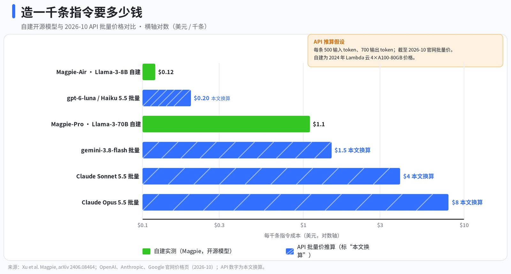

### 2.5 Persona：用人设控制多样性

Persona Hub 从网页中抽取了 1,015,863,523 个人设，约占世界人口的 13%；把人设放进提示里，让模型以这个人的视角出题。用 GPT-4 生成的 109 万道数学题微调 Qwen2-7B，MATH 达到 64.9%，与 gpt-4-turbo-preview 相当[[24]](https://arxiv.org/abs/2406.20094)。Tülu 3 用约 25 万个人设生成了 Persona MATH 149,960 条、Persona IF 29,980 条等数据[[12]](https://arxiv.org/abs/2411.15124)。论文自己也提醒：用十亿级人设批量查询前沿模型，相当于把它的能力“倒出来”[[24]](https://arxiv.org/abs/2406.20094)，这正是各家条款禁止的行为（第 11.3 节）。

### 2.6 怎么选

| 方法 | 需要有 | 擅长 | 主要风险 |
|---|---|---|---|
| Self-Instruct | 一两百条种子任务 | 冷启动，覆盖任务类型 | 约一半样本有错 |
| Evol-Instruct | 一批已有指令 | 拉开难度梯度 | 演化出无解的题 |
| 回译 | 大量高质量文本或代码 | 长回答、代码文档 | 指令与文本对不上 |
| Magpie | 开源对齐模型和 GPU | 零种子、成本低 | 偏向该模型熟悉的话题 |
| Persona | 人设库 | 大规模下保持多样性 | 批量调闭源模型触碰条款 |

实际流水线通常组合使用，再统一走第 5–7 章的过滤、去重和去污染。

固定预算视角也有了新对照：人类与合成偏好数据单样本成本差异大，既往研究多按样本数对齐；2026 年 11 月的研究固定预算比较 SFT 加 DPO 后训练里两种数据的性价比[75]，选合成方法前先把预算口径从样本数换成钱，结论可能反过来。

📎 展开阅读：「动手实验：从零训练一个小模型」第 7.3 节（SmolTalk 里 40 万条 Smol-Magpie-Ultra 的用法）；「Embedding 与向量检索」第 1.3 节（检索模型的合成训练对）。

## 第 3 章 · 预训练级改写：从 WRAP 到 FinePhrase

预训练阶段的合成数据，主流做法是改写（rephrasing）：让一个指令模型把真实网页改写成百科、问答、教程或表格等格式。2025–2026 年的几项大规模研究结论一致：改写数据要和真实数据混合，格式比生成器大小重要，收益有上限。Nemotron-CC 和 Kimi K2 的改写已在「训练工程」第 3.5 节讲过，这里只讲新证据。

### 3.1 WRAP：改写的起点

📎 延伸阅读：公开语料正在被授权收紧，重复训练和改写能把数量墙往后推多少，见本书第 12 章。

WRAP 让指令模型把 C4 网页改写成“像维基百科”或“问答格式”，与原文混合训练：预训练快约 3 倍，同等算力下 Pile 各子集平均困惑度改善超过 10%，13 个零样本问答任务平均提升超过 2%[[25]](https://arxiv.org/abs/2401.16380)。

### 3.2 能提速多少：各家的倍数口径不同

下面几个倍数经常被并列引用，但基线完全不同，不能直接比较：

- <b>Kang 等（EMNLP 2025）</b>：训练了 1,000 多个模型。1/3 改写加 2/3 网页数据，在较大预算下以 5–10 倍的速度达到同样的验证损失；基线是只用自然网页[[3]](https://arxiv.org/abs/2510.01631)。
- <b>Megadocs（2026-03）</b>：每篇文档改写 32 次再混合，数据效率在约 1.48 倍见顶；把改写拼成超长文档或插入推理说明后，32 次生成时达到 1.80 倍；基线是同样的原始数据[[26]](https://arxiv.org/abs/2603.18534)。
- <b>SynPro（COLM 2026）</b>：用强化学习训练改写器，在 4 亿到 20 亿参数、10% Chinchilla token 量的设置下，有效 token 是简单重复的 3.4–5.2 倍[[27]](https://arxiv.org/abs/2605.17849)。
- <b>BeyondWeb（2025-08）</b>：比开放网页数据最多快 7.7 倍，比 Nemotron-Synth 快 2.7 倍；作者的结论是“没有银弹”[[28]](https://arxiv.org/abs/2508.10975)。

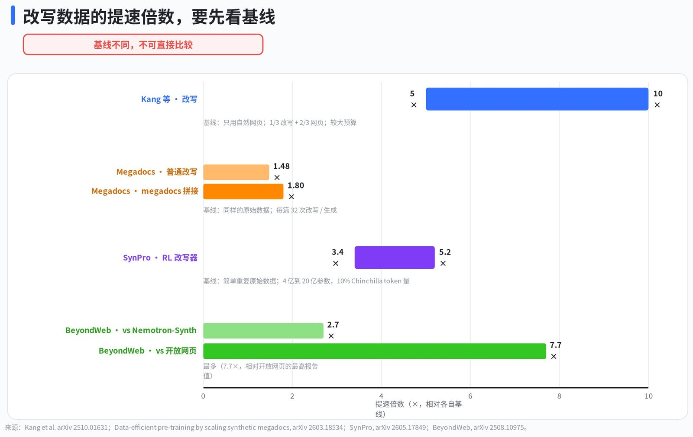

### 3.3 配比：混合，而不是替换

两项研究都发现纯合成数据不行。Kang 等发现只用改写数据并不比自然网页更快，只用教科书风格的生成数据损失明显更高，较好的改写占比收敛在 30% 左右[[3]](https://arxiv.org/abs/2510.01631)。FinePhrase 做了 333 组实验、覆盖 90 种改写配置，共 12.7 GPU 年：最佳总体配比是 70% 合成加 30% FineWeb-Edu-HQ；按格式分，数学 80%、表格 70%、FAQ 和教程 60%；纯合成“既不如 DCLM，也不如混合训练”[[29]](https://huggingfacefw-finephrase.hf.space/)。

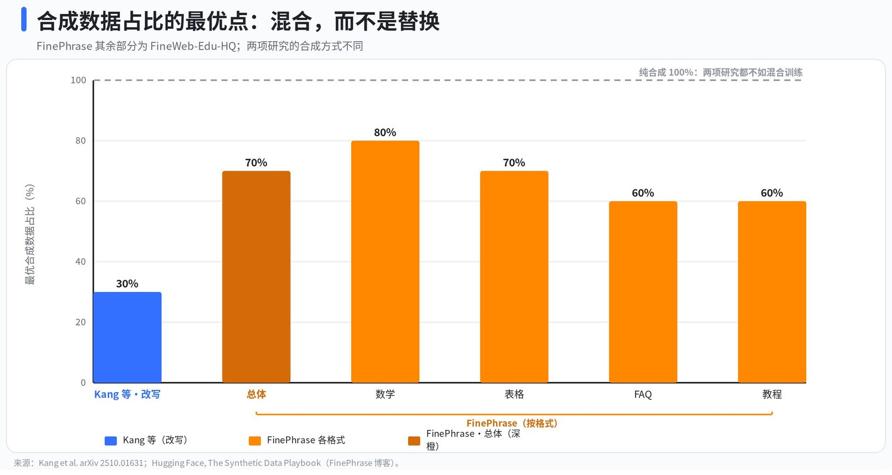

两组数字差距大，是因为合成方式和对照组不同：FinePhrase 的格式改写（表格、题目、FAQ）比同义转写离原文更远。在自己的数据上应从 30% 起步，按格式分别消融。

### 3.4 格式比数量重要，生成器不必大

OLMo 2 给了一个干净的例子[[30]](https://arxiv.org/abs/2501.00656)：7B 模型做小规模退火，基线 GSM\* 28.5、MMLU 59.8。加入用 Python 代码写解答的 TinyGSM 原始形式后，GSM\* 反而降到 25.0；同样内容按 MIND 风格改写成自然语言（TinyGSM-MIND）后升到 65.5，数据加倍到 70.0，MMLU 升到 62.1。报告给出的背景是，当时预训练混合里代码只占 2%。

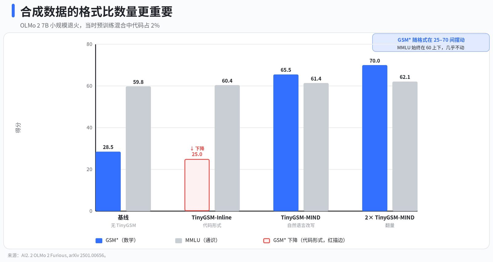

生成器大小的结论相反：FinePhrase 发现生成器超过 10 亿参数“没有额外收益”，最终用 SmolLM2-1.7B 生成了 4,860 亿 token，生成成本最多低 30 倍[[31]](https://arxiv.org/abs/2604.13977)；Kang 等也发现超过约 80 亿参数的生成器不一定更好[[3]](https://arxiv.org/abs/2510.01631)。这只适用于改写，因为信息来自原文；生成解题过程时教师强弱就很重要（第 4.2 节）。改写本身也有安全边界：Kang 等的实验里单轮改写没有崩溃迹象，纯生成的教科书风格数据则出现了类似崩溃的模式[[3]](https://arxiv.org/abs/2510.01631)；Kimi K2 每份语料最多改写两次[[14]](https://arxiv.org/abs/2507.20534)。

> 💡 **常见误区**：把“5–10 倍”“7.7 倍”“1.80 倍”放在一张图上比谁更好。它们的基线分别是自然网页、开放网页和同源原始数据，模型规模和预算也不同，引用时必须带上基线和规模。

📎 展开阅读：「训练工程」第 2 章（网页数据流水线与 DCLM 过滤器）和第 3.5 节（Nemotron-CC、Kimi K2 的改写消融）。

## 第 4 章 · 可验证合成：代码执行、数学验证器、工具与环境

可验证合成只有一条原则：用一个不依赖生成模型判断的外部信号决定样本去留，例如编译器和测试、标准答案、真实执行、环境状态。

📎 展开阅读：「推理模型与测试时计算」第 3 章（验证器的三种类型）和第 5 章（R1 蒸馏与强化学习的边界）。

### 4.1 代码：执行反馈是事实来源

Llama 3 的代码合成流水线产出约 100 万条对话[[2]](https://arxiv.org/abs/2407.21783)：

1. 从随机抽取的代码片段出发生成编程题，模型写解答。
2. 静态检查：解析器加代码检查工具。
3. 动态检查：模型为解答生成单元测试，在容器里执行。
4. 失败的解答连同报错交还模型自我修正，只保留全部通过的样本。

约 20% 的解答起初是错的，经自我修正后通过；而不经执行反馈、直接用 405B 模型自己生成的数据训练自己，“没有帮助，甚至会降低性能”[[2]](https://arxiv.org/abs/2407.21783)。SelfCodeAlign 全程只用同一个基座模型，在沙箱里跑测试只保留通过的样本，从 CodeQwen1.5-7B 得到 7.4 万对数据，HumanEval+ pass@1 达到 67.1，超过直接蒸馏 GPT-4o；作者的结论是基座模型从“与自身分布一致的数据”中获益更多[[32]](https://arxiv.org/abs/2410.24198)。

### 4.2 数学：答案校验和教师强弱

OpenMathInstruct-2 用 Llama 3.1 生成了 1,400 万条题解对（约 60 万道不同的题），Llama-3.1-8B-Base 的 MATH 从 51.9 提升到 67.8[[33]](https://arxiv.org/abs/2410.01560)。它的四个发现可以直接当设计原则：解答冗长反而伤害 SFT；强教师的数据胜过同规模的弱学生数据；SFT 对低质量解答相当鲁棒；题目多样性是数据规模收益的关键[[33]](https://arxiv.org/abs/2410.01560)。没有标准答案时退一步用多数投票：Phi-4 用多数投票为缺答案的题生成解答[[11]](https://arxiv.org/abs/2412.08905)；Llama 3 用结果奖励模型和逐步奖励模型过滤错误推理[[2]](https://arxiv.org/abs/2407.21783)。

### 4.3 指令遵循：生成验证代码

很多格式约束可以写成代码（“三段话”“全部小写”）。Qwen2.5 让模型同时生成指令、验证代码和单元测试，再按执行结果做拒绝采样[[34]](https://arxiv.org/abs/2412.15115)；Tülu 3 从 33 条可验证指令出发，覆盖 IFEval 的 25 类约束[[12]](https://arxiv.org/abs/2411.15124)。

### 4.4 工具调用与 Agent 轨迹

工具数据的难点在于：格式对了不代表语义对了，单轮对了不代表多轮对了。各家都把检验拆成多层：

| 工作 | 数据怎么来 | 怎么检验、结果 |
|---|---|---|
| APIGen | 3,673 个可执行 API，21 个类别[[35]](https://arxiv.org/abs/2406.18518) | 格式检查、真实执行、语义校验三级；1B 模型在 BFCL 上超过 GPT-3.5-Turbo |
| Toucan | 近 500 个真实 MCP 服务器，150 万条轨迹[[36]](https://arxiv.org/abs/2510.01179) | 规则加模型校验；BFCL V3 上超过更大的闭源模型 |
| Kimi K2 | 3,000 多个真实 MCP 工具加 2 万多个合成工具，工具模拟器带可控随机性[[14]](https://arxiv.org/abs/2507.20534) | 评委按任务评分标准只留成功轨迹；编程任务在真实沙箱跑测试 |

模拟环境的风险是 Agent 学会模拟器的漏洞，所以能接真实沙箱的任务（代码、SWE）都应以真实执行为准。

📎 展开阅读：「Agent 协议与工具链」第 2 章（MCP 的原语和传输）；「编程 Agent 实战」第 9 章（SWE-bench 类基准为什么不能直接拿来选型）。

> 🔑 **本章要点**：先建检验器，再扩数据量；检验要分格式、执行、语义三层；生成解题过程时教师强弱重要，做改写时生成器大小不重要，两条经验不要混用。

## 第 5 章 · 过滤与选择：评委、奖励模型、拒绝采样、数据选择

📎 延伸阅读：过滤除了管质量还要管投毒，几百篇投毒文档就够植入后门，见 [LLM-12｜工程｜LLM 安全与治理：应用侧的攻防与合规](./12-security-governance.md) 第 9 章。

不可验证的领域（写作、对话、开放问答）只能靠模型打分。结论是：单一打分器不可靠，生产配方都在组合多个信号；过滤的目标不只是去掉错的，更是留下多样且有难度的。

### 5.1 噪声能容忍到什么程度

Self-Instruct 对生成数据做了抽样审计：92% 的指令描述了有效任务，58% 的输出正确，指令、输入、输出全部有效的只有 54%[[17]](https://arxiv.org/abs/2212.10560)。接近一半的样本有错，这份数据仍让 GPT-3 提升了 33%。

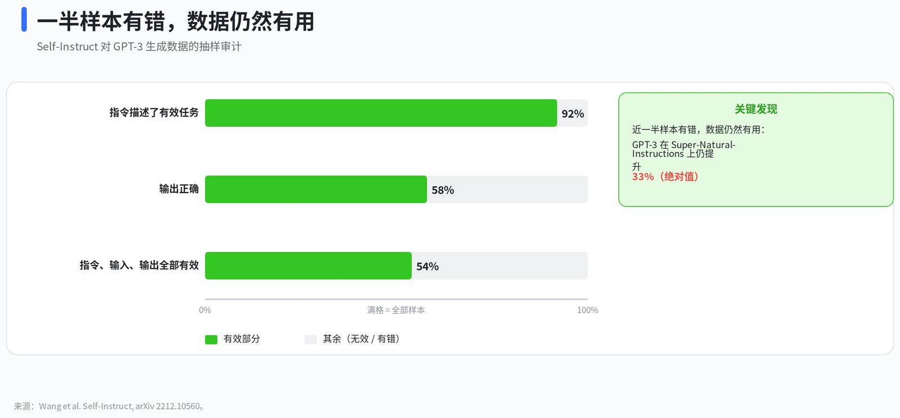

OpenMathInstruct-2 也发现 SFT 对低质量解答相当鲁棒[[33]](https://arxiv.org/abs/2410.01560)。但“能容忍”不等于“该保留”：DEITA 只用 6 千条精选数据就达到很好的效果（见 5.3 节）。噪声不会让 SFT 失效，但去掉噪声和冗余能用少得多的数据达到同样效果，所以先保多样性和难度，再追规模。

### 5.2 生产配方：怎么组合打分器

| 来源 | 做法 | 要点 |
|---|---|---|
| Llama 3 | 每个提示采样 10–30 个回答，奖励模型选最好的；质量判定取“奖励模型前 25%”或“Llama 评委满分”的并集[[2]](https://arxiv.org/abs/2407.21783) | 两者“分歧率很高”，取并集召回最好 |
| Nemotron-4 | 奖励模型打分，低于阈值丢弃[[1]](https://arxiv.org/abs/2406.11704) | 多属性回归奖励模型，更能把“有帮助”和“写得长”分开 |
| Qwen2.5 | 评论模型加多 Agent 打分[[34]](https://arxiv.org/abs/2412.15115) | 只留所有打分系统都认为无瑕疵的 |
| Qwen3 冷启动 | 删掉不可验证的、不用思维链就能答对的查询；删掉答案错、重复、猜测、思考与总结不一致、语言混杂、与验证集过于相似的回答[[37]](https://arxiv.org/abs/2505.09388) | 查询过滤和回答过滤分开做 |
| Llama 4 | 评委删掉 50% 以上的“简单”数据，Behemoth 删 95%[[38]](https://ai.meta.com/blog/llama-4-multimodal-intelligence/) | 模型越强，需要的简单数据越少 |

两点经验。取交集严、取并集召回好，看你更怕漏掉好样本还是混进坏样本。另外，打分器容易偏好长回答，过滤时要单独看长度：DeepSeek-V3 的消融里，在 V2.5 上加入 R1 生成的推理数据后 MATH-500 从 74.6 升到 83.2，平均长度也从 769 增加到 1,510[[13]](https://arxiv.org/abs/2412.19437)。

### 5.3 数据选择：从“过滤坏的”到“挑出有用的”

- <b>IFD（指令遵循难度）</b>：衡量指令对生成回答的帮助程度，只用 Alpaca 或 WizardLM 数据的 10% 就能得到更好的结果[[39]](https://arxiv.org/abs/2308.12032)。
- **DEITA**：按复杂度、质量、多样性三项选样，只用 6 千条 SFT 数据（少 10 倍以上），加 1 万条 DPO 数据后 MT-Bench 7.55、AlpacaEval 90.06%[[40]](https://arxiv.org/abs/2312.15685)。
- **LESS**：用低秩梯度相似度找出与目标任务最相关的样本，只选 5% 常常超过全量；小模型选出的数据可以给更大或其他家族的模型用[[41]](https://arxiv.org/abs/2402.04333)。

📎 展开阅读：「后训练实战」第 3.1、3.2 节（LIMA、LIMO 与“质量胜过数量”的证据）；「推理模型与测试时计算」第 4.5 节（s1 从 5.9 万道题里选 1,000 道）。

> 💡 **常见误区**：用同一个模型生成数据、当过滤评委、再当评测评委。三个角色至少分成两个不同家族，否则同源偏好会叠加（第 9.1 节）。
>
> 2026 年 11 月的受控训练证据给“挑数据”补了机理：163 个小 LM、五类实体与九个比较任务的实验显示，预训练数据统计量直接塑造具体能力的学习阶段，哪些比较先学会、哪些卡在后面都能从数据分布预测[74]。数据选择因此不只是去坏留好，还可以按目标能力的统计缺口定向补样。

## 第 6 章 · 去重与多样性：语义去重和多样性度量

合成数据的头号问题是“像”，错反倒其次：同一个生成器、同一套模板，产出的样本措辞和结构高度相似。字面去重只能删掉近乎逐字相同的样本，还需要按语义去重并度量多样性。

📎 展开阅读：「训练工程」第 2.1 节（FineWeb 的 MinHash 参数、快照内去重为什么优于全局去重）。

### 6.1 三档去重

- **字面级**：Self-Instruct 要求新指令 ROUGE-L 低于 0.7[[17]](https://arxiv.org/abs/2212.10560)；Persona Hub 用 MinHash（1-gram、128 维签名、阈值 0.9）[[24]](https://arxiv.org/abs/2406.20094)。成本最低，适合生成过程中实时去重。
- **嵌入级**：Persona Hub 再用嵌入余弦相似度 0.9 去重，看重多样性时建议降到 0.5[[24]](https://arxiv.org/abs/2406.20094)。0.9 只删近似复述，0.5 会删掉同一话题的不同问法。
- **聚类加排序**：Llama 3 先用 RoBERTa 对 SFT 对话聚类，簇内按“质量分 × 难度分”排序，再贪心保留与已保留样本最大余弦相似度低于阈值的样本[[2]](https://arxiv.org/abs/2407.21783)。删掉的总是同簇里质量和难度较低的那条。

### 6.2 语义去重的收益

SemDeDup 在嵌入空间聚类后删除簇内近似样本：在 LAION 上删掉 50% 的数据，效果损失很小，训练时间约减半，分布外表现反而提升；在 C4 上训练语言模型也有收益[[42]](https://arxiv.org/abs/2303.09540)。

### 6.3 怎么度量多样性

去重只能删，度量才能告诉你缺什么。Magpie 用嵌入空间里每个样本到最近邻的距离衡量多样性[[20]](https://arxiv.org/abs/2406.08464)。最实用的做法是给样本打意图、领域和难度标签，统计覆盖率，找出样本稀少的组合，回到第 2 章定向生成。OpenMathInstruct-2 的结论是这一步的理由：题目多样性是数据规模能否带来收益的关键[[33]](https://arxiv.org/abs/2410.01560)。

> 💡 **常见误区**：只在生成完成后去重一次。相似性来自模板和生成器本身，事后去重改变不了分布。正确的顺序是先看覆盖率缺口，再改种子、人设和模板，最后才是去重。

## 第 7 章 · 去污染：n-gram 不够用的地方

合成数据更容易污染评测集：生成器可能见过基准题，Evol 和改写还会把原题变成“换个说法的原题”。污染检查的基本流程见「后训练实战」第 2.4 节，基准层面的污染证据见「读懂模型基准与排行榜」第 6 章，这里讲各家的阈值和 n-gram 漏掉的那一类。

### 7.1 各家的方法和阈值

| 来源 | 方法 | 阈值与做法 |
|---|---|---|
| Tülu 3 | 只对提示做 8-gram 匹配[[12]](https://arxiv.org/abs/2411.15124) | 测试题超过 50% 的 token 与同一条训练样本 8-gram 匹配即判为重叠；训练集与任一评测重叠超过 2% 即判为被污染 |
| Phi-4 | 13-gram 加 7-gram 混合[[11]](https://arxiv.org/abs/2412.08905) | 覆盖 20 个基准；常见 13-gram 放入白名单，避免误删 |
| Qwen2.5 | 最长公共子序列（LCS）[[34]](https://arxiv.org/abs/2412.15115) | LCS 不少于 13 个 token 且不少于较短者长度的 0.6 倍即删除 |
| Cosmopedia | 10-gram 找候选，difflib 比对[[16]](https://huggingface.co/blog/cosmopedia) | 匹配长度占基准题长度超过 0.5 即丢弃 |
| Llama 3 | 预训练 8-gram 重叠分析[[2]](https://arxiv.org/abs/2407.21783) | MBPP、HumanEval、MMLU、MMLU-Pro 的污染分数高到无法估计污染带来的提升 |

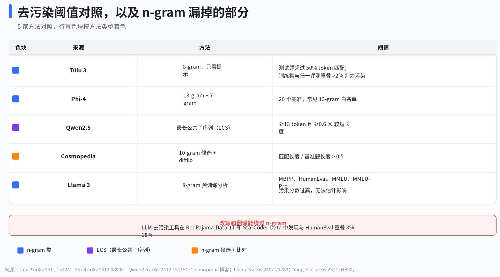

Llama 3 那一行说明 n-gram 会误报：它分不清“抄了原题”和“用了常用写法”[[2]](https://arxiv.org/abs/2407.21783)，Phi-4 的白名单就是为此。

### 7.2 改写污染：n-gram 看不见的那一类

LMSYS 的研究发现，把测试题改写或翻译后放进训练集，n-gram 去污染完全检测不到；一个 13B 模型在改写过的测试题上训练后，MMLU、GSM8K、HumanEval 能达到 GPT-4 水平[[43]](https://arxiv.org/abs/2311.04850)。他们用基于 LLM 判断的工具（llm-decontaminator）发现，RedPajama-Data-1T 和 StarCoder-Data 中与 HumanEval 的重叠达 8%–18%，GPT-3.5 和 GPT-4 生成的合成数据集里也有这类污染[[43]](https://arxiv.org/abs/2311.04850)。

直接改用嵌入相似度行不行？Tülu 3 试过整串匹配、n-gram 和嵌入三种，最终选了 8-gram，理由是嵌入匹配“很难区分单纯的分布相似和真正的改写”[[12]](https://arxiv.org/abs/2411.15124)。推荐的组合是：n-gram 做主过滤，嵌入只用来找候选，候选交给 LLM 判断，再人工抽检。

### 7.3 时间切分：最可靠的兜底

Phi-4 的报告承认 n-gram 去污染“不能应对所有情况，包括改写”，于是用数据收集完成后才发布的 2024 年 11 月 AMC-10 和 AMC-12 竞赛题做测试[[11]](https://arxiv.org/abs/2412.08905)。OLMo 2 的做法是开发纪律：GSM8K 的 1,319 道测试题只拿 200 道做开发决策[[30]](https://arxiv.org/abs/2501.00656)。

> 📌 **去污染清单**：
>
> - 对每个要报告的评测集单独跑，阈值写进数据卡。
> - n-gram 之后用嵌入找候选、LLM 判定、人工抽检，覆盖改写和翻译污染。
> - Evol、改写、回译的输出要重新去污染，不能只查种子。
> - 至少保留一个时间切分的新题集和一个从未用于开发决策的保留集。

## 第 8 章 · 模型崩溃与偏差放大：什么条件下真会坏

“合成数据会让模型崩溃”是最常被误读的结论。准确的说法是：用上一代模型的输出替换真实数据、一代代递归训练，会崩溃；保留真实数据并累积，或有可靠的验证器，基本可以避免，但验证器会成为天花板。另有一类与崩溃无关、更隐蔽的风险：偏差放大。

### 8.1 Shumailov 等（Nature 2024）：崩溃是怎么发生的

这篇论文发表于 2024-07-24，在变分自编码器、高斯混合模型和大语言模型上都观察到原始分布的尾部逐代消失[[44]](https://www.nature.com/articles/s41586-024-07566-y)。语言模型实验用 OPT-125m 在 wikitext2 上微调，生成数据训练下一代，重复 5 次运行。两种设置结果差别很大[[44]](https://www.nature.com/articles/s41586-024-07566-y)：不保留原始数据、每代训练 5 个 epoch，困惑度从 20 上升到 28；每代保留 10% 原始数据、训练 10 个 epoch，只有“轻微退化”。

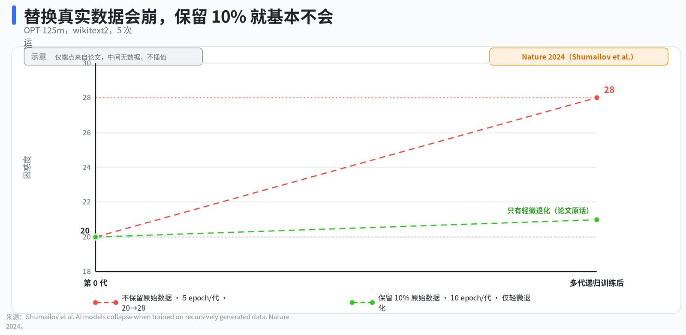

论文由此提出“先发优势”：真实的人类数据会越来越值钱[[44]](https://www.nature.com/articles/s41586-024-07566-y)。

### 8.2 替换会崩，累积基本不会

Gerstgrasser 等证明了关键区别：每一代用新合成数据替换旧数据会崩溃，把真实数据和历代合成数据累积起来就能避免；在线性模型上，累积时测试误差有一个与迭代次数无关的有限上界[[4]](https://arxiv.org/abs/2404.01413)。工业证据与此一致：Kang 等发现单轮改写数据没有退化[[3]](https://arxiv.org/abs/2510.01631)，Llama 3 发现没有执行反馈的自训练可能变差[[2]](https://arxiv.org/abs/2407.21783)。

### 8.3 验证器能挡住崩溃，但会变成天花板

2025-10 的一项研究发现，外部验证器能在短期内带来提升并防止崩溃，但长期来看模型会收敛到验证器的“知识中心”；除非验证器完全可靠，收益会进入平台期，甚至反转[[5]](https://arxiv.org/abs/2510.16657)。对多轮飞轮的含义是：验证器也要迭代升级，并持续用人工标注校准。

### 8.4 偏差放大：不崩溃也会变坏

Wang 等在 GPT-2 上做迭代合成训练，政治倾向会一致地向右偏移并逐代加强；即使用保留真实数据、累积数据等手段控制住了崩溃，偏差放大依然存在[[45]](https://arxiv.org/abs/2410.15234)。崩溃指标正常不代表数据没问题。

教师偏见会传给学生，有直接的工业证据：Nemotron 3 Nano 的报告写道，一些教师模型偶尔生成“隐含地与特定政治实体一致或宣扬民族主义叙事”的推理轨迹，NVIDIA 用关键词和正则过滤删掉了这类轨迹[[15]](https://arxiv.org/abs/2512.20848)。用多个教师模型时，每个教师都应单独做偏见抽检。

📎 展开阅读：「后训练实战」第 10.2 节（在窄领域合成数据上微调也可能出现的涌现失对齐）。

> 🔑 **本章要点**：永远保留真实数据，累积而不是替换；能验证的先过验证器，不能验证的控制比例和轮数；验证器也是上限，每轮用人工锚点重新校准；崩溃指标之外单独监控偏见和立场。

## 第 9 章 · 合成评测集：自己出题自己考的陷阱

📎 延伸阅读：用模型扮演用户做对话评测，同样有自己出题自己考的问题，模拟用户本身也要被测，见 [LLM-11｜工程｜LLM 应用评测与可观测：自建评测体系](./11-eval-observability.md) 第 6.5 节。

评测集决定哪个版本上线，所以合成评测集的偏差会直接变成错误的决策。LLM 评委本身的四种偏差和人工校准见「LLM 应用评测与可观测」第 4 章，改写变体之间的相关性如何放大误差见同一文档第 5.3 节。

### 9.1 偏好泄漏：生成器和评委是亲戚

偏好泄漏（preference leakage）指的是：用模型 A 生成数据训练学生，再用与 A 相关的模型当评委，学生的分数会被系统性抬高[[6]](https://arxiv.org/abs/2502.01534)。论文定义的偏好泄漏分数随亲缘关系递减：生成器与评委是同一个模型时平均 23.6%，同一系列或家族 8.9%，不同系列 2.8%；几种训练方式中 SFT 泄漏最严重。作者指出，这在 AlpacaEval 2.0 和 Arena-Hard 的常见用法里普遍存在[[6]](https://arxiv.org/abs/2502.01534)。

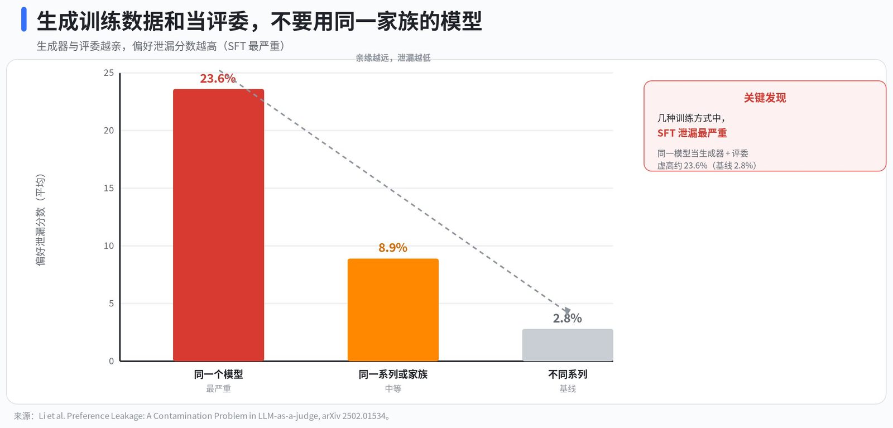

### 9.2 自出题偏差：LLM 当出题人

LLM 同时出题和打分时偏差会叠加：实验中每个模型都把自己排在首位，控制题目多样性只能部分缓解[[46]](https://arxiv.org/abs/2509.26600)。检索评测的证据更细：在 TREC DL 2023 上，系统在合成查询上的得分偏高（合成查询更容易），基于 GPT-4 的系统会被 GPT-4 生成的查询和标注偏爱；系统排名与人工集合的 Kendall τ 处于中到高水平，但这只是单一测试集合上的结论[[47]](https://arxiv.org/abs/2506.10301)。

### 9.3 经过验证的构造方法

- **答案交叉验证**：Persona Hub 让 3 个解答器独立作答，只保留至少 2 个一致的题，2 万道题剩下 1.16 万道[[24]](https://arxiv.org/abs/2406.20094)。约 42% 被删掉，合成题里解答无法达成一致的比例比多数人预想的高。
- **从真实日志里挖难题**：BenchBuilder 用 LLM 流水线从 Chatbot Arena 和 WildChat-1M 中自动挖掘难题，不需要人工参与；Arena-Hard-Auto 有 500 道题，区分度是 MT-Bench 的 3 倍，与人类偏好排名的相关性 98.6%，成本约 20 美元[[48]](https://arxiv.org/abs/2406.11939)。

📎 展开阅读：「LLM 应用评测与可观测」第 2.1 节（评测用例的六类来源与合成维度）；「RAG 与知识工程」第 8 章（RAG 评测集与指标）。

> 💡 **常见误区**：用同一系列模型生成训练数据、出评测题、当评委，然后报告“明显提升”。三个环节同源，提升里有多少是泄漏无法区分。最低要求是评委和出题模型与生成器不同家族，发布前用人工标注的保留集复核。

## 第 10 章 · 数据飞轮与隐私：从线上日志到训练集

📎 延伸阅读：日志进了训练集以后再想删，近似遗忘往往删不干净，删除能力要在训练前设计，见 [LLM-22｜地基｜后训练实战：SFT、LoRA 与 RLVR](./22-post-training.md) 第 10.5 节。

数据飞轮（data flywheel）指的是：上线的模型产生日志，日志经过筛选和标注变成下一轮训练数据，新模型再上线。本章讲训练侧的飞轮；评测侧的回流见「LLM 应用评测与可观测」第 6.4 和 7.4 节。

### 10.1 两个公开的飞轮

**Llama 3：模型在环的 6 轮迭代**。每一轮收集新的偏好标注和 SFT 数据，并从最新模型中采样合成数据[[2]](https://arxiv.org/abs/2407.21783)。早期模型产生的表情符号和感叹号过多等痕迹，用规则清洗掉[[2]](https://arxiv.org/abs/2407.21783)。

**Nemotron-4 340B：弱到强的迭代**。第一轮用许可宽松的 Mixtral-8x7B-Instruct-v0.1 当生成器，训练出的中间模型超过了 Mixtral；第二轮改用这个中间模型当生成器。报告的结论是“教师模型不会给学生模型设上限”，整个循环只用约 2 万条人工数据做锚点[[1]](https://arxiv.org/abs/2406.11704)。

真实日志的价值可以从 WildChat 看出：它在用户同意的前提下收集了 100 万段对话、超过 250 万轮，提示的多样性和语言数都超过同类数据集[[49]](https://arxiv.org/abs/2405.01470)，Tülu 3 的提示有一部分来自它[[12]](https://arxiv.org/abs/2411.15124)。

### 10.2 一条可落地的飞轮流程

把前面各章串起来，一轮飞轮可以拆成八步（本文综合，依据见对应章节）：

1. 采集日志，进入任何生成提示之前先脱敏；需要数学上的隐私保证时，改用 10.3 节的差分隐私合成。
2. 聚类，打意图、领域和难度标签（第 5.3、6.3 节）。
3. 错误分析，找出失败集中的簇。
4. 围绕失败簇定向合成（第 2 章）。
5. 验证器或奖励模型过滤（第 4、5 章）。
6. 对时间切分的保留评测集去污染（第 7 章）。
7. 训练，在影子流量或保留集上评测。
8. 人工标注作为固定锚点保留、每轮扩充，并用它校准验证器（第 8.3 节）。

📎 展开阅读：「LLM 应用评测与可观测」第 2.2 节（错误分析）和第 7.3 节（追踪内容的采集与隐私）；「LLM 安全与治理」第 4.4 节（输入侧与输出侧的脱敏）。

### 10.3 差分隐私合成：三条路线

📎 延伸阅读：原始语料里重复多的敏感内容最容易被逐字背下，去重和控制出现位置的做法见 [LLM-12｜工程｜LLM 安全与治理：应用侧的攻防与合规](./12-security-governance.md) 第 10 章。

当数据不能直接进入训练（医疗、金融、私信），可以用差分隐私（differential privacy，DP）生成合成数据再使用：

- **DP 微调生成器**：用 DP 方法微调预训练语言模型再生成，合成数据的效用可以与非隐私数据相当[[50]](https://arxiv.org/abs/2210.14348)。
- <b>Private Evolution（PE）</b>：只需要 API 访问、不训练模型；Aug-PE 在文本上与 DP 微调基线相当[[51]](https://arxiv.org/abs/2403.01749)。
- **DP 推理**：在推理时聚合多条各含一个敏感样本的并行提示的预测，不训练模型，适合快速生成少量样本[[52]](https://dpfy-your-data.github.io/slides.pdf)。

ICML 2025 的“DP-fy your DATA”教程给了选型对照[[52]](https://dpfy-your-data.github.io/slides.pdf)：

| 路线 | 建议的输入数据量 | 能生成多少 | 访问权限 |
|---|---|---|---|
| DP 微调 | 超过 1 万条 | 不限 | 模型权重 |
| Private Evolution | 少于 5 千条 | 不超过输入数据量 | API |
| DP 推理 | 不建议作为通用生成器 | 少量（原文“1k ~> 25 examples”） | logits |

教程的结论：DP 微调是“主力方法”，数据、算力、模型访问和工程投入都足够时质量最好；DP 推理最适合快速生成少量样本[[52]](https://dpfy-your-data.github.io/slides.pdf)。

> 💡 **常见误区**：把私有种子数据发给免费层 API。Gemini API 价格页写明免费层的输入会用于改进产品，付费层不会[[23]](https://ai.google.dev/gemini-api/docs/pricing)。脱敏和 DP 都要在数据离开自己的环境之前完成。

## 第 11 章 · 落地清单：工具链、成本与合规

### 11.1 工具链选型

开源工具分两层：一层编排生成（调模型、管提示、做校验），一层做语料级处理（去重、过滤、去污染）。版本信息核对于 2026-10-13，四个工具都是 Apache-2.0 许可。

| 工具 | 定位和已核实的功能 | 版本状态 |
|---|---|---|
| NeMo Data Designer（NVIDIA） | 按列声明式定义合成数据；内置 Python、SQL、远程和 LLM 评委校验器；先预览再修改；自动解决列依赖并重试[[53]](https://arxiv.org/abs/2609.17699) | v0.9.4（2026-10-05）；Nemotron 3 的 InfiniByte 数据用它构建[[15]](https://arxiv.org/abs/2512.20848) |
| distilabel（Argilla / Hugging Face） | 合成数据与 AI 反馈框架；可选 Ray 扩展、faiss 嵌入、MinHash 去重；多种模型后端[[54]](https://github.com/argilla-io/distilabel) | 最新发布 1.5.3（2025-01-28），仓库 2026-10 仍有提交 |
| NeMo Curator（NVIDIA） | 基于 GPU 和 Ray 的精确、模糊、子串、语义去重，分类、质量过滤；RedPajama-v2 子集的模糊去重从 CPU 上 10.7 小时降到 3 个 H100 节点上 0.65 小时[[55]](https://github.com/NVIDIA-NeMo/Curator) | v1.4.0（2026-10-09） |
| datatrove（Hugging Face） | 本地、Slurm、Ray 上的流水线；MinHash、句级和精确子串去重；去污染扩展；附带大规模改写示例 finephrase.py[[56]](https://github.com/huggingface/datatrove) | v0.10.1（2026-09-30） |

分工建议：生成编排用 Data Designer 或 distilabel；语料处理有 GPU 用 Curator，CPU 集群用 datatrove。

### 11.2 成本：按 2026-10 官网价格推算每百万条

以下是本文换算，不是厂商数据。假设三种负载：A 生成 SFT 样本，每条 500 个输入、700 个输出 token；B 评委打分，每条 1,200 个输入、100 个输出 token；C 长思维链，每条 500 个输入、8,000 个输出 token。公式：成本 = 输入百万 token 数 × 输入单价 + 输出百万 token 数 × 输出单价；思考 token 按输出计费[[23]](https://ai.google.dev/gemini-api/docs/pricing)；拒绝采样每题采 K 个候选时，A 和 C 乘以 K。截至 2026-10 的官网价格（美元每百万 token）[[21]](https://developers.openai.com/api/docs/pricing)[[22]](https://platform.claude.com/docs/en/about-claude/pricing)[[23]](https://ai.google.dev/gemini-api/docs/pricing)[[57]](https://api-docs.deepseek.com/quick_start/pricing)代入后：

| 模型（输入 / 输出单价） | A 标准价 | A 批量或错峰 | B 标准价 | C 标准价 |
|---|---|---|---|---|
| gpt-6-luna、Claude Haiku 5.5（0.10 / 0.50） | 400 美元 | 200 美元 | 170 美元 | 4,050 美元 |
| deepseek-flash（高峰 0.30 / 1.20，错峰减半） | 990 美元（高峰） | 495 美元（错峰） | 480 美元（高峰） | 4,875 美元（错峰） |
| gemini-3.8-flash（0.75 / 3.75，至 2026-12-31） | 3,000 美元 | 1,500 美元 | 1,275 美元 | 30,375 美元 |
| gpt-6.1-sol、Claude Sonnet 5.5（2 / 10） | 8,000 美元 | 4,000 美元 | 3,400 美元 | 81,000 美元 |
| Claude Opus 5.5（4 / 20） | 16,000 美元 | 8,000 美元 | 6,800 美元 | 162,000 美元 |

例如 gpt-6-luna 的 A 列：500 × 0.10 + 700 × 0.50 = 400 美元，批量价 0.05 / 0.25 得 200 美元。gemini-3.8-flash 的现价只到 2026-12-31；官网已公布 2027-01-01 起调为 1.50 / 7.50（批量 0.375 / 1.875 → 0.75 / 3.75），届时表中该行数字翻倍（本文换算）[[23]](https://ai.google.dev/gemini-api/docs/pricing)。自建参照：Magpie 折合每百万条 120 美元（8B）和 1,100 美元（70B），是 2024 年价格[[20]](https://arxiv.org/abs/2406.08464)；Cosmopedia 生成 250 亿 token 用了超过 1 万个 H100 GPU 小时[[16]](https://huggingface.co/blog/cosmopedia)。

结论：用小模型生成一百万条以内的 SFT 数据只要几百美元，生成很少是瓶颈；真正花钱的是前沿模型的长思维链加拒绝采样，K = 4–8 时是 C 列的 4–8 倍，达到十万到百万美元量级，而这类输出恰恰受条款限制最严。

### 11.3 条款与许可：2026 年的更新

本文不是法律意见。基础许可表（OpenAI、Anthropic 竞争条款，Llama 3.1 命名要求，DeepSeek-R1 的 MIT 许可）见「后训练实战」第 3.5 节，这里只补 2026 年的变化。以下要点截至 2026-10-13 条款原文。

- **OpenAI 使用条款**（2026-01-01 生效）：禁止“用输出开发与 OpenAI 竞争的模型”，也禁止自动化或程序化地提取数据或输出[[7]](https://openai.com/policies/terms-of-use)。
- **Gemini API 附加条款**（2026-03-23 生效）：不得用服务开发与 Gemini API 或 Google AI Studio 竞争的模型；不得提取或复制；搜索增强返回的结果不得用于训练[[8]](https://ai.google.dev/gemini-api/terms)。
- **Anthropic 商业条款**：不得访问服务来构建竞争产品，包括训练竞争的 AI 模型；输出归客户所有[[9]](https://www.anthropic.com/legal/commercial-terms)。

这些条款在执行。Anthropic 在 2026-02-23 披露：约 2.4 万个欺诈账号产生了超过 1,600 万次交互，点名 DeepSeek 超过 15 万次、Moonshot 超过 340 万次、MiniMax 超过 1,300 万次[[10]](https://www.anthropic.com/research/detecting-and-preventing-distillation-attacks)。这是厂商单方披露，但说明大规模蒸馏会被检测和归因。

开源模型限制最严的是命名和许可继承，“能不能用输出训练”反倒宽松：

| 模型家族 | 许可 | 用输出训练模型的条件 |
|---|---|---|
| Llama 4 | 社区许可（2025-04-05） | 训练并发布的模型名称须以“Llama”开头并显示“Built with Llama”；月活超过 7 亿需另行授权[[58]](https://github.com/meta-llama/llama-models/blob/main/models/llama4/LICENSE) |
| Gemma 1–3 等 | Gemma 使用条款（2026-04-01 修订） | 用 Gemma 合成数据训练的模型属于“模型衍生品”，要继承 Gemma 条款；输出本身不算衍生品[[59]](https://ai.google.dev/gemma/terms) |
| Gemma 4 | Apache 2.0 | 第一个使用 OSI 认可许可的 Gemma，无输出限制[[60]](https://opensource.googleblog.com/2026/03/gemma-4-expanding-the-gemmaverse-with-apache-20.html) |
| Qwen3 | Apache 2.0 | 无输出限制[[37]](https://arxiv.org/abs/2505.09388) |
| Nemotron | NVIDIA 开放模型许可 | 允许使用模型及其输出[[1]](https://arxiv.org/abs/2406.11704) |

要发布可再分发的合成数据集，优先选 Apache 或 MIT 许可的教师模型，并逐行记录教师和许可。Tülu 3 手工追踪每份数据的来源，因 HelpSteer2 含 ShareGPT 提示而将其剔除[[12]](https://arxiv.org/abs/2411.15124)。

版权方面（以美国为主）：D.C. 巡回上诉法院在 2025-03-18 的 Thaler v. Perlmutter 案中确认版权需要人类作者[[61]](https://media.cadc.uscourts.gov/opinions/docs/2025/03/23-5233.pdf)，最高法院在 2026-03-02 拒绝受理（No. 25-449）[[62]](https://www.supremecourt.gov/docket/docketfiles/html/public/25-449.html)。所以纯机器生成的合成数据集在美国主要靠合同和商业秘密保护，而不是版权。种子语料的来源同样有风险：Bartz v. Anthropic 案中，法院在 2025-06-23 认定用合法获得的书籍训练属于合理使用，但盗版库副本不能因此免责；2026-07-20 法院最终批准了 15 亿美元的和解，约每部作品 3,000 美元[[63]](https://www.anthropiccopyrightsettlement.com/documents)。风险从高到低依次是合同、版权、种子语料来源。

📎 展开阅读：「LLM 安全与治理」第 7 章（欧盟《人工智能法》和国内规定）。

### 11.4 上线清单

> 📌 - **来源**：教师模型条款允许当前用途；开源教师的命名和衍生条款已处理；种子语料来源合法。
> - **记录**：每行记录教师模型、提示模板、许可、过滤分数和生成时间。
> - **隐私**：日志进入生成提示前完成脱敏，必要时用 DP 合成；不用免费层 API 处理私有数据。
> - **检验**：能执行的都过执行检验；不能执行的至少两种打分器，并用人工样本校准。
> - **多样性**：实时去重加语义去重，统计标签覆盖率。
> - **去污染**：每个评测集跑 n-gram 加 LLM 复核；保留时间切分的新题集。
> - **真实数据**：累积而不替换；人工锚点集固定保留。
> - **评测**：生成器、过滤评委、评测评委不同源；结论在人工保留集上复核。

### 11.5 反模式

- **没有验证器的自训练**：Llama 3 的证据是没用甚至变差[[2]](https://arxiv.org/abs/2407.21783)。
- **用合成数据替换真实数据**：这是模型崩溃的标准触发条件[[4]](https://arxiv.org/abs/2404.01413)。
- **只做 n-gram 去污染**：改写和翻译的测试题能完全绕过[[43]](https://arxiv.org/abs/2311.04850)。
- **同源评测**：生成器即评委时，泄漏分数平均 23.6%[[6]](https://arxiv.org/abs/2502.01534)。
- **批量调用闭源前沿模型训练竞争模型**：违反条款，而且会被检测到[[10]](https://www.anthropic.com/research/detecting-and-preventing-distillation-attacks)。

## 第 12 章 · 数据墙：公开语料先被授权收紧，后被用完

前 11 章讲的是怎样造数据。这一章看合成数据要补的那个缺口：公开语料还够用多久。“数据墙”常被说成一个遥远的数量问题，Epoch 给的用尽时间是 2026 到 2032 年，中位数 2028 年 [[64]](https://arxiv.org/abs/2211.04325)。另一项审计给出了更近的一面：2023 年 4 月到 2024 年 4 月这一年里，C4 里最关键的那批网站有超过四分之一的 token 在 robots.txt 里对 AI 爬虫关了门 [[65]](https://arxiv.org/abs/2407.14933)。

第 12.1、12.3 节算数量墙和重复训练的账，第 12.2、12.5 节讲授权收紧和开放许可语料，第 12.4 节讲改写和过滤能多挤出多少数据，第 12.6 节接着本书第 8 章，讲生成数据为什么要累积，第 12.7 节是两张规划表和一段检查代码。文中的年限推算和有效数据换算按公开数字推出，假设写在正文里。

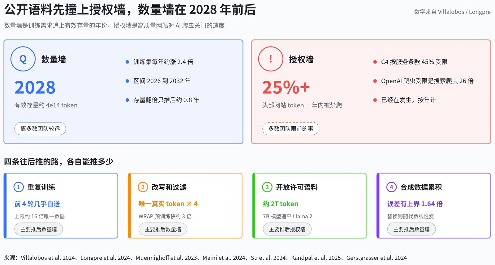

### 12.1 公开文本还剩多少

Epoch 的 Villalobos 等人分两头估计 [[64]](https://arxiv.org/abs/2211.04325)。一头是存量：互联网上人类写的公开文本，换算成 token 有多少。另一头是需求：知名模型的训练集按什么速度变大。两条线的交点就是公开文本被用完的年份。

#### 存量：三种口径差一个数量级

作者按三种口径估了存量，换算时取每 token 约 4 个字符、约 0.8 个英文单词 [[64]](https://arxiv.org/abs/2211.04325)：

| 口径 | 估计的 token 数（中位数） | 95% 区间 | 说明 |
|---|---|---|---|
| Common Crawl | 130T | 100T 到 260T | 公开爬虫快照，最常用的训练来源 |
| 被搜索引擎索引的网页 | 510T | 130T 到 2100T | 这一章后面的“存量”都指这个口径 |
| 整个网络 | 3100T | 1900T 到 5200T | 含社交平台等不对外公开的内容 |

整个网络一栏里大头是社交平台。作者按 Facebook、Instagram、Twitter、Reddit 的用户量和发帖量估了一个几何平均约 760T 的“深网”文本量，只敢说准到一个数量级 [[64]](https://arxiv.org/abs/2211.04325)。这部分内容在平台手里，爬虫拿不到，买也未必买得到，所以算不进公开存量。

#### 从原始存量到有效存量：两道折算

原始 token 数还要折两道才能拿来训练 [[64]](https://arxiv.org/abs/2211.04325)。第一道是质量：去重之后的网页里，按作者引用的过滤研究，只有 10% 到 40% 够得上训练标准。第二道是重复：同一份数据可以训多轮，多轮训练能把有效数据量放大 3 到 15 倍，常见做法是训 1 到 4 轮。两道折算下来，作者给出的有效存量约 4e14 token。

用一组示意数字把这两道折算串起来（作者按论文区间取的中间值，用来看量级）：

```math
D_{\text{eff}}=S\times q\times m\approx 510\text{T}\times 20\%\times 4\approx 4\times10^{14}\ \text{token}
```

其中 S 是索引网页存量，q 是可用比例，m 是重复带来的放大倍数。三个数各自的区间都很宽，乘起来区间更宽，这也是作者把结论写成“2026 到 2032 年”的原因。按 Chinchilla 每个参数约 20 个 token 的配比 [[73]](https://arxiv.org/abs/2203.15556)，4e14 token 够训一个约 20 万亿参数的模型，训练算力约 5e28 FLOP [[64]](https://arxiv.org/abs/2211.04325)。

#### 需求：每年约涨 2.4 倍

需求一侧，作者拟合了知名模型训练集规模的历史增长：中位数每年 0.38 个数量级，约合每年 2.4 倍，95% 区间是每年 0.27 到 0.48 个数量级 [[64]](https://arxiv.org/abs/2211.04325)。论文写作时最大的训练集在 10T 量级，Llama 3 用了 15T。存量本身每年只增长 0% 到 10%，相对需求可以看成不动。

有了起点和增速，用尽年份可以直接推出来。设起点训练集 D₀，每年增长 g 个数量级，追上有效存量所需的年数：

```math
t=\frac{\log_{10}(D_{\text{eff}}/D_0)}{g}=\frac{\log_{10}(4\times10^{14}/1.5\times10^{13})}{0.38}=\frac{1.43}{0.38}\approx 3.8\ \text{年}
```

从 2024 年的 15T 起算，3.8 年落在 2028 年前后，和论文的中位数一致。把增速换成区间的两端，0.48 对应约 3 年，0.27 对应约 5.3 年。这个算法也说明了一件事：存量估计翻一倍，用尽年份只往后推 log₁₀2 / 0.38 ≈ 0.8 年。存量的不确定性很大，但对年份的影响被对数压小了，增速才是主要变量。

#### 过度训练会让墙提前

上面的推算假设模型按算力最优的比例训练。实际做法常常是用远多于最优比例的数据训小模型，换推理时更便宜。Llama 3 8B 用了 15T token，按 Chinchilla 的 20 倍算是接近 100 倍的过度训练，Llama 3 70B 约 10 倍 [[64]](https://arxiv.org/abs/2211.04325)[[73]](https://arxiv.org/abs/2203.15556)。作者估计，如果模型普遍过度训练 5 倍，用尽时间会提前一到两年 [[64]](https://arxiv.org/abs/2211.04325)。

作者讨论了几种绕开的办法：合成数据、从数据丰富的领域迁移（比如代码和多模态）、使用非公开数据 [[64]](https://arxiv.org/abs/2211.04325)。这几条路后面几节分别会讲到，它们各自能推后多少、要付什么代价。

落到团队上，大多数团队不训基座，数量墙离得远。要关心的是自己领域的语料：把要用的领域文本按来源列出来，估总量和每年新增量，用上面的公式看计划中的继续预训练会在哪一年碰到天花板。领域语料的增速通常远低于训练需求，天花板来得比公开网页早。

### 12.2 授权收紧比用尽来得早

第 12.1 节的存量估计有一个隐含假设：能爬到就能用。Longpre 等人的审计专门检查了这个假设 [[65]](https://arxiv.org/abs/2407.14933)。他们从 C4、RefinedWeb、Dolma 三个常用语料里取网站：每个语料贡献 token 最多的 2000 个域名合起来约 3950 个，作为头部样本，再随机抽 1 万个域名。然后用 Wayback Machine 调出这些网站历年的 robots.txt 和服务条款，看它们对 AI 爬虫的态度怎么变。

#### 一年之内，头部网站四分之一关门

2023 年 4 月到 2024 年 4 月，三个语料全部 token 里约 5% 以上变成 robots.txt 完全禁止爬取，头部关键网站里这个比例约 25% 以上，C4 的关键来源超过 28%。按服务条款算，C4 有 45% 已被限制 [[65]](https://arxiv.org/abs/2407.14933)。作者用 SARIMA 时间序列模型往后外推一年：到 2025 年 4 月，全量语料还会再多 2% 到 4% 的 token 被 robots.txt 完全限制，头部网站再多 7% 到 11% [[65]](https://arxiv.org/abs/2407.14933)。

限制集中在头部，这一点比总量更要紧。下表是不同排名区间里有限制性 robots.txt、限制性服务条款和付费墙的网站比例：

| 网站排名区间 | 限制性 robots.txt | 限制性服务条款 | 付费墙 |
|---|---|---|---|
| 前 100 | 38.4% | 64.1% | 31.8% |
| 前 500 | 35.0% | 61.0% | 31.3% |
| 前 2000 | 26.5% | 51.2% | 24.6% |
| 随机抽样 | 3.4% | 15.7% | 1.6% |

头部以新闻、百科和社交媒体为主，尾部是机构网站、博客和电商 [[65]](https://arxiv.org/abs/2407.14933)。头部正是质量最高、最常被拿来训练的那部分。第 12.1 节的质量折算 q 只有 10% 到 40%，被关门的恰好是 q 最高的那批来源。按 token 算的 5% 看着不大，按质量加权算，损失要大得多。

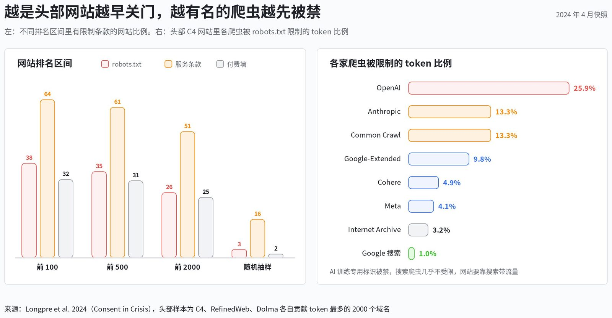

#### 各家爬虫待遇差得很远

同一个网站，对不同公司的爬虫态度不一样。在头部 C4 网站里，被限制的 token 比例按爬虫分：OpenAI 25.9%，Anthropic 和 Common Crawl 各 13.3%，Google-Extended 9.8%，Cohere 4.9%，Meta 4.1%，Internet Archive 3.2%，Google 搜索爬虫 1.0% [[65]](https://arxiv.org/abs/2407.14933)。

这组数字有两层含义。第一层是先发者吃亏：最早被大众知道的爬虫最早被写进黑名单，新出现的爬虫名在一段时间内反而能爬。第二层是搜索爬虫几乎不受限：网站要靠搜索带流量，不敢禁 Google 搜索，只禁 Google-Extended 这个专门用于 AI 训练的标识。这让“同一份网页数据能不能用”变成一个跟公司、跟爬虫名都有关的问题。

#### 授权信号本身很混乱

审计发现了几类常见的矛盾 [[65]](https://arxiv.org/abs/2407.14933)。有的网站只禁了部分 AI 爬虫。有的写错了爬虫名字，或者写了一个根本不存在的爬虫，规则形同虚设。最常见的是 robots.txt 和服务条款说法不一：robots.txt 允许爬取，服务条款里禁止用于训练 AI。robots.txt 是给机器读的，服务条款是给律师读的，两者冲突时以哪个为准，目前没有统一答案。

作者还发现，网页数据的内容分布和人们实际拿对话式 AI 做的事对不上。对比真实用户对话日志，超过 30% 的对话是创意写作或角色扮演，这类内容在网页语料里占比很低 [[65]](https://arxiv.org/abs/2407.14933)。授权收紧会让这种错位更明显：被关门的新闻和百科是知识类内容，剩下的长尾网站离用户的实际用法更远。

#### 对数据计划的两个影响

已经下载的历史快照仍在，但后续更新会越来越少，语料慢慢变旧。一个用 2023 年快照训练的模型，对 2025 年以后的新闻、新术语、新产品知道得越来越少，只能靠授权采购或检索增强补。另一个影响是逐来源判断：同一份网页数据，在不同公司、不同用途、不同抓取时间下能不能用，答案可能不一样。

落到团队上，给训练语料的每个来源记一条授权信息：抓取时间、当时 robots.txt 对各个 AI 爬虫的状态、服务条款里有没有 AI 相关条款。新抓取的数据按抓取当时的状态过滤，存量数据定期复核一次。robots.txt 只是信号的一部分，具体能不能用交给法务判断。

### 12.3 重复训练的账

数据不够时，最直接的办法是把已有的数据多训几轮。Muennighoff 等人跑了 400 次训练，最大到 9B 参数、9000 亿训练 token，系统地改变数据重复次数和算力预算 [[66]](https://arxiv.org/abs/2305.16264)。结论是：数据受限、算力固定时，同一份数据训到 4 轮，损失和用全新数据相比几乎没有差别。下游任务上也一样，训 4 轮（唯一数据只占总预算的 25%）和全用新数据的差异不显著。重复再多，收益衰减得很快。

#### 有效数据量公式

作者把“重复的数据值多少新数据”写成了一个指数衰减公式 [[66]](https://arxiv.org/abs/2305.16264)。设唯一数据 U_D 个 token，重复 R_D 次（训 R_D + 1 轮），折合的有效数据量：

```math
D'=U_D+U_D\,R_D^{*}\left(1-e^{-R_D/R_D^{*}}\right),\qquad R_D^{*}\approx 15
```

R_D\* 可以理解成重复价值的“半衰期”：重复到第 R_D\* 次时，新增的那一轮只剩 1/e 的价值。作者拟合出 R_D\* ≈ 15，对应 15 次重复、16 轮训练 [[66]](https://arxiv.org/abs/2305.16264)。R_D 趋于无穷时，D′ 的上限是 U_D(1 + R_D\*) ≈ 16 U_D，也就是说一份数据无论训多少轮，最多顶 16 份新数据。这和 Villalobos 引用的“多轮训练放大 3 到 15 倍”是同一个来源 [[64]](https://arxiv.org/abs/2211.04325)。

把公式代几个数（作者按 R_D\* = 15 计算）：

| 训练轮数 | 折合有效数据 | 每 token 的平均价值 | 含义 |
|---|---|---|---|
| 2 轮 | 1.97 U | 98% | 几乎等于新数据 |
| 4 轮 | 3.72 U | 93% | 论文说的“几乎没有差别” |
| 8 轮 | 6.59 U | 82% | 开始明显打折 |
| 16 轮 | 10.48 U | 66% | 到了半衰期 |
| 无穷轮 | 16 U | 趋于 0 | 上限 |

反过来算更实用：想让有效数据达到唯一数据的 x 倍，需要训多少轮？解出来是 1 − 15 ln(1 − (x − 1)/15) 轮。要 4 倍需要约 4.4 轮，要 8 倍需要约 10.4 轮，要 12 倍需要约 21 轮。最后几倍的代价是成倍增长的算力。

#### 算力怎么分：多训几轮，模型别太大

数据受限时，算力在参数和训练轮数之间怎么分？作者给参数一侧也拟合了一个衰减常数 R_N\* ≈ 5.3，比数据一侧的 15 小得多 [[66]](https://arxiv.org/abs/2305.16264)。含义是：超过算力最优规模的多余参数贬值得比重复数据快。数据不够时，应该让训练轮数增长得比参数快，也就是训小一点的模型、训久一点。

论文还测了两种补数据的办法 [[66]](https://arxiv.org/abs/2305.16264)。在自然语言数据里掺最多 50% 的 Python 代码，自然语言任务上看不到退化，相当于有效 token 翻倍。按困惑度过滤掉低质量文本有帮助。去重对下游任务没有帮助，但可能减少模型对训练数据的背诵，这一点和 [LLM-12｜工程｜LLM 安全与治理：应用侧的攻防与合规](./12-security-governance.md) 第 10 章讲的重复次数决定背诵是同一件事。

落到团队上，领域语料不够时，先把高质量部分重复 2 到 4 轮，这个区间几乎是白送的。超过 4 轮，用上面的公式算一下新增一轮还值多少，再和改写、采购新数据的成本比。重复训练时注意背诵风险：轮数越多，模型越容易逐字背出语料，敏感内容要先去掉。

### 12.4 改写和过滤从同一批网页里多挤数据

重复只能用已有的数据。另一条路是把已有网页加工一遍，让同一批原文产出更多可用的训练 token。这里有两个方向：用模型改写原文，或者把过滤做得更细，少扔掉一些能用的数据。

#### WRAP：改写成维基和问答风格

Maini 等人的 WRAP 用现成的指令模型把网页改写成特定风格，比如“像维基百科那样”或“问答格式”，再和原始网页一起预训练 [[25]](https://arxiv.org/abs/2401.16380)。在噪声较多的 C4 上，预训练速度约快 3 倍。同样的算力预算下，Pile 各子集上的困惑度平均改善 10% 以上，13 个任务的零样本问答准确率提高 2% 以上 [[25]](https://arxiv.org/abs/2401.16380)。

作者把收益归因于两点：改写后的风格更接近下游评测的风格，改写文本的质量比原始网页更高 [[25]](https://arxiv.org/abs/2401.16380)。前一点值得警惕，问答格式的预训练数据会让问答类评测分数好看，这部分收益在真实使用中未必兑现。和原始网页一起训是必要的，只用改写数据会丢掉网页原有的多样性。

#### Nemotron-CC：过滤少扔，改写补差

主流的过滤数据集为了追求质量扔得很狠。DCLM 和 FineWeb-Edu 的模型过滤会去掉约 90% 的数据 [[67]](https://arxiv.org/abs/2412.02595)。这对短训练有利，对要训 15T token 的长训练不利：留下的唯一数据太少，只能多轮重复，撞上第 12.3 节的衰减。

Nemotron-CC 换了一个思路 [[67]](https://arxiv.org/abs/2412.02595)。他们用多个质量分类器做集成打分，把数据分成多个质量档，不再只有保留和扔掉两种处理。高质量档用模型生成多种改写变体，增加多样性，低质量档用模型改写成更干净的文本，挽救其中的信息。最后从 99 个 Common Crawl 快照里得到 6.3T token：4.4T 全局去重后的真实 token，加 1.9T 合成 token。唯一真实 token 比 DCLM 和 FineWeb-Edu 多约 4 倍。

| 对比 | 结果 | 说明 |
|---|---|---|
| 高质量子集 vs DCLM，1T token | MMLU +5.6 | 短训练下质量不输最狠的过滤 |
| 8B 模型 15T token vs Llama 3.1 8B | MMLU +5，ARC-C +3.1，平均 +0.5 | 其中 7.2T 来自 Nemotron-CC |
| 低质量数据改写 | 平均 +1.50 | 改写能挽救被扔掉的数据 |
| 8 轮高质量数据里换 4 轮为合成数据 | 多数基准提升 | 合成变体比原样重复更值 |

最后一行和第 12.3 节连起来看很有意思 [[67]](https://arxiv.org/abs/2412.02595)。高质量数据训 8 轮已经进入明显打折的区间（每 token 平均价值约 82%），把其中一半换成改写变体，相当于用改写给重复的数据“换皮”，绕开了一部分重复衰减。

#### 改写对授权墙帮助有限

改写和过滤在数量墙前面都有用，对授权墙帮助有限。改写的原文仍然来自网页，原文能不能用的问题不会因为改写而消失。Common Pile 的作者正是因为这个原因，在开放许可语料里没有收任何 LLM 生成的合成数据：生成模型本身用什么数据训练的说不清，它的输出的许可状态也就说不清 [[68]](https://arxiv.org/abs/2506.05209)。

落到团队上，领域语料重复到 4 轮以后，可以用模型把高质量部分改写成问答、教科书或摘要风格扩充。改写数据和原始数据一起训，记下两者的比例和改写用的模型版本，方便之后调整。改写的原文来源和原始数据一样要记授权信息。

### 12.5 开放许可语料

授权墙的另一条绕法是只用明确允许训练的数据：公有领域的作品、开放许可（比如 CC BY、CC0、MIT）发布的文本。这条路的问题是规模，以及许可证本身的可靠性。

#### Common Pile：8TB 能训出什么

Kandpal 等人收集了 Common Pile v0.1：8TB 公有领域和开放许可文本，来自 30 个来源，包括科研论文、代码、书籍、百科、教育资源和政府文件 [[68]](https://arxiv.org/abs/2506.05209)。他们在上面训了两个 7B 模型 Comma v0.1-1T 和 Comma v0.1-2T，分别训 1T 和 2T token。和用同样资源（7B 参数、1T 或 2T token）训练、但用了未授权数据的模型比，Comma 和 Llama 1、Llama 2 的 7B 相当 [[68]](https://arxiv.org/abs/2506.05209)。

混合配比时，作者按每个来源单独训小模型的效果给来源加减权重，目标是在 1T token 的训练里每个来源最多重复 6 次 [[68]](https://arxiv.org/abs/2506.05209)。按第 12.3 节的公式，6 轮的每 token 平均价值约 88%，还在划算区间里。这也说明了开放许可语料的规模：8TB 文本约 2T token 量级，要训 1T token 已经需要一部分来源重复多轮。

另一个规模参照是 Common Corpus：约 2T token 的无版权或开放许可数据，以多语种和公有领域文本为主 [[69]](https://arxiv.org/abs/2506.01732)。两者加起来，和第 12.1 节 510T 的索引网页存量差两个数量级，和 Llama 3 的 15T 也差一个数量级。开放许可语料够训一个可用的中小模型，离前沿规模还远。

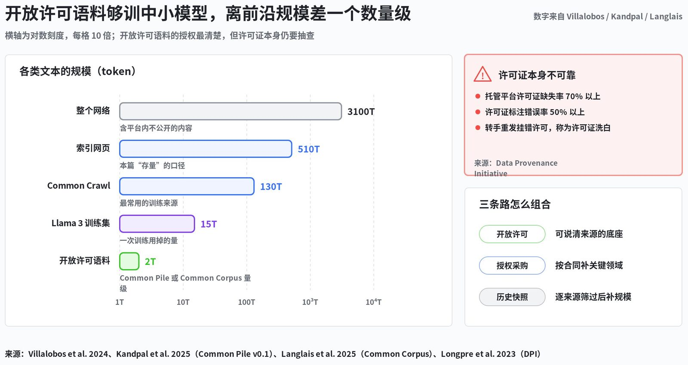

#### 许可证本身也不可靠

开放许可语料最大的坑是许可证被人转手改写。Common Pile 的作者称之为许可证洗白：不是版权方的人把受版权保护的作品重新发布，并挂上一个错误的开放许可 [[68]](https://arxiv.org/abs/2506.05209)。为了避开这类数据，他们排除了几个看起来开放的来源，YouTube 字幕只收人工挑过的 2000 多个原创开放许可频道。

数据集层面的许可证问题更普遍。Data Provenance Initiative 审计了 1800 多个文本数据集，发现在 GitHub、Hugging Face 等常用托管平台上，许可证缺失率超过 70%，标注错误率超过 50% [[70]](https://arxiv.org/abs/2310.16787)。一个数据集页面上写着 MIT，不代表里面的每条数据都是 MIT，数据集作者可能根本没有权利给原始内容授权。

#### 三条路的取舍

| 路径 | 规模 | 授权确定性 | 主要代价 |
|---|---|---|---|
| 历史网页快照 | 百 T 级，不再增长 | 低，抓取时状态各异 | 越来越旧，需逐来源复核 |
| 开放许可语料 | 约 2T 级 | 较高，仍需防洗白 | 规模小，领域偏学术和代码 |
| 授权采购 | 按合同 | 高 | 成本高，覆盖面看谈判 |

三条路通常要组合起来用。开放许可语料和授权采购的数据作为可以公开说清来源的底座，历史网页快照按逐来源的授权状态筛过后补充规模。负责合规的人要能对每一类数据回答“从哪来、凭什么能用”。

落到团队上，引入开放许可数据集时，别只看数据集页面的许可证字段。抽样检查原始来源，确认发布者是不是版权方。数据集里混了 LLM 生成内容的，单独标记，许可状态按“未知”处理。

### 12.6 生成数据要累积，别替换

公开语料收紧的同时，网上由模型生成的文本越来越多。新爬的网页里混着生成文本，不管团队愿不愿意，下一代模型都会在一定程度上用上一代模型的输出训练。Shumailov 等人指出，用模型生成的内容训练下一代模型，会造成不可逆的缺陷：原始分布的尾部会消失，几代之后模型输出收窄到高频内容，他们称之为模型崩塌 [[71]](https://arxiv.org/abs/2305.17493)。作者的推论是，真实人类交互产生的数据会越来越值钱 [[71]](https://arxiv.org/abs/2305.17493)。

#### 替换和累积：误差一个线性增长，一个有上界

Gerstgrasser 等人补上了关键条件 [[4]](https://arxiv.org/abs/2404.01413)。早期研究大多假设每一代都用新生成的数据替换旧数据。他们在语言模型预训练上验证：替换确实会走向崩塌，把各代生成的数据和原始真实数据累积在一起训练，就能避开崩塌，结论在不同模型规模、架构和超参数下都成立。

在一个可解析的线性回归框架里，他们推出了两种做法的测试误差 [[4]](https://arxiv.org/abs/2404.01413)。设特征维度 d，每代样本数 T，噪声方差 σ²，第 n 代模型的测试误差：

```math
E^{\text{Replace}}_n=\frac{\sigma^2 d}{T-d-1}\times n,\qquad E^{\text{Accum}}_n=\frac{\sigma^2 d}{T-d-1}\sum_{i=1}^{n}\frac{1}{i^2}\le\frac{\sigma^2 d}{T-d-1}\cdot\frac{\pi^2}{6}
```

替换时，每一代都在上一代的误差上叠加一份新误差，误差随代数线性增长。累积时，第 i 代的数据只占总数据的 1/i，它带进来的误差按 1/i² 被稀释，求和收敛到 π²/6 ≈ 1.64 倍。代几个数（作者按公式计算）：到第 10 代，替换的误差是第 1 代的 10 倍，累积只有约 1.55 倍。

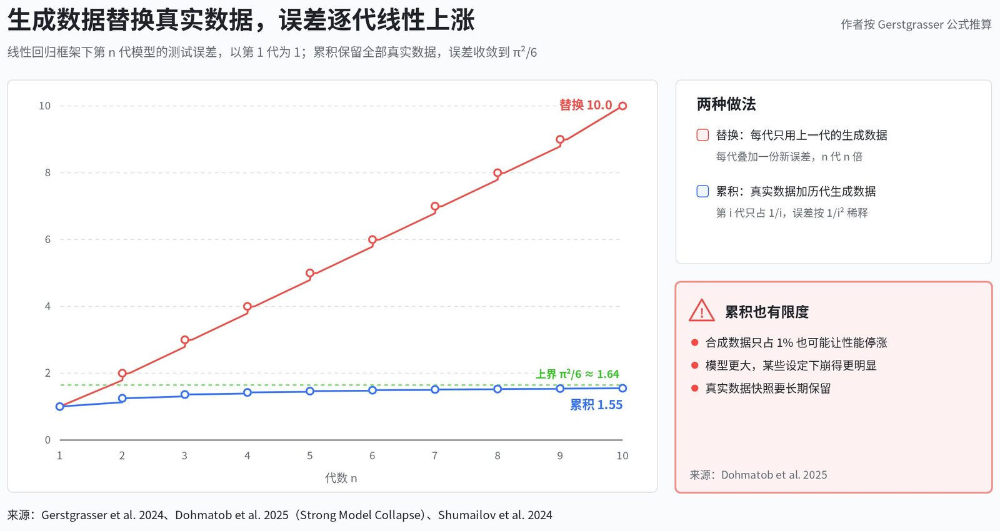

#### 累积也不是万能的

Dohmatob 等人的 Strong Model Collapse 给累积加了一条限制 [[72]](https://arxiv.org/abs/2410.04840)。在他们分析的回归设定里，训练数据中哪怕只有 1% 是合成数据，也可能导致崩塌：训练集再大，性能也不再提升。更大的模型在某些情况下会放大这种崩塌。两篇论文的设定不同，Gerstgrasser 关心的是误差会不会无限增长，Dohmatob 关心的是合成数据会不会让模型停在一个比只用真实数据更差的位置。合在一起读：累积能防止误差失控，但合成数据带来的偏差不会因为数据量变大而自动消失。

这对数据计划的含义很直接。真实数据的历史快照是稀缺资产，要长期保留，不能被新版本覆盖。合成数据要标记来源、单独存放，训练时按比例混合，比例要能调。本书第 5 章讲过合成数据怎么过滤，第 8 章讲过模型崩溃在什么条件下发生，这里只取它们对数据计划的含义。

#### 按时间切出“生成文本泛滥之前”

网页数据里的生成文本没法逐条识别，但可以按抓取时间粗略切分。大规模生成文本出现在网上是 2022 年底以后的事，在那之前抓取的快照，生成文本占比可以忽略。新抓的网页数据记下抓取时间，日后就能按时间切出比较干净的部分，在评估模型崩塌风险时当对照组。

落到团队上，历史语料快照长期保留，按抓取时间命名，别被新版本覆盖。合成数据和真实数据分开存、分开标，记下生成用的模型和提示。训练配比里给真实数据留一个下限，每次加大合成数据比例前，先在一个小模型上对比尾部指标（比如长尾知识问答、罕见实体的准确率）有没有变差。

### 12.7 规划清单：给数据计划加两张表

把前六节收拢，团队的数据计划除了“有多少”，还要能回答“能不能用”和“哪些是真的”。下面这张表按问题列出要记什么：

| 问题 | 记什么 | 依据 |
|---|---|---|
| 量够不够 | 领域语料总量、年新增量、计划的训练 token 数，按第 12.1 节公式算碰顶年份 | [[64]](https://arxiv.org/abs/2211.04325)[[73]](https://arxiv.org/abs/2203.15556)<br>[74] Chan et al. Pretraining Data Statistics Shape the Phases of Learning Entity Comparison in Language Models (2026-11) [https://arxiv.org/abs/2611.16882](https://arxiv.org/abs/2611.16882)<br>[75] Banerjee et al. Human or Synthetic? What a Fixed Budget Buys for Post-Training (2026-11) [https://arxiv.org/abs/2611.16895](https://arxiv.org/abs/2611.16895)<br>[76] Hou et al. Rethinking “RL Generalizes, SFT Memorizes”: The Role of SFT Data (2026-11) [https://arxiv.org/abs/2611.14912](https://arxiv.org/abs/2611.14912) |
| 能不能用 | 每个来源的抓取时间、各 AI 爬虫的 robots.txt 状态、服务条款摘要、许可证及其核验结果 | [[65]](https://arxiv.org/abs/2407.14933)[[70]](https://arxiv.org/abs/2310.16787)[[68]](https://arxiv.org/abs/2506.05209) |
| 哪些是真的 | 真实数据和生成数据分开标记，记下生成模型，历史快照按抓取时间保留 | [[71]](https://arxiv.org/abs/2305.17493)[[4]](https://arxiv.org/abs/2404.01413)[[72]](https://arxiv.org/abs/2410.04840) |
| 不够怎么办 | 先重复 2 到 4 轮，再改写扩充，再考虑开放许可或采购，记下各部分比例 | [[66]](https://arxiv.org/abs/2305.16264)[[25]](https://arxiv.org/abs/2401.16380)[[67]](https://arxiv.org/abs/2412.02595) |

第二张表是来源清单本身，每个来源一行：域名或数据集名、抓取时间、robots.txt 状态、服务条款摘要、许可证、是否合成、token 数、用在哪次训练里。这张表不用很复杂，关键是从第一天就记，事后补记的成本远高于随手记。

下面的代码对应两张表里的两个动作。check_robots 按几个常见 AI 爬虫的名字检查一个来源的 robots.txt，结果和抓取日期一起存下来。effective_tokens 按第 12.3 节的公式算重复训练的有效数据量，plan 把重复上限设为 4 轮，算出还缺多少 token 要靠改写或新来源补。

*
*

```python
import mathimport urllib.robotparser as rpAI_AGENTS = ["GPTBot", "CCBot", "ClaudeBot", "Google-Extended"]   # 按需补充class Source:    def __init__(self, domain, fetched, synthetic=False, license="unknown"):        self.domain = domain        # 来源域名        self.fetched = fetched      # 抓取日期        self.synthetic = synthetic  # 是否为模型生成        self.license = license      # 开放许可 / 购买授权 / 未知        self.robots = {}def check_robots(src, robots_txt):    p = rp.RobotFileParser()    p.parse(robots_txt.splitlines())    src.robots = {a: p.can_fetch(a, "https://" + src.domain + "/") for a in AI_AGENTS}    return src# Muennighoff 等人的重复衰减：唯一数据 U 训练 E 轮，折合的有效数据量def effective_tokens(unique, epochs, r_star=15.0):    r = max(epochs - 1, 0)    return unique + unique * r_star * (1 - math.exp(-r / r_star))def plan(unique, target, r_star=15.0, max_epochs=4):    epochs = min(target / unique, max_epochs)    eff = effective_tokens(unique, epochs, r_star)    gap = max(0.0, target - eff)          # 还要靠改写或新来源补的部分    return round(epochs, 2), round(eff / 1e9, 1), round(gap / 1e9, 1)s = check_robots(Source("example.org", "2026-06-01"), "User-agent: GPTBot\nDisallow: /\n")print(s.robots)print(plan(unique=20e9, target=100e9))for ep in (2, 4, 8, 16):    print(ep, round(effective_tokens(1.0, ep), 2))# {'GPTBot': False, 'CCBot': True, 'ClaudeBot': True, 'Google-Extended': True}# (4, 74.4, 25.6)   重复 4 轮折合 744 亿有效 token，还缺 256 亿# 2 1.97 / 4 3.72 / 8 6.59 / 16 10.48
```

示例里唯一数据 200 亿 token，计划训 1000 亿。重复 4 轮折合 744 亿有效 token，按第 12.3 节的折算比直接乘 4 少了约 56 亿，还缺约 256 亿要靠改写或新来源补。robots.txt 只是授权信号的一部分，服务条款和具体的合规判断要交给法务，代码里的爬虫名单也要按实际情况更新。

“RL 泛化、SFT 记忆”的流行二分法也被加了限定：受控实验显示两者差距主要由 SFT 数据构成决定，数据配比改对后差距显著收窄[76]。做数据规划时不要用这句口号给 SFT 预算定性，先按第 12.7 的来源清单核对自己的 SFT 构成。

#### 最小做法

先给现有训练语料补上来源和抓取时间两列，再用上面的检查跑一遍主要来源。授权状态有变化的来源单列出来，交法务确认，再决定后续是否继续抓取。历史快照单独备份。合成数据补上标记。做完这几步，数据计划就能回答本节开头的三个问题。

公开语料的收紧有两条时间线。数量上，训练集规模可能在 2028 年前后追上人类公开文本的有效存量，区间很宽，重复、改写和过滤还能往后推。授权上，高质量网站对 AI 爬虫关门的速度已经以年计，信号混乱，各家待遇不同。对多数团队来说后一条更近，数据计划要能说清每份数据从哪来、当时能不能用、是不是模型生成的。

## 参考文献

按正文首次引用顺序编号，资料截至 2026 年 10 月。

[1] NVIDIA. Nemotron-4 340B Technical Report (2024-06) [https://arxiv.org/abs/2406.11704](https://arxiv.org/abs/2406.11704)

[2] Meta. The Llama 3 Herd of Models (2024-07) [https://arxiv.org/abs/2407.21783](https://arxiv.org/abs/2407.21783)

[3] Kang et al. Demystifying Synthetic Data in LLM Pre-training: A Systematic Study of Scaling Laws, Benefits, and Pitfalls (2025-10) [https://arxiv.org/abs/2510.01631](https://arxiv.org/abs/2510.01631)

[4] Gerstgrasser et al. Is Model Collapse Inevitable? Breaking the Curse of Recursion by Accumulating Real and Synthetic Data (2024-04) [https://arxiv.org/abs/2404.01413](https://arxiv.org/abs/2404.01413)

[5] Escaping Model Collapse via Synthetic Data Verification: Near-term Improvements and Long-term Convergence (2025-10) [https://arxiv.org/abs/2510.16657](https://arxiv.org/abs/2510.16657)

[6] Li et al. Preference Leakage: A Contamination Problem in LLM-as-a-judge (2025-02) [https://arxiv.org/abs/2502.01534](https://arxiv.org/abs/2502.01534)

[7] OpenAI. Terms of Use, effective 2026-01-01 (2026-01) [https://openai.com/policies/terms-of-use](https://openai.com/policies/terms-of-use)

[8] Google. Gemini API Additional Terms of Service, effective 2026-03-23 (2026-03) [https://ai.google.dev/gemini-api/terms](https://ai.google.dev/gemini-api/terms)

[9] Anthropic. Commercial Terms of Service (2026) [https://www.anthropic.com/legal/commercial-terms](https://www.anthropic.com/legal/commercial-terms)

[10] Anthropic. Detecting and preventing distillation attacks (2026-02) [https://www.anthropic.com/research/detecting-and-preventing-distillation-attacks](https://www.anthropic.com/research/detecting-and-preventing-distillation-attacks)

[11] Microsoft. Phi-4 Technical Report (2024-12) [https://arxiv.org/abs/2412.08905](https://arxiv.org/abs/2412.08905)

[12] AI2. Tulu 3: Pushing Frontiers in Open Language Model Post-Training (2024-11) [https://arxiv.org/abs/2411.15124](https://arxiv.org/abs/2411.15124)

[13] DeepSeek-AI. DeepSeek-V3 Technical Report (2024-12) [https://arxiv.org/abs/2412.19437](https://arxiv.org/abs/2412.19437)

[14] Moonshot AI. Kimi K2: Open Agentic Intelligence (2025-07) [https://arxiv.org/abs/2507.20534](https://arxiv.org/abs/2507.20534)

[15] NVIDIA. Nemotron 3 Nano: Open, Efficient Mixture-of-Experts Hybrid Mamba-Transformer Model for Agentic Reasoning (2025-12) [https://arxiv.org/abs/2512.20848](https://arxiv.org/abs/2512.20848)

[16] Hugging Face. Cosmopedia: how to create large-scale synthetic data for pre-training (2024-03) [https://huggingface.co/blog/cosmopedia](https://huggingface.co/blog/cosmopedia)

[17] Wang et al. Self-Instruct: Aligning Language Models with Self-Generated Instructions (2022-12) [https://arxiv.org/abs/2212.10560](https://arxiv.org/abs/2212.10560)

[18] Xu et al. WizardLM: Empowering large pre-trained language models to follow complex instructions (2023-04) [https://arxiv.org/abs/2304.12244](https://arxiv.org/abs/2304.12244)

[19] Li et al. Self-Alignment with Instruction Backtranslation (2023-08) [https://arxiv.org/abs/2308.06259](https://arxiv.org/abs/2308.06259)

[20] Xu et al. Magpie: Alignment Data Synthesis from Scratch by Prompting Aligned LLMs with Nothing (2024-06) [https://arxiv.org/abs/2406.08464](https://arxiv.org/abs/2406.08464)

[21] OpenAI. API Pricing (2026-10) [https://developers.openai.com/api/docs/pricing](https://developers.openai.com/api/docs/pricing)

[22] Anthropic. Claude API Pricing (2026-10) [https://platform.claude.com/docs/en/about-claude/pricing](https://platform.claude.com/docs/en/about-claude/pricing)

[23] Google. Gemini Developer API Pricing (2026-10) [https://ai.google.dev/gemini-api/docs/pricing](https://ai.google.dev/gemini-api/docs/pricing)

[24] Ge et al. Scaling Synthetic Data Creation with 1,000,000,000 Personas (2024-06) [https://arxiv.org/abs/2406.20094](https://arxiv.org/abs/2406.20094)

[25] Maini et al. Rephrasing the Web: A Recipe for Compute and Data-Efficient Language Modeling (2024-01) [https://arxiv.org/abs/2401.16380](https://arxiv.org/abs/2401.16380)

[26] Data-efficient pre-training by scaling synthetic megadocs (2026-03) [https://arxiv.org/abs/2603.18534](https://arxiv.org/abs/2603.18534)

[27] CMU. Generating Pretraining Tokens from Organic Data for Data-Bound Scaling (2026-05) [https://arxiv.org/abs/2605.17849](https://arxiv.org/abs/2605.17849)

[28] DatologyAI. BeyondWeb: Lessons from Scaling Synthetic Data for Trillion-scale Pretraining (2025-08) [https://arxiv.org/abs/2508.10975](https://arxiv.org/abs/2508.10975)

[29] Hugging Face. The Synthetic Data Playbook: Generating Trillions of the Finest Tokens (2026) [https://huggingfacefw-finephrase.hf.space/](https://huggingfacefw-finephrase.hf.space/)

[30] AI2. 2 OLMo 2 Furious (2024-12) [https://arxiv.org/abs/2501.00656](https://arxiv.org/abs/2501.00656)

[31] Niklaus et al. How Can We Synthesize High-Quality Pretraining Data? A Systematic Study of Prompt Design, Generator Model, and Source Data (2026-04) [https://arxiv.org/abs/2604.13977](https://arxiv.org/abs/2604.13977)

[32] Wei et al. SelfCodeAlign: Self-Alignment for Code Generation (2024-10) [https://arxiv.org/abs/2410.24198](https://arxiv.org/abs/2410.24198)

[33] NVIDIA. OpenMathInstruct-2: Accelerating AI for Math with Massive Open-Source Instruction Data (2024-10) [https://arxiv.org/abs/2410.01560](https://arxiv.org/abs/2410.01560)

[34] Qwen Team. Qwen2.5 Technical Report (2024-12) [https://arxiv.org/abs/2412.15115](https://arxiv.org/abs/2412.15115)

[35] Salesforce. APIGen: Automated Pipeline for Generating Verifiable and Diverse Function-Calling Datasets (2024-06) [https://arxiv.org/abs/2406.18518](https://arxiv.org/abs/2406.18518)

[36] Toucan: Synthesizing 1.5M Tool-Agentic Data from Real-World MCP Environments (2025-10) [https://arxiv.org/abs/2510.01179](https://arxiv.org/abs/2510.01179)

[37] Qwen Team. Qwen3 Technical Report (2025-05) [https://arxiv.org/abs/2505.09388](https://arxiv.org/abs/2505.09388)

[38] Meta. The Llama 4 herd: The beginning of a new era of natively multimodal AI innovation (2025-04) [https://ai.meta.com/blog/llama-4-multimodal-intelligence/](https://ai.meta.com/blog/llama-4-multimodal-intelligence/)

[39] Li et al. From Quantity to Quality: Boosting LLM Performance with Self-Guided Data Selection for Instruction Tuning (2023-08) [https://arxiv.org/abs/2308.12032](https://arxiv.org/abs/2308.12032)

[40] Liu et al. What Makes Good Data for Alignment? A Comprehensive Study of Automatic Data Selection in Instruction Tuning (2023-12) [https://arxiv.org/abs/2312.15685](https://arxiv.org/abs/2312.15685)

[41] Xia et al. LESS: Selecting Influential Data for Targeted Instruction Tuning (2024-02) [https://arxiv.org/abs/2402.04333](https://arxiv.org/abs/2402.04333)

[42] Abbas et al. SemDeDup: Data-efficient learning at web-scale through semantic deduplication (2023-03) [https://arxiv.org/abs/2303.09540](https://arxiv.org/abs/2303.09540)

[43] Yang et al. Rethinking Benchmark and Contamination for Language Models with Rephrased Samples (2023-11) [https://arxiv.org/abs/2311.04850](https://arxiv.org/abs/2311.04850)

[44] Shumailov et al. AI models collapse when trained on recursively generated data. Nature (2024-07) [https://www.nature.com/articles/s41586-024-07566-y](https://www.nature.com/articles/s41586-024-07566-y)

[45] Wang et al. Bias Amplification: Large Language Models as Increasingly Biased Media (2024-10) [https://arxiv.org/abs/2410.15234](https://arxiv.org/abs/2410.15234)

[46] Xu et al. When LLMs Benchmark Themselves: Deconstructing Self-Bias in Automated Evaluation (2025-09) [https://arxiv.org/abs/2509.26600](https://arxiv.org/abs/2509.26600)

[47] Rahmani et al. Towards Understanding Bias in Synthetic Data for Evaluation (2025-06) [https://arxiv.org/abs/2506.10301](https://arxiv.org/abs/2506.10301)

[48] LMSYS. From Crowdsourced Data to High-Quality Benchmarks: Arena-Hard and BenchBuilder Pipeline (2024-06) [https://arxiv.org/abs/2406.11939](https://arxiv.org/abs/2406.11939)

[49] Zhao et al. WildChat: 1M ChatGPT Interaction Logs in the Wild (2024-05) [https://arxiv.org/abs/2405.01470](https://arxiv.org/abs/2405.01470)

[50] Yue et al. Synthetic Text Generation with Differential Privacy: A Simple and Practical Recipe (2022-10) [https://arxiv.org/abs/2210.14348](https://arxiv.org/abs/2210.14348)

[51] Xie et al. Differentially Private Synthetic Data via Foundation Model APIs 2: Text (2024-03) [https://arxiv.org/abs/2403.01749](https://arxiv.org/abs/2403.01749)

[52] Vassilvitskii et al. DP-fy your DATA: How to (and why) Synthesize Differentially Private Synthetic Data, ICML 2025 tutorial (2025) [https://dpfy-your-data.github.io/slides.pdf](https://dpfy-your-data.github.io/slides.pdf)

[53] NVIDIA. NeMo Data Designer: An Extensible Framework for Multimodal Synthetic Data Generation (2026-09) [https://arxiv.org/abs/2609.17699](https://arxiv.org/abs/2609.17699)

[54] Argilla / Hugging Face. distilabel (GitHub, 2026-10) [https://github.com/argilla-io/distilabel](https://github.com/argilla-io/distilabel)

[55] NVIDIA. NeMo Curator (GitHub, 2026-10) [https://github.com/NVIDIA-NeMo/Curator](https://github.com/NVIDIA-NeMo/Curator)

[56] Hugging Face. datatrove (GitHub, 2026-09) [https://github.com/huggingface/datatrove](https://github.com/huggingface/datatrove)

[57] DeepSeek. Models &amp; Pricing (2026-10) [https://api-docs.deepseek.com/quick_start/pricing](https://api-docs.deepseek.com/quick_start/pricing)

[58] Meta. Llama 4 Community License Agreement (2025-04) [https://github.com/meta-llama/llama-models/blob/main/models/llama4/LICENSE](https://github.com/meta-llama/llama-models/blob/main/models/llama4/LICENSE)

[59] Google. Gemma Terms of Use, last modified 2026-04-01 (2026-04) [https://ai.google.dev/gemma/terms](https://ai.google.dev/gemma/terms)

[60] Google Open Source Blog. Gemma 4: expanding the Gemmaverse with Apache 2.0 (2026-03) [https://opensource.googleblog.com/2026/03/gemma-4-expanding-the-gemmaverse-with-apache-20.html](https://opensource.googleblog.com/2026/03/gemma-4-expanding-the-gemmaverse-with-apache-20.html)

[61] U.S. Court of Appeals for the D.C. Circuit. Thaler v. Perlmutter, No. 23-5233 (2025-03) [https://media.cadc.uscourts.gov/opinions/docs/2025/03/23-5233.pdf](https://media.cadc.uscourts.gov/opinions/docs/2025/03/23-5233.pdf)

[62] Supreme Court of the United States. Docket No. 25-449, Thaler v. Perlmutter (2026-03) [https://www.supremecourt.gov/docket/docketfiles/html/public/25-449.html](https://www.supremecourt.gov/docket/docketfiles/html/public/25-449.html)

[63] N.D. Cal. Bartz v. Anthropic, No. 24-cv-05417: Order on Fair Use (2025-06) and Order Granting Final Approval of Class Action Settlement (2026-07) [https://www.anthropiccopyrightsettlement.com/documents](https://www.anthropiccopyrightsettlement.com/documents)

[64] Villalobos et al. Will We Run Out of Data? Limits of LLM Scaling Based on Human-Generated Data. ICML 2024, arXiv:2211.04325 [https://arxiv.org/abs/2211.04325](https://arxiv.org/abs/2211.04325)

[65] Longpre et al. Consent in Crisis: The Rapid Decline of the AI Data Commons. arXiv:2407.14933 [https://arxiv.org/abs/2407.14933](https://arxiv.org/abs/2407.14933)

[66] Muennighoff et al. Scaling Data-Constrained Language Models. NeurIPS 2023, arXiv:2305.16264 [https://arxiv.org/abs/2305.16264](https://arxiv.org/abs/2305.16264)

[67] Su et al. Nemotron-CC: Transforming Common Crawl into a Refined Long-Horizon Pretraining Dataset. arXiv:2412.02595 [https://arxiv.org/abs/2412.02595](https://arxiv.org/abs/2412.02595)

[68] Kandpal et al. The Common Pile v0.1: An 8TB Dataset of Public Domain and Openly Licensed Text. arXiv:2506.05209 [https://arxiv.org/abs/2506.05209](https://arxiv.org/abs/2506.05209)

[69] Langlais et al. Common Corpus: The Largest Collection of Ethical Data for LLM Pre-Training. arXiv:2506.01732 [https://arxiv.org/abs/2506.01732](https://arxiv.org/abs/2506.01732)

[70] Longpre et al. The Data Provenance Initiative: A Large Scale Audit of Dataset Licensing and Attribution in AI. arXiv:2310.16787 [https://arxiv.org/abs/2310.16787](https://arxiv.org/abs/2310.16787)

[71] Shumailov et al. The Curse of Recursion: Training on Generated Data Makes Models Forget. arXiv:2305.17493 [https://arxiv.org/abs/2305.17493](https://arxiv.org/abs/2305.17493)

[72] Dohmatob et al. Strong Model Collapse. ICLR 2025, arXiv:2410.04840 [https://arxiv.org/abs/2410.04840](https://arxiv.org/abs/2410.04840)

[73] Hoffmann et al. Training Compute-Optimal Large Language Models. arXiv:2203.15556 [https://arxiv.org/abs/2203.15556](https://arxiv.org/abs/2203.15556)

---

上一篇：[LLM-39｜场景｜Text-to-SQL 与数据分析 Agent：从自然语言到可信查数](./39-text-to-sql.md) · [目录](./README.md) · 下一篇：[LLM-41｜工程｜Agent 运行时与沙箱：隔离、持久执行与规模化](./41-agent-runtime-sandbox.md)
