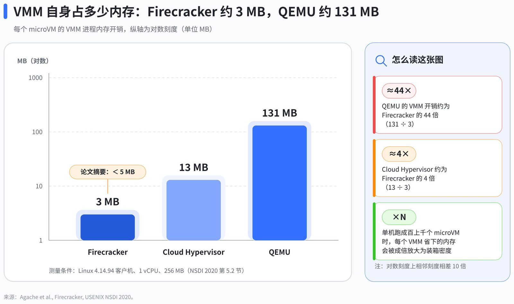
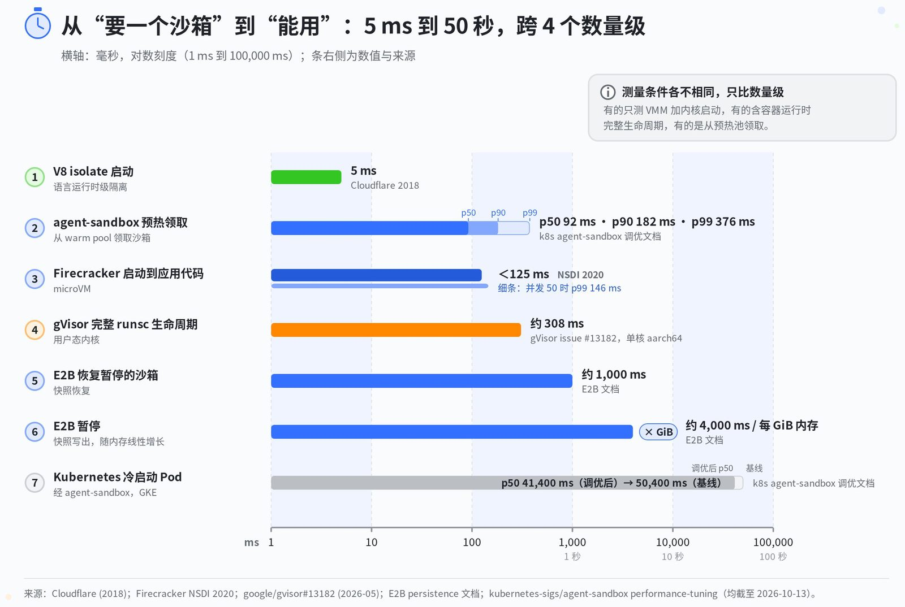
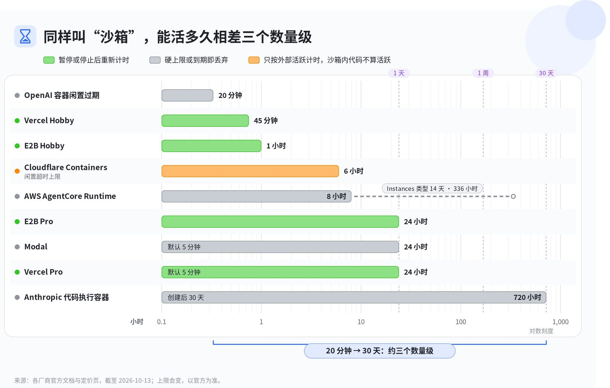
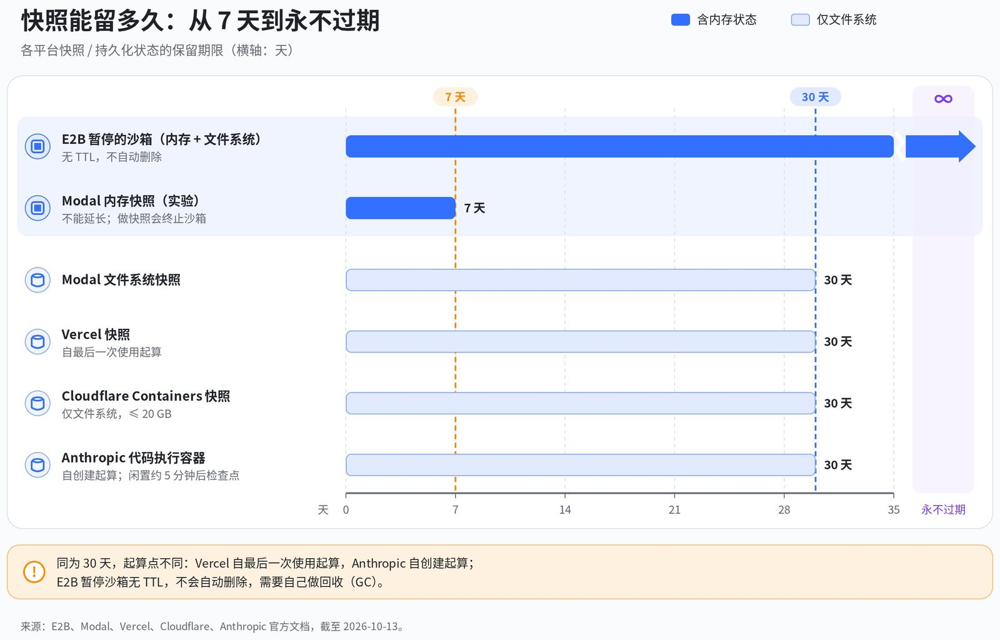
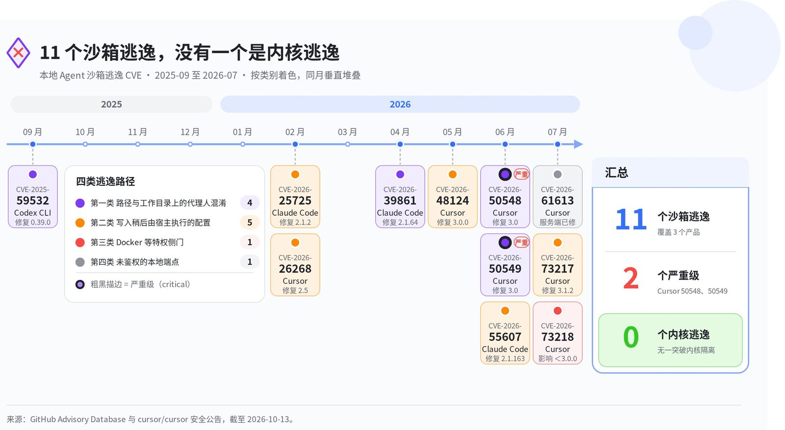
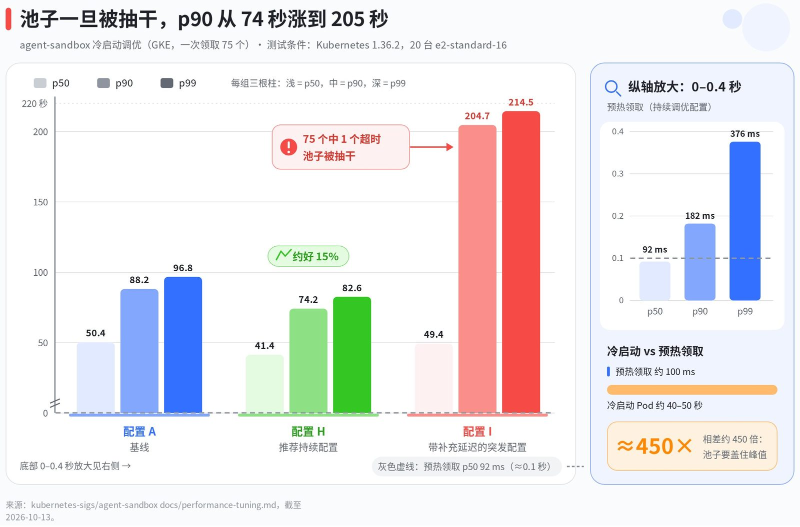
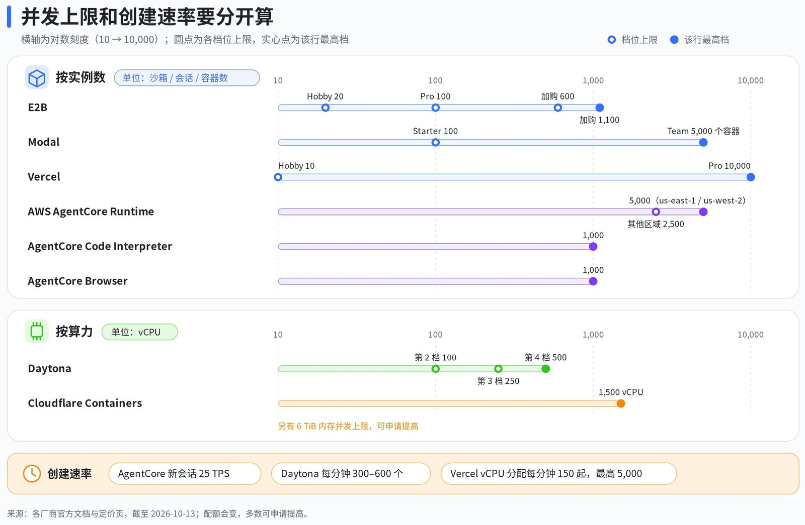
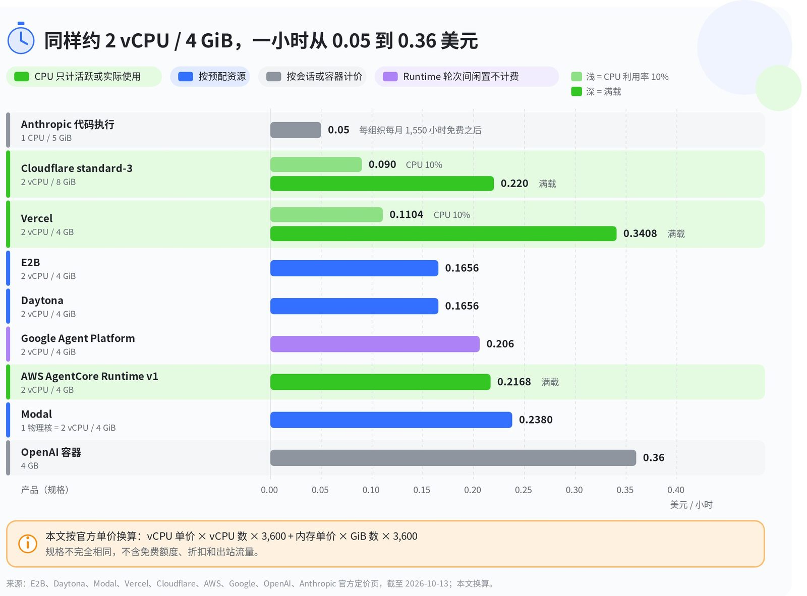

# LLM-41｜工程｜Agent 运行时与沙箱：隔离、持久执行与规模化

> 🎯 **这篇文档解决什么问题**：Agent 一旦执行模型生成的代码、长时间持有会话，就需要一层独立的基础设施：在哪里跑、跑多久、能碰什么、崩了怎么接着跑、上千个会话同时起来怎么办、每小时花多少钱。本文面向在生产环境运行 Agent 的平台工程师和 SRE，讲威胁模型与隔离边界、隔离技术的量化差异、托管沙箱的时长与计费、快照与预热池、持久执行与沙箱的耦合、出口与凭据代理、近两年沙箱逃逸漏洞的共同模式，以及风险分级到隔离级别的映射。
>
> 使用方式：第 1–2 章建立边界判断，第 3–4 章用于选型和设计会话生命周期，第 5–7 章是架构耦合点与漏洞复盘，第 8–10 章讲规模、可观测和成本，第 11 章可直接拿去评审。文中版本、价格和配额核对于 2026 年 10 月 13 日，这类数字变动频繁。

> 🎯 **这篇文档解决什么问题**：Agent 一旦执行模型生成的代码、长时间持有会话，就需要一层独立的基础设施：在哪里跑、跑多久、能碰什么、崩了怎么接着跑、上千个会话同时起来怎么办、每小时花多少钱。本文面向在生产环境运行 Agent 的平台工程师和 SRE，讲威胁模型与隔离边界、隔离技术的量化差异、托管沙箱的时长与计费、快照与预热池、持久执行与沙箱的耦合、出口与凭据代理、近两年沙箱逃逸漏洞的共同模式，以及风险分级到隔离级别的映射。
>
> 使用方式：第 1–2 章建立边界判断，第 3–4 章用于选型和设计会话生命周期，第 5–7 章是架构耦合点与漏洞复盘，第 8–10 章讲规模、可观测和成本，第 11 章可直接拿去评审。文中版本、价格和配额核对于 2026 年 10 月 13 日，这类数字变动频繁。

## 导读 · 先给结论

- **近两年的沙箱逃逸几乎都不是内核逃逸**。本文整理的 11 个本地 Agent 沙箱漏洞，全部利用沙箱内子进程与沙箱外宿主进程之间的缝隙：符号链接、被宿主执行的配置和 hooks、Docker 侧门、未鉴权的本地端点[[1]](https://github.com/advisories/GHSA-vp62-r36r-9xqp)[[2]](https://github.com/cursor/cursor/security/advisories)。加固重点在宿主侧。
- **隔离按是否共享内核分档**。容器共享宿主内核，Firecracker 论文称之为安全与兼容性的根本取舍[[3]](https://www.usenix.org/system/files/nsdi20-paper-agache.pdf)；多租户不可信代码至少要 gVisor 或 microVM，而 NVIDIA 认为 gVisor 的保证弱于完整虚拟化[[4]](https://developer.nvidia.com/blog/practical-security-guidance-for-sandboxing-agentic-workflows-and-managing-execution-risk/)。
- **生产上靠预热池，不靠冷启动**。Firecracker 启动到应用代码不到 125 ms[[3]](https://www.usenix.org/system/files/nsdi20-paper-agache.pdf)，gVisor 维护者认为完整生命周期约 300 ms[[5]](https://github.com/google/gvisor/issues/13182)，Kubernetes 冷启动 Pod 要 40–50 秒，从预热池领取 p50 约 92 ms[[6]](https://github.com/kubernetes-sigs/agent-sandbox)。
- **托管沙箱的时长上限差异很大**。截至 2026-10-13 官方文档，OpenAI 容器闲置 20 分钟即过期[[7]](https://platform.openai.com/docs/guides/tools-code-interpreter)，AgentCore 会话最长 8 小时[[8]](https://docs.aws.amazon.com/bedrock-agentcore/latest/devguide/bedrock-agentcore-limits.html)，E2B Pro、Modal、Vercel Pro 最长 24 小时[[9]](https://e2b.dev/pricing)[[10]](https://modal.com/docs/guide/sandboxes)[[11]](https://vercel.com/docs/vercel-sandbox/pricing)。
- <b>持久执行记“做到哪了”，沙箱管“在哪里做”</b>。Temporal 的集成把每次沙箱操作做成独立 Activity，Worker 重启后接回同一会话[[12]](https://docs.temporal.io/develop/python/integrations/openai-agents)。等人审批时让工作流睡眠，不让沙箱空转。
- **域名白名单不是完整的出口控制，令牌不进沙箱**。Modal 的域名白名单只看 SNI，不能防域前置[[13]](https://modal.com/docs/guide/sandbox-networking)；凭据应由沙箱外代理注入[[14]](https://www.anthropic.com/engineering/claude-code-sandboxing)。
- **计费口径比单价重要**。本文按官方单价换算（约 2 vCPU / 4 GiB），E2B 约 0.166 美元每小时，Vercel 在 CPU 利用率 10% 时约 0.110 美元、满载约 0.341 美元[[9]](https://e2b.dev/pricing)[[11]](https://vercel.com/docs/vercel-sandbox/pricing)。Agent 多数时间在等模型，按活跃 CPU 计费更划算。
- **分叉快慢看数据面**。E2B 用对象存储加用户态缺页，换来任意节点能起任意模板[[61]](https://github.com/e2b-dev/infra)；forkd 和 CubeSandbox 把镜像放在本地，由内核做写时复制，forkd 分叉 100 台只要 101 ms[[62]](https://github.com/deeplethe/forkd)。要自建又想沿用 E2B SDK，可以评估开源的 CubeSandbox，它把快照回滚和 L7 出口代理做在了一起[[56]](https://github.com/TencentCloud/CubeSandbox)。

📎 与系列其他文档的分工：「Agent 协议与工具链」第 9 章讲编程 Agent 的产品沙箱对比，第 4 章讲 MCP 授权，第 10 章讲 MCP 安全事件；「编程 Agent 实战」第 7.4–7.7 节讲 Amazon Q、Nx、Replit 事故；「Agent 工程实战」第 2.4 节讲检查点、幂等与审批基础。本文只讲运行时与沙箱层。

## 第 1 章 · 威胁模型与隔离边界

沙箱要防的是三类输入叠加的后果：不可信代码（模型生成或用户上传）、提示词注入（网页、仓库、工单里夹带的指令）、多租户（同一宿主上不同客户的会话）。只要出现其中两个，就不能把隔离交给应用层白名单：NVIDIA 红队指出，应用层白名单可以被间接调用绕过，操作系统层面的控制才覆盖每一个子进程[[4]](https://developer.nvidia.com/blog/practical-security-guidance-for-sandboxing-agentic-workflows-and-managing-execution-risk/)。NVIDIA 列为“必须”的三项控制是：网络出口控制、禁止写工作区以外的文件、禁止在任何位置写配置文件，因为 hooks、Skills 和本地 MCP 配置常在沙箱外运行[[4]](https://developer.nvidia.com/blog/practical-security-guidance-for-sandboxing-agentic-workflows-and-managing-execution-risk/)。

### 1.1 边界一：内核是否共享

容器用 cgroups、namespaces 和 seccomp-bpf 限制进程，但共用一个宿主内核；系统调用放得越宽，兼容性越好，攻击面也越大[[3]](https://www.usenix.org/system/files/nsdi20-paper-agache.pdf)。gVisor 在用户态实现内核，“没有任何系统调用直接透传给宿主”[[15]](https://gvisor.dev/docs/architecture_guide/security/)；microVM 给每个沙箱一个独立客户机内核。但 gVisor 官方也写明，它依赖宿主 cgroups 防资源耗尽、不防硬件侧信道，“沙箱不能替代安全的架构”[[15]](https://gvisor.dev/docs/architecture_guide/security/)。突破后能拿到什么，取决于沙箱里有什么凭据、能连到哪里。

### 1.2 边界二：沙箱与宿主进程之间

本地编程 Agent 的结构是：不受限的宿主应用（IDE 或 CLI）启动受限的子进程执行命令。子进程被限住了，但宿主会读它写的文件、执行它改的配置、跟随它建的符号链接。一则 Claude Code 公告的描述很准确：两个进程“各自都无法写到工作区以外，但组合起来就可以”[[1]](https://github.com/advisories/GHSA-vp62-r36r-9xqp)。2025-09 到 2026-07 的 11 个公开漏洞因此可分四类：路径与工作目录上的代理人混淆、写入稍后由宿主执行的配置、Docker 等特权侧门、未鉴权的本地端点[[16]](https://github.com/advisories/GHSA-w5fx-fh39-j5rw)[[17]](https://github.com/advisories/GHSA-ff64-7w26-62rf)[[2]](https://github.com/cursor/cursor/security/advisories)。第 7 章逐条展开。

### 1.3 边界三：网络与凭据

只隔离文件不隔离网络，被注入的 Agent 可以把密钥发出去；只隔离网络不隔离文件，它可以改写宿主会执行的脚本。凭据的原则是真实令牌不进沙箱，由沙箱外代理按请求注入（第 6 章）。

📎 展开阅读：「Agent 协议与工具链」第 9.2 节（沙箱为什么必须同时隔离文件和网络）；「LLM 安全与治理」第 5.1–5.2 节（工具风险表与过度代理）。

> 💡 **常见误区**
>
> - 以为换成 microVM 就安全了。多数漏洞发生在宿主读取沙箱产物的一侧，microVM 管不到。
> - 只给执行代码的工具加沙箱，hooks、MCP 启动脚本和 Skills 仍在宿主上跑。NVIDIA 建议把整个 IDE 及其派生的所有函数放进沙箱，最好用独立系统用户[[4]](https://developer.nvidia.com/blog/practical-security-guidance-for-sandboxing-agentic-workflows-and-managing-execution-risk/)。
> - 允许一次后一直放行。NVIDIA 明确说“允许一次、运行多次”不是足够的控制[[4]](https://developer.nvidia.com/blog/practical-security-guidance-for-sandboxing-agentic-workflows-and-managing-execution-risk/)。

## 第 2 章 · 隔离技术原理与量化对比

隔离技术从轻到重是：操作系统级沙箱（Seatbelt、bubblewrap 加 seccomp、Landlock）、用户态内核（gVisor）、轻量虚拟机（Firecracker、Kata Containers），另有语言级隔离（V8 isolate、WebAssembly）。选型看三件事：攻击面、启动与内存开销、能否跑任意二进制。各编程 Agent 产品分别用了什么，见「Agent 协议与工具链」第 9.1 节。

### 2.1 操作系统级沙箱

这一档不起新内核，直接给宿主上的进程树套限制，几乎没有启动开销。Claude Code 在 Linux 用 bubblewrap、macOS 用 Seatbelt，限制覆盖命令派生的所有子进程；网络只能经由 Unix 域套接字连到沙箱外的代理，由代理按域名放行[[14]](https://www.anthropic.com/engineering/claude-code-sandboxing)。Codex CLI 在 Linux 默认用 `bwrap` 加 `seccomp`，可写根目录里的 `.git`、`.agents`、`.codex` 仍是只读[[18]](https://developers.openai.com/codex/agent-approvals-security)。Cursor 在 macOS 上否决了 App Sandbox（要给每个二进制签名）、容器（只能跑 Linux 二进制）和虚拟机（启动和内存开销“不可接受”），选了 Seatbelt；Linux 上直接用 Landlock 加 seccomp[[19]](https://cursor.com/blog/agent-sandboxing)。

Landlock 是无需特权的 Linux 安全模块，从 5.13 开始提供[[20]](https://docs.kernel.org/userspace-api/landlock.html)。能力按 ABI 递增：v3 增加截断，v4 增加 TCP 绑定与连接规则，v6 增加抽象 Unix 套接字和信号的 IPC 作用域，UDP 规则从 ABI v10 开始；被拒绝的访问可写入审计子系统[[20]](https://docs.kernel.org/userspace-api/landlock.html)。Cursor 要求内核 6.2 以上（Landlock v3），条件不满足时退回逐条审批[[21]](https://cursor.com/docs/reference/sandbox)。这一档有两个固有局限：Landlock 只认路径和端口，按域名放行仍要靠代理[[20]](https://docs.kernel.org/userspace-api/landlock.html)；seccomp-bpf 看不到文件路径，Cursor 为此在 overlay 文件系统里重新挂载被忽略的文件，这是最慢的一步[[19]](https://cursor.com/blog/agent-sandboxing)。

Cursor 报告开沙箱的 Agent 比不开时停下来的次数少 40%；它还发现 Agent 被拦后会反复重试同一命令，应在工具结果里写明是哪条约束导致失败[[19]](https://cursor.com/blog/agent-sandboxing)。

📎 沙箱之上还有一层审批与规则：沙箱管技术上能碰到什么，审批策略管何时停下来问人，规则冲突时按敏感路径、显式规则、模式的顺序判定。五个开源 Agent 外壳在这一层的取舍见 [LLM-05｜工程｜Agent 工程实战：从工具到上线的施工手册](./05-agent-engineering.md) 第 11.3 节。

### 2.2 gVisor

gVisor 用 Go 写的 Sentry 截获系统调用，文件操作交给 Gofer；除非开启 directfs 或宿主网络，Sentry 不能打开新的宿主文件或创建套接字[[15]](https://gvisor.dev/docs/architecture_guide/security/)。纯内存访问和 CPU 计算没有额外开销，系统调用密集的负载（小操作很多的 redis、大量小静态文件）表现差，网络栈 CPU 效率也更低；拦截平台中 ptrace 开销最大，KVM 在嵌套虚拟化下影响明显，官方推荐 Systrap[[22]](https://gvisor.dev/docs/architecture_guide/performance/)。官方只给图表，本文不引用具体开销比例。

启动时延常被引用为几十毫秒，但维护者在 2026-05 的 issue 里给了不同判断：用户在单核 aarch64 上测得完整 runsc 生命周期 308.010 ± 9.542 ms，维护者认为约 300 ms 是当前的合理近似，并说不知道 gVisor 曾达到过常被引用的更低数字[[5]](https://github.com/google/gvisor/issues/13182)。他还指出 Firecracker 常见的 100–200 ms 通常只测了 VMM 加内核启动，公平比较要算上 OCI bundle 准备和块设备创建[[5]](https://github.com/google/gvisor/issues/13182)。

### 2.3 Firecracker 与 Kata Containers

Firecracker 是 AWS 为 Lambda 和 Fargate 做的 VMM，约 5 万行 Rust，比 QEMU 少 96% 的代码；论文摘要给出每个 microVM 内存开销不到 5 MB、启动到应用代码不到 125 ms、每台宿主每秒最多创建 150 个[[3]](https://www.usenix.org/system/files/nsdi20-paper-agache.pdf)。实测（Linux 4.14.94、1 vCPU、256 MB）中，每个 microVM 的内存开销 Firecracker 约 3 MB、Cloud Hypervisor 约 13 MB、QEMU 约 131 MB；并发 50 启动 1,000 个预配置虚拟机，Firecracker p99 为 146 ms，Cloud Hypervisor 为 158 ms[[3]](https://www.usenix.org/system/files/nsdi20-paper-agache.pdf)。

VMM 进程本身还由 jailer 放进 chroot、降权并套 seccomp-bpf；代价是不支持 PCI、任意内核和 Windows[[3]](https://www.usenix.org/system/files/nsdi20-paper-agache.pdf)。Kata Containers 把每个 Pod 放进一个虚拟机，可选 QEMU、Cloud Hypervisor、Firecracker、Dragonball；其中 Firecracker 不支持文件系统共享和热插拔，追求最快启动和最小开销时推荐 Dragonball 或 Firecracker[[23]](https://kata-containers.github.io/kata-containers/design/virtualization/)。Kata 官方只给定性评级，启动时延要自己测。

### 2.4 V8 isolate 与 WebAssembly

Cloudflare 2018 年给出 isolate 启动约 5 ms，基础 Node Lambda 约 35 MB 内存、共享运行时后约 3 MB[[24]](https://blog.cloudflare.com/cloud-computing-without-containers/)。NVIDIA 介绍过用 Pyodide（编译到 WebAssembly 的 CPython）在浏览器沙箱里执行模型生成的 Python，认为它比正则过滤更可靠、比容器更轻[[25]](https://developer.nvidia.com/blog/sandboxing-agentic-ai-workflows-with-webassembly/)。这一档的共同限制是不能跑任意原生二进制，只适合模型生成的工具调用代码，不适合要 shell、pip 的编程 Agent[[24]](https://blog.cloudflare.com/cloud-computing-without-containers/)。

### 2.5 对照

图中数字的测量条件各不相同（有的只测 VMM 加内核启动，有的含容器运行时完整生命周期，有的是从预热池领取），只能比较数量级，不能直接排名。

## 第 3 章 · 托管沙箱产品横评

多数团队会先用托管沙箱，而不是自建镜像、调度、预热和计量。本章比较九家产品的隔离方式、规格和时长；数字截至 2026-10-13 官方文档，会频繁调整，上线前要重新核对。价格见第 10 章，并发配额见第 8 章。

### 3.1 通用沙箱

- **E2B**：按秒计费，规格 1–8 vCPU、1–8 GiB，默认 2 vCPU / 4 GiB，不提供 GPU；Hobby 单次会话最长 1 小时，Pro（每月 150 美元加用量）最长 24 小时；企业版可部署到客户云账号（BYOC）[[9]](https://e2b.dev/pricing)。
- **Modal**：gVisor 运行时适合大多数负载，VM 运行时有自己的内核；沙箱里跑 Docker 要用 VM 运行时，GPU 沙箱只能用 gVisor；默认最长存活 5 分钟，`timeout` 最多 24 小时，再长要靠快照恢复到新沙箱[[10]](https://modal.com/docs/guide/sandboxes)。
- **Vercel Sandbox**：每个沙箱是一台 Firecracker microVM，可运行 Docker、FUSE 等需系统权限的进程[[26]](https://vercel.com/docs/vercel-sandbox)；默认 2 vCPU，每 vCPU 配 2 GB；Hobby 会话最长 45 分钟，Pro 最长 24 小时；默认超时 5 分钟，停止再恢复后重新计时，总寿命“实际上没有上限”[[11]](https://vercel.com/docs/vercel-sandbox/pricing)。
- **Daytona**：分容器沙箱和虚拟机沙箱（含 Windows）；归档会把文件系统移到对象存储并停止计费[[27]](https://www.daytona.io/docs/en/limits)。
- **Cloudflare**：Containers 每个实例是有独立内核和网络的 microVM，只能经由你的 Worker 访问；Dynamic Workers 基于 V8 isolate，运行时加载不可信的 JS、Python 或 Wasm[[28]](https://developers.cloudflare.com/sandbox/)。

Cloudflare 有一个易踩的坑：闲置超时最多 6 小时，但“实例内部运行的代码不算活跃”[[29]](https://developers.cloudflare.com/sandbox/concepts/lifetime/)。沙箱里跑着两小时的编译、外面没有请求，实例照样会被回收。官方示例用 Durable Object 的 alarm 每分钟心跳一次，且超时设置不跨重启保留，要在构造函数里重设[[29]](https://developers.cloudflare.com/sandbox/concepts/lifetime/)。

以上都是托管服务。需要自建、又想沿用 E2B 式 API 时，下面三个开源项目各有侧重，它们分叉快慢的原因放在 4.5 讲：

- **CubeSandbox**（腾讯云开源，Apache-2.0）：每个沙箱是带独立内核的 KVM microVM，虚拟机监视器基于 RustVMM 自研。兼容 E2B SDK，改一个环境变量就能把现有代码切过去。官方基准是单并发启动低于 60 ms，50 并发平均 67 ms、P95 90 ms、P99 137 ms，32 GB 以内的规格每沙箱额外开销低于 5 MB[[56]](https://github.com/TencentCloud/CubeSandbox)。最新稳定版 v0.7.3 发布于 2026-10-12[[57]](https://github.com/TencentCloud/CubeSandbox/releases/tag/v0.7.3)，可部署在裸金属、腾讯云 Terraform 或 Kubernetes（预览）上。控制面靠 Redis 存元数据、路由表和分布式锁[[60]](https://github.com/TencentCloud/CubeSandbox/blob/master/docs/architecture/overview.md)，自建时它是要单独做高可用的共享状态。
- **AgentENV**（kvcache-ai 开源，MIT）：为 Kimi K3 的 Agentic RL 训练提供环境。镜像用 overlaybd 按需加载，本地盘只当有界缓存，生产上覆盖 150 万个 OCI 镜像。启动和恢复低于 50 ms，增量快照低于 100 ms，支持分叉，API 兼容 E2B。要求 Linux 6.8 以上，README 特别提醒 API 本身不加密，不能直接暴露在不可信网络上[[63]](https://github.com/kvcache-ai/AgentENV)。
- **forkd**（Apache-2.0，v0.5.3）：只做带内存的分叉。每个子实例是独立的 Firecracker 进程，用 `MAP_PRIVATE` 映射父实例的内存镜像，分叉 100 台耗时 101 ms。依赖项目自带的 Firecracker 分支，内核要 5.7 以上[[62]](https://github.com/deeplethe/forkd)。

### 3.2 云厂商与模型厂商的托管运行时

- **AWS Bedrock AgentCore**：Runtime 每会话一台 microVM[[30]](https://aws.amazon.com/bedrock/agentcore/pricing/)；闲置超时默认 15 分钟，会话最长 8 小时，异步任务最长 8 小时；每会话 2 vCPU / 8 GB 且不可调；会话存储不超过 1 GB[[8]](https://docs.aws.amazon.com/bedrock-agentcore/latest/devguide/bedrock-agentcore-limits.html)。另有按 EC2 计价的 Instances 类型，会话最长保留 14 天[[30]](https://aws.amazon.com/bedrock/agentcore/pricing/)。
- **Google Gemini Enterprise Agent Platform**：代码执行沙箱只支持 Python 和 JavaScript，默认 2 vCPU / 1.5 GB，每次 `execute_code` 重置 TTL[[31]](https://docs.cloud.google.com/gemini-enterprise-agent-platform/scale/sandbox/code-execution-quickstart)。
- **OpenAI 容器**（Code Interpreter 与 Hosted Shell）：“完全沙箱化的虚拟机”，内存 1g 到 64g；**闲置 20 分钟即过期**，数据丢弃且不能重新激活[[7]](https://platform.openai.com/docs/guides/tools-code-interpreter)。
- **Anthropic 代码执行**：5 GiB 内存、5 GiB 磁盘、1 CPU；**完全禁止联网**，不能运行时装包；创建 30 天后过期，闲置约 5 分钟做检查点[[32]](https://platform.claude.com/docs/en/agents-and-tools/tool-use/code-execution-tool)。

### 3.3 时长对照

| 产品 | 时长上限 | 暂停或恢复后 |
|---|---|---|
| OpenAI 容器 | 闲置 20 分钟过期[[7]](https://platform.openai.com/docs/guides/tools-code-interpreter) | 不能重新激活 |
| Vercel Hobby / Pro | 45 分钟 / 24 小时[[11]](https://vercel.com/docs/vercel-sandbox/pricing) | 重新计时 |
| E2B Hobby / Pro | 1 小时 / 24 小时[[9]](https://e2b.dev/pricing) | 重新计时[[33]](https://e2b.dev/docs/sandbox/persistence) |
| Cloudflare Containers | 闲置超时最多 6 小时[[29]](https://developers.cloudflare.com/sandbox/concepts/lifetime/) | 快照只含文件系统 |
| AgentCore Runtime | 8 小时（Instances 14 天）[[8]](https://docs.aws.amazon.com/bedrock-agentcore/latest/devguide/bedrock-agentcore-limits.html) | 硬上限 |
| Modal | 默认 5 分钟，最多 24 小时[[10]](https://modal.com/docs/guide/sandboxes) | 用快照恢复到新沙箱 |
| Anthropic 代码执行 | 创建后 30 天[[32]](https://platform.claude.com/docs/en/agents-and-tools/tool-use/code-execution-tool) | 闲置约 5 分钟检查点 |

📎 展开阅读：「Agent 协议与工具链」第 9.3 节（OpenAI Agents SDK 的沙箱执行及其支持的提供方）。

> 💡 **常见误区**：把“最长 24 小时”当成任务能跑 24 小时。Modal 和 Vercel 默认超时只有 5 分钟，不显式设置就会被提前回收[[10]](https://modal.com/docs/guide/sandboxes)[[11]](https://vercel.com/docs/vercel-sandbox/pricing)。

## 第 4 章 · 会话生命周期：暂停、快照、分叉与 TTL

长任务、等审批、并行探索都需要把沙箱冻住再解冻或复制。快照分两类：**内存快照**保存运行中的进程，恢复后从断点继续；**文件系统快照**只存磁盘，恢复要重启进程。前者体验好但限制多。

### 4.1 内存快照

- **E2B**：暂停保存文件系统和内存，约每 1 GiB 内存 4 秒，恢复约 1 秒；默认 `onTimeout` 是 kill。上一个快照未完成时暂停返回 503 `ServiceBusyError`，自动暂停重试约 2 分钟后退回只保存文件系统，内存状态丢失[[33]](https://e2b.dev/docs/sandbox/persistence)。
- **Modal**：内存快照仍是实验接口，7 天过期且不能延长；做快照会关闭 TCP 连接，并且**当前会终止沙箱**；不支持 GPU，只能恢复到完全相同的实例类型[[34]](https://modal.com/docs/guide/sandbox-snapshots)。
- **Firecracker**（自建底层）：恢复时用 `MAP_PRIVATE` 映射内存文件，按需加载并写时复制，多台 microVM 可共享内存页，这是快速分叉的基础；差量快照仍是开发者预览[[35]](https://github.com/firecracker-microvm/firecracker/blob/main/docs/snapshotting/snapshot-support.md)。

### 4.2 同一个内存快照不能恢复两次

Firecracker 文档写明，同一快照恢复多次会复制出相同的标识符、随机数种子、熵池和加密令牌，因此“认为从同一状态多次恢复执行是不安全的”[[35]](https://github.com/firecracker-microvm/firecracker/blob/main/docs/snapshotting/snapshot-support.md)。用一个“已装好依赖、已登录”的内存快照批量分叉，所有分叉会共享随机数状态和会话令牌。对策：分叉后重新播种随机数、轮换令牌；需要凭据的服务在分叉后由代理注入（第 6 章）；跨租户绝不复用内存快照。恢复后还要注意：cgroups v1 上恢复很慢，网络不保证可用，墙钟需要重新同步[[35]](https://github.com/firecracker-microvm/firecracker/blob/main/docs/snapshotting/snapshot-support.md)。

### 4.3 文件系统快照与分叉

- **Modal**：文件系统快照是相对基础镜像的差量，默认保留 30 天；分叉就是用同一快照创建 N 个沙箱；没有列出快照的 API，ID 要自己记[[34]](https://modal.com/docs/guide/sandbox-snapshots)。
- **E2B 分叉**：不论分叉多少个只做一次快照，单次最多 20 个；原沙箱会被暂停再恢复，活动连接断开[[36]](https://docs.e2b.dev/sandbox/fork.md)。
- **Vercel**：快照默认在最后使用后 30 天过期[[11]](https://vercel.com/docs/vercel-sandbox/pricing)。
- **Cloudflare**：快照只含可写根文件系统，不含内存和进程，30 天过期，最大 20 GB[[29]](https://developers.cloudflare.com/sandbox/concepts/lifetime/)。

### 4.4 垃圾回收

保留期不统一带来两个问题。第一个是**有的永不过期**：E2B 暂停的沙箱无限期保留，不会自动删除[[33]](https://e2b.dev/docs/sandbox/persistence)，平台必须自己清理；NVIDIA 也提醒要避免长期运行的沙箱里积累代码和密钥[[4]](https://developer.nvidia.com/blog/practical-security-guidance-for-sandboxing-agentic-workflows-and-managing-execution-risk/)。第二个是**有的不能延长**：Modal 内存快照 7 天必然失效[[34]](https://modal.com/docs/guide/sandbox-snapshots)，“暂停一周等审批”的流程会在第 8 天失败。建议在控制面维护快照台账（ID、类型、租户、过期时间），按租户保留要求删除。

### 4.5 分叉快慢取决于内存和磁盘怎么共享

4.3 里各家的分叉接口看上去差不多，都是从一个状态复制出 N 份。E2B 文档写了单次最多 20 个、默认 15 秒超时，却没给时延[[36]](https://docs.e2b.dev/sandbox/fork.md)。真正拉开差距的是两件事：新实例的磁盘和内存从哪里来，写时复制由谁来做。按这个标准看，公开实现大致分三条路线。

| 路线 | 磁盘 | 内存 | 换来什么 | 代价与适用 |
|---|---|---|---|---|
| **对象存储按需加载**（E2B） | 用户态分块覆盖层，经 NBD 暴露成 `/dev/nbdX` 交给 Firecracker | userfaultfd 把缺页交给用户态处理程序，未命中时从缓存或远端取页 | 模板不用预铺，任意节点能起任意模板，节点接近无状态 | 磁盘 IO 和冷缺页都多走一次用户态，冷页可能走网络。适合模板多、变化快 |
| **本地镜像加内核写时复制**（forkd） | 本地文件系统 reflink 或覆盖层 | 内存镜像以 `MAP_PRIVATE` 映射，首次写入由内核做页级复制 | 关键路径不经过用户态，forkd 分叉 100 台 101 ms | 父镜像必须在本机，模板要提前分发到节点。适合瞬间展开、模板集合可控 |
| **本地写时复制加快照框架**（CubeSandbox） | XFS `FICLONE` 让模板、rootfs 和快照共享 extent | 快照只持久化上次以来变化的脏页，其余页继续共享 | 快照、回滚、克隆基本是元数据操作 | 跨节点暂停恢复走 S3 后端，v0.7.0 起才预览。适合自托管、要回滚和出口治理 |

E2B 的实现可以在开源的 e2b-dev/infra 里核对：编排器的沙箱包注明 NBD 方式下 rootfs 设备路径是 `/dev/nbdX`，从快照恢复是常规路径，内存后端是 uffd[[61]](https://github.com/e2b-dev/infra)。NBD 设备要绑定内核资源，没法全部提前池化，所以它的启动时延里有一段固定成本。CubeSandbox 的 CubeCoW 从 v0.3 开始提供快照、克隆和回滚[[56]](https://github.com/TencentCloud/CubeSandbox)，路线图仍把降低跨节点暂停恢复时延和 S3 增量上传列为待办，本地和跨节点两条路径目前性能差距明显。AgentENV 介于第一条和第三条之间：镜像按需加载，快照存 S3 或分布式文件系统，I/O 走 ublk 并共享页缓存[[63]](https://github.com/kvcache-ai/AgentENV)。

第二条路线也有前提。forkd 的数字只在父实例是完整内存镜像时成立：基础快照恢复 59 ms，叠一层差量快照就到 751 ms，每多一层增加约 450–690 ms[[62]](https://github.com/deeplethe/forkd)。另外，分叉越快，4.2 的问题放得越大。`MAP_PRIVATE` 让一百个子实例共享父实例的随机数状态和会话令牌，一次分叉就复制出一百份。分叉后重新播种、轮换令牌的时间应该算进分叉时延，不要等压测结束再补。

> 🔑 **本章要点**：内存快照适合短暂停、同租户恢复一次；跨天、跨租户、批量分叉用文件系统快照。E2B 的会话时长在暂停再恢复后重置[[33]](https://e2b.dev/docs/sandbox/persistence)，长任务可以靠周期性暂停续命，代价是每 GiB 约 4 秒的暂停时间。

## 第 5 章 · 持久执行与沙箱的耦合

📎 延伸阅读：长任务的失败来自单步错误累积和偶发崩溃，检查点为什么必要，见 [LLM-58｜工程｜Agent 调优：从 trace 找到该改的那一层](./58-agent-tuning.md) 第 11 章。

沙箱快照保存机器状态，持久执行引擎记录 Agent 做到了第几步、哪些副作用已经发生。分工是：Agent 循环放在工作流里，模型调用和每次沙箱操作作为有记录的步骤，崩溃后重放已完成的步骤，从第一个未完成的步骤继续。检查点、幂等键和审批的基础不在这里重复，本章只补引擎上限、沙箱接入方式和运维要点。

📎 展开阅读：「Agent 工程实战」第 2.4 节（LangGraph、OpenAI Agents SDK、Temporal 的检查点、幂等与人工审批）。

### 5.1 沙箱操作即 Activity

Temporal 的 OpenAI Agents SDK Python 集成于 2026-03-23 正式可用[[37]](https://temporal.io/blog/announcing-openai-agents-sdk-integration)，沙箱集成于 2026-04-16 进入公开预览[[38]](https://temporal.io/changelog/openai-agents-sdk-sandbox-integration-public-preview)。文档的分工是：Agent 循环、工具选择和交接在 Workflow 里；模型调用作为 Activity，重放时不重复调用；**每个沙箱操作（创建会话、每条命令、每次读写、销毁）都是独立的 Activity**，会话状态随工作流序列化，Worker 重启后接回同一会话；提供方包括 Daytona、Docker、E2B 和本地 Unix，后者只用于可信的本地开发[[12]](https://docs.temporal.io/develop/python/integrations/openai-agents)。

这个粒度让一条命令失败只重试这一条，代价是每条命令都进事件历史。Activity 重试也意味着同一命令可能执行两次，命令要么幂等，要么外面包一层“先查状态再执行”。

### 5.2 各引擎的硬上限

| 引擎 | 上限 | 对 Agent 的含义 |
|---|---|---|
| Temporal Cloud | 事件历史 51,200 条或 50 MB，10,240 条或 10 MB 告警；单次负载 2 MB；每个 Workflow Execution 的未完成 Activity、Signal、Child Workflow、取消请求等各类型分别最多 2,000 个（官方性能建议并发不超过 500）[[39]](https://docs.temporal.io/cloud/limits) | 长循环定期 Continue-As-New，产物放对象存储 |
| Inngest | 每函数 1,000 步，单步不超过 2 小时，运行状态 32 MiB；含睡眠的运行时长 Free 30 天、Pro 90 天[[40]](https://www.inngest.com/docs/usage-limits/inngest) | 单步包不住一个长沙箱会话 |
| Cloudflare Workflows | 默认 10,000 步，最多 25,000 步；每步 CPU 默认 30 秒，墙钟不限；单步结果 1 MiB[[41]](https://developers.cloudflare.com/workflows/reference/limits/) | 等待中的实例不计入并发 |
| DBOS | 每步一次 Postgres 写，每工作流额外 2 次；队列支持按租户限并发[[42]](https://docs.dbos.dev/architecture) | 以库形式嵌入应用 |
| Restate | 每步一条 journal，工具用 `ctx.run()` 包装[[43]](https://docs.restate.dev/ai/patterns/durable-agents) | 恢复时从第一个未完成步骤继续 |

Temporal 的历史上限对所有部署形态都适用，Cloud 上不可配置[[39]](https://docs.temporal.io/cloud/limits)。命令密集的会话比纯对话型 Agent 快得多地接近告警线，上线前要用真实轨迹测出每轮循环的事件数，再定 Continue-As-New 的触发条件。

### 5.3 等人的时候，睡眠比空转便宜

Cloudflare Workflows 处于睡眠、重试或 `waitForEvent` 状态的实例不计入并发[[41]](https://developers.cloudflare.com/workflows/reference/limits/)；而一个运行着等审批的沙箱既占并发又在计费。推荐做法是：先暂停沙箱或做文件系统快照，工作流进入持久等待，审批到达后恢复沙箱或用快照起新沙箱。要事先定清楚恢复后是接回原进程还是按磁盘状态重建。

### 5.4 运维要点

- **版本化**：升级时仍有工作流在跑，改动循环逻辑会改变重放顺序，要用引擎的版本标记，或只让新版本处理新工作流（参见「Agent 工程实战」第 7.4 节的灰度）。
- **容量**：Temporal Cloud 默认每命名空间 500 APS，超限返回 ResourceExhausted[[39]](https://docs.temporal.io/cloud/limits)；按命令粒度拆 Activity 会显著放大 APS。

## 第 6 章 · 网络出口与凭据代理

📎 延伸阅读：执行器网络不受限时，Agent 曾在调优过程中自己下载评分细则，需要封锁哪些域名见 [LLM-58｜工程｜Agent 调优：从 trace 找到该改的那一层](./58-agent-tuning.md) 第 8 章。

出口控制要让被注入的 Agent 既拿不到值钱的东西，也送不出去。做法是两个沙箱外的组件：**出口网关**按目的地放行或拒绝，**凭据代理**在请求离开沙箱后才加上真实令牌。MCP 的 OAuth 授权见「Agent 协议与工具链」第 4 章，这里不重复。

### 6.1 各家默认的出口策略

| 产品 | 默认 | 可选控制 | 官方写明的局限 |
|---|---|---|---|
| Modal | 可出任意公网 IP | 全封、CIDR 白名单、域名白名单（测试版）、运行中更新[[13]](https://modal.com/docs/guide/sandbox-networking) | 域名白名单只认 443 端口的 SNI，不防域前置；不全封时 DNS 不受限[[13]](https://modal.com/docs/guide/sandbox-networking) |
| E2B | 可出公网 | 按 IP、CIDR、域名放行或拒绝[[44]](https://e2b.dev/docs/sandbox/internet-access) | 不支持 QUIC；放行优先于拒绝；被拦的 TCP 连接在沙箱内可能显示成功[[44]](https://e2b.dev/docs/sandbox/internet-access) |
| Codex CLI | workspace-write 断网 | 代理白名单，拒绝优先，默认禁私有地址[[18]](https://developers.openai.com/codex/agent-approvals-security) | DNS 重绑定只做尽力检查[[18]](https://developers.openai.com/codex/agent-approvals-security) |
| Anthropic 代码执行 | 完全禁止联网[[32]](https://platform.claude.com/docs/en/agents-and-tools/tool-use/code-execution-tool) | 无 | 不能运行时装包 |

### 6.2 域名白名单为什么不够

多数“域名白名单”只在 TLS 的 SNI 或 HTTP 的 Host 头上匹配，不解密流量，厂商自己写明了几个缺口：

- **域前置**：SNI 写允许的域名，内层请求发往同一 CDN 后的其他后端。Modal 明确说不能防止，建议用 Sidecar 代理[[13]](https://modal.com/docs/guide/sandbox-networking)。
- **共享端点**：放行一个 CDN 或对象存储的主机名，可能等于放行了其他内容[[44]](https://e2b.dev/docs/sandbox/internet-access)。
- **DNS**：DNS 查询本身可作外传通道；Codex 说如果敌意 DNS 在威胁模型内，要在更底层再做出口控制[[18]](https://developers.openai.com/codex/agent-approvals-security)。

结论：高风险负载用默认拒绝加 CIDR 白名单，或让出站全部经过自己控制的显式代理；Modal 允许运行中收紧策略，可以装完依赖立即锁定[[13]](https://modal.com/docs/guide/sandbox-networking)。

### 6.3 凭据代理：令牌不进沙箱

Claude Code 网页版给出了可照抄的模式：git 凭据和签名密钥“永远不在沙箱里”；沙箱里的 git 拿到的是作用域受限的专用凭据，请求先到一个 git 代理，代理校验凭据和内容（例如只能推到配置好的分支），再换上真实令牌转发[[14]](https://www.anthropic.com/engineering/claude-code-sandboxing)。托管产品也开始提供这个能力：

- **E2B 请求改写**（公开测试）：出口代理给匹配的 HTTPS 请求注入请求头，`Secret.fill` 在沙箱外替换密钥引用；每沙箱最多 10 个域名[[44]](https://e2b.dev/docs/sandbox/internet-access)。
- **E2B 工作负载身份**（私有测试）：签发短期 JWT-SVID，可用 AWS STS 的 AssumeRoleWithWebIdentity 换云凭据，令牌值“永远不会到达你的代码或沙箱”；换来的 AWS 凭据比 E2B 令牌寿命长，应把角色会话时长设到最短[[45]](https://docs.e2b.dev/iam/workload-identity.md)。
- **Modal 连接令牌**：入站请求由平台注入无法伪造的 `X-Verified-User-Data` 头[[13]](https://modal.com/docs/guide/sandbox-networking)。

NVIDIA 同样建议用密钥注入代替环境变量，并按任务限定作用域[[4]](https://developer.nvidia.com/blog/practical-security-guidance-for-sandboxing-agentic-workflows-and-managing-execution-risk/)。环境变量最差，沙箱内任何进程都能读到；第 7 章的 CVE-2026-61613 就拿到了会话的环境变量和凭据[[2]](https://github.com/cursor/cursor/security/advisories)。截至 2026-10-13 官方定价页，AgentCore Identity 每 1,000 次令牌请求 0.010 美元（经 Runtime 或 Gateway 调用免费）[[30]](https://aws.amazon.com/bedrock/agentcore/pricing/)，Google Agent Gateway 按 1 vCPU 小时折合 15,000 次鉴权调用计费[[46]](https://cloud.google.com/products/gemini-enterprise-agent-platform/pricing)，频繁换取凭据时要算进成本。

上面几项都是托管能力。自建时可以参考 CubeSandbox 的 CubeEgress，它把 6.2 的缺口和本节的凭据注入放进同一个宿主侧代理[[58]](https://github.com/TencentCloud/CubeSandbox/blob/master/docs/guide/security-proxy.md)。沙箱发起连接时，eBPF 先给 SYN 打标，iptables 的 TPROXY 再把流量转给节点上的 OpenResty。HTTPS 由代理按 SNI 现场签发叶子证书，根证书预装在模板里，所以代理能解开 TLS。解开之后，规则才能按 scheme、端口、SNI、host、method 和 path 匹配，首条命中生效，默认拒绝，被拒的请求直接返回 403，不连上游。注入规则在代理侧加上 `Authorization: Bearer ${SECRET}`，密钥不会出现在沙箱的环境变量、文件和进程里，每个请求记一行 JSONL 审计[[58]](https://github.com/TencentCloud/CubeSandbox/blob/master/docs/guide/security-proxy.md)。

L3 这一层由 CubeVS 负责。三个 eBPF 程序分别挂在 TAP 和宿主网卡的 TC 钩子上，不用网桥、OVS 或 iptables NAT。每个沙箱有自己的 CIDR 允许和拒绝表，域名规则从沙箱的 DNS 应答里学习 IP，到期失效[[59]](https://github.com/TencentCloud/CubeSandbox/blob/master/docs/architecture/network.md)。这套组合回答了 6.2 的结论：域前置靠 L7 解密后按 host 和 path 判断来挡，CIDR 白名单在 eBPF 层兜底。落地时有两点要注意。代理能看到明文，根 CA 私钥和注入用的密钥就要按生产密钥管理。官方文档也提醒，对明文 HTTP 注入凭据可能因 DNS 欺骗泄露，注入规则只配给 HTTPS[[58]](https://github.com/TencentCloud/CubeSandbox/blob/master/docs/guide/security-proxy.md)。

> 💡 **常见误区**
>
> - 在沙箱里看“连接成功”来验证出口规则。E2B 的防火墙会先接受再丢弃，要在应用层验证[[44]](https://e2b.dev/docs/sandbox/internet-access)。
> - 迁移时照搬规则。E2B 放行优先[[44]](https://e2b.dev/docs/sandbox/internet-access)，Codex 和 Cursor 拒绝优先[[18]](https://developers.openai.com/codex/agent-approvals-security)[[21]](https://cursor.com/docs/reference/sandbox)；E2B 的 `updateNetwork` 是整体替换而不是合并[[44]](https://e2b.dev/docs/sandbox/internet-access)。

📎 延伸阅读：剥离令牌和 git 注入变量、用命令垫片限定 Agent 账号，研究原型 dsh-superagent 把这些当作默认护栏，同时明说它们不是安全边界，逐层列出的护栏和挡不住的情形见 [LLM-67｜工程｜主动式编码 Agent 的领域模型：dsh-superagent 深研](./67-proactive-coding-agent.md) 第 8 章。

## 第 7 章 · 权限与配置面加固：11 个沙箱逃逸漏洞复盘

本章复盘 2025-09 到 2026-07 公开的 11 个本地 Agent 沙箱漏洞，涉及 Codex CLI、Claude Code 和 Cursor，系列已有文档都没有收录。供应链和 MCP 事件见已有文档。

📎 展开阅读：「Agent 协议与工具链」第 10.1 节（MCP 与 Skills 安全事件时间线）；「编程 Agent 实战」第 7.4–7.7 节（Amazon Q、Nx、Replit 事故与防线表）。

### 7.1 逐条列表

| 编号 | 产品 | 公开 | 问题 | 修复版本 |
|---|---|---|---|---|
| CVE-2025-59532 | Codex CLI | 2025-09 | 模型生成的 `cwd` 被当作可写根目录[[16]](https://github.com/advisories/GHSA-w5fx-fh39-j5rw) | 0.39.0 |
| CVE-2026-25725 | Claude Code | 2026-02 | 启动时不存在的 `.claude/settings.json` 不受保护，可注入 SessionStart hooks，重启后以宿主权限执行[[17]](https://github.com/advisories/GHSA-ff64-7w26-62rf) | 2.1.2 |
| CVE-2026-26268 | Cursor | 2026-02 | 写 `.git` 配置和 hooks，无交互地在沙箱外执行代码[[47]](https://github.com/cursor/cursor/security/advisories/GHSA-8pcm-8jpx-hv8r) | 2.5 |
| CVE-2026-39861 | Claude Code | 2026-04 | 沙箱进程建了指向工作区外的符号链接，沙箱外的应用写入时跟随了它[[1]](https://github.com/advisories/GHSA-vp62-r36r-9xqp) | 2.1.64 |
| CVE-2026-48124 | Cursor | 2026-05 | 工作区内 `.claude/settings.local.json` 的 hooks 未经审批运行[[48]](https://github.com/cursor/cursor/security/advisories/GHSA-pc9j-3qc2-95wv) | 3.0.0 |
| CVE-2026-50548 | Cursor | 2026-06 | Agent 控制的 `working_directory` 扩大了可写根目录（严重级）[[2]](https://github.com/cursor/cursor/security/advisories) | 3.0 |
| CVE-2026-50549 | Cursor | 2026-06 | 路径规范化失败时退回原始路径写入且不审批，可借符号链接利用（严重级）[[2]](https://github.com/cursor/cursor/security/advisories) | 3.0 |
| CVE-2026-55607 | Claude Code | 2026-06 | 名为 “.git” 的 worktree、符号链接和 git fsmonitor 组合覆盖 `~/.zshenv`，在 Seatbelt 外执行[[49]](https://github.com/advisories/GHSA-7835-87q9-rgvv) | 2.1.163 |
| CVE-2026-61613 | Cursor | 2026-07 | Cloud Agent 浏览器里的网页访问到容器内未鉴权的本地 Agent 端点，可读环境变量和凭据[[2]](https://github.com/cursor/cursor/security/advisories) | 服务端 2026-03-31 已修 |
| CVE-2026-73217 | Cursor | 2026-07 | Agent 把 venv 里的 Python 换成包装脚本，微软 Python 扩展在沙箱外执行了它[[2]](https://github.com/cursor/cursor/security/advisories) | 3.1.2 |
| CVE-2026-73218 | Cursor | 2026-07 | 借 Docker Desktop 和 Dev Containers CLI 启动挂载 `virtiofs0` 的特权容器，读写主目录并在宿主执行[[2]](https://github.com/cursor/cursor/security/advisories) | 影响 3.0.0 之前 |

公布了数值评分的里面最高的是 CVE-2025-59532（CVSS v4 8.6）[[16]](https://github.com/advisories/GHSA-w5fx-fh39-j5rw)；Cursor 的 50548 和 50549 被标为严重级，未见数值评分[[2]](https://github.com/cursor/cursor/security/advisories)。

### 7.2 四类共同模式

**第一类，代理人混淆**（59532、39861、50548、50549）：沙箱的“工作区”由一个模型能影响的参数决定，或宿主写文件前没有规范化路径。对策是可写根目录只由宿主配置决定，宿主侧写入先规范化，失败即拒绝。

**第二类，写入稍后由宿主执行的配置**（25725、26268、48124、55607、73217），数量最多。Agent 配置、hooks、git hooks 与 fsmonitor、shell 启动文件、venv 解释器，都是“沙箱里能写、宿主稍后执行”的位置。NVIDIA 把禁止写配置列为必须[[4]](https://developer.nvidia.com/blog/practical-security-guidance-for-sandboxing-agentic-workflows-and-managing-execution-risk/)；Codex 把 `.git`、`.agents`、`.codex` 设为只读[[18]](https://developers.openai.com/codex/agent-approvals-security)；Cursor 禁止写 `.vscode`、`.cursor` 的大部分内容、`.git/config` 和 `.git/hooks`[[19]](https://cursor.com/blog/agent-sandboxing)。25725 提醒，保护必须覆盖启动时还不存在的文件[[17]](https://github.com/advisories/GHSA-ff64-7w26-62rf)。

**第三类，特权侧门**（73218）：沙箱里能碰到 Docker socket，就能起一个挂载宿主目录的容器，前面的文件限制全部失效。Codex 文档也承认 devcontainer “不能防住所有攻击”[[18]](https://developers.openai.com/codex/agent-approvals-security)。

**第四类，未鉴权的本地端点**（61613）：任何能在沙箱里发请求的内容，包括浏览器里打开的网页，都能调用它。本地端点一律鉴权，或改用带文件权限的 Unix 域套接字。

### 7.3 加固要点

- 受保护路径按前缀生效，覆盖各 Agent 配置目录、`.git` 全部内容、`.vscode`、shell 启动文件、虚拟环境，对尚不存在的文件同样生效。
- 可写根目录不接受模型、工具参数或仓库文件的覆盖；Cursor 的企业策略“不能被”用户或仓库文件削弱，可作参考[[21]](https://cursor.com/docs/reference/sandbox)。
- 危险开关集中审计：Codex 的 `dangerously_allow_all_unix_sockets` 等[[18]](https://developers.openai.com/codex/agent-approvals-security)、Cursor 的 `insecure_none`[[21]](https://cursor.com/docs/reference/sandbox)。

> 🔑 **本章要点**：11 个漏洞没有一个是内核逃逸，都利用了“宿主信任沙箱产物”。加固重心是宿主应用：它读什么、执行什么、跟随什么链接、开放什么端点。

## 第 8 章 · 规模化：预热池、调度与配额

Agent 平台的峰值往往是突发的：评测一次起几千个沙箱，RL 每步要一批新环境。冷启动接不住，靠的是预热池，而补充速度、调度器和账户配额才是真正的瓶颈。token 层面的配额见「LLM 服务稳定性工程」第 3.3 节，本章只讲沙箱资源。

### 8.1 用 Little 定律算预热池

Firecracker 论文提到，Lambda 维护一个预启动的 microVM 小池子，因为 125 ms 对扩容路径“还不够快”；按 Little 定律，“125 ms 的创建时间下，每秒每 8 次创建需要 1 个池中的 microVM”[[3]](https://www.usenix.org/system/files/nsdi20-paper-agache.pdf)。推广即：**池大小 ≈ 创建速率 × 冷启动时延**。假设峰值每秒 10 个新会话（示例数字），Kubernetes 冷启动 Pod 约 41–50 秒[[6]](https://github.com/kubernetes-sigs/agent-sandbox)，池子约需 410–500 个，还没算突发余量。论文还给了降本依据：内存约占服务器资本开支的 40%，所以闲置槽位的成本应约为忙碌槽位的 40%，可以软分配和超售[[3]](https://www.usenix.org/system/files/nsdi20-paper-agache.pdf)。

📎 上面的估算用的是平均值。第 57 篇第 10 章把它落到一个具体的热沙盒上：领用分 warm、clone、cold 三档，池子空了就退到从快照克隆，几十毫秒仍能拿到一台。配套练习 ch10-warm-pool 用 Erlang B 公式给热池定大小，演示只按平均补货台数 λR 留池时，突发流量下命中率会掉到七成多 [LLM-57｜工程｜全平台 Agent 沙盒实践：用一套 K8s 调度四种操作系统的虚拟机](./57-agent-sandbox-k8s.md)。

### 8.2 Kubernetes agent-sandbox

kubernetes-sigs/agent-sandbox 是 SIG Apps 下的项目，2025-08 创建，最新版本 v1.0.6 发布于 2026-10-08[[6]](https://github.com/kubernetes-sigs/agent-sandbox)。它只做编排，隔离交给 RuntimeClass（gVisor 或 Kata）。核心 CRD `Sandbox` 是一个带稳定身份、持久存储和暂停恢复的单例有状态 Pod，扩展资源有 `SandboxTemplate`、`SandboxClaim`、`SandboxWarmPool`，RL 与评测是明确的目标场景[[6]](https://github.com/kubernetes-sigs/agent-sandbox)。它的性能调优文档给了少见的实测数字[[6]](https://github.com/kubernetes-sigs/agent-sandbox)：

- **突发领取**：12 秒内向 3,700 副本的预热池发起 3,600 次领取，每集群约每秒 300 次，p90 不超过 200 ms。
- **持续领取加补充**：每个 SandboxWarmPool 约每秒 70–85 个，受 kube-scheduler 的 `--kube-api-qps=50` 等限制。
- **预热领取时延**：p50 92 ms、p90 182 ms、p99 376 ms。
- **冷启动**（GKE，20 台 e2-standard-16，一次 75 个领取）：基线 p50 / p90 / p99 为 50.4、88.2、96.8 秒；推荐的持续配置为 41.4、74.2、82.6 秒，约好 15%；带补充延迟的突发配置里 1 个领取超时、池子被抽干，p90 升到 204.7 秒。

预热领取在 100 ms 量级，冷启动在 40–50 秒，相差约 450 倍，所以池容量必须覆盖最大突发再加余量。已知失效模式有两个：共享的 HTTP/2 watch 会让池子停止补充 10 秒到 5 分钟；每个 `Sandbox` 对象约 10 KB，数量多了导致 etcd 膨胀和 410 Gone 重列，要用 `--sandbox-warm-pool-max-refill-rate` 控制补充节奏[[6]](https://github.com/kubernetes-sigs/agent-sandbox)。

📎 agent-sandbox 管的是 Pod，隔离靠 gVisor 或 Kata。Agent 要一整台 Windows、macOS 或 Android 桌面时，可以保留这套 CRD，在节点上用 virtual-kubelet 把 Pod 翻成 VM，再用 warm、clone、cold 三档领用把创建压到毫秒级，这条路线见第 57 篇 [LLM-57｜工程｜全平台 Agent 沙盒实践：用一套 K8s 调度四种操作系统的虚拟机](./57-agent-sandbox-k8s.md)。

### 8.3 托管产品的账户级配额

截至 2026-10-13 官方文档，各家的并发上限：E2B Hobby 20、Pro 100，可加购到 600 或 1,100[[9]](https://e2b.dev/pricing)；Modal Starter 100、Team 5,000 个容器[[50]](https://modal.com/pricing)；Vercel Hobby 10、Pro 10,000[[11]](https://vercel.com/docs/vercel-sandbox/pricing)；AgentCore Runtime 活跃会话在 us-east-1 与 us-west-2 为 5,000、其他区域 2,500，Code Interpreter 和 Browser 各 1,000[[8]](https://docs.aws.amazon.com/bedrock-agentcore/latest/devguide/bedrock-agentcore-limits.html)；Daytona 按档位 100、250、500 vCPU[[27]](https://www.daytona.io/docs/en/limits)；Cloudflare Containers 默认 1,500 vCPU、6 TiB 内存[[51]](https://developers.cloudflare.com/containers/platform-details/limits/)。

并发和创建速率要分开算。AgentCore 新会话 25 TPS[[8]](https://docs.aws.amazon.com/bedrock-agentcore/latest/devguide/bedrock-agentcore-limits.html)，一次起 1,000 个至少要 40 秒；Vercel 的 vCPU 分配从每分钟 150 起步，逐步提高到 5,000，闲置 10 分钟就重置[[11]](https://vercel.com/docs/vercel-sandbox/pricing)；Daytona 每分钟创建 300–600 个，超限返回 429[[27]](https://www.daytona.io/docs/en/limits)。大规模评测要么提前申请配额，要么在客户端退避。

### 8.4 RL 与评测场景

RL 与评测的隔离要求见第 11.1 节的 T3 级。需要 GPU 时注意：Modal 的 GPU 沙箱只能用 gVisor[[10]](https://modal.com/docs/guide/sandboxes)，E2B 不提供 GPU 沙箱[[9]](https://e2b.dev/pricing)。

## 第 9 章 · 可观测性与审计

沙箱层的可观测要回答三个问题：这条命令由哪个 Agent、会话和工具调用发起；沙箱里实际起了什么进程；沙箱生命周期是否健康。审计字段的通用要求见「LLM 安全与治理」第 5.3 节，客户端指标见「LLM 服务稳定性工程」第 9.1 节。

### 9.1 OTel GenAI 的 Agent span

OTel GenAI 语义约定已移到独立仓库，Agent span 规范截至 2026-10 仍是 Development 状态，名称可能变化[[52]](https://github.com/open-telemetry/semantic-conventions-genai)。当前草案中，`gen_ai.operation.name` 包括 `invoke_agent`、`invoke_workflow`、`execute_tool` 等；span 名称如 `invoke_agent {gen_ai.agent.name}`[[52]](https://github.com/open-telemetry/semantic-conventions-genai)。与沙箱关系最大的是**命令执行 span**：它是 `execute_tool` 的细化，名称形如 `execute_tool {gen_ai.tool.name} {process.executable.name}`，例子包括 OpenAI Agents 的 `exec_command` 和 Anthropic 的 `bash`，还可以为每个进程额外发出 CLI 客户端 span[[52]](https://github.com/open-telemetry/semantic-conventions-genai)。

有了这一层，一条追踪就能对照“模型想做什么”和“沙箱里实际起了什么进程”，配置注入往往表现为追踪里出现本不该有的可执行文件。

📎 展开阅读：「Agent 工程实战」第 7.4 节（OTel GenAI 语义约定基础与灰度发布）。

### 9.2 沙箱生命周期指标

| 指标 | 为什么要看 | 告警依据 |
|---|---|---|
| 领取时延 p50 / p90 / p99 | 预热池是否起作用 | p90 离开 100 ms 量级[[6]](https://github.com/kubernetes-sigs/agent-sandbox) |
| 预热池可用数与补充速率 | 停止补充先于领取失败出现 | 可用数低于最大突发[[6]](https://github.com/kubernetes-sigs/agent-sandbox) |
| 暂停与恢复失败数 | 失败时可能丢内存状态 | 出现 503 或退回只存文件系统[[33]](https://e2b.dev/docs/sandbox/persistence) |
| 快照数与最老快照年龄 | 有的快照永不过期 | 超过租户保留期 |
| 出口与策略拒绝数 | 注入和误配都先表现为异常拒绝；Agent 会重试被拦命令[[19]](https://cursor.com/blog/agent-sandboxing) | 新目的地突增，同一规则重复命中 |
| 工作流历史事件数 | 接近上限会导致工作流失败 | Temporal 告警线 10,240 条[[39]](https://docs.temporal.io/cloud/limits) |

### 9.3 审计日志放在哪

沙箱会被销毁，审计日志不能只留在里面。命令记录由沙箱外的运行时或出口网关写，不信任沙箱内进程自报；Landlock 可把被拒绝的访问写进宿主审计子系统[[20]](https://docs.kernel.org/userspace-api/landlock.html)。托管产品的审计日志通常只在企业档：Modal 的审计日志和 SSO 只在 Enterprise[[50]](https://modal.com/pricing)，Daytona 的审计日志和 BYOC 也在企业档[[53]](https://www.daytona.io/pricing)。

## 第 10 章 · 成本工程

沙箱账单由单价、计费口径（预配还是实际使用）和闲置是否计费三者决定。Agent 大部分时间在等模型、等工具、等人，所以口径往往比单价影响更大。

### 10.1 每沙箱小时标价换算

下表是**本文按官方单价换算**：单价取自截至 2026-10-13 官方定价页，规格尽量对齐到约 2 vCPU / 4 GiB，规格不完全相同，不含免费额度、折扣和出站流量。方法是“vCPU 单价 × vCPU 数 × 3,600 秒 + 内存单价 × GiB 数 × 3,600 秒”，按小时标价的直接相乘。

| 产品与规格 | 官方单价（美元） | 本文换算（美元 / 小时） | CPU 计费口径 |
|---|---|---|---|
| E2B，2 vCPU / 4 GiB | vCPU 每秒 0.000014，内存每 GiB 每秒 0.0000045[[9]](https://e2b.dev/pricing) | 0.1656 | 按预配 |
| Daytona，2 vCPU / 4 GiB | vCPU 每小时 0.0504，内存每 GiB 每小时 0.0162[[53]](https://www.daytona.io/pricing) | 0.1656 | 按预配 |
| Modal，1 物理核（2 vCPU）/ 4 GiB | 沙箱 CPU 每核每秒 0.00003942，内存每 GiB 每秒 0.00000667[[50]](https://modal.com/pricing) | 0.2380 | 请求量与用量取大 |
| Vercel，2 vCPU / 4 GB | Active CPU 每小时 0.128，内存每 GB 每小时 0.0212[[11]](https://vercel.com/docs/vercel-sandbox/pricing) | 10% CPU 0.1104；满载 0.3408 | 只计实际使用 |
| Cloudflare standard-3，2 vCPU / 8 GiB | vCPU 每秒 0.000020，内存每 GiB 每秒 0.0000025，另计磁盘[[54]](https://developers.cloudflare.com/containers/pricing/) | 10% CPU 约 0.090；满载约 0.220 | 只计活跃 |
| AWS AgentCore v1，2 vCPU / 4 GB | vCPU 每小时 0.0895，内存每 GB 每小时 0.00945[[30]](https://aws.amazon.com/bedrock/agentcore/pricing/) | 满载 0.2168 | I/O 等待时降到零 |
| Google Agent Platform，2 vCPU / 4 GiB | vCPU 每小时 0.085，内存每 GiB 每小时 0.009[[46]](https://cloud.google.com/products/gemini-enterprise-agent-platform/pricing) | 0.206 | 轮次间闲置不计 |
| OpenAI 容器，4 GB | 每 20 分钟会话 0.12[[55]](https://platform.openai.com/docs/pricing) | 0.36 | 按分钟，最少 5 分钟 |
| Anthropic 代码执行，1 CPU / 5 GiB | 每容器每小时 0.05，每组织每月 1,550 小时免费[[32]](https://platform.claude.com/docs/en/agents-and-tools/tool-use/code-execution-tool) | 0.05 | 最少 5 分钟 |

几点说明：E2B 与 Daytona 折算后完全相同（0.000014 × 3,600 = 0.0504）[[9]](https://e2b.dev/pricing)[[53]](https://www.daytona.io/pricing)；Modal 沙箱单价约是其普通 Functions 的 3 倍[[50]](https://modal.com/pricing)；Google 代码执行默认规格是 2 vCPU / 1.5 GB，按默认规格约 0.1835 美元每小时[[31]](https://docs.cloud.google.com/gemini-enterprise-agent-platform/scale/sandbox/code-execution-quickstart)；AgentCore v2 单价更高（每 vCPU 小时 0.1276 美元）[[30]](https://aws.amazon.com/bedrock/agentcore/pricing/)，本文按 v1 算。

### 10.2 等模型的时间算不算钱

Vercel 只计 CPU 实际使用时间，I/O 和等待 LLM 不计，官方示例都假设 CPU 利用率 10%，理由是“反映等待 LLM 调用的时间”[[11]](https://vercel.com/docs/vercel-sandbox/pricing)；AgentCore 的 CPU 在 I/O 等待期间“缩到零”[[30]](https://aws.amazon.com/bedrock/agentcore/pricing/)；Google Agent Runtime 两轮之间的闲置不计费[[46]](https://cloud.google.com/products/gemini-enterprise-agent-platform/pricing)。所以比价前先测自己负载的 CPU 利用率：编译、跑测试这类 CPU 密集负载选按预配的更便宜，等待为主的选按活跃 CPU 的更便宜。

### 10.3 省钱的设计

- **默认超时设短，显式续期**：E2B 的 `connect()` 默认只续 5 分钟[[33]](https://e2b.dev/docs/sandbox/persistence)，让 Agent 按需续期，比每个会话都设 24 小时便宜。
- **清理快照**：Vercel 快照存储每 GB 每月 0.08 美元[[11]](https://vercel.com/docs/vercel-sandbox/pricing)，Daytona 归档后停止计费[[27]](https://www.daytona.io/docs/en/limits)。
- **算上非计算项**：Vercel 每百万次创建 0.60 美元[[11]](https://vercel.com/docs/vercel-sandbox/pricing)，AgentCore Gateway 每 1,000 次调用 0.005 美元[[30]](https://aws.amazon.com/bedrock/agentcore/pricing/)。每次工具调用新建一个沙箱的设计，成本可能主要来自创建和网关。

> 💡 **常见误区**：只比每 vCPU 小时单价。口径不同时单价没有可比性；OpenAI 和 Anthropic 都有每会话最少 5 分钟的规则[[55]](https://platform.openai.com/docs/pricing)[[32]](https://platform.claude.com/docs/en/agents-and-tools/tool-use/code-execution-tool)，大量 10 秒级短任务会被放大计费。

## 第 11 章 · 参考架构与上线清单

### 11.1 风险分级到隔离级别

| 级别 | 负载 | 最低隔离 | 网络 | 凭据 |
|---|---|---|---|---|
| T0 | 可信开发者本地处理自己的代码 | 操作系统级沙箱，策略不能生效时拒绝运行 | 经代理的白名单 | 放在沙箱外（git 代理） |
| T1 | 单租户仓库上会读外部内容的 Agent | T0 加受保护配置路径（`.git`、`.claude`、`.cursor`、`.codex`、venv） | 白名单，禁止本地绑定 | 代理注入 |
| T2 | 多租户不可信代码 | gVisor 或 microVM，不共享内核 | 默认拒绝或 CIDR 白名单 | 工作负载身份 |
| T3 | 大规模 RL 与评测、对抗性代码 | microVM，每回合新快照，不重复恢复内存快照 | 断网或录制回放 | 不放凭据 |

gVisor 在 T2 是底线：NVIDIA 认为它的保证可能弱于完整虚拟化[[4]](https://developer.nvidia.com/blog/practical-security-guidance-for-sandboxing-agentic-workflows-and-managing-execution-risk/)，跨租户且数据敏感时直接用 microVM。T0、T1 的风险主要不在内核，第 7 章的 11 个漏洞全在沙箱与宿主之间，所以 T1 的增量是受保护路径和宿主侧路径规范化。浏览器类 Agent 的纵深防御见「Computer use 与浏览器 Agent」第 10 章。

### 11.2 组件划分

1. **控制面**：API、配额、租户到模板的映射；持久执行引擎持有 Agent 循环，沙箱操作作为 Activity[[12]](https://docs.temporal.io/develop/python/integrations/openai-agents)。
2. **沙箱池**：预热池按 Little 定律估算（池大小约等于创建速率乘以冷启动时延）[[3]](https://www.usenix.org/system/files/nsdi20-paper-agache.pdf)。
3. **出口网关**：SNI / Host 白名单、凭据注入、DNS 控制、出口审计[[44]](https://e2b.dev/docs/sandbox/internet-access)[[14]](https://www.anthropic.com/engineering/claude-code-sandboxing)。
4. **状态层**：快照配 TTL 与 GC；命令产物写对象存储，不进工作流历史[[39]](https://docs.temporal.io/cloud/limits)。
5. **可观测**：`invoke_agent`、`execute_tool`、命令执行 span 和每进程 CLI span（截至 2026-10 仍是 Development 状态，名称可能变化）[[52]](https://github.com/open-telemetry/semantic-conventions-genai)，加生命周期指标。
6. **成本**：优先按活跃 CPU 计费，等待交给工作流。

### 11.3 上线检查表

> 📌 **隔离与权限**
>
> - 沙箱策略无法生效时拒绝启动[[21]](https://cursor.com/docs/reference/sandbox)。
> - Agent 配置、VCS hooks、shell 启动文件、解释器路径禁止写入，规则对尚不存在的文件同样生效[[17]](https://github.com/advisories/GHSA-ff64-7w26-62rf)。
> - 宿主侧写入前规范化路径，失败即拒绝，不跟随符号链接[[1]](https://github.com/advisories/GHSA-vp62-r36r-9xqp)。
> - 沙箱内不可访问 Docker socket 和宿主目录共享；本地控制端点全部鉴权[[2]](https://github.com/cursor/cursor/security/advisories)。
> - hooks、MCP 启动脚本和 Skills 与命令一起进沙箱[[4]](https://developer.nvidia.com/blog/practical-security-guidance-for-sandboxing-agentic-workflows-and-managing-execution-risk/)。
>
> **网络与凭据**
>
> - 出口默认拒绝；用域名白名单的，记录域前置和 DNS 缺口[[13]](https://modal.com/docs/guide/sandbox-networking)。
> - 密钥不放环境变量，由代理注入；短期凭据寿命不超过最短的角色会话时长[[45]](https://docs.e2b.dev/iam/workload-identity.md)。
>
> **生命周期与规模**
>
> - 显式设置超时并低于厂商上限（如 AgentCore 8 小时、Vercel Hobby 45 分钟）[[8]](https://docs.aws.amazon.com/bedrock-agentcore/latest/devguide/bedrock-agentcore-limits.html)[[11]](https://vercel.com/docs/vercel-sandbox/pricing)；Cloudflare 用 alarm 心跳保活[[29]](https://developers.cloudflare.com/sandbox/concepts/lifetime/)。
> - 快照有台账和 GC；跨租户不复用内存快照，分叉后重播种随机数、轮换令牌[[35]](https://github.com/firecracker-microvm/firecracker/blob/main/docs/snapshotting/snapshot-support.md)。
> - 账户配额和创建速率留余量（第 8.3 节）；Temporal 在 10,240 条事件前 Continue-As-New[[39]](https://docs.temporal.io/cloud/limits)。
> - 预热池可用数和领取 p90 单独告警，池容量大于最大突发加余量[[6]](https://github.com/kubernetes-sigs/agent-sandbox)。

📎 沙箱管住的是 Agent 自己的运行环境。Agent 要去改生产系统时，还需要一个确定性的控制面，以及从只读一路到白名单自动执行的权限阶梯，见第 56 篇 [LLM-56｜场景｜事件管理与变更 Agent：告警降噪、根因分析与发布门禁](./56-incident-change-agent.md) 第 11 章。

### 11.4 反模式

| 反模式 | 为什么会出事 | 改成 |
|---|---|---|
| 只沙箱化执行代码的工具 | 配置注入是漏洞最多的一类 | 整个 IDE 和派生进程进沙箱 |
| 多租户共用宿主内核的容器 | 一个内核漏洞即可跨租户 | gVisor 或 microVM |
| 一个内存快照分叉给多个租户 | 随机数种子和令牌被复制 | 文件系统快照分叉 |
| 沙箱空转等审批 | 占并发、持续计费、撞时长上限 | 暂停沙箱，工作流持久等待 |
| 只按冷启动做容量规划 | 突发抽干池子，p90 升到约 205 秒 | 按 Little 定律留预热池 |

📎 展开阅读：「编程 Agent 实战」第 5.1 节（每个 Agent 一个 worktree、云端一任务一沙箱）；「Agent 工程实战」第 8.4 节（Agent 安全的最低工程要求）。

### 11.5 选型压测用同一套口径

各家公布的启动数字量的不是同一件事。Firecracker 论文的 125 ms 是启动到应用代码[[3]](https://www.usenix.org/system/files/nsdi20-paper-agache.pdf)，agent-sandbox 的 92 ms 是从预热池领取[[6]](https://github.com/kubernetes-sigs/agent-sandbox)，CubeSandbox 的 60 ms 依赖资源池和快照恢复[[56]](https://github.com/TencentCloud/CubeSandbox)，forkd 的 101 ms 是一次分叉 100 台[[62]](https://github.com/deeplethe/forkd)。内存也一样，CubeSandbox 的“低于 5 MB”是平台增量开销，不含 guest 本身占用的内存，不能和按整机可用内存差分算出的数字直接比。把这些数字排进一张表没有意义，选型前要在自己的硬件和模板上按同一口径重测：

| 测试项 | 口径 | 对应章节 |
|---|---|---|
| **创建** | 相同 CPU、内存和模板，分别测单并发、50 并发和按业务峰值填充热池 | 8.1 Little 定律 |
| **首次执行** | 从 API 创建或领取开始，到沙箱里第一条命令执行完 | 8.2 预热领取 |
| **状态恢复** | 热页和冷页分开测，本节点和跨节点分开测 | 4.1、4.5 |
| **分叉** | 保留进程和内存，测 1→10、1→100 的总时间和子实例增量内存，重新播种和轮换令牌计入时延 | 4.2、4.5 |
| **网络** | 默认拒绝、域名白名单、私网阻断、域前置、凭据在沙箱内不可见、审计记录完整 | 6.2、6.3 |
| **故障** | 节点掉电、控制面共享状态（如 Redis）不可用、对象存储抖动、本地镜像损坏 | 5.4 |
| **成本** | 每千次任务的计算、内存、本地盘、对象存储和跨区流量 | 第 10 章 |

## 参考文献

按正文首次引用顺序编号，资料截至 2026 年 10 月初。

[1] GitHub Advisory. CVE-2026-39861 / GHSA-vp62-r36r-9xqp, Claude Code (2026-04) [https://github.com/advisories/GHSA-vp62-r36r-9xqp](https://github.com/advisories/GHSA-vp62-r36r-9xqp)

[2] Cursor. Security advisories, cursor/cursor (2026-07) [https://github.com/cursor/cursor/security/advisories](https://github.com/cursor/cursor/security/advisories)

[3] Agache et al. (AWS). Firecracker: Lightweight Virtualization for Serverless Applications, USENIX NSDI 2020 (2020-02) [https://www.usenix.org/system/files/nsdi20-paper-agache.pdf](https://www.usenix.org/system/files/nsdi20-paper-agache.pdf)

[4] NVIDIA (Rich Harang). Practical Security Guidance for Sandboxing Agentic Workflows and Managing Execution Risk (2026-01) [https://developer.nvidia.com/blog/practical-security-guidance-for-sandboxing-agentic-workflows-and-managing-execution-risk/](https://developer.nvidia.com/blog/practical-security-guidance-for-sandboxing-agentic-workflows-and-managing-execution-risk/)

[5] google/gvisor. Issue #13182: startup time discussion (2026-05) [https://github.com/google/gvisor/issues/13182](https://github.com/google/gvisor/issues/13182)

[6] Kubernetes SIG Apps. kubernetes-sigs/agent-sandbox, incl. docs/performance-tuning.md (v1.0.6, 2026-10) [https://github.com/kubernetes-sigs/agent-sandbox](https://github.com/kubernetes-sigs/agent-sandbox)

[7] OpenAI. Code Interpreter guide (docs, 2026-10) [https://platform.openai.com/docs/guides/tools-code-interpreter](https://platform.openai.com/docs/guides/tools-code-interpreter)

[8] AWS. Amazon Bedrock AgentCore service quotas (docs, 2026-10) [https://docs.aws.amazon.com/bedrock-agentcore/latest/devguide/bedrock-agentcore-limits.html](https://docs.aws.amazon.com/bedrock-agentcore/latest/devguide/bedrock-agentcore-limits.html)

[9] E2B. Pricing (2026-10) [https://e2b.dev/pricing](https://e2b.dev/pricing)

[10] Modal. Sandboxes guide (docs, 2026-10) [https://modal.com/docs/guide/sandboxes](https://modal.com/docs/guide/sandboxes)

[11] Vercel. Vercel Sandbox pricing and limits (docs, 2026-10) [https://vercel.com/docs/vercel-sandbox/pricing](https://vercel.com/docs/vercel-sandbox/pricing)

[12] Temporal. Python SDK: OpenAI Agents integration (docs, 2026-10) [https://docs.temporal.io/develop/python/integrations/openai-agents](https://docs.temporal.io/develop/python/integrations/openai-agents)

[13] Modal. Sandbox networking (docs, 2026-10) [https://modal.com/docs/guide/sandbox-networking](https://modal.com/docs/guide/sandbox-networking)

[14] Anthropic Engineering. Claude Code sandboxing (2025-10) [https://www.anthropic.com/engineering/claude-code-sandboxing](https://www.anthropic.com/engineering/claude-code-sandboxing)

[15] gVisor. Security Model (docs, 2026-10) [https://gvisor.dev/docs/architecture_guide/security/](https://gvisor.dev/docs/architecture_guide/security/)

[16] GitHub Advisory. CVE-2025-59532 / GHSA-w5fx-fh39-j5rw, OpenAI Codex CLI (2025-09) [https://github.com/advisories/GHSA-w5fx-fh39-j5rw](https://github.com/advisories/GHSA-w5fx-fh39-j5rw)

[17] GitHub Advisory. CVE-2026-25725 / GHSA-ff64-7w26-62rf, Claude Code (2026-02) [https://github.com/advisories/GHSA-ff64-7w26-62rf](https://github.com/advisories/GHSA-ff64-7w26-62rf)

[18] OpenAI. Codex: Agent approvals &amp; security (docs, 2026-10) [https://developers.openai.com/codex/agent-approvals-security](https://developers.openai.com/codex/agent-approvals-security)

[19] Cursor. Agent sandboxing (2026-02) [https://cursor.com/blog/agent-sandboxing](https://cursor.com/blog/agent-sandboxing)

[20] Linux kernel. Landlock: unprivileged access control (docs, 2026-10) [https://docs.kernel.org/userspace-api/landlock.html](https://docs.kernel.org/userspace-api/landlock.html)

[21] Cursor. Sandbox reference (docs, 2026-10) [https://cursor.com/docs/reference/sandbox](https://cursor.com/docs/reference/sandbox)

[22] gVisor. Performance Guide (docs, 2026-10) [https://gvisor.dev/docs/architecture_guide/performance/](https://gvisor.dev/docs/architecture_guide/performance/)

[23] Kata Containers. Virtualization in Kata Containers (docs, 2026-10) [https://kata-containers.github.io/kata-containers/design/virtualization/](https://kata-containers.github.io/kata-containers/design/virtualization/)

[24] Cloudflare (Zack Bloom). Cloud Computing without Containers (2018-11) [https://blog.cloudflare.com/cloud-computing-without-containers/](https://blog.cloudflare.com/cloud-computing-without-containers/)

[25] NVIDIA. Sandboxing Agentic AI Workflows with WebAssembly (2024-12) [https://developer.nvidia.com/blog/sandboxing-agentic-ai-workflows-with-webassembly/](https://developer.nvidia.com/blog/sandboxing-agentic-ai-workflows-with-webassembly/)

[26] Vercel. Vercel Sandbox overview (docs, 2026-10) [https://vercel.com/docs/vercel-sandbox](https://vercel.com/docs/vercel-sandbox)

[27] Daytona. Limits (docs, 2026-10) [https://www.daytona.io/docs/en/limits](https://www.daytona.io/docs/en/limits)

[28] Cloudflare. Sandbox SDK overview (docs, 2026-09) [https://developers.cloudflare.com/sandbox/](https://developers.cloudflare.com/sandbox/)

[29] Cloudflare. Sandbox lifetime (docs, 2026-10) [https://developers.cloudflare.com/sandbox/concepts/lifetime/](https://developers.cloudflare.com/sandbox/concepts/lifetime/)

[30] AWS. Amazon Bedrock AgentCore pricing (2026-10) [https://aws.amazon.com/bedrock/agentcore/pricing/](https://aws.amazon.com/bedrock/agentcore/pricing/)

[31] Google Cloud. Code Execution quickstart (docs, 2026-10) [https://docs.cloud.google.com/gemini-enterprise-agent-platform/scale/sandbox/code-execution-quickstart](https://docs.cloud.google.com/gemini-enterprise-agent-platform/scale/sandbox/code-execution-quickstart)

[32] Anthropic. Code execution tool (Claude API docs, 2026-10) [https://platform.claude.com/docs/en/agents-and-tools/tool-use/code-execution-tool](https://platform.claude.com/docs/en/agents-and-tools/tool-use/code-execution-tool)

[33] E2B. Sandbox persistence (docs, 2026-10) [https://e2b.dev/docs/sandbox/persistence](https://e2b.dev/docs/sandbox/persistence)

[34] Modal. Sandbox snapshots (docs, 2026-10) [https://modal.com/docs/guide/sandbox-snapshots](https://modal.com/docs/guide/sandbox-snapshots)

[35] firecracker-microvm. Snapshot support (docs, 2026-10) [https://github.com/firecracker-microvm/firecracker/blob/main/docs/snapshotting/snapshot-support.md](https://github.com/firecracker-microvm/firecracker/blob/main/docs/snapshotting/snapshot-support.md)

[36] E2B. Fork a sandbox (docs, 2026-10) [https://docs.e2b.dev/sandbox/fork.md](https://docs.e2b.dev/sandbox/fork.md)

[37] Temporal. Announcing the OpenAI Agents SDK integration (2026-03) [https://temporal.io/blog/announcing-openai-agents-sdk-integration](https://temporal.io/blog/announcing-openai-agents-sdk-integration)

[38] Temporal. OpenAI Agents SDK sandbox integration public preview (changelog, 2026-04) [https://temporal.io/changelog/openai-agents-sdk-sandbox-integration-public-preview](https://temporal.io/changelog/openai-agents-sdk-sandbox-integration-public-preview)

[39] Temporal. Temporal Cloud system limits (docs, 2026-10) [https://docs.temporal.io/cloud/limits](https://docs.temporal.io/cloud/limits)

[40] Inngest. Usage limits (docs, 2026-10) [https://www.inngest.com/docs/usage-limits/inngest](https://www.inngest.com/docs/usage-limits/inngest)

[41] Cloudflare. Workflows limits (docs, 2026-09) [https://developers.cloudflare.com/workflows/reference/limits/](https://developers.cloudflare.com/workflows/reference/limits/)

[42] DBOS. Architecture (docs, 2026-10) [https://docs.dbos.dev/architecture](https://docs.dbos.dev/architecture)

[43] Restate. Durable agents (docs, 2026-10) [https://docs.restate.dev/ai/patterns/durable-agents](https://docs.restate.dev/ai/patterns/durable-agents)

[44] E2B. Internet access (docs, 2026-10) [https://e2b.dev/docs/sandbox/internet-access](https://e2b.dev/docs/sandbox/internet-access)

[45] E2B. Workload identity (docs, private beta, 2026-10) [https://docs.e2b.dev/iam/workload-identity.md](https://docs.e2b.dev/iam/workload-identity.md)

[46] Google Cloud. Gemini Enterprise Agent Platform pricing (2026-10) [https://cloud.google.com/products/gemini-enterprise-agent-platform/pricing](https://cloud.google.com/products/gemini-enterprise-agent-platform/pricing)

[47] GitHub Advisory. CVE-2026-26268 / GHSA-8pcm-8jpx-hv8r, Cursor (2026-02) [https://github.com/cursor/cursor/security/advisories/GHSA-8pcm-8jpx-hv8r](https://github.com/cursor/cursor/security/advisories/GHSA-8pcm-8jpx-hv8r)

[48] GitHub Advisory. CVE-2026-48124 / GHSA-pc9j-3qc2-95wv, Cursor (2026-05) [https://github.com/cursor/cursor/security/advisories/GHSA-pc9j-3qc2-95wv](https://github.com/cursor/cursor/security/advisories/GHSA-pc9j-3qc2-95wv)

[49] GitHub Advisory. CVE-2026-55607 / GHSA-7835-87q9-rgvv, Claude Code (2026-06) [https://github.com/advisories/GHSA-7835-87q9-rgvv](https://github.com/advisories/GHSA-7835-87q9-rgvv)

[50] Modal. Pricing (2026-10) [https://modal.com/pricing](https://modal.com/pricing)

[51] Cloudflare. Containers limits (docs, 2026-10) [https://developers.cloudflare.com/containers/platform-details/limits/](https://developers.cloudflare.com/containers/platform-details/limits/)

[52] OpenTelemetry. GenAI semantic conventions: agent spans, docs/gen-ai/gen-ai-agent-spans.md (Development, 2026-10) [https://github.com/open-telemetry/semantic-conventions-genai](https://github.com/open-telemetry/semantic-conventions-genai)

[53] Daytona. Pricing (2026-10) [https://www.daytona.io/pricing](https://www.daytona.io/pricing)

[54] Cloudflare. Containers pricing (docs, 2026-10) [https://developers.cloudflare.com/containers/pricing/](https://developers.cloudflare.com/containers/pricing/)

[55] OpenAI. API pricing (2026-10) [https://platform.openai.com/docs/pricing](https://platform.openai.com/docs/pricing)

[56] TencentCloud. CubeSandbox (GitHub, 2026-10) [https://github.com/TencentCloud/CubeSandbox](https://github.com/TencentCloud/CubeSandbox)

[57] TencentCloud. CubeSandbox v0.7.3 Release (2026-10-12) [https://github.com/TencentCloud/CubeSandbox/releases/tag/v0.7.3](https://github.com/TencentCloud/CubeSandbox/releases/tag/v0.7.3)

[58] TencentCloud. CubeEgress Security Proxy (docs, 2026-10) [https://github.com/TencentCloud/CubeSandbox/blob/master/docs/guide/security-proxy.md](https://github.com/TencentCloud/CubeSandbox/blob/master/docs/guide/security-proxy.md)

[59] TencentCloud. CubeVS Network Model (docs, 2026-10) [https://github.com/TencentCloud/CubeSandbox/blob/master/docs/architecture/network.md](https://github.com/TencentCloud/CubeSandbox/blob/master/docs/architecture/network.md)

[60] TencentCloud. CubeSandbox Architecture Overview (docs, 2026-10) [https://github.com/TencentCloud/CubeSandbox/blob/master/docs/architecture/overview.md](https://github.com/TencentCloud/CubeSandbox/blob/master/docs/architecture/overview.md)

[61] E2B. e2b-dev/infra (GitHub, 2026-10) [https://github.com/e2b-dev/infra](https://github.com/e2b-dev/infra)

[62] deeplethe. forkd (GitHub, v0.5.3) [https://github.com/deeplethe/forkd](https://github.com/deeplethe/forkd)

[63] kvcache-ai. AgentENV (GitHub, 2026-10) [https://github.com/kvcache-ai/AgentENV](https://github.com/kvcache-ai/AgentENV)

---

上一篇：[LLM-40｜地基｜合成数据与数据飞轮：生成、过滤与评测集构造](./40-synthetic-data.md) · [目录](./README.md) · 下一篇：[LLM-42｜地基｜图像与视频生成：扩散、DiT 与推理加速](./42-image-video-generation.md)
