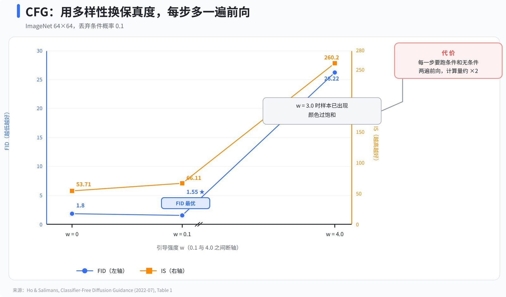
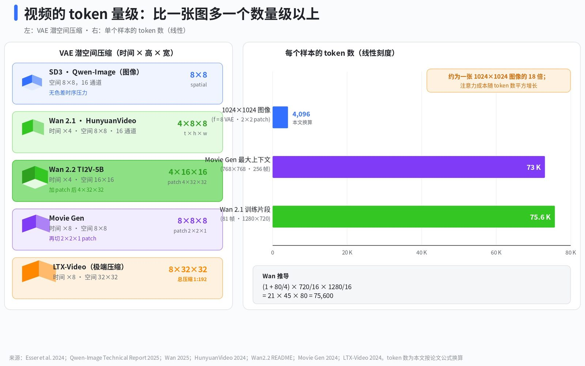
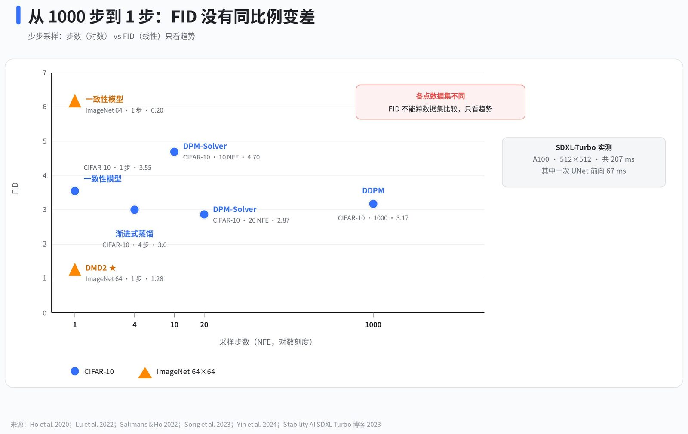
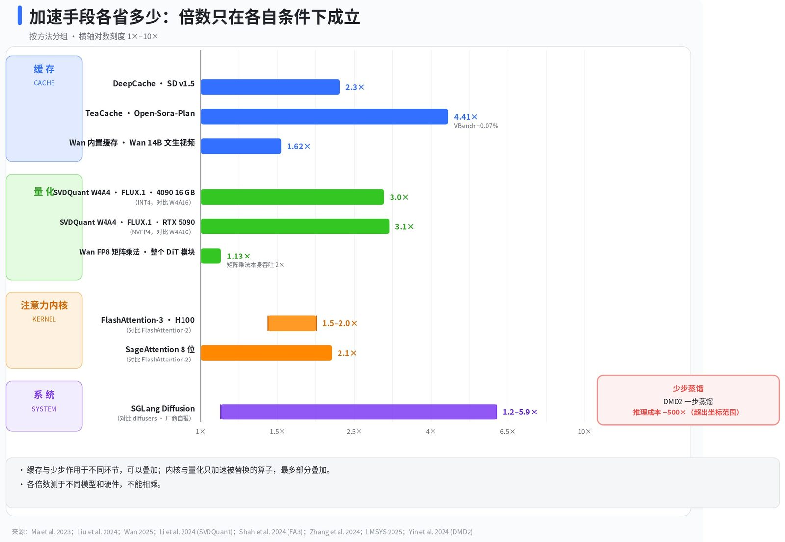
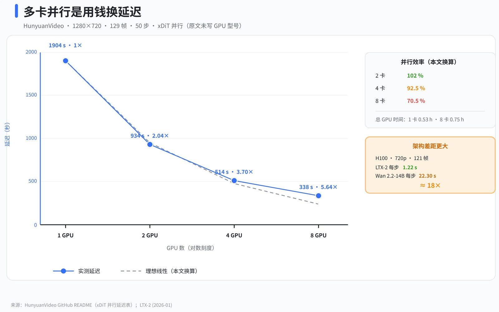
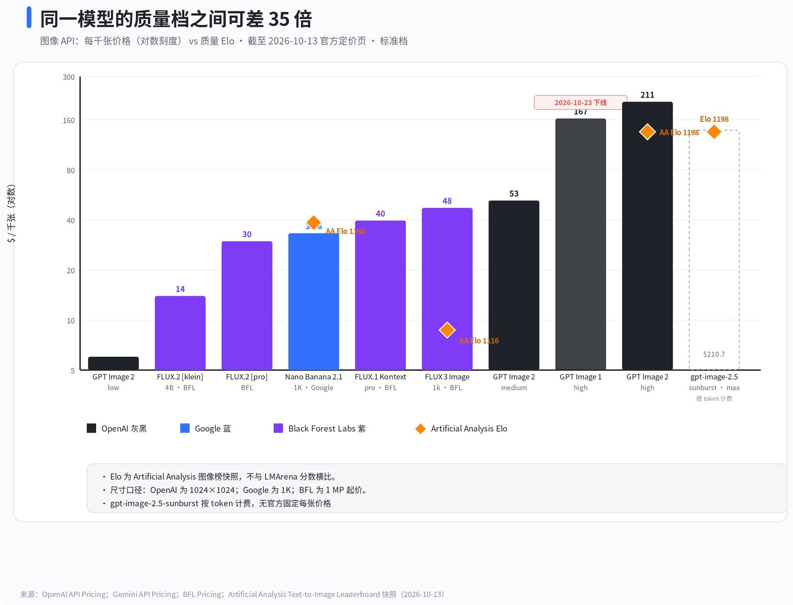
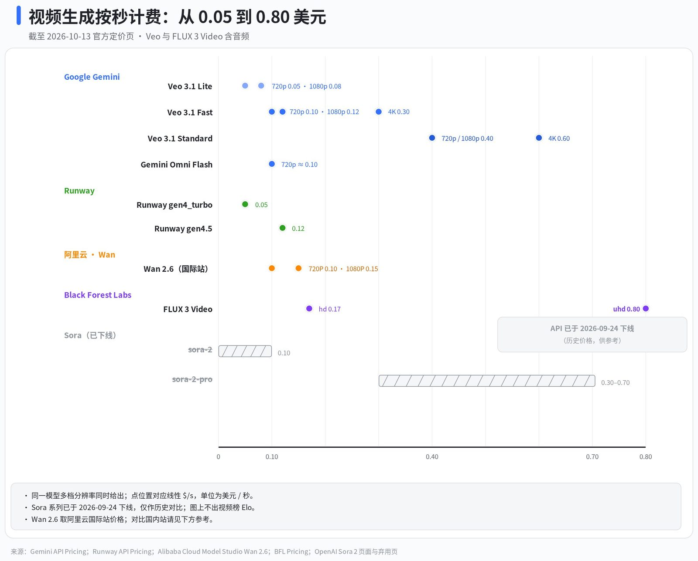
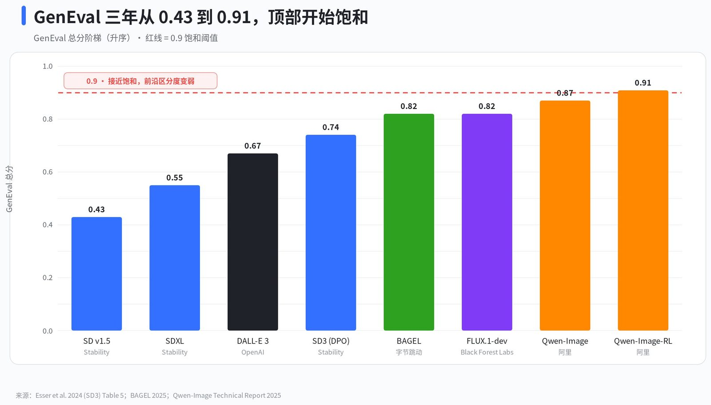
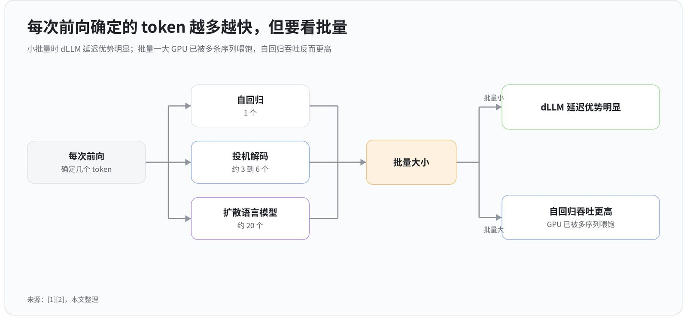
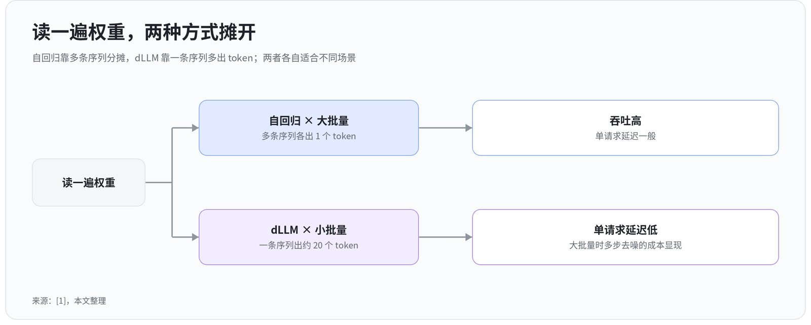

# LLM-42｜地基｜图像与视频生成：扩散、DiT 与推理加速

> 🎯 **这篇文档解决什么问题**：写给已经懂 Transformer、KV 缓存、量化和屋顶线模型的 LLM 工程师。图像和视频生成的推理和 LLM 很不一样：一次生成要跑 20–50 步去噪，每步往往还要两遍前向；瓶颈在算力而不在带宽；一段 5 秒视频的潜空间 token 数以万计；产品决策更多取决于单图单秒价格、许可证、API 弃用节奏和水印法规。本文只讲这些不一样的部分，数学只讲直觉。
>
> 使用方式：第 1–5 章建立心智模型，第 6–8 章讲加速与成本，第 9–11 章讲评测、定制与合规，第 11 章末尾是选型清单，第 12 章讲把扩散用到文本生成上的速度账。文中版本、价格和基准分数核对于 2026 年 10 月 13 日。

## 导读 · 先给结论

- **生成是多步迭代**。DDPM 采样要 1000 步[[1]](https://arxiv.org/abs/2006.11239)；今天的流匹配模型通常 20–50 步，开无分类器引导（CFG）时每步还要跑条件和无条件两遍[[2]](https://arxiv.org/abs/2207.12598)。成本可粗写为：步数 × CFG 倍数 × 单步 DiT 前向 + 文本编码 + VAE 解码。
- **瓶颈是算力**。DiT 每步对几千到几万个 token 做完整前向，没有 KV 解码。只量化权重省显存不省算力；SVDQuant 把激活也压到 4 位，在 16 GB 笔记本 RTX 4090 上跑 FLUX.1 比只量化权重快 3.0 倍[[3]](https://arxiv.org/abs/2411.05007)。
- **视频 token 高一到两个数量级**。81 帧 720p 的 Wan 训练片段约 75,600 个 token（本文换算）；序列长度 100 万时，注意力最多占训练时间的 95%[[4]](https://arxiv.org/abs/2503.20314)。
- **加速手段能叠加，但不能相乘**。DMD2 一步蒸馏把推理成本降低 500 倍仍超过教师[[5]](https://arxiv.org/abs/2405.14867)；特征缓存再省 1.6–4.4 倍[[6]](https://arxiv.org/abs/2411.19108)；量化和注意力内核只加速部分算子。
- **成本按张、按秒算**。截至 2026-10-13 官方定价页，GPT Image 2 一张 1024×1024 的图 0.006–0.211 美元[[7]](https://developers.openai.com/api/docs/pricing)，Veo 3.1 每秒 0.05–0.60 美元[[8]](https://ai.google.dev/gemini-api/docs/pricing)。
- **API 弃用很快**。DALL-E 2 / 3 于 2026-05-12 下线，gpt-image-1 于 2026-10-23 下线，Sora 视频 API 于 2026-09-24 下线且没有一对一替代[[9]](https://developers.openai.com/api/docs/deprecations)。
- **合规底线是标识加水印**。EU AI Act 第 50 条 2026-08-02 起适用[[10]](https://digital-strategy.ec.europa.eu/en/factpages/quick-facts-transparency-rules-ai-systems)，中国《人工智能生成合成内容标识办法》2025-09-01 起施行[[11]](https://www.cac.gov.cn/2025-03/14/c_1743654684782215.htm)。

📎 与系列其他文档的分工：「LLM 基础」第 6.8 节讲文本扩散语言模型、第 7.2–7.3 节概览自回归与扩散两条生成路线；「多模态与长上下文」讲图片和视频作为输入怎样被理解；「模型压缩与端侧部署」第 2 章讲数值格式；「自建推理成本与 GPU 选型」第 1–2 章讲每百万 token 成本公式和屋顶线。本文讲输出侧。

## 第 1 章 · 为什么 LLM 工程师要懂图像和视频生成

结论：生成图像和视频已是 LLM 产品的标准能力，但服务形态、成本结构和风险点都和文本推理不同。把 LLM 的直觉直接搬过来，最容易在显存估算、加速选型和成本核算上出错。

### 1.1 2026 年的格局

**闭源图像**由 OpenAI 和 Google 领跑。GPT Image 2.5 有 flare（主打速度）和 sunburst（主打编辑精度）两个变体，快照日期 2026-09-08[[12]](https://developers.openai.com/api/docs/guides/image-generation)；Google 的 Nano Banana 2.1 模型页标注 2026-10 更新[[13]](https://ai.google.dev/gemini-api/docs/models/gemini-nano-banana-2.1)。LMArena 文生图榜 2026-10-07 快照前三都是 OpenAI：sunburst 1425 分、flare 1398 分、gpt-image-2 1383 分，nano-banana-2.1 以 1328 分排第 6[[14]](https://lmarena.ai/leaderboard/text-to-image)。

**视频**方面，Veo 3.1 于 2025-10-15 进入 Gemini API 付费预览[[15]](https://developers.googleblog.com/introducing-veo-3-1-and-new-creative-capabilities-in-the-gemini-api/)，Kling 3.0 于 2026-02-05 发布[[16]](https://ir.kuaishou.com/news-releases/news-release-details/kling-ai-launches-30-model-ushering-era-where-everyone-can-be)，Seedance 2.0 于 2026-02-12 发布[[17]](https://seed.bytedance.com/en/blog/seedance-2-0-official-launch)；Sora 产品已于 2026-04-26 停止提供[[18]](https://openai.com/index/sora-2/)。**开源权重**的主力是 Qwen-Image[[19]](https://arxiv.org/abs/2508.02324)、FLUX 系列、Wan[[4]](https://arxiv.org/abs/2503.20314)、HunyuanVideo[[20]](https://github.com/Tencent-Hunyuan/HunyuanVideo) 和 LTX-2[[21]](https://arxiv.org/abs/2601.03233)，但 LMArena 上开源最高的 qwen-image-2512 只有 1125 分，比榜首低 300 分[[14]](https://lmarena.ai/leaderboard/text-to-image)。

### 1.2 与 LLM 服务的根本差异

| 维度 | LLM 推理 | 扩散 / 流匹配 DiT |
|---|---|---|
| 一次请求 | 预填充一次，逐 token 解码，输出越长步数越多 | 固定步数去噪（常见 20–50 步），每步对全部 token 做完整前向 |
| 瓶颈 | 解码受显存带宽限制 | 计算受限，没有 KV 解码 |
| 每步前向 | 一遍 | 开 CFG 时两遍，除非做了指导蒸馏 |
| 显存大头 | 权重加 KV 缓存 | 权重、大体积文本编码器、随 token 数增长的激活 |
| 成本单位 | 每百万 token | 每张图、每秒视频 |
| 产品风险 | 模型版本漂移 | API 弃用、许可证、版权与深度伪造、强制标识 |

📎 展开阅读：「LLM 基础」第 6.8 节（文本扩散语言模型，本文不再重复）和第 7.2–7.3 节（图像生成的两条路线与统一生成）。

## 第 2 章 · 扩散的数学直觉：从 DDPM 到概率流 ODE 与流匹配

结论：扩散模型学的是“从噪声走回数据”的方向场，采样就是沿方向场做数值积分。所以采样器本质上是微分方程求解器，步数就是积分步数。

### 2.1 前向加噪与反向去噪

DDPM 的前向过程往图片里逐步加高斯噪声，直到接近纯噪声；训练一个网络，看到任意一步的加噪图就预测其中的噪声。采样时从纯噪声出发，反复调用网络把噪声一点点减掉。论文所有实验都用 T = 1000 步，噪声强度 β 从 1e-4 线性增加到 0.02；在 CIFAR-10 上取得 FID 3.17，作者把它解释为一种渐进式有损解压，是自回归解码的推广[[1]](https://arxiv.org/abs/2006.11239)。工程上的关键数字是 1000：采样要顺序调用 1000 次网络，这是步数成本问题的根源。

### 2.2 Score SDE：采样器就是求解器

Song 等人把加噪写成随机微分方程（SDE），证明反向去噪只依赖分数（score），即对数概率密度的梯度，直观上是指向“更像真实数据”的箭头。每个这样的 SDE 都对应一条确定性的“概率流”常微分方程（ODE），可以精确算似然，也能用更少步数采样[[22]](https://arxiv.org/abs/2011.13456)。步数少就是积分步长大，轨迹弯的地方误差就大。所以提速有两条路：换更好的求解器（第 6.1 节），或者把轨迹拉直。

### 2.3 流匹配与 Rectified Flow：把轨迹拉直

流匹配（Flow Matching）直接回归一个速度场，让样本沿选定的概率路径从噪声流向数据；高斯路径把扩散作为特例包含在内，最优传输路径训练和采样都更快[[23]](https://arxiv.org/abs/2210.02747)。Rectified Flow 学一条连接噪声和数据的直线，直线最短，粗步长也能走准；再做 reflow 可进一步拉直，通向少步甚至一步生成[[24]](https://arxiv.org/abs/2209.03003)。SD3[[25]](https://arxiv.org/abs/2403.03206) 和 Wan[[4]](https://arxiv.org/abs/2503.20314) 都基于这一族方法。

📎 展开阅读：「LLM 数学补课」第 3 章（期望、方差与蒙特卡洛估计）和第 4.4 节（KL 散度）。

> 💡 **常见误区**：把步数类比成 LLM 的输出 token 数。步数是对同一批 token 反复精修的次数，与输出大小无关；输出大小体现在每步的 token 数上，两者相乘才是总计算量。

## 第 3 章 · 潜空间与架构：VAE、CFG、DiT 与 MM-DiT

结论：现代模型由三部分组成：把像素压成潜变量的 VAE、负责去噪的 Transformer、把提示词变成条件的文本编码器。VAE 决定 token 数，DiT 决定每个 token 的计算量，文本编码器常是显存里被忽略的一大块。

### 3.1 为什么在潜空间里做扩散

像素空间扩散要消耗数百个 GPU 天。LDM 先训练自编码器把图压进潜空间，再在潜空间做扩散；下采样因子 f 取 4 到 16 最合适，f = 32 压缩过度、限制质量[[26]](https://arxiv.org/abs/2112.10752)。通道数也重要：SD3 的 VAE 取 f = 8，比较了 4、8、16 通道，重建 FID 分别为 2.41、1.56、1.06，最终选 16 通道，代价是需要更大的模型容量[[25]](https://arxiv.org/abs/2403.03206)。

### 3.2 CFG：质量旋钮，也是两倍成本

无分类器引导训练时随机丢掉条件，让模型同时学会条件和无条件生成；采样时按引导强度 w 把两个预测外推组合。ImageNet 64×64 上，w = 0 时 FID 1.8、IS 53.71；w = 0.1 时 FID 1.55 最优；w = 4 时 IS 升到 260.2，FID 却恶化到 26.22；w = 3 时已出现颜色过饱和[[2]](https://arxiv.org/abs/2207.12598)。也就是说，引导用多样性换保真度。工程代价是每步两遍前向，计算量约翻倍；去掉这一倍的办法是指导蒸馏（第 6.3 节）、CFG 并行（第 7.4 节）和 CFG 缓存（第 7.1 节）。

### 3.3 DiT 与 MM-DiT

DiT 把潜变量切成 patch，每块作为一个 token 送进标准 Transformer，用 adaLN-Zero 注入时间步条件。FID 随 Gflops 稳定下降；DiT-XL/2 以 118.6 Gflops 在 ImageNet 256×256 上取得 FID 2.27[[27]](https://arxiv.org/abs/2212.09748)。按 f = 8 的 VAE 加 patch 大小 2 换算，一张 1024×1024 的图对应 64×64 = 4,096 个 token（本文换算）。DiT 每一步都是对这样一段序列做完整前向，形态接近 LLM 的预填充，而且要重复几十步。

SD3 的 MM-DiT 给文本和图像 token 各配一套权重，在注意力里拼接做双向联合注意力；训练用 Rectified Flow。模型扩到 8B 参数、5×10^22 训练 FLOPs，验证损失与 GenEval 和人类偏好相关，未见饱和[[25]](https://arxiv.org/abs/2403.03206)。Qwen-Image 沿用这一结构，是 20B 参数的双流 MMDiT[[19]](https://arxiv.org/abs/2508.02324)。

### 3.4 文本编码器越来越大

SD3 同时用两个 CLIP 和 4.7B 参数的 T5-XXL；T5 推理时可去掉，损失主要在图中文字；单是 T5 预编码就占 19.05 GB 显存[[25]](https://arxiv.org/abs/2403.03206)。之后的模型改用多模态大模型当编码器：Qwen-Image 用冻结的 Qwen2.5-VL 7B[[19]](https://arxiv.org/abs/2508.02324)，LTX-2 用 Gemma3-12B[[21]](https://arxiv.org/abs/2601.03233)，Wan 用多语种的 umT5[[4]](https://arxiv.org/abs/2503.20314)。部署时要把文本编码器当作一个独立的大模型来规划显存。

📎 展开阅读：「多模态与长上下文」第 1–2 章讲理解模型怎样把图片切成 token，那是输入侧；这里的 patch 切在 VAE 潜变量上。

## 第 4 章 · 自回归与统一模型：GPT Image、Nano Banana、VAR 与 BAGEL

结论：闭源前沿模型都以“原生多模态”面世，但都没有公开图像解码器是自回归还是扩散；开源研究的主流是“大模型理解和规划、扩散出像素”的混合结构。选型不必押注路线，按任务看即可。

### 4.1 闭源：OpenAI 与 Google

GPT-4o 图像生成于 2025-03-25 发布，官方称它原生多模态，能正确处理 10–20 个物体（其他系统约 5–8 个），渲染常需最多 1 分钟，所有图带 C2PA 元数据[[28]](https://openai.com/index/introducing-4o-image-generation/)。OpenAI 文档写明，gpt-image-2 之前的模型先生成专门的图像 token，延迟和成本都与 token 数成正比；gpt-image-1 生成 1024×1024 的图，low、medium、high 三档分别是 272、1056、4160 个 token[[12]](https://developers.openai.com/api/docs/guides/image-generation)。GPT Image 2.5 提供 low 到 max 多个质量档，官方提示复杂提示词可能要 2 分钟[[12]](https://developers.openai.com/api/docs/guides/image-generation)。

Google 的 Gemini 2.5 Flash Image（nano-banana）于 2025-08-26 发布，每张图 1290 个输出 token，合 0.039 美元，所有输出带 SynthID 水印[[29]](https://developers.googleblog.com/en/introducing-gemini-2-5-flash-image/)。最新的 Nano Banana 2.1 接受文本、图像、视频和 PDF 输入，输入上限 131,072 个 token[[13]](https://ai.google.dev/gemini-api/docs/models/gemini-nano-banana-2.1)。这一系列的架构没有公开技术报告。

### 4.2 开源研究路线

- **VAR**：把“下一个 token”改成“下一个尺度”，先生成低分辨率 token 图再逐级放大。ImageNet 256×256 上 FID 从自回归基线的 18.65 降到 1.73，推理快约 20 倍，并超过 DiT[[30]](https://arxiv.org/abs/2404.02905)。
- **BAGEL**（字节跳动 Seed）：仅解码器的 Transformer 专家混合（MoT），激活 7B、总计 14B；GenEval 0.82，加提示词改写后 0.88[[31]](https://arxiv.org/abs/2505.14683)。
- **Qwen-Image**：冻结的 Qwen2.5-VL 做编码器，后接 20B MMDiT，属于“大模型理解 + 扩散出图”的混合结构[[19]](https://arxiv.org/abs/2508.02324)。

### 4.3 什么时候选哪条路线

| 任务 | 更占优的路线 | 依据 |
|---|---|---|
| 多物体、复杂指令 | 原生多模态 | 4o 能处理 10–20 个物体[[28]](https://openai.com/index/introducing-4o-image-generation/) |
| 图中文字，尤其中文 | 大模型编码器 + DiT | Qwen-Image 中文字渲染总分 58.30，GPT Image 1（high）36.14[[19]](https://arxiv.org/abs/2508.02324) |
| 多轮编辑 | 统一模型或上下文编辑 | 见第 10.2 节 |
| 开源部署、少步、视频 | 扩散 / 流匹配 DiT | 蒸馏、缓存、量化工具链成熟（第 6–7 章） |

📎 展开阅读：「LLM 基础」第 7.3 节（全模态与统一生成）。

## 第 5 章 · 视频生成：时空 VAE、3D 注意力与音画同出

结论：视频模型就是跑在时空潜变量上的 DiT。时间维再乘一次 token 数，注意力又是平方复杂度，所以视频的成本问题比图像严重一到两个数量级。各家的设计取舍几乎都围绕“少一点 token、少算一点注意力”。

### 5.1 时空 VAE 与 token 算术

Sora 技术报告确立了范式：视频压缩网络同时压缩时间和空间，再对潜变量切“时空 patch”，交给扩散 Transformer；视频和图像混合训练，最长生成 1 分钟[[32]](https://openai.com/index/video-generation-models-as-world-simulators/)。开源模型给出了能算账的数字。Wan 2.1 的 VAE 在时间、高、宽上分别压缩 4、8、8 倍，再按 `(1,2,2)` 切 patch，token 数为 `L = (1 + T/4) × H/16 × W/16`，典型训练片段是 81 帧、1280×720[[4]](https://arxiv.org/abs/2503.20314)。代入（本文换算）：时间 1 + 80 / 4 = 21，高 720 / 16 = 45，宽 1280 / 16 = 80，合计 21 × 45 × 80 = 75,600 个 token，约为一张 1024×1024 图像的 18 倍。Movie Gen 的最大上下文是 73K 个 token，对应 768×768、256 帧[[33]](https://arxiv.org/abs/2410.13720)。

| 模型 | VAE 压缩（时间 × 高 × 宽） | 备注 |
|---|---|---|
| SD3、Qwen-Image（图像） | 空间 8×8 | 16 通道[[25]](https://arxiv.org/abs/2403.03206)[[19]](https://arxiv.org/abs/2508.02324) |
| Wan 2.1、HunyuanVideo | 4×8×8 | 3D 因果 VAE，16 通道[[4]](https://arxiv.org/abs/2503.20314)[[20]](https://github.com/Tencent-Hunyuan/HunyuanVideo) |
| Wan 2.2 TI2V-5B | 4×16×16 | 加 patch 后总压缩 4×32×32[[34]](https://github.com/Wan-Video/Wan2.2) |
| Movie Gen | 8×8×8 | 再切 2×2×1 patch[[33]](https://arxiv.org/abs/2410.13720) |
| LTX-Video | 8×32×32（1:192） | patch 切分并入 VAE[[35]](https://arxiv.org/abs/2501.00103) |

LTX-Video 是极端压缩的代表，由 VAE 解码器顺带完成最后一步去噪，在一张 H100 上 2 秒生成 5 秒、768×512 的视频，快于实时[[35]](https://arxiv.org/abs/2501.00103)。

📎 展开阅读：「多模态与长上下文」第 5.2 节讲视频作为输入时的 token 预算，可与这里输出侧的算法对照。

### 5.2 3D 全注意力是计算大头

Wan 报告：DiT 占训练计算的 85% 以上；每层成本由线性项（正比于 s·h²）和注意力项（正比于 s²·h）组成，s 是序列长度；序列长度达到 100 万时，注意力最多占端到端训练时间的 95%[[4]](https://arxiv.org/abs/2503.20314)。帧数或分辨率翻倍，注意力成本就变成四倍。这与 LLM 解码正好相反：解码每步只处理一个新 token，瓶颈是读权重的带宽；视频 DiT 每步处理几万个 token，瓶颈是算力，选 GPU 应更看重 FLOPS。

📎 展开阅读：「自建推理成本与 GPU 选型」第 2.2 节（屋顶线与批大小）和第 4.1 节（推理卡规格）。

### 5.3 按噪声段分工的 MoE

Wan 2.2 A14B 用高噪声专家负责早期去噪、低噪声专家负责后期去噪，各约 14B，总计 27B，每步激活 14B，按所引 T2V-A14B 配置与代码，在 boundary = 0.875 × num_train_timesteps 处切换（README 措辞有歧义；不是 SNR 最小值的一半，也不是采样步数的 87.5%）[[34]](https://github.com/Wan-Video/Wan2.2)。LLM 的 MoE 按 token 路由，这里按时间步路由。部署门槛仍高：A14B 单卡至少需要 80 GB 显存（且要开启卸载），而 TI2V-5B 在 24 GB 的 RTX 4090 上就能跑[[34]](https://github.com/Wan-Video/Wan2.2)。

### 5.4 音画同出

“视频带声音”已成为默认能力。Movie Gen 的音频还是一个独立的 13B 模型[[33]](https://arxiv.org/abs/2410.13720)；Veo 3.1 原生生成更丰富的音频[[15]](https://developers.googleblog.com/introducing-veo-3-1-and-new-creative-capabilities-in-the-gemini-api/)；Sora 2 生成同步的对白和音效[[18]](https://openai.com/index/sora-2/)；LTX-2 开源了 14B 视频流加 5B 音频流的双流 DiT，最长 20 秒[[21]](https://arxiv.org/abs/2601.03233)；Kling 3.0 最长 15 秒，原生多语种音频[[16]](https://ir.kuaishou.com/news-releases/news-release-details/kling-ai-launches-30-model-ushering-era-where-everyone-can-be)；Seedance 2.0 最多输入 9 张图、3 段视频、3 段音频加文本，输出 15 秒多镜头视频和双声道音频[[17]](https://seed.bytedance.com/en/blog/seedance-2-0-official-launch)。

> 💡 **常见误区**：用理解模型的 token 预算估算视频生成。理解模型每秒可能只取一两帧；生成模型的 7.5 万个 token 每步都全部参与注意力，还要重复几十步。估算要用“token 数的平方 × 步数 × CFG 倍数”。

## 第 6 章 · 推理加速 I：少步采样与蒸馏

结论：减少步数是收益最大的加速手段。免训练的求解器能降到 10–50 步，步数蒸馏能再降到 1–8 步，并可顺带去掉 CFG 的第二遍。代价是额外训练，而且蒸馏版通常固定了引导强度。

### 6.1 免训练：更好的求解器

DPM-Solver 是专为扩散 ODE 设计的高阶求解器，10–20 次函数评估（NFE）即可：CIFAR-10 上 10 次 FID 4.70，20 次 FID 2.87，比之前的免训练采样器快 4–16 倍[[36]](https://arxiv.org/abs/2206.00927)。今天的流匹配模型通常用欧拉法走 20–50 步，HunyuanVideo 官方示例用 50 步[[20]](https://github.com/Tencent-Hunyuan/HunyuanVideo)；Movie Gen 用“线性-二次”时间表，以 50 步达到 250 步线性时间表的效果[[33]](https://arxiv.org/abs/2410.13720)，说明时间表本身就是加速旋钮。

### 6.2 步数蒸馏

| 方法 | 时间 | 步数 | 关键结果 |
|---|---|---|---|
| 渐进式蒸馏 | 2022-02 | 4 | 每轮步数减半，从 8192 步降到 4 步，CIFAR-10 上 FID 3.0；总蒸馏成本不超过原始训练[[37]](https://arxiv.org/abs/2202.00512) |
| 一致性模型 | 2023-03 | 1 | 把任意噪声点直接映射回数据；一步 FID 在 CIFAR-10 上 3.55，ImageNet 64 上 6.20[[38]](https://arxiv.org/abs/2303.01469) |
| SDXL-Turbo | 2023-11 | 1–4 | 人工评测中 4 步胜过 50 步的 SDXL[[39]](https://stability.ai/news/stability-ai-sdxl-turbo) |
| DMD2 | 2024-05 | 1 至数步 | ImageNet 64 上 FID 1.28，推理成本降 500 倍仍超过教师；可把 SDXL 蒸馏成百万像素级少步模型[[5]](https://arxiv.org/abs/2405.14867) |

SDXL-Turbo 在 A100 上生成一张 512×512 的图共 207 毫秒，其中一次 UNet 前向只占 67 毫秒[[39]](https://stability.ai/news/stability-ai-sdxl-turbo)。步数降到 1 之后，文本编码和 VAE 解码反而成了大头。

上图各点来自 CIFAR-10 和 ImageNet 64 两个数据集，FID 不能跨数据集比较，只看趋势：步数从 1000 降到 1，FID 并没有同比例变差。

### 6.3 指导蒸馏：去掉 CFG 第二遍

指导蒸馏把带引导的两遍前向蒸馏进一遍，引导强度作为输入条件。HunyuanVideo 的 `--embedded-cfg-scale 6.0` 参数就是这种做法[[20]](https://github.com/Tencent-Hunyuan/HunyuanVideo)。LTX-2 的蒸馏版同时做了步数和指导蒸馏：8 步、CFG = 1，单步成本直接减半[[21]](https://arxiv.org/abs/2601.03233)。

### 6.4 生产中的少步模型

- <b>FLUX.1 [schnell]</b>：12B，潜空间对抗扩散蒸馏，1–4 步，Apache-2.0[[40]](https://huggingface.co/black-forest-labs/FLUX.1-schnell)。
- **LTX-2 蒸馏版**：8 步、CFG = 1，另提供 FP8 和 NVFP4 权重[[21]](https://arxiv.org/abs/2601.03233)。
- **Seedance 1.0**：多阶段蒸馏加系统优化带来约 10 倍加速，在 NVIDIA L20 上 41.4 秒生成 5 秒 1080p 视频[[41]](https://arxiv.org/abs/2506.09113)。

上线前要在自己的提示词集上对比蒸馏版和原版，蒸馏版通常不能再靠调 w 来换多样性或保真度。

📎 展开阅读：「模型压缩与端侧部署」第 8 章讲 LLM 的知识蒸馏，目标是把能力压进小模型；这里的步数蒸馏目标是减少步数，模型大小通常不变。

## 第 7 章 · 推理加速 II：缓存、量化、注意力内核与多卡并行

结论：步数定下来后，其他手段分别攻击单步成本的不同部分。缓存免训练就能省 1.6–4.4 倍；量化在 DiT 上必须把激活也压低才能提速；注意力内核只加速注意力；多卡并行降的是延迟，不是成本。

### 7.1 特征缓存

相邻两步的中间特征往往变化很小，缓存方法在变化小的步直接复用上一步的结果。DeepCache 复用 U-Net 高层特征，SD v1.5 上加速 2.3 倍，CLIP Score 只降 0.05[[42]](https://arxiv.org/abs/2312.00858)。TeaCache 用时间步嵌入调制后的输入差异判断何时复用，在 Open-Sora-Plan 上最高加速 4.41 倍，VBench 只降 0.07%[[6]](https://arxiv.org/abs/2411.19108)。Wan 14B 内置注意力缓存和 CFG 缓存，文生视频加速 1.62 倍，报告称在验证过的步上无损[[4]](https://arxiv.org/abs/2503.20314)。SGLang 集成的 Cache-DiT 自报最多提速 169%[[43]](https://www.lmsys.org/blog/2025-11-07-sglang-diffusion/)。

### 7.2 量化与注意力内核

LLM 解码受带宽限制，只量化权重（W4A16）就能提速。DiT 是计算受限的，W4A16 算之前要把权重还原成 16 位，省不了算力；要用上 4 位张量核心，激活也得是 4 位。SVDQuant 先把激活离群值平移到权重上，再用一条高精度低秩分支吸收难量化的部分，实现 W4A4，加载 LoRA 无需重新量化；FLUX.1 12B 显存降低 3.5 倍，在 16 GB 笔记本 RTX 4090 上（INT4）比 W4A16 快 3.0 倍，在 RTX 5090 上（NVFP4）快 3.1 倍[[3]](https://arxiv.org/abs/2411.05007)。配合 4 位文本编码器和逐层卸载，FLUX 最低只需 4 GiB 显存[[44]](https://github.com/nunchaku-tech/nunchaku)。FP8 更稳妥：Wan 的 FP8 矩阵乘法吞吐是 BF16 的 2 倍，整个 DiT 模块快 1.13 倍[[4]](https://arxiv.org/abs/2503.20314)；HunyuanVideo 的 FP8 权重省约 10 GB[[20]](https://github.com/Tencent-Hunyuan/HunyuanVideo)。

视频的时间主要花在注意力上，所以内核对视频收益更大。FlashAttention-3 在 H100 上比 FlashAttention-2 快 1.5–2.0 倍，FP8 接近 1.2 PFLOPs/s[[45]](https://arxiv.org/abs/2407.08608)；但 Wan 发现直接用它的 FP8 模式会降低视频质量，最终改为 QK^T 用 INT8、PV 用 FP8、FP32 累加[[4]](https://arxiv.org/abs/2503.20314)。SageAttention 用 8 位注意力，比 FlashAttention-2 快约 2.1 倍，图像和视频生成端到端几乎无损[[46]](https://arxiv.org/abs/2410.02367)。

📎 展开阅读：「模型压缩与端侧部署」第 2 章（FP8、MXFP4、NVFP4 等格式）；「LLM 数学补课」第 7.3 节（FlashAttention 依赖的在线 softmax）。

### 7.3 各手段怎样叠加

下图的倍数都是在各自的模型和硬件上测的，不能相乘得出总加速比。规律有三条：

- **少步和缓存可以叠加**：一个减少步数，一个减少每步要重算的部分。
- **内核和量化最多部分叠加**：它们只加速被替换的算子。Wan 的 FP8 矩阵乘法吞吐翻倍，整个 DiT 模块只快 1.13 倍[[4]](https://arxiv.org/abs/2503.20314)。
- **步数降到个位数后，固定开销变成大头**：SDXL-Turbo 一步出图的 207 毫秒里，UNet 前向只占 67 毫秒[[39]](https://stability.ai/news/stability-ai-sdxl-turbo)。

### 7.4 多卡并行

xDiT 混合使用序列并行（USP，统一了 Ulysses 和 Ring Attention）、PipeFusion（按 patch 切分的流水线）、CFG 并行（两张卡分别跑条件和无条件前向）和并行 VAE，首次展示了 DiT 在以太网上的扩展[[47]](https://arxiv.org/abs/2411.01738)。SGLang 的经验是，Qwen-Image 和 Wan 在常规步数下，CFG 并行是最可靠的多卡加速，延迟优于序列并行[[43]](https://www.lmsys.org/blog/2025-11-07-sglang-diffusion/)。HunyuanVideo 公布了用 xDiT 生成 1280×720、129 帧、50 步视频的延迟（原文未写 GPU 型号）[[20]](https://github.com/Tencent-Hunyuan/HunyuanVideo)：

| GPU 数 | 延迟（秒） | 加速比 | 并行效率（本文换算） |
|---|---|---|---|
| 1 | 1904.08 | 1.00 | 100% |
| 2 | 934.09 | 2.04 | 102% |
| 4 | 514.08 | 3.70 | 92.5% |
| 8 | 337.58 | 5.64 | 70.5% |

8 卡把延迟从约 32 分钟压到不到 6 分钟，总 GPU 时间却从 0.53 小时增加到 0.75 小时（本文换算），所以并行是用钱换延迟。架构的差距可能更大：在 H100、720p、121 帧的条件下，LTX-2 每步 1.22 秒，Wan 2.2-14B 每步 22.30 秒，相差约 18 倍[[21]](https://arxiv.org/abs/2601.03233)。

## 第 8 章 · 部署与成本：框架、显存与单图单秒价格

结论：自部署的显存大头是权重和文本编码器，视频还要加上随 token 数增长的激活。API 在 2026-10 的价格区间是每张图约 0.005–0.6 美元、每秒视频 0.05–0.8 美元。自部署只有在做了少步和缓存、流量又稳定时才比 API 便宜；API 的弃用节奏则要当作一项成本来管理。

### 8.1 服务框架

- **diffusers**：Hugging Face 的参考实现，适合验证和原型。
- **ComfyUI**：节点图界面，常用于搭创作工作流，Wan 2.2 发布时即有官方集成[[34]](https://github.com/Wan-Video/Wan2.2)。
- **xDiT**：DiT 多卡并行引擎，HunyuanVideo 用它做多卡推理[[47]](https://arxiv.org/abs/2411.01738)[[20]](https://github.com/Tencent-Hunyuan/HunyuanVideo)。
- **SGLang Diffusion**：2025-11-07 发布，支持 Wan、Hunyuan、Qwen-Image、FLUX 等，提供 OpenAI 兼容 API，首发时比 diffusers 快 1.2–5.9 倍（厂商自报），支持 NVIDIA、AMD、昇腾、Apple Silicon 等平台[[43]](https://www.lmsys.org/blog/2025-11-07-sglang-diffusion/)。
- **Nunchaku**：SVDQuant 的 4 位推理引擎[[44]](https://github.com/nunchaku-tech/nunchaku)。

### 8.2 显存估算

这里没有 KV 缓存，显存由 DiT 权重、文本编码器权重和激活三块组成。图像的主要矛盾是权重；视频的激活与每个样本的 token 数成正比，要用 FSDP 或序列并行切分，VAE 也要分块解码。下表“BF16 权重”按参数量 × 2 字节换算，不含激活。

| 模型 | 参数 | BF16 权重（本文换算） | 文档给出的显存 |
|---|---|---|---|
| FLUX.1 [schnell] | 12B[[40]](https://huggingface.co/black-forest-labs/FLUX.1-schnell)，另加 T5-XXL 4.7B | 约 24 GB 加 9.4 GB | 4 位加卸载后最低 4 GiB[[44]](https://github.com/nunchaku-tech/nunchaku) |
| Qwen-Image | 20B，另加 7B 编码器[[19]](https://arxiv.org/abs/2508.02324) | 约 40 GB 加 14 GB | 以模型卡为准 |
| Wan 2.1 1.3B | 1.3B[[4]](https://arxiv.org/abs/2503.20314) | 约 2.6 GB | 8.19 GB[[4]](https://arxiv.org/abs/2503.20314) |
| Wan 2.2 A14B / TI2V-5B | 总计 27B / 5B[[34]](https://github.com/Wan-Video/Wan2.2) | 约 54 GB / 10 GB | 单卡至少 80 GB（开卸载）/ 24 GB[[34]](https://github.com/Wan-Video/Wan2.2) |
| HunyuanVideo | 超过 13B[[20]](https://github.com/Tencent-Hunyuan/HunyuanVideo) | 约 26 GB | 720p、129 帧峰值 60 GB；FP8 省约 10 GB[[20]](https://github.com/Tencent-Hunyuan/HunyuanVideo) |

HunyuanVideo 一行最能说明问题：权重约 26 GB，峰值却到 60 GB，多出来的是激活、文本编码器和 VAE。

📎 展开阅读：「自建推理成本与 GPU 选型」第 3 章（显存账）。

### 8.3 图像 API 价格

截至 2026-10-13 官方定价页的标准档价格，单位美元每张。OpenAI 和 Google 底层按输出 token 计费，表中是官方换算的每张价格；Black Forest Labs 按百万像素计费，1024×1024 约 1 MP。

| 模型 | 价格（每张） | 备注 |
|---|---|---|
| GPT Image 2 | 1024×1024：low 0.006 / medium 0.053 / high 0.211 | 输出每百万 token 30 美元[[7]](https://developers.openai.com/api/docs/pricing) |
| GPT Image 1 | 1024×1024：low 0.011 / medium 0.042 / high 0.167 | 2026-10-23 下线[[9]](https://developers.openai.com/api/docs/deprecations) |
| GPT Image 2.5 | 按 token 计费，输出每百万 30 美元，官方无固定每张价格 | [[7]](https://developers.openai.com/api/docs/pricing) |
| Nano Banana 2.1 | 1K 0.0336 / 2K 0.0504 / 4K 0.113 | Batch 半价[[8]](https://ai.google.dev/gemini-api/docs/pricing) |
| Nano Banana Pro | 1K / 2K 0.134，4K 0.24 | [[8]](https://ai.google.dev/gemini-api/docs/pricing) |
| FLUX.2 | [klein] 4B 起 0.014，[pro] 起 0.03，[max] 起 0.07 | 按 MP 向上取整[[48]](https://docs.bfl.ai/quick_start/pricing) |
| FLUX 3 Image | 1k 0.048，4k 0.607 | [[48]](https://docs.bfl.ai/quick_start/pricing) |
| FLUX.1 Kontext | [pro] 0.04，[max] 0.08 | 编辑模型[[48]](https://docs.bfl.ai/quick_start/pricing) |

同一模型的质量档之间可差 35 倍（GPT Image 2 low 与 high），比厂商之间的差距还大。先定业务需要的质量档，再比价。把价格和质量放在一起看，Artificial Analysis 图像榜快照中 sunburst（max 档）1198 分、每千张 210.7 美元，Nano Banana 2.1 1160 分、每千张 33.6 美元，FLUX 3 Image 1116 分、每千张 48 美元[[49]](https://artificialanalysis.ai/text-to-image)。

### 8.4 视频 API 价格

截至 2026-10-13 官方定价页，单位美元每秒。

| 模型 | 价格（每秒） | 备注 |
|---|---|---|
| Veo 3.1 Standard / Fast / Lite | 0.40（4K 0.60）/ 0.10–0.30 / 0.05–0.08 | 含音频，Lite 无 4K[[8]](https://ai.google.dev/gemini-api/docs/pricing) |
| Gemini Omni Flash | 720p 约 0.10 | 每秒 5,792 个 token[[8]](https://ai.google.dev/gemini-api/docs/pricing) |
| Runway gen4.5 / gen4_turbo | 0.12 / 0.05 | [[50]](https://docs.dev.runwayml.com/guides/pricing/) |
| Wan 2.6（阿里云国际站） | 720P 0.10，1080P 0.15 | 最长 15 秒[[51]](https://www.alibabacloud.com/help/en/model-studio/wan2-6-t2v) |
| FLUX 3 Video | hd 0.17 至 uhd 0.80 | 含同步音频[[48]](https://docs.bfl.ai/quick_start/pricing) |
| sora-2 / sora-2-pro | 0.10 / 0.30–0.70（历史价格） | API 已于 2026-09-24 下线[[18]](https://openai.com/index/sora-2/)  |

### 8.5 自部署还是 API：一个算例

HunyuanVideo 生成 720p、129 帧（按 24 fps 约 5.4 秒）的视频，单卡 1904 秒，即每条 0.53 GPU 小时[[20]](https://github.com/Tencent-Hunyuan/HunyuanVideo)。原文没写 GPU 型号，这里假设租用价每 GPU 小时 2–3 美元，单条约 1.1–1.6 美元（本文换算，未做蒸馏和缓存）。对照 API，Veo 3.1 Fast 1080p 5 秒是 0.60 美元[[8]](https://ai.google.dev/gemini-api/docs/pricing)，Wan 2.6 720P 5 秒是 0.50 美元[[51]](https://www.alibabacloud.com/help/en/model-studio/wan2-6-t2v)。也就是说，50 步的原版开源视频模型单条成本约是 API 的 2–3 倍（本文换算，基于上述租价假设）。要反过来，得同时满足：少步或缓存把 GPU 时间降到几分之一；流量稳定、利用率高；业务确实需要 API 给不了的东西（LoRA 定制、数据不出域）。

📎 展开阅读：「自建推理成本与 GPU 选型」第 6 章（自建与 API 的盈亏平衡），把“每百万 token”换成“每张”或“每秒”即可套用。

### 8.6 弃用时间线

| 模型或服务 | 下线日期 | 说明 |
|---|---|---|
| dall-e-2、dall-e-3 | 2026-05-12 | [[9]](https://developers.openai.com/api/docs/deprecations) |
| sora-2、sora-2-pro 与 Videos API | 2026-09-24 | 无一对一替代[[9]](https://developers.openai.com/api/docs/deprecations) |
| Gemini 2.5 Flash Image | 2026-10-02 | [[8]](https://ai.google.dev/gemini-api/docs/pricing) |
| gpt-image-1 | 2026-10-23 | [[9]](https://developers.openai.com/api/docs/deprecations) |
| gpt-image-1-mini、gpt-image-1.5、chatgpt-image-latest | 2026-12-01 | 替代为 gpt-image-2.5 系列[[9]](https://developers.openai.com/api/docs/deprecations) |

2026-05 到 2026-10 这半年里，OpenAI 下线了 DALL-E 2 / 3、gpt-image-1 和整套视频 API，Google 也下线了第一代 Nano Banana。接入时应把提示词、参数和评测集与具体模型解耦，并预留迁移的工作量。

## 第 9 章 · 评测：FID 为什么不够，以及怎样读竞技场 Elo

结论：前面引用的 ImageNet 或 CIFAR-10 FID 是研发指标，不是产品质量指标。选型要看组合能力基准、人类偏好竞技场和自己提示词上的盲评；竞技场分数只能在同一个榜、同一次快照里比较。

### 9.1 FID 及其局限

FID 把真实图集和生成图集分别送进 Inception-v3，把特征拟合成两个高斯分布，计算两者的 Fréchet 距离[[52]](https://arxiv.org/abs/1706.08500)。Google 的研究指出，FID 与人类评分矛盾，反映不出文生图模型的逐步改进，依赖不成立的正态假设，样本复杂度也差，并提出用 CLIP 特征加最大均值差异的 CMMD 替代[[53]](https://arxiv.org/abs/2401.09603)。此外，不同数据集、不同分辨率的 FID 互不可比。

### 9.2 组合能力基准

GenEval 以物体为中心，检查共现、位置、数量和颜色，用现成的目标检测器自动判分，分数在 0 到 1 之间[[54]](https://arxiv.org/abs/2310.11513)。VBench 是视频生成基准，把质量拆成 16 个层级化维度并与人类偏好对齐[[55]](https://arxiv.org/abs/2311.17982)。GenEval 的阶梯展示了三年的进步：SD v1.5 0.43，SDXL 0.55，DALL-E 3 0.67，SD3（DPO 后）0.74[[25]](https://arxiv.org/abs/2403.03206)；BAGEL 和 FLUX.1-dev 0.82[[31]](https://arxiv.org/abs/2505.14683)；Qwen-Image 0.87，强化学习后 0.91[[19]](https://arxiv.org/abs/2508.02324)。顶部接近 0.9，区分度变弱，前沿比较只能交给竞技场。

### 9.3 竞技场 Elo 怎么读

LMArena 文生图榜是公开众包投票，2026-10-07 快照共 6,604,125 票、82 个模型[[14]](https://lmarena.ai/leaderboard/text-to-image)。Artificial Analysis 图像榜（v2.0）以 FLUX.2 [dev] = 1000 分为锚点，数据来自招募评审和 2026-01-01 前的公开投票[[49]](https://artificialanalysis.ai/text-to-image)。同一模型在两个榜上分数差别很大，下表只说明口径差异：

| 模型 | LMArena（2026-10-07 快照） | Artificial Analysis 图像榜快照 |
|---|---|---|
| gpt-image-2.5-sunburst | 1425[[14]](https://lmarena.ai/leaderboard/text-to-image) | 1198（max 档）[[49]](https://artificialanalysis.ai/text-to-image) |
| nano-banana-2.1 | 1328 | 1160 |
| 开源最高 | qwen-image-2512：1125 | Qwen-Image-2.1：1036 |
| DALL-E 3 | 968 | 777 |

读法有三条：只在同一个榜、同一次快照里比较；同一个榜换版本（如 AA 的 v2.0 改了锚点和数据来源）后新旧分数也不可比；看分差而不是名次，LMArena 上 nano-banana-2.1 与第 5 名只差 4 分，而榜首的置信区间就有 ±7 分[[14]](https://lmarena.ai/leaderboard/text-to-image)。

📎 展开阅读：「读懂模型基准与排行榜」第 3 章（LMArena 的运作方式和读法）和第 4 章（竞技场的私测与风格偏好问题）。

> 💡 **常见误区**：拿论文里的 FID 或 GenEval 总分比较产品。前者是类别条件生成的指标，后者已接近饱和。文字渲染、风格一致性和编辑稳定性要用自己的提示词集盲评。

## 第 10 章 · 定制与控制：LoRA、ControlNet 与指令编辑

结论：定制能力是选开源权重的首要理由。LoRA 是扩散和 DiT 微调的默认格式，空间控制用 ControlNet，2025–2026 年的编辑默认做法是把参考图 token 拼进序列的上下文编辑。选开源模型时，许可证比基准分的小差距重要得多。

### 10.1 个性化与空间控制

LoRA 冻结原权重、只训练低秩增量，原论文在 GPT-3 175B 上把可训练参数减少 10,000 倍、显存减少 3 倍，且不增加推理延迟[[56]](https://arxiv.org/abs/2106.09685)。它为 LLM 而写，如今是扩散和 DiT 微调的默认格式。DreamBooth 用少量主体图片微调模型，把主体绑定到唯一标识词上，并用同类别先验保持损失防止模型遗忘该类别的其他样子[[57]](https://arxiv.org/abs/2208.12242)；实践中常与 LoRA 结合，只存增量权重。ControlNet 锁定预训练模型，复制一份编码器来训练，两者通过初始化为零的“零卷积”连接，所以训练初期不会破坏原模型；条件可以是边缘、深度、分割图或人体姿态[[58]](https://arxiv.org/abs/2302.05543)。

📎 展开阅读：「LLM 数学补课」第 2.3 节（秩与低秩分解）。

### 10.2 指令编辑：上下文拼接

FLUX.1 Kontext（2025-06）是流匹配模型，把上下文图像的 token 和待生成 token 拼成一个序列，在一个模型里统一生成和编辑，多轮编辑时角色一致性更好[[59]](https://arxiv.org/abs/2506.15742)。Qwen-Image-Edit 把输入图同时送进 Qwen2.5-VL（控制语义）和 VAE 编码器（控制外观）；2509 版（2025-09-22）加入多图输入，2511 版（2025-12-23）改进人物一致性，并把社区常用 LoRA 合并进基础模型[[60]](https://huggingface.co/Qwen/Qwen-Image-Edit-2511)。闭源的 GPT Image 和 Nano Banana 2.1 都原生支持多参考图编辑，按同样的 token 或每张价格计费[[12]](https://developers.openai.com/api/docs/guides/image-generation)[[13]](https://ai.google.dev/gemini-api/docs/models/gemini-nano-banana-2.1)。

### 10.3 开源权重的许可证

下表只列已核对许可证原文或模型卡的条目，其余以模型卡为准。

| 模型 | 许可证 | 商用 |
|---|---|---|
| FLUX.1 [dev] 及 Kontext [dev] 等衍生 | FLUX.1 [dev] 非商用许可[[61]](https://huggingface.co/black-forest-labs/FLUX.1-dev) | 需另购商用许可 |
| FLUX.1 [schnell] | Apache 2.0[[40]](https://huggingface.co/black-forest-labs/FLUX.1-schnell) | 可以 |
| Qwen-Image、Qwen-Image-Edit | Apache 2.0[[60]](https://huggingface.co/Qwen/Qwen-Image-Edit-2511) | 可以 |
| Wan 2.1 | Apache 2.0，对生成内容不主张权利[[62]](https://github.com/Wan-Video/Wan2.1) | 可以 |
| LTX-2 系列 | LTX-2 社区许可[[63]](https://huggingface.co/Lightricks/LTX-2.5) | 年营收低于 1000 万美元免费，以上需付费 |
| FLUX.2、Wan 2.2、HunyuanVideo、HunyuanImage 3.0、SD3.5 | 以模型卡为准 | 上线前逐一核对 |

> 💡 **常见误区**：开源权重等于可以商用。同一家族里 FLUX.1 [schnell] 是 Apache 2.0，[dev] 却是非商用；用社区 LoRA 或 ControlNet 时，还要核对它所基于的底模许可证。

## 第 11 章 · 安全、溯源与版权，以及选型清单

结论：2026 年上线生成功能，标识和水印已是法定义务。工程做法是“C2PA 元数据 + 不可见水印 + 界面显式标识”三层叠加。训练是否侵权在主要司法辖区都还没有定论。本章不是法律意见，具体义务请咨询法务。

### 11.1 C2PA 与 SynthID

C2PA 技术规范最新版是 2026-04-01 的 2.4 版。Content Credentials（内容凭证）是 C2PA 清单的通俗叫法，即一组带签名的断言，记录内容如何被创建和编辑；硬绑定是资产的加密哈希，软绑定是指纹或不可见水印，用于元数据被剥离后找回清单[[64]](https://spec.c2pa.org/specifications/specifications/2.4/specs/C2PA_Specification.html)。纯元数据截图或重新编码后就会丢失，所以规范建议配合水印、再以指纹作为后备[[64]](https://spec.c2pa.org/specifications/specifications/2.4/specs/C2PA_Specification.html)。OpenAI 的图像输出带 C2PA 元数据[[28]](https://openai.com/index/introducing-4o-image-generation/)。

Google DeepMind 的 SynthID 是嵌入图像、视频、音频和文本的不可感知水印，设计上能经受裁剪、滤镜、帧率变化和有损压缩；SynthID Detector 已向所有人开放，可检测 Google 及 OpenAI、NVIDIA 等合作方的内容[[65]](https://deepmind.google/models/synthid/)。

### 11.2 法规

| 法规 | 生效 | 核心要求 |
|---|---|---|
| EU AI Act 第 50 条 | 2026-08-02 起适用 | 提供者须给合成内容加机器可读、可检测的标记，部署者须披露深度伪造；此前已上市的生成系统，标记义务宽限到 2026-12[[10]](https://digital-strategy.ec.europa.eu/en/factpages/quick-facts-transparency-rules-ai-systems) |
| 中国《人工智能生成合成内容标识办法》 | 2025-09-01 起施行 | 同时要求显式标识和隐式标识（元数据，鼓励数字水印）[[11]](https://www.cac.gov.cn/2025-03/14/c_1743654684782215.htm) |
| 美国 TAKE IT DOWN Act | 2026-05-19 起执行平台义务 | 2025-05-19 签署，涉及深度伪造“数字伪造品”的刑事禁令即时生效；平台须建立通知删除流程，收到通知后 48 小时内删除，包括已知的相同副本；由 FTC 执法[[66]](https://www.congress.gov/bill/119th-congress/senate-bill/146) |

📎 展开阅读：「LLM 安全与治理」第 7.2 节（欧盟《人工智能法》时间表）和第 7.3 节（国内规定，含显式和隐式标识的具体要求）。

### 11.3 版权诉讼

英国 Getty Images 诉 Stability AI 案于 2025-11-04 判决：Getty 在庭审中撤回了关于训练和输出的主要版权主张；二次侵权主张被驳回，法院认为模型权重可以是无形的“物品”，但 Stable Diffusion 的权重从未存储或复制作品，所以不是“侵权复制品”；商标方面只认定了 SD v1 / v2 输出中出现 Getty 水印的“极其有限”的历史侵权。2025-12，Getty 获准就二次侵权部分上诉[[67]](https://www.judiciary.uk/judgments/getty-images-v-stability-ai/)。美国尚无法院就训练是否属于合理使用作出终审判决。

### 11.4 选型决策清单

> 📌 **API 还是开源权重**
>
> - 要前沿质量、流量起伏大、没有 GPU 运维能力：选 API。AA 图像榜上开源最高分比闭源低 162 分，LMArena 上低 300 分[[49]](https://artificialanalysis.ai/text-to-image)[[14]](https://lmarena.ai/leaderboard/text-to-image)。
> - 要 LoRA 或 ControlNet 定制、数据不出域、稳定大流量、或用 1–8 步蒸馏模型：考虑自部署，并先按第 8.5 节算单条成本。
>
> **许可证**
>
> - 逐一核对底模、LoRA、ControlNet 的许可证，区分非商用、Apache 2.0 和营收门槛；未核实的模型不进商用链路。
>
> **弃用风险**
>
> - 模型名、参数和提示词模板配置化；订阅官方弃用页并记录下线日期；保留评测集用于迁移回归；核心链路准备第二供应商或开源备选。
>
> **水印与标识**
>
> - 面向欧盟和中国用户：界面显式标识，文件写入隐式标识或 C2PA 元数据，叠加不可见水印；下载和分享链路不能剥掉标识。
> - 面向美国用户的平台：建立 48 小时内处理的通知删除流程。
>
> **评测**
>
> - 用自己的提示词集盲评文字渲染、多物体和编辑一致性；每次换模型、改步数、开缓存或量化都回归一遍。

## 第 12 章 · 扩散语言模型：单请求快，批量未必赢

前 11 章讲的扩散都用在图像和视频上。这两年扩散也被用到了文本生成：Inception Labs 的 Mercury 在 H100 上跑到每秒 1109 个 token [[70]](https://arxiv.org/abs/2506.17298)，在 Gemma 4 上微调出的 DiffusionGemma 每次前向平均生成约 20 个 token，单卡每秒约 1500 个 [[69]](https://arxiv.org/abs/2608.00146)。看到这些数字，常见的反应是自回归要被替代了。

这一章回答一个更窄的问题：推理团队面对扩散语言模型（dLLM），速度账该怎么算，什么场景值得试。第 12.1 节讲文本上的扩散怎么生成，第 12.2、12.3 节讲速度从哪来、批量下为什么会输，第 12.4 节讲质量和速度的取舍，第 12.5 节讲服务栈，第 12.6 节是选型清单。Mercury 的速度是第三方 Artificial Analysis 测的，DiffusionGemma 的速度是厂商自测。

### 12.1 扩散语言模型怎么生成文本

图像扩散从噪声出发逐步去噪，文本没有连续的像素值，主流的离散扩散改用掩码：回答的每个位置先全部置为掩码，模型用双向注意力同时看所有位置，每一步把一部分掩码换成确定的 token，重复若干步直到全部确定 [[71]](https://arxiv.org/abs/2502.09992)。LLaDA 从零训练了 8B 参数的这类模型，在多数基准上和 LLaMA3 8B 相当，还在“反转诅咒”这类任务上好过自回归模型，例如由下句补上句 [[71]](https://arxiv.org/abs/2502.09992)。

和自回归相比，计算上有两个关键差别。每一步可以同时确定多个位置，不必一个一个来。注意力是双向的，任何一个位置被确定，其他位置的表示都会变，自回归那种“算过的 KV 永远不变”的缓存就不成立了 [[72]](https://arxiv.org/abs/2607.04206)。前者带来速度，后者带来服务上的麻烦，后面几节分别讲。

还有一条路线值得注意：不从零训练，从现成的自回归模型改过来。DiffusionGemma 从 Gemma 4 的 MoE 模型（激活 3.8B、总参数 25.2B）出发，两阶段微调用的 token 不到原模型训练量的 10%，保留了思考模式、多模态输入和长上下文，而且仍能按自回归方式生成，质量只有小幅下降 [[69]](https://arxiv.org/abs/2608.00146)。这意味着一个团队未来拿到的可能是同一套权重、两种解码方式，选哪种取决于当时的负载。

### 12.2 速度来自每次前向确定几个 token

自回归解码慢，根源在内存带宽。每生成一个 token，都要把全部激活权重从显存读一遍，计算量却很小，GPU 大部分时间在等数据，这就是常说的算术强度低 [[68]](https://arxiv.org/abs/2510.04146)。推理系统的大部分优化，本质上都在想办法让读一遍权重换来更多有用的 token。

投机解码是自回归阵营的答案：小模型先起草几个 token，大模型一次前向把它们并行验证，接受的部分直接输出。原始论文在不改变输出分布的前提下拿到 2 到 3 倍加速 [[74]](https://arxiv.org/abs/2211.17192)，Medusa 用多个解码头起草，做到 2.2 倍以上 [[75]](https://arxiv.org/abs/2401.10774)，EAGLE-3 最高 6.5 倍 [[76]](https://arxiv.org/abs/2503.01840)。换成“每次前向确定几个 token”这把尺子，大致在 3 到 6 个。

dLLM 把这把尺子拉得更长。DiffusionGemma 平均每次前向约 20 个 token，单张 H100 每秒约 1500 个，报告称明显快于带最先进投机解码的自回归模型 [[69]](https://arxiv.org/abs/2608.00146)。Mercury Coder 的 Mini 和 Small 两个版本，第三方测得每秒 1109 和 737 个 token，平均比为速度优化过的前沿模型快到 10 倍 [[70]](https://arxiv.org/abs/2506.17298)。

| 方法 | 每次前向确定的 token | 公开报告的加速或速度 | 条件 |
|---|---|---|---|
| 自回归 | 1 | 基准 | — |
| 投机解码（原始） | 约 2 到 3 | 2 到 3 倍 | T5-XXL 等，输出分布不变 |
| EAGLE-3 | 约 3 到 6 | 最高 6.5 倍；批量 64 时 1.38 倍 | SGLang 部署 |
| DiffusionGemma | 约 20 | 约 1500 token/s | 单张 H100，厂商自测 |
| Mercury Coder Mini | 未公开 | 1109 token/s | H100，Artificial Analysis 测 |

这张表要和第 12.3 节一起看。除了 EAGLE-3 给了批量 64 的数字，其他速度数字都没有交代批量大小，按惯例多是单请求或小批量的口径。

落到团队上，先在现有服务上统计每次前向平均确定几个 token。开了投机解码的，看接受长度；没开的就是 1。这个数离 20 越远，dLLM 在延迟上的潜在收益越大；如果投机解码已经做到 4 到 5，剩下的空间要打个折。

### 12.3 批量一大，优势会缩

算术强度低的问题，自回归还有一个更朴素的解法：加大批量。一次前向同时处理几十条序列，读一遍权重就能换来几十个 token，GPU 从等数据变成忙计算。线上服务的连续批处理，靠的就是这一点 [LLM-08｜系统｜大模型推理系统：全栈学习手册](./08-inference-systems.md)。

Kim 等人把两条路放在一起剖析，得出一个清楚的结论 [[68]](https://arxiv.org/abs/2510.04146)。dLLM 的算术强度来自同一条序列里多个位置的并行，自回归的算术强度来自批内多条序列的并行。批量小的时候，dLLM 能把 GPU 喂得更饱，延迟占优。批量一大，自回归已经把 GPU 喂饱了，dLLM 每条序列还要做多步去噪，每步都要处理整块位置，总计算量反而更大，批量吞吐落后于自回归。

投机解码也有同样的规律。EAGLE-3 在单请求下最高 6.5 倍，到 SGLang 里批量 64 时只剩 1.38 倍 [[76]](https://arxiv.org/abs/2503.01840)。原因相同：大批量下 GPU 已经不缺活，多确定几个 token 换来的主要是额外计算。所以“dLLM 和投机解码谁更快”的答案依赖批量，两者都是低延迟场景的工具，在吞吐优先的离线场景里都要谨慎。

同一篇剖析还指出了开源 dLLM 的另一个短板：效率随上下文变长而变差，因为双向注意力每一步都要看完整序列 [[68]](https://arxiv.org/abs/2510.04146)。分块解码把回答切成固定长度的块，块与块之间按自回归顺序推进，块内并行去噪，这样算术强度不再随序列长度增长。DiffusionGemma 256 个 token 一块，走的就是这条路 [[69]](https://arxiv.org/abs/2608.00146)。作者认为开源 dLLM 降低延迟的关键是减少采样步数 [[68]](https://arxiv.org/abs/2510.04146)，和图像扩散的蒸馏加速是同一个方向，见本书第 6 章。

对团队来说，把线上流量按批量分布画出来。如果大部分时间批量在 32 以上，比如离线批处理、评测、数据合成，dLLM 的速度卖点基本用不上。如果是交互式的编程助手、补全、实时语音这类请求稀疏、对首字和总延迟敏感的服务，才是它的主场。

### 12.4 质量和速度在同一个旋钮上

并行确定多个 token 有代价。Fast-dLLM 找到了质量下降的根源：同一步里确定的多个位置被假设为条件独立，而真实文本里相邻 token 往往强相关，一起猜就容易出现前后不搭的组合 [[73]](https://arxiv.org/abs/2505.22618)。它的办法是只确定置信度超过阈值的位置，没把握的留到下一步。配合分块的近似 KV 缓存，在 LLaDA 和 Dream 上吞吐最高提升 27.6 倍，精度损失很小 [[73]](https://arxiv.org/abs/2505.22618)。

这说明 dLLM 的“每次前向确定几个 token”是一个可调的旋钮。阈值放低，每步确定得多，速度快但质量掉。阈值收紧，质量回来，速度向自回归靠拢。DiffusionGemma 在第二阶段把强化学习和采样器蒸馏放在一起训练，目标就是同时拉高质量和每步确定的 token 数 [[69]](https://arxiv.org/abs/2608.00146)。

对使用方来说，这意味着厂商报的速度和质量通常不是同一个设置下的点。看报告时要找速度和质量的帕累托曲线，或者至少确认两个数字来自同一组采样参数。

具体到团队，评测 dLLM 时固定两到三档采样参数，每档同时记录质量指标和每秒 token 数，画成一条曲线，再把“自回归加投机解码”的点画在同一张图上。只比单点，很容易拿快档的速度配慢档的质量。

### 12.5 服务栈绕回了自回归那一套

双向注意力让精确的 KV 缓存失效，社区的做法是近似：缓存一段时间内的 KV，周期性整体刷新，中间几步复用旧值 [[73]](https://arxiv.org/abs/2505.22618)。Sangam 指出，这种做法让 dLLM 的推理变成了“预填充、若干步解码、再预填充”的重复结构，和自回归的预填充加解码很像，又不完全一样 [[72]](https://arxiv.org/abs/2607.04206)。

不一样的地方有三处。dLLM 的解码以块为单位，一次几十上百个 token，自回归一次一个。预填充会在一个请求里反复出现。双向注意力不允许把预填充切成小段，自回归里用来避免解码卡顿的分块预填充用不上 [[72]](https://arxiv.org/abs/2607.04206)。Sangam 为此设计了一个按 token 预算的调度器：先保在途的解码，整段预填充只在累积预算够时才放进来，没用完的预算顺延到下一轮 [[72]](https://arxiv.org/abs/2607.04206)。

结论是 dLLM 服务的设计空间和自回归一样，受预填充与解码的相互干扰、两者资源怎么划分这两件事支配。解码重的负载上，同置部署比混合部署平均延迟低 9% 到 20%；预填充重的负载上，混合部署比同置低 8% 到 20% [[72]](https://arxiv.org/abs/2607.04206)。这和自回归服务里同置与分离部署的取舍是同一类问题 [LLM-08｜系统｜大模型推理系统：全栈学习手册](./08-inference-systems.md)。

团队这一侧，dLLM 不需要一套全新的推理平台。现有的调度、批处理和部署策略大多能沿用，要改的是三处：解码按块计预算，预填充不能分块，KV 缓存要支持周期性刷新。评估接入成本时，按这三处列工作量。

### 12.6 选型清单：什么场景值得先试

把前面几节合起来，dLLM 的适用面比宣传窄，但在窄的那一块里优势很实在。下表按负载特征列出判断。

| 负载特征 | 判断 | 原因 |
|---|---|---|
| 交互式、请求稀疏、对总延迟敏感（代码补全、编程助手） | 值得先试 | 小批量下每次前向确定的 token 多，延迟优势最大 |
| 长思维链、单请求输出很长 | 值得评估 | 输出越长，延迟收益越大，但要确认分块和长上下文质量 |
| 在线高并发、批量常在 32 以上 | 暂缓 | 自回归靠批量已喂饱 GPU，批量吞吐更高 |
| 离线批处理、数据合成、评测 | 不建议 | 只看吞吐，dLLM 的多步去噪反而增加总计算 |

Mercury 先做的是编程模型，在 Copilot Arena 上质量排第二、速度第一 [[70]](https://arxiv.org/abs/2506.17298)，正好落在表格第一行。长思维链是另一个值得关注的方向：推理模型动辄输出上万 token，解码速度直接决定用户等多久 [LLM-37｜地基｜推理模型与测试时计算：长思维链何时值得](./37-reasoning-models.md)。DiffusionGemma 保留了思考模式 [[69]](https://arxiv.org/abs/2608.00146)，但长输出下的质量和速度还缺少独立评测。

还有一件事要提前想清楚：同一套权重同时支持扩散和自回归解码以后 [[69]](https://arxiv.org/abs/2608.00146)，最合理的部署可能是按负载切换，请求稀疏时走扩散，高峰时回到自回归加大批量。这需要服务层能按批量动态选解码方式，目前公开的系统还没有做到这一步。

扩散语言模型的速度和投机解码拉的是同一根杠杆，每次前向确定更多 token。它在单请求和小批量下把这根杠杆拉到了约 20，延迟优势是真实的；到大批量时，GPU 已经被多条序列喂饱，这根杠杆就不那么值钱了。一个团队要判断值不值得试，第一步是看自己的流量平时跑在多大的批量上。

## 参考文献

按正文首次引用顺序编号，资料截至 2026 年 10 月。

[1] Ho, Jain, Abbeel. Denoising Diffusion Probabilistic Models (2020-06) [https://arxiv.org/abs/2006.11239](https://arxiv.org/abs/2006.11239)

[2] Ho, Salimans. Classifier-Free Diffusion Guidance (2022-07) [https://arxiv.org/abs/2207.12598](https://arxiv.org/abs/2207.12598)

[3] Li et al. SVDQuant: Absorbing Outliers by Low-Rank Components for 4-Bit Diffusion Models (2024-11) [https://arxiv.org/abs/2411.05007](https://arxiv.org/abs/2411.05007)

[4] Alibaba Tongyi Wanxiang. Wan: Open and Advanced Large-Scale Video Generative Models (2025-03) [https://arxiv.org/abs/2503.20314](https://arxiv.org/abs/2503.20314)

[5] Yin et al. Improved Distribution Matching Distillation for Fast Image Synthesis (2024-05) [https://arxiv.org/abs/2405.14867](https://arxiv.org/abs/2405.14867)

[6] Liu et al. Timestep Embedding Tells: It's Time to Cache for Video Diffusion Model (2024-11) [https://arxiv.org/abs/2411.19108](https://arxiv.org/abs/2411.19108)

[7] OpenAI. API Pricing (2026-10) [https://developers.openai.com/api/docs/pricing](https://developers.openai.com/api/docs/pricing)

[8] Google. Gemini API Pricing (2026-10) [https://ai.google.dev/gemini-api/docs/pricing](https://ai.google.dev/gemini-api/docs/pricing)

[9] OpenAI. API Deprecations (2026-10) [https://developers.openai.com/api/docs/deprecations](https://developers.openai.com/api/docs/deprecations)

[10] European Commission. Quick facts: transparency rules for AI systems (2026) [https://digital-strategy.ec.europa.eu/en/factpages/quick-facts-transparency-rules-ai-systems](https://digital-strategy.ec.europa.eu/en/factpages/quick-facts-transparency-rules-ai-systems)

[11] 国家互联网信息办公室等. 人工智能生成合成内容标识办法 (2025-03) [https://www.cac.gov.cn/2025-03/14/c_1743654684782215.htm](https://www.cac.gov.cn/2025-03/14/c_1743654684782215.htm)

[12] OpenAI. Image generation guide (2026-10) [https://developers.openai.com/api/docs/guides/image-generation](https://developers.openai.com/api/docs/guides/image-generation)

[13] Google. Gemini Nano Banana 2.1 model page (2026-10) [https://ai.google.dev/gemini-api/docs/models/gemini-nano-banana-2.1](https://ai.google.dev/gemini-api/docs/models/gemini-nano-banana-2.1)

[14] LMArena. Text-to-Image Leaderboard, snapshot (2026-10-07) [https://lmarena.ai/leaderboard/text-to-image](https://lmarena.ai/leaderboard/text-to-image)

[15] Google. Introducing Veo 3.1 and new creative capabilities in the Gemini API (2025-10) [https://developers.googleblog.com/introducing-veo-3-1-and-new-creative-capabilities-in-the-gemini-api/](https://developers.googleblog.com/introducing-veo-3-1-and-new-creative-capabilities-in-the-gemini-api/)

[16] Kuaishou. Kling AI Launches 3.0 Model (2026-02) [https://ir.kuaishou.com/news-releases/news-release-details/kling-ai-launches-30-model-ushering-era-where-everyone-can-be](https://ir.kuaishou.com/news-releases/news-release-details/kling-ai-launches-30-model-ushering-era-where-everyone-can-be)

[17] ByteDance Seed. Seedance 2.0 Official Launch (2026-02) [https://seed.bytedance.com/en/blog/seedance-2-0-official-launch](https://seed.bytedance.com/en/blog/seedance-2-0-official-launch)

[18] OpenAI. Sora 2 is here (2025-09) [https://openai.com/index/sora-2/](https://openai.com/index/sora-2/)

[19] Alibaba Qwen. Qwen-Image Technical Report (2025-08) [https://arxiv.org/abs/2508.02324](https://arxiv.org/abs/2508.02324)

[20] Tencent Hunyuan. HunyuanVideo GitHub README (2024-12) [https://github.com/Tencent-Hunyuan/HunyuanVideo](https://github.com/Tencent-Hunyuan/HunyuanVideo)

[21] Lightricks. LTX-2: Efficient Joint Audio-Visual Foundation Model (2026-01) [https://arxiv.org/abs/2601.03233](https://arxiv.org/abs/2601.03233)

[22] Song et al. Score-Based Generative Modeling through Stochastic Differential Equations (2020-11) [https://arxiv.org/abs/2011.13456](https://arxiv.org/abs/2011.13456)

[23] Lipman et al. Flow Matching for Generative Modeling (2022-10) [https://arxiv.org/abs/2210.02747](https://arxiv.org/abs/2210.02747)

[24] Liu, Gong, Liu. Flow Straight and Fast: Learning to Generate and Transfer Data with Rectified Flow (2022-09) [https://arxiv.org/abs/2209.03003](https://arxiv.org/abs/2209.03003)

[25] Esser et al. Scaling Rectified Flow Transformers for High-Resolution Image Synthesis (2024-03) [https://arxiv.org/abs/2403.03206](https://arxiv.org/abs/2403.03206)

[26] Rombach et al. High-Resolution Image Synthesis with Latent Diffusion Models (2021-12) [https://arxiv.org/abs/2112.10752](https://arxiv.org/abs/2112.10752)

[27] Peebles, Xie. Scalable Diffusion Models with Transformers (2022-12) [https://arxiv.org/abs/2212.09748](https://arxiv.org/abs/2212.09748)

[28] OpenAI. Introducing 4o Image Generation (2025-03) [https://openai.com/index/introducing-4o-image-generation/](https://openai.com/index/introducing-4o-image-generation/)

[29] Google. Introducing Gemini 2.5 Flash Image (2025-08) [https://developers.googleblog.com/en/introducing-gemini-2-5-flash-image/](https://developers.googleblog.com/en/introducing-gemini-2-5-flash-image/)

[30] Tian et al. Visual Autoregressive Modeling: Scalable Image Generation via Next-Scale Prediction (2024-04) [https://arxiv.org/abs/2404.02905](https://arxiv.org/abs/2404.02905)

[31] ByteDance Seed. Emerging Properties in Unified Multimodal Pretraining (BAGEL) (2025-05) [https://arxiv.org/abs/2505.14683](https://arxiv.org/abs/2505.14683)

[32] OpenAI. Video generation models as world simulators (2024-02) [https://openai.com/index/video-generation-models-as-world-simulators/](https://openai.com/index/video-generation-models-as-world-simulators/)

[33] Meta. Movie Gen: A Cast of Media Foundation Models (2024-10) [https://arxiv.org/abs/2410.13720](https://arxiv.org/abs/2410.13720)

[34] Wan-Video. Wan2.2 GitHub README (2025-07) [https://github.com/Wan-Video/Wan2.2](https://github.com/Wan-Video/Wan2.2)

[35] Lightricks. LTX-Video: Realtime Video Latent Diffusion (2024-12) [https://arxiv.org/abs/2501.00103](https://arxiv.org/abs/2501.00103)

[36] Lu et al. DPM-Solver: A Fast ODE Solver for Diffusion Probabilistic Model Sampling in Around 10 Steps (2022-06) [https://arxiv.org/abs/2206.00927](https://arxiv.org/abs/2206.00927)

[37] Salimans, Ho. Progressive Distillation for Fast Sampling of Diffusion Models (2022-02) [https://arxiv.org/abs/2202.00512](https://arxiv.org/abs/2202.00512)

[38] Song, Dhariwal, Chen, Sutskever. Consistency Models (2023-03) [https://arxiv.org/abs/2303.01469](https://arxiv.org/abs/2303.01469)

[39] Stability AI. Introducing SDXL Turbo (2023-11) [https://stability.ai/news/stability-ai-sdxl-turbo](https://stability.ai/news/stability-ai-sdxl-turbo)

[40] Black Forest Labs. FLUX.1 [schnell] model card (2024-08) [https://huggingface.co/black-forest-labs/FLUX.1-schnell](https://huggingface.co/black-forest-labs/FLUX.1-schnell)

[41] ByteDance Seed. Seedance 1.0: Exploring the Boundaries of Video Generation Models (2025-06) [https://arxiv.org/abs/2506.09113](https://arxiv.org/abs/2506.09113)

[42] Ma, Fang, Wang. DeepCache: Accelerating Diffusion Models for Free (2023-12) [https://arxiv.org/abs/2312.00858](https://arxiv.org/abs/2312.00858)

[43] LMSYS. SGLang Diffusion (2025-11) [https://www.lmsys.org/blog/2025-11-07-sglang-diffusion/](https://www.lmsys.org/blog/2025-11-07-sglang-diffusion/)

[44] MIT Han Lab. Nunchaku GitHub README (2026-01) [https://github.com/nunchaku-tech/nunchaku](https://github.com/nunchaku-tech/nunchaku)

[45] Shah, Dao et al. FlashAttention-3: Fast and Accurate Attention with Asynchrony and Low-precision (2024-07) [https://arxiv.org/abs/2407.08608](https://arxiv.org/abs/2407.08608)

[46] Zhang et al. SageAttention: Accurate 8-Bit Attention for Plug-and-play Inference Acceleration (2024-10) [https://arxiv.org/abs/2410.02367](https://arxiv.org/abs/2410.02367)

[47] Fang et al. xDiT: an Inference Engine for Diffusion Transformers with Massive Parallelism (2024-11) [https://arxiv.org/abs/2411.01738](https://arxiv.org/abs/2411.01738)

[48] Black Forest Labs. Pricing (2026-10) [https://docs.bfl.ai/quick_start/pricing](https://docs.bfl.ai/quick_start/pricing)

[49] Artificial Analysis. Text-to-Image Leaderboard AA-Image-T2I v2.0 (2026-10) [https://artificialanalysis.ai/text-to-image](https://artificialanalysis.ai/text-to-image)

[50] Runway. API Pricing (2026-10) [https://docs.dev.runwayml.com/guides/pricing/](https://docs.dev.runwayml.com/guides/pricing/)

[51] Alibaba Cloud Model Studio. Wan 2.6 text-to-video (2026-10) [https://www.alibabacloud.com/help/en/model-studio/wan2-6-t2v](https://www.alibabacloud.com/help/en/model-studio/wan2-6-t2v)

[52] Heusel et al. GANs Trained by a Two Time-Scale Update Rule Converge to a Local Nash Equilibrium (2017-06) [https://arxiv.org/abs/1706.08500](https://arxiv.org/abs/1706.08500)

[53] Jayasumana et al. Rethinking FID: Towards a Better Evaluation Metric for Image Generation (2023-11) [https://arxiv.org/abs/2401.09603](https://arxiv.org/abs/2401.09603)

[54] Ghosh et al. GenEval: An Object-Focused Framework for Evaluating Text-to-Image Alignment (2023-10) [https://arxiv.org/abs/2310.11513](https://arxiv.org/abs/2310.11513)

[55] Huang et al. VBench: Comprehensive Benchmark Suite for Video Generative Models (2023-11) [https://arxiv.org/abs/2311.17982](https://arxiv.org/abs/2311.17982)

[56] Hu et al. LoRA: Low-Rank Adaptation of Large Language Models (2021-06) [https://arxiv.org/abs/2106.09685](https://arxiv.org/abs/2106.09685)

[57] Ruiz et al. DreamBooth: Fine Tuning Text-to-Image Diffusion Models for Subject-Driven Generation (2022-08) [https://arxiv.org/abs/2208.12242](https://arxiv.org/abs/2208.12242)

[58] Zhang, Rao, Agrawala. Adding Conditional Control to Text-to-Image Diffusion Models (2023-02) [https://arxiv.org/abs/2302.05543](https://arxiv.org/abs/2302.05543)

[59] Black Forest Labs. FLUX.1 Kontext: Flow Matching for In-Context Image Generation and Editing in Latent Space (2025-06) [https://arxiv.org/abs/2506.15742](https://arxiv.org/abs/2506.15742)

[60] Alibaba Qwen. Qwen-Image-Edit-2511 model card (2025-12) [https://huggingface.co/Qwen/Qwen-Image-Edit-2511](https://huggingface.co/Qwen/Qwen-Image-Edit-2511)

[61] Black Forest Labs. FLUX.1 [dev] model card and license (2024-08) [https://huggingface.co/black-forest-labs/FLUX.1-dev](https://huggingface.co/black-forest-labs/FLUX.1-dev)

[62] Wan-Video. Wan2.1 GitHub repository and LICENSE (2025-02) [https://github.com/Wan-Video/Wan2.1](https://github.com/Wan-Video/Wan2.1)

[63] Lightricks. LTX-2.5 model card and license (2026-08) [https://huggingface.co/Lightricks/LTX-2.5](https://huggingface.co/Lightricks/LTX-2.5)

[64] C2PA. C2PA Technical Specification 2.4 (2026-04) [https://spec.c2pa.org/specifications/specifications/2.4/specs/C2PA_Specification.html](https://spec.c2pa.org/specifications/specifications/2.4/specs/C2PA_Specification.html)

[65] Google DeepMind. SynthID (2026) [https://deepmind.google/models/synthid/](https://deepmind.google/models/synthid/)

[66] U.S. Congress. S.146 – TAKE IT DOWN Act (2025-05) [https://www.congress.gov/bill/119th-congress/senate-bill/146](https://www.congress.gov/bill/119th-congress/senate-bill/146)

[67] UK High Court. Getty Images v Stability AI [2025] EWHC 2863 (Ch) (2025-11) [https://www.judiciary.uk/judgments/getty-images-v-stability-ai/](https://www.judiciary.uk/judgments/getty-images-v-stability-ai/)

[68] Kim et al. Beyond Next-Token Prediction: A Performance Characterization of Diffusion versus Autoregressive Language Models. arXiv:2510.04146 [https://arxiv.org/abs/2510.04146](https://arxiv.org/abs/2510.04146)

[69] DiffusionGemma Team. DiffusionGemma Technical Report. arXiv:2608.00146 [https://arxiv.org/abs/2608.00146](https://arxiv.org/abs/2608.00146)

[70] Inception Labs. Mercury: Ultra-Fast Language Models Based on Diffusion. arXiv:2506.17298 [https://arxiv.org/abs/2506.17298](https://arxiv.org/abs/2506.17298)

[71] Nie et al. Large Language Diffusion Models（LLaDA）. arXiv:2502.09992 [https://arxiv.org/abs/2502.09992](https://arxiv.org/abs/2502.09992)

[72] Kedia et al. Sangam: Efficiently Serving Diffusion LLMs with the AR Stack. arXiv:2607.04206 [https://arxiv.org/abs/2607.04206](https://arxiv.org/abs/2607.04206)

[73] Wu et al. Fast-dLLM: Training-free Acceleration of Diffusion LLM by Enabling KV Cache and Parallel Decoding. arXiv:2505.22618 [https://arxiv.org/abs/2505.22618](https://arxiv.org/abs/2505.22618)

[74] Leviathan et al. Fast Inference from Transformers via Speculative Decoding. ICML 2023, arXiv:2211.17192 [https://arxiv.org/abs/2211.17192](https://arxiv.org/abs/2211.17192)

[75] Cai et al. Medusa: Simple LLM Inference Acceleration Framework with Multiple Decoding Heads. arXiv:2401.10774 [https://arxiv.org/abs/2401.10774](https://arxiv.org/abs/2401.10774)

[76] Li et al. EAGLE-3: Scaling up Inference Acceleration of Large Language Models via Training-Time Test. arXiv:2503.01840 [https://arxiv.org/abs/2503.01840](https://arxiv.org/abs/2503.01840)

---

上一篇：[LLM-41｜工程｜Agent 运行时与沙箱：隔离、持久执行与规模化](./41-agent-runtime-sandbox.md) · [目录](./README.md) · 下一篇：[LLM-43｜场景｜具身智能、VLA 与世界模型：大模型走进物理世界](./43-embodied-vla.md)
