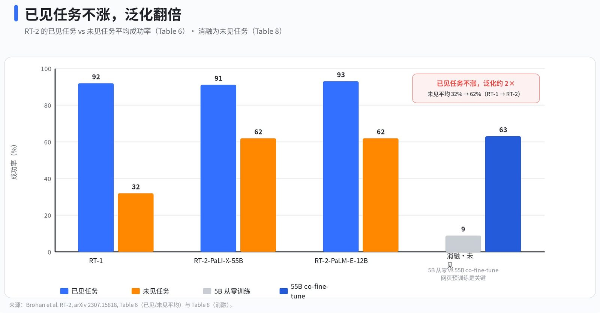
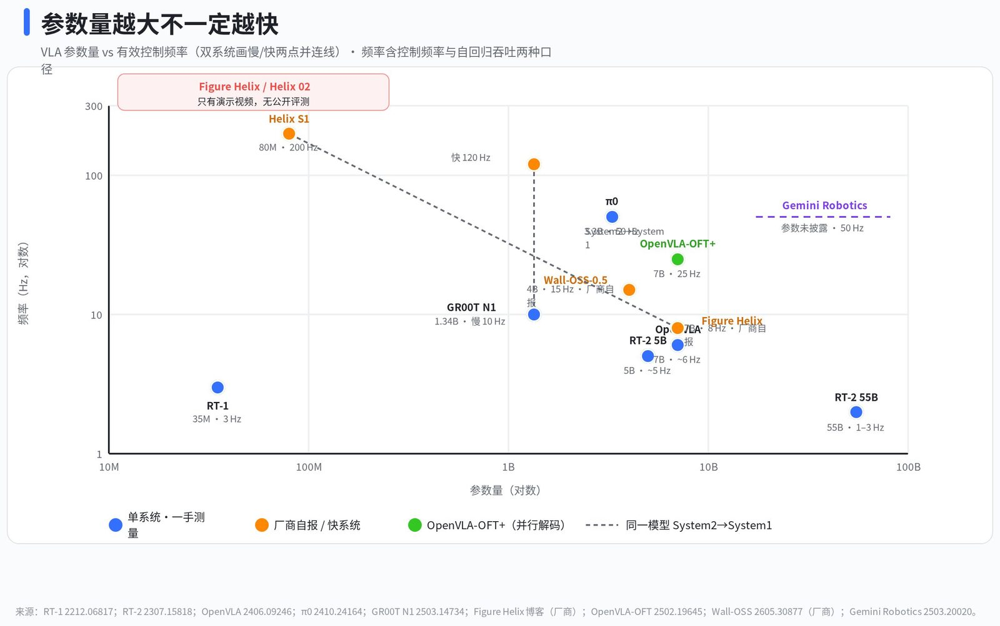
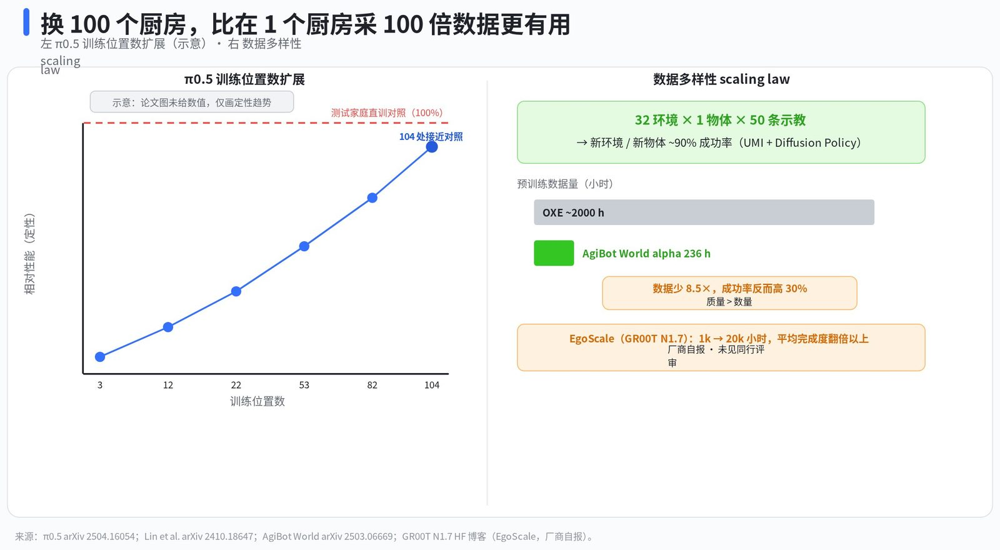
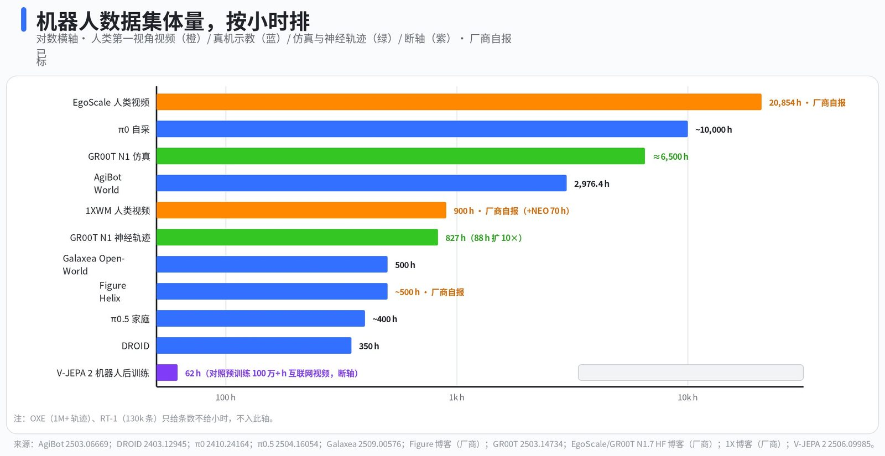
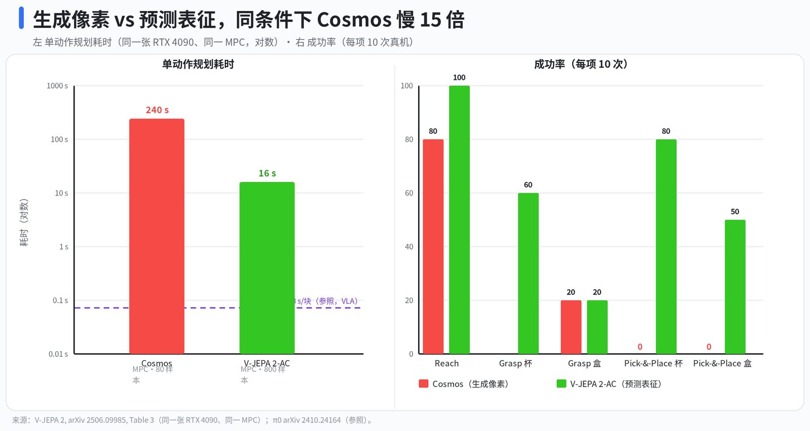
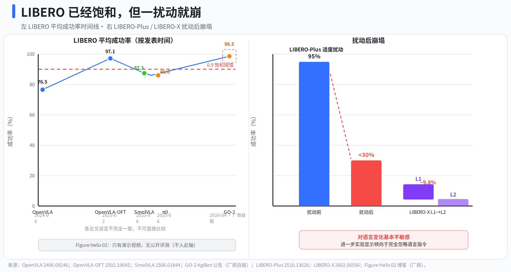
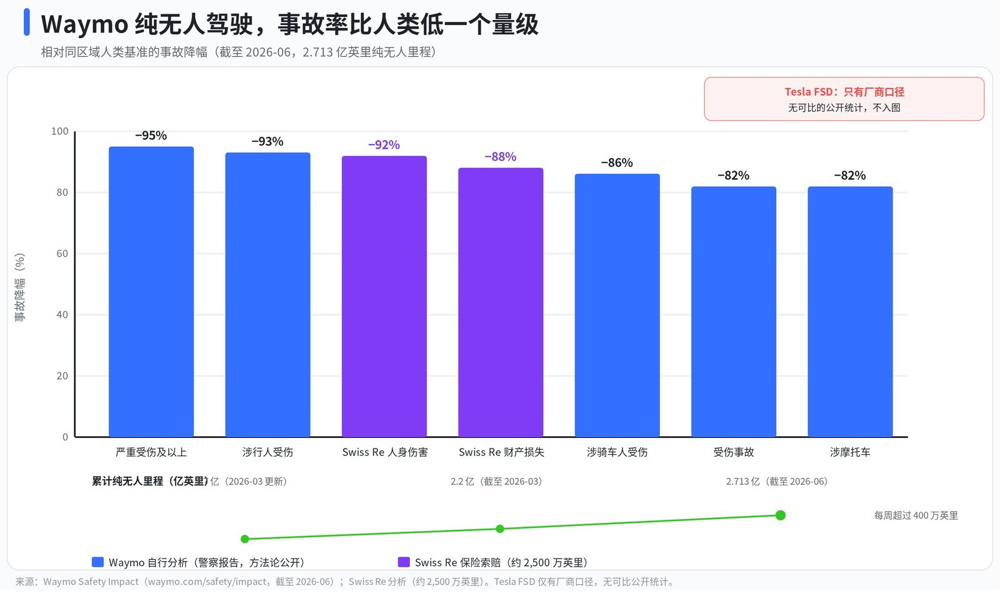
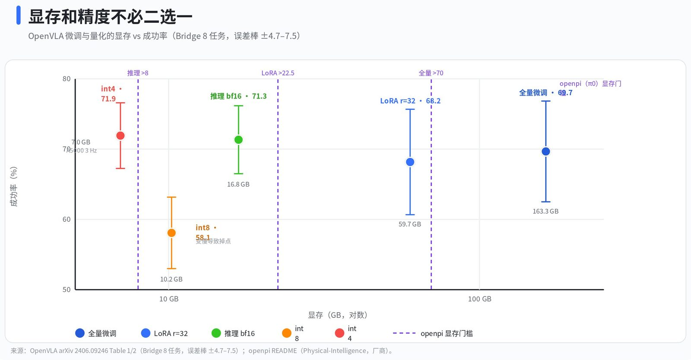

# LLM-43｜场景｜具身智能、VLA 与世界模型：大模型走进物理世界

> 🎯 **这篇文档解决什么问题**：2023 年以后的机器人基础模型大多建在多模态 LLM 上：视觉语言骨干加一个动作解码器，就成了视觉-语言-动作模型（Vision-Language-Action，VLA）。演示视频越来越多，但演示和测量是两回事。本文讲清 VLA 的结构、动作怎么表示、为什么控制频率是硬约束、数据从哪来、“世界模型”指什么，以及怎么读机器人论文里的成功率。
>
> 使用方式：每个成功率都标明基准或任务、试验次数（论文给了的才写）和是否厂商自报；只有演示视频、没有公开评测的产品单独标出。文中版本、开源仓库状态、价格和基准分数核对于 2026 年 10 月 13 日。

## 导读 · 先给结论

- **VLA 等于多模态 LLM 加一个动作解码器**。RT-2 把每个动作维度离散成 256 个区间、写成文本 token，和网页数据一起微调，“VLA”这个词就出自这篇论文[[1]](https://arxiv.org/abs/2307.15818)。之后的 π0 换成 3B 的 PaliGemma 加 300M 的流匹配动作专家，输出连续动作块[[2]](https://arxiv.org/abs/2410.24164)。
- **网页预训练带来的是泛化，不是熟练度**。RT-2 在已见任务上和 RT-1 持平（91% 到 93% 对 92%），在未见物体和指令上从 32% 提到 62%[[1]](https://arxiv.org/abs/2307.15818)。模型“听懂了”新东西，但手上的功夫还要靠机器人数据。
- **瓶颈已经从模型转到数据、延迟、评测和安全**。55B 的 RT-2 走云端只有 1–3 Hz[[1]](https://arxiv.org/abs/2307.15818)，而双臂精细操作需要 50 Hz 的控制[[3]](https://arxiv.org/abs/2304.13705)；最大的开放真机数据集合在一起也只有百万条轨迹量级[[4]](https://arxiv.org/abs/2310.08864)；仿真基准 LIBERO 的平均成功率已被做到 97.1%[[5]](https://arxiv.org/abs/2502.19645)，而在相机视角、初始状态等适度扰动下，约 95% 的成绩会跌到 30% 以下[[6]](https://arxiv.org/abs/2510.13626)。
- <b>“世界模型”至少有三种意思</b>：强化学习里的环境动力学模型、能按动作生成视频的模拟器、在表征空间里做预测的模型。NVIDIA 在 Cosmos 技术报告里自己写明，包括它在内的现有模型“还不是可靠的物理世界模拟器”[[7]](https://arxiv.org/abs/2501.03575)。2025–2026 年最有实际价值的用法是给策略排序做评测，而不是直接当策略[[8]](https://arxiv.org/abs/2512.10675)。
- **大量厂商成绩无法独立核对**。Figure Helix 只发布了演示视频，没有成功率[[9]](https://www.figure.ai/news/helix)；π\*0.6 的“吞吐量超过 2 倍”是自家机器人、自家任务上的自测[[10]](https://arxiv.org/abs/2511.14759)。读新闻时先分清演示、厂商自报和有协议、有次数的评测。
- **LLM 工程师最容易上手的位置**是仿真里跑现成检查点、做高层规划层、做评测和数据工程。一张 RTX 4090 能跑 π0 推理和 LoRA 微调[[11]](https://github.com/Physical-Intelligence/openpi)，一套 SO-101 主从臂的物料约 230 美元[[12]](https://github.com/TheRobotStudio/SO-ARM100)。

三条阅读路径：只想看懂新闻和发布会，读第 1、6、9 章；想自己动手训练和部署，读第 2、3、4、11 章；做评测或安全，读第 7、8、10 章。

📎 与系列其他文档的分工：VLM 的视觉编码器、投影层和 LLM 三部件见「多模态与长上下文」第 1 章，本文只讲在它后面接什么；GUI Agent 的观察与动作空间、厂商自报与独立复测见「Computer use 与浏览器 Agent」第 4、7 章；机器人五层分工和快慢思考分离的概念见「《深入理解 AI Agent》精读笔记」第 6 章；PPO、GRPO 等强化学习方法见「后训练实战」第 7 章。

## 第 1 章 · 从 SayCan 到 π\*0.6：具身大模型四年谱系

2022–2026 年这条线可以分成五步：LLM 只负责挑技能；动作被写成 token；开放数据和开放权重；流匹配动作头加双系统；强化学习进入 VLA。

### 1.1 LLM 只选技能：SayCan

SayCan（2022-04）让 540B 的 PaLM 只做高层规划：从 551 个预训练技能里选下一步，每个技能配一个价值函数，估计“在当前状态下能不能做成”，两者的概率相乘决定选哪个[[13]](https://arxiv.org/abs/2204.01691)。在 101 条指令的模拟厨房评测里，规划成功率 84%、执行成功率 74%；去掉价值函数后规划成功率降到 67%[[13]](https://arxiv.org/abs/2204.01691)。LLM 在这里不输出动作，只输出技能名，这就是后来“慢系统”的雏形。

### 1.2 动作当 token：RT-1 与 RT-2

RT-1（2022-12）是专门为机器人设计的 35M 参数 Transformer，输出离散化动作，频率 3 Hz；在 3000 次真机试验中，已见任务成功率 97%，未见指令 76%[[14]](https://arxiv.org/abs/2212.06817)。

RT-2（2023-07）走了另一条路：直接拿 PaLI-X（5B、55B）和 PaLM-E（12B）这样的视觉语言模型，把动作写成文本 token，和网页视觉问答数据混在一起继续微调（co-fine-tune）[[1]](https://arxiv.org/abs/2307.15818)。“视觉-语言-动作模型”这个名字就出自这篇论文。论文报告了 6000 次真机试验：已见任务平均成功率 RT-1 为 92%，RT-2 的 55B 和 12B 版本为 91% 和 93%；未见场景平均 RT-1 为 32%，两个 RT-2 都是 62%[[1]](https://arxiv.org/abs/2307.15818)。

已见任务上不涨，泛化约翻倍；5B 模型去掉网页预训练、从零训练，未见场景平均只有 9%，而同一消融表中 55B 共同微调为 63%[[1]](https://arxiv.org/abs/2307.15818)。代价是延迟：55B 模型跑在多 TPU 的云服务上，通过网络调用，只有 1–3 Hz[[1]](https://arxiv.org/abs/2307.15818)。

📎 展开阅读：「LLM 基础」第 2 章（分词与 token id 的基本概念）、第 5 章（预训练之后的微调流程），RT-2 的“动作 token”就是在词表里借用一段 id。

### 1.3 开放数据与开放权重：OXE、Octo、OpenVLA

Open X-Embodiment（2023-10）由 21 家机构合并 60 个数据集，得到 100 万条以上真机轨迹、22 种本体[[4]](https://arxiv.org/abs/2310.08864)。在它上面训练的 RT-2-X（55B）在“涌现技能”（只出现在其他机器人数据里的技能）上从 27.3% 提到 75.8%；而小模型 RT-1-X 在 Bridge 上反而从 40% 掉到 27%[[4]](https://arxiv.org/abs/2310.08864)。多本体数据只有大模型吃得下。

Octo（2024-05）只有 27M 和 93M 两个尺寸，在骨干后面接一个小型扩散动作头[[15]](https://arxiv.org/abs/2405.12213)。OpenVLA（2024-06）是 7B 的开源 VLA：Llama 2 加上 DINOv2 与 SigLIP 融合的视觉编码器，用 97 万条 OXE 轨迹、64 张 A100 训练 14 天，动作仍是 256 区间的离散 token[[16]](https://arxiv.org/abs/2406.09246)。它在 29 个任务上比 55B 的 RT-2-X 绝对成功率高 16.5%，参数少 7 倍[[16]](https://arxiv.org/abs/2406.09246)。

### 1.4 流匹配与双系统：π0、GR00T、Gemini Robotics

2024-10 的 π0 是转折点：3B 的 PaliGemma 加一个 300M 的“动作专家”，用流匹配（flow matching，一种和扩散模型同族的生成方法）直接输出连续的动作块，控制频率最高 50 Hz[[2]](https://arxiv.org/abs/2410.24164)。数据是自采的约 1 万小时、7 种机器人构型、68 个任务，再加完整的 OXE[[2]](https://arxiv.org/abs/2410.24164)。权重已在 openpi 开源[[11]](https://github.com/Physical-Intelligence/openpi)。

2025 年，NVIDIA GR00T N1[[17]](https://arxiv.org/abs/2503.14734)、Google DeepMind Gemini Robotics[[18]](https://arxiv.org/abs/2503.20020) 和 Figure Helix[[9]](https://www.figure.ai/news/helix) 都采用了“慢系统规划、快系统出动作”的双系统结构，第 3 章展开。其中 Helix 只有演示视频，无公开评测。

π0.5（2025-04）把训练数据的 97.6% 放在“非目标场景”（其他机器人、实验室数据、网页数据），在 3 个训练集里没出现过的真实家庭里做 10–15 分钟的清洁任务[[19]](https://arxiv.org/abs/2504.16054)。Gemini Robotics 1.5（2025-10）让同一个检查点控制 ALOHA、双臂 Franka 和 Apptronik Apollo 人形三种本体，并在动作之间插入自然语言“思考”[[20]](https://arxiv.org/abs/2510.03342)。

### 1.5 强化学习进入 VLA：π\*0.6 与 RECAP

π0.6（2025-11）把基座换成 Gemma 3 4B，动作专家增大到 860M[[10]](https://arxiv.org/abs/2511.14759)。更重要的是 RECAP 方法：训练一个价值函数，预测“离成功还差多少步”，据此估计每个动作的优势（advantage），然后把“优势是否为正”作为条件写进模型输入，推理时固定设为“好”[[10]](https://arxiv.org/abs/2511.14759)。这更接近条件化的监督微调或离线强化学习，而不是 PPO 或 GRPO 那样的策略梯度。

论文报告最难任务上吞吐量超过 2 倍、失败率约减半，能连续 13 小时做意式咖啡[[10]](https://arxiv.org/abs/2511.14759)。这些都是自家机器人、自家任务上的自测，暂无第三方复现。

📎 展开阅读：「后训练实战」第 7 章（GRPO 与奖励设计），可以对照理解 RECAP 为什么绕开了在线策略梯度。

> 🔑 谱系的主线是：骨干越来越像通用的多模态 LLM，动作端从“借词表”变成独立的连续生成头，数据从单一机队变成跨本体混合。能被独立复测的，基本都是开放权重的那一支（OpenVLA、Octo、π0 系列）。

## 第 2 章 · 动作怎么变成 token：离散化、FAST 与连续动作头

VLA 的骨干和 VLM 差别不大，设计空间在动作那一端。动作是连续的、多维的（关节角、末端位姿、夹爪开合），要按固定频率不停地输出。主流方法有四类，各自在训练速度和推理速度之间取舍。

📎 展开阅读：「多模态与长上下文」第 1 章（视觉编码器、投影层与 LLM 怎么拼起来），VLA 的骨干部分和那里讲的结构相同。

### 2.1 均匀分箱：每维每步一个 token

RT-2 和 OpenVLA 把每个连续维度的取值范围均匀切成 256 个区间（bin），一个区间对应词表里的一个 token；RT-2 的一个动作由 8 个整数组成[[1]](https://arxiv.org/abs/2307.15818)[[16]](https://arxiv.org/abs/2406.09246)。好处是完全复用 LLM 的训练和解码代码，坏处有两个。

- **慢**：每一步都要自回归解码好几个 token。OpenVLA 在 RTX 4090 上约 6 Hz[[16]](https://arxiv.org/abs/2406.09246)；OpenVLA-OFT 论文把自回归 VLA 概括为 3–5 Hz，而高频控制需要 25–50 Hz 以上[[5]](https://arxiv.org/abs/2502.19645)。
- **高频下学不好**：如果一次预测一段动作（动作块），逐维逐步分箱会产生数百个 token，相邻 token 高度相关，模型容易学成“复制上一个 token”[[21]](https://arxiv.org/abs/2501.09747)。

### 2.2 压缩 token：FAST

FAST（2025-01）借用了图像压缩的思路：先把每个动作维度按 1% 和 99% 分位数归一化到 [-1, 1]，对时间序列做离散余弦变换（DCT），量化系数，再用 BPE 合并成 token[[21]](https://arxiv.org/abs/2501.09747)。平滑的动作序列在频域里大部分系数接近零，所以 token 数少得多，也不再高度冗余。在 1 万小时数据上，π0-FAST 的效果追平了扩散版 π0，训练快至多 5 倍[[21]](https://arxiv.org/abs/2501.09747)。

代价在推理：同样在 4090 上，扩散版 π0 约 100 ms 出 1 秒的动作块，π0-FAST 约 750 ms[[21]](https://arxiv.org/abs/2501.09747)。FAST 适合当训练目标，不一定适合直接部署。

### 2.3 连续回归加并行解码：OpenVLA-OFT

OpenVLA-OFT（2025-02）在 OpenVLA 上做了四件事：一次并行解码整个动作块，不再逐 token 自回归；输出连续值；损失函数用简单的 L1 回归；对双臂任务再加 FiLM 条件[[5]](https://arxiv.org/abs/2502.19645)。结果是 LIBERO 四个套件的平均成功率从 76.5% 提到 97.1%，动作生成吞吐提高 26 倍，在双臂 ALOHA 上做到 25 Hz[[5]](https://arxiv.org/abs/2502.19645)。论文的一个结论是：L1 回归和扩散微调效果相当，但收敛和推理更快。

### 2.4 扩散与流匹配动作头

另一条路线是在骨干后面接一个生成式的动作头，用去噪的方式产出一段连续动作。骨干只前向一次，多步去噪只在小得多的头里做。

- Octo 用一个小型扩散头[[15]](https://arxiv.org/abs/2405.12213)。
- π0 的 300M 动作专家用流匹配，10 步积分耗时 27 ms[[2]](https://arxiv.org/abs/2410.24164)。
- GR00T 的快系统是流匹配 DiT；N1.7 用 4 步去噪[[22]](https://huggingface.co/blog/nvidia/gr00t-n1-7)。
- SmolVLA（2025-06）只有 0.45B，同样是流匹配 10 步[[23]](https://arxiv.org/abs/2506.01844)。

### 2.5 知识隔离：别让动作梯度弄坏骨干

连续动作头的梯度回传进骨干，会破坏它的训练动态和语言理解。“知识隔离”（Knowledge Insulation，2025-05）的做法是：骨干用 FAST 离散 token 训练，动作专家输出连续动作，并阻断动作专家到骨干的梯度[[24]](https://arxiv.org/abs/2505.23705)。π0.5 也是预训练用 FAST token、后训练再加流匹配动作专家[[19]](https://arxiv.org/abs/2504.16054)。

> 💡 **常见误区**：把“VLA 把动作表示成 token”当成所有 VLA 的共同特征。2024 年以后的主流开源模型大多是连续动作头；离散 token 更多出现在训练目标里（FAST、知识隔离），而不是部署时的输出方式。

## 第 3 章 · 控制频率与延迟：动作块、双系统、实时分块

LLM 服务的延迟预算以秒计，机器人以毫秒计。双臂精细操作的遥操作和记录频率是 50 Hz，也就是每 20 ms 一个动作[[3]](https://arxiv.org/abs/2304.13705)；而一个 3B 级的 VLA 在 RTX 4090 上做一次完整推理要 73 ms[[2]](https://arxiv.org/abs/2410.24164)。这个差距靠三种手段弥合：一次预测一段动作（动作块）、把模型拆成快慢两层、以及在执行当前动作块的同时异步算下一块。

和 GUI Agent 对比更直观：网页上的点击、输入是离散的、秒级的；机器人的动作是连续的、50 Hz 以上的。

📎 展开阅读：「Computer use 与浏览器 Agent」第 4 章（GUI 的动作空间与定位误差）。

### 3.1 动作块：一次预测一段

ACT（2023-04）用 CVAE 加 Transformer 一次预测 k 步动作，并对相互重叠的动作块做加权平均（temporal ensembling），让轨迹平滑[[3]](https://arxiv.org/abs/2304.13705)。它在 6 个精细任务上只用 10 分钟、50 条示教就达到 80%–90% 的成功率[[3]](https://arxiv.org/abs/2304.13705)。

Diffusion Policy（2023-03）用去噪生成一段动作序列，执行其中若干步之后重新规划（receding horizon，滚动时域）；在 4 个基准的 15 个任务上平均提升 46.9%，RTX 3080 上推理延迟 0.1 秒[[25]](https://arxiv.org/abs/2303.04137)。

块长是一个关键超参数。π0 的块长是 50，在 50 Hz 的机器人上每 0.5 秒推理一次、执行 25 步[[2]](https://arxiv.org/abs/2410.24164)；GR00T N1 的块长是 16[[17]](https://arxiv.org/abs/2503.14734)。块越长，推理压力越小，但对环境变化的反应越慢。

### 3.2 双系统：慢系统想，快系统动

动作块解决了“算得慢”，但没解决“大模型太大，放不上机器人”。2025 年的主流方案是把模型拆成两层：

| 模型 | 慢系统（System 2） | 快系统（System 1） | 口径 |
|---|---|---|---|
| GR00T N1 | Eagle-2 视觉语言模型，L40 上 10 Hz | 流匹配 DiT，120 Hz | 技术报告 |
| Gemini Robotics | 云端蒸馏骨干，160 ms 以内 | 机载解码器，端到端约 250 ms，有效 50 Hz | 技术报告，闭源 |
| Figure Helix | 7B 视觉语言模型，7–9 Hz | 80M 策略，200 Hz | 厂商博客，只有演示 |
| π0.5、Hi Robot | 先输出子任务文本 | 流匹配动作专家 | 预印本 |

来源分别是 GR00T N1[[17]](https://arxiv.org/abs/2503.14734)、Gemini Robotics[[18]](https://arxiv.org/abs/2503.20020)、Figure Helix[[9]](https://www.figure.ai/news/helix)、π0.5[[19]](https://arxiv.org/abs/2504.16054) 和 Hi Robot[[26]](https://arxiv.org/abs/2502.19417)。GR00T N1 的一个细节值得注意：快系统读取的是 LLM 第 12 层的中间特征，论文称这比用最后一层更快、效果也更好[[17]](https://arxiv.org/abs/2503.14734)。它的 2.2B 模型中视觉语言部分占 1.34B，在 L40 上用 bf16 采样一个 16 步动作块耗时 63.9 ms[[17]](https://arxiv.org/abs/2503.14734)。Hi Robot 的慢系统是一个独立的 VLM，负责解析复杂指令和人的实时纠正，可以看作 SayCan 的“LLM 选技能”换成了“VLM 写子任务”[[26]](https://arxiv.org/abs/2502.19417)。

📎 展开阅读：「《深入理解 AI Agent》精读笔记」第 6 章（机器人五层分工与快慢思考分离），双系统对应其中的“长程规划”和“VLA 策略”两层。

### 3.3 实时分块：执行和推理并行

朴素的动作块执行方式是“执行完一块，停下来推理下一块”，会在块与块之间产生停顿或跳变。Physical Intelligence 的实时分块（Real-Time Chunking，RTC，2025-06）在执行当前块时异步生成下一块：已经确定会被执行的那几步动作“冻结”，只对剩余部分做流匹配补全（inpainting）[[27]](https://arxiv.org/abs/2506.07339)。它不需要重新训练，适用于任意扩散或流匹配 VLA[[27]](https://arxiv.org/abs/2506.07339)。GR00T N1.6 已在训练和推理时都采用了 RTC[[28]](https://research.nvidia.com/labs/gear/gr00t-n1_6/)。

### 3.4 云端还是机载

RT-2 的 55B 模型放在云端，只有 1–3 Hz[[1]](https://arxiv.org/abs/2307.15818)；Gemini Robotics 把云端骨干的延迟“从秒级优化到 160 ms 以下”，再靠机载解码器做到有效 50 Hz[[18]](https://arxiv.org/abs/2503.20020)。π0 机载推理 73 ms，放到机外服务器上加 13 ms 网络开销，合计 86 ms[[2]](https://arxiv.org/abs/2410.24164)。这和 LLM 推理的延迟预算是同一类问题，只是预算更紧、超时的后果是物理的。

> 💡 **常见误区**：把“控制频率 200 Hz”理解成“模型每秒推理 200 次”。双系统里大模型通常只有 7–10 Hz，高频的是小策略或解码器；动作块的情况下，“控制频率”指的是动作输出的频率，推理频率可能低一个数量级。

## 第 4 章 · 数据才是护城河：遥操作、UMI、开放数据集与跨本体

LLM 预训练用现成的互联网文本，机器人数据却要一条一条采，最大的开放真机数据集合并后也只有百万条轨迹量级。本章的结论是：数据的多样性（环境数、物体数）比单个环境里的示教条数重要得多，质量比总时长重要。

### 4.1 主要真机数据集

| 数据集 | 发布 | 规模 | 本体 |
|---|---|---|---|
| RT-1 | 2022-12 | 13 万条示教、700 多个任务、17 个月 | 13 台 Everyday Robots |
| Open X-Embodiment | 2023-10 | 100 万条以上轨迹、60 个数据集、527 个技能 | 22 种 |
| DROID | 2024-03 | 7.6 万条、350 小时、564 个场景、52 栋建筑 | 统一的 Franka Panda |
| AgiBot World | 2025-03 | 1,001,552 条、2976.4 小时、217 个任务、106 个场景 | 100 台智元 Genie-1 双臂人形 |
| Galaxea Open-World | 2025-08 | 500 小时真实生活与工作场景的移动操作 | 星海图 R1 Lite |

来源依次为 RT-1[[14]](https://arxiv.org/abs/2212.06817)、OXE[[4]](https://arxiv.org/abs/2310.08864)、DROID[[29]](https://arxiv.org/abs/2403.12945)、AgiBot World[[30]](https://arxiv.org/abs/2503.06669) 和 Galaxea[[31]](https://arxiv.org/abs/2509.00576)。DROID 的采集节奏体现了“多样性优先”：每位采集员在一个场景里最多采约 100 条、约 20 分钟，然后换场景[[29]](https://arxiv.org/abs/2403.12945)。作为对照，π0 自采约 1 万小时[[2]](https://arxiv.org/abs/2410.24164)，不开放。

### 4.2 遥操作与手持采集

遥操作是目前质量最高的数据来源，但贵而慢。ALOHA 把整套双臂遥操作设备做到 2 万美元以内，和一台 Franka 机械臂的价格相当，以 50 Hz 记录[[3]](https://arxiv.org/abs/2304.13705)。每小时遥操作的人工成本没有可靠的一手公开数字，媒体流传的数字不宜引用。

UMI（Universal Manipulation Interface，2024-02）走另一条路：采集员手持一个装了 GoPro 的夹爪，用 SLAM 恢复轨迹，不需要机器人在场[[32]](https://arxiv.org/abs/2402.10329)。在摆杯子任务上它比遥操作快 3 倍以上，达到人手速度的 48%；动态抛掷任务上，遥操作 15 分钟内一条成功示教都没采到[[32]](https://arxiv.org/abs/2402.10329)。

### 4.3 多样性比数量重要

清华和上海期智研究院的数据缩放律研究（2024-10）用 UMI 采集了 4 万条以上的示教，做了 1.5 万次以上的真机测试，用 Diffusion Policy 训练[[33]](https://arxiv.org/abs/2410.18647)。主要发现：

- 泛化能力随训练环境数和物体数近似按幂律增长；每个环境里的示教数超过某个阈值后几乎不再带来收益[[33]](https://arxiv.org/abs/2410.18647)。
- 32 个环境、每个环境 1 个物体、每个物体 50 条示教，就能在新环境、新物体上达到约 90% 的成功率[[33]](https://arxiv.org/abs/2410.18647)。
- 4 名采集员一个下午就采够了叠毛巾、拔充电器两个新任务的数据，在 8 个新环境上约 90%[[33]](https://arxiv.org/abs/2410.18647)。

π0.5 的实验指向同一个方向：训练位置数从 3 个逐步增加到 104 个，到 104 个时，性能接近直接用测试家庭数据训练的对照组[[19]](https://arxiv.org/abs/2504.16054)。AgiBot World 给出了质量这一侧的证据：只有 236 小时的 alpha 版用于预训练，成功率仍高于约 2000 小时的 OXE；完整版预训练比 OXE 平均高 30%[[30]](https://arxiv.org/abs/2503.06669)。

### 4.4 跨本体：容量是前提

不同机器人的关节数、相机位置、控制方式都不同，混在一起训练不一定有正收益。OXE 的结果显示，小模型 RT-1-X 在 Bridge 上反而比单独训练的 RT-1 差（27% 对 40%），55B 的 RT-2-X 才有正迁移[[4]](https://arxiv.org/abs/2310.08864)。GR00T 为每种本体配专门的编码器和解码器[[17]](https://arxiv.org/abs/2503.14734)。星海图 G0 分三阶段训练，作者认为中间那一步，即在目标本体上做单本体预训练“至关重要”[[31]](https://arxiv.org/abs/2509.00576)。跨本体数据能打底，最后一段还要靠目标机器人自己的数据。

> 🔑 采数据的优先级：先扩环境和物体的种类，再增加每种条件下的条数；先保证质量（人工验证、过滤空闲片段），再追求总时长；跨本体数据只有在模型容量够、且最后有目标本体数据收尾时才划算。

## 第 5 章 · 仿真、合成数据与人类视频：能替代多少真机数据

真机数据贵，各家都在用便宜的数据补：物理仿真、视频生成模型“造”的轨迹、人类第一视角视频。公开证据是：这些数据能扩大规模，在预训练阶段有用，但没有可复现的结果表明它们能替代真机数据；“只用仿真数据训练”的成绩都来自厂商自报。

### 5.1 GR00T 的数据金字塔

NVIDIA 在 GR00T N1 技术报告里把数据分成三层[[17]](https://arxiv.org/abs/2503.14734)：

- **底层**：人类第一视角视频和网页数据，量最大，但没有动作标签。GR00T 用潜动作（latent actions，从相邻帧之间学出来的隐变量）和逆动力学模型（IDM，从前后两帧推断动作）给它们打上伪动作。
- **中层**：仿真轨迹和“神经轨迹”（用视频生成模型合成的轨迹）。
- **顶层**：真机遥操作数据，量最小、质量最高。

两个具体数字能说明成本结构[[17]](https://arxiv.org/abs/2503.14734)。仿真方面，用 DexMimicGen 在 11 小时内生成了 78 万条仿真轨迹，相当于约 6,500 小时，也就是连续 9 个月的人类示教量。神经轨迹方面，用图生视频模型把 88 小时自采遥操作扩充到 827 小时，约 10 倍；但生成 1 秒视频需要一张 L40 跑 2 分钟，总共约 10.5 万 L40 GPU 小时，相当于 3,600 张 L40 跑约 1.5 天。视频合成并不便宜。

整个 GR00T N1 的预训练约 5 万 H100 GPU 小时[[17]](https://arxiv.org/abs/2503.14734)。

### 5.2 人类第一视角视频

人类视频的吸引力在于量：GR00T N1.7 的预训练加入了 EgoScale 数据集，共 20,854 小时人类第一视角视频，覆盖 20 多个任务类别[[22]](https://huggingface.co/blog/nvidia/gr00t-n1-7)。NVIDIA 称这是“首个灵巧度缩放律”：人类数据从 1,000 小时增加到 2 万小时，22 自由度灵巧手的平均任务完成度翻了一倍以上[[22]](https://huggingface.co/blog/nvidia/gr00t-n1-7)。这是厂商自报，暂无同行评审。

1X 的世界模型用了 900 小时人类第一视角视频做中段训练（mid-training），再用 70 小时自家 NEO 机器人数据微调[[34]](https://www.1x.tech/discover/world-model-self-learning)。它的消融结果值得注意：加入人类视频提高了新任务上的生成质量，但对分布内任务“中性或负面”[[34]](https://www.1x.tech/discover/world-model-self-learning)。人类视频带来的主要是泛化，不一定是熟练度，这和第 1 章 RT-2 的网页预训练结论一致。

### 5.3 仿真到真机

物理仿真的老问题是“仿真到真机的差距”（sim-to-real gap）：视觉外观、接触和摩擦、控制器响应都不同。GR00T N1.7 用了约 8,000 小时仿真数据预训练[[22]](https://huggingface.co/blog/nvidia/gr00t-n1-7)，但真机遥操作仍是金字塔顶层、质量最高的那一层[[17]](https://arxiv.org/abs/2503.14734)。

评测方向的进展更扎实。SIMPLER（2024-05）为 Google Robot 和 WidowX 建了“从真机到仿真”的环境，缩小控制和视觉差距，并用排名一致性衡量仿真评测是否可信[[35]](https://arxiv.org/abs/2405.05941)；Gemini Robotics 1.5 的附录也分析了仿真与真机评测的排名一致性[[20]](https://arxiv.org/abs/2510.03342)。

> 💡 **常见误区**：看到“只用仿真数据训练，真机成功率某某”就认为仿真可以替代真机。这类说法目前都来自厂商公告，没有论文、权重或评测协议可以核对。判断时先问三件事：真机测试了多少次、任务和初始条件怎么定的、有没有和“加了真机数据”的版本对比。

## 第 6 章 · 世界模型的三种含义：Dreamer、Genie / Cosmos、V-JEPA

“世界模型”是 2025–2026 年用得最泛的词之一。读到它时先确认指的是哪一种：（a）强化学习里学出来的环境动力学模型，用来在“想象”中训练策略；（b）能按动作或文本条件生成视频的模型，被当作可交互的模拟器；（c）在表征空间里预测未来、不生成像素的模型。三者的输入输出、评测方法和成熟度都不一样。可观测性领域也有“世界模型”的说法，指统一指标、日志和链路的模型愿景，与物理无关。

📎 展开阅读：「运维数据上的基础模型」第 4 章（可观测性领域“世界模型”一词的用法）。

### 6.1 强化学习里的世界模型：DreamerV3

DreamerV3（2023-01 预印本，2025-04 发表于 Nature）学习一个环境模型，然后在它“想象”出来的未来轨迹里训练策略[[36]](https://www.nature.com/articles/s41586-025-08744-2)。它用一套固定超参数在 150 多个任务上超过了专门调参的方法，也是第一个不用人类数据、从零在 Minecraft 里挖到钻石的算法[[36]](https://www.nature.com/articles/s41586-025-08744-2)。这是“世界模型”最早、最严格的含义：它的价值完全由下游策略的表现来衡量。

### 6.2 会生成视频的世界模型：Genie 与 Cosmos

Google DeepMind 的 Genie 3（2025-08）用文本提示生成可实时导航的世界，24 fps、720p，一致性可以保持“几分钟”；官方列出的局限包括智能体可执行的动作空间有限、不能精确复现真实地点、只支持几分钟而不是几小时的交互[[37]](https://deepmind.google/discover/blog/genie-3-a-new-frontier-for-world-models/)。Genie 系列第一代有论文、定量评测和小规模复现配置；第三代目前只有博客和演示，未发布可复现的定量评测、权重与数据。

NVIDIA Cosmos（2025-01）是面向物理 AI 的开放权重视频模型平台：从约 2,000 万小时原始视频里筛出约 1 亿个片段，用 1 万张 H100 训练了三个月[[7]](https://arxiv.org/abs/2501.03575)。它的技术报告写下了一段很少见的自我评价：现有模型，包括 Cosmos 在内，“还不是可靠的物理世界模拟器”，存在物体不能持续存在、接触密集的动力学不准、不遵循指令等问题，画面逼真并不代表遵守重力、光照和流体等基本物理规律[[7]](https://arxiv.org/abs/2501.03575)。

### 6.3 在表征空间里预测：V-JEPA 2

Meta FAIR 的 V-JEPA 2（2025-06）不生成像素，而是在表征空间里做掩码预测。编码器在 100 万小时以上的互联网视频和图像上预训练[[38]](https://arxiv.org/abs/2506.09985)。它的动作条件版本 V-JEPA 2-AC 只用 DROID 中不到 62 小时、无标注的机器人视频训练动作条件预测器，然后用模型预测控制（MPC，用交叉熵法在想象中搜索动作序列）加一张目标图像来规划，零样本部署到两个实验室的 Franka 机械臂上，没有用这些实验室的任何数据，也没有任务奖励[[38]](https://arxiv.org/abs/2506.09985)。

它的论文提供了少有的同条件对比：同样的 MPC 规划、同一张 RTX 4090，把世界模型分别换成 Cosmos 和 V-JEPA 2-AC[[38]](https://arxiv.org/abs/2506.09985)：

| 指标 | Cosmos | V-JEPA 2-AC |
|---|---|---|
| 每个动作的规划时间 | 4 分钟（80 个样本） | 16 秒（800 个样本） |
| Reach | 80% | 100% |
| Grasp（杯 / 盒） | 0% / 20% | 60% / 20% |
| Pick-and-Place（杯 / 盒） | 0% / 0% | 80% / 50% |

用 Cosmos 规划一条 pick-and-place 要一个小时以上[[38]](https://arxiv.org/abs/2506.09985)。作为对照，π0 出一个动作块是 73 ms[[2]](https://arxiv.org/abs/2410.24164)。

V-JEPA 2-AC 的局限同样写在论文里：对相机位置敏感；目标必须是图像而不是语言；长程规划仍然弱[[38]](https://arxiv.org/abs/2506.09985)。它的主表每格只测 10 次，这些百分比的误差很大（见第 8 章）。

📎 展开阅读：「《深入理解 AI Agent》精读笔记」第 6 章（“会生成逼真视频的世界模型不等于能指导机器人”这一论断），上面的表格是这条论断目前最直接的数据支撑。

> 🔑 判断一个世界模型有没有用，不看画面是否逼真，而看三件事：它能不能按动作条件给出正确的状态变化；用它做出的决策在真机上成不成功；单次决策要算多久。像素指标（FVD、PSNR）回答不了这三个问题。

## 第 7 章 · 世界模型当评测器与数据引擎

视频世界模型还不能可靠地模拟物理，但它有两个不要求“绝对准确”的用途：当数据引擎扩充训练数据；当评测器，在上真机之前给策略检查点排序。2025–2026 年，机器人和自动驾驶都在往第二个方向走。直接拿世界模型当策略，目前仍然很慢。

### 7.1 三种用法

| 用法 | 例子 | 现状 |
|---|---|---|
| 数据引擎 | GR00T N1 的神经轨迹 | 能扩量，算力成本高（88 小时扩到 827 小时用了约 10.5 万 GPU 小时） |
| 策略评测器 | 1X 世界模型、Veo（Robotics）、GAIA-3 | 有排序一致性的验证数据，适合排序，不适合报绝对值 |
| 直接当策略 | 1X 世界模型生成视频再提取动作；V-JEPA 2-AC 做 MPC | 开环或每步十几秒，离实时控制很远 |

表中来源：GR00T N1[[17]](https://arxiv.org/abs/2503.14734)、1X[[34]](https://www.1x.tech/discover/world-model-self-learning)、V-JEPA 2[[38]](https://arxiv.org/abs/2506.09985)。

### 7.2 Veo 当机器人策略的评测器

Google DeepMind 在 2025-12 的论文里把 Veo 视频模型改造成动作条件、多视角一致的模拟器，用来评测 Gemini Robotics 策略的三件事：名义性能、分布外泛化、安全红队[[8]](https://arxiv.org/abs/2512.10675)。验证用了 8 个策略检查点和 1,600 多次真机评测[[8]](https://arxiv.org/abs/2512.10675)。

它用两个指标衡量“模拟器的排名和真机排名是否一致”：MMRV（平均最大排名违背，0 到 1，越低越好）和 Pearson 相关系数。在分布外的各个泛化维度上，预测性能下降的 MMRV 为 0.06、Pearson 为 0.86[[8]](https://arxiv.org/abs/2512.10675)。论文同时说明，模拟器预测的成功率绝对值低于真实值[[8]](https://arxiv.org/abs/2512.10675)。所以它的正确用法是“在几十个检查点里挑出值得上真机的几个”，而不是“报告这个策略成功率多少”。

### 7.3 1X：一个世界模型，两种用途

1X 公开了它的世界模型用于评测时的一个估算：两个检查点在真实世界里的成功率差 15% 时，一个与真实结果有 70% 一致率的世界模型，能以 90% 的概率挑出更好的那个[[39]](https://www.1x.tech/discover/redwood-ai-world-model)。也就是说，评测器不需要很准，只要和真实结果足够相关，就能减少真机测试次数。

2026-01，1X 又把世界模型直接用作策略：14B 的视频生成骨干预测未来画面，再用一个逆动力学模型从画面中提取动作[[34]](https://www.1x.tech/discover/world-model-self-learning)。骨干生成 5 秒视频要 11 秒，再花 1 秒提取动作，是开环、非实时的；厂商自述倒水、画画这类灵巧任务仍然很难，生成的视频“过度乐观”[[34]](https://www.1x.tech/discover/world-model-self-learning)。

### 7.4 自动驾驶的同类做法

Wayve 的 GAIA-3（2025-12）是 15B 的潜扩散模型，计算量是上一代的 5 倍、数据约 10 倍，覆盖 3 大洲 9 个国家，用途从“合成数据”转向“安全关键场景的评测”[[40]](https://wayve.ai/thinking/gaia-3/)。Wayve 称合成测试的被拒率降低了 5 倍，仿真测试结果与真实结果“高度吻合”，但没有给出公开的数字[[40]](https://wayve.ai/thinking/gaia-3/)。

Waymo 和 Google DeepMind 在 2026-02 发布了基于 Genie 3 的 Waymo 世界模型，后训练后能同时输出摄像头视频和 3D 激光雷达点云，支持按驾驶动作、场景布局和语言（时段、天气）控制，用来生成龙卷风、洪水、路上的大象这类长尾场景[[41]](https://waymo.com/blog/2026/02/the-waymo-world-model-a-new-frontier-for-autonomous-driving-simulation)。同样没有公开的定量评测。

> 💡 **常见误区**：拿世界模型里跑出来的成功率当作策略的真实成功率。已有的验证只支持“排序”这一用法；Veo（Robotics）的作者明确说预测的绝对值偏低。只报告世界模型里的成功率、不报告和真机排名一致性（MMRV、Pearson）的论文，这个数字基本不能用。

## 第 8 章 · 怎么读机器人论文的成功率：基准、方差与 demo 水分

机器人论文里的“成功率 90%”和 LLM 榜单上的“准确率 90%”不是一回事：LLM 基准一般有几百上千道题，机器人真机评测常常每项只做 10 次；仿真基准已经饱和，换个相机角度就崩；各论文的“成功”定义也不同。

📎 展开阅读：「读懂模型基准与排行榜」第 8 章（题量、误差条与带区间的排名）和「Computer use 与浏览器 Agent」第 7 章（自报与独立复测的口径差异），这里只讲机器人特有的部分。

### 8.1 仿真基准：LIBERO 已经饱和

LIBERO（2023-06）有 4 个套件共 130 个任务：Spatial、Object、Goal 各 10 个，LIBERO-100 含 LIBERO-Long 的 10 个和另外 90 个，全部配有人类遥操作示教[[42]](https://arxiv.org/abs/2306.03310)。它是 2024–2025 年 VLA 论文最常用的仿真基准，平均成功率涨得很快：OpenVLA 76.5%，OpenVLA-OFT 97.1%[[5]](https://arxiv.org/abs/2502.19645)；SmolVLA 论文的同一张表里，0.45B 的 SmolVLA 87.3%、3.3B 的 π0 86.0%[[23]](https://arxiv.org/abs/2506.01844)。各论文的设定不完全一致，这些数字只能看大致走势。

问题在于，高分不代表鲁棒。LIBERO-Plus（2025-10）在 7 个维度上加扰动：物体布局、相机视角、机器人初始状态、语言、光照、背景纹理、传感器噪声。适度扰动下，成功率从约 95% 跌到 30% 以下；模型对语言变化基本不敏感，进一步实验显示它们倾向于完全忽略语言指令[[6]](https://arxiv.org/abs/2510.13626)。

### 8.2 真机评测：样本量与标准误

真机评测的样本量通常很小：

- OpenVLA 在 Bridge 上做了 170 次（17 个任务各 10 次），Google Robot 上 60 次，论文报告的标准误在 ±4.7 到 ±7.9 个百分点之间[[16]](https://arxiv.org/abs/2406.09246)。
- V-JEPA 2 每格 10 次[[38]](https://arxiv.org/abs/2506.09985)；1X 世界模型每个任务 30 次[[34]](https://www.1x.tech/discover/world-model-self-learning)。
- GR00T N1 真机每个任务 10 次；仿真每个任务 100 次，但取的是最后 5 个检查点中的最大值，这种选法偏乐观[[17]](https://arxiv.org/abs/2503.14734)。

按二项分布粗算，真实成功率为 50% 时，10 次试验的标准误约 16 个百分点，30 次约 9 个百分点。所以“每项 10 次，A 比 B 高 10 个百分点”在统计上几乎说明不了什么。

2024-09 的一篇方法论论文指出，多数论文报告成功率时几乎不给运行次数、初始条件、成功标准和统计分析，并建议预先定义成功标准、盲测、交替做 A/B 测试、报告置信区间[[43]](https://arxiv.org/abs/2409.09491)。

### 8.3 让评测更可信的做法

RoboArena（2025-06）让评测者自选任务和场景，但必须双盲地对两个策略做成对比较，再聚合成排名；它在 7 所机构做了 600 多次成对真机评测，作者称这比固定任务的排名更准[[44]](https://arxiv.org/abs/2506.18123)。这和 LLM 的人类偏好竞技场是同一思路。

另一个容易忽略的变量是评分方式。Gemini Robotics 1.5 用“进度分”[[20]](https://arxiv.org/abs/2510.03342)，GR00T 用部分得分[[17]](https://arxiv.org/abs/2503.14734)，这些都不是二元的“成功或失败”，不同论文之间的百分比不能直接比较。

### 8.4 演示视频的常见水分

- **倍速**：GR00T N1.6 的页面明确标了“2.5x speed”[[28]](https://research.nvidia.com/labs/gear/gr00t-n1_6/)，很多视频不标。
- **遥操作还是自主**：视频是否标明“autonomous”和“1x speed”。
- **挑片**：只放成功的片段，不报失败率。Figure Helix 02 的“4 分钟、61 个动作装卸洗碗机”是单段视频，没有报告重复次数和成功率[[45]](https://www.figure.ai/news/helix-02)。
- **自家任务、自家机器人**：π\*0.6 的吞吐和失败率改善没有第三方复现[[10]](https://arxiv.org/abs/2511.14759)。

### 8.5 泛化的七个层级

不同论文说“泛化”时指的范围差别很大。把各家用法综合起来，可以分成七级，级别越高越难：

1. 分布内：已见过的任务、物体和场景，例如 RT-1 的 97%[[14]](https://arxiv.org/abs/2212.06817)。
2. 视觉泛化：新背景、光照、干扰物。
3. 物体与语义泛化：新物体、新类别，例如 RT-2 未见平均 62%[[1]](https://arxiv.org/abs/2307.15818)。
4. 动作泛化：新的动作模式和初始状态。LIBERO-Plus 显示初始状态是最脆弱的维度之一[[6]](https://arxiv.org/abs/2510.13626)。
5. 新环境：全新的家庭。π0.5 在 3 个未见家庭中测试[[19]](https://arxiv.org/abs/2504.16054)。
6. 新本体：跨机器人零样本迁移。Gemini Robotics 1.5 的 Motion Transfer[[20]](https://arxiv.org/abs/2510.03342)，OXE 的涌现技能约 3 倍[[4]](https://arxiv.org/abs/2310.08864)。
7. 长程与纠错：10–15 分钟的任务、人的实时纠正、连续运行数小时。π0.5[[19]](https://arxiv.org/abs/2504.16054)、Hi Robot[[26]](https://arxiv.org/abs/2502.19417)、π\*0.6[[10]](https://arxiv.org/abs/2511.14759)。

> 📌 **读一个成功率时的检查清单**：
>
> - 是仿真还是真机？仿真的话，是否报告了扰动下的结果？
> - 每项测了多少次？有没有误差条或置信区间？
> - 成功的定义是二元还是部分得分？初始条件怎么采样？
> - 检查点怎么选的，是预先固定的，还是在测试集上挑的最大值？
> - 是论文、厂商博客还是只有视频？有没有第三方复现？
> - 它处在泛化七级中的哪一级？

## 第 9 章 · 相邻案例：自动驾驶的端到端与安全统计

自动驾驶是“单一本体、海量车队数据、有可比安全统计”的特例，机器人操作则是“多本体、数据稀缺、没有统一统计”。两者都在尝试让多模态大模型直接输出控制，也都在用世界模型做评测；驾驶领域还有一份方法公开、规模足够大的安全数据，可以作为参照。

### 9.1 Waymo EMMA：多模态 LLM 直接出轨迹

EMMA（2024-10，后经 TMLR 审稿）基于 Gemini，把原始摄像头画面直接映射成规划轨迹、感知到的物体和道路要素，全部表示成文本[[46]](https://arxiv.org/abs/2410.23262)。它在 nuScenes 运动规划上达到当时最好的结果[[46]](https://arxiv.org/abs/2410.23262)。这在结构上就是驾驶版的 VLA。

论文自己列出了三个部署障碍：不能融合激光雷达和毫米波雷达，3D 空间推理受限；闭环评测需要逼真且昂贵的传感器仿真；计算量高于常规模型[[46]](https://arxiv.org/abs/2410.23262)。EMMA 是研究模型，不是 Waymo 的量产系统。第二个障碍正是第 7 章提到的 Waymo 世界模型要补的那一块[[41]](https://waymo.com/blog/2026/02/the-waymo-world-model-a-new-frontier-for-autonomous-driving-simulation)。

### 9.2 Waymo 的安全数字

Waymo 的安全影响页面给出了截至 2026-06 的数据：纯无人驾驶（车上没有安全员）里程 2.713 亿英里；与同区域的人类驾驶基准相比，严重受伤及以上的事故少 95%，受伤事故少 82%[[47]](https://waymo.com/safety/impact)。按事故对象分，涉及行人的受伤事故少 93%，骑车人少 86%，摩托车少 82%[[47]](https://waymo.com/safety/impact)。

读这些数字要知道两点。这是 Waymo 自行分析的结果，方法论公开，并有同行评审的论文支撑；比较时不区分责任方，人类基准是同区域地面街道上的乘用车[[47]](https://waymo.com/safety/impact)。另外，Waymo 的量产系统是模块化架构加大量学习组件，不是 EMMA 那样的端到端 VLA。

### 9.3 Tesla FSD：只有厂商口径

Tesla 没有公开 FSD 的模型架构和训练数据量。2026-07 的股东信给出的数字是：FSD（Supervised）活跃订阅 148 万，同比增长 56%；Robotaxi 已在美国 7 个大都市区上线，并在迈阿密、奥兰多、坦帕启动了无监督载客[[48]](https://ir.tesla.com)。同一份股东信的脚注写明，FSD（Supervised）“需要驾驶员主动监督，不会让车辆成为自动驾驶”[[48]](https://ir.tesla.com)。

Tesla 没有发布与 Waymo 可比的、方法公开的安全统计，所以两者的安全性无法直接比较，本文的图表也不把 Tesla 放进去。

### 9.4 对机器人领域的启示

- **证明有效需要大样本和公开方法**。在拿到 Waymo 这种规模的数据之前，机器人厂商的“成功率”更接近第 8 章所说的小样本估计。
- **端到端和模块化不是二选一**。EMMA 在研究上可行，但它自己列出的局限，正是量产系统保留传感器融合和模块化结构的理由。
- **世界模型做评测是两个领域的共同方向**：驾驶有 GAIA-3 和 Waymo 世界模型，机器人有 Veo（Robotics）和 1X 世界模型。

> 💡 **常见误区**：拿 Robotaxi 的城市数或订阅数当作安全性的证据。安全性要看按里程归一化、与明确基准对比、方法公开的事故率。本文涉及的厂商里，只有 Waymo 公开了这样的数据。

## 第 10 章 · 安全、成本与硬件现实

VLA 的输出不再是文字，而是有力量的动作，一次注入攻击的后果可能从“泄露数据”变成“撞到人”。VLA 本身不承担安全保证，安全靠分层设计：语义层面的判断、独立的底层安全控制器、限制运行范围。成本方面，入门硬件已经降到几百美元，人形机器人的成本和产能大多只有估算或厂商口径。

### 10.1 分层安全

Gemini Robotics 1.5 的技术报告把安全拆成几层：高层的语义安全推理、和人对话时保持尊重、行动前先思考安全问题，以及触发底层的物理安全子系统（例如碰撞避免）；同时遵循相关 ISO 标准，并用自动红队测试[[20]](https://arxiv.org/abs/2510.03342)。它随模型发布了 ASIMOV-2.0 语义安全基准，覆盖基于 2024 年美国急诊伤害数据（NEISS）的真实伤害场景，并加入了视频模态[[20]](https://arxiv.org/abs/2510.03342)。第 7 章的 Veo（Robotics）也被用来做安全红队：用视频世界模型预测策略可能出现的不安全行为[[8]](https://arxiv.org/abs/2512.10675)。

工程上最重要的一层在模型之外：力和力矩限制、碰撞检测、急停，以及运行设计域（ODD，即系统被允许工作的环境和条件范围）的限制。这些由独立于 VLA 的控制器实现，不能依赖模型“自觉”。

### 10.2 越狱物理机器人

宾夕法尼亚大学的 RoboPAIR（2024-10）对三类 LLM 控制的机器人做了越狱攻击：白盒的 NVIDIA Dolphins 驾驶模型、灰盒的 Clearpath Jackal 加 GPT-4o 规划器、黑盒的 Unitree Go2 机器狗；作者报告攻击成功率“经常达到 100%”，并称这是首次对已部署的商用机器人系统越狱成功[[49]](https://arxiv.org/abs/2410.13691)。

当 LLM 作为高层规划器调用机器人技能时，提示词注入和越狱的防御思路都适用，只是物理动作无法撤回，权限控制和底层硬限制更重要。

📎 展开阅读：「LLM 安全与治理」第 2 章（提示词注入为什么只能靠架构防御）、「Computer use 与浏览器 Agent」第 9 章（界面 Agent 读到的内容带来的注入风险）。

### 10.3 标准

工业机器人有 ISO 10218，协作机器人有 ISO/TS 15066，服务机器人有 ISO 13482。针对双足、四足和轮式平衡这类“动态稳定”的工业移动机器人，ISO/CD 25785-1 还在起草中，截至 2026-10 尚未正式发布；它的范围只包含工业环境，不包括面向公众和家庭的场景。读到“人形机器人符合安全标准”的说法时，要问清是哪一项标准、覆盖什么场景。

### 10.4 成本与硬件

| 项目 | 数字 | 口径 |
|---|---|---|
| SO-101 单只从动臂 | 121.94 美元 | 6 个 STS3215 舵机，每个 13.89 美元；仓库 README 物料价，截至 2026-10 |
| SO-101 主从遥操作套装 | 229.88 美元 | 同上，不含 3D 打印耗材 |
| ALOHA 双臂遥操作 | 不到 2 万美元 | 论文给出，和一台 Franka 相当 |
| π0 推理 | 显存 8 GB 以上 | openpi README，RTX 4090 |
| π0 LoRA 微调 | 显存 22.5 GB 以上 | openpi README，RTX 4090 |
| π0 全量微调 | 显存 70 GB 以上 | openpi README，A100 或 H100 80 GB |

来源：SO-101[[12]](https://github.com/TheRobotStudio/SO-ARM100)、ALOHA[[3]](https://arxiv.org/abs/2304.13705)、openpi[[11]](https://github.com/Physical-Intelligence/openpi)。

人形机器人这一侧，公开数字大多不是一手的。投行对整机物料成本的估算流传很广，国内厂商的出货数字主要来自媒体对招股书的转述，本文都不列。Tesla 没有公开 Optimus 的模型、数据或成功率，一手信息只有股东信里“Fremont 正在安装第一代 Optimus 产线、即将开始生产”这一句[[48]](https://ir.tesla.com)。机载算力方面，Figure 称 Helix 跑在两块低功耗嵌入式 GPU 上[[9]](https://www.figure.ai/news/helix)，GR00T N1.7 支持 Jetson Thor 和 Orin[[50]](https://github.com/NVIDIA/Isaac-GR00T)。

> 💡 **常见误区**：以为在系统提示词里写“不要伤害人”就能保证安全。语义层的安全推理有用，但它和 LLM 的拒答一样可以被绕过，RoboPAIR 已经演示过。真正兜底的是模型之外的力矩限制、碰撞检测和急停。

## 第 11 章 · 上手清单：LeRobot、openpi 与一张 4090

不需要先买机器人。仿真里的现成检查点、开源框架和几百美元的机械臂，足够把本文的大部分概念亲手验证一遍。LLM 工程经验最能迁移的是高层规划、评测和数据工程。

### 11.1 开源栈

下表的星数和最近推送日期取自 GitHub，抓取于 2026-10-13。

| 仓库 | 星数 | 许可证 | 最近推送 | 要点 |
|---|---|---|---|---|
| huggingface/lerobot | 28,111 | Apache-2.0 | 2026-10-12 | 统一硬件接口；内置 ACT、Diffusion Policy、π0 系列、GR00T N1.7、SmolVLA 等策略；数据集格式已成事实标准 |
| Physical-Intelligence/openpi | 14,196 | Apache-2.0 | 2026-08-24 | π0、π0-FAST、π0.5 基座，以及 DROID、ALOHA、LIBERO 微调检查点 |
| NVIDIA/Isaac-GR00T | 8,196 | Apache-2.0 | 2026-10-07 | N1.7，3B；需要申请访问 Cosmos-Reason2-2B 骨干 |

来源：LeRobot[[51]](https://github.com/huggingface/lerobot)、openpi[[11]](https://github.com/Physical-Intelligence/openpi)、Isaac-GR00T[[50]](https://github.com/NVIDIA/Isaac-GR00T)。GR00T N1.7 的权重采用 Apache 2.0 许可，可以商用[[22]](https://huggingface.co/blog/nvidia/gr00t-n1-7)；星海图 G0 的 3B 权重是 CC BY-NC-SA 4.0，不能商用[[31]](https://arxiv.org/abs/2509.00576)。openpi 的 README 里有一句很实在的话：π0“可能适合你，也可能不适合”[[11]](https://github.com/Physical-Intelligence/openpi)。

### 11.2 显存与精度

OpenVLA 论文给出了一组完整的显存和成功率数据，可以作为估算 7B 级 VLA 资源需求的参照[[16]](https://arxiv.org/abs/2406.09246)：

| 配置 | 显存 | 成功率 | 备注 |
|---|---|---|---|
| 全量微调 | 163.3 GB | 69.7±7.2% | 可训练参数 71.9 亿 |
| LoRA，秩 32 | 59.7 GB | 68.2±7.5% | 可训练参数 9,760 万 |
| 推理 bf16 | 16.8 GB | 71.3±4.8% | Bridge 8 个任务 |
| 推理 int8 | 10.2 GB | 58.1±5.1% | 推理变慢导致掉点 |
| 推理 int4 | 7.0 GB | 71.9±4.7% | A5000 上 3 Hz |

两个反直觉的点：LoRA 和全量微调的成功率在误差范围内持平，显存却差将近 3 倍；int8 掉点是因为推理变慢、控制跟不上[[16]](https://arxiv.org/abs/2406.09246)。延迟在机器人里是正确性的一部分。

### 11.3 五级上手路径

1. **零硬件**：在 LIBERO 或 SIMPLER 上跑 openpi 或 LeRobot 的现成检查点；再加上 LIBERO-Plus 的扰动（相机视角、初始状态），亲眼看成功率怎么掉[[6]](https://arxiv.org/abs/2510.13626)。一张 4090 就够，π0 推理需要 8 GB 以上显存[[11]](https://github.com/Physical-Intelligence/openpi)。
2. **约 230 美元加一张 4090**：SO-101 主从臂加 LeRobot，采 50 条示教，训练 ACT、SmolVLA 或 π0 的 LoRA[[12]](https://github.com/TheRobotStudio/SO-ARM100)[[51]](https://github.com/huggingface/lerobot)。可以拿 ACT 论文“10 分钟、50 条示教达到 80%–90%”对比自己的结果[[3]](https://arxiv.org/abs/2304.13705)；SmolVLA 本身就是用社区在 SO-100 等低成本机械臂上采的 481 个数据集预训练的[[23]](https://arxiv.org/abs/2506.01844)。
3. **做高层规划器**：用 Gemini API 开放的 Gemini Robotics-ER 1.5[[20]](https://arxiv.org/abs/2510.03342)，或开源 VLM，做指点、检测和任务分解，下面接现成技能。这就是 SayCan、Hi Robot、Gemini Robotics 1.5 编排层的做法，提示词设计、工具调用、评测和注入防护的经验都能直接用上。
4. **做评测和数据工程**：搭双盲成对评测[[44]](https://arxiv.org/abs/2506.18123)，预先固定成功标准、报告置信区间[[43]](https://arxiv.org/abs/2409.09491)；做数据过滤和自动标注，例如用 VLM 生成事后指令标签[[9]](https://www.figure.ai/news/helix)。
5. **做强化学习后训练**：RECAP 式的优势条件化[[10]](https://arxiv.org/abs/2511.14759)。这一级需要真机或高保真仿真，门槛最高。

### 11.4 该做与不该做

| 该做 | 不该做 |
|---|---|
| 评测时报告试验次数、初始条件和置信区间 | 拿 LIBERO 上的 97% 当“能用”的证据 |
| 采数据时优先扩环境和物体种类 | 在一个环境里堆示教条数 |
| 把推理延迟和控制频率当作验收指标 | 只看离线指标，不测实际控制频率 |
| 用世界模型给检查点排序，再上真机确认 | 拿世界模型里的成功率当真实成功率 |
| 在模型之外配置力矩限制、碰撞检测和急停 | 没有底层安全控制器时，让 VLA 直接驱动有力量的机械臂靠近人 |
| 看厂商新闻时先分清演示、自报和评测 | 凭一段演示视频判断成功率 |

> 🔑 一句话总结：VLA 是多模态 LLM 接上一个动作解码器，模型本身已经不是最稀缺的部分；数据的多样性、控制延迟、可信的评测和模型之外的安全层，才是决定它能不能走出实验室的因素。LLM 工程师最有优势的，恰好是评测、编排和安全这几块。

## 参考文献

按正文首次引用顺序编号，资料截至 2026 年 10 月初。

[1] Google DeepMind. RT-2: Vision-Language-Action Models Transfer Web Knowledge to Robotic Control (2023-07) [https://arxiv.org/abs/2307.15818](https://arxiv.org/abs/2307.15818)

[2] Physical Intelligence. π0: A Vision-Language-Action Flow Model for General Robot Control (2024-10) [https://arxiv.org/abs/2410.24164](https://arxiv.org/abs/2410.24164)

[3] Zhao et al. Learning Fine-Grained Bimanual Manipulation with Low-Cost Hardware (2023-04) [https://arxiv.org/abs/2304.13705](https://arxiv.org/abs/2304.13705)

[4] Open X-Embodiment Collaboration. Open X-Embodiment: Robotic Learning Datasets and RT-X Models (2023-10) [https://arxiv.org/abs/2310.08864](https://arxiv.org/abs/2310.08864)

[5] Kim, Finn, Liang. Fine-Tuning Vision-Language-Action Models: Optimizing Speed and Success (2025-02) [https://arxiv.org/abs/2502.19645](https://arxiv.org/abs/2502.19645)

[6] LIBERO-Plus: In-depth Robustness Analysis of Vision-Language-Action Models (2025-10) [https://arxiv.org/abs/2510.13626](https://arxiv.org/abs/2510.13626)

[7] NVIDIA. Cosmos World Foundation Model Platform for Physical AI (2025-01) [https://arxiv.org/abs/2501.03575](https://arxiv.org/abs/2501.03575)

[8] Google DeepMind. Evaluating Gemini Robotics Policies in a Veo World Simulator (2025-12) [https://arxiv.org/abs/2512.10675](https://arxiv.org/abs/2512.10675)

[9] Figure AI. Helix: A Vision-Language-Action Model for Generalist Humanoid Control (2025-02) [https://www.figure.ai/news/helix](https://www.figure.ai/news/helix)

[10] Physical Intelligence. π\*0.6: a VLA That Learns From Experience (2025-11) [https://arxiv.org/abs/2511.14759](https://arxiv.org/abs/2511.14759)

[11] Physical Intelligence. openpi GitHub repository (2026-10) [https://github.com/Physical-Intelligence/openpi](https://github.com/Physical-Intelligence/openpi)

[12] TheRobotStudio. SO-ARM100 / SO-101 README (2026-10) [https://github.com/TheRobotStudio/SO-ARM100](https://github.com/TheRobotStudio/SO-ARM100)

[13] Google Robotics, Everyday Robots. Do As I Can, Not As I Say: Grounding Language in Robotic Affordances (2022-04) [https://arxiv.org/abs/2204.01691](https://arxiv.org/abs/2204.01691)

[14] Google. RT-1: Robotics Transformer for Real-World Control at Scale (2022-12) [https://arxiv.org/abs/2212.06817](https://arxiv.org/abs/2212.06817)

[15] Octo Model Team. Octo: An Open-Source Generalist Robot Policy (2024-05) [https://arxiv.org/abs/2405.12213](https://arxiv.org/abs/2405.12213)

[16] Kim et al. OpenVLA: An Open-Source Vision-Language-Action Model (2024-06) [https://arxiv.org/abs/2406.09246](https://arxiv.org/abs/2406.09246)

[17] NVIDIA. GR00T N1: An Open Foundation Model for Generalist Humanoid Robots (2025-03) [https://arxiv.org/abs/2503.14734](https://arxiv.org/abs/2503.14734)

[18] Google DeepMind. Gemini Robotics: Bringing AI into the Physical World (2025-03) [https://arxiv.org/abs/2503.20020](https://arxiv.org/abs/2503.20020)

[19] Physical Intelligence. π0.5: a Vision-Language-Action Model with Open-World Generalization (2025-04) [https://arxiv.org/abs/2504.16054](https://arxiv.org/abs/2504.16054)

[20] Google DeepMind. Gemini Robotics 1.5: Pushing the Frontier of Generalist Robots with Advanced Embodied Reasoning, Thinking, and Motion Transfer (2025-10) [https://arxiv.org/abs/2510.03342](https://arxiv.org/abs/2510.03342)

[21] Physical Intelligence et al. FAST: Efficient Action Tokenization for Vision-Language-Action Models (2025-01) [https://arxiv.org/abs/2501.09747](https://arxiv.org/abs/2501.09747)

[22] NVIDIA. Isaac GR00T N1.7 (Hugging Face blog, 2026-04) [https://huggingface.co/blog/nvidia/gr00t-n1-7](https://huggingface.co/blog/nvidia/gr00t-n1-7)

[23] Hugging Face. SmolVLA: A Vision-Language-Action Model for Affordable and Efficient Robotics (2025-06) [https://arxiv.org/abs/2506.01844](https://arxiv.org/abs/2506.01844)

[24] Physical Intelligence. Knowledge Insulating Vision-Language-Action Models: Train Fast, Run Fast, Generalize Better (2025-05) [https://arxiv.org/abs/2505.23705](https://arxiv.org/abs/2505.23705)

[25] Chi et al. Diffusion Policy: Visuomotor Policy Learning via Action Diffusion (2023-03) [https://arxiv.org/abs/2303.04137](https://arxiv.org/abs/2303.04137)

[26] Physical Intelligence. Hi Robot: Open-Ended Instruction Following with Hierarchical Vision-Language-Action Models (2025-02) [https://arxiv.org/abs/2502.19417](https://arxiv.org/abs/2502.19417)

[27] Physical Intelligence. Real-Time Execution of Action Chunking Flow Policies (2025-06) [https://arxiv.org/abs/2506.07339](https://arxiv.org/abs/2506.07339)

[28] NVIDIA GEAR Lab. GR00T N1.6 (2025-12) [https://research.nvidia.com/labs/gear/gr00t-n1_6/](https://research.nvidia.com/labs/gear/gr00t-n1_6/)

[29] Khazatsky et al. DROID: A Large-Scale In-The-Wild Robot Manipulation Dataset (2024-03) [https://arxiv.org/abs/2403.12945](https://arxiv.org/abs/2403.12945)

[30] AgiBot, Shanghai AI Lab et al. AgiBot World Colosseo: A Large-scale Manipulation Platform for Scalable and Intelligent Embodied Systems (2025-03) [https://arxiv.org/abs/2503.06669](https://arxiv.org/abs/2503.06669)

[31] Galaxea AI. Galaxea Open-World Dataset and G0 Dual-System VLA Model (2025-08) [https://arxiv.org/abs/2509.00576](https://arxiv.org/abs/2509.00576)

[32] Chi et al. Universal Manipulation Interface: In-The-Wild Robot Teaching Without In-The-Wild Robots (2024-02) [https://arxiv.org/abs/2402.10329](https://arxiv.org/abs/2402.10329)

[33] Lin et al. Data Scaling Laws in Imitation Learning for Robotic Manipulation (2024-10) [https://arxiv.org/abs/2410.18647](https://arxiv.org/abs/2410.18647)

[34] 1X Technologies. World Model Self-Learning (2026-01) [https://www.1x.tech/discover/world-model-self-learning](https://www.1x.tech/discover/world-model-self-learning)

[35] Li et al. Evaluating Real-World Robot Manipulation Policies in Simulation (SIMPLER, 2024-05) [https://arxiv.org/abs/2405.05941](https://arxiv.org/abs/2405.05941)

[36] Hafner et al. Mastering diverse control tasks through world models, Nature 640 (2025-04) [https://www.nature.com/articles/s41586-025-08744-2](https://www.nature.com/articles/s41586-025-08744-2)

[37] Google DeepMind. Genie 3: A new frontier for world models (2025-08) [https://deepmind.google/discover/blog/genie-3-a-new-frontier-for-world-models/](https://deepmind.google/discover/blog/genie-3-a-new-frontier-for-world-models/)

[38] Meta FAIR. V-JEPA 2: Self-Supervised Video Models Enable Understanding, Prediction and Planning (2025-06) [https://arxiv.org/abs/2506.09985](https://arxiv.org/abs/2506.09985)

[39] 1X Technologies. Redwood AI World Model (accessed 2026-10) [https://www.1x.tech/discover/redwood-ai-world-model](https://www.1x.tech/discover/redwood-ai-world-model)

[40] Wayve. GAIA-3 (2025-12) [https://wayve.ai/thinking/gaia-3/](https://wayve.ai/thinking/gaia-3/)

[41] Waymo. The Waymo World Model: A New Frontier for Autonomous Driving Simulation (2026-02) [https://waymo.com/blog/2026/02/the-waymo-world-model-a-new-frontier-for-autonomous-driving-simulation](https://waymo.com/blog/2026/02/the-waymo-world-model-a-new-frontier-for-autonomous-driving-simulation)

[42] Liu et al. LIBERO: Benchmarking Knowledge Transfer for Lifelong Robot Learning (2023-06) [https://arxiv.org/abs/2306.03310](https://arxiv.org/abs/2306.03310)

[43] Kress-Gazit et al. Robot Learning as an Empirical Science: Best Practices for Policy Evaluation (2024-09) [https://arxiv.org/abs/2409.09491](https://arxiv.org/abs/2409.09491)

[44] Atreya et al. RoboArena: Distributed Real-World Evaluation of Generalist Robot Policies (2025-06) [https://arxiv.org/abs/2506.18123](https://arxiv.org/abs/2506.18123)

[45] Figure AI. Helix 02 (2026-01) [https://www.figure.ai/news/helix-02](https://www.figure.ai/news/helix-02)

[46] Waymo. EMMA: End-to-End Multimodal Model for Autonomous Driving (2024-10) [https://arxiv.org/abs/2410.23262](https://arxiv.org/abs/2410.23262)

[47] Waymo. Safety Impact (data through 2026-06) [https://waymo.com/safety/impact](https://waymo.com/safety/impact)

[48] Tesla. Q2 2026 Update (shareholder letter, 2026-07) [https://ir.tesla.com](https://ir.tesla.com)

[49] Robey et al. (UPenn). Jailbreaking LLM-Controlled Robots (2024-10) [https://arxiv.org/abs/2410.13691](https://arxiv.org/abs/2410.13691)

[50] NVIDIA. Isaac-GR00T GitHub repository (2026-10) [https://github.com/NVIDIA/Isaac-GR00T](https://github.com/NVIDIA/Isaac-GR00T)

[51] Hugging Face. lerobot GitHub repository (2026-10) [https://github.com/huggingface/lerobot](https://github.com/huggingface/lerobot)

---

上一篇：[LLM-42｜地基｜图像与视频生成：扩散、DiT 与推理加速](./42-image-video-generation.md) · [目录](./README.md) · 下一篇：[LLM-44｜系统｜开源权重模型选型与自托管：许可证、节奏与微调](./44-open-weights.md)
