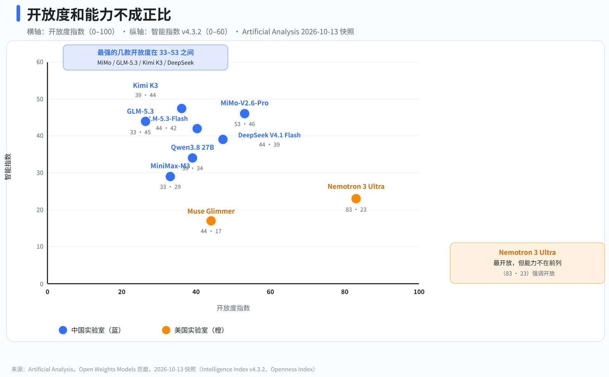
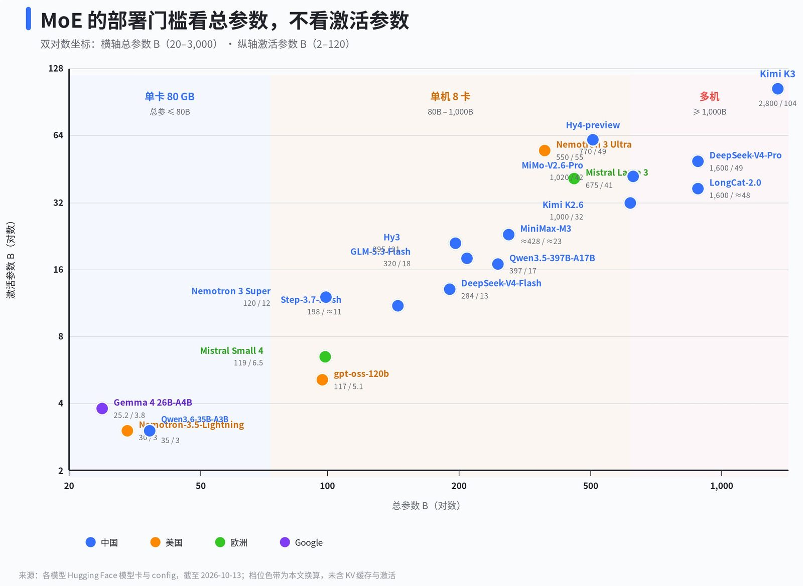
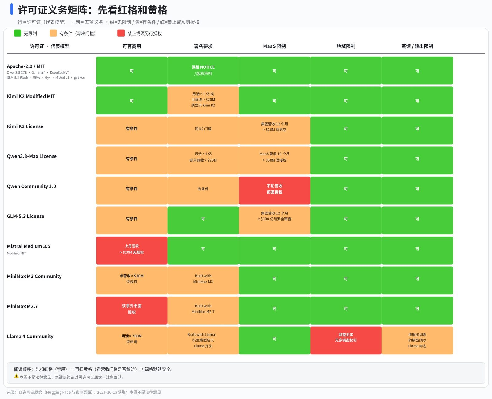
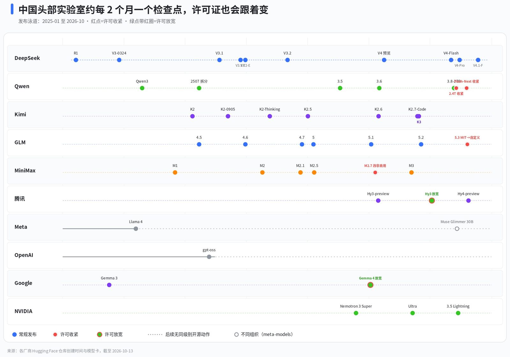
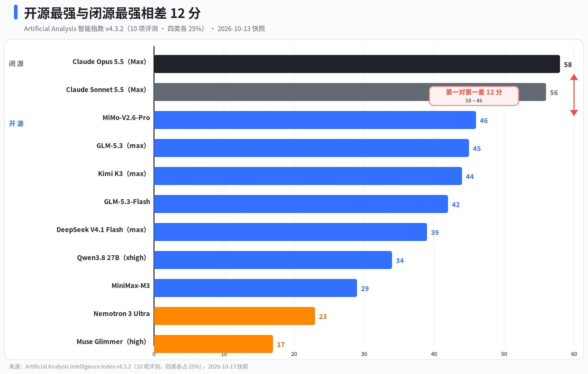
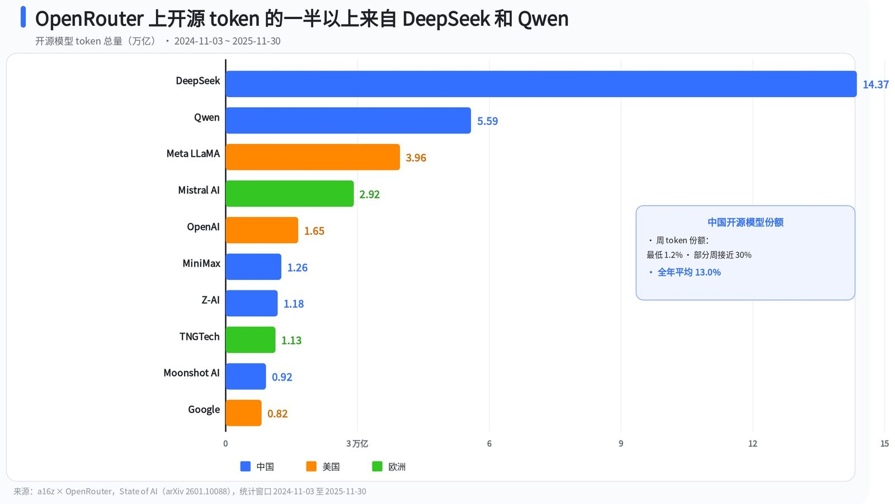
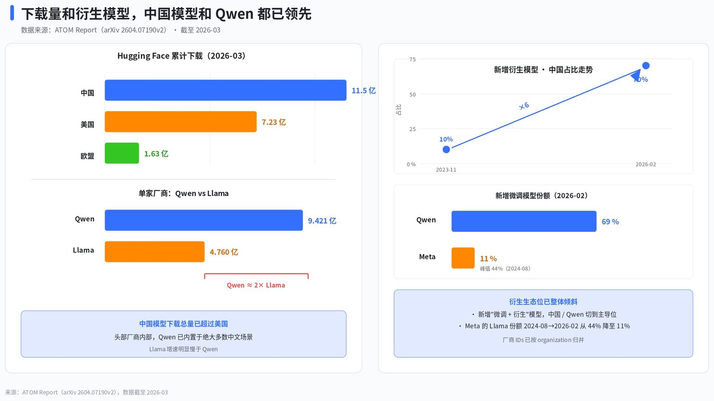
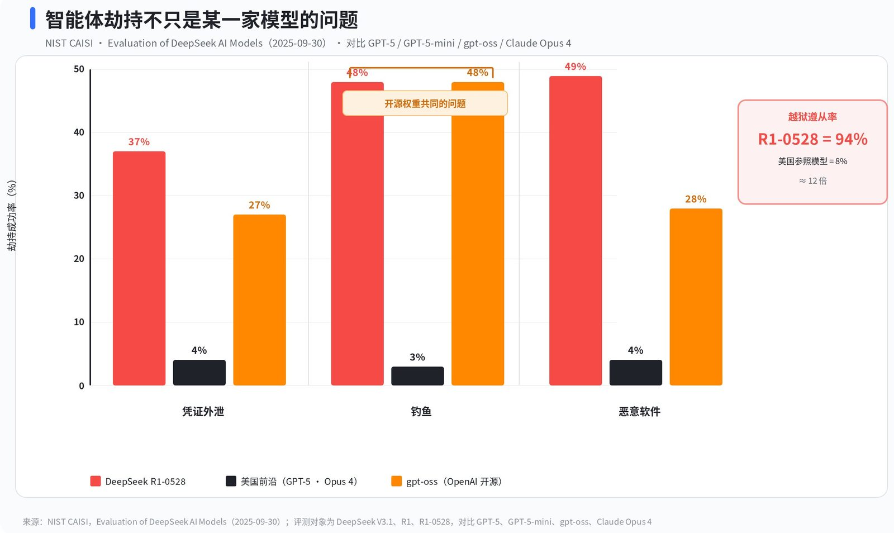

# LLM-44｜系统｜开源权重模型选型与自托管：许可证、节奏与微调

> 🎯 **这篇文档解决什么问题**：2026 年能下载权重的模型已经覆盖 2B 到约 2.8T 参数的全部档位。卡住工程团队的往往是分数以外的事：许可证允不允许这样用、换版本会不会悄悄改掉许可证和默认参数、有没有 Base 可以继续训、模板和工具调用解析器对不对得上、国内对外服务要做什么、手里的卡装不装得下。本文按这个顺序把中美欧主要开源权重模型过一遍。
>
> 使用方式：要上线的先看第 3、4、9 章，再用第 11 章的十问清单；要微调的看第 6、7 章；要排期升级的看第 5 章。模型参数、上下文、许可证和日期截至 2026-10-13，来自 Hugging Face 模型卡、config 和许可证原文；文中版本、价格和基准分数核对于 2026 年 10 月 13 日。

## 导读 · 先给结论

- **差距是一个季度量级**。Epoch AI 测算开源权重平均落后最先进模型约 3 个月[[1]](https://epoch.ai/data-insights/open-weights-vs-closed-weights-models)；Artificial Analysis 智能指数 v4.3.2 在 2026-10-13 的快照里，闭源第一 58 分、开源第一 46 分[[2]](https://artificialanalysis.ai/models/open-source)。
- **中国实验室在使用量上领先**。到 2026-03，中国模型在 Hugging Face 的累计下载约 11.5 亿次，美国约 7.23 亿次；新增衍生模型中中国占比升到 70%[[3]](https://arxiv.org/abs/2604.07190)。
- **许可证在两个方向同时变化**。Gemma 4 改用 Apache 2.0[[4]](https://ai.google.dev/gemma/docs/gemma_4_license)，腾讯 Hy3 正式版改为 Apache-2.0[[5]](https://huggingface.co/tencent)；同时 Kimi K3、GLM-5.3、Qwen3.8 的大型号加入了针对“模型即服务”（MaaS）的条款[[6]](https://huggingface.co/moonshotai)[[7]](https://huggingface.co/zai-org)[[8]](https://huggingface.co/Qwen)，MiniMax M2.7 改为非商用[[9]](https://huggingface.co/MiniMaxAI)。
- **小版本升级可能改许可证**。GLM-5.2 是 MIT，规模相同的 GLM-5.3 换成了自定义许可证[[7]](https://huggingface.co/zai-org)。
- **最新的前沿开源权重大多不给 Base**。截至 2026-10-13，Kimi K3、GLM-5.x、Qwen3.8、DeepSeek-V4.1-Flash 在官方 Hugging Face 组织下未找到 Base；DeepSeek V4、Gemma 4、Nemotron 3、OLMo 3 仍提供[[10]](https://huggingface.co/deepseek-ai)[[11]](https://huggingface.co/google)[[12]](https://huggingface.co/nvidia)[[13]](https://huggingface.co/allenai)。
- **合规不随自托管消失**。国内面向公众的生成式服务要做安全评估和备案[[14]](https://www.gov.cn/zhengce/202311/content_6917778.htm)；NIST 的评测显示智能体劫持在美国开源模型 gpt-oss 上同样严重[[15]](https://www.nist.gov/system/files/documents/2025/09/30/CAISI_Evaluation_of_DeepSeek_AI_Models.pdf)。
- **选型顺序**：先过法务和合规，再看能力、硬件、微调，最后才是排行榜。

📎 与系列其他文档的分工：版图与发布日期见「LLM 基础」第 10 章；成本、显存和 GPU 选型见「自建推理成本与 GPU 选型」；量化见「模型压缩与端侧部署」；推理引擎见「vLLM 学习路径」；分数口径见「读懂模型基准与排行榜」；微调方法见「后训练实战」；MoE 结构与微调见「MoE 混合专家」。本文只讲模型选择这一侧。

## 第 1 章 · 开源权重不等于开源：OSAID 1.0 与透明度分级

“开源模型”在日常交流里通常只表示权重可以下载，但这既不说明能任意使用，也不说明能复现或审计训练过程。本文用“开源权重模型”（open-weight model）指前者，只在满足下文定义时才说“开源 AI”。

### 1.1 OSI 的开源 AI 定义

开放源代码促进会（OSI）董事会在 2024-10-27 批准了开源 AI 定义 1.0（OSAID 1.0）[[16]](https://opensource.org/meeting-minutes/2024-10-27)。它要求四项自由：为任何目的使用而“无须请求许可”、研究、修改（包括改变输出）、分享；修改所需的首选形式包括三部分：足以让有能力的人构建实质等价系统的**数据信息**（含无法公开数据的描述和第三方数据清单）、完整的训练与数据处理**代码**、按 OSI 认可条款发布的**参数**[[17]](https://opensource.org/ai/open-source-ai-definition)。

由此有两个结论。首先，营收或月活门槛、用途禁止清单、地域排除都不满足“任何目的、无须许可”，所以 Llama 4、Kimi K3、MiniMax M3 都不是开源 AI[[18]](https://github.com/meta-llama/llama-models/blob/main/models/llama4/LICENSE)[[6]](https://huggingface.co/moonshotai)[[9]](https://huggingface.co/MiniMaxAI)。其次，Apache-2.0 或 MIT 的权重如果不公开数据信息和代码，也只满足三项中的一项。

### 1.2 本文的透明度分级

分级是本文的编辑口径，每级里的事实来自模型卡。

| 级别 | 含义 | 代表模型 |
|---|---|---|
| T0 | 只有 API | Meta Muse Spark（meta.ai 与私有 API 预览）[[19]](https://ai.meta.com/blog/introducing-muse-spark-msl/) |
| T1 | 权重可下载，许可证有门槛、用途或地域限制 | Llama 4、Kimi K3、Qwen3.8-Max、MiniMax M3、Mistral Medium 3.5、GLM-5.3 |
| T2 | OSI 认可的许可证，数据不公开 | DeepSeek R1 及之后、Qwen3.x 27B 及以下、Gemma 4、gpt-oss、Mistral Large 3 / Small 4 |
| T3 | 权重加部分数据或配方 | NVIDIA Nemotron 3（公开最终预训练和后训练数据，部分需申请）[[12]](https://huggingface.co/nvidia)、IBM Granite |
| T4 | 数据、代码、全部中间检查点公开 | AI2 OLMo 3（7B、32B，含每个 SFT、DPO 中间检查点）[[13]](https://huggingface.co/allenai) |

Artificial Analysis 的开放度指数（0–100）可作印证。2026-10-13 快照里 Nemotron 3 Ultra 开放度最高（83），但智能指数只有 23；MiMo-V2.6-Pro 开放度 53、智能 46；GLM-5.3 为 33 和 45[[2]](https://artificialanalysis.ai/models/open-source)。开放度与能力目前没有正相关。

### 1.3 数字口径

- **参数**写“总参数 / 激活参数”，模型卡未写时用 Hugging Face 统计的 safetensors 参数量（可能含 MTP 模块、视觉编码器和嵌入层）。
- **日期**：只知道仓库创建时间的写“仓库创建于”，它往往早于公开发布。
- <b>“没有”类结论</b>一律指“截至 2026-10-13 在官方 Hugging Face 组织下未找到”。

## 第 2 章 · 2026 年 10 月全景：中美欧主要开源权重模型

两张表只收仍值得考虑的主力型号，截至 2026-10-13，来自 Hugging Face 模型卡、config 和许可证原文。专家数、路由等结构细节不重复。

📎 展开阅读：「MoE 混合专家」第 3 章（主流 MoE 配置全表）；「LLM 基础」第 10 章（2026 年发布时间线）。

### 2.1 中国实验室

| 模型 | 日期 | 总 / 激活参数 | 上下文 | 许可证 |
|---|---|---|---|---|
| DeepSeek-V4-Pro / V4-Flash | 预览版仓库创建于 2026-04-22；正式版 0813 / 0731 | 1.6T / 49B；284B / 13B | 1M | MIT[[10]](https://huggingface.co/deepseek-ai) |
| DeepSeek-V4.1-Flash | 2026-09-10 | 主干 552B；预填充激活 8B，解码 16B | 1M | MIT[[10]](https://huggingface.co/deepseek-ai) |
| Qwen3.5-397B-A17B 等 | 仓库创建于 2026-02-16 至 02-28 | 397B / 17B，另有 122B 到 0.8B | 262,144，可扩到约 1M | Apache-2.0[[8]](https://huggingface.co/Qwen) |
| Qwen3.6-35B-A3B / 27B | 2026-04-15 / 04-21 | 35B / 3B；稠密 27B | 同上 | Apache-2.0[[8]](https://huggingface.co/Qwen) |
| Qwen3.8-27B | 仓库创建于 2026-08-05 | 稠密 27B | 同上 | Apache-2.0[[8]](https://huggingface.co/Qwen) |
| Qwen3.8-2.4T-A95B | 仓库创建于 2026-08-08 | 2.4T / 95B | 同上 | 自定义 qwen3.8-max[[8]](https://huggingface.co/Qwen) |
| Qwen3.8-Flash-Next | 仓库创建于 2026-08-24 | 125B / 6B，另有 51B n-gram 嵌入 | — | 自定义 qwen-community-1.0[[8]](https://huggingface.co/Qwen) |
| Kimi K2.6 | 2026-04-14 | 1T / 32B | 256K | Modified MIT[[6]](https://huggingface.co/moonshotai) |
| Kimi K3 | 仓库创建于 2026-06-13 | 约 2.8T / 104B | 1,048,576 | 自定义 Kimi K3 License[[6]](https://huggingface.co/moonshotai) |
| GLM-5.2 | 2026-06-16 | 约 753.3B | 1M | MIT[[7]](https://huggingface.co/zai-org) |
| GLM-5.3 / 5.3-Flash | 仓库创建于 2026-08-25 | 约 753.3B；Flash 320B / 18B | 1M | 自定义 glm-5.3；Flash 为 MIT[[7]](https://huggingface.co/zai-org) |
| MiniMax-M3 | 2026-06-02 | 约 428B / 约 23B | 1M | MiniMax Community[[9]](https://huggingface.co/MiniMaxAI) |
| 腾讯 Hy3 / Hy4-preview | 2026-07-02 / 08-27 | 295B / 21B；770B / 49B | 256K；1M | Apache-2.0[[5]](https://huggingface.co/tencent) |
| 阶跃 Step-3.7-Flash | 2026-05-23 | 198B / 约 11B | 256K | Apache-2.0[[20]](https://huggingface.co/stepfun-ai) |
| 小米 MiMo-V2.6-Pro | 2026-09-21 | 1.02T / 42B | 1M | MIT[[21]](https://huggingface.co/XiaomiMiMo) |
| 美团 LongCat-2.0 | 2026-07-05 | 1.6T / 约 48B | — | MIT[[22]](https://huggingface.co/meituan-longcat) |

### 2.2 美国与欧洲实验室

| 模型 | 日期 | 总 / 激活参数 | 上下文 | 许可证 |
|---|---|---|---|---|
| gpt-oss-120b / 20b | 发布于 2025-08-05 | 117B / 5.1B；21B / 3.6B | 131,072 | Apache-2.0[[23]](https://huggingface.co/openai) |
| Llama 4 Scout / Maverick | 发布于 2025-04-05 | 109B / 17B；400B / 17B | 10M；1M | Llama 4 Community[[24]](https://huggingface.co/meta-llama) |
| Meta Muse-Glimmer-30B | 仓库创建于 2026-08-09 | 约 29.6B 稠密 | 131,072 以上 | Apache 2.0[[25]](https://huggingface.co/meta-models) |
| Gemma 4 | 仓库创建于 2026-03-11 | 31B 稠密；26B-A4B（25.2B / 3.8B）；12B；E4B；E2B | 256K；E 系列 128K | Apache 2.0[[11]](https://huggingface.co/google) |
| Mistral Large 3 | 仓库创建于 2025-11-28 | 675B / 41B | 256K | Apache-2.0[[26]](https://huggingface.co/mistralai) |
| Mistral Small 4 | 仓库创建于 2026-01-23 | 119B / 6.5B | 256K | Apache-2.0[[26]](https://huggingface.co/mistralai) |
| Mistral Medium 3.5 | 仓库创建于 2026-03-31 | 稠密 128B | 256K | Modified MIT[[26]](https://huggingface.co/mistralai) |
| Nemotron 3 Super / Ultra | 2026-03-11 / 06-04 | 120B / 12B；550B / 55B | 最长 1M | Nemotron Open Model License；OpenMDW-1.1[[12]](https://huggingface.co/nvidia) |
| Nemotron-3.5-Lightning | 2026-08-11 | 30B / 3B | 最长 1M | OpenMDW-1.1[[12]](https://huggingface.co/nvidia) |
| IBM Granite 4.2 | 发布于 2026-08-25 | 3B、8B、30B | 128K | Apache-2.0[[27]](https://huggingface.co/ibm-granite) |
| AI2 OLMo 3 | 2025-11 | 7B、32B | 65,536 | Apache-2.0[[13]](https://huggingface.co/allenai) |

### 2.3 从表里读出的三件事

- **万亿参数档几乎全是中国模型**：Kimi K3、DeepSeek-V4-Pro、LongCat-2.0、MiMo-V2.6-Pro、Qwen3.8-2.4T-A95B 和 Kimi K2.x；美欧最大的是 Mistral Large 3（675B）和 Nemotron 3 Ultra（550B）。
- **Meta 和 OpenAI 的开源权重基本停在 2025 年**。Meta 在 2025-04 之后没有新的 Llama 语言模型仓库[[24]](https://huggingface.co/meta-llama)，2026 年旗舰 Muse Spark 不开放权重[[19]](https://ai.meta.com/blog/introducing-muse-spark-msl/)，开放的是从它蒸馏出的 Muse-Glimmer-30B[[25]](https://huggingface.co/meta-models)；扎克伯格写道要“谨慎选择开源什么”[[28]](https://www.meta.com/superintelligence/)。OpenAI 截至 2026-10-13 没有 gpt-oss 的后继[[23]](https://huggingface.co/openai)。
- **Google、NVIDIA、IBM 集中在中小档位**，许可证全部是宽松型[[11]](https://huggingface.co/google)[[12]](https://huggingface.co/nvidia)[[27]](https://huggingface.co/ibm-granite)。

## 第 3 章 · 许可证逐条读：从 Apache/MIT 到 MaaS 营收门槛

2026 年的开源权重许可证可分五类：宽松型、署名门槛型、MaaS 门槛型、营收上限或非商用型，以及 Llama、Gemma 这类带用途政策的自定义许可证。同一厂商的不同型号可能分属不同类别，要按型号查。

<b>本文不是法律意见，商用前以许可证原文和法务意见为准。</b>门槛数字和适用对象摘自 2026-10-13 获取的许可证原文。

### 3.1 宽松型：Apache-2.0、MIT、OpenMDW

- **Apache-2.0**：Qwen3 到 3.6 全系和 Qwen3.8-27B、Gemma 4、gpt-oss、Mistral Large 3 与 Small 4、ERNIE 4.5、Hy3、Hy4-preview、Step-3.x-Flash、Granite 4.2、OLMo 3、MiniMax-M1[[8]](https://huggingface.co/Qwen)[[4]](https://ai.google.dev/gemma/docs/gemma_4_license)[[23]](https://huggingface.co/openai)[[26]](https://huggingface.co/mistralai)。比 MIT 多三条：第 3 条明确授予专利许可，发起专利诉讼则终止；第 4 条要求保留 NOTICE；第 6 条不授予商标权。
- **MIT**：DeepSeek R1 和 V3-0324 之后的权重、GLM-4.5 到 5.2 及 GLM-5.3-Flash、MiMo、LongCat-2.0、Phi-4 系列[[10]](https://huggingface.co/deepseek-ai)[[7]](https://huggingface.co/zai-org)[[21]](https://huggingface.co/XiaomiMiMo)[[29]](https://huggingface.co/microsoft)。唯一条件是保留版权和许可声明；LongCat-2.0 的模型卡另写明不授予商标和专利权利[[22]](https://huggingface.co/meituan-longcat)。
- **OpenMDW-1.1**：Nemotron 3 Ultra 和 3.5-Lightning 使用。授予“全部版权、专利、数据库和商业秘密权利”，再分发须附协议和声明，诉讼导致终止，且“不对输出的任何使用、修改或分享施加限制”[[30]](https://openmdw.ai/license/1-1/)。Nemotron 3 Super 用另一份 Nemotron Open Model License，需单独读[[12]](https://huggingface.co/nvidia)。

### 3.2 署名门槛型：Kimi K2 的 Modified MIT

Kimi K2、K2.5、K2.6 在 MIT 上加了一句：用于月活超过 1 亿或月营收超过 2,000 万美元的商业产品或服务时，须在界面显著展示“Kimi K2”[[31]](https://huggingface.co/moonshotai/Kimi-K2-Instruct/blob/main/LICENSE)。它不限制使用，只要求署名。

### 3.3 MaaS 门槛型：Kimi K3、GLM-5.3、Qwen3.8

Kimi K3 License 对“模型即服务”（MaaS）的定义是：向第三方提供推理或微调能力，且对方对输入、参数或训练数据有“实质性控制”；嵌在终端产品里的功能和单纯转发不算[[6]](https://huggingface.co/moonshotai)。四份许可证对比：

| 许可证 | MaaS 条款 | 署名条款 | 豁免 |
|---|---|---|---|
| Kimi K3 | 集团营收任意连续 12 个月超过 2,000 万美元，商用前须与 Moonshot AI 另签协议 | 月活超 1 亿或月营收超 2,000 万美元，展示“Kimi K3” | 内部使用；经官方产品或认证推理伙伴使用[[6]](https://huggingface.co/moonshotai) |
| GLM-5.3 | 集团营收 12 个月超过 100 亿美元，商用前须通过 Z.ai 安全审查 | 无 | 中英双语文本[[7]](https://huggingface.co/zai-org) |
| Qwen3.8-Max | MaaS 或“AI 工作助手”（编程、办公类产品）集团营收 12 个月超过 5,000 万美元，须另行授权 | 同 Kimi K3 的门槛，展示模型名 | 内部使用[[8]](https://huggingface.co/Qwen) |
| Qwen Community 1.0 | MaaS 或 AI 工作助手**不论营收**都须另行授权 | 同上 | 内部使用[[8]](https://huggingface.co/Qwen) |

这类条款允许企业把模型嵌进自己的产品，但不允许大型云厂商或编程工具厂商直接转卖推理能力。对做模型托管、编程或办公助手产品的公司，Qwen Community 1.0 实际上等于先谈授权。

### 3.4 营收上限与非商用

- **Mistral Medium 3.5、Devstral-2-123B**：也叫 Modified MIT，但条款是公司（或雇主）上月全球合并月营收超过 2,000 万美元，就“无权行使本许可证下的任何权利”，且适用于衍生模型[[26]](https://huggingface.co/mistralai)。超过门槛就是没有授权，与 Kimi 的署名性质完全不同。
- **MiniMax M2.7**：非商用。商用须事先书面授权；个人自托管、非营利和学术研究免费；须展示“Built with MiniMax M2.7”；禁止军事用途[[9]](https://huggingface.co/MiniMaxAI)。
- **MiniMax M3**：商用须展示“Built with MiniMax M3”并发一次性通知邮件；产品年营收超过 2,000 万美元须事先授权；部署微调后的衍生模型也算商用[[9]](https://huggingface.co/MiniMaxAI)。

### 3.5 Llama 4 Community License

- **署名与命名**：再分发须展示“Built with Llama”；用 Llama 材料或其输出训练并分发的模型，名称须以“Llama”开头[[18]](https://github.com/meta-llama/llama-models/blob/main/models/llama4/LICENSE)。
- **月活门槛**：发布日前一个月被许可方及关联方月活超过 7 亿，须向 Meta 申请，由 Meta 自行决定[[18]](https://github.com/meta-llama/llama-models/blob/main/models/llama4/LICENSE)。
- **欧盟排除**：对 Llama 4 的多模态模型，住所在欧盟的个人或主要营业地在欧盟的公司不获得第 1(a) 条权利，终端用户不受此限[[18]](https://github.com/meta-llama/llama-models/blob/main/models/llama4/LICENSE)。Llama 4 全是原生多模态，所以欧盟公司实际上拿不到授权。

### 3.6 历史条款：Gemma、DeepSeek、腾讯

- **Gemma 使用条款**（Gemma 1 到 3 等）：蒸馏和用合成数据训练的模型算衍生品；再分发须传递禁止用途政策；Google 保留“远程或以其他方式”限制使用的权利[[32]](https://ai.google.dev/gemma/terms)。Gemma 4 改用 Apache 2.0[[4]](https://ai.google.dev/gemma/docs/gemma_4_license)。
- **DeepSeek-V3 初版**：OpenRAIL 风格，衍生品含蒸馏，用途限制须写入下游许可证[[33]](https://github.com/deepseek-ai/DeepSeek-V3/blob/main/LICENSE-MODEL)；R1 和 V3-0324 起改为 MIT[[10]](https://huggingface.co/deepseek-ai)。
- **腾讯 Hy3-preview**：社区许可证“不适用于欧盟、英国和韩国”，月活超 1 亿须申请；Hy3 正式版和 Hy4-preview 改为 Apache-2.0[[5]](https://huggingface.co/tencent)。

## 第 4 章 · 许可证的工程后果：署名、命名、蒸馏、地域与漂移

许可证条款最终落成五类工程工作：界面加不加一行字、微调后的模型能叫什么、能不能用它的输出训练别的模型、哪个地区的主体能用、升级时要不要重过法务。

### 4.1 署名和声明

Kimi K2 / K3 和 Qwen3.8 的大型号在月活超过 1 亿或月营收超过 2,000 万美元时要显示模型名[[31]](https://huggingface.co/moonshotai/Kimi-K2-Instruct/blob/main/LICENSE)[[6]](https://huggingface.co/moonshotai)[[8]](https://huggingface.co/Qwen)；MiniMax M3 商用即须“Built with MiniMax M3”，没有营收下限[[9]](https://huggingface.co/MiniMaxAI)；Llama 4 再分发须“Built with Llama”[[18]](https://github.com/meta-llama/llama-models/blob/main/models/llama4/LICENSE)。产品设计阶段就要留出位置。Apache-2.0 要保留 NOTICE，OpenMDW 要附协议副本[[30]](https://openmdw.ai/license/1-1/)；内部镜像同步权重时，把 LICENSE、NOTICE、USE_POLICY 一起同步。

### 4.2 命名

在 Llama 4 上微调并对外发布的模型，或用 Llama 4 生成数据训练并发布的模型，名字都必须以“Llama”开头[[18]](https://github.com/meta-llama/llama-models/blob/main/models/llama4/LICENSE)。反方向，Apache-2.0 不授予商标权，不能用原厂商品牌暗示背书。

### 4.3 蒸馏与合成数据

- Gemma 1 到 3 的条款和 DeepSeek-V3 初版许可证都把“用输出训练的模型”算作衍生品[[32]](https://ai.google.dev/gemma/terms)[[33]](https://github.com/deepseek-ai/DeepSeek-V3/blob/main/LICENSE-MODEL)；OpenMDW 对输出不加限制[[30]](https://openmdw.ai/license/1-1/)。
- DeepSeek-R1 是 MIT，官方发布的蒸馏模型分别基于 Qwen-2.5 和 Llama，继承 Apache-2.0 和 Llama 3.1 / 3.3 许可证的来源约束[[10]](https://huggingface.co/deepseek-ai)。蒸馏模型同时受“老师”和“学生基座”两份许可证约束。

📎 展开阅读：「后训练实战」第 3.5 节（哪些模型的输出可以拿来训练）。

### 4.4 地域

明确写了地域排除的有 Llama 4 对欧盟主体的多模态排除[[18]](https://github.com/meta-llama/llama-models/blob/main/models/llama4/LICENSE)和 Hy3-preview 对欧盟、英国、韩国的排除[[5]](https://huggingface.co/tencent)。判断依据是哪个法律主体在用，而不是服务器在哪。GLM-5.2 的模型卡专门写了“没有地域限制”[[7]](https://huggingface.co/zai-org)。

### 4.5 许可证漂移

2024–2026 年至少有六个系列在版本之间改过许可证：

| 系列 | 变化 | 升级时的影响 |
|---|---|---|
| GLM | 5.2 为 MIT，同规模的 5.3 为自定义许可证，5.3-Flash 仍为 MIT[[7]](https://huggingface.co/zai-org) | 超大型 MaaS 厂商须过安全审查 |
| Qwen | 3.6 为 Apache-2.0；3.8 两款最大型号改为自定义许可证，27B 仍为 Apache-2.0[[8]](https://huggingface.co/Qwen) | 编程或办公助手产品升到 Flash-Next 须授权 |
| MiniMax | M1 Apache-2.0，M2 modified-mit，M2.7 非商用，M3 社区许可证[[9]](https://huggingface.co/MiniMaxAI) | 升到 M2.7 变为未经授权不可商用 |
| 腾讯 Hy | Hy3-preview 社区许可证，Hy3 正式版 Apache-2.0[[5]](https://huggingface.co/tencent) | 放宽 |
| DeepSeek | V3 初版自有许可证，R1 起 MIT[[10]](https://huggingface.co/deepseek-ai) | 放宽 |
| Gemma | 使用条款改为 Apache 2.0[[4]](https://ai.google.dev/gemma/docs/gemma_4_license) | 放宽，蒸馏限制消失 |

做法：把许可证当依赖管理，在模型注册表里记录每个版本的许可证标签和 LICENSE 文件哈希，升级流水线自动比对，变化即阻断发布并转法务。

> 💡 **常见误区**
>
> - “同一家的许可证都一样”：Qwen3.8 和 GLM-5.3 同代不同型号用不同许可证。
> - “Modified MIT 就是 MIT”：Kimi 的版本只加署名，Mistral 的版本超过营收门槛就没有授权。
> - “只在内部用就不受约束”：Kimi K3 的豁免只覆盖不向第三方提供输出或能力的内部使用；Llama 4 的月活门槛和欧盟排除针对被许可主体本身。

## 第 5 章 · 版本节奏：发布频率、默认值变化与锁版本

中国头部实验室的旗舰开源权重约每两个月更新一次，小版本之间常改聊天模板、思考开关默认值和采样参数。开源权重应当当作快速迭代的上游依赖来管理，而不是下载一次就不变的静态资产。

### 5.1 各家发布频率

按 Hugging Face 仓库创建时间统计 2025-01 到 2026-09 的旗舰检查点[[10]](https://huggingface.co/deepseek-ai)[[8]](https://huggingface.co/Qwen)[[6]](https://huggingface.co/moonshotai)[[7]](https://huggingface.co/zai-org)[[9]](https://huggingface.co/MiniMaxAI)：

| 厂商 | 主要节点 | 节奏 |
|---|---|---|
| DeepSeek | R1（2025-01-20）、V3-0324、R1-0528、V3.1、V3.1-Terminus、V3.2-Exp、V3.2（2025-12-01）、V4 预览（2026-04-22）、V4-Flash-0731 与 V4-Pro-0813、V4.1-Flash（2026-09-10） | 20 个月约 10 个 |
| Qwen | Qwen3（2025-04-27）、2507 拆分、3.5（2026-02）、3.6（2026-04）、3.8（2026-08） | 每代 2–6 个月 |
| Kimi | K2（2025-07-11）、K2-0905、K2-Thinking、K2.5、K2.6、K2.7-Code、K3（仓库 2026-06-13） | 12 个月约 7 个 |
| GLM | 4.5（2025-07-20）、4.6、4.7、5（2026-02-11）、5.1、5.2、5.3（2026-08-25） | 13 个月 7 个 |
| MiniMax | M1（2025-06）、M2、M2.1、M2.5、M2.7、M3（2026-06-02） | 约每 2 个月 |
| Google、NVIDIA | Gemma 3（2025-03）到 Gemma 4（2026-04-02）[[11]](https://huggingface.co/google)；Nemotron 3 Super、Ultra、3.5-Lightning（2026-03 到 08）[[12]](https://huggingface.co/nvidia) | 约 12 个月；约 3 个月 |
| Meta、OpenAI | Llama 4（2025-04-05）、gpt-oss（2025-08-05）之后无后继[[24]](https://huggingface.co/meta-llama)[[23]](https://huggingface.co/openai) | 停滞 |

### 5.2 小版本之间会变什么

- **思考默认值**：Qwen3.6 的 `preserve_thinking` 需手动开启；Qwen3.8 默认开启，`enable_thinking` 也默认开启，`reasoning_effort` 默认 xhigh[[8]](https://huggingface.co/Qwen)。
- **采样参数**：Qwen3.6 思考模式编程任务 `presence_penalty=0.0`、其他 1.5，Qwen3.8 思考模式统一为 0.0[[8]](https://huggingface.co/Qwen)；DeepSeek V4 推荐 `temperature=1.0`、`top_p=1.0`[[10]](https://huggingface.co/deepseek-ai)。
- **模板形态**：DeepSeek V3.1 还有 Jinja 模板，V3.2 起改为 Python 的 `encoding` 目录[[10]](https://huggingface.co/deepseek-ai)。
- **解析器**：GLM-4.5 用 `glm45`，GLM-5 用 `glm47`[[7]](https://huggingface.co/zai-org)。
- **推理档位**：V4.1-Flash 的推理强度可在 1 到 100 之间连续调节[[10]](https://huggingface.co/deepseek-ai)。
- **预览转正式**：V4-Pro-0813“取代预览版”并新增 DSpark 投机解码模块[[10]](https://huggingface.co/deepseek-ai)；Hy3 转正式版时连许可证都换了[[5]](https://huggingface.co/tencent)。

### 5.3 没有 LTS，锁版本靠自己

截至 2026-10-13，在各家官方 Hugging Face 组织下未找到针对开源权重的长期支持或下线承诺。要做三件事：

- 用 `revision=<commit SHA>` 同时锁住权重、分词器和聊天模板，不用 `main`。
- 把模板和编码脚本复制进自己的仓库，上游修改不应自动影响线上。
- 升级前跑固定回归集：工具调用解析率、思考泄漏、默认参数、长上下文召回、安全用例、许可证差异（模板见第 11 章）。

📎 展开阅读：「用好模型」第 10 章（闭源模型换代迁移清单，思路相同）。

## 第 6 章 · 微调友好度（上）：Base、聊天模板与工具调用解析器

从模型这一侧看，好不好微调取决于三件事：有没有公开的 Base（预训练）检查点、模板和推理格式能否复现、推理引擎有没有现成的工具调用解析器。任何一件出问题，微调后的模型都可能在线上悄悄出错。

📎 展开阅读：「后训练实战」第 1 章（要不要微调）、第 3.3 节（聊天模板与损失掩码）、第 4 章（LoRA 与变体）。

### 6.1 Base 检查点

做继续预训练、领域适配或自己做后训练，起点应是 Base。截至 2026-10-13[[10]](https://huggingface.co/deepseek-ai)[[8]](https://huggingface.co/Qwen)[[6]](https://huggingface.co/moonshotai)[[7]](https://huggingface.co/zai-org)[[11]](https://huggingface.co/google)[[12]](https://huggingface.co/nvidia)[[13]](https://huggingface.co/allenai)：

| 提供 Base | 官方 Hugging Face 组织下未找到 Base |
|---|---|
| DeepSeek V3.1、V4-Pro、V4-Flash | DeepSeek-V4.1-Flash |
| Qwen3.5 的 35B-A3B、9B、4B、2B、0.8B；Qwen3-Coder-Next | Qwen3.5-397B、122B、27B；Qwen3.6 全系；Qwen3.8-27B |
| Kimi-K2-Base；GLM-4.5 | Kimi K3；GLM-5.x 全系 |
| Gemma 4 预训练版；Mistral Large 3 Base[[26]](https://huggingface.co/mistralai) | Mistral Small 4；gpt-oss |
| Nemotron 3 Super、Ultra、3.5-Lightning | MiniMax M2 到 M3[[9]](https://huggingface.co/MiniMaxAI) |
| Hy3-preview[[5]](https://huggingface.co/tencent)；Step-3.5-Flash[[20]](https://huggingface.co/stepfun-ai)；MiMo-V2.5 | MiMo-V2.6；LongCat-2.0[[21]](https://huggingface.co/XiaomiMiMo)[[22]](https://huggingface.co/meituan-longcat) |
| OLMo 3（含全部中间检查点）；Granite 4.1-30b-base[[27]](https://huggingface.co/ibm-granite) | Muse-Glimmer-30B[[25]](https://huggingface.co/meta-models) |

2026-06 到 09 发布的前沿开源权重大多只给后训练版本，Base 集中在 DeepSeek V4、Gemma 4、NVIDIA 和 OLMo。“未找到”是按名称模式搜索的结果，立项前应向厂商确认。

### 6.2 聊天模板与推理格式

- **gpt-oss**：用 harmony 格式训练，“只应配合 harmony 格式使用，否则无法正确工作”[[23]](https://huggingface.co/openai)。微调数据也必须渲染成 harmony。
- **DeepSeek V3.2 之后**：不提供 Jinja 模板，提供 Python 参考实现（如 `encoding_dsv4.encode_messages`）和测试用例[[10]](https://huggingface.co/deepseek-ai)。Unsloth 的 README 写明在本地运行 V4-Flash 时“修正了多轮和工具调用行为”[[34]](https://github.com/unslothai/unsloth)，说明社区模板曾经出错。训练和推理都应调用同一份官方脚本。
- **Qwen3.6 / 3.8**：通过 `chat_template_kwargs` 传 `enable_thinking`、`preserve_thinking`；推荐采样为思考模式 `temperature=1.0`、`top_p=0.95`、`top_k=20`，非思考模式 `temperature=0.7`、`top_p=0.80`[[8]](https://huggingface.co/Qwen)。官方托管 API 把 `enable_thinking` 放在请求顶层，同一份客户端代码在托管和自托管之间不能直接通用。
- **Mistral**：需要 `mistral_common` 1.11.0 及以上，或用 `--tokenizer_mode hf` 等参数走 Hugging Face 格式[[26]](https://huggingface.co/mistralai)。

### 6.3 工具调用解析器

vLLM 文档里按家族区分的解析器包括 hermes、mistral、llama4_pythonic、deepseek_v31、openai、kimi_k2、glm47、qwen3_xml 等；新增的通用 `hf` 解析器从 `tokenizer_config.json` 读模板，但不支持严格工具模式、`required`、指定工具名和 `parallel_tool_calls=false`[[35]](https://docs.vllm.ai/en/latest/features/tool_calling.html)。模型卡指定的组合：gpt-oss 用 `openai`[[23]](https://huggingface.co/openai)；Qwen3.5 起用 `qwen3_coder` 加 `--reasoning-parser qwen3`[[8]](https://huggingface.co/Qwen)；Nemotron 3 用 `qwen3_coder` 加 `nemotron_v3`[[12]](https://huggingface.co/nvidia)；腾讯每代一个新解析器（`hy_v3`、`hy_v4`）[[5]](https://huggingface.co/tencent)；Mistral Small 4 和 Medium 3.5 用 `mistral` 并加同名推理解析器[[26]](https://huggingface.co/mistralai)。

对微调的含义：**训练数据必须用与线上服务完全相同的模板和工具调用格式渲染**。模板不匹配的 LoRA 常见症状是工具调用不再被解析器识别、被当作普通文本返回，只看回答文字的评测很难发现。

📎 展开阅读：「用好模型」第 6 章（函数调用与结构化输出）。

## 第 7 章 · 微调友好度（下）：框架支持与 MoE 微调取舍

新模型发布当天推理引擎通常已有配方，但训练框架的支持往往滞后。选型时要分开问：能不能服务，和能不能用团队现有的框架训。

📎 展开阅读：「后训练实战」第 5.3 节（各训练框架的定位与版本）。

### 7.1 支持矩阵快照

依据 2026-10-13 的 LLaMA-Factory 支持表[[36]](https://github.com/hiyouga/LLaMA-Factory)、Unsloth README[[34]](https://github.com/unslothai/unsloth)和各模型卡。“未列出”不等于不能用，但意味着要自己适配。

| 模型 | LLaMA-Factory | Unsloth | 模型卡列出的部署 |
|---|---|---|---|
| DeepSeek V4 | 未列出（列到 V3.2） | 列为可运行和训练 | 官方编码脚本[[10]](https://huggingface.co/deepseek-ai) |
| Qwen3.5 / 3.6 | 已列出 | 有 Qwen3.5 示例 | SGLang、vLLM[[8]](https://huggingface.co/Qwen) |
| Qwen3.8 | 未列出 | 列为可运行和训练 | Transformers、vLLM、SGLang、TokenSpeed[[8]](https://huggingface.co/Qwen) |
| Kimi K3 | 未列出（只有 Kimi-VL） | 列为可运行和训练 | vLLM 配方、SGLang cookbook[[6]](https://huggingface.co/moonshotai) |
| GLM-5.x | 未列出（列到 GLM-4.5） | GLM-5.3-Flash 已列 | SGLang、vLLM、KTransformers、Unsloth，昇腾上有 vLLM-Ascend、xLLM[[7]](https://huggingface.co/zai-org) |
| Gemma 4 | 未列出（列到 Gemma 3） | 列为可运行和训练 | 提供 QAT 检查点[[11]](https://huggingface.co/google) |
| gpt-oss、Llama 4 | 已列出 | 有 gpt-oss 示例 | vLLM[[23]](https://huggingface.co/openai) |
| MiniMax M3 | 未列出（列到 M2） | 列为可运行和训练 | SGLang、vLLM、KTransformers、Unsloth[[9]](https://huggingface.co/MiniMaxAI) |
| Nemotron 3 | 未列出 | — | vLLM、SGLang[[12]](https://huggingface.co/nvidia) |

规律是：LLaMA-Factory 的表里缺少 DeepSeek V4、Kimi K3、GLM-5.x、Gemma 4、Qwen3.8、Nemotron 3 这些 2026 年的主力型号；Unsloth 跟进最快，但 README 是厂商自述，速度和显存数字要自己复测。

### 7.2 MoE 微调的取舍

- **万亿级全参数微调基本不现实**：Kimi K3（约 2.8T）和 DeepSeek-V4-Pro（1.6T）的全参数微调意味着多机训练[[6]](https://huggingface.co/moonshotai)[[10]](https://huggingface.co/deepseek-ai)。
- **务实路径**：32B 以下稠密模型（Qwen3.8-27B、Gemma 4 31B、OLMo 3 32B、Muse-Glimmer-30B），或激活参数很小的 MoE（Qwen3.6-35B-A3B、Nemotron-3.5-Lightning、Gemma 4 26B-A4B），在它们上做 LoRA。
- **原生低精度会放大训练显存**：Kimi K3 从 SFT 阶段起就用 MXFP4 权重做量化感知训练[[6]](https://huggingface.co/moonshotai)，gpt-oss 的 MoE 权重是 MXFP4[[23]](https://huggingface.co/openai)，训练时通常要升到 BF16，权重显存成倍增加。

📎 展开阅读：「MoE 混合专家」第 11 章（只训部分专家、ESFT、专家上的 LoRA）；「模型压缩与端侧部署」第 5 章（原生低精度发布）；「后训练实战」第 10 章（微调对安全对齐的破坏）。

> 💡 **常见误区**
>
> - “推理引擎能跑就能训”：训练框架可能几个月后才支持，模板细节也常有差异。
> - “没有 Base 也能继续预训练”：在后训练版本上继续预训练会冲掉对齐和思考格式。

## 第 8 章 · 能力差距与采用：差多少、谁在被用

📎 展开阅读：「读懂模型基准与排行榜」第 5 章（Artificial Analysis 指数与 Epoch ECI）、第 7 章（自报分数的口径）。

### 8.1 能力差距：约 3 个月、12 分

**时间差**：Epoch AI 的数据洞察给出，开源权重模型平均落后最先进模型约 3 个月（2026-10-13 检索的页面）[[1]](https://epoch.ai/data-insights/open-weights-vs-closed-weights-models)。

**分数差**：Artificial Analysis 智能指数 v4.3.2 由 10 项评测组成，分四类、各占 25%。2026-10-13 快照里，闭源最高为 Claude Opus 5.5（Max）58、Sonnet 5.5（Max）56；开源权重依次是 MiMo-V2.6-Pro 46、GLM-5.3（max）45、Kimi K3（max）44、GLM-5.3-Flash 42、DeepSeek V4.1 Flash（max）39、Qwen3.8 27B（xhigh）34、MiniMax-M3 29、Nemotron 3 Ultra 23、Muse Glimmer（high）17[[2]](https://artificialanalysis.ai/models/open-source)。第一对第一差 12 分。

两点值得注意：开源前五名全部来自中国实验室，美国厂商的 Nemotron 3 Ultra 和 Muse Glimmer 明显偏低[[2]](https://artificialanalysis.ai/models/open-source)；27B 稠密的 Qwen3.8 拿到 34 分，单卡能装下的模型已能覆盖不少任务。任务是否落在这 12 分里，只能用自有数据验证。

### 8.2 OpenRouter 上的调用量

a16z 与 OpenRouter 统计了 2024-11-03 到 2025-11-30 的约 100 万亿 token[[37]](https://arxiv.org/abs/2601.10088)：中国开源模型的周 token 份额从 2024 年底最低 1.2% 升到部分周接近 30%，全年平均 13.0%，其他地区开源模型平均 13.7%，闭源平均 70%；2025 年底没有单个模型超过开源 token 的 25%；编程类 token 占比从 2025 年初的 11% 升到 50% 以上。按作者统计的开源 token（万亿）：DeepSeek 14.37、Qwen 5.59、Meta LLaMA 3.96、Mistral AI 2.92、OpenAI 1.65、MiniMax 1.26、Z-AI 1.18、TNGTech 1.13、Moonshot AI 0.92、Google 0.82[[37]](https://arxiv.org/abs/2601.10088)。

### 8.3 下载量与衍生模型

- **国别**：ATOM 报告（数据到 2026-03）显示，中国模型在 2025-07 底超过美国，成为 Hugging Face 累计下载量最多的国家；2026-03 时中国 11.5 亿次、美国 7.23 亿次、欧盟 1.63 亿次；新增衍生模型中中国占比从 2023-11 的 10% 升到 2026-02 的 70%[[3]](https://arxiv.org/abs/2604.07190)。
- **家族**：2026-03 时 Qwen 累计下载 9.421 亿次、Llama 4.760 亿次；Qwen 在新增微调模型中的份额从 2024-01 的 1% 升到 2026-02 的 69%，Meta 从峰值 44% 降到 11%[[3]](https://arxiv.org/abs/2604.07190)。
- **Hugging Face 官方观察**：过去一年中国模型占下载量 41%[[38]](https://huggingface.co/blog/huggingface/state-of-os-hf-spring-2026)；Qwen 系衍生模型 151,448 个，是 Meta 的 2.6 倍；GGUF 月下载 Qwen 3,960 万、Gemma 2,080 万、Llama 750 万[[39]](https://huggingface.co/blog/state-of-open-models-summer-2026)。

生态厚度本身就是工程收益：衍生模型和 GGUF 越多，社区量化版、模板修正和踩坑记录就越多。另一方面，70B 以上的下载集中在少数厂商：MiniMax 2026 年几乎全部下载是 70B 以上模型，Moonshot 为 88%，NVIDIA 14%，Meta 9%，Google、Microsoft、IBM 接近 0[[39]](https://huggingface.co/blog/state-of-open-models-summer-2026)。要用 70B 以上的模型，候选主要来自中国实验室。

## 第 9 章 · 合规与地缘：国内备案与标识、美国出口管制、NIST 评测

自托管开源权重能解决数据出境问题，但不自动解决服务资质、内容标识和模型行为问题。本章是对公开文件的摘要，不构成法律意见。

📎 展开阅读：「LLM 安全与治理」第 7.3 节（国内生成式 AI 规定的整体框架）。

### 9.1 国内：备案、登记与标识

- **备案**：《生成式人工智能服务管理暂行办法》自 2023-08-15 起施行，第 17 条要求具有舆论属性或社会动员能力的服务开展安全评估并履行算法备案手续[[14]](https://www.gov.cn/zhengce/202311/content_6917778.htm)。
- **登记**：网信办 2026-09-14 公告显示，7 月至 8 月新增备案服务 124 款（含 7 款端侧），新增登记 133 款通过 API 调用已备案模型的应用；截至 2026-08-31 累计备案 1,112 款、登记 731 款，已上线应用须公示模型名称和备案号或上线编号[[40]](https://www.cac.gov.cn/2026-09/14/c_1791136833136332.htm)。截至 2026-06-30 为备案 988 款、登记 598 款[[41]](https://www.cac.gov.cn/2026-07/10/c_1785427810632554.htm)。
- **标识**：《人工智能生成合成内容标识办法》与国家标准 GB 45438-2025 自 2025-09-01 起施行，办理备案时要一并提交标识材料[[42]](https://www.gov.cn/zhengce/zhengceku/202503/content_7014286.htm)。

“调用已备案模型的 API”对应登记；“自己部署开源权重对公众服务”是否需要单独备案，官方未明确，需咨询属地网信部门和法务。两条路径都要在工程上实现内容标识。

### 9.2 美国：开源权重未纳入管制

2025-01-15 发布的《人工智能扩散框架》新设 ECCN 4E091，管控用 10 的 26 次方次运算以上训练的闭源模型权重，并明确开源权重模型不受管制[[43]](https://www.federalregister.gov/documents/2025/01/15/2025-00636/framework-for-artificial-intelligence-diffusion)。2025-05-13 美国商务部宣布撤销该规则、不予执行，并表示今后发布替代规则[[44]](https://www.bis.gov/press-release/department-commerce-announces-rescission-biden-era-artificial-intelligence-diffusion-rule-strengthens)。截至本文，下载和使用开源权重本身不涉及这套管控，替代规则落地后需重新核对。

### 9.3 政府机构的使用限制

2025 年起，多国政府机构限制在公务场景使用 DeepSeek 的应用和服务，具体见当地新闻报道。这些限制针对官方托管的应用和 API 的数据流向，而不是权重本身；自托管能改变数据流向，但不能消除对模型行为的担忧。

### 9.4 NIST CAISI 对 DeepSeek 的评测

NIST 下属的 AI 标准与创新中心（CAISI）在 2025-09-30 发布评测：对象是 DeepSeek V3.1、R1 和 R1-0528（权重从 Hugging Face 下载、本地运行），对比 GPT-5、GPT-5-mini、gpt-oss 和 Claude Opus 4，共 19 项基准[[15]](https://www.nist.gov/system/files/documents/2025/09/30/CAISI_Evaluation_of_DeepSeek_AI_Models.pdf)。

- **能力**：CVE-Bench 上 V3.1 为 37%、R1 为 27%、最好的美国模型 67%；GPT-5-mini 与 V3.1 性能相近，平均成本低 35%[[15]](https://www.nist.gov/system/files/documents/2025/09/30/CAISI_Evaluation_of_DeepSeek_AI_Models.pdf)。
- **智能体劫持**：凭证外泄 R1-0528 为 37%、美国前沿模型 4%、gpt-oss 27%；钓鱼 48%、3%、48%；恶意软件 49%、4%、28%[[15]](https://www.nist.gov/system/files/documents/2025/09/30/CAISI_Evaluation_of_DeepSeek_AI_Models.pdf)。
- **越狱**：在常见越狱手法下，R1-0528 对明显恶意请求的遵从率为 94%，美国参照模型为 8%[[15]](https://www.nist.gov/system/files/documents/2025/09/30/CAISI_Evaluation_of_DeepSeek_AI_Models.pdf)。
- **政治叙事**：中文测试集上复述中共官方叙事的比例 V3.1 为 12%、美国模型 3%、R1-0528 为 26%；报告认为这种审查内置在模型中，本地权重同样存在[[15]](https://www.nist.gov/system/files/documents/2025/09/30/CAISI_Evaluation_of_DeepSeek_AI_Models.pdf)。

读这份报告要注意：它在美国《AI 行动计划》要求下完成，对象是 2025 年的旧版本，不含 V3.2 及之后；而且美国开源模型 gpt-oss 的钓鱼劫持率同样是 48%[[15]](https://www.nist.gov/system/files/documents/2025/09/30/CAISI_Evaluation_of_DeepSeek_AI_Models.pdf)。智能体劫持是所有开源权重都要在部署层处理的问题，换一个“国籍”的模型解决不了。

> 🔑 **本章要点**
>
> - 国内对公众服务：确认走备案还是登记，落实内容标识。
> - 美国出口管制目前不涉及开源权重本身。
> - 政府或海外公共部门客户：写清模型来源、部署位置和数据流向。
> - 无论选哪家：上线前做劫持和越狱红队测试，工具权限最小化。
>
> 

## 第 10 章 · 自托管硬件匹配：单卡、单机、多机三档

决定部署难度的主要是总参数和发布精度：MoE 每个 token 只算一部分专家，若要全部专家 GPU 常驻，就得全部放进显存；CPU/GPU 混合卸载可降低显存需求，代价是延迟和带宽。本章用最简单的换算把模型分到三档，再列出模型卡里的官方部署信息。

📎 展开阅读：「自建推理成本与 GPU 选型」第 3 章（权重加 KV 缓存的显存账）、第 4 章（GPU 规格）、第 6 章（盈亏平衡）；「vLLM 学习路径」阶段 3（并行与 MoE 服务）；「MoE 混合专家」第 10 章（专家卸载）。

### 10.1 权重显存换算

权重显存约等于参数量乘以每参数字节数：BF16 约 2 字节，FP8 约 1 字节，FP4 或 MXFP4 约 0.5 字节（另加少量缩放因子）。下表是**本文换算，未含 KV 缓存与激活**，单位 GB；参考容量为 H100 80 GB、H200 141 GB，8 卡 H100 合计 640 GB，8 卡 H200 合计 1,128 GB。

| 模型 | 总参数 | BF16 | FP8 | FP4 | 按权重判断的档位 |
|---|---|---|---|---|---|
| Qwen3.8-27B | 27B | 约 54 | 约 27 | 约 14 | 单卡 80 GB |
| Gemma 4 31B | 30.7B | 约 61 | 约 31 | 约 15 | 单卡 80 GB |
| Qwen3.6-35B-A3B | 35B | 约 70 | 约 35 | 约 18 | 单卡 80 GB，BF16 余量很小 |
| gpt-oss-120b | 117B | 约 234 | 约 117 | 约 59 | 官方 MXFP4，单卡 80 GB |
| Mistral Small 4 | 119B | 约 238 | 约 119 | 约 60 | FP8 需 2 卡 H100 或 1 卡 H200 |
| DeepSeek-V4-Flash | 284B | 约 568 | 约 284 | 约 142 | FP8 需 4 卡 H200 或 8 卡 H100 |
| Qwen3.5-397B-A17B | 397B | 约 794 | 约 397 | 约 199 | 单机 8 卡 |
| MiniMax-M3 | 约 428B | 约 856 | 约 428 | 约 214 | 单机 8 卡 |
| Mistral Large 3 | 675B | 约 1,350 | 约 675 | 约 338 | FP8 需 8 卡 H200 |
| MiMo-V2.6-Pro | 1.02T | 约 2,040 | 约 1,020 | 约 510 | 多机（官方示例 2 节点） |
| DeepSeek-V4-Pro | 1.6T | 约 3,200 | 约 1,600 | 约 800 | 多机 |
| Kimi K3 | 约 2.8T | 约 5,600 | 约 2,800 | 约 1,400 | 官方 MXFP4；至少 2 台 8 卡 H200 |

推导示例：Kimi K3 约 2.8T 参数乘以 MXFP4 的 0.5 字节，权重约 1.4 TB，超过一台 8 卡 H200 的 1,128 GB，所以至少两台[[6]](https://huggingface.co/moonshotai)。DeepSeek-V4-Flash 284B 乘以 FP8 的 1 字节约 284 GB，4 卡 H200（564 GB）或 8 卡 H100（640 GB）装下权重后还有余量给 KV 缓存。长上下文下 KV 缓存可能与权重同一量级，是否按某种精度发布要以模型卡为准。

### 10.2 模型卡里的官方部署信息

- **gpt-oss-120b**：可放进单张 80 GB GPU（如 H100；MI300X 单卡为 192 GB HBM3，容量更充裕）[[23]](https://huggingface.co/openai)。**Llama 4**：Scout 用即时 int4 量化在单张 H100 上运行，Maverick 用 FP8 放进单台 H100 DGX 主机[[24]](https://huggingface.co/meta-llama)。
- **Nemotron-3.5-Lightning**：单张 H100 或 A100 80 GB 用 BF16 支持 256K 上下文；1M 上下文需要 GB200、B200 或 8 卡 H100 张量并行加专家并行[[12]](https://huggingface.co/nvidia)。
- **Qwen3.5-397B 与 Qwen3.6**：示例用 `--tp-size 8`；Qwen3.8-27B 用 YaRN 扩到 1M 时要设 `VLLM_ALLOW_LONG_MAX_MODEL_LEN=1` 并覆盖 rope 配置[[8]](https://huggingface.co/Qwen)。
- **DeepSeek-V4**：1M 上下文下 V4-Pro 的单 token 计算量为 V3.2 的 27%、KV 缓存为 10%；Think Max 模式要求上下文窗口不小于 384K[[10]](https://huggingface.co/deepseek-ai)。
- **MiMo-V2.6-Pro** 的官方示例用 `--nnodes 2`[[21]](https://huggingface.co/XiaomiMiMo)；**Hy4-preview** 需要专用镜像 `lmsysorg/sglang:hy4-preview`[[5]](https://huggingface.co/tencent)，新模型首发常需定制镜像。
- **GLM-5.3 与 MiniMax-M3** 提供 KTransformers 的 CPU 与 GPU 混合部署教程，适合显存不够、能接受较低吞吐的本地场景[[7]](https://huggingface.co/zai-org)[[9]](https://huggingface.co/MiniMaxAI)。
- **NVFP4 版本**：NVIDIA 在 Hugging Face 上发布了 DeepSeek-V4.1-Flash、GLM-5.3、Qwen3.8-27B 等的 NVFP4 版[[12]](https://huggingface.co/nvidia)。

配方以推理引擎官方为准：vLLM 配方集[[45]](https://recipes.vllm.ai/)和 SGLang cookbook[[46]](https://docs.sglang.io/cookbook/)通常比模型卡示例更贴近当前版本。

> 💡 **常见误区**
>
> - “激活 3B 的 MoE 和 3B 稠密模型一样省显存”：显存看总参数，算力和带宽才看激活参数。
> - “单机放得下就不用多机”：MiMo-V2.6-Pro 的 FP8 权重约 1,020 GB，理论上能塞进 8 卡 H200，但几乎不给 KV 缓存留空间，官方示例直接用 2 节点。

### 10.3 多机档的平台前提

模型走到多机档后，能不能跑起来、能不能跑满，主要取决于部署平台，而不是模型本身。上线前逐项核对：

- [ ] 节点间 RDMA 可用（InfiniBand 或 RoCE）；云上 EFA 等非标方案所需的通信库已打进镜像。普通以太网撑不起跨节点的 TP、PP 和 EP 通信

- [ ] 调度能把同一实例的多个 Pod 放进同一网络拓扑域，并把它们当作一个整体启停（如 Kubernetes LeaderWorkerSet[[47]](https://github.com/kubernetes-sigs/lws)）

- [ ] 平台允许使用自己构建的推理镜像，而不是只能用平台默认的推理栈

- [ ] 支持按角色伸缩（leader / worker、prefill / decode）；不支持时多机服务只能按峰值固定副本

- [ ] 估过启动时长：多机实例权重更大，所有节点就绪后才能服务，扩容比单机慢得多

任一项不满足，优先考虑能放进单机的量化版本或更小的模型，或者先用 API。

📎 延伸阅读：选定模型后的部署实操见 [LLM-50｜系统｜消费级单卡自部署：Qwen3.8-27B 跑在 4090 / 5090 上](./50-consumer-gpu-deploy.md)（消费级单卡档）、[LLM-51｜系统｜自部署推理实战：DeepSeek-V4-Flash 从单机到弹性上线](./51-deepseek-v4-flash-deploy.md)（单机档）和 [LLM-52｜系统｜一线大模型部署：Kimi K3 从选型算账到多节点上线](./52-kimi-k3-deploy.md)（多机档，含许可证商业条款与拓扑选择）。

📎 延伸阅读：NVIDIA Nemotron 3.5 Super/Lightning（2026-10，开放权重，Mamba-Transformer 混合 MoE，含 agentic mid-training、选择式后训练与 NVFP4 低精度服务）是观察开放权重全链路的完整厂商样本，逐条数字与口径见 [LLM-15｜索引｜LLM 必读论文清单与速查卡](./15-papers.md) 第 8.5 节 [185]；厂商自评、harness 依赖强，选型时仍按本文第 11 章的检查表独立验证。

## 第 11 章 · 选型清单与决策流程

顺序是：先过法务和合规两道门，再看能力、硬件和微调计划，最后看生态和升级风险。前两道门过不去，分数再高也没有意义。

### 11.1 十问检查表

| 序号 | 问题 | 怎么判断 | 见 |
|---|---|---|---|
| 1 | 许可证属于哪一类？ | Apache、MIT、OpenMDW 直接通过；Modified MIT 分清署名（Kimi K2）和营收上限（Mistral Medium 3.5）；有 MaaS 条款的（Kimi K3、Qwen3.8、GLM-5.3）对照业务形态和营收；MiniMax M2.7 非商用；Llama 4 看月活、命名和欧盟主体 | 第 3 章 |
| 2 | 要不要用输出训练别的模型？ | Gemma 1 到 3、DeepSeek-V3 初版把蒸馏算作衍生品；DeepSeek R1 之后的 MIT、OpenMDW 不限制 | 第 4.3 节 |
| 3 | 服务对象和地域？ | 国内面向公众：备案或登记、内容标识；欧盟主体：避开 Llama 4 多模态和 Hy3-preview | 第 4.4 节、第 9 章 |
| 4 | 能力够不够？ | 开源第一与闭源第一差 12 分、时间上约 3 个月；用自有数据验证 | 第 8 章 |
| 5 | 硬件装不装得下？ | 总参数乘每参数字节数，再加 KV 缓存 | 第 10 章 |
| 6 | 需不需要 Base？ | Kimi K3、GLM-5.x、Qwen3.8、DeepSeek-V4.1-Flash 未找到 Base | 第 6.1 节 |
| 7 | 框架和模板对得上吗？ | LLaMA-Factory 表里没有 DeepSeek V4、Kimi K3、GLM-5.x、Gemma 4；确认 harmony、编码脚本或 qwen3_coder 等格式 | 第 6、7 章 |
| 8 | 生态够不够厚？ | 衍生模型数、GGUF 下载量、推理配方 | 第 8.3 节 |
| 9 | 升级节奏扛得住吗？ | DeepSeek、GLM、Kimi 约每 2 个月一个检查点；锁提交哈希，许可证可能在小版本间改变 | 第 4.5 节、第 5 章 |
| 10 | 需要多高的透明度？ | 审计和受监管场景优先 OLMo 3（T4）或 Nemotron 3（T3） | 第 1 章 |

### 11.2 典型场景的候选

只根据前文的许可证、Base、硬件和能力快照给出候选范围，不是排名。

| 场景 | 候选 | 理由与注意点 |
|---|---|---|
| 单卡 80 GB、商用、要微调 | Gemma 4 31B / 26B-A4B、Nemotron-3.5-Lightning、Qwen3.8-27B | 前两者许可证宽松且有 Base；Qwen3.8-27B 生态最厚但未找到 Base |
| 单机 8 卡、内部 Agent 平台 | DeepSeek-V4-Flash、Qwen3.5-397B-A17B、Step-3.7-Flash | MIT 或 Apache-2.0；V4-Flash 有 Base，但要用官方编码脚本 |
| 多机、追求最高能力 | MiMo-V2.6-Pro、GLM-5.3、Kimi K3 | 智能指数 46、45、44；MiMo 是 MIT，另两者有 MaaS 条款，可退到 GLM-5.2（MIT） |
| 对外提供托管或编程助手 | DeepSeek V4 系列、GLM-5.2 / 5.3-Flash、MiMo、Qwen3.6 及以前 | 避开 Qwen Community 1.0；Kimi K3、Qwen3.8-Max、GLM-5.3 按门槛核对 |
| 受监管、需审计数据来源 | OLMo 3、Nemotron 3 | 透明度最高，能力不在前列 |
| 欧盟法律主体 | Mistral Large 3 / Small 4、Gemma 4 | Apache 许可证、无地域排除 |

### 11.3 升级回归模板

每次换模型或换小版本都走一遍；阈值按团队基线设定，任一项不达标就不切流。

| 检查项 | 怎么做 | 为什么 |
|---|---|---|
| 许可证 | 比对许可证标签和 LICENSE、NOTICE、USE_POLICY 哈希 | GLM-5.3、Qwen3.8 都改过 |
| 模板 | 比对聊天模板、编码脚本和 `tokenizer_config.json` | DeepSeek V3.2 起无 Jinja 模板 |
| 默认参数 | 显式写死思考开关、推理档位和采样参数 | Qwen3.8 默认开启思考 |
| 工具调用 | 固定用例上统计解析成功率和参数正确率，确认解析器名 | GLM-4.5 与 GLM-5 解析器不同 |
| 思考泄漏 | 检查最终回答是否混入思考内容，多轮是否正确保留或剥离 | preserve_thinking 默认值变过 |
| 长上下文 | 在业务最长输入上测召回 | 原生长度与 YaRN 扩展长度不同 |
| 安全 | 越狱、智能体劫持、凭证外泄用例 | 开源权重普遍有劫持风险 |
| 性能与回滚 | 同一压测脚本比较吞吐和显存；保留旧版本哈希和配置，可一键切回 | 上游没有 LTS 承诺 |

> 📌 **上线前实操清单**
>
> - 法务已逐条确认许可证，结论与许可证文本哈希一起存档。
> - 模型按提交哈希锁定，模板和编码脚本已复制进自己的仓库。
> - 解析器、思考开关、采样参数写在配置里并纳入版本管理。
> - 国内对外服务的备案或登记路径已确认，内容标识已实现。
> - 劫持和越狱红队用例已跑过，工具权限最小化。
> - 升级回归集接入流水线，回滚演练过。

## 参考文献

按正文首次引用顺序编号，资料截至 2026 年 10 月初。

[1] Epoch AI. Open-weight models lag state-of-the-art by around 3 months on average (2026-10) [https://epoch.ai/data-insights/open-weights-vs-closed-weights-models](https://epoch.ai/data-insights/open-weights-vs-closed-weights-models)

[2] Artificial Analysis. Open Weights Models (2026-10) [https://artificialanalysis.ai/models/open-source](https://artificialanalysis.ai/models/open-source)

[3] ATOM Report. The ATOM Report: Measuring the Open Language Model Ecosystem (2026-04) [https://arxiv.org/abs/2604.07190](https://arxiv.org/abs/2604.07190)

[4] Google. Gemma 4 License (2026-04) [https://ai.google.dev/gemma/docs/gemma_4_license](https://ai.google.dev/gemma/docs/gemma_4_license)

[5] Tencent. Hy3 / Hy4-preview 模型卡与许可证 (2026-10) [https://huggingface.co/tencent](https://huggingface.co/tencent)

[6] Moonshot AI. moonshotai 模型卡与 Kimi K3 License (2026-10) [https://huggingface.co/moonshotai](https://huggingface.co/moonshotai)

[7] Z.ai. zai-org 模型卡与 GLM-5.3 License (2026-10) [https://huggingface.co/zai-org](https://huggingface.co/zai-org)

[8] Alibaba Qwen. Qwen 模型卡与许可证 (2026-10) [https://huggingface.co/Qwen](https://huggingface.co/Qwen)

[9] MiniMax. MiniMaxAI 模型卡与许可证 (2026-10) [https://huggingface.co/MiniMaxAI](https://huggingface.co/MiniMaxAI)

[10] DeepSeek. deepseek-ai 模型卡与许可证 (2026-10) [https://huggingface.co/deepseek-ai](https://huggingface.co/deepseek-ai)

[11] Google. Gemma 4 模型卡 (2026-04) [https://huggingface.co/google](https://huggingface.co/google)

[12] NVIDIA. Nemotron 3 / 3.5 模型卡 (2026) [https://huggingface.co/nvidia](https://huggingface.co/nvidia)

[13] AI2. OLMo 3 模型卡 (2025-12) [https://huggingface.co/allenai](https://huggingface.co/allenai)

[14] 国家网信办等. 生成式人工智能服务管理暂行办法 (2023-07) [https://www.gov.cn/zhengce/202311/content_6917778.htm](https://www.gov.cn/zhengce/202311/content_6917778.htm)

[15] NIST CAISI. Evaluation of DeepSeek AI Models (2025-09) [https://www.nist.gov/system/files/documents/2025/09/30/CAISI_Evaluation_of_DeepSeek_AI_Models.pdf](https://www.nist.gov/system/files/documents/2025/09/30/CAISI_Evaluation_of_DeepSeek_AI_Models.pdf)

[16] OSI. Board Meeting Minutes (2024-10) [https://opensource.org/meeting-minutes/2024-10-27](https://opensource.org/meeting-minutes/2024-10-27)

[17] OSI. The Open Source AI Definition 1.0 (2024-10) [https://opensource.org/ai/open-source-ai-definition](https://opensource.org/ai/open-source-ai-definition)

[18] Meta. Llama 4 Community License 与 Use Policy (2025-04) [https://github.com/meta-llama/llama-models/blob/main/models/llama4/LICENSE](https://github.com/meta-llama/llama-models/blob/main/models/llama4/LICENSE)

[19] Meta. Introducing Muse Spark (2026-04) [https://ai.meta.com/blog/introducing-muse-spark-msl/](https://ai.meta.com/blog/introducing-muse-spark-msl/)

[20] StepFun. Step-3.5 / 3.7-Flash 模型卡 (2026) [https://huggingface.co/stepfun-ai](https://huggingface.co/stepfun-ai)

[21] Xiaomi. MiMo 模型卡 (2026) [https://huggingface.co/XiaomiMiMo](https://huggingface.co/XiaomiMiMo)

[22] Meituan. LongCat-2.0 模型卡 (2026) [https://huggingface.co/meituan-longcat](https://huggingface.co/meituan-longcat)

[23] OpenAI. gpt-oss 模型卡 (2025-08) [https://huggingface.co/openai](https://huggingface.co/openai)

[24] Meta. Llama 4 模型卡 (2025-04) [https://huggingface.co/meta-llama](https://huggingface.co/meta-llama)

[25] Meta. Muse-Glimmer-30B 模型卡 (2026-08) [https://huggingface.co/meta-models](https://huggingface.co/meta-models)

[26] Mistral AI. Mistral 模型卡与许可证 (2026) [https://huggingface.co/mistralai](https://huggingface.co/mistralai)

[27] IBM. Granite 4.2 模型卡 (2026-08) [https://huggingface.co/ibm-granite](https://huggingface.co/ibm-granite)

[28] Mark Zuckerberg. Personal Superintelligence (2025-07) [https://www.meta.com/superintelligence/](https://www.meta.com/superintelligence/)

[29] Microsoft. Phi-4 系列模型卡 (2026) [https://huggingface.co/microsoft](https://huggingface.co/microsoft)

[30] OpenMDW. OpenMDW License 1.1 (2026) [https://openmdw.ai/license/1-1/](https://openmdw.ai/license/1-1/)

[31] Moonshot AI. Kimi K2 Modified MIT License (2025) [https://huggingface.co/moonshotai/Kimi-K2-Instruct/blob/main/LICENSE](https://huggingface.co/moonshotai/Kimi-K2-Instruct/blob/main/LICENSE)

[32] Google. Gemma Terms of Use (2026-04) [https://ai.google.dev/gemma/terms](https://ai.google.dev/gemma/terms)

[33] DeepSeek. DeepSeek License Agreement 1.0 (2023-10) [https://github.com/deepseek-ai/DeepSeek-V3/blob/main/LICENSE-MODEL](https://github.com/deepseek-ai/DeepSeek-V3/blob/main/LICENSE-MODEL)

[34] Unsloth AI. Unsloth README (2026-10) [https://github.com/unslothai/unsloth](https://github.com/unslothai/unsloth)

[35] vLLM. Tool Calling (2026-10) [https://docs.vllm.ai/en/latest/features/tool_calling.html](https://docs.vllm.ai/en/latest/features/tool_calling.html)

[36] hiyouga. LLaMA-Factory README (2026-10) [https://github.com/hiyouga/LLaMA-Factory](https://github.com/hiyouga/LLaMA-Factory)

[37] a16z, OpenRouter. State of AI: An Empirical 100 Trillion Token Study. arXiv:2601.10088 (2026) [https://arxiv.org/abs/2601.10088](https://arxiv.org/abs/2601.10088)

[38] Hugging Face. State of Open Source on Hugging Face: Spring 2026 (2026) [https://huggingface.co/blog/huggingface/state-of-os-hf-spring-2026](https://huggingface.co/blog/huggingface/state-of-os-hf-spring-2026)

[39] Hugging Face. State of Open Models: Summer 2026 (2026) [https://huggingface.co/blog/state-of-open-models-summer-2026](https://huggingface.co/blog/state-of-open-models-summer-2026)

[40] 国家网信办. 2026 年 7 月至 8 月生成式人工智能服务备案和登记公告 (2026-09) [https://www.cac.gov.cn/2026-09/14/c_1791136833136332.htm](https://www.cac.gov.cn/2026-09/14/c_1791136833136332.htm)

[41] 国家网信办. 生成式人工智能服务备案和登记公告 (2026-07) [https://www.cac.gov.cn/2026-07/10/c_1785427810632554.htm](https://www.cac.gov.cn/2026-07/10/c_1785427810632554.htm)

[42] 国家网信办等. 人工智能生成合成内容标识办法 (2025-03) [https://www.gov.cn/zhengce/zhengceku/202503/content_7014286.htm](https://www.gov.cn/zhengce/zhengceku/202503/content_7014286.htm)

[43] U.S. BIS. Framework for Artificial Intelligence Diffusion (2025-01) [https://www.federalregister.gov/documents/2025/01/15/2025-00636/framework-for-artificial-intelligence-diffusion](https://www.federalregister.gov/documents/2025/01/15/2025-00636/framework-for-artificial-intelligence-diffusion)

[44] U.S. BIS. Rescission of AI Diffusion Rule (2025-05) [https://www.bis.gov/press-release/department-commerce-announces-rescission-biden-era-artificial-intelligence-diffusion-rule-strengthens](https://www.bis.gov/press-release/department-commerce-announces-rescission-biden-era-artificial-intelligence-diffusion-rule-strengthens)

[45] vLLM. vLLM Recipes (2026-10) [https://recipes.vllm.ai/](https://recipes.vllm.ai/)

[46] SGLang. SGLang Cookbook (2026-10) [https://docs.sglang.io/cookbook/](https://docs.sglang.io/cookbook/)

[47] Kubernetes SIG Apps. LeaderWorkerSet (LWS) [https://github.com/kubernetes-sigs/lws](https://github.com/kubernetes-sigs/lws)

---

上一篇：[LLM-43｜场景｜具身智能、VLA 与世界模型：大模型走进物理世界](./43-embodied-vla.md) · [目录](./README.md) · 下一篇：[LLM-45｜工程｜多 Agent 系统：编排、通信、归因与评测](./45-multi-agent.md)
