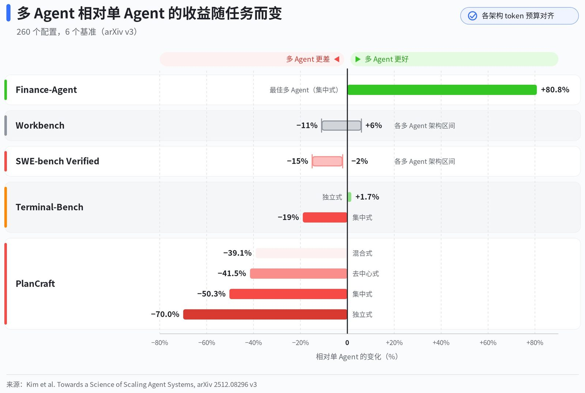
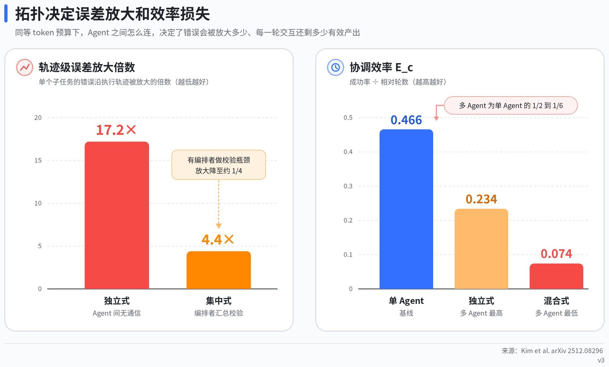
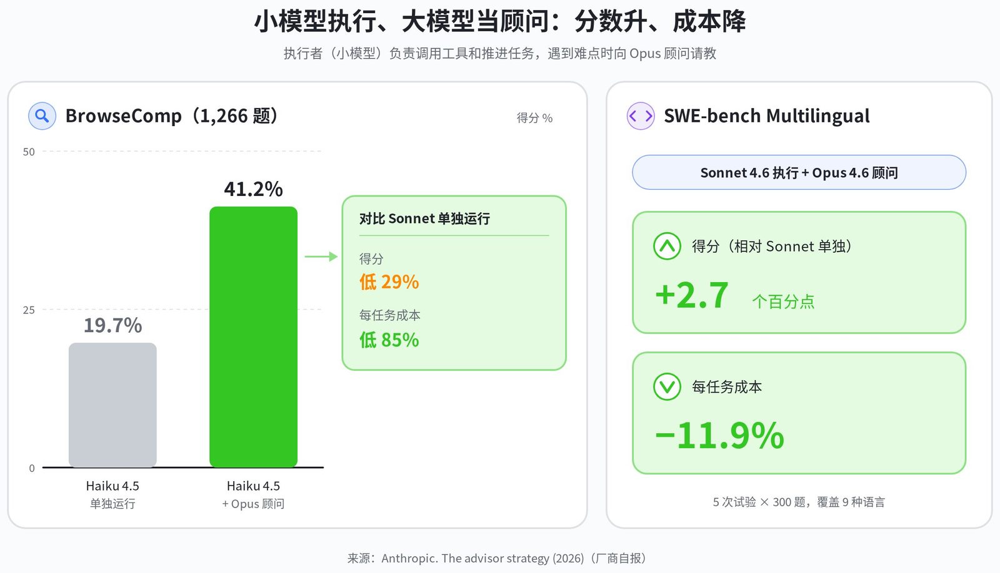
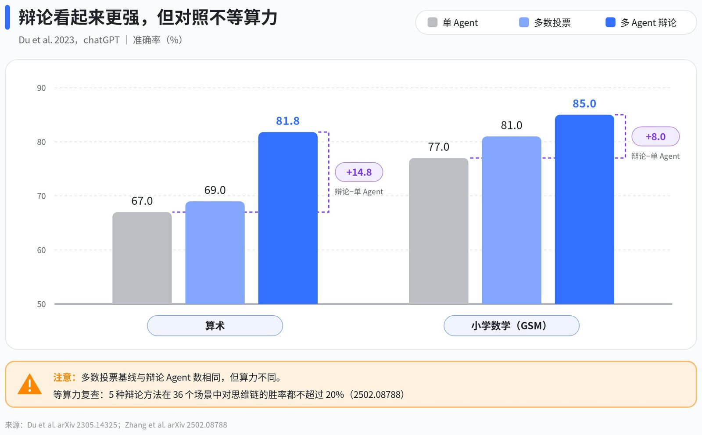
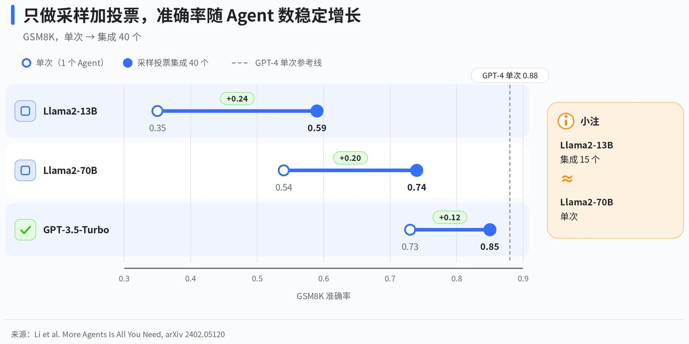
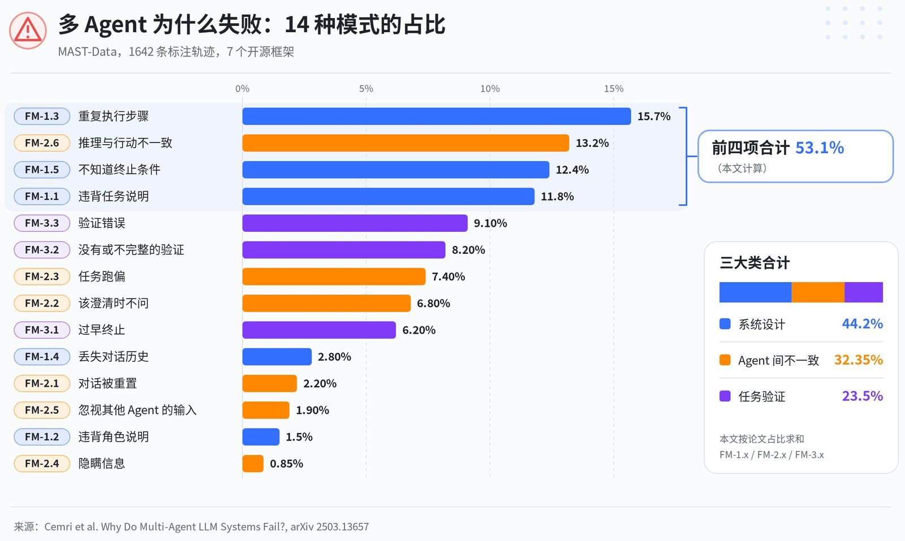
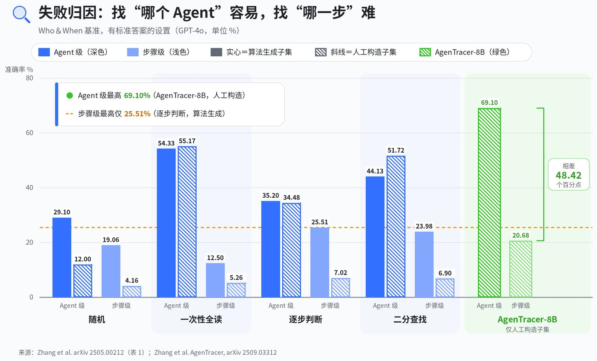
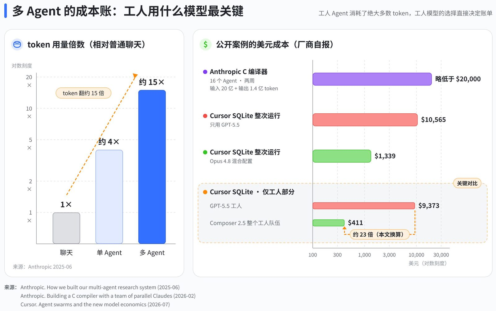

# LLM-45｜工程｜多 Agent 系统：编排、通信、归因与评测

> 🎯 **这篇文档解决什么问题**：“要不要拆成多个 Agent”到 2026 年已有比较清楚的答案：多数任务不该拆，少数任务拆了收益很大。难的是拆了以后：用哪种编排模式，Agent 之间传什么，系统为什么失败、怎么定位到具体的 Agent 和步骤，怎么评测和控制成本。本文整理 2023–2026 年的论文、框架文档和生产案例，并用等算力对比说明什么时候多 Agent 不值得。
>
> 使用方式：还在犹豫拆不拆，读第 1、2 章；已经决定拆，读第 3、6、7 章；上线后效果不稳，读第 8–10 章；第 11 章的清单可直接用于方案评审。文中版本、价格和基准分数核对于 2026 年 10 月 13 日。

## 导读 · 先给结论

- **先和单 Agent 等预算比**。260 个配置的缩放研究（arXiv v3）中，多 Agent 相对单 Agent 的变化从 Finance-Agent 的 +80.8% 到 PlanCraft 的 −70.0%；单 Agent 基线超过约 45% 后，再加 Agent 收益趋零甚至为负[[1]](https://arxiv.org/abs/2512.08296)。这是经验规律，不是定律。
- <b>Cognition 的经验建议是“写操作单线程”</b>：写操作只留一条线程、其他 Agent 贡献判断而非动作时，多 Agent 更容易有效（也有带任务锁、分支或合并协调的多写者实验，并非全行业必要条件）[[2]](https://cognition.com/blog/multi-agents-working)；以读为主的系统比以写为主的容易做[[3]](https://www.langchain.com/blog/how-and-when-to-build-multi-agent-systems)。
- **辩论的收益大多来自多采样加投票**。多数投票解释了辩论的大部分收益[[4]](https://arxiv.org/abs/2508.17536)；5 种辩论方法在 36 个场景里对思维链的胜率都不超过 20%[[5]](https://arxiv.org/abs/2502.08788)。
- **拓扑决定误差会不会放大**：独立式架构误差放大 17.2 倍，集中式 4.4 倍[[1]](https://arxiv.org/abs/2512.08296)。MAST 的 1642 条轨迹里，系统设计类失败合计 44.2%，任务验证类 23.5%（本文按论文占比求和）[[6]](https://arxiv.org/abs/2503.13657)。
- **归因比检测难得多**：Who&amp;When 上，有标准答案时定位出错步骤的最好成绩，算法生成子集 25.51%，人工构造子集 7.02%[[7]](https://arxiv.org/abs/2505.00212)；AgenTracer-8B 在人工构造子集上做到 Agent 级 69.10%、步骤级 20.68%[[8]](https://arxiv.org/abs/2509.03312)。
- **成本的最大旋钮是模型搭配**。多 Agent 的 token 约为聊天的 15 倍[[9]](https://www.anthropic.com/engineering/multi-agent-research-system)；Cursor 自报的实验里，工人从 GPT-5.5 换成 Composer 2.5，工人成本从 9,373 美元降到 411 美元[[10]](https://cursor.com/blog/agent-swarm-model-economics)。

📎 与系列其他文档的分工：「Agent 工程实战」第 5 章讲“拆不拆”，本篇讲拆了以后怎么编排、通信、查错、评测和控成本；A2A 协议见「Agent 协议与工具链」第 6 章；OTel 基础属性见「LLM 应用评测与可观测」第 7 章。

## 第 1 章 · 争论两年后的经验：从“别建多 Agent”到“写操作单线程”

结论先行：2025 年的争论双方各对了一半，2026 年的新材料把两边拼成一条规则：**写操作只留一条线程，其他 Agent 负责读、评审和出主意**。

### 1.1 2025 年的起点

2025-06，Anthropic 公布的研究系统（Opus 4 主 Agent 带 Sonnet 4 子 Agent）在内部评测上比单个 Opus 4 高 90.2%，token 约为聊天的 15 倍[[9]](https://www.anthropic.com/engineering/multi-agent-research-system)。同月 Cognition 发文《别建多 Agent》，提出共享完整轨迹、“动作隐含决策”两条原则[[11]](https://cognition.ai/blog/dont-build-multi-agents)。

📎 展开阅读：「Agent 工程实战」第 5 章（两篇文章的细节与“拆不拆”决策表）。

### 1.2 LangChain 的调和：读和写分开看

LangChain 随后给出调和：上下文工程是关键；主要做“读”的系统比主要做“写”的容易，因为读更容易并行，冲突的写后果严重得多[[3]](https://www.langchain.com/blog/how-and-when-to-build-multi-agent-systems)。它的文档也写明：一个配好工具和提示词的单 Agent 往往能做到差不多的效果，值得拆的动机只有上下文管理、分团队开发和并行三类[[12]](https://docs.langchain.com/oss/python/langchain/multi-agent)。这解释了 Anthropic 的成功案例为什么是调研：子 Agent 只搜索阅读，报告由主 Agent 写；Anthropic 也承认多数编程任务可并行的部分比调研少[[9]](https://www.anthropic.com/engineering/multi-agent-research-system)。

### 1.3 Cognition 2026：哪些形态真的有用

2026-04 的续篇结论是：写操作保持单线程、额外 Agent 贡献“智能”而非“动作”时，多 Agent 有效[[2]](https://cognition.com/blog/multi-agents-working)。有效的形态：

- **干净上下文的评审者**：Devin Review 在 Devin 写的 PR 上平均每个找出 2 个 bug，约 58% 严重；写代码和评审的 Agent 事先不共享上下文时效果最好[[2]](https://cognition.com/blog/multi-agents-working)。执行者需要完整上下文，评审者恰恰需要没被执行过程影响的视角，两者不矛盾。
- <b>“聪明朋友”</b>：快模型当主力，难点时把完整上下文的分叉交给强模型请教，Cognition 称之为 80/20 的做法；生产中让 Claude 和 GPT 互相请教，定位为“能力路由器，而不是难度升级器”[[2]](https://cognition.com/blog/multi-agents-working)。
- **管理者加子 Devin**：经内部 MCP 协调，暴露的问题是管理者指令过细、子 Agent 假设彼此共享状态、默认没有相互通信[[2]](https://cognition.com/blog/multi-agents-working)。

Cognition 还认为无结构的 Agent 群“大多是干扰”，实用形态是“映射、归并再加管理”；它列举的大规模多 Agent 演示，共同点是成功标准简单且可自动验证[[2]](https://cognition.com/blog/multi-agents-working)。

### 1.4 Anthropic 2026 与框架的收敛

Anthropic 在 2026 年给出两种新形态：没有编排者的对等 Agent（16 个 Claude 靠共享 git 仓库和锁文件写出 10 万行 C 编译器，见第 11 章）[[13]](https://www.anthropic.com/engineering/building-c-compiler)；以及把编排倒过来的顾问模式（小模型执行，向大模型请教，见第 3 章）[[14]](https://claude.com/blog/the-advisor-strategy)。

框架层面也已收敛：OpenAI Agents SDK 区分“由模型编排”（Agent 当工具、交接）和“由代码编排”（结构化输出路由、串联、评估循环、并行）[[15]](https://openai.github.io/openai-agents-python/multi_agent/)；Google ADK 提供图工作流、动态工作流、协作式和顺序、循环、并行模板[[16]](https://google.github.io/adk-docs/agents/multi-agents/)；Microsoft Agent Framework 的顺序、并发、交接、群聊、Magentic 五种编排已稳定，并支持检查点和人工审批[[17]](https://devblogs.microsoft.com/agent-framework/agent-frameworks-orchestration-patterns-reach-1-0/)。

> 🔑 **本章要点**
>
> - 写操作单线程；必须并行写时，要有隔离和自动验证。
> - 执行者要完整上下文，评审者要干净上下文。
> - 代码编排是默认，模型编排是例外。

## 第 2 章 · 先问单 Agent 够不够

结论先行：多 Agent 的收益强烈依赖任务结构。能拆成独立子问题的任务收益大，前后强依赖的规划任务一律变差，单 Agent 已经做得不错的任务再加 Agent 基本没用。依据主要是 Google Research、Google DeepMind 和 MIT 的缩放研究，数字一律取 arXiv v3[[1]](https://arxiv.org/abs/2512.08296)。

### 2.1 研究设计

arXiv v3 评测了 260 个配置：6 个基准（BrowseComp-Plus、Finance-Agent、PlanCraft、Workbench、SWE-bench Verified、Terminal-Bench），OpenAI、Google、Anthropic 三个模型家族，5 种架构，即单 Agent（SAS）和独立式（互不通信、结果汇总）、集中式（有协调者）、去中心式（对等通信）、混合式 4 种多 Agent[[1]](https://arxiv.org/abs/2512.08296)。论文初版（v1）写明各架构的 token 预算对齐，比的是“同样的钱怎么花”[[1]](https://arxiv.org/abs/2512.08296)；本文其余数字均取自 arXiv v3。

### 2.2 收益随任务而变

- **Finance-Agent**：所有多 Agent 架构 +57% 到 +80.8%，集中式最好[[1]](https://arxiv.org/abs/2512.08296)。
- **Workbench**：−11% 到 +6%，基本持平[[1]](https://arxiv.org/abs/2512.08296)。
- **SWE-bench Verified**：−15% 到 −2%；去中心式 −5.4%（0.494），独立式 −14.9%（0.444）[[1]](https://arxiv.org/abs/2512.08296)。
- **Terminal-Bench**：单 Agent 0.344；独立式 +1.7%（0.350），集中式 −19%[[1]](https://arxiv.org/abs/2512.08296)。
- **PlanCraft**：单 Agent 0.568；混合式 −39.1%（0.346），去中心式 −41.5%（0.332），集中式 −50.3%（0.282），独立式 −70.0%（0.170）[[1]](https://arxiv.org/abs/2512.08296)。

差别来自任务结构：金融分析能拆成互不依赖的查询和计算，拆开后每个 Agent 的上下文更干净；PlanCraft 的每一步都依赖前一步的状态，状态在 Agent 之间传递时会丢失和走样。编程类基准偏向后者，与 Anthropic“编程任务可并行部分较少”的判断一致[[9]](https://www.anthropic.com/engineering/multi-agent-research-system)。

### 2.3 约 45% 的能力饱和阈值

单 Agent 基线越强，多 Agent 的额外收益越小，系数 β=−0.236（p=0.004），拐点约在单 Agent 成功率 45%[[1]](https://arxiv.org/abs/2512.08296)。单 Agent 已能做对大部分题时，多 Agent 能补的空间很小，协调开销却一分不少。

这个阈值是**经验规律**，不是定律：回归模型交叉验证的 R² 只有 0.373（加入任务相关能力指标后 0.413），在留出配置上选中最优架构的比例是 87%[[1]](https://arxiv.org/abs/2512.08296)。适合用来排除明显不合适的选项，不适合预测具体能提升多少。另一个显著因素是工具数：工具越多协调代价越大，β=−0.096（p=0.002），研究中工具数为 2 到 16 个[[1]](https://arxiv.org/abs/2512.08296)。

### 2.4 误差放大与协调效率

📎 延伸阅读：单 Agent 的长任务同样受误差累积影响，分解加投票压低单步错误率的做法见 [LLM-58｜工程｜Agent 调优：从 trace 找到该改的那一层](./58-agent-tuning.md) 第 11 章。

轨迹级误差放大，独立式 17.2 倍，集中式 4.4 倍[[1]](https://arxiv.org/abs/2512.08296)：没人把关时子 Agent 的错误原样进入结果，有协调者检查时大部分能被拦下。效率（成功率除以相对轮数，E_c）单 Agent 是 0.466，多 Agent 从混合式 0.074 到独立式 0.234，即 2–6 倍的损失；协调开销从 0 到 515% 不等[[1]](https://arxiv.org/abs/2512.08296)。

> 💡 **常见误区**
>
> - 拿花了 10 倍 token 的多 Agent 和单次单 Agent 比。公平的对照是同样的预算给单 Agent 多想、多采样或多重试。
> - 把 45% 当硬阈值。它是特定基准和模型上的经验拐点，要用自己的评测集验证。
> - 只看平均提升。同一架构在一个基准 +80%、另一个 −50%，平均数没有意义。

## 第 3 章 · 编排模式图谱

结论先行：多 Agent 编排可按两个问题分类：**谁决定下一步**（代码、中心 Agent 还是各 Agent 自己），**谁有权写**（一个、按分区多个还是都能写）。先回答第二个，因为写权限决定了冲突和误差放大的程度。

📎 展开阅读：「Agent 工程实战」第 1 章（五种基础工作流模式）和第 5 章 5.5 节（Agent 当工具与交接的区别）。

### 3.1 七种多 Agent 形态

| 形态 | 控制流 | 写权限 | 代表 |
|---|---|---|---|
| 编排者-执行者 | 主 Agent 拆任务、派工、汇总 | 只有主 Agent | Anthropic 研究系统[[9]](https://www.anthropic.com/engineering/multi-agent-research-system)、Manus Wide Research[[18]](https://manus.im/blog/manus-wide-research-solve-context-problem) |
| 规划者-工人-裁判 | 规划者递归拆分，工人只干活，裁判每轮判定是否继续 | 工人各写分区 | Cursor Agent 群[[19]](https://cursor.com/blog/scaling-agents) |
| 交接 / Swarm | 控制权整体交给另一个 Agent | 同一时刻一个 | OpenAI Agents SDK 交接[[15]](https://openai.github.io/openai-agents-python/multi_agent/)、langgraph-swarm[[20]](https://www.langchain.com/blog/benchmarking-multi-agent-architectures) |
| 黑板 / 消息池 | 向共享池发布结构化消息，按订阅读取 | 按角色分工 | MetaGPT[[21]](https://arxiv.org/abs/2308.00352)、Claude Code Agent 团队[[22]](https://code.claude.com/docs/en/agent-teams) |
| 路由 | 分类器把请求分给专家 Agent | 被选中的专家 | LangChain Router 模式[[12]](https://docs.langchain.com/oss/python/langchain/multi-agent) |
| 对等 + 锁 | 无编排者，各自认领任务 | 都能写，靠锁和合并 | Anthropic C 编译器[[13]](https://www.anthropic.com/engineering/building-c-compiler) |
| 顾问 | 小模型执行，按需请教大模型 | 只有执行者 | Anthropic advisor 工具[[14]](https://claude.com/blog/the-advisor-strategy) |

### 3.2 Supervisor 还是 Swarm

LangChain 在 2025-06 用 τ-bench 零售领域前 100 个样例，外加 6 个各带 19 个工具的干扰领域，以 gpt-4o 对比单 Agent、Swarm 和 Supervisor[[20]](https://www.langchain.com/blog/benchmarking-multi-agent-architectures)。结论：干扰领域达到 2 个及以上时单 Agent 急剧下降；Swarm 处处略好于 Supervisor；Supervisor 因为要在用户和子 Agent 之间“转述”而多用 token[[20]](https://www.langchain.com/blog/benchmarking-multi-agent-architectures)。三处修正让 Supervisor 相对提升接近 50%：从子 Agent 状态里去掉交接消息；加一个 `forward_message` 工具把子 Agent 的回复原样转给用户；调整工具命名[[20]](https://www.langchain.com/blog/benchmarking-multi-agent-architectures)。

### 3.3 每种模式调用几次模型

LangChain 文档给了一笔示意账（不是基准测试）[[12]](https://docs.langchain.com/oss/python/langchain/multi-agent)：单次请求，子 Agent 模式 4 次模型调用，交接、技能、路由各 3 次；跨 3 个领域（每个约 2000 token 文档）时，子 Agent 5 次调用约 9K token，交接 7 次以上约 14K token 以上，技能 3 次约 15K token，路由 5 次约 9K token。按这笔示意账，子 Agent 比技能模式总 token 约少 40%（反过来技能模式比子 Agent 约多 67%；原文 67% 用错了分母），因为每个子 Agent 只加载自己领域的文档[[12]](https://docs.langchain.com/oss/python/langchain/multi-agent)。子 Agent 的价值主要是隔离上下文，而不是减少调用。

### 3.4 顾问模式：把编排倒过来

Anthropic 的顾问模式由 Sonnet 或 Haiku 负责整个执行，难点时调用 Opus；顾问不调用工具，也不产出面向用户的内容[[14]](https://claude.com/blog/the-advisor-strategy)。官方报告：Sonnet 4.6 加 Opus 4.6 顾问在 SWE-bench Multilingual 上提升 2.7 个百分点，每任务成本降低 11.9%；Haiku 4.5 加 Opus 顾问在 BrowseComp 上从 19.7% 提到 41.2%，得分比 Sonnet 单独运行低 29%，但每任务成本低 85%[[14]](https://claude.com/blog/the-advisor-strategy)。

工程细节[[23]](https://platform.claude.com/docs/en/agents-and-tools/tool-use/advisor-tool)：顾问每次通常生成 400–700 个文本 token，用 `max_uses` 限制次数，token 单独计量；Haiku 4.5 第一轮没调用顾问时加一句提示，通过率提高约 7 个百分点，对 Sonnet 无效，对 Opus 略有负面影响。

> 🔑 **本章要点**
>
> - 先定写权限，再定控制流；只有一个写者的模式最容易做对。
> - 主管转述会损耗信息，让子 Agent 结果原样透传或写文件只传引用。
> - 想降本，顾问模式和模型搭配比增加 Agent 更有效。

## 第 4 章 · 集成与辩论：等算力下的真实收益

结论先行：多个 Agent 各自作答再投票，或多轮辩论，确实能提高准确率；但在**等算力**对照下，大部分收益来自多采样再投票，辩论本身的增量很小。真要辩论，换不同家族的模型比同一模型扮演不同角色更有希望。

📎 展开阅读：「推理模型与测试时计算」第 2 章（自洽性与并行采样）。

### 4.1 辩论的原始证据

Du 等人 2023-05 的论文让多个 chatGPT 实例各自作答，再互读答案、多轮修改[[24]](https://arxiv.org/abs/2305.14325)。表 1 结果：

| 任务 | 单 Agent | 自我反思 | 多数投票 | 多 Agent 辩论 |
|---|---|---|---|---|
| 算术 | 67.0 ± 4.7 | 72.1 ± 4.5 | 69.0 ± 4.6 | 81.8 ± 2.3 |
| 小学数学（GSM） | 77.0 | 75.0 | 81.0 | 85.0 ± 3.5 |
| 国际象棋（ΔPS） | 91.4 | 102.1 | 102.2 | 122.9 |

对照的缺陷在于：多数投票基线的 Agent 数与辩论相同，但**算力不同**，辩论要跑多轮，每轮还要读其他 Agent 的回答[[24]](https://arxiv.org/abs/2305.14325)。后续研究都从这个缺口切入。

### 4.2 等算力复查

- <b>InstaDeep（2023-11）</b>：辩论“不能稳定地超过”自洽性和多路径集成；调过超参数后个别方法（如 Multi-Persona）更好[[25]](https://arxiv.org/abs/2311.17371)。能赢，但要调参，而且不稳。
- <b>《别再高估多 Agent 辩论》（2025-02）</b>：5 种辩论方法、9 个基准、4 个模型，36 个场景里没有一种方法对思维链的胜率超过 20%，即使用多得多的算力也常常赢不了思维链和自洽性；**模型异构**能稳定改善辩论[[5]](https://arxiv.org/abs/2502.08788)。
- <b>《辩论还是投票》（2025-08）</b>：7 个基准、5 个 Agent、2/3/5 轮，多数投票解释了辩论的大部分收益；作者把辩论建模为信念上的鞅过程，说明单靠辩论不能提高答对的期望[[4]](https://arxiv.org/abs/2508.17536)。

同一模型的多个副本互相说服，信息量没有增加；能增加信息量的是更多独立样本和不同来源的知识。

### 4.3 采样投票随 Agent 数增长

《More Agents Is All You Need》只做独立采样加多数投票，集成规模最多 40[[26]](https://arxiv.org/abs/2402.05120)。GSM8K 上，Llama2-13B 从 0.35 到 0.59，Llama2-70B 从 0.54 到 0.74，GPT-3.5-Turbo 从 0.73 到 0.85，参照线 GPT-4 单次 0.88；Llama2-13B 集成 15 个时与 Llama2-70B 单次相当；提升幅度与任务难度相关[[26]](https://arxiv.org/abs/2402.05120)。

### 4.4 分层集成：Mixture-of-Agents

MoA 分若干层，每层 Agent 参考上一层所有输出，最后由聚合者作答；只用开源模型的 MoA 在 AlpacaEval 2.0 上得到 65.1%，高于 GPT-4 Omni 的 57.5%[[27]](https://arxiv.org/abs/2406.04692)。它衡量的是开放式生成的偏好质量，不能直接外推到有标准答案的推理任务。

### 4.5 怎么做一次公平的对照

1. 固定总预算（token 或美元），而不是固定 Agent 数。
2. 至少放三个基线：单次思维链、同预算的自洽性投票、同预算的单 Agent 多次重试。
3. 多跑几次报告误差范围；Du 等人的算术任务标准差就有 4–5 个点[[24]](https://arxiv.org/abs/2305.14325)。
4. 辩论赢了再做消融：去掉辩论只留投票，看还剩多少收益。

## 第 5 章 · 角色扮演与 SOP 框架、自动化工作流搜索

结论先行：2023 年的角色扮演框架留下的可复用经验有三件事，给 Agent 起“CEO”“程序员”的名字不在其中：把标准作业流程（SOP）写成固定阶段，Agent 之间传结构化消息，加入可执行的验证。2024 年起，一些研究让模型自己搜索工作流结构，在有明确指标的任务上效果不错。

### 5.1 四个代表框架

- <b>CAMEL（2023-03）</b>：“AI 用户”和“AI 助手”两个角色对话，用起始提示词固定角色[[28]](https://arxiv.org/abs/2303.17760)。
- <b>MetaGPT（2023）</b>：SOP 编码进提示词，流水线式分配角色；共享消息池，按订阅发布和读取结构化消息；HumanEval 85.9%、MBPP 87.7%（Pass@1），可执行反馈在 MBPP 上绝对提升 5.4%[[21]](https://arxiv.org/abs/2308.00352)。
- <b>ChatDev（2023-07）</b>：设计、编码、测试的瀑布式阶段；“聊天链”规定沟通什么，“沟通去幻觉”规定怎么沟通；加入评审角色能发现更多漏洞[[29]](https://arxiv.org/abs/2307.07924)。
- <b>AutoGen（2023-08）</b>：可对话的 Agent（背后可以是模型、工具或人），支持双 Agent、群聊等模式[[30]](https://arxiv.org/abs/2308.08155)。

真正起作用的往往是 SOP 和验证，而不是角色名：MetaGPT 的可执行反馈提升 5.4%[[21]](https://arxiv.org/abs/2308.00352)；MAST 在 ChatDev 上加入高层任务目标验证提升 15.6%，只改进角色说明提升 9.4%[[6]](https://arxiv.org/abs/2503.13657)。写死阶段的 SOP 框架本质上就是工作流，只是节点由 Agent 执行。

### 5.2 从 AutoGen 到 Microsoft Agent Framework

微软在 2025-10 推出合并 AutoGen 和 Semantic Kernel 的 Microsoft Agent Framework，2026-02 发布候选版，之后 .NET 和 Python 版正式发布 1.0[[31]](https://devblogs.microsoft.com/agent-framework/microsoft-agent-framework-version-1-0/)。AutoGen 事件驱动的 Team 和 GraphFlow 被改写为有类型的数据流 Workflow[[32]](https://learn.microsoft.com/en-us/agent-framework/overview/)。框架从“让 Agent 自由对话”走向“有类型、可检查点、可人工介入的工作流”，这本身就是一个信号。

### 5.3 让模型自己搜索工作流

📎 延伸阅读：子 Agent 和插件同样可以由编辑器按实测证据增删，Harness² 的做法见 [LLM-58｜工程｜Agent 调优：从 trace 找到该改的那一层](./58-agent-tuning.md) 第 6.2 节。

- **AFlow** 把工作流表示成代码图，用蒙特卡洛树搜索优化，6 个基准上平均比最好的基线高 5.7%；部分任务上让小模型以 GPT-4o 推理成本的 4.55% 超过 GPT-4o[[33]](https://arxiv.org/abs/2410.10762)。
- **ADAS** 让“元 Agent”用代码编写新 Agent，DROP 上 F1 提高 13.6 分，MGSM 提高 14.4%；迁移到 GSM8K 提高 25.9%[[34]](https://arxiv.org/abs/2408.08435)。

两者都需要能自动打分的评测集，搜索本身也消耗大量调用，适合高频、固定类型的任务。

### 5.4 拓扑也会影响结果

MultiAgentBench 比较了星形、链形、树形和图形四种拓扑：研究类场景里图形在任务表现、规划效率和 token 用量上都最好，树形最差（token 多、得分最低）；加入认知规划让里程碑达成率提高 3%[[35]](https://arxiv.org/abs/2503.01935)。层级越深不一定越好，每多一层就多一次转述。

## 第 6 章 · 通信与状态

结论先行：多 Agent 的质量问题大多出在“传了什么”和“谁能改什么”上。三条规则：按角色决定传完整上下文、分叉、任务书还是干净上下文；大块产物写到文件系统，Agent 之间只传引用；共享状态要么只有一个写者，要么有明确的锁、分区和合并规则。

📎 展开阅读：「Agent 工程实战」第 4 章 4.3 节（子 Agent 的上下文隔离）。

### 6.1 传什么

| 方式 | 做法 | 适合 | 来源 |
|---|---|---|---|
| 完整轨迹 | 之前的消息、工具调用和结果全部传过去 | 接着做决策的执行者 | Cognition[[11]](https://cognition.ai/blog/dont-build-multi-agents) |
| 上下文分叉 | 复制当前上下文给顾问，顾问只回建议 | 顾问 | Cognition[[2]](https://cognition.com/blog/multi-agents-working) |
| 干净上下文 | 只给产物（如 PR 的 diff），不给生成过程 | 评审者 | Devin Review[[2]](https://cognition.com/blog/multi-agents-working) |
| 结构化任务书 | 目标、输出格式、可用工具和信息源、任务边界 | 做独立子任务的子 Agent | Anthropic[[9]](https://www.anthropic.com/engineering/multi-agent-research-system) |

任务书写不清是最常见的问题。Anthropic 早期遇到过为简单问题派出 50 个子 Agent、子 Agent 重复搜索、没完没了地找不存在的资料，根源都是任务描述太短、边界不清[[9]](https://www.anthropic.com/engineering/multi-agent-research-system)。

### 6.2 产物写文件，消息只传引用

Anthropic 让子 Agent 把产物写到文件系统，只向主 Agent 返回轻量引用，避免信息多次转述后走样（“传话游戏”）[[9]](https://www.anthropic.com/engineering/multi-agent-research-system)；LangChain 实验中 Supervisor 因转述而多用 token，加了原样转发工具后明显改善[[20]](https://www.langchain.com/blog/benchmarking-multi-agent-architectures)。长任务里更重要：Anthropic 的系统在上下文超过 200,000 token 时会截断，所以主 Agent 先把研究计划存进外部记忆[[9]](https://www.anthropic.com/engineering/multi-agent-research-system)；C 编译器的每个 Agent 都维护 README 和进度文件，方便新会话接上[[13]](https://www.anthropic.com/engineering/building-c-compiler)。

产物落盘之外，派发本身也最好做成异步的。主 Agent 派出一个子任务就结束本轮，不原地轮询，子任务跑完再回传结果、重新唤醒它。等待过程不占主 Agent 的上下文，长流程中途被压缩或打断，丢掉的也只是正在跑的那一轮。代价是主 Agent 每次醒来都可能忘了计划，所以计划和进度要写进文件，每轮开始先读一遍，别指望它记得。给子 Agent 的上下文也只有两种合适的给法。冷启动的新会话拿一份自包含的任务书，内容直接贴进去，不写“如前所述”。续接已有会话时只传增量。给一半背景、指望对方自己补齐的做法最费 token，出错也最多。超过百来行的 diff、日志和设计稿照上面的办法写进共享目录，消息里只放路径。

### 6.3 共享状态：锁、任务表与分区

- **共享消息池**：MetaGPT 的 Agent 向共享池发布结构化消息，各角色只订阅关心的类型，类似黑板架构[[21]](https://arxiv.org/abs/2308.00352)。
- **任务表加文件锁**：Claude Code Agent 团队共享一张带依赖关系的任务表，认领时用文件锁防抢占；队员经邮箱文件 `~/.claude/teams/{team}/inboxes/{agent}.json` 直接发消息[[22]](https://code.claude.com/docs/en/agent-teams)。
- **锁文件加 git**：C 编译器没有编排者，每个 Agent 在 `current_tasks/` 写一个文本文件当锁，经共享的裸 git 仓库同步；合并冲突频繁，由 Claude 自己解决[[13]](https://www.anthropic.com/engineering/building-c-compiler)。
- **层级分区**：Cursor 发现扁平结构加锁时“20 个 Agent 会慢到只有两三个的有效吞吐”；乐观并发好一些，但没有层级时 Agent 变得保守；最终由规划者分区，工人之间不协调[[19]](https://cursor.com/blog/scaling-agents)。

规模再往上，版本控制会成为瓶颈：Cursor 早期在 Git 上约每小时 1,000 次提交，2026-07 换成自研系统后约每秒 1,000 次（厂商自报）[[10]](https://cursor.com/blog/agent-swarm-model-economics)。

📎 延伸阅读：多方案并行探索时，回退只管代码、记忆按目录隔离，收口为什么难，见 [LLM-58｜工程｜Agent 调优：从 trace 找到该改的那一层](./58-agent-tuning.md) 第 11.8 节。

📎 延伸阅读：多 Agent 共用记忆时，哪份信息放哪一层、长期记忆由谁写、偏好怎样送到子 Agent，见 [LLM-21｜工程｜Agent 记忆：存什么、怎么取、何时忘](./21-agent-memory.md) 第 13 章。

### 6.4 子 Agent 之间要不要直接通信

多数生产系统的答案是不要。Manus 的子 Agent 从不对话，协调全部经过主控制器，理由是防止上下文污染[[18]](https://manus.im/blog/manus-wide-research-solve-context-problem)；Cursor 的工人之间也不协调[[19]](https://cursor.com/blog/scaling-agents)；允许直接通信的 Claude Code Agent 团队，文档提醒会显著多用 token[[22]](https://code.claude.com/docs/en/agent-teams)。缩放研究显示，消息密度和冗余度都是预测多 Agent 表现的变量，而完全不通信的独立式误差放大 17.2 倍、有协调者的集中式 4.4 倍[[1]](https://arxiv.org/abs/2512.08296)：关键在于有没有一个检查点把子结果验一遍再往下传，通信多少倒在其次。

📎 展开阅读：「Agent 协议与工具链」第 6 章（跨系统的 Agent 协作协议 A2A）。

> 💡 **常见误区**
>
> - 子 Agent 把几千字结果当消息返回，主 Agent 再转述给下一个。应当写文件、传引用。
> - 默认“别人知道我知道的事”。子 Agent 会错误地假设彼此共享状态[[2]](https://cognition.com/blog/multi-agents-working)，任务书要写清它能看到什么。
> - 为了“协作”让子 Agent 互相聊天。绝大多数场景经协调者转一次就够。

📎 子 Agent 确实需要从同一个状态出发时，可以从父沙盒 fork：暂停并做一份快照，再并行恢复出 n 台，每台继承磁盘、内存和 shell 会话，各自试一种改法，最后只留最好的一台。这套机制见第 57 篇 [LLM-57｜工程｜全平台 Agent 沙盒实践：用一套 K8s 调度四种操作系统的虚拟机](./57-agent-sandbox-k8s.md) 第 10 章。

## 第 7 章 · 并行子 Agent 实务：限额与默认值

结论先行：大多数团队接触多 Agent 的第一站是产品自带的子 Agent。各家默认设计高度一致：子 Agent 有独立上下文、只回摘要，嵌套深度和并发数有上限，并行要显式开启或显式要求。版本号变动频繁，以下核对于 2026-10。

📎 展开阅读：「编程 Agent 实战」第 5 章（多个编程 Agent 并行时的 worktree 隔离与评审瓶颈）。

### 7.1 Claude Code 子 Agent 与 Agent 团队

子 Agent 有自己的上下文窗口、系统提示词和工具权限，只把摘要返回主会话，用量计入同一额度[[36]](https://code.claude.com/docs/en/sub-agents)。要点[[36]](https://code.claude.com/docs/en/sub-agents)：

- **内置三种**：Explore（只读的代码库搜索，分 quick、medium、very thorough 三档）、Plan 和通用型；Explore 和 Plan 为了速度和成本不加载 CLAUDE.md 和 git 状态。
- **可配置项**包括 `tools`、`model`、`permissionMode`、`maxTurns`（到上限返回部分结果）、`effort`、`background` 和 `isolation: worktree`。
- **嵌套深度**默认三层；这个值改过几次：v2.1.172 到 v2.1.216 是五层，v2.1.217 和 v2.1.218 是一层，v2.1.219 起为三层。
- **并发**默认 20 个，超过时报“Concurrent subagent limit reached”，v2.1.217 起可用 `CLAUDE_CODE_MAX_CONCURRENT_SUBAGENTS` 调整；会话内子 Agent 总数不设上限。
- 所有自定义子 Agent 的描述合计超过 15,000 token 时会警告，因为它们每次都进主 Agent 的上下文。

Agent 团队是默认关闭的实验功能（`CLAUDE_CODE_EXPERIMENTAL_AGENT_TEAMS=1`）：队长带若干队员，各有上下文，队员之间可以直接发消息，共享一张带依赖关系的任务表[[22]](https://code.claude.com/docs/en/agent-teams)。文档提醒它会增加协调开销、显著多用 token，成本随队员数线性增长；顺序任务、改同一文件、依赖多的任务应改用单会话或子 Agent；建议从 3–5 个队员开始，15 个独立任务配 3 个队员是不错的起点[[22]](https://code.claude.com/docs/en/agent-teams)。

### 7.2 OpenAI Codex 子 Agent

Codex 默认启用子 Agent，但只在用户明确要求时才派出，文档提醒它比同等的单 Agent 运行消耗更多 token；内置 default、worker（实现）和 explorer（大量阅读）三种[[37]](https://developers.openai.com/codex/subagents)。子 Agent 继承父会话的沙箱策略；非交互模式下需要审批的动作会失败并交回父 Agent[[37]](https://developers.openai.com/codex/subagents)。并发用 `agents.max_concurrent_threads_per_session` 配置（不含主线程，旧名 `agents.max_threads`），批量扇出用 `spawn_agents_on_csv`，单个工人的时长用 `agents.job_max_runtime_seconds` 限制[[37]](https://developers.openai.com/codex/subagents)。

### 7.3 Manus Wide Research

Wide Research 是面向终端用户的“映射再归并”：每个子 Agent 都是完整的通用 Manus 实例，有自己的虚拟机和工具，不预设角色；子 Agent 之间从不对话，协调全部经过主控制器，官方给出的理由是防止上下文污染[[18]](https://manus.im/blog/manus-wide-research-solve-context-problem)。Manus 关于规模和速度的说法都是厂商自述，没有公开评测，这里不引用。

### 7.4 Kimi K2.5 Agent Swarm：训练出来的编排者

Kimi K2.5 不靠提示词编排，而是用强化学习训练编排者。以下数字均为厂商自报：最多调度 100 个子 Agent、1,500 次工具调用，相比单 Agent 延迟最多降低 4.5 倍[[38]](https://www.kimi.com/en/blog/kimi-k2-5)。训练方法 PARL 只训练编排者、冻结子 Agent，以避免功劳分配不清和训练不稳定；并用“关键步数”衡量并行效率，即每阶段取主 Agent 步数加最慢子 Agent 的步数再求和[[39]](https://arxiv.org/abs/2602.02276)。论文表格中，BrowseComp 单 Agent 60.6，加上下文管理 74.9，Agent Swarm 78.4；WideSearch 从 72.7 到 79.0[[39]](https://arxiv.org/abs/2602.02276)。

📎 延伸阅读：编排者也可以靠蒸馏得到，把大模型的拆分、分派、验收轨迹蒸进 35B-A3B 的案例见 [LLM-22｜地基｜后训练实战：SFT、LoRA 与 RLVR](./22-post-training.md) 第 8.7 节。

📎 延伸阅读：并发上限之外给人的消息多留一个槽位，新活就挡不住人推进已有任务，主动式编码 Agent 的 Worker 槽位设计见 [LLM-67｜工程｜主动式编码 Agent 的领域模型：dsh-superagent 深研](./67-proactive-coding-agent.md) 第 5 章。

## 第 8 章 · 多 Agent 为什么失败

结论先行：多 Agent 的失败大多出在设计和验收上，很少是因为模型不够聪明：任务和角色说明不清、不知道何时该停、Agent 之间对不齐、没人认真验证。规模变大后，还会出现抢锁、互相覆盖、设计分裂等单 Agent 没有的协调故障。

📎 展开阅读：「Agent 工程实战」第 5 章 5.4 节（MAST 三大类概述）；「深入理解 AI Agent」精读笔记第 10 章（并发冲突、级联放大、同质化收敛等六类额外失败）。

### 8.1 MAST：14 种失败模式的占比

MAST-Data 包含 1642 条标注轨迹，来自 ChatDev、MetaGPT、HyperAgent、AppWorld、AG2 MathChat、Magentic-One、OpenManus 7 个开源框架；专家标注一致性 Cohen's κ 为 0.88，用 OpenAI o1 自动标注准确率 94%[[6]](https://arxiv.org/abs/2503.13657)。这些框架的失败率从 41% 到 86.7% 不等[[6]](https://arxiv.org/abs/2503.13657)。

| 大类（合计） | 失败模式与编号 | 占比 | 缓解方向 |
|---|---|---|---|
| 系统设计（44.2%） | FM-1.3 重复执行步骤；FM-1.5 不知道终止条件；FM-1.1 违背任务说明；FM-1.4 丢失对话历史；FM-1.2 违背角色说明 | 15.7%；12.4%；11.8%；2.80%；1.5% | 任务书、终止条件、预算 |
| Agent 间不一致（32.35%） | FM-2.6 推理与行动不一致；FM-2.3 任务跑偏；FM-2.2 该澄清时不问；FM-2.1 对话被重置；FM-2.5 忽视其他 Agent 的输入；FM-2.4 隐瞒信息 | 13.2%；7.40%；6.80%；2.20%；1.90%；0.85% | 结构化消息、协调者 |
| 任务验证（23.5%） | FM-3.3 验证错误；FM-3.2 没有或不完整的验证；FM-3.1 过早终止 | 9.10%；8.20%；6.20% | 独立验证者、可检查的完成标准 |

大类合计是本文按论文占比求和的结果[[6]](https://arxiv.org/abs/2503.13657)。前四项（重复步骤、推理与行动不一致、不知道终止条件、违背任务说明）合计 53.1%（本文计算），其中三项可以靠更清楚的任务书、明确的终止条件和预算缓解；验证类合计近四分之一，说明“有验证环节”和“验证做对了”是两回事。

干预实验[[6]](https://arxiv.org/abs/2503.13657)：在 ChatDev 中明确由 CEO 拍板（改进角色说明），相同 GPT-4o 和提示词下成功率提高 9.4%；加入高层任务目标验证，在 ProgramDev 上提高 15.6%。有显式验证者的框架（MetaGPT、ChatDev）失败较少，但绝对成功率仍不高。改提示词和加验证有用，但不足以让设计有问题的系统变可靠。

### 8.2 规模化之后的协调故障

| 故障 | 现象 | 公开的修法 |
|---|---|---|
| 抢锁导致吞吐塌缩 | 扁平结构加锁，20 个 Agent 只有两三个的有效吞吐；没有层级时 Agent 变得保守[[19]](https://cursor.com/blog/scaling-agents) | 乐观并发，加规划者、工人、裁判分层[[19]](https://cursor.com/blog/scaling-agents) |
| 大任务上互相覆盖 | 编译 Linux 内核这一个大任务上，16 个 Agent 撞上同一个 bug，互相覆盖修改[[13]](https://www.anthropic.com/engineering/building-c-compiler) | 用 GCC 当已知正确的参照按文件拆分，再配合增量调试[[13]](https://www.anthropic.com/engineering/building-c-compiler) |
| 设计分裂与合并冲突 | 规划者各自做出不兼容的设计并相互争用；每秒约 1,000 次提交时冲突成为常态（厂商自报）[[10]](https://cursor.com/blog/agent-swarm-model-economics) | 共享设计文档、经编译检查的引用、专门的协调者[[10]](https://cursor.com/blog/agent-swarm-model-economics) |
| 管理者过度指挥 | 指令过细，子 Agent 假设共享状态[[2]](https://cognition.com/blog/multi-agents-working) | 任务书写目标而非步骤，写清可见范围 |
| 派工失控 | 简单问题派出 50 个子 Agent，重复搜索[[9]](https://www.anthropic.com/engineering/multi-agent-research-system) | 提示词写明按复杂度分配子 Agent 数[[9]](https://www.anthropic.com/engineering/multi-agent-research-system) |

> 🔑 **本章要点**
>
> - MAST 前四项失败合计超过一半，大多能靠任务书、终止条件和预算缓解。
> - 验证类失败近四分之一：要验证，还要验证验证者。
> - 规模化后的故障需要结构性修法：分区、参照答案、协调者。

> 🔑 **本章要点**
>
> - MAST 前四项失败合计超过一半，大多能靠任务书、终止条件和预算缓解。
> - 验证类失败近四分之一：要验证，还要验证验证者。
> - 规模化后的故障需要结构性修法：分区、参照答案、协调者。

## 第 9 章 · 失败归因：是哪个 Agent、在哪一步出的错

结论先行：知道任务失败了容易，知道哪个 Agent 在哪一步做错了很难。现有自动方法找“哪个 Agent”能做到五到七成，找“哪一步”则显著依赖数据子集：AgenTracer 论文中人工构造子集最好约 20.68%，算法生成子集上 AgenTracer 有标准答案时 42.86%、无标准答案时 37.30%，都不是通用上限。日志和回放能力要从设计阶段就按归因的需要准备。

### 9.1 Who&amp;When 基准

失败归因要回答**谁**（导致失败的 Agent）和**何时**（决定性的出错步骤）。Who&amp;When 收集了 127 个多 Agent 系统的失败日志，一部分由 CaptainAgent 算法生成，一部分是人工构造的 Magentic-One 系统；共 184 个归因任务，问题来自 GAIA 和 AssistantBench[[7]](https://arxiv.org/abs/2505.00212)。比较的三种方法[[7]](https://arxiv.org/abs/2505.00212)：**一次性全读**（整段日志交给模型）、**逐步判断**（从头逐步问“这里错了吗”）、**二分查找**（问错误在前半还是后半，递归缩小）。

### 9.2 三种方法的成绩

下表是论文表 1 的数字（GPT-4o），每格写“Agent 级 / 步骤级”[[7]](https://arxiv.org/abs/2505.00212)。“有标准答案”指把任务的正确答案提供给模型；“算法生成”和“人工构造”是两个子集。

| 方法 | 有标准答案 · 算法生成 | 有标准答案 · 人工构造 | 无标准答案 · 算法生成 | 无标准答案 · 人工构造 |
|---|---|---|---|---|
| 随机 | 29.10 / 19.06 | 12.00 / 4.16 | 29.10 / 19.06 | 12.00 / 4.16 |
| 一次性全读 | 54.33 / 12.50 | 55.17 / 5.26 | 51.12 / 13.53 | 53.44 / 3.51 |
| 逐步判断 | 35.20 / 25.51 | 34.48 / 7.02 | 26.02 / 15.31 | 32.75 / 8.77 |
| 二分查找 | 44.13 / 23.98 | 51.72 / 6.90 | 30.11 / 16.59 | 36.21 / 6.90 |

- **找人比找步容易得多**：一次性全读在 Agent 级有 51%–55%，步骤级只有 3.51%–13.53%，在人工构造子集上不如随机（4.16%）[[7]](https://arxiv.org/abs/2505.00212)。
- **没有全面最好的方法**：一次性全读最适合回答“谁”，逐步判断最适合回答“何时”；可以组合使用，代价是更多调用[[7]](https://arxiv.org/abs/2505.00212)。
- **人工构造的复杂系统最难**：步骤级最好成绩是逐步判断在无标准答案下的 8.77%[[7]](https://arxiv.org/abs/2505.00212)。

### 9.3 AgenTracer：专门训练的归因模型

AgenTracer 指出，最先进的推理模型在失败归因上的准确率普遍低于 10%[[8]](https://arxiv.org/abs/2509.03312)。它用反事实回放和程序化故障注入构造带精确标签的轨迹数据集 TracerTraj，再用多粒度强化学习训练 8B 的归因模型[[8]](https://arxiv.org/abs/2509.03312)。在 Who&amp;When 人工构造子集上，AgenTracer-8B 有标准答案时 Agent 级 69.10%、步骤级 20.68%，无标准答案时 63.82% 和 20.68%；算法生成子集有标准答案时为 69.62% 和 42.86%[[8]](https://arxiv.org/abs/2509.03312)。把它的归因反馈给 MetaGPT 和 MaAS，带来 4.8%–14.2% 的提升[[8]](https://arxiv.org/abs/2509.03312)。专门训练把人工构造子集的步骤级准确率从个位数提到约 20%，但离自动定位根因还很远；现实做法仍是自动方法缩小范围，人看关键几步。

### 9.4 为归因而设计日志

- **每一步有身份**：Agent 名称、步骤序号、父任务编号，子 Agent 的轨迹能挂回派出它的那一步。
- **派工单独记录**：派给谁、任务书原文、返回摘要原文。很多失败出在任务书写错或摘要丢了关键信息。
- **工具结果原样保存**：反事实回放要在同样的工具结果上重跑，重新调用外部系统结果可能已经变了。
- **验证者的判定单独记录**：MAST 里验证类失败近四分之一[[6]](https://arxiv.org/abs/2503.13657)，归因时要区分“做错了”和“做错了没被拦住”。

> 💡 **常见误区**
>
> - 把整段日志丢给最强的模型直接问根因。找人尚可，找步骤基本不可靠。
> - 引用 Who&amp;When 成绩时不说明设置。有无标准答案、哪个子集，数字能差好几倍。

## 第 10 章 · 评测、可观测与预算

结论先行：多 Agent 评测要在单 Agent 评测之上多做三件事：按 Agent 拆开统计 token、轮次和成败；追踪里保留“工作流、Agent、工具”的调用树；给深度、并发、轮次和顾问次数设上限并写明终止条件。成本按“每个成功任务”算。

📎 展开阅读：「LLM 应用评测与可观测」第 7 章（OTel GenAI 的基础属性、invoke_agent 与 execute_tool span）和第 8 章（发布门禁）。

### 10.1 评测：结果、过程和对照

- **从少量用例开始**：Anthropic 研究系统起步只用约 20 个查询，早期一处提示词修改就把成功率从 30% 提到 80%[[9]](https://www.anthropic.com/engineering/multi-agent-research-system)。
- **评委打分分维度**：单次 LLM 评委调用给出 0.0–1.0 分和通过与否，维度是事实准确性、引用准确性、完整性、信息源质量和工具效率；会改外部状态的 Agent 评最终状态[[9]](https://www.anthropic.com/engineering/multi-agent-research-system)。
- **必须有等预算的单 Agent 和自洽性基线**（第 2、4 章）。
- **按 Agent 拆指标**：调用数、token、轮次、被退回次数，以及协调者的派工数和子 Agent 重复率。Anthropic 在生产中监控决策模式而不读对话内容[[9]](https://www.anthropic.com/engineering/multi-agent-research-system)。

### 10.2 追踪：OTel GenAI 的多 Agent span

OpenTelemetry GenAI 语义约定为 Agent 定义了 `create_agent`、`invoke_agent`、`invoke_workflow`（span 名为 `invoke_workflow {gen_ai.workflow.name}`）、`plan`（规划与任务分解，生成计划的模型调用是它的子 span）和 `execute_tool` 等操作[[40]](https://github.com/open-telemetry/semantic-conventions-genai/blob/main/docs/gen-ai/gen-ai-agent-spans.md)。**这些 span 截至 2026-10 仍是 Development 状态，名称可能变化**[[40]](https://github.com/open-telemetry/semantic-conventions-genai/blob/main/docs/gen-ai/gen-ai-agent-spans.md)。

`invoke_workflow` 应当为协调多个 Agent 的可组合流程上报，例如 LangGraph 的 `Graph.invoke`、Microsoft Agent Framework 的 `Workflow.run`、带交接或子 Agent 的 OpenAI Agents `Runner.run`；不应当为单个独立 Agent 或框架内部委派子 Agent 的运行器上报；应用自定义的嵌套子图应当上报[[40]](https://github.com/open-telemetry/semantic-conventions-genai/blob/main/docs/gen-ai/gen-ai-agent-spans.md)。这样一次多 Agent 运行在追踪里就是一棵树：工作流下面是 `plan` 和若干 `invoke_agent`，每个 Agent 下面是模型调用和工具调用。第 9 章要求的“子轨迹能挂回派工那一步”，用这棵树就能实现。

### 10.3 成本账

量级：单 Agent 的 token 用量约为普通聊天的 4 倍，多 Agent 约 15 倍[[9]](https://www.anthropic.com/engineering/multi-agent-research-system)。几个公开案例（均为厂商自报）：

- **Anthropic C 编译器**：16 个 Agent，两周近 2,000 个会话，输入 20 亿 token、输出 1.4 亿 token，花费略低于 20,000 美元[[13]](https://www.anthropic.com/engineering/building-c-compiler)。本文换算：每个会话约 10 美元（20,000 ÷ 2,000）。
- **Cursor SQLite 实验**：一次完整运行从 1,339 美元（Opus 4.8 混合配置）到 10,565 美元（只用 GPT-5.5）；工人至少占 69% 的 token，多数运行超过 90%；只用 GPT-5.5 时工人花 9,373 美元，改为 Opus 4.8 规划、Composer 2.5 当工人后，整个工人队伍 411 美元[[10]](https://cursor.com/blog/agent-swarm-model-economics)。本文换算：工人成本相差约 23 倍（9,373 ÷ 411 ≈ 22.8）。

既然工人消耗了绝大多数 token，**工人用什么模型**就是成本的第一旋钮；规划者和顾问调用少，用最强的模型也不贵。反过来，Agent 数量翻倍，成本几乎线性翻倍[[22]](https://code.claude.com/docs/en/agent-teams)。

还有一笔容易漏掉的是前缀缓存。每个子 Agent 都要带上系统提示、工具定义和任务背景，这段前缀命中缓存时只按一成计费。几个互不依赖的子 Agent 分几次发出，每次都要单独付缓存写入；放进同一条消息一次发出，起点一致，写入成本被摊薄。追问时继续用原来的实例，重新创建等于把前缀再付一遍全价。子 Agent 交回的结果照 6.2 节写进文件、只回传引用，主 Agent 的上下文就不会被几万 token 的中间产物撑大。上下文和缓存这两本账怎么算，见「Agent 工程实战」4.4 和 4.5 节。

### 10.4 预算与终止控制

MAST 里“不知道终止条件”占 12.4%，“过早终止”占 6.20%[[6]](https://arxiv.org/abs/2503.13657)，停不下来和停太早都常见。公开可用的控制手段：

| 控制 | 已有的实现 | 建议 |
|---|---|---|
| 深度与并发 | Claude Code 默认三层、20 个并发[[36]](https://code.claude.com/docs/en/sub-agents)；Codex 可配置并发[[37]](https://developers.openai.com/codex/subagents) | 按下游限流和评审能力设 |
| 轮次与时长 | Claude Code 的 `maxTurns`[[36]](https://code.claude.com/docs/en/sub-agents)；OpenAI Agents SDK 超过 `max_turns` 抛出 `MaxTurnsExceeded`，设为 `None` 不限制[[41]](https://openai.github.io/openai-agents-python/running_agents/)；Codex 的 `agents.job_max_runtime_seconds`[[37]](https://developers.openai.com/codex/subagents) | 每类 Agent 单独设，超限返回部分结果 |
| 顾问次数 | advisor 工具的 `max_uses`[[23]](https://platform.claude.com/docs/en/agents-and-tools/tool-use/advisor-tool) | 按任务难度分档 |
| 派工规模 | Anthropic 在提示词里写明按复杂度分配子 Agent 数[[9]](https://www.anthropic.com/engineering/multi-agent-research-system) | 提示词写规则，代码兜底上限 |
| 终止判定 | OpenAI Agents SDK 评估循环判定通过才停[[15]](https://openai.github.io/openai-agents-python/multi_agent/)；Cursor 每轮由裁判决定是否继续[[19]](https://cursor.com/blog/scaling-agents) | 终止条件写成可检查的标准，由独立评审者判定 |

📎 展开阅读：「Deep Research 与搜索 Agent」第 3 章 3.2 节（按复杂度分配子 Agent 数和调用数的具体规则）。

## 第 11 章 · 生产案例与决策清单

结论先行：公开的成功案例分两类。一类是读多写少的调研和信息收集，用编排者-执行者，只有一个写者；另一类是大规模写代码，前提是近乎完美的自动测试、按文件或模块分区，以及持续改进的工程框架。

### 11.1 六个案例对照

| 案例 | 形态 | 写权限与协调 | 规模与效果（厂商自报） | 最值得借鉴 |
|---|---|---|---|---|
| Anthropic Research | 编排者-执行者 | 子 Agent 只读，主 Agent 写报告[[9]](https://www.anthropic.com/engineering/multi-agent-research-system) | 内部评测比单 Agent 高 90.2%[[9]](https://www.anthropic.com/engineering/multi-agent-research-system) | 产物写文件，检查点恢复 |
| Anthropic C 编译器 | 对等，无编排者 | 锁文件加共享 git 仓库[[13]](https://www.anthropic.com/engineering/building-c-compiler) | 16 个 Agent，10 万行 Rust[[13]](https://www.anthropic.com/engineering/building-c-compiler) | 近乎完美的验证器 |
| Cursor Agent 群 | 规划者-工人-裁判 | 规划者分区，工人不协调[[19]](https://cursor.com/blog/scaling-agents) | 数百个并发 Agent[[19]](https://cursor.com/blog/scaling-agents) | 贵模型规划、便宜模型干活 |
| Cognition Devin | 单写者加评审和顾问 | 写操作单线程[[2]](https://cognition.com/blog/multi-agents-working) | 评审每个 PR 平均找出 2 个 bug[[2]](https://cognition.com/blog/multi-agents-working) | 评审者用干净上下文 |
| Manus Wide Research | 映射再归并 | 子 Agent 互不通信[[18]](https://manus.im/blog/manus-wide-research-solve-context-problem) | 未公开评测 | 子 Agent 是完整实例 |
| Kimi Agent Swarm | 训练出的编排者 | 只训练编排者[[39]](https://arxiv.org/abs/2602.02276) | BrowseComp 60.6 到 78.4[[39]](https://arxiv.org/abs/2602.02276) | 用关键步数衡量并行 |

Anthropic Research 补充的上线经验[[9]](https://www.anthropic.com/engineering/multi-agent-research-system)：出错后从检查点恢复而不是从头重跑；全量生产追踪；用彩虹部署（新旧版本并存、逐步切流）更新，避免打断运行中的 Agent；子 Agent 同步执行是瓶颈，主 Agent 无法中途调整方向。

### 11.2 Anthropic C 编译器：没有编排者能走多远

2026-02，Anthropic 用 16 个 Opus 4.6 Agent 在两周内写出 10 万行的 Rust C 编译器，能为 x86、ARM 和 RISC-V 构建可启动的 Linux 6.9，在包括 GCC torture 在内的大多数编译器测试集上通过率 99%[[13]](https://www.anthropic.com/engineering/building-c-compiler)。工程经验[[13]](https://www.anthropic.com/engineering/building-c-compiler)：验证器要近乎完美；测试输出只打少量行、错误信息和 ERROR 放同一行，避免污染上下文；Agent 感知不到时间，加 `--fast` 选项让每个 Agent 只跑确定性抽样的 1% 或 10%；设去重、性能、Rust 设计评审、文档等专门角色。局限：16 位 x86 仍调用 GCC，没有自己的汇编器和链接器，生成代码的效率不如 GCC -O0，新功能经常破坏已有功能[[13]](https://www.anthropic.com/engineering/building-c-compiler)。

### 11.3 Cursor：从扁平到层级，再到模型经济学

2026-01，Cursor 让数百个 Agent 并发运行，从零写浏览器用了将近一周，超过 100 万行、1,000 个文件[[19]](https://cursor.com/blog/scaling-agents)。经验是：去掉成为瓶颈的“集成者”角色，定期从头开始以对抗漂移，提示词比框架更重要；在长时间自主工作上 GPT-5.2 更好，Opus 4.5 倾向于更早停下、走捷径[[19]](https://cursor.com/blog/scaling-agents)。2026-07 的续篇根据文档从零用 Rust 写 SQLite，用不公开的 SQL 测试集打分：4 小时截止时新架构各配置通过率 73%–85%，旧架构 11%–77%，新架构每种配置最终都到 100%[[10]](https://cursor.com/blog/agent-swarm-model-economics)。

### 11.4 决策清单

1. **先试工作流或单 Agent**[[12]](https://docs.langchain.com/oss/python/langchain/multi-agent)；单 Agent 基线已超过约 45% 时，预期多 Agent 收益为零或为负（经验规律）[[1]](https://arxiv.org/abs/2512.08296)。
2. **确认任务能拆成独立的、以读为主的子任务**：可拆分的金融分析 +80.8%，有先后约束的规划 −70.0%[[1]](https://arxiv.org/abs/2512.08296)。
3. **写操作保持单线程**[[2]](https://cognition.com/blog/multi-agents-working)；必须并行写时，提供隔离、近乎完美的验证器和分区依据[[13]](https://www.anthropic.com/engineering/building-c-compiler)。
4. **优先集中式协调并设验证瓶颈**：误差放大 4.4 倍对 17.2 倍[[1]](https://arxiv.org/abs/2512.08296)；高层目标验证在 ChatDev 上 +15.6%[[6]](https://arxiv.org/abs/2503.13657)。
5. **工具多时先考虑按需加载**[[1]](https://arxiv.org/abs/2512.08296)。
6. **上辩论或投票前，先和同算力的自洽性比**[[5]](https://arxiv.org/abs/2502.08788)[[4]](https://arxiv.org/abs/2508.17536)。
7. **按 15 倍聊天 token 做预算**[[9]](https://www.anthropic.com/engineering/multi-agent-research-system)，给深度、并发、轮次、顾问次数设上限。
8. **模型搭配**：贵模型规划、便宜模型干活[[10]](https://cursor.com/blog/agent-swarm-model-economics)，或便宜模型执行、贵模型当顾问[[14]](https://claude.com/blog/the-advisor-strategy)。
9. **上下文按角色传**：执行者给完整轨迹，子 Agent 给任务书，评审者给干净上下文；产物写文件只传引用[[20]](https://www.langchain.com/blog/benchmarking-multi-agent-architectures)。
10. **日志为归因设计**：OTel 四级 span[[40]](https://github.com/open-telemetry/semantic-conventions-genai/blob/main/docs/gen-ai/gen-ai-agent-spans.md)，保存派工记录和工具原始结果。
11. **终止条件可检查**，由独立的裁判或评估 Agent 判定[[15]](https://openai.github.io/openai-agents-python/multi_agent/)。
12. **彩虹部署，支持检查点恢复**[[9]](https://www.anthropic.com/engineering/multi-agent-research-system)。

> 💡 **常见反模式**
>
> - **先选多 Agent 框架，再找问题**，没有单 Agent 基线。
> - **按组织架构分 Agent**：“产品经理 Agent”“测试 Agent”。角色名不重要，阶段和验证才重要。
> - **多个 Agent 同改一批文件**却没有分区和自动测试[[13]](https://www.anthropic.com/engineering/building-c-compiler)。
> - **主管转述一切**，信息逐层走样[[20]](https://www.langchain.com/blog/benchmarking-multi-agent-architectures)。
> - **用辩论代替验证**[[4]](https://arxiv.org/abs/2508.17536)。
> - **只报平均提升，不报设置**。

📎 展开阅读：「AIOps Agent 落地细化」第 6 章（运维根因分析里单 Agent、多 Agent 和状态机的实测对比）。

📎 多 Agent 放进事件处理时，调查 Agent 的结论要再经过一轮对抗式复核，各个 Agent 的分工也要和事件里的角色对上，见第 56 篇 [LLM-56｜场景｜事件管理与变更 Agent：告警降噪、根因分析与发布门禁](./56-incident-change-agent.md) 第 1、5 章。

## 参考文献

按正文首次引用顺序编号，资料截至 2026 年 10 月初。

[1] Kim et al. Towards a Science of Scaling Agent Systems, arXiv v3 (2026) [https://arxiv.org/abs/2512.08296](https://arxiv.org/abs/2512.08296)

[2] Cognition (Walden Yan). Multi-Agents: What's Actually Working (2026-04) [https://cognition.com/blog/multi-agents-working](https://cognition.com/blog/multi-agents-working)

[3] LangChain (Harrison Chase). How and when to build multi-agent systems (2025-06) [https://www.langchain.com/blog/how-and-when-to-build-multi-agent-systems](https://www.langchain.com/blog/how-and-when-to-build-multi-agent-systems)

[4] Choi, Zhu, Li. Debate or Vote: Which Yields Better Decisions in Multi-Agent Large Language Models? (2025-08) [https://arxiv.org/abs/2508.17536](https://arxiv.org/abs/2508.17536)

[5] Zhang et al. Stop Overvaluing Multi-Agent Debate: We Must Rethink Evaluation and Embrace Model Heterogeneity (2025-02) [https://arxiv.org/abs/2502.08788](https://arxiv.org/abs/2502.08788)

[6] Cemri et al. Why Do Multi-Agent LLM Systems Fail? (MAST), arXiv 2503.13657 (2025) [https://arxiv.org/abs/2503.13657](https://arxiv.org/abs/2503.13657)

[7] Zhang et al. Which Agent Causes Task Failures and When? On Automated Failure Attribution of LLM Multi-Agent Systems (2025-05) [https://arxiv.org/abs/2505.00212](https://arxiv.org/abs/2505.00212)

[8] Zhang et al. AgenTracer: Who Is Inducing Failure in the LLM Agentic Systems? (2025-09) [https://arxiv.org/abs/2509.03312](https://arxiv.org/abs/2509.03312)

[9] Anthropic. How we built our multi-agent research system (2025-06) [https://www.anthropic.com/engineering/multi-agent-research-system](https://www.anthropic.com/engineering/multi-agent-research-system)

[10] Cursor (Wilson Lin). Agent swarms and the new model economics (2026-07) [https://cursor.com/blog/agent-swarm-model-economics](https://cursor.com/blog/agent-swarm-model-economics)

[11] Cognition (Walden Yan). Don't Build Multi-Agents (2025-06) [https://cognition.ai/blog/dont-build-multi-agents](https://cognition.ai/blog/dont-build-multi-agents)

[12] LangChain. Docs: Multi-agent (2026) [https://docs.langchain.com/oss/python/langchain/multi-agent](https://docs.langchain.com/oss/python/langchain/multi-agent)

[13] Anthropic (Nicholas Carlini). Building a C compiler with a team of parallel Claudes (2026-02) [https://www.anthropic.com/engineering/building-c-compiler](https://www.anthropic.com/engineering/building-c-compiler)

[14] Anthropic. The advisor strategy (2026) [https://claude.com/blog/the-advisor-strategy](https://claude.com/blog/the-advisor-strategy)

[15] OpenAI. Agents SDK Docs: Agent orchestration (2026) [https://openai.github.io/openai-agents-python/multi_agent/](https://openai.github.io/openai-agents-python/multi_agent/)

[16] Google. ADK Docs: Workflows: multi-agent, multi-node applications (2026) [https://google.github.io/adk-docs/agents/multi-agents/](https://google.github.io/adk-docs/agents/multi-agents/)

[17] Microsoft. Agent Framework's orchestration patterns reach 1.0 (2026) [https://devblogs.microsoft.com/agent-framework/agent-frameworks-orchestration-patterns-reach-1-0/](https://devblogs.microsoft.com/agent-framework/agent-frameworks-orchestration-patterns-reach-1-0/)

[18] Manus. Wide Research: solving the context problem (2026) [https://manus.im/blog/manus-wide-research-solve-context-problem](https://manus.im/blog/manus-wide-research-solve-context-problem)

[19] Cursor (Wilson Lin). Scaling long-running autonomous coding (2026-01) [https://cursor.com/blog/scaling-agents](https://cursor.com/blog/scaling-agents)

[20] LangChain (Will Fu-Hinthorn). Benchmarking Multi-Agent Architectures (2025-06) [https://www.langchain.com/blog/benchmarking-multi-agent-architectures](https://www.langchain.com/blog/benchmarking-multi-agent-architectures)

[21] Hong et al. MetaGPT: Meta Programming for A Multi-Agent Collaborative Framework, arXiv 2308.00352 (2023) [https://arxiv.org/abs/2308.00352](https://arxiv.org/abs/2308.00352)

[22] Anthropic. Claude Code Docs: Agent teams (2026) [https://code.claude.com/docs/en/agent-teams](https://code.claude.com/docs/en/agent-teams)

[23] Anthropic. Claude Platform Docs: Advisor tool (2026) [https://platform.claude.com/docs/en/agents-and-tools/tool-use/advisor-tool](https://platform.claude.com/docs/en/agents-and-tools/tool-use/advisor-tool)

[24] Du et al. Improving Factuality and Reasoning in Language Models through Multiagent Debate (2023-05) [https://arxiv.org/abs/2305.14325](https://arxiv.org/abs/2305.14325)

[25] Smit et al. Should we be going MAD? A Look at Multi-Agent Debate Strategies for LLMs (2023-11) [https://arxiv.org/abs/2311.17371](https://arxiv.org/abs/2311.17371)

[26] Li et al. More Agents Is All You Need (2024-02) [https://arxiv.org/abs/2402.05120](https://arxiv.org/abs/2402.05120)

[27] Wang et al. Mixture-of-Agents Enhances Large Language Model Capabilities (2024-06) [https://arxiv.org/abs/2406.04692](https://arxiv.org/abs/2406.04692)

[28] Li et al. CAMEL: Communicative Agents for "Mind" Exploration of Large Language Model Society (2023-03) [https://arxiv.org/abs/2303.17760](https://arxiv.org/abs/2303.17760)

[29] Qian et al. ChatDev: Communicative Agents for Software Development (2023-07) [https://arxiv.org/abs/2307.07924](https://arxiv.org/abs/2307.07924)

[30] Wu et al. AutoGen: Enabling Next-Gen LLM Applications via Multi-Agent Conversation (2023-08) [https://arxiv.org/abs/2308.08155](https://arxiv.org/abs/2308.08155)

[31] Microsoft. Microsoft Agent Framework Version 1.0 (2026) [https://devblogs.microsoft.com/agent-framework/microsoft-agent-framework-version-1-0/](https://devblogs.microsoft.com/agent-framework/microsoft-agent-framework-version-1-0/)

[32] Microsoft Learn. Microsoft Agent Framework overview (2026) [https://learn.microsoft.com/en-us/agent-framework/overview/](https://learn.microsoft.com/en-us/agent-framework/overview/)

[33] Zhang et al. AFlow: Automating Agentic Workflow Generation, arXiv 2410.10762 (2024) [https://arxiv.org/abs/2410.10762](https://arxiv.org/abs/2410.10762)

[34] Hu, Lu, Clune. Automated Design of Agentic Systems (2024-08) [https://arxiv.org/abs/2408.08435](https://arxiv.org/abs/2408.08435)

[35] Zhu et al. MultiAgentBench: Evaluating the Collaboration and Competition of LLM agents, arXiv 2503.01935 (2025) [https://arxiv.org/abs/2503.01935](https://arxiv.org/abs/2503.01935)

[36] Anthropic. Claude Code Docs: Create custom subagents (2026) [https://code.claude.com/docs/en/sub-agents](https://code.claude.com/docs/en/sub-agents)

[37] OpenAI. Codex Docs: Subagents (2026) [https://developers.openai.com/codex/subagents](https://developers.openai.com/codex/subagents)

[38] Moonshot AI. Kimi K2.5 (2026-01) [https://www.kimi.com/en/blog/kimi-k2-5](https://www.kimi.com/en/blog/kimi-k2-5)

[39] Kimi Team. Kimi K2.5: Visual Agentic Intelligence. arXiv 2602.02276 (2026-02) [https://arxiv.org/abs/2602.02276](https://arxiv.org/abs/2602.02276)

[40] OpenTelemetry. Semantic Conventions for GenAI agent and framework spans (2026) [https://github.com/open-telemetry/semantic-conventions-genai/blob/main/docs/gen-ai/gen-ai-agent-spans.md](https://github.com/open-telemetry/semantic-conventions-genai/blob/main/docs/gen-ai/gen-ai-agent-spans.md)

[41] OpenAI. Agents SDK Docs: Running agents (2026) [https://openai.github.io/openai-agents-python/running_agents/](https://openai.github.io/openai-agents-python/running_agents/)

---

上一篇：[LLM-44｜系统｜开源权重模型选型与自托管：许可证、节奏与微调](./44-open-weights.md) · [目录](./README.md) · 下一篇：[LLM-46｜工程｜提示词与流程自动优化：DSPy、GEPA 与评测驱动](./46-prompt-optimization.md)
