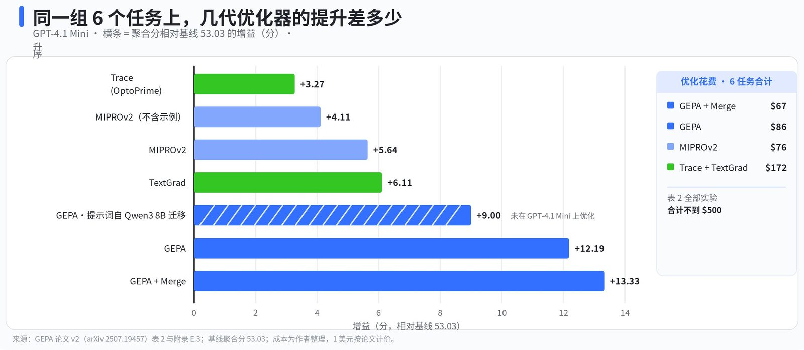
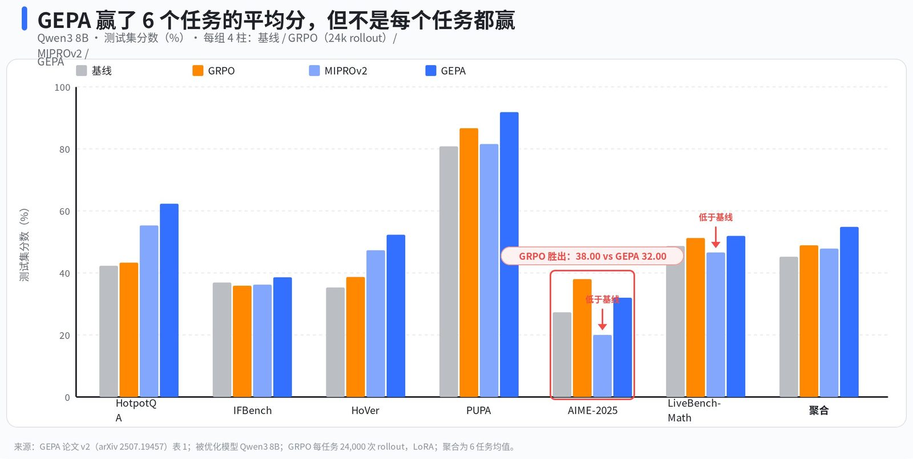
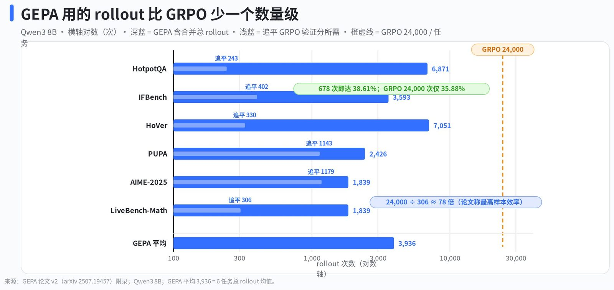
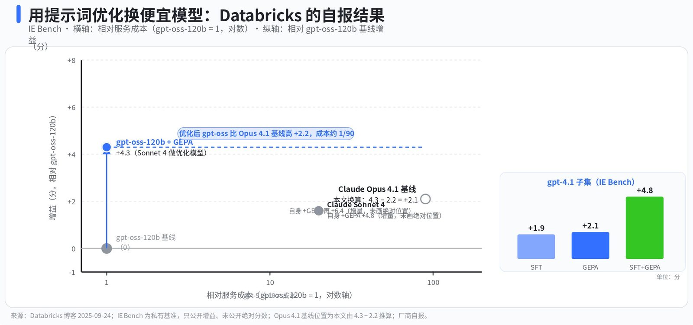
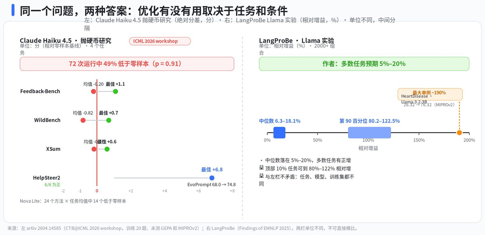
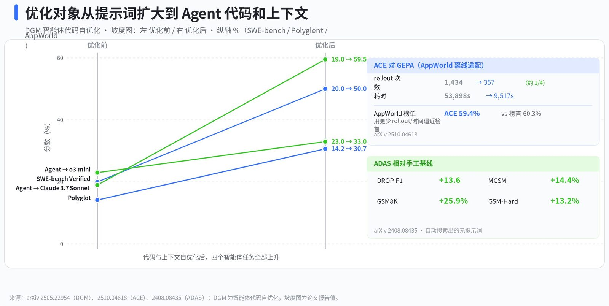
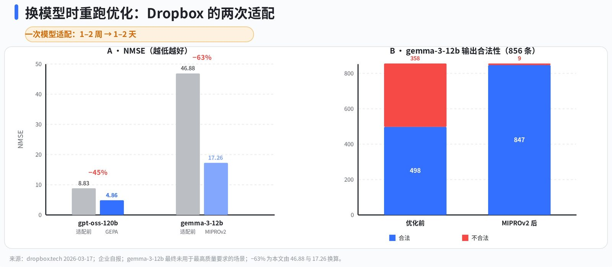
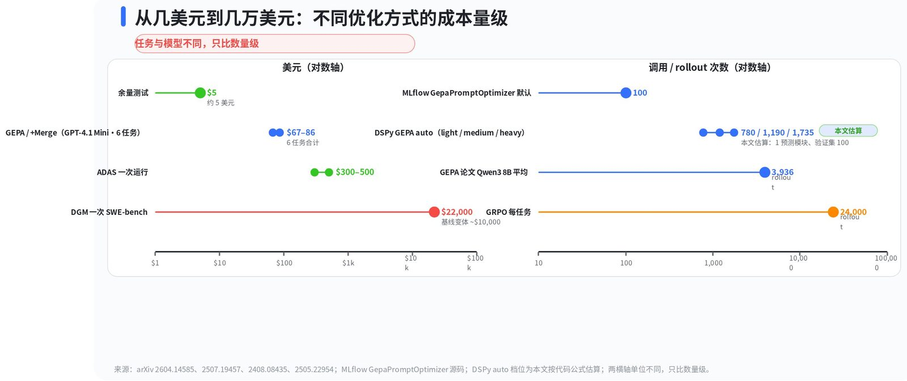

# LLM-46｜工程｜提示词与流程自动优化：DSPy、GEPA 与评测驱动

> 🎯 **这篇文档解决什么问题**：手工改提示词的边际收益越来越低，换模型又要从头再调一遍。自动优化的思路是：先把“什么算好”写成评测集和指标，再让程序在指令、示例、工具描述乃至流程结构上搜索，用评测分数决定留下哪个版本。本文讲优化器的机制与预算、过拟合与方差、有效和无效的证据，以及它和微调、强化学习怎么分工。
>
> 使用方式：本文是「用好模型」第 9.3 节“自动优化提示词：什么时候值得”的展开。第 1–4 章讲原理和风险，第 5–6 章讲 DSPy 和 GEPA，第 7–8 章看证据和流程级优化，第 9–11 章是工程化、预算决策和上线清单。文中版本、价格和基准分数核对于 2026 年 10 月 13 日。

## 导读 · 先给结论

- <b>自动优化要做的是把评测变成搜索目标，用不着找“神奇咒语”</b>。2023 年 OPRO 找到的 “Take a deep breath and work on this problem step-by-step.” 在 PaLM 2-L 上把 GSM8K 从 71.8 提到 80.2[[1]](https://arxiv.org/abs/2309.03409)，但那是在没有指令微调的模型上，今天这类措辞作用很小（见「用好模型」第 3 章）。
- **反思式优化在少量数据上能和强化学习打平甚至更好，但不是处处都赢**。GEPA 论文在 Qwen3 8B 上的 6 个任务平均 54.85，高于 GRPO 的 48.91（GRPO 每任务固定 24,000 次 rollout），GEPA 每任务只用 1,839–7,051 次；但 AIME-2025 上 GRPO 以 38.00 对 32.00 胜出[[2]](https://arxiv.org/abs/2507.19457)。
- **收益分布很宽，有时是负的**。LangProBe 在 2,000 多个组合上测得相对增益中位数 6.3%–18.1%[[3]](https://aclanthology.org/2025.findings-emnlp.1172/)；一篇 2026 年的 CTB@ICML 2026 workshop 论文在 4 个任务上重复实验，发现 Claude Haiku 4.5 的 72 次运行中 49% 低于零样本基线[[4]](https://arxiv.org/abs/2604.14585)。两者不矛盾：任务、模型、训练集都不同。
- **先做“有没有余量”的测试，再决定要不要跑优化器**。上面这篇“抛硬币”论文的诊断方法：10–20 个候选在 20 条留出题上和零样本比，提升超 2 分再优化，约 10 分钟、约 5 美元[[4]](https://arxiv.org/abs/2604.14585)。
- **最实用的场景是换模型和降本**。Dropbox 自报用 GEPA 把相关性评审迁移到 gpt-oss-120b，NMSE 从 8.83 降到 4.86、迁移从 1–2 周缩到 1–2 天[[5]](https://dropbox.tech/machine-learning/optimizing-dropbox-dash-relevance-judge-with-dspy)。Databricks 自报：优化后的 gpt-oss-120b 在其私有基准上超过未优化的 Claude Opus 4.1，服务成本约为后者的 1/90[[6]](https://www.databricks.com/blog/building-state-art-enterprise-agents-90x-cheaper-automated-prompt-optimization)。
- **和微调、强化学习是叠加关系，不是替代关系**。Databricks 在 gpt-4.1 上 SFT +1.9、GEPA +2.1、叠加 +4.8[[6]](https://www.databricks.com/blog/building-state-art-enterprise-agents-90x-cheaper-automated-prompt-optimization)；BetterTogether 交替优化提示词和权重，比只调权重最多高 60%、比只调提示词最多高 6%[[7]](https://arxiv.org/abs/2407.10930)。

📎 与系列其他文档的分工：手工提示词基本功、过时技巧、提示词即代码和换代迁移见「用好模型」第 2、3、9、10 章；错误分析、打分器、评审模型偏差、统计学和发布门禁见「LLM 应用评测与可观测」第 2–5、8 章；要不要微调见「后训练实战」第 1.5 节，强化学习见其第 7–9 章；工具描述的手工迭代和上下文工程见「Agent 工程实战」第 3.2 节和第 4 章。本文只讲“在固定评测上自动搜索提示词与流程”这一层。

## 第 1 章 · 从手工调参到自动搜索：一条谱系

2022 年以来的方法共用一个循环：模型提出候选提示词，在一批样本上打分，按分数保留或改写。差别在三处：候选怎么来（随机生成、参考历史分数、按失败原因改写），怎么选（最高分、束搜索、贝叶斯优化、Pareto 前沿），以及优化一段指令还是整条流程。

### 1.1 第一代：把指令当成可搜索的参数

- <b>APE（2022-11）</b>：让模型生成一池候选指令，按打分挑最好的。24 个 NLP 任务中 19 个达到或超过人写指令[[8]](https://arxiv.org/abs/2211.01910)。
- <b>ProTeGi / APO（2023-05）</b>：微软提出“文字梯度”：让模型用自然语言批评当前提示词，再朝反方向改写，配合束搜索选择。在 3 个基准任务和越狱检测上把初始提示词最多提升 31%[[9]](https://arxiv.org/abs/2305.03495)。
- <b>OPRO（2023-09）</b>：Google DeepMind 把历史解和分数写进元提示词，让模型据此提出新解。最佳提示词在 GSM8K 上比人写的最多高 8%，在 Big-Bench Hard 上最多高 50%[[1]](https://arxiv.org/abs/2309.03409)。
- <b>Promptbreeder 与 EvoPrompt（2023-09）</b>：都用进化算法。Promptbreeder 连负责“变异”的提示词本身也在演化[[10]](https://arxiv.org/abs/2309.16797)；EvoPrompt 让模型实现遗传和差分进化算子，BBH 上比人写提示词最多高 25%[[11]](https://arxiv.org/abs/2309.08532)。

OPRO 表 1 说明这一代方法的语境：PaLM 2-L 上空提示词 GSM8K 为 34.0，“Let’s think step by step.” 为 71.8，OPRO 找到的提示词在 74.5–80.2[[1]](https://arxiv.org/abs/2309.03409)。打分模型未经指令微调，这些措辞不要搬到新模型上。

### 1.2 第二代：从单段提示词到多步程序

- <b>TextGrad（2024-06）</b>：让文字反馈像梯度一样沿计算图反向传播。GPT-4o 零样本在 GPQA 上从 51% 提到 55%，LeetCode-Hard 解答相对提升 20%[[12]](https://arxiv.org/abs/2406.07496)；2025-03 发表于 Nature，应用扩展到放疗计划和分子设计[[13]](https://www.nature.com/articles/s41586-025-08661-4)。
- <b>Trace / OptoPrime（2024-06）</b>：优化器同时看到执行轨迹和反馈，对象可以是提示词、代码或超参数[[14]](https://arxiv.org/abs/2406.16218)；AdalFlow 把文字梯度扩展到可能有环的多组件图[[15]](https://arxiv.org/abs/2501.16673)。
- <b>DSPy（2023-10）</b>：斯坦福把多步流程写成声明式模块组成的程序，由“编译器”（优化器）按指标挑示例、改指令。原论文中 GPT-3.5 和 llama2-13b-chat 自举流程比标准少样本分别高 25% 以上和 65%[[16]](https://arxiv.org/abs/2310.03714)。
- <b>MIPROv2（2024-06）</b>：DSPy 主力优化器，把每个模块拆成“指令”和“少样本示例”，分别生成候选，再用小批量评估拟合代理、做贝叶斯优化。Llama-3-8B 上 7 个多步程序中 5 个胜过基线优化器，最多高 13%[[17]](https://arxiv.org/abs/2406.11695)。

### 1.3 第三代：反思与进化式上下文

GEPA（2025-07，v2 于 2026-02）采样完整轨迹（推理过程、工具调用、输出），用自然语言反思失败原因，提出改写，并用 Pareto 前沿保留“在某些样本上最好”的多样候选[[2]](https://arxiv.org/abs/2507.19457)。ACE（2025-10）则不再追求一段精炼的指令，而是让上下文像一本不断增补的“作战手册”那样增量演化[[18]](https://arxiv.org/abs/2510.04618)。这两者分别在第 6 章和第 8 章展开。

GEPA 论文在 GPT-4.1 Mini 上把几代方法放在同一组 6 个任务比较（基线聚合 53.03）：Trace（OptoPrime）+3.27，MIPROv2 +5.64，TextGrad +6.11，GEPA +12.19，GEPA 加合并 +13.33；Qwen3 8B 上优化的 GEPA 提示词原样搬来也有 +9.00[[2]](https://arxiv.org/abs/2507.19457)。这是 GEPA 作者自做的比较，其他团队结果见第 7 章。



> 💡 **常见误区**：把论文里的“最多提升 X%”当成预期收益。这些数字是多个任务里的最大值，且大多来自 2023–2024 年的模型。第 7 章的大规模评测给的中位数要小得多。

## 第 2 章 · 优化的到底是什么：指令、示例、工具描述、权重与程序结构

不同优化器改动的对象完全不同，对象决定了需要多少数据、产物能否跨模型复用、会不会推高服务成本。先分清对象，再选工具。

### 2.1 一张分类表

| 优化对象 | 代表方法 | 特点 |
|---|---|---|
| 只改指令 | APE、ProTeGi、OPRO、TextGrad、COPRO、GEPA | 产物是一段文字，最容易审阅和放进版本库；适合把隐含规则写清楚 |
| 只选示例 | LabeledFewShot、BootstrapFewShot、KNNFewShot | 从训练集或自举轨迹里挑示例，简单可靠；提示词会变长 |
| 指令加示例 | MIPROv2、SIMBA | 两类候选联合搜索，搜索空间大，需要更多评测调用 |
| 模型权重 | BootstrapFinetune、dspy.GRPO | 需要能训练的模型，详见「后训练实战」 |
| 提示词加权重 | BetterTogether | 交替优化，两者收益可以叠加 |
| 程序结构与代码 | DSPy Flex、ADAS、AFlow、Darwin Gödel Machine | 改控制流、模块划分和代码，预算高，必须放在沙箱里执行 |
| 演化的上下文与记忆 | ACE、Dynamic Cheatsheet | 积累领域经验，可以不用标注，靠执行反馈 |

表中 DSPy 优化器名称以源码清单为准[[19]](https://github.com/stanfordnlp/dspy)。

### 2.2 多步程序的核心难点：功劳归给谁

MIPRO 论文指出，多步程序的中间模块没有标注也没有梯度，只有最终输出能打分[[17]](https://arxiv.org/abs/2406.11695)。DSPy 的办法是“自举”：指标通过的轨迹里每个模块的输入输出都当作该模块示例。GEPA 则让反思模型读整条轨迹、用文字判断哪个模块出错[[2]](https://arxiv.org/abs/2507.19457)，所以指标最好返回“错在哪”的反馈（第 3 章）。

### 2.3 指令还是示例：答案随模型代际变化

两份一手研究结论相反，差别在模型代际：

- **2024 年 MIPRO 论文**：只优化自举示例通常胜过只优化指令，自举加随机搜索在除一个任务外都胜过最好的纯指令优化器；但不同示例组合方差很大。指令优化在“模型不易想到、几个示例也表达不出的条件规则”上最有用[[17]](https://arxiv.org/abs/2406.11695)。
- **2025–2026 年 GEPA 论文**：更新模型上，反思得到的指令验证到测试的泛化差距更小，且比 MIPROv2 提示词最多短 9.2 倍、整体约短 33%[[2]](https://arxiv.org/abs/2507.19457)。作者明确指出 Wan 等人 2024 年“示例比指令泛化更好”的结论在新模型上不再成立。

提示词长度直接影响每次调用的成本和延迟：GEPA 结果意味着更低服务成本，但 Databricks 报告相反，优化后提示词更长、服务成本上升[[6]](https://www.databricks.com/blog/building-state-art-enterprise-agents-90x-cheaper-automated-prompt-optimization)。长度要每次实测，不能假设。

### 2.4 提示词与权重的叠加

BetterTogether（2024-07）让同一模型交替做微调和提示词优化，在 mistral-7b-instruct、llama-2-7b-chat、llama-3-8b-instruct 和 HotPotQA、GSM8K、Iris 上取 3 个种子平均：比只调权重最多高 60%，比只调提示词最多高 6%[[7]](https://arxiv.org/abs/2407.10930)。DSPy 3.2.0（2026-04）把 BetterTogether 推广为串联任意优化器，如策略 `p -> w -> p` 表示先 GEPA、再 BootstrapFinetune、再 GEPA，每步在验证集上评估并返回最好的一版[[20]](https://github.com/stanfordnlp/dspy/releases)。

📎 展开阅读：「后训练实战」第 1.5 节（提示词、RAG、微调、强化微调的决策顺序）。

📎 延伸阅读：「LLM 当优化器」从文本推到了权重本身。Weight-Space Programming 让通用 LLM 不用梯度、只读和写权重：从零写出的小游戏策略超过长训 PPO，定向编辑让 Qwen3.5-0.8B 的 MATH-500 从 7.9 升到 48.1，但增益主要来自修好思考死循环，证据仍是单一模型的博客自报，见 [LLM-48｜系统｜递归自我改进（RSI）：模型怎样改进自己](./48-rsi.md) 第 3.5 节。

## 第 3 章 · 指标即目标：可反馈的指标、对齐过的评审模型与“目标劫持”

优化器会忠实地最大化指标，包括指标的漏洞；人会凭常识避开投机取巧，优化器不会。评测集和打分器的基础见「LLM 应用评测与可观测」第 2、3 章，本章只讲指标变成优化目标时额外要注意的事。

### 3.1 指标要返回分数，也要返回原因

DSPy 的 GEPA 接口允许指标同时返回 `score` 和文字 `feedback`，反馈说明为什么失败，反思模型正是靠这段文字决定怎么改[[21]](https://dspy.ai/learn/optimization/optimizers/)。文档示例是一个俳句任务，指标拆成 8 个可检查条件：行数、音节数、不照抄输入、不用第一人称、词性比例、形容词少、冠词少、用现在时[[21]](https://dspy.ai/learn/optimization/optimizers/)。拆得越细反馈越具体。

GEPA 论文为每个基准写了反馈函数，例如 IFBench 返回哪些约束没满足，PUPA 把分数拆成回答质量和隐私泄露两部分[[2]](https://arxiv.org/abs/2507.19457)。

### 3.2 把运行可靠性写进指标

Dropbox 的相关性评审任务要求模型给 1–5 分，和人工标注比较。其设计有三点值得照抄[[5]](https://dropbox.tech/machine-learning/optimizing-dropbox-dash-relevance-judge-with-dspy)：

- 指标用归一化均方误差（NMSE），缩放到 0–100，比“完全一致才算对”更细腻。
- JSON 格式不合法直接按完全错误计分，把格式稳定性变成优化目标而非上线后才发现的问题。
- 反馈文字含差距大小和方向、标注者理由、模型自己的理由，加一句防过拟合提醒。

### 3.3 用评审模型打分时，先校准评审模型

很多任务只能靠 LLM 评审模型打分。评审模型的位置偏差、冗长偏好和自我偏好见「LLM 应用评测与可观测」第 4 章。作为优化目标时，风险更大：优化器会专门寻找评审模型的盲区。

- Databricks 建议用“对齐过的评审模型”（先用领域专家标注校准）作 GEPA 打分器，优化出的提示词只有胜过基线才提升为生产版本，`max_metric_calls` 先从 50–100 开始[[22]](https://github.com/databricks/databricks-agent-skills)。
- Darwin Gödel Machine 在一个幻觉检测实验里观察到“目标劫持”：系统优化可量化的指标而非任务本意[[23]](https://arxiv.org/abs/2505.22954)。
- GEPA 论文的副产品说明搜索出的提示词能把模型推多远：作者演化出一条通用对抗指令，让 GPT-5 Mini 在 AIME-2025 的 pass@1 从 76% 降到 10%（5 次 × 30 题）[[2]](https://arxiv.org/abs/2507.19457)。同样的能力用在有漏洞的评审模型上，会找到“讨好评审”的写法。

还有一项常被忽略：需要时把提示词长度或调用次数作为惩罚项。DSPy 3.3 的指标可读取 `program_trace` 惩罚模型调用过多[[20]](https://github.com/stanfordnlp/dspy/releases)。

> 💡 **常见误区**：分数上不去再回头改指标。指标一改，之前的运行全部不可比。应先用人工复核确认指标可信，冻结版本，再开始优化。

## 第 4 章 · 数据切分、过拟合与方差

提示词优化本质上是在很小的数据集上做超参数搜索，候选和迭代越多，越容易挑中“碰巧好”的版本。本章讲数据怎么切、过拟合长什么样、为什么跑两次结果不同。

### 4.1 四份数据，各管一件事

| 数据集 | 用途 | 注意 |
|---|---|---|
| 训练集 | 给优化器看：自举示例、生成反思的失败样本 | DSPy 文档建议大部分数据放在这里 |
| 验证集 | 给优化器打分选候选，优化器只看分数不看内容 | 每个候选都要在完整验证集上打分，验证集越大，同样预算下能探索的候选越少 |
| 测试集 | 优化结束后只用一次，报告最终效果 | 任何时候都不参与选择 |
| 回归集 | 必须通过的关键样本和历史事故样本 | 和发布门禁共用，见「LLM 应用评测与可观测」第 8 章 |

DSPy 文档建议验证集取最小的有代表性样本；不给验证集时优化器在训练集上选择，文档称这是“故意允许提示词过拟合”；最终效果用单独的测试集确认[[21]](https://dspy.ai/learn/optimization/optimizers/)。GEPA 论文用训练集产生反思信号、验证集做 Pareto 选择，典型规模为训练 111–150 条、验证 111–300 条[[2]](https://arxiv.org/abs/2507.19457)。MIPROv2 的 auto 档位把验证集分别定为 100、300、1,000 条（light / medium / heavy）[[19]](https://github.com/stanfordnlp/dspy)。

### 4.2 过拟合长什么样

- **照抄样本**：Dropbox 发现优化器把训练样本里的关键词、用户名和原句写进提示词[[5]](https://dropbox.tech/machine-learning/optimizing-dropbox-dash-relevance-judge-with-dspy)。
- **改题**：同案例中有候选把 1–5 分范围改成 1–3 或 1–4[[5]](https://dropbox.tech/machine-learning/optimizing-dropbox-dash-relevance-judge-with-dspy)；Dropbox 的修补是在反馈里加护栏：避免过拟合、不包含具体示例、不改评分范围。
- **验证集涨、测试集跌**：LangProBe 观察到验证集过拟合导致测试集下降[[3]](https://aclanthology.org/2025.findings-emnlp.1172/)；一篇 2026 年的 CTB@ICML 2026 workshop 论文发现迭代式方法在 20 条训练题时训练-测试差距最高 5.6 分，非迭代的 APE 没有此现象[[4]](https://arxiv.org/abs/2604.14585)；DLPO 报告最优点训练-验证约 10% 准确率差距[[24]](https://arxiv.org/abs/2503.13413)。

### 4.3 小验证集的分辨率

验证集的大小决定了能分辨多小的差距。按「LLM 应用评测与可观测」第 5 章的公式，100 条样本、通过率 0.8 时 95% 置信区间半宽约 ±7.8 个百分点。本文按同一公式估算，111–300 条验证集对应约 ±4.5 到 ±7.4 个百分点，和很多论文报告的增益同一量级。论文用单独测试集报告，增益未必假；但在自己的 100 条验证集上看到 3 分差距，不足以说明 A 比 B 好。格式本身也带来大波动：LLaMA-2-13B 仅因格式不同准确率最多相差 76 个百分点[[25]](https://arxiv.org/abs/2310.11324)，GPT-3.5 上模板格式最多也带来约 40% 波动[[26]](https://arxiv.org/abs/2411.10541)。

📎 展开阅读：「用好模型」第 9.2 节（格式敏感性的两组数据）；「LLM 应用评测与可观测」第 5 章（置信区间、配对差和所需用例数）。

### 4.4 种子方差：同一个优化器，跑两次不一样

- DLPO 对反思式提示词优化的诊断：GSM8K 上最后一步种子方差达 20.8%，BBH 训练结束时仍未收敛[[24]](https://arxiv.org/abs/2503.13413)。
- 一项 2026-06 的研究在 3 个开源模型、2 个任务上发现，提示词排名相关性中等偏高，但排名第一的提示词经常随种子和评测子集变化；按置信下界（LCB）选优比按均值更稳，例如 Qwen 在 GSM8K、评测集 50 条时为 0.312 对 0.228[[27]](https://arxiv.org/abs/2606.24381)。
- DSPy 3.0.3 发布说明提醒：多次 rollout 时调高温度并用 `rollout_id` 绕过缓存[[20]](https://github.com/stanfordnlp/dspy/releases)，否则以为跑了 3 次其实只跑了 1 次。

> 🔑 **本章要点**：训练集、验证集、测试集、回归集分开并固定版本；基线至少跑 3 次，优化器至少跑 2–3 个种子，报告均值与波动；选候选用置信下界而非最高分；关掉缓存或设置不同的 rollout 编号；配对差值的置信区间跨 0 的提升不算证据。

## 第 5 章 · DSPy 3.x 实战：模块、优化器、预算档位与产物管理

DSPy 是最完整的开源提示词优化框架，截至 2026-10-12 主仓库约 38,601 颗星[[19]](https://github.com/stanfordnlp/dspy)，最新版本 3.4.0[[28]](https://pypi.org/project/dspy/)。本章只讲优化相关的概念和预算。

### 5.1 版本时间线

| 版本 | 发布日期 | 与优化相关的变化 |
|---|---|---|
| 3.0.0 | 2025-08-12 | 新增 GEPA、SIMBA、GRPO（经 Arbor）；MIPROv2 自动选超参；接入 MLflow 3.0；dspy.Refine 取代 Assertions |
| 3.2.0 | 2026-04-21 | BetterTogether 可串联任意优化器；optuna 变为可选依赖 |
| 3.3.0 | 2026-08-03 | 实验性的 dspy.Flex：由 GEPA 改写整个模块的源码 |
| 3.4.0 | 2026-09-25 | 模型接口过渡版本，3.5 为迁移截止版本 |

日期来自 PyPI[[28]](https://pypi.org/project/dspy/)，变化来自发布说明[[20]](https://github.com/stanfordnlp/dspy/releases)；旧教程的 Assertions 在 3.x 已不适用。

### 5.2 一个最小例子

签名（Signature）声明输入输出字段，模块（Module）决定怎么调用模型，优化器按指标改写指令和示例。下面是用 GEPA 优化工单分类器的骨架（模型名沿用 DSPy 文档示例）：

*
*

```python
import dspyclass Classify(dspy.Signature):    ticket: str = dspy.InputField()    label: str = dspy.OutputField()program = dspy.ChainOfThought(Classify)def metric(gold, pred, trace=None, pred_name=None, pred_trace=None):  # DSPy 3.0.3 GEPA 要求兼容五个参数    ok = pred.label == gold.label    fb = "对" if ok else f"应为{gold.label}"    return dspy.Prediction(score=float(ok), feedback=fb)opt = dspy.GEPA(metric=metric, auto="light",                reflection_lm=dspy.LM("openai/gpt-5.4"))optimized = opt.compile(program, trainset=train, valset=val)optimized.save("ticket_classifier.json")
```

三处刻意的：指标返回反馈文字；反思模型比被优化模型更强（DSPy 文档建议[[21]](https://dspy.ai/learn/optimization/optimizers/)）；结果存成 JSON 提交进版本库。文档同类示例中 gpt-5.4-nano 经 GEPA 优化（反思模型 gpt-5.4），俳句指标从 78.1% 提到 90.1%，超过未优化 gpt-5.4 的 82.4%[[21]](https://dspy.ai/learn/optimization/optimizers/)。

### 5.3 主要优化器的机制与默认参数

| 优化器 | 怎么搜索 | 默认参数 |
|---|---|---|
| BootstrapFewShot（加随机搜索） | 通过指标的轨迹当示例；随机搜索版试多组组合 | 最便宜，LangProBe 称其“非常有竞争力”[[3]](https://aclanthology.org/2025.findings-emnlp.1172/) |
| COPRO | 坐标上升式提出指令，像 OPRO 一样带着历史指令和分数 | 每轮 10 个新提示词、3 轮、初始温度 1.4[[19]](https://github.com/stanfordnlp/dspy) |
| MIPROv2 | 指令和示例候选分别生成，再做贝叶斯优化 | auto 档位候选数 6 / 12 / 18，验证集 100 / 300 / 1,000，小批量 35 条[[19]](https://github.com/stanfordnlp/dspy) |
| SIMBA | 找出输出波动大的样本，生成反思规则或把成功样本加为示例 | 批大小 32、候选 6、最多 8 步、最多 4 个示例[[19]](https://github.com/stanfordnlp/dspy) |
| GEPA | 反思轨迹、改写指令、Pareto 前沿选择（第 6 章） | auto 档位候选数 6 / 12 / 18；auto、max_full_evals、max_metric_calls 三者只能设一个[[19]](https://github.com/stanfordnlp/dspy) |

### 5.4 预算：auto 档位到底要多少次评测

文档说 auto="light" “大约评估六个候选提示词”[[21]](https://dspy.ai/learn/optimization/optimizers/)，但决定成本的是指标调用次数。GEPA 代码的预算公式由初始完整验证、候选生成、小批量评估和定期完整验证几部分相加[[19]](https://github.com/stanfordnlp/dspy)。

**本文估算**：假设程序只有 1 个预测模块（predictor）、验证集 100 条，按代码公式算，light、medium、heavy 三档分别约需 780、1,190、1,735 次指标调用；3 个预测模块时约 1,915、2,565、3,040 次。每次指标调用至少含一次被优化模型调用，用评审模型打分再加一次。对照 MLflow 默认 100 次[[29]](https://mlflow.org/docs/latest/api_reference/_modules/mlflow/genai/optimize/optimizers/gepa_optimizer.html)，Databricks 建议从 50–100 次开始[[22]](https://github.com/databricks/databricks-agent-skills)。

### 5.5 产物管理与健全性检查

- **提交 JSON**：`save()` 保存优化后的指令和示例，3.3 起还包括 Flex 改写的模块源码[[20]](https://github.com/stanfordnlp/dspy/releases)，相当于“模型权重”。
- **优化配置入库**：优化器、档位、种子、反思模型、数据集版本写进配置，换模型时才能一键重跑。
- **检查优化器是否真在工作**：3.0.0 测试版曾因去掉 `datasets` 依赖导致 MIPROv2 自举静默失败、“优化得更差”而不报错[[20]](https://github.com/stanfordnlp/dspy/releases)。每次运行后确认候选数和调用次数、产物确实变了、测试集分数和基线可比。

## 第 6 章 · GEPA 深入：反思式变异、Pareto 前沿与强化学习的成本收益比较

GEPA 论文入选 ICLR 2026 口头报告，代码在 gepa-ai 仓库（约 6,955 颗星）[[2]](https://arxiv.org/abs/2507.19457)[[30]](https://github.com/gepa-ai/gepa)。「用好模型」第 9.3 节给过头条数字，本章拆开论文 v2 的表格看条件和例外。

### 6.1 算法：三个部件

- **反思式变异**：从训练集取小批量（论文 3 条）运行当前候选，把推理、工具调用、输出和反馈交给反思模型，让它判断哪个模块出错并重写其指令[[2]](https://arxiv.org/abs/2507.19457)。
- **Pareto 前沿选择**：保留所有“在验证集某些样本上没被其他候选全面超过”的候选，下一轮从中抽样变异，从而保住针对不同类型样本的改进思路[[2]](https://arxiv.org/abs/2507.19457)。
- **合并**（Merge）：把不同候选在不同模块上的改进组合起来，论文中最多调用 5 次[[2]](https://arxiv.org/abs/2507.19457)。

消融实验显示 Pareto 选择是关键：Qwen3 8B 上 Pareto 选择的聚合提升 12.44%，总是选当前最好候选的贪心策略 6.05%，束搜索 5.11%[[2]](https://arxiv.org/abs/2507.19457)。贪心策略前期涨得快然后停滞。

### 6.2 主实验：和 GRPO、MIPROv2 比

被优化模型为 Qwen3 8B 和 GPT-4.1 Mini，6 个基准为 HotpotQA、IFBench、HoVer、PUPA、AIME-2025、LiveBench-Math。GRPO 基线训练 500 步、每任务固定 24,000 次 rollout、用 LoRA 早停[[2]](https://arxiv.org/abs/2507.19457)。

论文表 1（Qwen3 8B，测试集分数）的聚合结果：基线 45.23，GRPO 48.91（+3.68），MIPROv2 47.84（+2.61），GEPA 54.85（+9.62），GEPA 加合并 52.40（+7.17）[[2]](https://arxiv.org/abs/2507.19457)。



逐任务看，有三个例外必须一起报告[[2]](https://arxiv.org/abs/2507.19457)：

- **AIME-2025 上 GRPO 赢**：GRPO 38.00，GEPA 32.00。
- **MIPROv2 会低于基线**：AIME-2025 上 20.00（基线 27.33），LiveBench-Math 上 46.60（基线 48.70）。
- **合并会出问题**：GEPA 加合并在 IFBench 上降到 28.23，低于基线的 36.90。

优化器会让结果变差，没有方法每个任务都赢，上线前必须在留出测试集上和基线比较。

### 6.3 样本效率：rollout 次数

GEPA（含合并）在 6 个任务上的总 rollout 次数分别是 HotpotQA 6,871、IFBench 3,593、HoVer 7,051、PUPA 2,426、AIME 1,839、LiveBench 1,839，平均 3,936 次，GRPO 每任务都是 24,000 次[[2]](https://arxiv.org/abs/2507.19457)。



按“追平 GRPO 最佳验证分所需 rollout”计，GEPA 在 6 个任务上分别只需 243、402、330、1,143、1,179、306 次，论文据此称样本效率最高达 78 倍；在 6 个任务中的 5 个上，GEPA 最终超过 GRPO，差距分别为 19.0、2.73、13.66、5.19、0.7 分[[2]](https://arxiv.org/abs/2507.19457)。

### 6.4 GPT-4.1 Mini 上的成本与反思调用

- 表 2 全部实验用 GPT-4.1 Mini 花费不到 500 美元：GEPA 86 美元、GEPA 加合并 67 美元、MIPROv2 76 美元、Trace 与 TextGrad 合计 172 美元[[2]](https://arxiv.org/abs/2507.19457)。
- 反思模型每次运行只调用 17–92 次[[2]](https://arxiv.org/abs/2507.19457)，成本大头是被优化模型的 rollout 和打分。
- 跨模型迁移：Qwen3 8B 上优化的提示词用在 GPT-4.1 Mini 上，聚合 62.03（+9.00），HotpotQA 最高 +27.67[[2]](https://arxiv.org/abs/2507.19457)；反例见第 9.4 节。

### 6.5 和 GRPO、SFT 怎么分工

| 维度 | GEPA 类提示词优化 | GRPO 类强化学习 |
|---|---|---|
| 需要什么 | API 调用；百条级数据；带文字反馈的指标 | 可训练的权重和 GPU；可自动判分的奖励 |
| 预算量级 | 论文中每个任务 1,839–7,051 次 rollout | 论文设置中每个任务 24,000 次 rollout |
| 擅长 | 把规则、格式、检索策略写清楚 | 提升模型本身的推理能力（如 AIME-2025） |
| 产物 | 可审阅、可回滚的文字，换模型要重跑 | 适配器权重，绑定基座模型 |

两者可叠加：Databricks 在 gpt-4.1 上，GEPA 加在 SFT 之上得 +4.8，高于单独 SFT 的 +1.9 和单独 GEPA 的 +2.1（厂商自报）[[6]](https://www.databricks.com/blog/building-state-art-enterprise-agents-90x-cheaper-automated-prompt-optimization)。

📎 展开阅读：「后训练实战」第 7 章（GRPO 原理、熵塌缩和奖励设计）。

## 第 7 章 · 证据与反证据：工业案例、大规模评测与“抛硬币”研究

证据分三类：企业案例（数字大，多为自报）、大规模评测（数字温和、覆盖广）、专门找反例的研究。放在一起看，才能判断自己的任务属于哪种。

### 7.1 Databricks：用优化换便宜模型（厂商自报）

Databricks 在 2025-09-24 发布了一组信息抽取实验[[6]](https://www.databricks.com/blog/building-state-art-enterprise-agents-90x-cheaper-automated-prompt-optimization)。IE Bench 是其私有基准，覆盖金融、法律、商业、医疗，文档超 100 页、字段超 70 个；文章只公开相对增益，没有绝对分数。主要结果：

- 以 gpt-oss-120b 为基准，服务成本 gpt-5 约 10 倍、Sonnet 4 约 20 倍、Opus 4.1 约 90 倍。
- 优化器排名 GEPA > SIMBA > MIPROv2，各模型一致。
- gpt-oss-120b 用 Sonnet 4 做优化模型，比基线高 4.3 分（比自我优化多 0.3），比未优化 Opus 4.1 高 2.2，服务成本是 Sonnet 4 的 1/22、Opus 4.1 的 1/90。
- 前沿模型也提升：Sonnet 4 +4.8，Opus 4.1 +6.4。
- 代价：GEPA 调用约 MIPROv2/SIMBA 的 3 倍（约 2–3 小时对约 1 小时，粗略估计），优化后提示词更长。

下图横轴是相对服务成本，纵轴是相对 gpt-oss-120b 基线的增益。文章没直接给 Opus 4.1 基线增益，图中位置为本文换算：优化后 gpt-oss-120b 为 +4.3，比 Opus 4.1 基线高 2.2，故后者约 4.3 − 2.2 = +2.1（本文换算；与上文 GEPA 单独在 gpt-4.1 上的 +2.1 只是数值巧合，口径不同）。



另一个企业案例 Dropbox 以模型迁移为主线（企业自报），第 9.4 节展开。

另一个口头案例是 Shopify：2026-03 在 DSPy meetup 上分享把商品智能任务改成多 Agent，跑在自托管 Qwen3 上并用 GEPA 优化，覆盖从部分店铺扩到全量[[31]](https://www.youtube.com/watch?v=bxToahwOVpY)。无公开工程博文，且其成本下降主要来自换模型和自托管而非优化本身，本文不引用倍数。另需注意 DSPy 也常用于合成训练数据而非优化提示词，Replit 用它合成 diff 再 SFT，不属本篇[[32]](https://replit.com/blog/code-repair)。

### 7.2 LangProBe：2,000 多个组合的温和结论

LangProBe（Findings of EMNLP 2025）在 16 个任务、6 个模型（gpt-4o、gpt-4o-mini、o1-mini、Llama3.1-8B、Llama3.2-3B、Llama3.3-70B）上测试了 2,000 多种“程序 × 优化器 × 模型”组合[[3]](https://aclanthology.org/2025.findings-emnlp.1172/)：

- gpt-4o-mini 加程序和优化器，平均比 gpt-4o 基线高 11.68%，成本只有一半。
- Llama 实验相对增益中位数 6.3%–18.1%，第 90 百分位 80.2%–122.5%；作者称“多数任务预期 5% 到 20%”。最大单例是 HeartDisease 上 Llama-3.2-3B 用 MIPROv2 从 26.32 到 76.32。
- 也有变差的情况，主因验证集过拟合；MMLU 这类自包含任务几乎不获益。MIPROv2 总体最好，更强的优化模型通常有帮助。

### 7.3 “抛硬币”研究：在什么条件下无效

AWS（Generative AI Innovation Center）与 HSBC 的作者在 2026-04 发布、后被 CTB@ICML 2026 workshop 接收的论文《Prompt Optimization Is a Coin Flip》[[4]](https://arxiv.org/abs/2604.14585)：6 种方法（APE、OPRO、EvoPrompt、PromptBreeder、DSPy 式自举、作者的 PROSE）× 4 个任务 × 3 次重复，约 100 个候选，训练 20 题、测试 100 题；执行模型 Claude Haiku 4.5 和 Amazon Nova Lite，评审 Claude Sonnet 4.6。

- Haiku 的 72 次运行中 49% 低于零样本（二项检验 p = 0.91，与随机无异）；Nova Lite 的 24 个“方法 × 任务”均值中 14 个低于零样本。
- 4 个任务中 3 个平均增益为负：Feedback-Bench −0.20、WildBench −0.82、XSum −0.17；这些任务最佳增益只有 +1.1、+0.7、+0.6，落在 20 题评测噪声范围内。
- 例外是 HelpSteer2（要求按评分细则输出 JSON）：Haiku 上 6 种方法全胜零样本，最佳 +6.8（EvoPrompt，68.0→74.8）。作者总结为“能做但默认不做”：模型能产出某种结构但默认不这么做时，优化才有空间。
- 哪个任务可优化随模型反转：HelpSteer2 在 Haiku 上 6/6 有效、Nova Lite 上 1/6；Feedback-Bench 从 1/6 变为 4/6。主导因素是模型而非提示词；两个 Agent 流水线里提示词交互效应从不显著（p > 0.52）。



这篇论文没测 GEPA 和 MIPROv2，训练集只有 20 题，正是噪声最大的条件[[4]](https://arxiv.org/abs/2604.14585)。它和 LangProBe 可同时成立：有结构可利用、数据够、方法强时 5%–20% 是合理预期；开放式生成、数据少、模型默认已不错时接近抛硬币。

> 🔑 **本章要点**：厂商案例展示“用优化换便宜模型”的上限但基准私有；LangProBe 给更可信的中位数；“抛硬币”论文给负面条件。判断自己的任务先看有没有“能做但默认不做”的结构。

## 第 8 章 · 从提示词到智能体与工作流：工具描述、结构搜索与进化式上下文

优化对象扩大到工具描述、流程结构乃至 Agent 自己的代码时，收益可能更大，预算和风险也上升一到两个数量级。本章按对象由小到大排列。

### 8.1 工具描述：优化模型实际看到的文字

手工迭代工具描述的做法见「Agent 工程实战」第 3.2 节。Anthropic 2025-09 的工程博客把它写成完整流程：用 MCP 做工具原型，生成需要多次调用、结果可验证的真实评测任务，用程序跑 Agent 循环，让 Claude Code 读拼接后的轨迹重构工具和描述，再用留出测试集防止过拟合[[33]](https://www.anthropic.com/engineering/writing-tools-for-agents)。文中提到，精确修改工具描述后 Claude Sonnet 3.5 在 SWE-bench Verified 上达到当时最好成绩；Claude 总在搜索查询后加 “2025”，靠改描述修好；命名空间用前缀还是后缀影响不可忽视且随模型不同[[33]](https://www.anthropic.com/engineering/writing-tools-for-agents)。

自动化方面有一个反例。DSPy 曾在 GEPA 里加 `enable_tool_optimization`，联合优化 ReAct 指令和工具描述（2025-12-05 合并[[34]](https://github.com/stanfordnlp/dspy/pull/8928)），2026-02-02 又被移除[[35]](https://github.com/stanfordnlp/dspy/pull/9223)。维护者认为 ReAct 工具描述本就在预测模块指令里，普通 GEPA 已会优化它；一位贡献者在 HoVer 上的实验中，基线 23%–28%，普通 GEPA 35%–39%，工具优化变体只有 21%–32%[[35]](https://github.com/stanfordnlp/dspy/pull/9223)。教训是：直接优化模型看到的那段文字，不要另起一套机制。

### 8.2 结构搜索：ADAS 与 AFlow

- <b>ADAS（2024-08）</b>：UBC 等提出“元 Agent 搜索”，GPT-4 用代码写 Agent 并维护存档，GPT-3.5 评估。相比手工基线，DROP F1 +13.6（满分 100）、MGSM +14.4%，迁移到 GSM8K 和 GSM-Hard 分别 +25.9% 和 +13.2%。每次搜索加评估 ARC 上约 500 美元、推理领域约 300 美元[[36]](https://arxiv.org/abs/2408.08435)；项目页见[[37]](https://shengranhu.com/ADAS)。
- <b>AFlow（2024-10）</b>：用蒙特卡洛树搜索改写代码形式的工作流，6 个基准上比最好基线平均高 5.7%；部分任务上小模型超过 GPT-4o，成本仅其 4.55%[[38]](https://arxiv.org/abs/2410.10762)；代码见[[39]](https://github.com/FoundationAgents/AFlow)。

### 8.3 Darwin Gödel Machine：改自己的代码

UBC / Vector Institute 与 Sakana AI 的 Darwin Gödel Machine（DGM，2025-05，v3 于 2026-03）让编程 Agent 修改自己的代码，用存档做开放式探索，迭代 80 轮[[23]](https://arxiv.org/abs/2505.22954)（代码见[[40]](https://github.com/jennyzzt/dgm)）：

- SWE-bench（Verified 子集）20.0%→50.0%，Polyglot 14.2%→30.7%。
- 搜索出的 Agent 换基座仍有效：200 个 SWE-bench 任务上 o3-mini 23.0%→33.0%，Claude 3.7 Sonnet 19.0%→59.5%。
- 代价：SWE-bench 上跑一次 DGM 约 22,000 美元，基线变体约 10,000 美元。

DSPy 3.3 的实验性 dspy.Flex 把类似思路带进框架：GEPA 改写整个模块源码（控制流、哪些步骤用 Python 哪些用模型），代码在沙箱里执行，用 `max_predictor_calls` 限制调用次数[[20]](https://github.com/stanfordnlp/dspy/releases)。

📎 延伸阅读：让模型自己迭代外壳代码，反馈集上的涨分常常到不了 held-out，HarnessDev 里 64 次版本切换只有 53.1% 同向，见 [LLM-48｜系统｜递归自我改进（RSI）：模型怎样改进自己](./48-rsi.md) 第 12.4 节。

### 8.4 ACE：让上下文增量演化

ACE（Agentic Context Engineering，2025-10）把上下文当成不断增补的作战手册，由生成器、反思器、整理器维护，每次只做增量修改[[18]](https://arxiv.org/abs/2510.04618)，避免整段重写导致的“简洁偏差”和“上下文坍缩”。

- 所有角色都用 DeepSeek-V3.1；AppWorld 上提升 10.6%，金融任务提升 8.6%，可只靠执行反馈、不用标注[[18]](https://arxiv.org/abs/2510.04618)。
- 2025-09-20 的 AppWorld 榜单上，ReAct 加 ACE 平均 59.4%，榜首 IBM CUGA（GPT-4.1）为 60.3%，在更难的 test-challenge 划分上 ACE 超过榜首[[18]](https://arxiv.org/abs/2510.04618)。
- 和 GEPA 比离线适配成本：rollout 1,434→357 次，耗时 53,898→9,517 秒；代价是推理时上下文比 GEPA 提示词长[[18]](https://arxiv.org/abs/2510.04618)。



📎 展开阅读：「Agent 工程实战」第 4 章（上下文腐烂、压缩、笔记和子 Agent），ACE 这类演化式上下文是其自动化版本。

> 💡 **常见误区**：一上来就做结构搜索。按本文换算，DGM 一次约 22,000 美元，是 GEPA 论文中 GEPA 在 GPT-4.1 Mini 上 6 个任务优化花费（86 美元）的 250 多倍，且改代码的系统必须放在沙箱里。先吃完提示词层的收益，再考虑结构。

### 8.5 SkillOpt：给技能文档加学习率和验证门

ACE 改的是运行时上下文。2026 年 5 月开源的 SkillOpt 把类似思路用到技能文件上，同时搬来了训练模型时的几样纪律[[51]](https://arxiv.org/abs/2605.23904)。目标 Agent 冻结不动，技能文档当作它的外部状态来训练：另一个优化模型读打过分的运行轨迹，产出有界的增、删、改编辑。每一步允许的编辑条数就是论文说的“文本学习率”，默认 4 条，按余弦衰减到下限 2 条。编辑应用后要在留出的选择集上验证，分数必须严格高于当前版本才接受，打平也拒绝。被拒绝的编辑连同它造成的分数下降存进一个缓冲区，下一轮作为负反馈喂回去，优化器就不会反复提同一类改法。每个 epoch 末尾还有一次慢速的整体更新。数据按训练、选择、测试三分，测试集只用来出报告。

论文在 6 个基准、7 个目标模型、3 种执行环境（直接调用、Codex、Claude Code）上评测，52 个格子全部最好或并列最好[[51]](https://arxiv.org/abs/2605.23904)。以 GPT-5.5 为例，直接调用的平均分从 58.8 升到 82.3（+23.5），Codex 下 +24.8，Claude Code 下 +19.1，比每格最强的基线平均高 5.4 分，对比对象包括人写技能、LLM 直接生成、Trace2Skill、TextGrad、GEPA 和 EvoSkill。消融里去掉拒绝缓冲区，SearchQA 从 87.1 掉到 85.5，Spreadsheet 从 77.5 掉到 72.9。最终产物是一份 300 到 2,000 token 的 best_skill.md，通常只接受过 1 到 4 条编辑，部署时不增加任何推理调用。在 Codex 上训出的技能拿到 Claude Code 上用，Spreadsheet 仍有 +59.7 的提升。

这套做法把第 4 章的数据切分和 9.3 节的 CI 门禁放进了自动改技能的循环里。想在自己的 Agent 上试，最先要准备的是一个能稳定打分的回放集，没有它，验证门无从谈起。

## 第 9 章 · 工程化流水线：数据、版本、CI 门禁、模型迁移与何时停止

跑通优化器不难，难在让它成为可重复的作业：数据和指标有版本，配置在仓库里，产物过门禁才上线，换模型时一条命令重跑。

### 9.1 数据从哪来

用例来源见「LLM 应用评测与可观测」第 2、7 章，从生产追踪量化问题、为每条假设做单点变体再对比重放的流程见同篇第 8.5 节。优化场景额外要做两件事：按第 4 章切成四份并冻结；收集人工理由而不只是标签。Dropbox 把标注者理由文字直接复用为优化器反馈，把标注分歧解释提炼成一句话的“指令库”条目[[5]](https://dropbox.tech/machine-learning/optimizing-dropbox-dash-relevance-judge-with-dspy)。Anthropic 建议评测任务来自真实工作流、校验器不要过分严格[[33]](https://www.anthropic.com/engineering/writing-tools-for-agents)。

### 9.2 版本化：提示词、配置和产物都进仓库

- **DSPy**：提交 `save()` 生成的 JSON 和优化配置（第 5.5 节）。
- **MLflow**：`mlflow.genai.optimize_prompts` 配合 `GepaPromptOptimizer` 和打分器，优化结果自动在 Prompt Registry 注册为新版本[[41]](https://docs.databricks.com/gcp/en/mlflow3/genai/prompt-version-mgmt/prompt-registry/automatically-optimize-prompts)；mlflow 包最新为 3.17.0[[42]](https://pypi.org/project/mlflow/)。
- **OpenAI 平台上的提示词要迁出**：`v1/prompts` 和 Evals 平台都在 2026-11-30 关闭，Evals 现有评测 2026-10-31 起只读，官方迁移路径是 Promptfoo[[43]](https://platform.openai.com/docs/deprecations)。详见「用好模型」第 9.1 节。

### 9.3 CI 门禁

Promptfoo 是 MIT 许可的开源评测和红队工具，npm 最新版 0.124.1（2026-10-13）。2026-03 OpenAI 宣布收购 Promptfoo，官方称保持开源并接入其 Frontier 平台[[44]](https://openai.com/index/openai-to-acquire-promptfoo/)[[45]](https://www.promptfoo.dev/blog/promptfoo-joining-openai/)。它的 CI 文档示例：PR 改动 `prompts/**` 时运行 `npx promptfoo@latest eval -c promptfooconfig.yaml`，通过率低于 95% 判构建失败，按提示词文件哈希缓存、可跨模型提供商矩阵并行[[46]](https://www.promptfoo.dev/docs/integrations/ci-cd/)。门禁怎么判“变差了”见「LLM 应用评测与可观测」第 8 章。

### 9.4 模型迁移：重优化是一项作业，不是一个项目

优化产物能否跨模型复用，证据两面都有。正面：GEPA 在 Qwen3 8B 上优化的提示词搬到 GPT-4.1 Mini 仍有 +9.00[[2]](https://arxiv.org/abs/2507.19457)，DGM 的 Agent 换基座后仍有效[[23]](https://arxiv.org/abs/2505.22954)。反面：前述“抛硬币”论文发现可优化的任务随模型反转[[4]](https://arxiv.org/abs/2604.14585)；不同模型上表现最好的格式之间只有弱相关[[25]](https://arxiv.org/abs/2310.11324)；DSPy 文档也提醒，今天有效的措辞在厂商更新模型后可能失效[[21]](https://dspy.ai/learn/optimization/optimizers/)。Dropbox 的案例是最完整的一手记录[[5]](https://dropbox.tech/machine-learning/optimizing-dropbox-dash-relevance-judge-with-dspy)：

- **o3 迁到 gpt-oss-120b**：为 o3 调好的提示词在 gpt-oss-120b 上质量下降；用 GEPA 重新适配，NMSE 从 8.83 降到 4.86（−45%），适配从 1–2 周缩到 1–2 天，同成本下可标注数据多 10–100 倍。
- **gemma-3-12b 的快速否决**：基线超 40% 输出 JSON 不合法；MIPROv2 把 NMSE 从 46.88 降到 17.26，856 条中合法从 498 增到 847（不合法 358 降到 9）。质量仍不够最高要求场景，团队很快决定不用。
- **生产 o3 评审模型保守策略**：不让优化器自由改写，只许从人工写好的单行“指令库”里挑选条目（如“小 PR 加测试”）；完整重写只在适配新模型时用。



优化器在这里最大的价值是让换模型从要排期的项目变成按需作业，把分数推到最高倒在其次。

📎 展开阅读：「用好模型」第 10 章（换代迁移五步法和新模型的“性格”变化）；「LLM 应用评测与可观测」第 8.3 节（模型升级流程）。

### 9.5 厂商自带的优化器

- **OpenAI prompt optimizer**：数据集模式利用好坏标注、`output_feedback` 批评和评分器结果[[47]](https://platform.openai.com/docs/guides/prompt-optimizer)；文档提醒优化后可能在某些输入上更差，数据集模式随 Evals 平台一起弃用[[43]](https://platform.openai.com/docs/deprecations)。
- **Anthropic prompt improver**：2024-11 发布，厂商自报多标签分类提升 30%[[48]](https://claude.com/blog/prompt-improver)；其预填技巧在 Claude 4.6 起已不可用（「用好模型」第 3 章）。
- **Google 提示词优化器**：零样本模式实时改写单条提示词；数据驱动模式（VAPO）按样本迭代改写系统指令，`source_model` 选项可用旧模型输出做迁移[[49]](https://docs.cloud.google.com/gemini-enterprise-agent-platform/models/prompts/prompt-optimizer)。

### 9.6 什么时候停

- **预算用完**：`max_metric_calls` 或 auto 档位跑完（第 5.4 节）。
- **达到阈值或重试上限后交人**：OpenAI Self-Evolving Agents 示例循环到聚合分超阈值（如 0.8）或重试达上限（如 10 次）后通知工程师[[50]](https://developers.openai.com/cookbook/examples/partners/self_evolving_agents/autonomous_agent_retraining)。
- **进入平台期**：贪心选择很快停滞（第 6.1 节），换选择策略比加预算有效。
- **配对差值的置信区间跨 0**：不算证据，停止加候选（第 4.3 节）。

## 第 10 章 · 预算与决策：先测余量，再选提示词优化、微调还是强化学习

本章的决策顺序是本文根据前面各章的一手资料归纳的建议。

### 10.1 第一步：有没有可信的指标

没有可信的自动指标（代码校验、标注答案或校准过的评审模型），先建指标，不要跑优化器，否则得到的是第 3 章的目标劫持和第 4 章的照抄样本。

### 10.2 第二步：余量测试

“抛硬币”论文的诊断方法很便宜：生成 10–20 个候选，在 20 条留出题上和零样本比，提升超过 2 分才值得继续，约 10 分钟、约 5 美元；多 Agent 流水线另有约 80 美元的方差分析预测试判断是否需要联合优化[[4]](https://arxiv.org/abs/2604.14585)。20 条题分辨率低，适合用来否决，不适合证明。

余量最可能出现在两类任务上：输出有模型能做但默认不做的结构（如按评分细则输出 JSON）[[4]](https://arxiv.org/abs/2604.14585)；或有模型想不到、几个示例也表达不出的条件规则[[17]](https://arxiv.org/abs/2406.11695)。MMLU 这类自包含问答任务优化收益很小[[3]](https://aclanthology.org/2025.findings-emnlp.1172/)。

### 10.3 第三步：按约束选手段

| 情况 | 首选 | 依据 |
|---|---|---|
| 模型固定、只有 API、数据几十到几百条 | 自动提示词优化（GEPA、MIPROv2、SIMBA） | LangProBe[[3]](https://aclanthology.org/2025.findings-emnlp.1172/) |
| 想换便宜模型或模型要升级 | 针对目标模型重跑优化 | Dropbox、Databricks（自报）[[5]](https://dropbox.tech/machine-learning/optimizing-dropbox-dash-relevance-judge-with-dspy)[[6]](https://www.databricks.com/blog/building-state-art-enterprise-agents-90x-cheaper-automated-prompt-optimization) |
| 闭源前沿模型，无法微调 | 提示词优化往往是唯一手段 | 「后训练实战」第 1.4 节 |
| 权重可训练、可自动判分、优化后仍有差距 | SFT 或 RLVR，并在其上再做提示词优化 | Databricks[[6]](https://www.databricks.com/blog/building-state-art-enterprise-agents-90x-cheaper-automated-prompt-optimization)；BetterTogether[[7]](https://arxiv.org/abs/2407.10930) |
| 需要模型本身更会推理（如数学竞赛） | 强化学习 | GEPA 论文 AIME-2025 结果[[2]](https://arxiv.org/abs/2507.19457) |
| 长程 Agent，需要积累领域经验 | 演化式上下文（ACE） | AppWorld +10.6%[[18]](https://arxiv.org/abs/2510.04618) |
| 想改流程结构或 Agent 代码 | 结构搜索，仅在预算充足且有沙箱时 | ADAS、DGM 的成本（第 8 章） |

📎 展开阅读：「后训练实战」第 1.5 节（RAG、SFT、RLVR 决策顺序），本表微调一行从那里接手。

### 10.4 预算锚点

下面的数字来自不同任务和模型，只能比数量级，不能逐项比较。

| 做法 | 报告的预算 | 来源 |
|---|---|---|
| 余量测试 | 约 10 分钟、约 5 美元 | “抛硬币”论文（CTB@ICML 2026 workshop）[[4]](https://arxiv.org/abs/2604.14585) |
| DSPy GEPA auto 三档 | 约 780 / 1,190 / 1,735 次指标调用 | 本文估算（1 个预测模块、验证集 100） |
| GEPA 论文，GPT-4.1 Mini | 6 个任务合计 GEPA 86 美元、MIPROv2 76 美元 | GEPA 论文附录 E.3[[2]](https://arxiv.org/abs/2507.19457) |
| GEPA 论文，Qwen3 8B | 每任务平均 3,936 次 rollout | GEPA 论文[[2]](https://arxiv.org/abs/2507.19457) |
| GRPO（同一论文设置） | 每任务 24,000 次 rollout | GEPA 论文[[2]](https://arxiv.org/abs/2507.19457) |
| ADAS 一次搜索加评估 | 约 300–500 美元 | ADAS 论文[[36]](https://arxiv.org/abs/2408.08435) |
| DGM 一次 SWE-bench 运行 | 约 22,000 美元 | DGM 论文[[23]](https://arxiv.org/abs/2505.22954) |



余量测试几美元，一次提示词优化几十到一百美元量级，结构搜索几百到几万美元。调用量也要看：Databricks 的生命周期算法显示，调用 1,000 次时优化成本占大头，10 万次摊平，1,000 万次可忽略[[6]](https://www.databricks.com/blog/building-state-art-enterprise-agents-90x-cheaper-automated-prompt-optimization)。

> 💡 **常见误区**：只算优化的一次性花费，不算服务成本的变化。提示词可能变长（Databricks），也可能变短（GEPA 论文）。上线前按实际流量估算 token 变化，和质量提升一起比较。

## 第 11 章 · 落地清单与反模式

清单里的做法来自前文引用的一手资料，组合方式是本文的建议。

### 11.1 开跑前

> 📌 - 指标返回分数和文字反馈；格式不合法按最差分计（第 3 章）。
> - 评审模型已用人工标注校准，记录了一致率（「LLM 应用评测与可观测」第 4 章）。
> - 训练集、验证集、测试集、回归集分开，固定版本；验证集大小按需要分辨的差距来定（第 4 章）。
> - 基线至少跑 3 次，记录均值和波动范围。
> - 做过余量测试：10–20 个候选在留出题上没有超过 2 分的提升，就停在零样本或手工提示词（第 10.2 节）。
> - 算过预算，并确认调用量能摊平（第 10.4 节）。

### 11.2 运行中

> 📌 - 反思或优化模型比被优化模型更强（DSPy 文档建议[[21]](https://dspy.ai/learn/optimization/optimizers/)；Databricks 用 Claude Sonnet 4 做优化模型比自我优化多 0.3 分[[6]](https://www.databricks.com/blog/building-state-art-enterprise-agents-90x-cheaper-automated-prompt-optimization)）。
> - 反馈或反思提示词里写明护栏：不照抄样本里的具体字符串、不改任务参数（第 4.2 节）。
> - 重复采样时调高温度并设置不同的 rollout 编号，避免缓存让多次运行变成一次（第 4.4 节）。
> - 至少跑 2–3 个种子；选候选按置信下界，不按最高分。
> - 运行后核对候选数、调用次数和产物，防止静默失败（第 5.5 节）。

### 11.3 上线前与上线后

> 📌 - 测试集上与基线做配对比较，配对差值的置信区间不跨 0 才算数；回归集全部通过。
> - 人工审阅优化后提示词有没有夹带样本内容或改变任务定义（OpenAI 优化器文档同样要求[[47]](https://platform.openai.com/docs/guides/prompt-optimizer)）。
> - 测量提示词长度和每次调用的 token、延迟变化。
> - 优化配置、数据集版本和产物（DSPy JSON 或 Prompt Registry 中的版本）都入库，通过 CI 门禁才提升为生产版本。
> - 每次模型升级都重跑优化，把“重跑”做成一条命令（第 9.4 节）。
> - 对已经很好的生产提示词，用受限优化：只允许在人工审核过的指令条目中选择（Dropbox 的做法）。

### 11.4 反模式

| 反模式 | 后果 | 改法 |
|---|---|---|
| 不给验证集，在训练集上选候选 | DSPy 文档称这是故意允许过拟合[[21]](https://dspy.ai/learn/optimization/optimizers/) | 单独的验证集和测试集 |
| 用 20 条题的结果宣布胜出 | 最佳增益落在噪声范围内[[4]](https://arxiv.org/abs/2604.14585) | 扩大测试集，报告置信区间 |
| 对未校准的评审模型做优化 | 目标劫持[[23]](https://arxiv.org/abs/2505.22954) | 先校准，优化后抽样人工复核 |
| 默认优化器一定提分 | GEPA 加合并在 IFBench、MIPROv2 在 AIME 上都低于基线[[2]](https://arxiv.org/abs/2507.19457) | 每次都和基线比，保留回滚 |
| 为工具描述另起一套优化机制 | DSPy 实验中反而更差，已被移除[[35]](https://github.com/stanfordnlp/dspy/pull/9223) | 优化模型实际看到的文字 |
| 优化完不看提示词长度 | 服务成本悄悄上升[[6]](https://www.databricks.com/blog/building-state-art-enterprise-agents-90x-cheaper-automated-prompt-optimization) | 把长度或调用次数写进指标 |
| 换模型后沿用旧的优化产物 | Dropbox 中质量下降[[5]](https://dropbox.tech/machine-learning/optimizing-dropbox-dash-relevance-judge-with-dspy) | 针对新模型重跑 |

### 11.5 延伸阅读顺序

延伸阅读顺序：GEPA 论文 v2 实验与附录 E.3[[2]](https://arxiv.org/abs/2507.19457) → DSPy 优化器指南的数据切分与反馈[[21]](https://dspy.ai/learn/optimization/optimizers/) → “抛硬币”论文[[4]](https://arxiv.org/abs/2604.14585)和 LangProBe[[3]](https://aclanthology.org/2025.findings-emnlp.1172/)判断余量 → Dropbox 案例做模型迁移[[5]](https://dropbox.tech/machine-learning/optimizing-dropbox-dash-relevance-judge-with-dspy)。优化器之外的整条调优流程，包括目标表、读失败 trace、按成本排序的杠杆和验收回归门，见 [LLM-58｜工程｜Agent 调优：从 trace 找到该改的那一层](./58-agent-tuning.md)。

## 参考文献

按正文首次引用顺序编号，资料截至 2026 年 10 月初。

[1] Yang et al. Large Language Models as Optimizers (OPRO) (2023) [https://arxiv.org/abs/2309.03409](https://arxiv.org/abs/2309.03409)

[2] Agrawal et al. GEPA: Reflective Prompt Evolution Can Outperform RL (2026) [https://arxiv.org/abs/2507.19457](https://arxiv.org/abs/2507.19457)

[3] Tan et al. LangProBe: a Language Programs Benchmark (Findings EMNLP 2025) (2025) [https://aclanthology.org/2025.findings-emnlp.1172/](https://aclanthology.org/2025.findings-emnlp.1172/)

[4] Zhang et al. (AWS Generative AI Innovation Center / HSBC). Prompt Optimization Is a Coin Flip (2026-04; v2 2026-05, CTB@ICML 2026 workshop) [https://arxiv.org/abs/2604.14585](https://arxiv.org/abs/2604.14585)

[5] Dropbox. Optimizing Dropbox Dash relevance judge with DSPy (2026) [https://dropbox.tech/machine-learning/optimizing-dropbox-dash-relevance-judge-with-dspy](https://dropbox.tech/machine-learning/optimizing-dropbox-dash-relevance-judge-with-dspy)

[6] Databricks AI Research. Building SOTA Enterprise Agents 90x Cheaper with Automated Prompt Optimization (2025) [https://www.databricks.com/blog/building-state-art-enterprise-agents-90x-cheaper-automated-prompt-optimization](https://www.databricks.com/blog/building-state-art-enterprise-agents-90x-cheaper-automated-prompt-optimization)

[7] Soylu et al. Fine-Tuning and Prompt Optimization Work Better Together (2024) [https://arxiv.org/abs/2407.10930](https://arxiv.org/abs/2407.10930)

[8] Zhou et al. APE: LLMs Are Human-Level Prompt Engineers (2022) [https://arxiv.org/abs/2211.01910](https://arxiv.org/abs/2211.01910)

[9] Pryzant et al. ProTeGi: Automatic Prompt Optimization with Textual Gradients (2023) [https://arxiv.org/abs/2305.03495](https://arxiv.org/abs/2305.03495)

[10] Fernando et al. Promptbreeder: Self-Referential Prompt Evolution (2023) [https://arxiv.org/abs/2309.16797](https://arxiv.org/abs/2309.16797)

[11] Guo et al. EvoPrompt: Connecting LLMs with Evolutionary Algorithms (2023) [https://arxiv.org/abs/2309.08532](https://arxiv.org/abs/2309.08532)

[12] Yuksekgonul et al. TextGrad: Automatic "Differentiation" via Text (2024) [https://arxiv.org/abs/2406.07496](https://arxiv.org/abs/2406.07496)

[13] Yuksekgonul et al. Optimizing generative AI by backpropagating LM feedback. Nature 639:609-616 (2025) [https://www.nature.com/articles/s41586-025-08661-4](https://www.nature.com/articles/s41586-025-08661-4)

[14] Cheng et al. Trace: Generative Optimization with Execution Traces and LLMs (OptoPrime) (2024) [https://arxiv.org/abs/2406.16218](https://arxiv.org/abs/2406.16218)

[15] SylphAI. AdalFlow (LLM-AutoDiff)：统一 LLM 应用框架 (2025) [https://arxiv.org/abs/2501.16673](https://arxiv.org/abs/2501.16673)

[16] Khattab et al. DSPy: Compiling Declarative LM Calls into Self-Improving Pipelines (2023) [https://arxiv.org/abs/2310.03714](https://arxiv.org/abs/2310.03714)

[17] Opsahl-Ong et al. MIPROv2: Optimizing Instructions and Demonstrations for Multi-Stage LM Programs (2024) [https://arxiv.org/abs/2406.11695](https://arxiv.org/abs/2406.11695)

[18] Zhang et al. Agentic Context Engineering: Evolving Contexts for Self-Improving LMs (2026) [https://arxiv.org/abs/2510.04618](https://arxiv.org/abs/2510.04618)

[19] Stanford NLP. DSPy 源码仓库（teleprompt 模块） (2026) [https://github.com/stanfordnlp/dspy](https://github.com/stanfordnlp/dspy)

[20] Stanford NLP. DSPy Releases 3.0.0-3.4.0 发布说明 (2026) [https://github.com/stanfordnlp/dspy/releases](https://github.com/stanfordnlp/dspy/releases)

[21] DSPy 文档. Optimizers 使用指南 (2026) [https://dspy.ai/learn/optimization/optimizers/](https://dspy.ai/learn/optimization/optimizers/)

[22] Databricks. databricks-agent-skills：prompt optimization 模式说明 (2026) [https://github.com/databricks/databricks-agent-skills](https://github.com/databricks/databricks-agent-skills)

[23] Zhang et al. Darwin Gödel Machine: Open-Ended Evolution of Self-Improving Agents (2025) [https://arxiv.org/abs/2505.22954](https://arxiv.org/abs/2505.22954)

[24] Li et al. DLPO：反思式提示词优化的过拟合诊断 (2025) [https://arxiv.org/abs/2503.13413](https://arxiv.org/abs/2503.13413)

[25] Sclar et al. Quantifying LLMs' Sensitivity to Spurious Features in Prompt Design (2023) [https://arxiv.org/abs/2310.11324](https://arxiv.org/abs/2310.11324)

[26] Saito et al. Does Prompt Formatting Have Any Impact on LLM Performance? (2024) [https://arxiv.org/abs/2411.10541](https://arxiv.org/abs/2411.10541)

[27] Du et al. 提示词排序稳定性研究 (2026) [https://arxiv.org/abs/2606.24381](https://arxiv.org/abs/2606.24381)

[28] PyPI. dspy 包发布历史 (2026) [https://pypi.org/project/dspy/](https://pypi.org/project/dspy/)

[29] MLflow. GepaPromptOptimizer API 源码 (2026) [https://mlflow.org/docs/latest/api_reference/_modules/mlflow/genai/optimize/optimizers/gepa_optimizer.html](https://mlflow.org/docs/latest/api_reference/_modules/mlflow/genai/optimize/optimizers/gepa_optimizer.html)

[30] gepa-ai. GEPA 代码仓库 (2026) [https://github.com/gepa-ai/gepa](https://github.com/gepa-ai/gepa)

[31] Raghavan. Optimizing Shop Intelligence with DSPy @ Shopify Scale (DSPy Meetup, 2026) [https://www.youtube.com/watch?v=bxToahwOVpY](https://www.youtube.com/watch?v=bxToahwOVpY)

[32] Replit. Building LLMs for Code Repair (2024) [https://replit.com/blog/code-repair](https://replit.com/blog/code-repair)

[33] Anthropic. Writing effective tools for agents — with agents (2025) [https://www.anthropic.com/engineering/writing-tools-for-agents](https://www.anthropic.com/engineering/writing-tools-for-agents)

[34] stanfordnlp/dspy. PR #8928：新增 enable_tool_optimization (2025) [https://github.com/stanfordnlp/dspy/pull/8928](https://github.com/stanfordnlp/dspy/pull/8928)

[35] stanfordnlp/dspy. PR #9223：移除 enable_tool_optimization (2026) [https://github.com/stanfordnlp/dspy/pull/9223](https://github.com/stanfordnlp/dspy/pull/9223)

[36] Hu et al. Automated Design of Agentic Systems (ADAS) (2024) [https://arxiv.org/abs/2408.08435](https://arxiv.org/abs/2408.08435)

[37] Hu. ADAS: Automated Design of Agentic Systems 项目页 (2026) [https://shengranhu.com/ADAS](https://shengranhu.com/ADAS)

[38] Zhang et al. AFlow: Automating Agentic Workflow Generation (2024) [https://arxiv.org/abs/2410.10762](https://arxiv.org/abs/2410.10762)

[39] FoundationAgents. AFlow 代码仓库 (2026) [https://github.com/FoundationAgents/AFlow](https://github.com/FoundationAgents/AFlow)

[40] Zhang. Darwin Gödel Machine 代码仓库 (2026) [https://github.com/jennyzzt/dgm](https://github.com/jennyzzt/dgm)

[41] Databricks. Automatically optimize prompts（MLflow Prompt Registry） (2026) [https://docs.databricks.com/gcp/en/mlflow3/genai/prompt-version-mgmt/prompt-registry/automatically-optimize-prompts](https://docs.databricks.com/gcp/en/mlflow3/genai/prompt-version-mgmt/prompt-registry/automatically-optimize-prompts)

[42] PyPI. mlflow 包发布历史（最新 3.17.0） (2026) [https://pypi.org/project/mlflow/](https://pypi.org/project/mlflow/)

[43] OpenAI. Deprecations (2026) [https://platform.openai.com/docs/deprecations](https://platform.openai.com/docs/deprecations)

[44] OpenAI. OpenAI to acquire Promptfoo (2026) [https://openai.com/index/openai-to-acquire-promptfoo/](https://openai.com/index/openai-to-acquire-promptfoo/)

[45] Promptfoo. Promptfoo is joining OpenAI (2026) [https://www.promptfoo.dev/blog/promptfoo-joining-openai/](https://www.promptfoo.dev/blog/promptfoo-joining-openai/)

[46] Promptfoo. CI/CD integration 文档 (2026) [https://www.promptfoo.dev/docs/integrations/ci-cd/](https://www.promptfoo.dev/docs/integrations/ci-cd/)

[47] OpenAI. Prompt optimizer 指南 (2026) [https://platform.openai.com/docs/guides/prompt-optimizer](https://platform.openai.com/docs/guides/prompt-optimizer)

[48] Anthropic. Console 提示词改进器发布博客 (2024) [https://claude.com/blog/prompt-improver](https://claude.com/blog/prompt-improver)

[49] Google Cloud. Prompt optimizer（Gemini Enterprise Agent Platform） (2026) [https://docs.cloud.google.com/gemini-enterprise-agent-platform/models/prompts/prompt-optimizer](https://docs.cloud.google.com/gemini-enterprise-agent-platform/models/prompts/prompt-optimizer)

[50] OpenAI Cookbook. Self-Evolving Agents: autonomous agent retraining (2026) [https://developers.openai.com/cookbook/examples/partners/self_evolving_agents/autonomous_agent_retraining](https://developers.openai.com/cookbook/examples/partners/self_evolving_agents/autonomous_agent_retraining)

[51] Yang et al. SkillOpt: Executive Strategy for Self-Evolving Agent Skills. arXiv:2605.23904 (2026-05) [https://arxiv.org/abs/2605.23904](https://arxiv.org/abs/2605.23904)

---

上一篇：[LLM-45｜工程｜多 Agent 系统：编排、通信、归因与评测](./45-multi-agent.md) · [目录](./README.md) · 下一篇：[LLM-47｜场景｜运维根因定位：拓扑、因果推断与 LLM](./47-root-cause.md)
