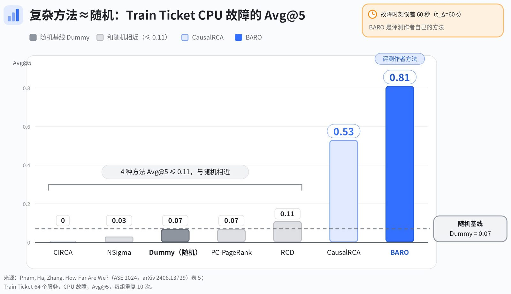
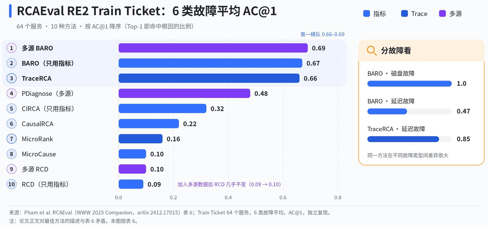
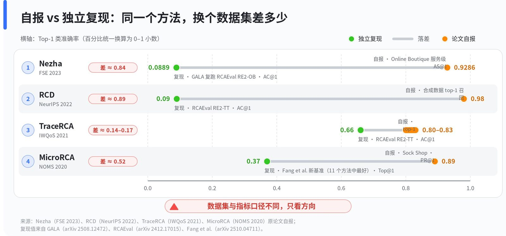
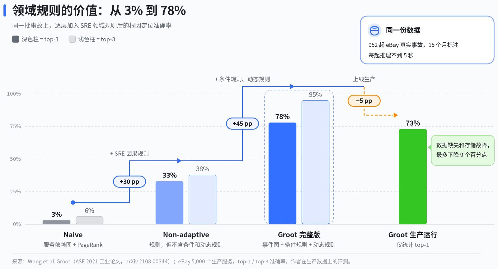
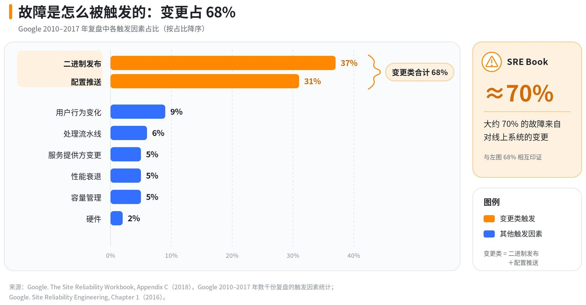
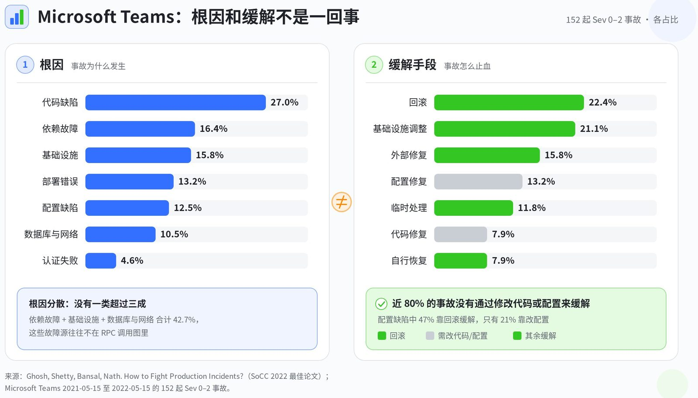
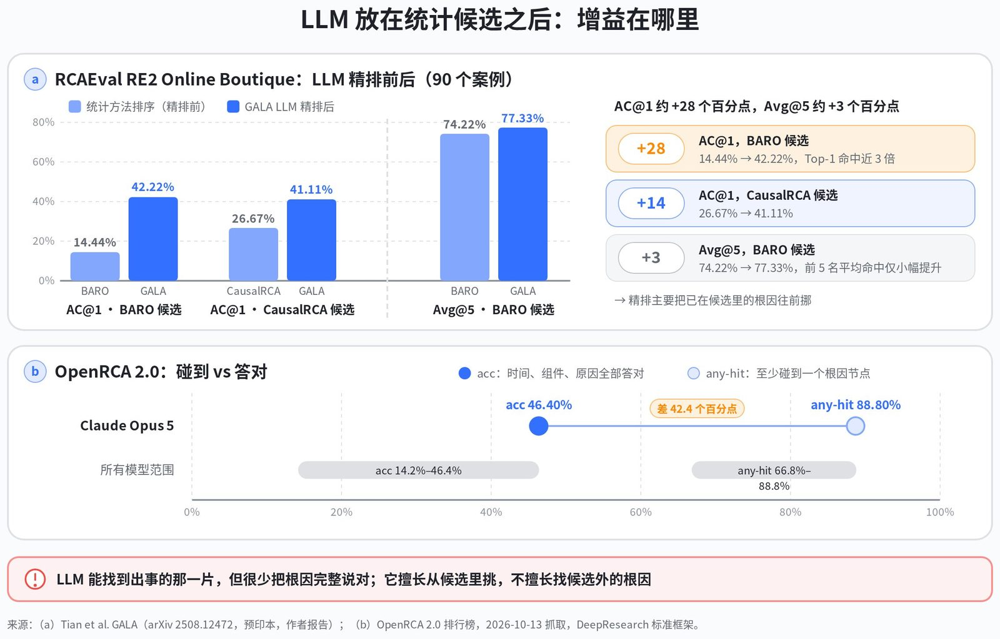
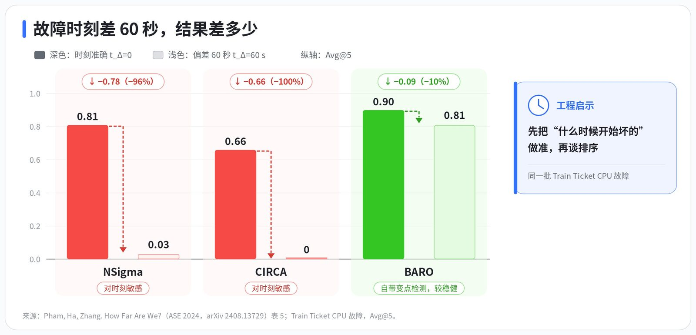

# LLM-47｜场景｜运维根因定位：拓扑、因果推断与 LLM

> 🎯 **这篇文档解决什么问题**：给搭根因定位系统的 SRE 工程师一份“哪些方法在独立复现里真的有效”的清单。论文里 0.9 以上的准确率很多，换一个数据集或故障时刻，同一个方法可能跌到和随机挑选差不多。本文不做综述，只回答六个工程问题：经典方法的真实表现、拓扑从哪来和质量怎么量、调用图为什么不是因果图、变更为什么是首因、LLM 放在哪一层、怎么用回放集评测。
>
> 使用方式：第 1–2 章校准预期，第 3–7 章是非 LLM 的底座，第 8–9 章讲 LLM 与评测，第 10–11 章是工程落地和清单。文中基准分数、排行榜和厂商说法核对于 2026 年 10 月 13 日。

## 导读 · 先给结论

- **复杂的因果发现方法，在中小规模系统上常常不比随机好**。ASE 2024 的独立评测在 10–212 个节点的系统上，发现 PC、Granger、LiNGAM 等全图因果发现加 PageRank 的组合大多和“随机挑一个节点”相近[[1]](https://arxiv.org/abs/2408.13729)。这只对它测过的规模和故障类型成立，不能外推成“因果方法都没用”。
- **故障时刻比算法更重要**。故障时刻偏差 60 秒，CIRCA 在 Train Ticket CPU 故障上的 Avg@5 从 0.66 掉到 0，NSigma 从 0.81 掉到 0.03[[1]](https://arxiv.org/abs/2408.13729)。
- **变更是第一个该查的根因**。Google SRE Workbook 统计 2010–2017 年的数千份复盘，二进制发布和配置推送合计触发 68% 的故障[[2]](https://sre.google/workbook/postmortem-analysis/)；Microsoft Teams 的高等级事故里，回滚是最常见的缓解手段[[3]](https://www.microsoft.com/en-us/research/wp-content/uploads/2022/09/3542929.3563482.pdf)。
- **调用图不是因果图**。eBay Groot 在 952 起真实事故上，服务依赖图加 PageRank 的 top-1 只有 3%，加上 SRE 写的因果规则后是 78%[[4]](https://arxiv.org/abs/2108.00344)。
- **LLM 最适合在统计候选之后做精排**。GALA（预印本，只在 RCAEval 的 Online Boutique 一个系统上测过）在 BARO 的候选上用 LLM 精排，AC@1 从 14.44% 提到 42.22%，Avg@5 只从 74.22% 到 77.33%[[5]](https://arxiv.org/abs/2508.12472)：LLM 主要把对的答案排到首位，找不到候选里没有的根因。
- **评测必须带随机基线和“告警最多的服务”基线**。只把告警最多的服务当根因的 SimpleRCA，在 4 个公开基准上追平或超过当前最好的方法[[6]](https://arxiv.org/abs/2510.04711)。

📎 与系列其他文档的分工：LLM 根因分析演进表和 OpenRCA、ITBench 分数见「LLM 在运维与容灾中的落地」第 4.3–4.4 节；运维基准总表、生产系统与厂商表、回放评测打分见「AIOps Agent 落地细化」第 1、2、9 章；时序与日志异常检测见「运维数据上的基础模型」；事故记忆见「Agent 记忆」第 11 章。本文只讲根因定位本身。

## 第 1 章 · 根因定位要回答什么、怎么打分

不同论文里的“根因定位”（Root Cause Analysis，RCA）粒度不同。比较两个数字之前，先确认它们回答的是同一个问题、用的是同一把尺子。

### 1.1 四种粒度

| 粒度 | 输出 | 典型工作 | 值班价值 |
|---|---|---|---|
| 服务级 | 哪个服务是根因 | RCAEval 粗粒度评测、随机游走类方法 | 知道找哪个团队 |
| 指标级 | 哪个服务的哪个指标先异常 | RCAEval 细粒度评测、BARO、CIRCA | 区分资源和逻辑问题 |
| 代码或资源级 | 具体代码区域或资源类型 | Nezha、Fang et al. 的分层标签 | 可以直接修 |
| 变更级 | 哪一次发布或配置推送 | Gandalf、Meta 的变更排序 | 可以直接回滚 |

RCAEval 同时提供服务级和指标级评测[[7]](https://arxiv.org/abs/2412.17015)，Nezha 报告代码区域和资源类型级别的结果[[8]](https://dl.acm.org/doi/10.1145/3611643.3616249)，Fang et al. 的标签从服务分层到代码[[6]](https://arxiv.org/abs/2510.04711)。引用分数时要写清粒度。

### 1.2 常见指标

- <b>AC@k（也叫 HR@k、PR@k、Top@k）</b>：真实根因出现在前 k 个候选里的案例比例；多根因时 RCAEval 除以 k 与真实根因数中的较小者[[7]](https://arxiv.org/abs/2412.17015)。
- **Avg@k**：AC@1 到 AC@k 的平均，越早命中得分越高[[7]](https://arxiv.org/abs/2412.17015)。**MRR** 是真实根因排名倒数的平均。
- **OpenRCA 2.0 的 acc**：时间、组件、原因全部答对才算对；另有 any-hit（至少命中一个根因节点）和 all-hit（全部命中）[[9]](https://microsoft.github.io/OpenRCA/)。
- **LLM 生成的根因描述**：BLEU、ROUGE 一类词面指标不可靠，Ahmed et al. 测得它们和人工评分的皮尔逊相关系数在 −0.42 到 +0.62 之间[[10]](https://arxiv.org/abs/2301.03797)。

### 1.3 随机基线不是零

top-5 命中率必须和随机基线一起看。ASE 2024 引入随机挑节点的“Dummy”基线：在 10–15 个服务的系统上，Dummy 的 Avg@5 约为 0.25–0.38，在 64 个服务的 Train Ticket 上约为 0.07[[1]](https://arxiv.org/abs/2408.13729)。Online Boutique 只有 12 个服务[[7]](https://arxiv.org/abs/2412.17015)，top-5 已接近候选集的一半。

更有区分度的是 SimpleRCA：每种数据各用一个规则检测器，把告警最多的服务当根因。它在 Nezha 的 Train Ticket 数据上 Top@1 为 0.93，高于 Nezha 的 0.87；在 RCAEval RE3 的 Train Ticket 和 Sock Shop 上都是 0.83，BARO 是 0.50 和 0.00；RCAEval 平均 Top@1 为 0.58，BARO 为 0.24[[6]](https://arxiv.org/abs/2510.04711)。原因是现有数据集里根因服务大多恰好是症状最明显的那个[[6]](https://arxiv.org/abs/2510.04711)。

### 1.4 小样本陷阱

LEMMA-RCA 两个微服务子集分别只有 4 种和 6 种故障[[11]](https://arxiv.org/abs/2406.05375)，RCACopilot 的数据集是一个服务一年的 653 起事故[[12]](https://arxiv.org/abs/2305.15778)。几十个案例上的 5 个百分点差异，大概率落在置信区间里。

📎 展开阅读：「LLM 在运维与容灾中的落地」第 8.3 节（60 起事故的置信区间有多宽）。

> 💡 **常见误区**：把不同论文的“top-1 准确率”放进一张表直接排名。粒度、候选集大小、故障类型和负载都不同，至少要同时写出数据集、故障类型、指标和随机基线。

## 第 2 章 · 经典方法谱系与独立复现

结论：在独立复现里表现稳定的，是“先找准异常开始时刻、再按异常程度排序”的方法（BARO、NSigma）和设计扎实的 Trace 方法（TraceRCA）；从观测指标学全图因果结构再随机游走的方法，大多接近随机。论文自报的 0.9 以上分数，多来自低负载的小型测试床。

### 2.1 四个方法族

| 方法族 | 思路 | 代表方法 |
|---|---|---|
| 因果发现加随机游走 | 用 PC、Granger 等从指标学因果图，再用 PageRank 或随机游走打分 | CloudRanger、Microscope、MS-Rank、AutoMap、MicroCause、CausalRCA、RUN |
| 局部因果与干预识别 | 只在故障附近做局部因果发现，或用领域知识给结构图后做回归检验 | RCD、CIRCA |
| 异常打分 | 不建因果图，按每个指标偏离正常的程度排序 | NSigma（z 分数）、BARO（贝叶斯在线变点检测加稳健排序） |
| Trace 与多源 | 对比正常和异常调用链，或融合指标、日志、Trace | MicroRank、TraceRCA、PDiagnose、Eadro、Nezha |

代表方法和年份见 ASE 2024 的相关工作综述[[1]](https://arxiv.org/abs/2408.13729)。早期的 MicroRCA 是一种折中：在服务和主机组成的属性图上抽出异常子图，跑个性化 PageRank，不需要改应用代码[[13]](https://inria.hal.science/hal-02441640/document)。

### 2.2 “How Far Are We”：复杂方法≈随机

ASE 2024 这篇独立评测比较了 9 种因果发现方法和 21 种根因定位方法，用 6 个合成数据集和 Online Boutique、Sock Shop、Train Ticket 三个系统的 4 个数据集，每组重复 10 次，指标是 Avg@5[[1]](https://arxiv.org/abs/2408.13729)。三条发现：

1. **多数方法接近随机**。CausalRCA、RCD、CIRCA、NSigma、BARO 总体较好；PC、FCI、Granger、LiNGAM、fGES、NTLR 加 PageRank 或随机游走，以及 CausalAI、RUN、MicroCause，大多和 Dummy 相近[[1]](https://arxiv.org/abs/2408.13729)。
2. **对故障时刻敏感**。CIRCA 和 NSigma 在故障时刻有偏差时大幅下降；RCD、ε-Diagnosis、BARO 更稳健[[1]](https://arxiv.org/abs/2408.13729)。
3. **合成数据上的成绩不代表真实系统**。RCD 在自己的合成数据上好、在 CIRCA 的合成数据上差；CausalRCA 正好相反[[1]](https://arxiv.org/abs/2408.13729)。

Train Ticket 上故障时刻有 60 秒误差时的 Avg@5[[1]](https://arxiv.org/abs/2408.13729)：

| 方法 | CPU | MEM | DISK | DELAY | LOSS |
|---|---|---|---|---|---|
| Dummy（随机） | 0.07 | 0.08 | 0.06 | 0.07 | 0.07 |
| PC-PageRank | 0.07 | 0.15 | 0.09 | 0.10 | 0.07 |
| RCD | 0.11 | 0.09 | 0.10 | 0.12 | 0.19 |
| CIRCA | 0 | 0 | 0.07 | 0.03 | 0.10 |
| NSigma | 0.03 | 0 | 0.03 | 0.05 | 0.12 |
| CausalRCA | 0.53 | 0.30 | 0.13 | 0.17 | 0.11 |
| BARO | 0.81 | 0.99 | 0.77 | 0.82 | 0.72 |

两点读法。BARO 是同一批作者在 FSE 2024 提出的方法[[1]](https://arxiv.org/abs/2408.13729)，评测者和方法作者重合，需要第三方交叉验证。另外，故障时刻给准时，NSigma 在五类故障上的 Avg@5 是 0.81、0.96、0.85、0.61、0.70，和 BARO 的 0.90、0.96、0.84、0.77、0.66 基本持平[[1]](https://arxiv.org/abs/2408.13729)：**一个简单的 z 分数，只要时刻准，就接近复杂方法**。代价上，节点从 10 增加到 50，因果发现慢 7 倍到几千倍；10 个节点用 PC 加 KCI 检验每例超过 1 小时[[1]](https://arxiv.org/abs/2408.13729)。

### 2.3 RCAEval：三个系统上的复现

RCAEval 有 735 个故障案例，覆盖 Online Boutique（12 个服务）、Sock Shop（15 个）、Train Ticket（64 个）和 11 种故障（4 种资源类、2 种网络类、5 种代码级），提供 15 个可复现基线，负载为每秒 10–200 个请求[[7]](https://arxiv.org/abs/2412.17015)。RE1 只有指标（375 例），RE2 有指标、日志和 Trace（270 例），RE3 是代码级故障（90 例）[[7]](https://arxiv.org/abs/2412.17015)。

RE2 Train Ticket 上 6 类故障平均的 AC@1[[7]](https://arxiv.org/abs/2412.17015)：多源 BARO 0.69，只用指标的 BARO 0.67，TraceRCA 0.66，PDiagnose 0.48，CIRCA 0.32，CausalRCA 0.22，MicroRank 0.16，MicroCause 0.10，多源 RCD 0.10，只用指标的 RCD 0.09。分故障差异也大：BARO 在磁盘故障上为 1.0，在延迟故障上只有 0.47；TraceRCA 在延迟故障上为 0.85[[7]](https://arxiv.org/abs/2412.17015)。

注意：RCAEval 正文写“CIRCA 和 RCD 的平均 Avg@5 最好，为 0.46 和 0.54”，和它自己的表 6 矛盾（表中 BARO 为 0.80 和 0.81，TraceRCA 为 0.77）[[7]](https://arxiv.org/abs/2412.17015)。本文引用表格数字。

### 2.4 自报和复现之间的落差

下面的对比**数据集与指标口径不同，只看方向**：

- **Nezha**：自报 Online Boutique 服务级 AS@1 为 92.86%（56 个故障）[[8]](https://dl.acm.org/doi/10.1145/3611643.3616249)；GALA 在 RCAEval RE2 Online Boutique 上复跑，AC@1 为 8.89%[[5]](https://arxiv.org/abs/2508.12472)。
- **RCD**：自报合成数据 top-1 召回 98%，并承认 Ψ-PC 跑不了 100 个以上节点[[14]](https://proceedings.neurips.cc/paper_files/paper/2022/file/c9fcd02e6445c7dfbad6986abee53d0d-Paper-Conference.pdf)；RCAEval RE2 Train Ticket 上 AC@1 为 0.09[[7]](https://arxiv.org/abs/2412.17015)。
- **TraceRCA**：自报 top-1 为 0.80–0.83[[15]](https://netman.aiops.org/wp-content/uploads/2021/05/1570705191.pdf)；RCAEval 上为 0.66，仍是最好的 Trace 方法[[7]](https://arxiv.org/abs/2412.17015)。
- **MicroRCA**：自报 Sock Shop 上 PR@1 为 89%[[13]](https://inria.hal.science/hal-02441640/document)；Fang et al. 新基准上它是 11 个方法里最好的，Top@1 也只有 0.37[[6]](https://arxiv.org/abs/2510.04711)。
- **Eadro**：自报平均 HR@1 为 0.982，但数据集负载只有每秒 0.2–0.5 个（Train Ticket）和 2–3 个（Social Network）请求[[16]](https://arxiv.org/abs/2302.05092)，RCAEval 批评这种负载不现实[[7]](https://arxiv.org/abs/2412.17015)；Fang et al. 把高分归因于训练集和测试集的故障模式重叠[[6]](https://arxiv.org/abs/2510.04711)。

Trace 方法还有两个提醒：MicroRank 作者承认它在大系统、间歇性故障和断链 Trace 上准确率可能下降[[17]](https://dl.acm.org/doi/10.1145/3442381.3449905)；TraceAnomaly 首先是异常检测器，召回率和精确率都在 0.97 以上，定位是次要功能[[18]](https://netman.aiops.org/wp-content/uploads/2020/09/刘平issre.pdf)。

> 🔑 **本章要点**：先看独立复现，再看自报。“复杂≈随机”来自 10–212 个节点的系统和 CPU、内存、磁盘、延迟、丢包等注入故障，不能外推成所有因果方法都没用；但足以说明上线前必须在自己的数据上和随机基线、SimpleRCA 比一次。

## 第 3 章 · 拓扑从哪里来，质量怎么量

几乎所有根因定位方法都假设有一张“谁依赖谁”的图。生产上它有三个来源：配置管理数据库（CMDB）和 Kubernetes 清单、OpenTelemetry 服务图、eBPF 零代码拓扑。结论是三者要合并使用，并且**拓扑本身要有质量指标**，否则排序算法是在一张错图上计算。

### 3.1 CMDB 与资源清单：覆盖全，但常常过期

CMDB 记录主机、数据库、网络设备、负责人这些调用链里看不到的实体，是多层实体图的骨架，问题在准确率。厂商 Oomnitza 委托 YouGov 调查 213 位美国企业高级 IT 人员，只有 32% 报告 CMDB 准确率达到 95% 且自动化成熟[[19]](https://www.oomnitza.com/press-releases/research-reveals-that-almost-50-of-enterprises-face-considerable-increase-in-audit-expenditures-and-delays-due-to-poor-technology-inventory-data/)，仅作参考。对策是 CMDB 只存慢变的归属和物理关系，服务调用关系从运行时数据自动生成，Kubernetes 的 Pod、节点关系从集群接口实时读取。

### 3.2 OpenTelemetry 服务图

OpenTelemetry Collector 的服务图连接器（service graph connector）把同一请求的客户端 span 和服务端 span 在内存里配对，生成一条边，输出 `traces_service_graph_request_total`、`traces_service_graph_request_failed_total`、两侧耗时直方图，以及 `traces_service_graph_unpaired_spans_total` 和 `traces_service_graph_dropped_spans_total`[[20]](https://github.com/open-telemetry/opentelemetry-collector-contrib/tree/main/connector/servicegraphconnector)。边的 `connection_type` 标签区分 unset、messaging_system、database；没有埋点的对端可以生成虚拟节点；组件名已从 `servicegraph` 改为 `service_graph`[[20]](https://github.com/open-telemetry/opentelemetry-collector-contrib/tree/main/connector/servicegraphconnector)。

其中**未配对和被丢弃的 span 数，就是拓扑缺口的直接信号**：未配对率高，通常意味着对端没埋点、采样丢了一侧，或配对的存活时间太短。

### 3.3 eBPF：不改代码拿到网络和中间件

DeepFlow（清华大学与云杉网络，SIGCOMM 2023）用 eBPF 在系统调用进出口挂探针，用线程或协程编号、请求顺序、TCP 序列号做隐式关联，不注入 TraceID 也能覆盖网关、Sidecar、DNS、数据库、消息队列和网络[[21]](https://dl.acm.org/doi/10.1145/3603269.3604823)。生产运行 2 年，为 26 家以上公司发现 71 个以上严重性能异常；客户反馈的性能问题里，网络基础设施是根因的占 47.3%，应用占 32.7%，容器等计算基础设施占 12.7%[[21]](https://dl.acm.org/doi/10.1145/3603269.3604823)。测试床上开销不超过 7%；访谈的 10 家世界 500 强客户中 60% 表示，没有它时给一个组件加埋点要几小时到几天[[21]](https://dl.acm.org/doi/10.1145/3603269.3604823)。

边界：自动追踪支持所有同线程调用，跨线程只支持一部分（依赖协议头、X-Request-ID 等）；eBPF 的 RED 指标需要 Linux 内核 4.14 及以上[[22]](https://deepflow.io/docs/features/distributed-tracing/auto-tracing/)。

### 3.4 拓扑质量指标

| 指标 | 怎么算 | 超标意味着什么 |
|---|---|---|
| 未配对 span 比例 | unpaired_spans_total 除以总 span 数，按服务分组 | 缺埋点、采样不一致、ttl 太短 |
| 被丢弃 span 增速 | dropped_spans_total 的增长率 | max_items 太小，大流量时缺边 |
| 虚拟节点数 | 没有埋点的对端个数 | 这些节点出故障时只能看到调用方症状 |
| 异步边覆盖 | 是否存在 messaging_system 类型的边 | 生产者到消费者的传播看不到 |
| CMDB 新鲜度 | 与集群、云资源接口的差异条数 | 故障被归到错误的团队 |

> 💡 **常见误区**：把 Trace 生成的服务图当“系统拓扑”。它只含有埋点、被采样、成功配对的调用；数据库可借 client span 的 db 属性或虚拟 peer 节点出现在图上（视版本与配置），但数据库里面执行了什么，以及主机、网络、DNS 这些最常见的隐藏根因仍不在里面。

## 第 4 章 · 调用图不是因果图

调用图回答“请求从哪流到哪”，因果图回答“一个组件变坏会让谁变坏”。三类差异恰好是根因定位最容易错的地方：共享基础设施不在调用图里、传播是有条件的、依赖可以是双向的。结论是**把调用边当先验，而不是当真相**。

### 4.1 根因常在调用图之外

DeepFlow 的客户把 47.3% 的性能问题归因于网络基础设施，12.7% 归因于计算基础设施[[21]](https://dl.acm.org/doi/10.1145/3603269.3604823)；Microsoft Teams 的高等级事故里，依赖故障占 16.4%，基础设施占 15.8%，数据库与网络占 10.5%，且 42% 的依赖故障无法被检测到[[3]](https://www.microsoft.com/en-us/research/wp-content/uploads/2022/09/3542929.3563482.pdf)。这些根因在 RPC 调用图里要么没有节点，要么表现为“许多不相关的服务同时变慢”，纯调用图上的随机游走会把分数给症状最重的服务。

### 4.2 传播是有条件的

Groot 的规则里有一类条件规则，例如“延迟尖刺只在同一个数据中心内传播”[[4]](https://arxiv.org/abs/2108.00344)。不加规则、只在服务依赖图上跑 PageRank，top-1 只有 3%[[4]](https://arxiv.org/abs/2108.00344)。跨机房调用、有缓存或熔断保护的调用、异步消息，传播方式都不同。

### 4.3 环与双向依赖：Murphy

UIUC 与 VMware Research 的 Murphy（SIGCOMM 2023）指出，企业环境的真实依赖常是环状或双向的，例如虚拟机与宿主机、TCP 流的两端，假设有向无环图的因果模型会失效；它改用马尔可夫随机场，再做反事实采样[[23]](https://dl.acm.org/doi/10.1145/3603269.3604877)。一般环境下诊断错误至少降低 4.7 倍；在根因位于调用图之外的模拟场景里，Murphy top-5 为 86%，基于调用图的 Sage 召回为 0；13 起真实企业事故上，Murphy top-1 为 77%，Sage 为 69%[[23]](https://dl.acm.org/doi/10.1145/3603269.3604877)。意义在于：**图里没有的实体，再好的推理也找不到**。

### 4.4 多层实体图怎么建

| 层 | 实体与边 | 来源 | 边的置信度 |
|---|---|---|---|
| 服务层 | 同步调用、消息生产消费 | 服务图、eBPF | 按调用量加权 |
| 运行层 | 服务到 Pod、Pod 到节点、节点到可用区 | Kubernetes、云接口 | 高 |
| 共享依赖层 | 数据库、缓存、DNS、负载均衡、网络设备 | eBPF、CMDB | 中，需跨源印证 |
| 变更层 | 发布、配置、开关、基础设施变更 | CI/CD、配置中心 | 高，带时间戳 |
| 规则层 | 条件传播、双向边、已知不传播的边 | SRE 编写、复盘回流 | 按验证次数调整 |

> 💡 **常见误区**：认为 Trace 覆盖率够高，调用图就是因果图。覆盖率只解决缺边，解决不了共享基础设施、条件传播和双向依赖。

## 第 5 章 · 事件图与运维知识图谱

把 SRE 的经验写成机器能用的结构，是公开证据里收益最大的一步。两种做法：Groot 式的**事件图**，节点是带时间的事件，边来自人写的规则，用于实时定位；从历史事故文档抽取的**事故知识图谱**，用于检索相似事故和推荐处置。

### 5.1 Groot：事件加规则

Groot 由 eBay、UIUC 和北京大学合作（ASE 2021 工业论文），在 eBay 支持 5,000 个生产服务的根因定位，每次事故的依赖子图平均 77.5 个服务[[4]](https://arxiv.org/abs/2108.00344)。三个设计要点：节点是事件（指标偏离、状态日志、部署和配置变更等十几种），事件图天然就是时间线；边来自静态、动态、条件三类 SRE 规则；排序用定制的 PageRank[[4]](https://arxiv.org/abs/2108.00344)。

在 15 个月里标注的 952 起真实事故上，Groot top-1 为 78%，top-3 为 95%；同一数据上，服务依赖图加 PageRank 的基线是 3% 和 6%，去掉条件和动态规则的版本是 33% 和 38%[[4]](https://arxiv.org/abs/2108.00344)。

上线后有折扣：数据缺失和存储故障让端到端准确率最多下降 9 个百分点，实际运行 top-1 为 73%；每起事故推理不到 5 秒[[4]](https://arxiv.org/abs/2108.00344)。top-3 之外的失败大多因为缺少事件，其中三分之一以上通过新增事件类型或规则修好，例如把笼统的“错误数上升”拆细[[4]](https://arxiv.org/abs/2108.00344)。结论：**规则层的价值远大于排序算法，规则库要随复盘持续增长**。

### 5.2 从事故文档抽取知识图谱

- <b>SoftNER（Microsoft）</b>：命名实体识别加关系挖掘，从事故报告构建知识图谱，已部署，无监督流程精确率 0.96，用于分诊和实体推荐[[24]](https://www.microsoft.com/en-us/research/publication/softner-mining-knowledge-graphs-from-cloud-incidents/)。
- **Salesforce ICA**：从 2,000 多份问题评审（PRB）调查文档构建因果知识图谱，定位时先检索相似历史事故，再给出根因和处置[[25]](https://arxiv.org/abs/2204.11598)。
- **Microsoft 2025 年**：每月十万以上服务告警，把排障指南（TSG）提炼成结构化知识，并把工程师的处置动作组织成知识图谱来建议下一步，没有公布准确率[[26]](https://techcommunity.microsoft.com/blog/azure-ai-foundry-blog/the-future-of-ai-autonomous-agents-for-identifying-the-root-cause-of-cloud-servi/4412494)。

这些图谱记录的是“这类症状过去对应过什么根因、做过什么动作”，属于经验，不能替代实时拓扑，也不能证明这一次的因果。检索结果应作为候选和证据，再和实时数据对照。

📎 展开阅读：「AIOps Agent 落地细化」第 5 章（四种知识注入方式，含阿里 AIDA 的专家推理图谱）；「RAG 与知识工程」第 7 章（GraphRAG 的原理和代价）。

## 第 6 章 · 变更关联：为什么变更应该第一个查

结论：根因定位系统的第一个模块应该是变更关联，而不是因果图。变更是最大的故障触发类别，回滚是最常用的缓解手段，而且变更有明确的时间戳和归属，候选集小，容易做准。

### 6.1 故障是怎么被触发的

Google SRE Book 的说法是，大约 70% 的故障来自对线上系统的变更[[27]](https://sre.google/sre-book/introduction/)。SRE Workbook 附录 C 给出 Google 2010–2017 年数千份复盘的触发因素分布：二进制发布 37%，配置推送 31%，用户行为变化 9%，处理流水线 6%，服务提供方变更 5%，性能衰退 5%，容量管理 5%，硬件 2%[[2]](https://sre.google/workbook/postmortem-analysis/)。发布和配置推送合计 68%。按根因类别统计则是软件 41.35%、开发流程问题 20.23%、复杂系统行为 16.90%[[2]](https://sre.google/workbook/postmortem-analysis/)。“触发因素”和“根因”是两个维度：一个软件缺陷往往要等一次发布才被触发。

### 6.2 Microsoft Teams：根因和缓解不是一回事

Microsoft 的 SoCC 2022 最佳论文分析了 Teams 在 2021-05-15 到 2022-05-15 之间的 152 起 Sev 0–2 事故[[3]](https://www.microsoft.com/en-us/research/wp-content/uploads/2022/09/3542929.3563482.pdf)：

- **根因**：代码缺陷 27.0%，依赖故障 16.4%，基础设施 15.8%，部署错误 13.2%，配置缺陷 12.5%，数据库与网络 10.5%，认证失败 4.6%[[3]](https://www.microsoft.com/en-us/research/wp-content/uploads/2022/09/3542929.3563482.pdf)。
- **缓解**：回滚 22.4%，基础设施调整 21.1%，外部修复 15.8%，配置修复 13.2%，临时处理 11.8%，代码修复 7.9%，自行恢复 7.9%[[3]](https://www.microsoft.com/en-us/research/wp-content/uploads/2022/09/3542929.3563482.pdf)。
- **近 80% 的事故没有通过修改代码或配置来缓解**；配置缺陷中 47% 靠回滚缓解，只有 21% 靠改配置[[3]](https://www.microsoft.com/en-us/research/wp-content/uploads/2022/09/3542929.3563482.pdf)。

含义很直接：**值班要的第一个答案往往是“回滚哪次变更能止血”，“哪行代码错了”可以晚点再查**。

### 6.3 Gandalf 与 Meta

Azure 的 Gandalf（NSDI 2020）把故障信号和所有正在执行的发布做空间（同集群、同节点）和时间上的关联，用集成排序加影响判断器决定是否阻断发布；每天处理 27 万条平台事件，生产运行 18 个月以上[[28]](https://www.usenix.org/system/files/nsdi20spring_li_prepub.pdf)。数据面上提前发现 155 起严重故障，精确率 92.4%，召回率 100%；控制面 1,200 多次区域级部署上精确率 94.9%，召回率 99.8%；快速层决策约 5 分钟[[28]](https://www.usenix.org/system/files/nsdi20spring_li_prepub.pdf)。

Meta 的变更归因先用代码归属和运行时代码图把几千个变更缩到几百个，再用 Llama 2 7B 分批“选举”出前 5，回测中 42% 的调查在创建时就把根因排进前 5；上线时用置信度阈值，牺牲覆盖率换精确率[[29]](https://engineering.fb.com/2024/06/24/data-infrastructure/leveraging-ai-for-efficient-incident-response/)。

📎 展开阅读：「LLM 在运维与容灾中的落地」第 5.2 节（变更前风险评审中 LLM 与 Gandalf 的分工）；「AIOps Agent 落地细化」第 3 章（变更归因的两段式粗排加精排）。

> 📌 **变更关联的最小实现**：
>
> - 发布、配置、功能开关、扩缩容、基础设施变更写进同一张带时间戳和实体标签的事件表，和告警在同一条时间线上。
> - 候选是故障开始前一个时间窗内、落在受影响实体或其上游的变更，按时间接近度和拓扑距离排序。
> - 第一个建议是“回滚这条变更”，附变更人、灰度范围和回滚命令。
> - 单独收集外部依赖的变更，它们通常不在自己的变更流里。

📎 这里讲的是故障发生后回头找变更。换到变更一侧，可以在合入前给每次改动估风险，在发布时用灰度和健康检查拦住坏版本，见第 56 篇 [LLM-56｜场景｜事件管理与变更 Agent：告警降噪、根因分析与发布门禁](./56-incident-change-agent.md) 第 8、9 章。

## 第 7 章 · 运维工程师需要的因果推断

结论：<b>从被动观测的指标里学因果，在运维场景下很难做准；把故障看作一次干预、用混沌实验主动制造干预数据、用人写的规则表达因果知识，更可靠。</b>

### 7.1 相关不等于因果

运维指标有大量共同驱动因素：流量、共享主机、时段。流量高峰时几十个服务的延迟一起上升，彼此高度相关，但多是同一原因的并列结果。IBM 的研究明确把观测不到的用户流量列为从观测数据学因果的主要障碍[[30]](https://ojs.aaai.org/index.php/AAAI/article/view/26868/)。证据也一致：纯观测的因果发现在 10–212 个节点的系统上接近随机[[1]](https://arxiv.org/abs/2408.13729)，而人写的规则让 Groot 从 3% 提到 78%[[4]](https://arxiv.org/abs/2108.00344)。

### 7.2 Granger 因果的四个陷阱

Granger 检验回答“X 的过去能否帮助预测 Y 的未来”，这是预测上的先后，不是“干预 X 会不会改变 Y”。在运维数据上常见四种失效：

- **隐藏的共同原因**：流量同时驱动 X 和 Y，X 反应稍快就会显示“X 导致 Y”。
- **采样间隔不匹配**：故障秒级传播，指标按分钟抓取聚合，先后顺序会丢失甚至颠倒。
- **非平稳**：事故窗口正是分布突变的时段，而检验假设序列平稳。
- **同时发生的影响**：同一抓取周期内的传播，检验看不到。

数据量也冲突：ASE 2024 的因果发现实验用 125–4,000 个点（约 2–60 分钟），而根因定位实验只用 60–600 个点（1–10 分钟）[[1]](https://arxiv.org/abs/2408.13729)。事故刚发生时往往只有几分钟数据。

### 7.3 故障就是一次干预

另一种思路是把故障看作对根因节点的一次干预，只需找出“哪个节点的生成机制变了”。RCD（NeurIPS 2022）把故障建模为软干预，用局部 Ψ-PC 避免学全图，自报合成数据 top-1 召回 98%[[14]](https://proceedings.neurips.cc/paper_files/paper/2022/file/c9fcd02e6445c7dfbad6986abee53d0d-Paper-Conference.pdf)，但独立复现中在 RCAEval RE2 Train Ticket 上 AC@1 为 0.09[[7]](https://arxiv.org/abs/2412.17015)。CIRCA（KDD 2022）同样用“干预识别”框架，结构图来自领域知识；它对故障时刻非常敏感，Train Ticket CPU 故障上时刻准确时 Avg@5 为 0.66，偏差 60 秒时为 0[[1]](https://arxiv.org/abs/2408.13729)。

### 7.4 混沌实验是最便宜的干预数据

IBM 在 AAAI 2023 的工作给出了工程化路线：在预发环境按计划注入故障，从错误日志学习错误传播图，利用干预绕开观测不到的流量混杂；生产定位时找与观测到的错误模式最接近的后代模式；方法已集成进 IBM 多个部门使用的故障注入框架[[30]](https://ojs.aaai.org/index.php/AAAI/article/view/26868/)。对自建系统，混沌实验同时产出两样东西：验证拓扑中的边（注入 A，看 B 是否受影响），以及带标准答案的回放案例。

📎 展开阅读：「AIOps Agent 落地细化」第 10 章（混沌工程与容灾，ChaosEater 等自动化混沌实验的边界）。

### 7.5 反事实：如果它正常，症状会消失吗

Sage（康奈尔与 Google，ASPLOS 2021）在 Jaeger Trace 得到的 RPC 依赖图上建因果贝叶斯网络，用图变分自编码器生成反事实：把服务 X 的指标恢复正常，看端到端服务质量能否恢复；自报识别准确率超过 93%[[31]](https://arxiv.org/abs/2101.00267)。Murphy 在马尔可夫随机场上做同样的事，并能处理环；它的实验显示根因在调用图之外时 Sage 召回为 0[[23]](https://dl.acm.org/doi/10.1145/3603269.3604877)。反事实的上限由图的覆盖范围决定，先把多层实体图建好才有意义。

### 7.6 样本效率

CausalRCA 在 Sock Shop 1 上的 Avg@5 随数据从 120 个点增加到 600 个点，从 0.62 升到 0.93[[1]](https://arxiv.org/abs/2408.13729)。LLM 方法的样本效率取决于历史事故：RCACopilot 中 GPT-4 不给样例的 Micro-F1 只有 0.026，检索历史事故作为样例后为 0.766[[12]](https://arxiv.org/abs/2305.15778)；Meta 用了约 5,000 个根因样本做微调[[29]](https://engineering.fb.com/2024/06/24/data-infrastructure/leveraging-ai-for-efficient-incident-response/)。

> 💡 **常见误区**：在事故窗口几分钟的指标上用 Granger 或 PC “自动发现因果图”，再当作根因证据展示。更稳妥的分工是：因果结构来自拓扑和规则，混沌实验验证边，统计方法只负责在这张图上找“哪个节点先变、变得最多”。

## 第 8 章 · LLM 放在哪一层：与图和统计方法结合

结论：LLM 在根因定位里最有用的三个位置，按收益排序是**在统计候选上精排和解释**、**检索并对比历史事故**、**按预定诊断流程调用工具取证**。让 LLM 在原始遥测里自由探索、凭空提出候选，是公开证据里最弱的用法。

📎 展开阅读：「LLM 在运维与容灾中的落地」第 4.3 节（LLM 根因分析的演进表和“加约束”的结论）；「AIOps Agent 落地细化」第 2 章（生产系统与厂商产品表）。本章只补机制细节。

### 8.1 检索增强：历史事故是最大的杠杆

RCACopilot（Microsoft，EuroSys 2024）按告警类型匹配预先写好的诊断处理器收集信息，GPT 摘要后检索最近邻的历史事故，再用少样本思维链预测根因类别[[12]](https://arxiv.org/abs/2305.15778)。消融数字：完整方案 Micro-F1 0.766；GPT-4 不给样例时 0.026；不做摘要时 0.689，摘要带来 0.077 的提升[[12]](https://arxiv.org/abs/2305.15778)。它的上限也很清楚：653 起事故中 24.96% 的根因类别是新出现的[[12]](https://arxiv.org/abs/2305.15778)，检索帮不上这部分。

LLM 直接生成的根因只能当草稿：Ahmed et al. 请 25 位事故负责人按 1–5 分打分，各模型的正确性在 2.28–3.16 之间[[10]](https://arxiv.org/abs/2301.03797)。

### 8.2 Agent：自由探索要加约束

- **RCAgent**（阿里云，CIKM 2024）：用内部部署的模型，在轨迹层面做自洽性投票，在根因、方案、证据、责任方四项上一致优于 ReAct，已接入 Flink 的诊断流程[[32]](https://arxiv.org/abs/2310.16340)。
- **Microsoft 的 ReAct Agent 研究**（FSE 2024 工业论文）：在分布外的生产事故上与强基线相当，但事实准确性高得多；加入事故讨论区评论没有带来明显提升[[33]](https://arxiv.org/abs/2403.04123)。
- **mABC**（EMNLP 2024 Findings）：7 个分工 Agent 加加权投票，限制步数以免在环形依赖上打转；Train Ticket 上根因准确率，GPT-4-Turbo 的 ReAct 为 43.0，mABC 为 54.4（作者自报）[[34]](https://aclanthology.org/2024.findings-emnlp.232/)。

### 8.3 统计候选加 LLM 精排：GALA

多伦多大学的 GALA（arXiv 预印本）先用 Granger、CausalRCA 或 BARO 建指标因果图并给出初始排序，再用 Trace 打分，最后由多个 LLM Agent 迭代精排[[5]](https://arxiv.org/abs/2508.12472)。RCAEval RE2 Online Boutique（90 例）上作者报告的结果[[5]](https://arxiv.org/abs/2508.12472)：

| 方法 | AC@1（%） | Avg@3（%） | Avg@5（%） |
|---|---|---|---|
| CausalRCA | 26.67 | 47.78 | 60.44 |
| BARO | 14.44 | 61.48 | 74.22 |
| GALA（CausalRCA 候选） | 41.11 | 59.63 | 69.11 |
| GALA（BARO 候选） | 42.22 | 67.78 | 77.33 |

BARO 的 Avg@5 已有 74.22%，说明正确答案大多已在前 5 名，只是没排第一；LLM 精排把 AC@1 提高约 28 个百分点，Avg@5 只提高约 3 个百分点[[5]](https://arxiv.org/abs/2508.12472)。**LLM 擅长从一小撮候选里挑对的那个，不擅长找到候选里没有的根因**。这是只在 12 个服务的系统上测过的预印本，需要更多复现。

OpenRCA 2.0 排行榜从另一侧印证了这一点：榜首 Claude Opus 5 的严格准确率 acc 为 46.40%，“至少碰到一个根因节点”的 any-hit 为 88.80%；各模型 acc 在 14.2%–46.4%，any-hit 在 66.8%–88.8%[[9]](https://microsoft.github.io/OpenRCA/)。模型通常能找到出事的那一片，但很少把时间、组件和原因全部说对。

### 8.4 厂商自报的数字怎么读

AI SRE 创业公司公开的数字都是**厂商自报**，没有独立审计，也没有公开分母和基线。先看三件事：范围（是否只算已接入的应用）、指标定义（根因准确率、找到相关证据，还是 MTTR 降幅）、有没有对照组。

- **Traversal**：某《财富》100 强金融公司试点中，“范围内应用”的根因准确率 82%[[35]](https://www.traversal.com/customer-stories/fortune-100-financial-services-company)；DigitalOcean 3 个月里在 73% 的范围内事故中找到了相关的日志、指标或 PR[[36]](https://www.traversal.com/customer-stories/digitalocean)。后者是“找到证据”，不是根因准确率。
- **Resolve AI**：Salesforce 案例称 MTTR 降低约 60%、调查时间减少约 30%[[37]](https://resolve.ai/customers/salesforce)，没有说明统计范围和对照方法；2026-04 完成 A 轮扩展融资，估值 15 亿美元[[38]](https://resolve.ai/news/Series-A-extension-and-Resolve-AI-Labs)。
- **Cleric**：不发总准确率，而是公开评测方法，结论是 Agent 自评置信度不可靠（见第 10.5 节）[[39]](https://cleric.ai/blog/verifying-fixes)。

> 🔑 **本章要点**：让 LLM 处在“候选集已确定、证据可查”的位置。候选由变更关联、拓扑上的异常排序和事件图规则生成；LLM 负责精排、对照历史、补证据、写解释。它给出的根因是草稿，必须附证据，由人确认。

## 第 9 章 · 基准与离线回放

公开基准用来筛掉明显不行的方法，不能代替自己的回放集。2025–2026 年的演进方向很明确：**从“注入就算故障”转向“只保留用户可感知的故障”，从服务级转向分层标签和传播路径**。

📎 展开阅读：「AIOps Agent 落地细化」第 1 章（OpenRCA、AIOpsLab、ITBench、SREGym 等 10 个基准的总表）；「LLM 在运维与容灾中的落地」第 4.4 节（OpenRCA 1.0 和 ITBench 的代表成绩）。

### 9.1 各基准测的是什么

| 基准 | 规模与设计 | 注意 |
|---|---|---|
| RCAEval | 735 例、3 个系统、11 种故障、15 个基线[[7]](https://arxiv.org/abs/2412.17015) | 多数案例的根因就是症状最明显的服务[[6]](https://arxiv.org/abs/2510.04711) |
| Fang et al.（arXiv 2510.04711） | Train Ticket 50 个服务、动态负载；9,152 次注入只保留 1,430 个有用户侧 SLI 影响的案例；标签从服务到代码分层[[6]](https://arxiv.org/abs/2510.04711) | 预印本 |
| OpenRCA 2.0 | 只做已知事故的根因，按 SLI 阈值过滤，深度埋点保证传播可观测，指标含 node-F1、edge-F1、path-acc[[9]](https://microsoft.github.io/OpenRCA/) | 2.0 尚无同行评审；数据在 UTC+8 时区采集 |
| AIOpsLab | 48 个问题，分检测、定位、根因、缓解四级[[40]](https://arxiv.org/abs/2501.06706) | 分数见交叉引用 |
| LEMMA-RCA | 4 个子数据集，覆盖 IT 和 OT 场景[[11]](https://arxiv.org/abs/2406.05375) | 微服务子集只有 4 种和 6 种故障 |

### 9.2 故障传播一真实，分数就掉

Fang et al. 发现“相当大比例的注入故障是静默的”，没有影响用户，所以只保留有 SLI 影响的案例[[6]](https://arxiv.org/abs/2510.04711)。在新基准上重评 11 个当前最好的模型，平均 Top@1 只有 0.21，最好的 MicroRCA 为 0.37，SimpleRCA 为 0.28；CausalRCA 处理一个案例（8 分钟数据）要 10 分钟以上[[6]](https://arxiv.org/abs/2510.04711)。作者把失败归为可扩展性、可观测盲区和建模瓶颈三类[[6]](https://arxiv.org/abs/2510.04711)。

### 9.3 OpenRCA 2.0 排行榜

OpenRCA 1.0（ICLR 2025）当时最好的成绩只有 11.34%[[41]](https://openreview.net/forum?id=M4qNIzQYpd)。2.0 的结果于 2026-02-23 发布，2026-07 两次更新[[9]](https://microsoft.github.io/OpenRCA/)。截至 2026-10-13，标准 DeepResearch 框架下的 acc：Claude Opus 5 为 46.40%，GPT-5.6 Sol 为 38.00%，Claude Fable 5 为 35.20%，Grok 4.5 为 33.60%，Kimi K3 为 28.00%，Claude Sonnet 5 为 27.20%，GPT-5.5 为 26.80%，Gemini 3.6 Flash 为 26.40%，DeepSeek V4 Pro 为 23.60%，Qwen 3.7 Max 为 21.00%，榜尾 Seed 2.0 Lite 为 14.20%[[9]](https://microsoft.github.io/OpenRCA/)。Claude Opus 5 的 f1 为 61.37%，all-hit 为 64.00%，path-acc 为 68.80%[[9]](https://microsoft.github.io/OpenRCA/)。

### 9.4 多模态到底有多大用

LEMMA-RCA 的 Product Review 子集上，BARO 只用指标 PR@1 为 25%，只用日志为 0%，两者合用为 75%[[11]](https://arxiv.org/abs/2406.05375)。方向和 RCAEval 一致，但只有 4 种故障，一个案例就能改变 25 个百分点，只能看方向。

### 9.5 自己的回放集怎么搭

- **来源**：历史事故提供真实分布，混沌实验提供干净的标准答案和样本量。
- **标签分层**：至少标服务级，能标到指标、代码或变更级的尽量标，分层报告。
- **只留有用户影响的案例**，另留一组无故障样本测误报[[6]](https://arxiv.org/abs/2510.04711)。
- **两条基线必跑**：随机基线和 SimpleRCA[[6]](https://arxiv.org/abs/2510.04711)[[1]](https://arxiv.org/abs/2408.13729)。打不过 SimpleRCA 的改动不上线。
- **故障时刻扰动**：同一批案例把开始时刻偏移 30 秒、60 秒再跑一遍，检查稳健性。
- **每种故障类型至少几十个案例**。
- **LLM 解释的打分**：不用 BLEU、ROUGE[[10]](https://arxiv.org/abs/2301.03797)；LLM 评委用两两比较（第 10.5 节）。

📎 展开阅读：「AIOps Agent 落地细化」第 9 章（冻结现场、incident.io 四档打分、无故障样本比例）；「LLM 在运维与容灾中的落地」第 8 章（指标与影子模式）。

## 第 10 章 · 工程落地：数据、时间线、时延与置信度

前面的证据落到工程上是五件事：数据要够、开始时刻要准、候选生成要快、置信度按结果校准、复盘要回流。

### 10.1 每类方法最少需要什么数据

| 方法类型 | 最少数据 | 依据 |
|---|---|---|
| 只用指标 | 服务和容器的资源、延迟、错误率，秒级到十几秒级 | RCAEval RE1 只含指标[[7]](https://arxiv.org/abs/2412.17015) |
| Trace 类 | 全量或高采样率 Trace | RE2 每个系统 3,960 万–7,670 万条 Trace[[7]](https://arxiv.org/abs/2412.17015)；Sage 依赖 Jaeger[[31]](https://arxiv.org/abs/2101.00267) |
| 多源 | 指标、日志、Trace 时间对齐 | LEMMA-RCA 加日志后 PR@1 从 25% 到 75%[[11]](https://arxiv.org/abs/2406.05375) |
| 变更关联 | 统一的变更事件流 | Gandalf 每天接入 27 万条平台事件[[28]](https://www.usenix.org/system/files/nsdi20spring_li_prepub.pdf) |

遥测缺口本身就是失败原因：Groot 的漏判大多因为缺少事件[[4]](https://arxiv.org/abs/2108.00344)，Microsoft Teams 约 17% 的事故缺少监控或遥测[[3]](https://www.microsoft.com/en-us/research/wp-content/uploads/2022/09/3542929.3563482.pdf)。

### 10.2 开始时刻：排序之前先做准

故障时刻的误差比算法选择影响更大。Train Ticket CPU 故障上，时刻准确与偏差 60 秒的 Avg@5 对比：NSigma 从 0.81 跌到 0.03，CIRCA 从 0.66 跌到 0，BARO 从 0.90 降到 0.81[[1]](https://arxiv.org/abs/2408.13729)。BARO 用贝叶斯在线变点检测自己估计开始时刻[[1]](https://arxiv.org/abs/2408.13729)；本文推测这是它更稳健的原因（原文未做消融）。

- **不要把告警触发时间当故障开始时间**。告警有评估窗口和持续条件，触发通常晚于真正的开始；用变点检测在告警前的窗口里回溯。
- **统一时钟和时区**。OpenRCA 2.0 专门注明数据在 UTC+8 采集[[9]](https://microsoft.github.io/OpenRCA/)，自建回放集同样容易在这里出错。
- **建统一时间线**。Groot 的事件图本身就是时间线[[4]](https://arxiv.org/abs/2108.00344)；Gandalf 把故障信号和正在执行的发布按空间和时间关联[[28]](https://www.usenix.org/system/files/nsdi20spring_li_prepub.pdf)。

### 10.3 告警去重要在 LLM 之前

Microsoft 每月有十万以上的服务告警[[26]](https://techcommunity.microsoft.com/blog/azure-ai-foundry-blog/the-future-of-ai-autonomous-agents-for-identifying-the-root-cause-of-cloud-servi/4412494)，逐条调用 LLM 不可行。去重、分组、关联到同一事件要先用规则和统计完成，LLM 只处理分组后的少数事件。

📎 展开阅读：「LLM 在运维与容灾中的落地」第 4.1 节（告警聚合的混合式做法）。

### 10.4 时延预算

| 系统或方法 | 时延 | 说明 |
|---|---|---|
| Groot（eBay 生产） | 推理不到 5 秒，另加最多约 3 秒取数 | 确定性计算[[4]](https://arxiv.org/abs/2108.00344) |
| RCACopilot | LLM 预测 4.205 秒；诊断数据收集 15–841 秒 | 时间主要花在取数[[12]](https://arxiv.org/abs/2305.15778) |
| Gandalf | 快速层约 5 分钟，批处理层约 3 小时 | 快速层用于阻断发布[[28]](https://www.usenix.org/system/files/nsdi20spring_li_prepub.pdf) |
| CausalRCA、PC 加 KCI | 每例 10 分钟以上；10 个节点每例超过 1 小时 | 不进在线链路[[6]](https://arxiv.org/abs/2510.04711)[[1]](https://arxiv.org/abs/2408.13729) |

由此得到分层预算：候选生成（变更关联、拓扑上的异常排序、事件图规则）控制在秒级到 5 分钟，并且是确定性的；LLM 精排和取证在其后按需调用；全图因果发现不进在线链路。

### 10.5 置信度与人机协同

- **模型自评置信度不能用**。Cleric 的 Agent 最低也给自己 60% 的正确概率，实际只对了约三分之一；自评 80% 的并不比 60% 的更准[[39]](https://cleric.ai/blog/verifying-fixes)。他们加了独立的审核 Agent[[39]](https://cleric.ai/blog/verifying-fixes)，并在变更后最长 14 天内跟踪告警复发、下游稳定、指标恢复和工程师推翻情况[[42]](https://cleric.ai/technology)。
- **LLM 评委做两两比较**。胜平负三选一的随机水平是 33%，绝对打分的评委与真实排序一致率只有 27%，两两比较为 67%（厂商自报）[[43]](https://cleric.ai/blog/measuring-an-sre-agent-without-ground-truth)。
- **阈值换精确率，展示前 5**。Meta 用置信度阈值牺牲覆盖率换精确率[[29]](https://engineering.fb.com/2024/06/24/data-infrastructure/leveraging-ai-for-efficient-incident-response/)。
- **人确认才算结论**。Groot 的用户调研中 14 人有 11 人认为非常有帮助，分诊时间节省 25%–50%[[4]](https://arxiv.org/abs/2108.00344)，它的定位是辅助分诊。

### 10.6 复盘回流

每次复盘都应产出机器能用的东西：事件图的新规则和新事件类型（Groot 三分之一以上的漏判靠这个修好[[4]](https://arxiv.org/abs/2108.00344)）、事故知识图谱（Salesforce 从 2,000 多份调查文档构建[[25]](https://arxiv.org/abs/2204.11598)）、以及带标签的回放案例。

📎 展开阅读：「Agent 记忆」第 11 章（事故记忆的结构与写入审核）；「LLM 在运维与容灾中的落地」第 5.3 节（复盘生成的两条红线）。

## 第 11 章 · 成熟度阶梯、参考架构与上线清单

这一章把全文结论整理成建设顺序、参考架构和上线清单。阶梯和架构是本文根据前面证据给出的建议，不是某家公司的公开标准。

### 11.1 成熟度阶梯

| 级别 | 能力 | 做什么 | 依据 |
|---|---|---|---|
| L0 | 人工排查 | 看板加排障手册，没有拓扑 | 起点 |
| L1 | 变更关联 | 变更事件按时间和服务关联到告警，输出可疑变更和回滚建议 | 发布和配置推送触发 Google 68% 的故障[[2]](https://sre.google/workbook/postmortem-analysis/) |
| L2 | 拓扑上的异常排序 | 服务图或 eBPF 拓扑，加变点检测和异常打分，评测带随机基线和 SimpleRCA | 简单方法在独立复现里最稳[[1]](https://arxiv.org/abs/2408.13729)[[7]](https://arxiv.org/abs/2412.17015) |
| L3 | 事件图与规则 | 带类型的事件、SRE 条件规则，多层实体图覆盖主机、网络、数据库 | Groot 从 3% 到 78% 靠规则层[[4]](https://arxiv.org/abs/2108.00344) |
| L4 | LLM 调查 | 在 L1–L3 的候选上精排、取证、检索历史事故、写解释，人确认 | GALA AC@1 提升约 28 个百分点（预印本，单一系统）[[5]](https://arxiv.org/abs/2508.12472) |
| L5 | 闭环 | 按处置结果验证，混沌实验产生干预数据，复盘回流，按问题类型逐步放开自主 | 模型自评置信度不可靠[[39]](https://cleric.ai/blog/verifying-fixes) |

要点是：**L1 和 L2 不依赖 LLM，却覆盖了最大一类根因和最稳健的方法**。跳过 L1–L3 直接上 Agent，等于让模型在原始遥测里摸索。

📎 展开阅读：「LLM 在运维与容灾中的落地」第 9 章（四阶段路线图与反模式），本节是其中根因定位这条线的细化。

### 11.2 参考架构

1. **接入层**：指标、日志、Trace、告警，加变更流（CI/CD、配置中心、功能开关、基础设施）。
2. **拓扑服务**：service_graph 连接器、eBPF、CMDB 和 Kubernetes 清单合并成多层实体图，同时输出未配对 span 比例、虚拟节点数等质量指标[[20]](https://github.com/open-telemetry/opentelemetry-collector-contrib/tree/main/connector/servicegraphconnector)[[21]](https://dl.acm.org/doi/10.1145/3603269.3604823)。
3. **事件层**：变点检测定开始时刻，告警去重分组，生成统一时间线。
4. **候选生成**（确定性，秒级到 5 分钟）：变更关联、拓扑上的异常排序、事件图规则三路合并。
5. **LLM 调查**：在候选集内提假设、调工具查证、检索历史事故；提出候选集外的根因必须附新证据。
6. **输出**：前 k 个候选，各附证据和单独校准的置信度；缓解建议优先给回滚，它是 Teams 最常用的缓解方式（22.4%）[[3]](https://www.microsoft.com/en-us/research/wp-content/uploads/2022/09/3542929.3563482.pdf)。
7. **学习回路**：复盘标签、处置结果验证、带两条基线的回放集。

### 11.3 怎么选

- **只有指标、没有完整 Trace**：先做 L1，再做 L2 的变点检测加异常打分。
- **Trace 覆盖好、根因常在中间件和网络**：补 eBPF 和 CMDB 共享依赖层，进入 L3。
- **有大量结构化复盘**：L4 的检索增强收益最大，但要统计新根因类别的比例[[12]](https://arxiv.org/abs/2305.15778)。
- **采购 AI SRE 产品**：用自己的回放集做概念验证，要求厂商给出范围、指标定义和对照组。

### 11.4 上线清单

> 📌 - 故障开始时刻能精确到秒级吗？偏差 60 秒就能让 CIRCA 的 Avg@5 归零[[1]](https://arxiv.org/abs/2408.13729)。
> - 变更事件和告警在同一条时间线上吗？外部依赖的变更收进来了吗？
> - 拓扑覆盖消息队列、数据库、网络和主机吗？未配对 span 比例在监控吗？
> - 评测有随机基线和 SimpleRCA 吗？每种故障类型有几十个案例吗？加时刻扰动后还稳吗？
> - 引用的准确率核对过范围、负载和指标定义吗？
> - LLM 置信度按处置结果校准，而不是模型自报吗？每条结论都附证据吗？
> - 缓解建议优先给回滚，并附回滚命令和影响范围吗？
> - 每次复盘都更新了规则、知识图谱和回放集吗？

> 💡 **常见反模式**：用 0.9 以上的自报准确率立项；把 Trace 服务图当因果图；在几分钟的事故数据上跑全图因果发现；把告警触发时间当开始时间；让 LLM 直接读原始遥测、不给候选集；用模型自报置信度决定自动执行；评测只报 top-5、不报随机基线。

## 参考文献

按正文首次引用顺序编号，资料截至 2026 年 10 月初。

[1] Pham, Ha, Zhang. Root Cause Analysis for Microservice System based on Causal Inference: How Far Are We? (2024-08) [https://arxiv.org/abs/2408.13729](https://arxiv.org/abs/2408.13729)

[2] Google. The Site Reliability Workbook, Appendix C: Results of Postmortem Analysis (2018) [https://sre.google/workbook/postmortem-analysis/](https://sre.google/workbook/postmortem-analysis/)

[3] Ghosh, Shetty, Bansal, Nath. How to Fight Production Incidents? An Empirical Study on a Large-scale Cloud Service (2022-11) [https://www.microsoft.com/en-us/research/wp-content/uploads/2022/09/3542929.3563482.pdf](https://www.microsoft.com/en-us/research/wp-content/uploads/2022/09/3542929.3563482.pdf)

[4] Wang et al. Groot: An Event-graph-based Approach for Root Cause Analysis in Industrial Settings (2021-08) [https://arxiv.org/abs/2108.00344](https://arxiv.org/abs/2108.00344)

[5] Tian, Liu, Chong, Huang, Jacobsen. GALA: Can Graph-Augmented Large Language Model Agentic Workflows Elevate Root Cause Analysis? (2025-08) [https://arxiv.org/abs/2508.12472](https://arxiv.org/abs/2508.12472)

[6] Fang et al. Rethinking the Evaluation of Microservice RCA with a Fault Propagation-Aware Benchmark (arXiv 2510.04711) (2025-10) [https://arxiv.org/abs/2510.04711](https://arxiv.org/abs/2510.04711)

[7] Pham, Zhang, Ha, Salim, Zhang. RCAEval: A Benchmark for Root Cause Analysis of Microservice Systems with Telemetry Data (2024-12) [https://arxiv.org/abs/2412.17015](https://arxiv.org/abs/2412.17015)

[8] Yu et al. Nezha: Interpretable Fine-Grained Root Causes Analysis for Microservices on Multi-modal Observability Data (2023-12) [https://dl.acm.org/doi/10.1145/3611643.3616249](https://dl.acm.org/doi/10.1145/3611643.3616249)

[9] Microsoft et al. OpenRCA 2.0 leaderboard (2026-07) [https://microsoft.github.io/OpenRCA/](https://microsoft.github.io/OpenRCA/)

[10] Ahmed et al. Recommending Root-Cause and Mitigation Steps for Cloud Incidents using Large Language Models (2023-01) [https://arxiv.org/abs/2301.03797](https://arxiv.org/abs/2301.03797)

[11] Zheng et al. LEMMA-RCA: A Large Multi-modal Multi-domain Dataset for Root Cause Analysis (2024-06) [https://arxiv.org/abs/2406.05375](https://arxiv.org/abs/2406.05375)

[12] Chen et al. Automatic Root Cause Analysis via Large Language Models for Cloud Incidents (RCACopilot) (2023-05) [https://arxiv.org/abs/2305.15778](https://arxiv.org/abs/2305.15778)

[13] Wu, Tordsson, Elmroth, Kao. MicroRCA: Root Cause Localization of Performance Issues in Microservices (2020-04) [https://inria.hal.science/hal-02441640/document](https://inria.hal.science/hal-02441640/document)

[14] Ikram et al. Root Cause Analysis of Failures in Microservices through Causal Discovery (2022-12) [https://proceedings.neurips.cc/paper_files/paper/2022/file/c9fcd02e6445c7dfbad6986abee53d0d-Paper-Conference.pdf](https://proceedings.neurips.cc/paper_files/paper/2022/file/c9fcd02e6445c7dfbad6986abee53d0d-Paper-Conference.pdf)

[15] Li et al. Practical Root Cause Localization for Microservice Systems via Trace Analysis (2021-06) [https://netman.aiops.org/wp-content/uploads/2021/05/1570705191.pdf](https://netman.aiops.org/wp-content/uploads/2021/05/1570705191.pdf)

[16] Lee et al. Eadro: An End-to-End Troubleshooting Framework for Microservices on Multi-source Data (2023-02) [https://arxiv.org/abs/2302.05092](https://arxiv.org/abs/2302.05092)

[17] Yu et al. MicroRank: End-to-End Latency Issue Localization with Extended Spectrum Analysis in Microservice Environments (2021-04) [https://dl.acm.org/doi/10.1145/3442381.3449905](https://dl.acm.org/doi/10.1145/3442381.3449905)

[18] Liu et al. Unsupervised Detection of Microservice Trace Anomalies through Service-Level Deep Bayesian Networks (2020-10) [https://netman.aiops.org/wp-content/uploads/2020/09/%E5%88%98%E5%B9%B3issre.pdf](https://netman.aiops.org/wp-content/uploads/2020/09/刘平issre.pdf)

[19] Oomnitza / YouGov. Research reveals that almost 50% of enterprises face considerable increase in audit expenditures and delays due to poor technology inventory data (2024-03) [https://www.oomnitza.com/press-releases/research-reveals-that-almost-50-of-enterprises-face-considerable-increase-in-audit-expenditures-and-delays-due-to-poor-technology-inventory-data/](https://www.oomnitza.com/press-releases/research-reveals-that-almost-50-of-enterprises-face-considerable-increase-in-audit-expenditures-and-delays-due-to-poor-technology-inventory-data/)

[20] OpenTelemetry. Collector contrib: Service Graph Connector (2026) [https://github.com/open-telemetry/opentelemetry-collector-contrib/tree/main/connector/servicegraphconnector](https://github.com/open-telemetry/opentelemetry-collector-contrib/tree/main/connector/servicegraphconnector)

[21] Shen et al. Network-Centric Distributed Tracing with DeepFlow: Troubleshooting Your Microservices in Zero Code (2023-09) [https://dl.acm.org/doi/10.1145/3603269.3604823](https://dl.acm.org/doi/10.1145/3603269.3604823)

[22] DeepFlow. Docs: AutoTracing (2026) [https://deepflow.io/docs/features/distributed-tracing/auto-tracing/](https://deepflow.io/docs/features/distributed-tracing/auto-tracing/)

[23] Harsh et al. Murphy: Performance Diagnosis of Distributed Cloud Applications (2023-09) [https://dl.acm.org/doi/10.1145/3603269.3604877](https://dl.acm.org/doi/10.1145/3603269.3604877)

[24] Shetty, Bansal, Kumar, Rao, Nagappan. SoftNER: Mining Knowledge Graphs From Cloud Incidents (2022-04) [https://www.microsoft.com/en-us/research/publication/softner-mining-knowledge-graphs-from-cloud-incidents/](https://www.microsoft.com/en-us/research/publication/softner-mining-knowledge-graphs-from-cloud-incidents/)

[25] Salesforce. Mining Root Cause Knowledge from Cloud Service Incident Investigations for AIOps (2022-04) [https://arxiv.org/abs/2204.11598](https://arxiv.org/abs/2204.11598)

[26] Microsoft. How Microsoft is Using AI Agents to Transform Cloud Incident Management (2025-05) [https://techcommunity.microsoft.com/blog/azure-ai-foundry-blog/the-future-of-ai-autonomous-agents-for-identifying-the-root-cause-of-cloud-servi/4412494](https://techcommunity.microsoft.com/blog/azure-ai-foundry-blog/the-future-of-ai-autonomous-agents-for-identifying-the-root-cause-of-cloud-servi/4412494)

[27] Google. Site Reliability Engineering, Chapter 1: Introduction (2016) [https://sre.google/sre-book/introduction/](https://sre.google/sre-book/introduction/)

[28] Li et al. Gandalf: An Intelligent, End-To-End Analytics Service for Safe Deployment in Large-Scale Cloud Infrastructure (2020-02) [https://www.usenix.org/system/files/nsdi20spring_li_prepub.pdf](https://www.usenix.org/system/files/nsdi20spring_li_prepub.pdf)

[29] Meta. Leveraging AI for efficient incident response (2024-06) [https://engineering.fb.com/2024/06/24/data-infrastructure/leveraging-ai-for-efficient-incident-response/](https://engineering.fb.com/2024/06/24/data-infrastructure/leveraging-ai-for-efficient-incident-response/)

[30] Wang et al. (IBM). Fault Injection Based Interventional Causal Learning for Distributed Applications (2023) [https://ojs.aaai.org/index.php/AAAI/article/view/26868/](https://ojs.aaai.org/index.php/AAAI/article/view/26868/)

[31] Gan, Liang, Dev, Lo, Delimitrou. Sage: Using Unsupervised Learning for Scalable Performance Debugging in Microservices (2021-01) [https://arxiv.org/abs/2101.00267](https://arxiv.org/abs/2101.00267)

[32] Wang et al. RCAgent: Cloud Root Cause Analysis by Autonomous Agents with Tool-Augmented Large Language Models (2023-10) [https://arxiv.org/abs/2310.16340](https://arxiv.org/abs/2310.16340)

[33] Roy et al. Exploring LLM-based Agents for Root Cause Analysis (2024-03) [https://arxiv.org/abs/2403.04123](https://arxiv.org/abs/2403.04123)

[34] Zhang et al. mABC: Multi-Agent Blockchain-Inspired Collaboration for Root Cause Analysis in Micro-Services Architecture (2024-04) [https://aclanthology.org/2024.findings-emnlp.232/](https://aclanthology.org/2024.findings-emnlp.232/)

[35] Traversal. Customer story: Fortune 100 financial services company (accessed 2026-10) [https://www.traversal.com/customer-stories/fortune-100-financial-services-company](https://www.traversal.com/customer-stories/fortune-100-financial-services-company)

[36] Traversal. Customer story: DigitalOcean (accessed 2026-10) [https://www.traversal.com/customer-stories/digitalocean](https://www.traversal.com/customer-stories/digitalocean)

[37] Resolve AI. Customer story: Salesforce (accessed 2026-10) [https://resolve.ai/customers/salesforce](https://resolve.ai/customers/salesforce)

[38] Resolve AI. Series A extension and Resolve AI Labs (2026-04) [https://resolve.ai/news/Series-A-extension-and-Resolve-AI-Labs](https://resolve.ai/news/Series-A-extension-and-Resolve-AI-Labs)

[39] Cleric. How we verify Cleric's production fixes (accessed 2026-10) [https://cleric.ai/blog/verifying-fixes](https://cleric.ai/blog/verifying-fixes)

[40] Chen et al. AIOpsLab: A Holistic Framework to Evaluate AI Agents for Enabling Autonomous Clouds (2025-01) [https://arxiv.org/abs/2501.06706](https://arxiv.org/abs/2501.06706)

[41] Xu et al. OpenRCA: Can Large Language Models Locate the Root Cause of Software Failures? (2025-01) [https://openreview.net/forum?id=M4qNIzQYpd](https://openreview.net/forum?id=M4qNIzQYpd)

[42] Cleric. Technology (accessed 2026-10) [https://cleric.ai/technology](https://cleric.ai/technology)

[43] Cleric. Measuring an SRE agent without ground truth (accessed 2026-10) [https://cleric.ai/blog/measuring-an-sre-agent-without-ground-truth](https://cleric.ai/blog/measuring-an-sre-agent-without-ground-truth)

---

上一篇：[LLM-46｜工程｜提示词与流程自动优化：DSPy、GEPA 与评测驱动](./46-prompt-optimization.md) · [目录](./README.md) · 下一篇：[LLM-48｜系统｜递归自我改进（RSI）：模型怎样改进自己](./48-rsi.md)
