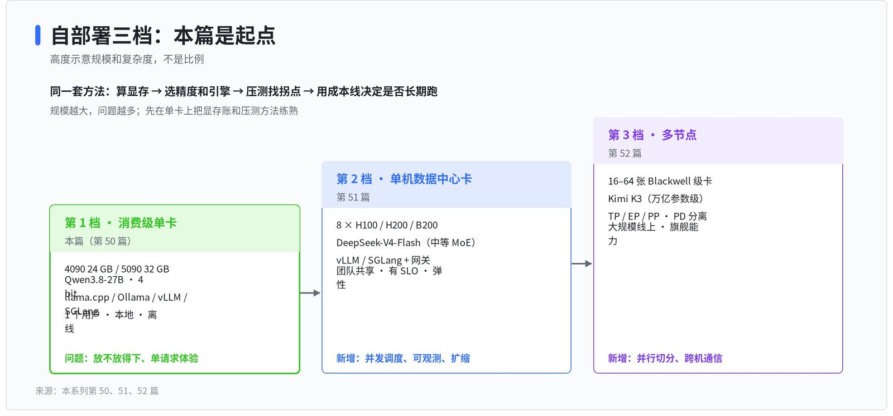
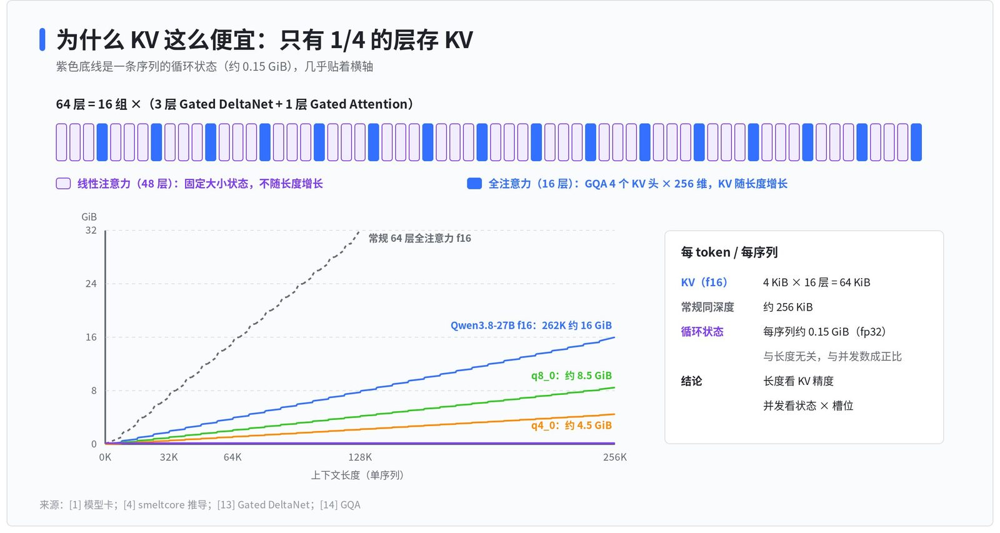
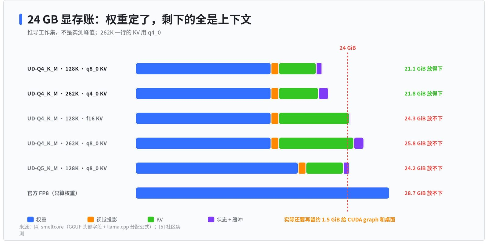
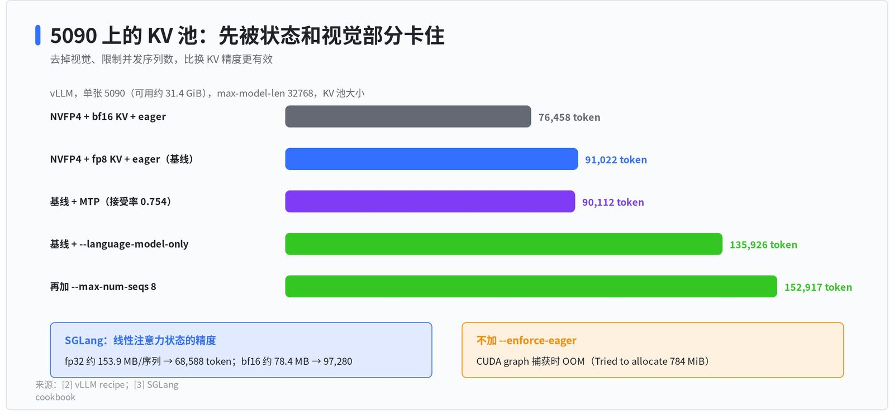
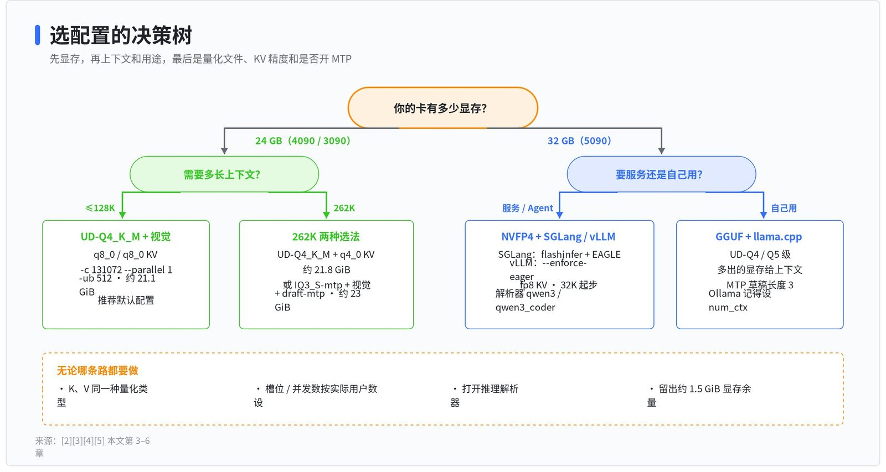
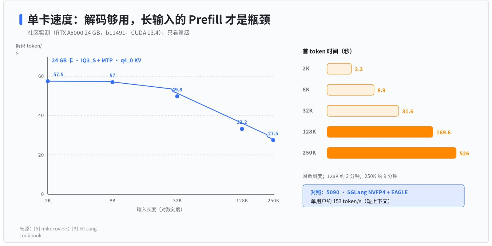
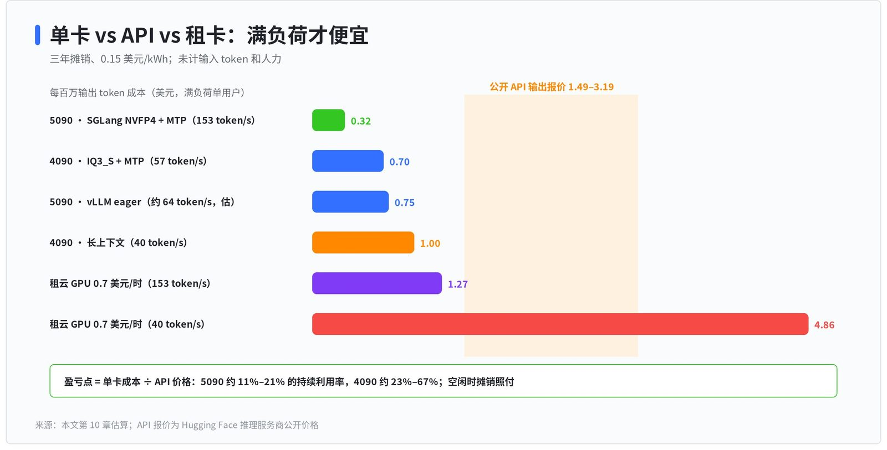

# LLM-50｜系统｜消费级单卡自部署：Qwen3.8-27B 跑在 4090 / 5090 上

> 🎯 **这篇文档解决什么问题**：第 51、52 篇讲的是数据中心 GPU 上的单机和多节点部署。很多人真正的起点是一张 24 GB 的 4090 或 32 GB 的 5090，想在自己的机器上跑一个够用的模型，做开发、做私有数据实验、给个人 Agent 当后端。本篇用 Qwen3.8-27B 把这条路走一遍：为什么选它，显存怎么算，量化文件怎么挑，llama.cpp 和 vLLM / SGLang 两条路线各怎么跑，怎么测，和 API 比划不划算，什么时候该升级到第 51 篇的单机方案。
>
> 使用方式：每章给结论、命令和踩坑表。模型和引擎数据来自 2026 年 10 月公开的模型卡、vLLM recipe 和 SGLang cookbook；4090 上的速度数据来自社区实测（作者、硬件和版本都在引用里写明），只能当量级参考，以你自己的机器为准。

## 导读 · 先给结论

- **27B 是消费级单卡的甜点**：Qwen3.8-27B 是 Apache-2.0 许可的稠密视觉语言模型，原生 262K 上下文，自带 MTP 草稿头[[1]](https://huggingface.co/Qwen/Qwen3.8-27B)。它 64 层里只有 16 层是全注意力，其余 48 层是 Gated DeltaNet 线性注意力，所以长上下文的 KV 很便宜：f16 下每 token 只要 64 KiB，是同深度常规 27B 的四分之一[[4]](https://smeltcore.com/recipes/qwen3-8-27b-on-rtx-4090-128k-context-vision-chat-via-llama-cpp-q4-k-m/)。
- **24 GB（4090）走 GGUF 4 bit**：UD-Q4_K_M 权重约 15.3 GiB，配 q8_0 KV 能放 128K 上下文并带视觉，总计约 21.1 GiB；换 q4_0 KV 能放满 262K[[4]](https://smeltcore.com/recipes/qwen3-8-27b-on-rtx-4090-128k-context-vision-chat-via-llama-cpp-q4-k-m/)。FP8 官方权重 28.7 GiB[[12]](https://huggingface.co/Qwen/Qwen3.8-27B-FP8)，4090 放不下。
- **32 GB（5090）走 NVFP4**：Blackwell 消费卡有原生 FP4 张量核，NVFP4 权重约 16.5 GB，是 SGLang 给 5090 的推荐档[[3]](https://docs.sglang.io/cookbook/autoregressive/Qwen/Qwen3.8-27B)。vLLM 单卡要加 --enforce-eager，否则 CUDA graph 捕获阶段 OOM[[2]](https://recipes.vllm.ai/Qwen/Qwen3.8-27B)。
- **两条路线按用途选**：自己用、要长上下文、要视觉、只有一张 24 GB 卡，选 llama.cpp / Ollama；要 OpenAI 兼容的多请求服务、要工具调用解析、要投机解码调优，选 5090 上的 vLLM / SGLang。
- **最容易踩的四个坑**：K 和 V 的量化类型不一致导致 Prefill 掉到几十 token/s[[4]](https://smeltcore.com/recipes/qwen3-8-27b-on-rtx-4090-128k-context-vision-chat-via-llama-cpp-q4-k-m/)[[9]](https://github.com/ggml-org/llama.cpp/issues/27109)；llama-server 不写 --parallel 1 会默认开 4 个槽位，循环状态翻四倍[[4]](https://smeltcore.com/recipes/qwen3-8-27b-on-rtx-4090-128k-context-vision-chat-via-llama-cpp-q4-k-m/)；不加 --reasoning-parser qwen3 时整段思考内容会进 content[[2]](https://recipes.vllm.ai/Qwen/Qwen3.8-27B)；Ollama 默认标签悄悄开了投机解码[[4]](https://smeltcore.com/recipes/qwen3-8-27b-on-rtx-4090-128k-context-vision-chat-via-llama-cpp-q4-k-m/)。
- **速度量级**：4090 上短上下文解码约 40–70 token/s，128K 时降到 30 多；5090 上 SGLang NVFP4 + MTP 单用户可到约 150 token/s[[3]](https://docs.sglang.io/cookbook/autoregressive/Qwen/Qwen3.8-27B)[[5]](https://github.com/mikecovlee/qwen3.8-27b-24gb-recipe)[[6]](https://gist.github.com/ryan4yin/19db9fa44972c5735c1d181e8888d4fe)。超长输入的 Prefill 才是体验瓶颈：24 GB 卡上 128K 的首字延迟接近 3 分钟[[5]](https://github.com/mikecovlee/qwen3.8-27b-24gb-recipe)。
- **划不划算**：5090 按三年摊销每月约 55 美元，全天满载再加约 70 美元电费。单流 150 token/s 满负荷时，每百万输出 token 约 0.3 美元，低于公开 API 报价（约 1.5–3 美元），但前提是持续利用率超过 10%–20%（第 10 章）。用量到这个量级，或者数据不能出机器，单卡才有意义；多人共用、要高可用，就该看第 51 篇。

下图是三档自部署的定位，本篇覆盖最左边一档。



> 🔑 **一句话版本**：先按“权重 + KV + 循环状态 + 运行时缓冲”算清显存；4090 用 UD-Q4 级 GGUF 加对称 KV 量化跑 llama.cpp，5090 用 NVFP4 跑 SGLang 或 vLLM；关掉多余的并发槽位，打开推理解析器，测 Prefill、解码和 MTP 接受率；用量稳定超过 API 盈亏点再长期投入，需要多人共用时升级到单机数据中心卡。
>
> 📎 与系列其他文档的分工：本篇是自部署三部曲的第一档。单机数据中心卡看 [LLM-51｜系统｜自部署推理实战：DeepSeek-V4-Flash 从单机到弹性上线](./51-deepseek-v4-flash-deploy.md)（第 51 篇），万亿参数级多节点看 [LLM-52｜系统｜一线大模型部署：Kimi K3 从选型算账到多节点上线](./52-kimi-k3-deploy.md)（第 52 篇）；原理看 [LLM-08｜系统｜大模型推理系统：全栈学习手册](./08-inference-systems.md)，算账看 [LLM-13｜系统｜自建推理成本与 GPU 选型：算账手册](./13-inference-cost-gpu.md)，开源模型选型看 [LLM-44｜系统｜开源权重模型选型与自托管：许可证、节奏与微调](./44-open-weights.md)。三档之后还有一篇边界案例，同一个 Kimi K3 不用 GPU、只用一台 CPU 和 NVMe 跑通，见第 53 篇 [LLM-53｜系统｜单台 CPU 跑万亿参数 MoE：Kimi-K3-in-C 工程解剖](./53-kimi-k3-in-c.md)。

📎 与系列其他文档的分工：本篇是自部署三部曲的第一档。单机数据中心卡看 [LLM-51｜系统｜自部署推理实战：DeepSeek-V4-Flash 从单机到弹性上线](./51-deepseek-v4-flash-deploy.md)（第 51 篇），万亿参数级多节点看 [LLM-52｜系统｜一线大模型部署：Kimi K3 从选型算账到多节点上线](./52-kimi-k3-deploy.md)（第 52 篇）；原理看 [LLM-08｜系统｜大模型推理系统：全栈学习手册](./08-inference-systems.md)，算账看 [LLM-13｜系统｜自建推理成本与 GPU 选型：算账手册](./13-inference-cost-gpu.md)，开源模型选型看 [LLM-44｜系统｜开源权重模型选型与自托管：许可证、节奏与微调](./44-open-weights.md)。三档之后还有一篇边界案例，同一个 Kimi K3 不用 GPU、只用一台 CPU 和 NVMe 跑通，见第 53 篇 [LLM-53｜系统｜单台 CPU 跑万亿参数 MoE：Kimi-K3-in-C 工程解剖](./53-kimi-k3-in-c.md)。

## 第 1 章 · 三档路线：为什么从单卡开始

### 1.1 三档的分工

| 档位 | 典型硬件 | 典型模型 | 适合 | 本系列 |
|---|---|---|---|---|
| 消费级单卡 | 4090 24 GB / 5090 32 GB | 20B–35B 稠密，4 bit | 个人开发、私有数据实验、单人 Agent 后端、离线环境 | 本篇 |
| 单机数据中心卡 | 8 × H100 / H200 / B200 | 中等规模 MoE（如 DeepSeek-V4-Flash） | 团队共享服务、有 SLO 的线上流量、弹性扩缩 | 第 51 篇 |
| 多节点 | 16–64 张 Blackwell 级卡 | 万亿参数级旗舰（如 Kimi K3） | 大规模线上服务、数据不能出域的旗舰能力 | 第 52 篇 |

三档的方法是一样的：先算显存，再选精度和引擎，跑通后压测找拐点，最后用成本线决定值不值得长期跑。区别在于规模带来的新问题：单卡的问题集中在“放不放得下”和“单请求体验”；单机多了并发、调度和弹性；多节点又多了并行切分和跨机通信。先在单卡上把显存账和压测方法练熟，再看后两篇会顺很多。

### 1.2 单卡适合什么、不适合什么

- **适合**：本地编码助手和 Agent 实验；处理不能上传的文档、代码和日志；离线或弱网环境；评估一个开源模型是否够用，再决定要不要上更大的集群。
- **不适合**：多人同时使用的线上服务（单卡并发很低，长上下文时只能串行）；需要高可用的业务（一张卡就是一个单点）；7×24 满载（消费卡的散热、驱动许可和 ECC 都不是为此设计的，见第 9 章）。

> 💡 <b>先想清楚“谁在用”</b>：如果答案是“团队里十几个人一起用”，单卡大概率撑不住。单卡上一次 128K 的长输入就要预填充近 3 分钟，期间其他请求只能排队。这种场景直接看第 51 篇。

## 第 2 章 · 为什么是 Qwen3.8-27B：架构决定显存

### 2.1 和部署相关的参数

| 参数 | Qwen3.8-27B | 对部署的影响 |
|---|---|---|
| 参数量 / 结构 | 27B 稠密，视觉语言模型 | 每个 token 都要读全部权重，解码速度受显存带宽约束 |
| 层布局 | 64 层 = 16 × (3 层 Gated DeltaNet + 1 层 Gated Attention) | 只有 16 层产生随长度增长的 KV |
| 注意力 | GQA：24 个 Q 头、4 个 KV 头，head_dim 256 | KV 头少，每 token 的 KV 小 |
| 线性注意力 | 48 个 V 头、16 个 QK 头，head_dim 128；状态按 float32 保存 | 每个序列一份固定大小的循环状态，与长度无关，与并发数成正比 |
| 隐藏维度 / FFN / 词表 | 5120 / 17408 / 248,320 | 词表大，lm_head 占不小的显存 |
| 上下文 | 262,144 原生；YaRN 可扩到约 1M | 消费卡上能否用满取决于 KV 精度 |
| MTP | 自带一层多 token 预测头 | 可直接做投机解码，不用另找草稿模型 |
| 许可证 | Apache-2.0 | 商用无额外条款 |

数据来自模型卡[[1]](https://huggingface.co/Qwen/Qwen3.8-27B)。选它做单卡示例，最主要的原因是混合注意力让长上下文在消费卡上第一次变得现实，下一节细算。另外两点也合适：27B 在 4 bit 下约 15–17 GB，正好落在 24 GB 和 32 GB 卡的可用区间。许可证干净，模型卡在编码和 Agent 类评测上的成绩（如 SWE-bench Pro 61.7）足够当日常主力[[1]](https://huggingface.co/Qwen/Qwen3.8-27B)。

### 2.2 为什么 KV 这么便宜

常规 Transformer 每一层都存 K 和 V，KV 随上下文线性增长。Qwen3.8-27B 用的 Gated DeltaNet 是一种带门控和 delta 更新规则的线性注意力[[13]](https://arxiv.org/abs/2412.06464)，它把历史压缩进一个固定大小的状态矩阵，不存逐 token 的 KV。只有每 4 层里的那 1 层全注意力需要 KV，再加上 GQA 只有 4 个 KV 头[[14]](https://arxiv.org/abs/2305.13245)：

*Qwen3.8-27B 的 KV 与状态粗算
*

```text
每层每 token 的 KV = 2 (K 和 V) × 4 (KV 头) × 256 (head_dim) × 2 字节 (f16) = 4 KiB每 token 总 KV     = 4 KiB × 16 层 = 64 KiB          （常规 64 层全注意力约 256 KiB）128K 上下文        = 64 KiB × 131,072 ≈ 8 GiB (f16)，q8_0 约 4.25 GiB，q4_0 约 2.25 GiB循环状态（48 层，float32）：每个序列约 0.15 GiB，与上下文长度无关，与并发序列数成正比
```

这组数和 smeltcore 从 GGUF 头部字段和 llama.cpp 分配公式推出来的一致[[4]](https://smeltcore.com/recipes/qwen3-8-27b-on-rtx-4090-128k-context-vision-chat-via-llama-cpp-q4-k-m/)。它带来一个和常规模型不同的直觉：在单卡上，长上下文主要花的是 KV 精度，而并发主要花的是循环状态和 KV 的乘积。只服务一个人时，把槽位数压到 1，几乎所有显存都能给上下文。



### 2.3 思考模式默认开启

Qwen3.8 默认先输出一段思考内容再给答案，推理档位默认 xhigh，多轮对话默认保留历史思考（preserve_thinking）[[1]](https://huggingface.co/Qwen/Qwen3.8-27B)。这对单卡有两个直接影响：短问题也可能生成上千 token 的思考，体感延迟比非思考模型长；多轮 Agent 任务的上下文增长更快。第 7 章会讲怎么按场景调 reasoning_effort、怎么关掉思考。

## 第 3 章 · 显存账：24 GB 与 32 GB

### 3.1 显存由五部分组成

1. **权重**：由量化格式决定，占大头。
2. <b>视觉编码器（mmproj）</b>：BF16 约 0.87 GiB，只做文本时可以不加载。
3. **KV 缓存**：16 层 × 上下文长度 × KV 精度。
4. **循环状态**：每个序列约 0.15 GiB（float32），乘以槽位数。
5. **运行时缓冲**：CUDA 上下文、计算图、llama.cpp 预填充时把量化 KV 转回 f16 的缓冲、vLLM / SGLang 的 CUDA graph，加上桌面显示占用。

第 5 项最容易被忽略。smeltcore 指出，llama.cpp 预填充时会按整个上下文窗口分配一块 f16 转换缓冲，128K 时约 0.5 GiB，调小 -ub 也不会缩小它[[4]](https://smeltcore.com/recipes/qwen3-8-27b-on-rtx-4090-128k-context-vision-chat-via-llama-cpp-q4-k-m/)；vLLM 在 5090 上的 OOM 也发生在权重和 KV 预算之外的 CUDA graph 捕获阶段[[2]](https://recipes.vllm.ai/Qwen/Qwen3.8-27B)。另外，接了显示器的卡会被桌面占掉几百 MB，nvidia-smi 看到的总显存也略小于标称值。

### 3.2 24 GB（4090 / 3090）

| 配置 | 权重 | KV | 合计（约） | 能否放下 |
|---|---|---|---|---|
| UD-Q4_K_M + 视觉，128K，q8_0 KV | 15.3 GiB | 4.25 GiB | 21.1 GiB | 能，余约 2.9 GiB |
| UD-Q4_K_M + 视觉，262K，q4_0 KV | 15.3 GiB | 4.5 GiB | 21.8 GiB | 能，余约 2.2 GiB |
| UD-Q4_K_M + 视觉，65K，f16 KV | 15.3 GiB | 4 GiB | 20.3 GiB | 能 |
| UD-Q4_K_M + 视觉，128K，f16 KV | 15.3 GiB | 8 GiB | 24.3 GiB | 不能 |
| UD-Q4_K_M + 视觉，262K，q8_0 KV | 15.3 GiB | 8.5 GiB | 25.8 GiB | 不能 |
| UD-Q5_K_M + 视觉，128K，q8_0 KV | 18.4 GiB | 4.25 GiB | 24.2 GiB | 不能 |
| 官方 FP8 | 28.7 GiB | — | — | 权重本身就超了 |

表中数据是 smeltcore 用文件大小和 llama.cpp 分配公式推导的工作集（含 0.15 GiB 循环状态和 f16 转换缓冲），不是实测峰值[[4]](https://smeltcore.com/recipes/qwen3-8-27b-on-rtx-4090-128k-context-vision-chat-via-llama-cpp-q4-k-m/)。社区在 24 GB 卡上的实测与之吻合：IQ3_S（12.1 GB）带视觉、262K、q4_0 KV 实际占用约 23 GiB；UD-Q4_K_XL（17.5 GB）在 262K q4_0 或 128K q8_0 下占用 23.2–24 GiB[[5]](https://github.com/mikecovlee/qwen3.8-27b-24gb-recipe)。

结论：24 GB 卡的默认配置是 **UD-Q4 级 GGUF + q8_0 KV + 128K**；要 262K 就把 KV 换成 q4_0（精度有代价，见第 4 章）；不要往 Q5 / Q6 升，权重每多 3 GiB，上下文就得砍掉一半以上。



### 3.3 32 GB（5090）

5090 的可用显存约 31.4 GiB，不是 32[[2]](https://recipes.vllm.ai/Qwen/Qwen3.8-27B)。它的优势不只是多 8 GB，而是 Blackwell 的原生 FP4 张量核：NVFP4 权重约 16.5 GB，计算也走真正的 FP4 内核，而不是反量化[[2]](https://recipes.vllm.ai/Qwen/Qwen3.8-27B)[[3]](https://docs.sglang.io/cookbook/autoregressive/Qwen/Qwen3.8-27B)。

| 配置（vLLM，单卡，32K 上下文） | KV 池（token） | 说明 |
|---|---|---|
| NVFP4 + fp8 KV + --enforce-eager | 91,022 | 能启动的最小改动 |
| 再加 --language-model-only | 135,926 | 不加载视觉部分，KV 多约 50% |
| 再加 --max-num-seqs 8 | 152,917 | 限制并发序列数，状态池变小 |
| NVFP4 + bf16 KV + --enforce-eager | 76,458 | fp8 KV 是可选项，不是必需 |
| NVFP4 + fp8 KV + MTP | 90,112 | MTP 头也放得下，接受率 0.754 |

数据来自 vLLM recipe 的 5090 实测[[2]](https://recipes.vllm.ai/Qwen/Qwen3.8-27B)。SGLang 在 5090 上的同类数据：不开投机解码时，线性注意力状态用 bf16 能放 97,280 个 KV token，用 float32 只有 68,588 个[[3]](https://docs.sglang.io/cookbook/autoregressive/Qwen/Qwen3.8-27B)。两个引擎的结论一致：32 GB 卡上，并发上限先被状态池卡住，而不是 KV。

> 💡 **FP8 在 5090 上不实用**：官方 FP8 权重约 28.5 GB，在 32 GB 卡上只能撑到 batch 2 左右，SGLang 把 5090 上 BF16 和 FP8 的投机解码组合都标为不可用[[3]](https://docs.sglang.io/cookbook/autoregressive/Qwen/Qwen3.8-27B)。5090 单卡请直接用 NVFP4。



## 第 4 章 · 量化：选哪个文件

### 4.1 可选的格式

| 格式 | 典型文件 | 大小（约） | 适合的卡 | 引擎 | 备注 |
|---|---|---|---|---|---|
| GGUF UD-Q4_K_M / UD-Q4_K_XL | unsloth Dynamic | 15.3–17.5 GB | 24 GB 起 | llama.cpp / Ollama | 24 GB 卡默认选择 |
| GGUF UD-Q4_K_S / UD-IQ4_XS | unsloth Dynamic | 14.3–15.4 GB | 24 GB 余量不够时 | llama.cpp | 各省约 1 GiB，精度递减 |
| GGUF IQ3_S-mtp | ISTA-DASLab | 12.1 GB | 24 GB 要视觉 + 262K | llama.cpp | 社区测 GPQA 89.4 |
| NVFP4（W4A4） | Inferact / nvidia / unsloth | 约 16.5 GB（磁盘 21.9 GB） | 5090 等 Blackwell | vLLM / SGLang | Blackwell 原生 FP4 内核 |
| FP8（块缩放） | Qwen 官方 | 28.7 GiB | 48 GB 以上 | vLLM / SGLang | 消费卡单卡放不下 |
| BF16 | Qwen 官方 | 约 54 GB | 80 GB 以上 | vLLM / SGLang | 作为精度基线 |

下载前要多看几眼。unsloth 在 2026-08-19 删掉了非 Dynamic 的 Q4_K_M、Q5_K_M、IQ4_NL 等文件，只保留 UD- 前缀版本，旧教程里的文件名现在会 404[[4]](https://smeltcore.com/recipes/qwen3-8-27b-on-rtx-4090-128k-context-vision-chat-via-llama-cpp-q4-k-m/)[[8]](https://huggingface.co/unsloth/Qwen3.8-27B-GGUF)。同名量化在不同发布者那里大小不同：Q4_K_M 从 16.81 GB 到 18.97 GB 都有，下载前看字节数，不要只看标签[[4]](https://smeltcore.com/recipes/qwen3-8-27b-on-rtx-4090-128k-context-vision-chat-via-llama-cpp-q4-k-m/)。截至 2026-10-16，Qwen 官方账号下的 Qwen3.8-27B 只有 BF16 和 FP8 版本，未见官方 GGUF，市面上的 GGUF 都是社区转换[[4]](https://smeltcore.com/recipes/qwen3-8-27b-on-rtx-4090-128k-context-vision-chat-via-llama-cpp-q4-k-m/)。其他 Qwen 型号曾有官方 GGUF（如 [Qwen2.5-7B-Instruct-GGUF](https://huggingface.co/Qwen/Qwen2.5-7B-Instruct-GGUF)），这一条只对 Qwen3.8-27B 成立。下载时核对发布账号、转换者和校验值。

### 4.2 NVFP4 为什么适合 5090

NVFP4 是 NVIDIA 的 4 bit 浮点格式：每 16 个数共享一个 FP8 缩放因子，再叠加一个张量级缩放，精度损失比常规 4 bit 整数量化小[[17]](https://developer.nvidia.com/blog/introducing-nvfp4-for-efficient-and-accurate-low-precision-inference/)。Blackwell（含消费级 sm120）有原生 FP4 张量核，vLLM 在 5090 上选的是 FlashInfer 的 CUTLASS NVFP4 内核，不是模拟回退[[2]](https://recipes.vllm.ai/Qwen/Qwen3.8-27B)。

几个 NVFP4 版本并不等价[[2]](https://recipes.vllm.ai/Qwen/Qwen3.8-27B)[[3]](https://docs.sglang.io/cookbook/autoregressive/Qwen/Qwen3.8-27B)：

- **Inferact 版**：统一 W4A4，MTP 草稿接受率最高（双卡 TP2 实测 0.897）。
- **unsloth 版**：混合精度（部分通道 FP8），权重更小，双卡下 KV 池约是 Inferact 版的两倍（920,517 对 445,875 token），接受率 0.788。
- **nvidia 官方版**[[11]](https://huggingface.co/nvidia/Qwen3.8-27B-NVFP4)：与 RadixArk 的 FP4 头版本层映射一致（注意力和线性注意力投影为 FP8，MLP 为 NVFP4），SGLang 在 5090 上的 15 种组合都测过，GSM8K 93.93%–94.92%。
- **BF16 lm_head 版**：输出头保持 BF16，运行时多占约 3.2 GB，在 5090 上更难放下。

> 💡 **不要在 NVIDIA 卡上用 MXFP4**：vLLM 的 MXFP4 在 NVIDIA 上缺少线性层实现，加载不了，请改用 NVFP4[[2]](https://recipes.vllm.ai/Qwen/Qwen3.8-27B)。4090 是 Ada 架构，没有 FP4 张量核，NVFP4 在 4090 上没有速度优势，24 GB 卡还是用 GGUF。

### 4.3 KV 量化：精度换长度

KV 精度是 24 GB 卡上最有效的长度杠杆：q8_0 相对 f16 减半，q4_0 再减半。代价是注意力精度，社区实测还发现 q8_0 KV 在这个架构上超过 128K 不稳定，所以 262K 的配方都用 q4_0[[5]](https://github.com/mikecovlee/qwen3.8-27b-24gb-recipe)。规则只有一条：**K 和 V 用同一种类型**，原因在第 5 章。KV 量化对答案质量的影响没有统一结论，上线前用你自己的长文档任务对比 q8_0 和 q4_0。

## 第 5 章 · 路线 A：llama.cpp / Ollama（24 GB 卡首选）

llama.cpp 是消费卡上最省心的路线：GGUF 单文件、显存分配可预测、自带 OpenAI 兼容的 llama-server、视觉和 MTP 都已支持[[4]](https://smeltcore.com/recipes/qwen3-8-27b-on-rtx-4090-128k-context-vision-chat-via-llama-cpp-q4-k-m/)[[5]](https://github.com/mikecovlee/qwen3.8-27b-24gb-recipe)。Ollama 封装了同一套内核，适合“装完就用”，代价是参数藏得更深。本章先给 4090 的标准配置，再讲 262K、MTP 和 Ollama。

### 5.1 编译与下载

*编译 llama.cpp 并下载 GGUF
*

```bash
# 编译（CUDA）。默认只编译对称的 FA 量化组合，要试非对称组合才加 -DGGML_CUDA_FA_QUANTS=allgit clone https://github.com/ggml-org/llama.cpp && cd llama.cppcmake -B build -DGGML_CUDA=ONcmake --build build --config Release -j# 下载权重和视觉投影（unsloth Dynamic 版，MTP 头已内嵌）hf download unsloth/Qwen3.8-27B-GGUF \  Qwen3.8-27B-UD-Q4_K_M.gguf mmproj-BF16.gguf --local-dir ./qwen3.8-27b
```

编译选项见 llama.cpp 的构建文档[[10]](https://github.com/ggml-org/llama.cpp/blob/master/docs/build.md)。两点注意：<b>--reasoning-effort 需要 b10434 之后的版本</b>，旧版本只能用 --chat-template-kwargs 传；Windows 上 CUDA 12.4 的预编译包在社区实测中会静默退回 CPU，速度掉一个数量级，请用 CUDA 13 的包或自己编译[[4]](https://smeltcore.com/recipes/qwen3-8-27b-on-rtx-4090-128k-context-vision-chat-via-llama-cpp-q4-k-m/)[[5]](https://github.com/mikecovlee/qwen3.8-27b-24gb-recipe)。

### 5.2 4090 标准配置：128K + 视觉

*4090：UD-Q4_K_M，128K，q8_0 KV，带视觉（约 21.1 GiB）
*

```bash
llama-server -m qwen3.8-27b/Qwen3.8-27B-UD-Q4_K_M.gguf \  --mmproj qwen3.8-27b/mmproj-BF16.gguf \  -ngl 99 -c 131072 --parallel 1 \  --cache-type-k q8_0 --cache-type-v q8_0 --flash-attn on \  -b 2048 -ub 512 \  --jinja --reasoning-format deepseek \  --temp 1.0 --top-p 0.95 --top-k 20 --min-p 0.0 \  --presence-penalty 0.0 --repeat-penalty 1.0 \  --host 127.0.0.1 --port 8080
```

| 参数 | 作用 | 不这么设会怎样 |
|---|---|---|
| -ngl 99 | 所有层放 GPU | 部分层落在 CPU，解码速度掉到个位数 |
| --parallel 1 | 只开 1 个槽位 | 默认 4 个槽位，循环状态多占约 0.44 GiB，KV 也按槽位切分 |
| --cache-type-k / -v 相同 | K、V 走同一个 FA 内核 | 类型不一致时 Prefill 从上千掉到几十 token/s |
| --flash-attn on | 量化 KV 的前提 | 量化 KV 无法生效或报错 |
| -ub 512 | 控制计算缓冲 | -ub 2048 在 q8_0 KV 下余量不够，CUDA graph 静默失败 |
| --jinja --reasoning-format deepseek | 用模型自带模板，把思考拆到 reasoning_content | 思考内容混进 content，客户端解析出错 |
| --host 127.0.0.1 | 只监听本机 | 暴露到局域网且没有鉴权；要远程访问请加 --api-key 并走反向代理 |

参数和显存账来自 smeltcore 的 4090 配方[[4]](https://smeltcore.com/recipes/qwen3-8-27b-on-rtx-4090-128k-context-vision-chat-via-llama-cpp-q4-k-m/)；-ub 和 CUDA graph 的关系来自 mikecovlee 的实测：显存余量不足约 1.5 GB 时，CUDA graph 捕获会静默失败，解码慢约 7 倍，日志里不报错[[5]](https://github.com/mikecovlee/qwen3.8-27b-24gb-recipe)。

> 💡 **K 和 V 必须同类型**：llama.cpp 默认只编译 q4_0/q4_0、q8_0/q8_0、f16/f16、bf16/bf16 四种 FA 组合。写成 K=q8_0、V=q4_0 时，会落到慢路径，社区在 3090 上测到 Prefill 从 991–1276 掉到 34–106 token/s[[9]](https://github.com/ggml-org/llama.cpp/issues/27109)。即使用 -DGGML_CUDA_FA_QUANTS=all 编出了非对称内核，也先压测再用[[10]](https://github.com/ggml-org/llama.cpp/blob/master/docs/build.md)。

### 5.3 262K 与 MTP

要用满 262K，把 KV 换成 q4_0；社区实测 q8_0 KV 超过 128K 不稳定[[5]](https://github.com/mikecovlee/qwen3.8-27b-24gb-recipe)。要在 24 GB 上同时保留视觉和 262K，可以换更小的 IQ3_S-mtp（12.1 GB）并打开 MTP 投机解码：

*24 GB：IQ3_S + 视觉 + 262K + MTP（社区配方，实占约 23 GiB）
*

```bash
llama-server -m Qwen3.8-27B-IQ3_S-mtp.gguf --mmproj mmproj-BF16.gguf \  -c 262144 --parallel 1 -ngl all -t 6 \  --flash-attn on --cache-type-k q4_0 --cache-type-v q4_0 \  -ub 2048 \  --spec-type draft-mtp --spec-draft-n-max 3 --spec-draft-poll 1 \  -cram 6144
```

MTP（多 token 预测）让模型自带的预测头一次猜几个后续 token，再由主模型一次验证[[15]](https://arxiv.org/abs/2404.19737)；它本质上是投机解码，接受的 token 与逐个生成的分布一致[[16]](https://arxiv.org/abs/2211.17192)。实测要点[[5]](https://github.com/mikecovlee/qwen3.8-27b-24gb-recipe)[[7]](https://huggingface.co/unsloth/Qwen3.8-27B-GGUF/discussions/14)：

- **草稿长度取 3**：--spec-draft-n-max 超过 3 反而更慢，猜得越多，被拒的浪费越多。
- **接受率随温度下降**：温度 0 时约 55%–75%，温度 1（思考模式推荐值）时约 48%–62%；5090 上 UD-Q6_K_XL 的一份实测只有 0.47。
- **MTP 头放在哪个文件里要看发布者**：unsloth 的文件内嵌 MTP 头（block_count 为 65）；ggml-org 把它拆成单独的 mtp-\*.gguf。不要混用不同发布者的主文件和 MTP 文件。
- **多卡别同时开张量切分和 MTP**：--split-mode tensor 加 draft-mtp 目前会卡死，社区已有 issue 跟踪。

### 5.4 Ollama

Ollama 的两个标签行为不同[[4]](https://smeltcore.com/recipes/qwen3-8-27b-on-rtx-4090-128k-context-vision-chat-via-llama-cpp-q4-k-m/)：qwen3.8:27b 默认**打开** MTP（draft_num_predict 为 4），qwen3.8:27b-q4_K_M 默认关闭。对比速度时先确认开没开，否则会把“MTP 带来的提升”误当成“量化版本的差异”。另外，Ollama 默认上下文远小于模型能力，要用长上下文必须显式设置 num_ctx：

*Ollama：显式设置上下文与 KV 精度
*

```bash
# ModelfileFROM qwen3.8:27bPARAMETER num_ctx 131072PARAMETER temperature 1.0PARAMETER top_p 0.95PARAMETER top_k 20ollama create qwen38-128k -f ModelfileOLLAMA_FLASH_ATTENTION=1 OLLAMA_KV_CACHE_TYPE=q8_0 ollama serve
```

下图把第 3–5 章的选择收成一棵决策树：先看显存，再看要不要视觉和多长的上下文，最后决定量化文件、KV 精度和是否开 MTP。



## 第 6 章 · 路线 B：5090 上的 vLLM / SGLang

5090 的 32 GB 和原生 FP4 让 NVFP4 成为主力格式，也让 vLLM、SGLang 这类服务引擎在单卡上可用[[2]](https://recipes.vllm.ai/Qwen/Qwen3.8-27B)[[3]](https://docs.sglang.io/cookbook/autoregressive/Qwen/Qwen3.8-27B)。相比 llama.cpp，它们的优势是连续批处理、前缀缓存、工具调用解析和更成熟的投机解码；代价是显存更紧、参数更多、上下文默认更短。

### 6.1 vLLM 单卡

*vLLM：5090 单卡 NVFP4
*

```bash
vllm serve Inferact/Qwen3.8-27B-NVFP4 \  --tensor-parallel-size 1 \  --max-model-len 32768 \  --kv-cache-dtype fp8 \  --enforce-eager \  --reasoning-parser qwen3 \  --enable-auto-tool-choice --tool-call-parser qwen3_coder# 只做文本：加 --language-model-only，KV 池约多 50%# 投机解码：加 --speculative-config '{"method":"mtp","num_speculative_tokens":3}' 
```

| 参数 | 原因 |
|---|---|
| --enforce-eager | 不加时在 CUDA graph 捕获阶段报 “Tried to allocate 784.00 MiB” OOM，调 --gpu-memory-utilization 也没用 |
| --kv-cache-dtype fp8 | 把 KV 池从约 7.6 万提到约 9.1 万 token；不是必需项 |
| --max-model-len 32768 | 单卡 5090 的稳妥起点；要更长先加 --language-model-only 腾出显存 |
| --reasoning-parser qwen3 | 把思考内容放进 reasoning_content；不加时整段思考进 content |
| --tool-call-parser qwen3_coder | Qwen3.8 的工具调用格式，Agent 场景必需 |

以上都来自 vLLM recipe 的 5090 实测[[2]](https://recipes.vllm.ai/Qwen/Qwen3.8-27B)。eager 模式会损失一部分解码速度，这是 32 GB 卡上用 vLLM 的固定代价；MTP 打开后 KV 池几乎不变（约 9.0 万 token），接受率 0.754，用 Prometheus 指标 vllm:spec_decode_num_accepted_tokens_total 除以 vllm:spec_decode_num_draft_tokens_total 计算[[2]](https://recipes.vllm.ai/Qwen/Qwen3.8-27B)。

### 6.2 SGLang 单卡

*SGLang：5090 单卡 NVFP4 + MTP（EAGLE 接口）
*

```bash
sglang serve --model-path nvidia/Qwen3.8-27B-NVFP4 \  --attention-backend flashinfer \  --mem-fraction-static 0.93 \  --chunked-prefill-size 2048 \  --reasoning-parser qwen3 --tool-call-parser qwen3_coder \  --speculative-algorithm EAGLE --speculative-num-steps 3 \  --speculative-eagle-topk 1 --speculative-num-draft-tokens 4 \  --host 127.0.0.1 --port 30000 --api-key "$SGLANG_API_KEY"# 不开投机解码时 --mem-fraction-static 用 0.90
```

SGLang cookbook 在 5090 上测过 15 种组合，几条和单卡强相关的结论[[3]](https://docs.sglang.io/cookbook/autoregressive/Qwen/Qwen3.8-27B)：

- **注意力后端用 flashinfer**：消费级 Blackwell（sm120）上的推荐值；MTP 需要 FlashInfer 0.6.15.post1 之后的版本，否则改用 triton 后端。
- **显存比例按投机方式调**：不开投机 0.90；EAGLE 0.93（状态 bf16）或 0.94（状态 fp32）；DFlash2 0.91 并把 chunked-prefill 降到 1024；DSpark 0.88。
- **状态精度是并发杠杆**：每个序列的线性注意力状态 fp32 约 153.9 MB、bf16 约 78.4 MB；同样配置下 KV 池从 68,588 涨到 97,280 token。
- **速度**：NVFP4 + EAGLE 单用户约 152.9 token/s（状态 fp32）或 144.5（bf16）；DFlash2 的 TPOT 约 4.92 ms，平均接受长度 4.29。
- **默认没有鉴权**：--api-key 默认不设，监听 0.0.0.0 时局域网内任何人都能调用。

> 🔑 **怎么在两个引擎间选**：要最快的单用户速度和多种投机方式，选 SGLang；要和团队现有的 vLLM 工具链、指标和第 51 篇的部署方式保持一致，选 vLLM。两者的 OpenAI 兼容接口和解析器名称一样，客户端不用改。

### 6.3 两张 5090

两张 5090 做 TP2 可以用满 262K：vLLM recipe 的实测里，FP8 的 KV 池约 37.7 万 token，Inferact NVFP4 约 44.6 万（接受率 0.897），unsloth NVFP4 约 92.1 万（接受率 0.788）[[2]](https://recipes.vllm.ai/Qwen/Qwen3.8-27B)。但消费卡之间没有 NVLink，TP 的 all-reduce 走 PCIe，收益主要是“放得下”和“并发多一点”，单用户速度不会翻倍。到了需要两张卡的地步，先想想第 9 章的限制和第 11 章的升级信号。

## 第 7 章 · 客户端：思考模式与采样参数

### 7.1 两套采样预设

| 模式 | temperature | top_p | top_k | presence_penalty | 适合 |
|---|---|---|---|---|---|
| 思考（默认） | 1.0 | 0.95 | 20 | 0 | 编码、数学、多步 Agent |
| 非思考 | 0.7 | 0.8 | 20 | 1.5 | 聊天、改写、抽取、低延迟问答 |

预设来自模型卡[[1]](https://huggingface.co/Qwen/Qwen3.8-27B)。思考模式不要用贪心解码（temperature 0），容易出现重复；非思考模式的 presence_penalty 用来压住重复，但设太高会出现中英混杂。

### 7.2 控制思考长度

*按请求调思考档位或关闭思考
*

```python
from openai import OpenAIcli = OpenAI(base_url="http://127.0.0.1:8080/v1", api_key="local")# 1) 降低推理档位：xhigh（默认）/ medium / lowr = cli.chat.completions.create(    model="qwen3.8-27b",    messages=[{"role": "user", "content": "解释一下这段报错"}],    extra_body={"chat_template_kwargs": {"reasoning_effort": "low"}},)# 2) 完全关闭思考（配合非思考采样预设）r = cli.chat.completions.create(    model="qwen3.8-27b",    messages=[{"role": "user", "content": "把这段话改成英文"}],    temperature=0.7, top_p=0.8, presence_penalty=1.5,    extra_body={"chat_template_kwargs": {"enable_thinking": False}},)print(r.choices[0].message.content)
```

- **服务端统一默认值**：vLLM 用 --default-chat-template-kwargs '{"enable_thinking": false}' 或设定 reasoning_effort；llama.cpp 新版本直接用 --reasoning-effort[[2]](https://recipes.vllm.ai/Qwen/Qwen3.8-27B)[[4]](https://smeltcore.com/recipes/qwen3-8-27b-on-rtx-4090-128k-context-vision-chat-via-llama-cpp-q4-k-m/)。
- **多轮保留思考**：模型默认 preserve_thinking，Agent 多轮调用时把上一轮的 reasoning_content 原样回传，效果更稳；但上下文增长更快，长会话要设压缩或截断策略[[1]](https://huggingface.co/Qwen/Qwen3.8-27B)。
- **max_tokens 要给思考留空间**：xhigh 档位下短问题也可能先写上千 token，max_tokens 设成 1024 时常见“只有思考、没有答案”。

> 💡 **单卡上思考档位就是延迟档位**：4090 上 40 token/s 时，2,000 token 的思考就是 50 秒。日常问答默认 low 或关思考，只在编码和复杂推理时开 xhigh，体感差别比换显卡还大。

## 第 8 章 · 单卡怎么测

### 8.1 测四个数

| 指标 | 怎么读 | 决定了什么 |
|---|---|---|
| Prefill 速度（token/s） | llama-server 响应里的 timings.prompt_per_second；vLLM / SGLang 用流式请求测首 token 时间再换算 | 长文档、长代码库输入的等待时间 |
| TTFT（秒） | 发出请求到第一个 token | 交互体感；思考模式下还要加上思考时长 |
| 解码速度（token/s） | timings.predicted_per_second；或输出 token 数 ÷（总时长 − TTFT） | 答案和思考的生成速度 |
| MTP 接受率 | llama.cpp 的 draft 统计；vLLM 的 spec_decode 指标；SGLang 的平均接受长度 | 投机解码值不值得开 |

测法上有三点要求[[5]](https://github.com/mikecovlee/qwen3.8-27b-24gb-recipe)[[6]](https://gist.github.com/ryan4yin/19db9fa44972c5735c1d181e8888d4fe)：按 2K、8K、32K、128K 几档输入长度分别测，因为单卡的瓶颈随长度变化；每档至少跑 3 次取中位数，第一次常包含 CUDA graph 和缓存预热；固定温度和思考档位，MTP 接受率对温度很敏感。

*读计时字段与单并发压测
*

```bash
# 一次请求，读 llama-server 自带的计时字段curl -s http://127.0.0.1:8080/v1/chat/completions -H 'Content-Type: application/json' -d '{  "model": "qwen3.8-27b",  "messages": [{"role": "user", "content": "<把 32K 的文档贴在这里>\n总结要点"}],  "max_tokens": 1024,  "chat_template_kwargs": {"reasoning_effort": "low"}}' | jq '.timings | {prompt_n, prompt_per_second, predicted_n, predicted_per_second}'# vLLM / SGLang：用引擎自带的压测工具，并发设 1，输入长度分档vllm bench serve --model Inferact/Qwen3.8-27B-NVFP4 --dataset-name random \  --random-input-len 32768 --random-output-len 1024 --max-concurrency 1 --num-prompts 5
```

### 8.2 社区实测的量级

| 硬件 / 配置 | 短上下文解码 | 长上下文解码 | Prefill | 来源 |
|---|---|---|---|---|
| RTX A5000 24 GB，IQ3_S-mtp，q4_0 KV，MTP | 57–58 token/s | 128K 约 33，250K 约 27.5 | 2K–32K 约 900；128K 645（TTFT 约 170 秒） | mikecovlee[[5]](https://github.com/mikecovlee/qwen3.8-27b-24gb-recipe) |
| RTX 4090，UD-Q4_K_XL，fork 版 KV 量化，165K | 60–70 token/s（32K 内） | 160K 约 41–47 | 32K 内 2400–2500；160K 约 1500–1600 | ryan4yin[[6]](https://gist.github.com/ryan4yin/19db9fa44972c5735c1d181e8888d4fe) |
| RTX 5090，UD-Q6_K_XL，MTP，48K | 约 98 token/s | — | 约 2829 | unsloth 讨论区[[7]](https://huggingface.co/unsloth/Qwen3.8-27B-GGUF/discussions/14) |
| RTX 5090，SGLang NVFP4 + EAGLE | 约 153 token/s（单用户） | — | — | SGLang cookbook[[3]](https://docs.sglang.io/cookbook/autoregressive/Qwen/Qwen3.8-27B) |

这些数来自不同的人、不同的构建和不同的量化，不能互相直接比，只能看量级。可以用显存带宽做一个合理性检查：解码时每个 token 都要读一遍权重，4090 的带宽约 1 TB/s，读 16 GB 的 4 bit 权重约 16 ms，对应约 60 token/s 的上限；5090 的带宽约 1.8 TB/s[[18]](https://www.nvidia.com/en-us/geforce/graphics-cards/50-series/rtx-5090/)，读 16.5 GB 的 NVFP4 权重约 9 ms，对应约 110 token/s，再用 MTP 才能到 150 左右。实测明显低于这个上限，先查是否有层落到 CPU、CUDA graph 是否失败。



> 🔑 **单卡的真正瓶颈是 Prefill**：解码 30–60 token/s 已经够看，但 128K 输入要等近 3 分钟才出第一个字。日常用法要尽量让长前缀命中缓存（llama-server 的槽位缓存、vLLM / SGLang 的前缀缓存），别每轮都把整个代码库重新塞进去。

## 第 9 章 · 消费卡的边界

| 限制 | 表现 | 应对 |
|---|---|---|
| 没有 NVLink | 多卡 TP 走 PCIe，单用户速度提升有限 | 能单卡放下就单卡；两卡主要用来扩上下文和并发 |
| 功耗与散热 | 5090 板卡功耗约 575 W，长时间满载降频、风扇噪音大 | 设功耗墙（nvidia-smi -pl）换稳定性；机箱风道和电源留余量[[18]](https://www.nvidia.com/en-us/geforce/graphics-cards/50-series/rtx-5090/) |
| 没有 ECC 显存 | 长时间运行的静默错误无法纠正 | 不要拿来跑需要审计和可追溯的生产任务 |
| 驱动与许可 | GeForce 驱动的许可条款对数据中心部署有限制 | 放进机房对外服务前，先让法务确认驱动许可和硬件保修条款 |
| 桌面占显存 | 接了显示器的卡被桌面占掉几百 MB | 用核显或另一张卡接显示器；或在无桌面的 Linux 上跑 |
| 单点 | 一张卡就是一个副本，重启和升级就是停服 | 保留 API 作为降级通道 |
| 并发低 | 长上下文时基本只能串行 | 多人使用直接看第 51 篇 |

驱动许可一行刻意写得保守：条款会随版本变化，也和使用场景有关（个人开发、内部实验、对外收费服务的结论可能不同），请以你所用驱动版本的许可文本和法务意见为准。

## 第 10 章 · 和 API、云 GPU 比算账

### 10.1 单卡每百万 token 的成本

*单卡成本粗算（满负荷、单用户）
*

```text
假设：显卡三年摊销；整机功耗 5090 约 0.65 kW、4090 约 0.55 kW；电价 0.15 美元/kWh5090（2,000 美元）：摊销 0.076 + 电费 0.098 = 0.174 美元/小时4090（1,600 美元）：摊销 0.061 + 电费 0.083 = 0.143 美元/小时每百万输出 token 成本 = 每小时成本 ÷（单流速度 × 3600）× 1e65090，SGLang NVFP4 + MTP，约 153 token/s  → 约 0.32 美元4090，IQ3_S + MTP，约 57 token/s           → 约 0.70 美元（57 tok/s 借用 8.2 节 RTX A5000 读数，4090 待实测）4090，长上下文约 40 token/s                 → 约 1.00 美元对比：租一张同级云 GPU 约 0.7 美元/小时，153 token/s 时约 1.27 美元，40 token/s 时约 4.86 美元
```

对比对象是公开 API：Hugging Face 上几家推理服务商给这个模型的输出报价约在每百万 token 1.5–3.2 美元之间（以各家当前价格为准）。上面的单卡成本是**满负荷**算的。真实使用里卡大部分时间是空闲的，摊销照付，所以要看**持续利用率**：

| 配置 | 每百万 token（满负荷） | 盈亏点利用率（对 1.49 美元） | 盈亏点利用率（对 3 美元） |
|---|---|---|---|
| 5090，约 153 token/s | 0.32 美元 | 约 21% | 约 11% |
| 5090，vLLM eager 约 64 token/s（估） | 0.75 美元 | 约 51% | 约 25% |
| 4090，约 57 token/s（借用 A5000 读数，待实测） | 0.70 美元 | 约 47% | 约 23% |
| 4090，约 40 token/s | 1.00 美元 | 约 67% | 约 33% |

利用率按“一天里有多少比例的时间在满速生成”理解。这里有意简化了三件事：空闲时电费远低于满载（盈亏点会更低一点）；API 的输入 token 也要钱，长上下文场景对自部署更有利；单卡并发低，换成多人共用时 API 的弹性优势会放大。更完整的算法见[LLM-13｜系统｜自建推理成本与 GPU 选型：算账手册](./13-inference-cost-gpu.md)。



> 🔑 **结论**：5090 + NVFP4 在每天几小时的重度编码 / Agent 使用下就能比 API 便宜；4090 要接近全天满载才划算，它的价值更多在“数据不出机器”和“离线可用”。只为了省钱、用量又不稳定，直接用 API。

## 第 11 章 · 什么时候升级到下一档

### 11.1 升级信号

- **有人在排队**：两个以上的人同时用，长请求让其他人等上几十秒。单卡的连续批处理在长上下文下帮不了多少。
- **需要 SLO**：有人问“它能保证多少可用性”，单卡就不再合适。
- **模型不够用**：27B 在你的任务上不达标，而更大的模型（如中等规模 MoE）单卡放不下。
- **开始考虑第二、第三张消费卡**：多卡 PCIe 的扩展效率低，还没有 ECC 和数据中心支持，这时租或买数据中心卡往往更划算。

满足任意两条，就该看[LLM-51｜系统｜自部署推理实战：DeepSeek-V4-Flash 从单机到弹性上线](./51-deepseek-v4-flash-deploy.md)：同样的显存账和压测方法，换成 8 卡数据中心机器和中等规模 MoE，增加并发调度、可观测性和弹性扩缩。需要万亿参数级旗舰能力时，再看[LLM-52｜系统｜一线大模型部署：Kimi K3 从选型算账到多节点上线](./52-kimi-k3-deploy.md)。上线前的稳定性要求见[LLM-07｜系统｜LLM 服务稳定性工程：SRE 上线手册](./07-serving-reliability.md)。

### 11.2 排障速查

| 现象 | 先查 | 常见原因 |
|---|---|---|
| Prefill 只有几十 token/s | cache-type-k 和 cache-type-v | K、V 量化类型不一致 |
| 解码比预期慢好几倍 | 启动日志里的 CUDA graph 和层分配 | 显存余量不足导致 graph 捕获失败；部分层在 CPU；Windows 上 CUDA 包退回 CPU |
| 启动就 OOM（llama.cpp） | --parallel、-c、KV 精度 | 默认 4 个槽位；f16 KV 配 128K；忘了算视觉投影和 f16 转换缓冲 |
| 启动就 OOM（vLLM，5090） | 是否有 --enforce-eager | CUDA graph 捕获阶段 OOM |
| 回答里有大段思考 | --reasoning-parser / --reasoning-format | 没开推理解析器 |
| 只有思考没有答案 | max_tokens 和推理档位 | xhigh 档位下 max_tokens 太小 |
| Ollama 速度忽快忽慢 | 模型标签 | 一个标签开了 MTP，另一个没开 |
| 长对话后突然报错或变慢 | num_ctx / -c | 上下文窗口用满；Ollama 默认上下文太短 |
| MXFP4 权重加载失败 | 权重格式 | NVIDIA 卡请用 NVFP4 |
| 旧教程里的文件 404 | 文件名前缀 | unsloth 只保留了 UD- 前缀的 Dynamic 文件 |

### 11.3 上线清单（个人或小团队）

1. 显存账算过：权重、视觉投影、KV、循环状态、运行时缓冲，并留出 1.5 GB 以上余量。
2. 量化文件按字节数核对，记录发布者、文件名和下载日期。
3. 引擎版本和启动命令写进脚本或配置文件，不靠记忆。
4. K、V 同类型；--parallel 按实际用户数设置；推理解析器已打开。
5. 只监听本机，或者开了 API key 并放在反向代理后面。
6. 按 2K / 32K / 128K 测过 TTFT、Prefill、解码和 MTP 接受率，并和社区数据比过量级。
7. 客户端按场景设好思考档位和采样预设，max_tokens 给思考留了空间。
8. 算过自己的利用率和盈亏点；保留 API 作为降级通道。

> ✅ **可以带走的方法**（适用于任何在消费卡上跑的开源模型）：
>
> 1. 从模型配置读出注意力结构，算出每 token 的 KV 和每序列的状态。
> 2. 按“权重 + KV + 状态 + 缓冲”列显存账，再选量化文件和 KV 精度。
> 3. 单用户就把并发槽位压到 1，把显存全部留给上下文。
> 4. 分档测 Prefill 和解码，用带宽上限检查结果是否合理。
> 5. 用利用率算盈亏点；出现排队、SLO 或模型不够用的信号时升级到数据中心卡。

## 第 12 章 · 踩坑清单：多数是软件栈悄悄变慢

消费卡的环境差异最大：驱动、CUDA、编译选项、主机内存，甚至桌面是否占着显存都会影响结果。这一章汇总媒体评测、Hugging Face 讨论区、GitHub 和论坛里报告的问题。Tom's Hardware 的横评结论很直接：只看显存容量不够，软件栈和引擎的瓶颈常常比硬件更大 [[19]](https://www.tomshardware.com/tech-industry/artificial-intelligence/benchmarking-qwen-3-8-27b-on-rtx-5090-and-beyond-vram-capacity-alone-cant-overcome-severe-software-and-inference-engine-bottlenecks)。

| 现象 | 原因（来源） | 处理 |
|---|---|---|
| llama.cpp 长上下文首字延迟“断崖” | Tom's Hardware 在 5090 和 4090 上测到长上下文时 TTFT 可达约 30 分钟 [[19]](https://www.tomshardware.com/tech-industry/artificial-intelligence/benchmarking-qwen-3-8-27b-on-rtx-5090-and-beyond-vram-capacity-alone-cant-overcome-severe-software-and-inference-engine-bottlenecks) | 长输入场景单独测 Prefill；需要长文档时换 vLLM / SGLang，或缩短上下文 |
| vLLM 启动时主机内存不够 | 加载阶段要 64 GB 内存外加 64 GB swap [[19]](https://www.tomshardware.com/tech-industry/artificial-intelligence/benchmarking-qwen-3-8-27b-on-rtx-5090-and-beyond-vram-capacity-alone-cant-overcome-severe-software-and-inference-engine-bottlenecks) | 主机内存按 64 GB 以上准备，或开足 swap |
| 单张 5090 上 vLLM 只有约 20 tok/s | 32K 上下文、不开 MTP 时的实测；双 5090 约 70–80，开 MTP 后 100–110；同一张 5090 上 SGLang 约快 3 倍 [[19]](https://www.tomshardware.com/tech-industry/artificial-intelligence/benchmarking-qwen-3-8-27b-on-rtx-5090-and-beyond-vram-capacity-alone-cant-overcome-severe-software-and-inference-engine-bottlenecks) | 单卡优先 SGLang；vLLM 适合需要和现有工具链对齐的场景 |
| NVFP4 在 CUDA graph 捕获阶段 OOM | 捕获要额外约 784 MiB，不在 gpu-memory-utilization 预算之内；5090 上可用约 31.4 GiB [[2]](https://recipes.vllm.ai/Qwen/Qwen3.8-27B) | 加 --enforce-eager，或调低显存比例 |
| 5090 跑 NVFP4 环境不对 / MTP 崩溃 | 需要 CUDA 13.2；MTP n=4 的崩溃在较新的 main 分支修复 [[20]](https://huggingface.co/Qwen/Qwen3.8-27B/discussions/132) | 按讨论区给的版本组合装；投机长度先从小值试 |
| NVFP4 速度快了，代码能力掉了 | HumanEval 89.6，对比 Q4_K_M 的 94.5，换来约 1.6 倍解码速度；8K 解码约 123 tok/s，60K Prefill 约 6,260 tok/s；满载功耗 380–520 W [[20]](https://huggingface.co/Qwen/Qwen3.8-27B/discussions/132) | 量化前后用自己的任务评测集对比，别只看速度 |
| 4090 上 KV 静默回落到 CPU，速度骤降 | 非 q4 的 KV 类型在部分编译下回落到 CPU，需要特定分支；f16 KV 会 OOM；170K 在 Prefill 段错误；fit 自动调参与 MTP 冲突 [[6]](https://gist.github.com/ryan4yin/19db9fa44972c5735c1d181e8888d4fe) | 看 timings 字段确认 KV 在 GPU；用多轮续写测 OOM；国内从 ModelScope 下载权重 |
| 24 GB 卡上下文放不长 | Q4_K_M + Q8 KV 约 112K；桌面 GUI 也占显存 [[19]](https://www.tomshardware.com/tech-industry/artificial-intelligence/benchmarking-qwen-3-8-27b-on-rtx-5090-and-beyond-vram-capacity-alone-cant-overcome-severe-software-and-inference-engine-bottlenecks)；社区有专用引擎在单张 4090 上跑到 262K [[26]](https://github.com/sergiuszm/ninfer-4090) | 把显示输出移到核显或另一张卡；KV 精度和上下文长度一起权衡 |
| 思考太长，简单问题也要等很久 | 默认 reasoning_effort 是 xhigh [[21]](https://huggingface.co/Qwen/Qwen3.8-27B/discussions/113) | 日常对话设 low 或 medium，难题再调高 |
| Agent 场景里工具调用陷入循环 | 模型反复调用同一工具 [[22]](https://www.reddit.com/r/LocalLLM/comments/1wb5wla/how_to_stop_tool_call_looping_with_qwen3827b/) | 在客户端或代理层加循环检测：相同调用连续出现时打断并提示模型 |
| 双卡 vLLM 起不来或通信异常 | 消费卡之间的 P2P 问题；社区配置普遍加 NCCL_P2P_DISABLE=1 和 --disable-custom-all-reduce [[23]](https://www.reddit.com/r/Vllm/comments/1vodlzk/share_your_vllm_configs_for_qwen_38_27b/) | 双卡先按这两个参数跑通，再逐个去掉测收益 |
| RTX 50 系列自己编译失败或运行崩溃 | SM120 构建问题 [[24]](https://github.com/vllm-project/vllm/issues/36865)；5090 上 FlashAttention 崩溃 [[25]](https://github.com/Dao-AILab/flash-attention/issues/1763) | 优先用官方预编译镜像或 wheel，不要从源码编译 |

> 🔑 **这些坑的共同规律**：消费卡上放不下的情况很少，多数是软件栈悄悄退化：回落 CPU、Prefill 断崖、CUDA graph 被关掉。所以每次升级驱动、引擎或量化文件，都看一眼 timings 和显存占用。量化换来的速度值不值，用自己的评测集确认。思考强度和工具循环在客户端管住。

## 参考文献

按主题分组编号，资料截至 2026 年 10 月。社区实测的硬件、版本和量化各不相同，只作量级参考；引擎参数以原链接的最新版本为准。

[1] Qwen Team. Qwen3.8-27B Model Card. Hugging Face (2026) [https://huggingface.co/Qwen/Qwen3.8-27B](https://huggingface.co/Qwen/Qwen3.8-27B)

[2] vLLM Recipes. Qwen/Qwen3.8-27B [https://recipes.vllm.ai/Qwen/Qwen3.8-27B](https://recipes.vllm.ai/Qwen/Qwen3.8-27B)

[3] SGLang Cookbook. Qwen3.8-27B [https://docs.sglang.io/cookbook/autoregressive/Qwen/Qwen3.8-27B](https://docs.sglang.io/cookbook/autoregressive/Qwen/Qwen3.8-27B)

[4] smeltcore. Qwen3.8-27B on RTX 4090: 128K-context vision chat via llama.cpp (2026) [https://smeltcore.com/recipes/qwen3-8-27b-on-rtx-4090-128k-context-vision-chat-via-llama-cpp-q4-k-m/](https://smeltcore.com/recipes/qwen3-8-27b-on-rtx-4090-128k-context-vision-chat-via-llama-cpp-q4-k-m/)

[5] mikecovlee. qwen3.8-27b-24gb-recipe: Run Qwen3.8-27B on any 24GB GPU with llama.cpp. GitHub (2026) [https://github.com/mikecovlee/qwen3.8-27b-24gb-recipe](https://github.com/mikecovlee/qwen3.8-27b-24gb-recipe)

[6] ryan4yin. Qwen3.8-27B on RTX 4090 with llama.cpp: MTP and long-context notes. GitHub Gist (2026) [https://gist.github.com/ryan4yin/19db9fa44972c5735c1d181e8888d4fe](https://gist.github.com/ryan4yin/19db9fa44972c5735c1d181e8888d4fe)

[7] unsloth. Qwen3.8-27B-GGUF Discussion #14（RTX 5090 实测） [https://huggingface.co/unsloth/Qwen3.8-27B-GGUF/discussions/14](https://huggingface.co/unsloth/Qwen3.8-27B-GGUF/discussions/14)

[8] unsloth. Qwen3.8-27B-GGUF（Dynamic 量化文件列表） [https://huggingface.co/unsloth/Qwen3.8-27B-GGUF](https://huggingface.co/unsloth/Qwen3.8-27B-GGUF)

[9] llama.cpp Issue #27109：非对称 KV 量化导致 Prefill 退化 [https://github.com/ggml-org/llama.cpp/issues/27109](https://github.com/ggml-org/llama.cpp/issues/27109)

[10] llama.cpp. Build documentation（GGML_CUDA_FA_QUANTS 等编译选项） [https://github.com/ggml-org/llama.cpp/blob/master/docs/build.md](https://github.com/ggml-org/llama.cpp/blob/master/docs/build.md)

[11] NVIDIA. Qwen3.8-27B-NVFP4. Hugging Face [https://huggingface.co/nvidia/Qwen3.8-27B-NVFP4](https://huggingface.co/nvidia/Qwen3.8-27B-NVFP4)

[12] Qwen Team. Qwen3.8-27B-FP8. Hugging Face [https://huggingface.co/Qwen/Qwen3.8-27B-FP8](https://huggingface.co/Qwen/Qwen3.8-27B-FP8)

[13] Yang et al. Gated Delta Networks: Improving Mamba2 with Delta Rule. ICLR (2025) [https://arxiv.org/abs/2412.06464](https://arxiv.org/abs/2412.06464)

[14] Ainslie et al. GQA: Training Generalized Multi-Query Transformer Models from Multi-Head Checkpoints. EMNLP (2023) [https://arxiv.org/abs/2305.13245](https://arxiv.org/abs/2305.13245)

[15] Gloeckle et al. Better &amp; Faster Large Language Models via Multi-token Prediction. ICML (2024) [https://arxiv.org/abs/2404.19737](https://arxiv.org/abs/2404.19737)

[16] Leviathan et al. Fast Inference from Transformers via Speculative Decoding. ICML (2023) [https://arxiv.org/abs/2211.17192](https://arxiv.org/abs/2211.17192)

[17] NVIDIA Technical Blog. Introducing NVFP4 for Efficient and Accurate Low-Precision Inference (2025) [https://developer.nvidia.com/blog/introducing-nvfp4-for-efficient-and-accurate-low-precision-inference/](https://developer.nvidia.com/blog/introducing-nvfp4-for-efficient-and-accurate-low-precision-inference/)

[18] NVIDIA. GeForce RTX 5090 产品规格 [https://www.nvidia.com/en-us/geforce/graphics-cards/50-series/rtx-5090/](https://www.nvidia.com/en-us/geforce/graphics-cards/50-series/rtx-5090/)

[19] Tom's Hardware. Benchmarking Qwen 3.8 27B on RTX 5090 and beyond: VRAM capacity alone can't overcome severe software and inference engine bottlenecks (2026) [https://www.tomshardware.com/tech-industry/artificial-intelligence/benchmarking-qwen-3-8-27b-on-rtx-5090-and-beyond-vram-capacity-alone-cant-overcome-severe-software-and-inference-engine-bottlenecks](https://www.tomshardware.com/tech-industry/artificial-intelligence/benchmarking-qwen-3-8-27b-on-rtx-5090-and-beyond-vram-capacity-alone-cant-overcome-severe-software-and-inference-engine-bottlenecks)

[20] Qwen/Qwen3.8-27B Discussion #132：RTX 5090 上的 NVFP4 实测（Hugging Face, 2026） [https://huggingface.co/Qwen/Qwen3.8-27B/discussions/132](https://huggingface.co/Qwen/Qwen3.8-27B/discussions/132)

[21] Qwen/Qwen3.8-27B Discussion #113：思考过长与 reasoning_effort（Hugging Face, 2026） [https://huggingface.co/Qwen/Qwen3.8-27B/discussions/113](https://huggingface.co/Qwen/Qwen3.8-27B/discussions/113)

[22] r/LocalLLM. How to stop tool call looping with Qwen3.8-27B（2026） [https://www.reddit.com/r/LocalLLM/comments/1wb5wla/how_to_stop_tool_call_looping_with_qwen3827b/](https://www.reddit.com/r/LocalLLM/comments/1wb5wla/how_to_stop_tool_call_looping_with_qwen3827b/)

[23] r/Vllm. Share your vLLM configs for Qwen 3.8 27B（2026） [https://www.reddit.com/r/Vllm/comments/1vodlzk/share_your_vllm_configs_for_qwen_38_27b/](https://www.reddit.com/r/Vllm/comments/1vodlzk/share_your_vllm_configs_for_qwen_38_27b/)

[24] vLLM Issue #36865：SM120（RTX 50 系列）构建问题（GitHub） [https://github.com/vllm-project/vllm/issues/36865](https://github.com/vllm-project/vllm/issues/36865)

[25] flash-attention Issue #1763：RTX 5090 上的崩溃（GitHub） [https://github.com/Dao-AILab/flash-attention/issues/1763](https://github.com/Dao-AILab/flash-attention/issues/1763)

[26] sergiuszm. ninfer-4090：单张 4090 上的 262K 上下文推理引擎（GitHub, 2026） [https://github.com/sergiuszm/ninfer-4090](https://github.com/sergiuszm/ninfer-4090)

---

上一篇：[LLM-48｜系统｜递归自我改进（RSI）：模型怎样改进自己](./48-rsi.md) · [目录](./README.md) · 下一篇：[LLM-51｜系统｜自部署推理实战：DeepSeek-V4-Flash 从单机到弹性上线](./51-deepseek-v4-flash-deploy.md)
