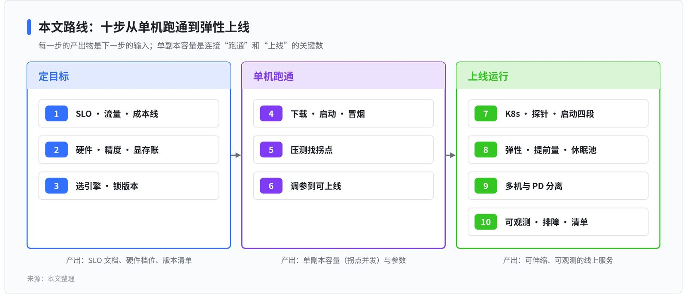
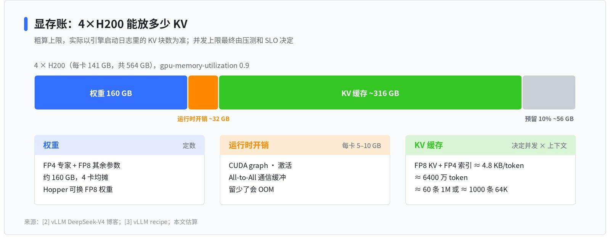
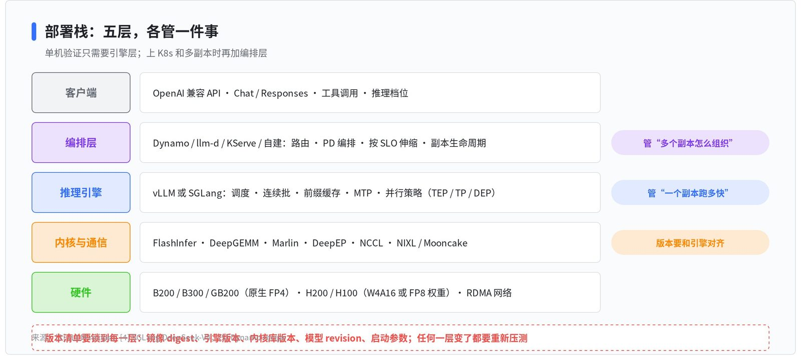
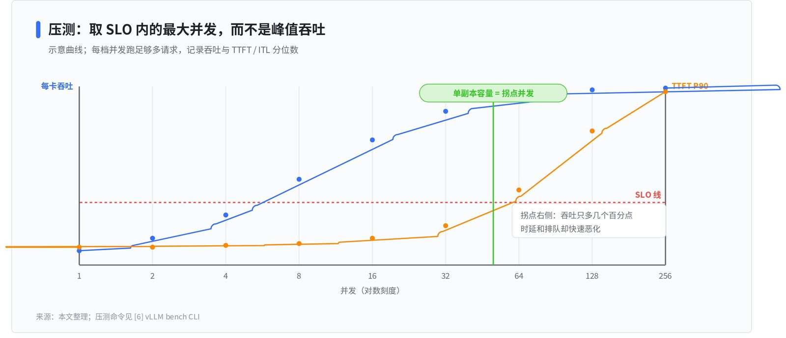
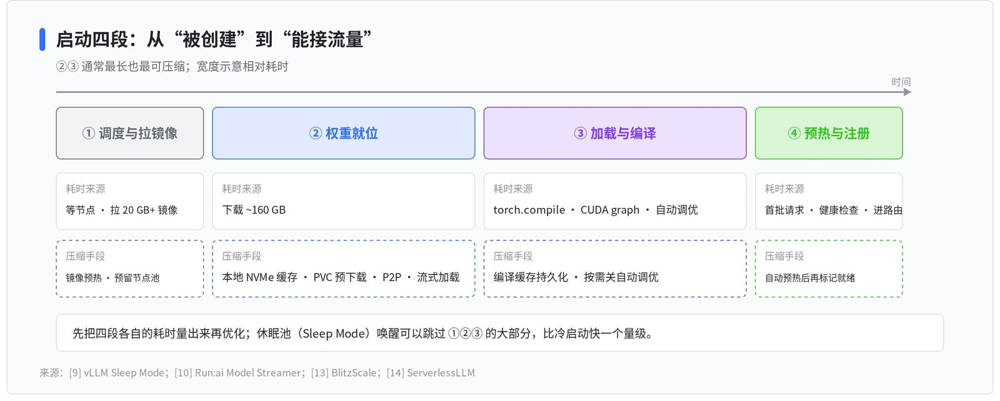
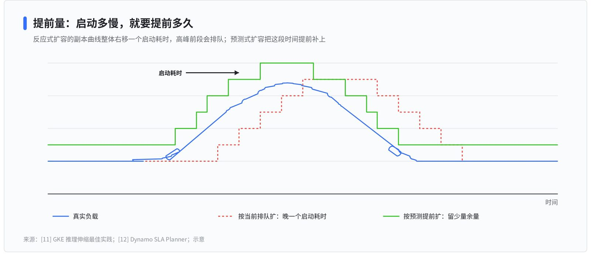
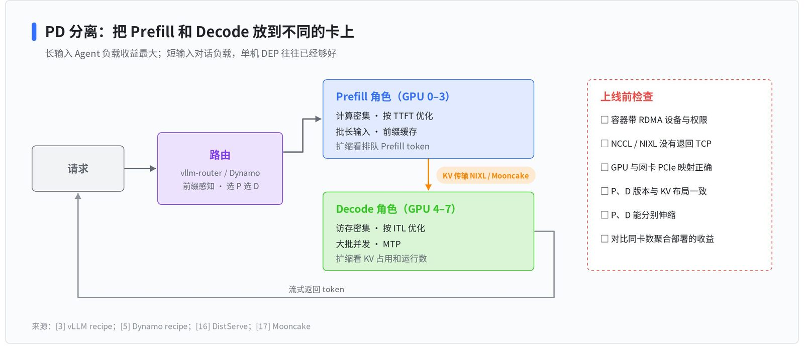

# LLM-51｜系统｜自部署推理实战：DeepSeek-V4-Flash 从单机到弹性上线

> 🎯 **这篇文档解决什么问题**：把一个开源大模型从“下载权重”带到“线上可弹性伸缩的服务”，中间要做的事情很多，散落在模型卡、引擎 recipe、K8s 文档和论文里。本文用 DeepSeek-V4-Flash（284B 总参数、13B 激活）做主线，按实际施工顺序走一遍：定目标、定档位、选引擎、跑通、压测、调参、上 K8s、做弹性、上多机，最后给一份上线清单。
>
> 使用方式：每章都给能直接复制的命令和一张“踩坑表”。命令以 2026 年 10 月公开的官方 recipe 为准，版本会变，上线前请回到原链接核对。文中显存和容量的推算是量级估计，以你自己的压测为准。
>
> 配套阅读：原理看 [LLM-08｜系统｜大模型推理系统：全栈学习手册](./08-inference-systems.md)、[LLM-03｜系统｜vLLM 学习路径：从推理基础到架构前沿](./03-vllm-path.md)；算账看 [LLM-13｜系统｜自建推理成本与 GPU 选型：算账手册](./13-inference-cost-gpu.md)；选型与许可证看 [LLM-44｜系统｜开源权重模型选型与自托管：许可证、节奏与微调](./44-open-weights.md)；上线后的稳定性看 [LLM-07｜系统｜LLM 服务稳定性工程：SRE 上线手册](./07-serving-reliability.md)。前沿超大模型的部署见本系列第 52 篇（Kimi K3）。
>
> 📎 上一档：想先在自己的 4090 / 5090 上把显存账、量化选择和压测方法练熟，见第 50 篇 [LLM-50｜系统｜消费级单卡自部署：Qwen3.8-27B 跑在 4090 / 5090 上](./50-consumer-gpu-deploy.md)。本篇是自部署三档里的第二档（单机数据中心卡）。

## 导读 · 先给结论

- <b>Flash 是 2026 年最适合练手的“真大模型”</b>：权重约 160 GB（FP4 专家 + FP8 其余参数），4 张 B200 / B300 / H200 就能单机跑满 1M 上下文[[1]](https://huggingface.co/deepseek-ai/DeepSeek-V4-Flash)[[3]](https://github.com/bsmr/vllm-project---recipes/blob/main/models/deepseek-ai/DeepSeek-V4-Flash.yaml)。它有 MoE、混合压缩注意力、MTP 投机解码、三档推理模式，生产里会碰到的问题基本都会碰到。
- **先跑官方 recipe，再改参数**：vLLM、SGLang、Dynamo 都给了逐硬件验证过的命令[[3]](https://github.com/bsmr/vllm-project---recipes/blob/main/models/deepseek-ai/DeepSeek-V4-Flash.yaml)[[4]](https://lmsysorg.mintlify.app/cookbook/autoregressive/DeepSeek/DeepSeek-V4)[[5]](https://docs.nvidia.com/dynamo/dev/recipes/deepseek-v4-flash)。第一次部署最常见的失败不是性能，而是版本、解析器和超时配置不对。
- **压测先找拐点，不要只看峰值吞吐**：按并发扫描，画出吞吐和 TTFT、ITL 的曲线，取满足 SLO 的最大并发作为单副本容量。这个数决定了副本数和成本。
- **调参的收益排序大致是**：并行策略（TEP / TP / DEP）→ 前缀缓存命中率 → MTP 档位 → 批大小与 chunked prefill → 算子级开关。前两项通常比后三项加起来还大。
- **上 K8s 后，启动耗时是第一指标**：权重下载、加载编译、预热三段可以各自压缩。启动越慢，弹性越要“提前扩”，副本就越要按峰值备。
- **扩缩信号用排队和 KV 占用，不用 GPU 利用率**[[11]](https://docs.cloud.google.com/kubernetes-engine/docs/best-practices/machine-learning/inference/autoscaling)；能预测就提前扩，空闲副本优先休眠而不是销毁[[9]](https://github.com/vllm-project/vllm/blob/main/docs/features/sleep_mode.md)[[12]](https://github.com/ai-dynamo/dynamo/blob/main/docs/fern/pages/developer-guide/knowledge-base/modular-components/planner/planner-guide.md)。
- **多机和 PD 分离最后再上**：它们能提高长输入场景的吞吐，但对 RDMA、路由和角色级伸缩都有要求。漏配一个容器参数，NCCL 会悄悄退回 TCP，性能掉一大截，而且不报错。

全流程分成十步，每一步的产出物是下一步的输入。下图是本文的章节地图。



> 🔑 **一句话版本**：先写下 SLO 和流量画像，用官方 recipe 在最小档位跑通，压测找拐点得到单副本容量，按收益顺序调参，把启动时间拆段压缩，再用排队信号加提前量做弹性；多机和 PD 分离是最后一步，不是第一步。

## 第 1 章 · 先定目标：SLO、流量画像与成本线

### 1.1 先写下三个数

部署之前先回答三个问题，写成文字，后面每一步都拿它们做取舍：

1. **时延目标**：首 token 时延 TTFT 的 P90 / P99 要多少，逐 token 时延 ITL（也叫 TPOT）要多少。对话类一般要求 TTFT 在 1 到 2 秒内、单用户 30 到 50 tok/s 以上；Agent 类输入长、对 TTFT 容忍度高一些，但对每轮输出速度敏感。
2. **流量规模**：峰值并发、日 token 量、峰值和均值之比。峰均比决定了弹性能省多少钱。
3. **质量与功能**：要不要思考模式、要不要工具调用、要不要 1M 上下文、要不要图像输入。每多一项，可选的硬件和引擎就少一些。

### 1.2 流量画像决定配置

同一个模型，不同流量画像下的最优配置可以差很多。Dynamo 给 DeepSeek-V4-Flash 调优时用的是 Agent 负载：平均输入 64K token、输出 400 token、90% 的 KV 可复用[[5]](https://docs.nvidia.com/dynamo/dev/recipes/deepseek-v4-flash)。这种画像下 Prefill 和缓存命中是主要矛盾；而短输入长输出的对话负载，瓶颈在 Decode。

| 画像 | 典型输入 / 输出 | 主要矛盾 | 优先手段 |
|---|---|---|---|
| 对话 / 客服 | 1K–4K / 300–800 | Decode 吞吐与 ITL | DP + EP 提吞吐，MTP 降 ITL |
| Agent / 编程 | 32K–128K / 200–600，前缀复用高 | Prefill 计算与 TTFT | 前缀缓存、分层 KV、PD 分离 |
| 长文档分析 | 200K–1M / 1K 以内 | KV 显存与 Prefill | FP8 KV、chunked prefill、限制并发 |
| 离线批处理 | 任意 / 任意 | 单卡吞吐 | 高吞吐档位、大批、关 MTP |

拿到线上或预期的请求样本后，至少统计四样东西：输入长度分布（P50 / P90 / P99）、输出长度分布、前缀复用率（相同 system prompt 和工具定义的占比）、按小时的请求量曲线。第 5 章压测要用它们回放。

### 1.3 成本线：什么时候值得自部署

自部署的单 token 成本 = 每小时持有成本 ÷ 每小时实际产出的 token。分母不是压测峰值，而是线上真实产出，它受峰均比、弹性效率和缓存命中率影响，常常只有压测值的几分之一。详细算法见 [LLM-13｜系统｜自建推理成本与 GPU 选型：算账手册](./13-inference-cost-gpu.md)。粗略判断：如果日均流量填不满一个最小副本（Flash 是 4 张卡）的三分之一，直接用官方或第三方 API 通常更便宜；需要数据不出域、定制采样或微调权重时，再另算。

## 第 2 章 · 定档位：硬件、精度与显存账

### 2.1 Flash 的几个关键数

| 项目 | 数值 | 对部署的影响 |
|---|---|---|
| 参数规模 | 284B 总参数，13B 激活（MoE） | 显存按总参数算，计算按激活参数算 |
| 权重精度 | MoE 专家 FP4，其余 FP8；46 个分片约 160 GB | 最少约 170 GB 显存，4 卡起步 |
| 上下文 | 1,048,576 token | KV 显存和 Prefill 计算是长上下文的瓶颈 |
| 注意力 | CSA + HCA 混合：c4a（约 1/4 压缩）、c128a（约 1/128）、128 token 滑窗 | 1M 上下文下 KV 约为 V3.2 的 1/8.7 |
| 推理模式 | Non-think / Think High / Think Max | Max 要求上下文至少 384K |
| 许可证 | MIT | 商用无额外限制 |

数据来自模型卡和 vLLM 的实现说明[[1]](https://huggingface.co/deepseek-ai/DeepSeek-V4-Flash)[[2]](https://github.com/vllm-project/vllm-project.github.io/blob/main/_posts/2026-04-24-deepseek-v4.md)[[3]](https://github.com/bsmr/vllm-project---recipes/blob/main/models/deepseek-ai/DeepSeek-V4-Flash.yaml)。注意力部分值得多看一眼：DeepSeek-V4 把相邻 token 的 KV 压缩成一个条目，c4a 层每 4 个 token 存一份，c128a 层每 128 个 token 存一份，再加一个 128 token 的未压缩滑窗保证局部信息。按 bf16 算，1M 上下文每条序列的 KV 只有 9.62 GiB，同样 61 层的 V3.2 结构要 83.9 GiB；实际部署时注意力缓存用 FP8、索引缓存用 FP4，还能再减一半左右[[2]](https://github.com/vllm-project/vllm-project.github.io/blob/main/_posts/2026-04-24-deepseek-v4.md)。

### 2.2 硬件矩阵

| 硬件 | 推荐配置 | 来源 | 备注 |
|---|---|---|---|
| 4×B200 / 4×B300 | DP4 + EP，FP8 KV，FP4 索引缓存，可选 MTP-2 | vLLM[[2]](https://github.com/vllm-project/vllm-project.github.io/blob/main/_posts/2026-04-24-deepseek-v4.md)[[3]](https://github.com/bsmr/vllm-project---recipes/blob/main/models/deepseek-ai/DeepSeek-V4-Flash.yaml) | Blackwell 可加 MegaMoE 后端 |
| 4×B200（NVFP4） | TP4 + EP，KV 感知路由 | Dynamo[[5]](https://docs.nvidia.com/dynamo/dev/recipes/deepseek-v4-flash) | 用 nvidia/DeepSeek-V4-Flash-NVFP4 权重 |
| 4×H200 | DP4 + TP1 + EP，Marlin MoE，MTP-1 | Dynamo[[5]](https://docs.nvidia.com/dynamo/dev/recipes/deepseek-v4-flash) | Hopper 没有原生 FP4，专家走 W4A16 |
| 4×H200 / B200 / GB200 | TP4 | SGLang[[4]](https://lmsysorg.mintlify.app/cookbook/autoregressive/DeepSeek/DeepSeek-V4) | 单机通用档 |
| 8×H100 | TP8 | SGLang[[4]](https://lmsysorg.mintlify.app/cookbook/autoregressive/DeepSeek/DeepSeek-V4) | 80 GB 卡，4 张放不下 |
| 2×RTX PRO 6000 | TP2 | SGLang[[4]](https://lmsysorg.mintlify.app/cookbook/autoregressive/DeepSeek/DeepSeek-V4) | 96 GB 工作站卡，适合开发测试 |
| AMD MI3xx | vLLM 标为不支持；SGLang 有 MI355X 配方 | [[3]](https://github.com/bsmr/vllm-project---recipes/blob/main/models/deepseek-ai/DeepSeek-V4-Flash.yaml)[[4]](https://lmsysorg.mintlify.app/cookbook/autoregressive/DeepSeek/DeepSeek-V4) | 先确认引擎版本 |

vLLM recipe 的建议是：不做 PD 分离时，任何支持的硬件上都用单机 DP4 + EP；在 8 卡机器上一个副本只用 4 张卡，剩下 4 张可以再起一个副本，或者留给 PD 分离的另一个角色[[3]](https://github.com/bsmr/vllm-project---recipes/blob/main/models/deepseek-ai/DeepSeek-V4-Flash.yaml)。

### 2.3 显存账：权重、KV 和余量

显存分三块：权重、KV 缓存、运行时开销（CUDA graph、激活、通信缓冲）。权重是定数，运行时开销每卡留 5 到 10 GB 比较稳，剩下的都给 KV，KV 的大小决定能同时跑多少请求、多长的上下文。



以 4×H200（每卡 141 GB）为例做个容量边界的量级估计（注意：下面按 FP4 索引缓存计，而 4.3 节说明本文 H200 配置没有 FP4 索引缓存，所以这只是容量上界估算，不对应所列 H200 命令）。按 90% 的显存利用率，可用约 508 GB；减去 160 GB 权重和每卡约 8 GB 开销，剩约 316 GB 给 KV。按 vLLM 给的数，FP8 注意力缓存加 FP4 索引缓存后每 token 约 4.8 KB（1M 上下文时每序列约 4.8 GiB），316 GB 大约能放 6400 万 token：相当于约 60 条 1M 上下文的请求，或约 1000 条 64K 的请求。B200 每卡 180 GB，同样 4 卡能放约 9000 万 token。

> 💡 **注意**：上面是按权重和 KV 公式粗算的上限，实际可用量以引擎启动日志里打印的 KV 块数为准。真正的并发上限往往由 Decode 计算和 SLO 决定，而不是 KV 容量；所以要靠第 5 章的压测来定，不要拿这个数直接配 max-num-seqs。

### 2.4 精度选择

- <b>Blackwell（B200 / B300 / GB200 / GB300）</b>：直接用原生 FP4 + FP8 权重。B200 上 Dynamo 还提供 NVIDIA 量化的 NVFP4 权重，配 FlashInfer TRT-LLM 后端[[5]](https://docs.nvidia.com/dynamo/dev/recipes/deepseek-v4-flash)。
- <b>Hopper（H100 / H200）</b>：没有 FP4 张量核。两条路：一是继续用原生 FP4 权重，专家走 W4A16 内核（Marlin 或 FlashInfer SM90），FlashInfer 0.6.18 起也可以选 W4A8；二是改用社区转好的 FP8 权重 sgl-project/DeepSeek-V4-Flash-FP8，配 MegaMoE 后端，长上下文和大批 Decode 吞吐更高[[4]](https://lmsysorg.mintlify.app/cookbook/autoregressive/DeepSeek/DeepSeek-V4)。
- **KV 精度**：各家 recipe 都默认 FP8 KV，配合 256 的块大小。没有特殊理由不要改回 bf16，它会让 KV 容量减半。

### 2.5 推理模式与上下文长度

Flash 有三档：Non-think 直接回答；Think High 先输出思维链；Think Max 用最大推理预算，要求 max-model-len 至少 393216（384K），否则会被截断[[3]](https://github.com/bsmr/vllm-project---recipes/blob/main/models/deepseek-ai/DeepSeek-V4-Flash.yaml)。档位差距很大：HLE 上 Non-think 是 8.1，Max 是 34.8[[1]](https://huggingface.co/deepseek-ai/DeepSeek-V4-Flash)。官方推荐采样参数 temperature 1.0、top_p 1.0。部署时要决定默认档位：默认开 Max，输出 token 和时延都会成倍增加；常见做法是服务端默认 Non-think 或 High，由调用方按请求切换。

## 第 3 章 · 选引擎与锁版本

### 3.1 三条路

| 方案 | 定位 | 适合 | 代价 |
|---|---|---|---|
| vLLM | 推理引擎，OpenAI 兼容服务 | 单机起步、生态最广、文档最全 | 多机和 PD 分离需要自己拼路由和编排 |
| SGLang | 推理引擎，调度和缓存能力强 | 前缀复用高的 Agent 负载、需要 HiCache 分层缓存 | 版本迭代快，部分硬件要用预览镜像 |
| Dynamo | 编排层，跑在 vLLM / SGLang / TRT-LLM 之上 | K8s 上的多副本、PD 分离、KV 感知路由、按 SLO 伸缩 | 多一层组件，需要装 Operator |

三者不是互斥关系：vLLM 或 SGLang 解决“一个副本跑多快”，Dynamo 或自建的路由与控制器解决“多个副本怎么组织”。单机验证阶段选 vLLM 或 SGLang 任一即可；准备上 K8s 和多副本时，再决定编排层用 Dynamo、llm-d、KServe 这类开源方案，还是自己写。



### 3.2 锁版本

DeepSeek-V4 这类新模型，引擎支持是逐版本补齐的。vLLM 要求至少 0.20.0，并需要额外装 DeepGEMM 内核；首发时官方给了专用镜像 vllm/vllm-openai:deepseekv4-cu130[[2]](https://github.com/vllm-project/vllm-project.github.io/blob/main/_posts/2026-04-24-deepseek-v4.md)[[3]](https://github.com/bsmr/vllm-project---recipes/blob/main/models/deepseek-ai/DeepSeek-V4-Flash.yaml)。SGLang 用 lmsysorg/sglang:latest，Flash Vision 和 DGX Spark 用单独的预览镜像[[4]](https://lmsysorg.mintlify.app/cookbook/autoregressive/DeepSeek/DeepSeek-V4)。Dynamo recipe 固定在 vllm-runtime:1.3.0 镜像[[5]](https://docs.nvidia.com/dynamo/dev/recipes/deepseek-v4-flash)。

建议把每次上线的版本写成一份清单，和压测报告放在一起。下次升级时，先在同一份清单上只改一个字段，重新压测，再上线。

*serving-manifest.yaml
*

```yaml
# serving-manifest.yaml  每个环境一份，随压测报告归档model: deepseek-ai/DeepSeek-V4-Flashmodel_revision: <HF commit sha>          # 不要只写 mainengine: vllmimage: vllm/vllm-openai@sha256:<digest>  # 用 digest，不用 latestengine_version: 0.20.xextra_kernels: deepgemm <commit>cuda: "13.0"driver: <nvidia driver version>hardware: 4x H200 141GB, NVLinklaunch_args_file: launch/h200-dp4-ep.argsbench_report: bench/2026-10-15-h200-dp4.json
```

### 3.3 Flash 的几个变体

- **原版 DeepSeek-V4-Flash**：284B，4 月 24 日发布，所有 recipe 的基线[[1]](https://huggingface.co/deepseek-ai/DeepSeek-V4-Flash)。
- **Flash-0731**：304B，自带 DSpark 投机解码头。投机解码必须用 --speculative-algorithm DSPARK；如果沿用 EAGLE，服务照常启动、输出也正确，但日志里接受长度一直是 1.00，等于白付草稿模型的计算[[4]](https://lmsysorg.mintlify.app/cookbook/autoregressive/DeepSeek/DeepSeek-V4)。
- **Flash-Vision-Exp**：305B，在 0731 基础上加图像理解，实验性质，用预览镜像[[4]](https://lmsysorg.mintlify.app/cookbook/autoregressive/DeepSeek/DeepSeek-V4)。
- **量化版**：NVIDIA 的 NVFP4（B200 用）、社区的 FP8（Hopper 用）[[4]](https://lmsysorg.mintlify.app/cookbook/autoregressive/DeepSeek/DeepSeek-V4)[[5]](https://docs.nvidia.com/dynamo/dev/recipes/deepseek-v4-flash)。

> 💡 **容易踩的坑**：DeepSeek-V4 没有 Jinja 格式的 chat template，要用官方的 encoding_dsv4 编码；vLLM 里对应 --tokenizer-mode deepseek_v4。用通用模板拼 prompt，模型能输出，但思考模式、工具调用会出各种怪问题。

## 第 4 章 · 第一次跑通

### 4.1 先把权重放到本地盘

160 GB 的权重，第一次一定要先下载到本地 NVMe 或共享存储，不要让引擎启动时边下边加载：下载失败会让启动超时，而且多个副本会重复下载。

*下载权重
*

```bash
export HF_HOME=/data/hf            # 放在本地 NVMe 或共享盘huggingface-cli download deepseek-ai/DeepSeek-V4-Flash \  --revision <commit sha> --local-dir /data/models/DeepSeek-V4-Flashdu -sh /data/models/DeepSeek-V4-Flash   # 约 160G，46 个 safetensors 分片
```

### 4.2 vLLM：Blackwell 单机

下面是 vLLM 官方给出的单机命令，可在 4×B200 或 4×B300 上运行[[2]](https://github.com/vllm-project/vllm-project.github.io/blob/main/_posts/2026-04-24-deepseek-v4.md)：

*vLLM · 4×B200 / B300
*

```bash
docker run --gpus all --ipc=host -p 8000:8000 \  -v ~/.cache/huggingface:/root/.cache/huggingface \  vllm/vllm-openai:deepseekv4-cu130 deepseek-ai/DeepSeek-V4-Flash \  --trust-remote-code \  --kv-cache-dtype fp8 \  --block-size 256 \  --enable-expert-parallel \  --data-parallel-size 4 \  --compilation-config '{"cudagraph_mode":"FULL_AND_PIECEWISE", "custom_ops":["all"]}' \  --attention_config.use_fp4_indexer_cache=True \  --tokenizer-mode deepseek_v4 \  --tool-call-parser deepseek_v4 \  --enable-auto-tool-choice \  --reasoning-parser deepseek_v4
```

逐项说明：

- <b>--kv-cache-dtype fp8 --block-size 256</b>：FP8 KV，逻辑块固定 256 个 token。vLLM 为 V4 的多种压缩层统一用 256 作为块单位，前缀缓存命中也落在 256 的边界上，这两个参数不要改。
- <b>--enable-expert-parallel --data-parallel-size 4</b>：注意力按 DP 切成 4 份，专家按 EP 分到 4 张卡。这是吞吐优先的 DEP 配置。
- <b>--attention_config.use_fp4_indexer_cache=True</b>：稀疏注意力的索引缓存用 FP4，Blackwell 专用。
- **三个 deepseek_v4 解析器**：分别负责编码、工具调用解析和思维链拆分。少了 reasoning-parser，思维链会混在 content 里返回。

### 4.3 vLLM：Hopper 单机

H200 上没有 FP4 索引缓存和 MegaMoE；MTP 投机 token 数从 2 降到 1。按 recipe 的基础参数加 Hopper 覆盖项拼出来是这样[[3]](https://github.com/bsmr/vllm-project---recipes/blob/main/models/deepseek-ai/DeepSeek-V4-Flash.yaml)：

*vLLM · 4×H200
*

```bash
# 先装 DeepGEMM（recipe 列为依赖）bash <(curl -fsSL https://raw.githubusercontent.com/vllm-project/vllm/main/tools/install_deepgemm.sh)export VLLM_ENGINE_READY_TIMEOUT_S=3600   # 首次启动要编译和预热，默认超时不够vllm serve deepseek-ai/DeepSeek-V4-Flash \  --trust-remote-code \  --kv-cache-dtype fp8 --block-size 256 \  --enable-expert-parallel --data-parallel-size 4 \  --tokenizer-mode deepseek_v4 \  --tool-call-parser deepseek_v4 --enable-auto-tool-choice \  --reasoning-parser deepseek_v4 \  --speculative_config '{"method":"mtp","num_speculative_tokens":1}' \  --port 8000
```

### 4.4 SGLang 单机

SGLang cookbook 的基础启动方式如下，单机 TP4 适用于 B200 / B300 / GB200 / GB300 / H200，H100 用 TP8，RTX PRO 6000 用 TP2[[4]](https://lmsysorg.mintlify.app/cookbook/autoregressive/DeepSeek/DeepSeek-V4)。cookbook 页面有命令生成器，按硬件、场景（低时延 / 均衡 / 高吞吐）和功能勾选后给出完整参数，建议以生成器输出为准。

*SGLang · 单机 TP4
*

```bash
docker run --gpus all --shm-size 32g --ipc=host -p 30000:30000 \  -v ~/.cache/huggingface:/root/.cache/huggingface \  lmsysorg/sglang:latest \  python3 -m sglang.launch_server \    --model-path deepseek-ai/DeepSeek-V4-Flash \    --tp 4 --host 0.0.0.0 --port 30000
```

Hopper 上想要更高的长上下文吞吐，可以换 FP8 权重和 MegaMoE 后端（8 卡）[[4]](https://lmsysorg.mintlify.app/cookbook/autoregressive/DeepSeek/DeepSeek-V4)：

*SGLang · Hopper FP8 + MegaMoE
*

```bash
SGLANG_DSV4_FP4_EXPERTS=0 sglang serve \  --model-path sgl-project/DeepSeek-V4-Flash-FP8 \  --tp 8 --moe-a2a-backend megamoe --chunked-prefill-size 4096
```

### 4.5 冒烟测试

*最小请求
*

```bash
curl http://localhost:8000/v1/chat/completions -H 'Content-Type: application/json' -d '{  "model": "deepseek-ai/DeepSeek-V4-Flash",  "messages": [{"role": "user", "content": "17*19 等于多少？只回答整数。"}],  "max_tokens": 2048}' 
```

三档推理模式通过 chat_template_kwargs 切换[[3]](https://github.com/bsmr/vllm-project---recipes/blob/main/models/deepseek-ai/DeepSeek-V4-Flash.yaml)：

*三档推理模式
*

```python
from openai import OpenAIcli = OpenAI(base_url="http://localhost:8000/v1", api_key="EMPTY")m = "deepseek-ai/DeepSeek-V4-Flash"msg = [{"role": "user", "content": "证明根号 2 是无理数"}]r0 = cli.chat.completions.create(model=m, messages=msg)                       # Non-thinkr1 = cli.chat.completions.create(model=m, messages=msg, max_tokens=8192,        extra_body={"chat_template_kwargs": {"thinking": True, "reasoning_effort": "high"}})r2 = cli.chat.completions.create(model=m, messages=msg, max_tokens=32768,     # 需 max-model-len >= 393216        extra_body={"chat_template_kwargs": {"thinking": True, "reasoning_effort": "max"}})print(r1.choices[0].message.reasoning_content[:200])print(r1.choices[0].message.content)
```

检查三件事：content 里只有答案、思维链在 reasoning_content 里；工具调用请求能返回结构化的 tool_calls；思考模式下把 max_tokens 设小（比如 128），会看到 content 为空、finish_reason 为 length，这是预算全花在思考上了，属于预期行为，调大即可[[5]](https://docs.nvidia.com/dynamo/dev/recipes/deepseek-v4-flash)。

### 4.6 跑不起来时先查这张表

| 现象 | 常见原因 | 处理 |
|---|---|---|
| 启动到一半报超时退出 | 首次编译、CUDA graph 捕获、FlashInfer 自动调优耗时长 | VLLM_ENGINE_READY_TIMEOUT_S=3600；K8s 上同时放宽 startupProbe |
| 加载权重时 OOM | 卡数不够或 max-model-len 太大导致 KV 预留过多 | 确认显存不少于 170 GB；先设 --max-model-len 131072 跑通再加 |
| 报模型结构不识别 | 引擎版本太旧或少了 --trust-remote-code | vLLM 至少 0.20.0；用 recipe 指定的镜像 |
| 找不到 DeepGEMM 内核 | 没装依赖 | 运行 recipe 里的 install_deepgemm.sh |
| 思维链混在 content 里 | 没开 reasoning-parser | 加 --reasoning-parser deepseek_v4 |
| 工具调用格式乱 | 用了通用 chat template | --tokenizer-mode deepseek_v4，不要自己拼模板 |
| 多卡通信卡住或很慢 | 容器没给共享内存 | docker 加 --ipc=host 或 --shm-size 32g；K8s 挂 /dev/shm |

## 第 5 章 · 压测：先找到拐点

### 5.1 测什么

压测要回答的问题只有一个：**在满足 SLO 的前提下，一个副本最多能扛多少负载**。为此要同时记录四类指标：TTFT（P50 / P90 / P99）、ITL（P50 / P90 / P99）、每卡输出吞吐（tok/s/GPU）、以及 goodput，即满足 SLO 的请求占比乘以吞吐。只看峰值吞吐会严重高估容量：吞吐还在涨的时候，TTFT 可能早已超标。

### 5.2 工具和命令

vLLM 自带 vllm bench serve，支持随机数据、前缀复用数据集、按速率爬坡和突发流量模拟[[6]](https://docs.vllm.ai/en/stable/benchmarking/cli/)。三个常用场景：

*vllm bench serve
*

```bash
# 1) 固定并发扫描：每档跑 3-5 分钟，取稳态for C in 4 8 16 32 64 128 256; do  vllm bench serve --backend openai-chat --endpoint /v1/chat/completions \    --model deepseek-ai/DeepSeek-V4-Flash \    --dataset-name random --random-input-len 8192 --random-output-len 512 \    --num-prompts $((C*20)) --max-concurrency $C \    --percentile-metrics ttft,tpot,itl,e2el --metric-percentiles 50,90,99 \    --save-result --result-filename bench/c${C}.jsondone# 2) 前缀复用：模拟同一 system prompt / 工具定义vllm bench serve --model deepseek-ai/DeepSeek-V4-Flash \  --dataset-name prefix_repetition \  --prefix-repetition-prefix-len 16384 --prefix-repetition-suffix-len 1024 \  --prefix-repetition-num-prefixes 8 --prefix-repetition-output-len 400 \  --num-prompts 2000 --max-concurrency 64# 3) 速率爬坡 + 突发：看排队和弹性信号vllm bench serve --model deepseek-ai/DeepSeek-V4-Flash \  --dataset-name random --random-input-len 4096 --random-output-len 512 \  --ramp-up-strategy linear --ramp-up-start-rps 1 --ramp-up-end-rps 40 \  --burstiness 0.5 --num-prompts 6000
```

如果线上是 Agent 负载，最好直接回放真实或近似的 trace。Dynamo 的 recipe 用 AIPerf 回放 MoonTrace（平均输入 64K、输出 400、90% KV 复用）[[5]](https://docs.nvidia.com/dynamo/dev/recipes/deepseek-v4-flash)，比随机数据更能反映缓存和 Prefill 的真实压力。

### 5.3 并发扫描与拐点

把每档并发的结果画成两条线：横轴并发，纵轴一条是每卡吞吐，一条是 TTFT P90（或 ITL P90）。吞吐会先线性上升再变平，时延先平后陡升。SLO 线和时延曲线的交点，就是单副本容量；再往右，吞吐涨得很少，时延和排队却快速恶化。



### 5.4 压测记录模板

| 字段 | 示例 | 为什么要记 |
|---|---|---|
| 版本清单 | serving-manifest.yaml 的 hash | 复现与对比的前提 |
| 负载 | random 8K/512，或 trace 名称 | 不同负载的结果不可比 |
| 并发 / 速率 | 4 到 256 共 7 档 | 用来画拐点 |
| TTFT / ITL P50 P90 P99 | 每档一行 | 定 SLO 内容量 |
| 每卡输出吞吐 | tok/s/GPU | 算成本 |
| 前缀命中率 | vllm:prefix_cache_hits ÷ queries | 解释 TTFT 的变化 |
| MTP 接受长度 | spec decode 指标 | 判断投机解码是否有效 |
| 抢占次数 | vllm:num_preemptions | KV 不够时会上升 |

### 5.5 量级参照

公开数字口径各不相同，只能用来判断自己的结果有没有“差一个数量级”。DeepSeek 公开的 V3/R1 线上数据是每台 8×H800 节点 Prefill 约 73.7k 输入 tok/s（含缓存命中）、Decode 约 14.8k 输出 tok/s[[18]](https://github.com/deepseek-ai/open-infra-index/blob/main/202502OpenSourceWeek/day_6_one_more_thing_deepseekV3R1_inference_system_overview.md)；LMSYS 在 96 张 H100 上做 PD 分离加大规模 EP，2000 token 输入时每节点 52.3k 输入、22.3k 输出 tok/s[[19]](https://www.lmsys.org/blog/2025-05-05-large-scale-ep/)。Flash 激活参数只有 13B，同等硬件下吞吐应明显高于 V3/R1，如果你测出来比这些数还低很多，先回头查并行策略和通信。

## 第 6 章 · 调参：从默认值到可上线

调参按收益从大到小做，每次只动一个变量，每次都重跑第 5 章的扫描。

### 6.1 并行策略：TEP、TP 还是 DEP

| 策略 | 做法 | 特点 | 何时用 |
|---|---|---|---|
| TEP（vLLM 默认） | TP 切注意力 + EP 切专家 | 时延和吞吐折中 | 默认起点 |
| TP8 | 只做张量并行，不开 EP | 单请求最快，吞吐最低；关闭 FlashInfer 自动调优可缩短启动 | 低并发、强时延要求 |
| DEP（DP4 + EP） | 注意力按 DP 复制，专家按 EP 分 | 吞吐最高，单请求时延略高 | 高并发在线服务、批处理 |

vLLM recipe 把 TEP 设为默认，TP 只作为时延优先的备选，单机推荐 DP4 + EP[[3]](https://github.com/bsmr/vllm-project---recipes/blob/main/models/deepseek-ai/DeepSeek-V4-Flash.yaml)。原因是 MoE 模型激活参数小，Decode 阶段主要受注意力和访存限制，DP 能把注意力的批做大，EP 让每张卡只放部分专家，两者合起来吞吐最好。

### 6.2 MTP 投机解码

- **vLLM**：--speculative_config 里 num_speculative_tokens 在 Blackwell 上设 2，Hopper 上设 1[[3]](https://github.com/bsmr/vllm-project---recipes/blob/main/models/deepseek-ai/DeepSeek-V4-Flash.yaml)。
- **SGLang 的三档预设**：低时延 steps=3 / draft=4，单请求收益最大；均衡 steps=1 / draft=2；高吞吐关闭 MTP[[4]](https://lmsysorg.mintlify.app/cookbook/autoregressive/DeepSeek/DeepSeek-V4)。并发越高，投机解码的收益越小，甚至为负。
- **DeepEP 缓冲约束**：在 SGLang 上，max-running-requests 乘以 MTP 草稿 token 数，不能超过 SGLANG_DEEPEP_NUM_MAX_DISPATCH_TOKENS_PER_RANK，否则稳态负载下 DeepEP 的分发缓冲会溢出。调并发时，这个环境变量、--max-running-requests 和 --cuda-graph-max-bs-decode 要一起改。生成器给的默认值偏保守，可能浪费吞吐，值得压测调大[[4]](https://lmsysorg.mintlify.app/cookbook/autoregressive/DeepSeek/DeepSeek-V4)。
- **怎么判断有没有用**：看接受长度。接受长度接近 1 说明草稿基本没被接受，此时关掉 MTP 反而更快。

### 6.3 KV 与前缀缓存

Agent 负载里，前缀缓存命中率是最值钱的一个数：命中的 token 不需要再做 Prefill。vLLM 对 V4 的前缀命中落在 256 token 的块边界上[[2]](https://github.com/vllm-project/vllm-project.github.io/blob/main/_posts/2026-04-24-deepseek-v4.md)，所以 prompt 的组织方式会直接影响命中率：

- 把稳定的部分放前面：system prompt、工具定义、长文档放在最前，变化的用户输入放最后。
- 不要在 system prompt 里放时间戳、请求 ID 这类每次都变的内容，一个字符的差异就会让后面全部失效。
- 多副本时，用前缀感知或 KV 感知的路由，把同一前缀的请求送到同一副本；轮询路由会把命中率打散。
- 显存放不下时用分层缓存：SGLang 的 HiCache 把 KV 下沉到 CPU 内存（L2）和外部存储（L3）[[4]](https://lmsysorg.mintlify.app/cookbook/autoregressive/DeepSeek/DeepSeek-V4)，Mooncake 是以 KV 为中心、用 DRAM / SSD 组池的代表做法[[17]](https://arxiv.org/abs/2407.00079)。DeepSeek 自己的线上数据是 56.3% 的输入 token 命中磁盘 KV 缓存[[18]](https://github.com/deepseek-ai/open-infra-index/blob/main/202502OpenSourceWeek/day_6_one_more_thing_deepseekV3R1_inference_system_overview.md)。

### 6.4 批大小与 chunked prefill

- <b>--max-num-seqs</b>：同时 Decode 的请求上限。按第 5 章拐点处的并发设，再留 10% 到 20% 余量。
- <b>--max-num-batched-tokens</b>：每步处理的 token 上限，决定长 Prefill 被切成多大的块。调大提高 Prefill 吞吐，但会让同批 Decode 请求的 ITL 抖动；长输入负载下通常 8K 到 16K 起调。
- **SGLang 的 --enforce-shared-experts-fusion**：把共享专家融合进 MoE 计算，cookbook 报告 TTFT 降低 13% 到 21%[[4]](https://lmsysorg.mintlify.app/cookbook/autoregressive/DeepSeek/DeepSeek-V4)。
- **Hopper 上的 chunked prefill**：FP8 + MegaMoE 配置推荐 --chunked-prefill-size 4096[[4]](https://lmsysorg.mintlify.app/cookbook/autoregressive/DeepSeek/DeepSeek-V4)。

### 6.5 调参顺序速查

| 顺序 | 参数 | 主要影响 | 验证指标 |
|---|---|---|---|
| 1 | 并行策略 TEP / TP / DEP | 吞吐与单请求时延的基线 | 拐点并发、每卡吞吐 |
| 2 | 前缀缓存与路由 | Agent 负载的 TTFT 与 Prefill 成本 | 命中率、TTFT P90 |
| 3 | MTP 档位 | ITL | 接受长度、ITL P50 |
| 4 | max-num-seqs / max-num-batched-tokens | 并发上限与 ITL 抖动 | ITL P99、抢占次数 |
| 5 | 算子开关（MegaMoE、共享专家融合、FP4 索引） | 个位到十几个百分点 | 吞吐、TTFT |
| 6 | max-model-len 与推理档位默认值 | KV 预留与输出长度 | KV 占用、平均输出 token |

## 第 7 章 · 上 Kubernetes：存储、探针与启动四段

### 7.1 用 Dynamo recipe 部署

Dynamo 给 Flash 准备了四个目标：agg-b200（4 卡）、disagg-b200（12 卡，2 个 Prefill + 1 个 Decode）、agg-h200（4 卡）、disagg-h200（28 卡，4P3D）。流程是：建命名空间和 HF token、建可多节点读写的 PVC、用 Job 把权重下载进 PVC、再部署推理图[[5]](https://docs.nvidia.com/dynamo/dev/recipes/deepseek-v4-flash)。

*Dynamo · agg-h200
*

```bash
export NAMESPACE=llm-servingkubectl create namespace ${NAMESPACE}kubectl create secret generic hf-token-secret --from-literal=HF_TOKEN="<token>" -n ${NAMESPACE}# 1) 存储：model-cache.yaml 里改成你集群的 RWX storageClassNamekubectl apply -f recipes/deepseek-v4/deepseek-v4-flash/model-cache/model-cache.yaml -n ${NAMESPACE}# 2) 下载权重进 PVC（H200 用公开 FP8/FP4 权重；B200 用 NVFP4 那个 Job）kubectl apply -f recipes/deepseek-v4/deepseek-v4-flash/model-cache/model-download-fp8.yaml -n ${NAMESPACE}kubectl wait --for=condition=Complete job/model-download-fp8 -n ${NAMESPACE} --timeout=7200s# 3) 部署推理图RECIPE=recipes/deepseek-v4/deepseek-v4-flash/vllm/agg-h200-agentickubectl apply -f ${RECIPE}/deploy.yaml -n ${NAMESPACE}DGD=$(awk '/^metadata:/{m=1} m && /name:/{print $2; exit}' ${RECIPE}/deploy.yaml)kubectl wait --for=condition=Ready pod -l nvidia.com/dynamo-graph-deployment-name=${DGD} \  -n ${NAMESPACE} --timeout=3600s# 4) 冒烟kubectl port-forward svc/${DGD}-frontend 8000:8000 -n ${NAMESPACE}
```

几个细节：Worker 以只读方式挂载 PVC 并设置 HF_HUB_OFFLINE=1，下错权重 Worker 就起不来；一个 PVC 只放一份权重，换 SKU 要删 PVC 重下；推理和工具解析器要用 Dynamo 自己的 --dyn-reasoning-parser、--dyn-tool-call-parser，引擎原生解析器的输出不会进 Dynamo 的 OpenAI 前端[[5]](https://docs.nvidia.com/dynamo/dev/recipes/deepseek-v4-flash)。

### 7.2 不用编排层时的 Deployment 要点

直接用 Deployment 跑 vLLM 也可以，vLLM 文档给了模板[[8]](https://docs.vllm.ai/en/stable/deployment/k8s/)。大模型要额外注意三件事：挂足够大的 /dev/shm；用 startupProbe 覆盖漫长的首次启动，别让 liveness 在启动阶段把 Pod 杀掉；liveness 只查进程是否活着，就绪与否交给 readiness。

*vLLM Deployment 片段
*

```yaml
containers:- name: vllm  image: vllm/vllm-openai@sha256:<digest>  args: ["deepseek-ai/DeepSeek-V4-Flash", "--trust-remote-code", "--kv-cache-dtype", "fp8",         "--block-size", "256", "--enable-expert-parallel", "--data-parallel-size", "4",         "--tokenizer-mode", "deepseek_v4", "--reasoning-parser", "deepseek_v4"]  env:  - {name: VLLM_ENGINE_READY_TIMEOUT_S, value: "3600"}  - {name: HF_HUB_OFFLINE, value: "1"}  resources: {limits: {nvidia.com/gpu: 4}}  volumeMounts:  - {name: models, mountPath: /root/.cache/huggingface, readOnly: true}  - {name: dshm, mountPath: /dev/shm}  startupProbe:            # 首次启动最长给 60 分钟    httpGet: {path: /health, port: 8000}    periodSeconds: 30    failureThreshold: 120  readinessProbe:    httpGet: {path: /health, port: 8000}    periodSeconds: 5  livenessProbe:           # 超时放宽，避免长 Prefill 时误杀    httpGet: {path: /health, port: 8000}    periodSeconds: 15    timeoutSeconds: 10    failureThreshold: 6volumes:- {name: models, persistentVolumeClaim: {claimName: model-cache}}- {name: dshm, emptyDir: {medium: Memory, sizeLimit: 64Gi}}
```

### 7.3 启动四段：先量，再压

新副本从“被创建”到“能接流量”可以拆成四段，每段的优化手段完全不同。上线前务必把四段各自的耗时量出来，否则不知道该优化哪一段。



| 阶段 | 耗时来源 | 压缩手段 |
|---|---|---|
| ① 调度与拉镜像 | 等 GPU 节点、拉 20 GB 以上的镜像 | 镜像预热到节点、固定 digest、预留节点池 |
| ② 权重就位 | 从远端存储下载 160 GB | 节点本地 NVMe 缓存、PVC 预下载、P2P 分发；Run:ai Model Streamer 并发读张量直接进显存[[10]](https://docs.vllm.ai/en/stable/models/extensions/runai_model_streamer/) |
| ③ 加载与编译 | 反序列化、torch.compile、CUDA graph 捕获、FlashInfer 自动调优 | 编译缓存持久化；时延不敏感时关自动调优（recipe 的 TP 档就这么做以缩短启动） |
| ④ 预热与注册 | 首批请求慢、健康检查、注册进路由 | 启动后自动发几条预热请求再标记就绪 |

学术界也在做这件事：ServerlessLLM 用多级本地 checkpoint 缓存避免远程下载[[14]](https://arxiv.org/abs/2401.14351)；BlitzScale 通过 GPU 网络用 RDMA 多播加载参数，新实例还没加载完就按层分担旧实例的负载[[13]](https://arxiv.org/abs/2412.17246)。

### 7.4 健康检查的坑

大模型服务一个常见事故是“健康的 Pod 被 K8s 反复重启”：一次 100K token 的 Prefill 可能占住引擎好几秒，这时 /health 或探活请求超时，liveness 判定失败，Pod 被杀，正在处理的请求全部失败，新 Pod 又要等很久才能起来。处理原则：liveness 的超时和失败次数要远大于最长 Prefill 的耗时；能区分“进程活着”和“能接新请求”的，分别交给 liveness 和 readiness；编排层自带的探活请求，要确认其超时设置。

## 第 8 章 · 弹性：信号、提前量与休眠池

### 8.1 不要按 GPU 利用率扩缩

GPU 利用率（以及类似的 SM 活跃度）在推理负载下和真实压力关系很弱：批里只有几个请求时利用率也可能很高，而真正的过载表现为排队变长。GKE 的最佳实践明确不推荐按 GPU 利用率扩缩：吞吐和成本优先时按队列长度，时延敏感时按 batch size[[11]](https://docs.cloud.google.com/kubernetes-engine/docs/best-practices/machine-learning/inference/autoscaling)。

### 8.2 用哪些信号

| 指标（vLLM） | 含义 | 怎么用 |
|---|---|---|
| vllm:num_requests_waiting | 排队请求数 | 主扩容信号，持续大于 0 说明容量不足 |
| vllm:num_requests_running | 正在处理的请求数 | 和拐点并发比，接近上限就该扩 |
| vllm:kv_cache_usage_perc | KV 占用比例 | 持续高于 90% 会开始抢占 |
| vllm:time_to_first_token_seconds | TTFT 分布 | SLO 守护信号，P90 超标时触发 |
| vllm:num_preemptions | 抢占次数 | KV 不够的直接证据 |
| vllm:request_queue_time_seconds | 排队时间 | 比排队数更直观的用户体验指标 |

这些指标都在 vLLM 的 /metrics 端点上，可以直接被 Prometheus 采集[[7]](https://docs.vllm.ai/en/stable/usage/metrics/)；SGLang 有对应的指标。扩容建议用“排队数 + KV 占用”的组合，缩容用更长的观察窗口和更保守的阈值，避免来回抖动。

### 8.3 提前量：启动多慢，就要提前多久

如果新副本要 10 分钟才能接流量，那么按当前排队触发扩容，新增容量在这 10 分钟内无法缓解供给不足，期间的排队时延取决于现有容量与负载（需用排队模型或流量回放量化）。办法是把预测放进来：按日周期和最近的增长趋势预测“启动耗时之后”的负载，提前扩。NVIDIA Dynamo 的 SLA Planner 就是这个思路：先离线压测得到性能曲线，再按流量预测和 TTFT、ITL 目标分别算出 Prefill 和 Decode 的副本数；它的文档也提醒，调整间隔短于扩容生效时延时，扩缩决策会堆积[[12]](https://github.com/ai-dynamo/dynamo/blob/main/docs/fern/pages/developer-guide/knowledge-base/modular-components/planner/planner-guide.md)。



### 8.4 休眠池：比冷启动快一个量级

vLLM 的 Sleep Mode 让空闲副本释放显存但保留进程：Level 1 把权重卸载到 CPU 内存、丢弃 KV，适合唤醒后继续跑同一个模型；Level 2 连权重也丢弃，适合换权重[[9]](https://github.com/vllm-project/vllm/blob/main/docs/features/sleep_mode.md)。唤醒跳过了进程启动、编译和 CUDA graph 捕获，比冷启动快得多。

*vLLM Sleep Mode
*

```bash
# 开发端点只在内网开放，不要暴露给用户VLLM_SERVER_DEV_MODE=1 vllm serve deepseek-ai/DeepSeek-V4-Flash --enable-sleep-mode ...curl -X POST 'http://localhost:8000/sleep?level=1'   # 低谷：释放显存，权重留在 CPU 内存curl -X POST 'http://localhost:8000/wake_up'         # 高峰前：唤醒
```

用休眠池要算两笔账：Level 1 每个副本需要约 160 GB 的主机内存存放权重；释放出来的 GPU 只有被别的任务（离线批处理、评测、训练）用上，才真正省钱。vLLM 的 Flash PD 集群 recipe 里，Prefill 和 Decode 两个角色都开了 --enable-sleep-mode。

### 8.5 多副本怎么组织

Dynamo 对 Flash 的说明里有一句很实用的结论：聚合（AGG）部署要扩容，就加独立的单副本推理图；用 KV 感知路由把多个 AGG 副本拼在一起，并不能提高每卡吞吐[[5]](https://docs.nvidia.com/dynamo/dev/recipes/deepseek-v4-flash)。也就是说，路由的价值在于提高缓存命中、降低 TTFT，而不是提高单卡产出。请求级的副本间重平衡也有研究，Llumnix 在实例间热迁移请求，同等尾延迟下最多省 36% 成本[[15]](https://arxiv.org/abs/2406.03243)。

## 第 9 章 · 多机与 PD 分离

### 9.1 什么时候需要

Prefill 是计算密集，Decode 是访存密集，放在同一批里会互相干扰：一个长 Prefill 会让同批所有 Decode 请求的 ITL 抖一下。PD 分离把两个阶段放到不同的卡上，分别按 TTFT 和 ITL 优化[[16]](https://arxiv.org/abs/2401.09670)。对 Flash 来说，长输入的 Agent 负载最值得上 PD 分离；短输入对话负载，单机 DEP 往往已经够好。



### 9.2 单机 PD：一台 8×H200 拆成 4 + 4

vLLM recipe 给了单机 PD 的完整命令：GPU 0–3 做 Prefill，4–7 做 Decode，KV 用 NIXL 或 Mooncake 连接器传输，前面放 vllm-router[[3]](https://github.com/bsmr/vllm-project---recipes/blob/main/models/deepseek-ai/DeepSeek-V4-Flash.yaml)。下面是 NIXL 版本的关键参数（完整 docker 参数见原 recipe）：

*vLLM · 单机 PD（NIXL）
*

```bash
# 公共环境：--privileged --network host --ipc=host#   -e VLLM_ENGINE_READY_TIMEOUT_S=3600 -e VLLM_RPC_TIMEOUT=600000# Prefill（GPU 0-3，端口 8000）CUDA_VISIBLE_DEVICES=0,1,2,3 VLLM_NIXL_SIDE_CHANNEL_PORT=5557 \vllm serve deepseek-ai/DeepSeek-V4-Flash --port 8000 \  --trust-remote-code --kv-cache-dtype fp8 --block-size 256 \  --data-parallel-size 4 --enable-expert-parallel \  --tokenizer-mode deepseek_v4 --reasoning-parser deepseek_v4 \  --max-model-len auto --max-num-batched-tokens 16384 --max-num-seqs 8 \  --enforce-eager --no-disable-hybrid-kv-cache-manager \  --kv-transfer-config '{"kv_connector":"NixlConnector","kv_role":"kv_both"}'# Decode（GPU 4-7，端口 8001）CUDA_VISIBLE_DEVICES=4,5,6,7 VLLM_NIXL_SIDE_CHANNEL_PORT=5558 \vllm serve deepseek-ai/DeepSeek-V4-Flash --port 8001 \  --trust-remote-code --kv-cache-dtype fp8 --block-size 256 \  --data-parallel-size 4 --enable-expert-parallel \  --tokenizer-mode deepseek_v4 --reasoning-parser deepseek_v4 \  --max-model-len auto --max-num-seqs 512 --max-num-batched-tokens 512 \  --compilation-config '{"mode":0,"cudagraph_mode":"FULL_DECODE_ONLY","max_cudagraph_capture_size":512,"compile_ranges_endpoints":[512]}' \  --no-disable-hybrid-kv-cache-manager \  --kv-transfer-config '{"kv_connector":"NixlConnector","kv_role":"kv_both"}'# Routerpip install vllm-routervllm-router --policy round_robin --vllm-pd-disaggregation \  --prefill http://localhost:8000 --decode http://localhost:8001 \  --host 127.0.0.1 --port 30000 --intra-node-data-parallel-size 4 --kv-connector nixl
```

两个角色的参数风格正好相反：Prefill 批小（8 条）、每步 token 多（16K）、不用 CUDA graph；Decode 批大（512 条）、每步 token 少、只对 Decode 捕获 CUDA graph。这就是分离的意义：各自按自己的瓶颈配。

### 9.3 集群 PD

- **Dynamo**：disagg-b200 用 12 张 B200 组成 2P1D，disagg-h200 用 28 张 H200 组成 4P3D，KV 通过 NIXL 走 GPU Direct RDMA。必须在清单里设置 VLLM_GPU_NIC_PCIE_MAPPING，把每个 rank 映射到与之亲和的网卡[[5]](https://docs.nvidia.com/dynamo/dev/recipes/deepseek-v4-flash)。
- <b>GB200 PD 集群（vLLM recipe）</b>：每个角色一个 4 卡托盘，环境变量 VLLM_USE_NCCL_SYMM_MEM、NCCL_CUMEM_ENABLE、NCCL_MNNVL_ENABLE、NCCL_NVLS_ENABLE 都设为 1；Prefill 8 条、65536 token，Decode 1536 条[[3]](https://github.com/bsmr/vllm-project---recipes/blob/main/models/deepseek-ai/DeepSeek-V4-Flash.yaml)。
- **DeepSeek 官方的做法**：V3/R1 线上 Prefill 用 4 节点 EP32，Decode 用 18 节点 EP144，两段都用双 micro-batch 让通信和计算重叠[[18]](https://github.com/deepseek-ai/open-infra-index/blob/main/202502OpenSourceWeek/day_6_one_more_thing_deepseekV3R1_inference_system_overview.md)。这是更大规模的参照，Flash 一般用不到这么大的 EP。

### 9.4 RDMA 检查清单

多机和 PD 分离最隐蔽的问题是 RDMA 没生效、悄悄退回 TCP。SGLang cookbook 记录了两个案例：DGX Spark 双机部署漏了 RDMA 相关的 docker 参数，NCCL 退回 TCP，Decode 慢约 40%；H200 PD 部署没把 IB 网卡暴露给容器，Mooncake 退回 TCP，大模型上还可能出现 KV 传输错乱[[4]](https://lmsysorg.mintlify.app/cookbook/autoregressive/DeepSeek/DeepSeek-V4)。两种情况服务都能正常启动。

*RDMA 自检
*

```bash
# 容器必须有的参数（三选一组合，按集群安全策略选）docker run --network host --ulimit memlock=-1:-1 --cap-add IPC_LOCK --device /dev/infiniband ...docker run --privileged --ulimit memlock=-1 ...# 容器内检查ibv_devinfo | grep -E 'hca_id|state'        # 能看到 HCA 且 PORT_ACTIVEulimit -l                                    # 应为 unlimitedNCCL_DEBUG=INFO <启动命令> 2>&1 | grep -E 'NET/IB|NET/Socket'#   出现 NET/IB 正常；只有 NET/Socket 说明退回了 TCP
```

## 第 10 章 · 可观测、排障与上线清单

### 10.1 一块够用的看板

- **用户体验**：TTFT 和 ITL 的 P50 / P90 / P99，排队时间，错误率，按推理档位拆分。
- **容量**：运行中和排队的请求数，KV 占用，抢占次数，副本数和休眠副本数。
- **效率**：每卡输出吞吐，前缀命中率，MTP 接受长度，平均输入和输出长度。
- **多机**：KV 传输失败次数和耗时（vLLM 有 NIXL 相关指标），各 rank 的网络吞吐。

### 10.2 排障速查

| 现象 | 先看什么 | 常见原因与处理 |
|---|---|---|
| TTFT 突然变长 | 排队数、前缀命中率 | 流量上涨未扩容；或 prompt 变化导致命中率下降 |
| ITL 抖动大 | max-num-batched-tokens、长请求占比 | 长 Prefill 挤占 Decode；调小每步 token 或上 PD 分离 |
| 吞吐比压测低很多 | 实际并发、批大小 | 流量不足以填满批（需求侧问题），不是引擎问题 |
| MTP 无加速 | 接受长度 | 0731 等变体用错算法；高并发下关掉 MTP |
| Decode 比预期慢 30% 以上 | NCCL 日志里的 NET 类型 | RDMA 未生效，见 9.4 |
| Pod 反复重启 | 事件和探针日志 | 探针超时短于长 Prefill；startupProbe 不够长 |
| 新副本迟迟不就绪 | 四段耗时 | 权重从远端拉取或编译缓存未命中，见 7.3 |
| 思考模式下回答为空 | finish_reason | max_tokens 太小，预算花在思维链上 |

### 10.3 上线清单

1. SLO、流量画像、成本线已写成文档并经业务确认。
2. 版本清单固定：模型 commit、镜像 digest、引擎和内核版本、启动参数文件。
3. 压测报告包含并发扫描、拐点、SLO 内单副本容量，以及用真实或近似 trace 的回放结果。
4. 推理档位默认值、max-model-len、max_tokens 上限已确定，并告知调用方。
5. 探针配置经过“最长 Prefill”场景验证，不会误杀。
6. 启动四段耗时已测量，权重在节点本地或预下载到 PVC。
7. 扩缩容按排队和 KV 信号，带提前量和缩容冷却；最小副本数能扛住启动耗时内的增长。
8. 多机或 PD 部署已做 RDMA 自检，KV 传输失败有告警。
9. 看板和告警覆盖 10.1 的四类指标。
10. 有回滚路径：上一版清单对应的镜像和参数可一键恢复。

### 10.4 升级节奏

DeepSeek-V4 系列发布后，引擎每隔几周就会有针对性的优化（新内核、新后端、新变体）。建议每月评估一次：在测试环境用同一份压测负载对比新旧版本，收益明显且无回归再升级；升级一次只换一个组件（引擎、内核、权重变体三者分开），方便定位问题。

> ✅ **可以带走的方法**（换成别的模型也适用）：
>
> 1. 先写 SLO 和流量画像，再选硬件和引擎。
> 2. 用官方 recipe 在最小档位跑通，版本写进清单。
> 3. 压测按并发扫描找拐点，用 SLO 内容量而不是峰值吞吐来算副本数。
> 4. 调参按并行策略、缓存、投机解码、批大小、算子开关的顺序，一次只动一个。
> 5. 启动拆四段分别量和压；弹性用排队与 KV 信号加提前量，空闲副本优先休眠。
> 6. 多机和 PD 分离最后上，上之前先做 RDMA 自检。

## 第 11 章 · 社区踩坑汇总（2026-10）

前面各章的踩坑表主要来自官方 recipe。这一章补充社区用户在 GitHub issue、讨论区和论坛里报告的问题，按“现象 → 原因 → 处理”整理。这些报告对应具体的版本和硬件，引擎更新后可能已经修复，遇到类似现象时先回到原帖核对版本。

| 现象 | 原因（来源） | 处理 |
|---|---|---|
| 长上下文跑几个小时后，decode 阶段 OOM | 4 × 48 GB、TP=4、gpu-memory-utilization 设到 0.986；256K 上下文约 2.5 小时、192K 约 17 小时后崩溃。稀疏注意力 indexer 的 fp8_mqa_logits 临时张量不在 KV 预算之内 [[20]](https://github.com/yhfgyyf/vllm-deepseek-v4-sm89/issues/139) | 显存比例不要顶到 0.98 以上，给预算外的临时张量留几 GB；长上下文压测至少连续跑几个小时，只跑十分钟发现不了这类问题 |
| 新变体在 SGLang 上明显变慢、两路并发就 OOM | V4.1 Flash 在 H100 上 SGLang 只有 40–50 tok/s，同环境 V4 Flash 0731 在 150 以上、vLLM 跑 V4.1 在 120 以上。V4.1 还没进 SGLang 正式版本，要用预览镜像；H100 需要 TP8 + Marlin，H200 用 TP4 [[21]](https://github.com/sgl-project/sglang/discussions/39791) | 新变体先确认是否已进入引擎正式版本；两个引擎用同一份负载各压一遍再选，不要默认沿用上一个变体的引擎 |
| 流式工具调用的参数拼错，或输出里混进标记 | DSML 格式的前导空格让流式 tool arguments 解析出错 [[22]](https://github.com/vllm-project/vllm/issues/58640)；残留的 DSML 片段会泄漏到 content [[23]](https://github.com/vllm-project/vllm/pull/56184) | 引擎锁到包含修复的版本；网关对 tool arguments 做 JSON 校验，失败时重试或退回非流式 |
| 非思考模式 + MTP 时工具调用为空 | vllm-ascend 上报告的组合问题 [[24]](https://github.com/vllm-project/vllm-ascend/issues/12658) | 需要工具调用的流量打开思考模式；或关掉 MTP 做对比，确认是否是投机解码引起的 |
| 昇腾上按官方 32 卡指南部署仍 OOM；Atlas A2 跑不了 1M 上下文 | 硬件和内核限制，社区 issue 中有记录 [[25]](https://github.com/vllm-project/vllm-ascend/issues/18158) | 非 NVIDIA 硬件先查已知限制；max-model-len 先降档跑通，再逐级加 |
| 工作站多卡上 llama.cpp 远慢于 vLLM | 社区实测 2 × RTX Pro 6000：vLLM 150–210 tok/s，llama.cpp 约 55 tok/s；双 DGX Spark 约 50 tok/s [[26]](https://www.reddit.com/r/LocalLLaMA/comments/1vcaztx/what_speeds_are_everyone_getting_with_deepseek_v4/) | 多卡、多请求用 vLLM / SGLang；llama.cpp 更适合单人单卡的体验 |

> 🔑 **这些坑的共同规律**：
>
> 1. 显存预算之外还有临时张量，显存比例要留余量，压测要跑得足够久。
> 2. 新变体、新硬件先查社区 issue，再决定引擎和版本；同一份负载在两个引擎上各压一遍。
> 3. 工具调用的格式问题迟早会遇到，网关层的校验、重试和回退比等引擎修复更可靠。

## 第 12 章 · 线上运营经验：从一个 Agent 网关项目里提炼

本章把一个为 Coding / Agent 场景提供开源大模型的自部署项目里遇到的问题，整理成和具体平台无关的经验。数字和平台细节已去掉，只保留做法。

### 12.1 先统计真实流量，再定路由和容量

- Agent 和 Coding 类流量的输入通常比输出长两个数量级，而且多轮会话的前缀高度重复，缓存命中率很高。瓶颈在 Prefill 和 KV，不在解码。
- 因此容量要按“未命中缓存的输入 token”估，而不是按总 token；max-model-len 要覆盖长尾输入。
- 压测用线上多轮会话的录制回放，固定长度的合成负载会严重高估或低估容量。换模型、换精度都要重测。

### 12.2 两层负载均衡

- **第一层，会话亲和**：同一会话尽量路由到同一实例，用映射表（带 TTL）或一致性哈希实现；实例不健康时由健康检查摘除并降级到第二层。
- **第二层，负载感知**：用 P2C（随机挑两个，选负载分低的）。负载分至少包含客户端本地统计的在飞请求数，可以再加上引擎暴露的排队长度、KV 占用和滑动窗口内的延迟、错误率。
- 引擎指标经过监控链路会有延迟，负载感知最好直接轮询实例的 metrics 端点。拿不到会话标识时，可以改用按 prefix 最长匹配的中心化路由。

### 12.3 启动、平台与网关兜底

| 现象 | 原因（来源） | 处理 |
|---|---|---|
| 新副本启动要一小时量级 | 权重跨区域拉取；存储吞吐不足 | 权重放同区域、多副本存储，或预下载到节点；每个目标区域先确认权重来源和配额 |
| 弹性资源在加载中途被换机，副本掉到零 | 弹性资源可被回收，启动越慢暴露窗口越长 | 启动耗时当作可用性指标来压；关键模型保留稳定资源 |
| 平台周期性回收 Pod，PDB 不生效 | 平台整理整机或机柜 | 保持冗余副本（N + N），网关自适应回退到外部 API |
| 工具调用偶发参数为空、偶发空结果 | 模型、解析器和版本的组合问题，难复现 | 网关校验并重试或回退；修复先在灰度服务上按小比例流量验证再放量 |
| 监控指标为空 | 采集参数没配好 | 上线清单里逐项确认每个指标都有数据 |

### 12.4 利用率要看两条线

日均利用率和峰值利用率之间的差距，就是弹性要回收的部分。下一步通常是：接入平台的 HPA 和容量托管；按各模型的流量比例分配资源，并为新模型的快速评测预留一小块容量；用“每百万 token 成本”和外部 API 对标；结合量化版本和按场景切换后端降低单位成本。

> ✅ **可以带走的经验**：先统计真实请求的输入输出比和缓存命中，再决定路由和容量；压测用录制回放；启动耗时同时是成本问题和可用性问题；平台层的不确定性靠多副本和网关回退兜住。

## 参考文献

按主题分组编号，资料截至 2026 年 10 月。命令和参数以原链接的最新版本为准。

[1] DeepSeek-AI. DeepSeek-V4-Flash Model Card. Hugging Face (2026) [https://huggingface.co/deepseek-ai/DeepSeek-V4-Flash](https://huggingface.co/deepseek-ai/DeepSeek-V4-Flash)

[2] vLLM Team. DeepSeek V4 in vLLM: Efficient Long-context Attention (2026-04-24) [https://github.com/vllm-project/vllm-project.github.io/blob/main/_posts/2026-04-24-deepseek-v4.md](https://github.com/vllm-project/vllm-project.github.io/blob/main/_posts/2026-04-24-deepseek-v4.md)

[3] vLLM Recipes. DeepSeek-V4-Flash（recipes 仓库镜像） [https://github.com/bsmr/vllm-project---recipes/blob/main/models/deepseek-ai/DeepSeek-V4-Flash.yaml](https://github.com/bsmr/vllm-project---recipes/blob/main/models/deepseek-ai/DeepSeek-V4-Flash.yaml)

[4] SGLang Cookbook. DeepSeek-V4 [https://lmsysorg.mintlify.app/cookbook/autoregressive/DeepSeek/DeepSeek-V4](https://lmsysorg.mintlify.app/cookbook/autoregressive/DeepSeek/DeepSeek-V4)

[5] NVIDIA Dynamo. Recipe: DeepSeek-V4-Flash [https://docs.nvidia.com/dynamo/dev/recipes/deepseek-v4-flash](https://docs.nvidia.com/dynamo/dev/recipes/deepseek-v4-flash)

[6] vLLM. Benchmark CLI [https://docs.vllm.ai/en/stable/benchmarking/cli/](https://docs.vllm.ai/en/stable/benchmarking/cli/)

[7] vLLM. Production Metrics [https://docs.vllm.ai/en/stable/usage/metrics/](https://docs.vllm.ai/en/stable/usage/metrics/)

[8] vLLM. Using Kubernetes [https://docs.vllm.ai/en/stable/deployment/k8s/](https://docs.vllm.ai/en/stable/deployment/k8s/)

[9] vLLM. Sleep Mode [https://github.com/vllm-project/vllm/blob/main/docs/features/sleep_mode.md](https://github.com/vllm-project/vllm/blob/main/docs/features/sleep_mode.md)

[10] vLLM. Loading models with Run:ai Model Streamer [https://docs.vllm.ai/en/stable/models/extensions/runai_model_streamer/](https://docs.vllm.ai/en/stable/models/extensions/runai_model_streamer/)

[11] Google Cloud. Best practices for autoscaling LLM inference workloads with GPUs on GKE [https://docs.cloud.google.com/kubernetes-engine/docs/best-practices/machine-learning/inference/autoscaling](https://docs.cloud.google.com/kubernetes-engine/docs/best-practices/machine-learning/inference/autoscaling)

[12] NVIDIA. Dynamo Planner Guide（SLA 模式） [https://github.com/ai-dynamo/dynamo/blob/main/docs/fern/pages/developer-guide/knowledge-base/modular-components/planner/planner-guide.md](https://github.com/ai-dynamo/dynamo/blob/main/docs/fern/pages/developer-guide/knowledge-base/modular-components/planner/planner-guide.md)

[13] Zhang et al. BlitzScale: Fast and Live Large Model Autoscaling with O(1) Host Caching. OSDI (2025) [https://arxiv.org/abs/2412.17246](https://arxiv.org/abs/2412.17246)

[14] Fu et al. ServerlessLLM: Low-Latency Serverless Inference for Large Language Models. OSDI (2024) [https://arxiv.org/abs/2401.14351](https://arxiv.org/abs/2401.14351)

[15] Sun et al. Llumnix: Dynamic Scheduling for Large Language Model Serving. OSDI (2024) [https://arxiv.org/abs/2406.03243](https://arxiv.org/abs/2406.03243)

[16] Zhong et al. DistServe: Disaggregating Prefill and Decoding for Goodput-optimized LLM Serving. OSDI (2024) [https://arxiv.org/abs/2401.09670](https://arxiv.org/abs/2401.09670)

[17] Qin et al. Mooncake: A KVCache-centric Disaggregated Architecture for LLM Serving. FAST (2025) [https://arxiv.org/abs/2407.00079](https://arxiv.org/abs/2407.00079)

[18] DeepSeek-AI. DeepSeek-V3/R1 Inference System Overview (2025) [https://github.com/deepseek-ai/open-infra-index/blob/main/202502OpenSourceWeek/day_6_one_more_thing_deepseekV3R1_inference_system_overview.md](https://github.com/deepseek-ai/open-infra-index/blob/main/202502OpenSourceWeek/day_6_one_more_thing_deepseekV3R1_inference_system_overview.md)

[19] LMSYS. Deploying DeepSeek with PD Disaggregation and Large-scale Expert Parallelism on 96 H100 GPUs (2025) [https://www.lmsys.org/blog/2025-05-05-large-scale-ep/](https://www.lmsys.org/blog/2025-05-05-large-scale-ep/)

[20] yhfgyyf. vllm-deepseek-v4-sm89 Issue #139：长上下文 decode 阶段 OOM（GitHub, 2026） [https://github.com/yhfgyyf/vllm-deepseek-v4-sm89/issues/139](https://github.com/yhfgyyf/vllm-deepseek-v4-sm89/issues/139)

[21] SGLang Discussion #39791：DeepSeek-V4.1-Flash 在 H100 上的速度与显存问题（GitHub, 2026） [https://github.com/sgl-project/sglang/discussions/39791](https://github.com/sgl-project/sglang/discussions/39791)

[22] vLLM Issue #58640：DSML 前导空格导致流式工具参数解析错误（GitHub, 2026） [https://github.com/vllm-project/vllm/issues/58640](https://github.com/vllm-project/vllm/issues/58640)

[23] vLLM PR #56184：清理泄漏到输出中的 DSML 片段（GitHub, 2026） [https://github.com/vllm-project/vllm/pull/56184](https://github.com/vllm-project/vllm/pull/56184)

[24] vllm-ascend Issue #12658：非思考模式 + MTP 时工具调用为空（GitHub, 2026） [https://github.com/vllm-project/vllm-ascend/issues/12658](https://github.com/vllm-project/vllm-ascend/issues/12658)

[25] vllm-ascend Issue #18158：按 32 卡部署指南仍 OOM、Atlas A2 不支持 1M 上下文（GitHub, 2026） [https://github.com/vllm-project/vllm-ascend/issues/18158](https://github.com/vllm-project/vllm-ascend/issues/18158)

[26] r/LocalLLaMA. What speeds are everyone getting with DeepSeek V4?（社区实测汇总, 2026） [https://www.reddit.com/r/LocalLLaMA/comments/1vcaztx/what_speeds_are_everyone_getting_with_deepseek_v4/](https://www.reddit.com/r/LocalLLaMA/comments/1vcaztx/what_speeds_are_everyone_getting_with_deepseek_v4/)

---

上一篇：[LLM-50｜系统｜消费级单卡自部署：Qwen3.8-27B 跑在 4090 / 5090 上](./50-consumer-gpu-deploy.md) · [目录](./README.md) · 下一篇：[LLM-52｜系统｜一线大模型部署：Kimi K3 从选型算账到多节点上线](./52-kimi-k3-deploy.md)
