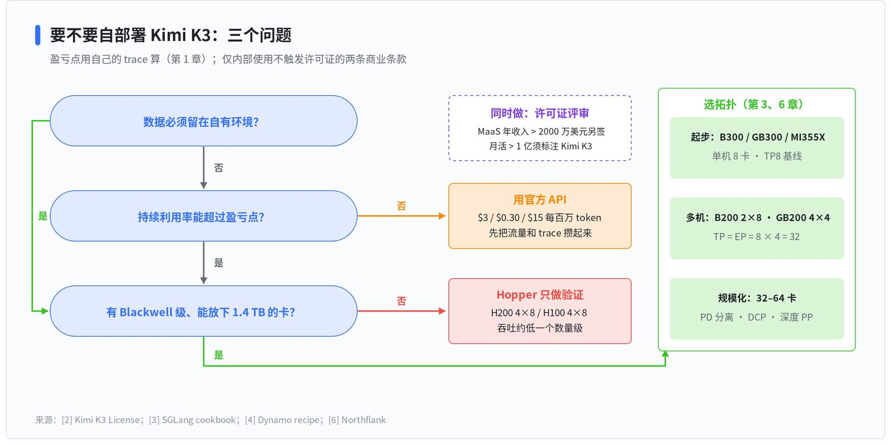
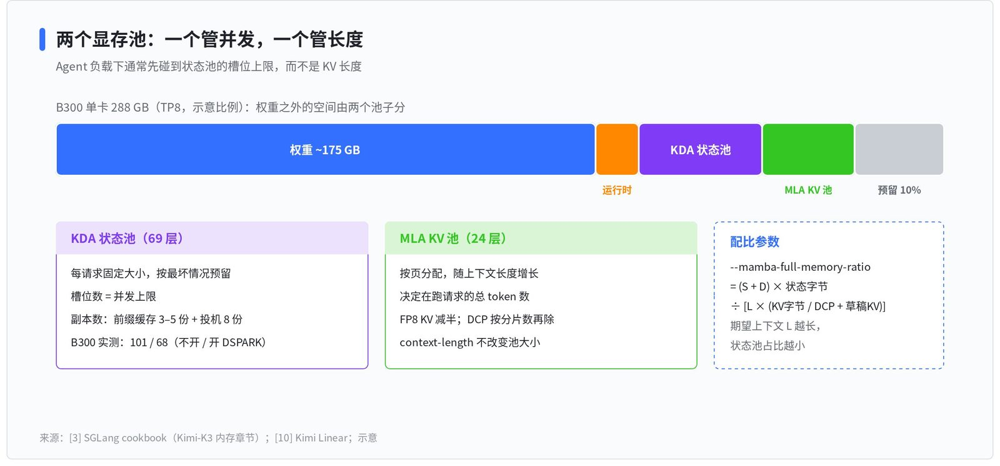
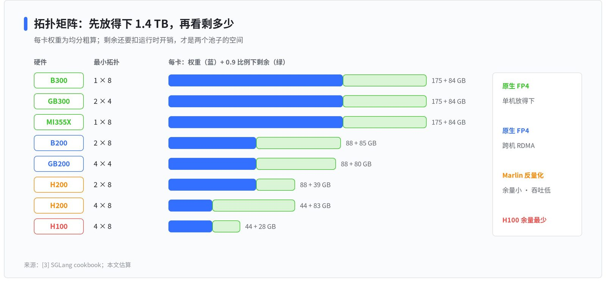
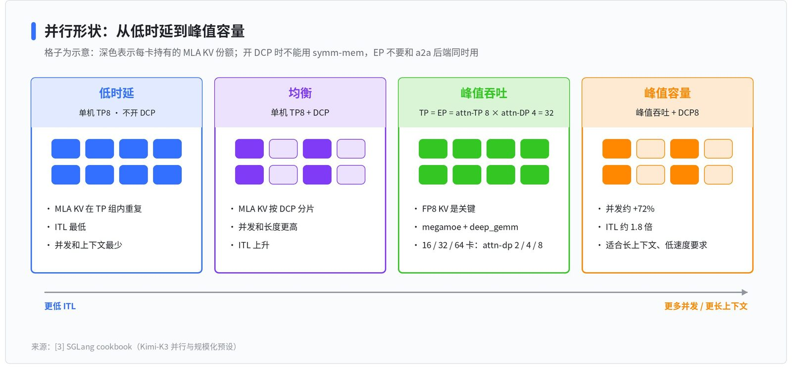
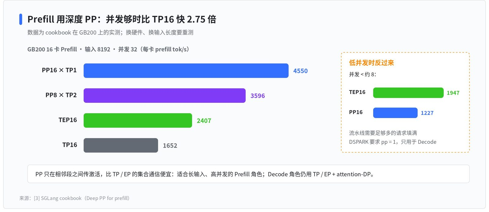
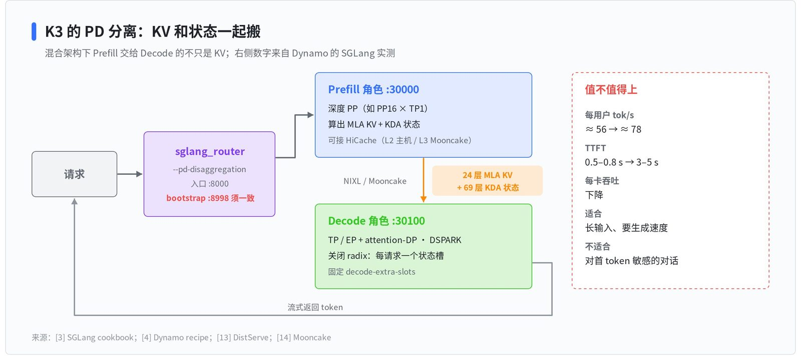
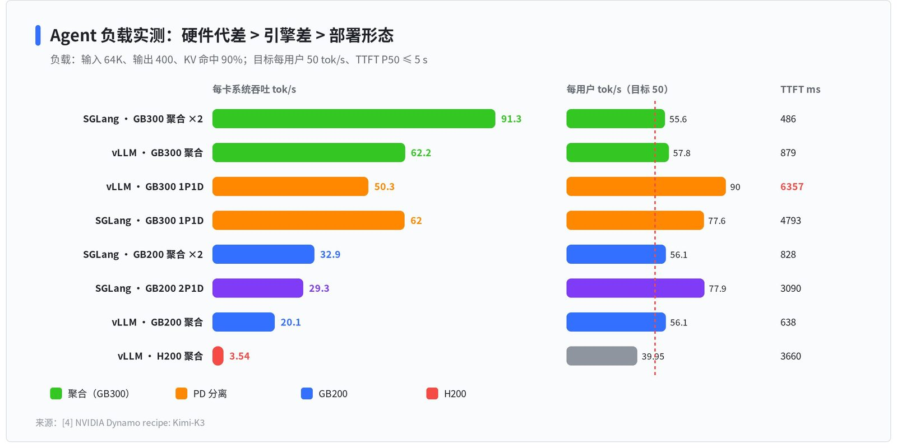

# LLM-52｜系统｜一线大模型部署：Kimi K3 从选型算账到多节点上线

> 🎯 **这篇文档解决什么问题**：第 51 篇用 DeepSeek-V4-Flash 走完了“单机跑通到弹性上线”的全流程。本篇换成一线旗舰：Kimi K3（2.8T 总参数、104B 激活、1M 上下文）。它的权重约 1.4 TB，单机放不下的情况很常见，官方建议 64 卡以上的超节点。问题因此变了：先算清楚值不值得自部署，再决定拓扑、并行方式和容量杠杆，最后才是上线。
>
> 使用方式：每章给结论、命令和踩坑表。命令和数字来自 2026 年 10 月公开的模型卡、SGLang cookbook 与 Dynamo recipe，K3 的引擎支持仍在快速迭代，上线前请回到原链接核对。文中的成本和容量推算是量级估计，以你自己的压测为准。
>
> 配套阅读：全流程方法论先看第 51 篇 [LLM-51｜系统｜自部署推理实战：DeepSeek-V4-Flash 从单机到弹性上线](./51-deepseek-v4-flash-deploy.md)；原理看 [LLM-08｜系统｜大模型推理系统：全栈学习手册](./08-inference-systems.md)；算账看 [LLM-13｜系统｜自建推理成本与 GPU 选型：算账手册](./13-inference-cost-gpu.md)；许可证与选型看 [LLM-44｜系统｜开源权重模型选型与自托管：许可证、节奏与微调](./44-open-weights.md)；上线后的稳定性看 [LLM-07｜系统｜LLM 服务稳定性工程：SRE 上线手册](./07-serving-reliability.md)。
>
> 📎 起点：消费级单卡（4090 / 5090）上的显存账、量化文件选择和单卡测法见第 50 篇 [LLM-50｜系统｜消费级单卡自部署：Qwen3.8-27B 跑在 4090 / 5090 上](./50-consumer-gpu-deploy.md)；三档顺序是第 50 篇（单卡）→ 第 51 篇（单机）→ 本篇（多节点）。
>
> 📎 边界：同一个 K3 在一台 CPU、8 GB 内存上能不能算对，要付出什么代价，见第 53 篇 [LLM-53｜系统｜单台 CPU 跑万亿参数 MoE：Kimi-K3-in-C 工程解剖](./53-kimi-k3-in-c.md)。那篇的字节账、校验闸门和测量纪律可以直接搬回本篇的多节点部署。

## 导读 · 先给结论

- **先算账，再部署**：K3 官方 API 是每百万 token 输入 \$3（缓存命中 \$0.30）、输出 \$15[[6]](https://northflank.com/blog/what-is-kimi-k3-self-hosting)[[7]](https://openrouter.ai/moonshotai/kimi-k3)。按 Dynamo 公布的 Agent 负载实测，GB300 上自部署的盈亏点大约在 10%–20% 的持续利用率；H200 上 vLLM 的实测吞吐低一个数量级，基本不划算[[4]](https://docs.nvidia.com/dynamo/dev/recipes/kimi-k3)。没有稳定大流量、也没有数据不出域要求的团队，先用 API。
- **许可证有两条商业条款**：以 K3 提供模型即服务且 12 个月收入超过 2000 万美元，需要另签协议；月活超过 1 亿或月收入超过 2000 万美元的产品要显著标注“Kimi K3”。仅内部使用、不对第三方提供时这两条都不触发[[2]](https://github.com/MoonshotAI/Kimi-K3/blob/main/LICENSE)。
- **显存要按两个池子算**：K3 是 KDA 线性注意力和 Gated MLA 的混合（69 层 + 24 层）[[1]](https://github.com/MoonshotAI/Kimi-K3)[[10]](https://arxiv.org/abs/2510.26692)。KDA 状态池按最坏情况预留，决定并发上限；MLA KV 池按页分配，决定能放多长的上下文。只调 context-length 不会让容量变大[[3]](https://docs.sglang.io/cookbook/autoregressive/Moonshotai/Kimi-K3)。
- **起步档位**：B300 / GB300 / MI355X 单机 8 卡能放下 MXFP4 权重；B200、H200 要 2 机 16 卡；H100 要 4 机 32 卡且余量最少[[3]](https://docs.sglang.io/cookbook/autoregressive/Moonshotai/Kimi-K3)。Hopper 走 Marlin 内核，速度和 Blackwell 不在一个量级。
- **容量杠杆按收益排序**：FP8 KV 缓存 → BF16 的 KDA 状态 → extra_buffer_lazy 前缀缓存策略 → 静态显存比例 0.90–0.92 → DCP 分片 MLA KV。投机解码（DSPARK / DFLASH）会把默认并发上限压到 48，要和不开投机的基线对比后再上。
- **多节点是常态，不是优化项**：并行维度有 TP、EP、attention-DP、DCP、PP 五个，Prefill 和 Decode 的最优形状不同。长输入场景用 PD 分离时，要同时传 MLA KV 和 KDA 状态[[3]](https://docs.sglang.io/cookbook/autoregressive/Moonshotai/Kimi-K3)[[13]](https://arxiv.org/abs/2401.09670)。
- **K3 有几处和别的模型不一样**：思考模式常开，多轮对话必须把带 reasoning_content 和 tool_calls 的完整 assistant 消息回传；输出偏长（约为同类中位数的 2 倍）；logprobs 和 stop_token_ids 目前不支持，在分离部署里可能导致崩溃[[1]](https://github.com/MoonshotAI/Kimi-K3)[[4]](https://docs.nvidia.com/dynamo/dev/recipes/kimi-k3)[[6]](https://northflank.com/blog/what-is-kimi-k3-self-hosting)。

下图是“该不该自部署、该上什么档位”的决策路径，后面各章按这个顺序展开。



> 🔑 **一句话版本**：先用 API 价格和你的流量算盈亏点，确认许可证条款；按“两个显存池”估容量，选能放下权重且有余量的拓扑；用 cookbook 的基线命令跑通，再按 FP8 KV、BF16 状态、前缀缓存策略、DCP 的顺序加容量；多节点和 PD 分离在压测证明有收益后再上。

## 第 1 章 · 先回答：要不要自部署

### 1.1 三个常见的“必须自部署”理由

- **数据不能出域**：合规要求请求和日志留在自有环境。这是最硬的理由，和成本无关。
- **稳定的大流量**：日均 token 量足够大，且峰谷比不高，集群能长期保持较高利用率。
- **需要改模型或改服务**：微调、定制解码、私有工具链路，或者要控制版本节奏、不能接受上游悄悄更新。

如果三条都不满足，K3 自部署大概率比 API 贵，而且要多养一个多节点集群和一支值班队伍。

### 1.2 用公开数据算一次盈亏点

以 Dynamo recipe 的 Agent 负载为例：输入 64K、输出 400、KV 命中 90%[[4]](https://docs.nvidia.com/dynamo/dev/recipes/kimi-k3)。按官方 API 价格[[6]](https://northflank.com/blog/what-is-kimi-k3-self-hosting)，一次请求约 \$0.0425：命中部分 57.6K × \$0.30/M ≈ \$0.017，未命中 6.4K × \$3/M ≈ \$0.019，输出 400 × \$15/M = \$0.006。自部署这边按每卡每小时 \$4–6 估算（假设值，请替换成你的实际单价）。

| 部署（来自 Dynamo 实测） | 卡数 | 每卡吞吐 tok/s | 满载请求/小时 | 等价 API 花费/小时 | 集群成本/小时（\$4–6/卡） | 盈亏点利用率 |
|---|---|---|---|---|---|---|
| SGLang · GB300 聚合 ×2 | 16 | 91.3 | ≈ 13,100 | ≈ \$558 | \$64–96 | ≈ 11%–17% |
| vLLM · GB300 聚合 | 16 | 62.2 | ≈ 9,000 | ≈ \$380 | \$64–96 | ≈ 17%–25% |
| SGLang · GB200 聚合 ×2 | 32 | 32.9 | ≈ 9,500 | ≈ \$403 | \$128–192 | ≈ 32%–48% |
| vLLM · H200 聚合 | 32 | 3.54 | ≈ 1,000 | ≈ \$43 | \$128–192 | 不可能回本 |

“满载”指 recipe 里满足 SLO 的并发，不是峰值吞吐；把输出吞吐除以 400 得到请求率。表里有两个结论：第一，Blackwell 新卡和 Hopper 之间差了一个量级，Hopper 上的 K3 更适合功能验证而不是承载流量；第二，盈亏利用率取决于引擎：GB300 上 SGLang 约 11%–17%、vLLM 约 17%–25%，低于该阈值才不如直接买 API。真实负载的命中率、输出长度和峰谷比都会改变这个数，算法不变：用你的 trace 替换三个参数重算。

> 💡 **别漏掉输出长度**：独立评测显示 K3 的输出 token 约为同类模型中位数的 2 倍[[6]](https://northflank.com/blog/what-is-kimi-k3-self-hosting)。API 账单和自部署的 Decode 压力都会随之放大，算账时用实测输出长度，不要用别的模型的经验值。

### 1.3 许可证：先读两条商业条款

| 条款 | 触发条件 | 要做什么 |
|---|---|---|
| 模型即服务 | 以 K3 对外提供 MaaS，任意连续 12 个月收入超过 2000 万美元 | 商用前和 Moonshot 另签协议 |
| 显著标注 | 产品月活超过 1 亿，或月收入超过 2000 万美元 | 在界面上显著展示“Kimi K3” |
| 内部使用 | 仅组织内部使用，不向第三方提供 | 两条都不触发 |

其余部分是 MIT 风格的宽松许可[[2]](https://github.com/MoonshotAI/Kimi-K3/blob/main/LICENSE)。许可证条款以仓库里的 LICENSE 原文为准，法务评审时把具体业务形态（是否对外、是否计费）写清楚。更系统的开源许可对比见 [LLM-44｜系统｜开源权重模型选型与自托管：许可证、节奏与微调](./44-open-weights.md)。

### 1.4 规模预期：这不是“一台机器”的项目

权重约 1.4 TB（1.27 TiB），Moonshot 推荐 64 卡以上的超节点[[6]](https://northflank.com/blog/what-is-kimi-k3-self-hosting)；cookbook 给出的最小可用档位是 8 张 288 GB 级别的卡[[3]](https://docs.sglang.io/cookbook/autoregressive/Moonshotai/Kimi-K3)。规划时按“至少两个副本 + 一套预发环境”算，最小的 B300 方案也是 24 卡起步。

## 第 2 章 · 从架构到显存：两个池子

### 2.1 和部署相关的架构参数

| 参数 | Kimi K3 | 对部署的影响 |
|---|---|---|
| 总参数 / 激活 | 2.8T / 104B | 权重决定最少卡数；激活量决定每 token 计算量 |
| 层数 | 93 层（1 层稠密），69 层 KDA + 24 层 Gated MLA | 只有 24 层产生随长度增长的 KV |
| 专家 | 896 个，每 token 选 16 个，2 个共享 | EP 的通信量和负载均衡是多节点的主要瓶颈 |
| 隐藏维度 / 注意力头 | 7168 / 96 | TP 切分粒度 |
| 上下文 | 1,048,576 | MLA KV 池决定实际能服务多长 |
| 权重格式 | MXFP4 权重 + MXFP8 激活（从 SFT 起做 QAT） | Blackwell 原生支持；Hopper 走 Marlin 反量化 |
| 多模态 | MoonViT-V2 视觉编码器（4 亿参数），图像输入 | 视觉特征占额外显存；仅支持图像 |

权重格式值得多说一句：MXFP4 是 OCP 微缩放格式的一种，每 32 个数共享一个缩放因子[[12]](https://www.opencompute.org/documents/ocp-microscaling-formats-mx-v1-0-spec-final-pdf)。K3 从 SFT 阶段就按这个格式做量化感知训练[[1]](https://github.com/MoonshotAI/Kimi-K3)[[8]](https://huggingface.co/blog/ResterChed/kimi-k3-model-overview-mxfp4-quantization-open-wei)，所以官方权重本身就是 FP4，不存在“先下 BF16 再量化”的步骤，也不建议自己再做一轮量化。cookbook 另有 NVFP4 变体，需要专门的镜像[[3]](https://docs.sglang.io/cookbook/autoregressive/Moonshotai/Kimi-K3)。

### 2.2 两个显存池

K3 的 KDA 层（Kimi Delta Attention，一种带门控的线性注意力[[10]](https://arxiv.org/abs/2510.26692)）不存逐 token 的 KV，而是每个请求维护一份固定大小的状态；Gated MLA 层沿用 MLA 的压缩 KV[[11]](https://arxiv.org/abs/2405.04434)。SGLang 因此把显存分成两块[[3]](https://docs.sglang.io/cookbook/autoregressive/Moonshotai/Kimi-K3)：

- **KDA 状态池**：按最坏情况预留，每个“槽位”能放一个请求的完整状态（外加前缀缓存和投机解码用的额外副本）。槽位数就是并发上限，跟请求长短无关。
- **MLA KV 池**：按页分配，随上下文长度增长。它决定所有在跑请求的总 token 数。



两个池子的比例由一个参数控制，cookbook 给出了推导公式：

*两个池子的配比
*

```text
--mamba-full-memory-ratio = (S + D) × state_bytes / (L × (mla_kv_bytes / DCP + draft_kv_bytes))S：每个请求的状态副本数（前缀缓存策略决定）   extra_buffer = 5, extra_buffer_lazy = 4, no_buffer = 3, 关闭 radix 缓存 = 1D：投机解码的额外状态副本，不开为 0，开启时为 block + 1（DSPARK 为 8）L：期望的平均上下文长度（token）DCP：MLA KV 的分片数；draft_kv_bytes：草稿模型每 token 约 1.4 KB
```

读这个公式的方法：分子是“一个请求要多少状态”，分母是“一个请求要多少 KV”。期望上下文越长，状态池占比越小；开投机解码会让分子从 4 变成 12，状态池迅速变大、并发上限下降。cookbook 在 B300 上实测，状态池会把可接纳的请求数卡在 101（MXFP4 不开投机）、68（MXFP4 + DSPARK）、91（NVFP4 不开投机）、60（NVFP4 + DSPARK）。

### 2.3 一次粗算：B300 单机能放多少

以 B300 单机 8 卡为例做量级估算（只为建立直觉，实际以启动日志里两个池子的槽位数和页数为准）：

1. 每卡 288 GB，按 0.9 的静态比例约 259 GB 可用；扣掉 175 GB 权重，剩约 84 GB。
2. 再扣运行时开销（CUDA graph、通信缓冲、视觉编码器、激活），每卡留 10–15 GB，剩约 70 GB，8 卡合计约 560 GB 给两个池子。
3. 状态池先按并发上限预留。cookbook 实测这台机器在均衡配置下约 100 个槽位（MXFP4、不开投机），开 DSPARK 后约 70 个。
4. 剩下的给 MLA KV。只有 24 层产生 KV，且 MLA 本身是压缩表示，开 FP8 后每 token 的 KV 很小，几百 GB 能放下数千万 token 的量级，所以对 Agent 负载来说，先碰到的往往是状态池的槽位上限，而不是 KV。

这个结论和稠密注意力模型正好相反：后者的瓶颈通常是 KV 长度，前者的瓶颈是“同时在跑的请求数”。所以 K3 的容量调优优先看状态池：状态精度、前缀缓存的副本数、投机解码的副本数，这三个都直接改变槽位数。

> 💡 **最常见的误解**：把 --context-length 调小以为能多放并发。它不改变 KV 池大小，真正增加容量的是 FP8 KV 缓存；并发上限则主要受 KDA 状态池约束[[3]](https://docs.sglang.io/cookbook/autoregressive/Moonshotai/Kimi-K3)。

## 第 3 章 · 硬件与拓扑：先放得下，再跑得快

### 3.1 cookbook 给出的最小档位

| 硬件 | 最小拓扑 | 每卡权重（约） | 0.9 显存比例下剩余（约） | 备注 |
|---|---|---|---|---|
| B300 | 1 × 8 | 175 GB | 84 GB | 单机即可，起步首选 |
| GB300 | 2 × 4 | 175 GB | 84 GB | NVL 域内互联，需 DRA ComputeDomain |
| MI350X / MI355X | 1 × 8 | 175 GB | 84 GB | ROCm 路径，内核成熟度单独验证 |
| B200 | 2 × 8 | 88 GB | 85 GB | 跨机走 RDMA |
| GB200 | 4 × 4 | 88 GB | 80 GB | Dynamo 主要验证平台之一 |
| H200 | 2 × 8（高吞吐用 4 × 8） | 88 GB / 44 GB | 39 GB / 83 GB | Marlin + FlashMLA，吞吐低 |
| H100 | 4 × 8 | 44 GB | 28 GB | 余量最小，长上下文吃紧 |
| 昇腾 A3 / 950 | 4 × 8 | — | — | A3 为 32 卡 64 die，按厂商镜像部署 |

最小拓扑来自 cookbook[[3]](https://docs.sglang.io/cookbook/autoregressive/Moonshotai/Kimi-K3)；每卡权重是 1.4 TB 均分的粗算，剩余显存还要扣掉运行时开销（CUDA graph、通信缓冲、视觉编码器），实际 KV 和状态能用的更少。H200 两机方案只剩约 39 GB，能跑通，但并发和上下文都很受限，这也是 Dynamo 的 H200 recipe 用 4 机 32 卡的原因[[4]](https://docs.nvidia.com/dynamo/dev/recipes/kimi-k3)。



### 3.2 网络与存储

- **跨机必须 RDMA**：EP 的 All-to-All 和 PD 的状态传输都依赖 RDMA。容器没拿到 IB 设备时 NCCL 和 NIXL 会悄悄退回 TCP，服务能起来，性能掉一大截（自检方法见第 51 篇第 9 章）。
- **GB200 / GB300 要 DRA**：NVL72 机柜内的多节点互联在 K8s 上需要 DRA 驱动和 ComputeDomain 资源{c(4)}。
- **权重存储按 1.4 TB 规划**：放在节点本地 NVMe 或 RWX 共享卷。按 1 GB/s 的持续读取，冷加载约 23 分钟；10 GB/s 约 2–3 分钟。远端对象存储冷拉可能是小时级{c(4)}。

## 第 4 章 · 选引擎、锁版本

| 选项 | 适合 | 注意 |
|---|---|---|
| SGLang | 功能最全：DCP、深度 PP、HiCache、PD 分离、DSPARK / DFLASH 都有文档和实测 | cookbook 说明各配置的精度尚未逐一复测，上线前自己跑评测 |
| vLLM | 已有 Hopper / Blackwell 的聚合与 PD 配方，生态和监控成熟 | 配方集中在 recipes 站点，K3 相关参数仍在变化 |
| TokenSpeed | 模型卡列出的第三个官方支持引擎 | 公开资料较少，按需评估 |
| Dynamo（编排层） | 在 K8s 上组织多节点、PD 角色和按 SLO 伸缩，底层可接 SGLang 或 vLLM | 有自己的健康检查和已知限制，见第 9 章 |

模型卡列出的推理引擎是 vLLM、SGLang 和 TokenSpeed[[1]](https://github.com/MoonshotAI/Kimi-K3)；vLLM 的配方入口已迁到 recipes 站点[[5]](https://recipes.vllm.ai)。选择建议：先用 SGLang 在单机或最小拓扑上跑通，因为它对 K3 两个显存池的参数暴露得最完整；上 K8s 时用 Dynamo 组织多节点，引擎按团队熟悉度选。

### 4.1 版本清单

- 镜像 digest：例如 lmsysorg/sglang 的具体 tag，NVFP4 变体用专门镜像 lmsysorg/sglang:dev-dev-kimi-k3-nvfp4。
- 模型 revision：Hugging Face 上 moonshotai/Kimi-K3 的 commit。
- 解析器：--reasoning-parser kimi_k3 和 --tool-call-parser kimi_k3，二者缺一，思考内容和工具调用都会解析错。
- 启动参数文件：两个池子的比例、KV 和状态的数据类型、前缀缓存策略、显存比例、并行形状。

*安装
*

```bash
# 方式一：pip 安装（需允许预发布版本）uv pip install --prerelease=allow sglang# 方式二：官方镜像docker pull lmsysorg/sglang:latest# NVFP4 变体docker pull lmsysorg/sglang:dev-dev-kimi-k3-nvfp4
```

## 第 5 章 · 第一次跑通

### 5.1 下载权重

*下载
*

```bash
# 先下到节点本地 NVMe 或共享卷，约 1.4 TBexport HF_HOME=/mnt/nvme/hfhuggingface-cli download moonshotai/Kimi-K3 --local-dir /mnt/nvme/models/Kimi-K3# 校验后离线运行，避免启动时再去访问远端export HF_HUB_OFFLINE=1
```

### 5.2 单机 8 卡（B300 / GB300 / MI355X）

*B300 单机基线（在 cookbook 低时延配置上加了容量参数）
*

```bash
sglang serve --trust-remote-code \  --model-path /mnt/nvme/models/Kimi-K3 \  --tp-size 8 \  --kv-cache-dtype fp8_e4m3 \  --mamba-ssm-dtype bfloat16 \  --mamba-radix-cache-strategy extra_buffer_lazy \  --mem-fraction-static 0.90 \  --reasoning-parser kimi_k3 --tool-call-parser kimi_k3 \  --host 0.0.0.0 --port 30000
```

Blackwell 上 MoE 和注意力后端保持默认即可，cookbook 明确建议不要手动指定[[3]](https://docs.sglang.io/cookbook/autoregressive/Moonshotai/Kimi-K3)。第一次启动会经历权重加载、编译和 CUDA graph 捕获，几十分钟是正常的[[4]](https://docs.nvidia.com/dynamo/dev/recipes/kimi-k3)，探针超时要放宽。

### 5.3 显存较小时：多模态低显存配置

*cookbook 的低 HBM 多模态配置
*

```bash
sglang serve --trust-remote-code \  --model-path /mnt/nvme/models/Kimi-K3 \  --tp-size 8 --context-length 65536 \  --enable-symm-mem \  --mem-fraction-static 0.82 \  --mm-feature-transport cpu \  --reasoning-parser kimi_k3 --tool-call-parser kimi_k3 \  --port 30000
```

这里的 --mm-feature-transport cpu 把视觉特征放到 CPU 侧传递，给 KV 和状态池腾显存；显存比例降到 0.82 是为了给视觉编码器留余量。

### 5.4 Hopper：H200 2 × 8

H100 / H200 没有原生 FP4，cookbook 用 Marlin 处理 MoE、FlashMLA 处理注意力[[3]](https://docs.sglang.io/cookbook/autoregressive/Moonshotai/Kimi-K3)。两机拓扑下每卡剩余显存不到 40 GB，建议只用来验证功能和兼容性；要承载流量请用 4 × 8，并先按第 1 章重新算账。多机启动时每台机器传 --nnodes、--node-rank 和 --dist-init-addr，形状见第 6 章。

### 5.5 冒烟测试

*冒烟
*

```bash
curl -s http://localhost:30000/v1/chat/completions -H 'Content-Type: application/json' -d '{  "model": "moonshotai/Kimi-K3",  "messages": [{"role": "user", "content": "用一句话解释 KV 缓存"}],  "reasoning_effort": "low",  "temperature": 1.0, "top_p": 0.95,  "max_tokens": 2048}' | jq '.choices[0].message | {reasoning_content: (.reasoning_content|.[0:120]), content}' 
```

| 检查项 | 期望 | 不对时 |
|---|---|---|
| reasoning_content | 有思考内容，且没混进 content | 漏了 --reasoning-parser kimi_k3 |
| 工具调用 | tool_calls 是结构化字段 | 漏了 --tool-call-parser kimi_k3 |
| 推理档位 | low / high / max 输出长度明显不同 | 客户端没传 reasoning_effort（默认 max） |
| 回答为空 | finish_reason 不是 length | max_tokens 太小，预算耗在思考上 |
| 图像输入 | 能描述图片 | 多模态参数或显存比例不对 |

> 🔑 **采样参数**：官方评测用 temperature 1.0；单步任务 top_p 0.95，Agent 任务 top_p 1.0[[1]](https://github.com/MoonshotAI/Kimi-K3)。思考模式常开，没有“关闭思考”的选项，只能用 reasoning_effort 控制预算，默认是 max。

## 第 6 章 · 并行形状：五个维度怎么组合

| 维度 | 切什么 | 什么时候用 |
|---|---|---|
| TP（张量并行） | 每层的矩阵 | 基线；单机内首选 |
| EP（专家并行） | 896 个专家分到不同卡 | 多节点必用，和 TP 同宽（tp = ep） |
| attention-DP | 注意力部分按数据并行 | 高吞吐：避免 MLA KV 在 TP 组内重复 |
| DCP（解码上下文并行） | 把 TP 组内重复的 MLA KV 分片 | 要更多并发或更长上下文；代价是时延升高 |
| PP（流水线并行） | 按层切成多段 | Prefill 专用角色；Decode 一般不用 |

cookbook 把单机配置分成三档[[3]](https://docs.sglang.io/cookbook/autoregressive/Moonshotai/Kimi-K3)：低时延（不开 DCP）、均衡（开 DCP）、高吞吐。规模化后有两个预设：**峰值吞吐**（attention-TP 8，FP8 KV 是关键）和**峰值容量**（在前者基础上加 DCP8，并发提高约 72%，ITL 约变为 1.8 倍）。



### 6.1 多节点命令（32 卡）

*cookbook 32 卡配置
*

```bash
SGLANG_OPT_DEEPGEMM_MEGA_MOE_NUM_MAX_TOKENS_PER_RANK=20480 \sglang serve --trust-remote-code --model-path /mnt/nvme/models/Kimi-K3 \  --tp-size 32 --ep-size 32 --attn-dp-size 4 --enable-dp-lm-head \  --nnodes 4 --node-rank <rank> --dist-init-addr <node0-ip>:20000 \  --moe-a2a-backend megamoe --moe-runner-backend deep_gemm \  --kv-cache-dtype fp8_e4m3 --mamba-ssm-dtype bfloat16 \  --mamba-radix-cache-strategy extra_buffer_lazy \  --mem-fraction-static 0.92 \  --reasoning-parser kimi_k3 --tool-call-parser kimi_k3 \  --host 0.0.0.0 --port 30000
```

| 卡数 | tp = ep | attn-dp |
|---|---|---|
| 16 | 16 | 2 |
| 32 | 32 | 4 |
| 64 | 64 | 8 |

规律是 attention-DP 每组保持 8 卡。开 DCP 时有两条限制：不能用 symm-mem，EP 也不要和 a2a 后端同时用，cookbook 的 DCP 配置都按这个约束给出。

### 6.2 Prefill 用深度 PP

cookbook 在 GB200 上测了 16 卡 Prefill（输入 8192，并发 32）：PP16×TP1 达到每卡 4550 token/s，PP8×TP2 为 3596，TEP16 为 2407，纯 TP16 只有 1652[[3]](https://docs.sglang.io/cookbook/autoregressive/Moonshotai/Kimi-K3)。PP 的通信只发生在相邻段之间，比 TP 和 EP 的集合通信便宜得多，适合计算密集的长输入 Prefill。但它需要足够的并发填满流水线：并发低于约 8 时，TEP16 反而更好（1947 对 1227）。



### 6.3 专家并行的负载均衡

896 个专家、每 token 选 16 个，意味着 EP 规模越大，每张卡上的专家越少，热点专家造成的负载不均就越明显。大规模 EP 的公开经验（例如 DeepSeek 在 96 张 H100 上的 PD + EP 部署[[15]](https://www.lmsys.org/blog/2025-05-05-large-scale-ep/)）有三条可以直接借用：用冗余专家复制热点、按真实流量统计重新排布专家、把 All-to-All 通信和计算重叠。K3 的 cookbook 在 32 卡以上配置里用 megamoe 作为 a2a 后端、deep_gemm 作为 MoE 执行后端，并通过 SGLANG_OPT_DEEPGEMM_MEGA_MOE_NUM_MAX_TOKENS_PER_RANK 限制每个 rank 一次处理的 token 数，避免长 Prefill 把通信缓冲撑爆。

观测上，至少要按 rank 采集每步耗时：如果某几个 rank 长期比其他 rank 慢，多半是专家负载不均或该机网络异常，而不是整体算力不够。

实践上：做 PD 分离时，Prefill 角色用深度 PP、Decode 角色用 TP / EP + attention-DP；聚合部署则按 Decode 的需求选形状。注意 DSPARK 投机解码要求 pp = 1，所以它只能用在 Decode 侧。

## 第 7 章 · 容量杠杆与投机解码

### 7.1 按收益排序的五个杠杆

| 杠杆 | 参数 | 效果 | 代价 |
|---|---|---|---|
| FP8 KV 缓存 | --kv-cache-dtype fp8_e4m3 | MLA KV 减半，峰值吞吐预设的关键 | 需验证精度 |
| BF16 KDA 状态 | --mamba-ssm-dtype bfloat16 | 状态约减半，并发上限提高 | 需验证精度 |
| 前缀缓存策略 | --mamba-radix-cache-strategy extra_buffer_lazy | 状态副本从 5 降到 4，保留前缀缓存 | 几乎无 |
| 静态显存比例 | --mem-fraction-static 0.90–0.92 | 给两个池子更多空间 | 太高易 OOM |
| DCP 分片 | --dcp-size（如 8） | 峰值容量预设：并发 +72% | ITL 约 1.8 倍 |

另一个开关是环境变量 SGLANG_OPT_MAMBA_SKIP_DECODE_LOCK=1，cookbook 用它减少 Decode 阶段状态池的锁开销。调参仍然是一次只动一个，每动一次都重新压测并记录并发上限。

### 7.2 一套可复用的调参顺序

1. 用 5.2 的基线命令启动，记录启动日志里的状态池槽位数、KV 池页数和最大并发。
2. 跑一遍并发扫描，得到基线的 SLO 内并发和每卡吞吐。
3. 以 5.2 的生产配置（已同时开启 FP8 KV、BF16 状态和 extra_buffer_lazy）为基准，逐项回退其中一项做对照，固定其余条件并重复测试，同时跑一遍精度评测。
4. 把静态显存比例从 0.90 提到 0.92，观察是否出现 OOM 或 CUDA graph 捕获失败。
5. 如果并发已够、但上下文不够：开 DCP；如果上下文够、但每用户速度不够：试投机解码或 PD 分离。
6. 把最终参数写回版本清单，附上每一步的压测结果，方便以后升级时对比。

### 7.3 投机解码：DSPARK 和 DFLASH

- **DSPARK**：每步草稿 7 个 token，要求 pp = 1，各硬件都可用。
- **DFLASH**：块大小 8，只支持 Blackwell。
- **容量代价**：投机解码要给每个请求多存 8 份状态（公式里的 D），加上草稿模型约 1.4 KB/token 的 KV。B300 上实测，MXFP4 的并发上限从 101 降到 68。
- **默认上限**：开启投机解码且没设置 --max-running-requests 时，引擎会把它重置为 48。要更高并发得显式设置，并确认状态池放得下。

> 💡 **别直接相信投机解码的加速数字**：cookbook 的 DSPARK 结果用 SGLANG_SIMULATE_ACC_LEN=4.5 模拟接受长度[[3]](https://docs.sglang.io/cookbook/autoregressive/Moonshotai/Kimi-K3)，真实负载的接受长度可能更低。用你的 trace 分别跑“开”和“不开”，比较 SLO 内的每卡吞吐，而不是只看单请求 ITL。并发高时，投机解码的收益通常会消失。

## 第 8 章 · PD 分离与分层缓存

### 8.1 K3 的 PD 分离多传一样东西

PD 分离把 Prefill 和 Decode 放到不同的卡组上，分别按 TTFT 和 ITL 优化[[13]](https://arxiv.org/abs/2401.09670)。对 K3 这种混合架构，Prefill 结束后要传过去的不只是 24 层的 MLA KV，还有 69 层的 KDA 状态[[3]](https://docs.sglang.io/cookbook/autoregressive/Moonshotai/Kimi-K3)。CUDA 平台默认走 NIXL（RDMA），也可以选 Mooncake[[14]](https://arxiv.org/abs/2407.00079)；昇腾平台用 --disaggregation-transfer-backend ascend。



*PD 分离骨架（并行参数按第 6 章补全）
*

```bash
# Prefill 节点：端口 30000，bootstrap 端口 8998sglang serve ... --disaggregation-mode prefill --disaggregation-bootstrap-port 8998 --port 30000# Decode 节点：端口 30100sglang serve ... --disaggregation-mode decode --port 30100# 路由python3 -m sglang_router.launch_router --pd-disaggregation \  --prefill http://<prefill-ip>:30000 8998 \  --decode http://<decode-ip>:30100 \  --host 0.0.0.0 --port 8000 \  --disable-circuit-breaker --health-check-interval-secs 999999
```

| 坑 | 现象 | 处理 |
|---|---|---|
| bootstrap 端口不一致 | 只有 Decode 注册上，请求挂起 | --prefill 后面的 8998 必须等于 --disaggregation-bootstrap-port |
| 端口段冲突 | 同机部署时启动报错或串号 | Prefill / Decode 端口拉开（30000 / 30100），派生端口段不要重叠 |
| Decode 额外槽位没固定 | 低并发和高并发下行为不一致 | 显式设置 --disaggregation-decode-extra-slots；不设时并发小于 32 默认是批大小的 2 倍，大于 32 为 0 |
| Decode 侧前缀缓存 | 以为调了策略能省显存 | Decode 关闭 radix 缓存，每请求一个槽位，--mamba-radix-cache-strategy 不生效 |
| RDMA 没生效 | TTFT 比聚合部署还差 | 按第 51 篇 9.4 做自检 |

收益要靠数据证明。Dynamo 的实测（见第 10 章）里，PD 分离把每用户输出速度从约 56 提高到约 78 token/s，但 TTFT 从 0.5–0.8 秒变成 3–5 秒，每卡系统吞吐也更低[[4]](https://docs.nvidia.com/dynamo/dev/recipes/kimi-k3)。也就是说，PD 分离换来的是更快、更稳的 Decode，代价是首 token 和卡数，适合对生成速度敏感、输入很长的 Agent 场景。

### 8.2 分层缓存（HiCache）

Agent 负载的前缀命中率很高（Dynamo 的目标负载按 90% 设计），GPU 上放不下的前缀可以下沉到主机内存（L2），再下沉到 Mooncake 这样的分布式存储（L3）[[3]](https://docs.sglang.io/cookbook/autoregressive/Moonshotai/Kimi-K3)[[14]](https://arxiv.org/abs/2407.00079)。SGLang 通过 --enable-hierarchical-cache 打开，--hicache-ratio 控制主机和设备的 token 比例，按主机内存预算设置。限制：启用 L3 时不能同时用 DCP。

> 🔑 **先测命中率，再决定要不要 HiCache**：在网关记录每个请求的前缀命中 token 数；如果 GPU 上的命中率已经接近上限、淘汰频繁，HiCache 才有意义。命中率本身低时，问题在 prompt 设计（把稳定部分放前面），不在缓存层级。

## 第 9 章 · 用 Dynamo 上 K8s

### 9.1 准备工作

1. GB200 / GB300 集群先装 DRA 驱动并配置 ComputeDomain[[4]](https://docs.nvidia.com/dynamo/dev/recipes/kimi-k3)。
2. 建 RWX 的 PVC 存放权重，先用一个下载 Job 把 1.4 TB 拉进去。recipe 里这个 Job 的等待超时是 14400 秒，冷缓存下载可能要几个小时。
3. 下载完成后在推理 Pod 里设置 HF_HUB_OFFLINE=1，避免启动时访问远端。
4. 按目标拓扑选 recipe：Dynamo 为 vLLM 和 SGLang 分别提供了 H200、GB200、GB300 的聚合和 PD 配置。

| 引擎 | 目标 | 形状 |
|---|---|---|
| vLLM | H200 32 卡 | TP8 × PP4，BF16 KV |
| vLLM | GB200 16 卡 | TP16 |
| vLLM | GB300 16 卡 | DCP16 + TEP16，DSPARK |
| vLLM | GB300 1P1D | 每个角色 TP8 |
| SGLang | GB300 两副本 | DCP8 |
| SGLang | GB200 32 卡（两副本） | DCP16 + TEP16 |
| SGLang | GB200 48 卡 | 2P1D |
| SGLang | GB300 | 1P1D |

### 9.2 启动与冒烟

*Dynamo 部署流程
*

```bash
kubectl apply -f model-cache-pvc.yamlkubectl apply -f model-download-job.yamlkubectl wait --for=condition=complete job/model-download --timeout=14400skubectl apply -f deploy.yaml          # DynamoGraphDeploymentkubectl get pods -w                   # 首次启动需要几十分钟kubectl port-forward svc/${DGD}-frontend 8000:8000curl -s localhost:8000/v1/models
```

### 9.3 已知问题

| 问题 | 原因 | 处理 |
|---|---|---|
| 副本被反复判定不健康 | 健康检查的探测请求只有 3 秒超时（DYN_HEALTH_CHECK_REQUEST_TIMEOUT），K3 思考加长 Prefill 很容易超时 | 调大超时；recipe 的临时办法是 DYN_HEALTH_CHECK_ENABLED=false，此时要靠 K8s 探针兜底 |
| 结构化输出跑进 reasoning_content | 顶层不是对象的 JSON 结构化输出 | 让 schema 顶层为对象；客户端兼容从 reasoning_content 取 |
| logprobs / stop_token_ids | 暂不支持，在分离部署里可能导致崩溃 | 在网关层拦截这两个参数 |

### 9.4 探针与优雅退出

*探针示例（数值按自己的启动和请求耗时调整）
*

```yaml
startupProbe:            # 覆盖权重加载 + 编译 + CUDA graph 捕获  httpGet: {path: /health, port: 30000}  periodSeconds: 30  failureThreshold: 120  # 最长 60 分钟readinessProbe:  httpGet: {path: /health, port: 30000}  periodSeconds: 10  timeoutSeconds: 30     # 不要用 1–3 秒，长 Prefill 时会误判livenessProbe:  httpGet: {path: /health, port: 30000}  periodSeconds: 30  timeoutSeconds: 30  failureThreshold: 6terminationGracePeriodSeconds: 900   # 等在跑的长请求完成
```

多节点副本还有一个特殊点：任何一个节点的 Pod 挂了，整个副本都不可用。所以探针要配在“副本”这一层（Dynamo 的部署对象或 LeaderWorkerSet 这类多 Pod 组），并保证整组一起重建，而不是只重启单个 Pod 后卡在等待集合通信初始化。

弹性方面，第 51 篇的方法同样适用：用排队和 KV 占用作信号[[18]](https://docs.cloud.google.com/kubernetes-engine/docs/best-practices/machine-learning/inference/autoscaling)，按启动耗时提前扩，空闲副本优先休眠[[16]](https://github.com/ai-dynamo/dynamo/blob/main/docs/fern/pages/developer-guide/knowledge-base/modular-components/planner/planner-guide.md)[[17]](https://github.com/vllm-project/vllm/blob/main/docs/features/sleep_mode.md)。区别在于 K3 的一个副本是 8–32 张卡，启动以十分钟计，扩一次的粒度和代价都大得多，最小副本数要按“启动耗时内的流量增长”留足。

## 第 10 章 · 用 Agent 负载压测

Dynamo recipe 用一份模拟 Agent 编码的负载做基准：输入 64K、输出 400、KV 命中 90%，目标是每用户 50 token/s、TTFT P50 不超过 5 秒[[4]](https://docs.nvidia.com/dynamo/dev/recipes/kimi-k3)。这比“1K 进 1K 出”更接近 K3 的真实用途：长上下文、高命中、短输出（但思考 token 会让真实输出更长）。

| 引擎 / 部署 | 并发 | 每卡系统吞吐 tok/s | 每用户 tok/s | TTFT ms |
|---|---|---|---|---|
| SGLang · GB200 聚合 ×2 | 28 | 32.9 | 56.1 | 828 |
| SGLang · GB200 2P1D | 24 | 29.3 | 77.9 | 3090 |
| SGLang · GB300 聚合 ×2 | 36 | 91.3 | 55.6 | 486 |
| SGLang · GB300 1P1D | 18 | 62.0 | 77.6 | 4793 |
| vLLM · H200 聚合 | 4 | 3.54 | 39.95 | 3660 |
| vLLM · GB200 聚合 | 7 | 20.1 | 56.1 | 638 |
| vLLM · GB300 聚合 | 24 | 62.2 | 57.8 | 879 |
| vLLM · GB300 1P1D | 16 | 50.3 | 90.0 | 6357 |



- **硬件代差最大**：同为 SGLang 聚合，GB300 的每卡吞吐是 GB200 的约 2.8 倍；H200 上 vLLM 只有 3.5，而且每用户速度达不到 50 的目标。
- **PD 分离换 Decode 速度**：每用户速度提高 40%–55%，TTFT 升到 3–6 秒，每卡吞吐下降。
- **引擎差异存在但小于硬件差异**：GB300 聚合下 SGLang 比 vLLM 高约 47%，但两者都在快速迭代，这个差距会变。
- **并发都很低**：64K 输入下单副本只能承载十几到几十个并发，这是第 2 章两个显存池的直接结果。

### 10.1 自己压测时

1. 用自己的 trace 统计输入长度、输出长度（含思考）、前缀命中率和推理档位分布。
2. 按并发扫描，记录每档的每卡吞吐、每用户速度和 TTFT 分位数，找 SLO 内的最大并发（方法见第 51 篇第 5 章）。
3. 分别测“开 / 不开投机解码”“聚合 / PD 分离”“DCP 开 / 关”，每次只改一项。
4. 把结果代回第 1 章的盈亏点公式，确认规模和成本。
5. 上线前用公开评测集或业务评测集复测精度：cookbook 说明各配置的精度尚未逐一复测。

## 第 11 章 · 运营要点与上线清单

### 11.1 调用侧必须知道的事

- **保留思考链**：多轮对话和工具调用时，要把上一轮完整的 assistant 消息（含 reasoning_content 和 tool_calls）原样回传，否则效果会明显下降[[1]](https://github.com/MoonshotAI/Kimi-K3)。很多 OpenAI 兼容 SDK 默认会丢掉 reasoning_content，网关层要检查。
- **推理档位**：reasoning_effort 有 low / high / max 三档，默认 max。给调用方一个明确的默认值，不然所有请求都按最贵的档位跑。
- **输出偏长、偏主动**：独立评测提到 K3 输出长、在 Agent 场景里有时过于主动[[6]](https://northflank.com/blog/what-is-kimi-k3-self-hosting)。max_tokens 和工具权限要在服务端设上限。
- **能力边界**：多模态只支持图像，不支持视频和音频。
- **和闭源旗舰的差距**：K3 在 GPQA（93.5）、Terminal-Bench 2.1（88.3）、BrowseComp（91.2）等榜单上成绩很好[[1]](https://github.com/MoonshotAI/Kimi-K3)，独立评测认为整体仍略落后于最强的闭源模型[[6]](https://northflank.com/blog/what-is-kimi-k3-self-hosting)[[9]](https://www.morphllm.com/kimi-k3)。用业务评测集说话。

*保留思考链
*

```python
# 多轮工具调用时正确回传历史（OpenAI 兼容 SDK）resp = client.chat.completions.create(model="moonshotai/Kimi-K3", messages=msgs,                                      tools=tools, extra_body={"reasoning_effort": "high"})m = resp.choices[0].messagemsgs.append({    "role": "assistant",    "content": m.content,    "reasoning_content": getattr(m, "reasoning_content", None),  # 不要丢    "tool_calls": m.tool_calls,                                   # 不要丢})for call in m.tool_calls or []:    msgs.append({"role": "tool", "tool_call_id": call.id, "content": run_tool(call)})
```

### 11.2 成本与容量的日常观测

- **按推理档位拆账**：统计 low / high / max 三档的请求占比、平均输出长度和 GPU 时间，max 档通常贡献了不成比例的成本。
- **思考 token 占比**：reasoning_content 的 token 数和最终回答的比例，异常升高往往意味着 prompt 或档位设置有问题。
- **两个池子的水位**：状态池槽位占用和 KV 池页占用分别告警，前者满了要扩副本，后者满了先看是否有异常长请求。
- **每百万输出 token 的实际成本**：集群小时成本除以实际输出量，和 API 价格放在同一张图上，低于盈亏点时及时缩容或回切 API。

### 11.3 排障速查

| 现象 | 先看什么 | 常见原因与处理 |
|---|---|---|
| 并发上不去 | 启动日志里状态池槽位数 | KDA 状态池满；改 BF16 状态、extra_buffer_lazy，或减少投机解码副本 |
| 开了投机解码后并发变成 48 | --max-running-requests | 未显式设置时被重置为 48 |
| 长上下文请求被拒或排队 | MLA KV 池占用 | 开 FP8 KV 或 DCP；context-length 不影响池大小 |
| 多轮效果变差 | 回传的历史消息 | 丢了 reasoning_content 或 tool_calls |
| 分离部署崩溃 | 请求参数 | 客户端传了 logprobs 或 stop_token_ids |
| 副本被反复摘除 | 健康检查日志 | Dynamo 3 秒探测超时，见 9.3 |
| 跨机性能远低于预期 | NCCL / NIXL 日志 | RDMA 退回 TCP |
| Hopper 上 OOM | 每卡剩余显存 | H100 / H200 两机余量太小；降 mem-fraction、缩上下文或加机器 |

### 11.4 上线清单

1. 盈亏点已用自己的 trace 计算，并经业务和财务确认。
2. 许可证评审完成：是否对外提供、收入和月活是否触发两条商业条款。
3. 版本清单固定：模型 revision、镜像 digest、引擎版本、解析器、启动参数文件。
4. 两个显存池的配比、KV 和状态的数据类型已按压测结果定稿，并记录各自的上限。
5. 精度已在评测集上复测，覆盖所选的量化和投机解码配置。
6. 网关层：保留思考链、默认推理档位、max_tokens 上限、拦截 logprobs 和 stop_token_ids。
7. 健康检查和探针按最长 Prefill 加思考的场景验证过。
8. 权重在节点本地或 RWX 卷上，冷启动耗时已测量；最小副本数覆盖启动耗时内的流量增长。
9. 多节点和 PD 部署已做 RDMA 自检，状态传输失败有告警。
10. 有回滚路径：上一版清单可一键恢复；必要时可切回官方 API 作为降级通道。

> ✅ **可以带走的方法**（适用于任何超大开源模型）：
>
> 1. 先用 API 价格和自己的负载算盈亏点，再谈部署。
> 2. 读懂模型的注意力结构，按它实际占用的显存池估容量。
> 3. 选“能放下权重且有余量”的最小拓扑跑通，版本写进清单。
> 4. 按数据类型、缓存策略、显存比例、分片的顺序加容量，一次动一项。
> 5. 投机解码和 PD 分离都要和基线对比，用 SLO 内每卡吞吐判断收益。
> 6. 在网关层处理模型特有的调用约束，别指望每个调用方都记得。

## 第 12 章 · 社区踩坑汇总（2026-10）

K3 发布后，社区里最完整的一份第一手记录是 16 × H200 的部署报告 [[19]](https://huggingface.co/moonshotai/Kimi-K3/discussions/136)：SGLang 用 TP16 + EP16、Marlin 内核、FlashMLA、mem-fraction 0.85 跑通，冷启动 13 分钟（1.56 TB 权重加载 11.2 分钟），单流 16.8 tok/s，54 并发合计 147 tok/s。这个量级印证了第 1 章的判断：Hopper 上自部署 K3 适合评估和功能验证，对外服务很难划算。下表把这份报告和 vLLM recipe、博客、issue 里的问题合在一起。

| 现象 | 原因（来源） | 处理 |
|---|---|---|
| 多节点 SGLang 卡在初始化，或跨节点通信走错网卡 | 没有在每个 rank 上固定 NCCL_SOCKET_IFNAME 和 GLOO_SOCKET_IFNAME [[19]](https://huggingface.co/moonshotai/Kimi-K3/discussions/136) | 所有 rank 显式设置这两个变量，指向同一张数据面网卡 |
| 启动时报 Triton FileNotFoundError | 多个节点共用 \$HOME 上的 Triton 缓存目录，写入竞争 [[19]](https://huggingface.co/moonshotai/Kimi-K3/discussions/136) | TRITON_CACHE_DIR 指向节点本地的 /tmp |
| vLLM 在 H200 上加载权重就 OOM | 加载 bug 让每卡占约 130 GB（预期约 98 GB）；fastsafetensors 加载时瞬时多占约 33 GB；TP8 + PP4 报 cp_world_size must be positive；LATENT_MOE_TAIL_FUSION 只支持 SM100 [[19]](https://huggingface.co/moonshotai/Kimi-K3/discussions/136) | Hopper 上先用已验证的 SGLang 组合；vLLM 跟踪修复版本，换版本后重测加载峰值 |
| 引擎“就绪超时”被反复重启 | 权重 TB 级，加载十几分钟；vLLM recipe 建议 VLLM_ENGINE_READY_TIMEOUT_S=7200 [[20]](https://recipes.vllm.ai/moonshotai/Kimi-K3) | 就绪超时和 startupProbe 按小时级配置；权重放节点本地 |
| 镜像起不来 | 官方镜像基于 CUDA 13.0，需要 r580 以上驱动 [[20]](https://recipes.vllm.ai/moonshotai/Kimi-K3) | 先核驱动版本，再拉镜像 |
| 跨节点 RDMA 报 mlx5 errno 524 | DMA-BUF 相关问题；recipe 给的处理是 NCCL_DMABUF_ENABLE=0，并显式设置 UCX_TLS [[20]](https://recipes.vllm.ai/moonshotai/Kimi-K3) | 按 recipe 设置；跨节点专家并行用 deepep_v2，MegaMoE 不支持跨节点 RDMA |
| 健康检查都通过，KV 传输却失败 | 健康检查不经过 RDMA 链路 [[20]](https://recipes.vllm.ai/moonshotai/Kimi-K3)；Dynamo 上 SGLang worker 还出现过健康检查超时 [[4]](https://docs.nvidia.com/dynamo/dev/recipes/kimi-k3) | 上线前单独跑跨节点 KV 传输自检；健康检查超时按加载时间放宽 |
| 前缀缓存没有生效 | vLLM 中 K3 的前缀缓存默认关闭 [[21]](https://vllm-project.github.io/2026/07/27/k3.html)；recipe 建议前缀匹配单位设为 128 [[20]](https://recipes.vllm.ai/moonshotai/Kimi-K3) | 显式开启并监控命中率 |
| 约 5% 的工具调用回合卡在思考里 | 输出缺少思考结束标记，解析器一直等待 [[22]](https://github.com/vllm-project/vllm/pull/53249) | 升级到包含修复的版本；网关对“长时间无 content”的回合设上限 |
| 多轮工具调用报错或质量下降 | 没有回传带 reasoning_content 和 tool_calls 的完整 assistant 消息 [[19]](https://huggingface.co/moonshotai/Kimi-K3/discussions/136)；工具调用 schema 不合法 [[20]](https://recipes.vllm.ai/moonshotai/Kimi-K3) | 网关统一补齐历史消息；校验工具调用 schema，不合法时重试 |

> 🔑 **这些坑的共同规律**：多节点的问题大多出在“每个节点都要一致”的环境变量、缓存目录和驱动上，而且健康检查发现不了；超时要按 TB 级权重的加载时间配；模型特有的调用约束放在网关统一处理。

## 第 13 章 · 资源与平台：一线大模型的落地约束

引擎跑通之后，一线大模型能不能长期上线，往往取决于资源形态和平台能力。下面是从自部署项目中提炼的通用经验。

### 13.1 卡从哪里来：三类资源

| 类型 | 特点 | 适合 |
|---|---|---|
| 长期卡 | 走预算采购或长期租用，交付周期长，拿到后可以长期使用 | 保底副本、多节点部署 |
| 短借卡 | 临时转借或短租，按天或周使用 | 压测、评测、短期扩容 |
| 弹性卡 | 云上 Spot 或共享资源池里的空闲卡，可用性只有小时级保障 | 峰值扩容；必须配好回退 |

### 13.2 整机稀缺与降级档

- 弹性资源里常见的是单机不满 8 卡的碎片，整机很难撮合，多台整机加拓扑约束更难。多节点的旗舰模型基本只能依赖长期资源。
- 可以准备一个小规格的降级档：更低精度、更少卡数的副本更容易拿到资源，由网关在主档容量不足时动态路由过去；代价是效果可能下降，要用评测集确认。

### 13.3 平台能力决定部署形态

很多推理平台的在线伸缩只支持单机推理，支持多机、多角色的平台又往往不能在线扩缩。部署多节点模型前先确认：平台是否支持多角色和拓扑约束、扩缩是否要停服、能否接弹性资源、是否支持 PD 分离的角色调度。如果不能在线伸缩，就按峰值静态备容量，弹性交给网关回退到外部 API。

### 13.4 其他经验

- **Hopper 多节点先做功能验证**：社区 16 × H200 的数据（第 12 章）说明吞吐量级很低，对外服务前先按这个量级算账。
- **跨区域**：卡分散在多个区域时，跨区域调用要考虑合规和超时，单独测跨区域链路。
- **为新模型留位置**：一线模型更新快，预留一小块容量专门做新模型的快速评测。
- **算账口径**：用“每百万 token 成本”和外部 API 对标，持续检验自部署是否划算。

> ✅ **可以带走的经验**：先确认能稳定拿到多台整机、平台支持多机和伸缩到什么程度，再决定自部署的范围，其余流量交给 API。

## 参考文献

按主题分组编号，资料截至 2026 年 10 月。K3 的引擎支持仍在快速迭代，命令和参数以原链接的最新版本为准。

[1] Moonshot AI. Kimi K3 Model Card / README. GitHub (2026) [https://github.com/MoonshotAI/Kimi-K3](https://github.com/MoonshotAI/Kimi-K3)

[2] Moonshot AI. Kimi K3 License [https://github.com/MoonshotAI/Kimi-K3/blob/main/LICENSE](https://github.com/MoonshotAI/Kimi-K3/blob/main/LICENSE)

[3] SGLang Cookbook. Kimi-K3 [https://docs.sglang.io/cookbook/autoregressive/Moonshotai/Kimi-K3](https://docs.sglang.io/cookbook/autoregressive/Moonshotai/Kimi-K3)

[4] NVIDIA Dynamo. Recipe: Kimi-K3 [https://docs.nvidia.com/dynamo/dev/recipes/kimi-k3](https://docs.nvidia.com/dynamo/dev/recipes/kimi-k3)

[5] vLLM Recipes（模型部署配方索引） [https://recipes.vllm.ai](https://recipes.vllm.ai)

[6] Northflank. What is Kimi K3 and how to self-host it (2026) [https://northflank.com/blog/what-is-kimi-k3-self-hosting](https://northflank.com/blog/what-is-kimi-k3-self-hosting)

[7] OpenRouter. moonshotai/kimi-k3（价格与提供商） [https://openrouter.ai/moonshotai/kimi-k3](https://openrouter.ai/moonshotai/kimi-k3)

[8] Hugging Face Blog. Kimi K3 model overview: MXFP4 quantization and open weights (2026) [https://huggingface.co/blog/ResterChed/kimi-k3-model-overview-mxfp4-quantization-open-wei](https://huggingface.co/blog/ResterChed/kimi-k3-model-overview-mxfp4-quantization-open-wei)

[9] Morph. Kimi K3: benchmarks, pricing and API notes (2026) [https://www.morphllm.com/kimi-k3](https://www.morphllm.com/kimi-k3)

[10] Kimi Team. Kimi Linear: An Expressive, Efficient Attention Architecture (2025) [https://arxiv.org/abs/2510.26692](https://arxiv.org/abs/2510.26692)

[11] DeepSeek-AI. DeepSeek-V2: A Strong, Economical, and Efficient Mixture-of-Experts Language Model（MLA 出处）(2024) [https://arxiv.org/abs/2405.04434](https://arxiv.org/abs/2405.04434)

[12] Open Compute Project. OCP Microscaling Formats (MX) v1.0 Specification (2023) [https://www.opencompute.org/documents/ocp-microscaling-formats-mx-v1-0-spec-final-pdf](https://www.opencompute.org/documents/ocp-microscaling-formats-mx-v1-0-spec-final-pdf)

[13] Zhong et al. DistServe: Disaggregating Prefill and Decoding for Goodput-optimized LLM Serving. OSDI (2024) [https://arxiv.org/abs/2401.09670](https://arxiv.org/abs/2401.09670)

[14] Qin et al. Mooncake: A KVCache-centric Disaggregated Architecture for LLM Serving. FAST (2025) [https://arxiv.org/abs/2407.00079](https://arxiv.org/abs/2407.00079)

[15] LMSYS. Deploying DeepSeek with PD Disaggregation and Large-scale Expert Parallelism on 96 H100 GPUs (2025) [https://www.lmsys.org/blog/2025-05-05-large-scale-ep/](https://www.lmsys.org/blog/2025-05-05-large-scale-ep/)

[16] NVIDIA. Dynamo Planner Guide（SLA 模式） [https://github.com/ai-dynamo/dynamo/blob/main/docs/fern/pages/developer-guide/knowledge-base/modular-components/planner/planner-guide.md](https://github.com/ai-dynamo/dynamo/blob/main/docs/fern/pages/developer-guide/knowledge-base/modular-components/planner/planner-guide.md)

[17] vLLM. Sleep Mode [https://github.com/vllm-project/vllm/blob/main/docs/features/sleep_mode.md](https://github.com/vllm-project/vllm/blob/main/docs/features/sleep_mode.md)

[18] Google Cloud. Best practices for autoscaling LLM inference workloads with GPUs on GKE [https://docs.cloud.google.com/kubernetes-engine/docs/best-practices/machine-learning/inference/autoscaling](https://docs.cloud.google.com/kubernetes-engine/docs/best-practices/machine-learning/inference/autoscaling)

[19] Kimi-K3 on 16× H200 141GB: Deployment Report. Hugging Face Discussion #136 (2026) [https://huggingface.co/moonshotai/Kimi-K3/discussions/136](https://huggingface.co/moonshotai/Kimi-K3/discussions/136)

[20] vLLM Recipes. moonshotai/Kimi-K3 [https://recipes.vllm.ai/moonshotai/Kimi-K3](https://recipes.vllm.ai/moonshotai/Kimi-K3)

[21] vLLM Blog. Kimi K3 Is Here (2026-07-27) [https://vllm-project.github.io/2026/07/27/k3.html](https://vllm-project.github.io/2026/07/27/k3.html)

[22] vLLM PR #53249：修复缺少思考结束标记导致工具调用回合卡住（GitHub, 2026） [https://github.com/vllm-project/vllm/pull/53249](https://github.com/vllm-project/vllm/pull/53249)

---

上一篇：[LLM-51｜系统｜自部署推理实战：DeepSeek-V4-Flash 从单机到弹性上线](./51-deepseek-v4-flash-deploy.md) · [目录](./README.md) · 下一篇：[LLM-53｜系统｜单台 CPU 跑万亿参数 MoE：Kimi-K3-in-C 工程解剖](./53-kimi-k3-in-c.md)
