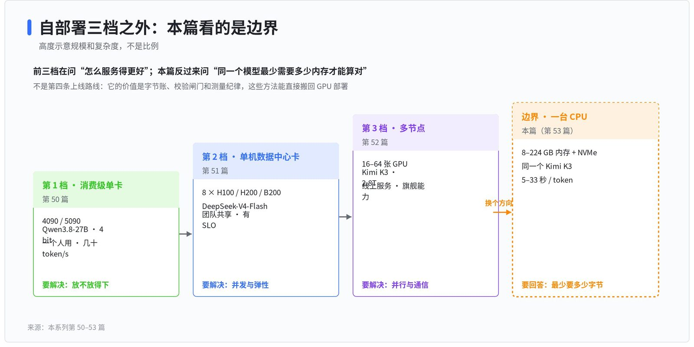
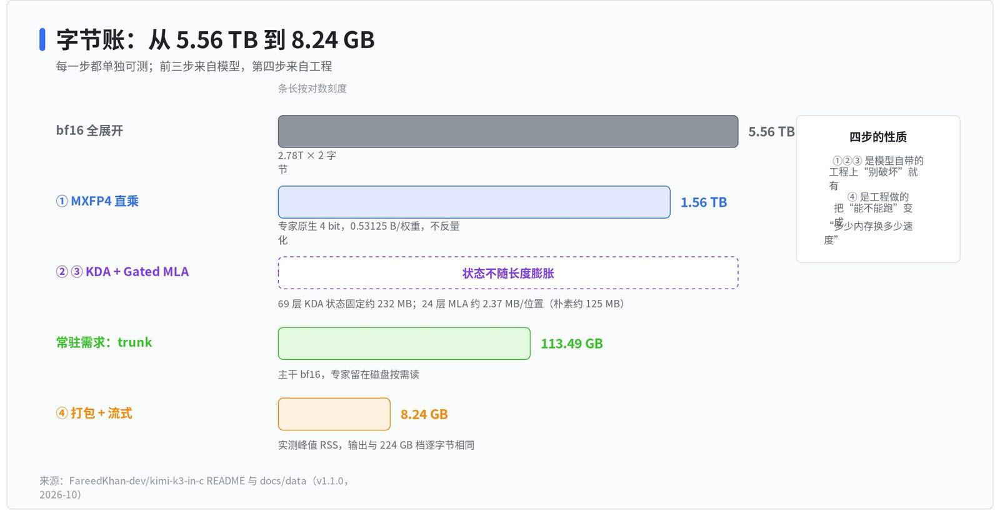
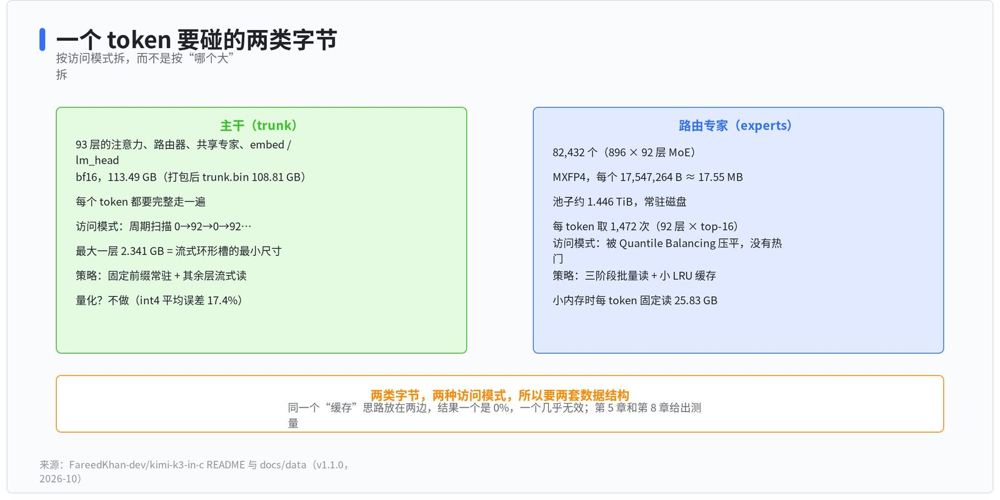
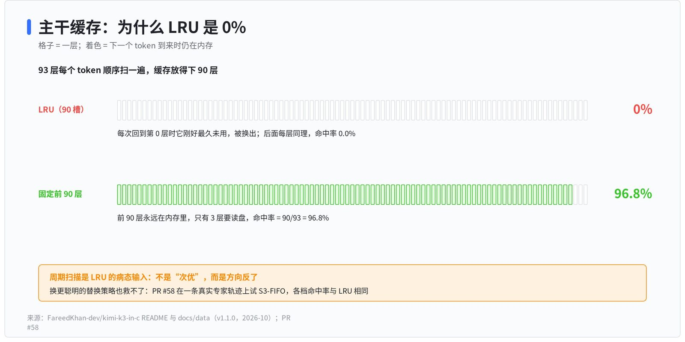
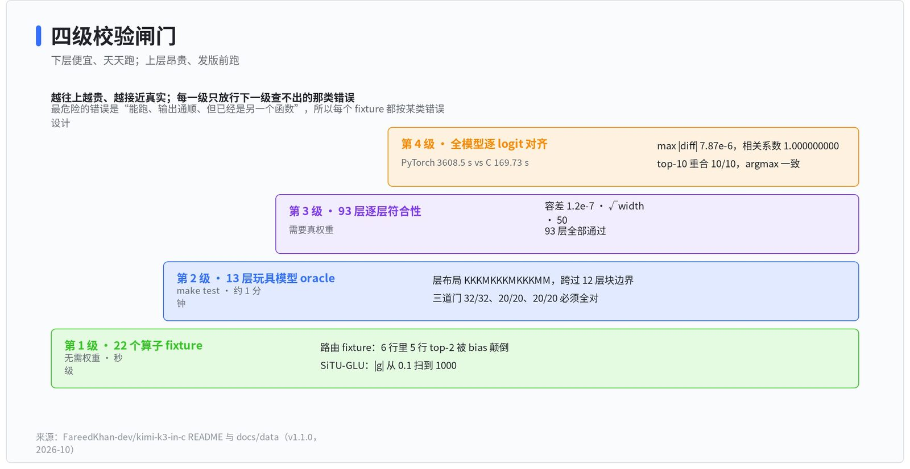
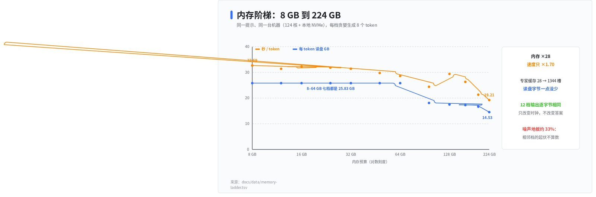
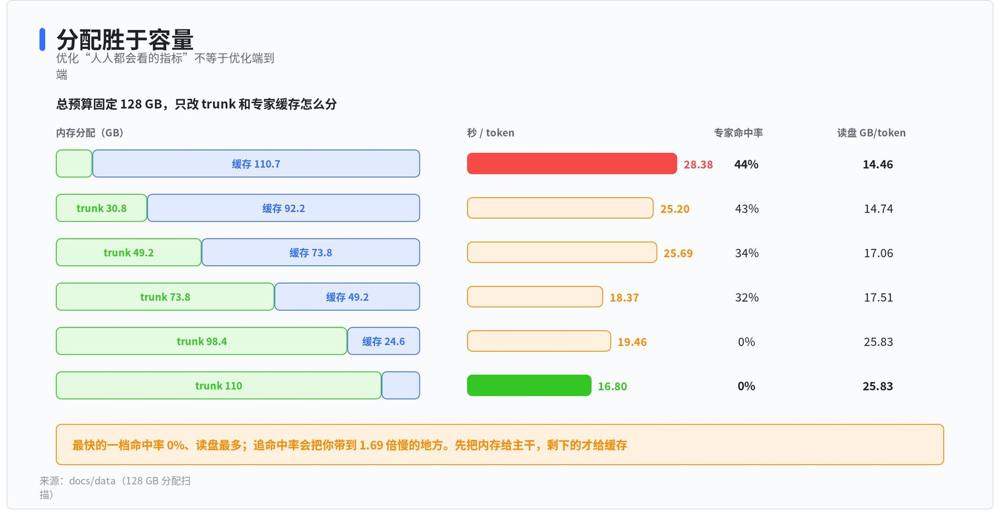

# LLM-53｜系统｜单台 CPU 跑万亿参数 MoE：Kimi-K3-in-C 工程解剖

> 🎯 **这篇文档解决什么问题**：第 50–52 篇按“单卡 → 单机 → 多节点”讲怎么把模型服务好。本篇换个方向，看一个开源项目 kimi-k3-in-c：它用纯 C99 写了一个推理引擎，在只有 8 GB 内存、没有 GPU 的机器上跑通了完整的 Kimi K3（2.78T 参数），输出和 PyTorch 参考代码逐 logit 对齐，代价是每个 token 要几十秒。它不能拿来上线，但它把三件事算得很清楚：一个 token 到底要碰多少字节，哪些字节可以不放在内存里，省完以后怎么证明还算得对。这些方法可以直接用在 GPU 部署上。
>
> 使用方式：数字来自项目 README 和 docs/data（v1.1.0，2026 年 10 月）[[1]](https://github.com/FareedKhan-dev/kimi-k3-in-c)[[2]](https://github.com/FareedKhan-dev/kimi-k3-in-c/tree/main/docs/data)，以及 GitHub issue / PR 里的讨论。测量机器是 124 核 + 本地 NVMe，换一台机器绝对值会变，比例和结论更可靠。代码片段只保留讲清原理所需的几行。

## 导读 · 先给结论

- **能跑起来靠的是算字节，不是算力**：参数按 bf16 全展开是 5.56 TB；专家直接用原生 MXFP4 计算，降到 1.56 TB；KDA 的递归状态近似固定，MLA 用压缩 latent 降低每位置成本，但 KV cache 仍随上下文长度增长（项目当前版本缓存展开后的 fp32 k/v，约 2.37 MB/位置，见 3.3 节）；主干打包后按层流式读，常驻内存压到 8.24 GB。前三步是模型自带的，第四步是工程做的。
- **两类字节，两套数据结构**：主干每个 token 都要完整扫一遍（108.81 GB），适合“固定前缀常驻 + 环形槽流式”，LRU 在这里命中率是 0；专家每个 token 抽 1,472 个（25.83 GB），训练时的 Quantile Balancing 把使用分布压平了，没有热门专家，缓存在 36 GB 以下几乎不起作用。
- **内存只换速度，不换答案**：8 GB 到 224 GB 共 12 档，输出逐字节相同；内存多 28 倍，速度只快 1.70 倍。总内存固定 128 GB 时，先给主干比先给专家缓存快 1.69 倍，而最快那一档的专家命中率是 0%。
- **正确性靠四级闸门**：22 个算子 fixture → 13 层玩具模型 oracle → 93 层逐层符合性 → 全模型逐 logit 对齐（max |diff| 7.87e-6，top-10 重合 10/10）。数值上靠一份确定性契约：关掉 FMA，用 double 累加，求和顺序固定。
- **测量先看噪声地板**：同一配置连跑三次，结果相差 33.1%；同样读 374.99 GB，磁盘跑出 2.7 GB/s 还是 5.9 GB/s，耗时就差一倍。I/O 占墙钟时间的 41–61%，瓶颈在存储。
- **它不是第四条上线路线**：5–33 秒一个 token，适合数值验证、教学和没有 GPU 时的离线研究；对外服务仍然回到第 51、52 篇。可以带走的是字节账、按访问模式选数据结构、校验闸门和测量纪律。



> 🔑 **一句话版本**：先把一个 token 要碰的字节列成账，按访问模式决定哪些放内存、哪些放磁盘，再用逐 logit 对齐证明没有算错。模型规模再大，这个顺序也不用变。

📎 与系列其他文档的分工：自部署三档依次是第 50 篇 [LLM-50｜系统｜消费级单卡自部署：Qwen3.8-27B 跑在 4090 / 5090 上](./50-consumer-gpu-deploy.md)（单卡）→ 第 51 篇 [LLM-51｜系统｜自部署推理实战：DeepSeek-V4-Flash 从单机到弹性上线](./51-deepseek-v4-flash-deploy.md)（单机）→ 第 52 篇 [LLM-52｜系统｜一线大模型部署：Kimi K3 从选型算账到多节点上线](./52-kimi-k3-deploy.md)（多节点）。本篇讲的是第 52 篇同一个模型在资源下限上的情况，放在三档之后读。原理看 [LLM-08｜系统｜大模型推理系统：全栈学习手册](./08-inference-systems.md)，算账看 [LLM-13｜系统｜自建推理成本与 GPU 选型：算账手册](./13-inference-cost-gpu.md)。

## 第 1 章 · 自部署三档之外：为什么看这个项目

第 52 篇的结论是：K3 的原生权重约 1.56 TB（约 1.42 TiB），要 16–64 张数据中心 GPU 才能放进显存。kimi-k3-in-c 把问题倒过来：模型权重放在磁盘上，内存里只放当前要用的部分，看最少需要多少内存才能算出和参考代码一样的结果 [[1]](https://github.com/FareedKhan-dev/kimi-k3-in-c)。作者此前在 32 张 H100 上跑过 K3，这个项目是在同一个模型上往资源下限推 [[15]](https://levelup.gitconnected.com/building-kimi-k3-2-8t-model-in-c-to-run-on-8gb-ram-a5792cbf3b59)。

### 1.1 项目是什么

| 项 | 内容 |
|---|---|
| 语言与依赖 | 可移植 C99，只依赖 libc、libm 和 OpenMP；不用 BLAS、不用框架、不用 GPU。编译出来是一个约 176 KB 的二进制 |
| 许可证 | Apache-2.0 |
| 模型 | Kimi K3 官方 checkpoint，权重不做任何修改：2.78T 参数，96 个 shard，共 1.56 TB [[3]](https://huggingface.co/moonshotai/Kimi-K3) |
| 结构 | 93 层，其中 69 层 KDA（线性注意力）、24 层 Gated MLA；92 层是 MoE，每层 896 个路由专家，每个 token 选 top-16，另有 2 个共享专家；词表 163,840 |
| 平台 | Linux x86-64 是参考平台；macOS arm64 和 Windows（MSYS2 / MinGW-w64）也能编译并通过全部闸门 |
| 版本 | v1.0.0 于 2026-08-07 发布，v1.1.0 于 2026-10-02 发布，加了 chat、采样和状态保存 [[13]](https://andrew.ooo/posts/kimi-k3-in-c-278-trillion-params-8gb-ram-review/) |

### 1.2 它回答的四个问题

1. 常驻内存最少要多少字节？
2. 哪些字节可以每次从磁盘读，代价是多少？
3. 流式读进来、分块算完，结果还能不能和参考代码一样？
4. 多给一点内存，能换回多少速度？

### 1.3 和三档部署的关系

第 52 篇和本篇面对的是同一张字节账，只是存储层级不同：GPU 部署在 HBM、主机内存和 NVMe 之间分配，本篇在 DRAM 和 NVMe 之间分配。几篇社区评测的看法一致：这是存储问题，不是计算问题 [[14]](https://themenonlab.blog/blog/kimi-k3-in-c-trillion-parameter-model-8gb-ram)；日常使用托管 API 更合适，它也不打算和 llama.cpp 竞争 [[13]](https://andrew.ooo/posts/kimi-k3-in-c-278-trillion-params-8gb-ram-review/)。

| 适合 | 不适合 |
|---|---|
| 验证一个新架构的数值写法，给 GPU 引擎当参照 | 交互式服务：5–33 秒一个 token |
| 没有 GPU 时，做小批量的离线研究 | 需要吞吐的批处理 |
| 逐行学习 MoE、线性注意力、MLA 的写法细节 | 没有约 1.7 TB 快速本地盘的机器 |

## 第 2 章 · 字节账：一个 token 要碰多少字节

先把账列出来，再决定省哪里。下表是 K3 在这个引擎里的全部字节，以及每个 token 怎么用它们。

### 2.1 总账

| 项 | 大小 | 每个 token 怎么用 |
|---|---|---|
| 全部参数按 bf16 展开 | 5.56 TB（2.78T × 2 字节） | 不可能常驻，也没必要 |
| 官方 checkpoint | 1.56 TB，96 个 shard | 专家是 MXFP4，其余是 bf16 |
| 主干（trunk）：注意力、路由器、共享专家、embed、lm_head | 113.49 GB bf16，约 567 亿参数；打包后 trunk.bin 108.81 GB | 每个 token 完整用一遍 |
| 路由专家 | 82,432 个（92 层 × 896），每个 17.55 MB，合计约 1.45 TB | 每个 token 用 1,472 个（92 层 × 16），共 25.83 GB |
| 上下文状态 | KDA 69 层固定约 217 MB，ShortConv 约 15 MB；MLA 约 2.37 MB/位置 | 只有 MLA 这部分随长度增长 |

两行相加就是内存最少时的读盘量：每个 token 约 108.81 + 25.83 ≈ 134.6 GB。按本地 NVMe 6 GB/s 左右估算，光读盘就要 20 多秒，和实测的 26–33 秒/token 是同一个量级。账算到这里，性能上限基本就定了。



### 2.2 两类字节，两种访问模式

主干和专家的区别不在大小，在访问模式。主干每个 token 按 0 → 92 层的顺序完整读一遍，下一个 token 再从 0 开始，这是一个周期扫描。专家每个 token 在每层抽 16 个，而 K3 训练时用 Quantile Balancing 刻意压平了专家使用分布，所以推理时几乎没有热门专家。



> 🔑 **先按访问模式拆，再按大小拆**：主干是“每次都全读，顺序固定”，专家是“每次抽样，分布均匀”。第 5 章的流式和缓存设计、第 8 章的内存分配规则，都是从这两种访问模式推出来的。

## 第 3 章 · 四步压缩：从 5.56 TB 到 8.24 GB

### 3.1 第一步：MXFP4 直接乘，不反量化

K3 的路由专家在 checkpoint 里就是 MXFP4：每 32 个权重共享一个 E8M0 指数（1 字节），每个权重是 4 bit 的 E2M1，平均 0.53125 字节/权重 [[9]](https://www.opencompute.org/documents/ocp-microscaling-formats-mx-v1-0-spec-final-pdf)。一个专家有 33,030,144 个参数，正好 17.55 MB。

最直接的做法是先解码成 fp32 再做普通矩阵乘。算一下：一个专家展开后是 132 MB，每个 token 要用 1,472 个，等于每个 token 先写出 194 GB 的格式转换结果，然后才开始乘加。所以引擎从不反量化，矩阵乘直接读打包的 nibble。PR #25 把 nibble 解码放进寄存器，专家矩阵乘快了约 1.6 倍，结果逐位相同，用哈希校验 [[27]](https://github.com/FareedKhan-dev/kimi-k3-in-c/pull/25)。

### 3.2 第二步：KDA，状态不随长度增长

93 层里有 69 层是 Kimi Delta Attention [[5]](https://arxiv.org/abs/2510.26692)，属于 delta rule 一类的线性注意力 [[6]](https://arxiv.org/abs/2412.06464)。普通注意力要给每个看过的 token 存 key 和 value，KDA 每个头只保留一个固定大小的矩阵状态，先按通道门控 S̄ = Diag(α)·S，再写入 S ← S̄ + β·k·(v − S̄ᵀk)ᵀ，读出 o = Sᵀq（S 为 d_k×d_v，key 用于写入，query 只在读出时用）。69 层的循环状态约 217 MB，卷积历史约 15 MB，喂 10 个 token 和喂 10 万个 token 一样大。写代码时要注意这几处：

- q、k、v 先过一个核宽 4 的因果 ShortConv，紧跟 SiLU。
- L2 归一化只作用在 q、k 上，v 不做。
- 每头的衰减由 −softplus(A_log) 得到，A_log 原样使用，不能再变换、缩放或截断。
- 输出先做 RMSNorm 再乘门控。参考代码用的是一个融合 kernel，项目专门写了脚本证明它是“先 norm 后 gate”。顺序反过来也能正常跑，但算的已经是另一个模型。

### 3.3 第三步：Gated MLA，只有这里随长度增长

另外 24 层做全局注意力，用的是 Gated Multi-head Latent Attention [[7]](https://arxiv.org/abs/2405.04434)：每个位置投影成一个 576 维的共享 latent，需要时再重建各头的 k、v。和 96 头各存一份相比，latent 小 53 倍。发布的代码缓存的是展开后的 fp32 k、v，实测约 2.37 MB/位置：8K 上下文 19.38 GB，128K 上下文 310 GB。按朴素方式缓存，每个位置要约 125 MB。

因为 KV 是唯一会增长的部分，引擎在启动前就把它算出来：如果 `(prompt + 生成长度) × 2.37 MB` 超过可用内存的 90%，就直接拒绝并提示“这是内存限制，不是引擎上限”，省得跑到一小时后才 OOM。

### 3.4 第四步：主干打包 + 固定前缀流式

原始 checkpoint 把每层的主干张量分散在 17 GB 一个的 shard 里，读一层要做几十次分散读取。打包器把每层的主干张量重排成连续的一段，写进一个 trunk.bin，每层的首尾按 4 KB 对齐（O_DIRECT 要求）；如果某层跨了 shard，打包器拒绝继续。打包一次约 4 分钟，结果是 108.81 GB，最大一层 2.341 GB。这个数决定了流式环形槽的最小尺寸。

运行时，预算内放得下的层固定常驻，其余层通过环形槽轮流读入。常驻内存从 113.49 GB 变成用户给定的预算，最低一档实测峰值 RSS 是 8.24 GB，输出和 224 GB 那一档逐字节相同。

> 🔑 **四步的性质不同**：前三步是模型设计带来的，工程上要做的是不破坏它们：不反量化，不改 A_log，不把线性注意力退回成全量 KV。第四步是工程做的，它把“能不能跑”变成了“用多少内存换多少速度”。

## 第 4 章 · 路由与专家：写错了也能跑的地方

MoE 部分最危险的错误是：程序能跑，输出也通顺，但算的已经是另一个函数。下面几处都属于这一类。

### 4.1 路由器：bias 只参与选择，不参与加权

K3 沿用 DeepSeek-V3 的无辅助损失负载均衡 [[8]](https://arxiv.org/abs/2412.19437)：sigmoid 打分后加上一个每专家的 bias 来挑 top-16，但加权用的是不带 bias 的原始分数。

*路由器的两个分数
*

```c
sc[e] = sigmoid(dot(x, W[e]));   /* 无偏分数：用来加权 */ch[e] = sc[e] + bias[e];         /* 选择分数：只用来挑 top-k */
```

把 bias 也带进加权，或者选择时忘了 bias，模型都能正常生成文字。对应的 fixture 专门构造了 6 行数据，其中 5 行加不加 bias 的 top-2 是颠倒的，忽略 bias 的写法一定失败。

### 4.2 SiTU-GLU：两个 bound 都要测到

激活函数是 a = β₁·tanh(g/β₁)·σ(g)，sigmoid 吃的是没有截断的 g，输出严格不超过 β₁·β₂ = 100。如果测试输入只落在近线性区，漏写 tanh 也看不出来。fixture 把 |g| 从 0.1 扫到 1000，并断言输出不超过 100。

### 4.3 LatentMoE：六步的顺序

1. 在全宽度隐藏态上算路由。
2. 降维到 3584。
3. 在低维上跑选中的 16 个专家。
4. 对聚合结果做 RMSNorm。
5. 升维回全宽度。
6. 最后在全宽度上加 2 个共享专家的输出。

### 4.4 Quantile Balancing：缓存没有热点可抓

训练时压平专家分布是为了避免路由坍缩，到推理侧就意味着没有热门专家，缓存依赖的局部性被训练目标去掉了。PR #58 在真实 checkpoint 上抓了一段短轨迹（prefill 加 3 步 decode；该 PR 最终未合并）：8,626 次专家请求，涉及 7,183 个不同专家，重复只有 16.7% [[22]](https://github.com/FareedKhan-dev/kimi-k3-in-c/pull/58)。第 5 章会看到它对缓存的影响。

### 4.5 两个防御性细节

- **专家加载失败就判整次运行无效**：只要有一次路由专家加载失败，就打印 RUN INVALID 并以退出码 4 结束。静默算错再正常退出，比直接崩溃更糟，因为它和正常结果分不开。
- **不依赖巧合对齐**：一个专家正好 17,547,264 字节 = 4,284 × 4,096，碰巧对齐 O_DIRECT 块。代码没有假设这一点，fixture 用一个非对齐尺寸的假专家专门测这条路径；权重不连续时退回 6 次分开读（w1 / w2 / w3 × 数据 / 缩放）。

> ✅ **可以带走的方法**：对“写错也能跑”的地方，测试数据要专门构造成能分出对错的样子：让 bias 改变 top-k，让输入跨过非线性区，让尺寸不对齐。只用随机输入测，这些错误一个都发现不了。

## 第 5 章 · 流式与缓存：两套数据结构

第 2 章把字节分成了两类。这一章看引擎给它们各配了什么数据结构，以及为什么最常见的选择（一个 LRU 缓存）在这里两边都不灵。

### 5.1 主干：固定前缀 + 环形槽

主干的访问顺序是 0 → 92 → 0 → 92…，每个 token 一圈。假设内存放得下 90 层：用 LRU 管理时，每次回到第 0 层，它恰好是最久没用的那一层，刚被换出；之后每一层都一样，命中率是 0.0%。把前 90 层固定在内存里不动，只让后 3 层走流式，命中率就是 90/93 = 96.8%。一般地，固定 N 层的命中率是 N/93。



所以引擎不用通用缓存管主干：预算内能放下的层固定常驻，剩下的层通过环形槽轮流读入，槽数由 `--trunk-ring` 控制，默认 2 个，一个在算，一个在预读下一层。每个槽至少要能装下最大的一层（2.341 GB）。

- **先固定最大的层**：PR #65 把固定顺序从“按层号从前往后”改成“从大到小”。第 0 层有 2.34 GB，比普通层大很多，先固定它，同样的预算能省出约 1.17 GB。同一个 PR 修了预取器的重复读：一次运行在 29.81 GB 的 trunk 上读了 491 GB。想恢复旧顺序可以设 K3_PIN_PREFIX=1 [[25]](https://github.com/FareedKhan-dev/kimi-k3-in-c/pull/65)。
- **大页**：O_DIRECT 按 4 KB 页对齐，一个 2.37 GB 的槽约 57.8 万页，每个 token 要 pin / unpin 93 次，合计约 5,400 万次页操作。换成 2 MB 大页，次数少 512 倍。不过实测收益只有 5.4%，落在噪声范围内（第 9 章）。
- **启动前算账**：引擎把 trunk + 模型 + 缓存 + 状态 + 缓冲 + KV 加起来，超过 0.95 × MemAvailable 就打印 REFUSING TO START 并退出，不会等到跑一半被 OOM。server 预设第一个 token 要先加载约 108 GB 主干，所以首 token 明显更慢。

### 5.2 专家：三阶段批量读 + 小缓存

专家缓存的槽有三种状态：EMPTY、INFLIGHT、已装入（带专家编号）。每层要的 16 个专家分三步处理：

1. **串行预留**：在锁内查缓存，未命中的专家占一个空槽，标成 INFLIGHT。
2. **并行读取**：按文件偏移排序后，用 OpenMP 并行 pread，尽量让磁盘看到顺序请求。
3. **发布**：读成功的槽改成已装入；读失败的退回 EMPTY，并按第 4.5 节判整次运行无效。

缓存为什么帮不上忙，项目用一条真实轨迹算过。tools/sim_cache.py 回放 100,096 次专家请求，涉及 10,010 个不同专家（占池子的 12.14%），全部放下要 175.65 GB。LRU 的命中率从 8 GB 到 64 GB 一直是 36.24% 左右，几乎是平的；理论最优的 Belady 算法 [[11]](https://doi.org/10.1147/sj.52.0078) 从 39% 涨到 62%，在 64 GB 处比 LRU 高 25.5 个百分点。也就是说，有可预知的未来才有用，靠历史猜不出来。

PR #58 提出了更新的 S3-FIFO 替换策略，并用一段真实专家轨迹回放做比较（prefill 加 3 步 decode：8,626 次请求、7,183 个不同专家，空缓存起步）。8 / 16 / 32 / 64 / 128 GB 下的命中率：LRU 为 0、0、4.86%、9.87%、16.73%，S3-FIFO 为 0、0.23%、4.86%、9.87%、16.73%。PR 标题写“identical”，但 16 GB 一档表格并不相同，这里以表格为准，待维护者澄清。16.73% 是这段短轨迹上首次访问（compulsory miss）决定的上限，不能外推为任意负载的全局上限。该 PR 最终关闭、未合并 [[22]](https://github.com/FareedKhan-dev/kimi-k3-in-c/pull/58)。投机预取 K3_SPEC=1 实测是负收益，发布时默认关闭。

> 🔑 **结论**：36 GB 以下，专家缓存基本不参与，每个 token 固定读 25.83 GB 专家。主干是周期扫描，要固定前缀；专家是均匀抽样，缓存收益很小。两边都不该用“一个大 LRU”。

## 第 6 章 · 数值确定性契约与四个不变量

流式读、分块算、多线程并行，每一项都可能改变浮点求和的顺序。要让 8 GB 和 224 GB 两档的输出逐字节相同，引擎先定了一份数值契约，所有算子都按它写。

### 6.1 契约

| 规则 | 做法 | 原因 |
|---|---|---|
| 关掉 FMA 收缩 | 编译选项 -ffp-contract=off（同时 -O3 -march=native -fopenmp） | FMA 少一次舍入，开不开会让结果在最后几位上不同 |
| 用 double 累加 | 点积、归约一律在 double 里累加，最后再转 fp32 | 降低求和顺序对结果的影响 |
| 固定求和顺序 | 例如 4 路累加按 (a0+a1)+(a2+a3) 合并，不随线程数变化 | 线程数、分块大小变了，结果也不能变 |
| bf16 解码 | bf16 → fp32 只做 16 位左移 | 无舍入，和参考代码逐位一致 |
| RMSNorm | 按 sqrt(mean(x²)+ε) 计算 [[10]](https://arxiv.org/abs/1910.07467) | ε 的位置写错，误差小到肉眼看不出 |
| MXFP4 矩阵乘 | 同样不用 FMA，nibble 在寄存器里解码 | 第 3.1 节的 1.6 倍加速也必须逐位相同 |

### 6.2 四个不变量

1. **A_log 原样使用，按头索引**：KDA 的衰减由 −softplus(A_log) 得到，加载时不做任何变换。checkpoint 里存了 head_dim 个数，只有前 num_heads 个有意义，按通道索引会把衰减打乱。
2. **RoPE 维度缓存但不旋转**：K3 的 MLA 不用位置编码（NoPE），但 64 个 rope 维度仍然存在、仍然进缓存，只是不旋转。按其他模型的习惯加上旋转，或者觉得没用把这些槽删掉（会改变头宽），模型都还能跑，但算的已经是另一个函数。
3. **路由 bias 只用于选择**：见第 4.1 节。
4. **配置缺字段就拒绝**：读 config 时任何字段缺失都直接报错，不填默认值。默认值会让一个读错的 checkpoint 看起来像是正常加载了。

### 6.3 为什么不用 BLAS、不量化主干

有人在 Issue #64 问为什么不接 BLAS。回答有两点：BLAS 不保证求和顺序，换一个库、换一个线程数结果就可能变，确定性契约就守不住；另外瓶颈在 I/O，矩阵乘再快，每个 token 也要先读完一百多 GB [[34]](https://github.com/FareedKhan-dev/kimi-k3-in-c/issues/64)。

主干为什么不量化也算过：int8 的平均相对误差是 0.961%，int4 是 17.4%，最差的行达到 65%。主干每个 token 都要完整用一遍，误差会逐层累积，所以项目选择保持 bf16，用流式解决内存问题，而不是用精度换内存。

> 💡 **注意**：确定性契约的代价是放弃一部分速度（不用 FMA、double 累加）。它适合做参照代码，GPU 引擎通常不会也不需要这样做；但当你需要判断“GPU 结果偏了是 bug 还是浮点误差”时，就需要有一个这样的参照。

## 第 7 章 · 四级校验闸门

第 4 章说过，MoE 和线性注意力里有很多“写错了也能跑”的地方。项目的办法是四级闸门：越往下越便宜，天天跑；越往上越贵，越接近真实模型。每一级只负责下一级查不出来的那类错误。



### 7.1 第 1 级：22 个算子 fixture

不需要真权重，秒级跑完。每个 fixture 都按一类具体错误设计：路由 fixture 里 6 行有 5 行加不加 bias 的 top-2 是颠倒的；SiTU-GLU 把 |g| 从 0.1 扫到 1000；专家加载用非对齐尺寸的假专家走 6 次分开读的路径。

### 7.2 第 2 级：13 层玩具模型 oracle

make test 约 1 分钟。玩具模型的层布局是 KKKMKKKMKKKMM（K = KDA，M = MLA），注意力残差的快照点在第 0、3、6、9、12 层。三道门的结果必须分别是 32/32、20/20、20/20，最后输出 VERDICT: ENGINE MATCHES THE REFERENCE EXACTLY。

为什么至少 13 层：K3 每 12 层存一次注意力残差快照，key 用 RMSNorm 归一化后的值，value 用原始值。层数少于 13 就跨不过第一个 12 层块的边界，这部分逻辑写错了也测不出来。玩具模型的层数是由要覆盖的边界决定的，不是越小越好。

### 7.3 第 3 级：93 层逐层符合性

需要真权重。每层的输出和参考代码比较，容差是 1.2e-7 × √width × 50，93 层全部通过。逐层比较的好处是能定位：哪一层开始偏，问题就在哪一层。

### 7.4 第 4 级：全模型逐 logit 对齐

全模型跑一遍，和 PyTorch 参考代码逐 logit 比较：max |diff| 为 7.867813e-06，相关系数 1.000000000，top-10 重合 10/10，argmax 都是 2494。参考代码跑了 3608.5 秒，C 引擎 169.73 秒。端到端的检查也有：提示 “The capital of France is” 在每一档内存下第一个 token 都是 “ Paris”，写 fibonacci 的输出也正确。

> ✅ **可以带走的方法**：给自己的推理引擎（包括 GPU 上的）也建一个这样的阶梯：无权重算子测试 → 能跨过结构边界的最小玩具模型 → 逐层比对 → 全模型 logit 对齐。前两级放进 CI，后两级在升级引擎版本或换 kernel 前跑。

## 第 8 章 · 内存阶梯与“分配胜于容量”

docs/data 里有两组最有用的数据：一组是总内存从 8 GB 到 224 GB 的 12 档阶梯，一组是总内存固定 128 GB 时主干和专家缓存怎么分 [[2]](https://github.com/FareedKhan-dev/kimi-k3-in-c/tree/main/docs/data)。测量机器是 124 核 + 本地 NVMe，每档用同一个提示贪婪生成 8 个 token。

### 8.1 内存阶梯：12 档，同一个答案



| 总内存 | 固定层数 | 专家缓存 | 秒/token | 主干命中 | 专家读盘/token | 峰值 RSS |
|---|---|---|---|---|---|---|
| 8 GB | 0 | 0.49 GB | 32.69 | 0% | 25.83 GB | 8.24 GB |
| 12 GB | 0 | 2.79 GB | 31.41 | 0% | 25.83 GB | 10.53 GB |
| 16 GB | 3 | 4.39 GB | 32.21 | 2.8% | 25.83 GB | 16.00 GB |
| 24 GB | 7 | 7.58 GB | 31.85 | 6.6% | 25.83 GB | 23.95 GB |
| 32 GB | 11 | 10.80 GB | 31.44 | 10.3% | 25.83 GB | 31.90 GB |
| 48 GB | 19 | 17.19 GB | 29.76 | 17.9% | 25.83 GB | 47.80 GB |
| 64 GB | 27 | 23.59 GB | 28.60 | 25.4% | 25.83 GB | 63.71 GB |
| 96 GB | 43 | 36.39 GB | 24.40 | 40.5% | 18.11 GB | 95.51 GB |
| 128 GB | 60 | 49.19 GB | 29.40 | 56.5% | 17.51 GB | 128.18 GB |
| 160 GB | 76 | 61.99 GB | 26.31 | 71.5% | 17.28 GB | 159.98 GB |
| 192 GB | 90 | 77.00 GB | 21.32 | 84.7% | 16.65 GB | 191.83 GB |
| 224 GB | 90 | 108.98 GB | 19.21 | 84.7% | 14.53 GB | 223.82 GB |

这张图先看答案：12 档生成的 token id 完全相同，内存只改变时间，不改变答案。再看速度，内存多了 28 倍，只快 1.70 倍。8 到 64 GB 这七档，专家读盘量一直是 25.83 GB，缓存槽从 28 个涨到 1,344 个，读盘字节一点没少，这就是第 5 章说的“36 GB 以下缓存不参与”。相邻档的起伏（比如 128 GB 比 96 GB 还慢）不要当真，第 9 章会看到同一配置连跑三次就能差 33%。

### 8.2 分配扫描：总量固定 128 GB



| 主干预算 | 专家缓存 | 秒/token | 专家命中率 | 专家读盘/token |
|---|---|---|---|---|
| 12.3 GB | 110.7 GB | 28.38 | 44.02% | 14.46 GB |
| 30.8 GB | 92.2 GB | 25.20 | 42.93% | 14.74 GB |
| 49.2 GB | 73.8 GB | 25.69 | 33.97% | 17.06 GB |
| 73.8 GB | 49.2 GB | 18.37 | 32.20% | 17.51 GB |
| 98.4 GB | 24.6 GB | 19.46 | 0% | 25.83 GB |
| 110 GB | 13 GB | 16.80 | 0% | 25.83 GB |

最快的一档（主干 110 GB、缓存 13 GB）专家命中率是 0%，每个 token 专家读取量最多；最慢的一档（缓存 110.7 GB）命中率 44%、专家读取量最少（该列不含固定主干读取，不能据此排序设备总 I/O），却慢了 1.69 倍。原因是主干的字节是专家的 4.2 倍，占的时间是 2.9 倍：每多给主干 1 GB，每个 token 就少读约 1.17 GB 主干；同样 1 GB 给专家缓存，几乎换不回什么。扫描是从“缓存优先”的配置开始跑的，顺序对结论不利，结论仍然成立。

运行报告里也有同样的陷阱。一次 workstation 运行报告原始缓存命中 100%，但下一行的 TRUE resident hit rate 只有 50.48%：原始计数把预取器刚从磁盘读进来的专家也算成命中，所以在任何缓存大小下都是 100%；后者只算真正从内存里拿到的。同一份报告里，I/O 占墙钟时间的 71.1%（主干 62.4 秒 + 专家 34.2 秒，共 135.8 秒；阶梯上各档在 41–61% 之间），固定 48/93 层，以 5908 MB/s 读了 368.65 GB，峰值 RSS 94.74 GB。报告里专门写了一句：引用这个数，不要引用计划值。

> 🔑 **分配胜于容量**：内存先给每次都要全读的那部分（主干），剩下的才给缓存。只盯命中率会把你带到慢 1.69 倍的配置。放到 GPU 上也一样：HBM 先给每步都要用的权重和活跃 KV，再考虑缓存冷数据。

## 第 9 章 · 测量：先看噪声地板，再看存储

这个项目的测量部分比很多正式 benchmark 更严格，它先问这台机器上两次测量差多少才算数，然后才比哪个配置更快。

### 9.1 噪声地板：33.1%

同一个二进制、同一个提示、同一组参数，连跑三次：14.78、14.67、20.14 秒/token。均值 16.53，标准差 3.13，极差 33.1%。也就是说，相同配置三次的相对极差达 33.1%，单次差异不能可靠归因；应增加重复次数并报告置信区间和配对对照 [[2]](https://github.com/FareedKhan-dev/kimi-k3-in-c/tree/main/docs/data)。

按这个门槛重新看第 8 章：12 GB 比 8 GB 快 4%、32 GB 下“主干优先”快 11%、128 GB 那一档的下凹，都不算效应。只有两个结论稳稳超过门槛：阶梯两端差 70%，128 GB 下主干优先快 69%，都是噪声的两倍以上。计数类的结果不受影响：12 档输出逐字节相同、七档读盘都是 25.83 GB、主干命中率跟着固定层数走，这些不是秒表读数。

### 9.2 噪声从哪来：同一份工作，磁盘快慢差一倍

两次完全相同的配置，分别出现在两个扫描里：固定的层数、缓存槽数、请求数、换出数完全一样，都读了 374.99 GB。唯一的差别是磁盘：一次跑出 2,709 MB/s，另一次 5,874 MB/s，差 2.17 倍，结果是 29.40 和 18.37 秒/token。波动不是调度抖动或 NUMA，是设备本身。

### 9.3 存储决定一切

- **I/O 占比**：阶梯上每一档，墙钟时间的 40.9%–60.6% 在等磁盘。
- **换盘就是换引擎**：同一份代码，本地 NVMe 31.71 秒/token，网络卷 70.62 秒/token，差 2.2 倍，和代码无关。比较两个配置时必须固定设备，否则比的是设备。
- **用 devbw，不用 dd**：dd 是单流、队列深度 1 的顺序读；专家读取是 17.55 MB 的随机 O_DIRECT 读，最多 16 个并发。tools/devbw.py 按引擎的读法分别测队列深度 1 和 16，在网络存储上两者能差很多。
- **A/B 用同一个二进制**：大页的 A/B 用环境变量切换，而不是编两个版本；先确认输出 token 一致，再看时间。5.4% 的提升在噪声内，项目没有把它算作收益。

### 9.4 社区的 I/O 优化：几个 PR 的结论

| PR | 做了什么 | 结论 |
|---|---|---|
| #56 [[23]](https://github.com/FareedKhan-dev/kimi-k3-in-c/pull/56) | 每层主干按 64 MiB 分块并行读，队列深度从 1 变成 N | 单个 pread 循环大约只能用到 NVMe 标称带宽的一半，并行分块是有效的 |
| #57 [[24]](https://github.com/FareedKhan-dev/kimi-k3-in-c/pull/57) | 主干读取改走 io_uring，pread 保留为回退路径 | 在已有并行分块的基础上没有更快，说明瓶颈不在系统调用开销 |
| #65 [[25]](https://github.com/FareedKhan-dev/kimi-k3-in-c/pull/65) | 从大到小固定层、--trunk-ring 可调、修预取器重复读 | 同样预算多省约 1.17 GB；修掉了一次 491 GB 的重复读 |
| #67 [[26]](https://github.com/FareedKhan-dev/kimi-k3-in-c/pull/67) | 专家分块读、bf16 批量矩阵乘、减少 KDA 扫描读 | decode 快 5.7%、prefill 快 9.9%；因为噪声地板，每组都重跑了 3 次 |

> ✅ **可以带走的方法**：发布任何性能数字前，先在同一台机器上把同一配置跑三次，拿到噪声地板；计数（字节、命中、token）和秒表分开报告；比较时固定设备，并检查输出是否一致。这些规则在 GPU 压测里同样适用（第 51 篇的压测章节）。

## 第 10 章 · 动手跑

不下载权重也能验证引擎：make test 会跑完前两级闸门。要跑真模型，门槛主要是 1.7 TB 的本地盘。

### 10.1 环境要求

| 项 | 要求 | 说明 |
|---|---|---|
| 操作系统 | Linux x86-64（参考平台）；macOS arm64、Windows x86-64 也能编译并通过全部闸门 | 依赖 O_DIRECT、posix_memalign、getrusage；Windows 经 MSYS2 / MinGW-w64 移植 |
| CPU | x86-64 需要 AVX2 + FMA；arm64 需要 NEON | 不需要 AVX-512；make portable 生成通用 AVX2 版本 |
| 内存 | 8 GB 起 | 所有预设都能跑，内存越多越快，结果不变 |
| 存储 | 约 1.7 TB 可用空间 | 1.56 TB checkpoint + 109 GB 打包主干，最好是本地快盘 |
| 工具链 | GCC 9+ 或 Clang 10+ | GNU make 或 CMake |
| Python | 3.9+ | 只用于下载、打包和分析工具，make test 不需要 |

### 10.2 不下权重：一分钟验证

*构建与无权重测试
*

```bash
git clone https://github.com/FareedKhan-dev/kimi-k3-in-c.gitcd kimi-k3-in-cmake -j            # 几秒钟make test          # 不到一分钟，最后应输出 ALL WEIGHTLESS TESTS PASSED# 回放一条真实的专家访问轨迹，复现第 5 章的缓存容量表（需要 numpy）python3 tools/sim_cache.py tests/fixtures/expert_trace.bin
```

### 10.3 跑真模型

*下载、打包与第一次生成
*

```bash
./scripts/k3-doctor.sh                         # 检查工具链、按内存推荐预设、测磁盘export HF_TOKEN=..../scripts/download-model.sh ~/k3model          # 1.56 TB，可断点续传；--layers N 只下前 N 层./scripts/pack-trunk.sh ~/k3model ~/k3trunk    # 约 4 分钟，生成 108.81 GB 的 trunk.bin./bin/k3 ~/k3model --trunk ~/k3trunk --preset workstation \  --tok ~/k3model --prompt "The capital of France is" --gen 8 --incremental
```

下载前可以先用 --layers 1（约 7 GB）或 --layers 8（约 125 GB）拿一小部分权重，把流程走通再下全量。doctor 按 MemAvailable（不是 MemTotal）推荐预设：192 GB 以上 server，约 6 秒/token；96 GB 以上 workstation，6–20 秒；32 GB 以上 desktop，约 24 秒；10 GB 以上 laptop，约 27 秒。

| 预设 | 主干 / 专家缓存（GB） | 峰值 RSS 与说明 |
|---|---|---|
| ultra | 2.5 / 0.31 | 约 3 GB，模型表也流式读，很慢 |
| laptop | 3 / 1 | 8.2 GB，常规路径的下限 |
| desktop | 16 / 10 | 31.9 GB |
| workstation | 60 / 30 | 95.5 GB，专家缓存从这里开始起作用 |
| server | 110 / 13 | 约 128 GB，93 层里固定 90 层，最快；需要约 135 GB 可用内存 |
| max | 110 / 109 | 约 224 GB，实测不比 server 快 |

- <b>--preset 必须配 --trunk</b>：不给打包目录时，预设不起作用，引擎会把约 113 GB 主干全部读进内存。
- <b>--incremental 要带上</b>：否则每生成一个 token 都重算整个前缀，代价是 O(T²)。
- **提示长度和生成长度**：提示最多 32,768 个 token，生成最多 4,096 个；非 ASCII 提示用 --prompt-file，想跳过分词器可以直接用 --ids 传 token id。
- **其他常用参数**：--stop-id 设置停止 token；--threads 默认等于物理核数；--dump-logits、--dump-cache-trace 用于对齐和缓存分析；--gen 0 --incremental --save-state PATH 只做 prefill 并保存状态。
- **用 cgroup 模拟小内存**：`systemd-run --scope --user -q -p MemoryMax=8G -p MemorySwapMax=0 ./bin/k3 …`。注意第 11 章里 PR #84 讲的准入问题。

### 10.4 读运行报告

报告里有三个数最重要：TRUE resident hit rate（真正从内存拿到的专家比例，原始 hits 在任何缓存大小下都接近 100%）；I/O share of wall clock（阶梯上各档在 41–61% 之间）；PEAK RSS（运行结束后由 getrusage 取得，对外引用内存时用它，不用启动前的计划值）。

### 10.5 v1.1 的对话模式

v1.1 加了文本对话：--chat 使用 K3 官方的 XTML 模板和控制 token，不回退到 ChatML 或手写模板 [[30]](https://github.com/FareedKhan-dev/kimi-k3-in-c/pull/55)。不套模板时，模型只会接着提示往下续写。

*对话模式
*

```bash
./bin/k3 ~/k3model --trunk ~/k3trunk --preset desktop --tok ~/k3model \  --chat --system "You are a helpful assistant." \  --history my-session.jsonl --incremental
```

- **history 文件是敏感数据**：它保存每条用户消息和完整的推理记录（K3 续接对话需要这些）。重启时引擎会重新渲染并重新 prefill，不保存 KV / MLA / KDA 状态。
- **同一会话复用状态**：开 --incremental 时，下一轮对话复用上一轮的状态，不重新 prefill 整个记录 [[31]](https://github.com/FareedKhan-dev/kimi-k3-in-c/pull/83)。
- <b>--no-think 是最大的速度杠杆</b>：思考默认开到 max。一次真实运行里，五个词的回答共 150 个 token，其中 119 个是思考内容。
- **采样**：--temperature、--top-p、--seed 开启采样（PCG32，默认温度 1.0、top-p 0.95），同一种子重放结果可复现；--greedy 强制 argmax。
- **限制**：只支持文本，没有工具调用、图像、服务端和上下文压缩。

### 10.6 分词器与平台移植

分词器用 C 重写，163,584 个合并规则加 256 个特殊 token，在 45 个测试用例上和 tiktoken [[12]](https://github.com/openai/tiktoken) 结果一致。移植方面，macOS 用 F_NOCACHE 代替 O_DIRECT，Windows 用 FILE_FLAG_NO_BUFFERING、OVERLAPPED 和 _aligned_malloc；两个平台都通过全部闸门。

## 第 11 章 · 社区踩坑汇总（2026-10）

下面整理自项目 GitHub issue / PR 和社区讨论，按“先遇到的在前”排列。每条都附出处，数字以原帖为准。

| 现象 | 原因（来源） | 处理 |
|---|---|---|
| 1 TB 的 SSD 放不下 | checkpoint 1.56 TB，加打包主干要约 1.7 TB；有人请求出量化 checkpoint，目前仍开放 [[17]](https://github.com/FareedKhan-dev/kimi-k3-in-c/issues/3)[[18]](https://github.com/FareedKhan-dev/kimi-k3-in-c/issues/18) | 项目的前提就是不改权重；盘不够只能换盘，或者先用 --layers N 跑部分层 |
| macOS 下载跑了一天还没完 | 脚本按 1 GB/s 估算约 30 分钟，实际进度显示约 105 MB/s（显示值，不是核验过的持续均速），约 24 小时后失败 [[19]](https://github.com/FareedKhan-dev/kimi-k3-in-c/issues/31) | 按自己的带宽估时间；脚本支持断点续传，失败后重跑即可 |
| macOS 上下载脚本或读取报错 | 新版 hf 命令输出紧凑 JSON，旧解析失败；Darwin 的 pread 单次不能超过 2 GiB [[20]](https://github.com/FareedKhan-dev/kimi-k3-in-c/pull/38) | 用合入 PR #38 之后的版本 |
| 加大主干预算反而没变快 | WSL2、23 GB 内存，主干在 NVMe、checkpoint 在 SATA（559 MB/s）：trunk-gb 3 时只有 1 个环形槽、无重叠，106.37 秒/token；6 GB 降到 71.00 秒；13 GB（固定 7 层）74.19 秒。专家在慢盘上时，固定层几乎没用；输出始终一致 [[21]](https://github.com/FareedKhan-dev/kimi-k3-in-c/issues/37) | 先保证至少 2 个环形槽；专家读盘是瓶颈时，把 checkpoint 挪到快盘比加内存有用 |
| 换了更好的缓存策略，命中率不变 | PR #58（未合并）在一段短轨迹上测得 S3-FIFO 与 LRU 基本相同，仅 16 GB 档为 0.23% 对 0 [[22]](https://github.com/FareedKhan-dev/kimi-k3-in-c/pull/58) | 见第 5 章：瓶颈是首次访问，不是替换策略 |
| 固定层的预算看起来被浪费 | 旧版按层号顺序固定，第 0 层很大；预取器还有重复读 [[25]](https://github.com/FareedKhan-dev/kimi-k3-in-c/pull/65) | 用合入 PR #65 之后的版本；K3_PIN_PREFIX=1 可恢复旧行为 |
| kernel 基准的哈希校验永远不过 | bench_kernels 生成的 bf16 测试权重是 NaN，逐位一致的检查无从成立 [[28]](https://github.com/FareedKhan-dev/kimi-k3-in-c/issues/26) | 用修复后的基准；优化 kernel 时先确认测试输入本身是有效数 |
| cgroup 限制 12 GB，进程却被 OOM 杀掉 | 准入只看 MemAvailable（看到 65.56 GB），没看 cgroup 上限；修复改为取 MemAvailable 与“cgroup 上限 − 已用”中较小者，控制文件读不懂时拒绝启动 [[29]](https://github.com/FareedKhan-dev/kimi-k3-in-c/pull/84) | 容器或 systemd-run 里运行时，用带这项修复的版本，或手动把预算设在限额以内 |
| 不用 chat 模式，输出不像在回答问题 | 没有套 XTML 模板时，模型只是续写提示 [[30]](https://github.com/FareedKhan-dev/kimi-k3-in-c/pull/55) | 对话用 --chat；批量模式适合补全和对齐测试 |
| 多轮对话每轮都很慢 | 早期版本每轮重新 prefill 整个记录 [[31]](https://github.com/FareedKhan-dev/kimi-k3-in-c/pull/83) | 用 v1.1 并带 --incremental；能关思考就加 --no-think |
| 有 16 GB 显卡，想让它帮忙 | 引擎是纯 CPU，不用 GPU [[32]](https://github.com/FareedKhan-dev/kimi-k3-in-c/issues/23) | 想用 GPU 回到第 50–52 篇的路线 |
| 分词器测试被跳过 | make test 找不到 tiktoken.model 时会跳过分词器对齐测试，其余测试照常通过；doctor 同时提示每个 token 约要流式读 135 GB，存储通常是上限 [[33]](https://github.com/FareedKhan-dev/kimi-k3-in-c/issues/63) | 下载 checkpoint 后再跑，或用 K3_TOK_FILES 指向放 tiktoken.model 的目录；不需要分词器时直接用 --ids |
| Mac 上能不能更快 | 社区的 Metal 移植在 M1 上做到 4 秒/token 以内，M2 Ultra 约 0.7 token/s；SSD 磨损来自写入，持续读不会明显损耗 [[16]](https://www.reddit.com/r/LocalLLM/comments/1vatx2e/update_full_kimi_k3_now_runs_below_4_secondstoken/) | 属于社区分支，不是主仓库；对比数字时注意机器和存储不同 |
| 笔记本上到底多慢 | 评测在笔记本上约 0.03 token/s，结论是“能跑但不适合日常用” [[13]](https://andrew.ooo/posts/kimi-k3-in-c-278-trillion-params-8gb-ram-review/) | 日常使用选托管 API 或 GPU 部署 |

## 第 12 章 · 落地清单：能搬回 GPU 部署的方法

kimi-k3-in-c 不是一条上线路线：几十秒一个 token，没有批处理，没有服务端。它的价值在于把“万亿参数模型的推理”还原成了一张可以逐项核对的字节账和一套可以复现的验证流程。K3 这一代模型的架构选择（超大 MoE、MuonClip 优化器、Quantile Balancing 负载均衡）可以从 K2 的技术报告找到来源 [[4]](https://arxiv.org/abs/2507.20534)，本篇看到的是这些选择在推理侧的直接后果。

### 12.1 搬回 GPU 部署的五条

| 方法 | 在本项目里 | 在 GPU 部署里 |
|---|---|---|
| 先列字节账 | 每 token 碰 134.6 GB，读盘决定 20 多秒的下限 | 显存账和带宽账：权重、KV、激活各占多少，决定能放多大批次（[LLM-52｜系统｜一线大模型部署：Kimi K3 从选型算账到多节点上线](./52-kimi-k3-deploy.md) 第 3 章、[LLM-13｜系统｜自建推理成本与 GPU 选型：算账手册](./13-inference-cost-gpu.md)） |
| 按访问模式选数据结构 | 主干固定前缀，专家小缓存；LRU 在周期扫描上是 0% | 常驻权重和 KV 分开管；分层 KV 缓存的冷热策略要先看实际访问分布 |
| 分配胜于容量 | 128 GB 内先给主干，快 1.69 倍 | HBM 先保证权重和活跃 KV，再给前缀缓存；只看命中率会选错配置 |
| 四级校验闸门 | 算子 fixture → 玩具模型 → 逐层 → 全模型 logit | 升级引擎、换量化或换 kernel 前，用参考代码做 logit 对齐，而不是只看 benchmark 分数（[LLM-50｜系统｜消费级单卡自部署：Qwen3.8-27B 跑在 4090 / 5090 上](./50-consumer-gpu-deploy.md) 的量化章节） |
| 测量纪律 | 33% 噪声地板、固定设备、计数和秒表分开 | 压测先测同配置重复性，再比较配置（[LLM-51｜系统｜自部署推理实战：DeepSeek-V4-Flash 从单机到弹性上线](./51-deepseek-v4-flash-deploy.md) 的压测章节） |

### 12.2 什么时候用得上它

- 要验证某个 GPU 引擎对 K3 的实现是否正确，需要一个确定性的参照。
- 在没有 GPU 的环境里，对少量样本做离线分析，比如看某一层的激活、导出专家访问轨迹。
- 学习 MoE、KDA、MLA 的写法细节：每个算子都是几十行 C，旁边就是对应的 fixture。

> ✅ **可以带走的方法**：一个 token 要碰多少字节、这些字节按什么模式被访问、省完以后用什么证明还算得对、两次测量差多少才算数。部署规模从一台 CPU 换到 64 张 GPU，这四个问题的问法不变，答案的单位从 GB 换成了 HBM 和网络带宽。

## 参考文献

资料截至 2026 年 10 月。项目数字以 v1.1.0 的 README 和 docs/data 为准；issue / PR 里的数字以原帖为准，测量机器不同，绝对值不可直接比较。

[1] FareedKhan-dev. kimi-k3-in-c: Kimi K3 inference in portable C99（README，v1.1.0）. GitHub (2026) [https://github.com/FareedKhan-dev/kimi-k3-in-c](https://github.com/FareedKhan-dev/kimi-k3-in-c)

[2] FareedKhan-dev. kimi-k3-in-c docs/data（内存阶梯、分配扫描、复现实验原始数据）. GitHub (2026) [https://github.com/FareedKhan-dev/kimi-k3-in-c/tree/main/docs/data](https://github.com/FareedKhan-dev/kimi-k3-in-c/tree/main/docs/data)

[3] Moonshot AI. Kimi-K3 Model Card. Hugging Face (2026) [https://huggingface.co/moonshotai/Kimi-K3](https://huggingface.co/moonshotai/Kimi-K3)

[4] Kimi Team. Kimi K2: Open Agentic Intelligence. arXiv:2507.20534 (2025) [https://arxiv.org/abs/2507.20534](https://arxiv.org/abs/2507.20534)

[5] Kimi Team. Kimi Linear: An Expressive, Efficient Attention Architecture. arXiv:2510.26692 (2025) [https://arxiv.org/abs/2510.26692](https://arxiv.org/abs/2510.26692)

[6] Yang et al. Gated Delta Networks: Improving Mamba2 with Delta Rule. ICLR (2025) [https://arxiv.org/abs/2412.06464](https://arxiv.org/abs/2412.06464)

[7] DeepSeek-AI. DeepSeek-V2: A Strong, Economical, and Efficient Mixture-of-Experts Language Model（MLA）. arXiv:2405.04434 (2024) [https://arxiv.org/abs/2405.04434](https://arxiv.org/abs/2405.04434)

[8] DeepSeek-AI. DeepSeek-V3 Technical Report（无辅助损失负载均衡：bias 只参与选择）. arXiv:2412.19437 (2024) [https://arxiv.org/abs/2412.19437](https://arxiv.org/abs/2412.19437)

[9] Open Compute Project. OCP Microscaling Formats (MX) Specification v1.0 (2023) [https://www.opencompute.org/documents/ocp-microscaling-formats-mx-v1-0-spec-final-pdf](https://www.opencompute.org/documents/ocp-microscaling-formats-mx-v1-0-spec-final-pdf)

[10] Zhang, Sennrich. Root Mean Square Layer Normalization. NeurIPS (2019) [https://arxiv.org/abs/1910.07467](https://arxiv.org/abs/1910.07467)

[11] Belady. A study of replacement algorithms for a virtual-storage computer. IBM Systems Journal 5(2) (1966) [https://doi.org/10.1147/sj.52.0078](https://doi.org/10.1147/sj.52.0078)

[12] OpenAI. tiktoken. GitHub [https://github.com/openai/tiktoken](https://github.com/openai/tiktoken)

[13] andrew.ooo. Kimi K3 in C review: 2.78 trillion params on 8 GB RAM (2026) [https://andrew.ooo/posts/kimi-k3-in-c-278-trillion-params-8gb-ram-review/](https://andrew.ooo/posts/kimi-k3-in-c-278-trillion-params-8gb-ram-review/)

[14] The Menon Lab. Kimi K3 in C: running a trillion-parameter model in 8 GB of RAM (2026) [https://themenonlab.blog/blog/kimi-k3-in-c-trillion-parameter-model-8gb-ram](https://themenonlab.blog/blog/kimi-k3-in-c-trillion-parameter-model-8gb-ram)

[15] Fareed Khan. Building Kimi K3 (2.8T) model in C to run on 8GB RAM. Level Up Coding (2026) [https://levelup.gitconnected.com/building-kimi-k3-2-8t-model-in-c-to-run-on-8gb-ram-a5792cbf3b59](https://levelup.gitconnected.com/building-kimi-k3-2-8t-model-in-c-to-run-on-8gb-ram-a5792cbf3b59)

[16] r/LocalLLM. Update: full Kimi K3 now runs below 4 seconds/token（Metal 移植讨论）. Reddit (2026) [https://www.reddit.com/r/LocalLLM/comments/1vatx2e/update_full_kimi_k3_now_runs_below_4_secondstoken/](https://www.reddit.com/r/LocalLLM/comments/1vatx2e/update_full_kimi_k3_now_runs_below_4_secondstoken/)

[17] kimi-k3-in-c Issue #3: Support for Quantized / Storage-Efficient Kimi K3 Checkpoints [https://github.com/FareedKhan-dev/kimi-k3-in-c/issues/3](https://github.com/FareedKhan-dev/kimi-k3-in-c/issues/3)

[18] kimi-k3-in-c Issue #18: u mean we download 1.7 TB ? [https://github.com/FareedKhan-dev/kimi-k3-in-c/issues/18](https://github.com/FareedKhan-dev/kimi-k3-in-c/issues/18)

[19] kimi-k3-in-c Issue #31: failed to download the model due to the script error [https://github.com/FareedKhan-dev/kimi-k3-in-c/issues/31](https://github.com/FareedKhan-dev/kimi-k3-in-c/issues/31)

[20] kimi-k3-in-c PR #38: Fix macOS/Apple Silicon: download script portability + Darwin pread() 2 GiB ceiling [https://github.com/FareedKhan-dev/kimi-k3-in-c/pull/38](https://github.com/FareedKhan-dev/kimi-k3-in-c/pull/38)

[21] kimi-k3-in-c Issue #37: Split storage: trunk budget behaves as a step function, and pinned layers buy nothing [https://github.com/FareedKhan-dev/kimi-k3-in-c/issues/37](https://github.com/FareedKhan-dev/kimi-k3-in-c/issues/37)

[22] kimi-k3-in-c PR #58: cache: S3-FIFO replacement policy behind K3_CACHE_POLICY (measured identical to LRU here)（未合并，PR 已关闭） [https://github.com/FareedKhan-dev/kimi-k3-in-c/pull/58](https://github.com/FareedKhan-dev/kimi-k3-in-c/pull/58)

[23] kimi-k3-in-c PR #56: trunk: read each layer in parallel chunks (queue-depth 1 -> N) [https://github.com/FareedKhan-dev/kimi-k3-in-c/pull/56](https://github.com/FareedKhan-dev/kimi-k3-in-c/pull/56)

[24] kimi-k3-in-c PR #57: trunk: read layer runs through io_uring, pread stays the fallback [https://github.com/FareedKhan-dev/kimi-k3-in-c/pull/57](https://github.com/FareedKhan-dev/kimi-k3-in-c/pull/57)

[25] kimi-k3-in-c PR #65: trunk: largest-first pinning, --trunk-ring, and the prefetcher re-read fixes [https://github.com/FareedKhan-dev/kimi-k3-in-c/pull/65](https://github.com/FareedKhan-dev/kimi-k3-in-c/pull/65)

[26] kimi-k3-in-c PR #67: perf: chunked expert reads, batched bf16 matmul, and fewer KDA sweep reads [https://github.com/FareedKhan-dev/kimi-k3-in-c/pull/67](https://github.com/FareedKhan-dev/kimi-k3-in-c/pull/67)

[27] kimi-k3-in-c PR #25: perf: ~1.6x MXFP4 expert matmul via in-register nibble decode (bit-identical) [https://github.com/FareedKhan-dev/kimi-k3-in-c/pull/25](https://github.com/FareedKhan-dev/kimi-k3-in-c/pull/25)

[28] kimi-k3-in-c Issue #26: bench_kernels: bf16 weights are NaN, so the documented bit-identity hash check can never pass [https://github.com/FareedKhan-dev/kimi-k3-in-c/issues/26](https://github.com/FareedKhan-dev/kimi-k3-in-c/issues/26)

[29] kimi-k3-in-c PR #84: fix(cli): admit against the cgroup memory limit, not just MemAvailable [https://github.com/FareedKhan-dev/kimi-k3-in-c/pull/84](https://github.com/FareedKhan-dev/kimi-k3-in-c/pull/84)

[30] kimi-k3-in-c PR #55: feat: add the K3 XTML chat core and REPL [https://github.com/FareedKhan-dev/kimi-k3-in-c/pull/55](https://github.com/FareedKhan-dev/kimi-k3-in-c/pull/55)

[31] kimi-k3-in-c PR #83: feat(chat): reuse the previous turn's state instead of re-prefilling the transcript [https://github.com/FareedKhan-dev/kimi-k3-in-c/pull/83](https://github.com/FareedKhan-dev/kimi-k3-in-c/pull/83)

[32] kimi-k3-in-c Issue #23: I have a 5070TI with 16 GB Mem [https://github.com/FareedKhan-dev/kimi-k3-in-c/issues/23](https://github.com/FareedKhan-dev/kimi-k3-in-c/issues/23)

[33] kimi-k3-in-c Issue #63: skip tokenizer [https://github.com/FareedKhan-dev/kimi-k3-in-c/issues/63](https://github.com/FareedKhan-dev/kimi-k3-in-c/issues/63)

[34] kimi-k3-in-c Issue #64: (Question) Why no BLAS? [https://github.com/FareedKhan-dev/kimi-k3-in-c/issues/64](https://github.com/FareedKhan-dev/kimi-k3-in-c/issues/64)

---

上一篇：[LLM-52｜系统｜一线大模型部署：Kimi K3 从选型算账到多节点上线](./52-kimi-k3-deploy.md) · [目录](./README.md) · 下一篇：[LLM-54｜系统｜低精度训练的数值稳定性：从 FlashAttention 一次舍入偏差说起](./54-low-precision-training.md)
