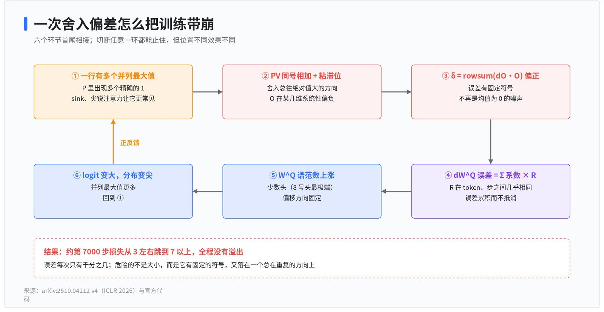
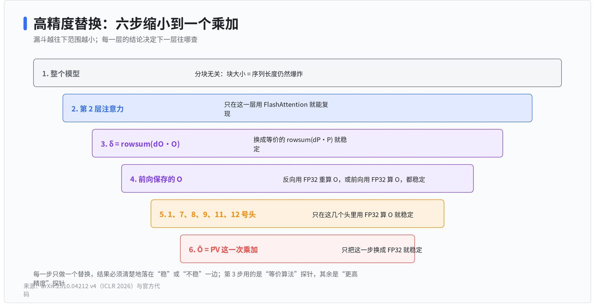
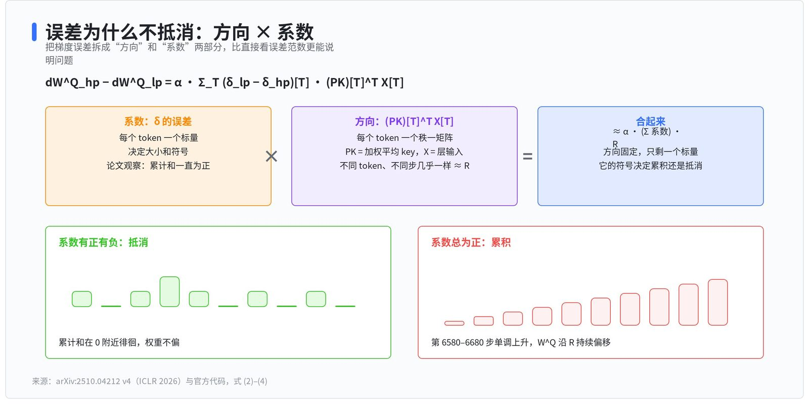
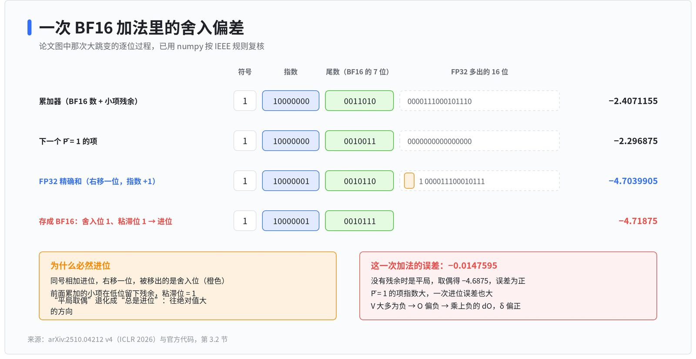
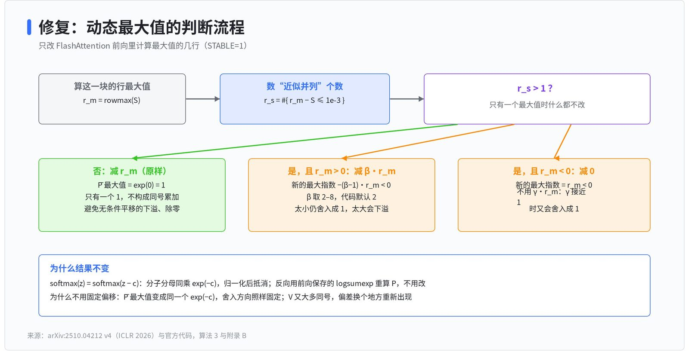
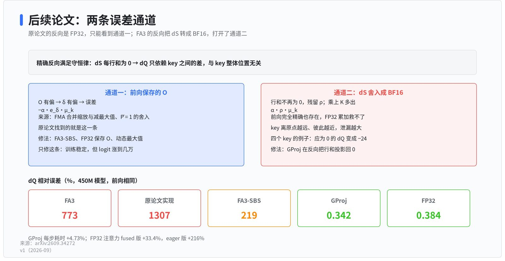
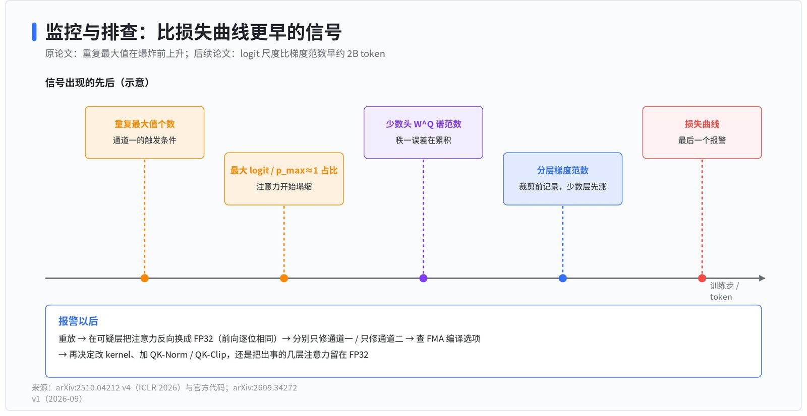

# LLM-54｜系统｜低精度训练的数值稳定性：从 FlashAttention 一次舍入偏差说起

> 🎯 **这篇文档解决什么问题**：用 BF16 加 FlashAttention 训练 GPT-2，跑几千步后损失突然从 3 左右跳到 7 以上，这个现象在 nanoGPT 和 flash-attention 的 issue 里挂了两年多，大家的做法是关掉 FlashAttention、换回 FP32 或加长预热，没人说清楚为什么。ICLR 2026 的一篇论文把它追到了一次 BF16 加法的舍入方向上，并给出一行代码的修复。本篇逐层拆这篇论文：怎么把故障从整个模型缩小到一个加法，误差为什么不会互相抵消，修复为什么是精确的，又在什么条件下会失效。
>
> 使用方式：主体是论文 [[1]](https://arxiv.org/abs/2510.04212) 和官方代码 [[2]](https://github.com/ucker/why-low-precision-training-fails)。第 8 章加入一篇 2026 年 9 月的后续论文 [[19]](https://arxiv.org/abs/2609.34272)，它在 FlashAttention-3 上复现了类似的“训练后期梯度爆炸”，指出原论文只修了两条误差通道中的一条，还测出原论文发布的代码会在大 logit 下数值下溢。两篇对照着读，结论比只读一篇可靠。公式只保留推理所需的几条，比特级的例子用 numpy 复核过。
>
> **代码**：配套练习在 llm-book 仓库的 `54-bf16-attention/`，3 个练习对应第 6、7、8 章（BF16 同号加法的舍入偏差、动态最大值、大 logit 下的下溢）。只用 Go 标准库，进目录跑 `go test -race ./...` 就能验证；每个练习加 `-broken` 运行能看到有问题的早期写法，练习 README 末尾附参考答案。

## 导读 · 先给结论

- **故障点小到一个加法**：论文用“换成高精度看好不好”的办法一层层缩小范围，最后落在 FlashAttention 反向里的一个量 δ = rowsum(dO∘O)，而 δ 出错是因为前向保存的输出 O 在 BF16 下有偏差。只在出问题的几个头里把 P̄V 这一步改成 FP32，训练就稳了。
- **舍入误差本来应该互相抵消，这里没有**：一行里有多个分数并列最大时，P̄ 中会出现多个精确的 1；它们乘上的 V 大多同号，两个同号 BF16 数相加会进位，被移出去的那一位加上 FP32 累加留下的粘滞位，使舍入总是往绝对值更大的方向走。误差因此有固定的符号。
- **有符号的误差沿同一个方向累积**：δ 的误差乘上注意力加权的平均 key，变成 dQ 的误差，再变成 W^Q 梯度里一个秩一矩阵。这些秩一矩阵在不同 token、不同训练步之间几乎同方向，加起来不抵消，W^Q 的谱范数越来越大，logit 越来越大，并列最大值越来越多，形成正反馈，直到损失爆炸。
- **修复是一行条件判断**：检测到一行有多个最大值时，把减去的最大值换成 β 倍（正最大值）或 0（负最大值），让 P̄ 里不再出现精确的 1。softmax 对平移不变，结果在数学上不变；只改前向，反向不用动。
- **后续论文的修正**：在 FlashAttention-3 上，保存的 O 只是第一条误差通道；第二条是反向把 dS 转成 BF16 时破坏了“每行和为 0”的守恒律，任何只修前向的方法都碰不到它。原论文发布的代码在 logit 上千时会下溢，450M 模型上训练停滞。后续论文的 GProj 在反向加两个秩一修正，耗时 +4.7%，最终损失与 FP32 注意力相同。
- **后续论文的修正**：在 FlashAttention-3 上，保存的 O 只是第一条误差通道；第二条是反向把 dS 转成 BF16 时破坏了“每行和为 0”的守恒律，任何只修前向的方法都碰不到它。原论文发布的代码在 logit 上千时会下溢，450M 模型上训练停滞。后续论文的 GProj 在反向加两个秩一修正，耗时 +4.7%，最终损失与 FP32 注意力相同。
- **可以带走的是诊断方法**：高精度替换定位误差源，找误差为什么不抵消（结构相同的更新方向），再追到数值格式的算术层面。监控上，各层最大 logit、p_max 接近 1 的行占比、并列最大值个数、各头 W^Q 谱范数，都比损失曲线更早报警。



> 🔑 **一句话版本**：低精度训练出事，通常因为误差有方向、又落在一个总在重复的结构上，误差大小倒在其次。查的时候先问“这个误差会不会抵消”，再问“它有多大”。

📎 与系列其他文档的分工：本篇放在系统层的训练侧，补的是 [LLM-23｜系统｜大模型训练工程：数据配比与万卡稳定性](./23-training-engineering.md) 第 10 章（损失尖峰与稳定性手段）背后的数值机制。混合精度和 FP32 主权重的基础见 [LLM-16｜系统｜GPU 优化深入浅出：从一条 CUDA 指令到万卡集群](./16-gpu-optimization.md) 第 5.2 节，FlashAttention 的算法演进见 [LLM-31｜地基｜长上下文与注意力：从 MHA 到稀疏与线性注意力](./31-attention-long-context.md) 第 3 章，想自己复现小模型训练看 [LLM-30｜地基｜动手实验：从零训练一个小模型](./30-train-small-model.md)。浮点数和矩阵求导的预备知识可以回 [LLM-02｜地基｜LLM 数学补课：读懂公式的一张地图](./02-math.md) 查。

## 第 1 章 · 为什么值得细读这篇论文

混合精度训练的标准做法是：前向和反向的大部分计算用 BF16，主权重和优化器状态用 FP32 [[24]](https://arxiv.org/abs/1710.03740)[[25]](https://arxiv.org/abs/1905.12322)。工业上更进一步，把矩阵乘这类计算密集的算子推到 FP8，注意力这类访存密集的算子留在 BF16。DeepSeek-V3 的 FP8 训练明确把注意力算子留在原精度 [[13]](https://arxiv.org/abs/2412.19437)，FP8-LM 报告显存降 39%、速度提 75% [[12]](https://arxiv.org/abs/2310.18313)。所以“注意力用 BF16 安不安全”是所有大模型训练都绕不开的问题。

### 1.1 一个挂了两年的问题

| 来源 | 时间 | 现象 | 当时的处理 |
|---|---|---|---|
| nanoGPT #303 [[3]](https://github.com/karpathy/nanoGPT/issues/303) | 2023-06 | 4 × A4500 训练 GPT-2，损失从约 3 跳到 7.8 | 关掉 FlashAttention |
| flash-attention #337 [[6]](https://github.com/Dao-AILab/flash-attention/issues/337) | 2023-07 | Triton 版 FlashAttention + ALiBi，BF16 O2，损失从约 2 跳到 7 | 预热加长到 3 倍 |
| nanoGPT #524 [[4]](https://github.com/karpathy/nanoGPT/issues/524) | 2024-06 | 4 × A100 80GB 上同样爆炸 | 无定论 |
| nanoGPT #554 [[5]](https://github.com/karpathy/nanoGPT/issues/554) | 2024-09 | 3 万到 10 万步之间爆炸；关掉 FlashAttention 就好，但慢 | 关掉 FlashAttention |

同一时期还有两组统计佐证。一组测了 188 次 BF16 的 GPT-2 训练，约 10%（18 次）发散，TF32 下 70 次一次都没有 [[11]](https://arxiv.org/abs/2405.18710)；另一组测量 FlashAttention 在 BF16 前向里的数值偏差，约是标准注意力的 10 倍 [[10]](https://arxiv.org/abs/2405.02803)。这些工作说明了“会出事”和“偏差有多大”，没有说明偏差为什么会变成爆炸。

### 1.2 和系列里已有内容的关系

| 已有内容 | 讲了什么 | 本篇补什么 |
|---|---|---|
| [LLM-23｜系统｜大模型训练工程：数据配比与万卡稳定性](./23-training-engineering.md) 第 10 章 | PaLM、OPT 的尖峰案例；QK-Norm、z-loss、softcap、QK-Clip 的对比；尖峰处置手册 | 这些手段在数值上为什么有效，各自挡住了哪条误差通道 |
| [LLM-16｜系统｜GPU 优化深入浅出：从一条 CUDA 指令到万卡集群](./16-gpu-optimization.md) 第 5.2 节 | FP32 主权重、swamping（小梯度被大参数吞掉） | 另一类舍入问题：误差没被吞掉，但有固定方向 |
| [LLM-31｜地基｜长上下文与注意力：从 MHA 到稀疏与线性注意力](./31-attention-long-context.md) 第 3 章 | FlashAttention 1→4 的分块、在线 softmax、异步 | 在线 softmax 里“减去最大值”这一步的数值副作用 |
| [LLM-30｜地基｜动手实验：从零训练一个小模型](./30-train-small-model.md) 5.4 节 | 小模型实验里的损失尖峰 | 一个能在 4 张 24 GB 卡上复现的稳定 / 不稳定对照 |

看到“换个实现就好了”的 workaround 时，记下它说明了什么：问题在被换掉的那部分实现里，而不在模型或数据。nanoGPT 的 issue 早就给出了这个线索，缺的是继续往下缩小范围。

📎 同样的精度差异放到强化学习里后果更重：生成用推理引擎，算梯度用训练引擎，同一个模型会算出两个概率，MoE 的路由还会把差异放大。这个问题见第 55 篇 [LLM-55｜系统｜RL 训练系统：rollout 与训练分离、异步与 Agent 环境](./55-rl-systems.md) 第 7、8 章。

## 第 2 章 · 预备：BF16 加法和 FlashAttention 的两个量

### 2.1 几种格式

| 格式 | 符号 / 指数 / 尾数 | 相对精度（单位舍入） | 训练中的位置 |
|---|---|---|---|
| FP32 | 1 / 8 / 23 | 约 6e-8 | 主权重、优化器状态、累加器 |
| BF16 | 1 / 8 / 7 | 2^-8 ≈ 0.0039 | 激活、注意力、大部分矩阵乘输入 |
| FP16 | 1 / 5 / 10 | 2^-11 ≈ 0.00049 | 需要 loss scaling，大模型训练里已少用 |
| FP8 E4M3 / E5M2 | 1 / 4 / 3，1 / 5 / 2 | 2^-4 / 2^-3 | 矩阵乘输入，配合分块缩放 |

BF16 和 FP32 指数位相同，表示范围一样，差别只在尾数：BF16 只有 7 位，加上隐含的 1 共 8 位有效数字。一个直观的后果是，绝对值在 128 到 256 之间时，相邻两个 BF16 数相差 1；在 2 到 4 之间时相差 1/64。后面两章的故事都发生在这 7 位里。

### 2.2 一次 BF16 加法的四步

1. **对齐**：指数小的那个数尾数右移，直到两个指数相同。
2. **相加**：尾数相加。两个同号数相加可能进位，比如 -1.xxxx + -1.yyyy = -10.zzzz。
3. **规格化**：进位时尾数右移一位、指数加一。被移出去的那一位叫舍入位，再往后所有位的“或”叫粘滞位。
4. **舍入**：默认是“就近舍入、平局取偶”（RNE）。舍入位是 1 且粘滞位也是 1，说明真实值超过了一半，必须进位；舍入位是 1 而粘滞位是 0 才是平局，取偶。

要点在第 3、4 步：同号相加进位以后，舍入方向由被移出的那一位和后面残留的位共同决定。如果残留位总是非零，“平局取偶”就退化成“总是进位”，舍入从无偏变成有偏。

### 2.3 FlashAttention 里的 P̄、O 和 δ

FlashAttention-2 前向按块计算 S = αQK^T，用在线 softmax 维护每行的最大值 m 和分母 l [[8]](https://arxiv.org/abs/2307.08691)：

*前向的三步（单块写法，分块时 m 和 l 在线更新）
*

```text
P̄ = exp(S - rowmax(S))        # 未归一化的概率，最大值那一格恰好是 exp(0) = 1Ō = P̄ V                       # 未归一化的输出，FP32 累加，存成 BF16O = Ō / rowsum(P̄)
```

反向需要 dS = P∘(dP − δ)，其中 dP = dO V^T。δ 理论上等于 rowsum(dP∘P)，但那要多算一个 N×N 的量；FlashAttention 改用等价的 δ = rowsum(dO∘O)，只需要前向保存的输出 O 和上游梯度 dO，每行一个点积。这个省计算的等价替换，就是故障的入口：它把前向 O 的 BF16 误差直接带进了反向。

> ✅ **可以带走的方法**：读一个融合算子时，把“数学上等价、数值上不等价”的替换单独列出来。δ 的两种算法、softmax 先减最大值、把缩放和减法合进一条 FMA，都属于这一类，出问题时优先查它们。

## 第 3 章 · 故障现场与实验设置

| 项 | 设置 |
|---|---|
| 模型 | GPT-2：12 层、12 头、隐藏维 768、上下文 1024 |
| 数据 | OpenWebText；记录第一次失败时的数据批次顺序，之后所有实验重放同一顺序，排除数据随机性 |
| 优化器 | AdamW，β1 = 0.9、β2 = 0.95，权重衰减 0；预热 2000 步，余弦从 1e-3 衰减到 1e-5；全局梯度裁剪 1.0 |
| 并行与精度 | 4 × A100 80GB，DDP；自动混合精度，前向 BF16、反向 FP32 |
| 批量 | 每卡 micro-batch 32，梯度累积 4 步，每步 524,288 个 token |
| 现象 | 约第 7000 步损失突然爆炸；同样配置换成标准注意力则正常收敛 |

论文用的 FlashAttention 是 Python 写的 FA2 前向和反向（代码里的 FlashAttentionFunction，块大小 512）[[2]](https://github.com/ucker/why-low-precision-training-fails)，不是 CUDA kernel。这一点很重要：所有中间量都可以随时换成 FP32 看效果，这是能做下一章那种逐步排查的前提。为了加快每次实验，作者监控谱对齐（spectral alignment）指标 [[7]](https://arxiv.org/abs/2510.04202)，它能比损失曲线早得多地判断一次配置会不会失败，不用每次都跑到第 7000 步。

> 💡 **注意**：反向是 FP32 这一点，也限制了论文能看到的东西。真实的 CUDA kernel（FA2、FA3）在反向里会把 dS 等中间量转成 BF16，这里还有一条误差通道，第 8 章展开。

排查数值问题前先把实验变成确定性的：固定数据顺序，换一个能逐项替换精度的参考代码，再找一个比损失更早报警的指标。否则每次实验都要等几千步，几轮下来就放弃了。

## 第 4 章 · 从整个模型缩小到一个乘法

每一步只做一个替换，看训练稳不稳，结果决定下一步往哪查。整个过程可以看成一个漏斗：

| 步骤 | 做了什么 | 结果 | 结论 |
|---|---|---|---|
| 1. 分块 | 块大小设成序列长度，等于不分块 | 仍然爆炸 | 与分块无关，之后都用不分块的版本简化分析 |
| 2. 定位层 | 各层权重谱范数里第 2 层注意力异常；只在第 2 层用 FlashAttention / 只把第 2 层换成标准注意力 | 前者复现，后者恢复 | 故障在第 2 层的 FlashAttention |
| 3. 定位量 | 把 δ = rowsum(dO∘O) 换成等价的 rowsum(dP∘P) | 稳定 | 问题在 δ 的算法 |
| 4. 定位输入 | 反向里用 FP32 重算 O = PV 来算 δ；或前向直接用 FP32 算 O | 都稳定 | 是前向保存的 O_lp 有误差 |
| 5. 定位头 | 看各头 W^Q 谱范数，1、7、8、9、11、12 号头明显偏大；只在这几个头里用 FP32 算 O | 稳定 | 只有少数头参与；8 号头最极端，后续分析聚焦它 |
| 6. 定位操作 | 只把 Ō = P̄V 这一步换成 FP32 | 稳定 | 源头是 P̄V 的 BF16 计算 |



第 3 步值得多看一眼。rowsum(dO∘O) 和 rowsum(dP∘P) 数学上完全相等，区别是前者用到前向保存的 O，后者只用到反向重算的 P 和 dP。前者出事、后者没事，说明反向本身没问题，误差出在“前向的结果被保存下来又在反向里用了一次”这个环节。论文把这一结论写成第一个判断：低精度的 δ 是训练失败的原因。

> ✅ **可以带走的方法**：高精度替换是一种二分查找。每次替换的范围要能让结果清楚地落在“稳”或“不稳”一边；先按层、再按量、再按头、最后按单个操作缩小。替换成“数学等价的另一种算法”和替换成“更高精度”是两种不同的探针，前者能区分误差出在哪个中间量上。

## 第 5 章 · 成因一：误差落在一个总在重复的方向上

第 4 章找到了误差源，但还没回答关键问题：BF16 的舍入误差每次只有千分之几，为什么能把训练带崩？论文的回答分两半，本章讲前一半：误差进入梯度以后，总是沿同一个方向叠加。

### 5.1 从 δ 的误差到 W^Q 的误差

反向里 dS = αP∘(dP − δ)，dQ = dS K。把高精度和低精度两次计算相减，dP 那一项消掉，只剩 δ 的差：

*论文式 (2)(3)：W^Q 梯度误差是一组秩一矩阵的加权和
*

```text
dQ_hp - dQ_lp = α · diag(δ_lp - δ_hp) · (P K)dW^Q_hp - dW^Q_lp = (dQ_hp - dQ_lp)^T X                  = α · Σ_T (δ_lp - δ_hp)[T] · (P K)[T]^T X[T]
```

读这两行要看三处。每个 token T 贡献一个秩一矩阵 (PK)[T]^T X[T]，其中 (PK)[T] 是这个 query 看到的注意力加权平均 key，X[T] 是这一层的输入。它的权重就是 δ 在这个 token 上的误差。于是误差的“方向”由 PK 和 X 决定，“大小和符号”由 δ 的误差决定，两者分开了。



### 5.2 秩一矩阵长得几乎一样

论文把第 6610 步和 6619 步、第 50 个和第 718 个 token 的 (PK)[T]^T X[T] 画出来，发现它们在输入特征 546 和 678 两列上有几乎相同的结构。原因不难理解：注意力集中在少数几个位置（包括 sink）时，不同 query 看到的加权平均 key 很接近；X 的若干维度又长期偏大。于是可以把这一大堆秩一矩阵近似成同一个矩阵 R：

*论文式 (4)：方向固定，只剩一个标量决定误差是累积还是抵消
*

```text
dW^Q_hp - dW^Q_lp ≈ α · ( Σ_T (δ_lp - δ_hp)[T] ) · R
```

如果 δ 的误差有正有负，括号里的和接近 0，误差相互抵消，训练没事。论文跟踪了第 6580 到 6680 步这个和的累计值，结果一直为正、单调上升。误差有固定符号，方向又固定，于是每一步都往 W^Q 上加一点同方向的偏移。

### 5.3 正反馈怎么闭合

1. W^Q 沿 R 方向持续偏移，谱范数上升（论文观察到异常头的 W^Q 谱范数远高于其他头）。
2. Q 变大，注意力分数 S 的绝对值变大，分布变尖。
3. 分布越尖，一行里出现多个并列最大值、P̄ 出现精确 1 的机会越多；第 6 章会说明这正是舍入偏差的触发条件。
4. 偏差更频繁、更大，δ 的误差更大，回到第 1 步。

论文把这一结论写成第二个判断：低精度训练中的权重更新被 (δ_lp − δ_hp)[T]·R 带偏，R 来自不同 token 和训练步之间结构相似的矩阵，系数有正偏，误差累积而不抵消，导致谱范数和激活增长，最终损失爆炸。这也解释了一个常见的经验观察：大模型训练中某些层的权重谱范数和最大 logit 会在尖峰前持续上涨 [[18]](https://arxiv.org/abs/2410.16682)[[26]](https://arxiv.org/abs/2309.14322)。

判断一个误差危不危险，看两件事：它的系数有没有固定符号，它的方向在不同样本和不同步之间是否相似。两者都满足，再小的误差也会被优化器积分起来。把梯度误差写成“方向 × 系数”的形式，比直接看误差范数更能说明问题。

## 第 6 章 · 成因二：一次同号加法里的舍入偏差

剩下的问题是：δ 的误差为什么总是正的？δ = rowsum(dO∘O)，误差 = rowsum(dO∘(O_lp − O_hp))。论文在第 718 个 token 上看到，第 20、29 维的 dO 和 O 的误差都是负的，乘积为正。所以要解释的是：为什么 O_lp 在这些维度上总是偏负。

### 6.1 误差在 P̄ = 1 的位置跳变

论文逐个位置累加 Ō[T, 20] = Σ_t P̄[T, t]·V[t, 20]，比较 BF16 输出和全 FP32 的差，发现误差没有均匀增长，只在少数几个位置突然往负方向跳一大步。这些位置的 P̄[T, t] 恰好等于 1，也就是这一行分数的最大值（S − rowmax(S) = 0，exp(0) = 1）。同时，第 20 维的 V 大部分是负数。P̄ = 1 时，P̄V 就是 V 本身，一个指数较大的负 BF16 数。

### 6.2 同号相加，舍入方向被锁死

两个同号的数相加，尾数可能进位（-1.xxxx + -1.yyyy = -10.zzzz），需要右移一位规格化，被移出的那一位决定舍入。论文列出了末两位所有组合，括号里是被移出的那一位：

*同号相加进位时末两位的十种组合，括号内为移出的舍入位
*

```text
00+00=0(0)  00+01=0(1)  00+10=1(0)  00+11=1(1)  01+01=1(0)01+10=1(1)  01+11=10(0) 10+10=10(0) 10+11=10(1) 11+11=11(0)
```

只看这张表，舍入位一半 0 一半 1，似乎无偏。关键在 FP32 累加：P̄V 是在 FP32 里累加的，前面已经加进来很多小项（P̄

反方向的误差也存在，但它们来自 P̄



### 6.3 一个逐位的例子

论文给了图里那次大跳变的逐位过程，下面用 numpy 按 IEEE 规则复核过，数字一致：

| 步骤 | 二进制（符号 指数 尾数） | 数值 |
|---|---|---|
| 累加器：一个 BF16 数加上若干小项 | 1 10000000 0011010 \| 0000111000101110 | -2.4071155 |
| 下一个 P̄ = 1 的项（BF16） | 1 10000000 0010011 \| 0000000000000000 | -2.296875 |
| 指数相同，尾数相加 | -10.0101101 \| 0000111000101110 | 进位 |
| 右移一位，指数 +1（FP32 精确和） | 1 10000001 0010110 [1] 000011100010111 | -4.7039905 |
| 舍入位 1、粘滞位 1 → 进位，存成 BF16 | 1 10000001 0010111 | -4.71875 |
| 这一次加法的误差 |  | -0.0147595 |

竖线后面是 FP32 多出的 16 位，方括号是被移出的舍入位。如果没有前面那些小项，粘滞位是 0，这里是平局，按“取偶”应该舍去（尾数末位 0 已是偶数），结果是 -4.6875，误差为正。正是 FP32 累加留下的残余把方向锁定成了进位。

> 💡 **注意**：这里的 BF16 舍入发生在 Ō 写回 BF16 时，以及 FlashAttention 分块累加时中间结果的转换上。“累加用 FP32”只保证累加过程中的小项不被吞掉，不保证最终转换无偏；残余越多，粘滞位越稳定地等于 1。

> ✅ **可以带走的方法**：舍入误差默认被当成均值为 0 的噪声，这个假设在“输入有特殊值”时会失效。精确的 1、精确的 0、大量同号的操作数、反复出现的同一个数，都会让舍入变成有偏的。检查数值写法时，先找这些特殊值在哪里出现。

## 第 7 章 · 修复：让 P̄ 里不再出现精确的 1

### 7.1 规则

既然偏差的触发条件是“一行有多个最大值、对应的 P̄ 精确等于 1”，修复就是在这种情况下换一个减去的常数，让最大值位置的指数严格小于 0：

*论文的动态最大值规则，只改 FA2 前向里的一行
*

```text
r_m = rowmax(S)r_s = rowsum(r_m - S <= ε)                 # 有几个分数与最大值相差不到 ε，ε = 1e-3m'  = where(r_m > 0 and r_s > 1, β·r_m, r_m)   # 正的重复最大值：减去 β 倍，β > 1m   = where(r_m < 0 and r_s > 1, 0, m')        # 负的重复最大值：减去 0P̄   = exp(S - m)
```

softmax(z) = softmax(z − c) 对任意常数 c 都成立，所以精确算术下输出不变，分母 rowsum(P̄) 会按同样的比例变化，归一化后抵消。正最大值时新的最大指数是 −(β−1)·r_m，负最大值时是 r_m 本身，都严格小于 0。反向用前向保存的 logsumexp 重算 P，不受影响，所以反向不用改。

### 7.2 官方实现

*attention.py 前向（β = 2），按块计算，块大小 512
*

```python
block_row_maxes = attn_weights.amax(dim=-1, keepdims=True)if os.environ.get("STABLE", "0") == "1":    close_to_max = (attn_weights >= (block_row_maxes - 1e-3))    num_close_to_max = close_to_max.sum(dim=-1, keepdims=True)    greater_than_one_mask = (num_close_to_max > 1)    block_row_maxes = torch.where(greater_than_one_mask & (block_row_maxes > 0), 2. * block_row_maxes, block_row_maxes)    block_row_maxes = torch.where(greater_than_one_mask & (block_row_maxes < 0), 0, block_row_maxes)new_row_maxes = torch.maximum(block_row_maxes, row_maxes)
```

对照反向里的两行：D = (doc \* oc).sum(-1) 就是 δ = rowsum(dO∘O)，ds = p \* scale \* (dp − D) 就是 dS [[2]](https://github.com/ucker/why-low-precision-training-fails)。修复只动了前向那几行，这两行原样保留。



### 7.3 三个设计选择

| 选择 | 为什么不用更简单的做法 | 论文的理由 |
|---|---|---|
| 用动态最大值，不用固定偏移 | 固定减一个常数 c，P̄ 的最大值就是 exp(−c)，每次都一样 | 同一个数反复出现，转 BF16 时舍入方向也总是一样；V 又大多同号，误差照样不抵消，换了个地方重新引入偏差 |
| 只在有重复最大值时生效 | 无条件地减 β·r_m 更省事 | 一行只有一个很大的正最大值时，exp(−(β−1)·r_m) 可能下溢成 0，分母为 0，除零 |
| 负的重复最大值减 0 | 也可以减 γ·r_m（0 &lt; γ &lt; 1） | γ 接近 1 时新最大指数接近 0，低精度下 exp 又会舍入成 1；γ = 0 最稳 |

β 取 2 到 8。太小，exp(−(β−1)·r_m) 可能仍舍入成 1；太大，容易下溢。官方 README 给的调参顺序是：先用较大的 β，出现 NaN 就调小，损失爆炸就略调大 {c(2)}。

### 7.4 验证

| 实验 | 设置 | 结果 |
|---|---|---|
| GPT-2S + AdamW | 600K 步，β = 2，其余同第 3 章 | 原版爆炸，修复版正常收敛 |
| GPT-2S + Muon | RMS 对齐的 Muon，学习率 5e-4，权重衰减 0.01；embedding、输出头和一维参数仍用 AdamW | 同上，说明问题不依赖优化器 |
| GPT-2M + AdamW | 100K 步 | 同上 |
| 硬件 | NVIDIA A100、RTX 4090、昇腾 910B | 结论一致 |
| Llama-3.1-8B（附录 D） | 只做观察，不训练 | 第 1 层 13 号头也有相似的秩一结构；首 token 作为 sink 带来重复最大值 |

附录 E 还画了重复最大值出现次数和损失的关系：次数在第 7000 步损失爆炸之前就开始上升，是一个领先指标。论文的局限也写得很清楚：只在 GPT-2 上验证，没有涉及 FP8 和更大规模，修复只针对这一种舍入误差 [[1]](https://arxiv.org/abs/2510.04212)。

修数值问题优先找“数学上等价、数值上更好”的变换，比如利用 softmax 的平移不变性，这样不改模型、不改反向，也不需要重新验证收敛性。修复要带条件：只在触发条件成立时生效，避免为了堵一个洞在别处挖出下溢或除零。

## 第 8 章 · 后续论文：FlashAttention-3 上的第二条误差通道

2026 年 9 月，Rutgers 与 CMU 的团队发表了一篇后续论文 [[19]](https://arxiv.org/abs/2609.34272)。场景换成真实的 CUDA kernel：450M 参数的模型，FlashAttention-3 [[9]](https://arxiv.org/abs/2407.08608)，16 张 H200，计划 50B token。前 25B token 都正常，之后梯度范数涨了一千倍，损失上漂且不再回落，最终比 FP32 注意力的对照高 0.2 nats；全程没有溢出，也没有 NaN。他们在保持前向逐位相同的情况下，把受影响最重的第 5、11 层注意力反向改用 FP32 重算，多余的梯度几乎消失。问题在反向。

### 8.1 一条守恒律

精确的注意力反向有一个对称性：给所有 key 加同一个向量，softmax 不变，所以 dQ 只应该依赖 key 之间的差，不依赖它们整体在哪。这个对称性对应一条守恒律：dS 每一行的和为 0（Σ_j dS_j = 0）。dQ = dS·K，行和为 0 正好消掉了 key 的公共部分。

### 8.2 两条通道

|  | 通道一：保存的输出 O | 通道二：dS 转 BF16 |
|---|---|---|
| 发生在哪 | 前向保存的 O 有误差，反向用它算 δ（FA3 里叫 D） | 反向把 dS 舍入成 BF16，再与 K 相乘 |
| 误差形式 | E_δ = −α·e_δ·μ_k，沿注意力加权平均 key 的方向 | 舍入后行和不再为 0，残留 ρ；乘上 K 后多出一项 αρμ_k，论文称为泄漏 |
| 已知来源 | 把缩放和减最大值合成一条 FMA，最大值不再精确映射到 0 [[20]](https://github.com/pytorch/pytorch/issues/121558)；FA2 加了关闭 FMA 的宏选项，默认关闭，没有进 FA3 [[21]](https://github.com/Dao-AILab/flash-attention/pull/893) | 与前向无关；前向精确时同样存在 |
| 与原论文的关系 | 原论文找到的就是这一条（原论文的反向是 FP32，看不到通道二） | 原论文没有涉及 |
| 能修它的方法 | FA3-SBS（先减最大值再缩放）、FP32 保存 O、原论文的动态最大值 | 只有在反向里恢复守恒律才行 |

泄漏有多大？论文给了两个 key 时的界：|ρ| ≤ 2·u_b·ε(1−ε)·|a1 − a2|，u_b = 2^-8。真实梯度和泄漏都含注意力尖锐程度这个因子，比值里它消掉了，剩下的是 key 范数除以 key 之间的间距：key 离原点越远、彼此越接近，泄漏相对真实梯度越大。注意力集中到一个 key 上时，真实梯度接近 0，泄漏可以比信号大几个数量级。

一个四个 key 的例子能把它说清楚：q = 0，k_j = (65536, j−1)，α = 1/8，构造上游梯度使精确的 dS 行和为 0。精确的 dQ 第一维应该是 0（所有 key 第一维相同，不该影响梯度）；dS 舍入成 BF16 后行和变成 −η，dQ 第一维变成 −24。前向完全精确，FP32 累加也救不了，dK 同样受影响。论文的定理 4.2 进一步证明：在 key 平移下，所有只修前向的方法（FA3-SBS、FP32 输出、动态平移）相对误差都没有上界。

### 8.3 GProj：在反向里把行和放回 0

*GProj（gauge projection）：用 kernel 实际相乘的 BF16 概率做投影
*

```text
t   = BF16(dS)                       # kernel 实际使用的、已舍入的分数梯度r   = BF16(P)  的那一行概率，m = Σ_j r_jρ   = Σ_j t_j                        # 舍入后残留的行和λ   = ρ / mt⊥  = t - λ·r                        # 投影回行和为 0 的子空间dQ  = α·(t K  - λ ⊙ (r K))           # 在原反向里加一个秩一修正dK  = α·(tᵀQ - rᵀ(λ ⊙ Q))            # 第二遍补 dK 的修正
```

t⊥ 也是在以 r 加权的范数下离 t 最近的、行和为 0 的修正，所以它是满足守恒律的最小改动。GProj 保留 FA3-SBS 的前向，不增加保存的状态。



### 8.4 数字

| 方法 | dQ 误差 % | dK 误差 % | dV 误差 % |
|---|---|---|---|
| FA3（原版） | 773 | 85.6 | 0.369 |
| 原论文发布的代码（动态平移） | 1307 | 264 | 80.5 |
| FA3-SBS | 219 | 13.3 | 0.334 |
| GProj-Q（只修 dQ） | 0.342 | 13.3 | 0.334 |
| GProj | 0.342 | 0.371 | 0.334 |
| FP32 注意力 | 0.384 | 0.371 | 0.165 |

上表是 450M 模型 8 份截取输入上、前向相同时的梯度相对误差。FA3-SBS 修掉通道一后 dQ 误差仍有 219%，即误差比梯度本身还大；GProj 把 dQ 和 dK 都降到 FP32 水平。

| 训练臂（50B token 计划） | 最终损失 / 梯度范数 | 梯度范数首次超过 10 | 33.6B 时第 5 / 11 层 logit 尺度 | p_max > 0.999 的行 |
|---|---|---|---|---|
| FA3 | 1.866 / 30.7 | 29.9B | 12,843 / 51,057 | 99.4% |
| FA3-SBS | 1.679 / 0.112 | 从未 | 39,205 / 49,158 | 99.6% |
| Key smoothing（SageBwd） | 1.903 / 233 | 33.2B | 10,905 / 17,272 | 74% |
| GProj | 1.665 / 0.087 | 从未 | 8 / 7 | 0% |
| FP32 注意力 | 1.665 / 0.097 | 从未 | 7 / 7 | 0% |

这张表里有两处要细看。FA3-SBS 训练稳定、梯度范数正常，但第 5、11 层的 logit 尺度到了 4 万到 5 万，几乎每一行的注意力都集中在一个 key 上，损失比 FP32 高 0.01–0.02 nats。**训练稳定不等于梯度正确**。另外，key smoothing 先减去平均 key [[22]](https://arxiv.org/abs/2603.02170)，缩小了 μ_k，但没有修 ρ；注意力集中到一个 key 时，起作用的“平均 key”就是那个 key 本身，所以只把爆炸推迟了约 3B token。

| 方法 | 每步耗时（ms） | 开销 |
|---|---|---|
| FA3 | 227.357 | — |
| GProj | 238.120 | +4.73% |
| FP32 注意力（fused，对照 FA3 231.031） | 308.276 | +33.4% |
| FP32 注意力（eager） | 719.420 | +216% |

### 8.5 原论文发布的实现为什么在这里停滞

后续论文也用原论文发布的代码（STABLE=1）跑了一个训练臂。它从约 2.5B token 起就落后于 FA3，在 6.2–6.8B token 出现尖峰（梯度范数 6.4），之后损失停在 2.28–2.30，比 FA3 落后 0.31 nats，跑到 13.2B token 停止。机制是动态平移规则本身：

1. logit 变大以后，BF16 在 |s| ≥ 128 时相邻两个数相差 1，ε = 1e-3 的“近似并列”几乎总能命中，2r 分支被频繁触发。
2. 一旦减去 2r，所有权重都不超过 exp(−r)；r > 87 时 exp(−r) 超出 FP32 正规数范围。
3. 分块的概率和低于代码里 1e-10 的下限被截断，这一行的输出就被舍入误差主导。
4. 第 1000 步（4.2B token）有 12–29% 的行-块对走 2r 分支；第 1500 步升到 18–42%，行最大值约 5,300；到 12.6B token，输出与 FP32 注意力已经不相关。

这和原论文自己写的限制是一致的：β 太大会下溢，修复只在 GPT-2 规模上验证过。GPT-2 的 logit 没有大到几百几千，所以原论文看不到这个问题。Kimi K3 的技术报告选择在训练中把注意力输出保留为 FP32 [[23]](https://arxiv.org/abs/2607.24653)，它和 FMA 修复、动态平移一样，作用在通道一。

> 💡 **注意**：后续论文目前是 v1 预印本，只覆盖 Hopper 上的 FA3、head dim 64、450M 模型，开销是在 4096 长度下测的。两篇论文的结论是互补的：原论文解释了前向一侧为什么会有偏，后续论文说明反向一侧还有一条通道、而且在大 logit 下动态平移会出问题。

> ✅ **可以带走的方法**：一个修复让训练“稳住了”，还要单独测一次它的梯度误差和关键层的 logit 尺度。找对称性和守恒律是另一种定位手段：精确算法满足的不变量（行和为 0、平移不变），在低精度计算里被打破的地方，往往就是误差源。

## 第 9 章 · 用这个机制重新看常见的稳定性手段

[LLM-23｜系统｜大模型训练工程：数据配比与万卡稳定性](./23-training-engineering.md) 第 10 章列过一张稳定性手段对比表：QK-Norm、z-loss、logit softcap、QK-Clip。当时只说了它们“限制 logit 增长”。有了前面几章，可以说得更具体：每个手段切断的是正反馈环（5.3 节）里的哪一环，以及它碰不碰得到两条误差通道。

| 手段 | 作用在哪一环 | 对通道一 / 通道二 | 说明 |
|---|---|---|---|
| QK-Norm [[17]](https://arxiv.org/abs/2010.04245)[[14]](https://arxiv.org/abs/2505.09388) | 对 Q、K 做归一化，W^Q 谱范数再涨也传不到 logit；同时 key 范数被压住 | 间接缓解两条 | 后续论文的泄漏与“key 范数 / key 间距”成正比，QK-Norm 正好压分子。Qwen3 等模型默认使用 [[14]](https://arxiv.org/abs/2505.09388) |
| QK-Clip / MuonClip [[27]](https://arxiv.org/abs/2507.20534) | 某个头的最大 logit 超过阈值时，直接缩小该头的 W^Q、W^K | 间接缓解两条 | 按头生效，和论文“只有少数头出事”的观察吻合；它是事后截断，不消除偏差本身 |
| Gated Attention [[15]](https://arxiv.org/abs/2505.06708) | 在注意力输出后加门控，模型不再需要靠 sink 吸收多余的注意力 | 减少通道一的触发 | 没有 sink，一行里出现并列最大值、P̄ 精确为 1 的机会变少 |
| z-loss / logit softcap | 前者约束输出层 logsumexp，后者用 tanh 压 logit 上限 | softcap 作用在注意力 logit 时间接缓解 | softcap 把大分数压到上限附近，可能让“近似并列”更多，建议同时统计重复最大值 |
| 原论文的动态最大值 | 直接消除 P̄ = 1 | 只修通道一 | 大 logit 下会下溢（8.5 节），需要配合上面某个限制 logit 的手段 |
| FA3-SBS / 关闭 FMA | 让最大值精确映射到 0，O 不再有系统偏差 | 只修通道一 | 训练稳定，但 logit 照样涨到几万（8.4 节） |
| GProj | 在反向恢复行和为 0 | 修通道二；配合 SBS 修两条 | 目前只有 FA3、Hopper 上的实现 |

### 9.1 attention sink 是放大器

StreamingLLM 发现很多头会把大量注意力放在第一个 token 上，这个位置叫 attention sink [[16]](https://arxiv.org/abs/2309.17453)。从本文的角度看，sink 有两个副作用：它让 PK 在不同 query 之间更相似（大家都在看同一个 key），这正是第 5 章秩一矩阵结构相同的原因；它又让一行里的最大值经常落在同样几个位置，重复最大值更容易出现。原论文在 Llama-3.1-8B 第 1 层 13 号头上看到的重复最大值，就来自首 token 这个 sink [[1]](https://arxiv.org/abs/2510.04212)。

### 9.2 为什么 FP8 训练把注意力留在 BF16

FP8 训练的通行做法是只把线性层的矩阵乘放到 FP8，配合细粒度缩放；注意力、归一化、softmax 留在 BF16 或 FP32 [[13]](https://arxiv.org/abs/2412.19437)[[28]](https://arxiv.org/abs/2409.12517)。万亿 token 级的 FP8 训练里还观察到，训练后期某些激活的离群值会把 FP8 撑爆，需要单独处理 [[28]](https://arxiv.org/abs/2409.12517)。本文说明 BF16 注意力本身也不是“绝对安全”的：它有两条会累积的误差通道。在这个前提下再把注意力推到 FP8，舍入单位从 2^-8 变成 2^-4，偏差会更早、更频繁地触发。

优化器也不是解药。原论文用 Muon [[29]](https://kellerjordan.github.io/posts/muon/) 复现了同样的爆炸，说明 Adam 的二阶矩估计没有责任，梯度本身就带了有方向的误差，换哪个优化器都会把它积分起来。

评估一个稳定性手段时，先画出“误差 → 权重 → logit → 更多误差”这个环，再看它切断哪一环。限制 logit 的手段（QK-Norm、QK-Clip）切的是环的出口，修数值的手段（SBS、GProj）切的是环的入口，两类可以叠加，不能互相替代。

## 第 10 章 · 监控：比损失曲线更早的信号

原论文的爆炸在第 7000 步左右发生，但 W^Q 谱范数、重复最大值个数在几百步之前就开始上涨；后续论文在 450M 模型上看到的梯度范数在 25B token 之后才开始涨，而 logit 尺度在 23B token 已经到了五千多 [[1]](https://arxiv.org/abs/2510.04212)[[19]](https://arxiv.org/abs/2609.34272)。这些指标都比损失曲线早，而且大多可以在训练里低成本地记录。

| 指标 | 怎么算 | 什么时候报警 | 对应哪个机制 |
|---|---|---|---|
| 各层各头的最大 logit | 前向里记录 rowmax(S) 的最大值，每 N 步一次 | 单调上涨、超过一两百（BF16 在 128 以上相邻数相差 1） | 正反馈环的出口 |
| p_max > 0.999 的行占比 | 注意力概率每行的最大值，统计接近 1 的比例 | 某层占比持续升高 | 注意力塌缩到一个 key，泄漏相对信号变大（第 8 章） |
| 重复最大值个数 | 每行与最大值相差 ≤ ε 的分数个数 > 1 的行数 | 在损失爆炸前开始上升（原论文附录 E） | 通道一的触发条件 |
| 各头 W^Q 谱范数 | 对 W^Q 按头切片做幂迭代，几步即可 | 少数头明显高于其他头 | 秩一误差的累积（第 5 章） |
| 谱对齐 [[7]](https://arxiv.org/abs/2510.04202) | 更新方向与权重主奇异向量的对齐程度 | 对齐度持续升高 | 更新总落在同一方向上 |
| 梯度范数（分层） | 按层记录，而不只看全局 | 少数层先涨 | 定位出事的层，下一步做高精度替换 |



### 10.1 发现异常后怎么查

1. 固定数据顺序和随机种子，保存出事前的 checkpoint，确保能重放。
2. 用分层梯度范数和 logit 找到可疑的层和头。
3. 在可疑层把注意力反向改成 FP32 重算，前向保持逐位相同。梯度范数明显下降，说明问题在注意力反向（后续论文用的就是这一步）。
4. 分别只修通道一（SBS 或 FP32 保存 O）和只修通道二（GProj 或 FP32 dS），看哪一个让梯度回到正常水平。
5. 检查 FlashAttention 的版本和编译选项：softmax 里的缩放和减最大值是不是合成了一条 FMA。
6. 确定误差源以后，再决定是改 kernel、加 QK-Norm / QK-Clip，还是把出事的几层注意力留在 FP32。

> 💡 **注意**：梯度裁剪会掩盖问题。全局裁剪到 1.0 时，梯度范数的曲线看起来是平的，但方向已经被偏差主导。监控时记录裁剪前的范数，并按层拆开。

> ✅ **可以带走的方法**：给训练加监控时，按机制选指标，而不是按方便选。损失是最后一个报警的，梯度范数会被裁剪掩盖；logit 尺度、注意力尖锐程度和权重谱范数分别对应环上的不同位置，几个一起看才能定位。

## 第 11 章 · 自己复现一遍

官方仓库基于 nanoGPT，只有 attention.py、model.py、train.py 三个主要文件 [[2]](https://github.com/ucker/why-low-precision-training-fails)。README 已经把批量调小到 4 张 24 GB 显卡能放下，所以 4 张 4090 就能复现稳定和不稳定两组对照。想先从更小的训练入手，可以看 [LLM-30｜地基｜动手实验：从零训练一个小模型](./30-train-small-model.md)。

*环境与两组对照（命令按官方 README 整理）
*

```bash
conda create -n lpt python=3.12 -y && conda activate lptpip install torch==2.6.0 --index-url https://download.pytorch.org/whl/cu124pip install numpy tqdm einops tiktoken datasetsgit clone https://github.com/ucker/why-low-precision-training-fails && cd why-low-precision-training-failspython data/openwebtext/prepare.py          # 生成 train.bin / val.binSTABLE="0" torchrun --standalone --nproc_per_node=4 train.py   # 原版，预期几千步后爆炸STABLE="1" torchrun --standalone --nproc_per_node=4 train.py   # 动态最大值，预期正常收敛
```

| 文件 | 看哪里 | 对应章节 |
|---|---|---|
| model.py | FlashAttentionFunction.apply(q, k, v, None, True, 512, 512)，块大小 512 | 第 3 章 |
| attention.py 前向 | STABLE 分支里的 close_to_max 和两次 torch.where；分母 clamp(min=1e-10) | 第 7 章、8.5 节 |
| attention.py 反向 | D = (doc \* oc).sum(-1)，ds = p \* scale \* (dp − D) | 第 2、5 章 |
| train.py | batch_size 20、gradient_accumulation_steps 16、学习率 1e-3、预热 2000、裁剪 1.0、dtype bfloat16 | 第 3 章 |

### 11.1 几个可以自己加的实验

- 把反向里的 D 换成 (dp \* p).sum(-1)，验证第 4 章第 3 步：数学等价，但训练稳定。
- 在前向里统计每行重复最大值的个数和走 β 分支的比例，画成曲线，看它是不是先于损失上涨。
- 把 β 从 2 调到 8，再把学习率调大让 logit 变大，观察第 8.5 节说的下溢：分母撞上 1e-10 的行占比。
- 按头记录 W^Q 谱范数，看是不是只有少数几个头在涨。

> 💡 **注意**：仓库里的 FlashAttention 是 PyTorch 写的参考代码，速度比 CUDA kernel 慢很多，适合做数值实验，不适合直接拿去训练大模型。它的反向是 FP32，看不到第 8 章的通道二；要研究通道二，需要换成 FA3 这样会把 dS 转成 BF16 的 kernel。README 的调参建议：先用较大的 β，出现 NaN 就调小，损失爆炸就略调大。

复现一篇数值稳定性论文，先复现“不稳定”的那一组。只看到修复版收敛，什么也证明不了；能在自己机器上稳定地让它炸，才说明实验条件对上了，后面的替换实验才有意义。

## 第 12 章 · 排查清单：踩坑汇总与诊断顺序

| 现象 | 原因 | 处理 |
|---|---|---|
| BF16 + FlashAttention 训 GPT-2，几千到几万步后损失跳到 7 以上 [[3]](https://github.com/karpathy/nanoGPT/issues/303)[[4]](https://github.com/karpathy/nanoGPT/issues/524)[[5]](https://github.com/karpathy/nanoGPT/issues/554) | P̄ = 1 处的舍入偏差，经 δ 进入 W^Q 梯度并累积 | 动态最大值（STABLE=1）；或在出事的头里用 FP32 算 P̄V |
| 关掉 FlashAttention 或加长预热就好了 [[3]](https://github.com/karpathy/nanoGPT/issues/303)[[6]](https://github.com/Dao-AILab/flash-attention/issues/337) | 换回标准注意力绕开了 δ = rowsum(dO∘O)；加长预热只是推迟 logit 增长 | 当作定位线索，不要当作修复 |
| FlashAttention 前向偶发 NaN 或偏差 [[20]](https://github.com/pytorch/pytorch/issues/121558) | 缩放和减最大值合成一条 FMA，最大值不再精确映射到 0 | FA2 有关闭 FMA 的宏选项，默认不开 [[21]](https://github.com/Dao-AILab/flash-attention/pull/893)；FA3 用 SBS 改写 |
| 用了原论文的修复，大模型训练不炸了，但损失停在高位 | logit 上千时 2r 分支频繁触发，exp(−r) 下溢，分母撞上 1e-10 [[19]](https://arxiv.org/abs/2609.34272) | 配合 QK-Norm / QK-Clip 限制 logit；或换用 GProj |
| 训练很稳，梯度范数正常，但损失比 FP32 对照高一点 | 只修了通道一，dS 转 BF16 的泄漏还在，logit 被推到几万 | 测一次关键层的梯度相对误差和 logit 尺度 |
| 先减平均 key 以后爆炸推迟了，但还是炸 [[22]](https://arxiv.org/abs/2603.02170) | 缩小了 μ_k，没有修 ρ；注意力塌缩后起作用的是单个 key | 同上，需要在反向恢复守恒律 |
| 梯度裁剪下梯度范数看起来很平 | 裁剪掩盖了大小，方向仍被偏差主导 | 记录裁剪前、分层的梯度范数 |

### 12.1 能搬到别的数值问题上的五条

| 方法 | 在本文里 | 换个场景 |
|---|---|---|
| 高精度替换做二分 | 层 → 量 → 头 → 单个操作，六步定位到 P̄V | MoE 路由、归一化、损失函数的数值问题，都能用同样的漏斗 |
| 先问会不会抵消 | 误差系数有固定正号、方向在 token 和步之间相同 | 量化误差、梯度压缩误差、通信精度误差，都先看均值是否为 0、方向是否固定 |
| 找特殊值 | P̄ 精确等于 1、V 大多同号 | 精确的 0 和 1、饱和值、反复出现的同一个数，都可能让舍入变成有偏 |
| 找守恒律 | 行和为 0、key 平移不变 | 精确算法满足的不变量，在低精度计算里被打破的地方，往往就是误差源 |
| 修复要带条件、要单独验证 | 只在重复最大值时生效；修完还要测梯度误差 | 数学等价的变换优先，修完测一次误差，不只看训练有没有稳住 |

### 12.2 两篇论文各自的边界

- 原论文只在 GPT-2 小、中两个尺寸上验证，前向 BF16、反向 FP32，用的是 PyTorch 参考代码；没有涉及 FP8，也没有涉及更大规模。
- 后续论文是 v1 预印本，只覆盖 Hopper 上的 FA3、head dim 64、450M 模型；GProj 目前没有其他 kernel 的实现。
- 两篇都没有给出“多大规模、多大 logit 下一定出事”的阈值，监控仍然是必要的。

> ✅ **可以带走的方法**：遇到训练数值问题，按这个顺序问：能不能稳定复现；换成高精度以后好不好；误差会不会抵消；它在数值格式的哪一步产生；修复是否数学等价、是否带条件、修完梯度误差是多少。五个问题都答完，才算查清楚。

## 参考文献

资料截至 2026 年 10 月。原论文以 arXiv v4（ICLR 2026）和官方仓库为准，后续论文以 arXiv v1 为准；表中数字均来自原文，比特级例子用 numpy 复核过。

[1] Why Low-Precision Transformer Training Fails: An Analysis on Flash Attention. ICLR 2026, arXiv:2510.04212 (v4) [https://arxiv.org/abs/2510.04212](https://arxiv.org/abs/2510.04212)

[2] why-low-precision-training-fails（论文官方代码：attention.py / model.py / train.py）. GitHub [https://github.com/ucker/why-low-precision-training-fails](https://github.com/ucker/why-low-precision-training-fails)

[3] nanoGPT Issue #303 (2023) [https://github.com/karpathy/nanoGPT/issues/303](https://github.com/karpathy/nanoGPT/issues/303)

[4] nanoGPT Issue #524 (2024) [https://github.com/karpathy/nanoGPT/issues/524](https://github.com/karpathy/nanoGPT/issues/524)

[5] nanoGPT Issue #554 (2024) [https://github.com/karpathy/nanoGPT/issues/554](https://github.com/karpathy/nanoGPT/issues/554)

[6] flash-attention Issue #337 (2023) [https://github.com/Dao-AILab/flash-attention/issues/337](https://github.com/Dao-AILab/flash-attention/issues/337)

[7] Spectral Alignment for Early Detection of Loss Explosion in Language Models. arXiv:2510.04202 (2025) [https://arxiv.org/abs/2510.04202](https://arxiv.org/abs/2510.04202)

[8] Dao. FlashAttention-2: Faster Attention with Better Parallelism and Work Partitioning. arXiv:2307.08691 (2023) [https://arxiv.org/abs/2307.08691](https://arxiv.org/abs/2307.08691)

[9] Shah et al. FlashAttention-3: Fast and Accurate Attention with Asynchrony and Low-precision. arXiv:2407.08608 (2024) [https://arxiv.org/abs/2407.08608](https://arxiv.org/abs/2407.08608)

[10] Golden et al. Is Flash Attention Stable? arXiv:2405.02803 (2024) [https://arxiv.org/abs/2405.02803](https://arxiv.org/abs/2405.02803)

[11] Lee et al. To FP8 and Back Again: Quantifying the Effects of Reducing Precision on LLM Training Stability. arXiv:2405.18710 (2024) [https://arxiv.org/abs/2405.18710](https://arxiv.org/abs/2405.18710)

[12] Peng et al. FP8-LM: Training FP8 Large Language Models. arXiv:2310.18313 (2023) [https://arxiv.org/abs/2310.18313](https://arxiv.org/abs/2310.18313)

[13] DeepSeek-AI. DeepSeek-V3 Technical Report（FP8 训练中注意力等算子保留 BF16 / FP32）. arXiv:2412.19437 (2024) [https://arxiv.org/abs/2412.19437](https://arxiv.org/abs/2412.19437)

[14] Qwen Team. Qwen3 Technical Report（QK-Norm）. arXiv:2505.09388 (2025) [https://arxiv.org/abs/2505.09388](https://arxiv.org/abs/2505.09388)

[15] Qiu et al. Gated Attention for Large Language Models: Non-linearity, Sparsity, and Attention-Sink-Free. arXiv:2505.06708 (2025) [https://arxiv.org/abs/2505.06708](https://arxiv.org/abs/2505.06708)

[16] Xiao et al. Efficient Streaming Language Models with Attention Sinks. arXiv:2309.17453 (2023) [https://arxiv.org/abs/2309.17453](https://arxiv.org/abs/2309.17453)

[17] Henry et al. Query-Key Normalization for Transformers. arXiv:2010.04245 (2020) [https://arxiv.org/abs/2010.04245](https://arxiv.org/abs/2010.04245)

[18] Rybakov et al. Methods of Improving LLM Training Stability. arXiv:2410.16682 (2024) [https://arxiv.org/abs/2410.16682](https://arxiv.org/abs/2410.16682)

[19] Broken Symmetry in BF16 Attention: Why FlashAttention Gradients Blow Up Late in Training. arXiv:2609.34272 (v1, 2026-09) [https://arxiv.org/abs/2609.34272](https://arxiv.org/abs/2609.34272)

[20] PyTorch Issue #121558: Investigate NaNs in FlashAttention (2024) [https://github.com/pytorch/pytorch/issues/121558](https://github.com/pytorch/pytorch/issues/121558)

[21] flash-attention PR #893: Add the macro option for disabling FMA op in softmax calculation（2024-03-28 合并） [https://github.com/Dao-AILab/flash-attention/pull/893](https://github.com/Dao-AILab/flash-attention/pull/893)

[22] Zhang et al. SageBwd: A Trainable Low-bit Attention. arXiv:2603.02170 (2026) [https://arxiv.org/abs/2603.02170](https://arxiv.org/abs/2603.02170)

[23] Kimi Team. Kimi K3: Open Frontier Intelligence（§2.1 注意力输出保留 FP32）. arXiv:2607.24653 (2026) [https://arxiv.org/abs/2607.24653](https://arxiv.org/abs/2607.24653)

[24] Micikevicius et al. Mixed Precision Training. ICLR 2018, arXiv:1710.03740 [https://arxiv.org/abs/1710.03740](https://arxiv.org/abs/1710.03740)

[25] Kalamkar et al. A Study of BFLOAT16 for Deep Learning Training. arXiv:1905.12322 (2019) [https://arxiv.org/abs/1905.12322](https://arxiv.org/abs/1905.12322)

[26] Wortsman et al. Small-scale Proxies for Large-scale Transformer Training Instabilities. arXiv:2309.14322 (2023) [https://arxiv.org/abs/2309.14322](https://arxiv.org/abs/2309.14322)

[27] Kimi Team. Kimi K2: Open Agentic Intelligence（MuonClip / QK-Clip）. arXiv:2507.20534 (2025) [https://arxiv.org/abs/2507.20534](https://arxiv.org/abs/2507.20534)

[28] Fishman et al. Scaling FP8 Training to Trillion-token LLMs. ICLR 2025, arXiv:2409.12517 [https://arxiv.org/abs/2409.12517](https://arxiv.org/abs/2409.12517)

[29] Jordan et al. Muon: An Optimizer for Hidden Layers in Neural Networks (2024) [https://kellerjordan.github.io/posts/muon/](https://kellerjordan.github.io/posts/muon/)

---

上一篇：[LLM-53｜系统｜单台 CPU 跑万亿参数 MoE：Kimi-K3-in-C 工程解剖](./53-kimi-k3-in-c.md) · [目录](./README.md) · 下一篇：[LLM-55｜系统｜RL 训练系统：rollout 与训练分离、异步与 Agent 环境](./55-rl-systems.md)
