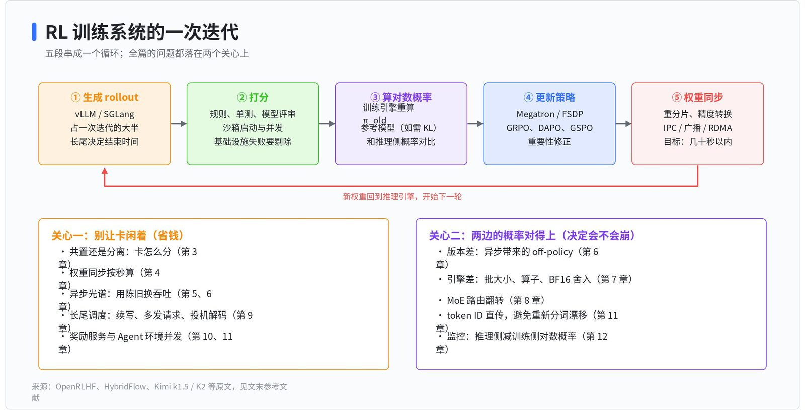
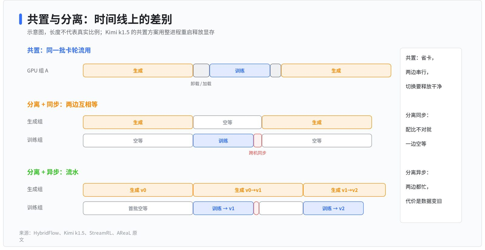
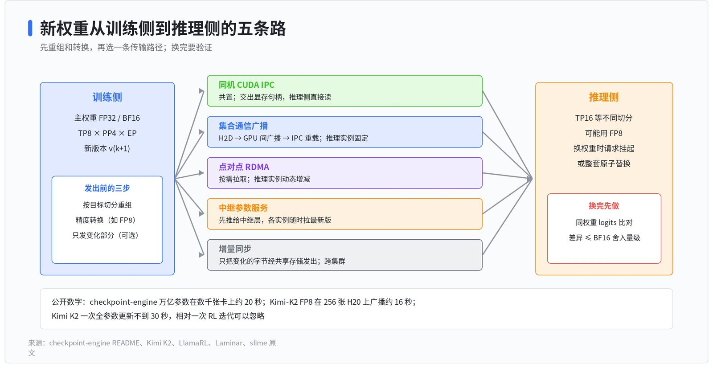
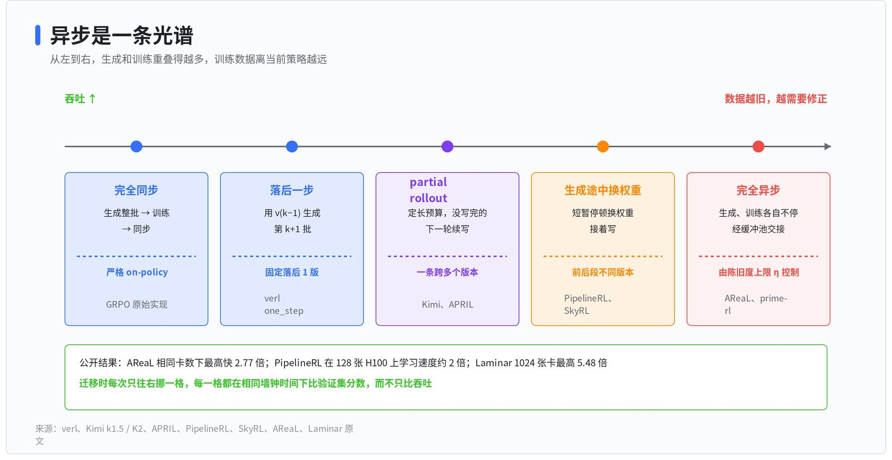
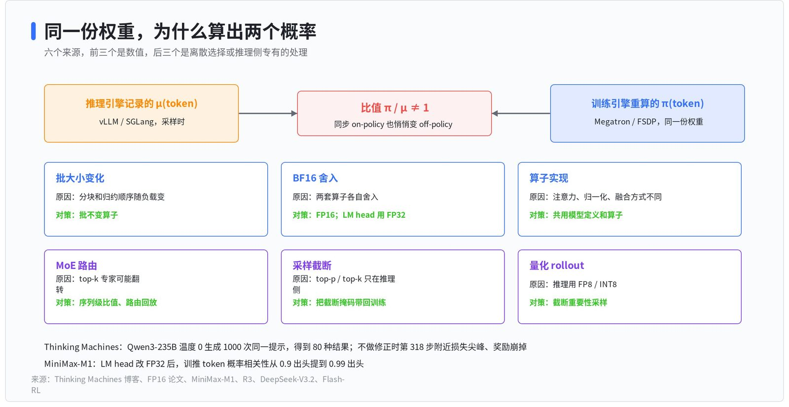
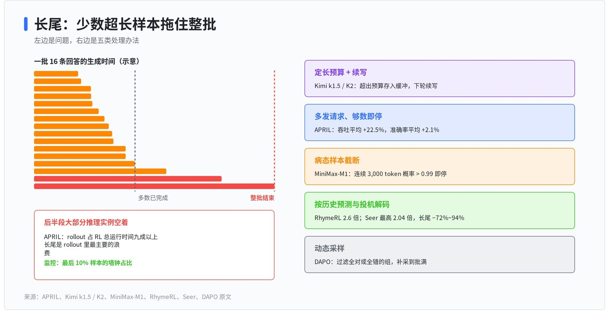
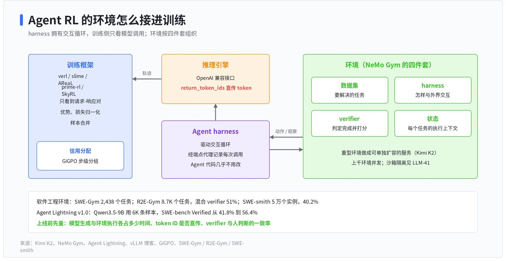

# LLM-55｜系统｜RL 训练系统：rollout 与训练分离、异步与 Agent 环境

> 🎯 **这篇文档解决什么问题**：RLVR 和 Agent RL 的算法大家已经很熟，GRPO、DAPO、GSPO 的公式写出来不过几行。可真把一个几百亿参数的模型放到几百张卡上跑 RL，时间大多耗在算法之外。rollout 生成占了一次迭代的大半，长尾样本让整批 GPU 空等，新权重要在几十秒内送到推理引擎，推理引擎算出来的概率和训练引擎对不上，Agent 任务还要拉起成千上万个沙箱。本篇把这些系统问题按一次迭代的顺序摆开，讲清每个问题的成因、开源系统的几种做法和各自的代价。
>
> 使用方式：主线是 2024 到 2026 年公开的系统论文和开源框架，包括 verl、OpenRLHF、slime、ROLL、AReaL、prime-rl、NeMo RL，以及 Kimi、DeepSeek、MiniMax 技术报告里写到的 RL 基础设施。数字都来自原文，引用处标了编号。第 2 到 6 章讲“怎么把 rollout 和训练排开”，第 7、8 章讲“排开以后数值上出什么问题”，第 9 到 11 章讲长尾、奖励和 Agent 环境，第 12 章是监控与踩坑。

## 导读 · 先给结论

- **RL 训练的瓶颈在生成**：OpenRLHF 的说法是 RLHF 约 80% 的时间花在采样上 [[1]](https://github.com/OpenRLHF/OpenRLHF)。生成是逐 token 的自回归，受显存带宽和最长那条样本限制；训练是大矩阵乘，受算力限制。两种负载形状不同，系统设计的大部分工作都在调和它们。
- **先决定放在一起还是分开**：共置（colocate）让训练和推理轮流用同一批卡，省卡但两边只能串行；分离（disaggregate）把两者放在不同的卡上，可以流水，但要解决权重搬运和负载配比。verl、OpenRLHF 两种都支持，slime、AReaL、LlamaRL 偏分离 [[4]](https://arxiv.org/abs/2409.19256)[[2]](https://arxiv.org/abs/2405.11143)[[11]](https://github.com/THUDM/slime)[[19]](https://arxiv.org/abs/2505.24298)[[15]](https://arxiv.org/abs/2505.24034)。
- **权重同步要按秒算**：Kimi K2 一次全参数更新不到 30 秒 [[13]](https://arxiv.org/abs/2507.20534)，checkpoint-engine 报告万亿参数在数千张卡上约 20 秒 [[14]](https://github.com/MoonshotAI/checkpoint-engine)。同步一慢，分离架构省下的时间就被吃掉。
- **异步是一条光谱**：从完全同步，到“落后一步”，到暂停长尾样本下轮续写，到生成途中换权重，再到完全异步。越往后吞吐越高，数据越旧。AReaL 用最大陈旧度 η 来控制 [[19]](https://arxiv.org/abs/2505.24298)，PACE 进一步区分陈旧度是在生成时还是排队时积累的 [[20]](https://arxiv.org/abs/2609.36830)。
- **训推不一致比异步更隐蔽**：同一个模型、同一条序列，推理引擎和训练引擎算出的 token 概率并不相同。批大小变化、算子归约顺序、BF16 舍入、MoE 路由、top-p 截断都会造成差异 [[25]](https://thinkingmachines.ai/blog/defeating-nondeterminism-in-llm-inference/)[[26]](https://arxiv.org/abs/2510.26788)[[32]](https://arxiv.org/abs/2510.11370)。它让“同步 on-policy”也悄悄变成 off-policy，必须用重要性修正或从数值上消除。
- **Agent RL 把问题推到环境侧**：一条轨迹要调几十次工具、等几分钟的沙箱执行。Kimi K2 把重型环境做成独立服务、靠大量并发 rollout 摊薄等待 [[13]](https://arxiv.org/abs/2507.20534)；NeMo Gym 把环境定义成数据集、harness、verifier 和状态四件套 [[42]](https://github.com/NVIDIA-NeMo/Gym)；返回 token ID、避免二次分词漂移成了必备细节 [[46]](https://blog.vllm.ai/2025/10/22/agent-lightning.html)。

> 🔑 **一句话版本**：RL 训练系统要同时管好两件事。一件是让生成和训练都别闲着，靠分离、异步和长尾调度；另一件是让训练用的概率和生成用的概率对得上，靠权重同步、数值对齐和重要性修正。前一件省钱，后一件决定训练会不会悄悄崩。

📎 与系列其他文档的分工：本篇放在系统层，是 [LLM-22｜地基｜后训练实战：SFT、LoRA 与 RLVR](./22-post-training.md) 的系统侧。那篇讲 SFT、LoRA 和 RLVR 怎么做，本篇讲 RLVR 跑起来以后怎么跑得快、跑得稳。推理模型为什么需要长思维链 RL 见 [LLM-37｜地基｜推理模型与测试时计算：长思维链何时值得](./37-reasoning-models.md)，模型用 RL 改进自己的研究线见 [LLM-48｜系统｜递归自我改进（RSI）：模型怎样改进自己](./48-rsi.md)。预训练侧的并行和容错见 [LLM-23｜系统｜大模型训练工程：数据配比与万卡稳定性](./23-training-engineering.md)，BF16 训练的数值问题见 [LLM-54｜系统｜低精度训练的数值稳定性：从 FlashAttention 一次舍入偏差说起](./54-low-precision-training.md)，Agent 沙箱的隔离与规模化见 [LLM-41｜工程｜Agent 运行时与沙箱：隔离、持久执行与规模化](./41-agent-runtime-sandbox.md)。

📎 与系列其他文档的分工：本篇放在系统层，是 [LLM-22｜地基｜后训练实战：SFT、LoRA 与 RLVR](./22-post-training.md) 的系统侧。那篇讲 SFT、LoRA 和 RLVR 怎么做，本篇讲 RLVR 跑起来以后怎么跑得快、跑得稳。推理模型为什么需要长思维链 RL 见 [LLM-37｜地基｜推理模型与测试时计算：长思维链何时值得](./37-reasoning-models.md)，模型用 RL 改进自己的研究线见 [LLM-48｜系统｜递归自我改进（RSI）：模型怎样改进自己](./48-rsi.md)。预训练侧的并行和容错见 [LLM-23｜系统｜大模型训练工程：数据配比与万卡稳定性](./23-training-engineering.md)，BF16 训练的数值问题见 [LLM-54｜系统｜低精度训练的数值稳定性：从 FlashAttention 一次舍入偏差说起](./54-low-precision-training.md)，Agent 沙箱的隔离与规模化见 [LLM-41｜工程｜Agent 运行时与沙箱：隔离、持久执行与规模化](./41-agent-runtime-sandbox.md)。

## 第 1 章 · 为什么 RL 训练是一个系统问题

预训练和 SFT 只有一种负载：读数据、前向、反向、更新。RL 的一次迭代至少有四种：用当前策略生成回答，给回答打分，计算旧策略和参考模型的对数概率，用这些数据更新策略。PPO 再加一个价值模型，等于四个模型在同一个循环里轮流上场 [[3]](https://arxiv.org/abs/2308.01320)。GRPO 系方法去掉了价值模型，但生成仍是主角，而且推理模型的回答一条就是几千到几万 token。

### 1.1 两种负载的形状

|  | 生成（rollout） | 训练（更新） |
|---|---|---|
| 计算形状 | 逐 token 自回归，每步一个小矩阵乘 | 整段序列一次前向反向，大矩阵乘 |
| 瓶颈 | 显存带宽、KV cache 容量、最长那条样本 | 算力、激活显存、通信 |
| 最合适的引擎 | vLLM、SGLang：分页 KV、连续批处理、CUDA Graph | Megatron、FSDP：TP / PP / EP、重计算、优化器分片 |
| 并行方式 | 偏小 TP、多副本，提高并发 | 偏大规模切分，提高单步吞吐 |
| 时长分布 | 长尾严重，最长样本决定批的结束时间 | 可预估，和 token 总数成正比 |

所以几乎所有现代框架都用两套引擎：训练用 Megatron 或 FSDP，生成用 vLLM 或 SGLang。DeepSpeed-Chat 早期的 Hybrid Engine 试过在同一套 DeepSpeed 里切换训练和推理模式 [[3]](https://arxiv.org/abs/2308.01320)，后来的框架普遍改成接入专门的推理引擎 [[2]](https://arxiv.org/abs/2405.11143)[[4]](https://arxiv.org/abs/2409.19256)[[11]](https://github.com/THUDM/slime)。两套引擎带来三个系统问题：权重怎么从训练侧送到推理侧，两边的卡怎么分配，两边算出来的数值是否一致。

### 1.2 规模已经到了什么程度

| 公开数据 | 数字 | 说明 |
|---|---|---|
| DeepSeek-V3.2 [[29]](https://arxiv.org/abs/2512.02556) | 后训练算力超过预训练的 10% | 合成了 1,800 多个环境、85,000 条 Agent 任务提示 |
| MiniMax-M1 [[30]](https://arxiv.org/abs/2506.13585) | 512 张 H800，3 周，约 53.47 万美元 | 整个 RL 阶段的租用成本 |
| ScaleRL [[28]](https://arxiv.org/abs/2510.13786) | 对照实验共 40 多万 GPU 小时，单次运行扩到 10 万 GPU 小时 | 研究 RL 算力怎么随设计选择扩展 |
| Kimi k1.5 [[12]](https://arxiv.org/abs/2501.12599) | RL 上下文到 128k | 用 partial rollout 处理超长生成 |

后训练从“预训练之后的一个小阶段”变成了占总算力一成以上的主阶段，RL 系统的效率因此直接关系到模型迭代的节奏。一个吞吐提高一倍的 RL 系统，等于同样的预算多跑一倍的实验。

评估一个 RL 训练方案时，先量一次迭代里四段时间（生成、打分、算对数概率、更新）各占多少，以及生成段里最长样本和中位数样本差几倍。这两个数决定后面该先优化哪里。

## 第 2 章 · 数据流与控制器：谁来指挥这几个模型

RL 的一次迭代是一张数据流图：提示进入生成，回答进入奖励和对数概率计算，结果汇总成训练批。HybridFlow（verl 的论文）把这张图的编排方式分成两类 [[4]](https://arxiv.org/abs/2409.19256)。

| 方式 | 做法 | 好处 | 代价 |
|---|---|---|---|
| 单控制器 | 一个中心进程按顺序调度各个模型 | 算法逻辑写在一处，改算法容易 | 中心进程要分发全部数据，规模大时成为瓶颈 |
| 多控制器 | 每张卡跑同一份程序，各自决定做什么（SPMD） | 没有中心瓶颈，适合大模型分布式计算 | 算法逻辑分散在各个 worker 里，改一个算法要动很多地方 |
| 混合（HybridFlow） | 模型之间用单控制器编排，单个模型自身的分布式计算用多控制器 | 两头的好处都拿到 | 需要设计好模型间的数据重分片 |

HybridFlow 另一个贡献是 3D-HybridEngine：训练用的 3D 并行切分和生成用的切分不同，它在两种切分之间零冗余地重排权重，报告吞吐比当时的基线高 1.53 到 20.57 倍 [[4]](https://arxiv.org/abs/2409.19256)。OpenRLHF 走的是另一条路，用 Ray 调度、vLLM 生成、DeepSpeed 训练，各角色是独立的 Ray actor，报告比当时的方案快 1.22 到 1.68 倍 [[2]](https://arxiv.org/abs/2405.11143)。Meta 的 LlamaRL 用单控制器加原生 PyTorch 写成，405B 规模上报告最高 10.7 倍的加速 [[15]](https://arxiv.org/abs/2505.24034)。

### 2.1 主流开源框架一览

| 框架 | 训练 / 生成引擎 | 架构特点 | 异步支持 |
|---|---|---|---|
| verl [[4]](https://arxiv.org/abs/2409.19256)[[5]](https://github.com/volcengine/verl) | FSDP、Megatron / vLLM、SGLang | HybridFlow 混合控制器；Megatron 后端可训 671B MoE | one_step_off_policy、fully_async_policy 在 experimental 目录 |
| OpenRLHF [[1]](https://github.com/OpenRLHF/OpenRLHF)[[2]](https://arxiv.org/abs/2405.11143) | DeepSpeed / vLLM | Ray 调度，角色可共置也可分离 | 0.8.0 起 --train.async_enable；2026-09 加入 FlashREINFORCE |
| slime [[11]](https://github.com/THUDM/slime) | Megatron / SGLang | 训练、生成、Data Buffer 三块；GLM-4.5 到 GLM-5.3 的 RL 框架 | 支持外部 rollout 引擎；Delta Weight Sync |
| ROLL / ROLL Flash [[9]](https://arxiv.org/abs/2506.06122)[[10]](https://arxiv.org/abs/2510.11345) | Megatron 等 / vLLM、SGLang | 面向大规模的调度库 | ROLL Flash 报告 RLVR 2.24 倍、Agent 任务 2.72 倍 |
| AReaL [[19]](https://arxiv.org/abs/2505.24298) | 自研 / SGLang | 完全异步，生成与训练彻底解耦 | 最大陈旧度 η 可调，η = 0 退化为同步 |
| prime-rl [[22]](https://github.com/PrimeIntellect-ai/prime-rl) | FSDP / vLLM | 面向去中心化和 Agent 的完全异步 | 原生异步 |
| NeMo RL [[24]](https://github.com/NVIDIA-NeMo/RL) | Megatron、DTensor / vLLM | NVIDIA 官方后训练库 | 异步 rollout 加 replay buffer，完全异步 GRPO |
| SkyRL [[23]](https://github.com/NovaSky-AI/SkyRL) | FSDP 等 / vLLM、SGLang | 带 skyrl-gym 环境库 | 生成途中更新权重的完全异步模式 |

> ✅ **可以带走的方法**：选框架先看两件事。算法改动写在哪一层，改一个损失函数要不要碰分布式代码，这决定研究效率。训练和生成之间的数据重分片和权重同步归谁管，能不能换成你自己的推理引擎，这决定能不能上规模。

## 第 3 章 · 共置还是分离：卡怎么分

共置是把训练引擎和推理引擎放在同一批 GPU 上，生成时训练侧把权重和优化器状态卸载到 CPU，训练时推理侧释放 KV cache。分离是把两者放在不同的 GPU 上，各自常驻。

|  | 共置 | 分离 |
|---|---|---|
| GPU 利用 | 同一时刻只有一种负载在跑；切换要卸载和加载 | 两边可以同时跑，但配比不对时一边会空等 |
| 权重同步 | 同机内存拷贝或 CUDA IPC，快 | 跨机网络传输，要专门优化 |
| 显存 | 两套引擎轮流占用，要处理碎片和释放不干净 | 各自独立，推理侧可以用满显存放 KV cache |
| 和异步的关系 | 天然同步，异步要额外设计 | 天然适合流水和异步 |
| 适用 | 卡少、模型中等、研究迭代 | 卡多、长生成、Agent 任务 |

共置的难点在“释放干净”。Kimi k1.5 的做法很具体：训练阶段结束后 Megatron 卸载显存，vLLM 先用假权重（dummy weights）启动，再通过 Mooncake 从 Megatron 接收真实权重；rollout 结束后 checkpoint-engine 停掉全部 vLLM 进程，Megatron 才重新加载 [[12]](https://arxiv.org/abs/2501.12599)。论文说直接用 vLLM 的卸载接口很难把显存全部释放，原因是 CUDA Graph、NCCL 缓冲区和驱动本身的占用，所以干脆整个进程重启。整个过程靠 etcd 管理的全局元数据广播各阶段的状态。

### 3.1 分离之后的配比问题

分离后要回答“多少卡生成、多少卡训练”。StreamRL 分析了分离架构里的两种空闲 [[8]](https://arxiv.org/abs/2504.15930)：一种是流水线气泡，生成和训练互相等；另一种是偏斜气泡，同一批里少数超长样本拖住整批。它的做法是让生成侧以流的方式把完成的样本持续交给训练侧，用一个输出长度排序器预估哪些样本会很长并单独调度，报告最高 2.66 倍吞吐。生成和训练放在不同数据中心、用不同型号的卡时，性价比提高 1.33 倍。

另一类做法是动态重分配。ReaL 在训练过程中为不同阶段重新分配参数和并行策略，用一个搜索算法加轻量运行时估计器找执行计划，在 70B、128 张卡上报告最高 3.58 倍 [[6]](https://arxiv.org/abs/2406.14088)。RLHFuse 把生成和“算对数概率”两个阶段拆到样本粒度，长尾样本还在生成时，已完成的样本就开始下一阶段；训练阶段再把 micro-batch 子任务放进一个融合的流水调度，报告最高 3.7 倍 [[7]](https://arxiv.org/abs/2409.13221)。这些方法共同的判断是：静态地切一刀分卡，总有一边会闲着。

分离架构上线前，先用一次迭代的实测数据算配比：生成侧每秒能产出多少条完成样本，训练侧每秒能吃掉多少条。两个数差一倍以上，异步和流式调度都救不回来，要先调卡的分配。

## 第 4 章 · 权重同步：把新权重在几十秒内送到推理引擎

每次训练更新完，推理引擎都要换上新权重才能生成下一批数据。对一个几百 GB 的模型，这一步如果走“训练侧存检查点，推理侧从存储加载”，一次就是几分钟到十几分钟，比一次训练步还长。所以权重同步成了 RL 系统里专门的一层。

### 4.1 几种做法

| 做法 | 代表 | 过程 | 适用 |
|---|---|---|---|
| 同机 CUDA IPC | 共置架构；checkpoint-engine 的最后一步 [[14]](https://github.com/MoonshotAI/checkpoint-engine) | 训练进程把显存句柄交给推理进程，推理侧直接读 | 共置，或同一台机器上的分离 |
| 集合通信广播 | checkpoint-engine Broadcast 模式 [[14]](https://github.com/MoonshotAI/checkpoint-engine)；SHARDCAST [[16]](https://arxiv.org/abs/2505.07291) | 训练侧把权重分片后，经 NCCL 或 HTTP 广播给所有推理实例 | 推理实例固定、规模大 |
| 点对点 RDMA | checkpoint-engine P2P 模式（Mooncake）[[12]](https://arxiv.org/abs/2501.12599)[[14]](https://github.com/MoonshotAI/checkpoint-engine)；LlamaRL 的 DDMA [[15]](https://arxiv.org/abs/2505.24034) | 推理实例按需从训练侧或其他实例拉取 | 推理实例会动态增减 |
| 中继参数服务 | Laminar 的 relay workers [[17]](https://arxiv.org/abs/2510.12633) | 训练侧只推给中继层，推理实例随时从中继层拉最新版本 | 轨迹级异步，各实例更新时机不同 |
| 只传变化部分 | slime Delta Weight Sync [[11]](https://github.com/THUDM/slime) | 只把变化的权重字节经共享存储发出去 | 跨集群、带宽受限 |

checkpoint-engine 的 Broadcast 流程是三段：先把权重从主机内存拷到显存（H2D），再在 GPU 之间广播，最后推理进程通过 CUDA IPC 重新加载，整个过程由 ZeroMQ 控制。README 给出的数字是 Kimi-K2 FP8 在 256 张 H20、TP16 下广播一次约 16 秒，Qwen3-235B 在 8 张 H800 上约 6 秒；万亿参数在数千张卡上整体约 20 秒 [[14]](https://github.com/MoonshotAI/checkpoint-engine)。Kimi K2 技术报告说一次全参数更新不到 30 秒，相对一次 RL 迭代可以忽略 [[13]](https://arxiv.org/abs/2507.20534)。

### 4.2 同步时的三个坑

1. **切分不一致**：训练侧是 TP8 × PP4 × EP，推理侧是 TP16，权重要先按目标切分重组再发。HybridFlow 的 3D-HybridEngine 和各框架的“重分片”代码都在解决这件事 [[4]](https://arxiv.org/abs/2409.19256)。重组时最常见的错误是 QKV 合并顺序、MoE 专家编号和 tied embedding 处理不一致，结果是推理侧加载成功、输出却是乱码。
2. **精度转换**：训练侧主权重是 FP32 或 BF16，推理侧可能用 FP8。转换在哪一侧做、用什么缩放因子，会直接影响下一章的训推一致性。
3. **半新半旧**：分片陆续到达时，推理引擎如果不暂停，就可能用一半新一半旧的权重生成。PipelineRL 的“生成途中换权重”是主动设计出来的 [[18]](https://arxiv.org/abs/2509.19128)，其他情况都要保证换权重时请求被挂起，或者整套权重原子替换。

> ✅ **可以带走的方法**：每次改动同步路径后做一次“同权重比对”：用同一组输入让训练引擎和推理引擎各算一遍最后一层 logits，逐元素比较。差异超过 BF16 舍入的量级，就是重组或转换出了错，不要等训练曲线来告诉你。

## 第 5 章 · 异步光谱：用陈旧换吞吐

同步 RL 的一次迭代是：生成整批，等最长那条结束，打分，训练，同步权重，再开始下一批。生成和训练在时间上完全串行，分离架构下两边都有一半时间在等。异步的思路是让生成用稍旧的权重先跑起来，代价是训练数据不再严格来自当前策略。

| 档位 | 做法 | 数据新旧 | 代表 |
|---|---|---|---|
| 完全同步 | 生成完整批 → 训练 → 同步 | 严格 on-policy（不计训推差异） | GRPO 原始实现；Seer 在同步前提下优化生成 [[36]](https://arxiv.org/abs/2511.14617) |
| 落后一步 | 第 k 批训练时，用第 k−1 版权重生成第 k+1 批 | 固定落后 1 个版本 | verl one_step_off_policy [[5]](https://github.com/volcengine/verl) |
| partial rollout | 每轮只生成固定长度，没写完的样本暂停，下一轮用新权重续写 | 一条样本跨多个版本 | Kimi k1.5、K2 [[12]](https://arxiv.org/abs/2501.12599)[[13]](https://arxiv.org/abs/2507.20534)；APRIL [[34]](https://arxiv.org/abs/2509.18521) |
| 生成途中换权重 | 推理引擎在生成途中短暂停顿，换上新权重后接着写 | 一条样本的前后段来自不同版本 | PipelineRL [[18]](https://arxiv.org/abs/2509.19128)；SkyRL [[23]](https://github.com/NovaSky-AI/SkyRL) |
| 完全异步 | 生成和训练各自不停，经缓冲池交接 | 落后版本数由陈旧度上限控制 | AReaL [[19]](https://arxiv.org/abs/2505.24298)；prime-rl [[22]](https://github.com/PrimeIntellect-ai/prime-rl)；Laminar [[17]](https://arxiv.org/abs/2510.12633) |

### 5.1 几个系统的具体做法

**AReaL** 的生成 worker 可以被打断：新权重到达时，正在生成的请求丢弃旧 KV cache，用新权重重算前缀再继续。训练侧只接受陈旧度不超过 η 的样本，η = 0 时等价于同步。为了在 η 大于 0 时稳定训练，它用一个解耦的 PPO 目标，把“采样用的策略”和“近端约束参照的策略”分开。数学和代码推理任务上，相同卡数下比同步系统最高快 2.77 倍，最终效果持平或更好 [[19]](https://arxiv.org/abs/2505.24298)。

**PipelineRL** 走得更远，推理引擎在生成途中接收新权重，只做很短的停顿就接着往下写，于是一条长回答的前半段来自旧策略、后半段来自新策略。128 张 H100 上的长推理任务，学习速度约是传统方法的 2 倍，同时训练数据仍然高度接近 on-policy [[18]](https://arxiv.org/abs/2509.19128)。

**Laminar** 指出完全异步系统的另一个瓶颈：大多数实现仍然要求所有推理实例在同一时刻全局同步权重。它改成轨迹级异步，每条轨迹独立生成、独立被消费，推理实例从中继参数服务随时拉最新权重；长尾轨迹被动态重新打包到少数专门的实例上。1024 张卡上报告最高 5.48 倍 [[17]](https://arxiv.org/abs/2510.12633)。

**LlamaRL** 给出了异步带来严格加速的形式化证明，并在 Llama 3 后训练中用共置卸载、异步 off-policy 训练和分布式直接内存访问做权重同步 [[15]](https://arxiv.org/abs/2505.24034)。**INTELLECT-2** 把完全异步推到了去中心化：32B 模型的 RL 由一群不受信任的志愿算力完成，TOPLOC 验证推理节点交回的 rollout 没有作假，SHARDCAST 负责把权重广播出去 [[16]](https://arxiv.org/abs/2505.07291)。

从同步迁到异步，每次只往光谱右边挪一格，并且每挪一格都跑一组同预算对照：同步基线和异步版本在相同墙钟时间下比验证集分数，而不只比吞吐。吞吐提高、分数下降的异步没有意义。

## 第 6 章 · 陈旧数据怎么用：off-policy 修正

异步以后，一条样本的生成策略 μ 和当前要更新的策略 π_θ 不同。PPO 和 GRPO 的裁剪目标默认 μ 就是 π_old，差得多了，重要性比 π_θ/μ 会很大或很小，更新方向就不可靠。修法分两类：一类控制数据有多旧，一类修正算法让它容忍旧数据。

### 6.1 控制陈旧度

最直接的是设上限，AReaL 的 η 就是这样 [[19]](https://arxiv.org/abs/2505.24298)。PACE 发现单看“落后几个版本”不够细 [[20]](https://arxiv.org/abs/2609.36830)：一条轨迹的陈旧度有两部分，一部分是生成过程中积累的（生成陈旧度），另一部分是生成完以后在缓冲池里排队积累的（等待陈旧度）。长回答或被打断续写的回答天然跨越多个版本，按总陈旧度一刀切会系统性地丢掉长样本。PACE 在缓冲池过满时把超出的部分换成一个拒绝预算，再按“等待陈旧度加上考虑前缀的生成陈旧度”给完成的轨迹排序。数学推理上，同样墙钟预算下验证准确率比不过滤的异步 RL 高 18.7%，与同步 RL 持平时 GPU 时间少 47.1%。

### 6.2 修正算法

| 方法 | 思路 | 来源 |
|---|---|---|
| 解耦 PPO | 把行为策略 μ 和近端参照策略分开，重要性比按 μ 算，裁剪按近端策略算 | AReaL [[19]](https://arxiv.org/abs/2505.24298) |
| 截断重要性采样（TIS） | 在 token 级重要性比上设上限，防止少数 token 的权重过大 | Flash-RL 的实现 [[50]](https://github.com/yaof20/Flash-RL)；OpenRLHF 的 is_correction 选项 [[1]](https://github.com/OpenRLHF/OpenRLHF) |
| 序列级掩码 | 序列整体偏离太大就整条不用 | DeepSeek-V3.2 的 Off-Policy Sequence Masking [[29]](https://arxiv.org/abs/2512.02556) |
| CISPO | 裁剪重要性权重本身，不裁剪 token 的更新，避免关键 token 被整段丢弃 | MiniMax-M1 [[30]](https://arxiv.org/abs/2506.13585) |
| 接受 off-policy 的目标 | 直接按“滞后的推理策略”推导目标函数，不做 IS | OAPL [[21]](https://arxiv.org/abs/2602.19362) |

DeepSeek-V3.2 的序列掩码值得展开：它只屏蔽那些优势为负、并且 π_old 与 π_θ 之间的 KL 超过阈值 δ 的序列 [[29]](https://arxiv.org/abs/2512.02556)。论文的解释是，模型从自己犯的错里学得最多，而严重偏离当前策略的负样本更可能误导优化。这里的 π_old 直接取推理框架返回的采样概率，所以这个 KL 同时包含了异步带来的版本差和训推之间的数值差。OAPL 走的是相反的路，承认数据就是 off-policy，在策略滞后超过 400 个梯度步时仍能训练，竞赛数学上超过带 IS 的 GRPO，代码任务上用三分之一的生成量追平 DeepCoder [[21]](https://arxiv.org/abs/2602.19362)。

> 💡 **注意**：这些修正同时也在修第 7 章的训推不一致。异步带来的“版本差”和数值带来的“引擎差”在损失函数里是同一个比值，监控时要把两者分开测：同一个版本的权重下，推理侧和训练侧的对数概率差多少；版本差又额外贡献多少。

> ✅ **可以带走的方法**：给每个训练样本记下生成它的权重版本号、生成开始和结束时的版本号、进入训练时的版本号。有了这几个数，陈旧度的分布、长样本是否被系统性丢弃、不同修正方法的效果，都能直接统计出来。

## 第 7 章 · 训推不一致：同一个模型算出两个概率

理论上，用同一份权重，推理引擎采样时记录的 token 概率应该和训练引擎重算的一样。实际上不一样。Thinking Machines 做过一个实验：用 Qwen3-235B-A22B-Instruct-2507、温度 0 生成 1000 次同一提示，得到 80 种不同的结果，最常见的那种出现 78 次，所有结果的前 102 个 token 完全相同 [[25]](https://thinkingmachines.ai/blog/defeating-nondeterminism-in-llm-inference/)。温度 0 都不确定，概率更不会对得上。

### 7.1 差异从哪里来

| 来源 | 机制 | 可以怎么消除 |
|---|---|---|
| 批大小变化 | 推理服务的批大小随负载变化，矩阵乘和归约的分块方式跟着变，浮点加法顺序不同结果就不同 [[25]](https://thinkingmachines.ai/blog/defeating-nondeterminism-in-llm-inference/) | 批不变算子（batch-invariant kernels）[[49]](https://github.com/thinking-machines-lab/batch-invariant-ops)；verl 的 vexact [[5]](https://github.com/volcengine/verl) |
| 精度与舍入 | BF16 只有 8 位有效数字，训练和推理两套算子的舍入路径不同，差异被放大 [[26]](https://arxiv.org/abs/2510.26788) | 改用 FP16 [[26]](https://arxiv.org/abs/2510.26788)[[27]](https://github.com/sail-sg/Precision-RL)；关键层（LM head）用 FP32 [[30]](https://arxiv.org/abs/2506.13585) |
| 算子实现 | 两套引擎的注意力、归一化、激活融合方式不同 | 推理侧和训练侧共用模型定义和算子 |
| MoE 路由 | 微小数值差导致 top-k 选中的专家不同，输出差异不再是小量 | 见第 8 章 |
| 采样截断 | top-p / top-k 只在推理侧生效，训练侧在全词表上算概率 | DeepSeek-V3.2 的 Keep Sampling Mask：把推理时的截断掩码带给训练 [[29]](https://arxiv.org/abs/2512.02556) |
| 量化 rollout | 推理侧用 FP8 / INT8 加速生成 | 截断重要性采样修正 [[50]](https://github.com/yaof20/Flash-RL) [51] Huang et al. Bait: Mitigating Harmful Agentic Reinforcement Learning via Probing Reward Function (2026) [https://arxiv.org/abs/2611.16369](https://arxiv.org/abs/2611.16369) [52] Zhang et al. Outcome-Mass Alignment: Controlling Length-Dependent Trajectory Influence in Multi-Turn LLM Agent Reinforcement Learning (2026) [https://arxiv.org/abs/2611.16816](https://arxiv.org/abs/2611.16816) [53] Lu et al. StateAlign: Internalizing State-Aware Decision-Making for Reliable Multi-Turn Tool Agents via Reinforcement Learning (2026) [https://arxiv.org/abs/2611.16304](https://arxiv.org/abs/2611.16304) |

### 7.2 它为什么会让训练崩

Thinking Machines 在同一篇文章里对比了三种设置 [[25]](https://thinkingmachines.ai/blog/defeating-nondeterminism-in-llm-inference/)：实验是 Qwen2.5-VL-Instruct 8B 在 Bigmath 上做 RLVR，最长 rollout 4096。不做重要性修正时，第 318 步附近出现损失尖峰，训推 KL 同时冲高，奖励随后崩掉；加上重要性加权，KL 稳定在 0.001 左右，偶有小尖峰；用批不变算子让采样和训练逐位一致，KL 恒为 0，训练同样平稳。MiniMax-M1 报告了同类现象：训练和推理的 token 概率相关性只有 0.9 出头，奖励涨不上去。较小的稠密 softmax 注意力模型上没有出现这个问题。逐层排查后发现 LM head 的激活值很大，是主要误差源。把 LM head 改成 FP32 后，相关性提高到 0.99 出头，并在整个训练中保持稳定 [[30]](https://arxiv.org/abs/2506.13585)。

FP16 那篇论文把根源归到 BF16 的舍入误差：训练和推理两条计算路径各自舍入，误差足以让重要性比偏离 1；把整个 RL 改成 FP16 后，在 GRPO、GSPO、TIS 等多种算法和稠密、MoE、LoRA 多种设置下，训练都更稳、效果更好 [[26]](https://arxiv.org/abs/2510.26788)[[27]](https://github.com/sail-sg/Precision-RL)。这和 [LLM-54｜系统｜低精度训练的数值稳定性：从 FlashAttention 一次舍入偏差说起](./54-low-precision-training.md) 讲的预训练数值问题是同一类事情：误差大小不可怕，可怕的是它系统性地偏向一边，又被 RL 的比值放大。

### 7.3 实际取舍

- **全面数值对齐**（批不变算子、共用模型定义、FP16）：KL 可以接近 0，但推理吞吐会下降，批不变算子在一些形状上明显更慢。
- **关键位置对齐 + 重要性修正**：LM head 用 FP32、采样掩码带回训练、再加 TIS 或序列掩码。代价小，是目前大多数生产系统的选择。
- **不对齐，换算法**：用 OAPL 这类本来就为 off-policy 设计的目标 [[21]](https://arxiv.org/abs/2602.19362)。

把“推理侧对数概率减训练侧对数概率”的分布当成 RL 训练的一号监控指标，按 token 记录均值、方差和最大值。它在奖励曲线崩之前就会先抬头；新换一个推理引擎版本、改一次量化配置，都先看它。

## 第 8 章 · MoE 的 RL：路由让差异不再是小量

稠密模型里，训推之间的数值差异是连续的小量，重要性比偏离 1 一点点。MoE 模型里，路由是离散的 top-k 选择，logit 上一个很小的差异可能让第 8 名和第 9 名专家互换位置，这个 token 的输出就换成了另一个专家算出来的结果。同一条序列里只要有几个 token 换了专家，整条序列的概率比就会剧烈偏离。

| 方法 | 做法 | 代价或问题 |
|---|---|---|
| 序列级重要性比（GSPO） | 把 token 级比值换成序列级的几何平均，降低单个 token 剧烈波动的影响，Qwen3 系列用它稳定 MoE 的 RL [[31]](https://arxiv.org/abs/2507.18071) | 粒度变粗，单个 token 的信用分配变弱 |
| 路由回放（R3） | 推理时记录每个 token 选中的专家，训练时强制使用同一组专家 [[32]](https://arxiv.org/abs/2510.11370) | 训练侧的路由不再是自己算出来的，路由器本身的梯度有偏差 |
| Keep Routing | DeepSeek 从 V3-0324 起在 RL 中保持推理时的路由 [[29]](https://arxiv.org/abs/2512.02556) | 与 R3 类似 |
| 路由漂移控制（RDC） | 不强制回放，而是拒绝路由漂移过大的回答，再配合 TIS [[33]](https://arxiv.org/abs/2610.21682) | 丢弃一部分样本 |

RDC 的论文专门分析了 R3 的副作用：强制回放让训练侧的前向和它自己的路由器不一致，带来梯度偏差。它的做法是测量每条回答的路由漂移，超过阈值就拒绝，留下的样本再用 TIS 修正。AIME 2024 和 2025 上，比只用 TIS 高 5.5 分，比 R3 高 4.5 分 [[33]](https://arxiv.org/abs/2610.21682)。

MoE 还多出两个系统问题。权重同步更重，专家数多、EP 切分和推理侧的切分常常不同，第 4 章说的“专家编号错位”在这里最容易发生。负载也会不均，RL 生成的数据分布和预训练不同，某些专家在 rollout 阶段会被集中调用，推理侧的 EP 负载均衡要重新调。verl 用 Megatron 后端支持 671B MoE 的 RL [[5]](https://github.com/volcengine/verl)，slime 支持 DeepSeek V3 系列和 Qwen3 MoE [[11]](https://github.com/THUDM/slime)。

> ✅ **可以带走的方法**：MoE 做 RL 时，每条样本额外记录一个“推理侧与训练侧 top-k 专家集合不同的 token 比例”。这个比例和训推 KL 一起看，能分清问题是普通数值差异还是路由翻转；后者用序列级比值、路由回放或漂移拒绝处理。

## 第 9 章 · 长尾：少数超长样本拖住整批

推理模型的回答长度分布很宽，同一批里中位数几千 token，最长的可能是它的十几倍。同步 RL 要等最长那条写完才能进入下一步，这段时间里大部分推理实例已经空了。APRIL 的统计是 rollout 占整个 RL 运行时间的九成以上，长尾又是 rollout 里最主要的浪费 [[34]](https://arxiv.org/abs/2509.18521)。处理长尾的办法大致分成四类：截断或暂停、多发请求、调度，以及让生成本身更快。

| 做法 | 代表 | 具体怎么做 | 效果或代价 |
|---|---|---|---|
| 定长预算 + 续写 | Kimi k1.5、K2 [[12]](https://arxiv.org/abs/2501.12599)[[13]](https://arxiv.org/abs/2507.20534) | 每轮给每条轨迹一个固定的输出 token 预算，超出的部分存进回放缓冲，下一轮接着写 | 没有一条长轨迹能独占资源；一条样本跨多个权重版本 |
| 多发请求、够数即停 | APRIL [[34]](https://arxiv.org/abs/2509.18521) | 发出比目标数更多的请求，完成数达到目标就停，没写完的留到下一步续写，一条都不丢 | 吞吐平均 +22.5%（最高 44%），最终准确率平均 +2.1%（最高 8%）；已接入 slime |
| 病态样本截断 | MiniMax-M1 [[30]](https://arxiv.org/abs/2506.13585) | 连续 3,000 个 token 的概率都高于 0.99 就停止生成 | 专门切掉陷入重复循环的样本，同时提高吞吐 |
| 按历史预测长度调度 | RhymeRL [[35]](https://arxiv.org/abs/2508.18588)；Seer [[36]](https://arxiv.org/abs/2511.14617) | 利用相邻轮次、同一提示下回答的相似性，预测长度、平衡负载、做投机解码 | RhymeRL 2.6 倍；Seer rollout 吞吐最高 2.04 倍，长尾延迟降 72% 到 94% |
| 动态采样 | DAPO [[37]](https://arxiv.org/abs/2503.14476) | 一组回答全对或全错时优势为 0，把这些组过滤掉，补采到批满 | 每批有效梯度更稳定，但要多生成一部分样本 |

RhymeRL 和 Seer 都抓住了 RL 生成区别于在线推理服务的一点：同一个提示会被反复采样。RhymeRL 观察到相邻训练轮次之间的回答很相似，HistoSpec 拿历史轨迹当投机解码的草稿，HistoPipe 按历史长度分布在 rollout worker 之间做两级调度，在生产环境从几十张卡扩到几千张卡，报告 2.6 倍，且不改 RL 算法 [[35]](https://arxiv.org/abs/2508.18588)。Seer 在同步 RL 的前提下做文章：同一提示的一组请求输出长度和模式相近，它把一组请求拆开分散到不同实例做负载均衡，用组内先完成的请求估计其余请求的长度来安排调度，再在组内共享投机解码的草稿 [[36]](https://arxiv.org/abs/2511.14617)。

续写类方法和第 5、6 章是连着的。被暂停的样本下一轮用新权重写后半段，一条轨迹因此混了几个版本，陈旧度要按 PACE 那样区分生成时积累和排队时积累的部分 [[20]](https://arxiv.org/abs/2609.36830)。截断类方法则改变了训练数据的长度分布，被截断的样本怎么给奖励、要不要参与训练，各家处理不同，DAPO 对超长样本单独设计了软惩罚 [[37]](https://arxiv.org/abs/2503.14476)。

> ✅ **可以带走的方法**：每轮记录回答长度的 P50、P90、P99 和最大值，以及“最后 10% 样本占用的墙钟时间比例”。后一个数超过三成，就值得上续写或多发请求；长度分布逐轮变长，同时奖励不涨，多半是模型陷进了重复，先查截断规则。

## 第 10 章 · 奖励与沙箱：打分也要按吞吐设计

📎 延伸阅读：用测试当奖励时，Agent 会想办法让测试变绿，训练环境里的防作弊做法见 [LLM-26｜工程｜编程 Agent 实战：Claude Code、Codex 与 Cursor](./26-coding-agents.md) 第 6.4 节。

RLVR 的奖励大多来自可执行的检查：数学题比对答案，代码题跑单元测试，格式题用规则匹配。这些检查本身不贵，但数量很大，一批几千条回答，每条代码回答要起一个隔离环境跑测试。AReaL 把奖励计算做成独立的并行服务，代码任务里由它抽出代码、执行单元测试，生成侧和训练侧都不必等它 [[19]](https://arxiv.org/abs/2505.24298)。主观任务另有办法，Kimi K2 用模型自己做成对比较的 self-critic 奖励 [[13]](https://arxiv.org/abs/2507.20534)，OpenPipe ART 的 RULER 用 LLM 评审自动给多步 Agent 的轨迹打分 [[48]](https://github.com/OpenPipe/ART)。

### 10.1 代码沙箱的启动开销

Kimi k1.5 的论文给了一组具体数字。它的沙箱用预建的 cgroup 复用来避免高并发下反复创建销毁的瓶颈，用上层挂 tmpfs 的 overlay 文件系统控制磁盘写入。单个容器启动时间从 Docker 的 0.12 秒降到 0.04 秒，16 核机器上每秒能启动的容器数从 27 个提到 120 个 [[12]](https://arxiv.org/abs/2501.12599)。这个量级的差别在 RL 里会被放大：一次迭代几千个容器，启动快三倍就意味着奖励阶段少等几分之一的迭代时间。

| 奖励类型 | 例子 | 系统上要注意 |
|---|---|---|
| 规则匹配 | 数学答案比对、格式检查 | 几乎不耗时，但答案抽取规则写错会让奖励整体偏移，要抽样人工核对 |
| 执行验证 | 代码单元测试、工具调用结果；ReTool 在推理中实时执行代码 [[38]](https://arxiv.org/abs/2504.11536) | 需要隔离环境，启动开销和并发上限决定吞吐；超时要算失败还是丢弃，会影响长尾 |
| 模型打分 | self-critic [[13]](https://arxiv.org/abs/2507.20534)、RULER [[48]](https://github.com/OpenPipe/ART) | 奖励模型本身要占卡，打分延迟进入关键路径；奖励被策略钻空子的风险最高 |
| 环境状态检查 | SWE 任务跑仓库测试 [[39]](https://arxiv.org/abs/2412.21139)[[40]](https://arxiv.org/abs/2504.07164)[[41]](https://arxiv.org/abs/2504.21798) | 一次评测要拉起完整仓库和依赖，镜像体积和缓存决定成本 |

ReTool 是“执行进入 rollout”的典型例子。模型在长推理中间插入代码、实时拿到执行结果再继续写，RL 只用最终答案对错做奖励。32B 模型在 AIME 上训练 400 步达到 67%，纯文本 RL 的基线训练 1080 步只有 40%，扩展设置下到 72.5% [[38]](https://arxiv.org/abs/2504.11536)。代价落在系统上：一条 rollout 里有多次沙箱往返，生成引擎要在等待执行结果时让出位置，这已经很接近下一章的 Agent 环境。

> 💡 **注意**：沙箱超时、OOM、网络错误如果被记成“回答错误”，模型会被惩罚一个它控制不了的结果。奖励服务至少要区分三种结果：通过、未通过、基础设施失败，第三种从训练数据里剔除并单独报警。

> ✅ **可以带走的方法**：给奖励服务单独出一张看板：每秒处理条数、P99 延迟、三种结果的比例、每种失败原因的计数。基础设施失败比例突然升高时，奖励曲线会跟着掉，这时先去修沙箱，算法不用动。
>
> 2026 年 11 月的 Bait 研究把奖励服务本身的攻击面量化了：agentic RL 即服务模式下，约 20 美元成本、多轮有毒环境训练即可完整击穿一个 LLM 的安全对齐，得手后还能协助漏洞利用与代码复用攻击[51]。对外提供训练或奖励服务的平台，租户环境与奖励函数要按不可信输入设计，主动探测奖励函数是已给出的缓解方向。

## 第 11 章 · Agent 训练环境：一条轨迹几十次工具调用

Agent RL 里，一条轨迹是模型和环境的多轮交互：读文件、跑命令、搜索、改代码、再跑测试，几十轮下来要几分钟。Kimi K2 的报告直说了这类任务的系统难点：环境交互期间 GPU 在等虚拟机或代码解释器，单条轨迹又可能极长。它的应对是三件事：把重型环境部署成可以单独扩容的专门服务，用大量并发 rollout 摊薄昂贵交互的延迟，长尾轨迹用 partial rollout 暂停到下一轮续写；接新环境则用一套仿照 OpenAI Gym 设计的统一接口 [[13]](https://arxiv.org/abs/2507.20534)。DeepSeek-V3.2 为 Agent RL 合成了 1,800 多个环境、85,000 条复杂提示 [[29]](https://arxiv.org/abs/2512.02556)，环境的数量已经和数据集一样是要规模化生产的东西。

### 11.1 环境的组成

NVIDIA 的 NeMo Gym 给了一个清楚的定义：环境由四部分组成，数据集（要解决的任务）、agent harness（模型怎样和外部世界交互）、verifier（判定任务是否完成并打分）、状态（每个任务的执行上下文），并支持上千个环境并发 [[42]](https://github.com/NVIDIA-NeMo/Gym)。Prime Intellect 的 verifiers 是同类的环境库，和 Environments Hub 以及 prime-rl 打通，环境可以像包一样发布和复用 [[43]](https://github.com/PrimeIntellect-ai/verifiers)。SkyRL 带了自己的 skyrl-gym [[23]](https://github.com/NovaSky-AI/SkyRL)。把环境拆成这四块的好处是，同一个数据集可以换 harness，同一个 harness 可以换 verifier，训练框架只需要对接一个接口。

| 软件工程环境 | 规模 | 报告结果 |
|---|---|---|
| SWE-Gym [[39]](https://arxiv.org/abs/2412.21139) | 2,438 个真实 Python 任务，每个带可执行环境和单元测试 | 加上在轨迹上训练的 verifier，SWE-Bench Verified 32.0%、Lite 26.0% |
| R2E-Gym [[40]](https://arxiv.org/abs/2504.07164) | 8.7K 个程序化构造的任务，从 commit 反向生成测试和描述 | 32B 模型 pass@1 34.4%；执行类和非执行类 verifier 混合后 51% |
| SWE-smith [[41]](https://arxiv.org/abs/2504.21798) | 128 个仓库合成 5 万个任务实例 | SWE-agent-LM-32B 在 SWE-bench Verified 上 40.2% |

### 11.2 harness 进入训练以后

早期的 Agent RL 由训练框架自己驱动交互循环。Agent Lightning 换了一种接法：任意现成的 Agent（LangChain、OpenAI Agents SDK、AutoGen 或手写的）照常运行，训练侧通过一个 LLM 端点代理收集每次模型调用的请求和响应，再把轨迹拆成训练样本，Agent 代码几乎不用改 [[44]](https://arxiv.org/abs/2508.03680)。v1.0 把这种范式叫作 harnessed agentic RL，并列出它带来的新问题：重新分词、样本合并、优势计算、损失归一化和后端调度；报告里 Qwen3.5-9B 只用 6K 条训练样本，SWE-bench Verified 从 41.8% 提到 56.4% [[45]](https://arxiv.org/abs/2608.17528)。论文还提到，verl Uni-Agent、AReaL 2.0、slime 等框架后来都采用了这种解耦接法。

“重新分词”值得单独说。Agent 框架大多通过 OpenAI 兼容接口调用模型，过去这个接口只返回字符串，训练时要把字符串重新分词。同一段文本重新分词得到的 token 序列可能和采样时不同，这就是 vLLM 博客所说的 retokenization drift，它和第 7 章的训推不一致叠在一起。vLLM 的解法是请求里带上 return_token_ids，接口同时返回提示和生成的 token ID，训练侧直接用 [[46]](https://blog.vllm.ai/2025/10/22/agent-lightning.html)。

### 11.3 多步任务的信用分配

Agent 的奖励往往只在轨迹结束时给一次，几十步里哪一步起了作用很难分清。GiGPO 在 GRPO 的轨迹级分组之外加了一层步级分组：不同轨迹里出现相同环境状态时，从这个状态出发的动作归为一组比较，不需要价值模型，也不需要额外 rollout。在 ALFWorld 上比 GRPO 高 12% 以上，WebShop 高 9% 以上 [[47]](https://arxiv.org/abs/2505.10978)。OpenPipe ART 走的是工程路线，提供把 GRPO 接进任意 Python 应用的 harness，配合 RULER 自动奖励训练多步 Agent [[48]](https://github.com/OpenPipe/ART)。沙箱怎么隔离、怎么持久执行、怎么扩到上万个并发，见 [LLM-41｜工程｜Agent 运行时与沙箱：隔离、持久执行与规模化](./41-agent-runtime-sandbox.md)。快照恢复还撑起一种训练用法：初始成功率接近零的长程任务，从成功轨迹的中间状态重启 rollout，起点逐段往前挪，见 [LLM-22｜地基｜后训练实战：SFT、LoRA 与 RLVR](./22-post-training.md) 第 13 章。

> ✅ **可以带走的方法**：接一个新 Agent 环境，先不训练，只用当前模型跑一轮并记三样东西：每步耗时里模型生成和环境执行各占多少；每条轨迹的 token ID 是否直接来自推理引擎；verifier 在人工标注的几十条样本上和人判断的一致率。三样都过关再开 RL。
>
> 信用分配之外还有一层外层记账问题：分步组相对训练把一条轨迹物化成多个响应行与有效 token，长轨迹被天然过度计权，Outcome-Mass Alignment 给出控制长度相关轨迹影响的对齐方法[52]；同期 StateAlign 针对工具幻觉，用状态感知的 RL 让多轮工具调用跟随当前任务状态决策，把“分数涨了但乱调工具”的分叉压下去[53]。

## 第 12 章 · 监控、踩坑与一份上线清单

ScaleRL 用 40 多万 GPU 小时的对照实验得出一个对系统设计很实用的结论：损失聚合方式、归一化、课程和 off-policy 算法这类细节，主要影响算力效率，不太改变最终能达到的上限 [[28]](https://arxiv.org/abs/2510.13786)。换句话说，系统层面的选择决定的是花多少钱到达那个分数。它也说明稳定的配方会沿可预测的曲线扩展，可以用小规模运行外推大规模结果，这给 RL 系统的容量规划提供了依据。

| 现象 | 常见原因 | 先查什么 |
|---|---|---|
| 奖励先涨后突然崩，崩之前训推 KL 抬头 | 训推不一致或陈旧度过大，重要性比失控 [[25]](https://thinkingmachines.ai/blog/defeating-nondeterminism-in-llm-inference/)[[30]](https://arxiv.org/abs/2506.13585) | 按 token 的推理侧减训练侧对数概率；LM head 精度；是否开了 TIS 或序列掩码 |
| 换了推理引擎版本后训练变差 | 算子实现或默认采样参数变了 | 同权重比对 logits；top-p、top-k、温度是否一致；采样掩码是否带回训练 |
| 推理侧加载权重成功，但输出乱码 | 重分片时 QKV 顺序、专家编号或 tied embedding 错位 | 同一输入下训练引擎与推理引擎最后一层 logits 逐元素比较 |
| GPU 利用率低，生成侧大量空闲 | 长尾，或分离架构配比不对 | 最后 10% 样本的墙钟占比；生成和训练每秒处理条数 |
| 共置模式下显存越跑越少，最终 OOM | CUDA Graph、NCCL 缓冲区释放不干净 | 每阶段切换后的显存余量；参考 k1.5 整进程重启 [[12]](https://arxiv.org/abs/2501.12599) |
| MoE 训练不稳，稠密模型正常 | 路由翻转 [[32]](https://arxiv.org/abs/2510.11370)[[33]](https://arxiv.org/abs/2610.21682) | 训推 top-k 专家集合不同的 token 比例 |
| Agent 任务奖励偏低且波动大 | 沙箱基础设施失败被记成错误；重新分词漂移 | 三类奖励结果比例；token ID 是否来自推理引擎 [[46]](https://blog.vllm.ai/2025/10/22/agent-lightning.html) |
| 回答越来越长，奖励不涨 | 陷入重复，或长度惩罚没生效 | 长度分布 P99；重复截断规则 [[30]](https://arxiv.org/abs/2506.13585)；超长样本的奖励处理 [[37]](https://arxiv.org/abs/2503.14476) |

### 12.1 一次迭代该记录的指标

| 类别 | 指标 |
|---|---|
| 时间 | 生成、打分、算对数概率、更新、权重同步各段耗时；生成段最后 10% 样本的墙钟占比 |
| 生成 | 回答长度 P50 / P90 / P99 / 最大值；被截断、被暂停续写的样本比例；推理侧吞吐 |
| 数据新旧 | 每条样本的生成起止版本号和进入训练时的版本号；陈旧度分布；被陈旧度过滤丢掉的比例及其平均长度 |
| 训推一致 | 按 token 的对数概率差的均值、方差、最大值；重要性比被截断的比例；MoE 的专家集合翻转比例 |
| 奖励 | 通过、未通过、基础设施失败三类比例；奖励服务 P99 延迟；一组全对或全错的比例 |
| 权重同步 | 每次同步耗时；同步期间被挂起的请求数；定期的同权重 logits 比对结果 |

### 12.2 从零搭一套 RL 训练系统的顺序

1. 先在共置、完全同步的配置下跑通，确认算法和奖励正确。verl 和 OpenRLHF 都支持这种配置 [[4]](https://arxiv.org/abs/2409.19256)[[2]](https://arxiv.org/abs/2405.11143)。
2. 加上训推一致性监控和同权重比对，在同步配置下把对数概率差压到稳定的小量，这一步决定后面所有改动有没有可比的基线。
3. 量一次迭代的时间分布，长尾严重先上续写或多发请求，生成占比高再考虑分离。
4. 分离以后优化权重同步，目标是相对一次迭代可以忽略；再按光谱一格一格往异步走，每一格做同墙钟时间的分数对照。
5. 异步之后接入陈旧度控制和 off-policy 修正，MoE 模型额外处理路由。
6. 最后接 Agent 环境：环境服务化、并发 rollout、token ID 直传、奖励三分类。

> 🔑 **收束**：RL 训练系统的每一项优化都在拿数据的新旧和数值的一致去换吞吐。能放心做这个交换的前提，是先把“训练用的概率和生成用的概率差多少”量清楚，并且一直量下去。

> ✅ **可以带走的方法**：把 12.1 节的指标做成每次实验自动产出的一页报告，和奖励曲线放在一起看。出问题时先翻这一页，多数情况下能在半小时内判断是调度、数值、奖励还是环境的问题。

## 参考文献

资料截至 2026 年 10 月。论文以 arXiv 最新版本为准，开源框架以 2026 年 10 月的 README 为准；表中数字均来自原文，不同论文的实验设置差别很大，倍数之间不能直接横比。

[1] OpenRLHF README（“RLHF training spends 80% of the time on sample generation”；0.8.0 起支持 --train.async_enable）. GitHub [https://github.com/OpenRLHF/OpenRLHF](https://github.com/OpenRLHF/OpenRLHF)

[2] Hu et al. OpenRLHF: An Easy-to-use, Scalable and High-performance RLHF Framework. arXiv:2405.11143 (2024) [https://arxiv.org/abs/2405.11143](https://arxiv.org/abs/2405.11143)

[3] Yao et al. DeepSpeed-Chat: Easy, Fast and Affordable RLHF Training of ChatGPT-like Models at All Scales. arXiv:2308.01320 (2023) [https://arxiv.org/abs/2308.01320](https://arxiv.org/abs/2308.01320)

[4] Sheng et al. HybridFlow: A Flexible and Efficient RLHF Framework (verl). EuroSys 2025, arXiv:2409.19256 [https://arxiv.org/abs/2409.19256](https://arxiv.org/abs/2409.19256)

[5] verl README（experimental: one_step_off_policy / fully_async_policy / transfer_queue；vexact 零失配 rollout，2026-05）. GitHub [https://github.com/volcengine/verl](https://github.com/volcengine/verl)

[6] Mei et al. ReaL: Efficient RLHF Training of Large Language Models with Parameter Reallocation. arXiv:2406.14088 (2024) [https://arxiv.org/abs/2406.14088](https://arxiv.org/abs/2406.14088)

[7] Zhong et al. Optimizing RLHF Training for Large Language Models with Stage Fusion (RLHFuse). arXiv:2409.13221 (2024) [https://arxiv.org/abs/2409.13221](https://arxiv.org/abs/2409.13221)

[8] Zhong et al. StreamRL: Scalable, Heterogeneous, and Elastic RL for LLMs with Disaggregated Stream Generation. arXiv:2504.15930 (2025) [https://arxiv.org/abs/2504.15930](https://arxiv.org/abs/2504.15930)

[9] Wang et al. Reinforcement Learning Optimization for Large-Scale Learning: An Efficient and User-Friendly Scaling Library (ROLL). arXiv:2506.06122 (2025) [https://arxiv.org/abs/2506.06122](https://arxiv.org/abs/2506.06122)

[10] Lu et al. Part II: ROLL Flash: Accelerating RLVR and Agentic Training with Asynchrony. arXiv:2510.11345 (2025) [https://arxiv.org/abs/2510.11345](https://arxiv.org/abs/2510.11345)

[11] slime README（Megatron + SGLang + Data Buffer；GLM-4.5 到 GLM-5.3 的 RL 框架；Delta Weight Sync）. GitHub [https://github.com/THUDM/slime](https://github.com/THUDM/slime)

[12] Kimi Team. Kimi k1.5: Scaling Reinforcement Learning with LLMs. arXiv:2501.12599 (2025) [https://arxiv.org/abs/2501.12599](https://arxiv.org/abs/2501.12599)

[13] Kimi Team. Kimi K2: Open Agentic Intelligence. arXiv:2507.20534 (2025) [https://arxiv.org/abs/2507.20534](https://arxiv.org/abs/2507.20534)

[14] MoonshotAI. checkpoint-engine README（万亿参数权重更新约 20 秒；Broadcast / P2P）. GitHub [https://github.com/MoonshotAI/checkpoint-engine](https://github.com/MoonshotAI/checkpoint-engine)

[15] Wu et al. LlamaRL: A Distributed Asynchronous Reinforcement Learning Framework for Efficient Large-scale LLM Training. arXiv:2505.24034 (2025) [https://arxiv.org/abs/2505.24034](https://arxiv.org/abs/2505.24034)

[16] Prime Intellect Team. INTELLECT-2: A Reasoning Model Trained Through Globally Decentralized Reinforcement Learning. arXiv:2505.07291 (2025) [https://arxiv.org/abs/2505.07291](https://arxiv.org/abs/2505.07291)

[17] Laminar: A Scalable Asynchronous RL Post-Training Framework. arXiv:2510.12633 (2025) [https://arxiv.org/abs/2510.12633](https://arxiv.org/abs/2510.12633)

[18] Piché et al. PipelineRL: Faster On-policy Reinforcement Learning for Long Sequence Generation. arXiv:2509.19128 (2025) [https://arxiv.org/abs/2509.19128](https://arxiv.org/abs/2509.19128)

[19] Fu et al. AReaL: A Large-Scale Asynchronous Reinforcement Learning System for Language Reasoning. arXiv:2505.24298 (2025) [https://arxiv.org/abs/2505.24298](https://arxiv.org/abs/2505.24298)

[20] Where Does Staleness Accumulate? Pool Aware Effective Staleness Control for Asynchronous RL in LLM Post-Training (PACE). arXiv:2609.36830 (2026) [https://arxiv.org/abs/2609.36830](https://arxiv.org/abs/2609.36830)

[21] LLMs Can Learn to Reason Via Off-Policy RL (OAPL). arXiv:2602.19362 (2026) [https://arxiv.org/abs/2602.19362](https://arxiv.org/abs/2602.19362)

[22] prime-rl README: Async RL Training at Scale. GitHub [https://github.com/PrimeIntellect-ai/prime-rl](https://github.com/PrimeIntellect-ai/prime-rl)

[23] SkyRL README（skyrl-gym；Fully Async RL with In-Flight Weight Updates 教程）. GitHub [https://github.com/NovaSky-AI/SkyRL](https://github.com/NovaSky-AI/SkyRL)

[24] NeMo RL README（异步 rollout、replay buffer、fully asynchronous GRPO）. GitHub [https://github.com/NVIDIA-NeMo/RL](https://github.com/NVIDIA-NeMo/RL)

[25] He &amp; Thinking Machines Lab. Defeating Nondeterminism in LLM Inference (2025) [https://thinkingmachines.ai/blog/defeating-nondeterminism-in-llm-inference/](https://thinkingmachines.ai/blog/defeating-nondeterminism-in-llm-inference/)

[26] Qi et al. Defeating the Training-Inference Mismatch via FP16. arXiv:2510.26788 (2025) [https://arxiv.org/abs/2510.26788](https://arxiv.org/abs/2510.26788)

[27] Precision-RL（FP16 论文官方代码）. GitHub [https://github.com/sail-sg/Precision-RL](https://github.com/sail-sg/Precision-RL)

[28] Khatri et al. The Art of Scaling Reinforcement Learning Compute for LLMs (ScaleRL). arXiv:2510.13786 (2025) [https://arxiv.org/abs/2510.13786](https://arxiv.org/abs/2510.13786)

[29] DeepSeek-AI. DeepSeek-V3.2: Pushing the Frontier of Open Large Language Models. arXiv:2512.02556 (2025) [https://arxiv.org/abs/2512.02556](https://arxiv.org/abs/2512.02556)

[30] MiniMax. MiniMax-M1: Scaling Test-Time Compute Efficiently with Lightning Attention. arXiv:2506.13585 (2025) [https://arxiv.org/abs/2506.13585](https://arxiv.org/abs/2506.13585)

[31] Zheng et al. Group Sequence Policy Optimization (GSPO). arXiv:2507.18071 (2025) [https://arxiv.org/abs/2507.18071](https://arxiv.org/abs/2507.18071)

[32] Ma et al. Stabilizing MoE Reinforcement Learning by Aligning Training and Inference Routers (R3). arXiv:2510.11370 (2025) [https://arxiv.org/abs/2510.11370](https://arxiv.org/abs/2510.11370)

[33] Router Drift Control: Mitigating Off-Policy Degradation in Mixture-of-Experts Reinforcement Learning. arXiv:2610.21682 (2026) [https://arxiv.org/abs/2610.21682](https://arxiv.org/abs/2610.21682)

[34] Zhou et al. APRIL: Active Partial Rollouts in Reinforcement Learning to Tame Long-tail Generation. arXiv:2509.18521 (2025) [https://arxiv.org/abs/2509.18521](https://arxiv.org/abs/2509.18521)

[35] He et al. History Rhymes: Accelerating LLM Reinforcement Learning with RhymeRL. arXiv:2508.18588 (2025) [https://arxiv.org/abs/2508.18588](https://arxiv.org/abs/2508.18588)

[36] Seer: Online Context Learning for Fast Synchronous LLM Reinforcement Learning. arXiv:2511.14617 (2025) [https://arxiv.org/abs/2511.14617](https://arxiv.org/abs/2511.14617)

[37] Yu et al. DAPO: An Open-Source LLM Reinforcement Learning System at Scale. arXiv:2503.14476 (2025) [https://arxiv.org/abs/2503.14476](https://arxiv.org/abs/2503.14476)

[38] Feng et al. ReTool: Reinforcement Learning for Strategic Tool Use in LLMs. arXiv:2504.11536 (2025) [https://arxiv.org/abs/2504.11536](https://arxiv.org/abs/2504.11536)

[39] Pan et al. Training Software Engineering Agents and Verifiers with SWE-Gym. arXiv:2412.21139 (2024) [https://arxiv.org/abs/2412.21139](https://arxiv.org/abs/2412.21139)

[40] Jain et al. R2E-Gym: Procedural Environments and Hybrid Verifiers for Scaling Open-Weights SWE Agents. arXiv:2504.07164 (2025) [https://arxiv.org/abs/2504.07164](https://arxiv.org/abs/2504.07164)

[41] Yang et al. SWE-smith: Scaling Data for Software Engineering Agents. arXiv:2504.21798 (2025) [https://arxiv.org/abs/2504.21798](https://arxiv.org/abs/2504.21798)

[42] NeMo Gym README（环境 = 数据集 + agent harness + verifier + 状态）. GitHub [https://github.com/NVIDIA-NeMo/Gym](https://github.com/NVIDIA-NeMo/Gym)

[43] verifiers README（Prime Intellect 环境库与 Environments Hub）. GitHub [https://github.com/PrimeIntellect-ai/verifiers](https://github.com/PrimeIntellect-ai/verifiers)

[44] Luo et al. Agent Lightning: Train ANY AI Agents with Reinforcement Learning. arXiv:2508.03680 (2025) [https://arxiv.org/abs/2508.03680](https://arxiv.org/abs/2508.03680)

[45] Agent Lightning v1.0: Towards Harnessed Agentic RL. arXiv:2608.17528 (2026) [https://arxiv.org/abs/2608.17528](https://arxiv.org/abs/2608.17528)

[46] vLLM Blog. No More Retokenization Drift: Returning Token IDs via the OpenAI Compatible API Matters in Agent RL (2025-10-22) [https://blog.vllm.ai/2025/10/22/agent-lightning.html](https://blog.vllm.ai/2025/10/22/agent-lightning.html)

[47] Feng et al. Group-in-Group Policy Optimization for LLM Agent Training (GiGPO). arXiv:2505.10978 (2025) [https://arxiv.org/abs/2505.10978](https://arxiv.org/abs/2505.10978)

[48] OpenPipe ART README（GRPO 训练多步 Agent；RULER 自动奖励）. GitHub [https://github.com/OpenPipe/ART](https://github.com/OpenPipe/ART)

[49] batch-invariant-ops（Thinking Machines 批不变算子）. GitHub [https://github.com/thinking-machines-lab/batch-invariant-ops](https://github.com/thinking-machines-lab/batch-invariant-ops)

[50] Flash-RL（rollout 量化与截断重要性采样 TIS 的实现）. GitHub [https://github.com/yaof20/Flash-RL](https://github.com/yaof20/Flash-RL)

---

上一篇：[LLM-54｜系统｜低精度训练的数值稳定性：从 FlashAttention 一次舍入偏差说起](./54-low-precision-training.md) · [目录](./README.md) · 下一篇：[LLM-56｜场景｜事件管理与变更 Agent：告警降噪、根因分析与发布门禁](./56-incident-change-agent.md)
