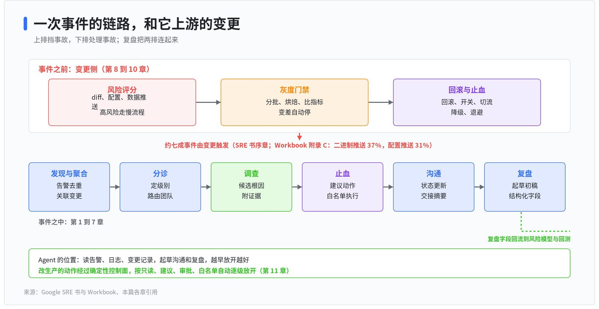
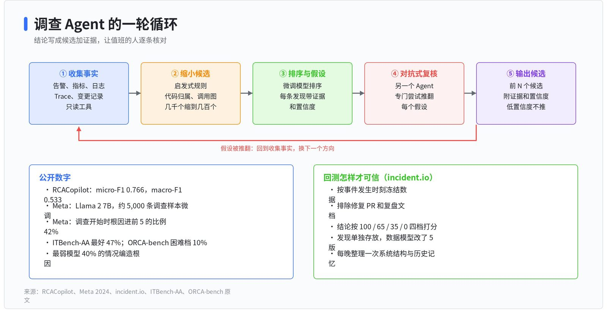
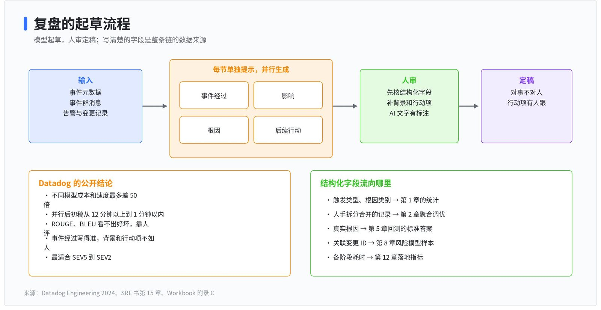
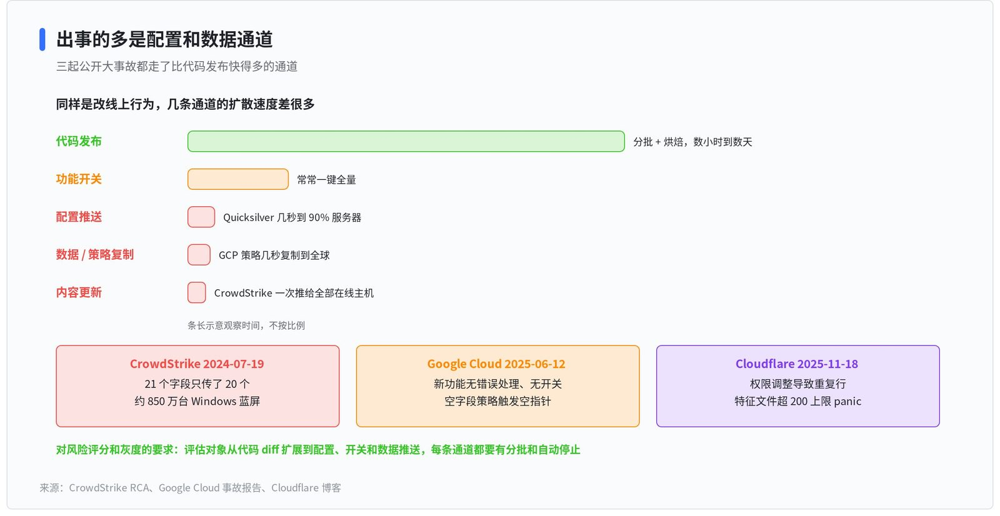
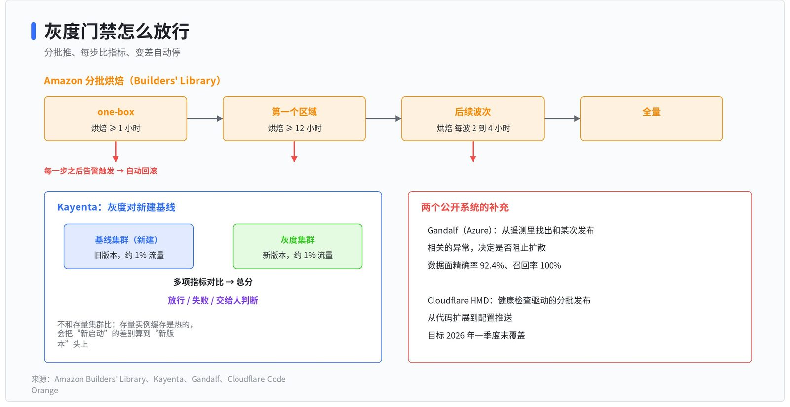
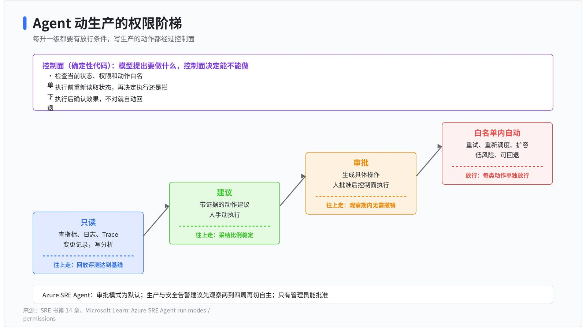
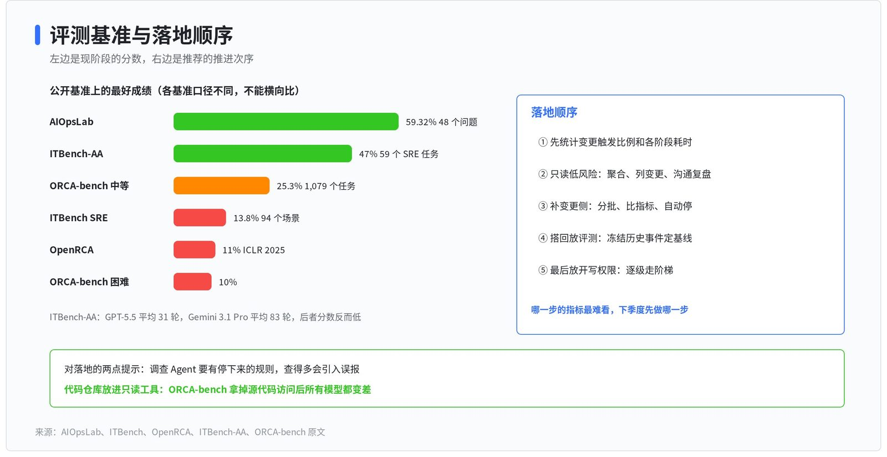

# LLM-56｜场景｜事件管理与变更 Agent：告警降噪、根因分析与发布门禁

> 🎯 **这篇文档解决什么问题**：线上故障的大头来自变更，Google SRE 的估计是大约七成 [[1]](https://sre.google/sre-book/introduction/)。故障一来，值班的人要在几十条告警里认出同一个问题，定严重度，叫来对的人，一边查根因一边止血，还要不停对外同步，事后再写复盘。这条链上每一段都已经有人在用 LLM Agent，从告警聚合、根因调查到复盘起草，再往前一步，是发布前的风险评分和灰度门禁。本篇按一次事件的顺序把这些做法摆开，讲清每一段 Agent 能做什么、公开数字是多少、哪些地方还不能放手。
>
> 使用方式：第 1 到 7 章沿着一次事件往下走，依次是生命周期、告警聚合、值班负担、分诊、根因调查、沟通和复盘。第 8 到 10 章把视线挪到引发事件的变更上，讲风险评分、灰度门禁和回滚止血。第 11 章讲 Agent 被允许动生产以后怎样约束它，第 12 章是评测和落地顺序。数字都来自原文，引用处标了编号；厂商新闻稿里的数字单独标注“厂商口径”。

## 导读 · 先给结论

- **先管变更，再管事件**：Google 对上千份复盘的统计里，二进制推送触发了 37% 的事件，配置推送触发了 31% [[6]](https://sre.google/workbook/postmortem-analysis/)。2024 到 2025 年三起影响最大的公开事故，CrowdStrike、Google Cloud 和 Cloudflare，都是一次配置或内容推送在几秒到几分钟内扩散到全球 [[25]](https://www.crowdstrike.com/wp-content/uploads/2024/08/Channel-File-291-Incident-Root-Cause-Analysis-08.06.2024.pdf)[[24]](https://status.cloud.google.com/incidents/ow5i3PPK96RduMcb1SsW)[[27]](https://blog.cloudflare.com/18-november-2025-outage/)。Agent 放在变更之前，能挡掉的事故最多。
- **告警聚合最成熟**：同一个问题不管触发多少条告警，只算一次事件 [[4]](https://sre.google/workbook/on-call/)。按这个口径做的聚合和分诊已经有不少生产数据，Triangle 报告分诊准确率最高 97% [[11]](https://dl.acm.org/doi/10.1109/ASE63991.2025.00062)。
- **根因调查进了产品，准确率还不够放手**：Meta 的系统在调查开始时把真正的根因排进前 5 的比例是 42% [[14]](https://engineering.fb.com/2024/06/24/data-infrastructure/leveraging-ai-for-efficient-incident-response/)。2026 年的 ITBench-AA 上最好的模型只有 47% [[41]](https://huggingface.co/blog/ibm-research/itbench-aa)，ORCA-bench 的困难档只有 10% [[42]](https://arxiv.org/abs/2607.28545)。现阶段的合理定位是替人把证据查齐，结论由人下。
- **复盘和沟通最划算**：Datadog 用 LLM 起草复盘，并行生成各节以后，一份初稿从十几分钟缩到 1 分钟以内；模型记事件经过记得准，基础设施背景和后续行动还是人写得好 [[23]](https://www.datadoghq.com/blog/engineering/llms-for-postmortems/)。
- **风险评分能换来发布速度**：Meta 的 Diff Risk Score 让 2024 年一次封网期间仍有 1 万多个低风险变更照常上线 [[33]](https://engineering.fb.com/2025/08/06/developer-tools/diff-risk-score-drs-ai-risk-aware-software-development-meta/)。只拦风险最高的 10% 变更，LLM 模型拦下的严重事故是逻辑回归基线的 1.52 倍 [[34]](https://arxiv.org/abs/2410.06351)。
- **动生产要隔一层控制面**：Azure SRE Agent 建议生产告警用“审批”模式，先观察两到四周再切自主 [[35]](https://learn.microsoft.com/en-us/azure/sre-agent/run-modes)。SRE 书的老规矩“只有操作组改系统” [[2]](https://sre.google/sre-book/managing-incidents/) 放到 Agent 身上同样成立。

> 🔑 **一句话版本**：事件管理里的 Agent 要读得多、写得少。读告警、读日志、读变更记录，起草沟通和复盘，这些越早放开越好。改生产的动作要先经过一层确定性的控制面，从只读、建议、审批一路走到低风险动作自动执行，每往前走一步都靠回放评测放行。

📎 与系列其他文档的分工：本篇在场景层，是 [LLM-06｜场景｜LLM 在运维与容灾中的落地：SRE 实战地图](./06-llm-for-sre.md) 里“事件与变更”这一条线的展开。Agent 评测基准与生产模式的全景见 [LLM-17｜场景｜AIOps Agent 落地：基准、生产实践与工程模式](./17-aiops-agent.md)，根因定位里的拓扑与因果推断见 [LLM-47｜场景｜运维根因定位：拓扑、因果推断与 LLM](./47-root-cause.md)，时序、日志和 Trace 上的基础模型见 [LLM-27｜场景｜运维数据上的基础模型：时序、日志与 Trace](./27-ops-foundation-models.md)。Agent 动生产时用到的沙箱与权限隔离见 [LLM-41｜工程｜Agent 运行时与沙箱：隔离、持久执行与规模化](./41-agent-runtime-sandbox.md)，多个 Agent 怎样分工与归因见 [LLM-45｜工程｜多 Agent 系统：编排、通信、归因与评测](./45-multi-agent.md)。

📎 与系列其他文档的分工：本篇在场景层，是 [LLM-06｜场景｜LLM 在运维与容灾中的落地：SRE 实战地图](./06-llm-for-sre.md) 里“事件与变更”这一条线的展开。Agent 评测基准与生产模式的全景见 [LLM-17｜场景｜AIOps Agent 落地：基准、生产实践与工程模式](./17-aiops-agent.md)，根因定位里的拓扑与因果推断见 [LLM-47｜场景｜运维根因定位：拓扑、因果推断与 LLM](./47-root-cause.md)，时序、日志和 Trace 上的基础模型见 [LLM-27｜场景｜运维数据上的基础模型：时序、日志与 Trace](./27-ops-foundation-models.md)。Agent 动生产时用到的沙箱与权限隔离见 [LLM-41｜工程｜Agent 运行时与沙箱：隔离、持久执行与规模化](./41-agent-runtime-sandbox.md)，多个 Agent 怎样分工与归因见 [LLM-45｜工程｜多 Agent 系统：编排、通信、归因与评测](./45-multi-agent.md)。

## 第 1 章 · 一次事件的生命周期

Google SRE 的事件管理借鉴了美国消防系统的事件指挥体系（ICS）[[2]](https://sre.google/sre-book/managing-incidents/)。一次事件里分出几个角色：事件指挥（IC）掌全局、分配任务；操作组动手改系统；沟通负责对内对外发更新；计划组记录时间线、跟进交接和后续事项。书里专门强调，只有操作组可以改系统，其他人想动手要先经过操作组，免得两拨人同时改出新问题。Workbook 把这套做法归成“3C”：协调、沟通、控制 [[3]](https://sre.google/workbook/incident-response/)。

Agent 进入这套体系，最自然的位置是给每个角色当助手：替 IC 汇总现状，替操作组查数据，替沟通起草更新，替计划组记时间线。下表按阶段列出人在做什么、Agent 能接手哪部分。

| 阶段 | 人在做什么 | Agent 能接手的部分 | 公开例子 |
|---|---|---|---|
| 发现与聚合 | 看告警，判断哪些是同一件事 | 告警去重、聚合成事件、关联最近的变更 | iPACK、COLA [[8]](https://dl.acm.org/doi/10.1109/ICSE48619.2023.00193)[[9]](https://arxiv.org/abs/2403.06485) |
| 分诊 | 定严重度，找到负责的团队 | 分类、路由、拉群、通知变更作者 | Triangle [[11]](https://dl.acm.org/doi/10.1109/ASE63991.2025.00062) |
| 调查 | 翻指标、日志、Trace 和变更记录，提假设再验证 | 并行查数据，给出带证据的候选根因 | Meta、incident.io、Azure 与 AWS 的 Agent [[14]](https://engineering.fb.com/2024/06/24/data-infrastructure/leveraging-ai-for-efficient-incident-response/)[[15]](https://incident.io/blog/building-investigations-what-it-takes-to-build-an-ai-sre)[[16]](https://techcommunity.microsoft.com/blog/appsonazureblog/announcing-general-availability-for-the-azure-sre-agent/4500682)[[18]](https://aws.amazon.com/about-aws/whats-new/2026/03/aws-devops-agent-generally-available/) |
| 止血 | 回滚、切流、降级、扩容 | 推荐动作；在白名单内执行低风险动作 | Azure 的审批与自主模式 [[35]](https://learn.microsoft.com/en-us/azure/sre-agent/run-modes) |
| 沟通 | 更新状态页，同步公司里的各方 | 按时间线起草更新，给晚加入的人写摘要 | Google Cloud 事故报告的教训 [[24]](https://status.cloud.google.com/incidents/ow5i3PPK96RduMcb1SsW) |
| 复盘 | 写时间线、根因和改进项，跟踪落地 | 起草初稿，抽取行动项 | Datadog [[23]](https://www.datadoghq.com/blog/engineering/llms-for-postmortems/) |

### 1.1 事件从哪里来

Workbook 附录 C 统计了 Google 的复盘数据 [[6]](https://sre.google/workbook/postmortem-analysis/)。按触发因素分，二进制推送占 37%，配置推送占 31%，用户行为变化占 9%。按根因分，软件缺陷占 41.35%，开发流程问题占 20.23%。前两类触发加起来接近七成，和 SRE 书序章“大约 70% 的故障来自对线上系统的变更”对得上 [[1]](https://sre.google/sre-book/introduction/)。序章给的对策有三条：渐进发布，快速准确地发现问题，出问题时安全回滚。本篇第 8 到 10 章就按这三条展开。

先拿过去半年的事件单算两个数。有多少事件的触发是变更（发布、配置、开关），这个数决定要不要先做变更侧。每一段（发现、分诊、定位、止血、恢复）平均花了多久，这个数决定 Agent 先接哪一段。

## 第 2 章 · 告警降噪与聚合

一次故障常常伴随几十上百条告警：上游服务报错，下游超时，数据库连接池打满，各自触发各自的规则。SRE Workbook 的值班一章定了一个口径：同一个问题不管触发多少条告警，只算一次事件 [[4]](https://sre.google/workbook/on-call/)。聚合要做的就是把这些告警归到同一个事件下，让值班的人面对一件事。

| 方法 | 思路 | 报告结果 |
|---|---|---|
| iPACK [[8]](https://dl.acm.org/doi/10.1109/ICSE48619.2023.00193) | 把描述同一故障的重复工单归到一起，借助同时段的告警信息 | F1 0.871 到 0.935，比此前最好的方法高 12.4% 到 31.2% |
| GRLIA [[10]](https://arxiv.org/abs/2108.12179) | 在故障级联图上为每类事件学一个表示，同时编码拓扑和时间上的相关性 | 图方法，适合依赖关系清楚的服务 |
| COLA [[9]](https://arxiv.org/abs/2403.06485) | 先用相关性挖掘处理高频告警；少见的告警统计上学不到，交给 LLM 读告警的 SOP 推理 | F1 0.901 到 0.930 |

COLA 指出的那个空档很实在：统计相关性要靠大量共现样本，一年才出现几次的告警没有足够数据，偏偏这类告警常常对应真正的大事故。告警的 SOP 里写着它代表什么、通常和哪些组件有关，LLM 读这段文字就能补上统计学不到的那部分 [[9]](https://arxiv.org/abs/2403.06485)。日志和时序本身怎么用基础模型表示，见 [LLM-27｜场景｜运维数据上的基础模型：时序、日志与 Trace](./27-ops-foundation-models.md)。

聚合会在两个方向上出错。合得太少，同一个问题拉起三个群、三拨人各查各的。合得太多，两个独立的问题被并成一个，第二个问题要等第一个修完才被发现。后一种代价更大，所以聚合结果要允许人一键拆开，拆开和合并的操作都要记下来，作为下一轮调优的标注。

> ✅ **可以带走的方法**：给聚合定两个指标。每个事件平均挂了多少条告警，看降噪的力度。事件被人手动拆分或合并的比例，看聚合的准确度。只盯第一个数，聚合会越合越粗。

## 第 3 章 · 值班负担：先算人能扛多少

SRE 书给值班定了几条硬线 [[5]](https://sre.google/sre-book/being-on-call/)：SRE 至少一半时间做工程，值班时间不超过 25%；一个 12 小时的班次最多处理两起事件，因为一起事件从排查、修复到写复盘大约要 6 小时；单地轮值至少 8 人，双地轮值每地至少 6 人。线划得这么具体，是因为超了以后人会疲劳、判断变差，事件处理质量跟着掉。

现实往往在线外。PagerDuty 2021 年的报告说，严重事件同比增加 19%，自述倦怠的响应者平均每月被下班时间的告警打断 19 次 [[7]](https://www.pagerduty.com/newsroom/pagerduty-state-of-digital-operations-report-underscores-business-and-human-costs-of-pandemic/)。Agent 在这里有两种用法：一种在事件之前，用问答机器人拦下咨询类工单，用聚合压低告警量；另一种在事件之中，替人整理现场，让交接班和半夜被叫起来的人几分钟内看懂局面。

每周统计两个数：每人下班时间被叫起来几次，每个班次处理了几起事件。后者长期超过 2，先砍告警和咨询量，再谈调查 Agent。前置拦截效果不好时，先查问答机器人引用的文档是否过期。

## 第 4 章 · 分诊与路由：多严重，归谁

分诊要回答两个问题。多严重，决定叫多少人、要不要对外通告。归谁，决定第一个被叫起来的是不是对的团队。常见的分级里，SEV1 指影响非常大的严重事件，往下逐级降低 [[43]](https://www.atlassian.com/incident-management/kpis/severity-levels)。分错团队的代价常被低估：事件在几个团队之间来回转，每转一次都要重新讲一遍背景。Triangle 在这一步报告的结果是分诊准确率最高 97%，把事件交到正确团队的时间最多缩短 91% [[11]](https://dl.acm.org/doi/10.1109/ASE63991.2025.00062)。

| 路由依据 | 从哪里取 | 用法 |
|---|---|---|
| 服务归属 | 服务目录、代码仓库的负责人文件 | 告警所在服务直接映射到值班表 |
| 最近变更 | 发布系统、配置中心、开关平台 | 故障开始前一段时间内的变更作者同时通知 |
| 历史相似事件 | 过往事件单和复盘 | 找出上次处理同类问题的团队和手册 |
| 影响面 | 用户侧指标、错误率、受影响区域 | 估计严重度，决定是否升级 |

“最近变更”这一列最值钱。第 1 章说过七成事件由变更触发，分诊时把故障开始前的变更列出来，并通知变更作者，常常比任何根因分析都快。Agent 做这件事几乎没有风险：它只读变更记录，只发通知。

> 💡 **注意**：严重度别让模型单独拍板。定级标准写成规则（影响用户比例、是否核心功能、持续时长），模型负责把证据填进这些字段，规则给出级别。这样同一类事件每次定级一致，事后也能对账。

> ✅ **可以带走的方法**：统计事件第一次被分派的团队和最终解决它的团队一致的比例，以及事件平均被转手几次。这两个数是分诊 Agent 上线前后最直接的对照。

## 第 5 章 · 根因调查 Agent：替人把证据查齐

调查是事件里最耗人的一段。值班的人要在指标、日志、Trace、变更记录和过往事件之间来回切，提出一个假设，查数据验证，不对再换下一个。LLM 进入这一段的研究起步很早。微软 2023 年用自家 4 万多起事件评估了 LLM 生成根因和缓解步骤的能力，结论是微调后的 GPT 系列模型明显好于零样本，生成的建议在人工评估里有参考价值 [[12]](https://arxiv.org/abs/2301.03797)。同年的 RCACopilot 先按事件类型匹配处理流程，自动收集诊断信息，再让 LLM 预测根因类别并写出解释，micro-F1 0.766，macro-F1 0.533 [[13]](https://arxiv.org/abs/2305.15778)。两个数差得多，说明常见类别判得准，少见类别判得差。

Meta 2024 年的系统更贴近生产 [[14]](https://engineering.fb.com/2024/06/24/data-infrastructure/leveraging-ai-for-efficient-incident-response/)。它先用启发式规则把候选变更从几千个缩到几百个，规则看代码和目录归属、运行时调用图等信号；再用一个微调过的 Llama 2 7B 给候选排序，训练数据是大约 5,000 条历史调查的指令样本。调查开始时，真正的根因进入前 5 名的比例是 42%。Meta 在文中也写明了风险：模型可能给出错误的根因，把工程师带偏。所以面向员工的功能都要求结果可解释、可复现，响应者能自己验证模型给的结论，并配合置信度过滤掉没把握的推荐。

### 5.1 一个调查 Agent 要做对的几件事

incident.io 2026 年 10 月写了一篇很长的工程复盘，讲他们花两年做调查功能的过程 [[15]](https://incident.io/blog/building-investigations-what-it-takes-to-build-an-ai-sre)。其中几条做法可以直接借鉴。

| 做法 | 具体怎么做 | 解决什么问题 |
|---|---|---|
| 冻结现场回测 | 把过去的事件按发生时刻冻结，只给 Agent 当时能看到的数据；修复 PR 和复盘文档排除在外 | 防止模型“看到答案”，回测分数才可信 |
| 分档打分 | 结论和真实根因的接近程度分成 100、65、35、0 四档 | 比对错二分更能看出改进 |
| 结构化发现 | 每条发现单独存放，带证据和置信度；这个数据模型改了 5 版 | 后续步骤和人都能引用、复核单条发现 |
| 对抗式复核 | 另起一个 Agent 专门尝试推翻每个假设 | 压住“查到一个像样的解释就停”的倾向 |
| 主动消息设闸 | 主动推给值班群的消息先过几道检查 | 不在事件群里制造噪声 |
| 记忆整理 | 每晚跑一个 Explore 任务，整理系统结构和历史事件形成的记忆 | 下次调查少走弯路 |

冻结现场这一条最容易被忽视。拿历史事件评测时，如果 Agent 能检索到事后写的复盘或修复提交，分数会好看得多，上线后却没有这种“未来信息”。根因定位里用到的拓扑和因果推断方法，见 [LLM-47｜场景｜运维根因定位：拓扑、因果推断与 LLM](./47-root-cause.md)。

### 5.2 进入产品的调查 Agent

2025 到 2026 年，几家云厂商和可观测性厂商都把调查 Agent 做成了产品。下表的数字来自厂商自己的发布，只能当作量级参考。

| 产品 | 公开信息 | 口径 |
|---|---|---|
| Azure SRE Agent [[16]](https://techcommunity.microsoft.com/blog/appsonazureblog/announcing-general-availability-for-the-azure-sre-agent/4500682) | 2026 年 3 月 GA；微软自己部署了 1,300 多个 Agent，缓解了 3.5 万多起事件，节省 2 万多小时 | 厂商口径 |
| AWS DevOps Agent [[17]](https://aws.amazon.com/blogs/aws/aws-devops-agent-helps-you-accelerate-incident-response-and-improve-system-reliability-preview/)[[18]](https://aws.amazon.com/about-aws/whats-new/2026/03/aws-devops-agent-generally-available/)[[19]](https://aws.amazon.com/blogs/aws/aws-weekly-roundup-aws-devops-agent-security-agent-ga-product-lifecycle-updates-and-more-april-6-2026/) | 2025 年 12 月预览，2026 年 3 月 GA；预览客户报告 MTTR 最多降 75% | 厂商口径 |
| Datadog 的 SRE Agent [[20]](https://investors.datadoghq.com/news-releases/news-release-details/datadog-launches-bits-ai-sre-agent-resolve-incidents-faster) | 2025 年 12 月上线，预览期在 2,000 多个客户环境中运行 | 厂商口径 |
| PagerDuty Agent 套件 [[21]](https://investor.pagerduty.com/news/news-details/2025/PagerDuty-Launches-Industrys-First-End-to-End-AI-Agent-Suite-Slashing-Incident-Response-Times-and-Empowering-Teams-to-Innovate/default.aspx) | 2025 年 10 月发布，包含 SRE、Scribe、Shift、Insights 几个 Agent，称事件响应最多快 50% | 厂商口径 |

> 💡 **注意**：前 5 名命中 42% 的意思是，大约六成调查里正确答案不在模型给的前 5 名之内 [[14]](https://engineering.fb.com/2024/06/24/data-infrastructure/leveraging-ai-for-efficient-incident-response/)。调查 Agent 的输出要写成“候选加证据”，让值班的人能一条条核对；直接给一个结论，人会顺着它查，错的时候代价更大。

上线调查 Agent 前，从过去一年挑 50 起有完整复盘的事件，按发生时刻冻结数据做回测，排除复盘和修复提交。记录根因进入前 1、前 5 的比例，以及每次调查花了多少 token 和多少分钟。这组数就是后续每次改动的基线。

## 第 6 章 · 沟通：让晚到的人几分钟看懂局面

事件里的沟通有两头。对内，要让 IC、操作组和陆续被拉进来的人知道现在是什么情况、谁在做什么；对外，要让客户知道影响面和预计恢复时间。SRE 书把沟通列为单独的角色 [[2]](https://sre.google/sre-book/managing-incidents/)，Workbook 讲 3C 时也把沟通和控制放在同一级 [[3]](https://sre.google/workbook/incident-response/)。

Google Cloud 2025 年 6 月 12 日那次事故的报告里有一条沟通方面的教训 [[24]](https://status.cloud.google.com/incidents/ow5i3PPK96RduMcb1SsW)：第一条对外状态更新在事故开始大约一小时后才发出，一个原因是状态页依赖的基础设施本身也受了影响。发通告的工具和出问题的系统共享依赖，最需要它的时候它也挂了。

| 沟通物 | Agent 怎么帮 | 人要把关的地方 |
|---|---|---|
| 定时状态更新 | 按时间线和最新指标起草，固定字段：影响、进展、下一次更新时间 | 对外措辞、是否承认根因、预计恢复时间 |
| 交接摘要 | 给新加入的人或下一班写三段：发生了什么、试过什么、现在卡在哪 | 核对“试过什么”是否完整 |
| 时间线 | 从群消息、告警、变更、操作记录里抽取带时间戳的事件 | 补上只在电话里说过的决定 |
| 干系人通知 | 按影响面列出要通知的团队和客户 | 敏感客户和合规通告 |

这一段 Agent 的风险很低：它只读事件群和监控，产出的是草稿。收益却很直接，IC 少花在“给每个新进来的人讲一遍”上的时间，就多一分留给判断。

> ✅ **可以带走的方法**：检查对外通告链路依赖了哪些自家系统。状态页、通知服务和事件群至少要有一条路径不依赖主业务的基础设施，并且每季度演练一次从这条路径发通告。

## 第 7 章 · 复盘：起草交给模型，判断留给人

SRE 书的复盘文化有两个前提：复盘对事不对人，以及写复盘本身不是惩罚 [[22]](https://sre.google/sre-book/postmortem-culture/)。复盘的价值在后续行动项能不能落地。现实里复盘常常拖延，因为整理时间线、汇总指标、回忆谁在什么时候做了什么，本身就要几个小时。

Datadog 2024 年公开了用 LLM 起草复盘的做法 [[23]](https://www.datadoghq.com/blog/engineering/llms-for-postmortems/)。输入是事件元数据和事件群的 Slack 消息，每一节用单独的提示生成，并行调用。几个具体结论：

- GPT-3.5 和 GPT-4 在成本和速度上最多差 50 倍，哪一节用哪个模型要单独权衡。
- 各节并行生成以后，一份初稿从 12 分钟以上缩到 1 分钟以内。
- ROUGE、BLEU 这类自动指标几乎看不出复盘写得好不好，最后靠人评。
- 模型写事件经过写得准，写基础设施背景和后续行动不如人。
- AI 生成的文字在文档里明确标注，作者可以改，读者知道哪部分是模型写的。
- Datadog 认为它最适合 SEV5 到 SEV2 的事件。

复盘也是整条链的数据来源。第 2 章聚合的标注，第 5 章回测用的标准答案，第 8 章风险模型的训练样本，都来自写得清楚的复盘。Google Workbook 附录 C 能按触发因素和根因做统计，前提是复盘里这两个字段一直有人认真填 [[6]](https://sre.google/workbook/postmortem-analysis/)。

复盘模板里固定几个结构化字段：触发类型（发布、配置、开关、容量、外部依赖）、根因类别、发现方式、各阶段耗时、关联变更 ID。模型起草时先填这些字段，人审时先核这些字段。一年后它们就是第 1 章那张统计表。

## 第 8 章 · 变更风险评分：在合入之前估一次风险

第 1 章说过，七成左右的事件由变更触发。2024 到 2025 年三起影响最大的公开事故都是这个模式。

| 事故 | 变更是什么 | 为什么扩散得这么快 |
|---|---|---|
| CrowdStrike，2024-07-19 [[25]](https://www.crowdstrike.com/wp-content/uploads/2024/08/Channel-File-291-Incident-Root-Cause-Analysis-08.06.2024.pdf)[[26]](https://www.cisa.gov/news-events/alerts/2024/07/19/widespread-it-outage-due-crowdstrike-update) | 一个内容更新（Channel File 291）；模板类型定义了 21 个输入字段，传给内容解释器的只有 20 个，第 21 个字段触发越界读 | 这类快速响应内容当时一次推给所有在线主机，约 850 万台 Windows 设备蓝屏；到 7 月 29 日约 99% 的传感器恢复在线；改进项里加入了分批发布 |
| Google Cloud，2025-06-12 [[24]](https://status.cloud.google.com/incidents/ow5i3PPK96RduMcb1SsW) | Service Control 5 月 29 日上线的配额检查功能没有错误处理，也没有功能开关；6 月 12 日一条带空白字段的策略写入 | 策略数据几秒内复制到全球，所有区域的 Service Control 命中空指针，进入崩溃循环 |
| Cloudflare，2025-11-18 [[27]](https://blog.cloudflare.com/18-november-2025-outage/) | ClickHouse 的一次权限调整让查询返回重复行，Bot 管理的特征文件行数翻倍 | 特征文件每 5 分钟重新生成并推到全网；文件超过 200 个特征的上限，代理进程 panic |

三起事故的共同点是，出问题的都是配置或数据，代码发布反倒没事。它们走的通道比代码发布快得多，也少了分批和观察。对风险评分来说，这意味着评估对象要从代码 diff 扩展到配置和数据推送。

### 8.1 Meta 的 Diff Risk Score

Meta 2025 年公开了 Diff Risk Score（DRS）[[33]](https://engineering.fb.com/2025/08/06/developer-tools/diff-risk-score-drs-ai-risk-aware-software-development-meta/)：用微调过的 Llama 模型，根据 diff 内容和元数据预测这个变更引发 SEV 的概率。最直接的收益在封网期：过去高风险时段一律冻结代码，有了风险分以后，低风险变更可以照常合入。2024 年一次重大合作伙伴活动的封网期间，有 1 万多个过去不能合入的代码变更照常上线，对生产的影响很小。文章说基于风险的用法已有 19 个，包括挑选评审人、优化构建和测试选择、分析发布风险；配置变更在 Meta 也是 SEV 的一大来源，风险模型正在扩展到配置 [[33]](https://engineering.fb.com/2025/08/06/developer-tools/diff-risk-score-drs-ai-risk-aware-software-development-meta/)。

同一方向上有一篇 2024 年的论文给了更细的对照 [[34]](https://arxiv.org/abs/2410.06351)。基线是逻辑回归，只拦风险最高的 5%、10%、50% 的 diff 时，分别能拦下 18.7%、27.9%、84.6% 的 SEV。换成 LLM 模型后，同样的拦截比例下能拦下的 SEV 数分别是基线的 1.40 倍、1.52 倍和 1.05 倍。论文按影响面把门禁分成不拦、周末拦、中等影响、高影响几档。收益集中在“只拦一小部分”的区间，实际部署也只能在这个区间工作，拦一半变更的门禁没人能接受。

AWS DevOps Agent 也提供了发布前的就绪评审，结论分成阻止、谨慎发布和正常发布三档 [[17]](https://aws.amazon.com/blogs/aws/aws-devops-agent-helps-you-accelerate-incident-response-and-improve-system-reliability-preview/)。

> 💡 **注意**：风险分要用来调节流程，别直接用来拒绝合入。高风险变更加评审人、走更慢的灰度、要求附回滚方案；低风险变更走快速通道。分数直接拦截，开发者会把一个大变更拆成很多个小变更来压分数。

> ✅ **可以带走的方法**：先不训模型，拿过去一年的变更和复盘里的“关联变更 ID”做一次回溯：引发过事件的变更在大小、目录、作者熟悉度、是否改配置、是否在周五下午这些特征上有什么分布。规则版风险分先跑起来，攒够标注再换模型。

## 第 9 章 · 灰度门禁：让每次发布先在小范围里出错

SRE 书序章给变更定的三条对策里，第一条是渐进发布 [[1]](https://sre.google/sre-book/introduction/)。Workbook 的灰度一章把做法讲得很具体：先把新版本推给一小部分流量，和没升级的部分对比指标，没有问题再扩大 [[31]](https://sre.google/workbook/canarying-releases/)。灰度能起作用，要满足两个条件。出问题时影响面要足够小，还要有人或程序在每一步认真比较新旧版本的指标，然后决定继续还是停下。

| 做法 | 具体怎么做 | 公开数字 |
|---|---|---|
| Amazon 分批烘焙 [[29]](https://aws.amazon.com/builders-library/automating-safe-hands-off-deployments/) | 先推一台机器（one-box），再按区域分波次；每一步之后“烘焙”一段时间，告警触发就自动回滚 | one-box 之后至少 1 小时；第一个区域波次之后至少 12 小时，之后每波 2 到 4 小时 |
| Kayenta 自动灰度分析 [[32]](https://cloud.google.com/blog/products/gcp/introducing-kayenta-an-open-automated-canary-analysis-tool-from-google-and-netflix) | Google 和 Netflix 开源；灰度集群和一个新建的基线集群并排跑，分别接收约 1% 流量，按多项指标打总分 | 每边通常 3 个实例；总分决定放行、失败或交给人判断 |
| Gandalf [[30]](https://www.usenix.org/conference/nsdi20/presentation/li) | 微软 Azure 的安全部署分析服务，从海量遥测里找出和某次发布相关的异常，决定是否阻止发布继续扩散 | 数据面精确率 92.4%、召回率 100%；控制面 94.9%、99.8%；在生产中运行了 18 个月以上 |
| Cloudflare HMD [[28]](https://blog.cloudflare.com/fail-small-resilience-plan/) | 把健康检查驱动的分批发布（Health Mediated Deployments）从代码扩展到配置变更，指标变差自动回滚 | 目标是 2026 年一季度末覆盖配置推送 |

Kayenta 用新建的基线集群和灰度集群比较，没有直接拿灰度和存量集群比。存量实例跑了很久，缓存是热的，内存里积累了状态，和刚启动的新实例本来就不一样，直接比会把“新启动”的差别算到“新版本”头上 [[32]](https://cloud.google.com/blog/products/gcp/introducing-kayenta-an-open-automated-canary-analysis-tool-from-google-and-netflix)。Gandalf 解决的是另一个问题：Azure 上同时有大量发布在执行，一个异常可能和其中任何一个有关，它要从时间和空间上的相关性里判断该怪谁 [[30]](https://www.usenix.org/conference/nsdi20/presentation/li)。

### 9.1 配置推送也要走灰度

Cloudflare 在 11 月 18 日和 12 月 5 日连续出了两次全球性故障，前一次约 2 小时 10 分钟，后一次影响 28% 的应用约 25 分钟，两次都来自瞬间推到全网的配置变更。他们的配置存储 Quicksilver 能在几秒内把改动送到 90% 的服务器，这个速度平时是优点，出错时就成了扩散速度。随后的 Code Orange 计划要求配置变更和代码发布一样走分批和健康检查 [[28]](https://blog.cloudflare.com/fail-small-resilience-plan/)。Google Cloud 6 月那次事故的改进项也写了同一件事：全球复制的数据要增量传播，关键的二进制改动放在默认关闭的功能开关后面 [[24]](https://status.cloud.google.com/incidents/ow5i3PPK96RduMcb1SsW)。

灰度判断是 LLM 能补上的地方。规则版的门禁只会比较预先定好的几个指标，模型可以读灰度期间新出现的错误日志，判断它和这次发布的改动是否相关，再写一段说明给发布负责人。它给的仍然是建议，放行或回滚由门禁规则决定。

把所有能改变线上行为的通道列一张表：代码发布、配置中心、功能开关、数据推送、权限变更。逐一回答三个问题：有没有分批，每批之后有没有自动比较指标，指标变差会不会自动停下。答不上来的通道，就是下一次大事故最可能的来源。

## 第 10 章 · 回滚与止血：先恢复，再找根因

事件处理的优先级是先止血。SRE 书和 Workbook 都强调，缓解手段到位以后再慢慢查根因 [[2]](https://sre.google/sre-book/managing-incidents/)[[3]](https://sre.google/workbook/incident-response/)。Google Cloud 6 月 12 日的时间线是一个很好的例子 [[24]](https://status.cloud.google.com/incidents/ow5i3PPK96RduMcb1SsW)：SRE 2 分钟内开始分诊，10 分钟内找到根因并决定用“红色按钮”关掉出问题的代码路径，约 25 分钟按钮准备好，约 40 分钟推完。多数区域随后恢复，us-central1 却拖了约 2 小时 40 分钟。原因是大量任务同时重启，又没有随机化的指数退避，一起压向底层的 Spanner，形成了惊群效应。

Cloudflare 11 月 18 日的事故说明了止血前的诊断有多难 [[27]](https://blog.cloudflare.com/18-november-2025-outage/)。11:05 UTC 那次权限调整之后，特征文件每 5 分钟重新生成一次，生成时碰到已经更新的数据库节点就是坏文件，碰到没更新的就是好文件，于是全网在好坏之间来回切换。故障看起来时好时坏，团队一开始怀疑是大规模 DDoS 攻击。自动测试 11:31 发现问题，11:32 开始人工调查，11:35 拉起事件电话，主要影响 14:30 修复，17:06 全部恢复。

| 止血手段 | 适用 | 前提 |
|---|---|---|
| 回滚最近的变更 | 故障和某次变更时间吻合 | 变更能干净地回退；数据格式向前兼容 |
| 关掉功能开关或“红色按钮” | 新代码路径出错 | 开关事先存在，并且默认关闭的路径经过测试 |
| 切流或摘除 | 单区域或单集群出问题 | 其他区域有余量；切流本身不依赖故障组件 |
| 降级（fail open） | 非核心检查拖垮核心路径 | 事先约定哪些检查失败时放行 [[24]](https://status.cloud.google.com/incidents/ow5i3PPK96RduMcb1SsW)[[28]](https://blog.cloudflare.com/fail-small-resilience-plan/) |
| 限流与退避 | 恢复时的惊群 | 客户端带随机化指数退避 [[24]](https://status.cloud.google.com/incidents/ow5i3PPK96RduMcb1SsW) |

Agent 在这一章能做的事分两类。一类风险很低：故障一开始就把时间窗口内的变更列出来、按与症状的相关性排序，提醒 IC 有没有可用的开关，起草回滚命令供人确认。另一类是自己动手回滚或切流，这要先回答“谁允许它动”，见下一章。Cloudflare 的例子还提示了一点：候选根因里要始终保留“最近的配置或数据变更”这一项，哪怕现象看起来像外部攻击 [[27]](https://blog.cloudflare.com/18-november-2025-outage/)。

> 💡 **注意**：Google 和 Cloudflare 的改进项都提到止血工具的独立性 [[24]](https://status.cloud.google.com/incidents/ow5i3PPK96RduMcb1SsW)[[28]](https://blog.cloudflare.com/fail-small-resilience-plan/)。回滚系统、开关平台、紧急通道如果依赖出问题的那套基础设施，最需要它们的时候会一起失效。break-glass 流程要定期演练。

> ✅ **可以带走的方法**：每次事件记录“从发现到第一个有效止血动作”的时间，以及止血用的是哪种手段。半年后看分布：如果多数事件靠回滚止血，回滚的速度和可靠性就是最该投资的地方，比调查 Agent 更优先。

## 第 11 章 · 让 Agent 动生产：控制面和权限阶梯

第 1 章提到，SRE 书要求事件中只有操作组能改系统 [[2]](https://sre.google/sre-book/managing-incidents/)。这条规矩放到 Agent 身上同样成立：Agent 可以查、可以提建议，真正改生产的动作要经过一个确定性的控制面，由它检查当前状态、权限和白名单，再决定执行还是拦下。

Azure SRE Agent 的文档给了一套可以直接参照的分级 [[35]](https://learn.microsoft.com/en-us/azure/sre-agent/run-modes)。它有两种运行模式：审批（Review）模式下 Agent 先提出操作，人批准后才执行；自主（Autonomous）模式下 Agent 自己执行。Agent 本身默认是审批模式，响应计划默认是自主模式。文档建议生产告警和安全告警都用审批模式，先观察两到四周，确认它的判断可靠以后再切到自主；只有管理员角色能批准操作，要对外部系统动手还得另配 Hook 或工具访问策略。权限上它分成只读和特权两档，用托管身份访问资源，需要更高权限时以发起人的身份临时提权 [[36]](https://learn.microsoft.com/en-us/azure/sre-agent/permissions)。

| 阶梯 | Agent 能做什么 | 往上走的条件 |
|---|---|---|
| 只读 | 查指标、日志、Trace、变更记录，写分析 | 回放评测达到基线 |
| 建议 | 给出带证据的动作建议，人手动执行 | 建议被采纳的比例稳定，误判有记录 |
| 审批 | 生成具体操作，人点批准后由控制面执行 | 观察期内没有需要撤销的批准 |
| 白名单内自动 | 低风险、可回退的动作自动执行，如重试、重新调度、扩容 | 每类动作单独放行，有自动回退 |

Agent 运行时的沙箱和权限隔离见 [LLM-41｜工程｜Agent 运行时与沙箱：隔离、持久执行与规模化](./41-agent-runtime-sandbox.md)。多个 Agent 一起调查时怎样分工、出错时怎样归因，见 [LLM-45｜工程｜多 Agent 系统：编排、通信、归因与评测](./45-multi-agent.md)。

给 Agent 的每一种写操作单独登记四件事：触发它需要哪些前置状态，执行前控制面要重新检查什么，执行后多久内要确认效果，效果不对怎么自动回退。四件事写不清的动作，留在审批档。

## 第 12 章 · 评测与落地顺序

事件管理 Agent 的评测比一般 Agent 难：事件少、每次都不一样，标准答案要等复盘写完才有。公开基准大多用故障注入或录制的遥测来补数据。

| 基准 | 规模与设置 | 公开结果 |
|---|---|---|
| AIOpsLab [[37]](https://arxiv.org/abs/2501.06706) | 微服务环境里注入故障，48 个问题，覆盖检测、定位、根因和缓解 | Flash Agent 59.32%，ReAct 55.93%，带 shell 的 GPT-4 49.15% |
| ITBench [[38]](https://arxiv.org/abs/2502.05352) | 94 个场景，分 SRE、合规安全、FinOps 三类 | SRE 13.8%，CISO 25.2%，FinOps 0% |
| RCAEval [[39]](https://arxiv.org/abs/2412.17015) | 735 个微服务根因案例，带指标、日志和 Trace | 对比了 15 个基线方法 |
| OpenRCA [[40]](https://github.com/microsoft/OpenRCA) | ICLR 2025 的根因分析基准 | 最好的组合约 11% |
| ITBench-AA [[41]](https://huggingface.co/blog/ibm-research/itbench-aa) | 59 个 SRE 任务（19 个不公开），最多 100 轮，按“全召回下的精确率”打分 | Claude Opus 4.7 47%（每题 5.38 美元），GPT-5.5 46%，Gemma 4 31B 37%（每题 0.14 美元），Gemini 3.1 Pro 30% |
| ORCA-bench [[42]](https://arxiv.org/abs/2607.28545) | 1,079 个根因任务，约 50 GB 遥测，经 Prometheus、Jaeger、OpenSearch 查询 | 最好的 Agent 中等难度 25.3%，困难 10.0% |

几组数字里有两点对落地有用。ITBench-AA 发现查得多不等于查得好：GPT-5.5 平均 31 轮，Gemini 3.1 Pro 平均 83 轮，后者分数反而低，调查越久，引入的误报越多 [[41]](https://huggingface.co/blog/ibm-research/itbench-aa)。ORCA-bench 里最弱的模型有 40% 的情况编造了根因，拿掉源代码访问后所有模型都变差；它用 LLM 当裁判，和人工评分的一致性 κ_w 为 0.91 [[42]](https://arxiv.org/abs/2607.28545)。前一点说明调查 Agent 要有停下来的规则，后一点说明代码仓库应该在它的只读工具里。评测基准的全景见 [LLM-17｜场景｜AIOps Agent 落地：基准、生产实践与工程模式](./17-aiops-agent.md)。

### 12.1 落地顺序

1. 先统计：过去半年的事件有多少由变更触发，各阶段耗时多少（第 1 章）。
2. 先做只读、低风险的部分：告警聚合、分诊时列出最近变更、沟通和复盘起草（第 2、4、6、7 章）。
3. 补齐变更侧：每个能改线上行为的通道都有分批、指标比较和自动停止，再加风险评分调节流程（第 8、9 章）。
4. 搭回放评测：冻结历史事件，定好基线和上线门槛，然后再上调查 Agent（第 5、12 章）。
5. 最后放开写权限：按只读、建议、审批、白名单内自动逐级走，每一级都用回放和观察期放行（第 11 章）。

> 🔑 **收束**：事件管理里最值钱的 Agent 工作往往发生在事件之前，挡住一次全量推送的价值大于事后快十分钟找到根因。事件之中，Agent 读得越多越好，写的部分经过控制面一级一级放开。

> ✅ **可以带走的方法**：每季度对着 12.1 节的五步自查一次，写下每一步现在的指标：变更触发比例、首次分派正确率、灰度覆盖的通道数、回放评测的前 5 命中率、各级权限下的动作数。哪一步的数最难看，下个季度就先做哪一步。

## 参考文献

资料截至 2026 年 10 月。论文以 arXiv 最新版本为准；厂商新闻稿和产品发布里的数字标为“厂商口径”，测量方法未公开，不能和论文数字直接比较。

[1] Beyer et al. Site Reliability Engineering, Introduction（“roughly 70% of outages are due to changes in a live system”）. Google [https://sre.google/sre-book/introduction/](https://sre.google/sre-book/introduction/)

[2] Site Reliability Engineering, Chapter 14: Managing Incidents. Google [https://sre.google/sre-book/managing-incidents/](https://sre.google/sre-book/managing-incidents/)

[3] The Site Reliability Workbook, Chapter 9: Incident Response. Google [https://sre.google/workbook/incident-response/](https://sre.google/workbook/incident-response/)

[4] The Site Reliability Workbook, Chapter 8: On-Call. Google [https://sre.google/workbook/on-call/](https://sre.google/workbook/on-call/)

[5] Site Reliability Engineering, Chapter 11: Being On-Call. Google [https://sre.google/sre-book/being-on-call/](https://sre.google/sre-book/being-on-call/)

[6] The Site Reliability Workbook, Appendix C: Results of Postmortem Analysis. Google [https://sre.google/workbook/postmortem-analysis/](https://sre.google/workbook/postmortem-analysis/)

[7] PagerDuty. State of Digital Operations Report 2021 新闻稿 [https://www.pagerduty.com/newsroom/pagerduty-state-of-digital-operations-report-underscores-business-and-human-costs-of-pandemic/](https://www.pagerduty.com/newsroom/pagerduty-state-of-digital-operations-report-underscores-business-and-human-costs-of-pandemic/)

[8] Chen et al. iPACK: Incident-aware Duplicate Ticket Aggregation for Cloud Systems. ICSE 2023 [https://dl.acm.org/doi/10.1109/ICSE48619.2023.00193](https://dl.acm.org/doi/10.1109/ICSE48619.2023.00193)

[9] Knowledge-aware Alert Aggregation in Large-scale Cloud Systems: a Hybrid Approach (COLA). arXiv:2403.06485 (2024) [https://arxiv.org/abs/2403.06485](https://arxiv.org/abs/2403.06485)

[10] Graph-based Incident Aggregation for Large-Scale Online Service Systems (GRLIA). arXiv:2108.12179 (2021) [https://arxiv.org/abs/2108.12179](https://arxiv.org/abs/2108.12179)

[11] Triangle: Empowering Incident Triage with Multi-Agent. ASE 2025 [https://dl.acm.org/doi/10.1109/ASE63991.2025.00062](https://dl.acm.org/doi/10.1109/ASE63991.2025.00062)

[12] Ahmed et al. Recommending Root-Cause and Mitigation Steps for Cloud Incidents using Large Language Models. ICSE 2023, arXiv:2301.03797 [https://arxiv.org/abs/2301.03797](https://arxiv.org/abs/2301.03797)

[13] Chen et al. Automatic Root Cause Analysis via Large Language Models for Cloud Incidents (RCACopilot). arXiv:2305.15778 (2023) [https://arxiv.org/abs/2305.15778](https://arxiv.org/abs/2305.15778)

[14] Meta Engineering. Leveraging AI for efficient incident response (2024-06-24) [https://engineering.fb.com/2024/06/24/data-infrastructure/leveraging-ai-for-efficient-incident-response/](https://engineering.fb.com/2024/06/24/data-infrastructure/leveraging-ai-for-efficient-incident-response/)

[15] incident.io. Building Investigations: what it takes to build an AI SRE (2026-10-01) [https://incident.io/blog/building-investigations-what-it-takes-to-build-an-ai-sre](https://incident.io/blog/building-investigations-what-it-takes-to-build-an-ai-sre)

[16] Microsoft. Announcing general availability for the Azure SRE Agent (2026-03-10) [https://techcommunity.microsoft.com/blog/appsonazureblog/announcing-general-availability-for-the-azure-sre-agent/4500682](https://techcommunity.microsoft.com/blog/appsonazureblog/announcing-general-availability-for-the-azure-sre-agent/4500682)

[17] AWS News Blog. AWS DevOps Agent helps you accelerate incident response and improve system reliability (preview, 2025-12-02) [https://aws.amazon.com/blogs/aws/aws-devops-agent-helps-you-accelerate-incident-response-and-improve-system-reliability-preview/](https://aws.amazon.com/blogs/aws/aws-devops-agent-helps-you-accelerate-incident-response-and-improve-system-reliability-preview/)

[18] AWS. AWS DevOps Agent is now generally available (2026-03-31) [https://aws.amazon.com/about-aws/whats-new/2026/03/aws-devops-agent-generally-available/](https://aws.amazon.com/about-aws/whats-new/2026/03/aws-devops-agent-generally-available/)

[19] AWS Weekly Roundup (2026-04-06)，含 DevOps Agent 预览客户数据（厂商口径） [https://aws.amazon.com/blogs/aws/aws-weekly-roundup-aws-devops-agent-security-agent-ga-product-lifecycle-updates-and-more-april-6-2026/](https://aws.amazon.com/blogs/aws/aws-weekly-roundup-aws-devops-agent-security-agent-ga-product-lifecycle-updates-and-more-april-6-2026/)

[20] Datadog 新闻稿：SRE Agent 上线（2025-12-02，厂商口径） [https://investors.datadoghq.com/news-releases/news-release-details/datadog-launches-bits-ai-sre-agent-resolve-incidents-faster](https://investors.datadoghq.com/news-releases/news-release-details/datadog-launches-bits-ai-sre-agent-resolve-incidents-faster)

[21] PagerDuty 新闻稿：端到端 AI Agent 套件（2025-10-08，厂商口径） [https://investor.pagerduty.com/news/news-details/2025/PagerDuty-Launches-Industrys-First-End-to-End-AI-Agent-Suite-Slashing-Incident-Response-Times-and-Empowering-Teams-to-Innovate/default.aspx](https://investor.pagerduty.com/news/news-details/2025/PagerDuty-Launches-Industrys-First-End-to-End-AI-Agent-Suite-Slashing-Incident-Response-Times-and-Empowering-Teams-to-Innovate/default.aspx)

[22] Site Reliability Engineering, Chapter 15: Postmortem Culture: Learning from Failure. Google [https://sre.google/sre-book/postmortem-culture/](https://sre.google/sre-book/postmortem-culture/)

[23] Datadog Engineering. How we optimized LLM use for cost, quality, and safety to facilitate writing postmortems (2024-09-23) [https://www.datadoghq.com/blog/engineering/llms-for-postmortems/](https://www.datadoghq.com/blog/engineering/llms-for-postmortems/)

[24] Google Cloud Service Health. Multiple GCP products are experiencing Service issues（2025-06-12 事故报告） [https://status.cloud.google.com/incidents/ow5i3PPK96RduMcb1SsW](https://status.cloud.google.com/incidents/ow5i3PPK96RduMcb1SsW)

[25] CrowdStrike. Channel File 291 Incident Root Cause Analysis (2024-08-06) [https://www.crowdstrike.com/wp-content/uploads/2024/08/Channel-File-291-Incident-Root-Cause-Analysis-08.06.2024.pdf](https://www.crowdstrike.com/wp-content/uploads/2024/08/Channel-File-291-Incident-Root-Cause-Analysis-08.06.2024.pdf)

[26] CISA. Widespread IT Outage Due to CrowdStrike Update (2024-07-19) [https://www.cisa.gov/news-events/alerts/2024/07/19/widespread-it-outage-due-crowdstrike-update](https://www.cisa.gov/news-events/alerts/2024/07/19/widespread-it-outage-due-crowdstrike-update)

[27] Cloudflare Blog. Cloudflare outage on November 18, 2025 [https://blog.cloudflare.com/18-november-2025-outage/](https://blog.cloudflare.com/18-november-2025-outage/)

[28] Cloudflare Blog. Code Orange: Fail Small（2025-12-19） [https://blog.cloudflare.com/fail-small-resilience-plan/](https://blog.cloudflare.com/fail-small-resilience-plan/)

[29] Amazon Builders' Library. Automating safe, hands-off deployments [https://aws.amazon.com/builders-library/automating-safe-hands-off-deployments/](https://aws.amazon.com/builders-library/automating-safe-hands-off-deployments/)

[30] Li et al. Gandalf: An Intelligent, End-To-End Analytics Service for Safe Deployment in Large-Scale Cloud Infrastructure. NSDI 2020 [https://www.usenix.org/conference/nsdi20/presentation/li](https://www.usenix.org/conference/nsdi20/presentation/li)

[31] The Site Reliability Workbook, Chapter 16: Canarying Releases. Google [https://sre.google/workbook/canarying-releases/](https://sre.google/workbook/canarying-releases/)

[32] Google Cloud Blog. Introducing Kayenta: An open automated canary analysis tool from Google and Netflix (2018-04-10) [https://cloud.google.com/blog/products/gcp/introducing-kayenta-an-open-automated-canary-analysis-tool-from-google-and-netflix](https://cloud.google.com/blog/products/gcp/introducing-kayenta-an-open-automated-canary-analysis-tool-from-google-and-netflix)

[33] Meta Engineering. Diff Risk Score: AI-driven risk-aware software development (2025-08-06) [https://engineering.fb.com/2025/08/06/developer-tools/diff-risk-score-drs-ai-risk-aware-software-development-meta/](https://engineering.fb.com/2025/08/06/developer-tools/diff-risk-score-drs-ai-risk-aware-software-development-meta/)

[34] Moving Faster and Reducing Risk: Using LLMs in Release Deployment. arXiv:2410.06351 (2024) [https://arxiv.org/abs/2410.06351](https://arxiv.org/abs/2410.06351)

[35] Microsoft Learn. Azure SRE Agent: Run modes [https://learn.microsoft.com/en-us/azure/sre-agent/run-modes](https://learn.microsoft.com/en-us/azure/sre-agent/run-modes)

[36] Microsoft Learn. Azure SRE Agent: Permissions [https://learn.microsoft.com/en-us/azure/sre-agent/permissions](https://learn.microsoft.com/en-us/azure/sre-agent/permissions)

[37] Chen et al. AIOpsLab: A Holistic Framework to Evaluate AI Agents for Enabling Autonomous Clouds. arXiv:2501.06706 (2025) [https://arxiv.org/abs/2501.06706](https://arxiv.org/abs/2501.06706)

[38] Jha et al. ITBench: Evaluating AI Agents across Diverse Real-World IT Automation Tasks. arXiv:2502.05352 (2025) [https://arxiv.org/abs/2502.05352](https://arxiv.org/abs/2502.05352)

[39] Pham et al. RCAEval: A Benchmark for Root Cause Analysis of Microservice Systems with Telemetry Data. arXiv:2412.17015 (2024) [https://arxiv.org/abs/2412.17015](https://arxiv.org/abs/2412.17015)

[40] OpenRCA（ICLR 2025 基准）. GitHub [https://github.com/microsoft/OpenRCA](https://github.com/microsoft/OpenRCA)

[41] IBM Research. ITBench-AA: Frontier Models Score Below 50% on the First Benchmark for Agentic Enterprise IT Tasks (2026-05-27). Hugging Face Blog [https://huggingface.co/blog/ibm-research/itbench-aa](https://huggingface.co/blog/ibm-research/itbench-aa)

[42] ORCA-bench: How Ready Are Language Model Agents for Oncall? arXiv:2607.28545 (2026) [https://arxiv.org/abs/2607.28545](https://arxiv.org/abs/2607.28545)

[43] Atlassian. Understanding incident severity levels [https://www.atlassian.com/incident-management/kpis/severity-levels](https://www.atlassian.com/incident-management/kpis/severity-levels)

---

上一篇：[LLM-55｜系统｜RL 训练系统：rollout 与训练分离、异步与 Agent 环境](./55-rl-systems.md) · [目录](./README.md) · 下一篇：[LLM-57｜工程｜全平台 Agent 沙盒实践：用一套 K8s 调度四种操作系统的虚拟机](./57-agent-sandbox-k8s.md)
