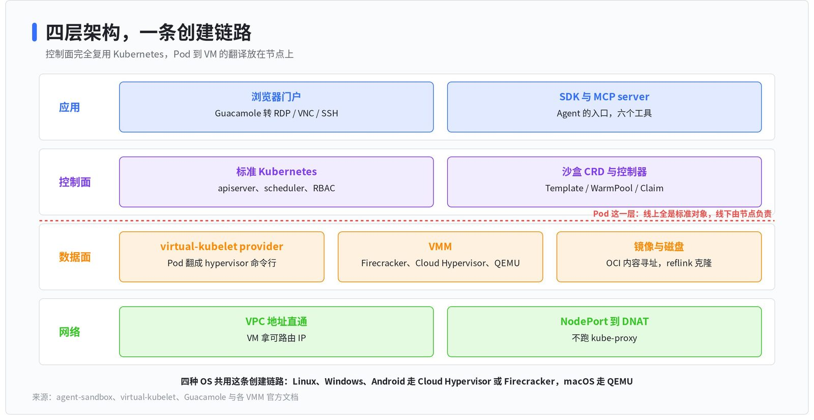
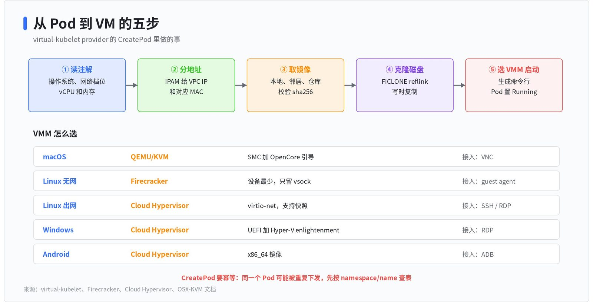
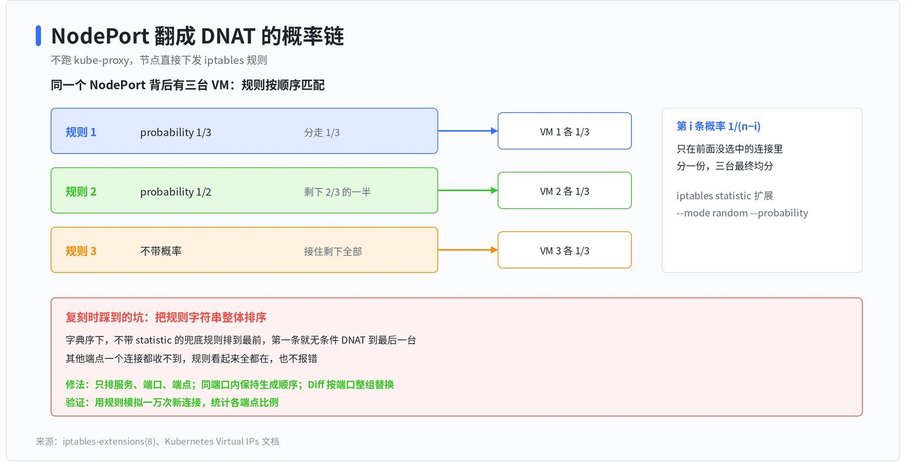
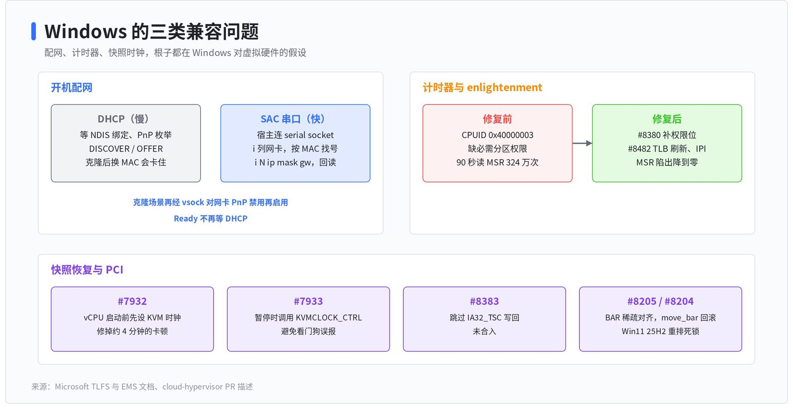
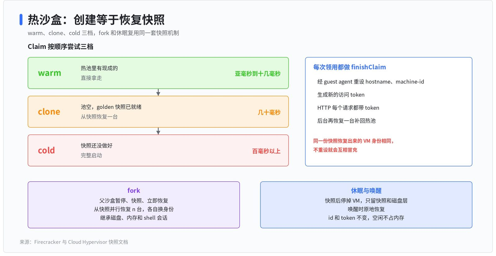
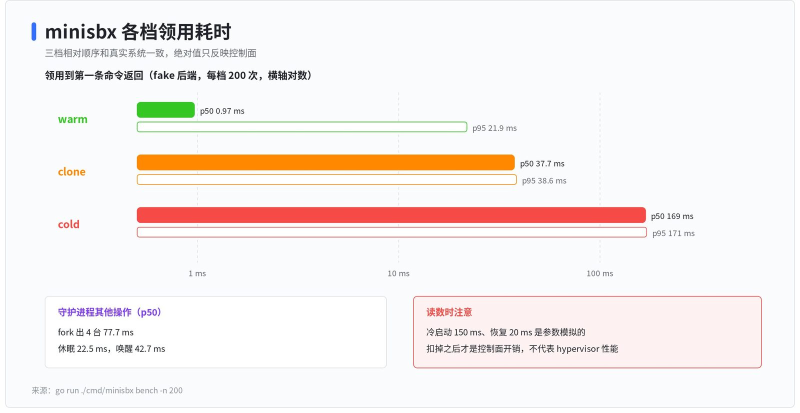
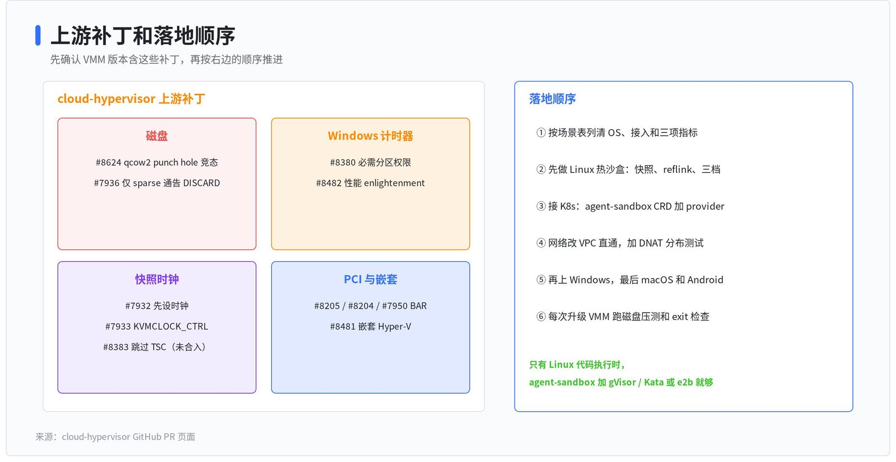

# LLM-57｜工程｜全平台 Agent 沙盒实践：用一套 K8s 调度四种操作系统的虚拟机

> 🎯 **这篇文档解决什么问题**：写代码的 Agent 要一台 Linux，操作办公软件的 Agent 要一台真的 Windows 桌面，测 Mac 应用要 macOS，做手机自动化要 Android。常见的沙盒服务大多只管第一种，后三种通常落在另一套 VDI 或云手机产品里，和 Agent 的调度、权限、计费都对不上。本篇按“一个 Kubernetes 集群同时调度四种操作系统的虚拟机，Linux 上再叠一层毫秒级热沙盒”这条路线，用公开组件把每一层拼出来：控制面沿用 kubernetes-sigs/agent-sandbox 的 CRD [[1]](https://github.com/kubernetes-sigs/agent-sandbox)，节点用 virtual-kubelet 把 Pod 翻成 VM [[2]](https://github.com/virtual-kubelet/virtual-kubelet)，VMM 用 Firecracker、Cloud Hypervisor 和 QEMU。最后用一份约 9000 行的 Go 代码 minisbx（含 10 道按章节组织的练习） 把整条路线复刻一遍，让每个设计都能跑、能测。
>
> 使用方式：第 1、2 章讲问题和总体架构，第 3 到 6 章自上而下讲控制面、Pod 到 VM 的翻译、镜像磁盘和网络，第 7 到 9 章分别讲 Windows、macOS、Android 各自的难点，第 10 章讲 Linux 热沙盒和 e2b 的对比，第 11 章是复刻代码，第 12 章是上游补丁和落地顺序。minisbx 只用 fake 后端模拟 VM，基准数字反映的是控制面自身的开销，不代表任何 hypervisor 的真实性能。
>
> **代码**：minisbx 放在 llm-book 仓库的 `57-agent-sandbox/`，10 个练习对应第 3、4、5、6、7、8、10、11 章。只用 Go 标准库，不需要 `/dev/kvm`，进目录跑 `go test -race ./...` 就能验证；每个练习加 `-broken` 运行能看到有问题的写法，练习 README 末尾附参考答案。

## 导读 · 先给结论

- <b>一个 Pod 对应一台虚拟机。</b>控制面完全是标准 Kubernetes，节点上跑一个 virtual-kubelet provider，把调度过来的 Pod 翻成一条 hypervisor 命令行。kubectl、RBAC、审计和监控都不用改。
- <b>按操作系统选 VMM。</b>无网的 Linux 沙盒适合 Firecracker，要网卡的 Linux、Windows 和 Android 用 Cloud Hypervisor，macOS 需要 SMC 和 OpenCore 引导，只能走 QEMU/KVM。
- <b>创建等于从快照恢复。</b>每个模板先做一份 golden 快照，后续沙盒从快照恢复，磁盘用 reflink 克隆，热池里再预先恢复几台。领用时间由此分成 warm、clone、cold 三档，相差两到三个数量级。
- <b>网络不走 overlay。</b>VM 直接拿 VPC 地址，节点上不跑 kube-proxy，Service 的 NodePort 翻成 iptables DNAT。这里有一个规则顺序的坑，第 6 章细讲。
- <b>Windows 和 macOS 的时间花在兼容上。</b>Windows 要绕开 DHCP 用串口配 IP，要补齐 Hyper-V enlightenment 才能让计时器不陷出；macOS 要解除 KVM 对 AVIC 的抑制才能让空闲桌面不吃 CPU。这些修复大多已经进了 cloud-hypervisor 主线。
- <b>Agent 只看到六个工具。</b>create、exec、write_file、read_file、fork、release。VM 的细节全部藏在 MCP server 后面。



> 🔑 **一句话版本**：把“给 Agent 一个环境”拆成 K8s 能理解的 Pod 和 VMM 能理解的快照，中间用 virtual-kubelet 接起来；四种操作系统共享同一条创建链路，差别只留在 VMM 选择和接入协议上。

📎 与系列其他文档的分工：本篇在工程层，是 [LLM-41｜工程｜Agent 运行时与沙箱：隔离、持久执行与规模化](./41-agent-runtime-sandbox.md) 的一次落地：把其中的 MicroVM 路线做到四种操作系统。桌面被 Agent 操作的那一侧见 [LLM-28｜工程｜Computer Use 与浏览器 Agent：让模型操作界面](./28-computer-use.md)。

## 第 1 章 · Agent 要什么样的执行环境

Agent 对执行环境的要求和人用的云桌面有三处不同。它要得快，一次任务可能开好几台，每台活几分钟，所以领用时间要压到秒级以下。它会把环境弄坏，装错依赖、删掉系统文件、跑出死循环，所以隔离必须够硬，坏了直接扔。它还想回到过去或者分身，尝试几种改法时希望从同一个状态复制出几份并行跑，跑完挑一个继续。

| 场景 | 要的操作系统 | 接入方式 | 对环境的特殊要求 |
|---|---|---|---|
| 写代码、跑测试 | Linux | vsock 上的 exec 和文件 API | 领用要快，常常不需要网络，需要 fork |
| 办公自动化、computer use | Windows 10 / 11 | RDP，加上 UI Automation 拉控件树 | 要真实桌面和真实软件，启动后网络必须立即可用 |
| Mac 应用测试、桌面自动化 | macOS | VNC | 没有 Apple 硬件也要能跑，空闲时不能吃 CPU |
| App 自动化测试 | Android | ADB 截图流加触控注入 | 最好和其他 OS 共用 x86 节点 |

容器能满足第一行的一部分，但共享内核的隔离强度不够跑不受信任的代码，后三行更是无从谈起。gVisor 和 Kata 这类运行时可以通过 RuntimeClass 挂到 Pod 上 [[3]](https://kubernetes.io/docs/concepts/containers/runtime-class/)，agent-sandbox 就是这么设计的：它只做编排，把隔离交给节点上的运行时 [[1]](https://github.com/kubernetes-sigs/agent-sandbox)。要同时覆盖四种操作系统，最直接的办法是每个沙盒都是一台完整的虚拟机，再想办法让虚拟机像容器一样快。

> ✅ **可以带走的方法**：选沙盒方案前先把 Agent 的场景按上表列一遍，每一行写清操作系统、接入方式和三项指标：领用延迟、隔离强度、能否 fork。只有第一行的团队用容器加 gVisor 就够；只要出现第二行以后的任何一行，就该从 VM 起步设计。

📎 延伸阅读：执行环境之上还要有一层决定 Agent 什么时候开工，主动式编码 Agent 怎样从 Issue、CI 和群聊里接活，见 [LLM-67｜工程｜主动式编码 Agent 的领域模型：dsh-superagent 深研](./67-proactive-coding-agent.md) 第 3 至 5 章。

## 第 2 章 · 总体架构：四层，一条创建链路

自上而下分四层。应用层是入口，给人用的是浏览器门户，用 Guacamole 把 RDP、VNC、SSH 转成网页 [[10]](https://guacamole.apache.org/)；给 Agent 用的是 SDK 和 MCP server。控制面是标准 Kubernetes，自定义的 CRD 和控制器只负责产出普通的 Pod。数据面是装了 virtual-kubelet provider 的裸金属节点，Pod 在这里变成 VM。网络层让 VM 直接拿可路由的地址，和集群里其他 Pod、Service 互通。

| 层 | 组件 | 用的公开技术 | minisbx 里的对应包 |
|---|---|---|---|
| 应用 | 门户、SDK、MCP server | Guacamole [[10]](https://guacamole.apache.org/)，MCP [[34]](https://modelcontextprotocol.io/specification/2025-06-18) | internal/mcp，sandboxd 的 HTTP API |
| 控制面 | 模板、热池、领用三种 CRD 和控制器 | agent-sandbox 的 SandboxTemplate / SandboxWarmPool / SandboxClaim [[1]](https://github.com/kubernetes-sigs/agent-sandbox) | internal/k8s |
| 数据面 | virtual-kubelet provider、VMM、镜像缓存 | virtual-kubelet [[2]](https://github.com/virtual-kubelet/virtual-kubelet)，Firecracker、Cloud Hypervisor、QEMU | internal/vk、internal/vmm、internal/store、internal/sandboxd |
| guest | 虚拟机里的轻量 agent | vsock [[5]](https://github.com/firecracker-microvm/firecracker/blob/main/docs/vsock.md)[[7]](https://github.com/cloud-hypervisor/cloud-hypervisor/blob/main/docs/vsock.md) | internal/guest、internal/vsock |
| 网络 | IP 分配、NodePort 到 DNAT | iptables statistic 扩展 [[15]](https://ipset.netfilter.org/iptables-extensions.man.html) | internal/netplan、internal/winsac |

这套分层最值钱的地方在于控制面不用自己写。apiserver、etcd、scheduler 全部用托管集群的，平台只注册几个 CRD 和一个 operator。到 Pod 这一层为止都是标准对象，Pod 怎么变成 VM 是节点自己的事。

📎 延伸阅读：本篇的四层创建链路解决 Agent 环境的供给；底层 GPU 本身怎样被 K8s 纳管、切分与排队调度，见 [LLM-69｜系统｜K8s 上的 GPU 与推理负载：从设备插件到队列调度](./69-k8s-gpu-inference.md)。

## 第 3 章 · 控制面：沿用 agent-sandbox 的 CRD

agent-sandbox 是 Kubernetes SIG Apps 下的项目，核心是一个 Sandbox CRD，表示一个有稳定身份和持久存储的单例 Pod。扩展模块里有三个 CRD：SandboxTemplate 定义环境蓝本，SandboxWarmPool 维护一池预热好的沙盒，SandboxClaim 从池里领一台 [[1]](https://github.com/kubernetes-sigs/agent-sandbox)。项目明确把自己定位成编排器，底层隔离交给 gVisor、Kata 这类运行时。

按这套 CRD 做的好处是 Agent 框架对接的是社区标准，换后端时上层不用改。上游还没定义的能力，比如 Windows 和 macOS 桌面、从运行中实例 fork、带内存休眠，可以先放在自己的扩展字段里。

minisbx 在 internal/k8s 里用一个内存版 apiserver 加一个控制器复刻这三种对象。Claim 的处理逻辑如下，有一处细节值得照抄：访问 token 写进单独的 Secret，CR 的 status 里只记 Secret 的名字，这样 `kubectl get -o yaml` 不会把 token 打出来。

*internal/k8s/controller.go：领用成功后 token 只进 Secret
*

```go
sb, err := c.Node.Claim(cl.Spec.TemplateRef, time.Duration(cl.Spec.TTLSeconds)*time.Second)if err != nil {    cl.Status.Phase, cl.Status.Message = "Failed", err.Error()    return}sec := &Secret{ObjectMeta: ObjectMeta{Name: name + "-token"},    Data: map[string]string{"token": sb.Token, "sandbox": sb.ID}}c.Store.Secrets[sec.Name] = seccl.Status.Phase, cl.Status.SandboxName, cl.Status.Tier = "Bound", sb.ID, sb.Tiercl.Status.ClaimMS, cl.Status.TokenSecret = sb.ClaimMS, sec.Name
```

控制器另外做两件事。模板对象变化时，节点上重新制作 golden 快照，做完把 status.Ready 置真；领用请求在模板 Ready 之前一直挂在 Pending，不会退化成冷启动。热池对象只管一个数字 replicas，节点守护进程在后台回填。删除 Claim 时控制器释放沙盒、删掉对应 Secret。

## 第 4 章 · 从 Pod 到 VM：virtual-kubelet provider

virtual-kubelet 让任意后端以 kubelet 的身份注册成一个 Node，调度器把 Pod 分到这个 Node 后，provider 的 CreatePod、DeletePod、GetPodStatus 被依次调用 [[2]](https://github.com/virtual-kubelet/virtual-kubelet)。这里的 provider 把一个 Pod 翻成一台 VM，步骤如下图。



1. 读 Pod 注解，决定操作系统、网络档位、vCPU 和内存。minisbx 用 `vm.minisbx.io/os` 和 `vm.minisbx.io/net`，没写就按操作系统给默认值，Windows 和 macOS 默认 4 核 8 GB。
2. 要出网的 VM 从 IPAM 拿一个 VPC 地址和对应的 MAC。
3. 按镜像 digest 解析磁盘，顺序是本地缓存、同机房节点、镜像仓库，取回后校验 sha256（第 5 章）。
4. 把磁盘用 reflink 克隆一份给这台 VM，写时复制，不搬数据。
5. 按操作系统和网络档位选 VMM，生成命令行，启动，Pod 状态置为 Running。

选 VMM 的逻辑只有三行：macOS 走 QEMU，无网的 Linux 走 Firecracker，其余都走 Cloud Hypervisor。

*internal/vmm/vmm.go
*

```go
func Choose(os OS, net Net) string {    switch {    case os == MacOS:        return "qemu"    case os == Linux && net == NetNone:        return "firecracker"    default:        return "cloud-hypervisor"    }}
```

| 操作系统 / 网络 | VMM | 为什么 | 接入 |
|---|---|---|---|
| Linux，无网 | Firecracker | 设备模型最小，只留 vsock，攻击面最小；快照和恢复是一等能力 [[4]](https://github.com/firecracker-microvm/firecracker/blob/main/docs/snapshotting/snapshot-support.md)[[5]](https://github.com/firecracker-microvm/firecracker/blob/main/docs/vsock.md) | vsock 上的 guest agent |
| Linux，出网 | Cloud Hypervisor | 带 virtio-net 网卡，同样支持快照恢复 [[6]](https://github.com/cloud-hypervisor/cloud-hypervisor/blob/main/docs/snapshot_restore.md) | SSH，或者 XFCE 桌面上的 RDP |
| Windows | Cloud Hypervisor | 有 UEFI 固件和 Hyper-V enlightenment（第 7 章） | RDP 经 Guacamole |
| Android | Cloud Hypervisor | x86_64 镜像，和 Linux 共用路径 | ADB 截图流加触控注入 |
| macOS | QEMU/KVM | 引导依赖 SMC 和 OpenCore，Cloud Hypervisor 的固件路径装不下 [[8]](https://github.com/kholia/OSX-KVM)[[9]](https://github.com/acidanthera/OpenCorePkg) | VNC 经 Guacamole |

minisbx 的 `minisbx argv` 子命令会对五种典型 Pod 打印真实的 hypervisor 命令行。下面是 Windows 那一条，Hyper-V enlightenment 开关、串口 socket 和 vsock 都在命令行上，第 7 章会用到串口那一项。

*go run ./cmd/minisbx argv 输出的 Windows 命令行（MAC 已替换为变量）
*

```bash
cloud-hypervisor --api-socket path=/var/lib/minisbx/pods/agents-win11/api.sock \  --cpus boot=4,kvm_hyperv=on --memory size=8192M,shared=on \  --firmware /var/lib/minisbx/CLOUDHV.fd \  --disk path=/var/lib/minisbx/pods/agents-win11/disk.qcow2,image_type=qcow2,sparse=on \  --vsock cid=3,socket=/var/lib/minisbx/pods/agents-win11/vsock.sock \  --net tap=tap-agentsc5c06,mac=$MAC \  --serial socket=/var/lib/minisbx/pods/agents-win11/serial.sock --console off
```

命令行里的 tap 名也是复刻时踩到的一个坑。Linux 网卡名最长 15 字节（IFNAMSIZ），按 namespace 加 Pod 名拼出来的名字很容易超长，内核会直接报错。minisbx 的做法是保留一段可读前缀，后面接一个 fnv 哈希，`tap-agentsc5c06` 就是这样来的。

## 第 5 章 · 镜像与磁盘：内容寻址加写时复制

容器镜像有现成的分发体系，VM 磁盘镜像动辄几十 GB，同样需要一套能缓存、能校验、能就近取的分发办法。OCI Distribution 规范定义的仓库本来就能存任意内容，ORAS 把这件事做成了通用工具 [[13]](https://github.com/opencontainers/distribution-spec)[[14]](https://oras.land/)。把系统盘、VM 快照和休眠时的内存镜像都按 OCI artifact 存，就能复用现有的仓库、鉴权和垃圾回收，每份内容用 sha256 digest 寻址。

| 内容 | 格式 | 什么时候产生 | 大小量级 |
|---|---|---|---|
| 系统盘镜像 | qcow2，作为 backing 文件只读 | 模板构建时 | 几 GB 到几十 GB |
| golden 快照 | VMM 快照目录（内存、设备状态、配置） | 模板首次启动到就绪后 | 与 VM 内存相当 |
| 休眠状态 | 快照加该 VM 自己的磁盘层 | 用户休眠或空闲回收 | 内存加增量磁盘 |
| VM 自己的磁盘层 | qcow2 overlay，指向 backing | 每次创建 | 起始接近零，随写入增长 |

节点取镜像的顺序固定为本地缓存、同机房的邻居节点、中心仓库。前两级命中时不走跨机房带宽，几十台节点同时拉一个新模板也不会把仓库打满。无论从哪一级取到，落盘前都按 digest 重新算一次 sha256，对不上就丢掉换下一级。minisbx 的实现先写到 `.part` 临时文件，校验通过才 rename 成正式路径，中途断电不会留下半个文件被当成缓存命中。

*internal/store/resolver.go：邻居和仓库按顺序尝试，每一级都校验 digest
*

```go
tiers := append(append([]Source{}, r.Peers...), r.Registry)for _, s := range tiers {    tmp := p + ".part"    if err := s.Fetch(digest, tmp); err != nil {        last = err; _ = os.Remove(tmp); continue    }    if got, err := FileDigest(tmp); err != nil || got != digest {        last = fmt.Errorf("%s: digest mismatch (got %s)", s.Name(), got)        _ = os.Remove(tmp); continue    }    if err := os.Rename(tmp, p); err != nil {        return "", "", err    }    r.count(s.Name())    return p, s.Name(), nil}
```

镜像到了本地，每台 VM 还需要一份自己的可写磁盘。qcow2 的 backing chain 让 VM 的 overlay 只记录自己改过的簇，底层镜像所有 VM 共享。快照和休眠的场景里，还要整份复制 overlay 或快照目录，这时用 XFS 或 Btrfs 的 reflink：`ioctl(FICLONE)` 让新文件和旧文件共享同一批数据块，只复制元数据，有写入时才分裂 [[12]](https://man7.org/linux/man-pages/man2/ioctl_ficlone.2.html)。几十 GB 的文件克隆在毫秒到秒级完成，也不占双份空间。minisbx 的 `store.CloneFile` 先试 FICLONE，文件系统不支持时退回普通拷贝，并把用了哪种方式返回给调用方，测试里可以断言生产节点上走的是 reflink。

### 5.1 DISCARD 和 qcow2 的一处竞态

磁盘这一层最危险的问题出在释放空间的路径上。guest 删文件后发 TRIM，virtio-blk 收到 DISCARD，qcow2 把对应簇的引用计数降到零，再对宿主文件 punch hole 把空间还回去。cloud-hypervisor 修复前的实现，先把簇标记成可再分配，punch hole 排在后面执行。多队列下，另一个队列可能在这个间隙里分配到同一个簇，写进一张新的 L2 映射表，随后迟到的 punch hole 把这张表清零，guest 的一整片地址从映射上消失 [[35]](https://github.com/cloud-hypervisor/cloud-hypervisor/pull/8624)。以 64 KiB 簇计，一张 L2 表最多覆盖 512 MiB 的 guest 地址空间。

触发条件都是默认配置：可写的 sparse qcow2、多队列 virtio-blk、会发 TRIM 的 guest。PR #8624 把顺序倒过来，punch hole 成功返回之前，簇不进空闲表，打洞成功后先进待回收集合，再经过一次元数据 flush 才可分配；punch hole 和 write_zeroes 失败时把错误传回 guest [[35]](https://github.com/cloud-hypervisor/cloud-hypervisor/pull/8624)。另一个相关修复 #7936 让 cloud-hypervisor 只在 sparse 打开时才向 guest 通告 DISCARD 能力 [[28]](https://github.com/cloud-hypervisor/cloud-hypervisor/pull/7936)。

> 💡 **注意**：验证一个竞态修复，只看“修复后没再出现”不够。要先让修复前的二进制在同样负载下稳定复现，再让修复后的二进制稳定消失，这组阴性对照才能证明问题被修掉了。负载强度要远高于日常，把低概率窗口压出来。

> ✅ **可以带走的方法**：在沙盒平台的发布流水线里放一个磁盘压测任务：多队列、sparse、持续写删并校验哈希，跑完做一次离线 `qemu-img check`。每次升级 VMM 或改存储配置都跑一遍，leaked cluster 不为零就不放行。

## 第 6 章 · 网络：VM 直接拿 VPC 地址

VM 要和集群里的 Pod、Service 互通，也要能被门户和 Agent 直接连上。overlay 网络在这里多一层封装和一次地址转换，排障时还得在 VM、节点、overlay 三层之间来回对。更省事的做法是让 VM 直接拿 VPC 里可路由的地址：节点把一块辅助网卡挂到本机网桥上，VPC 地址池的 IP 分给 VM，VM 和普通云主机一样被路由。

这样一来，节点上用不着 kube-proxy。kube-proxy 的 iptables 模式本身就是把 Service 翻成 DNAT 规则 [[16]](https://kubernetes.io/docs/reference/networking/virtual-ips/)，自己做这一步，只需要关心 NodePort：外部打到节点某个端口的连接，DNAT 到背后某台 VM 的地址。多台 VM 共用一个 NodePort 时，用 iptables 的 statistic 扩展按概率分流 [[15]](https://ipset.netfilter.org/iptables-extensions.man.html)。第 i 条规则匹配概率 1/(n−i)，即只在前面规则没选中的连接里分一份，最后一条不带概率，接住剩下的全部。

*go run ./cmd/minisbx argv 输出的 DNAT 规则（地址为示例）
*

```bash
-A MINISBX-NODEPORT -p tcp --dport 30590 -m comment --comment "agents/web" \   -m statistic --mode random --probability 0.50000 -j DNAT --to-destination 10.20.3.17:8080-A MINISBX-NODEPORT -p tcp --dport 30590 -m comment --comment "agents/web" \   -j DNAT --to-destination 10.20.3.18:8080
```



复刻时在这里踩到一个坑。为了让规则集合可以稳定比对、只下发差异，最初的实现把全部规则字符串排了序。按字典序，不带 statistic 的兜底规则会排到带概率的规则前面，结果第一条就无条件 DNAT 到最后一个端点，其他端点一个连接都收不到。这种错误不会报错，规则看起来全都在，只有看流量分布才发现。

minisbx 的修法分两步。`netplan.Rules` 只对服务、端口和端点各自排序，同一个端口之内的规则保持生成顺序；`Diff` 以端口为单位比较，一个端口的规则有任何变化就整组删掉重下，不在组内插入或删除单条。分组的键是 `-j DNAT` 之前、去掉 statistic 参数的那段匹配条件。单测专门构造了三个端点的服务，断言兜底规则在组内最后，且端点增减后概率重新计算。

> ✅ **可以带走的方法**：给自己生成 iptables 规则的代码加一个流量分布测试。用 `iptables-save` 的输出模拟一万次新连接，按规则顺序和概率逐条匹配，统计每个端点分到的比例，偏离均分超过几个百分点就失败。这个测试比肉眼检查规则可靠得多。

## 第 7 章 · Windows：配网、计时器和快照时钟

Windows 是四种系统里花时间最多的一个。它在 Cloud Hypervisor 上能起来以后，剩下的问题集中在三处：开机后网络迟迟不通，空闲时 CPU 占用偏高，从快照恢复后偶尔卡住。三处问题的根子都在 Windows 对虚拟硬件的假设上。



### 7.1 开机配网走串口

Windows guest 的就绪时间主要卡在网络上。模拟网卡上的 DHCP 要等 NDIS 驱动绑定、PnP 枚举，再走一轮 DISCOVER 和 OFFER，冷启动时会拉出几十秒的长尾。从快照克隆时更糟：新 VM 的网卡换了 MAC，guest 里的驱动还绑着快照内存中的旧 MAC，不会重新发 DISCOVER，最坏要等到超时。

绕开的办法是带外配网。Windows 支持 EMS（Emergency Management Services），打开以后会在串口上提供一个 SAC（Special Administration Console）命令行 [[18]](https://learn.microsoft.com/en-us/windows-hardware/drivers/devtest/boot-parameters-to-enable-ems-redirection)。cloud-hypervisor 可以把串口暴露成宿主上的 unix socket，宿主连上去，先用 `i` 列出网卡，按 MAC 找到对应的编号，再用 `i 编号 IP 掩码 网关` 写入静态地址，最后再列一次确认。Pod 的 Ready 判定从此不再等 DHCP。

*internal/winsac/sac.go：按 MAC 找网卡，写地址，回读校验
*

```go
if _, err := send(""); err != nil { // 唤醒控制台    return err}out, err := send("i") // 列出网卡// 逐行扫描："Net: N" 开启一个网卡块，随后出现的 MAC 属于这个块for _, line := range strings.Split(out, "\n") {    if m := netLine.FindStringSubmatch(line); m != nil {        fmt.Sscan(m[1], &cur)    }    if m := macLine.FindStringSubmatch(line); m != nil && cur >= 0 && normMAC(m[1]) == normMAC(c.MAC) {        num = cur    }}for _, cmd := range Script(num, c) { // "i N ip mask gw"，再 "i" 回读    if last, err = send(cmd); err != nil {        return err    }}
```

这段代码第一版的正则是按单行写的，假设网卡编号和 MAC 在同一行。真实的 SAC 输出里，`Net: N` 开一个块，MAC 在后面几行，结果总是找不到网卡。现在的写法记住当前所在的块，再把后面出现的 MAC 归到这个块。克隆场景还有一步：通过 vsock 上的 guest agent 对网卡做一次 PnP 禁用再启用，强制 NDIS 按新 MAC 重新绑定。

### 7.2 计时器和 Hyper-V enlightenment

Windows 运行在虚拟机里时，会读 CPUID 0x40000000 段，判断自己是否在 Hyper-V 兼容的 hypervisor 上，再决定用哪些半虚拟化接口，比如参考 TSC 页、合成定时器和半虚拟化的 TLB 刷新 [[17]](https://learn.microsoft.com/en-us/virtualization/hyper-v-on-windows/tlfs/tlfs)。这些接口统称 Hyper-V enlightenment，KVM 都实现了，VMM 要负责在 CPUID 里正确地通告。

TLFS 规定，某些分区权限位是 guest 正常工作的前提。cloud-hypervisor 早先没有在 CPUID 0x40000003 里通告 AccessHypercallMsrs 等必需权限，Windows 于是退回去反复读一个会陷出到 VMM 的 MSR。PR #8380 的描述里，一台空闲 Windows 在 90 秒内读了 3,249,387 次 0x40000020，补上这些位以后降到零 [[21]](https://github.com/cloud-hypervisor/cloud-hypervisor/pull/8380)。紧接着的 #8482 又通告了一组性能相关的 enlightenment，包括半虚拟化 TLB 刷新和按簇发 IPI [[22]](https://github.com/cloud-hypervisor/cloud-hypervisor/pull/8482)。

### 7.3 快照恢复后的时钟

从快照恢复一台 Windows，时钟要连续。#7932 把 KVM 时钟的恢复挪到 vCPU 开始运行之前，修掉了恢复后偶发约 4 分钟卡顿的问题 [[23]](https://github.com/cloud-hypervisor/cloud-hypervisor/pull/7932)。#7933 在暂停时对 Hyper-V guest 也调用 KVMCLOCK_CTRL，告诉 guest 时钟曾被暂停，避免看门狗误报 [[24]](https://github.com/cloud-hypervisor/cloud-hypervisor/pull/7933)。还有一处恢复 IA32_TSC 的写回会破坏 KVM 的 masterclock，#8383 提议对 Hyper-V guest 跳过这一步，截至本文写作时尚未合入 [[29]](https://github.com/cloud-hypervisor/cloud-hypervisor/pull/8383)。

### 7.4 PCI BAR 和嵌套虚拟化

Windows 11 25H2 的 pci.sys 启动时会重新平衡 PCI 资源，移动设备的 BAR。cloud-hypervisor 原先给 virtio 设备分配的初始 BAR 排得太紧，重排时可能死锁，#8205 改为稀疏对齐 [[25]](https://github.com/cloud-hypervisor/cloud-hypervisor/pull/8205)；#8204 让 move_bar 失败时回滚地址分配器 [[26]](https://github.com/cloud-hypervisor/cloud-hypervisor/pull/8204)；#7950 给 BAR 重编程加了越界 MMIO 检查 [[27]](https://github.com/cloud-hypervisor/cloud-hypervisor/pull/7950)。

有些 Agent 任务要在 Windows 里再跑 WSL2 或 Hyper-V 容器，这就需要嵌套虚拟化。#8481 加上了 Windows guest 的嵌套 Hyper-V 支持，其中一处细节是 FADT 里的 PM1a 寄存器块：Windows 的 hvloader 会拒绝地址为 0 的 GAS 描述 [[20]](https://github.com/cloud-hypervisor/cloud-hypervisor/pull/8481)。

> ✅ **可以带走的方法**：Windows 镜像上线前跑三项检查。冷启动和克隆各测十次 Ready 时间，看有没有几十秒的长尾；空闲十分钟用 `perf kvm stat` 看 exit 原因，MSR 类陷出排在前面就去查 CPUID 通告；连续做二十次快照恢复，确认没有卡顿，guest 时间和宿主时间的偏差在一秒以内。

## 第 8 章 · macOS：引导和空闲 CPU

macOS 在非 Apple 硬件上引导，要有模拟的 SMC 芯片和 OpenCore 引导器。OSX-KVM 项目把整套 QEMU/KVM 配置整理好了，OpenCore 负责在 UEFI 上加载 macOS 的引导程序 [[8]](https://github.com/kholia/OSX-KVM)[[9]](https://github.com/acidanthera/OpenCorePkg)。Cloud Hypervisor 走 PVH 和精简固件的路径，装不下这一套，所以 macOS 单独用 QEMU。系统盘挂成 NVMe 设备，模拟开销比 AHCI 小；显示通过 VNC 接到 Guacamole。

> 💡 **注意**：Apple 的软件许可协议只允许在 Apple 品牌硬件上运行 macOS 虚拟机。在 x86 服务器上跑 macOS 之前，先和法务确认使用范围。minisbx 的命令行里 SMC 的 OSK 参数留了占位，需要使用者自行提供。

macOS 虚拟机的典型问题是空闲桌面也吃 CPU。原因在中断控制器的虚拟化上。AMD 的 AVIC 可以让 guest 写 EOI 和发 IPI 时不陷出到 hypervisor，但 KVM 在若干情况下会对整台 VM 关掉 AVIC，原因定义在 `APICV_INHIBIT_REASON_*` 里 [[19]](https://github.com/torvalds/linux/blob/master/arch/x86/include/asm/kvm_host.h)。其中一条是 PIT 的丢失时钟重注入：QEMU 的 q35 机型默认打开 in-kernel PIT 的 reinjection，KVM 因此抑制 AVIC。Linux 和 Windows guest 有半虚拟化 EOI 可以兜底，macOS 没有，每次 EOI 和 ICR 写都会陷出。

修法是两个 QEMU 参数：`kernel_irqchip=on` 把中断控制器放在内核里，`kvm-pit.lost_tick_policy=discard` 让 PIT 丢弃错过的时钟而不重注入，AVIC 的抑制随之解除。判断是否生效有一个直接的办法：`kvm_avic_incomplete_ipi` 这个 tracepoint 只有 AVIC 真正启用时才会触发，计数从零变为正数就说明硬件路径接上了。

*internal/vmm/builders.go：macOS 命令行里和空闲 CPU、引导相关的参数
*

```go
"-machine", "q35,accel=kvm,kernel_irqchip=on","-global", "kvm-pit.lost_tick_policy=discard","-cpu", "Haswell-noTSX,kvm=on,vendor=GenuineIntel,+invtsc,vmware-cpuid-freq=on","-device", "isa-applesmc,osk=" + "<OSK-from-your-own-Mac>","-drive", "id=oc,if=none,format=qcow2,file=" + openCore,"-device", "ide-hd,bus=ide.0,drive=oc,bootindex=1","-drive", "id=mac,if=none,format=qcow2,file=" + s.Rootfs,"-device", "nvme,drive=mac,serial=mac0",
```

> ✅ **可以带走的方法**：任何新 guest 系统上线，先让它空闲十分钟，用 `perf kvm stat live` 看 exit 分布。空闲 VM 的 exit 应该以 HLT 为主，如果 APIC 写或 MSR 访问排在前面，先查 AVIC 或 APICv 有没有被抑制，再查 CPUID 通告。

## 第 9 章 · Android：和 Linux 走同一条路

Android 有 x86_64 的构建，可以直接跑在 Cloud Hypervisor 上，和 Linux、Windows 共用节点，不需要 ARM 机器。服务器上没有独立显卡，纯软件渲染时搭一套 VNC 帧缓冲反而绕远，用 ADB 更直接：截图走 `screencap`，操作走 `input` 注入 [[11]](https://developer.android.com/tools/adb)。链路短，guest 里不用装任何东西，交互延迟由截图频率决定，App 自动化测试够用。

*Agent 侧操作 Android 沙盒的四条命令
*

```bash
adb connect <节点地址>:<NodePort>adb exec-out screencap -p > frame.png      # 取一帧画面adb shell input tap 540 1200               # 点击adb shell input text "hello"               # 输入文字adb shell input swipe 540 1600 540 400 300 # 滑动，300 ms
```

每台 Android VM 建一个指向 5555 端口的 NodePort Service，经第 6 章的 DNAT 就能从集群外直接 `adb connect`。Agent 拿到截图后的视觉定位和操作规划，与操作 Windows、macOS 桌面是同一类问题，见 [LLM-28｜工程｜Computer Use 与浏览器 Agent：让模型操作界面](./28-computer-use.md)。

## 第 10 章 · Linux 热沙盒：领用分三档

写代码、跑测试的 Agent 用不着一整台带桌面的 VM，它要的是一个起得快、能执行命令和读写文件、坏了就扔的 Linux。这一层单独做成热沙盒：内核和 init 精简到只够把 rootfs 交出去，guest 里跑一个守护进程，通过 vsock 收发 JSON 帧，提供 exec、带状态的 shell 会话和文件读写。

快的关键在于创建一台沙盒等于恢复一份快照。每个模板第一次就绪后，VMM 把内存和设备状态存成 golden 快照，Firecracker 和 Cloud Hypervisor 都把快照恢复做成了一等能力 [[4]](https://github.com/firecracker-microvm/firecracker/blob/main/docs/snapshotting/snapshot-support.md)[[6]](https://github.com/cloud-hypervisor/cloud-hypervisor/blob/main/docs/snapshot_restore.md)。后续领用按三档走：热池里有现成的就直接拿走（warm）；池空了就从 golden 快照恢复一台（clone）；快照还没做好就完整启动（cold）。领走一台后，后台再从快照恢复一台补回池里。



*internal/sandboxd/pool.go：Claim 的三档
*

```go
tier := "clone"if n := len(t.warm); n > 0 {    sb, t.warm = t.warm[n-1], t.warm[:n-1]    tier = "warm"}tt, golden, ready := t.t, t.golden, t.readyd.mu.Unlock()d.wake() // 通知后台回填热池switch {case sb != nil:case ready:    sb, err = d.restore(tt, golden, d.newID())default:    tier = "cold"    sb, err = d.bootCold(tt, d.newID())}return d.finishClaim(sb, tier, ttl, t0)
```

从同一份快照恢复出来的 VM 是一模一样的，hostname、machine-id、随机数种子都和模板相同。复刻时 demo 打印出来的 hostname 甚至是宿主机的，因为 fake 后端没有单独设置。`finishClaim` 因此在每次领用时都做两件事：通过 guest agent 重设身份，生成一个新的访问 token。HTTP API 的每个请求都要带这个 token，一台沙盒的 token 拿不到另一台。

### 10.1 fork 和休眠

fork 是热沙盒对 Agent 最有用的能力。父沙盒暂停、做一份快照、立即恢复运行，然后从这份快照并行恢复出 n 台子沙盒，每台走一遍 `finishClaim` 换身份。子沙盒继承父沙盒的磁盘、内存和 shell 会话，Agent 可以在同一个状态上并行尝试几种改法，挑出最好的一台继续，其余释放。多个 Agent 怎么分配这些子沙盒，见 [LLM-45｜工程｜多 Agent 系统：编排、通信、归因与评测](./45-multi-agent.md)。

休眠是同一套机制的另一个用法：做快照、停掉 VM、只保留快照目录和磁盘层，唤醒时原地恢复，沙盒 id 和 token 不变。空闲的沙盒不占内存，用户回来时等待的是一次恢复，几十毫秒级。

### 10.2 和 e2b 的比较

e2b 是 Linux 沙盒里最常被拿来比较的开源方案。按它的 infra 仓库 README，运行时以 Apache-2.0 协议开源，用 Go 实现 [[30]](https://github.com/e2b-dev/infra)。它的核心思路和本章一样，沙盒就是一份被恢复的快照：模板是预先启动好的 VM 快照，存在对象存储里，恢复时内存通过 userfaultfd 按需加载，rootfs 用写时复制叠加层。暂停时把差异写回对象存储，空闲沙盒自动暂停，有流量进来时唤醒；可以对运行中的沙盒做 fork，SDK 和 CLI 一次最多出 20 份，份数还要低于团队的并发上限 [[36]](https://e2b.dev/docs/sandbox/fork)。每台 Firecracker 跑在单独的 cgroup 和网络命名空间里，出网经 nftables 防火墙。客户端 SDK 和 CLI 在另一个仓库 [[31]](https://github.com/e2b-dev/E2B)，暂停与恢复的用法见文档 [[32]](https://e2b.dev/docs/sandbox/persistence)。

| 维度 | e2b | 本篇路线 |
|---|---|---|
| 编排接口 | 自有 API 与 SDK [[31]](https://github.com/e2b-dev/E2B) | Kubernetes CRD，沿用 agent-sandbox 的 Template / WarmPool / Claim [[1]](https://github.com/kubernetes-sigs/agent-sandbox) |
| 操作系统 | Linux | Linux、Windows、macOS、Android |
| 桌面 | Linux 桌面（单独的 desktop 产品） | Windows / macOS / Linux 桌面经 Guacamole，Android 经 ADB |
| 快照与恢复 | 模板即快照，userfaultfd 按需加载内存 [[30]](https://github.com/e2b-dev/infra) | golden 快照，reflink 克隆磁盘，热池预恢复 |
| 暂停与 fork | 自动暂停、流量唤醒，支持 fork 运行中沙盒 [[30]](https://github.com/e2b-dev/infra)[[32]](https://e2b.dev/docs/sandbox/persistence) | 带内存休眠，live-fork 继承内存和会话 |
| 部署 | E2B Cloud，或自托管运行时 | 自托管，任意 Kubernetes 集群 |

两者在 Linux 沙盒上的技术路线已经很接近，差别主要在两处。先看接口，e2b 是一家的 API，走 agent-sandbox CRD 的方案让 Agent 框架对接社区标准，权限、审计和配额都复用 Kubernetes。再看覆盖面，同一条创建链路同时管四种操作系统的桌面和沙盒。只需要 Linux 代码执行、又不想自己维护集群的团队，直接用 e2b 更省事。

沙盒之上的 Agent 平台也可以接着用 CRD 描述。kagent 用 Agent、ModelConfig 等对象声明 Agent、模型和工具 [[33]](https://github.com/kagent-dev/kagent)，负责规划的 Agent 拿到“领一台沙盒”的工具后，就能按任务需要在不同操作系统上拉起执行环境，权限和配额仍然落在 Kubernetes 的对象上。

> ✅ **可以带走的方法**：给自己的沙盒池加三个指标：每档领用的次数占比、每档的 p50 和 p95、热池为空的时长占比。clone 和 cold 的占比上升，说明热池容量或回填速度跟不上，要么调大 replicas，要么查恢复为什么变慢。

## 第 11 章 · 复刻代码 minisbx

minisbx 用约 9000 行 Go 把前面十章的路线写成能跑、能测的代码，其中约 3500 行是按章节组织的 10 道练习（见 11.4）。只用标准库，不需要 `/dev/kvm`，普通 Linux 机器上 `go test -race ./...` 即可全部通过。代码在 llm-book 仓库的 `57-agent-sandbox/`，本文附件 minisbx.tar.gz 是早先上传的版本，以仓库为准。它和真实系统的差别集中在一处：VM 由 fake 后端模拟。

| 包 | 行数 | 复刻的是哪一章 | 要点 |
|---|---|---|---|
| internal/k8s | 498 | 第 3 章 控制面 | 内存版 apiserver 加控制器；token 进 Secret |
| internal/vk | 319 | 第 4 章 Pod 到 VM | 注解选 OS，IPAM，幂等 CreatePod |
| internal/vmm | 995 | 第 4、7、8 章 | 选 VMM，生成三种 hypervisor 命令行，Firecracker REST 客户端，fake 后端 |
| internal/store | 320 | 第 5 章 镜像与磁盘 | 三级取镜像加 sha256 校验，FICLONE 克隆 |
| internal/netplan | 401 | 第 6 章 网络 | NodePort 翻 DNAT，按端口整组下发 |
| internal/winsac | 447 | 第 7 章 Windows | SAC 串口配网，按 MAC 找网卡并回读 |
| internal/sandboxd | 1037 | 第 10 章 热沙盒 | 三档领用、fork、休眠、TTL 回收、HTTP API |
| internal/guest、vsock、client、proto | 783 | 第 10 章 guest 侧 | vsock 上的 JSON 协议：exec、文件、带状态的会话 |
| internal/mcp | 315 | 第 11 章 Agent 接口 | MCP stdio server，六个工具 |

fake 后端把一台 VM 模拟成一个 rootfs 目录加一个跑在 hybrid vsock socket 上的 guest agent。hybrid vsock 是 Firecracker 和 Cloud Hypervisor 共用的接法：宿主连 unix socket，先发一行 `CONNECT 端口号`，之后就是到 guest 里那个端口的字节流 [[5]](https://github.com/firecracker-microvm/firecracker/blob/main/docs/vsock.md)[[7]](https://github.com/cloud-hypervisor/cloud-hypervisor/blob/main/docs/vsock.md)。快照把磁盘目录和 agent 的会话状态（当前目录、导出的环境变量）写到磁盘，恢复时 reflink 克隆磁盘、带着会话状态拉起新 agent。池化、克隆、fork、休眠、控制器、HTTP 和 MCP 跑的都是真代码。

### 11.1 Agent 只看到六个工具

`minisbx-mcp` 按 MCP 规范在 stdio 上提供工具 [[34]](https://modelcontextprotocol.io/specification/2025-06-18)：sandbox_create、sandbox_exec、sandbox_write_file、sandbox_read_file、sandbox_fork、sandbox_release。exec 在一个持久的 shell 会话里执行，上一步 `cd` 和 `export` 的结果下一步还在，Agent 可以一步一步干活。工具失败时返回 `isError` 为真的文本内容，不返回协议错误，模型能读到原因并自己调整。协议本身的细节见 [LLM-19｜工程｜Agent 协议与工具链：MCP、A2A 与 Skills](./19-agent-protocols.md)，编程 Agent 怎么用这类工具见 [LLM-26｜工程｜编程 Agent 实战：Claude Code、Codex 与 Cursor](./26-coding-agents.md)。

*internal/mcp/server.go：fork 工具
*

```go
case "sandbox_fork":    if a.N < 1 || a.N > 16 {        return "", fmt.Errorf("n must be 1..16")    }    kids, err := s.D.Fork(a.ID, a.N)    if err != nil {        return "", err    }    ids := make([]string, len(kids))    for i, k := range kids {        ids[i] = fmt.Sprintf("%q", k.ID)    }    return `{"children":[` + strings.Join(ids, ",") + `]}`, nil
```

MCP 的单测模拟一个完整的 Agent 回合：领一台沙盒，写入 `/app/main.py`，执行 `cd app && export STEP=2`，下一条命令读到 STEP 和文件内容，再 fork 出两台，在第二台子沙盒里读回同一个文件。`go run ./cmd/minisbx demo` 跑的是同样的流程，输出如下。

*go run ./cmd/minisbx demo：三台子沙盒各改各的，父沙盒不受影响，休眠唤醒后会话还在
*

```text
claim   sbx-000002 tier=warm 0.30msexec    hostname=sbx-000002fork    sbx-000005 -> refactor workspace print(10)fork    sbx-000006 -> refactor workspace print(11)fork    sbx-000004 -> refactor workspace print(12)parent  a.py still print(1)hibernate sbx-000002 state=hibernatedwake    sbx-000002 state=claimed session -> refactor print(1)
```

### 11.2 基准

`go run ./cmd/minisbx bench -n 200` 对每一档领用 200 次，测从领用到第一条命令返回的时间。fake 后端用参数模拟冷启动 150 ms、快照恢复 20 ms，用来保持各档的相对顺序。



| 档位 | p50 | p95 | 说明 |
|---|---|---|---|
| warm | 0.97 ms | 21.9 ms | 池里有现成的；p95 来自池回填时和恢复任务抢 CPU |
| clone | 37.7 ms | 38.6 ms | 池空，从 golden 快照恢复，含 20 ms 模拟恢复 |
| cold | 169 ms | 171 ms | 无快照，完整启动，含 150 ms 模拟启动 |

守护进程的其他操作：fork 出 4 台 p50 77.7 ms，休眠 22.5 ms，唤醒 42.7 ms。扣掉模拟延迟后，剩下的是控制面自身的开销，包括磁盘 reflink、agent 重连和身份重设，不代表任何 hypervisor 的真实性能。

### 11.3 复刻时踩到的坑

| 问题 | 现象 | 修法 | 在哪一章 |
|---|---|---|---|
| DNAT 兜底规则被排到最前 | 同一 NodePort 的流量全部打到一个端点 | 只在服务、端口、端点层面排序，Diff 按端口整组替换 | 第 6 章 |
| tap 名超过 15 字节 | 内核拒绝创建网卡 | 可读前缀加 fnv 哈希 | 第 4 章 |
| SAC 输出的网卡块跨多行 | 按 MAC 找不到网卡 | 记住当前块，把后续 MAC 归到块内 | 第 7 章 |
| 克隆出的沙盒身份相同 | demo 打印出宿主机的 hostname | 每次领用重设身份、换 token | 第 10 章 |
| fake 后端没有 chroot | 绝对路径命令会落到宿主机 | 命令用相对路径；文件 API 把路径约束在 rootfs 内 | 第 11 章 |

> 💡 **注意**：fake 后端的 fork 和恢复只复制会话状态，进程内存和打开的连接不会被带过去。接真实后端时，`vmm.Backend` 接口的 Boot、Snapshot、Restore 分别对应 `vmm.Argv` 生成的命令行、Firecracker 的 `PUT /snapshot/create`、Cloud Hypervisor 的 `vm.snapshot` 和 `--restore`。

### 11.4 按章节的练习

前面各章讲到的坑，大多拆成了独立的小练习，放在 `exercises/` 目录下，一章对一到两道。每道练习默认就是参考答案，`go run` 退出码为 0。加 `-broken` 参数换成有问题的写法，程序打印 FAIL 并以退出码 1 结束；加 `-tags broken` 跑测试，测试会失败。要动手的位置都标了 `TODO(练习)`，可以先切到有问题的版本，自己改到测试通过，再对照参考答案。

| 章节 | 练习 | 要点 |
|---|---|---|
| 第 3 章 控制面 | `ch03-crd-controller` | watch 连接断开时会丢事件，控制器要靠定期 resync 把漏掉的对象补回来 |
| 第 4 章 从 Pod 到 VM | `ch04-pod-to-vm` | tap 设备名最长 15 字节，按 Pod 名截断会撞名，要截断后再拼哈希 |
| 第 5 章 镜像与磁盘 | `ch05-image-disk` | 从缓存克隆根盘用硬链接会让 VM 写坏缓存，要用 reflink 或整份拷贝 |
| 第 5 章 镜像与磁盘 | `ch05-qcow2-discard-race` | DISCARD 释放的 cluster 被立即复用，在途写入落到别人的数据上，对应 cloud-hypervisor PR #8624 的待释放集合 |
| 第 6 章 网络 | `ch06-nodeport-dnat` | iptables 概率 DNAT 的规则排序，兜底规则排到最前会吃掉全部流量 |
| 第 7 章 Windows | `ch07-windows` | SAC 串口配网，快照恢复后在 AfterRestore 里拨正时钟 |
| 第 8 章 macOS | `ch08-macos` | 保留 kvm-pit.lost_tick_policy=discard，PIT reinject 会让 AMD 关掉 AVIC |
| 第 10 章 Linux 热沙盒 | `ch10-fork-hibernate` | fork 出的每个子沙盒要重新生成 RUN_ID 之类的应用层 ID |
| 第 10 章 Linux 热沙盒 | `ch10-warm-pool` | 用 Erlang B 给热池定大小，只留 ⌈λR⌉ 台时突发流量下命中率只有 77.3% |
| 第 11 章 复刻代码 | `ch11-mcp` | MCP stdio 传输里 stdout 只留给协议，日志一律写 stderr |

第 1、2、9、12 章没有单独的练习：第 2 章的整条创建链路用 `go run ./cmd/minisbx demo` 演示，Android 和 Windows 一样走 Cloud Hypervisor 加 UEFI 固件，命令行生成见 `internal/vmm`。`ch10-warm-pool` 默认参数要跑 10 到 20 秒，其余练习几秒内结束。

## 第 12 章 · 上游补丁与落地顺序

第 5 章和第 7 章提到的问题，修复大多已经进了 cloud-hypervisor 主线。自己搭这套系统时，先确认 VMM 版本包含下表的补丁，能省掉大部分排障时间。

| PR | 状态 | 解决什么问题 | 影响的系统 |
|---|---|---|---|
| #8624 [[35]](https://github.com/cloud-hypervisor/cloud-hypervisor/pull/8624) | 已合入 | qcow2 延迟 punch hole 与簇复用的竞态，导致数据丢失 | 所有用 sparse qcow2 的 guest |
| #7936 [[28]](https://github.com/cloud-hypervisor/cloud-hypervisor/pull/7936) | 2026-03 合入 | 仅在 sparse 时通告 DISCARD | 所有 |
| #8380 [[21]](https://github.com/cloud-hypervisor/cloud-hypervisor/pull/8380) | 2026-06 合入 | 通告必需的 Hyper-V 分区权限，消除 MSR 陷出 | Windows |
| #8482 [[22]](https://github.com/cloud-hypervisor/cloud-hypervisor/pull/8482) | 2026-06 合入 | 性能相关 enlightenment，含半虚拟化 TLB 刷新 | Windows |
| #7932 [[23]](https://github.com/cloud-hypervisor/cloud-hypervisor/pull/7932) | 2026-03 合入 | 恢复时先设 KVM 时钟再启动 vCPU | 快照恢复 |
| #7933 [[24]](https://github.com/cloud-hypervisor/cloud-hypervisor/pull/7933) | 2026-03 合入 | 暂停时对 Hyper-V guest 调用 KVMCLOCK_CTRL | Windows 快照 |
| #8205 [[25]](https://github.com/cloud-hypervisor/cloud-hypervisor/pull/8205) | 2026-05 合入 | virtio 设备初始 BAR 稀疏对齐，避免重排死锁 | Windows 11 25H2 |
| #8204 [[26]](https://github.com/cloud-hypervisor/cloud-hypervisor/pull/8204) | 2026-05 合入 | move_bar 失败时回滚地址分配器 | Windows |
| #7950 [[27]](https://github.com/cloud-hypervisor/cloud-hypervisor/pull/7950) | 2026-04 合入 | BAR 重编程的越界 MMIO 加固 | 所有 |
| #8481 [[20]](https://github.com/cloud-hypervisor/cloud-hypervisor/pull/8481) | 2026-07 合入 | Windows guest 的嵌套 Hyper-V | Windows 嵌套 |
| #8383 [[29]](https://github.com/cloud-hypervisor/cloud-hypervisor/pull/8383) | 未合入 | 对 Hyper-V guest 跳过 IA32_TSC 恢复 | Windows 快照 |



### 12.1 落地顺序

1. 先把 Agent 场景按第 1 章的表列清楚。只有 Linux 代码执行时，先用 agent-sandbox 加 gVisor 或 Kata，或者直接用 e2b。
2. 需要 VM 时，先做 Linux 热沙盒：golden 快照、reflink、热池三档，配上第 10 章的三个指标。这一步可以先用 fake 后端把控制面写好。
3. 接入 Kubernetes：沿用 agent-sandbox 的 CRD，节点上加 virtual-kubelet provider，token 进 Secret。
4. 网络改成 VM 直接拿 VPC 地址，加 DNAT 流量分布测试。
5. 再上 Windows：串口配网、CPUID 通告、快照时钟，按第 7 章的三项检查验收。macOS 和 Android 视需求排在最后，macOS 先过法务。
6. 每次升级 VMM 跑一遍第 5 章的磁盘压测和第 8 章的空闲 exit 检查。

Agent 本身的设计原则见 [LLM-04｜工程｜《深入理解 AI Agent》精读：设计原理与工程实践](./04-ai-agent-reading.md)，沙盒在整个 Agent 运行时里的位置见 [LLM-41｜工程｜Agent 运行时与沙箱：隔离、持久执行与规模化](./41-agent-runtime-sandbox.md)。强化学习训练里大量 rollout 也需要这类可快速创建、可 fork 的环境，见 [LLM-55｜系统｜RL 训练系统：rollout 与训练分离、异步与 Agent 环境](./55-rl-systems.md)。

> 🔑 **收束**：全平台沙盒的难点分成两半。一半是通用的：把 VM 做成快照，让创建变成恢复，再用 Kubernetes 的标准对象把它管起来，这部分四种系统共用。另一半是每种操作系统各自的兼容问题，Windows 的配网和计时器、macOS 的中断控制器、qcow2 的释放时序，只能逐个测出来、逐个修掉，修好的部分尽量回馈上游。

## 参考文献

资料截至 2026 年 10 月。cloud-hypervisor PR 的状态以 GitHub 页面为准；e2b 的能力以其 infra 仓库 README 和官方文档为准。minisbx 的基准数字来自 fake 后端，只反映控制面开销。

[1] kubernetes-sigs/agent-sandbox：Sandbox CRD 与 SandboxTemplate / SandboxClaim / SandboxWarmPool 扩展. GitHub [https://github.com/kubernetes-sigs/agent-sandbox](https://github.com/kubernetes-sigs/agent-sandbox)

[2] virtual-kubelet：把任意后端伪装成一个 kubelet 节点. GitHub [https://github.com/virtual-kubelet/virtual-kubelet](https://github.com/virtual-kubelet/virtual-kubelet)

[3] Kubernetes Docs. Runtime Class [https://kubernetes.io/docs/concepts/containers/runtime-class/](https://kubernetes.io/docs/concepts/containers/runtime-class/)

[4] Firecracker Docs. Snapshotting support [https://github.com/firecracker-microvm/firecracker/blob/main/docs/snapshotting/snapshot-support.md](https://github.com/firecracker-microvm/firecracker/blob/main/docs/snapshotting/snapshot-support.md)

[5] Firecracker Docs. Using the vsock device [https://github.com/firecracker-microvm/firecracker/blob/main/docs/vsock.md](https://github.com/firecracker-microvm/firecracker/blob/main/docs/vsock.md)

[6] Cloud Hypervisor Docs. Snapshot and Restore [https://github.com/cloud-hypervisor/cloud-hypervisor/blob/main/docs/snapshot_restore.md](https://github.com/cloud-hypervisor/cloud-hypervisor/blob/main/docs/snapshot_restore.md)

[7] Cloud Hypervisor Docs. vsock support [https://github.com/cloud-hypervisor/cloud-hypervisor/blob/main/docs/vsock.md](https://github.com/cloud-hypervisor/cloud-hypervisor/blob/main/docs/vsock.md)

[8] kholia/OSX-KVM：在 QEMU/KVM 上运行 macOS. GitHub [https://github.com/kholia/OSX-KVM](https://github.com/kholia/OSX-KVM)

[9] acidanthera/OpenCorePkg. GitHub [https://github.com/acidanthera/OpenCorePkg](https://github.com/acidanthera/OpenCorePkg)

[10] Apache Guacamole：无客户端远程桌面网关 [https://guacamole.apache.org/](https://guacamole.apache.org/)

[11] Android Developers. Android Debug Bridge (adb) [https://developer.android.com/tools/adb](https://developer.android.com/tools/adb)

[12] Linux man-pages. ioctl_ficlone(2) [https://man7.org/linux/man-pages/man2/ioctl_ficlone.2.html](https://man7.org/linux/man-pages/man2/ioctl_ficlone.2.html)

[13] OCI Distribution Specification. GitHub [https://github.com/opencontainers/distribution-spec](https://github.com/opencontainers/distribution-spec)

[14] ORAS：OCI Registry As Storage [https://oras.land/](https://oras.land/)

[15] iptables-extensions(8)：statistic、addrtype、comment 等匹配扩展 [https://ipset.netfilter.org/iptables-extensions.man.html](https://ipset.netfilter.org/iptables-extensions.man.html)

[16] Kubernetes Docs. Virtual IPs and Service Proxies [https://kubernetes.io/docs/reference/networking/virtual-ips/](https://kubernetes.io/docs/reference/networking/virtual-ips/)

[17] Microsoft Learn. Hypervisor Top Level Functional Specification (TLFS) [https://learn.microsoft.com/en-us/virtualization/hyper-v-on-windows/tlfs/tlfs](https://learn.microsoft.com/en-us/virtualization/hyper-v-on-windows/tlfs/tlfs)

[18] Microsoft Learn. Boot Parameters to Enable EMS Redirection [https://learn.microsoft.com/en-us/windows-hardware/drivers/devtest/boot-parameters-to-enable-ems-redirection](https://learn.microsoft.com/en-us/windows-hardware/drivers/devtest/boot-parameters-to-enable-ems-redirection)

[19] Linux 源码 arch/x86/include/asm/kvm_host.h（APICV_INHIBIT_REASON_\* 定义） [https://github.com/torvalds/linux/blob/master/arch/x86/include/asm/kvm_host.h](https://github.com/torvalds/linux/blob/master/arch/x86/include/asm/kvm_host.h)

[20] cloud-hypervisor PR #8481：Add nested Hyper-V (Windows guest) support（2026-07 合入） [https://github.com/cloud-hypervisor/cloud-hypervisor/pull/8481](https://github.com/cloud-hypervisor/cloud-hypervisor/pull/8481)

[21] cloud-hypervisor PR #8380：advertise mandatory Hyper-V partition privileges（2026-06 合入） [https://github.com/cloud-hypervisor/cloud-hypervisor/pull/8380](https://github.com/cloud-hypervisor/cloud-hypervisor/pull/8380)

[22] cloud-hypervisor PR #8482：Hyper-V CPUID performance enlightenments（2026-06 合入） [https://github.com/cloud-hypervisor/cloud-hypervisor/pull/8482](https://github.com/cloud-hypervisor/cloud-hypervisor/pull/8482)

[23] cloud-hypervisor PR #7932：restore KVM clock before resuming vCPUs（2026-03 合入） [https://github.com/cloud-hypervisor/cloud-hypervisor/pull/7932](https://github.com/cloud-hypervisor/cloud-hypervisor/pull/7932)

[24] cloud-hypervisor PR #7933：notify_guest_clock_paused for Hyper-V guests（2026-03 合入） [https://github.com/cloud-hypervisor/cloud-hypervisor/pull/7933](https://github.com/cloud-hypervisor/cloud-hypervisor/pull/7933)

[25] cloud-hypervisor PR #8205：virtio 设备初始 BAR 稀疏对齐（2026-05 合入） [https://github.com/cloud-hypervisor/cloud-hypervisor/pull/8205](https://github.com/cloud-hypervisor/cloud-hypervisor/pull/8205)

[26] cloud-hypervisor PR #8204：move_bar 失败时回滚地址分配器（2026-05 合入） [https://github.com/cloud-hypervisor/cloud-hypervisor/pull/8204](https://github.com/cloud-hypervisor/cloud-hypervisor/pull/8204)

[27] cloud-hypervisor PR #7950：BAR 重编程的越界 MMIO 加固（2026-04 合入） [https://github.com/cloud-hypervisor/cloud-hypervisor/pull/7950](https://github.com/cloud-hypervisor/cloud-hypervisor/pull/7950)

[28] cloud-hypervisor PR #7936：仅在 sparse 时通告 VIRTIO_BLK_F_DISCARD（2026-03 合入） [https://github.com/cloud-hypervisor/cloud-hypervisor/pull/7936](https://github.com/cloud-hypervisor/cloud-hypervisor/pull/7936)

[29] cloud-hypervisor PR #8383：skip MSR_IA32_TSC restore for Hyper-V guests（未合入） [https://github.com/cloud-hypervisor/cloud-hypervisor/pull/8383](https://github.com/cloud-hypervisor/cloud-hypervisor/pull/8383)

[30] e2b-dev/infra：E2B Runtime README（Apache-2.0）. GitHub [https://github.com/e2b-dev/infra](https://github.com/e2b-dev/infra)

[31] e2b-dev/E2B：SDK 与 CLI. GitHub [https://github.com/e2b-dev/E2B](https://github.com/e2b-dev/E2B)

[32] E2B Docs. Sandbox persistence [https://e2b.dev/docs/sandbox/persistence](https://e2b.dev/docs/sandbox/persistence)

[33] kagent-dev/kagent：Kubernetes 原生的声明式 Agent 框架. GitHub [https://github.com/kagent-dev/kagent](https://github.com/kagent-dev/kagent)

[34] Model Context Protocol Specification 2025-06-18 [https://modelcontextprotocol.io/specification/2025-06-18](https://modelcontextprotocol.io/specification/2025-06-18)

[35] cloud-hypervisor PR #8624：Prevent QCOW data loss from stale punch-hole [https://github.com/cloud-hypervisor/cloud-hypervisor/pull/8624](https://github.com/cloud-hypervisor/cloud-hypervisor/pull/8624)

[36] E2B Docs. Sandbox forking [https://e2b.dev/docs/sandbox/fork](https://e2b.dev/docs/sandbox/fork)

---

上一篇：[LLM-56｜场景｜事件管理与变更 Agent：告警降噪、根因分析与发布门禁](./56-incident-change-agent.md) · [目录](./README.md) · 下一篇：[LLM-58｜工程｜Agent 调优：从 trace 找到该改的那一层](./58-agent-tuning.md)
