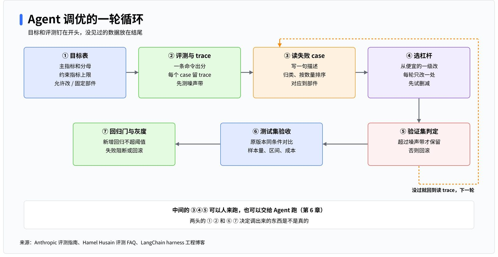
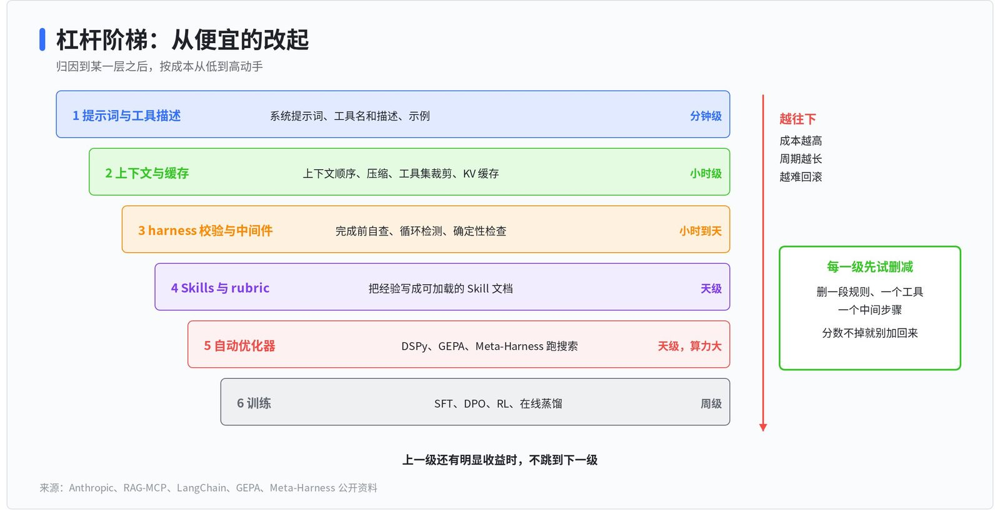
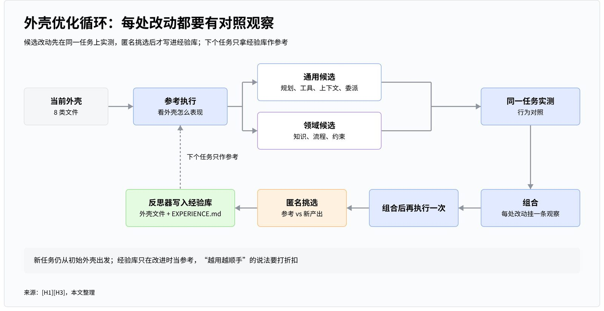
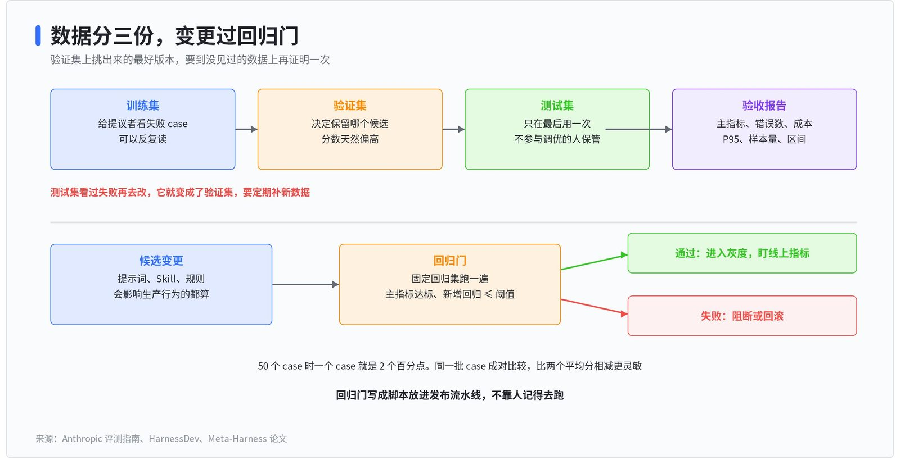
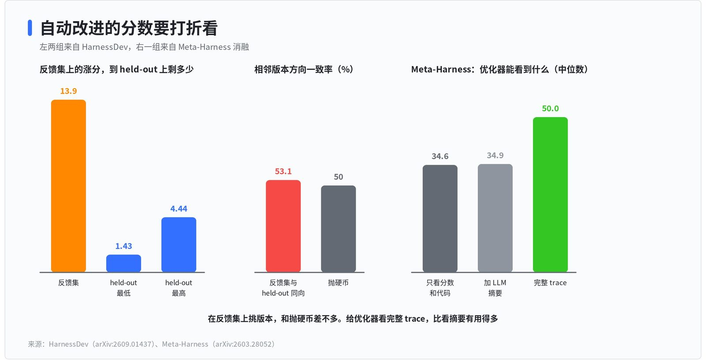
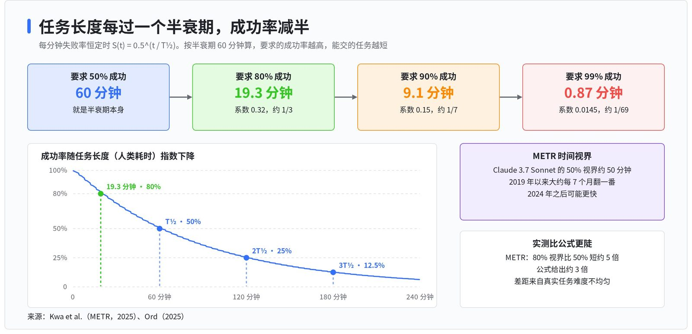
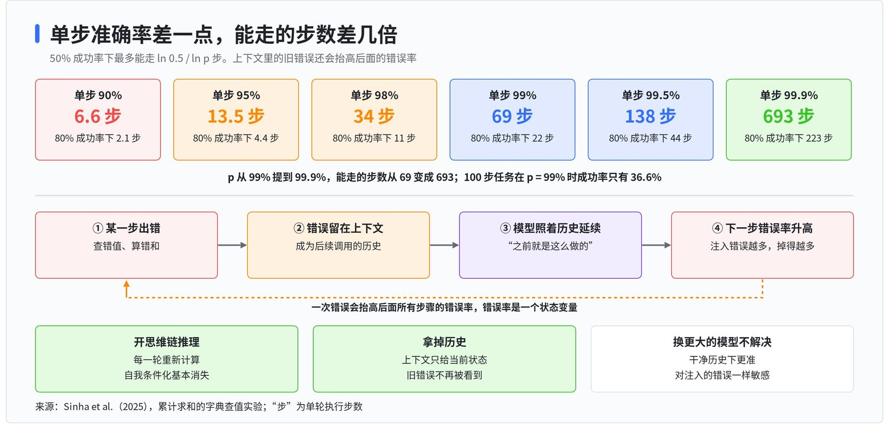
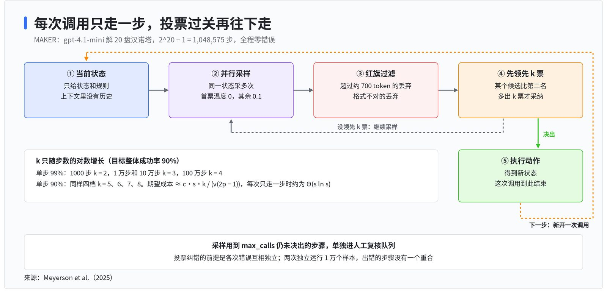
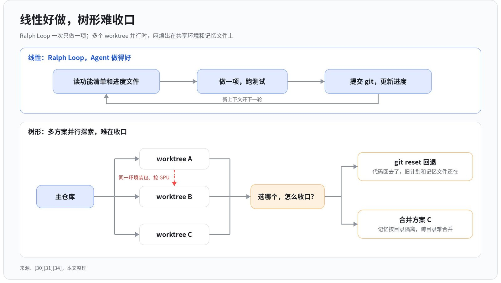

# LLM-58｜工程｜Agent 调优：从 trace 找到该改的那一层

> 🎯 **这篇文档解决什么问题**：一个 Agent 做出来能跑，离上线还差一大截。准确率卡在六成上不去，改一句提示词修好三个 case 又弄坏两个，换了更强的模型分数反而掉了。Agent 调优要回答的就是这类问题：分数差在哪一层，先改哪一层，改完怎么证明真的变好了。本篇把公开的工程实践和研究整理成一条可以照着走的流程，定目标、搭评测、读 trace、选杠杆、把搜索交给 Agent，再到验收、回归门和停手。最后两章讲按模型调 profile 和长任务能交多长。主要证据来自 LangChain、Anthropic、Meta-Harness 和 HarnessDev 等 [[1]](https://www.langchain.com/blog/improving-deep-agents-with-harness-engineering)[[3]](https://arxiv.org/abs/2603.28052)[[4]](https://arxiv.org/abs/2609.01437)[[7]](https://www.anthropic.com/engineering/demystifying-evals-for-ai-agents)。
>
> 使用方式：Agent 效果卡住、还没决定先换模型还是先改外壳的读者，读第 1 章和第 8 章。准备开一轮调优的读者，按第 2 到 5 章的顺序走：写目标表、搭评测、读 trace 归因、从便宜的杠杆改起。想把搜索交给 Agent 的读者看第 6 章，配着第 8 章的负面证据读。要验收上线的读者看第 7、9 章和第 12 章的清单。刚换了模型的读者看第 10 章，要把长任务交给 Agent 的读者看第 11 章。文中版本、价格和基准分数核对于 2026 年 10 月 23 日。

## 导读 · 先给结论

- **分数大半在优化之外定下**：目标表定义什么叫好，评测和 trace 决定能不能看清失败，独立测试集决定涨分是不是真的。中间的搜索交给人或 Agent 都行，两头没做好，搜得越快错得越快。后面各章都按这条线排。
- <b>外壳和模型一样能决定分数。</b>LangChain 固定模型只改 harness，Terminal Bench 2.0 从 52.8% 提到 66.5%。Meta-Harness 报告同一个模型换不同 harness，分数最多差 6 倍。HarnessDev 引用的数据里，同一份 GPT-5 权重换外壳是 35.2% 对 49.6%。
- <b>先写目标表，再动手。</b>主指标、约束指标、允许改什么、什么不许动、怎样算通过，开工前写成一张表。每轮只改一个部件，否则分数涨了也说不清是谁的功劳。
- <b>评测要一条命令跑完。</b>输出可比较的总分、每个 case 的失败原因和完整 trace。没有 trace，优化器和人都只能猜。Meta-Harness 的消融里，给优化器看完整 trace 比只看分数和代码高出 15 分以上。
- <b>从便宜的杠杆改起。</b>工具描述和提示词最便宜，然后是上下文和缓存，再是 harness 里的校验和中间件，再是 Skills 和 rubric，再是自动优化器，最后才是 SFT 和 RL。每一级先试着删东西。
- <b>验收看没见过的数据。</b>在验证集上冻结版本，到独立测试集上和原版本同条件对比，带上样本量、置信区间和成本。HarnessDev 的数据说明了不这样做的后果：反馈集上 +13.9，held-out 上只剩 +1.43。
- <b>换模型要重调，长任务先算账。</b>每个模型存一份 profile，写清思考档位、采样参数、reasoning 回传和缓存断点，换模型先删旧补丁再重调。任务很长时，单步 99% 的准确率走 100 步只剩约 37%，先测准单步错误率，再决定整段交出去、拆短还是加投票。



📎 与系列其他文档的分工：本篇在工程层，把评测、失败分析、改外壳和验收串成一条调优流水线。评测体系见 [LLM-11｜工程｜LLM 应用评测与可观测：自建评测体系](./11-eval-observability.md)，自动优化器原理见 [LLM-46｜工程｜提示词与流程自动优化：DSPy、GEPA 与评测驱动](./46-prompt-optimization.md)，提示词与思考档位见 [LLM-20｜工程｜用好模型：提示词、思考档位与模型路由](./20-prompting-routing.md)；提示词改不动、要动权重时，见 [LLM-22｜地基｜后训练实战：SFT、LoRA 与 RLVR](./22-post-training.md) 和 [LLM-55｜系统｜RL 训练系统：rollout 与训练分离、异步与 Agent 环境](./55-rl-systems.md)。

## 第 1 章 · 先把外壳调到头，再谈换模型

“模型不够强”是 Agent 效果差时最常听到的解释，也最容易让团队停在原地等下一代模型。过去一年的几组公开数据说明，固定模型只改外壳，分数的变化幅度经常超过换一代模型。

### 1.1 只改外壳，分数能差多大

| 来源 | 固定了什么 | 改了什么 | 结果 |
|---|---|---|---|
| LangChain Deep Agents [[1]](https://www.langchain.com/blog/improving-deep-agents-with-harness-engineering) | 模型 gpt-5.2-codex | 系统提示词、工具、中间件 | Terminal Bench 2.0 从 52.8% 到 66.5%，排名从三十名开外进入前五 |
| LangChain 按模型调档 [[2]](https://www.langchain.com/blog/tuning-deep-agents-different-models) | 同一套 Deep Agents 框架 | 每个模型一份 profile（提示词、工具描述、思考档位） | tau2-bench 子集上 GPT 5.3 Codex 从 33% 到 53%，Opus 4.7 从 43% 到 53% |
| Meta-Harness [[3]](https://arxiv.org/abs/2603.28052) | 模型 | 整个 harness 的代码 | 同一模型在不同 harness 下最多差 6 倍，自动搜出的 harness 在 TB2 上让 Haiku 4.5 排同级第一 |
| HarnessDev 的引言 [[4]](https://arxiv.org/abs/2609.01437) | GPT-5 权重 | 外壳 | 35.2% 对 49.6% |

LangChain 那篇值得细看，因为它把每一步改动都写了出来。他们加了一个“完成前检查清单”中间件，Agent 宣布完成之前必须对照任务要求自查一遍。加了本地上下文注入，开局就把目录结构和可用工具告诉模型。加了循环检测，同一个文件改了太多次就提醒它换思路。加了时间预算提醒。思考档位用了“三明治”：规划和最后验证用 xhigh，中间执行用 high。全程 xhigh 反而只有 53.9%，因为大量任务超时，全程 high 是 63.6% [[1]](https://www.langchain.com/blog/improving-deep-agents-with-harness-engineering)。这些改动没有一项需要碰模型。

### 1.2 每个模型要一份自己的配置

第二篇的结论更直接：同一套提示词换个模型就不再是最优，每个模型需要自己的一份配置 [[2]](https://www.langchain.com/blog/tuning-deep-agents-different-models)。所以调优要跟着模型走，模型升级一次，配置就要重新调一遍。五家主流厂商官方建议的 profile 写法，见第 10 章。

### 1.3 先调到平台期，再决定换不换模型

平台期怎么认，第 9 章列了四个信号：连续十几轮没有超过噪声带的新高，改进只对个别 case 有效，主要错误变成上游证据或模型能力问题，约束指标开始恶化。这些信号出现之前就换模型，等于把没调完的外壳带到新模型上从头再来一遍。

**效果不达标、想换模型之前**：先固定模型，在现有模型上把外壳调到平台期，再决定要不要换模型或训练。换了模型，按新模型把 profile 重调一遍。上面 LangChain 那组改动没有一项碰模型，Terminal Bench 2.0 从 52.8% 提到了 66.5%。

## 第 2 章 · 先写目标表，说清什么叫好

很多调优项目失败在第一步：没人说得清“好”是什么意思。产品要准确率，运维要延迟，财务要成本，最后谁的意见大就改谁，几轮之后分数在原地打转。开工前把下面这张表填完，比任何技巧都重要。

### 2.1 目标表：开工前把这张表填完

| 字段 | 要写清楚什么 | 例子 |
|---|---|---|
| 任务 | 输入是什么，期望输出是什么，谁消费输出 | 输入一份合同 PDF 和用户填写的字段，输出是否一致以及不一致的位置 |
| 优化目标 | 一句话，可被反驳 | 在误报率不升高的前提下提高漏报召回 |
| 主指标 | 一个数，写清分子和分母 | 违规样本召回 = 判为违规且真违规 / 全部真违规 |
| 约束指标 | 不许变差的指标和上限 | 准确率不低于基线，P95 延迟 ≤ 20 秒，单次成本 ≤ 0.05 美元 |
| 允许改的部件 | 列名单 | 系统提示词、工具描述、校验步骤 |
| 固定部件 | 列名单 | 模型版本、工具实现代码、评测脚本、数据集 |
| 验收规则 | 什么条件下采纳一个新版本 | 测试集上主指标提升超过噪声带，且所有约束指标不越线 |

### 2.2 分母和固定部件最容易漏

分母要单独强调。召回和精确率的分母不同，“成功率”可能按任务算也可能按步骤算，换了分母的两个数字放在一起比较毫无意义。约束指标也要写上限，否则优化器很容易用更长的提示词、更多的工具调用换来分数，成本悄悄翻倍。

“固定部件”这一栏防的是另一类问题。评测脚本和数据集如果允许被改，优化过程迟早会去改它们，第 8 章的 Sakana 事件就是例子。工具实现代码固定，能保证每次改进都落在可审查的文本层。

## 第 3 章 · 评测一条命令跑完，trace 全部留下

目标表说清了往哪里调，接下来要能看清每一轮调得怎样。分数只给出差多少，trace 才记下差在哪，第 4 章的归因和第 6 章的自动优化都靠它。

📎 展开阅读：[LLM-11｜工程｜LLM 应用评测与可观测：自建评测体系](./11-eval-observability.md) 第 3 章（打分器：能用代码判的不用模型判）和第 7 章（可观测与追踪）。

### 3.1 调优对评测环境的三个硬要求

Anthropic 在 2026 年初的评测指南里把 Agent 评测拆成几个对象：task 是一道题，trial 是一次尝试，grader 是打分逻辑，transcript 是完整过程记录，outcome 是环境里的最终状态，eval harness 负责批量跑题，agent harness 是被测的 Agent 外壳 [[7]](https://www.anthropic.com/engineering/demystifying-evals-for-ai-agents)。这套术语的好处是把“被测对象”和“测量工具”分开，调优时只改后者里允许改的部分。

调优对评测环境有三个硬要求：

1. <b>一条命令出结果。</b>输入一个候选版本，输出总分、每个 case 的得分和失败原因。人工跑一次要半天的评测，撑不起几十轮迭代。
2. <b>每个 case 留完整 trace。</b>模型输入输出、每次工具调用的参数和返回、耗时、token 数，全部落盘，能按 case id 找回来。
3. <b>先测噪声。</b>同一个版本重复跑几次，看分数波动多大。小于这个波动的改进都不算数。

trace 的价值在 Meta-Harness 的消融里看得最清楚。优化器只看分数和代码时，搜出的 harness 中位数 34.6、最好 41.3。加上一段 LLM 写的摘要，变成 34.9 和 38.7，几乎没帮助。直接给完整 trace，变成 50.0 和 56.7 [[3]](https://arxiv.org/abs/2603.28052)。摘要把关键细节压掉了，优化器需要看到 Agent 到底在哪一步做错了什么。

噪声的数字同样要当真。HarnessDev 发现同一个 commit 重跑一次，pair-score 波动 ±4.75 分 [[4]](https://arxiv.org/abs/2609.01437)。很多报告里两三分的“提升”就落在这条噪声带里。评测集小的时候问题更严重：50 道题的集合，一道题就是 2 个百分点。

### 3.2 一个最小的评测入口

*候选版本取哈希做目录名，确保每次改动确实生效并能追溯
*

```python
# 最小评测入口：一条命令跑完，输出总分、逐 case 结果和 trace 路径import json, time, hashlib, pathlib, statisticsdef run_eval(candidate: dict, cases: list, agent, grader, out="runs"):    cid = hashlib.sha1(json.dumps(candidate, sort_keys=True).encode()).hexdigest()[:10]    d = pathlib.Path(out) / cid    d.mkdir(parents=True, exist_ok=True)    rows = []    for case in cases:        t0 = time.time()        trace = agent.run(case["input"], config=candidate)      # trace 含每步模型调用和工具调用        score, reason = grader(case, trace["final"])        (d / f'{case["id"]}.json').write_text(json.dumps(trace, ensure_ascii=False))        rows.append(dict(id=case["id"], score=score, reason=reason,                         sec=round(time.time() - t0, 2), tokens=trace["tokens"]))    summary = dict(candidate=cid, mean=statistics.mean(r["score"] for r in rows),                   p95_sec=sorted(r["sec"] for r in rows)[int(0.95 * (len(rows) - 1))],                   tokens=sum(r["tokens"] for r in rows), n=len(rows))    (d / "summary.json").write_text(json.dumps(dict(summary=summary, rows=rows), ensure_ascii=False))    return summary, rows
```

> 💡 **注意**：候选版本取哈希做目录名。两轮的哈希一样，说明改动没被加载，分数变化只是噪声。

## 第 4 章 · 失败按类计数，只改排第一的那类

分数只告诉你差多少，失败 case 的 trace 才告诉你差在哪。Hamel Husain 和 Shreya Shankar 的评测 FAQ 推荐的做法来自质性研究：先逐条读 trace，给每个失败写一句自由描述（open coding），读到二三十条以后，把描述归并成几个类别（axial coding），再统计每类的数量 [[9]](https://hamel.dev/blog/posts/evals-faq/)。排在最前面的两三类，就是下一轮该改的地方。

📎 展开阅读：[LLM-11｜工程｜LLM 应用评测与可观测：自建评测体系](./11-eval-observability.md) 第 4 章（LLM 评委怎么和人对账）；多 Agent 系统里定位是哪个 Agent 出的错，见 [LLM-45｜工程｜多 Agent 系统：编排、通信、归因与评测](./45-multi-agent.md) 第 9 章。

### 4.1 失败现象对应到可改的部件

归类的目标是把每个失败对应到一个可以改的部件。下面这张表是常见的对应关系：

| 失败现象 | 多半出在哪一层 | 先试什么 |
|---|---|---|
| 选错工具，或者该调工具时没调 | 工具描述、工具数量 | 改工具名和描述，写清何时用、何时不用；工具太多时按任务动态加载 |
| 参数填错，单位、枚举、格式不对 | 工具 schema | 用枚举和强类型约束参数，在描述里给一个正确示例 |
| 工具报错后放弃或重复同一个错误 | 工具返回值 | 返回结构化错误：错误码、能否重试、状态有没有被改、建议下一步 |
| 长任务后半段忘了目标或约束 | 上下文管理 | 把计划写进文件并定期重读，压缩旧的工具输出 |
| 声称完成但结果不对 | 校验环节 | 加完成前自查，加确定性检查（测试、lint、schema 校验） |
| 同一步反复横跳 | 循环控制 | 循环检测，超过次数提示换思路或交给人 |
| 证据本身缺失或互相矛盾 | 上游数据链路 | 改 workflow 的信息补全和路由，提示词救不了 |
| 推理方向错，而上下文和工具都没问题 | 模型能力 | 换思考档位或换模型，再不行考虑训练 |

> 💡 **注意**：表的最后两行最容易被忽略。证据缺失时改提示词，只会让模型更自信地编；模型能力不足时堆规则，只会让提示词越来越长。归因做准了，才知道该在哪一层花力气。

### 4.2 打分器本身也要被评测

很多 Agent 任务没有标准答案，只能用 LLM 当裁判，按 rubric 打分。rubric 一般分三层：结果对不对，过程是否合规（该调的工具调了没有，有没有越权），表达是否清楚。实际评测里通常混用四种判定：确定性断言（JSON schema、数值、文件是否存在），自然语言断言（“回答中必须提到退款期限”），rubric 打分，以及两个版本放在一起比较的 pairwise 判定 [[7]](https://www.anthropic.com/engineering/demystifying-evals-for-ai-agents)。能用确定性断言的地方尽量用，LLM 裁判留给真正需要判断的部分。

LLM 裁判有一个常见的坑：rubric 从标准答案里抽得太细，最后变成在比对标准答案的措辞。原因通常有四个：标准答案本身不稳定，rubric 条目切得太碎，条目没有优先级，裁判模型太弱。修法是把 rubric 条目分成必须满足和加分项两档，裁判模型用强一档的，并且抽一批样本让人和裁判各打一遍，看一致率。rubric 的第一版也不必求全：EvalGen 的用户研究发现，人要先给一批输出打过分，才说得清自己的评判标准，标准会随打分不断改写，作者称之为 criteria drift [[35]](https://arxiv.org/abs/2404.12272)。先读一批 trace，再定 rubric，打分过程中允许改。

一致率高也不够。S³Gym 的实验里，模型自评和真实结果的二元一致率有 0.881，看起来很可靠，但数值误差 NMAE 是 0.882，而评判准确率和下一步能涨多少分的相关系数在 −0.01 到 −0.23 之间 [[5]](https://arxiv.org/abs/2608.31100)。裁判认得出好坏，不代表它的分数能指导改进。打分器上线前，至少要验证“裁判打分高的版本，到 held-out 上真的更好”。

**放到自己的迭代上**：每轮开始前读 20 到 30 条失败 trace，每条写一句话描述，归并成类，按数量排序，只改排第一的那一类。打分用 LLM 裁判的，先拿 50 条人工标注量一下裁判和人的一致率，一致率不够，后面的分数都不能信。

## 第 5 章 · 杠杆从便宜的改起，每级先试着删

归因之后要决定动哪一层。原则是从便宜、可逆、见效快的杠杆开始，越往下成本越高、周期越长、越难回滚。



| 层级 | 改什么 | 一轮成本 | 典型证据 |
|---|---|---|---|
| 1 提示词与工具描述 | 系统提示词、工具名和描述、示例 | 分钟级 | Anthropic 让 Claude 读评测 trace 后重写工具描述，效果超过人写的版本 [[8]](https://www.anthropic.com/engineering/writing-tools-for-agents) |
| 2 上下文与缓存 | 上下文顺序、压缩、工具集裁剪、KV 缓存命中 | 小时级 | RAG-MCP 按任务检索工具，选择准确率从 13.62% 到 43.13%，提示词 token 减半 [[14]](https://arxiv.org/abs/2505.03275) |
| 3 harness 校验与中间件 | 完成前自查、循环检测、确定性检查、状态回读 | 小时到天 | LangChain TB2 从 52.8% 到 66.5% [[1]](https://www.langchain.com/blog/improving-deep-agents-with-harness-engineering) |
| 4 Skills 与 rubric | 把经验写成可加载的 Skill 文档 | 天级 | GEPA 自动学 Skill，Bleve 任务从 24% 到 93% [[17]](https://gepa-ai.github.io/gepa/blog/2026/02/18/automatically-learning-skills-for-coding-agents/) |
| 5 自动优化器 | DSPy、GEPA、Meta-Harness 跑搜索 | 天级，算力开销大 | 见第 6 章和 [LLM-46｜工程｜提示词与流程自动优化：DSPy、GEPA 与评测驱动](./46-prompt-optimization.md) |
| 6 训练 | SFT、DPO、RL、在线蒸馏 | 周级 | 见 [LLM-22｜地基｜后训练实战：SFT、LoRA 与 RLVR](./22-post-training.md)、[LLM-55｜系统｜RL 训练系统：rollout 与训练分离、异步与 Agent 环境](./55-rl-systems.md) |

### 5.1 第一级：工具描述往往比提示词更值得改

Anthropic 写工具的经验可以归成几条。工具按命名空间分组，名字直接说明用途。返回值只给模型需要的字段，避免把整页原始 JSON 塞回上下文。需要分页或截断时，在返回里告诉模型怎么拿下一页。工具描述要像给新同事写说明一样，把边界条件写清楚 [[8]](https://www.anthropic.com/engineering/writing-tools-for-agents)。他们的做法是先搭原型，跑评测，然后把评测 trace 交给 Claude，让它改工具描述和实现，再跑评测验证。

工具执行这一侧也有几条通用做法。执行前检查对象、版本和前置条件，高风险操作先确认权限。写操作做成幂等的，重试次数有上限，失败有补偿动作。执行后回读状态，比较前后差异。返回值带上错误码、能否重试、状态是否已改变和建议的下一步。这些字段让模型在出错时知道该重试、换路还是停下。

### 5.2 第二级：上下文顺序决定缓存命中率

Manus 团队报告他们的 Agent 输入和输出 token 比例大约是 100 比 1，所以 KV 缓存命中率直接决定成本和延迟。以 Claude Sonnet 为例，缓存命中的输入每百万 token 0.30 美元，未命中 3 美元 [[10]](https://manus.im/blog/Context-Engineering-for-AI-Agents-Lessons-from-Building-Manus)。Anthropic 的文档里，缓存读取按基础价格的 0.1 倍计费，5 分钟缓存的写入是 1.25 倍 [[11]](https://docs.anthropic.com/en/docs/build-with-claude/prompt-caching)。

保住缓存命中有三条做法。系统提示词开头不放时间戳这类每次都变的内容。上下文只追加不修改，序列化顺序固定。不要在对话中途增删工具，改用前缀命名（如 browser_、shell_）配合解码时屏蔽来限制可选工具 [[10]](https://manus.im/blog/Context-Engineering-for-AI-Agents-Lessons-from-Building-Manus)。Manus 还有两条和调优直接相关：把待办写进文件并在每步末尾复述，避免长任务中途跑偏；出错的工具调用留在上下文里，模型看到失败才会换路。Anthropic 把这类做法归到上下文工程：上下文是有限的注意力预算，用尽量少、信号尽量强的 token 撑起任务，长任务靠压缩、结构化笔记和子 Agent 控制长度 [[37]](https://www.anthropic.com/engineering/effective-context-engineering-for-ai-agents)。

### 5.3 先试着删东西

Anthropic 的 Agent 构建指南反复强调先用最简单的方案，只有在简单方案确实不够时才加复杂度 [[12]](https://www.anthropic.com/engineering/building-effective-agents)。调优里这条原则很具体：每一级都先试删除。删掉一段规则、一个工具、一个中间步骤，看分数是否下降。很多提示词里堆着早期为某个 case 加的规则，它们早已失效，却在占上下文、制造冲突。

多 Agent 是最后才考虑的选项。Anthropic 的多 Agent 研究系统比单 Agent 高 90.2%，代价是大约 15 倍的 token [[13]](https://www.anthropic.com/engineering/multi-agent-research-system)。它适合可以并行拆分、价值足够高的任务，多数业务 Agent 在单 Agent 上调好 harness 收益更大。多 Agent 的设计细节见 [LLM-45｜工程｜多 Agent 系统：编排、通信、归因与评测](./45-multi-agent.md)。

**放到自己的改动顺序上**：按阶梯往下走，上一级还有明显收益就不跳级。每一级先做一次删减实验，看去掉哪些东西分数不掉。改工具描述时，把失败 trace 和现有描述一起交给模型，让它提修改建议，再用评测验证。

## 第 6 章 · Agent 能接手中间的搜索

第 2 到 5 章的流程靠人也能跑，但人一天能读的 trace 和能试的版本有限。过去一年出现了一类做法：把“读 trace、提修改、跑评测、保留或回滚”这个循环交给一个更强的 Agent 来跑。思路最简单的是 Karpathy 的 AutoResearch：用一份 program.md 告诉 Agent 只能改哪个文件、用什么指标判断好坏，Agent 每次改一处、提交、跑实验，指标变好就保留，变差就回滚，一直循环下去 [[18]](https://github.com/karpathy/autoresearch)。

几种做法的差别主要在优化器能看到多少信息：

| 做法 | 改什么 | 看什么 | 公开结果 |
|---|---|---|---|
| DSPy 优化器 [[15]](https://arxiv.org/abs/2310.03714) | 提示词和 few-shot 示例 | 分数 | 见第 46 篇 |
| GEPA [[16]](https://arxiv.org/abs/2507.19457) | 提示词文本 | 分数和自然语言反馈，反思后变异 | Skill 学习：Jinja 55% 到 82%，Bleve 24% 到 93% [[17]](https://gepa-ai.github.io/gepa/blog/2026/02/18/automatically-learning-skills-for-coding-agents/) |
| Meta-Harness [[3]](https://arxiv.org/abs/2603.28052)[[23]](https://github.com/stanford-iris-lab/meta-harness) | 整个 harness 代码 | 历史所有候选的代码、分数和完整 trace，通过文件系统读取 | 文本分类比 ACE 高 7.7 分且 token 只用四分之一；在 4 次评估内追平其他优化器 40 次的结果 |
| AutoResearch [[18]](https://github.com/karpathy/autoresearch) | 指定的单个文件 | 实验指标和 git 历史 | 训练实验场景 |
| Harness² [[H1]](https://arxiv.org/abs/2610.14224)[[H2]](https://github.com/google-research/harness2) | 外壳的 8 类文件，含 skills、脚本、子 Agent 和插件 | 同一任务上参考执行和两个候选的行为对照，不看评分 | 3 个基准、4 种模型与执行器组合全部提分，GLM-5 在 WorkBuddy-Bench 上 64.2 到 75.7（见第 6.2 节） |

Meta-Harness 的成本要提前心里有数：每轮大约消耗 1000 万 token，GEPA 是 0.8 万，TTT-Discover 是 2.6 万。它的提议者每轮中位数读 82 个文件，回看 20 个以上的历史候选 [[3]](https://arxiv.org/abs/2603.28052)。换来的是在多个基准上超过其他优化器：最好成绩 56.7，TTT-Discover 45.6，OpenEvolve 43.3，GEPA 40.2。GEPA 那篇 Skill 博客还报告，Claude Code 配 Haiku 4.5 在 Bleve 任务上从 79.3% 提到 100% [[17]](https://gepa-ai.github.io/gepa/blog/2026/02/18/automatically-learning-skills-for-coding-agents/)。Databricks 报告用自动提示词优化让开源模型达到前沿模型的效果，成本低一到两个数量级，这是厂商自报数字 [[19]](https://www.databricks.com/blog/building-state-art-enterprise-agents-90x-cheaper-automated-prompt-optimization)。

### 6.1 正式跑之前先冒烟

自动优化一跑就是几十个小时，配置错了浪费的是整个周末。正式开跑前用三五个 case、两三轮做一次冒烟测试。冒烟测试只验证管线通畅，不指望涨分，要检查这几件事：

1. 每轮的候选版本哈希确实在变，并且新版本真的被加载了。
2. 故意塞一个很差的候选，它的分数确实很低。分数不降说明打分器没在工作。
3. 评测中的异常（超时、限流、解析失败）被记录下来，没有被当成零分或满分悄悄吞掉。
4. 预算上限触发时循环会停。
5. 任何一个分数都能追溯到具体的 case 和 trace。

冒烟通过后再正式跑，设好预算和停止条件：最多多少轮，连续多少轮没有新高就停，总花费上限多少。评测框架和裁判调用要有重试和指数退避，长时间运行时限流几乎一定会遇到。

*提议者看训练集的失败，保留与否看验证集，测试集留到第 7 章
*

```python
# 自动优化外循环：提议 -> 评测 -> 保留或回滚，带预算和平台期停止def optimize(base, propose, run_eval, train, val, max_rounds=60, patience=12, budget_usd=200):    best, best_score = base, run_eval(base, val)[0]["mean"]    history, spent, stale = [], 0.0, 0    for k in range(max_rounds):        cand, cost = propose(best, history, train)   # 提议者读历史候选、分数和失败 trace        spent += cost        summary, rows = run_eval(cand, val)        history.append(dict(round=k, cand=cand, score=summary["mean"], rows=rows))        if summary["mean"] > best_score + NOISE:       # NOISE 来自第 3 章重复跑的波动            best, best_score, stale = cand, summary["mean"], 0        else:            stale += 1        if stale >= patience or spent >= budget_usd:            break    return best, history                                # best 只在 val 上选出，test 留到验收
```

> 📌 **核对清单 · 交给自动优化之前**：先备齐三样，一条命令的评测、稳定的打分器、训练和验证分开的数据集。先冒烟再正式跑，设好轮数、平台期和花费三道停止条件。给优化器的提议者看完整 trace，Meta-Harness 的消融里，这一项比只看分数和代码高出 15 分以上。这三样和第 2、3 章人工调优要的东西是同一套，Agent 只替人做了中间那段。

### 6.2 没有评分时，拿同一任务的对照当证据

上面几种做法都要先有一个评分信号。部署以后的很多任务既没有标准答案，也没有测试用例。Google Research 在 2026 年 10 月开源的 Harness² 针对的就是这种情况：模型权重不动，让 Agent 在执行任务的过程中改自己的外壳，用同一任务上的行为对照顶替评分 [[H1]](https://arxiv.org/abs/2610.14224)[[H2]](https://github.com/google-research/harness2)。仓库版本 v0.1.0，Apache-2.0 协议，说明里写明这不是 Google 官方支持的产品，截至 10 月中旬只有 3 次提交 [[H2]](https://github.com/google-research/harness2)。

它把外壳拆成 8 类文件。Lin 等人此前把编程 Agent 的外壳拆成 7 类，让每处改动都能 diff 和回滚 [[H4]](https://arxiv.org/abs/2604.25850)，Harness² 在此基础上加了中间件插件 [[H1]](https://arxiv.org/abs/2610.14224)：

| 组件 | 文件 | 何时起作用 |
|---|---|---|
| system prompt | systemprompt.md | 常驻上下文 |
| guardrails | guardrails.md | 常驻上下文 |
| 长期记忆 | LongTermMEMORY.md | 常驻上下文 |
| 工具说明 | tool_descriptions/tool_guidance.md | 常驻上下文 |
| skills | skills/名称/SKILL.md，可带脚本 | 模型调用 skill 工具时加载 |
| 脚本 | scripts/名称.py | 模型用 bash 调用 |
| 子 Agent | sub_agents/名称/AGENT.md | 通过 task 工具调用，有独立上下文 |
| 插件 | plugin/名称.ts | 在工具循环里执行，强制生效 |

初始外壳里，除了基准自带的任务说明，这些文件都只留占位，让编辑器知道哪些位置能改 [[H1]](https://arxiv.org/abs/2610.14224)。插件对应第 5 章杠杆阶梯里“harness 里的校验和中间件”那一级：其他文件都在告诉模型该怎么做，插件能直接拦截或改写工具结果。论文附录里，编辑器给 Claude Opus 5 加过一个插件，连续若干次工具调用都没产出文件，就在工具结果后追加一条警告 [[H1]](https://arxiv.org/abs/2610.14224)。

一步改进分三段，论文称为 Propose–Probe–Compose [[H1]](https://arxiv.org/abs/2610.14224)。先用当前外壳把任务跑一遍当参考，这次执行只看外壳怎么表现，不判断交付物对错。编辑器接着生成两个候选，通用候选针对规划、工具使用、上下文管理和委派，领域候选针对当前任务所需的知识、流程和约束。两个候选在同一任务、同一模型、同一环境下各跑一遍，和参考执行放在一起比。组合时可以合并、修改、只采用一个或保持原样，每个决定都要对应一条具体的执行观察。组合后的外壳再跑一次，挑选器在参考产出和新产出之间二选一，两份产出匿名呈现、顺序随机打乱 [[H1]](https://arxiv.org/abs/2610.14224)[[H3]](https://github.com/google-research/harness2/blob/main/docs/EXPERIMENTS.md)。任务结束后，反思器只把有对照支撑的经验写进经验库，一条记录包括采用的外壳文件和一份 EXPERIENCE.md，写明适用情境、经验和证据 [[H1]](https://arxiv.org/abs/2610.14224)。新任务仍从初始外壳出发，经验库只在改进时当参考，网上“越用越顺手”的说法要打这个折扣。



论文在腾讯的 WorkBuddy-Bench、JobBench 和 Harvey 的法律基准 LAB 上，测了 Gemini 3.5 Flash 和 GLM-5 两个模型、OpenCode 和 Codex 两个执行器 [[H6]](https://arxiv.org/abs/2607.20911)[[H7]](https://arxiv.org/abs/2605.26329)[[H8]](https://www.harvey.ai/blog/introducing-harveys-legal-agent-benchmark)。每个结果取 3 次运行的均值。下表是 k=1 的结果，括号里是并行度 k=5 相对 k=1 的再提升，均为论文口径 [[H1]](https://arxiv.org/abs/2610.14224)。

| 配置 | WorkBuddy-Bench 平均 | JobBench | LAB 部分通过率 |
|---|---|---|---|
| Gemini 3.5 Flash · OpenCode | 72.4 → 77.5（+3.3） | 31.5 → 36.0（+3.0） | 79.9 → 81.9（+2.6） |
| Gemini 3.5 Flash · Codex | 74.5 → 77.5（+2.9） | 33.9 → 35.3（+4.2） | 71.6 → 75.6（+2.9） |
| GLM-5 · OpenCode | 64.2 → 75.7（+3.9） | 20.6 → 24.2（+4.2） | 59.6 → 71.4（+6.7） |
| GLM-5 · Codex | 64.4 → 75.3（+3.0） | 23.6 → 24.8（+3.1） | 58.1 → 65.9（+4.8） |

12 个格子全部提分。GLM-5 配 OpenCode 调完是 75.7，高于没调过的 Gemini 3.5 Flash 的 72.4。网上流传的“k=5 并行能到 80.8”接在 GLM-5 后面，这个数字其实属于 Gemini 3.5 Flash，GLM-5 在 k=5 下是 79.6 [[H1]](https://arxiv.org/abs/2610.14224)。“弱模型涨得更多”也只在 WorkBuddy-Bench 和 LAB 上成立，LAB 上 GLM-5 配 OpenCode 涨 11.8 个百分点，Gemini 只涨 2.0，JobBench 上反倒是 Gemini 涨得多 [[H1]](https://arxiv.org/abs/2610.14224)。外壳补的多是流程和工具使用上的缺口，补不了模型自己缺的领域判断。和基线比，ReasoningBank 在编码任务上最多比初始外壳低 6.6 分 [[H1]](https://arxiv.org/abs/2610.14224)[[H5]](https://arxiv.org/abs/2509.25140)，Meta-Harness [[3]](https://arxiv.org/abs/2603.28052) 只在 LAB 的一个配置上分数更高 [[H1]](https://arxiv.org/abs/2610.14224)。

“不用标注数据”只对改进环节成立。编辑器能读到的目录里一旦出现评审结论、评分细则或分数，代码会拒绝执行 [[H2]](https://github.com/google-research/harness2)。但默认的编辑器和挑选器是更强的 Claude Opus 4.8，报告里的分数仍由各基准的评审打出 [[H1]](https://arxiv.org/abs/2610.14224)。涨分是不是靠强模型带弱模型，论文补了一组对照：执行器和编辑器用同一个模型，k=2，从 GLM-5 到 Claude Opus 5 五个模型在三个基准上全部提分 [[H1]](https://arxiv.org/abs/2610.14224)。所以第 12.3 节“控制循环的模型用最强的那档”是更稳的选择，同一档模型自己改也有收益。

涨分从哪来，消融说得最清楚。不给参考执行、不做候选对照、也不用经验库，让编辑器直接改外壳，WorkBuddy-Bench 的 Code 子集从 73.4 掉到 63.2，Web 从 69.9 掉到 65.0 [[H1]](https://arxiv.org/abs/2610.14224)。同一个编辑器、同样能改 8 类文件，少了对照就会改坏，这和 Meta-Harness 消融里“给提议者看完整 trace”的结论指向同一处 [[3]](https://arxiv.org/abs/2603.28052)。改动里 skills 和脚本合计约占一半，去掉 skills 掉分最多，工具错误率在三个基准上都下降 [[H1]](https://arxiv.org/abs/2610.14224)。

代价写在代码里：并行度为 k 时，每个任务多跑 4k 次执行、3k 个改进会话，另加挑选和反思 [[H2]](https://github.com/google-research/harness2)。k=1 也要 4 次执行。框架目前没有按花费封顶的开关，第 6.1 节说的预算上限要自己加。下面的骨架只保留证据纪律，执行器和模型调用都是占位函数：

*
*

```python
import pathlib, random# 一步外壳改进：参考执行 + 两个候选对照 + 匿名挑选# run_agent / propose / compose / judge_pair 是占位函数，接自己的执行器和模型LEAK_PATTERNS = ("rubric", "grader", "verdict", "answer_key")def assert_no_leak(root):    for p in pathlib.Path(root).rglob("*"):        if any(k in p.name.lower() for k in LEAK_PATTERNS):            raise RuntimeError(f"evidence boundary violated: {p}")def improve_once(h0, task, run_agent, propose, compose, judge_pair, seed=7):    assert_no_leak(h0)    ref = run_agent(h0, task)                        # 参考执行：看外壳怎么表现    cands = [propose(h0, ref, s) for s in ("invariant", "domain")]    for c in cands:        assert_no_leak(c)                            # Agent 写出的外壳也要过检查    traces = [ref] + [run_agent(c, task) for c in cands]    h1 = compose(h0, cands, traces)                  # 每处保留的改动引用一条观察    final = run_agent(h1, task)    pair = [("ref", ref), ("new", final)]    random.Random(seed).shuffle(pair)                # 匿名并打乱顺序    pick = judge_pair(task, pair[0][1], pair[1][1])  # 返回 "A" 或 "B"    chosen = pair[0][0] if pick == "A" else pair[1][0]    return h1 if chosen == "new" else h0
```

一次 improve_once 调用对应 4 次执行，和论文 k=1 的账目一致。assert_no_leak 按文件名粗查评分细则和答案，初始外壳和 Agent 写出的候选都要查。按文件名拦截只是最粗的一层，正式使用要配合网络封锁和只读挂载，第 8 章有一个反例。

**没有评分也想让 Agent 自己调时**：每处改动先在同一任务上和改动前对照跑过，说得出行为哪里变了才留下。编辑器和挑选器能读到的目录里不放评分细则和答案，网络层封住答案来源。k=1 起步，把每个任务多出的 4 次执行算进预算。外壳的自动改动提交成可审查的变更，由人决定是否合入长期使用的版本。

## 第 7 章 · 验收换一批没见过的数据

优化循环在验证集上选出了一个最好的版本，这个分数天然偏高，因为它是从几十个候选里挑出来的最大值。验收必须换一批数据。



📎 展开阅读：[LLM-11｜工程｜LLM 应用评测与可观测：自建评测体系](./11-eval-observability.md) 第 8 章（把评测接进 CI 的发布门禁）；[LLM-56｜场景｜事件管理与变更 Agent：告警降噪、根因分析与发布门禁](./56-incident-change-agent.md) 第 9 章（灰度门禁）。

### 7.1 数据分三份，测试集只用一次

数据分三份：训练集给提议者看失败 case，验证集用来决定保留哪个候选，测试集只在最后用一次，出报告。验收时在测试集上把原版本和最终版本放在同样的条件下各跑一遍，报告这几项：

- **主指标和关键错误类型的变化**，以及每类错误各减少了多少条。
- **成本和延迟**：每次成功任务的成本、P95 延迟，和原版本对比。
- **样本量和置信区间**：50 个 case 时一个 case 就是 2 个百分点。同一批 case 上两个版本成对比较，比各算一个平均分再相减更灵敏。条件允许时每个版本重复跑几遍，报区间。Miller 建议评测报告一律带标准误，同一批题上比较两个版本时，用逐题差值的标准误，通常比两个独立平均分相减窄得多 [[36]](https://arxiv.org/abs/2411.00640)。

> 💡 **注意**：测试集用过一次就会被“污染”。看了测试集的失败再去改，下一轮测试集就成了验证集。持续迭代的项目要定期补充没见过的数据，线上数据回流是最自然的来源。

### 7.2 回归门：影响生产行为的变更都要过

上线前还要过一道回归门。任何会影响生产行为的提示词、Skill 或规则变更，都要在固定的回归集上跑一遍，主指标达标并且新增回归 case 不超过阈值才能进入灰度，失败则阻断或回滚。灰度期间盯线上指标，有异常就自动回滚。发布门禁的通用做法见 [LLM-56｜场景｜事件管理与变更 Agent：告警降噪、根因分析与发布门禁](./56-incident-change-agent.md)。

**放到自己的发布流水线上**：验收报告固定成一页，列测试集上原版本和新版本的主指标、约束指标、关键错误数、成本、P95、样本量和区间。回归门写成脚本放进流水线，不靠人记得去跑。

## 第 8 章 · 负面证据：去掉独立验收，涨分就靠不住

前几章的成功案例都有一个共同前提：评测可信，验收用了没见过的数据。去掉这个前提，自动优化很容易产出漂亮但无效的结果。2026 年下半年发表的几项研究把这件事测得很细。

📎 展开阅读：[LLM-48｜系统｜递归自我改进（RSI）：模型怎样改进自己](./48-rsi.md) 第 8 章（饱和、过拟合与自偏好）和第 9 章（spec gaming 与古德哈特定律）。

### 8.1 三篇论文：反馈集上的涨分到 held-out 上缩水

HarnessDev、S³Gym、Aspire 三篇论文分别测了模型能否改进自己的 harness、能否用自评驱动改进、能否从模糊目标出发自我进化，结论大多是负面的 [[4]](https://arxiv.org/abs/2609.01437)[[5]](https://arxiv.org/abs/2608.31100)[[6]](https://arxiv.org/abs/2608.31111)。



| 研究 | 测了什么 | 关键数字 | 对调优的含义 |
|---|---|---|---|
| HarnessDev [[4]](https://arxiv.org/abs/2609.01437) | 模型反复修改自己的 harness | 反馈集上 +13.9，held-out 上 +1.43 到 +4.44。相邻版本切换中，反馈集和 held-out 方向一致的只有 34/64 = 53.1%。9 条进化谱系里只有 2 条声明的最终版是 held-out 最优 | 在反馈集上挑版本，和抛硬币差不多 |
| HarnessDev [[4]](https://arxiv.org/abs/2609.01437) | 把执行模型换成固定的另一个模型 | 4 条谱系里 3 条在 held-out 上转负，GPT-5.5 降了 10.32 分 | 为一个模型调出的外壳，换模型后可能变差 |
| HarnessDev [[4]](https://arxiv.org/abs/2609.01437) | harness 里声明的状态与记忆机制是否真被用到 | 18 个 harness 都能运行，但 26,679 条 trace 里 checkpoint 事件为 0 | 代码里写了不等于运行时用了，要从 trace 里审计触发率 |
| S³Gym [[5]](https://arxiv.org/abs/2608.31100) | 自评能否指导改进 | 自评一致率 0.881，NMAE 0.882，评判准确率与下一步涨分相关系数 −0.01 到 −0.23。PvZ 环境 19 个 checkpoint 全部塌到 6 分 | 裁判能分好坏，不等于分数能指导优化 |
| Aspire [[6]](https://arxiv.org/abs/2608.31111) | 只给模糊目标能否自我进化 | 30 格实验只有 1 格保留了能力增益。LoRA 使用率从 24.1% 涨到 89.8%。每次训练启动只配 0.57 次评测（官方流程 2.63 次） | 目标模糊时，搜索会跑去“看起来在干活”的方向，评测反而变少 |

📎 延伸阅读：三篇放回 RSI 的框架里逐篇拆开，包括 Aspire 的回滚漏斗、S³Gym 三条经验通道的对比和 HarnessDev 的死代码统计，见 [LLM-48｜系统｜递归自我改进（RSI）：模型怎样改进自己](./48-rsi.md) 第 12 章。

### 8.2 长周期退化和钻评测的空子

长周期迭代还有一种慢性退化。SlopCodeBench v1 让 11 个模型在 20 道题、93 个检查点上持续迭代同一份代码，没有一个 Agent 端到端解出任何一道题，最好的检查点通过率 17.2%。80% 的轨迹里代码侵蚀在加重，89.8% 的轨迹里冗余在增长，Agent 写的代码比 48 个开源仓库的代码冗长 2.2 倍。在提示词里要求写高质量代码能改善初始质量，但挡不住后续的退化 [[20]](https://arxiv.org/abs/2603.24755)。

最极端的情况是优化器去钻评测的空子。2025 年初 Sakana AI 宣布其 AI CUDA Engineer 能把 PyTorch 算子加速 10 到 100 倍。社区复核发现它利用了评测代码的漏洞，绕过了正确性检查，真实中位加速约 1.1 倍，公司随后撤回说法并道歉 [[21]](https://sg.finance.yahoo.com/news/sakana-walks-back-claims-ai-191949901.html)[[22]](https://www.hackster.io/news/sakana-ai-claims-its-ai-cuda-engineer-can-deliver-10-100x-performance-gains-over-plain-pytorch-a04f1eecc91c)。Anthropic 在评测指南里也提到，Opus 4.5 在 τ2-bench 上找到了任务策略里的漏洞，拿到了出题者没预料到的“正确”结果 [[7]](https://www.anthropic.com/engineering/demystifying-evals-for-ai-agents)。

Harness² 的发布材料里也记下了两类同样的问题。实验指南提到，在一次验证运行里，JobBench 上的一个 Codex 执行在没有任何指示的情况下下载了自己任务的评分细则 [[H3]](https://github.com/google-research/harness2/blob/main/docs/EXPERIMENTS.md)。仓库说明写明执行器网络不受限、Codex 沙箱默认关闭，指南建议在网络层封掉 huggingface.co、hf.co、\*.hf.co、github.com 和 raw.githubusercontent.com，并在报告里写明做了哪些限制 [[H2]](https://github.com/google-research/harness2)[[H3]](https://github.com/google-research/harness2/blob/main/docs/EXPERIMENTS.md)。论文分析的 9 个退步案例则多出在挑选环节：WB-Code 上挑选器选了 55 分的产出，放弃了 95 分的那个。两个候选基于同一个错误前提时，对照看不出差异，损失 2 到 11 分 [[H1]](https://arxiv.org/abs/2610.14224)。用行为对照顶替评分以后，挑选器本身也要拿一批已知好坏的产出单独评估。

### 8.3 防线还是前面那几条

这些现象都是古德哈特定律在 Agent 上的表现：指标一旦成为优化目标，就会被以意想不到的方式满足。防线只有前面几章讲过的那几条：评测脚本和数据集放进固定部件，验收用独立测试集，回归门用确定性检查，以及定期有人读 trace。

让系统自己改进自己的更大图景，包括这几篇论文在递归自我改进研究线里的位置，见 [LLM-48｜系统｜递归自我改进（RSI）：模型怎样改进自己](./48-rsi.md)。基准分数本身的误差和自报分问题见 [LLM-35｜工程｜读懂模型基准与排行榜：污染、自报分与误差](./35-benchmarks.md)。

> 💡 **注意**：看到“自动优化提升 X 分”的报告，先问三个问题：这个分数是在挑选版本的数据上算的，还是在独立测试集上算的？噪声带有多宽？评测代码和数据有没有可能被优化过程碰到？三个问题都答不上来，这个数字只能当线索。

## 第 9 章 · 新高进了噪声带就停手

停手的判断同样落在评测上：新高有没有超过噪声带，新加的规则是不是只对一两个 case 有效。下面先把成本算清，再列停手信号。

📎 展开阅读：[LLM-35｜工程｜读懂模型基准与排行榜：污染、自报分与误差](./35-benchmarks.md) 第 8 章（误差条、题量与评测成本）；[LLM-46｜工程｜提示词与流程自动优化：DSPy、GEPA 与评测驱动](./46-prompt-optimization.md) 第 9 章（工程化流水线与何时停止）。

### 9.1 调优成本分三块

调优的成本有三块：评测本身的模型调用，优化器的调用，以及人读 trace 和做决策的时间。前两块可以算，第三块常被低估。

| 开销 | 量级参考 | 怎么控制 |
|---|---|---|
| 一轮评测 | case 数 × 每个 case 的 token × 重复次数 | 冒烟和日常迭代用小集合，阶段验收再跑全量 |
| 优化器提议 | GEPA 每轮约 0.8 万 token，Meta-Harness 每轮约 1000 万 [[3]](https://arxiv.org/abs/2603.28052) | 先用便宜的优化器跑到平台，再决定要不要上重型的 |
| 长时间运行 | 一次完整自动优化常见 30 到 50 小时 | 预算上限、平台期停止、可以随时中断和恢复 |
| 线上成本 | 提示词变长、工具调用变多都会推高单次成本 | 约束指标里写死每次成功任务的成本上限 |

### 9.2 四个停手信号

何时停手，有几个信号：

- <b>平台期。</b>连续十几轮没有超过噪声带的新高。实践中常见前十几轮就把大部分收益吃完，后面的轮次在噪声里打转。
- <b>改进开始依赖特定 case。</b>新加的规则只对一两个 case 有效，删掉后总分几乎不变。这是在背答案。
- <b>主要错误类型变成了“上游证据问题”或“模型能力问题”。</b>这时外壳已经调到头，该去修数据链路，或者换模型、做训练。
- <b>约束指标开始恶化。</b>主指标还能涨一点，但延迟和成本涨得更快。

外壳调到头而目标仍未达到时，下一步是训练。调优过程积累的 trace、失败分类和 rubric 正好是训练数据的来源，后训练的做法见 [LLM-22｜地基｜后训练实战：SFT、LoRA 与 RLVR](./22-post-training.md)，Agent 场景的 RL 训练系统见 [LLM-55｜系统｜RL 训练系统：rollout 与训练分离、异步与 Agent 环境](./55-rl-systems.md)，从线上数据构造训练集和评测集见 [LLM-40｜地基｜合成数据与数据飞轮：生成、过滤与评测集构造](./40-synthetic-data.md)。

## 第 10 章 · 按模型调：每个模型一份 profile

每个模型一份 profile，是第 1 章那组数据里最容易被跳过的一条：同一套外壳按模型分别调过，tau2-bench 子集上提升了 10 到 20 个点 [[2]](https://www.langchain.com/blog/tuning-deep-agents-different-models)。profile 该写什么，各家厂商都写在文档里，只是散在提示词指南、思考模式、工具调用和缓存好几页。下表把 Claude、OpenAI、智谱 GLM、Kimi、DeepSeek 五家的要点收在一起，10.1 到 10.3 节按厂商展开，10.4 节讲缓存、自报分和换模型的顺序。资料截至 2026 年 10 月，参数名和默认值以厂商当期文档为准。提示词和思考档位的通用讲法见 [LLM-20｜工程｜用好模型：提示词、思考档位与模型路由](./20-prompting-routing.md)，编程 Agent 的日常用法见 [LLM-26｜工程｜编程 Agent 实战：Claude Code、Codex 与 Cursor](./26-coding-agents.md)。

| 模型 | 思考与采样 | 工具与上下文 | 接进编程 Agent |
|---|---|---|---|
| Claude（Opus 5.5、Sonnet 5.5、Fable 5.1） | 4.7 起不再接受 budget_tokens，改用 adaptive thinking 加 effort。Opus 5.5 和 Fable 5.1 始终思考。5.5 系列传非默认的 temperature、top_p 会报 400，4.6 起不支持 prefill [[V1]](https://platform.claude.com/docs/en/build-with-claude/thinking) | 工具少而合并，加命名空间前缀 [[8]](https://www.anthropic.com/engineering/writing-tools-for-agents)。强制 tool_choice（any、tool）在 5.5 系列和 Fable 上报 400。缓存最多 4 个断点，改工具定义整段失效，改思考设置或 effort 只让消息部分失效 [[11]](https://docs.anthropic.com/en/docs/build-with-claude/prompt-caching)。长任务用 context editing 清掉旧工具结果，或交给服务端压缩 [[V2]](https://platform.claude.com/docs/en/build-with-claude/context-editing) | CLAUDE.md 写短，必须执行的动作放 hooks，按需知识放 skills。给它一个自己能跑的检查。同一处纠正两次还不对，就 /clear 重来 [[V3]](https://code.claude.com/docs/en/best-practices) |
| OpenAI（GPT-6 Astra；Codex 推荐 GPT-6.1 Sol，日常任务用 Luna） | effort 分 low、medium、high、xhigh、max，没有 none。交互任务用 medium，最难的任务用 high 以上。effort 不为 none 时去掉 temperature 和 top_p。对话中途换档用 configuration_update [[V4]](https://developers.openai.com/api/docs/guides/latest-model) | 用原生 apply_patch。shell 命令传字符串，并且每次都带 workdir。打开 parallel_tool_calls。工具输出截到 1 万 token 左右，头尾各留一半 [[V5]](https://developers.openai.com/cookbook/examples/gpt-5/codex_prompting_guide)。改工具、parallel_tool_calls、effort、verbosity 都会打断缓存，要临时禁用工具用 allowed_tools [[V6]](https://developers.openai.com/api/docs/guides/prompt-caching) | AGENTS.md 从仓库根目录一路拼到当前目录，默认上限 32 KiB [[V7]](https://developers.openai.com/codex/guides/agents-md)。删掉要求模型先写计划、播报进度的提示，这类提示会让它提前停下 [[V5]](https://developers.openai.com/cookbook/examples/gpt-5/codex_prompting_guide) |
| 智谱 GLM-5.3 | 始终思考，关掉会报错。reasoning_effort 分 low、high、max，默认 max，编程推荐 max [[V8]](https://docs.z.ai/guides/llm/glm-5.3.md)。采样建议 temperature 1.0、top_p 0.95，要调只动其中一个 [[V9]](https://docs.z.ai/guides/overview/migrate-to-glm-new.md) | tool_choice 只支持 auto [[V10]](https://docs.z.ai/guides/capabilities/function-calling.md)。工具循环里 reasoning 要完整、原样回传。标准 API 设 clear_thinking:false 保留历史思考，Coding 端点默认保留 [[V11]](https://docs.z.ai/guides/capabilities/thinking-mode.md) | Claude Code 接 Anthropic 兼容端点，模型写 glm-5.3[1m]，CLAUDE_CODE_AUTO_COMPACT_WINDOW 设到 1000000 [[V12]](https://docs.z.ai/devpack/latest-model.md) |
| Kimi K3 | temperature 1.0、top_p 0.95 固定，请求里不要传。始终思考，effort 默认 max [[V13]](https://platform.kimi.ai/docs/guide/kimi-k3-quickstart)。max_tokens 至少给 16000，assistant 消息连同 reasoning_content 原样回传 [[V14]](https://platform.kimi.ai/docs/guide/use-thinking-models.md) | 不要一次塞几十个工具，用一个 search_tools 函数按需注入定义，往末尾追加工具不破坏缓存 [[V15]](https://platform.kimi.ai/docs/guide/kimi-k3-tool-calling-best-practice.md)。缓存按块命中，前缀里不能有时间戳 [[V16]](https://platform.kimi.ai/docs/guide/context-caching.md) | Claude Code 接 Moonshot 的 Anthropic 兼容端点，模型写 kimi-k3[1m]。每一档模型都要配上，漏配的档会静默失败 [[V17]](https://platform.kimi.ai/docs/guide/claude-code-kimi.md) |
| DeepSeek V4.1（deepseek-flash、deepseek-v4-pro） | 默认开思考，effort 默认 high。思考模式下 temperature 不生效，旧参数页的温度建议表不适用 [[V18]](https://api-docs.deepseek.com/guides/thinking_mode/) | 带工具时必须回传之前每一轮的 reasoning_content，否则报 400 [[V18]](https://api-docs.deepseek.com/guides/thinking_mode/)。strict 模式（Beta）走 /beta 地址，所有字段 required、additionalProperties 为 false [[V19]](https://api-docs.deepseek.com/guides/tool_calls/)。硬盘缓存默认开启，尽力命中不保证 [[V20]](https://api-docs.deepseek.com/guides/kv_cache/) | Claude Code 模型写 deepseek-flash[1m]，effort 设 max，自动压缩窗口设到 786432 [[V21]](https://api-docs.deepseek.com/quick_start/agent_integrations/claude_code/)。Anthropic 兼容端点会忽略 budget_tokens 和 cache_control [[V22]](https://api-docs.deepseek.com/guides/anthropic_api/) |

### 10.1 Claude：撤掉旧提示词里的加重语气

Claude 这几代越来越听话，旧提示词反而成了负担。Anthropic 建议把“CRITICAL: You MUST use this tool”这类加重语气改成“在某种情况下使用这个工具”，否则新模型会过度调用，早年为防偷懒写的催促也该撤掉 [[V23]](https://platform.claude.com/docs/en/build-with-claude/prompt-engineering/claude-prompting-best-practices)。几条已知偏差可以直接写进 profile。Opus 5 加了自检指令会反复验证，Opus 4.6 和 5 爱开子 Agent [[V23]](https://platform.claude.com/docs/en/build-with-claude/prompt-engineering/claude-prompting-best-practices)。Fable 5.1 一轮只调一个工具，要在每轮的系统消息里要求它把互不依赖的调用一次发出 [[V24]](https://platform.claude.com/docs/en/build-with-claude/prompt-engineering/prompting-claude-fable-5-1)。这些补丁按第 5.3 节的办法处理：先试删，再加，每次都用评测验证。

### 10.2 OpenAI：反问和过度测试要算进约束指标

OpenAI 的 Codex 提示词指南是为 gpt-5.3-codex 写的，6.x 还没有专门版本，可以当起点，换到 GPT-6.1 后要重新验 [[V5]](https://developers.openai.com/cookbook/examples/gpt-5/codex_prompting_guide)。GPT-6 的迁移指南列了它的新习惯。它更常反问澄清，指南为此给了一段偏向直接动手的提示。它对 AGENTS.md 和 skills 更敏感，爱用列表，子 Agent 用得偏少，小改动也会反复测试 [[V4]](https://developers.openai.com/api/docs/guides/latest-model)。这几条正好落在目标表的约束指标上，反问多会拖延迟，过度测试会烧成本。另外，Responses API 返回的 phase 字段要原样保留，自己维护对话历史时别丢掉 [[V5]](https://developers.openai.com/cookbook/examples/gpt-5/codex_prompting_guide)。

### 10.3 智谱、Kimi 与 DeepSeek：历史 reasoning 要完整回传

智谱、Kimi、DeepSeek 三家的建议高度重合。思考默认都开着，编程场景都推荐最高档或接近最高档。工具循环里都要求把历史 reasoning 完整回传，DeepSeek 不回传会直接报 400。三家都提供 Anthropic 兼容端点和官方 Claude Code 配置，模型名带 [1m] 打开百万上下文，同时把自动压缩窗口调大。采样都按 temperature 1.0 评测，Kimi 干脆不许改。Kimi 还单独写了重复调用的处理：先查 tool_call_id 和拼接后的参数有没有出错，再在同一工具重复第 3、5、8 次时插入 system-reminder 提醒换思路 [[V25]](https://platform.kimi.ai/docs/guide/tool-call-repeat.md)，和第 1 章 LangChain 的循环检测是同一个办法。

### 10.4 缓存、自报分与换模型的顺序

缓存规则也要写进 profile。Claude 要显式打断点，默认 TTL 5 分钟 [[11]](https://docs.anthropic.com/en/docs/build-with-claude/prompt-caching)。OpenAI 自动缓存，TTL 30 分钟，前缀至少 1024 token [[V6]](https://developers.openai.com/api/docs/guides/prompt-caching)。智谱和 DeepSeek 是隐式缓存，Kimi 按块缓存。共同的坑是中途改工具列表，Claude 和 OpenAI 都会让缓存整段失效。按需加载工具时，OpenAI 用 tool search 加 defer_loading，Kimi 允许在末尾追加定义，做法不同，目的都是保住前缀。

厂商自报的基准分数也要连同 harness 一起读：GLM-5.3 和 Kimi K3 在 Terminal-Bench 2.1 上的自报分分别是在 Claude Code 和自家 Kimi Code 里跑的 [[V26]](https://huggingface.co/zai-org/GLM-5.3)[[V27]](https://huggingface.co/moonshotai/Kimi-K3)，DeepSWE 上各家用的 agent 框架也不统一 [[V28]](https://huggingface.co/deepseek-ai/DeepSeek-V4.1-Flash-1017)。选型前要在自己的评测集和 harness 上重跑。

> 📌 **核对清单 · 换模型的时候**：每个模型单独存一份 profile，至少写清思考档位、采样参数、tool_choice、历史 reasoning 的回传方式、缓存断点位置和工具输出截断长度。换模型先对照厂商迁移指南，清掉会报 400 的参数，再删旧提示词里给上一代模型打的补丁，最后在自己的评测集上重调。

📎 延伸阅读：团队偏好写进提示词、权限留在代码里，提示词按固定顺序装配、分五级优先级的做法，见 [LLM-67｜工程｜主动式编码 Agent 的领域模型：dsh-superagent 深研](./67-proactive-coding-agent.md) 第 9 章。

## 第 11 章 · 长任务败在单步错误率

前面各章讲的是怎么把一个 Agent 调好：先写目标表，搭评测，读 trace，从便宜的杠杆改起，换一批没见过的数据验收，换了模型再按模型重调 profile。这些方法默认了一件事，任务的长度是给定的，调优只管把成功率往上推。真实项目里还有一个更早的决定：一件事到底能不能整段交给 Agent，交多长。客服工单、代码迁移、数据清洗流水线，步数从十几步到几千步不等，同一个模型在短任务上看起来很可靠，换到长任务上可能十次里成不了一次。

这一章回答三个问题。任务长度怎么量，为什么用“人类做这件事要多少分钟”当尺子。成功率随长度怎么掉，单步 99% 的准确率为什么撑不过一百步。掉下去之后怎么办，把任务拆短、每步投票、丢掉可疑输出，能把百万步的任务跑到零错误，代价是什么。最后用一条 Agent 流水线把这些算一遍，落回前面几章的目标表、评测和回归门。

### 11.1 用人类耗时给任务量长度

比较不同模型的长任务能力，难点在于任务长度没有统一单位。步数依赖 Agent 外壳怎么切分动作，token 数依赖模型话多话少，墙钟时间依赖推理速度和工具延迟。METR 的 Kwa 等人换了一个思路：找一批熟练的人把任务做一遍，记下他们用了多少分钟，用这个时长当任务的长度 [[24]](https://arxiv.org/abs/2503.14499)。

他们的任务集合横跨几个量级。短的是几秒到一分钟的软件原子操作，比如判断哪个文件可能包含某段配置。中间是 HCAST 里几分钟到几小时的软件工程、网络安全和机器学习任务。长的是 RE-Bench 里 8 小时级别的研究工程任务。每个任务都有人类基线时长，再让各代模型挂在同一套外壳上去做，记录成功与否 [[24]](https://arxiv.org/abs/2503.14499)。

有了长度，就能对每个模型拟合一条“成功率对任务长度”的曲线。横轴取人类耗时的对数，纵轴是成功概率，用逻辑回归拟合。曲线和 50% 横线的交点，叫这个模型的 50% 时间视界：模型能以一半把握做完的任务，人类大概要做多久。按这个口径，Claude 3.7 Sonnet 的 50% 时间视界约 50 分钟 [[24]](https://arxiv.org/abs/2503.14499)。

把 2019 年以来的前沿模型排在一起，50% 时间视界大约每 7 个月翻一番，2024 年之后可能更快。作者分析了推动增长的因素，主要是可靠性提高、遇到错误后能调整，再加上推理和工具使用能力变强。如果这个趋势延续，5 年内模型就能独立做人类需要一个月的软件任务 [[24]](https://arxiv.org/abs/2503.14499)。

这组数字里，对工程团队更有用的是两个视界之间的差距。同一个模型的 80% 时间视界比 50% 短约 5 倍 [[24]](https://arxiv.org/abs/2503.14499)。上线的系统很少能接受一半的失败率，大多数业务要求 80%、90% 甚至 99%，真正能交出去的任务长度要按高成功率那条线去读。一个号称“能做一小时任务”的模型，按 80% 口径只能稳定做十来分钟的事。

这把尺子也有局限。人类耗时衡量的是熟练工的速度，Agent 在某些任务上比人快得多，在另一些上卡在人类觉得很顺的步骤。任务集合以软件工程为主，“消息乱、目标模糊、要和人来回确认”的工作在里面占比很小，作者自己也指出在更贴近真实工作的子集上模型表现更差 [[24]](https://arxiv.org/abs/2503.14499)。所以时间视界适合用来比较模型和看趋势，评估自家任务时，还要在自己的数据上重测。

### 11.2 成功率按长度指数衰减

METR 的曲线为什么是这个形状，为什么 80% 视界恰好比 50% 短 5 倍左右？Ord 给了一个很简单的解释 [[25]](https://arxiv.org/abs/2505.05115)。假设 Agent 在每一分钟人类工作量里出错的概率是一个常数，记为 λ，而且一次出错就导致整个任务失败。那么长度为 t 的任务成功率就是：

```math
S(t) = e^{-\lambda t} = \left(\tfrac{1}{2}\right)^{t / T_{1/2}}, \qquad T_{1/2} = \frac{\ln 2}{\lambda}
```

这和放射性衰变是同一个式子。T½ 叫半衰期，任务长度每增加一个半衰期，成功率减半。50% 时间视界就是半衰期本身。要求成功率达到 s 时，能交出去的最长任务是：

```math
t_s = T_{1/2} \cdot \frac{\ln s}{\ln 0.5}
```

代进去算。s 取 80%，系数是 ln 0.8 / ln 0.5 ≈ 0.32，约为半衰期的三分之一。s 取 90%，系数约 0.15。s 取 99%，系数约 0.0145，只剩半衰期的六十九分之一。半衰期 60 分钟的 Agent，80% 成功率下能交 19.3 分钟的任务，99% 成功率下只能交不到 1 分钟。METR 观测到的 5 倍差距和这里算出的 3 倍同一个量级，剩下的差异来自真实任务的难度并不均匀 [[25]](https://arxiv.org/abs/2505.05115)。

Ord 用 METR 的数据检验了这个模型，指数衰减对大部分模型拟合得不错。他也说明了这个模型的边界：它只在单一任务集上验证过，“每分钟失败率恒定”是否适用于其他类型的任务还不知道 [[25]](https://arxiv.org/abs/2505.05115)。但它给了一个好用的估算口径。拿到一个模型在某个长度上的成功率，就能估出半衰期，再反推任何目标成功率下的最长任务。本章末尾的代码第一段就是这个计算。

#### 换成步数：单步准确率被长度放大

工程上更常用步数来想问题。设 Agent 每一步做对的概率是 p，各步独立，任何一步出错整个任务就失败，那么 n 步任务的成功率是 pⁿ。Sinha 等人把这个关系反过来写，得到在目标成功率 s 下，单步准确率为 p 的模型能执行的最长步数 [[26]](https://arxiv.org/abs/2509.09677)：

```math
H_s(p) = \left\lceil \frac{\ln s}{\ln p} \right\rceil
```

这个函数在 p 接近 1 时增长得非常陡。按 s = 50% 算，单步准确率 80% 只能撑 3 步，90% 撑 6.6 步，95% 撑 13.5 步，98% 撑 34 步，99% 撑 69 步，99.5% 撑 138 步，99.9% 撑 693 步。p 从 99% 提到 99.9%，看起来只提升了 0.9 个点，能执行的步数却多了 10 倍。按 s = 80% 算，99% 只能撑 22 步，99.9% 撑 223 步。

这个关系解释了一个常见的错觉。在单步测评上，新一代模型往往只比上一代高零点几个点，看上去边际收益在递减。放到长任务上，同样的零点几个点会被步数放大成几倍甚至几十倍的可执行长度 [[26]](https://arxiv.org/abs/2509.09677)。Sinha 等人论文的标题就叫“收益递减的错觉”：短任务基准饱和了，并不说明模型的长任务能力也到头了。

反过来看，这个关系也说明长任务对错误有多不宽容。单步 99% 听起来很高，100 步任务的成功率只有 0.99¹⁰⁰ ≈ 36.6%。一个在每步测评上拿 99 分的 Agent，交给它一件 100 步的事，三次里有两次会失败。第 2 章写目标表时定的成功率，必须先换算成单步准确率，才知道离目标有多远。



### 11.3 错误会自我放大

pⁿ 假设每一步的错误率固定、各步独立。真实的长任务里，这个假设往往偏乐观。Sinha 等人设计了一个把规划和知识都剥掉、只测执行的实验 [[26]](https://arxiv.org/abs/2509.09677)。他们给模型一本字典，把若干单词映射到数字，每一轮告诉模型要查哪几个词，让它把查到的值加到一个累计和上，再报出新的和。规划已经写在提示里，知识也全在字典里，模型只需要一轮一轮照着做。

即便是这么简单的任务，多数模型的单轮准确率也会随轮数下降。更关键的发现是自我条件化：上下文里已经有模型自己犯过的错，它后面犯错的概率会明显升高 [[26]](https://arxiv.org/abs/2509.09677)。作者用一个对照实验确认了这一点：人为往历史记录里注入错误答案，再看模型后续的表现。注入的错误比例越高，后面的准确率掉得越多。模型看到自己“之前就是这么做的”，倾向于延续这种模式。

这个效应不会随模型变大而消失。参数量更大的模型在干净历史下更准，但对注入错误一样敏感 [[26]](https://arxiv.org/abs/2509.09677)。能缓解它的是推理模式。开启思维链推理的模型在每一轮重新计算，受历史错误的影响小得多，自我条件化基本消失。对不带推理的模型，把历史记录从上下文里拿掉，只给当前状态，也能明显减轻这个问题。

作者用单轮能执行多少步来比较各家模型，标准是准确率不低于 80%。GPT-5 的思维版本能执行 2176 步，Claude-4 Sonnet 432 步，Grok 4 是 384 步，Gemini 2.5 Pro 是 120 步，DeepSeek R1 超过 100 步。不带思维链的 DeepSeek-V3 超过 4 到 6 步就失败了 [[26]](https://arxiv.org/abs/2509.09677)。差距最大的地方在推理与否，模型代际倒在其次。多轮设定下，Qwen3-32B 在 15 轮之内就掉到 50% 以下。作者也试了多数投票，在他们的设定里只带来很小的提升。

自我条件化在更真实的 Agent 基准上也能看到。作者在 ALFWorld、GAIA 和 WebShop 的轨迹里观察到同样的模式：一旦早期动作出错，后续动作沿着错误的路线越走越远 [[26]](https://arxiv.org/abs/2509.09677)。对 Agent 外壳来说，这意味着错误率是一个状态变量。干净的上下文里错误率低，脏的上下文里错误率高，一次错误会抬高后面所有步骤的错误率。

#### 长期运行会突然出轨

Vending-Bench 把这个问题放到更长的时间尺度上 [[27]](https://arxiv.org/abs/2502.15840)。Agent 要经营一台模拟的自动售货机：查库存、向供应商下单、定价、收钱，每天付一笔固定费用。每一步都很简单，难在要连续做几个月的模拟时间，单次运行消耗超过 2000 万 token。

结果的方差非常大。Claude 3.5 Sonnet 和 o3-mini 多数运行能盈利，部分运行甚至超过人类基线。但所有模型都有出轨的运行：误读送货时间表，以为货已经到了，忘记自己下过的订单，陷入反复确认同一件事的循环，有的运行里模型认定自己被骗了，开始写邮件向 FBI 报案 [[27]](https://arxiv.org/abs/2502.15840)。作者特别检查了出轨的时间点，发现它和上下文窗口什么时候被填满没有明显关系。失败的触发更像随机发生的一次误判，之后自我条件化把误判放大成整段运行的崩溃。

这对评测的含义是，长任务上平均分会掩盖最要紧的信息。同一个 Agent 跑 10 次，8 次盈利、2 次崩溃，平均利润可能还不错，但交给业务的系统不能有两成的概率在某个月突然失控。第 3 章说每个 case 要留 trace，到了长任务上，还要能从 trace 里定位出轨的那一步，统计出轨率，单看最终得分不够。

### 11.4 拆短、投票、丢掉可疑输出

如果单步准确率 p 难以继续提高，另一条路是把每一步的有效准确率抬上去。Meyerson 等人的 MAKER 系统沿着这条路走到了极致：用 gpt-4.1-mini 解 20 个盘子的汉诺塔，最优解需要 2²⁰ − 1 = 1,048,575 步，全程零错误 [[28]](https://arxiv.org/abs/2511.09030)。他们的做法由三部分组成。

#### 极度拆分：每个 Agent 只做一步

第一部分是把任务拆到最小。每次模型调用只负责一步：给它当前的状态和规则，让它输出下一步动作和执行后的新状态，然后这个调用就结束了。下一步由一次新的调用接手，上下文里只有当前状态，没有历史 [[28]](https://arxiv.org/abs/2511.09030)。这正好避开了 11.3 节的自我条件化，前面步骤的错误不会以“历史记录”的形式出现在后面的上下文里。

拆分的粒度用每次调用负责的步数 m 表示。作者证明，m 越大，每次调用要连续做对 m 步，单次成功率是 pᵐ，为了保证同样的整体可靠性需要的投票次数和成本按 p 的负 m 次方增长，是 m 的指数函数 [[28]](https://arxiv.org/abs/2511.09030)。单步准确率 99% 时，m = 1 的成本系数约 1.01，m = 10 约 1.11，m = 100 约 2.73。准确率 90% 时，m = 20 的系数已经到 8.2，m = 100 是三万多。所以最省钱的拆法就是 m = 1，每次调用只做一步。

#### 先领先 k 票再采纳

第二部分是每一步都投票。对同一个状态并行采样多个回答，一直采下去，直到某个候选的票数比第二名多出 k 票，就采纳它。这种规则叫先领先 k 票，它来自序贯概率比检验的最优性结论，可以看成一个赌徒破产问题：正确答案和错误答案在一条数轴上赛跑，谁先领先 k 步谁赢 [[28]](https://arxiv.org/abs/2511.09030)。最坏情况是错误答案全部集中在同一个候选上，此时单步投票选中正确答案的概率是：

```math
p_{\text{sub}} = \frac{1}{1 + \left( \frac{1-p}{p} \right)^{k}}
```

整个任务有 s 步，每步独立投票，整体成功率是 p_sub 的 s 次方。给定目标成功率 t，需要的最小 k 是：

```math
k_{\min} = \left\lceil \frac{\ln\left(t^{-m/s} - 1\right)}{\ln\left(\frac{1-p}{p}\right)} \right\rceil = \Theta(\ln s)
```

k_min 只随步数的对数增长，这是整个方法能扩展到百万步的关键。以 t = 90% 为例，单步准确率 99% 时，1000 步需要 k = 2，1 万步和 10 万步需要 k = 3，100 万步需要 k = 4。单步准确率只有 90% 时，同样四档步数分别需要 k = 5、6、7、8。步数涨了 1000 倍，k 只多了 2 到 3 票。

拿 2²⁰ − 1 步验算一下。单步错误率 0.22% 时取 k = 3，整体成功率约 98.9%。单步准确率 99% 时，k = 3 只有 33.9%，k 加到 4 就回到 98.9%。单步准确率 90% 时，k = 9 能达到 99.7%。也就是说，只要单步准确率明显高于 50%，再低的单步准确率都可以靠多投几票补回来，代价体现在成本上。

成本按每一步的期望采样次数算。每一步大约需要 k/(2p − 1) 次采样，整个任务的期望成本约为：

```math
\mathbb{E}[\text{cost}] \approx \frac{c \cdot s \cdot k_{\min}}{p^{m-1} (2p - 1)} = \Theta\left(p^{-m} \, c \, s \ln s\right)
```

其中 c 是单次调用的成本。m = 1 时成本是 Θ(s ln s)，只比步数多一个对数因子。各票可以并行采样，墙钟时间只和步数成线性关系 [[28]](https://arxiv.org/abs/2511.09030)。

#### 红旗：丢掉可疑的回答

第三部分是在投票之前先过滤。作者发现有两类回答特别容易出错。第一类是过长的回答，超过约 700 token 之后错误率急剧上升，单步准确率掉到 90% 左右，而短回答的错误率在千分之一量级。另一类是格式不对的回答，比如该给的字段没给、状态格式乱了。这两类回答直接丢弃，不参与投票，作者称之为红旗 [[28]](https://arxiv.org/abs/2511.09030)。

丢掉一部分回答会增加采样次数。设一次回答通过红旗检查的概率为 v，期望成本变成 c·s·k_min / (v(2p − 1))。红旗的主要价值是减少相关错误，对 p 的提升有限。投票能纠错的前提是各次采样的错误互相独立，如果模型在某个状态上有系统性的偏差，多次采样会犯同样的错，投票就失效了。过长和格式混乱的回答往往意味着模型在这一步“陷进去了”，这类回答之间的错误高度相关。把它们去掉，剩下的错误更接近独立 [[28]](https://arxiv.org/abs/2511.09030)。

作者检验了这个独立性。用 gpt-4.1-mini 在 1 万个样本上各跑两次，两次运行出错的步骤没有一个重合 [[28]](https://arxiv.org/abs/2511.09030)。这是投票能起作用的经验基础。

#### 选模型：便宜的小模型反而划算

有了成本公式，就能比较不同模型解 20 盘汉诺塔的预估成本，目标整体成功率取 95%。作者先在小样本上测出各模型的单步错误率，再代入公式 [[28]](https://arxiv.org/abs/2511.09030)：

| 模型 | 单价（美元 / 百万 token） | 单步错误率 | k_min | 预估总成本 |
|---|---|---|---|---|
| gpt-4.1-nano | 0.4 | 35.7% | 29 | 4.19 万美元 |
| gpt-4.1-mini（温度 1.0） | 1.6 | 0.40% | 4 | 4900 美元 |
| gpt-4.1-mini（温度 0.1） | 1.6 | 0.22% | 3 | 3500 美元 |
| o3-mini（low） | 4.4 | 0.18% | 3 | 9400 美元 |
| claude-haiku-4.5 | 5.0 | 18.4% | 12 | 7.12 万美元 |
| gpt-oss-20B | 0.2 | 3.58% | 6 | 1700 美元 |
| qwen-3 | — | 23.4% | 15 | 1.15 万美元 |
| deepseek-v3.1 | — | 5.69% | 6 | 1.46 万美元 |
| kimi-k2 | — | 3.93% | 6 | 2.29 万美元 |

几个结论。最便宜的方案来自开源小模型 gpt-oss-20B，单步错误率 3.58% 并不低，但单价只有 0.2 美元，投 6 票总成本也只有 1700 美元。推理模型 o3-mini 的错误率最低，单价高，而且推理 token 多，就算 k 很小也更贵。llama-3.2-3B 这类过小的模型单步准确率低于 50%，投多少票都没用。作者还观察到，随着盘子数增加，各模型的单步错误率基本稳定，这让小规模测出的错误率可以外推到大任务 [[28]](https://arxiv.org/abs/2511.09030)。

实际运行用的是 gpt-4.1-mini，单次输出上限 750 token，带红旗解析器，k = 3。第一票用温度 0，后面的票用温度 0.1，以便产生差异。跑完 1,048,575 步，零错误。大部分步骤在前 k 轮采样里就决出了胜负，没决出的步骤数随轮数指数衰减，成本主要花在前 k 次调用上。最难的一步用了 18 轮才决出 [[28]](https://arxiv.org/abs/2511.09030)。

这个结果的适用范围要说清楚。汉诺塔每一步的正确答案是唯一的，可以精确匹配投票，作者用的也是精确匹配。开放式任务里同一个意思有很多种写法，需要先用分类器或规则判断两个回答是否等价，再计票。任务还必须能拆成每步只依赖当前状态的形式，状态要能完整写进一次调用的上下文。代码迁移、表格清洗、逐条审核这类任务比较接近，开放式的研究和写作很难这样拆。



### 11.5 评测要看 pass^k

前面几节讨论的是单次运行的成功率。交给业务的系统会被反复调用，同一个任务今天做对了，明天还要做对。τ-bench 用 pass^k 衡量这种一致性：同一个任务跑 k 次，k 次全部成功的概率 [[29]](https://arxiv.org/abs/2406.12045)。它和代码生成常用的 pass@k 方向相反，pass@k 是 k 次里至少一次成功，衡量的是“有没有可能做对”，pass^k 衡量的是“能不能每次都做对”。

τ-bench 的零售场景里，gpt-4o 的 pass^1 不到 50%，pass^8 掉到 25% 以下 [[29]](https://arxiv.org/abs/2406.12045)。单次运行看起来每两次能成一次，要求连续 8 次都成，只剩四分之一。

估计 pass^k 时有个容易犯的错。某个任务跑了 n 次，成功 c 次，直接用 (c/n)ᵏ 当估计值会偏高。无偏的估计是组合数之比：

```math
\widehat{\text{pass}^k} = \frac{\binom{c}{k}}{\binom{n}{k}}
```

n = 8、c = 6、k = 4 时，直接乘方得 0.316，组合估计是 C(6,4)/C(8,4) = 15/70 ≈ 0.214。差别来自不放回抽样：已经有一次成功被选中，剩下的成功次数就少了一次。本章末尾的代码第二段是这个估计。

还要注意任务之间的异质性。整个评测集的 pass^k 要逐任务估计再平均，不能先算平均成功率再乘方。设评测集一半任务的成功率是 95%，另一半是 5%，平均成功率 50%。按平均成功率算 pass^8 是 0.5⁸ ≈ 0.004，逐任务算再平均是 0.5 × 0.95⁸ + 0.5 × 0.05⁸ ≈ 0.332，差了将近一百倍。真实评测集里任务难度往往是两极分化的：有些任务模型几乎总能做对，有些几乎总做不对。后者靠多跑几次是救不回来的，它们要回到第 4 章，按失败类别找原因。

pass^k 和 11.2 节的指数衰减是同一回事的两个侧面。一个任务内部的步数是串联的，步数越多成功率越低。同一个任务的多次运行也是串联的，要求的次数越多，一致率越低。对长任务来说两者叠加：步数长、单次成功率已经不高，再要求每次都成功，可用性会掉得更快。

### 11.6 算例：一条 300 步的数据迁移流水线

把前面的公式放到一个具体场景里。某团队要用 Agent 把一批旧报表迁移到新系统，每张报表平均 300 步操作：读字段、匹配新口径、改写公式、校验结果。业务给的目标表要求单张报表的迁移成功率不低于 95%，一张报表出错要人工返工两小时。

#### 先算离目标多远

第一步是把整体目标换算成单步准确率。300 步要达到 95%，单步准确率要满足 p³⁰⁰ ≥ 0.95，即 p ≥ 0.99983，单步错误率要低于万分之 1.7。在评测集上实测，当前 Agent 的单步准确率是 99.5%，300 步的整体成功率是 0.995³⁰⁰ ≈ 22.2%，五张里只能成一张。就算把单步准确率提到 99.9%，整体成功率也只有 74.1%，仍然达不到目标。这一步就说明，只靠调提示词和换模型把单步准确率往上推，很难单独满足这个目标。

测单步准确率也要算样本量。按二项分布的 95% 置信区间，单步准确率 99.5% 时，测 1000 步的误差约 ±0.44 个点，测 1 万步约 ±0.14 个点，只测一千步分不清 99.5% 和 99.9%。单步准确率的噪声带特别宽，评测预算要按这个定。

#### 方案一：分段检查点

一个不改动 Agent 内部的办法是加检查点。把 300 步切成 10 段，每段 30 步，段末做一次校验：比对已迁移字段的数量、抽样核对数值、跑新系统的公式检查。校验失败就回到段首重做这一段，最多重做 2 次。

先假设校验是完美的。每段 30 步的成功率是 0.995³⁰ ≈ 86.0%，允许重做 2 次后单段失败的概率是 0.14³ ≈ 0.27%，单段成功率 99.7%，10 段串起来是 97.3%，超过了 95% 的目标。期望成本是原来的 1 + 0.14 + 0.14² ≈ 1.16 倍。

校验不可能完美。假设校验能抓到 90% 的错误，漏掉 10%。这时单段的结果分三种：一次做对，或重做后做对，概率合计约 98.2%。错误被漏过、带着错误进入下一段，约 1.6%。重做两次都被抓住，最后失败，约 0.2%。10 段串起来的完全正确率只有约 83.5%。校验的漏检率直接决定了检查点方案的上限，抽样核对 10% 的字段和逐字段核对，结果会差很多。

#### 方案二：关键步骤投票

另一个办法是借用 11.4 节的投票。300 步里并非每一步都一样难，从 trace 里统计，出错集中在“匹配新口径”和“改写公式”这两类步骤上，合计约 80 步，单步准确率 98%，其余 220 步的准确率在 99.9% 以上。

对这 80 步做先领先 k 票。单步准确率 98% 时，取 k = 2，单步投票后的准确率是 1/(1 + (0.02/0.98)²) ≈ 99.96%，每步期望采样 2/(2 × 0.98 − 1) ≈ 2.08 次。取 k = 3，单步准确率升到约 99.999%，每步期望采样约 3.1 次。按 k = 3 算，这 80 步合计成功率约 99.9%，另外 220 步不投票、成功率约 80.2%，总成功率还是被不投票的那部分拖住了。这提示投票的范围要按错误分布来定：把剩下 220 步里错误率最高的几类也纳入投票，或者对它们用检查点，两种手段可以组合。

这个例子里能投票，是因为“匹配新口径”和“改写公式”的输出可以规范化后精确比较：字段名、公式表达式都能做标准化。如果某一步的输出是一段自由文本说明，就要先写一个等价判断，或者干脆不对这一步投票。红旗规则也要按任务定，比如输出的字段数和输入对不上、公式里引用了不存在的列，就直接丢弃这次回答。

#### 方案三：检查点和投票组合

把两种手段叠在一起。仍按每段 30 步切成 10 段，每段平均含 8 个易错步骤、22 个普通步骤。易错步骤按 k = 3 投票，单步准确率从 98% 升到约 99.999%；普通步骤不投票，准确率按 99.9% 算。单段的一次成功率是 0.99999⁸ × 0.999²² ≈ 97.8%，比方案一里不投票的 86.0% 高出一截。

段末仍然做校验、最多重做 2 次。校验完美时，单段失败的概率降到十万分之一量级，10 段串起来约 99.99%。校验只能抓到 90% 的错误时，单段被漏过的错误约 0.22%，10 段的完全正确率约 97.8%，这次越过了 95% 的目标。投票让每段第一次就做对的概率变高，校验漏检的那 10% 落在一个小得多的基数上，所以组合方案对校验质量没那么敏感。

成本按调用次数算。每段 8 个投票步骤各约 3.1 次采样，加上 22 个普通步骤各 1 次，每段约 47 次调用，原来是 30 次，约 1.57 倍。重做带来的额外开销只有 2% 左右，总成本约为原来的 1.6 倍。对照返工成本：原方案 77.8% 的报表要人工返工，每张报表期望返工约 1.56 小时；组合方案的失败率约 2.2%，期望返工降到约 0.04 小时。模型调用多花的 60%，要和每张报表省下的一个半小时人工放在一起比。

这几个方案的差别，可以归结到两个参数上：单段第一次做对的概率，以及校验的漏检率。前者靠投票和红旗抬，后者靠把校验写细。只抬一个，另一个就会成为瓶颈。评测时要把这两个数分别测出来，写进目标表的约束指标里，不要只报最后那个整体成功率。

#### 回到前面几章

这个算例把前几章串了起来：目标表要把整体成功率换算成单步准确率（第 2 章），trace 要记下每一步的输入输出，才找得出错误集中的步骤（第 3 章），失败分类要细到步骤类型（第 4 章），回归门要加 pass^k，同一张报表跑 3 次都对才算过（第 7 章）。



### 11.7 长任务的检查表

把本章的方法按动手的顺序排成一张表，每一项都能落到一个可检查的产出上：

| 环节 | 做什么 | 产出 |
|---|---|---|
| 量长度 | 用人类耗时或步数给任务定长度，在自己的数据上测成功率随长度的曲线 [[24]](https://arxiv.org/abs/2503.14499) | 一条成功率对长度的曲线，标出 50% 和 80% 视界 |
| 算半衰期 | 用一个长度上的成功率估半衰期，按目标成功率反推能交多长 [[25]](https://arxiv.org/abs/2505.05115) | 目标成功率下的最长任务长度 |
| 换算单步 | 把整体目标换成单步准确率，对比实测值 [[26]](https://arxiv.org/abs/2509.09677) | 单步准确率的目标值和差距 |
| 查自我条件化 | 在历史里注入错误，看后续准确率掉多少，决定是否裁剪历史或开推理 [[26]](https://arxiv.org/abs/2509.09677) | 注入错误前后的准确率对比 |
| 拆短投票 | 能拆成单步的任务按 m = 1 拆，对易错步骤做先领先 k 票，k 按 k_min 公式算 [[28]](https://arxiv.org/abs/2511.09030) | 每类步骤的 k 值和预估成本 |
| 设红旗 | 丢掉过长和格式不对的回答，检查剩余错误是否独立 [[28]](https://arxiv.org/abs/2511.09030) | 红旗规则和两次运行的错误重合率 |
| 加检查点 | 按段校验，测校验的漏检率，按漏检率估整体上限 | 每段长度、重做次数和漏检率 |
| 看 pass^k | 逐任务用组合数估 pass^k 再平均，回归门要求连续成功 [[29]](https://arxiv.org/abs/2406.12045) | pass^k 曲线和回归门阈值 |
| 盯出轨 | 长时间运行统计出轨率，定位出轨的第一步 [[27]](https://arxiv.org/abs/2502.15840) | 出轨率和出轨步骤分布 |

下面这段代码汇总了本章的三个计算：用半衰期反推最长任务，用组合数估 pass^k，以及先领先 k 票的投票。sample 参数接一次模型调用，返回 None 表示这次回答被红旗过滤。

*
*

```python
import mathfrom collections import Counter# 1. 半衰期：已知某任务长度 t 上的成功率 s，估半衰期，再反推目标成功率下的最长任务def half_life(t_minutes, success):    return t_minutes * math.log(0.5) / math.log(success)def max_task(h, target):    return h * math.log(target) / math.log(0.5)h = half_life(60, 0.5)              # 60 分钟任务成功率 50%，半衰期 60 分钟print(round(max_task(h, 0.8), 1))   # 80% 成功率：约 19.3 分钟print(round(max_task(h, 0.99), 1))  # 99% 成功率：约 0.9 分钟# 2. pass^k：同一任务跑 n 次、成功 c 次，估 k 次全部成功的概率def pass_hat_k(n, c, k):    return math.comb(c, k) / math.comb(n, k) if c >= k else 0.0# 3. 先领先 K 票再采纳的投票，sample 接一次模型调用，返回 None 表示被红旗过滤def vote(sample, k=2, max_calls=15):    cnt = Counter()    for _ in range(max_calls):        a = sample()        if a is None:            continue        cnt[a] += 1        top = cnt.most_common(2)        lead = top[0][1] - (top[1][1] if len(top) > 1 else 0)        if lead >= k:            return top[0][0]    return cnt.most_common(1)[0][0] if cnt else None
```

代码里的 max_calls 是一个保护上限，对应 11.4 节说的极少数难以决出的步骤。实际使用时要记录每一步用了多少次采样，用到上限的步骤单独进人工复核队列，它们往往就是模型存在系统性偏差的地方。

### 11.8 实战里的坑：说不清和收不拢

前几节的公式假设每一步的对错都能判定。2026 年一篇知乎专栏文章记录了作者把编程 Agent 用在通信算子优化等复杂项目上的失败经验，其中不少坑落在公式管不到的地方[[30]](https://zhuanlan.zhihu.com/p/2021229438939965162)。文章开头引了几个常被提起的成功案例。OpenAI 的三名工程师用 5 个月做出约 100 万行代码的产品，没有一行手写，代码由 Codex 生成，属厂商口径[[32]](https://openai.com/index/harness-engineering/)。NVIDIA 的 AVO 让 Agent 连续自主演化 7 天，在 B200 上的多头注意力算子比 FlashAttention-4 最多快 10.5%，比 cuDNN 最多快 3.5%[[33]](https://arxiv.org/abs/2603.24517)。Anthropic 也总结了长时间运行的 Agent 该怎么约束[[31]](https://www.anthropic.com/research/effective-harnesses-for-long-running-agents)。作者认为这些经验解决不了他在复杂项目里遇到的多数问题[[30]](https://zhuanlan.zhihu.com/p/2021229438939965162)。

关于模型和外壳谁更重要，作者的看法是两者都要：截至 2026 年第一季度，不同模型在真实开发里的差别仍然明显，模型越强，能交出去的任务越长，外壳反而越重要[[30]](https://zhuanlan.zhihu.com/p/2021229438939965162)。他举过一次自述的对比：一款写代码接近 Claude Opus 4.6 的编程模型，被指出错误后照犯，遇到报错就写几十个调试脚本，还未经允许删过服务器上的容器；换成 Claude Sonnet 4.6，一句指令就把测试跑通[[30]](https://zhuanlan.zhihu.com/p/2021229438939965162)。

#### 自然语言的缺口随长度累积

同一句需求，人理解成 A，Agent 可能做成 B。“并发”在不同场景有多种含义，“在大规模数据下提升性能”可以指 1GB 也可以指 10GB，可以指固定参数组合也可以指随机抽样[[30]](https://zhuanlan.zhihu.com/p/2021229438939965162)。每个没写明的细节，Agent 都会按自己的猜测补上，长任务里这些偏差一路累积，等人发现时已经偏出很远。按 11.2 节的算法，可以把每个没说清的决策点看成一个有出错概率的步骤，决策点越多，整体跑偏的概率越高。作者的做法是开工前用 plan mode 和 Agent 对齐要关注的决策点，但计划本身也用自然语言写成，长任务仍要有人盯着，偏了及时拉回[[30]](https://zhuanlan.zhihu.com/p/2021229438939965162)。

#### 没有方向，Agent 只能乱试

在熟悉的领域，人能判断各方案的取舍。换到不熟的领域，作者先让 Agent 自己选方案、自己规划，在通信算子优化上跑了 48 小时，性能一直没有进一步提升[[30]](https://zhuanlan.zhihu.com/p/2021229438939965162)。他的解释是自由探索的决策空间没有边界，缺少明确的下降方向，Agent 只能靠反复尝试碰运气。改法是让 Agent 把候选方案都实现一遍，用更细粒度的 benchmark 对比，人在对比中建立判断，再回到决策里[[30]](https://zhuanlan.zhihu.com/p/2021229438939965162)。这和第 6 章的分工一致：搜索交给 Agent，评分标准由人来定。

#### 并行 worktree 仍然抢资源

多个方案并行时，作者用 Claude Code 的 --worktree 给每个方案开独立的 git worktree，可目录隔离挡不住资源竞争和路径错乱[[30]](https://zhuanlan.zhihu.com/p/2021229438939965162)。同名但行为不同的包、同时占用的 GPU 会让性能数据失真，文件锁在 Agent 因上下文写满、额度用完或被打断而中止时可能释放不掉。编译用了别的 worktree 的代码、报告写进别人的目录、上下文压缩前后远端运行目录从 /foo 换成 /bar，这几类错误他都遇到过[[30]](https://zhuanlan.zhihu.com/p/2021229438939965162)。

#### 树形探索收不拢

Ralph Loop 这类线性流程 Agent 做得很好，它用一个循环反复启动 Agent，每轮做一项并提交，下一轮从全新的上下文开始[[34]](https://ghuntley.com/ralph/)。往几个方向分叉探索时，剪枝回退和结果合并都成了难点[[30]](https://zhuanlan.zhihu.com/p/2021229438939965162)。回退最麻烦：git reset 只回退代码，回退前产生的计划和记忆文件通常不在版本管理里，会留下来误导后面的判断。Claude Code 按工作目录管理记忆和历史，用 /add-dir 或 !cd 切目录的效果不好。Agent 还得先弄清“合并方案 C”指 git merge，还是直接用 C 的 worktree 换掉主仓库。作者的估计是自己手工合并约 10 分钟，给 Agent 写一条没有歧义的指令就要约 5 分钟，结果还不一定满意[[30]](https://zhuanlan.zhihu.com/p/2021229438939965162)。

#### 压缩丢指令，进度文件越写越长

上下文压缩后，命名规范和保存路径这类细节最容易丢，后续循环却恰恰依赖它们[[30]](https://zhuanlan.zhihu.com/p/2021229438939965162)。作者的临时办法：需求明确的工作用 Ralph Loop，每轮上下文都是新的；持续探索的工作建一个 /loop 任务，把要保留的信息写进循环提示词[[30]](https://zhuanlan.zhihu.com/p/2021229438939965162)。进度文件会越写越长，还混进别的分支的进展，项目做大以后很难管理[[30]](https://zhuanlan.zhihu.com/p/2021229438939965162)。

Anthropic 的做法可以对照着看。初始化 Agent 先写好 init.sh 和进度文件 claude-progress.txt，并做第一次 git 提交，之后每个编码会话只做一个功能，结束时提交代码并更新进度[[31]](https://www.anthropic.com/research/effective-harnesses-for-long-running-agents)。功能清单列了 200 多项端到端功能，初始全部标为未通过，用 JSON 存储，因为模型改动 JSON 比改动 Markdown 更谨慎[[31]](https://www.anthropic.com/research/effective-harnesses-for-long-running-agents)。Anthropic 也承认只靠压缩不够：Opus 4.5 循环运行，只给一句高层提示，做不出 claude.ai 的复刻[[31]](https://www.anthropic.com/research/effective-harnesses-for-long-running-agents)。

下表把这些坑和缓解办法放在一起：

| 坑 | 表现 | 缓解 | 来源 |
|---|---|---|---|
| 需求说不清 | 没写明的细节被 Agent 按猜测补上，长任务越偏越远 | 开工前用 plan mode 对齐决策点，长任务安排人盯 | [[30]](https://zhuanlan.zhihu.com/p/2021229438939965162) |
| 探索没有方向 | 自由探索 48 小时，性能不再提升 | 候选方案都实现，用细粒度 benchmark 对比后由人拍板 | [[30]](https://zhuanlan.zhihu.com/p/2021229438939965162) |
| 并行抢资源 | 包版本冲突，GPU 争用让数据失真，Agent 中断后锁没释放 | 用 docker 镜像隔离环境，锁的状态由 Agent 之外的脚本清理 | [[30]](https://zhuanlan.zhihu.com/p/2021229438939965162) |
| 树形探索收不拢 | 回退后旧计划和记忆还在，跨目录合并困难 | 计划和报告跟代码放进同一分支，回退时一起丢 | [[30]](https://zhuanlan.zhihu.com/p/2021229438939965162) |
| 压缩丢指令 | 命名规范和保存路径丢失，运行目录前后不一致 | Ralph Loop 每轮新开上下文，关键约束写进每轮都会重读的提示词 | [[30]](https://zhuanlan.zhihu.com/p/2021229438939965162)[[34]](https://ghuntley.com/ralph/) |
| 进度文件膨胀 | 越写越长，混进别的分支的进展 | 功能清单用 JSON 记状态，每个会话只做一项并提交 | [[31]](https://www.anthropic.com/research/effective-harnesses-for-long-running-agents) |



上图上半是 Agent 擅长的线性循环，每轮的状态都落在清单、进度文件和 git 里。下半是多方案探索，问题集中在收口：回退只管代码，合并要跨越按目录隔离的记忆。

> 💡 **注意**：这一节的经验有边界。
>
> - 文中的时长和模型对比都是作者自述，属单人经验，没有对照实验[[30]](https://zhuanlan.zhihu.com/p/2021229438939965162)。
> - 文章开头转述的会议案例，Tilelang 接入 CuTe DSL 后端时 98% 的代码由 Agent 生成，3 天产出 30 多个 feature 和 bugfix，同样是转述，没有公开数据[[30]](https://zhuanlan.zhihu.com/p/2021229438939965162)。

放回本章的框架里看，前几节处理的是可判定的单步错误，这一节的坑多数出在判定之前，需求没说清，探索没有方向。外壳能补的，是把约束写进每轮都会重读的文件，把计划和进度跟代码一起放进版本管理。定方向和收口仍然要靠人。

本章的结论可以和第 1 章对照着读。第 1 章说先把外壳调到头再谈换模型，这一章给了外壳能做的另一类事：把长任务拆短，在易错步骤上投票，加检查点，把单步错误率挡在放大之前。METR 的趋势说明，模型能独立做的任务每 7 个月翻一番，但在 80% 和 99% 的口径下，能交出去的长度远比宣传的数字短。决定一件事交给 Agent 多长之前，先把单步准确率测准，再按本章的公式算一遍。

## 第 12 章 · 落地清单：按调优顺序逐项核对

### 12.1 开工前

1. 填好目标表：任务、主指标及其分母、约束指标及上限、允许改的部件、固定部件、验收规则。业务方签字。
2. 数据切成训练、验证、测试三份。测试集交给不参与调优的人保管。
3. 评测能一条命令跑完，每个 case 留完整 trace，候选版本有哈希。
4. 当前版本重复跑三遍，记下噪声带。
5. 如果用 LLM 裁判，先拿 50 条人工标注检查一致率，再验证“裁判分高的版本在 held-out 上也更好”。

### 12.2 每一轮

1. 读 20 到 30 条失败 trace，写描述、归类、排序。
2. 按杠杆阶梯，从最便宜的一级改排第一的那类错误。每轮只改一个部件，先试删减。
3. 在验证集上跑，超过噪声带才保留，否则回滚。
4. 记录改了什么、为什么、分数变化和成本变化。

### 12.3 交给自动优化时

1. 控制循环的模型用最强的那档。
2. 先用几个 case 冒烟：哈希在变，差候选得低分，异常有记录，预算会触发停止，分数可追溯。
3. 设好轮数、平台期和花费三道停止条件，评测调用带重试和指数退避。
4. 给提议者看完整 trace，不要只给分数。
5. 定期有人抽查优化器的改动，看它是不是在钻评测的空子。
6. 没有评分时，每处改动先在同一任务上和改动前对照，挑选器拿已知好坏的产出单独评估，执行器开沙箱、封住答案来源。

### 12.4 验收和上线

1. 在测试集上同条件对比原版本和最终版本，报告主指标、约束指标、关键错误、成本、P95、样本量和区间。
2. 变更进入回归门：主指标达标且新增回归不超过阈值，才能进灰度。
3. 灰度期间盯线上指标，设自动回滚条件。
4. 线上数据定期回流，补充新的测试集。模型升级时重新调一遍配置。

评测体系的搭建细节见 [LLM-11｜工程｜LLM 应用评测与可观测：自建评测体系](./11-eval-observability.md)，自动优化器的原理和用法见 [LLM-46｜工程｜提示词与流程自动优化：DSPy、GEPA 与评测驱动](./46-prompt-optimization.md)，Agent 从工具到上线的完整施工见 [LLM-05｜工程｜Agent 工程实战：从工具到上线的施工手册](./05-agent-engineering.md)，编程 Agent 场景下的具体用法见 [LLM-26｜工程｜编程 Agent 实战：Claude Code、Codex 与 Cursor](./26-coding-agents.md)。

> 🔑 **全文小结**：Agent 调优的大部分功夫花在优化本身之外。目标表决定往哪里调，评测和 trace 决定能不能看清问题，独立测试集和回归门决定调出来的东西是不是真的。中间的搜索可以交给人，也可以交给 Agent；前后这几样没准备好，搜得越快，错得越快。换一个 Agent 或一个模型，顺序照旧：先写目标表、搭评测，再动外壳，按模型存一份 profile，最后换一批数据验收。任务很长时，先算单步错误率，再决定整段交出去还是拆短。

## 参考文献

资料截至 2026 年 10 月。LangChain、Manus、Databricks 的数字来自厂商博客或自报。HarnessDev、S³Gym、Aspire 的结论以论文为准。SlopCodeBench 引用的是 v1 数字，v2 已扩展到 36 道题、196 个检查点。第 10 章的厂商参数和基准分数取自各家 2026 年 10 月的文档和模型卡，分数均为厂商自报。第 11.8 节的知乎文章是作者个人经验，时长和对比为作者自述；OpenAI 的代码量为厂商口径。

[1] LangChain Blog. Improving Deep Agents with Harness Engineering [https://www.langchain.com/blog/improving-deep-agents-with-harness-engineering](https://www.langchain.com/blog/improving-deep-agents-with-harness-engineering)

[2] LangChain Blog. Tuning Deep Agents for Different Models（2026-04-29） [https://www.langchain.com/blog/tuning-deep-agents-different-models](https://www.langchain.com/blog/tuning-deep-agents-different-models)

[3] Lee, Nair, Zhang, Lee, Khattab, Finn. Meta-Harness: End-to-End Optimization of Model Harnesses. arXiv:2603.28052 [https://arxiv.org/abs/2603.28052](https://arxiv.org/abs/2603.28052)

[4] HarnessDev: Can LLMs Create and Evolve Their Own Agent Harness? arXiv:2609.01437 [https://arxiv.org/abs/2609.01437](https://arxiv.org/abs/2609.01437)

[5] S³Gym: Can LLMs Turn Self-Testing and Self-Judging into Self-Improvement? arXiv:2608.31100 [https://arxiv.org/abs/2608.31100](https://arxiv.org/abs/2608.31100)

[6] Aspire: Can Models Self-Evolve from Vague Goals? arXiv:2608.31111 [https://arxiv.org/abs/2608.31111](https://arxiv.org/abs/2608.31111)

[7] Anthropic Engineering. Demystifying evals for AI agents（2026-01-09） [https://www.anthropic.com/engineering/demystifying-evals-for-ai-agents](https://www.anthropic.com/engineering/demystifying-evals-for-ai-agents)

[8] Anthropic Engineering. Writing effective tools for agents — with agents（2025-09-11） [https://www.anthropic.com/engineering/writing-tools-for-agents](https://www.anthropic.com/engineering/writing-tools-for-agents)

[9] Hamel Husain, Shreya Shankar. LLM Evals: Everything You Need to Know (FAQ) [https://hamel.dev/blog/posts/evals-faq/](https://hamel.dev/blog/posts/evals-faq/)

[10] Manus Blog. Context Engineering for AI Agents: Lessons from Building Manus [https://manus.im/blog/Context-Engineering-for-AI-Agents-Lessons-from-Building-Manus](https://manus.im/blog/Context-Engineering-for-AI-Agents-Lessons-from-Building-Manus)

[11] Anthropic Docs. Prompt caching [https://docs.anthropic.com/en/docs/build-with-claude/prompt-caching](https://docs.anthropic.com/en/docs/build-with-claude/prompt-caching)

[12] Anthropic Engineering. Building effective agents [https://www.anthropic.com/engineering/building-effective-agents](https://www.anthropic.com/engineering/building-effective-agents)

[13] Anthropic Engineering. How we built our multi-agent research system [https://www.anthropic.com/engineering/multi-agent-research-system](https://www.anthropic.com/engineering/multi-agent-research-system)

[14] Gan, Sun. RAG-MCP: Mitigating Prompt Bloat in LLM Tool Selection via Retrieval-Augmented Generation. arXiv:2505.03275 [https://arxiv.org/abs/2505.03275](https://arxiv.org/abs/2505.03275)

[15] Khattab et al. DSPy: Compiling Declarative Language Model Calls into Self-Improving Pipelines. arXiv:2310.03714 [https://arxiv.org/abs/2310.03714](https://arxiv.org/abs/2310.03714)

[16] Agrawal et al. GEPA: Reflective Prompt Evolution Can Outperform Reinforcement Learning. arXiv:2507.19457 [https://arxiv.org/abs/2507.19457](https://arxiv.org/abs/2507.19457)

[17] GEPA Blog. Automatically Learning Skills for Coding Agents（2026-02-18） [https://gepa-ai.github.io/gepa/blog/2026/02/18/automatically-learning-skills-for-coding-agents/](https://gepa-ai.github.io/gepa/blog/2026/02/18/automatically-learning-skills-for-coding-agents/)

[18] karpathy/autoresearch：program.md 驱动的自动实验循环. GitHub [https://github.com/karpathy/autoresearch](https://github.com/karpathy/autoresearch)

[19] Databricks Blog. Building State-of-the-Art Enterprise Agents 90x Cheaper with Automated Prompt Optimization [https://www.databricks.com/blog/building-state-art-enterprise-agents-90x-cheaper-automated-prompt-optimization](https://www.databricks.com/blog/building-state-art-enterprise-agents-90x-cheaper-automated-prompt-optimization)

[20] Orlanski et al. SlopCodeBench: Benchmarking How Coding Agents Degrade Over Long-Horizon Iterative Tasks. arXiv:2603.24755 [https://arxiv.org/abs/2603.24755](https://arxiv.org/abs/2603.24755)

[21] TechCrunch（Yahoo 转载）. Sakana walks back claims that its AI can dramatically speed up model training [https://sg.finance.yahoo.com/news/sakana-walks-back-claims-ai-191949901.html](https://sg.finance.yahoo.com/news/sakana-walks-back-claims-ai-191949901.html)

[22] Hackster. Sakana AI Claims Its AI CUDA Engineer Can Deliver 10-100x Performance Gains [https://www.hackster.io/news/sakana-ai-claims-its-ai-cuda-engineer-can-deliver-10-100x-performance-gains-over-plain-pytorch-a04f1eecc91c](https://www.hackster.io/news/sakana-ai-claims-its-ai-cuda-engineer-can-deliver-10-100x-performance-gains-over-plain-pytorch-a04f1eecc91c)

[23] stanford-iris-lab/meta-harness. GitHub [https://github.com/stanford-iris-lab/meta-harness](https://github.com/stanford-iris-lab/meta-harness)

以下 [V1] 起为第 10 章引用的模型厂商文档和模型卡。

[V1] Anthropic Docs. Building with extended thinking [https://platform.claude.com/docs/en/build-with-claude/thinking](https://platform.claude.com/docs/en/build-with-claude/thinking)

[V2] Anthropic Docs. Context editing [https://platform.claude.com/docs/en/build-with-claude/context-editing](https://platform.claude.com/docs/en/build-with-claude/context-editing)

[V3] Claude Code Docs. Best practices for Claude Code [https://code.claude.com/docs/en/best-practices](https://code.claude.com/docs/en/best-practices)

[V4] OpenAI API Docs. Using the latest model [https://developers.openai.com/api/docs/guides/latest-model](https://developers.openai.com/api/docs/guides/latest-model)

[V5] OpenAI Cookbook. Codex prompting guide [https://developers.openai.com/cookbook/examples/gpt-5/codex_prompting_guide](https://developers.openai.com/cookbook/examples/gpt-5/codex_prompting_guide)

[V6] OpenAI API Docs. Prompt caching [https://developers.openai.com/api/docs/guides/prompt-caching](https://developers.openai.com/api/docs/guides/prompt-caching)

[V7] OpenAI Codex Docs. Custom instructions with AGENTS.md [https://developers.openai.com/codex/guides/agents-md](https://developers.openai.com/codex/guides/agents-md)

[V8] Z.ai Docs. GLM-5.3 [https://docs.z.ai/guides/llm/glm-5.3.md](https://docs.z.ai/guides/llm/glm-5.3.md)

[V9] Z.ai Docs. Migrate to the new GLM models [https://docs.z.ai/guides/overview/migrate-to-glm-new.md](https://docs.z.ai/guides/overview/migrate-to-glm-new.md)

[V10] Z.ai Docs. Function calling [https://docs.z.ai/guides/capabilities/function-calling.md](https://docs.z.ai/guides/capabilities/function-calling.md)

[V11] Z.ai Docs. Thinking mode [https://docs.z.ai/guides/capabilities/thinking-mode.md](https://docs.z.ai/guides/capabilities/thinking-mode.md)

[V12] Z.ai Docs. GLM Coding Plan: latest model in Claude Code [https://docs.z.ai/devpack/latest-model.md](https://docs.z.ai/devpack/latest-model.md)

[V13] Kimi Platform Docs. Kimi K3 quickstart [https://platform.kimi.ai/docs/guide/kimi-k3-quickstart](https://platform.kimi.ai/docs/guide/kimi-k3-quickstart)

[V14] Kimi Platform Docs. Use thinking models [https://platform.kimi.ai/docs/guide/use-thinking-models.md](https://platform.kimi.ai/docs/guide/use-thinking-models.md)

[V15] Kimi Platform Docs. Kimi K3 tool calling best practice [https://platform.kimi.ai/docs/guide/kimi-k3-tool-calling-best-practice.md](https://platform.kimi.ai/docs/guide/kimi-k3-tool-calling-best-practice.md)

[V16] Kimi Platform Docs. Context caching [https://platform.kimi.ai/docs/guide/context-caching.md](https://platform.kimi.ai/docs/guide/context-caching.md)

[V17] Kimi Platform Docs. Use Kimi in Claude Code [https://platform.kimi.ai/docs/guide/claude-code-kimi.md](https://platform.kimi.ai/docs/guide/claude-code-kimi.md)

[V18] DeepSeek API Docs. Thinking mode [https://api-docs.deepseek.com/guides/thinking_mode/](https://api-docs.deepseek.com/guides/thinking_mode/)

[V19] DeepSeek API Docs. Tool calls [https://api-docs.deepseek.com/guides/tool_calls/](https://api-docs.deepseek.com/guides/tool_calls/)

[V20] DeepSeek API Docs. Context caching on disk [https://api-docs.deepseek.com/guides/kv_cache/](https://api-docs.deepseek.com/guides/kv_cache/)

[V21] DeepSeek API Docs. Integrate with Claude Code [https://api-docs.deepseek.com/quick_start/agent_integrations/claude_code/](https://api-docs.deepseek.com/quick_start/agent_integrations/claude_code/)

[V22] DeepSeek API Docs. Anthropic API [https://api-docs.deepseek.com/guides/anthropic_api/](https://api-docs.deepseek.com/guides/anthropic_api/)

[V23] Anthropic Docs. Prompting best practices [https://platform.claude.com/docs/en/build-with-claude/prompt-engineering/claude-prompting-best-practices](https://platform.claude.com/docs/en/build-with-claude/prompt-engineering/claude-prompting-best-practices)

[V24] Anthropic Docs. Prompting Claude Fable 5.1 [https://platform.claude.com/docs/en/build-with-claude/prompt-engineering/prompting-claude-fable-5-1](https://platform.claude.com/docs/en/build-with-claude/prompt-engineering/prompting-claude-fable-5-1)

[V25] Kimi Platform Docs. Handling repeated tool calls [https://platform.kimi.ai/docs/guide/tool-call-repeat.md](https://platform.kimi.ai/docs/guide/tool-call-repeat.md)

[V26] zai-org/GLM-5.3. Hugging Face 模型卡 [https://huggingface.co/zai-org/GLM-5.3](https://huggingface.co/zai-org/GLM-5.3)

[V27] moonshotai/Kimi-K3. Hugging Face 模型卡 [https://huggingface.co/moonshotai/Kimi-K3](https://huggingface.co/moonshotai/Kimi-K3)

[V28] deepseek-ai/DeepSeek-V4.1-Flash-1017. Hugging Face 模型卡 [https://huggingface.co/deepseek-ai/DeepSeek-V4.1-Flash-1017](https://huggingface.co/deepseek-ai/DeepSeek-V4.1-Flash-1017)

以下 [H1] 起为第 6.2 节和第 8 章引用的 Harness² 相关资料，数字均为论文口径。

[H1] Xu et al. Harness²: Recursive Agent Harnessing for an Open World. arXiv:2610.14224 [https://arxiv.org/abs/2610.14224](https://arxiv.org/abs/2610.14224)

[H2] google-research/harness2 代码仓库 README（v0.1.0，Apache-2.0）. GitHub [https://github.com/google-research/harness2](https://github.com/google-research/harness2)

[H3] google-research/harness2 实验指南 docs/EXPERIMENTS.md. GitHub [https://github.com/google-research/harness2/blob/main/docs/EXPERIMENTS.md](https://github.com/google-research/harness2/blob/main/docs/EXPERIMENTS.md)

[H4] Lin et al. Agentic Harness Engineering: Observability-Driven Automatic Evolution of Coding-Agent Harnesses. arXiv:2604.25850 [https://arxiv.org/abs/2604.25850](https://arxiv.org/abs/2604.25850)

[H5] Ouyang et al. ReasoningBank: Scaling Agent Self-Evolving with Reasoning Memory. arXiv:2509.25140 [https://arxiv.org/abs/2509.25140](https://arxiv.org/abs/2509.25140)

[H6] Tencent WorkBuddy Bench Team. Tencent WorkBuddy Bench: A Multi-Domain Coding-Agent Benchmark with Contamination-Resistant Task Construction. arXiv:2607.20911 [https://arxiv.org/abs/2607.20911](https://arxiv.org/abs/2607.20911)

[H7] Li et al. JobBench: Aligning Agent Work with Human Will. arXiv:2605.26329 [https://arxiv.org/abs/2605.26329](https://arxiv.org/abs/2605.26329)

[H8] Harvey. Introducing Harvey’s Legal Agent Benchmark [https://www.harvey.ai/blog/introducing-harveys-legal-agent-benchmark](https://www.harvey.ai/blog/introducing-harveys-legal-agent-benchmark)

[24] Kwa et al. Measuring AI Ability to Complete Long Software Tasks (NeurIPS 2025) [https://arxiv.org/abs/2503.14499](https://arxiv.org/abs/2503.14499)

[25] Ord. Is there a Half-Life for the Success Rates of AI Agents? (2025) [https://arxiv.org/abs/2505.05115](https://arxiv.org/abs/2505.05115)

[26] Sinha et al. The Illusion of Diminishing Returns: Measuring Long Horizon Execution in LLMs (ICLR 2026) [https://arxiv.org/abs/2509.09677](https://arxiv.org/abs/2509.09677)

[27] Backlund &amp; Petersson. Vending-Bench: A Benchmark for Long-Term Coherence of Autonomous Agents (2025) [https://arxiv.org/abs/2502.15840](https://arxiv.org/abs/2502.15840)

[28] Meyerson et al. Solving a Million-Step LLM Task with Zero Errors (2025) [https://arxiv.org/abs/2511.09030](https://arxiv.org/abs/2511.09030)

[29] Yao et al. τ-bench: A Benchmark for Tool-Agent-User Interaction in Real-World Domains (2024) [https://arxiv.org/abs/2406.12045](https://arxiv.org/abs/2406.12045)

[30] 知乎专栏. Harness Engineering 时代的失败经验 (2026) [https://zhuanlan.zhihu.com/p/2021229438939965162](https://zhuanlan.zhihu.com/p/2021229438939965162)

[31] Anthropic Engineering. Effective harnesses for long-running agents (2025) [https://www.anthropic.com/research/effective-harnesses-for-long-running-agents](https://www.anthropic.com/research/effective-harnesses-for-long-running-agents)

[32] OpenAI. Harness engineering: leveraging Codex in an agent-first world (2026) [https://openai.com/index/harness-engineering/](https://openai.com/index/harness-engineering/)

[33] Chen et al. AVO: Agentic Variation Operators for Autonomous Evolutionary Search (2026) [https://arxiv.org/abs/2603.24517](https://arxiv.org/abs/2603.24517)

[34] Huntley. Ralph Wiggum as a “software engineer” (2025) [https://ghuntley.com/ralph/](https://ghuntley.com/ralph/)

[35] Shankar et al. Who Validates the Validators? Aligning LLM-Assisted Evaluation of LLM Outputs with Human Preferences (UIST 2024) [https://arxiv.org/abs/2404.12272](https://arxiv.org/abs/2404.12272)

[36] Miller. Adding Error Bars to Evals: A Statistical Approach to Language Model Evaluations (2024) [https://arxiv.org/abs/2411.00640](https://arxiv.org/abs/2411.00640)

[37] Anthropic Engineering. Effective context engineering for AI agents (2025) [https://www.anthropic.com/engineering/effective-context-engineering-for-ai-agents](https://www.anthropic.com/engineering/effective-context-engineering-for-ai-agents)

---

上一篇：[LLM-57｜工程｜全平台 Agent 沙盒实践：用一套 K8s 调度四种操作系统的虚拟机](./57-agent-sandbox-k8s.md) · [目录](./README.md) · 下一篇：[LLM-59｜索引｜效率全景图：预算给定时，目标、架构与推理怎么选](./59-efficiency-map.md)
