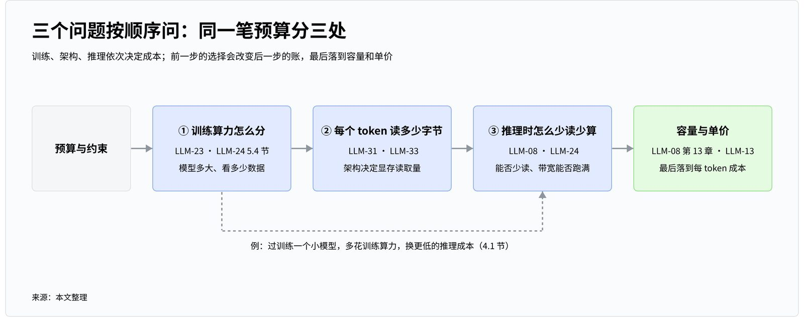

# LLM-59｜索引｜效率全景图：预算给定时，目标、架构与推理怎么选

> 🎯 **这篇文档解决什么问题**：系列里讲效率的内容分散在六七篇文档里。训练目标和算力分配在「大模型训练工程」，注意力与 KV 缓存在「长上下文与注意力」，专家路由在「MoE 混合专家」，量化在「模型压缩与端侧部署」，推理引擎和容量规划在「大模型推理系统」。本篇沿着“预算已经定了，下一步改哪里”这条线把它们串起来，只做导航，不提出新结论，引用的数字都以原文为准。
>
> 使用方式：第 1 章讲训练算力怎么分，第 2 章讲架构怎样减少每个 token 要读的字节，第 3 章讲推理时怎样少读少算，第 4 章是一张按约束查的表。手上已经有具体问题，直接看第 4 章。

## 导读 · 三个问题按顺序问

效率问题追到底，都是同一笔预算在三处分配。训练阶段决定模型多大、看多少数据。架构决定每生成一个 token 要从显存读多少字节。推理阶段决定这些字节能不能少读一些，以及硬件带宽能不能跑满。前一步的选择会改变后一步的账，例如过训练一个小模型，就是多花训练算力去换更低的推理成本（[LLM-23｜系统｜大模型训练工程：数据配比与万卡稳定性](./23-training-engineering.md) 4.1 节）。所以建议按下图的顺序问，最后落到容量和单价。

---

## 第 1 章 · 训练算力怎么分

这一章对应的问题是：总算力已定，参数量、训练 token 数、数值精度和超参搜索各占多少。

| 问题 | 先读 | 原文要点 |
|---|---|---|
| 参数和 token 怎么配 | [LLM-23｜系统｜大模型训练工程：数据配比与万卡稳定性](./23-training-engineering.md) 4.1 节 | Chinchilla 的计算最优条件是参数和 token 同比例增长；要长期推理的模型普遍过训练，Llama 3 的 8B 和 70B 都用了约 15 万亿 token。 |
| Kaplan 和 Chinchilla 的结论为什么不同 | [LLM-23｜系统｜大模型训练工程：数据配比与万卡稳定性](./23-training-engineering.md) 4.1 节 | Porian 等人把差距归到最后一层的计算量、预热时长和优化器超参三处，修正后与 Chinchilla 一致。做自己的规模实验前先对齐这三项。 |
| 一次训练要多少 GPU 时 | [LLM-23｜系统｜大模型训练工程：数据配比与万卡稳定性](./23-training-engineering.md) 4.3 节 | 稠密模型按 6 × 参数量 × token 数估算；Llama 3.1 405B 每万亿 token 约 198 万 H100 时，MoE 加 FP8 的 DeepSeek-V3 约 18 万 H800 时。 |
| 小模型上调好的超参能不能搬到大模型 | [LLM-23｜系统｜大模型训练工程：数据配比与万卡稳定性](./23-training-engineering.md) 10.5 节 | WSD 调度、μP 和 Muon 的证据；同节还有多 token 预测作为训练目标的收益，以及它和模型规模的关系。 |
| 准备低精度部署，QAT 占多少算力 | [LLM-24｜系统｜模型压缩与端侧部署：量化、剪枝与蒸馏](./24-compression-edge.md) 5.4 节 | 先全精度、后 QAT；最优占比随总算力上升，小规模约 10%–15%，规模大了可到 55% 以上。 |
| 低精度训练为什么会炸 | [LLM-54｜系统｜低精度训练的数值稳定性：从 FlashAttention 一次舍入偏差说起](./54-low-precision-training.md) | 把 BF16 + FlashAttention 训练中的损失爆炸追到一次 BF16 加法的舍入方向。 |
| 入门版 | [LLM-01｜地基｜LLM 基础：从 token 到 Agent 的学习主线](./01-foundations.md) 4.2、4.3 节 | 规模定律、算力与显存估算的入门讲法，适合先读。 |

---

## 第 2 章 · 架构：每个 token 读多少字节

解码时每生成一个 token，都要读完激活参数和 KV 缓存。架构上的效率手段，压的就是这两项。

| 问题 | 先读 | 原文要点 |
|---|---|---|
| 不同注意力的 KV 缓存有多大 | [LLM-31｜地基｜长上下文与注意力：从 MHA 到稀疏与线性注意力](./31-attention-long-context.md) 2.2 节 | 按各模型官方 config 算出的逐 token KV 账本。MLA 为什么另开一个 64 维的 RoPE 键，以及同一套权重按 MHA 和 MQA 两种方式计算，也在这一节。 |
| MHA、GQA、MLA 是怎么演进的 | [LLM-01｜地基｜LLM 基础：从 token 到 Agent 的学习主线](./01-foundations.md) 3.5 节 | 入门版，按时间线讲各种注意力变体怎样减少 KV 缓存。 |
| 长上下文下只读一部分 KV | [LLM-31｜地基｜长上下文与注意力：从 MHA 到稀疏与线性注意力](./31-attention-long-context.md) 第 5 章 | NSA、MoBA、DSA，以及 DeepSeek-V4 先压缩再稀疏的做法。 |
| 线性注意力与混合架构值不值 | [LLM-31｜地基｜长上下文与注意力：从 MHA 到稀疏与线性注意力](./31-attention-long-context.md) 第 6 章 | 支持和反对两边的证据；6.4 节的工作结论是线性层比例控制在 3:1 到 6:1，并且要测 128K 以上的多跳和上下文学习。 |
| 激活参数怎么降 | [LLM-33｜地基｜MoE 混合专家：路由、负载均衡、训练与推理](./33-moe.md) 第 1、7 章 | MoE 的激活比例，以及粒度、稀疏度怎样按缩放律选。 |
| 显存受限时选 MoE 还是稠密 | [LLM-33｜地基｜MoE 混合专家：路由、负载均衡、训练与推理](./33-moe.md) 7.3 节、第 10 章 | 显存受限时的架构选择，专家卸载和单机显存算例。 |
| 端侧怎样在架构上省 KV | [LLM-24｜系统｜模型压缩与端侧部署：量化、剪枝与蒸馏](./24-compression-edge.md) 6.2 节 | KV 缓存跨层共享、线性注意力混合的端侧实例。 |

---

## 第 3 章 · 推理：少读少算

📎 延伸阅读：扩散语言模型让每次前向多确定几个 token，见 [LLM-42｜地基｜图像与视频生成：扩散、DiT 与推理加速](./42-image-video-generation.md) 第 12 章。把文字渲染成图片来压缩上下文，目前证据还不够，见 [LLM-14｜地基｜多模态与长上下文：从视觉 token 到百万上下文](./14-multimodal-long-context.md) 第 9 章。

架构定下来以后，推理侧还能动的是数值精度、一次验证几个 token、KV 缓存放在哪，以及机器怎么配。

| 问题 | 先读 | 原文要点 |
|---|---|---|
| 速度上限怎么估 | [LLM-24｜系统｜模型压缩与端侧部署：量化、剪枝与蒸馏](./24-compression-edge.md) 1.2 节；[LLM-08｜系统｜大模型推理系统：全栈学习手册](./08-inference-systems.md) 第 1 章 | 单用户解码的每秒 token 数约等于内存带宽除以每个 token 要读的字节数；推理手册第 1 章先把指标、SLO 和成本定成优化目标。 |
| 量化选几位、用什么方法 | [LLM-24｜系统｜模型压缩与端侧部署：量化、剪枝与蒸馏](./24-compression-edge.md) 第 3–6 章、11.2 节 | 先选对模型尺寸，再找官方低精度版本，然后才自己量化；长上下文再加 KV 缓存量化。 |
| 投机解码与多 token 预测 | [LLM-08｜系统｜大模型推理系统：全栈学习手册](./08-inference-systems.md) 第 5 章；[LLM-24｜系统｜模型压缩与端侧部署：量化、剪枝与蒸馏](./24-compression-edge.md) 9.4 节；[LLM-01｜地基｜LLM 基础：从 token 到 Agent 的学习主线](./01-foundations.md) 6.5 节 | 验证几个 token 和生成一个 token 读的权重一样多，所以带宽受限时划算。 |
| KV 缓存放在哪、怎么复用 | [LLM-08｜系统｜大模型推理系统：全栈学习手册](./08-inference-systems.md) 第 6 章；[LLM-31｜地基｜长上下文与注意力：从 MHA 到稀疏与线性注意力](./31-attention-long-context.md) 第 8 章 | 多级缓存与存算分离；KV 压缩和前缀缓存的冲突；学出来的 KV（Cartridges）。 |
| MoE 怎么上线服务 | [LLM-33｜地基｜MoE 混合专家：路由、负载均衡、训练与推理](./33-moe.md) 第 9 章 | 大规模专家并行、冗余专家和 MoE 的量化。 |
| 从 SLO 算到机器数和单价 | [LLM-08｜系统｜大模型推理系统：全栈学习手册](./08-inference-systems.md) 第 13 章；[LLM-13｜系统｜自建推理成本与 GPU 选型：算账手册](./13-inference-cost-gpu.md) | 端到端容量规划，以及 GPU 选型的算账方法。 |

📎 延伸阅读：小批量 decode 卡在 kernel 启动和通信上，Kimi K3 在 GB300 上把每层 kernel 从 23 个合到 13 个，见 [LLM-03｜系统｜vLLM 学习路径：从推理基础到架构前沿](./03-vllm-path.md) 第 4.3.3 节。

📎 延伸阅读：万亿参数 MoE 推理的显存、EP 通信和长上下文压力，以及 MegaMoE、投机解码、KV 卸载各自省在哪，见 [LLM-08｜系统｜大模型推理系统：全栈学习手册](./08-inference-systems.md) 第 16 章。

📎 延伸阅读：推理侧 KV Cache 的外置内存、复用、压缩与架构侧体积台阶的效率视角补充，见 [LLM-70｜系统｜KV Cache 装不进显存：分层、复用、压缩与外置系统的工程账](./70-kv-cache-offload.md)。

---

## 第 4 章 · 按约束查表

📎 延伸阅读：查表比成本时按任务算，分词器会改变 token 数，见 [LLM-13｜系统｜自建推理成本与 GPU 选型：算账手册](./13-inference-cost-gpu.md) 第 9 章。能耗数字要先看测量边界，见 [LLM-13｜系统｜自建推理成本与 GPU 选型：算账手册](./13-inference-cost-gpu.md) 第 10 章。

下表左列是手上卡住的那一项，按“先读、再读”的顺序看两处就能定下一步。

| 约束 | 先读 | 再读 |
|---|---|---|
| 训练算力已定，模型要长期在线服务 | [LLM-23｜系统｜大模型训练工程：数据配比与万卡稳定性](./23-training-engineering.md) 4.1 节（过训练） | [LLM-24｜系统｜模型压缩与端侧部署：量化、剪枝与蒸馏](./24-compression-edge.md) 5.4 节（QAT 的算力占比） |
| 显存放不下权重 | [LLM-24｜系统｜模型压缩与端侧部署：量化、剪枝与蒸馏](./24-compression-edge.md) 11.2 节（决策顺序） | [LLM-33｜地基｜MoE 混合专家：路由、负载均衡、训练与推理](./33-moe.md) 第 10 章（专家卸载） |
| 上下文一长，KV 缓存就放不下 | [LLM-31｜地基｜长上下文与注意力：从 MHA 到稀疏与线性注意力](./31-attention-long-context.md) 2.2 节、11.1 节 | [LLM-24｜系统｜模型压缩与端侧部署：量化、剪枝与蒸馏](./24-compression-edge.md) 第 6 章（KV 缓存量化） |
| 单用户解码太慢 | [LLM-24｜系统｜模型压缩与端侧部署：量化、剪枝与蒸馏](./24-compression-edge.md) 1.2 节（估算公式） | [LLM-08｜系统｜大模型推理系统：全栈学习手册](./08-inference-systems.md) 第 5 章（投机解码） |
| 并发上不去，单价太高 | [LLM-08｜系统｜大模型推理系统：全栈学习手册](./08-inference-systems.md) 第 13 章（容量规划） | [LLM-13｜系统｜自建推理成本与 GPU 选型：算账手册](./13-inference-cost-gpu.md) |
| 在 MoE 和稠密模型之间选 | [LLM-33｜地基｜MoE 混合专家：路由、负载均衡、训练与推理](./33-moe.md) 第 7 章 | [LLM-33｜地基｜MoE 混合专家：路由、负载均衡、训练与推理](./33-moe.md) 10.3 节（和稠密模型比） |
| 规模实验结果和论文对不上 | [LLM-23｜系统｜大模型训练工程：数据配比与万卡稳定性](./23-training-engineering.md) 4.1 节（Porian 的三项修正） | [LLM-23｜系统｜大模型训练工程：数据配比与万卡稳定性](./23-training-engineering.md) 10.5 节（超参迁移） |

> 💡 本篇提到的源头论文（MoE、MQA、GQA、MLA、线性注意力、Porian、多 token 预测、QAT 算力分配）集中列在 [LLM-15｜索引｜LLM 必读论文清单与速查卡](./15-papers.md) 第 1 章的补充表里。各篇增补效率相关章节时，本篇随之更新。

📎 延伸阅读：缓存复用的效率收益跨过信任边界后会变成泄露面，块内混淆 KV-Cloak 用融合后 prefill 0.45% 的开销把数据面攻击压回随机水平，完整的成本轴与各档防御边界见 [LLM-68｜系统｜KV Cache 的信任边界：共享、分层与三种泄露面](./68-kv-cache-trust.md) 第 7、11 章。

---

上一篇：[LLM-58｜工程｜Agent 调优：从 trace 找到该改的那一层](./58-agent-tuning.md) · [目录](./README.md) · 下一篇：[LLM-64｜场景｜AI for Science 与形式化数学：验证器决定 AI 能走多远](./64-ai-for-science.md)
