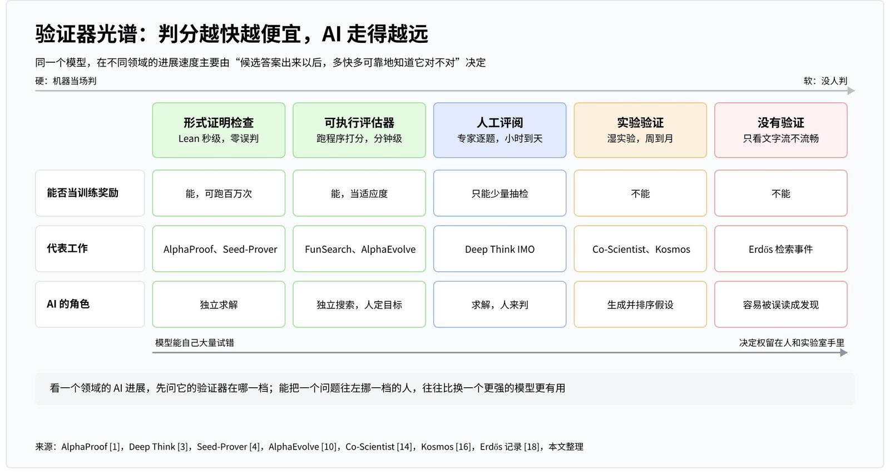
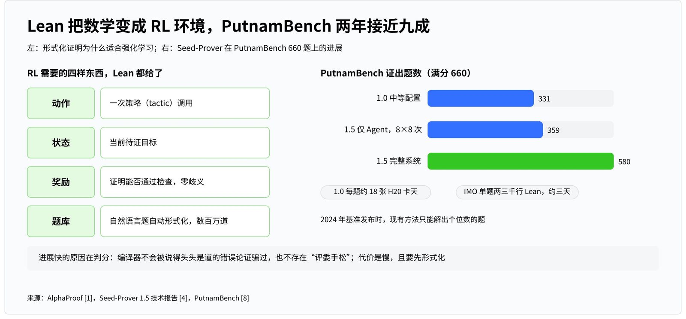
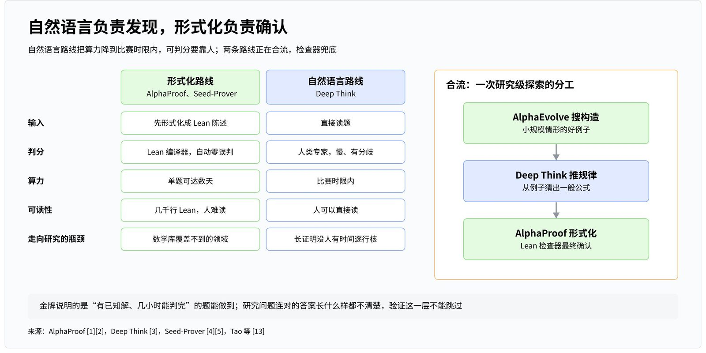
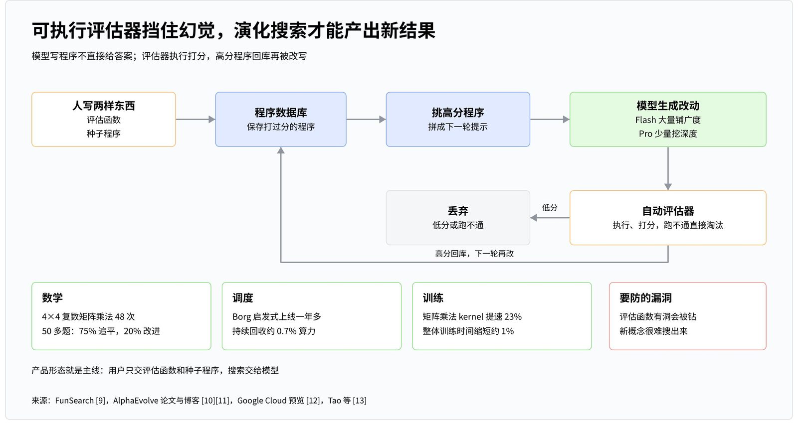
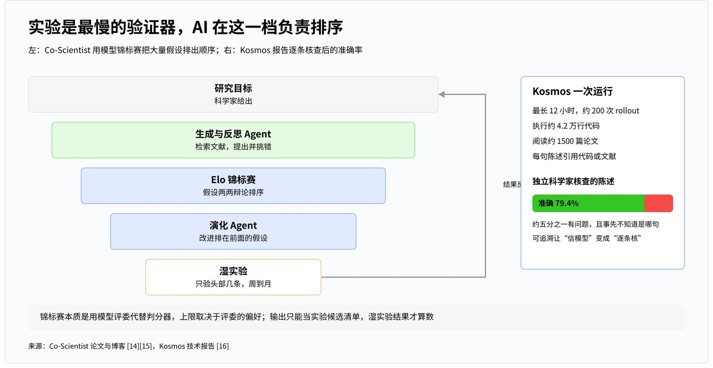
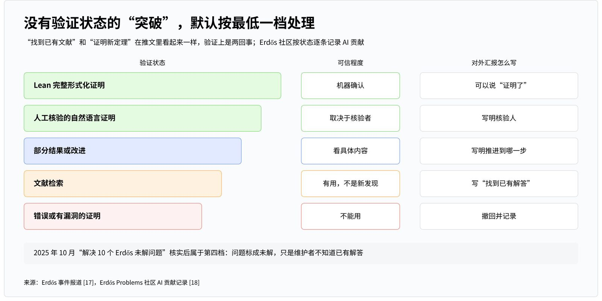
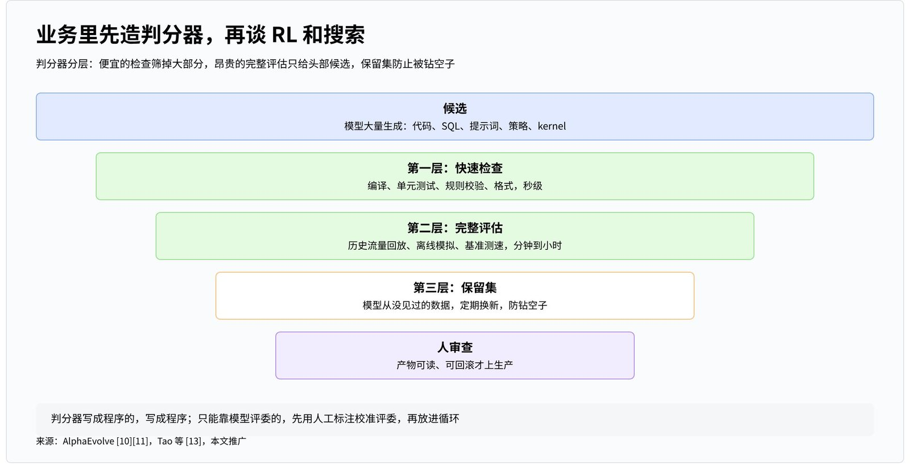

# LLM-64｜场景｜AI for Science 与形式化数学：验证器决定 AI 能走多远

> 🎯 **这篇文档解决什么问题**：2024 到 2026 年，AI 做数学和科学的新闻一条接一条：AlphaProof 登上 Nature，Gemini Deep Think 拿到 IMO 金牌，Seed-Prover 证出 88% 的 Putnam 形式化题，AlphaEvolve 改进了 56 年没人动过的矩阵乘法，Co-Scientist 的药物重定位假设通过了湿实验。同期也有翻车：“解决 10 个 Erdős 未解问题”最后只是检索到了已有文献。本篇用一把尺子量这些事：哪些进展可以信，为什么有的领域快、有的慢，工程团队能借走什么。
>
> **主线**：<b>验证器决定 AI 能在一个领域走多远。</b>一个候选答案出来以后，多快、多便宜、多可靠地知道它对不对，决定了模型能试错多少次。机器能当场判的地方，强化学习和搜索可以无限地试。只能靠人判的地方，速度受评阅人数限制。要靠实验判的地方，AI 只能把假设排好序。没人判的地方，流利的文字最容易骗过人。第 1 章画出这条光谱，第 2–6 章沿光谱从硬到软各讲一档，每档回答同一组问题：判分器是什么，模型怎么在上面学或搜，成果哪些可信。第 7 章把这套逻辑搬回业务。
>
> **使用方式**：只想知道“AI 做科研到了哪一步”，读导读和第 1、6 章。做 RL 训练或 Agent，重点读第 2、4、7 章。做评测和对外宣传审核，读第 6、8 章。文中数字核对于 2026 年 10 月。

## 导读 · 先给结论

- <b>先问验证器在哪一档，再看成绩。</b>同一个模型在数学竞赛、算法设计、药物发现上进展差得很远，差别主要来自判分的速度和可靠性。能把问题往“机器可判”挪一档，往往比换一个更强的模型更有用。
- <b>机器当场判：算力直接换成功率。</b>Lean 证明能被完全自动检查，奖励没有歧义。AlphaProof 在数百万道自动形式化的题上做强化学习[[1]](https://www.nature.com/articles/s41586-025-09833-y)，一年多后 Seed-Prover 1.5 在 PutnamBench 上证出 580/660 道[[4]](https://arxiv.org/abs/2512.17260)。
- <b>人来判：成绩亮眼，却没法当训练奖励大规模跑。</b>Deep Think 在 IMO 2025 比赛时限内用自然语言拿到 35/42 分的金牌[[3]](https://deepmind.google/discover/blog/advanced-version-of-gemini-with-deep-think-officially-achieves-gold-medal-standard-at-the-international-mathematical-olympiad/)，可每一份证明都要专家逐题评阅。两条路线正在合流：自然语言负责发现，形式化负责确认[[13]](https://arxiv.org/abs/2511.02864)。
- <b>跑程序判：搜索开始产出新知识。</b>AlphaEvolve 让模型写程序、评估器打分，找到 48 次标量乘法的 4×4 复数矩阵乘法，给 Borg 写的调度启发式回收了约 0.7% 的全球算力[[11]](https://deepmind.google/blog/alphaevolve-a-gemini-powered-coding-agent-for-designing-advanced-algorithms/)。用户要交的正是评估函数和种子程序[[12]](https://cloud.google.com/blog/products/ai-machine-learning/alphaevolve-on-google-cloud)。
- <b>实验来判：AI 的角色是排序。</b>Co-Scientist 用模型锦标赛给假设排序，几条通过了湿实验[[14]](https://www.nature.com/articles/s41586-026-10644-y)。Kosmos 报告中 79.4% 的陈述被独立科学家判为准确[[16]](https://arxiv.org/abs/2511.02824)，剩下约五分之一要靠人筛。
- <b>没人判：先问验证状态。</b>Erdős 社区事后把每条 AI 贡献按“Lean 证明、人工核验、文献检索、错误证明”分档记录[[18]](https://github.com/teorth/erdosproblems/wiki/AI-contributions-to-Erdős-problems)。业务里任何“AI 发现了什么”的汇报，都该附上这一栏。

📎 与系列其他文档的分工：可验证奖励的强化学习见 [LLM-22｜地基｜后训练实战：SFT、LoRA 与 RLVR](./22-post-training.md)，测试时计算见 [LLM-37｜地基｜推理模型与测试时计算：长思维链何时值得](./37-reasoning-models.md)，奖励投机见 [LLM-48｜系统｜递归自我改进（RSI）：模型怎样改进自己](./48-rsi.md)，模型评委见 [LLM-11｜工程｜LLM 应用评测与可观测：自建评测体系](./11-eval-observability.md)，基准怎样读、怎样防污染见 [LLM-35｜工程｜读懂模型基准与排行榜：污染、自报分与误差](./35-benchmarks.md)。本篇只讲验证器这一根轴怎样决定 AI 在科研上的上限。

---

## 第 1 章 · 验证器光谱

强化学习和搜索的共同前提，是能对大量候选逐一打分。一次打分要秒级还是数周，要零误判还是靠专家争论，直接决定了模型一共能试多少次、能不能把结果当奖励回灌训练。Jason Wei 把这件事概括为验证不对称：很多任务验证比求解容易得多，训练 AI 解决一个任务的难易，和它能否被验证成正比[[20]](https://www.jasonwei.net/blog/asymmetry-of-verification-and-verifiers-law)。本篇把验证方式从硬到软排成五档，每一档 AI 扮演的角色都不同。

| 验证方式 | 单次判分成本 | 能否当训练奖励 | 代表工作 | AI 的角色 |
|---|---|---|---|---|
| 形式证明检查 | 秒级，几乎免费，零误判 | 能，可以跑百万次 | AlphaProof[[1]](https://www.nature.com/articles/s41586-025-09833-y)、Seed-Prover[[4]](https://arxiv.org/abs/2512.17260)、DeepSeek-Prover[[6]](https://arxiv.org/abs/2504.21801) | 独立求解 |
| 可执行评估器 | 跑一次程序，分钟级 | 能，作为搜索或 RL 的适应度 | FunSearch[[9]](https://www.nature.com/articles/s41586-023-06924-6)、AlphaEvolve[[10]](https://arxiv.org/abs/2506.13131) | 独立搜索，人定义目标 |
| 人工评阅 | 专家逐题，小时到天 | 只能少量抽检 | Deep Think IMO 金牌[[3]](https://deepmind.google/discover/blog/advanced-version-of-gemini-with-deep-think-officially-achieves-gold-medal-standard-at-the-international-mathematical-olympiad/) | 求解，人来判 |
| 实验验证 | 湿实验，周到月，花钱 | 不能，只能事后验证少数假设 | Co-Scientist[[14]](https://www.nature.com/articles/s41586-026-10644-y)、Kosmos[[16]](https://arxiv.org/abs/2511.02824) | 生成并排序假设 |
| 无验证 | 零成本，但不可靠 | 不能 | Erdős 检索事件[[17]](https://content.fans/news/openais-gpt-5-math-claims-spark-backlash-over-accuracy) | 容易被误读成“发现” |

这条光谱纠正了一个常见误解。“AI 拿了 IMO 金牌，所以快能做研究了”，跳过了验证这一层：竞赛题有标准答案，专家几小时能判完，研究问题往往连“对的答案长什么样”都不清楚。反过来，只要能造出可靠的自动判分器，哪怕问题本身很难，进展也可能很快。矩阵乘法就是例子，一个算法对不对、用了几次乘法，程序一跑就知道。

> 🔑 **本章要点**：判分越快、越便宜、越可靠，模型能试错的次数越多，AI 就越能独立工作。看任何一项 AI 科研成果，先定位它的验证器在哪一档。

---

## 第 2 章 · 机器当场判：形式化证明

光谱最硬的一端是形式证明检查。这里的规律最干净：判分零歧义时，算力几乎可以直接换成成功率，剩下的工程问题是怎样让每一份算力花得更值。

### 2.1 Lean 给了 RL 需要的全部东西

Lean 是交互式定理证明器，证明写成代码，编译器逐步检查每一步推理是否合法。对强化学习来说，动作是一次策略（tactic）调用，状态是当前待证目标，奖励是证明能否通过检查。检查完全自动，不会被一段说得头头是道的错误论证骗过[[1]](https://www.nature.com/articles/s41586-025-09833-y)。这是 [LLM-22｜地基｜后训练实战：SFT、LoRA 与 RLVR](./22-post-training.md) 讲的可验证奖励最严格的形式。

代价在形式化本身。数学文献绝大多数是自然语言，要变成 Lean 定理陈述得先翻译。AlphaProof 训练了一个形式化模型，把大量自然语言题自动翻成 Lean，得到数百万道训练题[[1]](https://www.nature.com/articles/s41586-025-09833-y)。翻译不一定忠实，可只要 Lean 接受，就是一道合法的练习题，证出来照样有价值。判分器严格，题库就可以放宽。

### 2.2 证据：从 AlphaProof 到开源证明器

AlphaProof 把 AlphaZero 的框架搬到 Lean 上：策略网络提出下一步，搜索树展开，通过检查的证明再反过来训练网络。最特别的一步是测试时强化学习，面对一道难题，系统自动生成大量变体（特例、推广、相关命题），在变体上继续训练，再回头攻原题[[1]](https://www.nature.com/articles/s41586-025-09833-y)。IMO 2024 上它做出 5 道非几何题中的 3 道，加上 AlphaGeometry 2 的几何题，6 题做出 4 题，达到银牌线。代价同样写得清楚：题目先由人工形式化，有的题算了三天，远超比赛时限[[2]](https://deepmind.google/blog/ai-solves-imo-problems-at-silver-medal-level/)。这枚银牌衡量的是能力上限。

2025 年的进展主要来自开源和半开源证明器，三条路线在同一个判分器上各自优化“怎样花算力”：

| 系统 | 核心方法 | 公开结果 | 对应的规律 |
|---|---|---|---|
| DeepSeek-Prover-V2[[6]](https://arxiv.org/abs/2504.21801) | 大模型把定理拆成子目标，分别证出后拼接，拆分本身用 RL 训练 | MiniF2F 和 PutnamBench 上大幅超过前代 | 长证明的成功率靠分解 |
| Goedel-Prover-V2[[7]](https://arxiv.org/abs/2508.03613) | 按难度逐级合成训练题，配合编译器反馈自我纠错 | 小参数模型追平大得多的证明器 | 数据课程和判分器反馈比堆参数划算 |
| Seed-Prover 1.5[[4]](https://arxiv.org/abs/2512.17260) | 大规模 Agent 式 RL，在 Lean 环境里调用工具、积累经验、多轮修正 | PutnamBench 580/660，Putnam 2025 的 12 题证出 11 题 | 预算换来的成功率仍在增长 |

成本曲线也在下降。Seed-Prover 1.0 在 PutnamBench 上中等配置证出 331/660，平均每题约 18 张 H20 卡天。1.5 版只用 Agent 部分、每题 8×8 次尝试就到 359/660[[4]](https://arxiv.org/abs/2512.17260)。前一代在 IMO 2025 上的证明单题长达两三千行 Lean，约算三天[[5]](https://github.com/ByteDance-Seed/Seed-Prover)。形式化路线仍然“慢而确定”，但慢的部分在快速变快。

PutnamBench 的进展速度本身是主线的佐证。它收录 640 道 Putnam 题的 1692 个形式化版本，覆盖 Lean 4、Isabelle 和 Coq，全部人工构造并调试[[8]](https://arxiv.org/abs/2407.11214)。2024 年发布时现有方法只能解出个位数的题，两年后头部系统接近九成。自然语言基准很少有这样的速度，原因正是判分零歧义，不存在评委手松。

> 🔑 **本章要点**：判分器严格到零误判，题库可以放宽到自动翻译，搜索可以跑到数天，成果仍然可信。工程上值得借的是“分解、课程、编译器反馈”三件事，它们都在提高单位算力的命中率。

---

## 第 3 章 · 人来判：自然语言证明

往软一档，判分交给人。成绩可以同样亮眼，可判分成本让它没法像 Lean 那样当训练奖励大规模跑，走向研究时瓶颈会落在评阅上。

### 3.1 证据：IMO 金牌

2025 年 7 月，Gemini Deep Think 的进阶版本参加 IMO，在 4.5 小时比赛时限内用自然语言作答，6 题做出 5 题，得 35/42 分，由 IMO 官方协调员按标准评分认证为金牌[[3]](https://deepmind.google/discover/blog/advanced-version-of-gemini-with-deep-think-officially-achieves-gold-medal-standard-at-the-international-mathematical-olympiad/)。和一年前的 AlphaProof 比，不需要人工形式化，不需要几天算力，输出是人能直接读的证明。背后是 [LLM-37｜地基｜推理模型与测试时计算：长思维链何时值得](./37-reasoning-models.md) 讲的测试时计算：模型并行探索多条思路，再综合成一份证明。

它没说明的同样重要。IMO 协调员是这个领域最熟练的评阅者，题目有已知解。换到研究问题，一份几十页的证明可能要专家花几周确认，期间还会有分歧。判分成本决定了自然语言路线很难把“证明对了”直接当奖励大规模使用，只能少量抽检，或者借助模型评委，而模型评委的偏差正是 [LLM-11｜工程｜LLM 应用评测与可观测：自建评测体系](./11-eval-observability.md) 反复讨论的问题。

### 3.2 合流：让模型用自然语言想，用 Lean 写

两条路线的长短正好互补。Tao 等人的大规模探索就是这样分工的：AlphaEvolve 搜出小规模情形的好构造，Deep Think 从例子推出一般规律，AlphaProof 把结论形式化，交给 Lean 确认[[13]](https://arxiv.org/abs/2511.02864)。自然语言负责发现，形式化负责确认，检查器兜底。对研究级问题，这可能是现阶段最可行的组合，也是第 7 章“分层判分”的雏形。

> 🔑 **本章要点**：人来判的档位，成绩说明能力，不说明可扩展性。把人判的环节尽量换成机器判，或者至少让机器判兜底，是这一档往前走的方向。

---

## 第 4 章 · 跑程序判：演化搜索

还有一类问题既不是定理也不靠人判：答案的好坏能用一段程序算出来。这一档出现了 AI 产出新知识的第一批硬证据，原因是可执行评估器同时解决了两个问题，挡住幻觉，又给搜索提供了方向。

### 4.1 原理：让模型写程序，评估器挡住幻觉

大模型会编造，这是让它做“发现”的最大障碍。FunSearch 不让模型直接给答案，改让它写一个生成答案的程序。程序由评估器执行打分，高分程序进入程序库，下一轮挑几个好程序给模型看，让它写一个更好的[[9]](https://www.nature.com/articles/s41586-023-06924-6)。模型编得再离谱，跑不出高分就会被淘汰。它在组合数学的 cap set 问题上找到了超过已知最优的构造，这是大模型第一次在公开数学难题上产出新结果。

### 4.2 证据：AlphaEvolve 与 67 个问题

AlphaEvolve 把这个循环扩展到完整代码库：Gemini Flash 大量生成候选铺广度，Gemini Pro 偶尔给出更有洞察的修改挖深度，评估器打分后进入程序数据库，持续迭代[[10]](https://arxiv.org/abs/2506.13131)[[11]](https://deepmind.google/blog/alphaevolve-a-gemini-powered-coding-agent-for-designing-advanced-algorithms/)。成果横跨数学和工程：4×4 复数矩阵乘法只需 48 次标量乘法，改进了 1969 年 Strassen 以来的结果。50 多个开放问题上约 75% 追平已知最优，约 20% 有改进。Borg 调度启发式在生产环境运行一年多，持续回收约 0.7% 的全球算力。Gemini 训练中的一个矩阵乘法 kernel 提速 23%，整体训练时间缩短约 1%[[11]](https://deepmind.google/blog/alphaevolve-a-gemini-powered-coding-agent-for-designing-advanced-algorithms/)。2025 年 12 月起它以私有预览形式在 Google Cloud 开放，用户要交的就是一个评估函数和一个种子程序[[12]](https://cloud.google.com/blog/products/ai-machine-learning/alphaevolve-on-google-cloud)。判分器由人来写，搜索交给模型，产品形态本身就是主线。

Tao 等四位数学家用它系统探索了分析、组合、几何、数论中的 67 个问题。多数问题上重新找到已知最优构造，若干问题有改进，还能把有限情形的结果推广成适用于所有 n 的公式[[13]](https://arxiv.org/abs/2511.02864)。报告更有价值的部分是它在哪里不行：评估函数有漏洞时，系统会钻漏洞拿高分；问题需要真正新的概念时，搜索很难跳出已知结构。前者是 [LLM-48｜系统｜递归自我改进（RSI）：模型怎样改进自己](./48-rsi.md) 讲的奖励投机在数学里的版本，后者说明判分器只能筛选，不能替模型想出新结构。

### 4.3 评估器写不好，搜索就会钻空子

| 场景 | 评估器是什么 | 要防的漏洞 |
|---|---|---|
| 组合构造（cap set、堆积问题） | 检查构造合法性，算目标值 | 数值精度漏洞，边界情形没覆盖 |
| 算法发现（矩阵乘法） | 验证正确性，数乘法次数 | 只在测试规模上正确 |
| 系统启发式（调度、编译） | 在历史负载上回放或模拟 | 模拟器和生产环境不一致 |
| GPU kernel | 和参考版本对照数值，测速 | 只在特定形状上快，其他形状变慢 |

> 🔑 **本章要点**：可执行评估器让“模型会编造”变得无害，搜索因此能产出新结果。上限由评估器决定：它有洞，搜索就钻洞；它能判的范围，就是搜索能发现的范围。

---

## 第 5 章 · 实验来判：AI 科学家

生物医学的多数问题没有程序能判对错，最终裁判是实验。实验以周计、以万元计，模型不可能在实验上大量试错。这一档的系统因此换了目标：从文献和数据里生成假设、把假设排好序，让科学家把有限的实验预算花在最有希望的几条上。

### 5.1 证据：Co-Scientist 与 Kosmos

Co-Scientist 由生成、反思、排序、演化、邻近度、元评审等多个 Gemini Agent 组成。没有自动判分器，排序 Agent 让假设两两“辩论”，按 Elo 分组织锦标赛，演化 Agent 再改进排在前面的假设[[14]](https://www.nature.com/articles/s41586-026-10644-y)[[15]](https://deepmind.google/blog/co-scientist-a-multi-agent-ai-partner-to-accelerate-research/)。论文在三个方向做了湿实验：急性髓系白血病的药物重定位，部分候选药物在体外抑制了肿瘤细胞；肝纤维化的新靶点；抗生素耐药的一个基因转移机制，系统独立提出的假设和一个尚未发表的实验结果吻合[[14]](https://www.nature.com/articles/s41586-026-10644-y)。

Kosmos 走数据驱动路线：给一个研究目标和一份数据集，最长运行 12 小时，并行跑数据分析和文献检索 Agent，用结构化的世界模型共享发现。一次运行约 200 次 rollout，执行约 4.2 万行代码，阅读约 1500 篇论文，报告里每句陈述都引用代码或原始文献。独立科学家核查后判定 79.4% 的陈述准确[[16]](https://arxiv.org/abs/2511.02824)。

两组数字都要反过来读。锦标赛本质是用模型评委代替判分器，评委偏好写得漂亮、和已有文献相似的假设，所以 Co-Scientist 的输出只能当实验候选清单。Kosmos 约五分之一的陈述有问题，错在哪句事先不知道。它最关键的设计是可追溯：每句话能对到代码和文献，“这句对不对”就从相信模型变成了可以逐条核查，和 [LLM-38｜工程｜Deep Research 与搜索 Agent：检索、核验与评测](./38-deep-research.md) 讲的 Deep Research 引用核验是同一个要求。

### 5.2 学出来的验证器：AlphaFold 3

AlphaFold 代表另一种思路：拿几十年积累的实验结构数据当监督，学出一个预测器，再把它当作便宜的验证器用。AlphaFold 3 换成扩散架构，能联合预测蛋白质、核酸、小分子配体、离子组成的复合物结构，在蛋白-配体相互作用上明显优于传统分子对接工具[[19]](https://www.nature.com/articles/s41586-024-07487-w)。药物研发里可以先用它筛掉明显结合不上的分子，再做实验，等于在最慢的实验验证器前面加了一层快筛。

这层快筛有两个前提。预测置信度要校准，低置信度区域不能当真。训练数据覆盖不到的地方会失灵，比如构象变化大的蛋白、罕见的分子类型[[19]](https://www.nature.com/articles/s41586-024-07487-w)。学出来的验证器只在训练分布内可靠，这和 [LLM-11｜工程｜LLM 应用评测与可观测：自建评测体系](./11-eval-observability.md) 里判别模型的局限相同。

> 🔑 **本章要点**：实验档里 AI 负责生成和排序，实验负责拍板。能做的工程改进有两件：让每条结论可追溯、可逐条核查；在慢验证器前面加一层校准过的快筛。

---

## 第 6 章 · 没人判：验证状态

光谱最软的一端没有验证器。这里最大的风险和模型能力关系不大：结论的验证状态没说清，读者就会把“找到”读成“证明”。

### 6.1 证据：Erdős 事件

2025 年 10 月，有研究人员公开宣称 GPT-5 “找到了 10 个此前未解的 Erdős 问题的解答”。网站维护者很快指出，这些问题标为“未解”只是因为他不知道已有解答，模型做的是把散落在文献里的已有结果找了出来，相关帖子随后删除[[17]](https://content.fans/news/openais-gpt-5-math-claims-spark-backlash-over-accuracy)。Tao 当时的评论是，这类工具近期最实际的价值在中等强度的文献检索，帮数学家找到自己不知道的已有工作。

### 6.2 对策：给每条结论标验证状态

Erdős 社区随后建了一份记录，把每条 AI 贡献按验证状态分档[[18]](https://github.com/teorth/erdosproblems/wiki/AI-contributions-to-Erdős-problems)：Lean 完整形式化证明，人工核验的自然语言证明，部分结果或改进，文献检索，错误或有漏洞的证明。前两档可以说“证明了”，第四档只能说“找到已有解答”。Kosmos 的 79.4%[[16]](https://arxiv.org/abs/2511.02824) 和 Co-Scientist 的湿实验[[14]](https://www.nature.com/articles/s41586-026-10644-y) 可信，是因为它们报告了验证方式和结果。

> 🔑 **本章要点**：这份分档可以直接搬进企业：任何“AI 发现了什么”的汇报都附上验证状态和验证人，没有验证状态的“突破”，默认按最低一档处理。

---

## 第 7 章 · 工程团队怎么借

多数团队不做数学研究，但前六章的逻辑可以原样迁移：业务里的 Agent、代码生成、配置优化，很多问题都能造出自动判分器，一旦造出来，第 2 章和第 4 章的方法就能直接用。能不能用 RL 或搜索，先看判分器，再看模型。

| 科研里的做法 | 业务里的对应 | 判分器长什么样 | 本系列相关 |
|---|---|---|---|
| Lean 检查证明 | 代码生成、SQL 生成 | 单元测试、编译、对照执行结果 | [LLM-26｜工程｜编程 Agent 实战：Claude Code、Codex 与 Cursor](./26-coding-agents.md) |
| RL on Lean | 用可验证奖励训练领域模型 | 规则检查、测试通过率 | [LLM-22｜地基｜后训练实战：SFT、LoRA 与 RLVR](./22-post-training.md)、[LLM-55｜系统｜RL 训练系统：rollout 与训练分离、异步与 Agent 环境](./55-rl-systems.md) |
| AlphaEvolve 演化搜索 | 调度策略、缓存策略、提示词、kernel | 历史流量回放、离线模拟、基准测速 | [LLM-59｜索引｜效率全景图：预算给定时，目标、架构与推理怎么选](./59-efficiency-map.md) |
| 测试时 RL 和变体生成 | 难例上的测试时计算 | 同上，加多次采样投票 | [LLM-37｜地基｜推理模型与测试时计算：长思维链何时值得](./37-reasoning-models.md) |
| Co-Scientist 锦标赛 | 方案评审、候选排序 | 模型评委两两比较，人工抽检 | [LLM-11｜工程｜LLM 应用评测与可观测：自建评测体系](./11-eval-observability.md) |
| Erdős 验证状态表 | AI 产出的对外汇报 | 附验证方式和验证人 | [LLM-35｜工程｜读懂模型基准与排行榜：污染、自报分与误差](./35-benchmarks.md) |

落地按四步走：

1. <b>先造判分器，再选方法。</b>能写成程序的写成程序。只能靠模型评委的，先用人工标注校准评委，方法见 [LLM-11｜工程｜LLM 应用评测与可观测：自建评测体系](./11-eval-observability.md)。
2. <b>判分器分层。</b>AlphaEvolve 用 Flash 铺广度、Pro 挖深度[[10]](https://arxiv.org/abs/2506.13131)，判分也照此分层：编译和单测秒级筛掉大部分，昂贵的回放和测速只给头部候选。
3. <b>防判分器被钻空子。</b>Tao 等人记录到的漏洞利用[[13]](https://arxiv.org/abs/2511.02864)在业务里同样会出现：只优化测试覆盖的路径，只在测试数据上快。留一份模型看不到的保留集，定期换新。
4. <b>产物要可读、可回滚。</b>AlphaEvolve 的调度启发式是人能读懂的代码，所以能上生产[[11]](https://deepmind.google/blog/alphaevolve-a-gemini-powered-coding-agent-for-designing-advanced-algorithms/)。搜索出来的策略、规则、提示词都要能被人审查。合成数据和数据飞轮见 [LLM-40｜地基｜合成数据与数据飞轮：生成、过滤与评测集构造](./40-synthetic-data.md)。

> 🔑 **本章要点**：业务里提升 Agent 的第一件事是造判分器。判分器决定上限，分层决定成本，保留集决定它会不会被钻空子。

---

## 第 8 章 · 边界

- <b>比赛成绩和研究能力是两回事。</b>IMO 题有已知解，评阅几小时完成。第 3 章的金牌不能外推成“能做研究”。
- <b>算力口径差别很大。</b>AlphaProof 单题可算三天[[2]](https://deepmind.google/blog/ai-solves-imo-problems-at-silver-medal-level/)，Deep Think 在比赛时限内[[3]](https://deepmind.google/discover/blog/advanced-version-of-gemini-with-deep-think-officially-achieves-gold-medal-standard-at-the-international-mathematical-olympiad/)，Seed-Prover 的数字附带每题尝试次数[[4]](https://arxiv.org/abs/2512.17260)。比较不同系统要看同等预算，不能只看题数。
- <b>厂商口径。</b>AlphaEvolve 的 0.7% 算力回收、23% kernel 提速来自官方博客[[11]](https://deepmind.google/blog/alphaevolve-a-gemini-powered-coding-agent-for-designing-advanced-algorithms/)，测量方法没有完全公开。
- <b>湿实验验证的样本很少。</b>Co-Scientist 和 Kosmos 报告的发现是少数精选案例[[14]](https://www.nature.com/articles/s41586-026-10644-y)[[16]](https://arxiv.org/abs/2511.02824)，整体命中率还缺乏大规模统计。
- <b>形式化的覆盖面有限。</b>Lean 数学库覆盖不到的领域暂时用不上形式化路线，物理、化学、生物的多数问题无法写成 Lean 定理。
- <b>进展很快。</b>本文数字是 2026 年 10 月的快照，PutnamBench 等榜单持续更新[[8]](https://arxiv.org/abs/2407.11214)。

## 参考文献

资料截至 2026 年 10 月。论文以 arXiv 最新版本为准。厂商博客和产品发布里的数字标为“厂商口径”，测量方法未完全公开，不能和论文数字直接比较。

[1] Hubert T. et al. Olympiad-level formal mathematical reasoning with reinforcement learning (AlphaProof). Nature 651 (2026) [https://www.nature.com/articles/s41586-025-09833-y](https://www.nature.com/articles/s41586-025-09833-y)

[2] Google DeepMind. AI achieves silver-medal standard solving International Mathematical Olympiad problems (2024) [https://deepmind.google/blog/ai-solves-imo-problems-at-silver-medal-level/](https://deepmind.google/blog/ai-solves-imo-problems-at-silver-medal-level/)

[3] Google DeepMind. Advanced version of Gemini with Deep Think officially achieves gold-medal standard at the International Mathematical Olympiad (2025) [https://deepmind.google/discover/blog/advanced-version-of-gemini-with-deep-think-officially-achieves-gold-medal-standard-at-the-international-mathematical-olympiad/](https://deepmind.google/discover/blog/advanced-version-of-gemini-with-deep-think-officially-achieves-gold-medal-standard-at-the-international-mathematical-olympiad/)

[4] ByteDance Seed. Seed-Prover 1.5: Mastering Undergraduate-Level Theorem Proving via Learning from Experience. arXiv (2025) [https://arxiv.org/abs/2512.17260](https://arxiv.org/abs/2512.17260)

[5] ByteDance Seed. Seed-Prover（含 IMO 2025 证明与技术报告）. GitHub [https://github.com/ByteDance-Seed/Seed-Prover](https://github.com/ByteDance-Seed/Seed-Prover)

[6] Ren Z. Z. et al. DeepSeek-Prover-V2: Advancing Formal Mathematical Reasoning via Reinforcement Learning for Subgoal Decomposition. arXiv (2025) [https://arxiv.org/abs/2504.21801](https://arxiv.org/abs/2504.21801)

[7] Lin Y. et al. Goedel-Prover-V2: Scaling Formal Theorem Proving with Scaffolded Data Synthesis and Self-Correction. arXiv (2025) [https://arxiv.org/abs/2508.03613](https://arxiv.org/abs/2508.03613)

[8] Tsoukalas G. et al. PutnamBench: Evaluating Neural Theorem-Provers on the Putnam Mathematical Competition. NeurIPS Datasets and Benchmarks (2024) [https://arxiv.org/abs/2407.11214](https://arxiv.org/abs/2407.11214)

[9] Romera-Paredes B. et al. Mathematical discoveries from program search with large language models (FunSearch). Nature 625 (2024) [https://www.nature.com/articles/s41586-023-06924-6](https://www.nature.com/articles/s41586-023-06924-6)

[10] Novikov A. et al. AlphaEvolve: A coding agent for scientific and algorithmic discovery. arXiv (2025) [https://arxiv.org/abs/2506.13131](https://arxiv.org/abs/2506.13131)

[11] Google DeepMind. AlphaEvolve: A Gemini-powered coding agent for designing advanced algorithms (2025) [https://deepmind.google/blog/alphaevolve-a-gemini-powered-coding-agent-for-designing-advanced-algorithms/](https://deepmind.google/blog/alphaevolve-a-gemini-powered-coding-agent-for-designing-advanced-algorithms/)

[12] Google Cloud. AlphaEvolve on Google Cloud（private preview）(2025) [https://cloud.google.com/blog/products/ai-machine-learning/alphaevolve-on-google-cloud](https://cloud.google.com/blog/products/ai-machine-learning/alphaevolve-on-google-cloud)

[13] Georgiev B., Gómez-Serrano J., Tao T., Wagner A. Z. Mathematical exploration and discovery at scale. arXiv (2025) [https://arxiv.org/abs/2511.02864](https://arxiv.org/abs/2511.02864)

[14] Gottweis J. et al. Accelerating scientific discovery with a multi-agent AI co-scientist. Nature 655 (2026) [https://www.nature.com/articles/s41586-026-10644-y](https://www.nature.com/articles/s41586-026-10644-y)

[15] Google DeepMind. Co-Scientist: a multi-agent AI partner to accelerate research [https://deepmind.google/blog/co-scientist-a-multi-agent-ai-partner-to-accelerate-research/](https://deepmind.google/blog/co-scientist-a-multi-agent-ai-partner-to-accelerate-research/)

[16] Mitchener L. et al. Kosmos: An AI Scientist for Autonomous Discovery. arXiv (2025) [https://arxiv.org/abs/2511.02824](https://arxiv.org/abs/2511.02824)

[17] Content.fans. OpenAI's GPT-5 math claims spark backlash over accuracy (2025) [https://content.fans/news/openais-gpt-5-math-claims-spark-backlash-over-accuracy](https://content.fans/news/openais-gpt-5-math-claims-spark-backlash-over-accuracy)

[18] Erdős Problems. AI contributions to Erdős problems（按验证状态分类的社区记录）. GitHub Wiki [https://github.com/teorth/erdosproblems/wiki/AI-contributions-to-Erd%C5%91s-problems](https://github.com/teorth/erdosproblems/wiki/AI-contributions-to-Erdős-problems)

[19] Abramson J. et al. Accurate structure prediction of biomolecular interactions with AlphaFold 3. Nature 630 (2024) [https://www.nature.com/articles/s41586-024-07487-w](https://www.nature.com/articles/s41586-024-07487-w)

[20] Wei J. Asymmetry of verification and verifier's law. jasonwei.net (2025) [https://www.jasonwei.net/blog/asymmetry-of-verification-and-verifiers-law](https://www.jasonwei.net/blog/asymmetry-of-verification-and-verifiers-law)

---

上一篇：[LLM-59｜索引｜效率全景图：预算给定时，目标、架构与推理怎么选](./59-efficiency-map.md) · [目录](./README.md) · 下一篇：[LLM-65｜地基｜知识编辑与持续学习：新知识该放进哪一层](./65-knowledge-editing.md)
