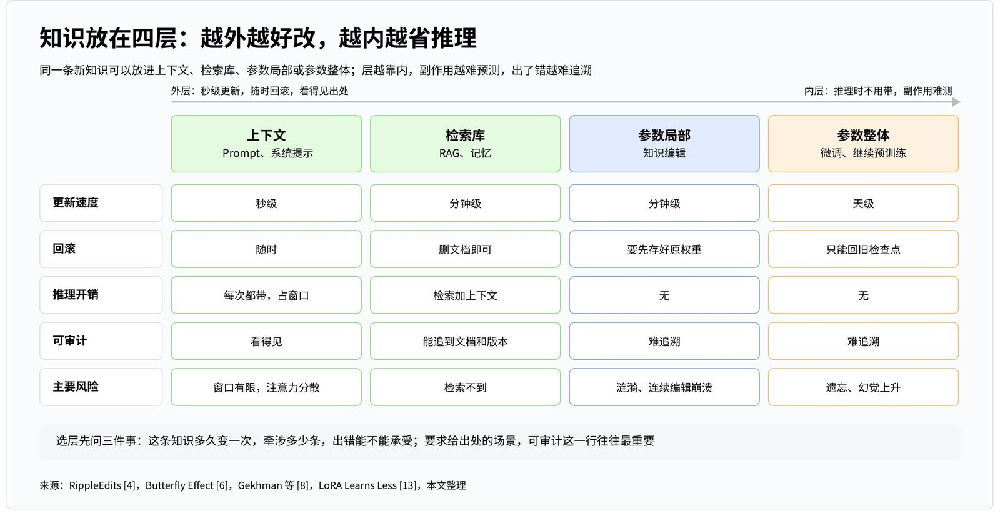
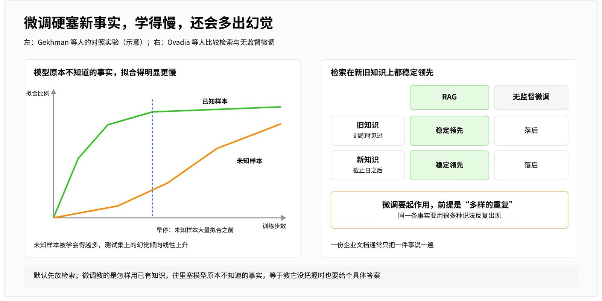
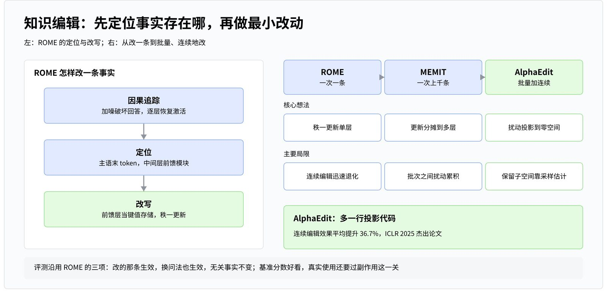
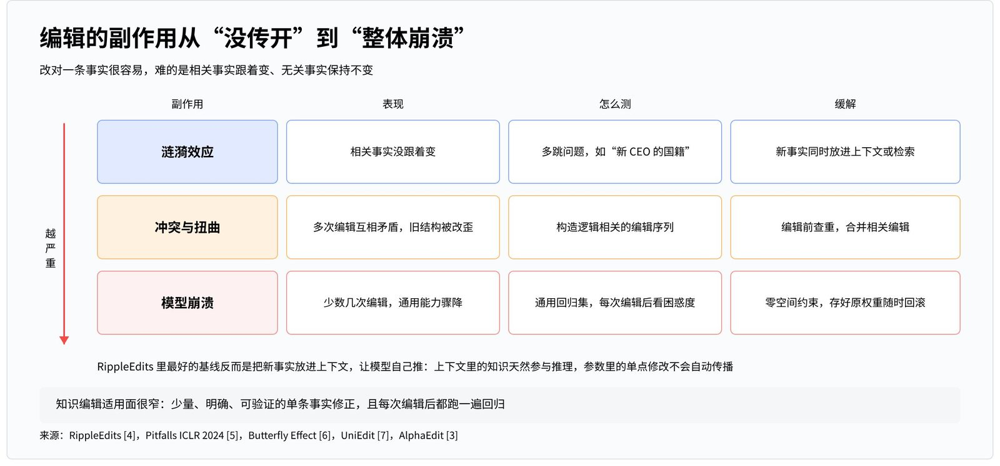
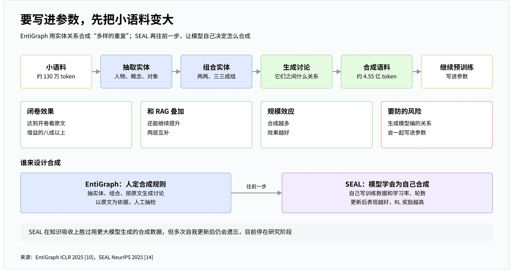
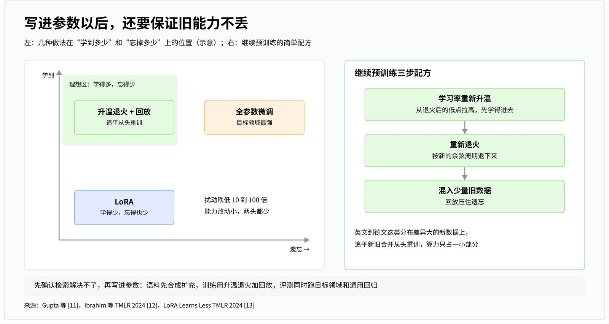
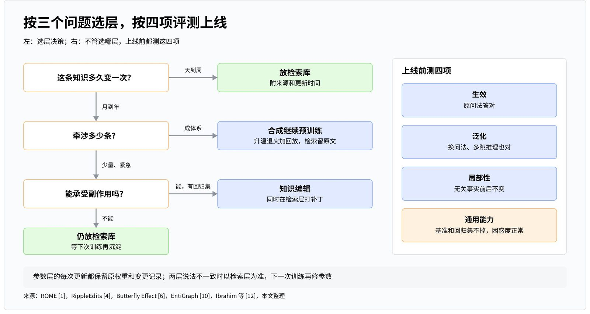

# LLM-65｜地基｜知识编辑与持续学习：新知识该放进哪一层

> 🎯 **这篇文档解决什么问题**：模型训练完的那一刻，知识就开始过时。产品改了名、法规换了条款、新出了一个 API，模型都不知道。团队的第一反应常是“拿新资料微调一下”，结果新知识没学会，旧能力掉了，幻觉还多了。本篇回答一个问题：一条新知识，该放进模型的哪一层。
>
> **主线**：<b>知识可以放在四层：上下文、检索库、参数局部、参数整体。越往外越好改、越好查，越往里越省推理、副作用越难测。</b>选哪一层，按三个问题定：这条知识多久变一次，牵涉多少条，出错能不能承受。第 1 章画出四层和三个问题，第 2 章说明参数为什么学不好新事实，所以默认先放外层。第 3–5 章沿着往里走：参数局部的精确手术和它的副作用，参数整体怎样先造出“多样的重复”，写进去以后怎样不忘。第 6 章把三个问题落成选型和评测，第 7 章标出边界。
>
> **使用方式**：要决定“新资料怎么喂给模型”的，读导读和第 1、2、6 章。做后训练的，读第 4、5 章。要评估知识编辑方案的，读第 3 章。

## 导读 · 先给结论

- <b>先问放哪一层，再选方法。</b>上下文和检索库秒级到分钟级更新，删掉就回滚，答错能追到文档。参数层推理时不用带，可每次更新都可能碰坏别的知识，答错了也查不到源头。
- <b>默认先放外层。</b>模型学“原本不知道的事实”比学已知事实慢得多，学会以后幻觉倾向线性上升[[8]](https://arxiv.org/abs/2405.05904)。在新旧知识上，RAG 都稳定胜过无监督微调[[9]](https://arxiv.org/abs/2312.05934)。
- <b>参数局部能精准改一条，批量和连续地改仍然脆弱。</b>AlphaEdit 把编辑扰动投影到保留知识的零空间，连续编辑效果平均提升 36.7%[[3]](https://arxiv.org/abs/2410.02355)。可改了“A 的 CEO 是 X”，模型常答不对“A 的 CEO 出生在哪”[[4]](https://arxiv.org/abs/2307.12976)，少数几次编辑甚至能让模型整体崩溃[[6]](https://yangwl.site/collapse-in-model-editing/)。
- <b>真要写进参数整体，先把小语料变大。</b>EntiGraph 把约 130 万 token 的语料合成到 4.55 亿 token，闭卷效果达到 RAG 增益的八成以上，和 RAG 叠加还有提升[[10]](https://arxiv.org/abs/2409.07431)。
- <b>写进去还要不忘。</b>学习率重新升温再退火，混入少量旧数据回放，继续预训练能追平从头重训[[12]](https://arxiv.org/abs/2403.08763)。LoRA 学得少，忘得也少[[13]](https://arxiv.org/abs/2405.09673)。
- <b>上线前测四项：生效、泛化、局部性、通用能力。</b>参数层每次更新都保留原权重，两层说法冲突时以检索层为准。

📎 与系列其他文档的分工：上下文工程见 [LLM-21｜工程｜Agent 记忆：存什么、怎么取、何时忘](./21-agent-memory.md)，RAG 见 [LLM-10｜工程｜RAG 与知识工程：让大模型用上自有资料](./10-rag.md)，后训练与 LoRA 见 [LLM-22｜地基｜后训练实战：SFT、LoRA 与 RLVR](./22-post-training.md)，训练数据配比见 [LLM-23｜系统｜大模型训练工程：数据配比与万卡稳定性](./23-training-engineering.md)，合成数据质检见 [LLM-40｜地基｜合成数据与数据飞轮：生成、过滤与评测集构造](./40-synthetic-data.md)，可解释性见 [LLM-18｜地基｜LLM 可解释性与模型行为：工程师用得上的部分](./18-interpretability.md)。本篇只讲“新知识放哪一层”这个选择。

---

## 第 1 章 · 知识的四层与三个问题

“让模型知道一件新事”有很多做法，按知识最终存在哪里，可以分成四层。从外到内，更新越来越难、越来越难回滚，推理时的额外开销越来越小。

| 层 | 典型做法 | 更新速度 | 回滚 | 推理开销 | 主要风险 |
|---|---|---|---|---|---|
| 上下文 | 系统提示、Prompt | 秒级 | 随时 | 每次都带，占窗口 | 窗口有限，长上下文注意力分散 |
| 检索库 | RAG、记忆 | 分钟级 | 删文档即可 | 检索加上下文 | 检索不到或资料不全 |
| 参数局部 | 知识编辑 | 分钟级 | 要先存好原权重 | 无 | 涟漪效应、连续编辑崩溃[[4]](https://arxiv.org/abs/2307.12976)[[6]](https://yangwl.site/collapse-in-model-editing/) |
| 参数整体 | 微调、继续预训练 | 天级 | 只能回旧检查点 | 无 | 遗忘、幻觉上升[[8]](https://arxiv.org/abs/2405.05904)[[13]](https://arxiv.org/abs/2405.09673) |

表里最容易被忽略的一列是**审计**。检索库里的知识能追到哪份文档、谁在什么时候改的，答错了能定位。写进参数的知识，模型说出来时无从追溯，答错了分不清是训练数据错、编辑失败还是模型自己编的。要求给出处的场景，这一条往往比推理成本更重要。

选层按三个问题。**多久变一次**：价格、库存、政策条款以天计，只能放外层。**牵涉多少条**：一两条事实的紧急纠错，和一整个垂直领域的知识体系，适合的方法完全不同。**出错能不能承受**：参数层的副作用事先测不全，承受不了就留在外层。四层也不互斥，成熟的形态是稳定的领域常识写进参数，变化的事实放检索库，个人和会话信息放记忆与上下文，紧急修正先在检索层打补丁，等下次训练再沉淀进参数。

> 🔑 **本章要点**：知识放得越靠外，越好改、越好查；越靠内，越省推理、越难预测。选层先回答三个问题：多久变一次，牵涉多少条，出错能不能承受。

---

## 第 2 章 · 默认先放外层：参数学新事实为什么难

团队最常低估的一点：参数擅长学“怎样用已有知识”，不擅长学一条只见过一两次的新事实。两组对照实验从不同角度说明了这件事。

### 2.1 证据：学得慢，学会了幻觉更多

Gekhman 等人把闭卷问答数据按模型原本是否知道答案分成“已知”和“未知”两类，控制未知样本在微调数据中的比例。未知样本被拟合的速度明显慢于已知样本；随着未知样本被逐渐学会，模型在测试集上的幻觉倾向线性上升[[8]](https://arxiv.org/abs/2405.05904)。作者的解释是，硬塞进模型原本没有的事实，相当于教它“没把握时也要给出一个具体答案”。这和 [LLM-11｜工程｜LLM 应用评测与可观测：自建评测体系](./11-eval-observability.md) 讲的幻觉成因一致：训练在奖励猜。

Ovadia 等人在多个知识密集任务上比较检索增强和无监督微调（直接在新文档上继续训练）。无论注入的是训练时见过的旧知识，还是截止日之后的新知识，RAG 都稳定领先。微调要起作用，需要把同一条事实用很多种说法反复呈现[[9]](https://arxiv.org/abs/2312.05934)。

### 2.2 设计动作

两条证据合起来，给出三个默认动作。新事实先放检索库，附来源和更新时间。微调数据里尽量少放模型原本不知道的事实，非放不可时用早停，在未知样本被大量拟合之前停下[[8]](https://arxiv.org/abs/2405.05904)。微调用来教格式、流程和工具用法，这些是“怎样用”的知识，正是参数擅长的。“多样的重复”这个条件也给第 4 章埋下伏笔：一份企业文档通常只把一件事说一遍，要写进参数，得先把它变成很多遍。

> 🔑 **本章要点**：参数学的是用法，学一条新事实需要多样的重复。没有这个条件时硬塞，幻觉会上升。所以新事实默认放检索，往里走之前先确认外层解决不了。

---

## 第 3 章 · 参数局部：精确手术与副作用

往里一层，是直接改参数里的某一条事实。它的吸引力在于分钟级生效、推理不带额外开销。代价是知识在参数里彼此缠绕，改一处会牵动别处。

### 3.1 原理：先定位，再做最小改动

ROME 用因果追踪回答“事实存在哪里”：先给输入加噪声破坏模型的回答，再逐层恢复激活，看恢复哪里能让正确答案回来。结果是主语最后一个 token 在中间层前馈模块的激活起决定作用。据此把前馈层看作键值存储，主语是键，属性是值，用一次秩一更新改写值，就能把“埃菲尔铁塔在巴黎”改成“在罗马”[[1]](https://arxiv.org/abs/2202.05262)。ROME 同时提出的三项评测沿用至今：可靠性（改的那条生效）、泛化（换问法也生效）、局部性（无关事实不变）。

之后的工作在同一框架里扩规模、压副作用。MEMIT 把更新分摊到多个中间层，一次批量写入上千条事实[[2]](https://arxiv.org/abs/2210.07229)。AlphaEdit 先估计“要保留的知识”所在的子空间，把编辑扰动投影到它的零空间上，只加一行投影代码，就让定位后编辑方法在连续编辑上的效果平均提升 36.7%，获得 ICLR 2025 杰出论文奖[[3]](https://arxiv.org/abs/2410.02355)。

### 3.2 证据：副作用从“没传开”到“整体崩溃”

基准分数好看，真实使用暴露了三类问题，严重程度依次升高。**涟漪效应**：把某公司的 CEO 改成新人，模型理应同时知道新 CEO 的国籍、任职公司都变了。RippleEdits 测的就是这类连带推理，多数编辑方法改对了那一条，变化却没传到相关事实上。表现最好的反而是一个简单基线：把新事实放进上下文，让模型自己推[[4]](https://arxiv.org/abs/2307.12976)。**冲突与扭曲**：先后做两条逻辑矛盾的编辑，模型内部状态互相打架；为改一条事实，原有知识结构被改歪，无关问答跟着变差[[5]](https://openreview.net/forum?id=fNktD3ib16)。**模型崩溃**：个别编辑就可能让通用能力大幅下降、困惑度骤升[[6]](https://yangwl.site/collapse-in-model-editing/)。UniEdit 把评测扩展到开放领域和多跳关联[[7]](https://neurips.cc/virtual/2025/poster/121533)，结论没有变。

涟漪效应的结果最能说明分层：上下文里的知识天然参与推理，参数里的单点修改不会自动传播。这也是第 1 章说“紧急修正先在检索层打补丁”的原因。

### 3.3 设计动作

- <b>只用在窄场景。</b>少量、明确、可验证的单条事实修正，比如模型把一个公开事实说错了，又等不到下次训练。
- <b>两层同时改。</b>编辑参数的同时，把新事实放进检索层或系统提示，补上涟漪效应的缺口[[4]](https://arxiv.org/abs/2307.12976)。
- <b>每次编辑后跑回归。</b>多跳相关问题测泛化，无关问答测局部性，困惑度当作廉价的健康指标[[6]](https://yangwl.site/collapse-in-model-editing/)。
- <b>保留原权重。</b>出问题直接回滚；优先选带零空间约束的方法[[3]](https://arxiv.org/abs/2410.02355)，编辑前查重，合并逻辑相关的编辑[[5]](https://openreview.net/forum?id=fNktD3ib16)。

> 🔑 **本章要点**：知识编辑能精准改一条，可知识在参数里彼此缠绕，改一处不会自动传到相关事实，连续改还会累积扰动。它适合少量紧急修正，且要和检索层一起改、每次跑回归、随时能回滚。
>
> 📎 延伸阅读：不靠梯度的权重编辑有了更激进的版本。GPT-6 Astra 用推理定位到 Qwen3.5-0.8B 第 15、19 层 MLP 的一个方向，只改 0.016% 的权重就消除思考死循环，MATH-500 从 7.9 升到 48.1；但换到不循环的 Gemma 没有可复现增益，能移除障碍、加不出新能力，见 [LLM-48｜系统｜递归自我改进（RSI）：模型怎样改进自己](./48-rsi.md) 第 3.5 节。

---

## 第 4 章 · 参数整体：先造出多样的重复

成体系的领域知识，需要闭卷也能答对时，就要写进参数整体。第 2 章的结论在这里变成工程问题：领域资料往往只有几百万 token，每条事实只出现一两次，模型学不会。人读一遍教材能学会，模型要见到同一知识的成百上千种表述。所以要先把小语料变大。

### 4.1 证据：EntiGraph 合成继续预训练

EntiGraph 先从小语料里抽取实体，再让大模型围绕实体对、实体组生成“它们之间有什么关系”的讨论文本，以原文为依据，把小语料扩成大语料，再做继续预训练。论文从约 130 万 token 的语料合成出 4.55 亿 token，继续预训练后闭卷问答的提升达到“开卷看原文”增益的 80% 以上，和 RAG 叠加还能继续提升，合成规模越大效果越好[[10]](https://arxiv.org/abs/2409.07431)。

它说明要让参数学会知识，关键在同一知识的多样表述，原文数量不是关键。合成时要防两件事：生成模型自己编的“关系”会一起写进参数，所以生成要以原文为依据并抽检；合成语料风格单一会让模型输出变刻板。过滤和质检做法见 [LLM-40｜地基｜合成数据与数据飞轮：生成、过滤与评测集构造](./40-synthetic-data.md)。

### 4.2 前沿：让模型自己决定怎么合成

EntiGraph 的合成规则由人设计。SEAL 往前走了一步：给模型一段新材料，它自己生成一份“自我编辑”，包括改写后的训练数据和学习率、轮数等配置，再用这份数据微调自己。哪种自我编辑能让更新后的模型在下游任务上表现更好，就用强化学习奖励它。在知识吸收上，模型自己生成的训练数据比直接用原文微调更有效，也超过了用更大模型生成的合成数据[[14]](https://arxiv.org/abs/2506.10943)。局限同样写得清楚：连续多次自我更新后仍会遗忘，每次更新的计算成本高。一旦模型能决定自己学什么，评测和安全约束就要跟上，这和 [LLM-48｜系统｜递归自我改进（RSI）：模型怎样改进自己](./48-rsi.md) 讲的递归自我改进是同一类问题。

### 4.3 设计动作

原始语料小、又必须闭卷可答时，先做合成扩充再训练。合成以原文为依据，按实体关系展开，抽检编造的关系。检索层仍保留原文，用于给出处和兜底。SEAL 一类方法目前留在研究阶段。

> 🔑 **本章要点**：参数整体要学会知识，需要同一知识的多样表述。小语料先按实体关系合成扩充，再继续预训练；检索层保留原文。

---

## 第 5 章 · 写进去以后不忘

写进参数整体的另一半问题是遗忘：学习率小了学不进去，大了把旧知识冲掉。稳定性和可塑性的取舍，决定了用什么训练配方、用全参数还是 LoRA。

### 5.1 证据：升温、退火、回放

Gupta 等人研究了学习率重新升温：从退火结束的低学习率重新拉高，再按新的余弦周期退下来。升温有助于适应新数据，代价是旧数据上的损失会先上升[[11]](https://arxiv.org/abs/2308.04014)。Ibrahim 等人把它系统化成一个简单配方：重新升温、重新退火，再混入少量旧数据回放。在分布差异较大的新数据上（比如从英文到德文），这个组合能追平把新旧数据合在一起从头重训，算力只占一小部分[[12]](https://arxiv.org/abs/2403.08763)。

### 5.2 证据：LoRA 学得少，忘得也少

Biderman 等人在代码和数学两个领域，分别做了约 10 万条样本的指令微调和约 200 亿 token 的继续预训练，对比 LoRA 和全参数微调。LoRA 在目标领域明显不如全参数微调，在目标领域之外的能力保持得更好。原因是全参数微调学到的权重扰动，秩比常用的 LoRA 配置高 10 到 100 倍[[13]](https://arxiv.org/abs/2405.09673)。

### 5.3 设计动作

| 做法 | 学到多少 | 遗忘 | 适合 |
|---|---|---|---|
| 全参数继续预训练 + 升温退火 + 回放[[12]](https://arxiv.org/abs/2403.08763) | 多 | 回放可控 | 领域差异大、数据量大、要深度适配 |
| 全参数微调[[13]](https://arxiv.org/abs/2405.09673) | 多 | 较多 | 目标领域能力最重要 |
| LoRA[[13]](https://arxiv.org/abs/2405.09673) | 较少 | 较少 | 要保住通用能力，或需要多个可切换的领域适配器 |
| 合成继续预训练[[10]](https://arxiv.org/abs/2409.07431) | 取决于合成规模 | 需配回放 | 原始语料很小，又必须闭卷可答 |

配方顺序是：语料先合成扩充，训练用升温退火加回放，评测同时跑目标领域和通用能力回归集。数据配比的细节见 [LLM-23｜系统｜大模型训练工程：数据配比与万卡稳定性](./23-training-engineering.md)，LoRA 和全参数微调的具体做法见 [LLM-22｜地基｜后训练实战：SFT、LoRA 与 RLVR](./22-post-training.md)。

> 🔑 **本章要点**：遗忘是写进参数的固定成本。升温退火加回放能让继续预训练追平重训，LoRA 用学得少换忘得少；按目标领域和通用能力哪个更重要来选。

---

## 第 6 章 · 选型与评测

把三个问题串起来，就是一棵选层决策树；不管落在哪一层，上线前都测同样四项。

### 6.1 典型场景

| 场景 | 推荐做法 | 理由 |
|---|---|---|
| 价格、库存、政策条款 | 检索库 | 变化快，必须可追溯[[9]](https://arxiv.org/abs/2312.05934) |
| 模型把公司名、产品名说错 | 检索加系统提示，下次训练沉淀 | 编辑的涟漪效应会让相关问答不一致[[4]](https://arxiv.org/abs/2307.12976) |
| 少量公开事实的紧急纠错 | 知识编辑加回归检查，保留原权重 | 分钟级生效，可回滚[[3]](https://arxiv.org/abs/2410.02355)[[6]](https://yangwl.site/collapse-in-model-editing/) |
| 垂直领域的成体系知识 | 合成继续预训练，检索层保留原文 | 闭卷可答，出处仍可查[[10]](https://arxiv.org/abs/2409.07431) |
| 教模型遵循新格式、新流程 | SFT | 教的是用法，参数擅长[[8]](https://arxiv.org/abs/2405.05904) |

### 6.2 评测四项

前三项来自知识编辑的标准评测[[1]](https://arxiv.org/abs/2202.05262)[[4]](https://arxiv.org/abs/2307.12976)，第四项来自继续训练的遗忘研究[[12]](https://arxiv.org/abs/2403.08763)[[13]](https://arxiv.org/abs/2405.09673)：

1. **生效**：改的那条知识，原问法能答对。
2. **泛化**：换问法、换语言、多跳推理也能答对，按 RippleEdits 的思路构造相关问题[[4]](https://arxiv.org/abs/2307.12976)。
3. **局部性**：无关事实保持不变，抽一批无关问答做前后对比。
4. **通用能力**：通用基准和业务回归集不掉，困惑度不异常[[6]](https://yangwl.site/collapse-in-model-editing/)。评测集构建见 [LLM-11｜工程｜LLM 应用评测与可观测：自建评测体系](./11-eval-observability.md)。

两条运维习惯值得固定下来。参数层的每次更新都保留更新前的权重和变更记录，出问题能回滚、能定位。检索层补丁和参数层更新定期对账，同一条知识两层说法不一致时以检索层为准，并安排下次训练修正参数。

> 🔑 **本章要点**：选层按三个问题走决策树，上线按四项评测把关；参数层留好回滚，检索层当最终口径。

---

## 第 7 章 · 边界

- <b>知识编辑的证据多来自中小模型。</b>ROME、MEMIT、AlphaEdit 的主要实验在数十亿到百亿参数的模型上[[1]](https://arxiv.org/abs/2202.05262)[[2]](https://arxiv.org/abs/2210.07229)[[3]](https://arxiv.org/abs/2410.02355)，在千亿级 MoE 和推理模型上缺少公开数据。
- <b>编辑评测偏向三元组事实。</b>CounterFact、RippleEdits 测的多是“主体-关系-客体”式事实[[1]](https://arxiv.org/abs/2202.05262)[[4]](https://arxiv.org/abs/2307.12976)，程序性知识、规则、长文本知识怎么编辑还没有成熟方法。
- <b>“微调带来幻觉”有前提。</b>Gekhman 等人的实验是闭卷问答[[8]](https://arxiv.org/abs/2405.05904)，对格式、风格、流程类微调不能直接外推。
- <b>合成继续预训练的规模效应还在验证。</b>EntiGraph 的主实验基于单一语料和特定模型规模[[10]](https://arxiv.org/abs/2409.07431)，换到自己的领域要先小规模试。
- <b>自我更新还在研究阶段。</b>SEAL 有遗忘和成本问题[[14]](https://arxiv.org/abs/2506.10943)，不适合直接上生产。

## 参考文献

资料截至 2026 年 10 月。论文以 arXiv 最新版本为准。厂商博客和产品发布里的数字标为“厂商口径”，测量方法未完全公开，不能和论文数字直接比较。

[1] Meng K. et al. Locating and Editing Factual Associations in GPT (ROME). NeurIPS (2022) [https://arxiv.org/abs/2202.05262](https://arxiv.org/abs/2202.05262)

[2] Meng K. et al. Mass-Editing Memory in a Transformer (MEMIT). ICLR (2023) [https://arxiv.org/abs/2210.07229](https://arxiv.org/abs/2210.07229)

[3] Fang J. et al. AlphaEdit: Null-Space Constrained Knowledge Editing for Language Models. ICLR (2025, Outstanding Paper) [https://arxiv.org/abs/2410.02355](https://arxiv.org/abs/2410.02355)

[4] Cohen R. et al. Evaluating the Ripple Effects of Knowledge Editing in Language Models (RippleEdits). TACL (2024) [https://arxiv.org/abs/2307.12976](https://arxiv.org/abs/2307.12976)

[5] Li Z. et al. Unveiling the Pitfalls of Knowledge Editing for Large Language Models. ICLR (2024) [https://openreview.net/forum?id=fNktD3ib16](https://openreview.net/forum?id=fNktD3ib16)

[6] Yang W. et al. The Butterfly Effect of Model Editing: Few Edits Can Trigger Large Language Models Collapse. Findings of ACL (2024) [https://yangwl.site/collapse-in-model-editing/](https://yangwl.site/collapse-in-model-editing/)

[7] Chen Q. et al. UniEdit: A Unified Knowledge Editing Benchmark for Large Language Models. NeurIPS Datasets and Benchmarks (2025) [https://neurips.cc/virtual/2025/poster/121533](https://neurips.cc/virtual/2025/poster/121533)

[8] Gekhman Z. et al. Does Fine-Tuning LLMs on New Knowledge Encourage Hallucinations? EMNLP (2024) [https://arxiv.org/abs/2405.05904](https://arxiv.org/abs/2405.05904)

[9] Ovadia O. et al. Fine-Tuning or Retrieval? Comparing Knowledge Injection in LLMs. EMNLP (2024) [https://arxiv.org/abs/2312.05934](https://arxiv.org/abs/2312.05934)

[10] Yang Z. et al. Synthetic Continued Pretraining (EntiGraph). ICLR (2025, Oral) [https://arxiv.org/abs/2409.07431](https://arxiv.org/abs/2409.07431)

[11] Gupta K. et al. Continual Pre-Training of Large Language Models: How to (re)warm your model? (2023) [https://arxiv.org/abs/2308.04014](https://arxiv.org/abs/2308.04014)

[12] Ibrahim A. et al. Simple and Scalable Strategies to Continually Pre-train Large Language Models. TMLR (2024) [https://arxiv.org/abs/2403.08763](https://arxiv.org/abs/2403.08763)

[13] Biderman D. et al. LoRA Learns Less and Forgets Less. TMLR (2024) [https://arxiv.org/abs/2405.09673](https://arxiv.org/abs/2405.09673)

[14] Zweiger A. et al. Self-Adapting Language Models (SEAL). NeurIPS (2025) [https://arxiv.org/abs/2506.10943](https://arxiv.org/abs/2506.10943)

---

上一篇：[LLM-64｜场景｜AI for Science 与形式化数学：验证器决定 AI 能走多远](./64-ai-for-science.md) · [目录](./README.md) · 下一篇：[LLM-67｜工程｜主动式编码 Agent 的领域模型：dsh-superagent 深研](./67-proactive-coding-agent.md)
