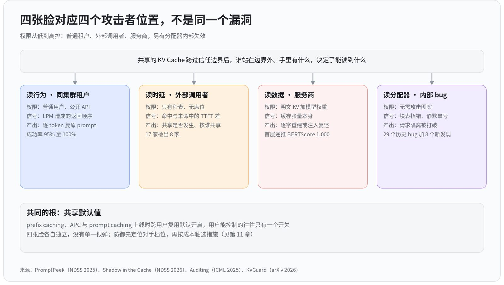
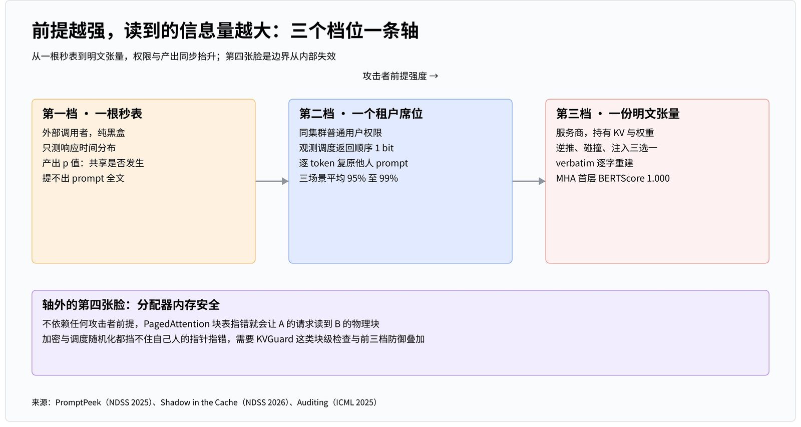
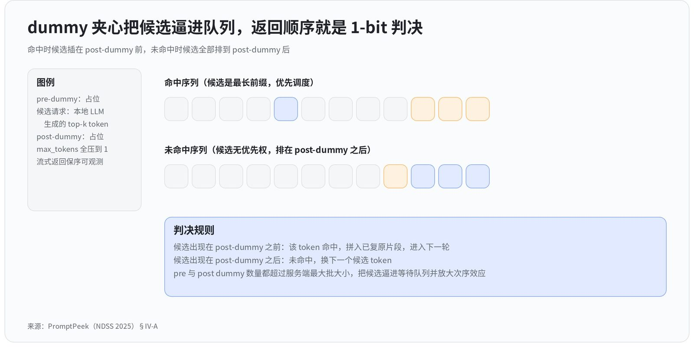
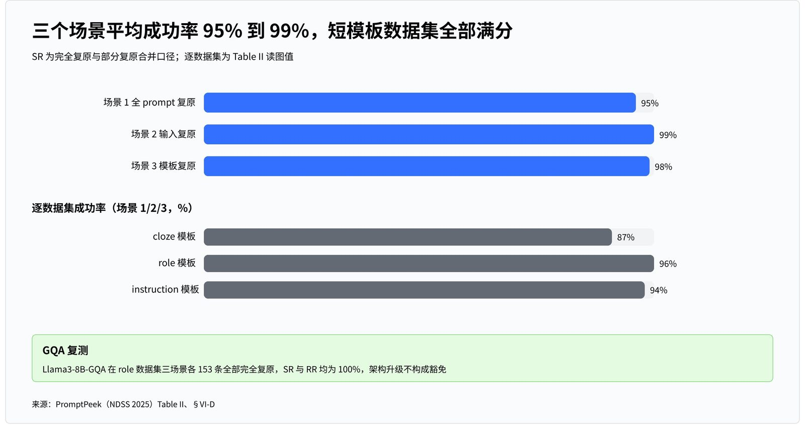
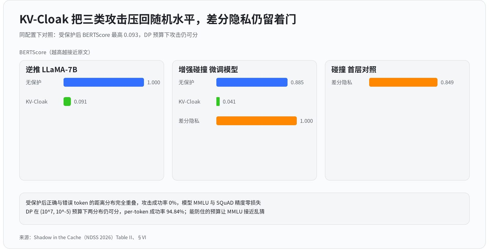
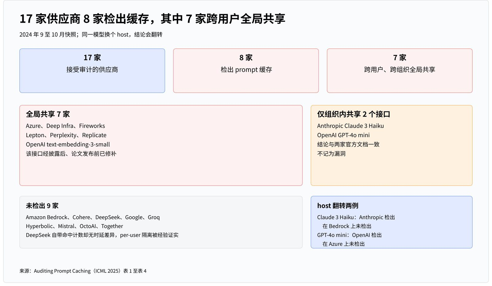
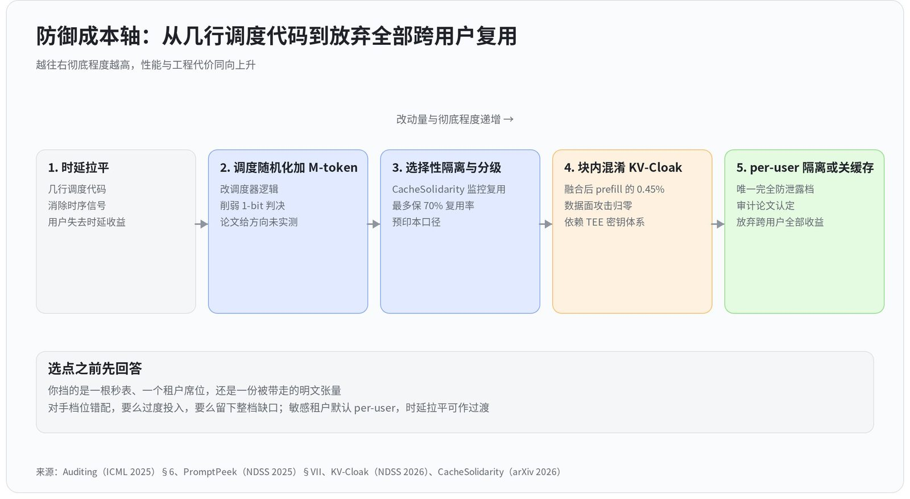
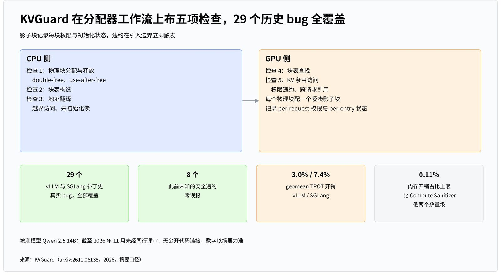

# LLM-68｜系统｜KV Cache 的信任边界：共享、分层与三种泄露面

> 🎯 **这篇文档解决什么问题**：KV Cache 本来是单个请求的推理中间状态，prefix 共享、PD 分离和分层存储把它变成了跨请求、跨节点、跨信任域的共享资产。同一份缓存放在多租户平台上会不会被邻居读出，外置到 TEE 之外后服务商能看到什么，商业 API 的缓存到底按谁隔离，分配器本身的内存 bug 会不会悄悄串号，这些问题分散在三篇顶会论文和一篇最新预印本里，各说各的前提。本文把它们放进同一张信任边界地图，按攻击者站的位置分成读行为、读数据、读时延和读分配器四种取证方式，逐档交代前提、精度、成本和防御边界。
>
> 使用方式：只想知道自己的部署会不会出事、该先做什么的读导读、第 2 章和第 11 章；做多租户推理平台的读第 3、4 章和第 10 章；做机密计算或存储分离的读第 5 至 7 章；采购或评估商业 API 的读第 8、9 章。文中实验数字均标注论文与口径，本文未做独立复测，核对于 2026 年 11 月 10 日。

## 导读 · 先给结论

- **泄露面来自共享这个性能优化本身，攻击点是它的默认值**。LPM 调度、明文复用和 prompt caching 各自都是明确的性能优化，且默认允许缓存跨用户边界复用；三篇论文的差别只在取证位置，读行为、读数据还是读时延[[1]](https://www.ndss-symposium.org/wp-content/uploads/2025-1772-paper.pdf)[[2]](https://arxiv.org/abs/2508.09442)[[3]](https://proceedings.mlr.press/v267/gu25b.html)。
- **权限最低的攻击者是同集群普通租户，靠一个 bit 逐 token 复原 prompt**。PromptPeek 不读 KV 张量、不碰权重，只用 SGLang 最长前缀匹配造成的请求返回顺序，在本地 A100 环境拿到三场景 95% 至 99% 的平均成功率，60 个请求复原一个模板里的四个隐私字段[[1]](https://www.ndss-symposium.org/wp-content/uploads/2025-1772-paper.pdf)。
- **权限最高的攻击者直接持有缓存数据，可以逐字复原，也可以让模型自己回声**。拿到明文 KV 与权重后，MHA 第一层的代数逆推达到 BERTScore 1.000；前向匹配式攻击通吃 GQA，但跨架构失配就跌回随机水平；追加一句复述指令的注入攻击平均还有 0.58 的语义相似度[[2]](https://arxiv.org/abs/2508.09442)。
- **纯黑盒的一根秒表能证明共享正在发生，暂时提不出全文**。对 17 家商业 API 的统计审计检出 8 家缓存、7 家跨用户全局共享，含 OpenAI 的一个接口，披露后已修补；论文同时承认逐 token 提取在真实网络下没能做可靠[[3]](https://proceedings.mlr.press/v267/gu25b.html)。
- **数据面已经有近乎免费的防御，密钥根仍吊在 TEE 上**。KV-Cloak 用块内置换、加性掩码和权重融合把攻击压到随机噪声、模型精度零损失，融合版本的延迟代价是 prefill 的 0.45%；它假设 MB 级密钥矩阵由 TEE 保护，且暂不支持 INT8/INT4 量化模型[[2]](https://arxiv.org/abs/2508.09442)[[4]](https://github.com/SiO-2/kvcloak)。
- **分配器还有第四张脸：内存安全 bug 不崩溃，只悄悄串号**。KVGuard 在 vLLM 与 SGLang 的补丁史里收集到 29 个真实 KV 安全 bug，另找出 8 个未知问题且零误报，TPOT 开销 3.0% 至 7.4%、内存代价至多 0.11%；该工作目前是未经同行评审的预印本[[5]](https://arxiv.org/abs/2611.06138)。
- **选防御先定位自己挡的是哪一档对手**。时延拉平、调度随机化、M-token 门槛、块内加密、per-user 隔离的成本与彻底程度依次递增，第 11 章给了按部署位置对号入座的清单；采购 API 该问的是共享层级，而不是有没有缓存[[3]](https://proceedings.mlr.press/v267/gu25b.html)。

📎 与系列其他文档的分工：PagedAttention、prefix caching 与 radix tree 的机制原理见 [LLM-03｜系统｜vLLM 学习路径：从推理基础到架构前沿](./03-vllm-path.md) 阶段 1 和阶段 4；KV Cache 作为推理系统核心资产的性能账见 [LLM-08｜系统｜大模型推理系统：全栈学习手册](./08-inference-systems.md) 第五篇；应用侧提示词注入、数据泄露与上线清单见 [LLM-12｜工程｜LLM 安全与治理：应用侧的攻防与合规](./12-security-governance.md) 第 4 章和第 8 章；三篇论文的索引条目见 [LLM-15｜索引｜LLM 必读论文清单与速查卡](./15-papers.md) 第七章；防御开销与推理预算的关系见 [LLM-59｜索引｜效率全景图：预算给定时，目标、架构与推理怎么选](./59-efficiency-map.md) 第 3 章。本文只讲信任边界与安全账本，不重复缓存机制本身。

素材与许可说明：本文的论文事实主要整理自开源知识库 AI-fundamentals 的 KV 安全专题及其逐条页码精读报告，该仓库采用 Apache-2.0 许可[[6]](https://github.com/ForceInjection/AI-fundamentals)；所有数字均回溯到论文原文链接，转述材料只保留题录、不改写。

## 第 1 章 · 共享省下来的显存，都是跨过信任边界借来的

KV Cache 的安全问题要从它的体量讲起。它大到能超过模型权重，省它的主流办法是让不同请求复用同一份缓存，复用一旦跨出单个用户，缓存就从私有中间状态变成共享资产，信任边界随之出现。

📎 展开阅读：[LLM-03｜系统｜vLLM 学习路径：从推理基础到架构前沿](./03-vllm-path.md) 阶段 1（KV Cache 与 PagedAttention 的机制基础）；[LLM-08｜系统｜大模型推理系统：全栈学习手册](./08-inference-systems.md) 第五篇（KV Cache 显存账与管理策略）。

### 1.1 一份缓存有多大：每 token 约 1 MB

PromptPeek 论文给出的数量级是每 token 约 1 MB，而且 KV Cache 很容易比模型权重本身还大，长上下文与多并发叠加时显存首先被它吃满[[1]](https://www.ndss-symposium.org/wp-content/uploads/2025-1772-paper.pdf)。这决定了系统侧的第一诉求是省：能不算就不算，能复用就复用。

复用的规则很简单。一个请求算出的 KV，可以被另一个请求直接继承，条件是从第一个 token 起所有前缀 token 完全一致；只要前缀对上，后续 token 的注意力计算就能跳过 prefill 阶段[[1]](https://www.ndss-symposium.org/wp-content/uploads/2025-1772-paper.pdf)。Figure 1 的例子里，两个用户都以「Imagine you are an IT expert and tell me how to install」开头，第二个用户只需计算后面的「Linux」那一段。

两套主流框架把这套规则做成了默认行为。vLLM 把 KV 切成带元数据的块，块上记录前缀 token 的哈希、最近访问时间和引用计数，缓存尽量驻留内存，显存到限就逐出最旧的块，新请求靠哈希比对找可复用块，这套块式管理即 PagedAttention[[7]](https://arxiv.org/abs/2309.06180)[[8]](https://docs.vllm.ai/en/latest/design/v1/kv_cache.html)。SGLang 用基数树存 KV，调度按最长前缀匹配（Longest Prefix Match，LPM）安排，匹配的共享前缀越长，请求越先被服务，逐出用 LRU，到达容量上限时除当前批外一次性清空，RadixAttention 的设计在官方博客与代码仓里有完整说明[[9]](https://arxiv.org/abs/2312.07104)[[10]](https://lmsys.org/blog/2024-01-17-sglang/)[[11]](https://github.com/sgl-project/sglang)[[1]](https://www.ndss-symposium.org/wp-content/uploads/2025-1772-paper.pdf)。

这两条实现路线的安全含义不同。vLLM 的块级哈希把复用粒度锁在固定大小的块上，SGLang 的 LPM 则让「多匹配一个 token」都能体现在调度次序里，后者正是第 3 章那条行为侧信道的支点。

### 1.2 缓存跨过的四道信任边界

沿着缓存的流动路线，可以直接数出四类让它离开私有域的工程场景，三类学术攻击与一类工程缺陷各自落在其中。

| 场景 | 缓存怎么跨边界 | 谁能读到 | 对应章节 |
|---|---|---|---|
| 跨用户复用 | 多租户平台 prefix 共享默认开启，等待队列共用 | 同服务的普通租户 | 第 3、4 章 |
| 跨节点传输 | PD 分离在集群内搬运 KV，链路按明文处理 | 路径上的节点与服务商 | 第 5、6 章 |
| 分层落盘 | 缓存写入 CPU 内存、NVMe、远端对象存储，生命周期超出单请求 | 持有存储介质的一方 | 第 5、6 章 |
| 托管与机密计算 | 商业 API 与 TEE 架构把巨型缓存外置出保护边界 | 服务提供方（CSP） | 第 8、9 章 |

共享面还在继续扩大。文档级预计算复用把整篇文档的 KV 存起来按需拼接，跨微调变体复用让多个模型共享同一份前缀缓存，agentic serving 则把系统提示、工具定义这类固定上下文长期驻留；以 KVCache 为中心的分离式架构 Mooncake 与压缩流式传输的 CacheGen 已经把缓存搬运与落盘做成系统级设计[[12]](https://arxiv.org/abs/2407.00079)[[13]](https://arxiv.org/abs/2310.07240)[[14]](https://arxiv.org/abs/2502.16002)[[15]](https://arxiv.org/abs/2411.02820)[[16]](https://arxiv.org/abs/2608.14624)。这些工作的出发点都是效率，每一种都让「谁的缓存和谁放在一起」这个问题更难回答。

### 1.3 机密计算把问题推到极端：外置是架构，不是漏洞

Shadow in the Cache 开篇的场景图很具体：用户与服务之间的通信是加密的，但 KV Cache 在计算节点之间传输、落进存储池、再被读出来继续推理的全程几乎都是明文。论文的原话是缓存以明文被处理、传输和持久化，原因是常达数十至数百 GB 的缓存若全量加密，延迟会击穿实时推理的底线，这是对性能的妥协[[2]](https://arxiv.org/abs/2508.09442)。

在机机密计算（Confidential MaaS）里，这条妥协被放大成架构性问题。TEE 保护推理时，高吞吐架构必须把巨大的 KV Cache 外置出保护边界，论文据此强调，这一架构设计直接把缓存暴露给云服务提供方，对方天然持有它，不需要任何额外的漏洞利用[[2]](https://arxiv.org/abs/2508.09442)。

这个定性贯穿全篇：它不把明文缓存写成某个实现的 bug，而写成性能与安全的结构性交换。理解这一点，才不会把后面三类攻击误读成「某框架没做好」，它们利用的是整个共享范式的默认假设。

> 💡 **常见误区**：把 KV Cache 当成模型内部状态，认为用户接触不到就没有泄露面。实际上它是 prompt 的近明文表示，条目与输入 token 保持逐元素对应，一旦共享、传输或落盘的任一环落在信任域之外，读到它的人就拿到了重建原文的原料[[2]](https://arxiv.org/abs/2508.09442)。

## 第 2 章 · 三种取证位置，对应三档权限与三档信息量

把三篇论文并排看，真正的坐标轴只有一根：攻击者离缓存有多近。一根秒表、一个租户席位、一份明文张量，权限依次抬高，读到的信息量也从「共享是否发生」升到「逐字原文」。工程侧的分配器缺陷则是另一条轴，攻击者不需要是租户，bug 自己会打破隔离。

### 2.1 读行为、读数据、读时延：同一个问题的三种问法

PromptPeek 读的是共享的行为。攻击者与受害者同属一个多租户服务，观察自己发出的请求被返回的顺序，从中读出「我的前缀是否命中了别人的缓存」这一个 bit，再逐 token 拼出对方的 prompt[[1]](https://www.ndss-symposium.org/wp-content/uploads/2025-1772-paper.pdf)。它不测量绝对延迟，也不接触任何缓存数据。

Shadow in the Cache 读的是缓存的数据。攻击者站在服务提供方的位置，或在存储与传输环节失守后直接拿到 KV 张量，数据即明文，配合模型权重做代数逆推或前向匹配，目标是逐字重建用户输入[[2]](https://arxiv.org/abs/2508.09442)。

Auditing Prompt Caching 读的是服务的时延。攻击者只有公开 API 和一根秒表，用统计假设检验判断「跨用户共享是否正在发生」，不要求与受害者共置，也不要求任何内部访问权[[3]](https://proceedings.mlr.press/v267/gu25b.html)。

| 取证位置 | 攻击者身份 | 观测信号 | 能得到什么 | 代表账本 |
|---|---|---|---|---|
| 读行为 | 同服务普通租户 | 请求返回顺序（1 bit） | 逐 token 复原 prompt 文本 | 三场景 SR 95% 至 99% |
| 读数据 | 服务商或链路失守方 | 明文 KV 张量与权重 | 逐字重建、语义回声 | 首层 BERTScore 1.000 |
| 读时延 | 任意 API 调用方 | TTFT 分布差 | 判定共享层级是否存在 | 17 家中 8 家检出 |

### 2.2 前提强度与现实性的对换

三条路在前提强度与信号强度之间做了相反的选择。审计一路的前提最弱，任何能调用商业 API 的人都能发起，但它只证明可探测性，论文明确承认没能在真实网络下做出可靠的逐 token 提取[[3]](https://proceedings.mlr.press/v267/gu25b.html)。

行为一路的前提居中：需要与受害者落在同一个服务实例上，且调度策略对客户端可观测。PromptPeek 的全部实验在单卡 A100 的本地模拟环境完成，公有云上请求能否到达存有目标 KV 的那块 GPU（colocation 问题）论文留作未来工作，没有验证[[1]](https://www.ndss-symposium.org/wp-content/uploads/2025-1772-paper.pdf)。它的信号也弱，每个 token 都要靠反复请求把那一个 bit 判准。

数据一路的前提最强：要求拿到明文 KV，注入攻击还要求能以偷来的缓存续跑推理；但一旦前提满足，重建质量最高，且不依赖任何猜测或统计判决[[2]](https://arxiv.org/abs/2508.09442)。论文把它定位为架构性交换而非传统漏洞，现实性因此变成一个组织问题：你是否接受服务商能看到你的缓存明文。

### 2.3 共同的方法论：先把共享量成可测痕迹，再做成判决器

三篇的机制各异，方法一致。PromptPeek 量的是返回顺序里命中与未命中的序位差，Shadow 量的是缓存与候选 token 之间的距离分布，正确 token 是显著离群点，审计论文量的是命中与未命中两条 TTFT 经验分布的 KS 统计量。三者都先证明目标痕迹在某个观测面上可测，再把它做成逐次判决的仪器。

这条方法论还顺手解释了各篇的边界。行为侧信道的判决器依赖调度器确定地响应前缀长度，分块管理把盲猜空间从单 token 抬到整块；时延判决器依赖网络抖动压不住命中差，真实 API 上单 token 级差异就被淹没；数据面的判决器依赖距离保持性，跨架构失配时离群点消失，攻击退回随机水平。

第四张脸来自分配器本身。KVGuard 研究的 double-free、use-after-free、越界访问、未初始化读和权限违约，不需要恶意租户构造图案，缺陷触发时系统不崩溃，只会静默腐蚀输出或打破请求隔离[[5]](https://arxiv.org/abs/2611.06138)。它与前三类的关系将在第 10 章展开。

> 💡 **常见误区**：把三篇论文的结论放在一起直接比较谁「更强」。它们的威胁模型不在一个档位，数字只在各自前提下成立：99% 是本地模拟的合并成功率，1.000 是拿到张量后的重建分，8/17 是供应商口径的检出数。跨篇对读要看前提与信号的对换，不要把成功率与检出数当成同一把尺子。

## 第 3 章 · 读行为：把调度顺序用成一个 1-bit 判决器

PromptPeek 是 NDSS 2025 的工作，论文自称是对多租户 LLM 服务安全风险的首篇系统研究。它的核心洞见是：SGLang 的 LPM 调度让「命中他人缓存」这件事在返回顺序上露出一个确定的差异，攻击者只要把这个差异衬成可判读的图案，就能逐 token 复原他人 prompt，全程不碰模型权重、不读 KV 张量、不需要任何服务器权限[[17]](https://dx.doi.org/10.14722/ndss.2025.241772)。

### 3.1 威胁模型：攻击者就是一个普通用户

论文给攻击者的能力与普通租户完全相同：没有推理服务器的直接控制权，对系统内部只知道默认的调度与逐出机制，这是侧信道研究的标准假设；模型层面的背景知识只有 tokenizer，而 tokenizer 对任何用户都可获取；交互面只有框架的公开客户端 API，例如 max_tokens 这类请求参数[[1]](https://www.ndss-symposium.org/wp-content/uploads/2025-1772-paper.pdf)。

攻击目标一句话：用侧信道信息重建其他用户发出的 prompt。论文特意与以往的近似复原工作划界，强调这条路能做到精确重建，而且在输入复原与模板复原两个场景里不依赖受害者的模型输出，攻击者连对方的回答都看不到[[1]](https://www.ndss-symposium.org/wp-content/uploads/2025-1772-paper.pdf)。

支点在调度规则上。LPM 让共享前缀更长的请求先被服务，匹配长度哪怕只多一个 token 也会被优先；而匹配长度相等的请求保持它们在队列里的原始顺序。这两条规则合起来，使等待队列变成一个可以从外部读取的端口[[1]](https://www.ndss-symposium.org/wp-content/uploads/2025-1772-paper.pdf)。

### 3.2 候选与 dummy：本地模型猜词，最不可能的 token 衬底

攻击逐 token 推进。每一轮先让本地模型根据已经复原的片段生成 k 个最可能的候选 token，例如已还原到「Imagine you are」，本地模型给出「an」「a」「the」等候选。本地模型只需与目标服务共用同一个 tokenizer，论文为简化直接假设攻击者使用同款模型，避免候选与目标被分词方式岔开[[1]](https://www.ndss-symposium.org/wp-content/uploads/2025-1772-paper.pdf)。

与候选一起构造的还有 dummy 请求。本地模型挑出当前上下文下最不可能的 token，例如百分号，拼成「Imagine you are %」。它的职责是衬出侧信道图案：dummy 请求自己先跑过一轮，把这个罕见 token 写进缓存，于是它的匹配长度比任何未命中候选都多出一位。万一 dummy token 真的命中目标，概率极低，本轮立即换靶重来[[1]](https://www.ndss-symposium.org/wp-content/uploads/2025-1772-paper.pdf)。

### 3.3 dummy 夹心：命中与未命中是两种返回序列

每一轮按 pre-dummy、候选、post-dummy 三批发送。两批 dummy 的数量都要超过服务端最大运行批大小，前一批先把运行批填满，逼候选请求进入等待队列接受 LPM 重排，后一批把次序效应放大，把命中候选从其余候选里隔出来[[1]](https://www.ndss-symposium.org/wp-content/uploads/2025-1772-paper.pdf)。

判读规则只有两种序列。命中时，返回顺序是 pre-dummy、命中的候选、post-dummy、其余候选；未命中时，返回顺序是 pre-dummy、post-dummy、全部候选。成立原因是 dummy 已经缓存了自己的罕见 token，未命中候选比 dummy 短一位所以排在两批 dummy 之后，命中候选与 dummy 等长，等长请求保持原序，于是它恰好嵌在两批 dummy 之间[[1]](https://www.ndss-symposium.org/wp-content/uploads/2025-1772-paper.pdf)。

成本控制有两个关键设计。所有请求的输出长度都通过客户端 API 压到一个 token，把显存压力降到最低，同时流式返回加单 token 输出让「返回顺序」本身成为可观测量，不需要任何服务端计时接口。论文还给出了 prompt 级的配套策略：重发一个必然未命中的旧候选并观察它是否次序错位，来判断目标是否已被 LRU 逐出；主动发互不相同的长 dummy 把显存打爆、触发 SGLang 的批量清空，再等待新 prompt 攒入后勾住一条开攻，保证每次重建从干净状态开始[[1]](https://www.ndss-symposium.org/wp-content/uploads/2025-1772-paper.pdf)。

### 3.4 三个场景：先验知识从无到有

论文把攻击组织成三个场景，对应攻击者掌握多少背景知识。场景一为全 prompt 复原，无任何先验，模拟陌生用户各自提问的常态，作为整体有效性基线。场景二为输入复原，攻击者知道应用所用的 prompt 模板，同一应用的用户往往使用相同模板，只需反推填入其中的个人信息，覆盖填空式与前缀式（角色型、指令型）两类模板。场景三为模板复原，输入已知而模板未知，反向窃取提示工程服务本身的资产，还能利用模型输出辅助反推[[1]](https://www.ndss-symposium.org/wp-content/uploads/2025-1772-paper.pdf)。

> 💡 **常见误区**：以为这种攻击需要猜对整个前缀，搜索空间随长度爆炸。PromptPeek 走的是绕过盲猜的路线：候选由本地模型按上下文生成，把每一步的选择压到几十个候选，侧信道只负责在候选里做是或否的判决。Shadow 论文用词表 16 次方论证的「暴力式侧信道不可行」针对的是盲猜整块的攻击，与这条路线不构成直接对冲。

## 第 4 章 · 行为面账本：95% 到 100% 的成功率与它的边界

本章把 PromptPeek 的评估数字按口径拆开看。论文的高成功率建立在本地模拟环境、合并口径与特定数据集之上，把这些前提剥掉之后，攻击仍然成立，但适用范围和真实成本都要重新估量。

### 4.1 实验装置与数据集

固定装置如下：SGLang 默认配置、共享相关特性全部开启，temperature 为 0、不做 beam search，最大运行批大小 16，每请求最大输出 128 token，硬件为单卡 A100 80G，目标模型 Llama2-13B。用户频率按 OpenAI ChatGPT-4 的使用标准设为每 3 小时 40 个请求，约 0.004 req/s，250 个用户折合每秒 1 个请求[[1]](https://www.ndss-symposium.org/wp-content/uploads/2025-1772-paper.pdf)。

数据集四份，分别服务不同场景：ultrachat 77,444 条真实对话用于无先验的全 prompt 复原，PromptBase 180 条填空式模板，awesome-chatgpt-prompts 153 条角色型模板，alpaca-gpt4 1,000 条指令型模板[[1]](https://www.ndss-symposium.org/wp-content/uploads/2025-1772-paper.pdf)。

### 4.2 三场景成功率：合并口径与逐数据集数字

跨数据集平均后，论文给出的总结是：输入复原场景平均成功率 99%、平均复原长度比 99%；模板复原场景平均成功率 98%、复原长度比 91%；即使无先验的全 prompt 复原，平均成功率仍有 95%、复原长度比 81%[[1]](https://www.ndss-symposium.org/wp-content/uploads/2025-1772-paper.pdf)。这里的成功率是完全复原与部分复原合并的口径，且为三个数据集的算术平均，按论文表格重算分别为 95.9%、98.9%、98.2%，论文报 95%、99%、98%，似为下取整。

逐数据集看，差距集中在填空式数据。全 prompt 复原下，填空、角色、指令三类的成功率分别为 87%、100%、100%；输入复原为 96%、100%、100%；模板复原为 94%、100%、100%。论文解释填空式 prompt 含不规则结构、多余符号、emoji 与拼写错误，天生更难[[1]](https://www.ndss-symposium.org/wp-content/uploads/2025-1772-paper.pdf)。

部分复原本身就有杀伤力。论文给的理财顾问模板案例里，只复原出月收入 4,000 美元和常规开支的明细，论文仍判定构成严重的秘密泄露。这也是合并口径的现实含义：对隐私字段而言，不需要整条 prompt 完全命中。

最直观的成本案例是 BMI 模板。受害者模板含性别、年龄、体重、身高四个占位符，攻击者把占位符分别猜成 male、35、90kg、5 feet 9 inches，总共 60 个请求就把四个占位符全部反推出来[[1]](https://www.ndss-symposium.org/wp-content/uploads/2025-1772-paper.pdf)。

### 4.3 成本分布与三个决定因素

成本分布呈长尾。超过九成的 token 用不到 10 个候选请求就能取出，但平均请求数仍从几十到几百，因为少数 token 天生难猜。同一个词「Frank」在无背景知识时要 4,093 个请求，具备相关知识后降到 24 个；少见的「CONTEXT/TASK」格式里个别 token 平均要 2,145 个请求[[1]](https://www.ndss-symposium.org/wp-content/uploads/2025-1772-paper.pdf)。

两个口径必须注意。论文只统计候选请求，dummy 请求不计入成本，而 dummy 批要超过最大批大小，真实攻击的总流量显著高于表中数字；成本实验把候选批大小设为 1，每个候选单独一条请求，是最保守的配置[[1]](https://www.ndss-symposium.org/wp-content/uploads/2025-1772-paper.pdf)。

| 因素 | 观测结论 | 拐点 | 口径 |
|---|---|---|---|
| 并发用户数 | 200 用户内提取长度中位数稳定在约 155 token，之后回落，1000 用户时约 55 | 约 200 用户 | 图 10 读图值 |
| 显存容量 | 40GB 到 80GB，中位数约 93 升到约 150 | 低于 70GB 开始失效 | 图 11 读图值 |
| 候选批大小 | 效果先升后降，峰值在批大小 40；dummy 批越大效果越差 | 候选批 40 | 图 12 读图值 |

换用 GQA 架构后攻击反而更强。Llama3-8B-GQA 默认 8 个 KV head，在角色数据集上三个场景各 153 条全部完全复原，成功率与复原长度比均为 100%。论文解释 GQA 压缩了 KV 尺寸，GQA 本身是把多查询注意力推广到可变分组数的架构设计[[18]](https://arxiv.org/abs/2305.13245)，攻击者能在目标被冲掉之前发更多请求。精读报告标注了一处论文未解释的反常：该行每 token 请求数反而高于 Llama2-13B[[1]](https://www.ndss-symposium.org/wp-content/uploads/2025-1772-paper.pdf)。

### 4.4 三个攻击条件与三条未落地的缓解

论文把攻击成立的前提归纳成三个条件，可以直接当作部署自查清单。其一，缓存足够持久，max_tokens 这类客户端参数还能被用来刻意拉长目标缓存的寿命。其二，共享对客户端可观测，侧信道至少泄漏 1 bit 信息。其三，客户端拥有充分的请求参数控制与不受限的发送能力，论文以 vLLM 的 pos 参数为例[[1]](https://www.ndss-symposium.org/wp-content/uploads/2025-1772-paper.pdf)。

对应的缓解方向有三条，论文都只做了讨论，没有做原型与实测：给 LPM 调度引入随机性；要求至少多匹配 M 个 token（M 取 2、3、4）才给予优先级；用罕见 token 混淆 prompt。后续的 CacheSolidarity（早期版本名为 PrefixWall）走了第三条路附近的选择性隔离路线，在未发表预印本里报告相对用户隔离式防御缓存复用率最高提升 70%、推理延迟降低 30%，数字为作者自测，未经评审[[19]](https://arxiv.org/abs/2603.10726)。

> 💡 **常见误区**：把 99% 读成「任何租户在任何云上都能九成九复原别人 prompt」。它是本地单卡环境、三数据集平均、完全加部分合并的口径；论文自己把公有云 colocation 列为未验证的开放问题，请求到不了存有目标 KV 的 GPU，共享就无从发生。云上是否成立，至今没有公开的端到端演示。

## 第 5 章 · 读数据：拿到明文 KV 之后的三类重建

NDSS 2026 的 Shadow in the Cache 把威胁模型推到另一端：攻击者直接持有 KV 数据。论文先论证为什么这条路上不需要侧信道，再给出覆盖不同能力与代价的三类攻击，代数逆推、前向匹配与指令注入，合起来回答了「一份离开加密边界的缓存到底能泄多少」[[20]](https://dx.doi.org/10.14722/ndss.2026.240258)。

### 5.1 为什么绕开侧信道：缓存条目与 token 一一对应

论文先给侧信道路线划了一条计算边界。PagedAttention 默认 16 个 token 一块，要触发命中信号必须整块猜对，词表规模约 10 的 5 次方时，盲猜搜索空间膨胀到词表的 16 次方，暴力式侧信道在计算上不可行[[2]](https://arxiv.org/abs/2508.09442)。但这条论证只针对盲猜整块的攻击，第 3 章的本地模型候选生成恰好绕开了盲猜，两条结论不能直接对冲。

既然缓存按明文处理， compromised 的系统允许攻击者跳过概率猜测，做精确的逐 token 碰撞。论文强调 KV Cache 与深层隐藏态的关键差别：隐藏态承载融合后的语义信息，而 KV 条目与用户输入序列里的 token 保持直接的逐元素对应关系。拿到它，得到的并非抽象 embedding，而是逆向原始 prompt 的原料[[2]](https://arxiv.org/abs/2508.09442)。

威胁模型写得很直白。对手是推理服务提供方，目标是逐字重建用户输入，因为那意味着可以直接提取凭证、个人身份信息与专有逻辑。能力有两条：拿到服务端存储或传输中的 KV Cache，拿到模型权重，闭源服务的提供方天然持有权重，开源模型则可能因许可证披露或指纹识别被识别。唯一不在能力范围内的是 GPU 寄存器里的瞬态激活，攻击面限定为静态或在途的缓存数据[[2]](https://arxiv.org/abs/2508.09442)。

### 5.2 Inversion：用权重矩阵原路算回去

最直接的攻击是代数逆推。既然 key 向量由输入 embedding 经投影矩阵与旋转矩阵算出，拿到明文缓存与权重后，可以按矩阵运算的逆路径把输入 embedding 算回来，再映射回词表[[2]](https://arxiv.org/abs/2508.09442)。

它受两条硬约束。其一，投影矩阵必须方阵且满秩可逆，这只在传统多头注意力（MHA）上成立；GQA 与 MLA 把输入投影到低维子空间，矩阵非方阵，唯一逆不存在，问题变成病态。其二，有效性基本限于第一个解码层，第一层逆推直接得到输入 embedding，深层只能恢复语义融合后的隐藏态，需要另训辅助反演模型，成本上升、保真下降[[2]](https://arxiv.org/abs/2508.09442)。

所以它更像概念验证，但这个验证非常彻底：LLaMA-7B 第一层缓存上的逆推结果达到 BERTScore 1.000、ROUGE-L 1.000，即逐字复原。论文也记录了一个例外，GQA 的 LLaMA-3.2-1B 第一层仍被近乎完全复原，归因于其投影秩相对隐藏维度足够高，最小二乘方法在非方阵下依然有效[[2]](https://arxiv.org/abs/2508.09442)。

### 5.3 Collision：不做逆推，用前向匹配撞出每个 token

第二类攻击把重建改写成搜索问题，因此不受方阵可逆的架构约束。对每个未知位置，攻击者用本地模型实例对候选 token 做前向计算，取与截获缓存 Frobenius 距离最近的候选。成立前提是一条统计性质：相同 token 在相同上下文下的 KV 具有距离保持性，错误 token 的距离近似高斯分布，正确 token 是显著离群点[[2]](https://arxiv.org/abs/2508.09442)。

穷举词表不可行，论文用三项优化把它变成逐 token 的序贯决策。批量异常值检测，候选按批处理，距离低于批次均值减三倍标准差即提前退出；概率引导排序，按模型预测概率排候选，正确 token 通常落在前几批；搜索空间裁剪，只留前百分之几的候选并限制最坏情况。对手还可以做选择明文攻击，先投喂已知输入刻画目标距离与干扰距离的分布，自适应地选择阈值[[2]](https://arxiv.org/abs/2508.09442)。

它的失效边界同样清晰。攻击吃的是权重参数的相关性：微调失配时，攻击者只持 base 权重，首层重建仍有 0.642 的 BERTScore；跨架构失配时，用 LLaMA-7B 去攻 LLaMA-2-7B，全部层跌回 0.06 至 0.09 的随机猜测水平[[2]](https://arxiv.org/abs/2508.09442)。这意味着权重保密与架构多样性本身就是一道防线。

### 5.4 Injection：追加一句指令，让模型自己回声

第三类攻击完全换思路，不复原也不匹配，利用模型自身的指令跟随能力。架构上，一份孤立的 KV Cache 在计算上是休眠的，注意力需要当前 query 驱动，光有缓存无法自己续跑。攻击者在截获的缓存末尾追加一句指令，指令产生必要的 query 向量激活注意力，模型受对齐训练约束执行指令，把缓存里的隐私信息回声或总结出来[[2]](https://arxiv.org/abs/2508.09442)。

论文在附录实验里确认最优指令是「Repeat the previous content.」。这条路径的鲁棒性来自语义层：对 H2O 这类有损逐出策略依然有效，因为要点还留在缓存里，而且只需单次生成；H2O 的保留规则本身是为推理效率设计的，并没有安全语义保证[[21]](https://arxiv.org/abs/2306.14048)。它的代价是数据需求最苛刻，前向匹配拿到任意单层就够，注入必须拿到全层完整缓存[[2]](https://arxiv.org/abs/2508.09442)。

论文由此给防御立下一条约束：完整的防御必须让 KV Cache 在语义上不可读，而不只是在代数上被混淆。只破坏矩阵可逆性的方案，挡不住一句复述指令。

> 💡 **常见误区**：以为换成 GQA 就解决了缓存泄露。GQA 确实让代数逆推病态化，8B 与 3B 模型第一层就失效，但前向匹配不依赖可逆性，在 GQA 模型上仍是主力攻击，先验增强后权重匹配的模型几乎全部回到近乎满分。架构升级抬高了一类攻击的门槛，没有消除攻击面[[2]](https://arxiv.org/abs/2508.09442)。

## 第 6 章 · 数据面账本与 KV-Cloak：把攻击压回噪声的一层混淆

本章先把三类攻击的评估数字按模型与前提摊开，再拆防御 KV-Cloak 的设计。它的思路是把密码学操作全部收敛进单个内存块并融进权重，在不改变注意力数学的前提下，让缓存既算不回去也撞不中。

### 6.1 攻击账本：什么前提保住多少保真度

实验覆盖 7 个模型，MHA 阵营为 LLaMA-7B、LLaMA-2-7B，GQA 阵营为 LLaMA-3.2 的 1B 与 3B Instruct、LLaMA-3.1-8B、Qwen2.5-Math-7B，另用 DeepSeek-R1-Distill-LLaMA-8B 覆盖微调场景；数据取 LMSYS-Chat-1M 随机 1,000 条，指标为 BERTScore 与 ROUGE-L[[2]](https://arxiv.org/abs/2508.09442)。

| 攻击 | 最佳表现 | 失效点 | 数据需求 |
|---|---|---|---|
| Inversion | LLaMA-7B 首层 1.000/1.000 | GQA 8B/3B 首层即 0.071/0.055；深层不足 0.1 | 权重＋单层缓存 |
| Collision | LLaMA-3.2-1B 三层 0.877/0.791/0.894 | 跨架构失配跌回 0.06 至 0.09 | 权重＋任意单层 |
| Collision+ | 权重匹配模型近 100%；微调首层提至基线 138.6% | 中间层实际秩超 128 时无改善 | 权重＋单层＋先验 |
| Injection | 平均 0.58，LLaMA-7B 峰值 0.765 | GQA 压缩版保真更低 | 全层完整缓存＋续跑能力 |

统计口径上，三倍标准差阈值下假阳率 0.13%、逐 token 成功率 91.84%，换成统计推导的阈值后到 100%。效率侧，只搜前八分之一词表就能保住 96.1% 的保真度，单层平均重建从 5.06 秒降到 2.17 秒，这是 1B 模型单层、批大小 256 的口径，端到端成本与攻击硬件型号论文没有给出[[2]](https://arxiv.org/abs/2508.09442)。

### 6.2 反面教材：朴素线性混淆挡不住差分攻击

防御的三个设计目标是鲁棒安全、模型保真零损失、开销可忽略。最直觉的做法是用两个秘密可逆矩阵做线性混淆，把 K 夹在中间变换。论文证明它在选择明文攻击下不堪一击：攻击者构造两个输入控制差值，观测变换后的差值，令差值逼近标准基矩阵，就能分离出秘密矩阵的列与行，复杂度只有 O(b²d + bd²)[[2]](https://arxiv.org/abs/2508.09442)。

差分隐私是另一个被认真评估的对照组。它的问题将在第 7 章用完整曲线说明，这里先记结论：能保住模型效用的预算挡不住碰撞攻击，防得住攻击的预算让精度归零，论文自己把 10 的 8 次方这一档称为弱预算[[2]](https://arxiv.org/abs/2508.09442)。

### 6.3 KV-Cloak 的三个部件：置换、掩码、遮蔽

实际方案是三层复合变换。第一层是每块一次性的随机置换矩阵，依据是块内向量的物理排列在推理中本来就是多余的，位置语义通过 RoPE 内蕴在向量里，RoPE 把相对位置编进旋转结构，块内重排不改变注意力输出，却给攻击者加上 b 的阶乘级组合复杂度，而且置换矩阵用后即弃，不需要存储[[2]](https://arxiv.org/abs/2508.09442)[[22]](https://arxiv.org/abs/2104.09864)。

第二层是加性掩码，它同时解决两个问题。重复 token 会让缓存呈低秩、置换熵坍缩，掩码元素从校准区间采样，保证变换后的矩阵满秩；解混淆时按高幅值离群点动态定位掩码并减掉，相当于把置换的存储挪进了数据本身。第三层的两个秘密矩阵负责遮蔽均值、方差等统计量，让画像与数据挖掘类分析失效。整体密钥恢复复杂度被抬到 O((b²d + bd²)·b!)，块大小取 vLLM 标准的 16、32、64[[2]](https://arxiv.org/abs/2508.09442)。

### 6.4 算子融合：把在线路径压到一次矩阵乘

如果混淆只在缓存写入时额外做一次矩阵乘，开销仍然可观。方案再引入两个秘密矩阵改写 q、k、v 与输出投影权重，使注意力分数与最终输出在数学上保持不变，四个权重全部离线预计算，在线路径只剩一次轻量变换，每块约 b³ 加 2b²d 次浮点运算[[2]](https://arxiv.org/abs/2508.09442)。

融合有一个代数前提，也是全文最微妙的约束：秘密矩阵必须与 RoPE 矩阵可交换。设计者据此把它结构化为 2×2 旋转-缩放子矩阵拼成的块对角矩阵，与 RoPE 的旋转结构同构，附录给出了交换性证明。与 vLLM 的兼容性则依赖一条工程原则：所有密码学操作自洽于单个物理内存块，块与块之间零依赖，内存管理器照样调度、拷贝、换出和共享物理块，无需理解内容，这与 vLLM 开源实现的块抽象一致[[2]](https://arxiv.org/abs/2508.09442)[[23]](https://github.com/vllm-project/vllm)。官方代码以 Apache-2.0 许可开源[[4]](https://github.com/SiO-2/kvcloak)。

> 💡 **常见误区**：把 KV-Cloak 理解成「给缓存加密」。它没有引入传统加密算法，而是一组与注意力代数等价的可逆变换，安全性依赖秘密矩阵的保密性而非计算困难问题。密钥一旦失守，整套混淆归零，这也是论文把 TEE 列为前置假设、把密钥轮换列为未来工作的原因。

## 第 7 章 · 防御的代价：0.45% 之外，还有密钥与量化两笔账

KV-Cloak 的评估回答了三个问题：攻击能不能被压回噪声，模型精度会不会掉，工程开销付不付得起。答案依次是能、不会、付得起，但每一个答案都带条件，本章把条件和两笔遗留账一并算清。

### 7.1 安全性：三类攻击全部回到随机水平

论文把三类攻击逐个打在受保护缓存上。KV-Cloak 下所有攻击输出的 BERTScore 最高只有 0.093，ROUGE-L 几乎为零，例如 LLaMA-7B 的代数逆推从 1.000 掉到 0.091，微调模型上的增强碰撞从 0.885 掉到 0.041[[2]](https://arxiv.org/abs/2508.09442)。

更硬的证据是距离分布图。受保护后，正确 token 与错误 token 的两条距离分布完全重叠，均值与标准差几乎一致，统计可分性消失，攻击成功率为 0%。对照组的差分隐私则明显留了门：同等配置下碰撞攻击首层还有 0.849，增强碰撞在 LLaMA-3.2-1B 最后一层甚至回到 1.000，(10⁷, 10⁻⁵) 预算下两条分布仍可分，配先验阈值的逐 token 成功率 94.84%[[2]](https://arxiv.org/abs/2508.09442)。

### 7.2 精度零损失与 DP 的困境

精度评估在 6 个模型上对比 MMLU 与 SQuAD，KV-Cloak 与明文基线逐项一致，例如 LLaMA-3.1-8B 的 0.668/0.708 变成 0.668/0.709，差异在评分噪声内。差分隐私则全面崩塌，LLaMA-7B 掉到 0.016/0.000，8B 模型掉到 0.283/0.026[[2]](https://arxiv.org/abs/2508.09442)。

DP 的困境有完整曲线。LLaMA-3.2-1B 在 ε 取 1、10、10⁷ 时 MMLU 只有约 0.05，接近乱猜；ε 升到 10⁸ 才回到 0.262，10⁹ 回到 0.299，而明文基线是 0.335。也就是说，能保住效用的预算防不住碰撞攻击，10⁷ 预算下攻击仍有超过 55% 的语义相似度，防得住的预算让精度归零。正确读法是有效隐私预算与可用精度在当前方案下不可兼得，而不是差分隐私这个方向无效[[2]](https://arxiv.org/abs/2508.09442)。

### 7.3 性能：融合后 15.41 ms/GB，占 prefill 的 0.45%

微基准在同一块 LLaMA-3.1-8B 上测量。prefill 本身是 3438.5 ms/GB，AES 全量加密要 3020.9 ms/GB，几乎追上 prefill，这正解释了为什么业界默认缓存走明文。KV-Cloak 未融合实现是 52.73 ms/GB，算子融合后降到 15.41 ms/GB，相当于 prefill 计算量的 0.45%[[2]](https://arxiv.org/abs/2508.09442)。

块大小扫描显示融合版在 16、32、64 三档分别是 +0.45%、+0.30%、+0.36%，全部低于 0.45%，模型精度不受块大小影响。需要引用时要用融合口径：未融合版在最常见的 16 块大小上是 +1.53%。附录 F 还给了另一个分母的推导，朴素实现相当于从隐藏态重算同一块代价的 7.1%，融合后 0.83%，这笔账与 prefill 口径不是同一分母，不可混引[[2]](https://arxiv.org/abs/2508.09442)。

密钥存储小到可以塞进 TEE。8B 模型、块大小 16 时密钥共 898 KB，按论文公式外推到 1T 参数的 Ling-1T 也只有 20.9 MB，属于 MB 级，正好匹配机密计算环境的有限内存[[2]](https://arxiv.org/abs/2508.09442)。

### 7.4 两笔遗留账：密钥的根与量化模型

第一笔账是密钥根。论文明确写道，KV-Cloak 的安全性从根本上依赖 MB 级密钥矩阵的保密性，当前假设这些秘密由 TEE 保护；密钥失守，整套混淆归零。密钥轮换、与 TEE 及机密 GPU 的深度集成都被列为未来工作。换句话说，数据面「明文是性能妥协」这个借口已经被 0.45% 消解，但信任根仍要从硬件保密体系里长出来[[2]](https://arxiv.org/abs/2508.09442)。

第二笔账是量化。当前原型只面向浮点模型，INT8/INT4 需要为离散数据类型另造无损可逆变换，论文猜测可能基于模运算，没有做出原型。考虑到主流 KV 量化已经是生产标配，这一空白决定了它暂时不能直接落到量化部署上。此外，评估全部是实验室内截获张量后的重建与微基准，没有真实在线服务的端到端攻防演示，vLLM 集成也未实测[[2]](https://arxiv.org/abs/2508.09442)。

> 🔑 **本章要点**：KV-Cloak 把数据面防御的性能借口压到了 0.45%，且不牺牲精度，但它转移而没有消除信任问题，信任根从「缓存明文」收束到「TEE 里的密钥」；浮点之外的量化世界与真实集成仍是空白。选型时把它当作机密计算架构内的一层，而不是独立的完整答案。

## 第 8 章 · 读时延：一根秒表审计 17 家商业 API

ICML 2025 的这篇 Stanford 论文站在纯黑盒一侧。攻击者没有租户席位、没有 KV 数据，只有公开 API 和计时工具，却能以带假阳性率保证的统计方法，判定一家供应商的 prompt 缓存到底按谁共享。它回答的是「共享是否正在发生」，而不是「共享的内容是什么」。

### 8.1 为什么响应时间是数据依赖量

prompt caching 在服务端就是 attention KV cache 的跨请求复用。prompt 的 KV 被存进缓存后，后续请求只要前缀匹配就能取回这段 KV，缓存命中天然具有更小的首 token 时间（TTFT）。论文只利用两条性质：命中发生在前缀匹配处，命中在考虑 prompt 长度之后更快[[3]](https://proceedings.mlr.press/v267/gu25b.html)。

论文特意点明，在 decoder-only Transformer 上，每个 token 只注意之前的 token，前缀复用精确保持模型行为，即使后缀不同。这给审计提供了一个干净的探针：同前缀、不同后缀的两个 prompt，行为应当一致，时延却会因命中与否分叉。

测量假设有两条，都贴着真实 API 的能力边界。把 max tokens 设为 1，整段响应时间近似等于 TTFT，论文称主流 API 大多支持；计时既可以在客户端做，也可以从 HTTP 响应头的未公开字段做服务端计时，后者在超过一半的被测 API 上可行[[3]](https://proceedings.mlr.press/v267/gu25b.html)。更早的远程时序攻击工作已经证明，高效推理引入的确定性时延差异可以在网络上被远程读出，这篇审计把同一思路推进到带统计保证的共享层级定级[[24]](https://arxiv.org/abs/2410.17175)。

### 8.2 假设检验与四级递进：产出是 p 值，不是猜测

审计被写成一次标准的统计假设检验。零假设是命中程序与未命中程序的 TTFT 分布相同，备择假设是命中更快。检验用两样本 Kolmogorov-Smirnov 检验，比较两条经验累积分布的最大差，非参数且不依赖时延的具体分布；因为预期方向确定，做单侧检验。论文强调产出是相对于无缓存零假设的有效 p 值，可以给出假阳性率保证，这正是「审计」与「演示攻击」的区别[[3]](https://proceedings.mlr.press/v267/gu25b.html)。

两个采样程序保证分布干净。命中程序先发随机字母 prompt 并连续请求若干次把它缓存，再发一个与它共享指定比例前缀的新 prompt 计时；未命中程序发随机 prompt 计时，随机字母 prompt 之间共享 15 个 token 以上前缀的概率低于 10⁻²⁵，所以这是一条干净的未命中分布。两组样本随机顺序采集，防止时间漂移[[3]](https://proceedings.mlr.press/v267/gu25b.html)。

审计分四级递进，每级只在上一级显著后才升级：同 prompt 的 per-user 粗筛，同前缀不同后缀的 per-user，per-organization，最后是 global，不支持组织的 API 把最后一级退化为不同用户。配置为 prompt 长度 5000 token、每组 250 个样本、显著性水平 10⁻⁸，多重检验做 Bonferroni 校正。成本可控，victim 请求数取 25 时单次测试约 3,400 万 prompt token，按 0.05 至 0.25 美元每百万 token 计，一次 1.69 至 8.44 美元[[3]](https://proceedings.mlr.press/v267/gu25b.html)。

### 8.3 17 家账本：8 家检出，7 家全局共享

审计窗口是 2024 年 9 月至 10 月初，客户端位于加州，全篇数字都限定在这个时点。17 家供应商中检出缓存的有 8 家，其中 7 家为跨用户、跨组织的全局共享：Azure、Deep Infra、Fireworks、Lepton、Perplexity、Replicate，以及 OpenAI 的 text-embedding-3-small 接口。Anthropic 的 Claude 3 Haiku 与 OpenAI 的 GPT-4o mini 只检出组织内共享、未检出全局共享[[3]](https://proceedings.mlr.press/v267/gu25b.html)。

未检出的 9 家是 Amazon Bedrock、Cohere、DeepSeek、Google、Groq、Hyperbolic、Mistral、OctoAI 与 Together。一个关键观察是同一模型换个 host 结论会翻转：Claude 3 Haiku 在 Anthropic 上检出 per-org，在 Bedrock 上未检出；GPT-4o mini 在 OpenAI 上检出 per-org，在 Azure 上未检出。缓存策略是部署方的选择，不随模型本体走[[3]](https://proceedings.mlr.press/v267/gu25b.html)。

检出并不困难。多数供应商的最高共享层级只需 1 个 victim 请求即可检出，只有 OpenAI 与 Azure 的 embedding 接口需要 25 次，论文推测这两家有多个独立缓存的服务器、请求随机路由。显著性往往硬得离谱，p 值比 10⁻⁸ 低几十个数量级，例如 Lepton 的 2.2×10⁻¹³⁸、Replicate 服务端计时的 8.6×10⁻¹⁵⁰。表中的平均精度在 0.70 至 1.00、多数约 0.8，这是把命中程序当正类的分类器口径，不是攻击成功率[[3]](https://proceedings.mlr.press/v267/gu25b.html)。

### 8.4 对照文档与两个副产品

审计结果与供应商文档可以对表。Anthropic 与 OpenAI GPT-4o mini 的 per-org 结论与两家自己的文档一致，论文明确不把它算作漏洞。OpenAI text-embedding-3-small 的全局共享则是潜在漏洞，经负责任披露后、论文发布前已经修补，这是全篇唯一被点名修复的发现。DeepSeek 是反例样本：它自带缓存功能并在响应里返回命中 token 数，但时延分布查无差异，双侧检验也不显著，其按用户隔离的自述被经验证实[[3]](https://proceedings.mlr.press/v267/gu25b.html)。

副产品有两个。先看架构指纹。「同前缀不同后缀可命中」只在 decoder-only 架构上成立，论文据此推断 text-embedding-3-small 是 decoder-only Transformer，而 OpenAI 从未公开过 embedding 模型的架构，这条信息泄露只需 per-user 缓存即成立。再看浮点痕迹：命中返回的 embedding 与从头计算的结果在每个坐标上差 10⁻⁴ 到 10⁻⁵ 量级，论文推测被复用的 KV 以更低精度存储[[3]](https://proceedings.mlr.press/v267/gu25b.html)。

> 💡 **常见误区**：把「8 家检出」读成接口数量。结果表有 9 行，因为 OpenAI 占两行，8 与 7 都是供应商口径。还要带上时点：这是 2024 年秋的快照，论文只说至少 5 家做了修改且未逐家点名，各家当下的共享层级需要重新审计，不能把两年前的账本当成现状断言[[3]](https://proceedings.mlr.press/v267/gu25b.html)。

## 第 9 章 · 可探测不等于可提取：审计的边界与缓解四件套

这篇论文最克制的地方，是把自己的证明范围钉得很死。它给出了真实商业 API 上的可探测性，同时亲手演示了为什么从探测走到逐 token 提取还有一道现实的鸿沟。理解这条边界，才能正确摆放它与前两篇攻击论文的关系。

### 9.1 提取攻击为什么在真实 API 上失败

逐 token 广度优先搜索在原理上可行，前缀缓存就是一个天然的判定器，但它要求极准的单 token 命中检测。精确前缀匹配的规则下，只要错一个 token，后续就全盘失败。论文在预实验里没能可靠检测出「缓存里是否多了一个 token」，因此放弃了实用化提取[[3]](https://proceedings.mlr.press/v267/gu25b.html)。

失败有两层具体原因。其一在于网络与路由噪声，真实 API 的时延分布本就重叠，单 token 长度差带来的 TTFT 变化远小于系统抖动。其二是自污染：攻击者一旦发送候选 prompt，它自己就进了缓存，后续测量命中可能源于自己发过的请求，而不是受害者，信号源被攻击者自身行为污染。论文没有声称提取攻击不可能，只证明在它的实验条件下做不到，并指出已知模板的场景也许更容易[[3]](https://proceedings.mlr.press/v267/gu25b.html)。

论文还顺带评估了模拟环境下的早期攻击工作，点名的两篇是 Early Bird 与 InputSnatch。它们跑在本地、没有网络抖动，需要知道 prompt 分布，需要显式清空缓存以重复测量，每提取一个 token 平均要 200 次以上测量，论文据此判断它们当前不太可能构成真实世界的隐私威胁[[3]](https://proceedings.mlr.press/v267/gu25b.html)[[25]](https://arxiv.org/abs/2409.20002)[[26]](https://arxiv.org/abs/2411.18191)。PromptPeek 的位置恰好在两者之间：用返回顺序替代绝对时延来抗噪声，用本地模型候选替代盲猜，但代价是退回本地模拟环境，公有云共置仍未验证[[1]](https://www.ndss-symposium.org/wp-content/uploads/2025-1772-paper.pdf)。

### 9.2 三级共享就是三级风险

论文把共享粒度定义成三级，这套坐标系可以直接用于采购问询与架构评审。per-user 级别下命中只发生在用户自己发过的 prompt 上，论文判定没有潜在隐私泄露；per-organization 级别在组织内跨用户共享，风险存在但组织所有者可控，论文举的例子是企业本身有权知道敏感数据的去向；global 级别跨所有用户与组织，隐私泄露风险最高[[3]](https://proceedings.mlr.press/v267/gu25b.html)。

零假设也刻意定得很宽。它的表述并非「系统没有 KV 前缀缓存」，而是「受害者发送 prompt 时，API 不存储任何会影响攻击者未来 TTFT 的信息」。这使审计与具体实现解耦，论文明说不知道被测 API 的缓存技术细节，语义缓存等非精确复用变体同样可能受类似的时序攻击影响[[3]](https://proceedings.mlr.press/v267/gu25b.html)。

消融实验划出了探测有效的条件区间。在三家供应商的 Llama 系列接口上，prompt 长度达到约 1000 token 以上时平均精度高且稳定，长度趋近于零时掉到随机水平；前缀匹配越短精度越低；模型规模从 1B 到 405B 都能检出，与规模没有明显关系[[3]](https://proceedings.mlr.press/v267/gu25b.html)。短 prompt 的共享审计需要换思路，不能照搬这套参数。

### 9.3 缓解四件套：都作用在边界与可观测性上

论文给出的四条缓解不动缓存算法本身，全部作用于共享边界与响应可观测性，彻底程度与性能代价各不相同。

| 措施 | 做法 | 彻底程度 | 主要代价 |
|---|---|---|---|
| per-user 隔离 | 命中只在同一用户内发生 | 完全防泄露的唯一档位 | 论文判断性能代价小，不同用户本就很少共享长前缀 |
| 披露共享层级 | 明确声明 per-user、per-org 还是 global | 不消除泄露，恢复用户决策权 | 文档与合同成本 |
| 关闭缓存 | 对特定租户或接口停用 | 对架构级泄露最强 | 失去全部缓存收益 |
| 时延拉平 | 故意延迟命中响应，使其看起来像未命中 | 消除时序信号 | 用户失去时延收益，供应商仍省 GPU |

论文的披露流程也值得记录。2024 年 10 月逐家披露并给出 60 天修复窗口，实际耗时更长，至少 5 家供应商做了修改，例如关闭跨组织全局共享或更新文档，但完整名单与时间线没有公开。论文另有利益冲突声明：署名作者中有 Together AI 的联合创始人，工作以 Stanford 身份完成，所有供应商包括 Together 都用同一套程序审计[[3]](https://proceedings.mlr.press/v267/gu25b.html)。代码与数据以 Apache-2.0 开源，复现审计不需要任何特殊权限[[27]](https://github.com/chenchenygu/auditing-prompt-caching)。

### 9.4 从隐式共享到可验证的信任契约

这篇审计的深层价值是提供了一件成形的仪器：三级共享坐标系加带假阳性率保证的检验方法。供应商宣布了缓存功能，却未必宣布共享层级，用户在缓存上能控制的基本只有开或关一个布尔值。若把审计方法变成常规工具，共享层级就能像证书一样成为显式契约，供应商声明、第三方验证、用户按需选择[[3]](https://proceedings.mlr.press/v267/gu25b.html)。

需要防住一个误读：显式契约不等于泄露消失。缓存跨过信任边界，就必须假设对手在读；契约改变的是默认值，从默认敞开转为默认关闭、按需声明，并不改变泄露的物理。缓解清单里也只有 per-user 隔离是完全档，这正是契约要把「共享给谁」变成可声明、可拒绝的原因。HTTP 到 HTTPS 的迁移史提供了一个参照：加密也曾被当成不可接受的性能代价，直到工程把成本压到可以忽略，争论才结束。

> 🔑 **本章要点**：黑盒审计的产出是「共享是否发生」的可验证事实与一份采购语言，不是 prompt 提取能力。它与 PromptPeek、Shadow 构成互补而非竞争：秒表证明门是敞开的，租户席位证明门里的东西能被逐 token 读出，明文张量证明拿到东西后可以逐字复原。

## 第 10 章 · 第四张脸：分配器内存安全，bug 不崩溃却会串号

前三类威胁都假设攻击者主动构造请求或持有数据。2026 年 11 月的预印本 KVGuard 揭示了另一条路径：PagedAttention 式分配器自身的内存安全缺陷，会在没有任何攻击图案的情况下静默打破请求隔离。它把 KV 安全的话题从侧信道与密码学拉回到软件工程的地基上。

### 10.1 一类新的 bug：按 KV 块而不是 CUDA 地址推理

现代推理系统用 PagedAttention 管理 KV：把单块 CUDA 区域切成固定大小的物理块，再由 CPU 侧构建的块表把每个请求映射到它占用的块上。这套自定义分配器暴露了一类此前没有被系统研究过的内存安全 bug，包括 double-free、use-after-free、越界访问、未初始化读与权限违约[[5]](https://arxiv.org/abs/2611.06138)。

它们的危险之处在于失效模式。普通内存破坏往往直接崩溃，而这类 bug 会静默腐蚀输出或打破请求隔离，系统照常运行，错误要到很多个请求之后才以「回答串了别人的内容」这种形式浮出来，定位极其困难。论文指出，既有内存消毒工具检测不到它们，原因有两层：消毒工具按 CUDA 级地址推理，理解不了 KV 块、请求与块表这层抽象；它们依赖的红区与隔离区设计也吃不消推理场景紧张的 GPU 显存预算[[5]](https://arxiv.org/abs/2611.06138)。

### 10.2 Shadow block：给每个物理块配一份元数据

KVGuard 的核心抽象是为每个物理 KV 块维护一个紧凑的影子块，记录两类元数据：按请求维度的权限，按条目维度的初始化状态。检查点沿着 PagedAttention 的完整工作流铺开，横跨 CPU 侧分配、块表构造与地址翻译、GPU 侧块表查找与 KV 条目访问，共五项安全检查[[5]](https://arxiv.org/abs/2611.06138)。

设计原则是在违约被引入的边界立即触发，而不是等下游输出腐蚀后再报告。这样缺陷在开发阶段就能被定位到具体环节，而不是变成线上难以复现的串号事故。论文在 vLLM 与 SGLang 两个系统上实现了原型，覆盖了从两个系统补丁史中收集的全部 29 个真实历史 KV 安全 bug，另外找出 8 个此前未知的安全违约，且没有误报[[5]](https://arxiv.org/abs/2611.06138)。

### 10.3 开销与证据强度

性能账以 Qwen 2.5 14B 为被测模型。几何平均 TPOT 开销在 vLLM 上为 3.0%，在 SGLang 上为 7.4%；内存开销至多占 KV cache 的 0.11%，比同负载下的 NVIDIA Compute Sanitizer 低两个数量级[[5]](https://arxiv.org/abs/2611.06138)。对开发期工具而言，这个量级意味着它可以进常规测试流水线，而不必只在专项审计时运行。

证据强度要按预印本口径标注。该工作 2026-11-04 提交于 arXiv，分类为 cs.CR，截至本文核对时没有会议或期刊的录用注记，29 个历史 bug 与 8 个新发现均为作者自测，正文表格本文未逐页复核，引用数字以摘要为准；摘要页也没有给出公开代码仓库链接。它适合作为风险清单与测试思路的来源，不宜当成已被同行验收的结论[[5]](https://arxiv.org/abs/2611.06138)。

### 10.4 与前三类威胁的关系：信任边界也会从内部失效

把 KVGuard 放进本文的坐标系，它守的是同一条信任边界的内侧。侧信道、数据重建与时延审计利用的是共享机制按设计运行时泄露的信息，防御方向是让信号不可读或让数据不可懂；内存安全 bug 则是共享机制的实现偏离了设计，A 请求的块表指向了 B 请求的物理块，任何加密与调度随机化都挡不住自己人的指针指错。

这解释了为什么两套防御需要叠加而不是二选一。KV-Cloak 让就算块被错误读到，内容也处于混淆态，KVGuard 让块根本不会被错误引用；前者管数据被合法路径读到时的语义安全，后者管引用关系本身的完整性。对运营多租户平台的团队，第 11 章的清单会把两者列为不同阶段的独立检查项。

> 💡 **常见误区**：以为框架升级到最新版、开启 prefix 缓存隔离就结束了安全工作。29 个历史 bug 全部来自 vLLM 与 SGLang 的正式补丁记录，说明这类缺陷是块式分配器的伴生问题，会随着新特性持续引入。缓存相关改动上线前跑一次块级安全检查，应当与回归性能测试同级。

## 第 11 章 · 怎么选：按你的位置对号入座

四篇论文的前提各不相同，真正可操作的问题是：你的缓存跨过了哪道边界，对手可能站在哪个位置。本章先给按部署位置的对号表，再排防御的成本轴，最后收束成一份上线前核对清单与信任契约的展望。

### 11.1 四类位置，四套自查重点

| 你的位置 | 主要威胁 | 先做什么 | 口径提醒 |
|---|---|---|---|
| 多租户推理平台，prefix 共享开启 | 行为侧信道与分配器内存 bug | 按 PromptPeek 三条件自查；评估 LPM 随机化与 M-token 门槛；缓存改动纳入块级安全测试 | 三条缓解论文未实测；KVGuard 为预印本 |
| 机密计算或 KV 外置架构 | 服务商位置的数据重建与注入 | 评估块内混淆方案，明确密钥托管与轮换；量化模型单列方案 | 0.45% 是融合后浮点模型口径 |
| 商业 API 使用方或采购方 | 全局共享下的存在性泄露 | 合同写明共享层级；敏感业务要求 per-user；用开源审计工具验收 | 审计数字是 2024 年秋快照 |
| 框架与缓存系统开发者 | 默认值即攻击面 | 把共享层级做成显式配置；把审计与块级检查接入 CI | 攻击面全是性能优化的副产品 |

多租户平台还要注意 PromptPeek 的边界条件。它的全部数字来自单卡 A100 的本地模拟，公有云共置没有验证，并发超过 200 用户后提取长度中位数明显下滑，显存低于 70GB 也会压制效果。反过来，GQA 模型上攻击达到过 100%，架构升级不构成豁免理由。真正可迁移的是那三个条件：缓存持久、共享可观测至少 1 bit、客户端请求控制充分，逐条关掉它们比追逐具体攻击实现更稳[[1]](https://www.ndss-symposium.org/wp-content/uploads/2025-1772-paper.pdf)。

### 11.2 防御成本轴：从几行代码到密钥体系

把本文出现的防御按改动量排开，彻底程度与成本同向上升。最轻的是时延拉平，在响应路径上把命中请求延迟到未命中的水平，几行调度代码即可，代价是用户失去缓存的时延收益，供应商仍省 GPU。第二档是调度随机化与 M-token 门槛，改调度器逻辑，让前缀优势只在多匹配若干 token 后才生效，直接削弱行为侧信道的判决精度，PromptPeek 论文给了方向但没有实测数字[[1]](https://www.ndss-symposium.org/wp-content/uploads/2025-1772-paper.pdf)。

第三档是选择性隔离与共享分级。CacheSolidarity（旧名 PrefixWall）一类方案监控跨用户复用并按需隔离前缀，预印本口径下相对全量用户隔离保住最多 70% 的复用率、降低 30% 延迟，但未经评审，只能作为方向参考[[19]](https://arxiv.org/abs/2603.10726)；审计论文则论证 per-user 隔离的性能代价可能很小，因为不同用户本就很少发长前缀相同的 prompt[[3]](https://proceedings.mlr.press/v267/gu25b.html)。第四档是块内混淆，KV-Cloak 以 0.45% 的 prefill 开销换来数据面攻击归零，代价是密钥管理体系与 TEE 依赖，且暂不覆盖量化模型[[2]](https://arxiv.org/abs/2508.09442)。

横轴尽头是 per-user 隔离与关闭缓存，它们是唯一被审计论文认定为完全防泄露的档位，代价是放弃跨用户复用的全部收益。选点之前先回答一个问题：你挡的是一根秒表、一个租户席位，还是一份被带走的明文张量。对手档位错配，要么过度投入，要么留下整档缺口。

### 11.3 从隐式共享到可验证的信任契约

三篇学术论文打的是同一件事的三种读数：共享机制的默认值。prefix caching、APC 与 prompt caching 上线时，跨用户复用默认开启，用户能控制的往往只有一个开或关的布尔值。审计论文给出的三级坐标系与检验方法，让共享层级第一次具备了被第三方验证的可能；KV-Cloak 则证明数据面的加密成本可以低到 0.45%，「明文是性能妥协」这个前提在工程上已经松动[[3]](https://proceedings.mlr.press/v267/gu25b.html)[[2]](https://arxiv.org/abs/2508.09442)。

剩下的两个取证面也各有低成本旋钮。行为面靠调度随机化与 M-token 门槛，时延面靠时延拉平，都不需要新硬件。组合起来，一个可期待的终态是：共享层级像 TLS 证书一样可声明、可验证、可拒绝，缓存内容在块内默认混淆，密钥根落在 TEE 或机密 GPU 里。这个展望是由四篇论文的实测经验并读推演而来，不是任一论文的完整主张，产品与硬件侧的成熟度仍需单独核验。

也要防住终态叙事的误导。显式契约改变的是默认值，不是泄露的物理：只要缓存跨过信任边界，就必须假设对手在读。契约的价值是让「共享给谁」成为可以谈判和拒绝的条款，而不是让缓存本身变得无害。

### 11.4 还在扩大的攻击面与跟踪项

效率方向的每一步复用扩展，都在给安全侧加新的边界。文档级 KV 预计算复用把整篇文档的缓存长期保存，跨微调变体复用让多个模型共享同一份前缀，agentic serving 把系统提示与工具定义常驻缓存，跨数据中心的 prefill 服务则论证了 KV 走出机房的可行性，分层上下文缓存把长上下文缓存做成层级结构[[14]](https://arxiv.org/abs/2502.16002)[[15]](https://arxiv.org/abs/2411.02820)[[16]](https://arxiv.org/abs/2608.14624)[[28]](https://arxiv.org/abs/2604.15039)[[29]](https://www.usenix.org/conference/osdi26)。这些工作的论文口径都偏效率，安全评估基本空白，正好对应本文四张脸各自的新场景。

值得跟踪的防御与攻击新条目包括：把侧信道扩展到非前缀对齐 RAG 场景的工作[[30]](https://arxiv.org/abs/2606.21842)，选择性共享的时序防御[[31]](https://arxiv.org/abs/2508.08438)，以及面向分离式传输的同态 KV 量化方向，SIGCOMM 2025 short 的 HKVQ 用隔离离群点加 INT2 压缩传输窗口，正式链接尚不稳定，本文只记方向不引数字。评估这些新系统时，建议直接复用本文的三条件与三级共享坐标系，先问缓存跨过了谁的边界，再问对手站在哪里。

2026 年 11 月又有三条新条目进入跟踪。PolicySniff 证明共享 GPU 上的邻居进程可经执行侧信道推断 Agent 的审批策略状态，现行审计只查系统是否遵守设置、不查邻居能否推断，多租户保密口径需要补这一维[32]。视觉提示注入的尺度漂移研究发现多媒体管线的缩放、压缩与重渲染会改变机器可读语义，512×512 呈现分辨率下读不出的文本指令在其他分辨率生效，图片预处理成了新的注入入口[33]。单内存体攻击 SBA 用不到 1 GB/s 的带宽把 LLM 解码这类内存密集型受害者拖慢三个数量级以上，击穿云平台按总带宽做隔离的隐含假设，共享机型的容量与可用性核算要把这类低带宽 DoS 计入[34]。

> 📌 **上线前核对清单**
>
> - 盘点缓存的物理路径：是否跨用户复用、是否跨节点传输、是否落 CPU 内存或远端存储，逐段标注信任域。
> - 向框架与供应商确认共享层级，拿到 per-user、per-org 或 global 的书面答复，不接受「有缓存」这种笼统说法。
> - 按 PromptPeek 三条件自查：缓存寿命是否可被客户端参数拉长，命中是否可从返回顺序或时延观测，请求参数控制是否充分。
> - 敏感租户默认 per-user 隔离或关闭跨用户共享；评估时延拉平作为过渡措施。
> - KV 外置或机密计算架构评估块内混淆，同步落实密钥托管、轮换与 TEE 依赖，量化模型单列技术方案。
> - 缓存分配器相关改动上线前跑块级安全检查，覆盖 double-free、use-after-free、越界、未初始化读与权限违约五类。
> - 商业 API 采购用带假阳性率保证的审计工具验收共享层级，审计结果注明时点并定期复测。
> - 文档级复用、跨模型复用与 agentic 常驻缓存等新特性，上线前补做一次信任边界评审，不沿用旧结论。

> 🔑 **全文小结**：KV Cache 的安全问题本质是共享默认值的问题。读行为的租户、读数据的服务商、读时延的外部调用者与读分配器的缺陷，构成四张各自独立的泄露面，没有单一银弹。务实的路径是先定位对手档位，再按成本轴选防御，最后把共享层级从隐式实现变成可验证的契约。
>
> 📎 延伸阅读：信任边界之外，KV Cache 外置内存、复用与压缩系统本身的机制、硬前提与论文账本，见 [LLM-70｜系统｜KV Cache 装不进显存：分层、复用、压缩与外置系统的工程账](./70-kv-cache-offload.md)。

## 参考文献

按正文首次引用顺序编号，资料截至 2026 年 11 月初。

[1] Wu et al. I Know What You Asked: Prompt Leakage via KV-Cache Sharing in Multi-Tenant LLM Serving. NDSS Symposium 2025 [https://www.ndss-symposium.org/wp-content/uploads/2025-1772-paper.pdf](https://www.ndss-symposium.org/wp-content/uploads/2025-1772-paper.pdf)

[2] Luo et al. Shadow in the Cache: Unveiling and Mitigating Privacy Risks of KV-cache in LLM Inference. arXiv:2508.09442 (2025) [https://arxiv.org/abs/2508.09442](https://arxiv.org/abs/2508.09442)

[3] Gu et al. Auditing Prompt Caching in Language Model APIs. ICML 2025, PMLR 267:20477-20496 [https://proceedings.mlr.press/v267/gu25b.html](https://proceedings.mlr.press/v267/gu25b.html)

[4] SiO-2. KV-Cloak official implementation. GitHub (2026) [https://github.com/SiO-2/kvcloak](https://github.com/SiO-2/kvcloak)

[5] Cheong et al. KVGuard: A KV Cache Safety Checker for LLM Serving Systems. arXiv:2611.06138 (2026) [https://arxiv.org/abs/2611.06138](https://arxiv.org/abs/2611.06138)

[6] ForceInjection. AI-fundamentals: 大模型基础设施知识库. GitHub (2026) [https://github.com/ForceInjection/AI-fundamentals](https://github.com/ForceInjection/AI-fundamentals)

[7] Kwon et al. Efficient Memory Management for Large Language Model Serving with PagedAttention. SOSP 2023, arXiv:2309.06180 [https://arxiv.org/abs/2309.06180](https://arxiv.org/abs/2309.06180)

[8] vLLM Project. vLLM KV Cache 设计文档. vLLM Docs (2026) [https://docs.vllm.ai/en/latest/design/v1/kv_cache.html](https://docs.vllm.ai/en/latest/design/v1/kv_cache.html)

[9] Zheng et al. SGLang: Efficient Execution of Structured Language Model Programs. arXiv:2312.07104 (2024) [https://arxiv.org/abs/2312.07104](https://arxiv.org/abs/2312.07104)

[10] LMSYS Org. Fast and Expressive LLM Inference with RadixAttention and SGLang. LMSYS Blog (2024) [https://lmsys.org/blog/2024-01-17-sglang/](https://lmsys.org/blog/2024-01-17-sglang/)

[11] SGL Project. SGLang: fast serving framework for large language models and VLMs. GitHub (2026) [https://github.com/sgl-project/sglang](https://github.com/sgl-project/sglang)

[12] Qin et al. Mooncake: A KVCache-centric Disaggregated Architecture for LLM Serving. arXiv:2407.00079 (2024) [https://arxiv.org/abs/2407.00079](https://arxiv.org/abs/2407.00079)

[13] Liu et al. CacheGen: KV Cache Compression and Streaming for Fast Large Language Model Serving. SIGCOMM 2024, arXiv:2310.07240 [https://arxiv.org/abs/2310.07240](https://arxiv.org/abs/2310.07240)

[14] Yang et al. KVLink: Accelerating Large Language Models via Efficient KV Cache Reuse. NeurIPS 2025, arXiv:2502.16002 [https://arxiv.org/abs/2502.16002](https://arxiv.org/abs/2502.16002)

[15] DroidSpeak: KV Cache Sharing for Cross-LLM Communication and Multi-LLM Serving. arXiv:2411.02820（NSDI 2026 论文集版改用副题 Across Fine-tuned Model Variants） [https://arxiv.org/abs/2411.02820](https://arxiv.org/abs/2411.02820)

[16] Zhang et al. Learning Agent Execution for KV-Cache Management in Agentic Serving. arXiv:2608.14624 (2026) [https://arxiv.org/abs/2608.14624](https://arxiv.org/abs/2608.14624)

[17] Wu et al. I Know What You Asked. DOI 10.14722/ndss.2025.241772 (2025) [https://dx.doi.org/10.14722/ndss.2025.241772](https://dx.doi.org/10.14722/ndss.2025.241772)

[18] Ainslie et al. GQA: Training Generalized Multi-Query Transformer Models from Multi-Head Checkpoints. arXiv:2305.13245 (2023) [https://arxiv.org/abs/2305.13245](https://arxiv.org/abs/2305.13245)

[19] Pennas et al. CacheSolidarity: Preventing Prefix Caching Side Channels in Multi-Tenant LLM Serving Systems. arXiv:2603.10726 (2026，早期版本题为 PrefixWall) [https://arxiv.org/abs/2603.10726](https://arxiv.org/abs/2603.10726)

[20] Luo et al. Shadow in the Cache. DOI 10.14722/ndss.2026.240258 (2026) [https://dx.doi.org/10.14722/ndss.2026.240258](https://dx.doi.org/10.14722/ndss.2026.240258)

[21] Zhang et al. H2O: Heavy-Hitter Oracle for Efficient Generative Inference of Large Language Models. NeurIPS 2023, arXiv:2306.14048 [https://arxiv.org/abs/2306.14048](https://arxiv.org/abs/2306.14048)

[22] Su et al. RoFormer: Enhanced Transformer with Rotary Position Embedding. arXiv:2104.09864 (2021) [https://arxiv.org/abs/2104.09864](https://arxiv.org/abs/2104.09864)

[23] vLLM Project. vLLM: high-throughput and memory-efficient inference engine. GitHub (2026) [https://github.com/vllm-project/vllm](https://github.com/vllm-project/vllm)

[24] Carlini &amp; Nasr. Remote Timing Attacks on Efficient Language Model Inference. arXiv:2410.17175 (2024) [https://arxiv.org/abs/2410.17175](https://arxiv.org/abs/2410.17175)

[25] Song et al. The Early Bird Catches the Leak: Unveiling Timing Side Channels in LLM Serving Systems. arXiv:2409.20002 (2024) [https://arxiv.org/abs/2409.20002](https://arxiv.org/abs/2409.20002)

[26] Zheng et al. InputSnatch: Stealing Input in LLM Services via Timing Side-Channel Attacks. arXiv:2411.18191 (2024) [https://arxiv.org/abs/2411.18191](https://arxiv.org/abs/2411.18191)

[27] Gu et al. auditing-prompt-caching: code and data. GitHub (2025) [https://github.com/chenchenygu/auditing-prompt-caching](https://github.com/chenchenygu/auditing-prompt-caching)

[28] Qin et al. PrfaaS: Prefill-as-a-Service: KVCache of Next-Generation Models Could Go Cross-Datacenter. arXiv:2604.15039 (2026) [https://arxiv.org/abs/2604.15039](https://arxiv.org/abs/2604.15039)

[29] Strata: Hierarchical Context Caching for Long Context Language Model Serving. OSDI 2026 [https://www.usenix.org/conference/osdi26](https://www.usenix.org/conference/osdi26)

[30] Agent-Assisted Side-Channel Attacks on Non-Prefix KV Cache in RAG. arXiv:2606.21842 (2026) [https://arxiv.org/abs/2606.21842](https://arxiv.org/abs/2606.21842)

[31] Selective KV-Cache Sharing to Mitigate Timing Side-Channels. arXiv:2508.08438 (2025) [https://arxiv.org/abs/2508.08438](https://arxiv.org/abs/2508.08438)

[32] Fu et al. PolicySniff: Inferring Agent Policy States through Shared-GPU Execution. arXiv:2611.16158 (2026) [https://arxiv.org/abs/2611.16158](https://arxiv.org/abs/2611.16158)

[33] Zhao et al. Scale-Induced Semantic Shift in Visual Prompt Injection Against VLMs and Web Agents. arXiv:2611.16744 (2026) [https://arxiv.org/abs/2611.16744](https://arxiv.org/abs/2611.16744)

[34] Mamandipoor et al. SBA: A Practical Memory Performance Denial-of-Service Attack. arXiv:2611.16189 (2026) [https://arxiv.org/abs/2611.16189](https://arxiv.org/abs/2611.16189)

---

上一篇：[LLM-67｜工程｜主动式编码 Agent 的领域模型：dsh-superagent 深研](./67-proactive-coding-agent.md) · [目录](./README.md) · 下一篇：[LLM-69｜系统｜K8s 上的 GPU 与推理负载：从设备插件到队列调度](./69-k8s-gpu-inference.md)
